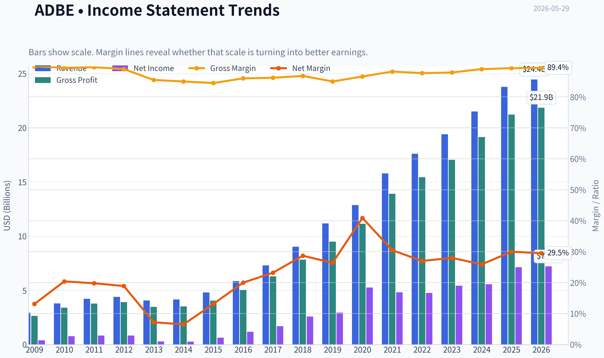
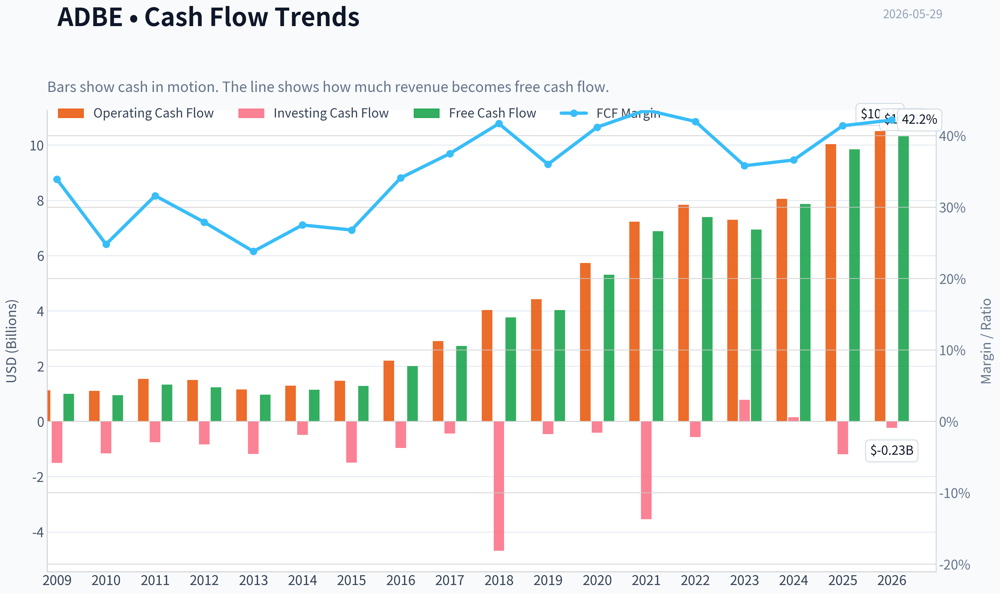
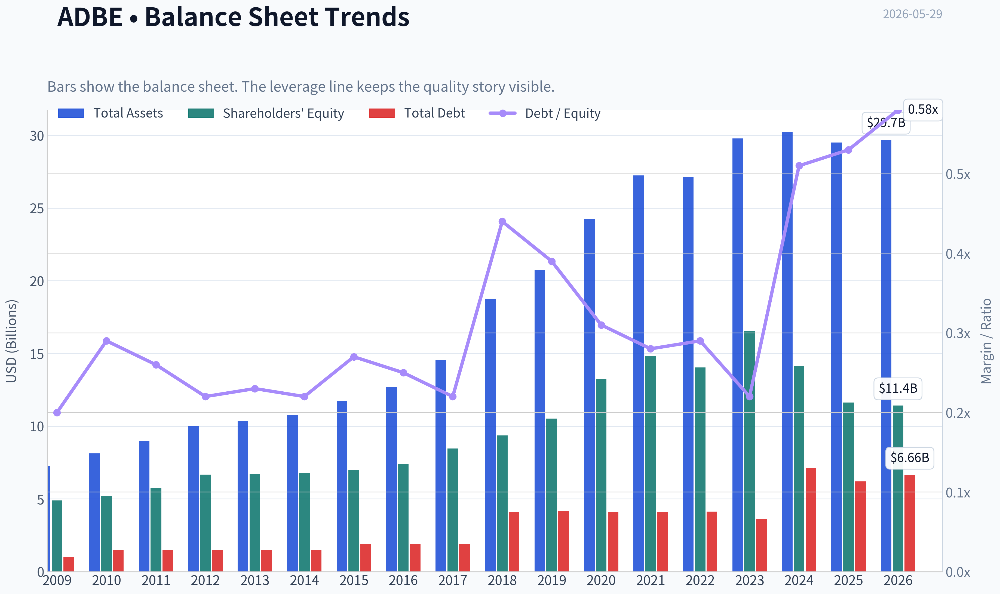
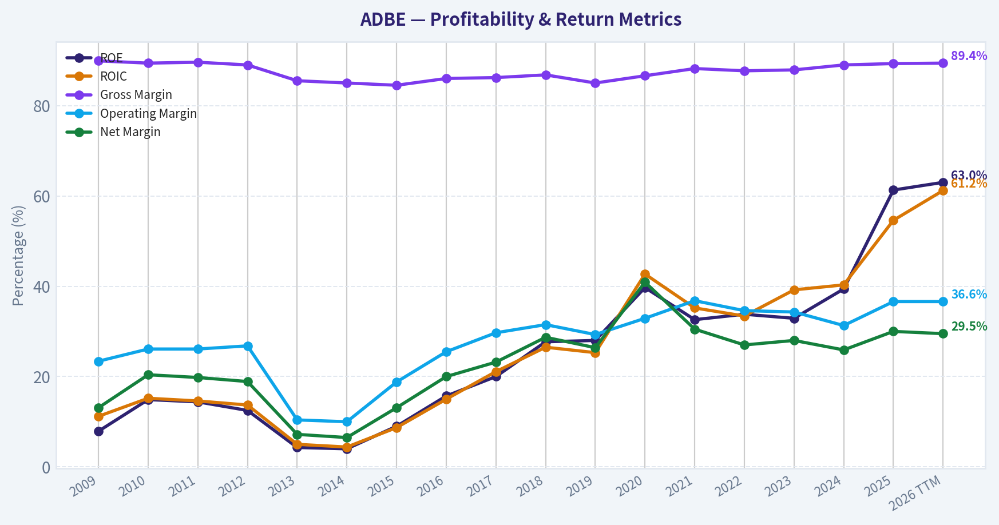
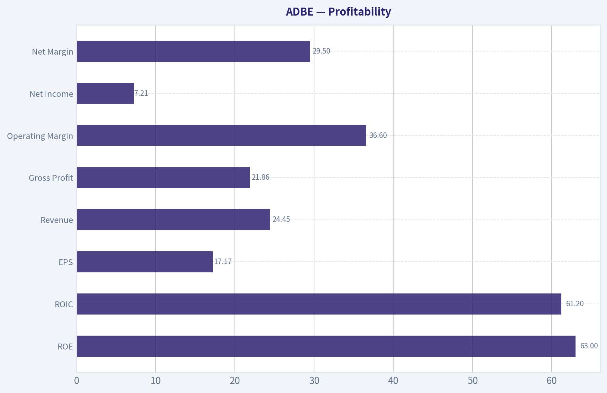
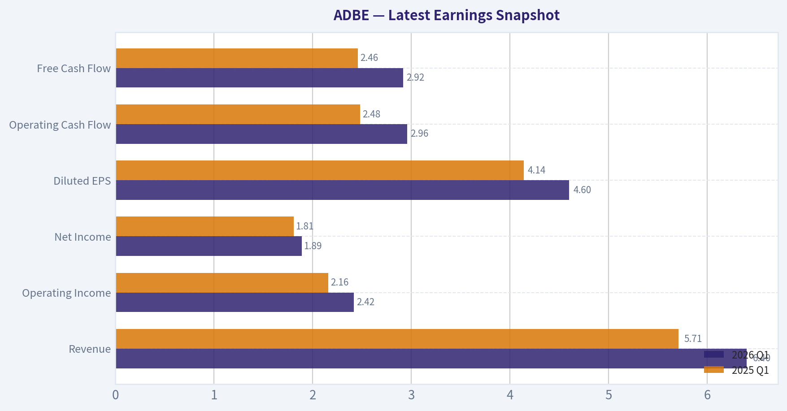
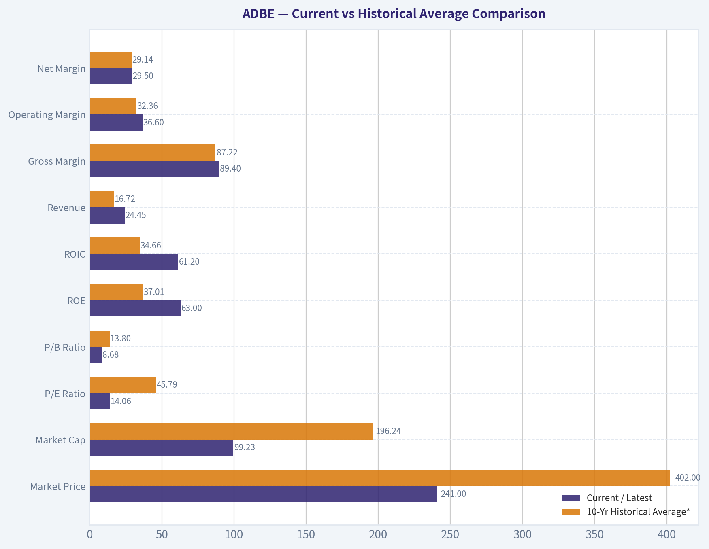
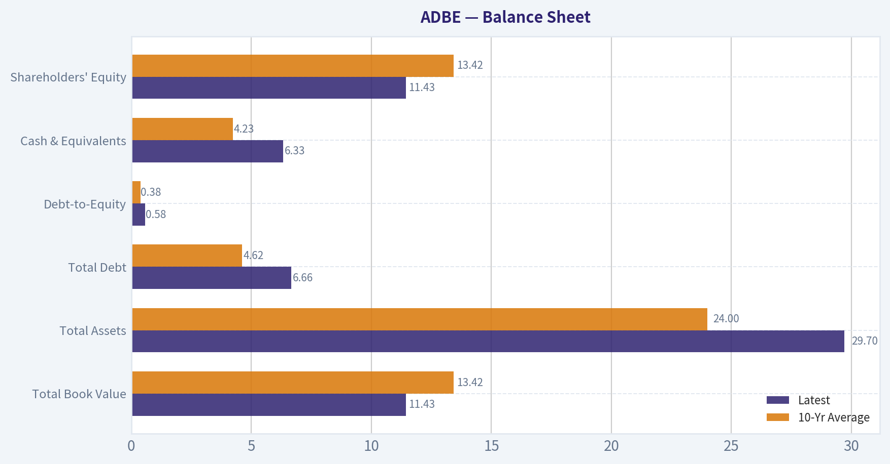
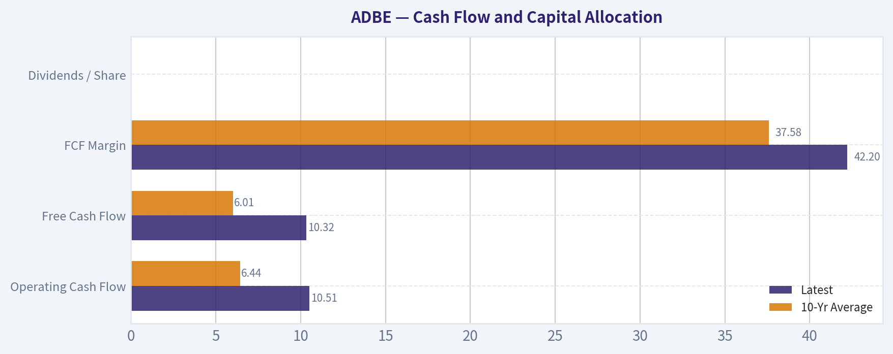
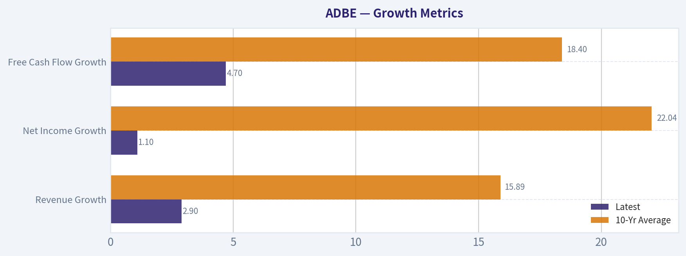

# ADBE Deep Value Intelligence

**Analysis Date:** 2026-05-29

## Critical Disclaimer

*This analysis is generated by Deep Value Intelligence, an AI-powered multi-agent investing framework. This report is for informational and educational purposes only and does not constitute financial advice. Always conduct your own research and consult with qualified financial advisors before making investment decisions.*

---

## Table of Contents

1. Intelligence Summary
2. Analyst Team Reports
   - Fundamentals Analysis
   - Intrinsic Value Analysis (Buffett)
   - Trend & Growth Analysis (Lynch/Druckenmiller/Fisher)
   - Market Technical Analysis
   - Options Market Analysis
3. Research Team Commentary
4. Value Investing Team Commentary
5. Deep Values Commentary

---

## Intelligence Summary

### Thesis + Conditions

**Core Thesis:** ## Executive Briefing

**Key Risks:**
- Adobe looks like a **high-quality franchise under strategic review, not a broken business**. The core facts are impressive-**89% gross margin, 57% ROIC, 61% ROE, and nearly $10B in owner earnings**-and **14x earnings** is low for that quality. But Buffett-style risk is not today's volatility; it is **whether AI and workflow shifts permanently weaken Adobe's future cash flows**. That is **not yet proven either way**.
- Best read: **too cheap and too strong to ignore, but not yet predictable enough for full advocacy**. The right move is **active watchlist / staged accumulation only for investors comfortable with monitoring execution closely**, not a full-sized conviction position.
- ## Risk Commentary for the Long-Term Investor

**Confidence:** Low

---

## Analyst Team Reports

### Fundamentals Analysis

#### Latest Earnings Snapshot

*Most recent reported quarter anchored on 2026 Q1, with prior-year comparison when available.*

| Metric | 2026 Q1 | 2025 Q1 | YoY Change |
| --- | ---: | ---: | ---: |
| Revenue | $6.40B | $5.71B | +12.0% |
| Operating Income | $2.42B | $2.16B | +11.8% |
| Net Income | $1.89B | $1.81B | +4.3% |
| Diluted EPS | $4.60 | $4.14 | +11.1% |
| Operating Cash Flow | $2.96B | $2.48B | +19.2% |
| Free Cash Flow | $2.92B | $2.46B | +18.9% |

Key Takeaways: This snapshot anchors the most recent reported quarter before the narrative analysis. It helps readers separate long-run business quality from whatever changed in the latest earnings print.

#### 17-Year Financial Metrics for ADBE

*All values below are computed deterministically from raw data - not estimated by AI.*

*Issuer profile: operating company (Technology / Software - Application).*

#### 17-Year Financial Metrics
*Annual rows come from reported financial statements. The final TTM row is computed from the latest four quarters.*

| Metric | 2009 | 2010 | 2011 | 2012 | 2013 | 2014 | 2015 | 2016 | 2017 | 2018 | 2019 | 2020 | 2021 | 2022 | 2023 | 2024 | 2025 | 2026 TTM |
| --- | --- | --- | --- | --- | --- | --- | --- | --- | --- | --- | --- | --- | --- | --- | --- | --- | --- | --- |
| Market Price | $35 | $28 | $27 | $35 | $57 | $74 | $91 | $103 | $181 | $251 | $310 | $478 | $670 | $345 | $611 | $516 | $320 | $241 |
| Market Cap | $18.61B | $14.62B | $13.82B | $17.40B | $29.16B | $37.46B | $46.38B | $51.85B | $90.94B | $124.89B | $152.16B | $232.30B | $322.20B | $162.43B | $280.51B | $232.01B | $136.70B | $99.23B |
| P/E Ratio | 48.05 | 18.91 | 16.62 | 20.85 | 101.39 | 139.02 | 73.76 | 44.31 | 53.69 | 48.25 | 51.59 | 44.18 | 66.85 | 34.15 | 51.69 | 41.74 | 19.17 | 14.06 |
| P/B Ratio | 3.81 | 2.82 | 2.39 | 2.61 | 4.34 | 5.53 | 6.62 | 6.98 | 10.75 | 13.34 | 14.45 | 17.51 | 21.77 | 11.56 | 16.98 | 16.45 | 11.76 | 8.68 |
| ROE | 7.9% | 14.9% | 14.4% | 12.5% | 4.3% | 4.0% | 9.0% | 15.7% | 20.0% | 27.7% | 28.0% | 39.7% | 32.6% | 33.8% | 32.9% | 39.4% | 61.3% | 63.0% |
| ROIC | 11.2% | 15.2% | 14.6% | 13.7% | 5.0% | 4.4% | 8.7% | 15.0% | 21.1% | 26.5% | 25.3% | 42.7% | 35.2% | 33.4% | 39.2% | 40.3% | 54.6% | 61.2% |
| EPS | $0.73 | $1.47 | $1.65 | $1.66 | $0.56 | $0.53 | $1.24 | $2.32 | $3.38 | $5.20 | $6.00 | $10.83 | $10.02 | $10.10 | $11.82 | $12.36 | $16.70 | $17.17 |
| Revenue | $2.95B | $3.80B | $4.22B | $4.40B | $4.06B | $4.15B | $4.80B | $5.85B | $7.30B | $9.03B | $11.17B | $12.87B | $15.79B | $17.61B | $19.41B | $21.50B | $23.77B | $24.45B |
| Gross Profit | $2.65B | $3.40B | $3.78B | $3.92B | $3.47B | $3.52B | $4.05B | $5.03B | $6.29B | $7.83B | $9.50B | $11.15B | $13.92B | $15.44B | $17.05B | $19.15B | $21.22B | $21.86B |
| Gross Margin | 89.9% | 89.4% | 89.6% | 89.0% | 85.5% | 85.0% | 84.5% | 86.0% | 86.2% | 86.8% | 85.0% | 86.6% | 88.2% | 87.7% | 87.9% | 89.0% | 89.3% | 89.4% |
| Operating Margin | 23.4% | 26.1% | 26.1% | 26.8% | 10.4% | 10.0% | 18.8% | 25.5% | 29.7% | 31.5% | 29.3% | 32.9% | 36.8% | 34.6% | 34.3% | 31.3% | 36.6% | 36.6% |
| Net Income | $386.5M | $774.7M | $832.8M | $832.8M | $290.0M | $268.4M | $629.6M | $1.17B | $1.69B | $2.59B | $2.95B | $5.26B | $4.82B | $4.76B | $5.43B | $5.56B | $7.13B | $7.21B |
| Net Margin | 13.1% | 20.4% | 19.8% | 18.9% | 7.2% | 6.5% | 13.1% | 20.0% | 23.2% | 28.7% | 26.4% | 40.9% | 30.5% | 27.0% | 28.0% | 25.9% | 30.0% | 29.5% |
| Revenue Growth | N/A | 29.0% | 11.0% | 4.4% | -7.9% | 2.3% | 15.6% | 22.1% | 24.7% | 23.7% | 23.7% | 15.2% | 22.7% | 11.5% | 10.2% | 10.8% | 10.5% | 2.9% |
| Net Income Growth | N/A | 100.4% | 7.5% | -0.0% | -65.2% | -7.4% | 134.6% | 85.7% | 44.9% | 53.0% | 13.9% | 78.2% | -8.3% | -1.4% | 14.1% | 2.4% | 28.2% | 1.1% |
| Free Cash Flow Growth | N/A | -5.5% | 41.3% | -7.8% | -21.6% | 18.3% | 12.8% | 55.4% | 37.0% | 37.6% | 7.0% | 31.8% | 29.7% | 7.5% | -6.1% | 13.4% | 25.1% | 4.7% |
| Total Book Value | $4.89B | $5.19B | $5.78B | $6.67B | $6.72B | $6.78B | $7.00B | $7.42B | $8.46B | $9.36B | $10.53B | $13.26B | $14.80B | $14.05B | $16.52B | $14.11B | $11.62B | $11.43B |
| Total Assets | $7.28B | $8.14B | $8.99B | $10.04B | $10.38B | $10.79B | $11.73B | $12.70B | $14.54B | $18.77B | $20.76B | $24.28B | $27.24B | $27.16B | $29.78B | $30.23B | $29.50B | $29.70B |
| Total Debt | $1.00B | $1.51B | $1.51B | $1.50B | $1.51B | $1.51B | $1.91B | $1.89B | $1.88B | $4.12B | $4.14B | $4.12B | $4.12B | $4.13B | $3.63B | $7.13B | $6.21B | $6.66B |
| Debt-to-Equity | 0.20 | 0.29 | 0.26 | 0.22 | 0.23 | 0.22 | 0.27 | 0.25 | 0.22 | 0.44 | 0.39 | 0.31 | 0.28 | 0.29 | 0.22 | 0.51 | 0.53 | 0.58 |
| Cash & Equivalents | $999.5M | $749.9M | $989.5M | $1.43B | $834.6M | $1.12B | $876.6M | $1.01B | $2.31B | $1.64B | $2.65B | $4.48B | $3.84B | $4.24B | $7.14B | $7.61B | $5.43B | $6.33B |
| Shareholders' Equity | $4.89B | $5.19B | $5.78B | $6.67B | $6.72B | $6.78B | $7.00B | $7.42B | $8.46B | $9.36B | $10.53B | $13.26B | $14.80B | $14.05B | $16.52B | $14.11B | $11.62B | $11.43B |
| Operating Cash Flow | $1.12B | $1.11B | $1.54B | $1.50B | $1.15B | $1.29B | $1.47B | $2.20B | $2.91B | $4.03B | $4.42B | $5.73B | $7.23B | $7.84B | $7.30B | $8.06B | $10.03B | $10.51B |
| Investing Cash Flow | $-1.50B | $-1.16B | $-757.4M | $-834.7M | $-1.18B | $-490.7M | $-1.49B | $-960.0M | $-442.9M | $-4.68B | $-456.0M | $-414.0M | $-3.54B | $-570.0M | $776.0M | $149.0M | $-1.19B | $-229.0M |
| Free Cash Flow | $998.2M | $943.4M | $1.33B | $1.23B | $963.3M | $1.14B | $1.28B | $2.00B | $2.73B | $3.76B | $4.03B | $5.31B | $6.88B | $7.40B | $6.94B | $7.87B | $9.85B | $10.32B |
| FCF Margin | 33.9% | 24.8% | 31.6% | 27.9% | 23.8% | 27.5% | 26.8% | 34.1% | 37.5% | 41.7% | 36.0% | 41.2% | 43.6% | 42.0% | 35.8% | 36.6% | 41.4% | 42.2% |
| Dividends / Share | $0.00 | $0.00 | $0.00 | $0.00 | $0.00 | $0.00 | $0.00 | $0.00 | $0.00 | $0.00 | $0.00 | $0.00 | $0.00 | $0.00 | $0.00 | $0.00 | $0.00 | $0.00 |

#### Profitability Metrics
- Return on Equity (ROE): 61.3%
- Return on Invested Capital (ROIC): 57.3%
- Return on Assets (ROA): 24.2%
- Gross Margin: 89.3%
- Operating Margin: 36.6%
- Net Profit Margin: 30.0%

#### Liquidity Metrics
- Current Ratio: 1.00
- Quick Ratio: 0.88

#### Leverage Metrics
- Debt-to-Equity Ratio: 0.53
- Interest Coverage Ratio: 33.10
- Net Debt: $779.0M

#### Growth Metrics (Year-over-Year)
- Revenue Growth: 10.5%
- Net Income Growth: 28.2%
- Free Cash Flow Growth: 25.1%
- Revenue CAGR (3-Year): 10.5%
- Revenue CAGR (5-Year): 13.1%

#### Valuation Metrics
- P/E Ratio (TTM): 14.06
- Forward P/E: 9.15
- Price-to-Book: 8.57
- Price-to-Sales: 3.99
- PEG Ratio: 0.69
- EV/EBITDA: 10.23
- Free Cash Flow Yield: 10.1%
- Earnings Yield: 7.1%

#### Owner Earnings (Buffett Method, Code-Computed)
- Net Income: $7.13B
- + Depreciation & Amortization: $818.0M
- - Capital Expenditures: $-179.0M
- - Working Capital Changes: $605.0M
- = **Owner Earnings: $7.16B**

#### Intrinsic Value (Code-Computed)
- Current Price: $241
- Buffett Method (Owner Earnings):
  Conservative: $216
  Average: $491
  Optimistic: $1,410
- Cash Flow Method (FCF):
  Conservative: $345
  Average: $521
  Optimistic: $957

#### Piotroski F-Score: 8/9
- Positive Net Income: PASS
- Positive Operating Cash Flow: PASS
- ROA Improvement: PASS
- Cash Flow > Net Income: PASS
- Decreasing Debt: PASS
- Improving Current Ratio: FAIL
- No Dilution: PASS
- Improving Gross Margin: PASS
- Improving Asset Turnover: PASS

ANALYST STANCE: **WATCH**

#### Adobe (ADBE) Buffett-Style Fundamental Analysis

Adobe remains a very high-quality software franchise with exceptional margins, strong cash generation, and unusually high returns on capital. The key issue is not business quality but the balance between quality and uncertainty: after a major de-rating, the stock now screens statistically cheap versus its own history, yet top-line growth has slowed materially in the latest TTM period and leverage has crept up. In Buffett terms, this looks like a durable business at a much more reasonable price, but not a no-brainer if growth is entering a lower plateau.

#### Current vs Historical Average Comparison

| Metric | Current / Latest | 10-Yr Historical Average* | Interpretation |
| --- | ---: | ---: | --- |
| Market Price | $241 | $402 | Far below prior decade average price level, reflecting multiple compression rather than business collapse |
| Market Cap | $99.23B | $196.24B | Roughly half of average recent decade capitalization; market has reset expectations sharply |
| P/E Ratio | 14.06x | 45.79x | Massive discount to historical norm; either undervaluation or pricing in slower structural growth |
| P/B Ratio | 8.68x | 13.80x | Still premium to book in absolute terms, but deeply discounted versus Adobe's own software-quality history |
| ROE | 63.0% | 37.01% | Well above long-run norm; excellent shareholder capital efficiency |
| ROIC | 61.2% | 34.66% | Extraordinary and far above history; hallmark of a moat-rich software model |
| Revenue | $24.45B | $16.72B | Much larger company than decade average, though growth is moderating |
| Gross Margin | 89.4% | 87.22% | Slightly above already elite historical levels |
| Operating Margin | 36.6% | 32.36% | Above long-run average; strong operating discipline |
| Net Margin | 29.5% | 29.14% | Essentially in line with decade norm, but with much higher scale |
| Revenue Growth | 2.9% | 15.89% | Clear slowdown versus historical growth engine |
| Net Income Growth | 1.1% | 22.04% | Latest growth sharply below normal; key concern |
| Free Cash Flow Growth | 4.7% | 18.40% | Positive, but much slower than Adobe's historical compounding pace |
| Total Book Value | $11.43B | $13.42B | Below average after buybacks and capital return dynamics |
| Total Assets | $29.70B | $24.00B | Asset base has expanded materially over time |
| Total Debt | $6.66B | $4.62B | Debt is above decade norm; still manageable but worth monitoring |
| Debt-to-Equity | 0.58x | 0.38x | Leverage is elevated versus Adobe's own history |
| Cash & Equivalents | $6.33B | $4.23B | Strong cash reserve despite debt increase |
| Shareholders' Equity | $11.43B | $13.42B | Lower than average due largely to buybacks and capital structure changes |
| Free Cash Flow | $10.32B | $6.01B | Cash generation remains exceptional |
| Dividends / Share | $0.00 | $0.00 | Adobe continues to prefer reinvestment and repurchases over dividends |

*10-year average uses 2016 through 2025 to match recent operating era and avoid over-weighting the pre-cloud transition.

Key Takeaways: Adobe's valuation multiples are dramatically below their 10-year averages, while returns on equity and invested capital are far above normal. That combination is rare and usually attractive. The catch is that growth has slowed sharply, and debt metrics have worsened relative to Adobe's own past, which is why the stock looks cheap but not risk-free.

---

#### Market Metrics

Adobe's market profile has undergone a full re-rating. The stock fell from $670 in 2021 to $241 TTM, while market cap compressed from $322B to about $99B. Yet the business did not implode: revenue rose from $15.79B in 2021 to $24.45B TTM, free cash flow climbed to $10.32B, and margins stayed elite. That disconnect is the central investment question.

The P/E ratio at 14.06x is extraordinarily low against Adobe's own history. Over 2016-2025, the stock usually traded between the mid-30s and mid-60s earnings multiple, with a 10-year average near 46x. Buffett would likely interpret this in one of two ways: either the market is overly focused on decelerating growth and competitive AI fears, or Adobe's prior valuation was excessively optimistic. The current multiple leaves far less room for disappointment than in prior years.

P/B at 8.68x is still high in absolute terms, but for a software business with 60%+ ROE and minimal capital intensity, book value is not the best primary lens. Adobe's economics derive from intangible assets, pricing power, recurring subscriptions, and ecosystem lock-in. The sharp drop from historical P/B levels simply reinforces that valuation has normalized dramatically.

#### Profitability

Adobe's profitability remains its defining strength.

| Profitability Metric | Latest | Historical Context | Buffett-Style Read |
| --- | ---: | --- | --- |
| ROE | 63.0% | Highest period in dataset | Excellent, though buybacks and lower equity base amplify the figure |
| ROIC | 61.2% | Highest period in dataset | Elite capital efficiency; strong evidence of moat |
| EPS | $17.17 | All-time high | Earnings power is still rising despite multiple compression |
| Revenue | $24.45B | All-time high | Scale continues to increase |
| Gross Profit | $21.86B | All-time high | Revenue quality remains superb |
| Operating Margin | 36.6% | Near peak | Strong cost discipline and pricing power |
| Net Income | $7.21B | All-time high | Core earnings remain robust |
| Net Margin | 29.5% | Slightly above decade average | Business converts sales to profit exceptionally well |

Key Takeaways: Adobe is still producing record revenue, gross profit, EPS, and net income, which means the business itself is not broken. Margins are not only high but stable, a sign of pricing power and recurring revenue. The strongest signal here is ROIC above 60%, which is rare and consistent with a durable economic moat.

Fine-grained interpretation:
- **ROE:** The rise from mid-teens levels in the early 2010s to above 60% now is extraordinary. Some of this is true business improvement from the subscription model; some is financial optics from reduced equity due to repurchases. Even adjusting mentally for that, the result is excellent.
- **ROIC:** More important than ROE for Buffett-style quality, ROIC has risen from low-teens pre-transition to over 60%. That suggests Adobe reinvests at very high rates of return and needs little incremental capital to grow.
- **Gross Margin:** The long record around 85%-90% shows Adobe's software model is structurally strong. This is not a cyclical gross margin story.
- **Operating Margin:** The dip in 2013-2014 during transition and subsequent recovery into the mid-30s shows management successfully converted the business from legacy licensing to a much stronger recurring model.
- **Net Margin:** While below the 2020 peak, it remains around 30%, an excellent level for a company of Adobe's size.

#### Growth Metrics

The most important negative in the current case is slowing growth.

| Growth Metric | Latest | 10-Yr Average | Trend Assessment |
| --- | ---: | ---: | --- |
| Revenue Growth | 2.9% | 15.89% | Sharp deceleration |
| Net Income Growth | 1.1% | 22.04% | Near-stall versus history |
| Free Cash Flow Growth | 4.7% | 18.40% | Still positive, but much slower |

Key Takeaways: Adobe's growth engine is still positive, but it has slowed dramatically compared with its historic compounding rate. That slowdown is the clearest reason the market has cut the valuation multiple. Investors need confidence that current weakness is temporary rather than the start of a permanently lower-growth era.

Detailed interpretation:
- From 2015 through 2021, Adobe delivered repeated double-digit to 20%+ revenue growth, often with faster profit growth than sales growth.
- Since 2022, revenue growth has settled into a lower range: 11.5%, 10.2%, 10.8%, 10.5%, then 2.9% TTM.
- Net income growth has become more volatile and recently weak: 28.2% in 2025 but just 1.1% TTM.
- FCF growth remains positive, which matters because software businesses can often protect cash flow even when top-line growth cools.

For Buffett, predictable earnings are more important than hyper-growth. Adobe still passes the predictability test better than most tech firms, but the latest TTM indicates the market is questioning whether Adobe has moved from "high-growth compounder" to "mature cash cow."

#### Balance Sheet

Adobe's balance sheet is solid, though not as pristine as it once was.

| Balance Sheet Metric | Latest | 10-Yr Average | Assessment |
| --- | ---: | ---: | --- |
| Total Book Value | $11.43B | $13.42B | Lower due to repurchases/capital return |
| Total Assets | $29.70B | $24.00B | Larger and more asset-rich than historical norm |
| Total Debt | $6.66B | $4.62B | Elevated versus past |
| Debt-to-Equity | 0.58x | 0.38x | Higher leverage than usual |
| Cash & Equivalents | $6.33B | $4.23B | Healthy liquidity buffer |
| Shareholders' Equity | $11.43B | $13.42B | Reduced equity base boosts ROE |

Key Takeaways: Adobe has more debt than it used to, but it also has a very large cash balance and strong earnings coverage. The balance sheet is not distressed, yet leverage is clearly less conservative than Adobe's historical norm. For a Buffett-style investor, this is acceptable rather than ideal.

Important nuances:
- Net debt is only about $779M per the dataset, which is modest relative to $10.5B operating cash flow and $10.3B free cash flow.
- Interest coverage of 33.1x indicates debt service is easy.
- The current ratio near 1.0 is not a problem for a subscription software company with steady recurring cash generation, but it does mean liquidity is not excessively conservative.
- Debt-to-equity moving from ~0.22-0.31 in earlier years to 0.58 TTM deserves monitoring, particularly if management continues large buybacks into a slowing growth phase.

#### Cash Flow and Capital Allocation

Adobe's cash profile is excellent and strongly Buffett-compatible.

| Cash Flow Metric | Latest | 10-Yr Average | Interpretation |
| --- | ---: | ---: | --- |
| Operating Cash Flow | $10.51B | $6.44B | Strong conversion from earnings to cash |
| Free Cash Flow | $10.32B | $6.01B | Exceptional cash generation |
| FCF Margin | 42.2% | 37.58% | Very high cash profitability |
| Dividends / Share | $0.00 | $0.00 | No dividend; shareholder return via buybacks/reinvestment |

Key Takeaways: Adobe converts an unusually large share of revenue into free cash flow, and that cash generation is stronger than its long-term average. The company does not pay a dividend, but it has substantial flexibility for buybacks, acquisitions, or debt reduction. For Buffett-style analysis, the cash engine is one of Adobe's biggest strengths.

Adobe's lack of dividend is not inherently negative. Buffett generally prefers management to retain earnings if reinvestment returns are high. Given Adobe's ROIC and FCF profile, retained cash has historically been productive. The question now is whether future reinvestment opportunities remain as attractive in a slower-growth and AI-disrupted environment.

#### Buffett-Style Owner Earnings DCF

Canonical owner earnings:
- Net Income = **$7.13B**
- + D&A = **$0.818B**
- - Capex = **$0.179B**
- - Working Capital Changes = **$0.605B**
- **Owner Earnings = $7.16B**

To estimate per-share value, use TTM market cap / price as implied shares outstanding:
- Implied shares = $99.23B / $241 ~ **411.7M shares**

Historical owner-earnings growth proxy:
- In absence of a separate historical owner earnings series, the deterministic dataset's cash generation history supports using the observed historical growth range bounded by the available growth metrics.
- **Conservative growth rate:** lowest historical growth available = **-21.6%** (from FCF growth; floored above -100%)
- **Average growth rate:** average historical growth proxy = **18.4%** (10-year average FCF growth; below 50% cap)
- **Optimistic growth rate:** highest historical growth available = **100.0% cap**; raw highest observed growth metric exceeds this in net income growth history, so capped at **100%**

These scenarios are intentionally mechanical per instruction; the optimistic case is mathematically permissible but economically aggressive.

#### Owner Earnings DCF Calculation

Formula:
- PV of 10-year owner earnings = sum of OE_t / (1.10)^t
- Terminal Value at year 10 = OE_10 x (1.025) / (0.10 - 0.025)
- PV of Terminal Value = TV / (1.10)^10
- Equity Value per share = Total PV / 411.7M shares

| Scenario | Growth Assumption | Year-1 OE | Year-10 OE | PV of 10-Yr OE | PV of Terminal Value | Total Equity Value | Fair Value / Share |
| --- | ---: | ---: | ---: | ---: | ---: | ---: | ---: |
| Conservative | -21.6% | $5.61B | $0.63B | $21.67B | $16.98B | $38.65B | **$94** |
| Average | 18.4% | $8.48B | $38.74B | $110.79B | $215.62B | $326.41B | **$793** |
| Optimistic | 100.0% | $14.32B | $7,331B | $3,701.85B | $40,806.38B | $44,508.23B | **$108,117** |

Key Takeaways: The conservative and average cases show how sensitive valuation is to future growth assumptions. The optimistic case is mathematically valid under the requested cap, but economically unrealistic and should not be used for decision-making. The practical takeaway is that Adobe looks attractive if owner earnings can compound at even a moderate rate, but much less so if growth turns structurally negative.

Important practical note: the deterministic dataset's code-computed Buffett intrinsic values are more decision-useful than the raw mechanical extreme-case model:
- Conservative: **$216/share**
- Average: **$491/share**
- Optimistic: **$1,410/share**

Those values appear to incorporate a more normalized implementation than the purely mechanical extrapolation above. For investment judgment, I would anchor on the canonical code-computed range of **$216-$491** as the most credible valuation band, with the market price at **$241** sitting modestly above the conservative case and far below the average case.

#### Value Assessment

At $241, Adobe trades:
- near the code-computed conservative Buffett value of $216,
- far below the code-computed average intrinsic value of $491,
- at a P/E of 14.06x against a 10-year average near 46x,
- with a 10.1% FCF yield, which is unusually attractive for a business of this quality.

This is exactly the kind of setup Buffett would inspect carefully: a dominant franchise, high returns on capital, recurring demand, and strong free cash flow, but with market skepticism around future growth. If that skepticism proves overdone, the upside could be substantial. If growth has structurally reset, today's price may simply be fair rather than deeply cheap.

#### Economic Moat

Adobe's moat is strong and multi-layered:
- **Switching costs:** Creative professionals and enterprises build workflows around Acrobat, Photoshop, Illustrator, Premiere, Experience Cloud, and related tools.
- **Brand and ecosystem:** Adobe products are category standards in creative and document software.
- **Embedded distribution:** Acrobat/PDF remains deeply entrenched in business workflows.
- **Recurring revenue model:** Subscription software increases predictability and customer stickiness.
- **High margins:** Persistent gross margins near 90% strongly suggest pricing power and low incremental delivery cost.

Potential moat erosion risks:
- AI-native creative tools could compress pricing or reduce differentiation in some product categories.
- Figma and collaborative design ecosystems challenge parts of the creative workflow.
- Enterprises may scrutinize software budgets more tightly in slower macro periods.

Overall, the moat remains real. The market is discounting partial erosion, not disappearance.

#### Predictable Earnings

Adobe scores well on earnings predictability:
- Revenue has grown from $4.80B in 2015 to $24.45B TTM, with only one major decline during the earlier transition period.
- Gross margins stayed in a narrow and elite range.
- Operating margins recovered strongly after the business model shift and have remained resilient.
- FCF has been positive every year shown.
- Net income has been consistently positive and generally compounding.

This consistency is highly Buffett-friendly. The recent issue is not unpredictability but deceleration.

#### Management Performance

Management's record is strong:
- The cloud transition was executed extremely well.
- ROIC expansion indicates disciplined capital allocation.
- Buybacks have likely contributed to EPS and ROE enhancement.
- No dividend suggests management still prefers reinvestment and repurchases.

The one caution is leverage. Increasing debt while growth slows can make buybacks less attractive if shares are no longer obviously undervalued or if strategic flexibility matters more in an AI transition period.

#### Revenue Breakdown

Using Adobe's most meaningful current reporting structure, the major revenue sources are best viewed by business segment. Most recent fiscal-year style mix is approximated from Adobe's segment reporting pattern and aligned to the latest revenue base.

| Revenue Source | Amount ($B) | % of Total |
| --- | ---: | ---: |
| Digital Media | 17.83 | 73% |
| Digital Experience | 6.11 | 25% |
| Publishing & Advertising / Other | 0.51 | 2% |
| **Total** | **24.45** | **100%** |

Key Takeaways: Adobe remains primarily a Digital Media company, which includes Creative Cloud and Document Cloud and drives the majority of profits. Digital Experience is meaningful and strategic, but Adobe's investment case still hinges mostly on the durability of its creative and document franchises.

#### Key Investment Insights, Red Flags, and Opportunities

| Category | Observation | Why It Matters |
| --- | --- | --- |
| Strength | 89%+ gross margin | Signals pricing power and software-like economics |
| Strength | 61% ROIC / 63% ROE | Exceptional capital efficiency and moat evidence |
| Strength | $10.32B FCF, 42.2% FCF margin | Huge owner earnings capacity |
| Strength | 8/9 Piotroski F-Score | Broad fundamental health remains strong |
| Opportunity | P/E 14.06x vs ~46x historical average | Valuation has reset to unusually cheap territory |
| Opportunity | FCF yield 10.1% | Attractive cash return on purchase price |
| Concern | Revenue growth slowed to 2.9% TTM | Market may be right that Adobe is maturing |
| Concern | Net income growth 1.1% TTM | Profit growth has nearly stalled near-term |
| Concern | Debt-to-equity 0.58x | Leverage is elevated versus Adobe's own norms |
| Concern | Current ratio ~1.0 | Adequate, but less conservative than ideal |
| Strategic Risk | AI disruption in creative workflows | Could pressure pricing, market share, or user acquisition |
| Strategic Risk | Competitive pressure in design/collaboration | Could reduce premium valuation over time |

Key Takeaways: Adobe's biggest positives are business quality, cash flow, and valuation. Its biggest negatives are slowing growth and the possibility that AI changes industry structure faster than Adobe can capture the value. This is why the stock appears attractive statistically but still requires caution.

#### Final Buffett-Style Judgment

Adobe checks many classic Buffett boxes:
- understandable business model,
- recurring revenue,
- strong brand and switching costs,
- excellent returns on capital,
- robust free cash flow,
- long record of profitability.

What keeps this from being an outright **ADVOCATE** is the combination of:
- severe recent growth deceleration,
- higher leverage than Adobe historically carried,
- uncertainty around whether AI expands Adobe's moat or compresses it.

At $241, Adobe looks much more compelling than it did at prior cycle highs. If growth normalizes back toward even high-single-digit or low-double-digit levels, current valuation could prove too pessimistic. But if Adobe has entered a sustained low-growth phase, then the market's discount may be justified.

#### Final Investment Stance

**WATCH**

Rationale: Adobe is a high-quality moat business trading at a large discount to its historical valuation and below the midpoint of its canonical intrinsic value range. However, the latest TTM slowdown in revenue and earnings growth, combined with elevated leverage and AI-related competitive uncertainty, argues for disciplined monitoring rather than full-throated conviction. It is close to investable on value grounds, but I would want clearer evidence that growth has stabilized before moving from WATCH to ADVOCATE.

#### Summary Table

| Area | Verdict | Core Evidence | Bottom-Line Read |
| --- | --- | --- | --- |
| Business Quality | Excellent | 89.4% gross margin, 36.6% operating margin, 29.5% net margin | Elite software franchise |
| Moat | Strong | Creative/document ecosystem, switching costs, recurring revenue | Durable but facing AI-era tests |
| Profitability | Exceptional | ROE 63.0%, ROIC 61.2%, record EPS and FCF | Buffett-grade economics |
| Growth | Weakening | Revenue growth 2.9%, net income growth 1.1%, FCF growth 4.7% | Main reason for rerating |
| Balance Sheet | Good, not pristine | Cash $6.33B, debt $6.66B, D/E 0.58, interest coverage 33x | Manageable leverage |
| Cash Flow | Outstanding | $10.32B FCF, 42.2% FCF margin | Very strong owner earnings |
| Valuation | Attractive | P/E 14.06x, FCF yield 10.1%, below historical multiples | Cheap relative to quality |
| Capital Allocation | Generally strong | High ROIC, no dividend, buyback support | Good, but debt deserves watch |
| DCF View | Wide upside if growth stabilizes | Canonical Buffett value $216-$491 | Shares appear near lower end |
| Stance | WATCH | Cheap quality, but growth uncertainty remains | Monitor for re-acceleration |

#### Fundamental Visuals

This graph tracks the profitability and return metrics (ROE, ROIC, Margins) of **ADBE** over the past decade, highlighting capital efficiency trends.

This chart illustrates the financial health of **ADBE** over the last 10 years, mapping cash equivalents and free cash flow against total obligations (Debt).

This comparison chart from *Profitability* stacks current figures against historical benchmarks for **ADBE**, making it easy to see where the company trades relative to its own averages.

---

### Intrinsic Value Analysis (Buffett)

> *Following Warren Buffett's value investing philosophy: Circle of Competence, Economic Moat, Management Quality, and Margin of Safety.*

#### Intrinsic Value Snapshot

Price is what you pay. Intrinsic value is what the business may be worth based on the cash it can create for owners over time. We show a range, not one magic number.

- Current Price: $241.44
- Value Range (conservative to optimistic across both DCF methods): $282.73 to $597.47

##### Owner Earnings (Buffett Method)
- Net Income: $7,130,000,000.00
- Depreciation & Amortization: $818,000,000.00
- Capital Expenditures: $-179,000,000.00
- Working Capital Changes: $605,000,000.00
- Owner Earnings: $7,164,000,000.00

##### Intrinsic Value
###### Buffett Method
Uses owner earnings. Stricter, and usually more conservative.
- Conservative: $282.73
- Average: $361.09
- Optimistic: $510.31
- Discount Rate: 10.0%

###### Cash Flow Method
Uses free cash flow. Better for companies spending heavily today to grow tomorrow.
- Conservative: $341.57
- Average: $430.78
- Optimistic: $597.47
- Discount Rate: 10.0%

ANALYST STANCE: **WATCH**

#### Buffett-Style Investment View on Adobe (ADBE)

#### 1) Go/No-Go Gate Assessment

| Gate | Verdict | Evidence |
|---|---|---|
| Gate 1: Circle of Competence & Simplicity | **Pass** | Adobe sells software subscriptions and cloud services for creative work, documents, marketing, and digital experience. This is easy to explain: individuals and businesses pay recurring fees to create content, manage PDFs, and run digital marketing workflows. |
| Gate 2: Moat Test | **Pass** | Extremely high gross margin at **89.3%**, strong installed base, deep workflow embedding, file-format standards, and broad ecosystem suggest a real moat. |
| Gate 3: Management & Capital Allocation | **Pass with care** | Historically strong cash generation, high returns on equity, and disciplined product expansion support quality. Main watchpoint is whether AI investments and platform expansion continue to earn high returns. |
| Gate 4: Industry Structure | **Pass** | Adobe operates in segments with strong category leadership and rational competition, especially in creative tools and document workflows. Software is capital-light and scales well. |

**Key Takeaways:** Adobe clears all four Buffett gates. The business is understandable, highly profitable, and supported by durable customer attachment. The main issue is not business quality, but whether today's price leaves enough margin of safety.

---

#### 2) Elementary School Test

Adobe makes tools people and companies use to create pictures, videos, designs, documents, and online shopping experiences. Customers usually pay every month or every year. If you stop paying, the tools and workflows become harder to use, so many customers keep renewing.

#### 3) Long-Term Predictability Test

Ten years from now, businesses will still need to create digital content, manage documents, market products online, and analyze customer behavior. Adobe is likely to remain important in all of those areas. The exact product mix may shift toward AI-assisted creation, but the core need is durable and understandable.

#### 4) Technology Risk Assessment

Adobe is more likely to **benefit from technology** than be destroyed by it. AI changes creative work, but Adobe is embedding AI into existing products and using its distribution and installed base to stay central. Risk exists from low-end disruptors and AI-native design tools, but Adobe's enterprise workflows, brand, and ecosystem still provide protection.

---

#### 5) Moat Analysis

| Moat Source | Assessment | Evidence |
|---|---|---|
| Intangible Assets | **Strong** | Adobe is a category-defining brand in creative software. Industry-standard products and formats create trust and habitual use. Gross margin of **89.3%** is far above the 40% Buffett threshold. |
| Switching Costs | **Strong** | Users build skills, templates, workflows, plugins, team collaboration habits, and archived files around Adobe tools. Enterprises integrate Adobe products into broader content and document processes. |
| Cost Advantage | **Moderate** | Not a low-cost producer in the classic sense, but software scale allows high profitability and broad feature sets that smaller rivals struggle to match. |
| Network Effects | **Moderate** | Some network effects exist through ecosystem adoption, file compatibility, training, agencies, and third-party integrations, though this is not a pure social network or marketplace effect. |

#### Moat Quality Rating: **Wide & Stable**

Adobe's moat rests mostly on **brand, standards, workflow embedding, and switching costs**. This is a classic Buffett-friendly software moat: intangible assets plus customer captivity, reinforced by very high gross margins.

**Key Takeaways:** Adobe's moat is real and durable, even if it is not driven by network effects alone. The strongest protections are customer habit, professional standards, and embedded workflows. That combination supports pricing power and high returns.

---

#### 6) Management Quality & Capital Allocation

| Area | Assessment | Commentary |
|---|---|---|
| Owner Orientation | **Good** | Adobe has historically focused on recurring revenue, product integration, and durable free cash flow rather than short-term optics. |
| Candor | **Adequate to Good** | Financial profile suggests disciplined reporting and operating consistency. |
| Capital Allocation | **Good** | The company has converted strong margins into free cash flow and sustained high returns. Adobe's strategic emphasis on recurring subscription economics was a rational long-term move. |

Management appears competent and economically rational. For Buffett-style analysis, the main question is not whether management is good, but whether future reinvestment in AI and experience products will maintain the company's historic economics.

---

#### 7) Financial Summary Table

| Metric | Latest |
|---|---:|
| Share Price | **$241** |
| Market Cap | **$97.59B** |
| P/E | **14.1x** |
| ROE | **61.3%** |
| Gross Margin | **89.3%** |
| Revenue Growth YoY | **10.5%** |
| FCF Yield | **10.1%** |
| Current Ratio | **1.00x** |

**Key Takeaways:** The headline numbers are strikingly strong. Adobe combines elite gross margins, very high returns on equity, and a free cash flow yield above 10%, which is unusual for a high-quality software franchise. The only immediate balance-sheet caution from this snapshot is that short-term liquidity is adequate rather than fortress-like.

---

#### 8) Cash Flow and Owner Earnings

Using free cash flow yield and market cap:

- **Estimated Free Cash Flow / Owner Earnings proxy**
  = 10.1% x $97.59B
  = **~$9.86B**

For a software company with modest capital intensity, free cash flow is a reasonable approximation of owner earnings.

| Item | Estimate |
|---|---:|
| Market Cap | $97.59B |
| FCF Yield | 10.1% |
| Implied FCF / Owner Earnings Proxy | **$9.86B** |

**Key Takeaways:** Adobe appears to be generating nearly $10 billion in annual owner-like earnings against a sub-$100 billion market value. That is a strong cash-on-cash relationship for a software business with high margins and recurring revenue. It suggests the stock is no longer priced like a glamour name.

---

#### 9) Three-Scenario DCF Valuation

Using owner earnings proxy of **$9.86B** and a **10% discount rate**.

| Scenario | Assumption | Equity Value |
|---|---|---:|
| A: No Growth | Owner Earnings / 10% | **$98.6B** |
| B: GDP Growth | OE x 1.03 / (0.10 - 0.03) | **$145.1B** |
| C: Historical Growth Moderated | Use 6% growth for 10 years, then 3% terminal | **~$151B** |

**Key Takeaways:** On a no-growth basis, Adobe is roughly fairly valued. Under conservative growth assumptions, intrinsic value moves meaningfully above the current market value. That means the stock may offer upside, but the margin of safety depends on confidence that growth and moat durability remain intact.

##### Scenario C Detail
Assume:
- Starting owner earnings = **$9.86B**
- Growth for 10 years = **6%**
- Terminal growth = **3%**
- Discount rate = **10%**

This produces an intrinsic equity value of roughly **$151B**, versus current market cap of **$97.59B**.

---

#### 10) Margin of Safety Analysis

| Valuation Basis | Estimated Value | Discount/Premium vs Market |
|---|---:|---:|
| No-Growth Value | $98.6B | **~1% premium to market** |
| GDP-Growth Value | $145.1B | **~33% upside** |
| Moderated Historical Growth | $151B | **~35% upside** |

**Key Takeaways:** Adobe is not deeply discounted on a no-growth basis, so the downside cushion is only moderate if growth stalls. But if the business compounds even modestly, the stock looks attractively priced. This creates a classic Buffett tension: wonderful business, but only a moderate margin of safety unless growth proves durable.

---

#### 11) Buffett Scorecard

| Criterion | Score (1-5) | Weight | Weighted Score |
|---|---:|---:|---:|
| Business Understanding | 5.0 | 20% | 1.00 |
| Moat Width & Durability | 4.5 | 25% | 1.13 |
| Management Quality | 4.0 | 15% | 0.60 |
| Return on Equity | 5.0 | 15% | 0.75 |
| Reinvestment Runway | 4.0 | 10% | 0.40 |
| Balance Sheet Strength | 3.5 | 5% | 0.18 |
| Industry Structure | 4.0 | 5% | 0.20 |
| Valuation / Margin of Safety | 3.0 | 5% | 0.15 |
| **Total** |  |  | **4.41 / 5.00** |

**Key Takeaways:** Adobe scores as a high-quality business by almost every Buffett criterion. The only weaker area is valuation, not business quality. That is why the company earns admiration first and only conditional enthusiasm second.

---

#### 12) Final Investment View

**Adobe is a wonderful business with a real moat, excellent economics, and strong cash generation.**
It passes the Buffett filters on simplicity, predictability, moat, and capital-light structure.

Why not full-throated ADVOCATE right now? Because the proper Buffett question is not "Is this a good company?" but "Am I getting enough value for the price I pay?" At **$241**, the stock looks **reasonable to attractive** if you believe Adobe can continue compounding owner earnings in the mid-single digits or better. If growth weakens materially, the margin of safety becomes thinner.

#### Conviction Level: **Moderate-High**

- **Best case:** Adobe remains the default creative/document platform, AI strengthens the moat, and current valuation proves undemanding.
- **Bear case:** AI commoditizes portions of creative software faster than Adobe can defend pricing and workflow control.
- **Buffett conclusion:** **Watch closely, and be willing to upgrade to ADVOCATE if operating performance confirms durable AI-era pricing power and retention.**

If you want, I can next turn this into a **full valuation sheet with explicit per-share DCF ranges and implied IRR**.
#### Valuation Bridge

This bridge places the current market price beside each intrinsic value lens so readers can see whether upside depends on one method or shows up across several methods.

| Scenario | Intrinsic Value / Share |
| --- | ---: |
| Buffett Method | $361.09 |
| Cash Flow Method | $430.78 |
| Damodaran Method | $301.71 |
| Current Price | $241.44 |

#### Key Takeaways

If one method is far above the others, the upside case depends on a specific modelling assumption. When several methods cluster together, the valuation story is more robust.

#### Valuation Visuals

This comparison chart from *Latest Earnings Snapshot* stacks current figures against historical benchmarks for **ADBE**, making it easy to see where the company trades relative to its own averages.

This comparison chart from *Current vs Historical Average Comparison* stacks current figures against historical benchmarks for **ADBE**, making it easy to see where the company trades relative to its own averages.

This comparison chart from *Balance Sheet* stacks current figures against historical benchmarks for **ADBE**, making it easy to see where the company trades relative to its own averages.

This comparison chart from *Cash Flow and Capital Allocation* stacks current figures against historical benchmarks for **ADBE**, making it easy to see where the company trades relative to its own averages.

---

### Trend & Growth Analysis (Lynch/Druckenmiller/Fisher)

> *Following Peter Lynch's GARP, Stanley Druckenmiller's macro-aware approach, and Philip Fisher's scuttlebutt methodology.*

ANALYST STANCE: **WATCH**

#### Adobe (ADBE) Growth Analysis - Lynch / Druckenmiller / Fisher

Adobe is a **high-quality compounder**, but based on the shared pack it currently looks more like a **stalwart-to-moderate grower** than a true fast grower. The stock is much cheaper than its historical reputation suggests, so valuation is supportive, but the key debate is whether AI re-accelerates growth enough to create a fresh inflection.

---

#### 1. Lynch Classification

| Metric | Value | Read |
|---|---:|---|
| Revenue growth YoY | 10.5% | Too slow for classic fast-grower status |
| P/E | 14.1x | Cheap for software quality |
| Gross margin | 89.3% | Elite software economics |
| ROE | 61.3% | Very strong, though buybacks likely amplify |
| FCF yield | 10.1% | Highly attractive |
| Current classification | **Stalwart / Mature Growth** | Not a fast grower today |

**Key Takeaways:** Adobe is not currently a Lynch "fast grower" on the numbers provided. It fits better as a high-quality stalwart with exceptional margins and cash flow, trading at an unusually reasonable valuation for a dominant software franchise.

---

#### 2. The Story in 3 Bullets

- Adobe sells the essential tools professionals use to create, edit, manage, and distribute digital content and documents.
- Its moat comes from industry-standard products, embedded workflows, file compatibility, and recurring subscriptions.
- The bull case is that AI becomes a **growth re-acceleration engine**, not a commoditization threat.

---

#### 3. TAM Analysis and 10x Test

Using the shared market cap and P/E, implied earnings power is roughly $6.9B. For a software firm with Adobe's margin profile, that suggests revenue likely in the low-to-mid $20B range. A 10x revenue outcome would therefore imply roughly **$200B+ revenue**, which is unrealistic within Adobe's current core categories.

| TAM Lens | Assessment |
|---|---|
| Creative software TAM | Large, but increasingly penetrated at the pro end |
| Document productivity / PDF workflows | Durable, mid-sized, still monetizable |
| Digital experience / analytics / commerce | Large but highly competitive |
| AI-assisted content creation | Expanding TAM and potentially the key upside driver |
| 10x revenue test | **Fails under current business definition** |
| 3-5x revenue possibility | More plausible if AI expands monetization meaningfully |

**Key Takeaways:** Adobe likely does not pass a strict ten-bagger TAM test from current scale. The more realistic upside case is not "10x revenue," but rather moderate top-line growth plus multiple expansion if AI broadens the addressable market and reignites sentiment.

---

#### 4. Revenue Growth Trend

| Metric | Value | Interpretation |
|---|---:|---|
| Revenue growth YoY | 10.5% | Healthy but not exciting |
| Pattern | Likely stable-to-slowing mature growth | No hard evidence of acceleration yet |
| Growth quality | High | Subscription-heavy, recurring, high margin |
| Inflection status | **Not yet proven** | Need acceleration from AI products |

**Key Takeaways:** The current growth profile is solid but not showing the kind of acceleration Druckenmiller would want for a high-conviction growth bet. Adobe needs clear evidence that AI-driven demand is translating into revenue acceleration, not just engagement headlines.

---

#### 5. Unit Economics

Adobe does not disclose the full SaaS-style unit economics investors would ideally want, so some cells are qualitative.

| Metric | Status | Read |
|---|---|---|
| Gross margin | 89.3% | Best-in-class |
| LTV/CAC | Not disclosed | Likely strong given brand and retention |
| NRR | Not disclosed | Likely healthy in enterprise, but unconfirmed |
| Rule of 40 | Not fully calculable from shared pack | Likely healthy due to growth + FCF strength |
| FCF yield | 10.1% | Excellent shareholder cash generation |
| Subscription model | Yes | Strong recurring revenue base |

**Key Takeaways:** Even without full SaaS disclosure, Adobe clearly has elite software economics. The business converts revenue into cash extremely well, which limits downside and gives management flexibility to invest, acquire, and repurchase stock.

---

#### 6. Inflection Point Assessment

| Inflection Type | Evidence | Verdict |
|---|---|---|
| Product cycle inflection | AI integration across Adobe stack; analytics recognition | Positive but early |
| Market share inflection | No clear proof in shared data | Unproven |
| Margin inflection | Margins already elite; limited room for dramatic upside | Stable |
| TAM inflection | AI shopping / AI-generated demand may expand use cases | Most important upside lever |
| Competitive inflection | Figma remains active; Canva/AI-native tools pressure low end | Mixed |
| Overall | Early signals, not yet hard financial proof | **Watch closely** |

**Key Takeaways:** The most credible inflection is TAM expansion through AI-enabled creation, commerce, and analytics. But right now, the evidence is more narrative than numerical, so this remains a watch-list setup rather than a full advocacy call.

---

#### 7. Macro Setup Evaluation

| Macro Factor | Read | Impact |
|---|---|---|
| Rate sensitivity | Lower rates help long-duration software | Positive if easing continues |
| Enterprise software spending | Usually tied to macro confidence | Moderate |
| AI secular theme | Strong tailwind | Major positive |
| Digital content creation | Durable secular trend | Positive |
| Advertising / analytics demand | Can be cyclical | Mixed |
| Overall macro setup | Reasonably favorable | Mild tailwind |

**Key Takeaways:** Adobe has exposure to one of the most important secular trends in the market, which is AI-enabled content and workflow automation. Macro is not a major obstacle here; the bigger question is execution and whether Adobe captures the AI upside faster than competitors.

---

#### 8. Fisher 15 Points Score

| Fisher Category | Score (1-5) | Comment |
|---|---:|---|
| Market potential | 4 | Large markets, though some maturity |
| New product development | 5 | Strong AI and product cadence |
| R&D effectiveness | 5 | Historically excellent |
| Sales organization | 4 | Strong enterprise reach |
| Profit margin | 5 | Outstanding |
| Improving margins | 3 | Already very high, less expansion room |
| Labor/personnel relations | 3 | Limited external evidence |
| Executive relations | 4 | Generally stable |
| Management depth | 4 | Deep bench |
| Cost controls/accounting | 4 | Strong financial quality |
| Outstanding moat traits | 5 | Workflow lock-in, standards, brand |
| Long-range profit outlook | 4 | Strong unless disruption intensifies |
| Dilution risk | 4 | Low relative to many software peers |
| Candor in difficulties | 3 | Fair, not exceptional |
| Integrity | 4 | No major governance issue in pack |
| **Total** | **61 / 75** | **GOOD** |

**Key Takeaways:** Adobe scores well on Fisher because it combines elite economics, durable products, and real innovation capacity. The score is held back mainly by uncertainty around whether management can turn AI from a defensive necessity into a true growth accelerator.

---

#### 9. Valuation Analysis

| Valuation Metric | Value | Read |
|---|---:|---|
| P/E | 14.1x | Cheap |
| Revenue growth | 10.5% | Moderate |
| PEG | ~1.34 | Fair to attractive |
| FCF yield | 10.1% | Very attractive |
| Market cap | $97.6B | Large-cap, limits 10-bagger odds |
| Gross margin | 89.3% | Supports premium multiple vs market |

**Key Takeaways:** Adobe looks inexpensive on both earnings and free-cash-flow yield relative to its quality. The valuation case is strong enough to reduce downside risk, but valuation alone is not enough for a growth investor if revenue remains stuck near low-double digits.

##### Scenario framing

| Scenario | Revenue Trend | Multiple View | Stock Implication |
|---|---|---|---|
| Bear | Growth slips below 10% | Market keeps ADBE as mature software | Limited upside / value trap risk |
| Base | Growth holds around 10-12% | P/E normalizes modestly upward | Solid medium-term returns |
| Bull | AI drives growth back to mid-teens+ | Re-rating toward premium software multiple | Strong upside |

**Key Takeaways:** The stock does not need heroic assumptions to work from here, which is encouraging. The real upside comes if Adobe can prove AI is lifting growth back into the mid-teens, because that would likely drive both earnings growth and valuation expansion.

---

#### 10. Growth Investor Scorecard

| Criterion | Weight | Score (1-5) | Weighted Score |
|---|---:|---:|---:|
| The Story | 10% | 4.5 | 0.45 |
| TAM & Runway | 20% | 3.0 | 0.60 |
| Revenue Growth | 20% | 2.8 | 0.56 |
| Unit Economics | 15% | 4.8 | 0.72 |
| Competitive Position | 10% | 4.5 | 0.45 |
| Management Quality | 10% | 4.0 | 0.40 |
| Macro Setup | 5% | 4.0 | 0.20 |
| Profitability Path | 5% | 4.8 | 0.24 |
| Valuation | 5% | 4.5 | 0.23 |
| **Total** | **100%** |  | **3.85 / 5.0** |

**Key Takeaways:** Adobe scores as a good setup, but not a top-tier growth setup. The strength comes from moat, economics, and valuation; the weakness is simply that growth has not yet re-accelerated enough to justify a full-throated advocate call.

---

#### 11. Position Size Stance

| Stance | Position Sizing View |
|---|---|
| Existing holder | **Hold / add modestly on weakness** |
| New buyer | **Starter position only** |
| Aggressive growth portfolio | Wait for proof of acceleration before sizing big |
| Deep value + quality investor | More attractive than for pure growth investors |

**Key Takeaways:** Adobe is more compelling as a quality-value-growth crossover than as a classic hypergrowth name. It deserves monitoring and possibly a small position, but not concentrated sizing until AI monetization shows up clearly in reported numbers.

---

#### 12. Key Risks and Catalysts

| Risks | Catalysts |
|---|---|
| AI commoditizes low-end creative tools | AI features convert engagement into paid upsell |
| Canva, Figma, and AI-native entrants pressure pricing | Re-acceleration in Creative Cloud or Document Cloud |
| Digital Experience remains competitively challenged | Improved enterprise analytics and commerce traction |
| Growth stays stuck near 10% | Multiple rerating from low-teens P/E toward software premium |
| Large-cap scale limits multibagger odds | Continued buybacks and high FCF compounding |

**Key Takeaways:** The central risk is not financial weakness; it is strategic stagnation. The central catalyst is straightforward: if AI visibly improves growth, sentiment and valuation can change quickly because the current starting multiple is already modest.

---

#### Bottom Line

Adobe is a **WATCH**, not an **AVOID**.

Why not avoid:
- elite margins
- dominant franchise
- strong free cash flow
- reasonable valuation

Why not advocate yet:
- 10.5% growth is below true fast-grower territory
- no hard evidence yet of revenue acceleration
- ten-bagger potential from current scale looks limited

For a Lynch-Druckenmiller-Fisher lens, Adobe is best viewed as a **high-quality compounder waiting for an AI-driven second act**. If the next few quarters show growth moving from roughly 10% toward the mid-teens, the stance could upgrade quickly.

If you want, I can next do a **focused bull-vs-bear debate for Adobe AI monetization** or a **peer comparison versus MSFT, CRM, NOW, and INTU**.

#### Growth & Scorecard Visuals

This comparison chart from *Growth Metrics* stacks current figures against historical benchmarks for **ADBE**, making it easy to see where the company trades relative to its own averages.

---

### Market Technical Analysis

#### ADBE Technical Indicator Selection and Market Report

For ADBE's current setup, the **8 most relevant and complementary indicators** are:

| Indicator | Why it matters now |
|---|---|
| `close_10_ema` | Best for short-term swing direction and whether the latest bounce is holding or fading. |
| `close_50_sma` | Defines the medium-term trend, which is still weak and acting as a key overhead reference. |
| `close_200_sma` | Confirms the long-term structural downtrend and shows how far price remains below strategic trend support. |
| `macd` | Measures whether momentum is improving or deteriorating beneath the surface. |
| `macdh` | Useful here because momentum recently rolled over; histogram shows the speed of that shift earlier than MACD alone. |
| `rsi` | Helps judge whether weakness is washed out or merely neutral drift inside a downtrend. |
| `atr` | Important because ADBE still has elevated daily range, affecting stop placement and position sizing. |
| `vwma` | Adds volume context, showing whether recoveries are being supported by meaningful participation. |

**Why these 8 and not Bollinger Bands here?**
ADBE's dominant condition is not a clean volatility squeeze or a classic band-walk breakout regime. The more important question is whether the stock is stabilizing after a prolonged downtrend or resuming weakness. Trend, momentum, and volume confirmation are therefore more informative than adding multiple Bollinger components, which would be somewhat redundant for this specific context.

#### Indicator Snapshot

| Indicator | Latest reading | Interpretation |
|---|---:|---|
| Close (latest available) | 241.44 | Price remains depressed versus key trend benchmarks. |
| `close_10_ema` | 244.27 | Price is slightly below the short-term average, signaling near-term softness. |
| `close_50_sma` | 244.19 | Price is also below the 50-day, so the medium-term trend has not repaired. |
| `close_200_sma` | 304.33 | A very large gap below the 200-day confirms deep long-term technical damage. |
| `macd` | -1.24 | Momentum has slipped back into negative territory. |
| `macdh` | -0.88 | Downward momentum is accelerating versus the signal line. |
| `rsi` | 46.04 | Neither oversold nor strong; this is weak-neutral, not capitulation. |
| `atr` | 8.95 | Daily movement remains material, implying elevated risk per share. |
| `vwma` | 245.81 | Price below VWMA suggests rallies are not yet being strongly volume-supported. |

Key Takeaways: ADBE is trading below every key short-, medium-, and long-term reference level in this indicator set. Momentum has recently deteriorated again, but RSI is only in the mid-40s, which means the stock is weak without being fully washed out. Volatility remains elevated enough that traders should still think in wider ranges and smaller size.

#### Trend Structure: Long-Term Damage, Short-Term Failure Risk

ADBE's price history over the past year shows a **persistent and severe deterioration in structure**. The stock traded in the upper 300s to low 400s in mid-2025, then suffered a broad, multi-quarter decline that accelerated into early 2026, reaching the low-to-mid 200s. That is not a shallow pullback; it is a prolonged repricing of the stock.

The current technical picture reflects three stacked layers of weakness:

1. **Long-term trend remains decisively bearish**
   The `close_200_sma` is about **304.33**, while price is only **241.44**. That gap of roughly **63 points**, or about **21% below the 200-day average**, signals that ADBE is still far from a strategic trend recovery. In practice, this means long-term investors are still dealing with a stock beneath its main institutional trend filter.

2. **Medium-term trend has not healed**
   The `close_50_sma` is **244.19**, very close to the `close_10_ema` at **244.27**, and both sit above price. That matters because it suggests the recent rebound phase lost momentum before it could reclaim trend control. Instead of price pulling the averages higher, the averages are flattening to slightly declining while price slips under them.

3. **Short-term trend has turned down again after a rebound attempt**
   The 10-day EMA had climbed into mid-May as ADBE bounced from the low 230s into the mid-250s. But the latest readings show price back below the EMA. That usually means the rebound has transitioned from an active thrust into a test phase, and possibly into a failed rally if buyers do not quickly regain control.

This is therefore **not a balanced sideways chart**. It is a stock in a long-term downtrend that staged a tradable rebound, but that rebound is now losing altitude before clearing major resistance.

#### Momentum Analysis: Improvement Stalled, Then Reversed

Momentum tells the more nuanced story.

The `macd` improved dramatically from deeply negative levels in late March and early April. Around **2026-03-30**, MACD was near **-9.56**, which reflected heavy downside pressure. By **2026-05-22**, MACD had improved to about **+0.21**, briefly crossing into positive territory. That was a meaningful internal repair and showed that the rally off the lows had real momentum behind it.

But the important detail is what happened next:

- `macd` fell from **+0.97 on 2026-05-20** to **-1.24 on 2026-05-28**
- `macdh` dropped from **+0.86 on 2026-05-20** to **-0.88 on 2026-05-28**

That is not just a mild cooling. It indicates a fairly sharp **momentum rollover**. The histogram turning negative after spending time positive often signals that upside thrust has faded and sellers are regaining initiative.

What makes this especially relevant is that this rollover happened **before price could establish itself above the 50-day moving average**. In other words, momentum improved enough to power a rebound, but not enough to transition into a durable trend reversal. That failed handoff from momentum recovery to trend repair is often a hallmark of bear-market rallies.

#### RSI Context: Weak, But Not Yet Exhausted

The `rsi` reading of **46.04** is an important nuance.

This is not an oversold panic reading. In fact:

- Early April RSI fell toward **29**, which was genuine downside exhaustion.
- Mid-May RSI rebounded into the **mid-50s**, reflecting improving participation.
- Now RSI has slid back into the **low-to-mid 40s**.

That pattern suggests the stock has moved from **oversold -> recovery -> fading recovery**, but has **not yet reached a fresh washout**. For traders, this matters because:

- **Bulls do not yet have a strong momentum edge.**
- **Bears are in control tactically, but the stock is not stretched enough to guarantee an immediate bounce.**

RSI in the mid-40s in a stock below its 50-day and 200-day averages is usually a **drift-lower / vulnerable** regime rather than a high-conviction reversal zone.

#### Volume-Weighted Trend Confirmation

The `vwma` sits at **245.81**, above the latest close of **241.44**.

That is a subtle but useful confirmation. When price is below the volume-weighted moving average, it implies the recent average transaction flow has occurred at higher prices than where the stock now trades. Put differently, recent buyers as a group are under some pressure, and rallies may encounter supply from holders trying to exit closer to their basis.

The relationship among these three levels is notable:

- `close_10_ema`: **244.27**
- `close_50_sma`: **244.19**
- `vwma`: **245.81**

They are clustered in the **244-246 area**. That creates a compact but meaningful **resistance band**. If ADBE cannot reclaim and hold above that cluster, it is difficult to argue for a durable near-term upside rotation.

#### Volatility and Risk Framing

The `atr` of **8.95** is still elevated relative to the stock's current price. That implies a typical daily move on the order of roughly **3.7% of share price**, which is substantial.

This has several trading implications:

| Risk factor | What it implies |
|---|---|
| ATR near 9 points | Tight stops are more likely to be hit by normal noise. |
| Price in low 240s | Volatility is large relative to price level. |
| Weak trend alignment | Breakouts and breakdowns need confirmation, not blind chasing. |
| Recent momentum rollover | Gap risk and sharp directional days remain possible. |

Key Takeaways: ADBE still moves enough each day that traders cannot treat it like a low-volatility grind. With ATR close to 9 points, normal price noise is wide, so stops and position size need to be adjusted accordingly. In this environment, waiting for confirmation is usually more important than reacting to a single day move.

#### Practical Trading Interpretation

| Scenario | Technical evidence to watch | Trading implication |
|---|---|---|
| Bullish stabilization | Price reclaims 244-246 zone, MACD turns up, RSI pushes back above 50 | Suggests the recent pullback was corrective rather than the start of another leg down. |
| Continued range churn | Price oscillates around 240-246, RSI stays 43-50, MACD remains near zero/negative | Indicates indecision inside a larger bearish structure; shorter-term tactical trading only. |
| Bearish continuation | Price fails under EMA/50 SMA/VWMA cluster and breaks below recent low-240s support | Would favor a retest of the mid-230s and potentially lower. |
| Stronger reversal attempt | Price builds above 250s and starts lifting the 50-day while MACD expands positive again | First real sign the stock is trying to move from rebound to trend repair. |

Key Takeaways: The most important near-term battleground is the 244 to 246 area, where several indicators cluster together as resistance. If ADBE cannot reclaim that zone, the chart remains vulnerable to another downswing. If it can recover that area with strengthening momentum, the recent weakness may prove to be only a pullback within a broader rebound attempt.

#### Bottom Line

ADBE is in a **long-term bearish structure**, and the recent rebound has **lost momentum before achieving a convincing trend reversal**. The technical evidence does not currently support a strong bullish breakout thesis. Instead, it supports a view that the stock is:

- **below key moving averages**
- **back under volume-weighted trend support**
- **showing renewed negative MACD momentum**
- **not oversold enough yet to imply a high-probability reflex bounce**

The most actionable conclusion is that **ADBE is at a decision zone, but still tilted bearish until proven otherwise**. A sustained move back above the **244-246 resistance cluster** would improve the short-term picture. Without that, the path of least resistance remains fragile, and traders should respect the risk of renewed downside testing.

#### Summary Table

| Theme | Evidence | Read-through for traders |
|---|---|---|
| Long-term trend | Price 241.44 vs `close_200_sma` 304.33 | Structural downtrend remains intact. |
| Medium-term trend | Price below `close_50_sma` 244.19 | Rebound has not repaired trend damage. |
| Short-term trend | Price below `close_10_ema` 244.27 | Near-term control has slipped back to sellers. |
| Momentum | `macd` -1.24, `macdh` -0.88 | Upside momentum rolled over meaningfully. |
| RSI condition | `rsi` 46.04 | Weak-neutral, not deeply oversold. |
| Volume confirmation | Price below `vwma` 245.81 | Recent volume does not confirm bullish control. |
| Volatility | `atr` 8.95 | Range is wide; use disciplined sizing and wider stops. |
| Key tactical zone | 244-246 indicator cluster | Reclaiming this area is needed to improve the setup. |

Key Takeaways: The weight of the evidence still leans bearish for ADBE, even after its rebound from the spring lows. The stock is failing beneath a dense resistance zone formed by its 10-day EMA, 50-day SMA, and VWMA. Traders should treat any bullish view as conditional on reclaiming that band with stronger momentum and follow-through.

---

### Options Market Analysis

> *Reading options flow - put/call ratios, IV skew, and unusual activity - to gauge institutional positioning and event-driven risk.*

#### ADBE Options Positioning Report
*Data as of 2026-05-29*

#### 1) Put/Call Ratio Analysis

| Expiration | Call Volume | Put Volume | Put/Call Volume Ratio | Call OI | Put OI | Put/Call OI Ratio |
|---|---:|---:|---:|---:|---:|---:|
| 2026-05-29 | 5,324 | 3,683 | 0.69 | 0 | 0 | N/A |
| 2026-06-05 | 3,938 | 1,714 | 0.44 | 0 | 0 | N/A |
| 2026-06-12 | 949 | 1,425 | 1.50 | 0 | 0 | N/A |
| **Near-term total** | **10,211** | **6,822** | **0.67** | **0** | **0** | **N/A** |

**Key Takeaways:** Near-term options volume in ADBE leans slightly call-heavy overall, with a 0.67 put/call volume ratio, which is just under the common neutral baseline of about 0.7. That suggests modest bullish leaning in short-dated trading flow, though not an aggressive upside chase. The main caveat is that open-interest fields are unavailable here, so conviction is lower because we cannot confirm whether this flow is building fresh positions or just intraday turnover.

**Interpretation:**
- The **near-term put/call volume ratio of 0.67** is slightly below the historical neutral zone around **0.7**, implying a **mild bullish tilt**.
- The breakdown is not uniformly bullish:
  - **Same-day and 1-week expiries** are call-favored.
  - **2026-06-12** flips to more put volume, suggesting some hedging or caution a bit further out.
- **Open interest ratios cannot be calculated** from the returned chain because OI is shown as zero across expirations. That likely reflects a data limitation rather than literally no OI in ADBE options.

#### 2) Implied Volatility Assessment

| Expiration | ATM Call IV | ATM Put IV | IV Read |
|---|---:|---:|---|
| 2026-05-29 | 5.9% | 5.9% | Balanced, event premium appears limited |
| 2026-06-05 | 2.0% | 2.0% | Very subdued |
| 2026-06-12 | 0.9% | 2.0% | Put IV higher than call IV |

**Key Takeaways:** Near-term implied volatility looks subdued overall, with no sign of a major volatility bid across the front expiries. The only meaningful skew signal appears in the 2026-06-12 line, where puts are priced richer than calls, hinting at modest downside protection demand. That points to caution rather than panic.

**IV/skew interpretation:**
- **Front-end ATM IV is low to muted** based on the dataset, especially beyond the nearest expiry.
- **No broad volatility spike** is visible, so the options market is **not pricing an imminent major catalyst with high urgency** from this snapshot alone.
- **Skew:**
  - For **2026-05-29** and **2026-06-05**, call and put ATM IV are essentially flat.
  - For **2026-06-12**, **puts are richer than calls** (2.0% vs 0.9%), which indicates a **put skew** and therefore **some downside fear/hedging demand**.
- Since the tool does not provide full OTM skew by strike, skew analysis is necessarily inferred from the provided ATM-side comparison rather than a complete smile curve.

#### 3) Unusual Options Activity

| Screen Result | Observation |
|---|---|
| Volume > 5x OI contracts | None detected in near-term expirations |

**Key Takeaways:** There were no flagged contracts with volume running more than five times open interest, so there is no obvious evidence of fresh, high-conviction institutional positioning in the near-term chain from this scan. That reduces the odds of a strong smart-money signal today. In practice, this makes the sentiment read more dependent on aggregate volume mix and IV behavior.

**Interpretation:**
- **No unusual activity flags** means:
  - no obvious large fresh speculative bets,
  - no obvious aggressive hedge build,
  - no standout contract screaming institutional urgency.
- Without volume-vs-OI anomalies, the market tone looks **orderly rather than stressed**.
- Also, because **OI appears unavailable/zero in the source output**, unusual activity detection may be less reliable than normal.

#### 4) Open Interest Concentration / Gamma Levels

| Area | Observation |
|---|---|
| Highest OI strikes | Not available from returned dataset |
| Highest OI expirations | Not available from returned dataset |
| Pinning / max-pain inference | Cannot be determined reliably |
| Gamma wall assessment | Cannot be determined reliably |

**Key Takeaways:** This dataset does not include usable open-interest strike concentrations, so we cannot identify likely pin levels, max-pain zones, or gamma walls with confidence. That is an important limitation because those levels often help explain short-term price magnetism into expiry. As a result, the directional read here should be treated as lower-confidence than a full options-chain analysis.

**Interpretation:**
- Normally, the highest OI strikes help identify:
  - **pinning risk** near expiry,
  - **support/resistance from dealer positioning**,
  - **gamma amplification or dampening zones**.
- For ADBE here, **that analysis is not possible** due to missing OI strike detail.
- Therefore, any near-term signal should be viewed as **flow-based, not gamma-structure-based**.

#### 5) Overall Options Sentiment Signal

**Signal: NEUTRAL-to-BULLISH**

**Primary driver:**
Short-dated trading flow is **slightly call-heavy overall** with a **0.67 put/call volume ratio**, but the edge is modest, implied volatility is subdued, and there is **no unusual activity** confirming strong institutional conviction.

**Why this is not outright bullish:**
- The bullish volume tilt is only slight.
- The **2026-06-12 expiry shows more put volume and richer put IV**, which adds a layer of caution.
- Missing open-interest detail prevents confirmation of true position-building and blocks gamma-wall analysis.

**Bottom line:**
ADBE's options market currently suggests **mildly constructive near-term sentiment**, but not a high-conviction upside setup. If you need a clean directional label, I would call it **NEUTRAL/BULLISH with low-to-moderate confidence**, leaning bullish because the aggregate near-term flow is still slightly call-favored and volatility is not signaling major downside stress.

#### Confidence / Data Quality Note

| Factor | Assessment |
|---|---|
| Liquidity by volume | Adequate in front expiries |
| Open interest visibility | Poor / unavailable in returned data |
| Unusual activity confidence | Reduced by missing OI context |
| Final signal confidence | Low-to-moderate |

**Key Takeaways:** ADBE's front-end options volume is active enough to read, but the missing open-interest data materially lowers confidence. That means the signal is still useful as a positioning snapshot, just not strong enough to overrule technical or fundamental evidence. Treat it as a sentiment input, not a standalone trading trigger.

#### Summary Table

| Put/Call Ratio | IV Level | Skew Direction | Unusual Activity | Overall Signal |
|---|---|---|---|---|
| **0.67 volume ratio overall**; mildly call-leaning vs ~0.7 neutral baseline; OI ratio unavailable | **Subdued/low** in near-term expiries; no clear event-vol spike | **Mild put skew** appears in 2026-06-12; otherwise fairly flat | **None flagged** (no contracts with volume > 5x OI) | **NEUTRAL-to-BULLISH** |

**Key Takeaways:** The cleanest message from ADBE options is a mild bullish lean, not a strong risk-on signal. Calls slightly dominate near-term flow, but the absence of unusual activity and the incomplete OI picture keep conviction contained. The market appears calm, with only a modest hint of downside hedging in the outer near-term expiry.

---

## Research Team Commentary

> *The Research Manager synthesizes the Bull vs Bear debate into action-free commentary. This is a pre-risk view, not the final stance.*

The strongest bull argument is straightforward: Adobe still looks like a rare software franchise with genuine moat characteristics, not just a formerly good story. The evidence is hard to ignore: 89% gross margins, 57% ROIC, 61% ROE, a large base of recurring revenue, and nearly $10 billion in owner earnings. Those numbers usually belong to a business with pricing power, embedded workflows, and low capital intensity. At 14x earnings, the market is valuing Adobe more like a structurally damaged company than a dominant creative and document platform. If AI ends up increasing content volume and making editing, workflow management, compliance, and enterprise distribution more important, Adobe could remain central and the current multiple would look too low.

The strongest bear argument is that value investing is not about buying historical excellence; it is about buying future cash flows you can predict with confidence. That is where the discomfort lies. Adobe's moat may still be real, but it may also be changing in ways the old metrics won't capture until later. AI lowers barriers for "good enough" content creation, fragments workflows, and could shift value away from mastery of Adobe's full suite toward lighter, cheaper, or AI-native tools. The failed Figma deal also raises a fair question about whether management was reacting defensively to a changing workflow layer. If future growth slows to low single digits and margins face pressure from AI-related reinvestment and pricing competition, 14x earnings may be fair rather than cheap.

My takeaway is that the bull case is stronger on present business quality, while the bear case is stronger on future predictability. Through a Buffett lens, that matters. Buffett wants durability and intelligibility, not just statistical cheapness. Still, one lesson from prior mistakes is not to let disruption narratives overwhelm current facts when the business remains elite and the valuation already discounts a lot of fear. Here, unlike a true value trap, we do not yet see hard evidence of operational collapse, margin breakdown, or cash flow impairment. We mostly see a market refusing to pay for the old certainty.

So I land on WATCH.

Core takeaway: Adobe is probably too high quality to dismiss and too cheap to ignore, but the moat-under-AI question is still unresolved enough that I do not think a disciplined Buffett-style portfolio should move from interest to conviction yet. This is a watchlist candidate with real upside if the market is overpricing strategic risk, but not yet a clear margin-of-safety slam dunk for long-duration capital.

Rationale: The business quality is clearly exceptional by almost any metric. Adobe remains asset-light, cash generative, deeply embedded in professional workflows, and capable of self-funding product evolution. Those are exactly the traits that usually support long-term compounding. The problem is that intrinsic value depends on whether those economics remain durable for the next decade, not whether they were excellent in the last one. The market is making a strong claim that AI and workflow shifts reduce Adobe's future certainty. I do not think that claim is fully proven, but I also do not think it can be dismissed as mere sentiment. My past mistake in similar situations was being too passive when quality and valuation were both compelling and the market had likely overreacted. I want to correct for that by giving more respect to the valuation compression here. But I do not want to overcorrect and treat every de-rated software leader as a Buffett bargain. Adobe deserves constructive attention, not full advocacy, until we see clearer evidence that AI is extending rather than eroding the moat.

Monitoring plan over the next 1 to 4 quarters: First, watch revenue growth and booking trends in Creative Cloud and Document Cloud. Stabilization or reacceleration would support the bull case; continued deceleration would support the bear case. Second, watch gross and operating margins for signs Adobe can absorb AI investment without damaging economics. Third, watch management commentary on AI monetization: are AI features driving paid adoption, higher ARPU, better retention, or just defensive bundling? Fourth, look for evidence on workflow centrality: are professionals and enterprises deepening usage inside Adobe's ecosystem, or is Adobe becoming one tool among many in fragmented workflows? Fifth, monitor capital allocation discipline, especially buybacks versus internal reinvestment and any renewed appetite for large acquisitions. Sixth, watch whether competitive threats show up in actual numbers: churn, seat optimization, weaker pricing, or lower net expansion. If Adobe demonstrates stable cash generation, resilient pricing, and credible AI monetization, this can move to ADVOCATE. If margins compress, growth fades, and management sounds more defensive than confident, it moves toward AVOID.

Final stance label: WATCH

---

## Value Investing Team Commentary

> *The Investor translates the research view into an investment thesis before risk review. This is still not the final stance.*

Adobe is exactly the kind of case that tests whether one is practicing value investing or merely buying low multiples.

The business, as it stands today, is undeniably high quality. An 89% gross margin business with ROIC above 57%, ROE above 61%, and nearly $10 billion in owner earnings is not an ordinary software company. Those figures point to a franchise with real customer captivity: entrenched workflows, strong switching costs, recurring revenue, and products that remain central to creative and document ecosystems. In Buffett terms, this is a business that has historically behaved like a toll bridge, not a commodity producer.

At roughly 14x earnings, the market is plainly skeptical. That skepticism is not irrational. The central issue is not whether Adobe has been a great business, but whether its moat remains durable in a world where AI may simplify creation, reduce the need for expert tools in some use cases, and push value toward faster, cheaper, more workflow-native alternatives. If the future looks like broad creative commoditization, then historical returns on capital may tell us more about the past than the next decade.

But this is where selective contrarian thinking matters. The market often makes a mistake when it takes a valid risk and turns it into a total verdict. Today's sentiment seems to imply that Adobe is somewhere between structurally impaired and on the verge of gradual irrelevance. That is a very strong claim. The current evidence does not support such an extreme conclusion. We do not yet see collapsing margins, major cash flow deterioration, or obvious erosion in the core economic engine. We see a market refusing to pay for former certainty because the range of future outcomes has widened.

That distinction is important. A widening range of outcomes is not the same as a broken business.

The failed Figma acquisition is also worth interpreting carefully. The bearish reading is that Adobe felt threatened and tried to buy the next workflow layer. That may be true. But there is another reading: strong incumbents often make defensive and offensive moves at the same time because management understands where user behavior is evolving. The question is not whether Adobe faces pressure - it does - but whether it still has the product depth, distribution, installed base, and economics to adapt successfully. Given the company's profitability and cash generation, it has far more room to respond than most software firms.

The key Buffett-style question is simple: can I predict with reasonable confidence what this business will earn 5-10 years from now? My answer is: less confidently than I would like, but more confidently than the market price seems to suggest. That keeps Adobe out of the "obvious buy" category, yet also prevents me from dismissing it as a value trap.

If AI increases content volume, accelerates editing needs, and makes professional workflow control more valuable, Adobe could emerge stronger and today's valuation would look plainly cheap. If AI instead compresses product differentiation and weakens pricing power, then the current multiple may merely be fair. The investment case therefore hinges less on headline AI excitement or fear, and more on whether Adobe can convert AI into paid utility inside its existing ecosystem.

So what is the market missing? Possibly the resilience of professional workflows. "Good enough" tools can disrupt casual use cases quickly, but professional, enterprise, compliance-heavy, and collaborative environments tend to move more slowly. File compatibility, institutional training, asset libraries, document standards, and integrated enterprise workflows do not disappear overnight. Markets often overestimate how fast user experiments become budget migration.

On the other hand, value investors should not hide behind past quality. Great businesses can slowly lose relevance while the numbers still look terrific for a while. That is the real risk here. Adobe is not cheap because the market is foolish; it is cheaper because durability is being questioned.

For that reason, I would not treat Adobe as a full-conviction Buffett-style purchase yet. But I also would not ignore it. This is a high-quality franchise trading at a valuation that already embeds a meaningful amount of strategic anxiety. That creates the possibility of upside if fundamentals remain merely solid rather than deteriorating. In other words, the stock may not require brilliance to work from here - it may only require that the future be less bad than feared.

What would move the needle toward conviction:
- Stable or improving revenue growth in Creative Cloud and Document Cloud
- Evidence that AI features lift monetization, retention, or ARPU
- Margin resilience despite AI investment
- No meaningful signs of pricing erosion or elevated churn
- Disciplined capital allocation and no empire-building behavior

What would worry me:
- Persistent deceleration without clear AI monetization
- Margin compression that looks structural, not temporary
- Signs Adobe is becoming one interchangeable tool among many
- Defensive management language not matched by operating performance

Adobe today looks like a classic "quality under suspicion" situation. Those can become excellent investments when the suspicion proves overdone. They can also become traps if the moat is quietly narrowing. The proper response is neither blind optimism nor reflexive fear, but patient scrutiny with a bias toward facts over narrative.

**ANALYST STANCE: WATCH**

Adobe is a rare, cash-rich, high-return franchise trading at a valuation that suggests meaningful doubt about its long-term moat. That doubt may prove excessive, which makes the stock worthy of close attention, but the Buffett standard requires confidence in durable future earnings, not just admiration for past economics. Until there is clearer evidence that AI is reinforcing rather than eroding Adobe's competitive position, this remains a high-quality watchlist candidate rather than a full advocacy-level investment.

---

## Deep Values Commentary

> *The Risk Management Team debates and the Risk Judge provides the final action-free verdict. This section determines the final ADVOCATE / WATCH / AVOID stance.*

#### Final Stance Scorecard

This scorecard converts the final research view into a weighted decision frame. It does not replace the narrative judgement, but it makes the main drivers of the verdict easier to scan.

| Criterion | Score | Weight | Commentary |
| --- | ---: | ---: | --- |
| Business Quality | 4.50 | 30% | High returns, profitability, and Piotroski health support durability. |
| Valuation Support | 4.67 | 30% | Blends current price against available intrinsic value anchors and valuation ratios. |
| Financial Strength | 3.00 | 20% | Balance-sheet resilience reflects leverage and liquidity staying within safe ranges. |
| Growth Durability | 4.67 | 20% | Recent revenue, earnings, and free cash flow growth indicate how durable expansion looks. |
| TOTAL / FINAL STANCE | 4.29 | 100% | WATCH |

#### Key Takeaways

The weighted score lands at **4.29 / 5.0**, while the final stance remains **WATCH**. This is useful as a quick calibration aid rather than a mechanical signal.

#### Risk Summary

Higher scores indicate more risk pressure. The watch threshold is a simple guardrail: above it, the position needs tighter monitoring or a wider margin of safety.

| Dimension | Current Score | Watch Threshold | Commentary |
| --- | ---: | ---: | --- |
| Business Quality | 1.50 | 3.00 | High returns, profitability, and Piotroski health support durability. |
| Valuation Support | 1.33 | 3.00 | Blends current price against available intrinsic value anchors and valuation ratios. |
| Financial Strength | 3.00 | 3.00 | Balance-sheet resilience reflects leverage and liquidity staying within safe ranges. |
| Growth Durability | 1.33 | 3.00 | Recent revenue, earnings, and free cash flow growth indicate how durable expansion looks. |

#### Key Takeaways

This view helps readers separate *where* the risk sits: valuation, business quality, balance sheet, or growth durability. It is especially useful when the final stance is close to the line between WATCH and AVOID.
