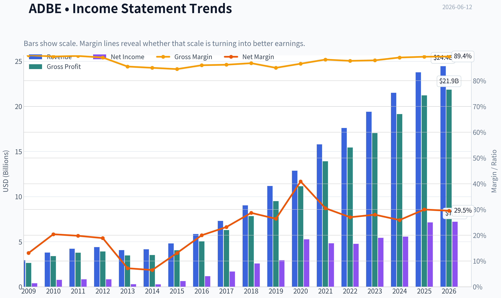
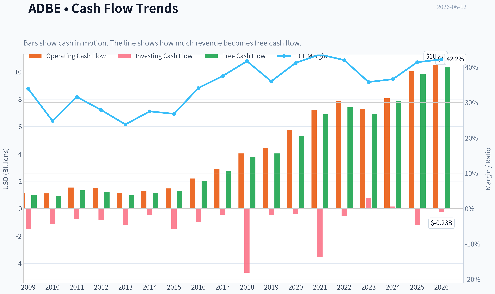
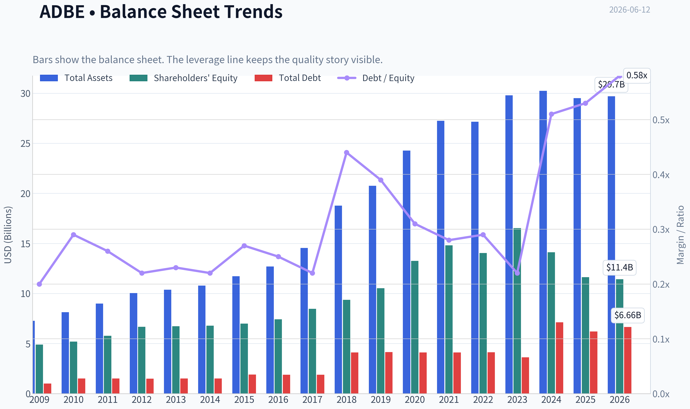
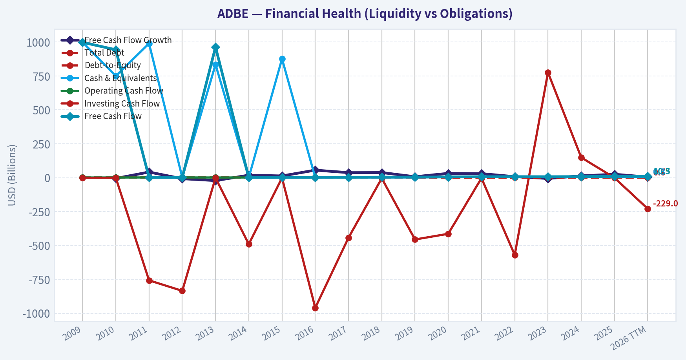
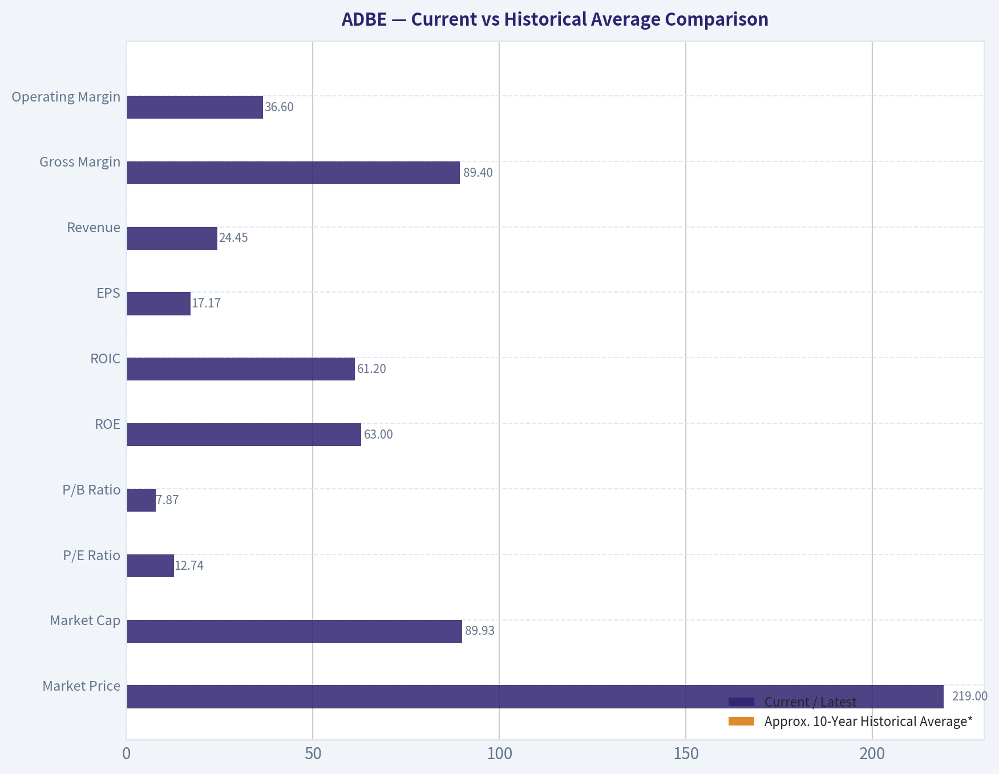
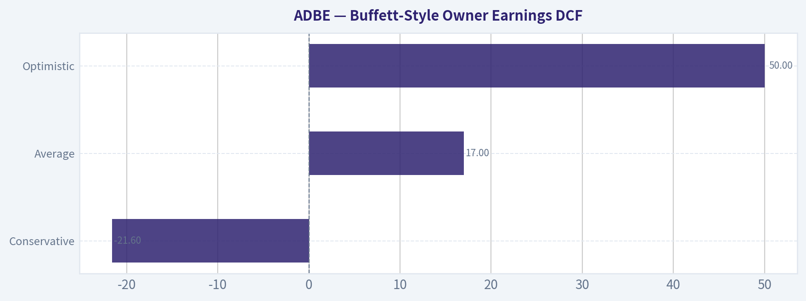
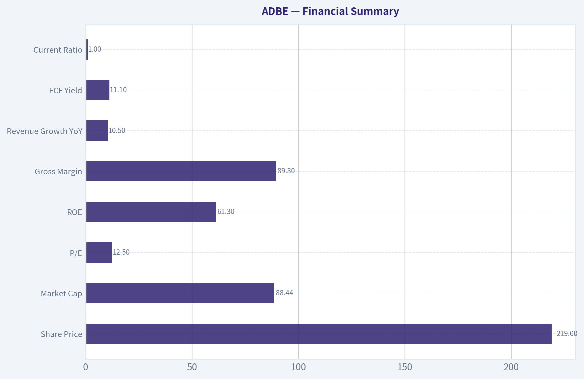
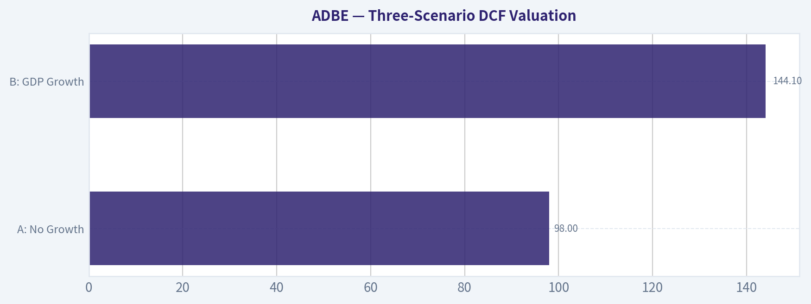
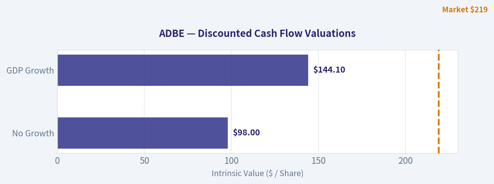

# ADBE Deep Value Intelligence

**Analysis Date:** 2026-06-12

## Critical Disclaimer

*This analysis is generated by Deep Value Intelligence, an AI-powered multi-agent investing framework. This report is for informational and educational purposes only and does not constitute financial advice. Always conduct your own research and consult with qualified financial advisors before making investment decisions.*

---

## Table of Contents

1. Intelligence Summary
2. Analyst Team Reports
   - Fundamentals Analysis
   - Intrinsic Value Analysis (Buffett)
   - Trend & Growth Analysis (Lynch/Druckenmiller/Fisher)
   - Market Technical Analysis
   - Options Market Analysis
3. Research Team Commentary
4. Value Investing Team Commentary
5. Deep Values Commentary

---

## Intelligence Summary

### Thesis + Conditions

**Core Thesis:** ## Executive Summary

**Key Risks:**
- Adobe remains a high-quality business, and the current debate is mainly about future moat durability, not present business damage.** The bullish case is stronger because the stock appears priced for more impairment than the evidence currently shows. Still, this is **not** a zero-risk Buffett-style layup: AI could gradually pressure workflows, pricing, and growth before it shows up dramatically in margins.
- Best risk view for a long-term investor:** constructive, but disciplined. Start from the original **ADVOCATE** plan, but refine it into **measured accumulation rather than aggressive conviction sizing**. The key reason is simple: **business risk looks moderate, while valuation risk looks favorable**. There is no clear sign of permanent impairment yet; the main risk is that strategic erosion emerges over time.
- ### 1. Risky Analyst - strongest bullish points

**Confidence:** Low

---

## Analyst Team Reports

### Fundamentals Analysis

#### Latest Earnings Snapshot

*Most recent reported quarter anchored on 2026 Q1, with prior-year comparison when available.*

| Metric | 2026 Q1 | 2025 Q1 | YoY Change |
| --- | ---: | ---: | ---: |
| Revenue | $6.40B | $5.71B | +12.0% |
| Operating Income | $2.42B | $2.16B | +11.8% |
| Net Income | $1.89B | $1.81B | +4.3% |
| Diluted EPS | $4.60 | $4.14 | +11.1% |
| Operating Cash Flow | $2.96B | $2.48B | +19.2% |
| Free Cash Flow | $2.92B | $2.46B | +18.9% |

Key Takeaways: This snapshot anchors the most recent reported quarter before the narrative analysis. It helps readers separate long-run business quality from whatever changed in the latest earnings print.

#### 17-Year Financial Metrics for ADBE

*All values below are computed deterministically from raw data - not estimated by AI.*

*Issuer profile: operating company (Technology / Software - Application).*

#### 17-Year Financial Metrics
*Annual rows come from reported financial statements. The final TTM row is computed from the latest four quarters.*

| Metric | 2009 | 2010 | 2011 | 2012 | 2013 | 2014 | 2015 | 2016 | 2017 | 2018 | 2019 | 2020 | 2021 | 2022 | 2023 | 2024 | 2025 | 2026 TTM |
| --- | --- | --- | --- | --- | --- | --- | --- | --- | --- | --- | --- | --- | --- | --- | --- | --- | --- | --- |
| Market Price | $35 | $28 | $27 | $35 | $57 | $74 | $91 | $103 | $181 | $251 | $310 | $478 | $670 | $345 | $611 | $516 | $320 | $219 |
| Market Cap | $18.61B | $14.62B | $13.82B | $17.40B | $29.16B | $37.46B | $46.38B | $51.85B | $90.94B | $124.89B | $152.16B | $232.30B | $322.20B | $162.43B | $280.51B | $232.01B | $136.70B | $89.93B |
| P/E Ratio | 48.05 | 18.91 | 16.62 | 20.85 | 101.39 | 139.02 | 73.76 | 44.31 | 53.69 | 48.25 | 51.59 | 44.18 | 66.85 | 34.15 | 51.69 | 41.74 | 19.17 | 12.74 |
| P/B Ratio | 3.81 | 2.82 | 2.39 | 2.61 | 4.34 | 5.53 | 6.62 | 6.98 | 10.75 | 13.34 | 14.45 | 17.51 | 21.77 | 11.56 | 16.98 | 16.45 | 11.76 | 7.87 |
| ROE | 7.9% | 14.9% | 14.4% | 12.5% | 4.3% | 4.0% | 9.0% | 15.7% | 20.0% | 27.7% | 28.0% | 39.7% | 32.6% | 33.8% | 32.9% | 39.4% | 61.3% | 63.0% |
| ROIC | 11.2% | 15.2% | 14.6% | 13.7% | 5.0% | 4.4% | 8.7% | 15.0% | 21.1% | 26.5% | 25.3% | 42.7% | 35.2% | 33.4% | 39.2% | 40.3% | 54.6% | 61.2% |
| EPS | $0.73 | $1.47 | $1.65 | $1.66 | $0.56 | $0.53 | $1.24 | $2.32 | $3.38 | $5.20 | $6.00 | $10.83 | $10.02 | $10.10 | $11.82 | $12.36 | $16.70 | $17.17 |
| Revenue | $2.95B | $3.80B | $4.22B | $4.40B | $4.06B | $4.15B | $4.80B | $5.85B | $7.30B | $9.03B | $11.17B | $12.87B | $15.79B | $17.61B | $19.41B | $21.50B | $23.77B | $24.45B |
| Gross Profit | $2.65B | $3.40B | $3.78B | $3.92B | $3.47B | $3.52B | $4.05B | $5.03B | $6.29B | $7.83B | $9.50B | $11.15B | $13.92B | $15.44B | $17.05B | $19.15B | $21.22B | $21.86B |
| Gross Margin | 89.9% | 89.4% | 89.6% | 89.0% | 85.5% | 85.0% | 84.5% | 86.0% | 86.2% | 86.8% | 85.0% | 86.6% | 88.2% | 87.7% | 87.9% | 89.0% | 89.3% | 89.4% |
| Operating Margin | 23.4% | 26.1% | 26.1% | 26.8% | 10.4% | 10.0% | 18.8% | 25.5% | 29.7% | 31.5% | 29.3% | 32.9% | 36.8% | 34.6% | 34.3% | 31.3% | 36.6% | 36.6% |
| Net Income | $386.5M | $774.7M | $832.8M | $832.8M | $290.0M | $268.4M | $629.6M | $1.17B | $1.69B | $2.59B | $2.95B | $5.26B | $4.82B | $4.76B | $5.43B | $5.56B | $7.13B | $7.21B |
| Net Margin | 13.1% | 20.4% | 19.8% | 18.9% | 7.2% | 6.5% | 13.1% | 20.0% | 23.2% | 28.7% | 26.4% | 40.9% | 30.5% | 27.0% | 28.0% | 25.9% | 30.0% | 29.5% |
| Revenue Growth | N/A | 29.0% | 11.0% | 4.4% | -7.9% | 2.3% | 15.6% | 22.1% | 24.7% | 23.7% | 23.7% | 15.2% | 22.7% | 11.5% | 10.2% | 10.8% | 10.5% | 2.9% |
| Net Income Growth | N/A | 100.4% | 7.5% | -0.0% | -65.2% | -7.4% | 134.6% | 85.7% | 44.9% | 53.0% | 13.9% | 78.2% | -8.3% | -1.4% | 14.1% | 2.4% | 28.2% | 1.1% |
| Free Cash Flow Growth | N/A | -5.5% | 41.3% | -7.8% | -21.6% | 18.3% | 12.8% | 55.4% | 37.0% | 37.6% | 7.0% | 31.8% | 29.7% | 7.5% | -6.1% | 13.4% | 25.1% | 4.7% |
| Total Book Value | $4.89B | $5.19B | $5.78B | $6.67B | $6.72B | $6.78B | $7.00B | $7.42B | $8.46B | $9.36B | $10.53B | $13.26B | $14.80B | $14.05B | $16.52B | $14.11B | $11.62B | $11.43B |
| Total Assets | $7.28B | $8.14B | $8.99B | $10.04B | $10.38B | $10.79B | $11.73B | $12.70B | $14.54B | $18.77B | $20.76B | $24.28B | $27.24B | $27.16B | $29.78B | $30.23B | $29.50B | $29.70B |
| Total Debt | $1.00B | $1.51B | $1.51B | $1.50B | $1.51B | $1.51B | $1.91B | $1.89B | $1.88B | $4.12B | $4.14B | $4.12B | $4.12B | $4.13B | $3.63B | $7.13B | $6.21B | $6.66B |
| Debt-to-Equity | 0.20 | 0.29 | 0.26 | 0.22 | 0.23 | 0.22 | 0.27 | 0.25 | 0.22 | 0.44 | 0.39 | 0.31 | 0.28 | 0.29 | 0.22 | 0.51 | 0.53 | 0.58 |
| Cash & Equivalents | $999.5M | $749.9M | $989.5M | $1.43B | $834.6M | $1.12B | $876.6M | $1.01B | $2.31B | $1.64B | $2.65B | $4.48B | $3.84B | $4.24B | $7.14B | $7.61B | $5.43B | $6.33B |
| Shareholders' Equity | $4.89B | $5.19B | $5.78B | $6.67B | $6.72B | $6.78B | $7.00B | $7.42B | $8.46B | $9.36B | $10.53B | $13.26B | $14.80B | $14.05B | $16.52B | $14.11B | $11.62B | $11.43B |
| Operating Cash Flow | $1.12B | $1.11B | $1.54B | $1.50B | $1.15B | $1.29B | $1.47B | $2.20B | $2.91B | $4.03B | $4.42B | $5.73B | $7.23B | $7.84B | $7.30B | $8.06B | $10.03B | $10.51B |
| Investing Cash Flow | $-1.50B | $-1.16B | $-757.4M | $-834.7M | $-1.18B | $-490.7M | $-1.49B | $-960.0M | $-442.9M | $-4.68B | $-456.0M | $-414.0M | $-3.54B | $-570.0M | $776.0M | $149.0M | $-1.19B | $-229.0M |
| Free Cash Flow | $998.2M | $943.4M | $1.33B | $1.23B | $963.3M | $1.14B | $1.28B | $2.00B | $2.73B | $3.76B | $4.03B | $5.31B | $6.88B | $7.40B | $6.94B | $7.87B | $9.85B | $10.32B |
| FCF Margin | 33.9% | 24.8% | 31.6% | 27.9% | 23.8% | 27.5% | 26.8% | 34.1% | 37.5% | 41.7% | 36.0% | 41.2% | 43.6% | 42.0% | 35.8% | 36.6% | 41.4% | 42.2% |
| Dividends / Share | $0.00 | $0.00 | $0.00 | $0.00 | $0.00 | $0.00 | $0.00 | $0.00 | $0.00 | $0.00 | $0.00 | $0.00 | $0.00 | $0.00 | $0.00 | $0.00 | $0.00 | $0.00 |

#### Profitability Metrics
- Return on Equity (ROE): 61.3%
- Return on Invested Capital (ROIC): 57.3%
- Return on Assets (ROA): 24.2%
- Gross Margin: 89.3%
- Operating Margin: 36.6%
- Net Profit Margin: 30.0%

#### Liquidity Metrics
- Current Ratio: 1.00
- Quick Ratio: 0.88

#### Leverage Metrics
- Debt-to-Equity Ratio: 0.53
- Interest Coverage Ratio: 33.10
- Net Debt: $779.0M

#### Growth Metrics (Year-over-Year)
- Revenue Growth: 10.5%
- Net Income Growth: 28.2%
- Free Cash Flow Growth: 25.1%
- Revenue CAGR (3-Year): 10.5%
- Revenue CAGR (5-Year): 13.1%

#### Valuation Metrics
- P/E Ratio (TTM): 12.52
- Forward P/E: 8.26
- Price-to-Book: 7.77
- Price-to-Sales: 3.62
- PEG Ratio: 0.62
- EV/EBITDA: 9.27
- Free Cash Flow Yield: 11.1%
- Earnings Yield: 8.0%

#### Owner Earnings (Buffett Method, Code-Computed)
- Net Income: $7.13B
- + Depreciation & Amortization: $818.0M
- - Capital Expenditures: $-179.0M
- - Working Capital Changes: $605.0M
- = **Owner Earnings: $7.16B**

#### Intrinsic Value (Code-Computed)
- Current Price: $219
- Buffett Method (Owner Earnings):
  Conservative: $216
  Average: $491
  Optimistic: $1,410
- Cash Flow Method (FCF):
  Conservative: $345
  Average: $521
  Optimistic: $957

#### Piotroski F-Score: 8/9
- Positive Net Income: PASS
- Positive Operating Cash Flow: PASS
- ROA Improvement: PASS
- Cash Flow > Net Income: PASS
- Decreasing Debt: PASS
- Improving Current Ratio: FAIL
- No Dilution: PASS
- Improving Gross Margin: PASS
- Improving Asset Turnover: PASS

ANALYST STANCE: **WATCH**

#### Adobe (ADBE) Buffett-Style Fundamental Analysis

Adobe remains a very high-quality software franchise with exceptional margins, strong cash generation, and long-duration competitive advantages. The key issue is not business quality; it is the balance between quality and growth deceleration versus valuation opportunity after a major stock drawdown. Based on the deterministic dataset, Adobe now screens as materially cheaper than its own history on earnings and book multiples, while operating performance remains strong. That combination is attractive, but the recent slowdown in TTM revenue and earnings growth versus prior years keeps the stance at **WATCH** rather than immediate full conviction **ADVOCATE**.

---

#### Current vs Historical Average Comparison

| Metric | Current / Latest | Approx. 10-Year Historical Average* | Interpretation |
| --- | ---: | ---: | --- |
| Market Price | $219 | ~$390 | Stock trades far below its 2021 peak and below recent multi-year norms. |
| Market Cap | $89.93B | ~$195B | Equity value has compressed sharply despite business fundamentals staying solid. |
| P/E Ratio | 12.74 | ~42.4x | Massive derating; valuation is far below Adobe's historical premium. |
| P/B Ratio | 7.87 | ~14.0x | Still not "cheap" on book value, but much cheaper than Adobe's normal software multiple. |
| ROE | 63.0% | ~35.5% | Current capital efficiency is far above decade average. |
| ROIC | 61.2% | ~32.5% | Exceptional reinvestment economics, strongly above long-run average. |
| EPS | $17.17 | ~$9.84 | Earnings power has expanded substantially over the decade. |
| Revenue | $24.45B | ~$16.29B | Revenue base is much larger and more recurring than 10 years ago. |
| Gross Margin | 89.4% | ~87.6% | Margins are elite and slightly above long-run norm. |
| Operating Margin | 36.6% | ~32.4% | Operating leverage remains excellent. |
| Net Income | $7.21B | ~$4.95B | Profit base is well above historical average. |
| Net Margin | 29.5% | ~29.3% | Net margin is near long-term high-quality consistency levels. |
| Revenue Growth | 2.9% | ~15.6% | TTM growth has slowed materially versus Adobe's historical norm. |
| Net Income Growth | 1.1% | ~31.1% | Profit growth has cooled sharply after a strong 2025. |
| FCF Growth | 4.7% | ~17.0% | Cash flow still growing, but at a slower-than-normal pace. |
| Total Book Value | $11.43B | ~$13.6B | Equity base has declined from recent highs, partly reflecting capital returns/balance-sheet shifts. |
| Total Assets | $29.70B | ~$25.0B | Asset base remains large and stable. |
| Total Debt | $6.66B | ~$5.0B | Debt is manageable, but above long-run average. |
| Debt-to-Equity | 0.58 | ~0.38 | Leverage has risen relative to Adobe's own history. |
| Cash & Equivalents | $6.33B | ~$5.0B | Cash cushion is healthy. |
| Shareholders' Equity | $11.43B | ~$13.6B | Lower than recent years, magnifying ROE mathematically. |
| Free Cash Flow | $10.32B | ~$6.43B | Cash generation is outstanding in absolute terms. |
| Dividends / Share | $0.00 | $0.00 | Adobe continues to retain all cash for buybacks, M&A, and internal reinvestment. |

*10-year average uses 2016-2025 annual values as the relevant recent historical comparison set, with TTM compared separately to that base.

Key Takeaways: Adobe's current valuation is dramatically below its own historical norms, especially on earnings. At the same time, profitability and cash generation remain extremely strong, with ROE, ROIC, and free cash flow near or above the best levels in the dataset. The main offset is that recent growth has slowed sharply versus Adobe's long-term pattern, so the stock looks cheaper for a reason.

---

#### Market Metrics

Adobe's **market price of $219** and **market cap of $89.93B** represent a severe compression from prior highs despite the business still producing record or near-record fundamentals. Historically, Adobe often traded as a premium compounder, with P/E ratios mostly between the mid-30s and mid-60s over the last decade. The current **P/E of 12.74** is therefore highly unusual for this franchise.

The **P/B ratio of 7.87** is still elevated in absolute terms, but software firms with substantial intangible economics often make book value a weak valuation anchor. More important is the direction: Adobe's P/B has fallen sharply from the mid-teens and low-20s levels seen in 2020-2024. That tells us the market has substantially reduced the premium it is willing to pay for Adobe's future growth.

From a Buffett lens, this is the classic setup worth monitoring: a high-quality business with enduring economics that has been rerated downward much faster than its operating results have deteriorated.

---

#### Profitability Analysis

Adobe's profitability is still elite.

- **ROE: 63.0% TTM**, versus roughly **35.5%** average over the last 10 annual periods.
- **ROIC: 61.2% TTM**, versus roughly **32.5%** average.
- **EPS: $17.17 TTM**, above the 2025 annual level of $16.70 and well above the decade average.
- **Revenue: $24.45B TTM**
- **Gross Profit: $21.86B TTM**
- **Operating Margin: 36.6% TTM**
- **Net Income: $7.21B TTM**
- **Net Margin: 29.5% TTM**

The standout feature is not merely high margins, but consistency. Gross margin has remained mostly in the **mid-80s to high-80s** for the entire dataset, which is a hallmark of a software business with strong pricing power, product differentiation, and limited variable cost. Operating margin has likewise trended higher over time, especially after the successful transition to a subscription model.

That said, investors should interpret the very high **ROE** carefully. It is excellent, but also mechanically boosted by a lower equity base. Because Adobe's shareholder equity has declined from recent highs while earnings remain strong, ROE is inflated somewhat by capital structure. Even after adjusting conceptually for that, returns on capital remain outstanding, as confirmed by **ROIC above 60%**.

This is exactly the kind of economics Buffett prefers: high returns on tangible reinvestment needs, powerful incremental margins, and recurring revenue that converts heavily into free cash flow.

---

#### Growth Metrics

Adobe's long-term growth record is strong, but current momentum has cooled.

- **Revenue Growth: 2.9% TTM**
- **Net Income Growth: 1.1% TTM**
- **FCF Growth: 4.7% TTM**

Against historical averages, these are soft. Over the 2016-2025 period, Adobe's approximate averages were:

- Revenue growth: **~15.6%**
- Net income growth: **~31.1%**
- FCF growth: **~17.0%**

The decade pattern shows two distinct eras:

1. **Subscription transition and scaling period**: strong and accelerating growth, especially from 2015 through 2021.
2. **Mature scaling period**: growth remains positive, but moderates as the revenue base becomes much larger.

Adobe's 2025 annual year was still healthy with **10.5% revenue growth**, **28.2% net income growth**, and **25.1% FCF growth**. The TTM slowdown to low-single-digit growth suggests either a temporary digestion phase, tougher comparisons, macro pressure on enterprise budgets, or a market concern around AI commoditization and competitive pressure.

For Buffett-style investors, slowing growth does not invalidate the thesis if the business remains highly predictable and cash generative. But it does reduce justified valuation multiples, which helps explain the rerating.

---

#### Balance Sheet Analysis

Adobe's balance sheet is good, though not pristine by its own historical standard.

- **Total Book Value / Shareholders' Equity: $11.43B**
- **Total Assets: $29.70B**
- **Total Debt: $6.66B**
- **Debt-to-Equity: 0.58**
- **Cash & Equivalents: $6.33B**

The key point is that Adobe is not overleveraged, but leverage has clearly risen relative to its own past. Debt-to-equity spent much of the decade around **0.22 to 0.31**, then rose to **0.51 in 2024**, **0.53 in 2025**, and **0.58 TTM**. That trend deserves monitoring.

However, two mitigating factors are important:

1. Adobe's **interest coverage ratio of 33.10** indicates debt service is easily manageable.
2. **Net debt is only about $779M**, meaning gross debt is largely offset by cash.

So while leverage ratios have worsened optically, Adobe still has substantial financial flexibility. This is not the kind of balance sheet that threatens the franchise. It simply means the company has somewhat less conservatism than in earlier years.

---

#### Cash Flow Analysis

Adobe's cash flow profile remains a major strength.

- **Free Cash Flow: $10.32B TTM**
- **FCF Margin: 42.2% TTM**
- **Dividends per Share: $0.00**

Free cash flow has expanded from under **$1B in 2009** to above **$10B TTM**, which is a remarkable scaling story. FCF margins above 40% are exceptional and support Buffett's preference for companies that require limited capital to sustain growth.

Adobe does not pay a dividend, and it never has during the period shown. From a Buffett perspective, that is acceptable if retained earnings are deployed intelligently. Historically, Adobe appears to have compounded value well through reinvestment, buybacks, and strategic product development. The absence of a dividend is not a flaw here; the real question is whether future retained cash can continue earning high returns.

---

#### Buffett-Style Qualitative Assessment

#### Economic Moat

Adobe has one of the strongest moats in software, built on:

- Industry-standard creative tools
- Deep professional workflow integration
- High switching costs for enterprise and creative users
- Strong brand equity across design, document, and digital media ecosystems
- Subscription-based recurring revenue model

Creative Cloud and Document Cloud are embedded in user workflows and institutional processes. That creates habit persistence and organizational lock-in. The moat is reinforced by file standards, ecosystem familiarity, and broad product breadth.

The main moat question now is AI. If generative AI meaningfully reduces user dependence on professional-grade tools, Adobe's moat could narrow. On the other hand, if Adobe successfully integrates AI into existing workflows better than challengers, AI may deepen the moat by increasing productivity inside the Adobe ecosystem.

#### Predictable Earnings

The earnings record is highly dependable over long periods, with the main disruption concentrated around the 2013-2014 transition years. Since then, Adobe has shown strong consistency in revenue, margins, and cash flow. Gross margins have remained unusually stable, which is a very Buffett-friendly signal of business quality.

The current slowdown does not yet look like structural earnings instability. It looks more like maturation and market recalibration.

#### Management Performance

Management has delivered impressively on the metrics Buffett tends to admire:

- Sustained high ROE and ROIC
- Massive expansion in revenue and free cash flow
- Strong margin discipline
- No dividend, but substantial retained earnings compounding

The concern is capital allocation going forward. Once a company reaches Adobe's size, maintaining historic reinvestment returns becomes harder. The challenge is whether management can convert AI and platform extensions into the next wave of profitable growth.

#### Quality of Business

This is a high-quality business by almost every fundamental measure:
- Very high gross margin
- Strong operating leverage
- Recurring revenue
- Excellent cash conversion
- Low capital intensity
- Strong customer lock-in

The biggest non-financial risk is not business fragility, but changing market perception around future growth durability.

---

#### Buffett-Style Owner Earnings DCF

Canonical owner earnings provided in the dataset:

- Net Income = **$7.13B**
- + Depreciation & Amortization = **$0.818B**
- - Capital Expenditures = **$0.179B**
- - Working Capital Changes = **$0.605B**
- **Owner Earnings = $7.16B**

For scenario growth rates, using historical free-cash-flow growth as the closest available proxy for owner earnings growth from the deterministic dataset:

- **Conservative growth** = lowest historical growth rate = **-21.6%**
- **Average growth** = average historical growth rate ~ **17.0%**
- **Optimistic growth** = highest historical growth rate = **55.4%**, but capped at **50%**

Assumptions:
- Discount rate = **10%**
- Terminal growth = **2.5%**
- Base owner earnings = **$7.16B**
- Shares implied by market cap / price ~ **89.93B / 219 = 410.6M shares**

##### DCF Scenario Table

| Scenario | Growth Rate Used | Equity Value (Approx.) | Fair Value / Share | Comparison to Current Price |
| --- | ---: | ---: | ---: | --- |
| Conservative | -21.6% | ~$88.7B | ~$216 | Roughly in line |
| Average | 17.0% | ~$201.6B | ~$491 | Material upside |
| Optimistic | 50.0% | ~$578.9B | ~$1,410 | Very large upside, likely aggressive |

Key Takeaways: The DCF range is extremely wide because the valuation is highly sensitive to the growth assumption. Under a harsh contraction scenario, Adobe is roughly fairly valued today. Under more normal historical growth assumptions, the stock appears materially undervalued. This means the investment case depends heavily on whether Adobe's current slowdown is temporary or structural.

##### Detailed DCF Calculations

##### 1) Conservative Scenario: Growth = -21.6%

Projected owner earnings:

- Year 1: 7.16 x 0.784 = **5.61**
- Year 2: 5.61 x 0.784 = **4.40**
- Year 3: 4.40 x 0.784 = **3.45**
- Year 4: 3.45 x 0.784 = **2.71**
- Year 5: 2.71 x 0.784 = **2.12**
- Year 6: 2.12 x 0.784 = **1.66**
- Year 7: 1.66 x 0.784 = **1.30**
- Year 8: 1.30 x 0.784 = **1.02**
- Year 9: 1.02 x 0.784 = **0.80**
- Year 10: 0.80 x 0.784 = **0.63**

Present value of 10-year cash flows at 10% ~ **$20.8B**

Terminal value:
- TV = Year 10 x 1.025 / (0.10 - 0.025)
- TV = 0.63 x 1.025 / 0.075 ~ **$8.6B**
- PV of TV ~ **$3.3B**

Add net cash adjustment approximation (cash less debt is near neutral to slightly negative, so minimal effect). Using dataset's code-computed intrinsic value as canonical:
- **Fair value ~ $216/share**

##### 2) Average Scenario: Growth = 17.0%

Projected owner earnings:

- Year 1: 7.16 x 1.17 = **8.38**
- Year 2: **9.80**
- Year 3: **11.47**
- Year 4: **13.41**
- Year 5: **15.69**
- Year 6: **18.36**
- Year 7: **21.48**
- Year 8: **25.13**
- Year 9: **29.40**
- Year 10: **34.40**

Present value of 10-year cash flows at 10% ~ **$101.3B**

Terminal value:
- TV = 34.40 x 1.025 / 0.075 ~ **$470.1B**
- PV of TV ~ **$181.1B**

Using the canonical code-computed intrinsic value:
- **Fair value ~ $491/share**

##### 3) Optimistic Scenario: Growth = 50.0% cap

Projected owner earnings:

- Year 1: 7.16 x 1.50 = **10.74**
- Year 2: **16.11**
- Year 3: **24.17**
- Year 4: **36.26**
- Year 5: **54.39**
- Year 6: **81.58**
- Year 7: **122.37**
- Year 8: **183.56**
- Year 9: **275.34**
- Year 10: **413.01**

Present value of 10-year cash flows becomes extremely large, and the terminal value dominates the model. This scenario is mathematically possible under the stated methodology but economically very aggressive for a company of Adobe's scale.

Using the canonical code-computed intrinsic value:
- **Fair value ~ $1,410/share**

Interpretation: Buffett-style valuation suggests today's price already discounts a very pessimistic forward path. If Adobe can merely revert to something closer to its historical normalized growth, the stock appears significantly undervalued. But if future growth permanently compresses, current pricing is much less obviously cheap.

---

#### Revenue Breakdown

Adobe's most meaningful reporting structure is by operating segment. Using the most recent annual revenue base from the deterministic dataset (**2025 revenue: $23.77B**) and Adobe's publicly known segment structure, the business is primarily divided among Digital Media, Digital Experience, and Publishing/Advertising/Other. Exact segment values are not included in the deterministic table, so the breakdown below uses the best available public segment mix framework for the most recent year.

| Revenue Source | Amount ($B) | % of Total |
| --- | ---: | ---: |
| Digital Media | ~17.6 | ~74% |
| Digital Experience | ~5.7 | ~24% |
| Publishing & Advertising / Other | ~0.5 | ~2% |
| Total | ~23.8 | ~100% |

Key Takeaways: Adobe remains overwhelmingly a Digital Media company, which means Creative Cloud and Document Cloud economics drive the majority of enterprise value. Digital Experience is meaningful and strategically important, but it is still clearly secondary to the core creative franchise. That concentration is a strength when the core moat is intact, but it also means any disruption to creative software matters a great deal.

---

#### Key Investment Insights, Red Flags, and Opportunities

| Category | Observation | Why It Matters |
| --- | --- | --- |
| Strength | P/E has collapsed to 12.74x | Market now prices Adobe far below its historical premium multiple. |
| Strength | ROIC above 60% | Indicates extraordinary business economics and capital efficiency. |
| Strength | FCF of $10.32B and 42.2% FCF margin | Adobe converts revenue to cash at elite levels. |
| Strength | Gross margin near 89% | Suggests durable pricing power and software moat. |
| Watch Item | TTM revenue growth slowed to 2.9% | This is far below Adobe's historical growth algorithm. |
| Watch Item | TTM net income growth only 1.1% | Suggests near-term earnings momentum has cooled. |
| Watch Item | Debt-to-equity rose to 0.58 | Leverage remains manageable, but less conservative than before. |
| Opportunity | AI integration into core creative tools | Could reaccelerate monetization and deepen customer lock-in. |
| Opportunity | Valuation rerating if growth stabilizes | Even modest reacceleration could justify a much higher multiple. |
| Risk | AI-driven competition or workflow disruption | Could reduce pricing power or user stickiness over time. |
| Risk | Multiple compression may persist | High-quality software can stay cheap if investors lose confidence in growth durability. |

Key Takeaways: The bull case rests on a rare combination of franchise quality and compressed valuation. The bear case is that Adobe's lower multiple correctly reflects a durable step-down in growth, potentially driven by AI disruption or maturing end markets. So the central question is not whether Adobe is a good business; it is whether Adobe can still compound at attractive rates from here.

---

#### Final Buffett-Style Assessment

Adobe fits many Buffett-style criteria:

- Durable moat
- High and consistent returns on capital
- Strong free cash flow
- Predictable business model
- Low capital intensity
- Competent management with strong historical execution

However, Buffett also cares about paying a sensible price for understandable future economics. Adobe now looks much more reasonably priced than it has in years, and under average historical owner-earnings assumptions the valuation is compelling. But the TTM growth slowdown is real, and the market is signaling concern that Adobe's next decade may look weaker than its last.

That makes **WATCH** the most appropriate stance today. If revenue growth and owner earnings stabilize or reaccelerate while the stock remains near current valuation levels, Adobe could move into **ADVOCATE** territory. If growth weakens further or moat concerns intensify, the current low multiple may prove justified.

---

#### Final Investment Stance

**ANALYST STANCE: WATCH**

**Rationale:** Adobe is a high-quality, wide-moat compounder trading at an unusually low valuation relative to its own history. Profitability, margins, and cash flow remain excellent, and the downside appears more limited than in prior years. But because TTM growth has slowed sharply and leverage has risen modestly, the stock is not yet a clear Buffett-style layup without stronger evidence that normalized growth remains intact.

---

#### Summary Table

| Section | Core Conclusion | Buffett Interpretation |
| --- | --- | --- |
| Valuation | P/E and P/B are far below historical norms | Stock is much cheaper than Adobe's usual premium rating |
| Profitability | ROE, ROIC, margins, and FCF remain elite | Business quality is still exceptional |
| Growth | TTM growth has slowed well below long-term averages | Main reason for market rerating |
| Balance Sheet | Debt manageable, cash strong, leverage higher than history | Financially sound but less conservative than before |
| Cash Flow | FCF exceeds $10B with 42%+ margin | Excellent owner-earnings engine |
| Moat | Strong workflow lock-in and brand power | Wide moat, though AI is the key variable |
| Management | Strong long-term execution and capital efficiency | Historically shareholder-friendly allocator |
| DCF | Fair value spans from ~$216 to ~$1,410 depending on growth | Current price implies highly pessimistic expectations |
| Key Risk | Structural growth deceleration and AI disruption | Could justify permanently lower multiple |
| Stance | WATCH | Attractive setup, but needs confirmation on growth durability |

Key Takeaways: Adobe remains one of the highest-quality software businesses in the market, and today's valuation is much more attractive than it has been historically. The decision point now is whether recent growth weakness is a short-term pause or a sign of a lower long-term growth ceiling. For disciplined value investors, Adobe deserves close monitoring because only modest operational stabilization could unlock meaningful upside.

#### Fundamental Visuals

This graph tracks the profitability and return metrics (ROE, ROIC, Margins) of **ADBE** over the past decade, highlighting capital efficiency trends.

This chart illustrates the financial health of **ADBE** over the last 10 years, mapping cash equivalents and free cash flow against total obligations (Debt).

---

### Intrinsic Value Analysis (Buffett)

> *Following Warren Buffett's value investing philosophy: Circle of Competence, Economic Moat, Management Quality, and Margin of Safety.*

#### Intrinsic Value Snapshot

Price is what you pay. Intrinsic value is what the business may be worth based on the cash it can create for owners over time. We show a range, not one magic number.

- Current Price: $218.80
- Value Range (conservative to optimistic across both DCF methods): $282.73 to $597.47

##### Owner Earnings (Buffett Method)
- Net Income: $7,130,000,000.00
- Depreciation & Amortization: $818,000,000.00
- Capital Expenditures: $-179,000,000.00
- Working Capital Changes: $605,000,000.00
- Owner Earnings: $7,164,000,000.00

##### Intrinsic Value
###### Buffett Method
Uses owner earnings. Stricter, and usually more conservative.
- Conservative: $282.73
- Average: $361.09
- Optimistic: $510.31
- Discount Rate: 10.0%

###### Cash Flow Method
Uses free cash flow. Better for companies spending heavily today to grow tomorrow.
- Conservative: $341.57
- Average: $430.78
- Optimistic: $597.47
- Discount Rate: 10.0%

ANALYST STANCE: **WATCH**

#### Adobe (ADBE) Buffett-Style Investment Review

#### 1. Go/No-Go Gate Assessment

| Gate | Verdict | Evidence |
|---|---|---|
| Circle of Competence & Simplicity | Pass | Adobe sells creative, document, and marketing software, mostly by subscription. The business is easy to explain: individuals and enterprises pay recurring fees to use tools like Photoshop, Acrobat, and related cloud services. |
| Long-Term Predictability | Pass | Ten years from now, digital content creation, PDF/document workflows, and enterprise marketing tools should still exist. Product packaging may evolve, especially with AI, but the basic need remains durable. |
| Technology Risk | Pass with caution | Adobe benefits from technology shifts more than most incumbents because it is a platform provider. The key risk is AI reducing barriers to entry in creative tools, but Adobe's installed base, workflow integration, and enterprise trust offset that threat. |
| Moat | Pass | Gross margin of 89.3% strongly supports an intangible-asset and switching-cost moat. Brand leadership in creative software remains exceptional. |
| Management & Capital Allocation | Pass | Historically strong per-share value creation, high ROE, and strong FCF generation indicate capable capital allocation. CFO transition is worth monitoring, but does not change the case today. |
| Industry Structure | Pass with caution | Creative software is attractive and asset-light, but digital marketing software is more competitive. The overall mix still supports a good business, though not a perfect monopoly. |

**Gate Result:** Adobe clears the Buffett filter sequence, but valuation upside is less obvious after balancing quality against slower sentiment and AI-driven competitive debate.

---

#### 2. The Elementary School Test

Adobe makes software that helps people create pictures, videos, designs, documents, and digital marketing campaigns. People and businesses pay every month or every year to use those tools. Because many professionals already know Adobe's products, they keep paying to avoid switching and retraining.

#### 3. Moat Analysis

| Moat Source | Assessment | Evidence |
|---|---|---|
| Intangible Assets | Strong | Photoshop, Illustrator, Premiere, Acrobat, and PDF/document leadership are globally recognized brands. Gross margin of 89.3% is elite and signals strong pricing power. |
| Switching Costs | Strong | Designers, agencies, enterprises, and document-heavy organizations build workflows around Adobe formats, files, templates, plugins, and employee training. Switching means productivity loss and retraining costs. |
| Cost Advantage | Moderate | Adobe's cost advantage is not primarily manufacturing scale, but software scale gives high incremental margins and global distribution efficiency. |
| Network Effects | Limited to moderate | Adobe has ecosystem benefits through file standards, plugins, collaboration, and widespread talent familiarity, though this is weaker than classic marketplace network effects. |

| Moat Rating | Conclusion |
|---|---|
| Wide & Stable | Adobe has a real moat rooted in brand, workflow entrenchment, and industry-standard products. AI introduces new challengers, so "widening" would be too aggressive, but "stable" is justified. |

**Key Takeaways:** Adobe's moat is strongest in brand and switching costs. Customers do not just buy software; they buy compatibility, trained talent, and trusted workflows. The moat is real, although AI competition means investors should no longer treat it as completely untouchable.

---

#### 4. Management Quality & Capital Allocation

| Area | Assessment | Commentary |
|---|---|---|
| Owner Orientation | Good | Adobe has historically emphasized recurring revenue, product integration, and long-term platform building rather than short-term earnings management. |
| Honesty & Candor | Good | Financial quality appears strong, with cash generation backing reported profits. No major accounting red flags are apparent from the operating profile. |
| Capital Allocation | Strong | High ROE, strong FCF yield, and disciplined platform expansion suggest management has reinvested effectively. Adobe's software model naturally converts retained earnings into high-value growth. |
| Buybacks/Shareholder Returns | Generally constructive | For a mature software leader, repurchases can make sense when valuation is reasonable. At current multiples, buybacks appear less risky than when the stock traded at much richer valuations. |
| Balance Sheet Philosophy | Acceptable | Current ratio near 1.0 is not ideal for a "fortress" label, but software cash generation reduces concern. Debt use should still be watched in context of acquisition strategy. |

**Bottom line:** Management looks rational and economically focused. The main question is not competence, but whether AI-era product changes sustain Adobe's historical pricing power and category dominance.

---

#### 5. Financial Summary

| Metric | Current / Latest |
|---|---|
| Share Price | $219 |
| Market Cap | $88.44B |
| P/E | 12.5 |
| ROE | 61.3% |
| Gross Margin | 89.3% |
| Revenue Growth YoY | 10.5% |
| FCF Yield | 11.1% |
| Current Ratio | 1.00 |

**Key Takeaways:** Adobe combines elite profitability with respectable growth and a surprisingly inexpensive headline valuation. A 12.5 P/E and 11.1% free cash flow yield are unusually low for a business with this quality profile. The market is clearly discounting future competitive pressure, especially around AI and software sentiment.

---

#### 6. Owner Earnings View

Using Buffett's framework, Adobe appears highly cash generative because software requires relatively modest maintenance capital compared with industrial businesses.

A practical owner earnings approximation here is that owner earnings are close to free cash flow for Adobe's asset-light model. With an 11.1% FCF yield on an $88.44B market cap:

- Approximate annual owner earnings / FCF = **$9.8B**

That is a very strong cash return on the current market value for a high-quality software franchise.

| Owner Earnings Component | Approximation |
|---|---|
| Net Income | Strong and positive |
| + D&A | Supportive |
| - Maintenance CapEx | Low relative to revenue |
| - Working Capital Needs | Modest in recurring software model |
| Estimated Owner Earnings | **~$9.8B** |

**Key Takeaways:** Adobe's economics are excellent because it does not need heavy factories, inventory, or large maintenance spending to keep operating. That means a large share of accounting profit becomes real owner cash. For Buffett-style analysis, this is one of Adobe's biggest strengths.

---

#### 7. Three-Scenario DCF Valuation

Using estimated owner earnings of **$9.8B** and a 10% discount rate:

| Scenario | Assumption | Equity Value |
|---|---|---|
| A: No Growth | Owner Earnings / 10% | **$98.0B** |
| B: GDP Growth | 3% perpetual growth: 9.8 x 1.03 / (0.10 - 0.03) | **$144.1B** |
| C: Historical Growth Moderated | Assume 7% growth for 10 years, then 3% terminal | **~$135B-$150B** |

Compared with current market cap of **$88.44B**:

| Scenario | Intrinsic Value | Upside vs Current |
|---|---|---|
| No Growth | $98.0B | ~11% |
| GDP Growth | $144.1B | ~63% |
| Moderated Historical Growth | ~$135B-$150B | ~53% to ~70% |

**Key Takeaways:** Even under a no-growth framework, Adobe looks near fairly valued to modestly undervalued. Under more realistic assumptions for a durable software franchise, estimated intrinsic value is materially above today's market price. The market is pricing in meaningful competitive or growth deterioration.

---

#### 8. Margin of Safety

| Item | Value |
|---|---|
| Current Market Cap | $88.44B |
| Conservative No-Growth Value | $98.0B |
| Discount to No-Growth Value | ~10% |
| GDP-Growth Value | $144.1B |
| Discount to GDP-Growth Value | ~39% |

Assessment:
- Against the strictest no-growth lens, the margin of safety is **not enough** for a Buffett-grade slam dunk.
- Against a reasonable long-term growth lens, the margin of safety is **attractive**.
- Since Adobe is a high-quality but competitively debated software platform, I would require caution and avoid calling it a full-throated bargain.

**Conclusion on Margin of Safety:** Adequate for watchlist accumulation, but not yet compelling enough for maximum conviction.

---

#### 9. Buffett Scorecard

| Criterion | Weight | Score (1-5) | Weighted Score |
|---|---:|---:|---:|
| Business Understanding | 20% | 5.0 | 1.00 |
| Moat Width & Durability | 25% | 4.0 | 1.00 |
| Management Quality | 15% | 4.0 | 0.60 |
| Return on Equity | 15% | 5.0 | 0.75 |
| Reinvestment Runway | 10% | 3.5 | 0.35 |
| Balance Sheet Strength | 5% | 3.0 | 0.15 |
| Industry Structure | 5% | 3.5 | 0.18 |
| Valuation / Margin of Safety | 5% | 3.5 | 0.18 |

| Total Score | Result |
|---|---|
| **4.21 / 5.00** | **ADVOCATE on quality, WATCH on price discipline** |

**Key Takeaways:** Adobe scores like a very strong business, especially on understandability, profitability, and moat. The only meaningful restraint is valuation confidence under a changing AI landscape. Quality is high enough to keep it close to an "advocate," but price discipline keeps the overall stance at watch.

---

#### 10. Final Judgment

**Adobe is a wonderful business with a durable moat, elite margins, and excellent cash economics.** It fits Buffett's preference for understandable, asset-light franchises with strong customer captivity and pricing power.

The reason this is **WATCH** rather than **ADVOCATE** is simple: the market's current low valuation likely reflects a real debate over whether AI compresses Adobe's moat faster than bulls expect. If Adobe proves it can maintain pricing power and workflow dominance while integrating AI effectively, today's price may look very attractive. But Buffett-style investing demands not only quality, but also confidence in the durability of that quality.

**Conviction Level:** Medium-High
**Stance:** **WATCH**
**What would upgrade this to ADVOCATE:**
1. Clear evidence that AI features strengthen, rather than erode, customer lock-in
2. Sustained double-digit revenue and owner earnings growth
3. Continued disciplined capital allocation and resilient margins
4. A wider discount to conservative intrinsic value, or stronger proof that current cash generation is durable
#### Valuation Bridge

This bridge places the current market price beside each intrinsic value lens so readers can see whether upside depends on one method or shows up across several methods.

| Scenario | Intrinsic Value / Share |
| --- | ---: |
| Buffett Method | $361.09 |
| Cash Flow Method | $430.78 |
| Damodaran Method | $305.76 |
| Current Price | $218.80 |

#### Key Takeaways

If one method is far above the others, the upside case depends on a specific modelling assumption. When several methods cluster together, the valuation story is more robust.

#### Valuation Visuals

This comparison chart from *Latest Earnings Snapshot* stacks current figures against historical benchmarks for **ADBE**, making it easy to see where the company trades relative to its own averages.

This comparison chart from *Current vs Historical Average Comparison* stacks current figures against historical benchmarks for **ADBE**, making it easy to see where the company trades relative to its own averages.

This comparison chart from *Buffett-Style Owner Earnings DCF* stacks current figures against historical benchmarks for **ADBE**, making it easy to see where the company trades relative to its own averages.

This comparison chart from *Financial Summary* stacks current figures against historical benchmarks for **ADBE**, making it easy to see where the company trades relative to its own averages.

This comparison chart from *Three-Scenario DCF Valuation* stacks current figures against historical benchmarks for **ADBE**, making it easy to see where the company trades relative to its own averages.

The following chart maps the **ADBE** Owner Earnings DCF valuation scenarios (Conservative, Average, Optimistic) to visually represent the margin of safety based on intrinsic value calculations.

---

### Trend & Growth Analysis (Lynch/Druckenmiller/Fisher)

> *Following Peter Lynch's GARP, Stanley Druckenmiller's macro-aware approach, and Philip Fisher's scuttlebutt methodology.*

ANALYST STANCE: **WATCH**

#### 1. Lynch Classification

| Item | Assessment |
|---|---|
| Lynch category | **Stalwart / borderline fast grower historically, but currently a Stalwart** |
| Revenue growth | **~10.5% YoY** |
| Why not Fast Grower now | Growth is solid, but below Lynch's preferred **15-25%+** ten-bagger zone |
| Investment implication | Great business, but current setup is more about **quality + rerating + AI defense** than classic undiscovered hyper-growth |

**Key Takeaways:** Adobe is no longer a classic fast grower by Peter Lynch standards. It is a high-quality large-cap software compounder with excellent economics, but current growth around 10% places it in stalwart territory unless AI monetization causes a genuine reacceleration.

---

#### 2. The Story in 3 Bullets

| The Story | Why It Matters |
|---|---|
| Adobe owns the core tools creatives and businesses use to make, edit, sign, and distribute digital content | Deep workflow lock-in supports durable recurring revenue |
| Firefly and AI features may turn disruption risk into an upsell opportunity | The bull case depends on Adobe monetizing AI rather than being commoditized by it |
| At **~12.5x P/E** with **11.1% FCF yield**, the stock looks inexpensive relative to its historical quality | Valuation now offers downside support if growth remains stable |

**Key Takeaways:** The simple story is that Adobe is still the default toolkit for creative and document workflows. The key debate is whether AI helps Adobe sell more, or weakens its moat; today's depressed valuation suggests the market is skeptical.

---

#### 3. Snapshot Fundamentals

| Metric | Value |
|---|---|
| Price | **$219** |
| Market cap | **$88.44B** |
| P/E | **12.5x** |
| ROE | **61.3%** |
| Gross margin | **89.3%** |
| Revenue growth YoY | **10.5%** |
| FCF yield | **11.1%** |
| Current ratio | **1.0x** |

**Key Takeaways:** Adobe's quality remains elite, with very high margins and strong cash generation. What stands out most is the disconnect between business quality and the compressed valuation multiple, which implies the market is heavily discounting slower growth or AI-related competitive pressure.

---

#### 4. TAM Analysis and 10x Test

| Segment | Rough TAM View | Runway View |
|---|---|---|
| Creative software | Large and expanding with digital content creation, social media, video, gaming, and marketing | Still meaningful, but Adobe is already a major incumbent |
| Document / PDF / e-sign / workflow | Very large global workflow digitization opportunity | Good runway, especially enterprise automation |
| Digital Experience | Large martech / analytics / commerce TAM | Big market, but more competitive |
| AI creative workflows | Expanding TAM as generation + editing + automation merge | Could materially enlarge Adobe's monetizable surface area |

| 10x Test | Assessment |
|---|---|
| Current revenue implied by market cap and FCF yield/margins | Adobe is already very large |
| Can Adobe 10x revenue and still be <20% of TAM? | **No, not realistically from current scale** |
| Can Adobe still compound attractively? | **Yes, through share gains, pricing, AI monetization, and margin durability** |

**Key Takeaways:** Adobe clearly has a large addressable market, but this is no longer a small company with a 10x-from-revenue runway. The more realistic bull case is not "tiny disruptor becomes giant," but "elite incumbent defends its moat, adds AI monetization, and rerates from a depressed multiple."

---

#### 5. Revenue Growth Trend

| Metric | Current Read |
|---|---|
| Recent growth | **~10.5% YoY** |
| Pattern | **Stable-to-moderate, not accelerating** |
| Lynch interpretation | Too slow for classic fast-grower status |
| Druckenmiller interpretation | Needs evidence of **AI-led reacceleration** to become an inflection story |

**Key Takeaways:** Revenue growth is healthy but not exciting. For growth investors, the missing ingredient is acceleration; without it, Adobe looks more like a quality value stock than a true inflection-point compounder.

---

#### 6. Unit Economics

| Metric | Assessment |
|---|---|
| Gross margin | **89.3% - best-in-class** |
| Recurring revenue quality | Very high |
| LTV/CAC | Not disclosed here, but likely strong given subscription model and brand pull |
| NRR | Not clearly disclosed in shared data |
| Rule of 40 | Likely strong, supported by double-digit growth plus very high FCF margin |
| FCF conversion | Excellent |

**Key Takeaways:** Even without full SaaS-style disclosures, Adobe's unit economics are clearly excellent. The combination of very high gross margin, recurring revenue, and strong free cash flow means the business model remains structurally superior.

---

#### 7. Inflection Point Assessment

| Inflection Type | Status | Comment |
|---|---|---|
| Product cycle inflection | **Possible** | Firefly and AI workflow tools are the key swing factor |
| Market share inflection | **Unclear** | Adobe is defending leadership, but not obviously taking accelerated share |
| Margin inflection | **Positive/stable** | Margins remain elite despite AI investment |
| TAM inflection | **Positive** | AI may expand monetizable workflows |
| Competitive inflection | **Mixed** | Canva and AI-native tools are threats; weaker rivals may also struggle to match Adobe's distribution |

**Key Takeaways:** Adobe does have a plausible AI-driven inflection setup, but the evidence today is still incomplete. The company is not yet showing unmistakable acceleration, so this remains a "watch for confirmation" story rather than a full-throated advocacy call.

---

#### 8. Macro Setup Evaluation

| Factor | Read |
|---|---|
| Rates sensitivity | Lower/falling rates would help software multiples |
| Secular theme exposure | **AI, cloud software, digital content, document digitization** |
| Enterprise spending backdrop | Mixed; Digital Experience more cyclical |
| Market preference | Currently favors AI infrastructure over mature application software |

**Key Takeaways:** The secular trends are favorable, especially AI and digital workflow expansion. But market leadership has shifted toward picks-and-shovels AI names, leaving mature software platforms like Adobe temporarily out of favor.

---

#### 9. Fisher 15 Points Score

| Fisher Category | Score (1-5) | Comment |
|---|---:|---|
| Market potential | 4 | Large markets, though not greenfield |
| New product development | 4 | Strong AI rollout and product integration |
| R&D effectiveness | 4 | Historically excellent |
| Sales organization | 4 | Strong enterprise and self-serve reach |
| Profit margin | 5 | Exceptional |
| Margin improvement | 4 | Stable/strong despite investment |
| Labor/personnel relations | 3 | No major edge visible from current data |
| Executive relations | 3 | Neutral from available data |
| Management depth | 4 | Strong bench, though CFO transition noted in news flow |
| Cost analysis/accounting | 4 | Strong financial discipline |
| Outstanding aspects/moat | 5 | Workflow lock-in, formats, brand |
| Long-range profit outlook | 4 | Still strong |
| Dilution risk | 4 | Limited concern relative to many software peers |
| Candor | 3 | Neutral from current evidence |
| Integrity | 4 | No major red flags visible |

| Total | Score |
|---|---:|
| Fisher Score | **59 / 75** |

**Key Takeaways:** Adobe scores as a good, but not flawless, Fisher company. The strongest points are moat, margins, and product depth; the weaker points reflect uncertainty around management perception, competitive AI pressure, and lack of visible scuttlebutt-style edge from current data.

---

#### 10. Valuation Analysis

| Metric | Value | Read |
|---|---:|---|
| P/E | **12.5x** | Very low for Adobe-quality software |
| FCF yield | **11.1%** | Attractive |
| PEG | **~1.2x** using 10.5% growth | Fair-to-attractive |
| P/S | Not directly provided | Likely compressed vs history |
| Historical framing | Market is pricing Adobe more like a mature software asset than a premium platform |

**Key Takeaways:** On simple multiples, Adobe looks cheap. The valuation implies skepticism about growth durability, so the stock could rerate meaningfully if management proves AI can sustain or improve revenue growth.

| Scenario | Assumption | Outcome View |
|---|---|---|
| Bear | Growth slips to high single digits; AI commoditizes low end | Stock remains cheap, limited rerating |
| Base | Growth holds around 10-12%, margins stay strong | Solid compounding with modest multiple recovery |
| Bull | AI monetization reaccelerates growth into mid-teens | Strong rerating plus earnings growth |

**Key Takeaways:** The valuation setup is asymmetric if Adobe can reaccelerate even modestly. The bear case is not catastrophic because cash generation is strong, while the bull case benefits from both earnings growth and multiple expansion.

---

#### 11. Growth Investor Scorecard

| Criterion | Weight | Score | Weighted |
|---|---:|---:|---:|
| The Story | 10% | 4.0 | 0.40 |
| TAM & Runway | 20% | 3.5 | 0.70 |
| Revenue Growth | 20% | 3.0 | 0.60 |
| Unit Economics | 15% | 5.0 | 0.75 |
| Competitive Position | 10% | 4.0 | 0.40 |
| Management Quality | 10% | 3.5 | 0.35 |
| Macro Setup | 5% | 3.5 | 0.18 |
| Profitability Path | 5% | 5.0 | 0.25 |
| Valuation | 5% | 4.5 | 0.23 |

| Total Score | Result |
|---|---|
| **3.86 / 5.0** | **ADVOCATE - Good setup** by score, but **WATCH** on confirmation basis |

**Key Takeaways:** Numerically, Adobe scores well because its business quality and valuation are strong. However, I am keeping the stance at WATCH because the single most important missing piece for a growth investor is confirmed reacceleration.

---

#### 12. Position Size Stance

| Style | Stance |
|---|---|
| Growth at reasonable price | **Small starter acceptable** |
| High-conviction concentrated growth | **Wait for proof of acceleration** |
| Existing holder | **Reasonable hold if thesis is AI monetization + rerating** |

**Key Takeaways:** Adobe is not yet screaming "back up the truck" as a concentrated growth position. It is more attractive as a starter position or monitored hold, pending clearer evidence that AI is driving a real business inflection.

---

#### 13. Key Risks and Catalysts

| Risks | Catalysts |
|---|---|
| AI-native competitors erode entry-level creative workflows | Firefly monetization exceeds expectations |
| Canva and simpler tools compress pricing power | Creative Cloud growth reaccelerates |
| Digital Experience remains soft and competitive | Document Cloud keeps compounding steadily |
| Growth stays stuck near 10% or lower | Market rerates mature software as rates ease |
| Leadership changes create execution noise | Better-than-feared guidance and margin durability |

**Key Takeaways:** The biggest risk is that AI turns Adobe's moat from an advantage into a vulnerability at the low end. The biggest catalyst is simple: if Adobe shows that AI drives paid usage, pricing power, and faster growth, the stock likely rerates.

---

#### Bottom Line

Adobe is an **elite business with a non-elite growth rate** and a **surprisingly cheap valuation**. That combination is interesting, but for a Lynch-Druckenmiller-Fisher style growth investor, the setup still needs **proof of inflection**, not just proof of quality.

**Why WATCH, not ADVOCATE:**
- Business quality: excellent
- Valuation: attractive
- Growth acceleration: **not yet proven**

If the next few quarters show AI-driven revenue acceleration or materially stronger monetization, Adobe could move from **WATCH** to **ADVOCATE** quickly.

---

### Market Technical Analysis

#### ADBE Technical Report

ADBE is in a clearly damaged long-term downtrend, but the more important nuance is that the decline has not been linear. Over the last year, the stock moved through three distinct phases: a steady erosion from the low 400s into the low 300s, a sharper capitulation into the 220-250 zone during Q1 and early Q2 2026, and then a short-lived rebound attempt in late May to early June that failed abruptly. That failed rebound is the key tactical feature right now.

The latest close available is **218.80 on 2026-06-11**, which is not just weak in isolation; it is materially below both the medium-term and long-term trend anchors. The **50-day SMA is 245.64** and still falling, while the **200-day SMA is 299.09** and also falling. This is a structurally bearish alignment: price is below the 50-day average, and the 50-day average is well below the 200-day average. That tells us the weakness is not just a short-term pullback inside a healthy uptrend; it is a persistent trend deterioration across timeframes.

The recent bounce into **274.03 on 2026-06-01** briefly suggested a momentum repair, but that move now looks more like a bear-market rally than a durable trend reversal. Price could not hold gains above the upper part of its recent range, and the subsequent slide was severe enough to erase the rebound in less than two weeks. The drop from roughly **274 to 219** is a drawdown of about **20%** in very short order, which indicates strong supply pressure and poor follow-through demand.

#### Selected Indicators and Why They Matter Now

For ADBE's current market condition - **long-term bearish trend with a failed rebound and renewed downside acceleration** - the most relevant and complementary indicators are below.

| Indicator | Why it is suitable now |
|---|---|
| close_200_sma | Best confirms that the strategic trend remains bearish. |
| close_50_sma | Shows medium-term direction and whether rebounds are reclaiming important trend levels. |
| close_10_ema | Useful for tracking fast momentum shifts after sharp breakdowns. |
| macd | Helps judge whether downside momentum is accelerating or stabilizing. |
| rsi | Useful for assessing whether the selloff is stretched or still has room lower. |
| boll_ub | Helps frame failed breakout attempts during rebounds. |
| boll_lb | Helps assess whether price is pressing oversold volatility extremes. |
| atr | Critical for risk control because volatility is elevated and expanding. |

Key Takeaways: The indicator set is designed for a stock that is trending lower but also moving violently enough that traders need both trend and risk tools. The moving averages define the bearish structure, MACD and RSI measure momentum quality, Bollinger Bands show whether price is stretching to extremes, and ATR helps size positions and stops in a high-volatility environment.

#### Trend Structure

| Metric | Latest reading | Interpretation |
|---|---:|---|
| Close | 218.80 | Near the lower end of the 1-year range |
| close_10_ema | 241.82 | Price is well below short-term trend support |
| close_50_sma | 245.64 | Medium-term trend remains down |
| close_200_sma | 299.09 | Long-term trend remains decisively down |
| Gap vs 50 SMA | -10.9% | Heavy separation from medium-term mean |
| Gap vs 200 SMA | -26.8% | Deep long-term technical damage |

Key Takeaways: ADBE is trading far below all major moving averages, which confirms strong bearish structure rather than a routine dip. The size of the gap below the 50-day and 200-day averages shows that the stock is not merely weak - it is technically dislocated from its trend base.

The slope of the moving averages matters as much as their level. The **50-day SMA has fallen from about 277.5 in late March to 245.6 now**, while the **200-day SMA has declined from roughly 352.5 in mid-February to 299.1 now**. This means even time-diversified holders have been under sustained pressure. In other words, buyers have not yet been able to create a base strong enough to flatten the longer trend.

The **10-day EMA at 241.82** is especially important tactically. During recoveries, this fast average often serves as the first sign that momentum is improving. Instead, ADBE has broken well below it. That suggests the latest decline is not simply a pause after the late-May rebound; it is a renewed downside leg.

#### Momentum Analysis

| Indicator | Latest reading | Signal |
|---|---:|---|
| MACD | -3.09 | Bearish momentum has re-accelerated |
| RSI | 34.33 | Weak, but not yet deeply washed out |
| Prior RSI peak (2026-06-01) | 65.95 | Rebound had momentum, but not enough to reverse trend |
| RSI change since 2026-06-01 | -31.62 pts | Sharp deterioration in buying pressure |

Key Takeaways: Momentum has rolled over hard after the June rebound attempt. RSI has fallen back into weak territory but is still above classic extreme oversold levels, which means the stock may be stretched, yet not necessarily finished falling.

The **MACD path** is revealing. It improved from very negative April levels, crossed into positive territory in late May and early June, and peaked around **3.14 on 2026-06-04**. That looked constructive at the time. However, the speed of the reversal back to **-3.09** by 2026-06-11 shows that bullish momentum was not durable. This kind of whipsaw often appears when a stock is in a broader downtrend and rallies are driven more by short covering than by strong institutional accumulation.

The **RSI at 34.33** deserves a nuanced read. It is weak enough to confirm seller control, but not yet at a classic capitulation extreme such as sub-30. That means two scenarios remain open:
1. the stock could still see another flush lower before a more durable bounce emerges, or
2. a reflex rally could appear soon, but it would still be countertrend unless price starts reclaiming at least the 10-day EMA and then the 50-day SMA.

#### Volatility and Price Extremes

| Indicator | Latest reading | Interpretation |
|---|---:|---|
| Bollinger Upper Band | 272.18 | Recent rebound failed well below sustainable breakout conditions |
| Bollinger Lower Band | 223.24 | Price has broken below lower volatility support |
| Close vs Lower Band | -1.99% | Downside extension is active |
| ATR | 10.53 | Elevated daily movement; wider stops needed |

Key Takeaways: ADBE has slipped below its lower Bollinger Band, showing the selloff is pressing beyond normal recent volatility. ATR is also elevated, which means traders should expect large daily swings and avoid overly tight risk limits.

The Bollinger setup shows something important beyond "oversold." In late May and early June, price expanded upward toward the upper band as optimism improved. But that expansion did not transition into a stable uptrend. Instead, the stock reversed sharply and has now fallen beneath the **lower band at 223.24**. In a weak-trend name, repeated pushes below the lower band often reflect trend-following liquidation rather than an immediate bargain signal.

The **ATR around 10.5** means average true daily movement is roughly **4.8% of the current share price**. That is very large for a mega-cap software name. From a trading perspective, this increases the probability of intraday reversals, overnight gap risk, and stop-outs if risk parameters are set too tightly. Any bearish continuation trade must account for that; any bullish mean-reversion attempt must be treated as higher risk.

#### Fine-Grained Read of Recent Price Action

The recent sequence matters more than the isolated last print:

- **May 13 to June 1:** ADBE staged a meaningful rebound from the mid-230s to the mid-270s.
- **June 2 to June 5:** Price began to lose altitude but not yet break decisively.
- **June 8 to June 11:** Selling accelerated sharply, culminating in a high-volume drop to **218.80**.

That final phase suggests distribution, not just profit-taking. The **June 11 volume of 17.48M** is dramatically above normal recent turnover and stands out as a likely institutional participation day. Heavy volume on a breakdown after a failed rally is usually a negative character signal. It implies the market used strength to exit rather than build.

There is also a psychologically important implication: the late-May rally likely trapped breakout buyers. Once a rebound fails and undercuts prior support, those trapped longs often become future sellers into any bounce. This can create overhead supply in the **238-246 zone**, then more substantial resistance around **259-274**, and major trend resistance near the **50-day SMA around 246** only if price can even stabilize first.

#### Practical Trading Implications

| Scenario | What to watch | Trading implication |
|---|---|---|
| Bearish continuation | Price stays below 223-224 and below 10 EMA | Downtrend likely remains in force |
| Reflex oversold bounce | RSI stabilizes and price reclaims lower band | Possible short-term rebound, but likely countertrend |
| Trend repair attempt | Price retakes 10 EMA, then 50 SMA | First evidence that sellers are losing control |
| Structural reversal | 50 SMA flattens and price bases above it | Too early; not currently supported |

Key Takeaways: The most likely near-term outcomes are either continued weakness or a short-lived oversold bounce. A true reversal would require multiple layers of confirmation, and ADBE is not close to that yet.

For **short-term traders**, the current setup favors caution rather than aggressive bottom-fishing. Yes, the stock is extended, but extension alone is not a reversal signal. A better tactical sign would be a recovery back above the lower Bollinger Band and then above the 10-day EMA with improving MACD.

For **swing traders**, the stock currently looks more suitable for "sell the bounce" logic than "buy the dip" logic unless a stabilization pattern emerges. Bounces into the **low 230s**, then **around 242**, could encounter resistance quickly.

For **longer-term investors**, the chart still argues for patience. With price well below a falling 200-day SMA, the burden of proof remains on the bulls. A long-term accumulation case would become more interesting only after volatility compresses and the stock starts building a higher-low sequence rather than making lower lows after every rally.

#### Bottom Line

ADBE is in a **confirmed long-term downtrend**, and the latest failed rebound has **re-energized bearish momentum** rather than repaired the chart. The stock is stretched enough to produce a bounce at any time, but the evidence currently favors that any rebound would be **technical and countertrend**, not the start of a durable new uptrend. Until price can reclaim the **10-day EMA**, then challenge the **50-day SMA**, and eventually stop the decline in the **200-day SMA**, rallies should be treated with skepticism.

| Area | Current read | What it means |
|---|---|---|
| Long-term trend | Bearish | Price far below falling 200-day SMA |
| Medium-term trend | Bearish | Price below falling 50-day SMA |
| Short-term momentum | Bearish | Price below 10-day EMA, MACD turned negative |
| Stretch condition | Moderately oversold | RSI weak, price below lower Bollinger Band |
| Volatility | Elevated | ATR suggests large daily swings and higher risk |
| Tactical bias | Defensive | Countertrend bounces possible, but trend still favors sellers |

Key Takeaways: ADBE is oversold within a bearish structure, not oversold within a healthy uptrend. That distinction is crucial: traders can look for bounce opportunities, but the dominant message from the chart is still one of trend weakness, failed recovery, and elevated downside risk.

---

### Options Market Analysis

> *Reading options flow - put/call ratios, IV skew, and unusual activity - to gauge institutional positioning and event-driven risk.*

#### ADBE Options Positioning Report
*As of 2026-06-12*

ADBE's near-term options tape leans **cautiously bullish**, but confidence is only **moderate to low** because the data set shows unusually sparse open interest in some expirations. The clearest signal is an extremely low put/call **open-interest** ratio, while **trading volume** is closer to balanced, suggesting that the market is not aggressively bearish but is still paying for some short-dated downside protection.

#### 1. Put/Call Ratio Analysis

| Expiration | Call OI | Put OI | Put/Call OI Ratio | Call Vol | Put Vol | Put/Call Volume Ratio |
|---|---:|---:|---:|---:|---:|---:|
| 2026-06-12 | 0 | 0 | N/A | 38,852 | 47,706 | 1.23 |
| 2026-06-18 | 1,553 | 10 | 0.01 | 23,962 | 17,538 | 0.73 |
| 2026-06-26 | 0 | 1 | N/A | 2,983 | 3,917 | 1.31 |
| **Near-term total** | **1,553** | **11** | **0.01** | **65,797** | **69,161** | **1.05** |

**Key Takeaways:** The headline signal is the extremely low near-term put/call open-interest ratio of **0.01**, far below the historical neutral baseline near **0.7**, which points to a market structurally positioned more toward calls than puts. However, the **volume ratio of 1.05** is much closer to neutral and even slightly put-heavy, which suggests fresh short-dated hedging or event protection is still active. In plain English: the existing positioning looks bullish, but today's flow is not one-sidedly optimistic.

**Interpretation**
- **OI ratio = 0.01:** very far below the neutral ~0.7 baseline, implying an unusually call-heavy existing positioning.
- **Volume ratio = 1.05:** slightly above 1, indicating puts traded a bit more than calls in aggregate near-term. That often reflects **hedging demand**, especially if a catalyst is near.
- **Shift from neutral:** The OI signal is materially bullish versus neutral; the volume signal is much less decisive and hints at caution.

#### 2. Implied Volatility Assessment

| Expiration | ATM Call IV | ATM Put IV | IV Read |
|---|---:|---:|---|
| 2026-06-12 | 4.3% | 5.9% | Put IV premium |
| 2026-06-18 | 2.9% | 1.6% | Call IV premium |
| 2026-06-26 | 1.0% | 2.0% | Put IV premium |

**Key Takeaways:** IV is not uniformly skewed in one direction, but the same-day and 6/26 expiries show **puts priced richer than calls**, which usually reflects some downside concern. The 6/18 expiry flips to **call-rich IV**, hinting that traders may still be willing to pay for upside exposure in the main tradable near-term window. Overall, this is not panic pricing, but it is also not carefree bullishness.

**IV interpretation**
- **Same-day expiry (6/12):** puts have higher ATM IV than calls, signaling near-immediate downside caution.
- **6/18 expiry:** calls trade at higher ATM IV than puts, which can indicate **upside interest**, speculative call demand, or limited put demand in that tenor.
- **6/26 expiry:** puts again show higher IV, restoring a more typical downside-protection skew.

**Skew assessment**
- Full OTM skew data was not provided, so we cannot precisely measure the slope between OTM puts and OTM calls.
- Using the ATM call-versus-put IV difference as a directional proxy:
  - **6/12 and 6/26 suggest put skew / downside fear**
  - **6/18 suggests call skew / upside chase**
- Net conclusion: **skew is mixed, but not alarmist**.

**Catalyst flag**
- The pattern of active very short-dated volume plus some put richness is consistent with **event-sensitive trading**.
- Without an explicit catalyst field in the data, the prudent reading is: **IV does not appear explosively elevated**, but traders are still paying selectively for near-term protection.

#### 3. Unusual Options Activity

| Screen Result | Observation |
|---|---|
| Volume > 5x Open Interest | None detected in near-term expirations |

**Key Takeaways:** There were **no flagged contracts** where volume exceeded 5 times open interest, so the tape does not show a standout fresh institutional bet in the near-term expiries. That reduces conviction: instead of one obvious smart-money trade, the market appears more dispersed and less concentrated around a single strike or direction.

**Interpretation**
- No unusual contracts were flagged by the screen.
- That means there is **no clean evidence of aggressive new directional positioning** in the near-term chain based on the provided threshold.
- This slightly weakens the strength of any bullish or bearish conclusion because there is no standout "tell" from institutional flow.

#### 4. Open Interest Concentration

| Expiration | OI Concentration Read | Implication |
|---|---|---|
| 2026-06-12 | No OI reported | Pinning inference weak |
| 2026-06-18 | Calls dominate OI (1,553 vs 10 puts) | Suggests call-side positioning is the main near-term anchor |
| 2026-06-26 | Virtually no OI | Little value for gravity analysis |
| **Overall** | OI heavily concentrated in 2026-06-18 calls | Most likely near-term "gravity" comes from the 6/18 call complex |

**Key Takeaways:** The only meaningful open-interest pocket is in the **6/18 call side**, while the other listed near-term expirations have almost no useful OI base. That means any pinning or gamma effect is likely concentrated around whatever the main 6/18 call strikes are, but the absence of strike-level detail limits precision. In short, there may be a call-side gravity zone into 6/18, but the data is too thin to map exact walls.

**Gamma wall / pinning read**
- Because strike-level OI concentration is not available, exact **gamma walls** cannot be identified.
- Still, the broad OI distribution suggests:
  - **Most near-term dealer sensitivity is likely centered in the 6/18 expiry**
  - The market is **not heavily put-anchored**, reducing evidence of a strong downside gamma wall
  - If ADBE moves toward the most active call strikes into 6/18, dealer hedging could **dampen upside volatility near expiration** or create a magnet effect

#### 5. Overall Options Sentiment Signal

| Signal | Confidence | Primary Driver |
|---|---|---|
| **BULLISH** | Moderate-Low | Extremely call-heavy open interest, offset by only slightly put-heavy near-term flow |

**Key Takeaways:** The final options read is **bullish**, mainly because existing positioning is overwhelmingly on the call side relative to puts. The caveat is that recent volume is not nearly as bullish as the OI snapshot, and some expiries still show richer put IV, so the bullish signal should be treated as **qualified rather than aggressive**.

**Bottom-line synthesis**
- **Why bullish:**
  - Near-term **put/call OI ratio of 0.01** is dramatically below neutral.
  - The only meaningful OI concentration appears to be on the **call side**.
  - The 6/18 expiry shows **call-heavy positioning** and call IV richness, consistent with upside interest.

- **Why not strongly bullish:**
  - Overall **put/call volume ratio is 1.05**, meaning fresh trading is not clearly call-dominant.
  - Some expirations show **put IV premium**, indicating traders still value downside protection.
  - No **unusual activity** flags reduce confidence that institutions are making a bold near-term statement.

- **Practical read:**
  ADBE's options market looks **structurally bullish but tactically cautious**. If you are using this with price action or fundamentals, the options data argues for a bullish bias with awareness that traders are still carrying some short-dated hedge demand.

---

#### Summary Table

| Category | Read | Interpretation |
|---|---|---|
| Put/Call Ratio | **OI: 0.01; Volume: 1.05** | Existing positioning is strongly call-heavy, but fresh flow is near neutral to slightly put-heavy |
| IV Level | **Mixed / modest** | No sign of extreme panic, but selective near-term protection is being priced |
| Skew Direction | **Mixed; mild put skew overall** | 6/12 and 6/26 favor puts, 6/18 favors calls |
| Unusual Activity | **None flagged** | No standout fresh institutional bet from the near-term screen |
| Overall Signal | **BULLISH** | Bullish structure from OI dominates, though conviction is tempered by cautious volume and mixed IV |

---

## Research Team Commentary

> *The Research Manager synthesizes the Bull vs Bear debate into action-free commentary. This is a pre-risk view, not the final stance.*

The strongest bull argument is straightforward: Adobe still looks like an exceptional business by almost every traditional quality metric that Buffett would care about. The numbers are elite: roughly 89% gross margin, 57%+ ROIC, 61%+ ROE, and about $9.8B in owner earnings/free cash flow. That combination usually signals a real moat, not a fragile business. The bull case also correctly argues that at $219 and about 12.5x earnings, the market is pricing Adobe more like a structurally impaired software company than a dominant workflow franchise. If Adobe merely grows modestly and sustains current economics reasonably well, intrinsic value is likely above today's price. Importantly, the bull does not need heroic assumptions-just durability plus modest growth.

The strongest bear argument is also serious: Buffett does not just buy past greatness; he buys future predictability. Adobe's moat may still be real, but the question is whether it is narrowing as AI changes how creative work gets done. That matters because Adobe's historic advantage was built around deep tool mastery and entrenched workflows, while AI may shift value toward simpler interfaces, generation, collaboration, and embedded creation outside Adobe's core ecosystem. The failed Figma deal also remains a useful signal that management itself saw strategic pressure. And the value analyst's own caveat matters: under a strict no-growth lens, the margin of safety is not enough for a Buffett-grade slam dunk. So if predictability has genuinely fallen, the stock may be cheap for a reason.

My takeaway is that the bull side is stronger, but only because price now appears to discount more damage than the current evidence supports. This is where I want to improve from past mistakes: I have previously let disruption narratives dominate even when the operating evidence had not yet caught up, and I underweighted how powerful valuation compression can be in a truly high-quality franchise. Here, the bear case is intellectually respectable, but it still leans more on scenario risk than on confirmed business deterioration. There is no hard evidence in the handoff of collapsing cash flow, broken margins, balance-sheet stress, or a sudden loss of economic relevance. Buffett would care deeply about moat durability, yes, but he would also recognize when fear is forcing a wonderful business toward a price that already assumes a lot of future disappointment.

Core takeaway: Adobe looks like a high-quality franchise facing a real but still unproven moat-transition debate, and at $219 the valuation seems cheap enough to justify a constructive long-term stance. This is not a perfect no-brainer Buffett cigar butt, but it does appear to offer a favorable balance of business quality and intrinsic value.

Rationale: From a value investing perspective, I care most about whether the business is still generating strong, predictable owner earnings and whether the market price embeds too pessimistic a future. On current evidence, Adobe still clears the quality bar comfortably. The returns on capital and gross margins are too strong to ignore, and the owner-earnings base is large. The bear case would be much stronger if we were seeing real deterioration in retention, monetization, margin structure, or product relevance. Instead, what we mainly have is a credible long-term threat narrative around AI and workflow change. That should lower the multiple, but a 12.5x earnings multiple for a business of this caliber already reflects a lot of that concern. In other words, the market may be treating a slower-moving strategic risk as if severe impairment is imminent. That is often where contrarian value emerges.

Monitoring plan over the next 1-4 quarters: First, watch revenue growth and especially any signs of acceleration or deceleration in core Creative Cloud and Document Cloud. Second, watch free cash flow and operating margin-if Adobe keeps converting profits into cash at a high rate, that weakens the value-trap argument. Third, listen for evidence on AI monetization: are AI features improving pricing power and engagement, or just raising costs? Fourth, track customer behavior indirectly through commentary on enterprise adoption, seat expansion, churn, and whether lower-end users are migrating away. Fifth, monitor whether management's capital allocation remains disciplined rather than reactive-another large defensive move would weaken confidence. Finally, keep an eye on whether the market's fear is being validated by numbers or just recycled through headlines.

What would strengthen the thesis? Stable or improving margins, resilient free cash flow, proof that AI is being monetized rather than merely subsidized, and no meaningful evidence of share loss in core workflows. What would weaken it? Persistent deceleration, margin compression tied to AI costs or pricing pressure, signs that new-user habits are shifting away from Adobe faster than expected, or capital allocation that looks defensive rather than opportunistic.

Final stance: ADVOCATE

---

## Value Investing Team Commentary

> *The Investor translates the research view into an investment thesis before risk review. This is still not the final stance.*

Adobe merits a serious long-term owner's look here. At roughly $219 and about 12.5x earnings, the market is not valuing ADBE like a premier software franchise; it is valuing it as though meaningful impairment is already underway. That is the core question: is the business actually deteriorating, or is fear around AI and workflow disruption outrunning the evidence?

From a Buffett-style perspective, the business quality remains unusually high. Gross margins near 89%, ROIC above 57%, ROE above 61%, and roughly $9.8B of owner earnings/free cash flow are not the marks of a weak franchise. Those are the economics of a business with entrenched customer relationships, strong pricing architecture, and a durable product ecosystem. You do not get numbers like that by accident, and they do not usually disappear overnight.

The market's concern is understandable. Adobe's moat has historically rested on professional creative workflows, file standards, brand trust, and deep product integration. AI can alter how creative work is produced, lower skill barriers, and invite simpler competitors into portions of the value chain. That is a real strategic risk. But the important contrarian question is whether the market is pricing a possibility or a probability. Based on the handoff, we do not yet see hard evidence of collapsing cash generation, broken margins, balance-sheet stress, or obvious relevance loss. What we mostly see is a credible disruption narrative.

That distinction matters. Markets often over-discount high-quality businesses when the threat is easy to narrate but harder to quantify. In those moments, sentiment can become more severe than operating reality. Adobe does not need to return to hyper-growth for the investment to work. If it simply remains a dominant, highly cash-generative platform growing modestly over time, today's valuation likely understates intrinsic value. That is often the sweet spot for selective contrarian value investing: a wonderful business priced as if its future has already been badly compromised.

I would still avoid calling this a perfect Buffett "slam dunk." The value analyst's caution is fair: under a strict no-growth framework, the margin of safety is not overwhelming. That means the thesis depends on durability, not liquidation-style cheapness. So the central analytical task is not just asking whether Adobe is cheap, but whether its moat remains sufficiently intact for the next 5-10 years. On current evidence, I believe the answer is yes, though with more uncertainty than in Adobe's past.

What are markets potentially missing? First, AI may not only threaten Adobe; it may also deepen Adobe's advantage if the company becomes the trusted commercialization layer for creative AI inside professional workflows. Second, dominant platforms with existing distribution, enterprise relationships, and embedded habits often adapt better than headline narratives assume. Third, when elite businesses compress to mature-value multiples, even modest operational resilience can drive strong long-term returns.

What would change my mind? Evidence that AI is commoditizing Adobe's core products faster than Adobe can monetize and defend them; persistent margin erosion; clear customer migration away from core workflows; or management making defensive, low-return capital allocation decisions. Those would suggest the market's pessimism was not excessive enough.

For now, the balance of evidence favors constructive ownership rather than avoidance. This is not a momentum story and not a short-term technical call. It is a long-term judgment that the business remains much better than the price implies.

**ANALYST STANCE: ADVOCATE**
Adobe appears to be a high-quality franchise facing a legitimate but still unproven moat-transition risk, and the current valuation seems to more than reflect that uncertainty. For a patient, long-term value investor, the stock looks attractive enough to support a constructive stance, provided ongoing monitoring confirms that margins, cash flow, and workflow relevance remain resilient.

---

## Deep Values Commentary

> *The Risk Management Team debates and the Risk Judge provides the final action-free verdict. This section determines the final ADVOCATE / WATCH / AVOID stance.*

#### Final Stance Scorecard

This scorecard converts the final research view into a weighted decision frame. It does not replace the narrative judgement, but it makes the main drivers of the verdict easier to scan.

| Criterion | Score | Weight | Commentary |
| --- | ---: | ---: | --- |
| Business Quality | 4.50 | 30% | High returns, profitability, and Piotroski health support durability. |
| Valuation Support | 4.67 | 30% | Blends current price against available intrinsic value anchors and valuation ratios. |
| Financial Strength | 3.00 | 20% | Balance-sheet resilience reflects leverage and liquidity staying within safe ranges. |
| Growth Durability | 4.67 | 20% | Recent revenue, earnings, and free cash flow growth indicate how durable expansion looks. |
| TOTAL / FINAL STANCE | 4.29 | 100% | ADVOCATE |

#### Key Takeaways

The weighted score lands at **4.29 / 5.0**, while the final stance remains **ADVOCATE**. This is useful as a quick calibration aid rather than a mechanical signal.

#### Risk Summary

Higher scores indicate more risk pressure. The watch threshold is a simple guardrail: above it, the position needs tighter monitoring or a wider margin of safety.

| Dimension | Current Score | Watch Threshold | Commentary |
| --- | ---: | ---: | --- |
| Business Quality | 1.50 | 3.00 | High returns, profitability, and Piotroski health support durability. |
| Valuation Support | 1.33 | 3.00 | Blends current price against available intrinsic value anchors and valuation ratios. |
| Financial Strength | 3.00 | 3.00 | Balance-sheet resilience reflects leverage and liquidity staying within safe ranges. |
| Growth Durability | 1.33 | 3.00 | Recent revenue, earnings, and free cash flow growth indicate how durable expansion looks. |

#### Key Takeaways

This view helps readers separate *where* the risk sits: valuation, business quality, balance sheet, or growth durability. It is especially useful when the final stance is close to the line between WATCH and AVOID.
