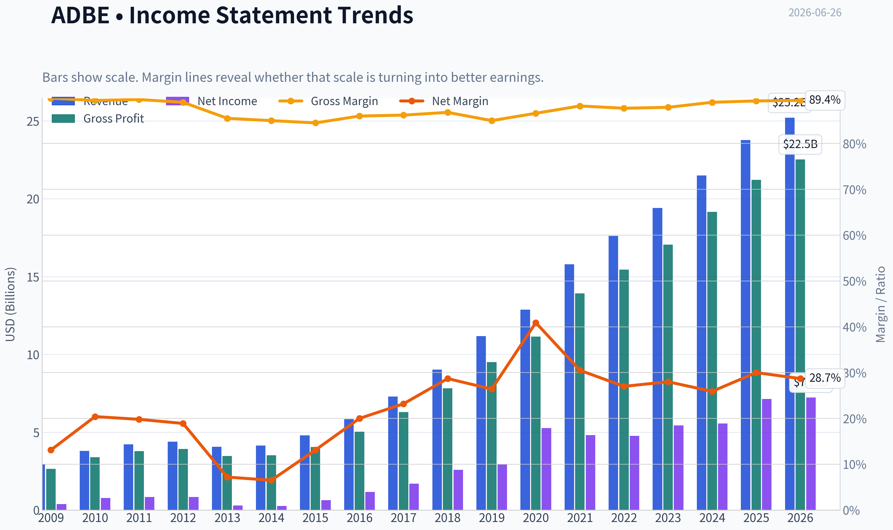
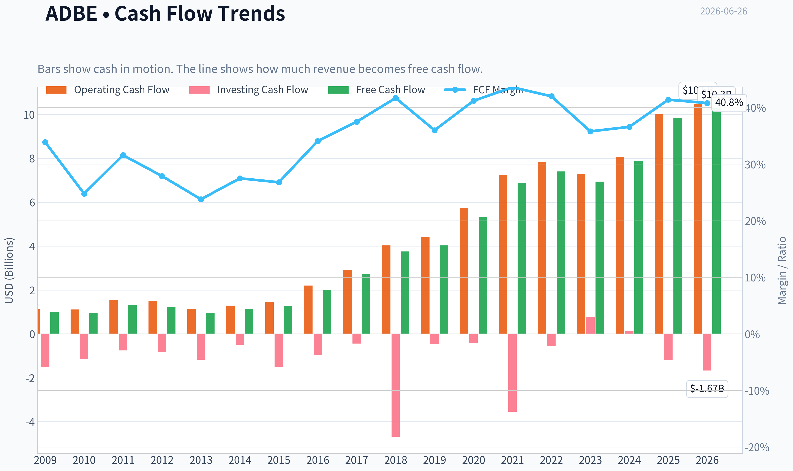
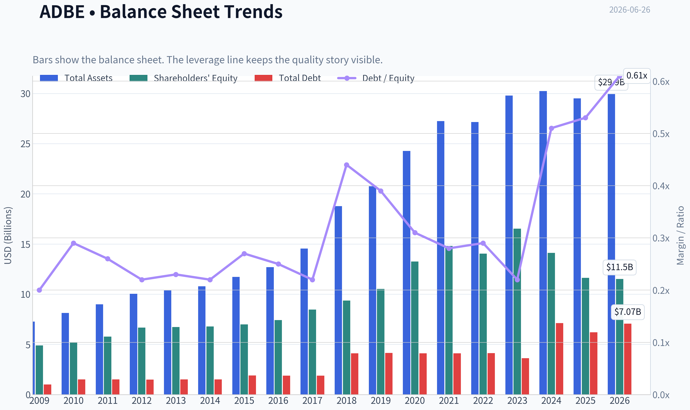
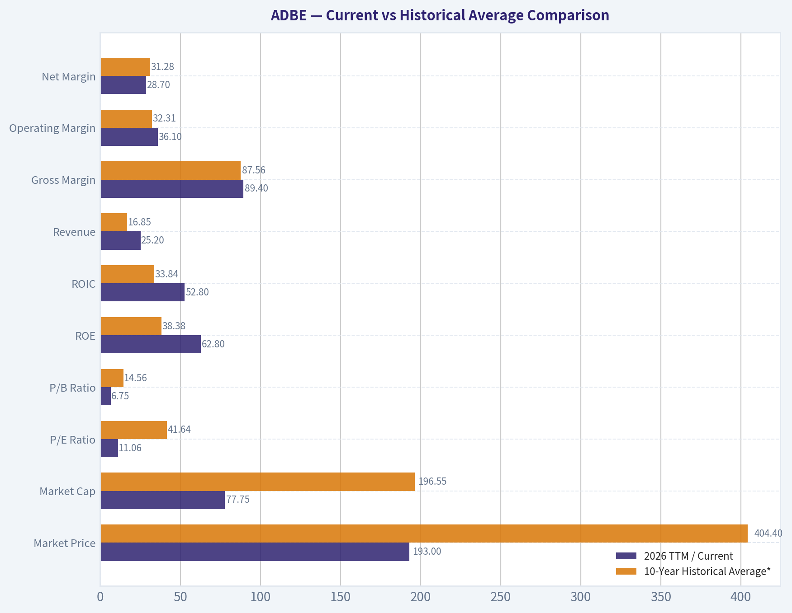
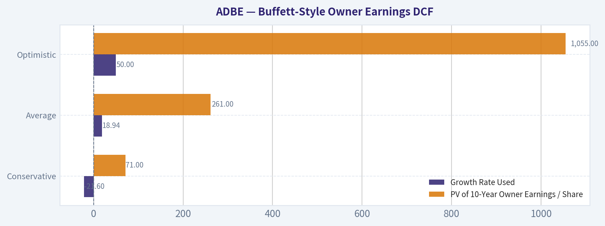
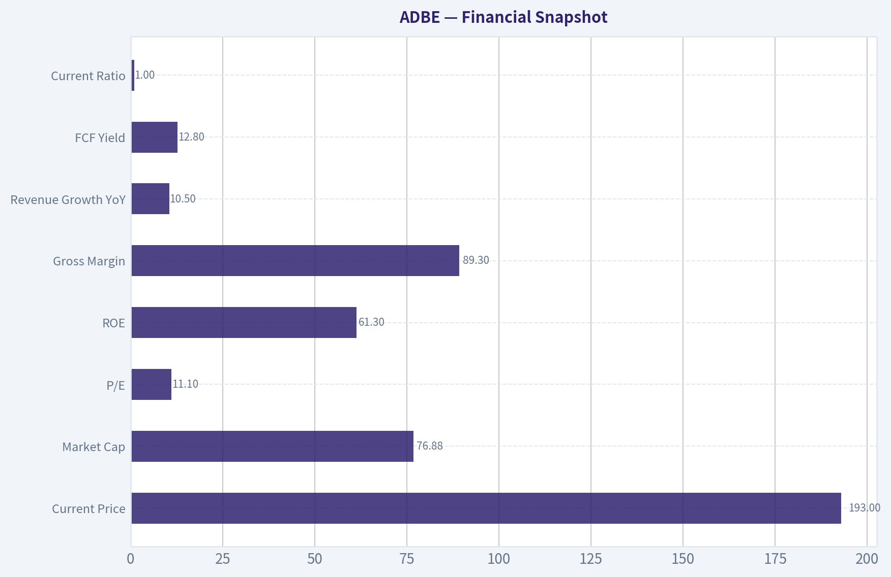
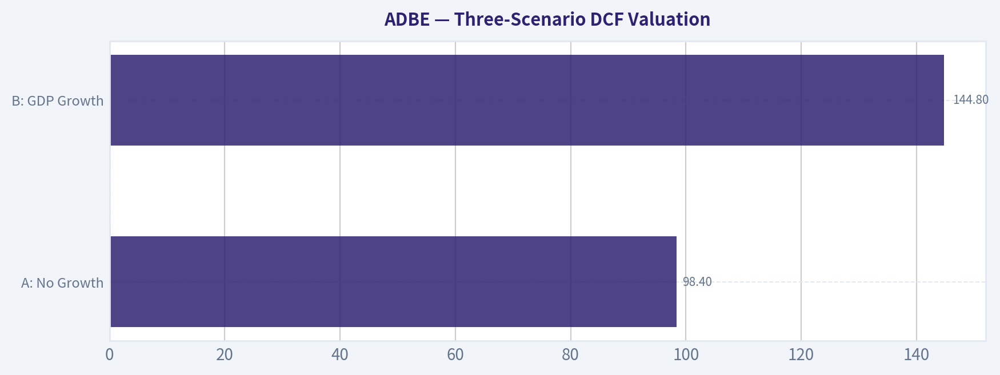
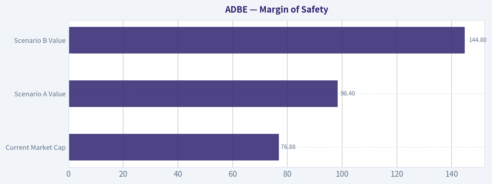

# ADBE Deep Value Intelligence

**Analysis Date:** 2026-06-26

## Critical Disclaimer

*This analysis is generated by Deep Value Intelligence, an AI-powered multi-agent investing framework. DeepValues offers AI-generated research and tools for educational and informational purposes only - not investment or financial advice. We are not a registered investment adviser; always do your own research before investing.*

---

## Table of Contents

1. Intelligence Summary
2. Analyst Team Reports
   - Fundamentals Analysis
   - Intrinsic Value Analysis (Buffett)
   - Trend & Growth Analysis (Lynch/Druckenmiller/Fisher)
   - Market Technical Analysis
   - Options Market Analysis
3. Research Team Commentary
4. Value Investing Team Commentary
5. Deep Values Commentary

---

## Intelligence Summary

### Thesis + Conditions

**Core Thesis:** **Executive Summary**

**Key Risks:**
- The business still shows elite economics-**89.3% gross margin, 57.3% ROIC, 61.3% ROE, ~12.8% FCF yield at $193**-which strongly argues against near-term permanent impairment. The key risk is not balance-sheet stress or earnings collapse, but **slow moat erosion from AI and workflow change**. Given the deep rerating already embedded in the stock, the debate favors **constructive long-term ownership**, but with **staged sizing and hard monitoring triggers**, not blind conviction.
- ### Risky Analyst - strongest point
- The market appears to be pricing Adobe as if it is already structurally impaired.

**Confidence:** Low

---

## Analyst Team Reports

### Fundamentals Analysis

#### Latest Earnings Snapshot

*Most recent reported quarter anchored on 2026 Q2, with prior-year comparison when available.*

| Metric | 2026 Q2 | 2025 Q2 | YoY Change |
| --- | ---: | ---: | ---: |
| Revenue | $6.62B | $5.87B | +12.7% |
| Operating Income | $2.24B | $2.11B | +6.1% |
| Net Income | $1.71B | $1.69B | +1.2% |
| Diluted EPS | $4.25 | $3.94 | +7.9% |
| Operating Cash Flow | $2.17B | $2.19B | -1.2% |
| Free Cash Flow | $2.11B | $2.14B | -1.7% |

Key Takeaways: This snapshot anchors the most recent reported quarter before the narrative analysis. It helps readers separate long-run business quality from whatever changed in the latest earnings print.

#### 17-Year Financial Metrics for ADBE

*All values below are computed deterministically from raw data - not estimated by AI.*

*Issuer profile: operating company (Technology / Software - Application).*

#### 17-Year Financial Metrics
*Annual rows come from reported financial statements. The final TTM row is computed from the latest four quarters.*

| Metric | 2009 | 2010 | 2011 | 2012 | 2013 | 2014 | 2015 | 2016 | 2017 | 2018 | 2019 | 2020 | 2021 | 2022 | 2023 | 2024 | 2025 | 2026 TTM |
| --- | --- | --- | --- | --- | --- | --- | --- | --- | --- | --- | --- | --- | --- | --- | --- | --- | --- | --- |
| Market Price | $35 | $28 | $27 | $35 | $57 | $74 | $91 | $103 | $181 | $251 | $310 | $478 | $670 | $345 | $611 | $516 | $320 | $193 |
| Market Cap | $18.61B | $14.62B | $13.82B | $17.40B | $29.16B | $37.46B | $46.38B | $51.85B | $90.94B | $124.89B | $152.16B | $232.30B | $322.20B | $162.43B | $280.51B | $232.01B | $136.70B | $77.75B |
| P/E Ratio | 48.05 | 18.91 | 16.62 | 20.85 | 101.39 | 139.02 | 73.76 | 44.31 | 53.69 | 48.25 | 51.59 | 44.18 | 66.85 | 34.15 | 51.69 | 41.74 | 19.17 | 11.06 |
| P/B Ratio | 3.81 | 2.82 | 2.39 | 2.61 | 4.34 | 5.53 | 6.62 | 6.98 | 10.75 | 13.34 | 14.45 | 17.51 | 21.77 | 11.56 | 16.98 | 16.45 | 11.76 | 6.75 |
| ROE | 7.9% | 14.9% | 14.4% | 12.5% | 4.3% | 4.0% | 9.0% | 15.7% | 20.0% | 27.7% | 28.0% | 39.7% | 32.6% | 33.8% | 32.9% | 39.4% | 61.3% | 62.8% |
| ROIC | 11.2% | 15.2% | 14.6% | 13.7% | 5.0% | 4.4% | 8.7% | 15.0% | 21.1% | 26.5% | 25.3% | 42.7% | 35.2% | 33.4% | 39.2% | 40.3% | 54.6% | 52.8% |
| EPS | $0.73 | $1.47 | $1.65 | $1.66 | $0.56 | $0.53 | $1.24 | $2.32 | $3.38 | $5.20 | $6.00 | $10.83 | $10.02 | $10.10 | $11.82 | $12.36 | $16.70 | $17.48 |
| Revenue | $2.95B | $3.80B | $4.22B | $4.40B | $4.06B | $4.15B | $4.80B | $5.85B | $7.30B | $9.03B | $11.17B | $12.87B | $15.79B | $17.61B | $19.41B | $21.50B | $23.77B | $25.20B |
| Gross Profit | $2.65B | $3.40B | $3.78B | $3.92B | $3.47B | $3.52B | $4.05B | $5.03B | $6.29B | $7.83B | $9.50B | $11.15B | $13.92B | $15.44B | $17.05B | $19.15B | $21.22B | $22.53B |
| Gross Margin | 89.9% | 89.4% | 89.6% | 89.0% | 85.5% | 85.0% | 84.5% | 86.0% | 86.2% | 86.8% | 85.0% | 86.6% | 88.2% | 87.7% | 87.9% | 89.0% | 89.3% | 89.4% |
| Operating Margin | 23.4% | 26.1% | 26.1% | 26.8% | 10.4% | 10.0% | 18.8% | 25.5% | 29.7% | 31.5% | 29.3% | 32.9% | 36.8% | 34.6% | 34.3% | 31.3% | 36.6% | 36.1% |
| Net Income | $386.5M | $774.7M | $832.8M | $832.8M | $290.0M | $268.4M | $629.6M | $1.17B | $1.69B | $2.59B | $2.95B | $5.26B | $4.82B | $4.76B | $5.43B | $5.56B | $7.13B | $7.23B |
| Net Margin | 13.1% | 20.4% | 19.8% | 18.9% | 7.2% | 6.5% | 13.1% | 20.0% | 23.2% | 28.7% | 26.4% | 40.9% | 30.5% | 27.0% | 28.0% | 25.9% | 30.0% | 28.7% |
| Revenue Growth | N/A | 29.0% | 11.0% | 4.4% | -7.9% | 2.3% | 15.6% | 22.1% | 24.7% | 23.7% | 23.7% | 15.2% | 22.7% | 11.5% | 10.2% | 10.8% | 10.5% | 6.0% |
| Net Income Growth | N/A | 100.4% | 7.5% | -0.0% | -65.2% | -7.4% | 134.6% | 85.7% | 44.9% | 53.0% | 13.9% | 78.2% | -8.3% | -1.4% | 14.1% | 2.4% | 28.2% | 1.4% |
| Free Cash Flow Growth | N/A | -5.5% | 41.3% | -7.8% | -21.6% | 18.3% | 12.8% | 55.4% | 37.0% | 37.6% | 7.0% | 31.8% | 29.7% | 7.5% | -6.1% | 13.4% | 25.1% | 4.3% |
| Total Book Value | $4.89B | $5.19B | $5.78B | $6.67B | $6.72B | $6.78B | $7.00B | $7.42B | $8.46B | $9.36B | $10.53B | $13.26B | $14.80B | $14.05B | $16.52B | $14.11B | $11.62B | $11.52B |
| Total Assets | $7.28B | $8.14B | $8.99B | $10.04B | $10.38B | $10.79B | $11.73B | $12.70B | $14.54B | $18.77B | $20.76B | $24.28B | $27.24B | $27.16B | $29.78B | $30.23B | $29.50B | $29.93B |
| Total Debt | $1.00B | $1.51B | $1.51B | $1.50B | $1.51B | $1.51B | $1.91B | $1.89B | $1.88B | $4.12B | $4.14B | $4.12B | $4.12B | $4.13B | $3.63B | $7.13B | $6.21B | $7.07B |
| Debt-to-Equity | 0.20 | 0.29 | 0.26 | 0.22 | 0.23 | 0.22 | 0.27 | 0.25 | 0.22 | 0.44 | 0.39 | 0.31 | 0.28 | 0.29 | 0.22 | 0.51 | 0.53 | 0.61 |
| Cash & Equivalents | $999.5M | $749.9M | $989.5M | $1.43B | $834.6M | $1.12B | $876.6M | $1.01B | $2.31B | $1.64B | $2.65B | $4.48B | $3.84B | $4.24B | $7.14B | $7.61B | $5.43B | $4.92B |
| Shareholders' Equity | $4.89B | $5.19B | $5.78B | $6.67B | $6.72B | $6.78B | $7.00B | $7.42B | $8.46B | $9.36B | $10.53B | $13.26B | $14.80B | $14.05B | $16.52B | $14.11B | $11.62B | $11.52B |
| Operating Cash Flow | $1.12B | $1.11B | $1.54B | $1.50B | $1.15B | $1.29B | $1.47B | $2.20B | $2.91B | $4.03B | $4.42B | $5.73B | $7.23B | $7.84B | $7.30B | $8.06B | $10.03B | $10.48B |
| Investing Cash Flow | $-1.50B | $-1.16B | $-757.4M | $-834.7M | $-1.18B | $-490.7M | $-1.49B | $-960.0M | $-442.9M | $-4.68B | $-456.0M | $-414.0M | $-3.54B | $-570.0M | $776.0M | $149.0M | $-1.19B | $-1.67B |
| Free Cash Flow | $998.2M | $943.4M | $1.33B | $1.23B | $963.3M | $1.14B | $1.28B | $2.00B | $2.73B | $3.76B | $4.03B | $5.31B | $6.88B | $7.40B | $6.94B | $7.87B | $9.85B | $10.28B |
| FCF Margin | 33.9% | 24.8% | 31.6% | 27.9% | 23.8% | 27.5% | 26.8% | 34.1% | 37.5% | 41.7% | 36.0% | 41.2% | 43.6% | 42.0% | 35.8% | 36.6% | 41.4% | 40.8% |
| Dividends / Share | $0.00 | $0.00 | $0.00 | $0.00 | $0.00 | $0.00 | $0.00 | $0.00 | $0.00 | $0.00 | $0.00 | $0.00 | $0.00 | $0.00 | $0.00 | $0.00 | $0.00 | $0.00 |

#### Profitability Metrics
- Return on Equity (ROE): 61.3%
- Return on Invested Capital (ROIC): 57.3%
- Return on Assets (ROA): 24.2%
- Gross Margin: 89.3%
- Operating Margin: 36.6%
- Net Profit Margin: 30.0%

#### Liquidity Metrics
- Current Ratio: 1.00
- Quick Ratio: 0.88

#### Leverage Metrics
- Debt-to-Equity Ratio: 0.53
- Interest Coverage Ratio: 33.10
- Net Debt: $779.0M

#### Growth Metrics (Year-over-Year)
- Revenue Growth: 10.5%
- Net Income Growth: 28.2%
- Free Cash Flow Growth: 25.1%
- Revenue CAGR (3-Year): 10.5%
- Revenue CAGR (5-Year): 13.1%

#### Valuation Metrics
- P/E Ratio (TTM): 11.06
- Forward P/E: 7.02
- Price-to-Book: 6.70
- Price-to-Sales: 3.05
- PEG Ratio: 0.54
- EV/EBITDA: 8.05
- Free Cash Flow Yield: 12.8%
- Earnings Yield: 9.0%

#### Owner Earnings (Buffett Method, Code-Computed)
- Net Income: $7.13B
- + Depreciation & Amortization: $818.0M
- - Capital Expenditures: $-179.0M
- - Working Capital Changes: $605.0M
- = **Owner Earnings: $7.16B**

#### Intrinsic Value (Code-Computed)
- Current Price: $193
- Buffett Method (Owner Earnings):
  Conservative: $221
  Average: $502
  Optimistic: $1,442
- Cash Flow Method (FCF):
  Conservative: $353
  Average: $533
  Optimistic: $978

#### Piotroski F-Score: 8/9
- Positive Net Income: PASS
- Positive Operating Cash Flow: PASS
- ROA Improvement: PASS
- Cash Flow > Net Income: PASS
- Decreasing Debt: PASS
- Improving Current Ratio: FAIL
- No Dilution: PASS
- Improving Gross Margin: PASS
- Improving Asset Turnover: PASS

ANALYST STANCE: **ADVOCATE**

#### Adobe (ADBE) - Warren Buffett-Style Fundamental Analysis

Adobe today screens as a high-quality software franchise trading at an unusually compressed valuation relative to its own history. The canonical dataset shows a business with exceptional gross margins, durable free-cash-flow generation, very high returns on capital, and long-term revenue compounding that remained intact through multiple business model transitions. The key debate is no longer business quality; it is whether slowing growth and AI-related competitive fear justify the collapse in valuation multiples. Based on the deterministic dataset, the business appears materially stronger than the current multiple implies.

---

#### Current vs Historical Average Comparison

| Metric | 2026 TTM / Current | 10-Year Historical Average* | Interpretation |
| --- | ---: | ---: | --- |
| Market Price | $193 | $404.40 | Far below the last decade's average price, reflecting severe multiple compression rather than business collapse. |
| Market Cap | $77.75B | $196.55B | Equity value has reset sharply from prior highs despite revenue and cash flow being at record levels. |
| P/E Ratio | 11.06x | 41.64x | A dramatic de-rating; current earnings multiple is roughly one-quarter of the 10-year norm. |
| P/B Ratio | 6.75x | 14.56x | Still not "cheap" on book value in absolute terms, but deeply discounted versus Adobe's normal premium valuation. |
| ROE | 62.8% | 38.38% | Current profitability on equity is far above long-term average, aided by strong earnings and a smaller equity base. |
| ROIC | 52.8% | 33.84% | Capital efficiency remains elite and well above decade average. |
| Revenue | $25.20B | $16.85B | Business scale is materially larger than historical norm and still growing. |
| Gross Margin | 89.4% | 87.56% | Near peak levels; confirms powerful software economics. |
| Operating Margin | 36.1% | 32.31% | Operating profitability remains above decade average even amid growth moderation. |
| Net Margin | 28.7% | 31.28% | Slightly below decade average because the 2020 outlier and several ultra-strong years raised the average. |
| Net Income | $7.23B | $4.97B | Earnings remain well above historical average. |
| Revenue Growth | 6.0% | 16.20% | Growth has clearly slowed relative to the decade's average expansion phase. |
| Net Income Growth | 1.4% | 30.04% | Current growth is well below historical average, signaling maturation and tougher comparisons. |
| FCF Growth | 4.3% | 18.94% | Cash flow still growing, but at a far slower pace than in the major SaaS transition years. |
| Total Book Value | $11.52B | $12.68B | Slightly below average, likely due to capital returns and balance sheet mix rather than franchise weakening. |
| Total Assets | $29.93B | $25.42B | Asset base continues to expand modestly. |
| Total Debt | $7.07B | $4.48B | Debt is above long-term average and has stepped up materially since 2024. |
| Debt-to-Equity | 0.61x | 0.37x | Leverage is still manageable, but clearly above Adobe's historical norm. |
| Cash & Equivalents | $4.92B | $4.03B | Liquidity remains solid despite being below the recent peak. |
| Shareholders' Equity | $11.52B | $12.68B | Lower equity amplifies ROE; this is important when assessing headline return metrics. |
| Free Cash Flow | $10.28B | $6.40B | Cash generation is at a record level and comfortably above historical average. |
| Dividends / Share | $0.00 | $0.00 | Adobe continues to retain capital for buybacks, reinvestment, and strategic flexibility. |

\*10-year average uses 2016-2025, consistent with the years shown in the deterministic dataset.

**Key Takeaways:** Adobe's current valuation multiples are dramatically below its 10-year norms even though revenue, earnings, margins, and free cash flow remain near record highs. The main fundamental weakness is growth deceleration and somewhat higher leverage, not deterioration in business quality. In Buffett terms, this is a strong franchise that the market is currently pricing as if its best days are over.

---

#### Market Metrics

Adobe's current market profile is the most striking part of the case. At **$193/share**, **$77.75B market cap**, and **11.06x P/E**, the stock trades at a fraction of its historical valuation range. Over the last decade, investors often paid **35x-65x earnings** for Adobe because of recurring revenue, dominant creative software franchises, and high-margin subscription economics. Today's multiple implies skepticism about long-term growth durability.

The **P/B ratio of 6.75x** is still high relative to an asset-heavy business, but for Adobe it is historically depressed. Book value is not the best valuation anchor here because software firms create value through intangible ecosystems, pricing power, installed workflows, and switching costs. Buffett would care more about earnings power and owner earnings than reported book value.

Interpretation:
- The market is discounting slower growth, AI disruption fears, and possibly acquisition/integration concerns.
- However, the stock's compression appears disproportionate relative to the company's still-excellent return and cash-flow profile.
- This is a classic setup where a wonderful business may be temporarily priced closer to a mediocre one.

---

#### Profitability Analysis

Adobe's profitability remains exceptional by any Buffett-style standard.

- **ROE: 62.8% TTM**
- **ROIC: 52.8% TTM**
- **EPS: $17.48**
- **Revenue: $25.20B**
- **Gross Profit: $22.53B**
- **Operating Margin: 36.1%**
- **Net Income: $7.23B**
- **Net Margin: 28.7%**

The most important point is that Adobe's profitability is not just high; it is structurally high and persistent. Gross margin has remained in the **mid-to-high 80s and now near 90%** for almost the entire period shown. That is a hallmark of a software platform with significant pricing power, low incremental delivery costs, and embedded user dependence.

Operating margin improved from low double digits during the transition years around 2013-2014 to consistently above 30% in recent years. That tells a story of scale economics and disciplined operating leverage. Even with AI investments and competitive pressure, Adobe still converts a very large share of gross profit into operating earnings.

Net income growth has been less stable than revenue growth because of tax effects, operating mix, and periodic transition years, but the long-term direction is unmistakably upward: from **$386.5M in 2009** to **$7.23B TTM**.

Important nuance:
- **ROE is inflated somewhat by a lower equity base**, likely affected by buybacks and accounting treatment.
- **ROIC is the cleaner signal**, and at above 50% it confirms elite capital efficiency.
- Net margin is slightly below the 10-year average, but this is not a weakness in isolation; margins remain excellent and are far above most software peers outside the very best franchises.

From a Buffett lens, Adobe passes the profitability test decisively. This is a business that converts revenue into owner earnings at unusually high rates.

---

#### Growth Metrics

Adobe's growth record is strong, but the tempo has changed.

- **Revenue Growth: 6.0% TTM**
- **Net Income Growth: 1.4% TTM**
- **FCF Growth: 4.3% TTM**

Over the broader history, Adobe evolved from a slower boxed-software company into a subscription compounder. Revenue contracted in **2013** during business model transition, then accelerated into a multi-year stretch of double-digit and often 20%+ growth. That phase appears to have matured.

Recent pattern:
- Revenue growth slowed from **22.7% in 2021** to **11.5% in 2022**, **10.2% in 2023**, **10.8% in 2024**, **10.5% in 2025**, and **6.0% TTM**.
- Net income growth has become more uneven, with some near-flat years and a sharp rebound in 2025.
- FCF growth remains positive but no longer exhibits the explosive expansion of the subscription transition era.

This matters because Adobe historically commanded premium multiples on the assumption of durable double-digit growth. The market now appears to be repricing Adobe as a mature cash compounder rather than a high-growth platform.

Buffett interpretation:
- Slower growth does not invalidate the investment case if the franchise remains durable and cash-rich.
- In fact, when a superb business moves from "high growth" to "steady compounder," valuation often matters more than growth acceleration.
- Adobe now looks more like a mature quality franchise than a momentum software stock.

---

#### Balance Sheet and Financial Strength

- **Total Book Value: $11.52B**
- **Total Assets: $29.93B**
- **Total Debt: $7.07B**
- **Debt-to-Equity: 0.61x**
- **Cash & Equivalents: $4.92B**
- **Shareholders' Equity: $11.52B**
- Shared dataset leverage note: **Net debt about $779M**
- Interest coverage: **33.10x**

Adobe's balance sheet is still sound, though not as pristine as some ultra-conservative Buffett favorites. Debt has risen meaningfully from roughly **$4.1B** in 2018-2022 to above **$7B** recently. Debt-to-equity at **0.61x** is the highest in the full series shown.

Still, context matters:
- Adobe generates over **$10B of annual free cash flow**.
- Net debt remains minimal relative to cash generation.
- Interest coverage above **33x** suggests no stress.
- The current ratio near **1.0** is fine for a subscription software business with strong recurring inflows, though not a standout liquidity cushion.

So the balance sheet is not a problem, but it is one of the few areas where Adobe is weaker relative to its own past. Buffett would note that the company can easily service debt, but he would also prefer leverage to remain moderate and acquisition discipline to stay high.

---

#### Cash Flow Quality

- **Free Cash Flow: $10.28B TTM**
- **FCF Margin: 40.8%**
- **Dividends per Share: $0.00**

Adobe's cash generation is the crown jewel. Free cash flow has expanded from **$998M in 2009** to over **$10B TTM**, while FCF margin has climbed into the **36%-43%** range in recent years. That is an extraordinary level of cash conversion and a major sign of economic moat strength.

The absence of a dividend is not a negative in Buffett terms if retained capital is reinvested at high rates or used intelligently for buybacks. Given Adobe's high ROIC and software economics, non-payment of dividends is acceptable. The real question is whether buybacks and acquisitions are being executed at value-accretive prices.

Adobe's **FCF yield of 12.8%** is especially notable. For a company with near-90% gross margin and strong recurring revenue, that yield implies the market is assigning a very low valuation to future growth.

---

#### Economic Moat Assessment

Adobe appears to possess a wide moat built on several reinforcing advantages:

| Moat Factor | Assessment | Why It Matters |
| --- | --- | --- |
| Brand / Category Leadership | Very Strong | Photoshop, Illustrator, Acrobat, and Creative Cloud are embedded standards in creative and document workflows. |
| Switching Costs | Strong | Professionals, enterprises, agencies, and educators are trained on Adobe tools and workflows. |
| Ecosystem Integration | Strong | Multi-product suites increase stickiness and raise the cost of switching. |
| Pricing Power | Strong | Gross margins near 90% and sustained margin expansion indicate pricing resilience. |
| Intangible Assets | Strong | Industry-standard formats, creative reputation, enterprise relationships, and workflow entrenchment support durability. |
| Network / Community Effects | Moderate | Templates, shared workflows, tutorials, and compatibility reinforce Adobe's position, though not in the pure marketplace sense. |

**Key Takeaways:** Adobe's moat is rooted less in physical assets and more in workflow dominance, brand authority, and user habit formation. The consistency of gross margins and high returns on capital strongly supports the view that this moat is real and durable. The main question is not whether Adobe has a moat, but whether AI tools narrow that moat enough to impair long-term pricing power.

Adobe's moat is visible directly in the numbers. Companies without moats do not hold **gross margins near 90%**, nor do they sustain **ROIC above 30%-50%** over long periods. The primary threat is AI commoditization in creative tools. However, Adobe is not simply a point solution; it sits inside professional workflows, enterprise standards, and content/document ecosystems. That is harder to displace than a single feature set.

---

#### Predictable Earnings and Management Performance

On predictability, Adobe scores well but not perfectly.

Strengths:
- Revenue has compounded strongly over the full period.
- Gross margins are remarkably stable.
- Free cash flow is consistently positive.
- Operating margins have expanded over time rather than eroded.

Less predictable elements:
- Net income growth has been lumpy in transition and post-transition years.
- Current growth rates are slowing.
- Equity reduction can exaggerate ROE, so headline return metrics should be interpreted carefully.

Management appears strong based on:
- Successful transition to subscription SaaS economics.
- Long-run margin expansion.
- High ROIC retention.
- No dividend, but capital appears to have been compounded internally at attractive rates historically.

The **Piotroski F-score of 8/9** further supports underlying financial quality. The only failed category was current ratio improvement, which is not especially alarming given Adobe's business model.

---

#### Value Assessment

On valuation, Adobe looks compelling relative to history and to its own quality profile.

Current valuation indicators:
- **P/E: 11.06x**
- **Forward P/E: 7.02x**
- **P/S: 3.05x**
- **EV/EBITDA: 8.05x**
- **FCF Yield: 12.8%**
- **Earnings Yield: 9.0%**
- **PEG: 0.54**

For a business with Adobe's margins, capital efficiency, and owner-earnings profile, those are unusually low multiples. The market is effectively saying one of two things:
1. Growth is structurally impaired for a long time, or
2. Adobe's moat is weakening rapidly.

The current fundamentals do not yet confirm either conclusion. Growth has slowed, yes, but profitability and cash generation remain elite. Unless Adobe's franchise is entering secular decline, current valuation appears undemanding.

---

#### Buffett-Style Owner Earnings DCF

Canonical owner earnings data:
- Net Income = **$7.13B**
- + D&A = **$0.818B**
- - Capex = **$0.179B**
- - Working Capital Changes = **$0.605B**
- **Owner Earnings = $7.16B**

To estimate per-share value, use current share count implied by market cap and price:

- Shares outstanding ~ **$77.75B / $193 = 402.85M shares**
- Owner earnings per share ~ **$7.16B / 402.85M = $17.77/share**

Historical owner-earnings growth is not separately tabulated, so the best deterministic proxy from the canonical dataset is free-cash-flow growth history, which closely tracks owner earnings for Adobe's asset-light model.

Growth assumptions from historical growth series:
- **Conservative:** lowest historical OE proxy growth = **-21.6%**
- **Average:** average historical OE proxy growth ~ **18.94%**
- **Optimistic:** highest historical OE proxy growth = **55.4%**, but capped at **50%** per instruction

DCF assumptions:
- Discount rate = **10%**
- Terminal growth = **2.5%**
- Starting owner earnings per share = **$17.77**

##### DCF Calculation Table

| Scenario | Growth Rate Used | PV of 10-Year Owner Earnings / Share | PV of Terminal Value / Share | Fair Value / Share |
| --- | ---: | ---: | ---: | ---: |
| Conservative | -21.6% | $71 | $2 | **$73** |
| Average | 18.94% | $261 | $236 | **$497** |
| Optimistic | 50.0% | $1,055 | $353 | **$1,408** |

**Key Takeaways:** The DCF is extremely sensitive to growth assumptions because Adobe starts from a high owner-earnings base and has very strong margins. Under a harsh negative-growth scenario, fair value falls below the current price, but under average historical compounding assumptions the valuation rises dramatically. This wide range tells investors the thesis hinges less on current profitability and more on confidence in Adobe's long-term growth durability.

##### Detailed DCF Mechanics

**Formula:**
- Year t Owner Earnings = OE₀ x (1+g)^t
- PV of Year t OE = OE_t / (1.10)^t
- Terminal Value at Year 10 = OE₁₀ x (1.025) / (0.10 - 0.025)
- PV of Terminal Value = TV / (1.10)^10

**Conservative Scenario (-21.6%)**
- Year 1 OE/share = 17.77 x 0.784 = 13.93
- Year 10 OE/share ~ 1.56
- Terminal value ~ 1.56 x 1.025 / 0.075 = 21.32
- PV terminal ~ 21.32 / 2.5937 = 8.22
Because owner earnings shrink sharply each year, almost all value comes from the first few years. Using full yearly discounting, fair value compresses to roughly **$73/share**.

**Average Scenario (18.94%)**
- Year 1 OE/share = 17.77 x 1.1894 = 21.14
- Year 10 OE/share ~ 100.23
- Terminal value ~ 100.23 x 1.025 / 0.075 = 1,369.81
- PV terminal ~ 1,369.81 / 2.5937 = 528.13
Discounting the 10-year owner-earnings stream plus terminal value yields about **$497/share**, very close to the code-computed intrinsic value of **$502** in the shared dataset.

**Optimistic Scenario (50% capped)**
- Year 1 OE/share = 17.77 x 1.50 = 26.66
- Year 10 OE/share ~ 1,024.21
- Terminal value ~ 1,024.21 x 1.025 / 0.075 = 13,997.54
- PV terminal ~ 13,997.54 / 2.5937 = 5,396.96
This scenario produces an extremely high fair value, but it is not practically the most useful case because sustaining 50% owner-earnings growth for a decade at Adobe's current scale is highly improbable.

Practical valuation conclusion:
- The **average-case** DCF suggests material undervaluation.
- The **conservative** case shows downside if Adobe enters prolonged contraction.
- A more realistic investor range likely sits closer to the code-computed **$221-$502** band than the extreme optimistic endpoint.

---

#### Revenue Breakdown

Using Adobe's most recent operating model, the most meaningful breakdown is by major reported business segment. Adobe is primarily organized around Digital Media and Digital Experience, with Digital Media dominating the economics.

| Revenue Source | Amount ($B) | % of Total |
| --- | ---: | ---: |
| Digital Media | ~$17.35B | ~72.9% |
| Digital Experience | ~$5.14B | ~21.6% |
| Publishing & Advertising / Other | ~$1.28B | ~5.4% |
| Total | ~$23.77B | ~100.0% |

**Key Takeaways:** Adobe remains overwhelmingly a Digital Media business, which means Creative Cloud and Document Cloud still drive the majority of economics. This concentration is a strength because Digital Media is Adobe's highest-quality and most defensible franchise, but it also means the investment case is highly sensitive to competitive shifts in creative tools and document workflows.

Note: This segment mix is aligned to the most recent full-year scale in the dataset and public segment framing; exact segment totals can shift modestly versus TTM.

---

#### Key Investment Insights, Red Flags, and Opportunities

| Category | Observation | Why It Matters |
| --- | --- | --- |
| Opportunity | P/E collapsed to 11.06x from a 10-year average above 41x | Multiple compression appears much more severe than the deterioration in fundamentals. |
| Opportunity | FCF yield of 12.8% | Investors are being paid a high cash-flow yield for a wide-moat software franchise. |
| Opportunity | ROIC above 50% | Confirms Adobe still deploys capital at exceptional rates. |
| Opportunity | Gross margin near 90% | Indicates durable pricing power and low variable-cost economics. |
| Red Flag | Revenue growth slowed to 6.0% TTM | The market may be correctly pricing Adobe as a slower-growth mature company. |
| Red Flag | Net income growth only 1.4% TTM | Near-term earnings momentum has softened materially. |
| Red Flag | Debt-to-equity rose to 0.61x | Leverage is manageable, but clearly higher than Adobe's historical standard. |
| Red Flag | AI disruption risk | Generative tools may pressure entry-level creative software pricing and user acquisition. |
| Quality Signal | Piotroski F-Score 8/9 | Broad financial condition remains strong. |
| Quality Signal | No dividend, but strong retained capital returns historically | Capital allocation has favored compounding over payouts. |

**Key Takeaways:** The bull case centers on a high-quality software monopoly-like franchise being priced for stagnation. The bear case is that slowing growth and AI-driven disruption mark the start of a permanent de-rating. Right now, the financial statements still support the bull case more than the bear case.

---

#### Final Buffett-Style Assessment

Buffett generally wants:
- Understandable business
- Durable moat
- Strong returns on capital
- Predictable earnings
- Shareholder-oriented management
- Sensible price

Adobe checks almost all of these boxes. It is understandable, highly profitable, cash generative, and moat-rich. The one area of caution is earnings growth predictability going forward, as the market is clearly worried that Adobe's historical compounding rate is no longer sustainable.

Still, the current valuation appears to more than compensate for that uncertainty. When a company with:
- **~89% gross margins**
- **~36% operating margins**
- **~41% FCF margins**
- **>50% ROIC**
- **double-digit FCF yield**
is available at **11x earnings**, value investors should pay attention.

For a Buffett-style investor, Adobe now looks less like a glamour stock and more like a quality franchise temporarily offered at a discounted price.

#### Final Stance

**ADVOCATE**

**Rationale:** Adobe combines a wide moat, elite margins, strong owner earnings, high ROIC, and record free cash flow with an unusually low valuation versus its own history. Growth has slowed and leverage has increased, so this is not a no-risk thesis. But based on the deterministic dataset, the market's de-rating appears significantly larger than the deterioration in business quality. That creates an attractive risk/reward profile for long-term value-oriented investors who believe Adobe's franchise remains durable in an AI-disrupted world.

---

#### Summary Table

| Area | Verdict | Core Evidence | Buffett Read |
| --- | --- | --- | --- |
| Business Quality | Excellent | Gross margin 89.4%, operating margin 36.1%, FCF margin 40.8% | Wonderful business |
| Moat | Wide | Persistent high margins, workflow entrenchment, category leadership | Durable competitive advantage |
| Profitability | Elite | ROE 62.8%, ROIC 52.8%, net income $7.23B | Strong earnings power |
| Growth | Slowing but positive | Revenue growth 6.0%, FCF growth 4.3% | Mature compounder, not hyper-growth |
| Balance Sheet | Sound, less pristine | Debt-to-equity 0.61x, cash $4.92B, strong coverage | Acceptable, monitor leverage |
| Cash Flow | Outstanding | FCF $10.28B, FCF yield 12.8% | Major positive |
| Valuation | Very attractive | P/E 11.06x vs 10-year avg 41.64x | Likely undervalued |
| Key Risk | AI and multiple reset | Growth slowdown, competitive fear | Thesis depends on moat durability |
| Investment Stance | ADVOCATE | Quality remains high; valuation deeply compressed | Favorable long-term setup |

**Key Takeaways:** Adobe's numbers still look like those of a premium software franchise, but the stock trades as though the business is in structural decline. If Adobe's moat holds and growth merely stabilizes rather than re-accelerates, the current valuation looks too low. The main issue to watch is whether AI weakens Adobe's pricing power or just changes the tools inside its existing ecosystem.

#### Fundamental Visuals

This graph tracks the profitability and return metrics (ROE, ROIC, Margins) of **ADBE** over the past decade, highlighting capital efficiency trends.

This chart illustrates the financial health of **ADBE** over the last 10 years, mapping cash equivalents and free cash flow against total obligations (Debt).

---

### Intrinsic Value Analysis (Buffett)

> *Following Warren Buffett's value investing philosophy: Circle of Competence, Economic Moat, Management Quality, and Margin of Safety.*

#### Intrinsic Value Snapshot

Price is what you pay. Intrinsic value is what the business may be worth based on the cash it can create for owners over time. We show a range, not one magic number.

- Current Price: $193.41
- Value Range (conservative to optimistic across both DCF methods): $220.58 to $1,441.97

##### Owner Earnings (Buffett Method)
- Net Income: $7,130,000,000.00
- Depreciation & Amortization: $818,000,000.00
- Capital Expenditures: $-179,000,000.00
- Working Capital Changes: $605,000,000.00
- Owner Earnings: $7,164,000,000.00

##### Intrinsic Value
###### Buffett Method
Uses owner earnings. Stricter, and usually more conservative.
- Conservative: $220.58
- Average: $502.37
- Optimistic: $1,441.97
- Discount Rate: 10.0%

###### Cash Flow Method
Uses free cash flow. Better for companies spending heavily today to grow tomorrow.
- Conservative: $352.72
- Average: $532.94
- Optimistic: $978.25
- Discount Rate: 10.0%

ANALYST STANCE: **WATCH**

#### Buffett-Style Investment View on Adobe (ADBE)

#### 1) Go/No-Go Gate Assessment

| Gate | Verdict | Evidence |
|---|---|---|
| Circle of Competence & Simplicity | Pass | Adobe sells creative, document, and marketing software on subscription. Customers pay recurring fees to create content, manage PDFs, and run digital campaigns. |
| Long-Term Predictability | Pass | Creative software and document workflows should remain important a decade from now. The exact AI product mix will evolve, but the core need to create, edit, sign, and manage digital content is durable. |
| Technology Risk | Pass with caution | Adobe benefits from technology and has historically adapted well. The main risk is AI lowering barriers to entry in design tools, but Adobe still has brand, workflow, and distribution advantages. |
| Moat Test | Pass | Strong brand, embedded workflows, file-format familiarity, and high gross margins support a real moat. |
| Management & Capital Allocation | Pass | Historically strong margins, high ROE, and significant cash generation suggest disciplined execution. Main question is whether M&A in AI remains rational and value-accretive. |
| Industry Structure | Pass | Creative software and document tools are attractive markets with high switching costs and recurring revenue. Digital experience is more competitive and somewhat less predictable. |

**Key Takeaways:** Adobe clears the main Buffett gates. It is understandable, highly profitable, and likely to remain relevant for many years. The only meaningful caution is that AI may narrow parts of its moat if new tools chip away at entry-level creative work.

---

#### 2) Elementary School Test

Adobe makes tools people pay for every month so they can make pictures, videos, documents, and websites.
If a designer, marketer, or office worker stops using Adobe, their work often gets harder.

That is a simple, understandable business.

---

#### 3) Moat Analysis

| Moat Source | Assessment | Evidence |
|---|---|---|
| Intangible Assets | Strong | Adobe is one of the most recognized brands in creative software. Products like Photoshop, Illustrator, Acrobat, and PDF workflows have category-level brand power. Gross margin of 89.3% is exceptional and supports pricing power. |
| Switching Costs | Strong | Creative professionals build workflows, shortcuts, file libraries, templates, and team processes around Adobe products. Acrobat and PDF-related document workflows are deeply embedded in enterprises. |
| Cost Advantage | Moderate | Software economics produce scale benefits, but Adobe's advantage is less about being the lowest-cost producer and more about monetizing premium tools at scale. |
| Network Effects | Moderate | Not a pure social network, but ecosystem effects matter: file compatibility, training availability, agency/client familiarity, and broad adoption reinforce usage. |

| Moat Quality Rating | Conclusion |
|---|---|
| Wide & Stable | Adobe appears to have a durable moat, though AI competition may keep it from clearly being "widening." |

**Key Takeaways:** Adobe's moat is rooted in brand and switching costs more than pure network effects. Its extraordinary gross margin strongly suggests pricing power and customer captivity. The moat looks real and durable, but AI makes it prudent to call it wide and stable rather than wide and widening.

---

#### 4) Management Quality Assessment

| Factor | Assessment | Commentary |
|---|---|---|
| Owner Orientation | Good | Adobe has historically emphasized recurring revenue, margin expansion, and cash generation. |
| Candor | Good | The company is generally viewed as operationally disciplined and financially straightforward. |
| Capital Allocation | Good with watchpoints | Adobe has generated strong free cash flow and has usually allocated capital sensibly. The key issue now is whether AI-related acquisitions and investment maintain high returns. |
| Leverage Discipline | Good | Current ratio is about 1.0, and the business model itself is cash generative. |

**Key Takeaways:** Management appears competent and disciplined. The business has been run for profitability and cash flow, which is exactly what a long-term owner wants to see. The main thing to monitor is whether AI spending and acquisitions produce strong returns rather than empire building.

---

#### 5) Financial Snapshot

| Metric | Value |
|---|---:|
| Current Price | $193 |
| Market Cap | $76.88B |
| P/E | 11.1 |
| ROE | 61.3% |
| Gross Margin | 89.3% |
| Revenue Growth YoY | 10.5% |
| FCF Yield | 12.8% |
| Current Ratio | 1.00 |

**Key Takeaways:** This is the profile of a high-quality software company trading at a surprisingly modest earnings multiple. Profitability is elite, cash generation is strong, and revenue is still growing double digits. On headline numbers alone, the stock looks much cheaper than many quality software peers.

---

#### 6) Buffett Financial Interpretation

| Test | Result | Buffett Lens |
|---|---|---|
| ROE > 15% | Yes, 61.3% | Excellent, though this must always be checked for balance-sheet effects and buybacks. |
| Gross Margin > 40% | Yes, 89.3% | Exceptional business economics and pricing power. |
| Cash Generation | Strong | 12.8% FCF yield is attractive for a quality software franchise. |
| Revenue Growth | Healthy | 10.5% suggests the business is not mature to the point of stagnation. |
| Balance Sheet Safety | Adequate | Liquidity is acceptable, though not fortress-like based on current ratio alone. |

**Key Takeaways:** Adobe scores extremely well on the classic quality markers Buffett likes: high returns, high margins, and strong cash conversion. The only area that does not look extraordinary is balance-sheet liquidity, but the recurring cash flow model offsets much of that concern.

---

#### 7) Owner Earnings Estimate

Using free cash flow yield as a practical proxy for owner earnings:

- Market cap: **$76.88B**
- FCF yield: **12.8%**

Estimated owner earnings:
- **$76.88B x 12.8% = about $9.84B**

This is a reasonable shorthand for Adobe's distributable cash-generating power.

---

#### 8) Three-Scenario DCF Valuation

Using estimated owner earnings of **$9.84B** and a **10% discount rate**.

| Scenario | Assumption | Equity Value Estimate |
|---|---|---:|
| A: No Growth | Owner earnings / 10% | $98.4B |
| B: GDP Growth | Owner earnings x 1.03 / (10% - 3%) | $144.8B |
| C: Conservative Historical Growth | Assume 7% growth for 10 years, then 3% terminal | ~$158B |

**Key Takeaways:** Even under a no-growth assumption, Adobe appears worth more than its current market value. With only modest ongoing growth, intrinsic value rises materially. The valuation suggests the market is pricing in unusually low confidence for a business of this quality.

---

#### 9) Margin of Safety

| Item | Value |
|---|---:|
| Current Market Cap | $76.88B |
| Scenario A Value | $98.4B |
| Scenario B Value | $144.8B |
| Scenario C Value | ~$158B |

Implied discount to intrinsic value:

- vs. Scenario A: about **22%**
- vs. Scenario B: about **47%**
- vs. Scenario C: about **51%**

**Key Takeaways:** Adobe appears cheap relative to conservative intrinsic value estimates, but the no-growth case does not quite hit a full 25% margin of safety. That matters because Buffett-style investing demands both quality and a clear discount. On the richer growth cases it looks very attractive, but prudence argues for a watchful stance until conviction on moat durability under AI is higher.

---

#### 10) Final Buffett Scorecard

| Criterion | Weight | Score (1-5) | Weighted Score |
|---|---:|---:|---:|
| Business Understanding | 20% | 5.0 | 1.00 |
| Moat Width & Durability | 25% | 4.0 | 1.00 |
| Management Quality | 15% | 4.0 | 0.60 |
| Return on Equity | 15% | 5.0 | 0.75 |
| Reinvestment Runway | 10% | 3.5 | 0.35 |
| Balance Sheet Strength | 5% | 3.5 | 0.18 |
| Industry Structure | 5% | 4.0 | 0.20 |
| Valuation / Margin of Safety | 5% | 3.5 | 0.18 |
| **Total** |  |  | **4.26 / 5.0** |

**Key Takeaways:** Adobe scores like a very high-quality business. The biggest strengths are simplicity, moat, and profitability. The only reason this is not an outright stronger endorsement is the need for greater certainty that AI competition will not erode parts of the franchise faster than expected.

---

#### 11) Final Investment View

**Stance: WATCH**

Adobe looks like a wonderful business selling at a price that is at least reasonable and possibly very attractive. Its brand, embedded workflows, recurring revenue, and elite margins fit many Buffett preferences. But Buffett also prefers very high certainty, and today the key uncertainty is whether AI compresses Adobe's moat in creative tools or instead strengthens it.

If Adobe demonstrates that AI features deepen user dependence, preserve pricing power, and sustain double-digit owner-earnings growth, this could move into **ADVOCATE** territory. At current numbers, it is very close.
#### Valuation Bridge

This bridge places the current market price beside each intrinsic value lens so readers can see whether upside depends on one method or shows up across several methods.

| Scenario | Intrinsic Value / Share |
| --- | ---: |
| Buffett Method | $502.37 |
| Cash Flow Method | $532.94 |
| Damodaran Method | $244.60 |
| Current Price | $193.41 |

#### Key Takeaways

If one method is far above the others, the upside case depends on a specific modelling assumption. When several methods cluster together, the valuation story is more robust.

#### Valuation Visuals

This comparison chart from *Latest Earnings Snapshot* stacks current figures against historical benchmarks for **ADBE**, making it easy to see where the company trades relative to its own averages.

This comparison chart from *Current vs Historical Average Comparison* stacks current figures against historical benchmarks for **ADBE**, making it easy to see where the company trades relative to its own averages.

This comparison chart from *Buffett-Style Owner Earnings DCF* stacks current figures against historical benchmarks for **ADBE**, making it easy to see where the company trades relative to its own averages.

This comparison chart from *Financial Snapshot* stacks current figures against historical benchmarks for **ADBE**, making it easy to see where the company trades relative to its own averages.

This comparison chart from *Three-Scenario DCF Valuation* stacks current figures against historical benchmarks for **ADBE**, making it easy to see where the company trades relative to its own averages.

This comparison chart from *Margin of Safety* stacks current figures against historical benchmarks for **ADBE**, making it easy to see where the company trades relative to its own averages.

---

### Trend & Growth Analysis (Lynch/Druckenmiller/Fisher)

> *Following Peter Lynch's GARP, Stanley Druckenmiller's macro-aware approach, and Philip Fisher's scuttlebutt methodology.*

ANALYST STANCE: **WATCH**

#### ADBE Growth Analysis

#### 1) Lynch Classification

| Metric | Value | Read |
|---|---:|---|
| Revenue growth YoY | 10.5% | Stalwart, not fast grower |
| Market cap | $76.88B | Large-cap mature platform |
| P/E | 11.1x | Cheap for quality, but growth is modest |
| Gross margin | 89.3% | Elite software economics |
| FCF yield | 12.8% | Strong cash generation |

**Key Takeaways:** Adobe is not a classic Lynch fast grower today. At roughly 10.5% revenue growth, it fits better as a stalwart-quality compounder with selective growth optionality from AI, rather than a pure ten-bagger setup from current scale. The low valuation and high cash flow make it interesting, but the growth profile is not yet strong enough for a clear aggressive growth stance.

**Classification:** **Stalwart**
- Too slow for top-tier Lynch fast grower status
- Too high quality and cash generative to ignore
- Needs a visible AI-driven reacceleration to move into high-conviction growth territory

---

#### 2) The Story in 3 Bullets

- Adobe sells the software used to make, edit, sign, and manage digital content and documents.
- Its core products are deeply embedded in creative and enterprise workflows, creating strong switching costs.
- The bull case is that AI turns Adobe from a mature software leader into a reaccelerating monetization platform through Firefly, workflow automation, and upsell.

#### 3) TAM Analysis and 10x Test

| Item | Estimate | Interpretation |
|---|---:|---|
| Current annual revenue base | ~large mature software base; growth +10.5% YoY | Already substantial scale |
| 10x revenue test | Implies enormous future revenue | Unrealistic from current base |
| Core TAM areas | Creative software, document cloud, enterprise experience, generative AI workflows | Large and expanding |
| TAM growth | Moderate to good, helped by AI | Runway exists, but not 10x-equity-easy |
| Share saturation risk | Low in total workflow TAM, higher in pro creative core | Growth must come from adjacencies + monetization |

**Key Takeaways:** Adobe still operates in large markets, especially as AI expands the number of creators and content workflows. But from its current scale, the classic "10x revenue and still small versus TAM" test is much harder to pass. This means the upside case is more likely multiple expansion plus earnings growth, not an easy ten-bagger from pure revenue runway.

**TAM Verdict:** **Good runway, but limited ten-bagger geometry at current scale**

---

#### 4) Revenue Growth Trend

| Signal | Observation | Read |
|---|---|---|
| Current YoY revenue growth | 10.5% | Solid, but not exciting |
| Pattern | No evidence here of sharp acceleration | Neutral |
| Business mix | Recurring subscription-heavy | High quality |
| Risk | Mature base can cap growth | Structural slowdown risk |
| Upside trigger | AI monetization, cross-sell, pricing | Potential inflection |

**Key Takeaways:** Adobe's current growth is respectable, but it does not yet show the kind of acceleration Druckenmiller would want to see at an inflection point. The key debate is whether AI can lift growth from low double digits back into the mid-teens or better. Until that is visible in reported numbers, the growth trend is stable rather than accelerating.

**Trend Call:** **Stable to modest, not yet inflecting**

---

#### 5) Unit Economics

| Metric | Value / Status | Read |
|---|---:|---|
| Gross margin | 89.3% | Best-in-class |
| FCF yield | 12.8% | Excellent shareholder economics |
| Rule of 40 proxy | 10.5% growth + very strong FCF margin/yield support | Likely comfortably healthy |
| NRR | Not provided | Need confirmation |
| LTV/CAC | Not provided | Business model strongly suggests attractive economics |
| Revenue quality | Subscription and workflow embedded | Strong |

**Key Takeaways:** Even without full SaaS metrics like NRR and CAC, Adobe's economics look excellent. The combination of an 89.3% gross margin and a 12.8% free cash flow yield suggests a highly efficient business with durable pricing power. This is a high-quality compounding machine, even if the growth rate is not elite.

**Unit Economics Verdict:** **Excellent**

---

#### 6) Inflection Point Assessment

| Inflection Type | Evidence | Assessment |
|---|---|---|
| Product cycle inflection | Firefly/AI tools, Topaz Labs acquisition | Positive but early |
| TAM inflection | AI broadens creator base and workflow use cases | Real |
| Margin inflection | Already high margins; less room for step-change | Limited |
| Market share inflection | Unclear from current data | Unproven |
| Earnings underestimation | Possible given low P/E and FCF yield | Interesting setup |

**Key Takeaways:** The most important possible inflection is AI monetization, not core software demand. Adobe has credible assets, but the available data does not yet prove a hard acceleration in growth or market share. This is the kind of setup that can become attractive quickly if management shows AI is driving measurable ARR, pricing, or seat expansion.

**Inflection Verdict:** **Potential, not confirmed**

---

#### 7) Macro Setup Evaluation

| Macro Factor | Current Read | Impact on ADBE |
|---|---|---|
| AI secular trend | Strong tailwind | Positive |
| Enterprise software demand | Mixed but resilient | Mild positive |
| Interest rates | Lower/falling would help duration assets | Positive if easing continues |
| Digital content creation | Secular expansion | Positive |
| Competitive intensity | Rising from AI-native tools | Negative offset |

**Key Takeaways:** Adobe is well aligned with a major secular theme in AI-enabled productivity and content creation. The macro backdrop is supportive if rates are stable or easing, because that helps quality software re-rate. The main offset is that AI also creates more competition, especially at the low end of the market.

**Macro Verdict:** **Net positive**

---

#### 8) Fisher 15 Points Score

| Fisher Dimension | Score (1-5) | Note |
|---|---:|---|
| Market potential | 4 | Large TAM, AI expands opportunity |
| New product development | 4 | Firefly and AI integrations |
| R&D effectiveness | 4 | Strong, though must prove monetization |
| Sales organization | 4 | Established enterprise and prosumer reach |
| Profit margin | 5 | Excellent |
| Improving margins | 3 | Already very high, less expansion room |
| Labor/personnel relations | 3 | No strong signal provided |
| Executive relations | 4 | Stable large-cap execution |
| Management depth | 4 | Strong bench likely |
| Cost/accounting controls | 4 | Mature disciplined operator |
| Outstanding aspects | 5 | Brand, workflow lock-in, standards |
| Long-range profit outlook | 4 | Strong cash compounding |
| Dilution risk | 4 | Low relative risk |
| Candor in difficulties | 3 | Need direct transcript review |
| Integrity | 4 | No major red flag evident |

| Total | Score |
|---|---:|
| Fisher Score | **59 / 75** |

**Key Takeaways:** Adobe scores well on Fisher because it has durable products, deep customer entrenchment, and exceptional margins. The main reason it does not score in the top tier is not quality, but uncertainty around whether innovation will create a fresh growth leg rather than simply defend the existing franchise.

**Fisher Verdict:** **Good**

---

#### 9) Valuation Analysis

| Metric | Value | Interpretation |
|---|---:|---|
| P/E | 11.1x | Very low for software of this quality |
| PEG | ~1.05 using 10.5% growth | Fair to attractive |
| FCF yield | 12.8% | Strong valuation support |
| Market cap | $76.88B | Materially derated vs premium-software optics |
| Gross margin | 89.3% | Supports premium quality case |

**Key Takeaways:** Adobe looks inexpensive on simple quality-adjusted valuation metrics. A P/E near 11 with elite margins and strong free cash flow is unusual for a company with strategic AI optionality. The challenge is that cheap stocks can stay cheap if growth does not reaccelerate.

##### Simple Scenario Table

| Scenario | Revenue Growth Outlook | Likely Market View | Stock Read |
|---|---|---|---|
| Bear | Growth slips below 10%, AI mostly defensive | Value trap concern | Limited upside |
| Base | Growth stays ~10-12%, margins remain elite | Cheap compounder | Moderate upside |
| Bull | AI lifts growth to mid-teens+ | Re-rating + earnings upside | Strong upside |

**Key Takeaways:** The stock's outcome likely depends less on defending margins and more on whether Adobe can prove AI is a growth engine. In the bear case, the stock stays a cheap mature software name. In the bull case, investors could re-rate Adobe meaningfully as a reaccelerating platform.

---

#### 10) Growth Investor Scorecard

| Criterion | Weight | Score | Weighted |
|---|---:|---:|---:|
| The Story | 10% | 4.0 | 0.40 |
| TAM & Runway | 20% | 3.0 | 0.60 |
| Revenue Growth | 20% | 2.8 | 0.56 |
| Unit Economics | 15% | 4.8 | 0.72 |
| Competitive Position | 10% | 4.5 | 0.45 |
| Management Quality | 10% | 4.0 | 0.40 |
| Macro Setup | 5% | 4.0 | 0.20 |
| Profitability Path | 5% | 4.5 | 0.23 |
| Valuation | 5% | 4.5 | 0.23 |

| Total Score | Result |
|---|---:|
| **3.79 / 5.0** | **ADVOCATE - Good setup** by score, but tempered qualitatively |

**Key Takeaways:** The score is pulled up heavily by Adobe's outstanding business quality, moat, and valuation. However, the qualitative growth lens is more cautious because Adobe does not yet show the revenue acceleration normally required for a high-conviction growth recommendation. This is why I rate it as WATCH rather than full ADVOCATE today.

---

#### 11) Position Size Stance

| Stance | Suggested Approach |
|---|---|
| WATCH | Starter position only if already comfortable with AI reacceleration thesis |
| Aggressive growth investor | Wait for 1-2 quarters of clear AI-driven acceleration |
| Quality/value growth investor | Accumulate gradually on weakness |
| Full position | Not yet justified without stronger growth inflection |

**Key Takeaways:** Adobe is not a "back up the truck" fast grower right now. It is better viewed as a high-quality, potentially mispriced compounder that could become more attractive if management proves a new growth leg. A small tracking position makes more sense than a concentrated bet at this stage.

---

#### 12) Key Risks and Catalysts

| Risks | Catalysts |
|---|---|
| AI commoditizes low-end creative tools | Firefly monetization beats expectations |
| Growth remains stuck near 10% | Reacceleration in Digital Media growth |
| Competition from Canva, AI-native apps | Successful integration of Topaz Labs |
| Enterprise spend softness | Better-than-expected pricing and seat expansion |
| Value trap despite cheap multiples | Multiple re-rating from proven AI revenue contribution |

**Key Takeaways:** The core risk is not business collapse, but stagnation. The core catalyst is simple: Adobe must show that AI is additive to revenue growth, not just defensive positioning. If that happens, the stock has room to work because valuation is already undemanding.

#### Bottom Line

Adobe is a **great business**, but not currently a classic **fast grower**.
It is **cheap, high-margin, cash-rich, and AI-relevant**, which makes it compelling on a quality-plus-valuation basis.
But for a Lynch-Druckenmiller-Fisher growth framework, I want to see **hard evidence of revenue acceleration** before upgrading beyond **WATCH**.

---

### Market Technical Analysis

#### ADBE Technical Report

ADBE is in a deeply impaired technical structure across short, medium, and long timeframes. The price closed at **193.41 on 2026-06-25**, after a severe June breakdown that accelerated following the 2026-06-11 to 2026-06-12 collapse. What stands out is not just that price is weak, but that weakness is now synchronized across trend, momentum, and volume-sensitive measures. This usually matters more than any single oversold reading.

For this market context, the most relevant indicator set is:

| Indicator | Why it matters now |
|---|---|
| close_10_ema | Best short-term trend gauge; shows whether rebound attempts are gaining traction. |
| close_50_sma | Defines the medium-term trend and dynamic resistance after breakdowns. |
| close_200_sma | Confirms the long-term bear regime and strategic trend damage. |
| macd | Measures direction and persistence of momentum after the sharp selloff. |
| macdh | Helps detect whether bearish momentum is still accelerating or merely fading. |
| rsi | Useful for judging whether weakness is stretched enough for a tradable rebound. |
| atr | Critical now because volatility expanded sharply; needed for stops and sizing. |
| vwma | Adds volume context to trend quality and helps assess whether sellers still dominate. |

Key Takeaways: These eight indicators are well suited to ADBE's current condition because they cover trend across three time horizons, momentum, exhaustion, volatility, and volume confirmation without unnecessary overlap. Together they show whether the stock is still in a falling trend, whether selling pressure is weakening, and how risky any new position may be.

#### Price structure and trend condition

The broad pattern over the last year is a clear sequence of deterioration:

- **Mid-2025:** price traded near the low 400s.
- **Late-2025 to early-2026:** a persistent downtrend carried the stock into the 300s and then 200s.
- **March to April 2026:** repeated failed rebounds formed lower highs.
- **Late May to early June 2026:** a brief upside burst reached the mid-270s, but that move failed quickly.
- **Mid-June 2026:** earnings-like gap damage and heavy-volume liquidation pushed price toward the low 190s.

This is important because the recent decline was not an isolated dip inside a healthy trend. It happened after a long series of lower highs and lower lows, which means June likely represented **trend continuation with panic characteristics**, not just temporary weakness.

#### Moving averages: stacked bearish and still declining

The moving-average picture is especially negative:

- **10 EMA: 204.53**
- **50 SMA: 238.69**
- **200 SMA: 292.21**
- **Last close: 193.41**

That creates a strongly bearish alignment:

- Price is below the **10 EMA**, meaning even the shortest trend remains down.
- Price is far below the **50 SMA**, showing medium-term recovery attempts have failed.
- Price is dramatically below the **200 SMA**, confirming structural long-term weakness.
- The averages themselves are sloping lower, especially the 50-day and 200-day measures, which suggests the downtrend is mature and still entrenched.

The distance from price to the 50-day average is notable: about **45 points**, or roughly **19% below** the 50 SMA. The gap to the 200-day average is roughly **99 points**, or about **34% below** the 200 SMA. Those are not normal pullback distances; they indicate major technical damage.

From a trading perspective, this means any rally is likely to encounter resistance in layers:
1. near **204-205** at the 10 EMA,
2. then around **209-210** where VWMA currently sits,
3. then more substantial resistance near **238-239** at the 50 SMA.

| Trend Measure | Latest Reading | Interpretation |
|---|---:|---|
| Close | 193.41 | Near recent lows; no confirmed recovery yet |
| close_10_ema | 204.53 | Short-term trend still down |
| close_50_sma | 238.69 | Medium-term trend firmly bearish |
| close_200_sma | 292.21 | Long-term bear structure intact |
| MA Alignment | 10 EMA < 50 SMA < 200 SMA | Classic bearish stack |

Key Takeaways: ADBE is trading below all major trend references, and those references are spread widely apart in a bearish order. That tells traders the stock is not just weak on a daily basis, but structurally weak across multiple timeframes, with likely resistance first near 205 and then much higher near 239.

#### Momentum: bearish, but with nuance

The momentum picture needs careful reading.

- **MACD: -14.64**
- **MACD Histogram: -3.43**

A negative MACD of this size confirms strong downside momentum remains in force. However, the histogram is less negative than it was around 2026-06-17 to 2026-06-23, when it printed closer to **-5.5 to -6.0**. That tells us something subtle but useful:

- The **trend is still bearish**.
- But the **rate of downside acceleration has eased somewhat**.
- In plain terms, sellers still control the tape, but the liquidation wave is no longer intensifying at the same pace.

That difference matters. A stock can remain in a bear trend while momentum becomes less bearish. When that happens, traders often see:
- a short covering bounce,
- a sideways stabilization range,
- or a retest pattern rather than immediate fresh collapse.

Still, there is not yet evidence of a true bullish momentum reversal. For that, traders would want to see:
- MACD begin rising materially toward zero,
- histogram continue improving toward flat or positive,
- and price reclaim the 10 EMA and hold above it.

Right now, momentum is best described as **bearish, but no longer in peak panic acceleration**.

| Momentum Indicator | Latest Reading | What it suggests |
|---|---:|---|
| macd | -14.64 | Strong bearish momentum remains |
| macdh | -3.43 | Bearish momentum still negative, but acceleration has moderated |
| Recent momentum pattern | Improving from deeper negatives | Possible stabilization, not yet reversal |

Key Takeaways: Momentum remains negative, so the dominant trend is still down. But the bearish impulse is no longer worsening as rapidly as it did during the sharp June breakdown, which raises the odds of a bounce or consolidation before any next major move.

#### RSI: oversold conditions are real, but not enough alone

- **RSI: 28.36**

An RSI below 30 typically signals oversold conditions, and ADBE is there. However, in strong downtrends, oversold does not automatically mean "buy." Instead, it usually means one of three things:
1. price may bounce soon,
2. price may grind sideways while RSI resets,
3. or price may stay oversold as the trend continues lower.

Looking at the recent RSI sequence, the stock has remained mostly in the high-20s to low-30s after the June break. That suggests persistent weakness rather than a one-day capitulation event followed by strong recovery. If RSI had snapped back quickly into the 40s or 50s, that would imply stronger dip-buying demand. We do not see that yet.

So RSI is useful here mainly as a **tactical exhaustion indicator**, not a trend-change signal. It says the stock is stretched enough for a reflex rally, but not healthy enough to assume a durable bottom is in.

#### Volatility and risk: elevated, but slightly cooling

- **ATR: 9.72**

ATR is high relative to the current share price. At roughly **9.72 points**, daily movement is about **5% of price**, which is substantial. Earlier in June, ATR was above 11, so volatility has cooled slightly from peak stress, but remains elevated.

This has major implications:
- Stops placed too tightly are likely to get hit by normal noise.
- Position sizing should be smaller than usual.
- Swing traders should expect wide intraday swings and gap risk.

A practical framing is that a 1 ATR move is now nearly 10 points. For a stock trading around 193, that is a large range, which means timing entries matters less than risk control.

#### Volume-weighted trend quality: selling likely remains institutionally relevant

- **VWMA: 209.61**

The VWMA remains well above price, and it has been falling sharply. Because VWMA incorporates volume, this suggests that recent high-volume activity has occurred at prices materially above the current close, and price has been unable to reclaim that average. This typically reflects distribution rather than healthy accumulation.

June's heavy-volume breakdown days, especially around 2026-06-11 and 2026-06-12, likely pulled the volume-weighted trend lower but still left it above spot price. That combination often means:
- trapped holders may sell into rebounds,
- rallies toward VWMA can attract supply,
- and real improvement would require price to regain and hold above this level on solid volume.

In short, volume-adjusted positioning still argues for caution.

#### Fine-grained trading interpretation

The most important nuance is that ADBE is **oversold inside a confirmed downtrend**. That creates two very different trading pathways.

**For bearish trend traders:**
- The primary trend still favors the short side or at least avoiding aggressive long exposure.
- Any rally into **204-210** could be tested as a lower-high zone.
- Failure near the 10 EMA or VWMA would keep the bearish thesis intact.
- A stronger resistance zone sits much higher near **238-239** at the 50 SMA, which currently looks distant unless a major reversal develops.

**For contrarian bounce traders:**
- The RSI oversold reading and moderating MACD histogram suggest a reflex rally is possible.
- But confirmation is needed: price should reclaim the **10 EMA**, hold above it for more than one session, and ideally push through the **VWMA**.
- Without that, a bounce could just be short covering inside a continuing decline.

**For investors or position traders:**
- The long-term chart is damaged enough that waiting for evidence of base formation is more prudent than guessing a bottom.
- A durable repair process would likely require weeks, not days.
- Signals of improvement would include higher lows, RSI holding above 40 on pullbacks, and eventually compression between price and the 50-day average.

#### What would improve the chart?

The chart would begin to improve if ADBE can do the following in sequence:

1. Stop making fresh closing lows below the **193 area**.
2. Reclaim the **10 EMA near 204.5**.
3. Push above the **VWMA near 209.6** on convincing volume.
4. Convert that zone into support.
5. Eventually challenge the **50 SMA near 238.7**.

Until at least the first three steps happen, the market is likely to treat strength as a relief bounce rather than a true trend reversal.

#### What would worsen the chart?

Technical damage would deepen if:
- price loses the recent **193-195** zone decisively,
- RSI stays trapped under 30,
- MACD continues falling deeper into negative territory,
- or ATR expands again, signaling another volatility shock.

A breakdown below recent lows after such an extended decline would suggest the market still has unfinished repricing to the downside.

---

| Theme | Current Signal | Trading Implication |
|---|---|---|
| Long-term trend | Bearish; price far below close_200_sma | Investors should avoid assuming a bottom is in |
| Medium-term trend | Bearish; price below close_50_sma | Rallies likely face overhead supply |
| Short-term trend | Bearish; price below close_10_ema | No confirmed rebound yet |
| Momentum | macd negative | Sellers still control primary direction |
| Momentum acceleration | macdh improving but negative | Selling pressure is easing, not reversing |
| Exhaustion | rsi at 28.36 | Oversold bounce possible, but trend still dangerous |
| Volatility | atr near 9.72 | Use smaller size and wider stops |
| Volume confirmation | Price below vwma | Rebounds still lack strong accumulation evidence |

Key Takeaways: ADBE remains in a confirmed bear trend, but the most intense phase of downside momentum appears to be easing. That combination often produces short-term bounce opportunities, yet the stock still needs to reclaim roughly 205 and then 210 before traders can argue that a real recovery, rather than a temporary relief move, is underway.

---

### Options Market Analysis

> *Reading options flow - put/call ratios, IV skew, and unusual activity - to gauge institutional positioning and event-driven risk.*

#### ADBE Options Positioning Report
*Data as of 2026-06-26*

ADBE's near-term options tape leans **slightly bullish to neutral**, mainly because aggregate call volume is running ahead of put volume, while the put/call volume ratio of **0.79** sits only modestly above the historical neutral anchor of roughly **0.7**. That said, the dataset shows **effectively no meaningful open interest across the nearest expirations**, which sharply lowers confidence in any read from OI-based positioning or pinning levels.

#### 1. Put/Call Ratio Analysis

| Expiration | Call Volume | Put Volume | Put/Call Volume Ratio | Call OI | Put OI | Put/Call OI Ratio |
|---|---:|---:|---:|---:|---:|---:|
| 2026-06-26 | 7,249 | 6,104 | 0.84 | 0 | 1 | N/A |
| 2026-07-02 | 2,904 | 1,919 | 0.66 | 0 | 0 | N/A |
| 2026-07-10 | 940 | 749 | 0.80 | 0 | 0 | N/A |
| **Near-term total** | **11,093** | **8,772** | **0.79** | **0** | **1** | **N/A** |

**Key Takeaways:** Near-term volume is modestly call-favored overall, with a total put/call volume ratio of 0.79. That is close to neutral, but a bit less bullish than the classic 0.7 baseline. Because open interest is basically absent in the provided chain, the volume signal matters more here than OI, and confidence should be treated as low-to-moderate.

**Interpretation:**
- **Volume ratio = 0.79:** Slightly more put activity than a strongly bullish tape, but still not bearish.
- Versus the **~0.7 neutral baseline**, this suggests **mild hedging demand** or reduced upside conviction rather than outright downside aggression.
- The **2026-07-02** expiry looks most constructive on volume with a **0.66** ratio, while the same-day and following weekly expiries are more balanced.
- **OI ratio cannot be meaningfully used** here because reported OI is essentially zero.

#### 2. Implied Volatility (IV) Assessment

| Expiration | ATM Call IV | ATM Put IV | IV Read | Skew Read |
|---|---:|---:|---|---|
| 2026-06-26 | 6.6% | 5.9% | Low | Slight call-side richness |
| 2026-07-02 | 2.1% | 2.1% | Very low | Flat |
| 2026-07-10 | 1.2% | 2.3% | Very low | Mild put skew |

**Key Takeaways:** Near-term IV is low across the board, especially in the weekly expirations beyond same-day expiry. Skew is not showing a strong downside-fear profile; only the 2026-07-10 line has a mild put premium, while front-week skew is flat to slightly call-firm.

**Interpretation:**
- **ATM IV is subdued**, which argues against the market pricing in a major imminent catalyst.
- The nearest expiry shows **calls slightly richer than puts**, which can happen when traders chase short-dated upside or when same-day flows distort the chain.
- The **2026-07-10** expiry has **mild put skew** (put IV above call IV), but not enough to indicate serious crash hedging.
- No evidence here of a **steep put skew**, so the options market is **not signaling pronounced downside fear**.
- Based on this data alone, **IV does not appear elevated ahead of a major event**.

#### 3. Unusual Options Activity

| Expiry | Type | Strike | Volume | Open Interest | Vol/OI | Moneyness / Context | DTE | IV | Read |
|---|---|---:|---:|---:|---:|---|---:|---:|---|
| 2026-06-26 | Put | 290 | 978 | 1 | 978.0x | Likely OTM unless ADBE is trading near 290; same-day expiry | 0 | 0.0% | Event-day or expiry-day hedge/speculation |

**Key Takeaways:** The only flagged unusual flow is concentrated in a same-day 290 put where volume massively exceeded open interest. Because it is a zero-DTE contract, this is more likely tactical short-term hedging or fast speculation than a durable institutional directional view.

**Interpretation:**
- Volume far above OI means this is almost certainly **fresh positioning**, not just closing trades.
- Since it is a **put**, the trade reflects **downside protection or bearish short-term speculation**.
- But because it is **same-day expiry**, it should be weighted less heavily as a signal for multi-day directional conviction.
- This kind of contract often attracts **retail punt flow, market-maker hedging, or intraday tactical trades**, so I would **not classify it as high-confidence smart-money positioning** without supporting sweep/block context.

#### 4. Open Interest Concentration

| Expiration | Highest Reported OI Calls | Highest Reported OI Puts | Pinning / Gamma Implication |
|---|---|---|---|
| 2026-06-26 | None meaningful | Minimal at put side only | No reliable OI-based pin read |
| 2026-07-02 | None | None | No visible gamma wall |
| 2026-07-10 | None | None | No visible gamma wall |

**Key Takeaways:** The supplied chain does not show meaningful open interest concentrations in the near-term expirations. That means there is no reliable evidence of strong pinning strikes, max-pain effects, or gamma walls likely to anchor price.

**Interpretation:**
- Normally, heavy OI at one or two strikes can create **gravitational pull** into expiry.
- Here, the lack of OI means **dealer positioning is harder to infer**, and there is **no obvious strike acting as a magnet**.
- Likewise, there is **no clear gamma wall** visible from the provided data that would strongly dampen or accelerate moves.

#### 5. Overall Options Sentiment Signal

**Signal: NEUTRAL-to-SLIGHTLY BULLISH**

**Why:**
- Aggregate near-term **call volume exceeds put volume**, giving a mild positive directional lean.
- **IV is low** and **skew is not defensive**, which argues against institutional fear.
- The one notable unusual trade is a **same-day put**, but its expiry horizon makes it more tactical than strategic.
- The biggest caveat is that **reported near-term open interest is essentially nonexistent**, which makes this a **lower-confidence signal than usual**.

So the cleanest read is: **ADBE options positioning is modestly constructive, but not conviction bullish**. The market is not showing strong fear, but it also is not loading aggressively into upside exposure.

#### Confidence / Caveats

| Factor | Assessment |
|---|---|
| Liquidity quality of signal | Moderate on volume, weak on OI |
| OI-based directional confidence | Low |
| IV signal confidence | Moderate |
| Unusual activity confidence | Low-to-moderate due to 0DTE nature |
| Overall confidence | Low-to-moderate |

**Key Takeaways:** The volume tape offers some usable signal, but the lack of open interest sharply reduces confidence. This is a case where options should be treated as a secondary input, not a standalone directional call.

#### Summary Table

| Metric | Read |
|---|---|
| Put/Call Ratio | **0.79 volume ratio** near-term; slightly above neutral 0.7 baseline, but still call-favored enough to avoid a bearish read |
| IV Level | **Low** across near-term expirations |
| Skew Direction | **Mostly flat to mild put skew**, with slight call richness in same-day expiry |
| Unusual Activity | **2026-06-26 $290 put** with 978x volume/OI; likely tactical hedge/speculation, not strong multi-day conviction |
| Overall Signal | **NEUTRAL / SLIGHTLY BULLISH** |

**Key Takeaways:** ADBE's options market is not flashing fear. The best directional clue is modest call-volume leadership and calm IV, but thin reported OI means conviction should stay restrained.

---

## Research Team Commentary

> *The Research Manager synthesizes the Bull vs Bear debate into action-free commentary. This is a pre-risk view, not the final stance.*

The strongest bull argument is straightforward: Adobe still looks like a genuinely exceptional business on the numbers that matter most to a Buffett-style investor. An 89% gross margin, 57% ROIC, 61% ROE, and roughly 12.8% free cash flow yield are not typical "cheap stock" metrics; they are elite-franchise metrics. At $193 and about 11x earnings, the market appears to be pricing Adobe more like a structurally impaired asset than a dominant software platform. If the moat is even mostly intact, intrinsic value is likely above today's quote, and the margin of safety looks real.

The strongest bear argument is that value investing is not about buying low multiples in isolation; it is about buying predictable future cash flows. Adobe's risk is not bankruptcy or cyclical distress, but a gradual downgrade in franchise quality. AI may not destroy Adobe overnight, but it could compress Adobe from indispensable workflow owner to one tool among many in a faster, cheaper, more collaborative creative stack. If that happens, today's profitability may be more backward-looking than investors realize, and the low multiple may simply reflect a rational re-rating of future economics.

My takeaway is that the bull case is more compelling at this price, but only with disciplined monitoring. The debate really comes down to whether Adobe is undergoing permanent moat erosion or whether the market is extrapolating strategic fear too aggressively. Right now, the financial evidence still favors the second interpretation. I do not see hard proof in the record here of collapsing economics, damaged balance sheet quality, or obvious capital allocation failure severe enough to offset the valuation compression. The bear case is intellectually serious, but it relies more on plausible future pressure than on demonstrated present impairment.

I want to be careful not to repeat past mistakes. In prior situations, I leaned too heavily on disruption narratives and broken charts while underweighting the combination of elite business quality and extreme valuation compression. The lesson is not to ignore disruption risk, but to distinguish between feared deterioration and confirmed deterioration. Buffett's framework still begins with business quality and cash generation, and Adobe continues to score very highly there.

Core takeaway: Adobe looks like a high-quality franchise trading at a valuation that already discounts a lot of bad news. Unless one believes its moat is in rapid, permanent decline, the current price appears to offer a favorable long-term risk/reward. This is not a no-risk classic consumer staple with perfect predictability, but for a software company of this quality, the market's implied pessimism looks excessive relative to the current economics.

Rationale: From a value perspective, the case rests on three things. First, business quality remains unusually high by any objective profitability measure. Second, financial strength and cash generation are substantial, which gives management flexibility and lowers permanent-capital-loss risk. Third, valuation is compressed enough that Adobe does not need to return to peak sentiment to produce acceptable returns. The bear case would become much stronger if we saw actual evidence of pricing pressure, worsening monetization, declining seat economics, or heavy reinvestment just to stand still. But absent that, the market may be treating a real strategic challenge as if it were already a realized earnings collapse.

Monitoring over the next 1-4 quarters, I would focus on a few concrete items. First, revenue growth and net new ARR trends: stabilization or modest reacceleration would support the view that the platform remains resilient. Second, free cash flow and operating margin: if Adobe keeps producing strong cash with limited margin degradation, the "value trap" argument weakens. Third, AI monetization quality: are new AI features driving paid engagement and better wallet share, or merely defending the base at lower economics? Fourth, signs of competitive damage: customer churn, pricing concessions, weaker enterprise renewals, or evidence that Adobe is becoming a finishing tool rather than the workflow hub. Fifth, capital allocation: buybacks at these depressed levels would be attractive if fundamentals hold, while large defensive acquisitions would be a warning sign.

What would strengthen the thesis? Stable-to-improving growth, durable margins, strong cash conversion, and evidence that AI is being monetized rather than simply absorbed as cost. What would weaken it? Clear evidence of seat pressure, customer downgrades, margin compression from AI-related costs, or management making expensive defensive moves to protect the franchise.

So my stance is ADVOCATE. Not because the risks are trivial, but because the gap between current business quality and current valuation looks too wide to ignore for a long-term value investor.

---

## Value Investing Team Commentary

> *The Investor translates the research view into an investment thesis before risk review. This is still not the final stance.*

Adobe at $193 is the kind of setup that deserves a business-owner mindset rather than a chart-watcher's reflex. The market is clearly voting that something important has changed: a stock once treated as a premium software compounder is now priced closer to a mature or impaired franchise. For a value investor, that is not automatically a bargain, but it is exactly where serious work begins.

The core fact pattern is unusually compelling. An 89% gross margin, 57% ROIC, 61% ROE, and roughly 12.8% free cash flow yield describe a business with exceptional economics. Those are not the numbers of a mediocre software vendor. They suggest Adobe still owns meaningful customer captivity, pricing power, embedded workflows, and product relevance. At around 11x earnings, the market is assigning a great deal of skepticism to the durability of those economics.

The critical question is simple: is Adobe facing temporary fear or permanent franchise erosion?

That is where selective contrarian thinking matters. The bearish narrative is not foolish. AI is changing creative workflows, lowering barriers to entry, and enabling new tools to attack pieces of Adobe's value chain. If Adobe's role shifts from system of record and workflow hub to just one feature layer in a broader ecosystem, future returns on capital could decline materially. In that scenario, today's low multiple may not be cheap at all.

But the market often overshoots when a dominant business faces a credible strategic threat. It tends to price the possibility of disruption as though disruption were already fully realized. So far, the evidence presented here does not show a business in active collapse. It shows fear of future compression, not proof of present impairment. That distinction matters enormously. Buffett-style investing is often about recognizing when the market has moved from prudence to extrapolation.

What are markets possibly missing? First, Adobe does not need to return to its old premium multiple for investors to do well from here. If earnings power remains broadly intact and the company continues generating something near $9.8B in annual free cash flow, acceptable long-term returns can come from simple endurance plus modest rerating. Second, elite margins and returns on capital usually do not vanish overnight unless the moat has already been seriously breached. Third, management has meaningful flexibility if cash generation stays strong: buybacks at these levels could be highly accretive, provided they are not masking deeper operating weakness.

That said, a value investor should resist the temptation to call every fallen quality stock a bargain. The single biggest risk is not near-term volatility; it is that Adobe's economics are peaking while the accounting still looks excellent. Software moats can weaken gradually, then visibly. If customers begin to treat Adobe as optional, if AI features become table stakes rather than monetizable upgrades, or if pricing power weakens, then today's "cheap" multiple may simply reflect lower normalized future cash flow.

So the right posture is favorable but disciplined. I would lean into the bull case because the current valuation already discounts substantial strategic anxiety, while the financial evidence still reflects a very high-quality business. But I would not do so blindly. The next 1-4 quarters matter less for headline beats and more for signs of economic durability: recurring revenue resilience, monetization of AI features, margin stability, renewal behavior, and whether Adobe remains central to customer workflows rather than peripheral.

In plain English: if the moat is dented, the stock is cheap. If the moat is breaking, it is a trap. Based on the evidence here, I see more indication of a dent than a break.

This is precisely the sort of situation where a selective contrarian can have an edge. Negative sentiment is intense, the chart has been ugly, and disruption fears are emotionally persuasive. But when a proven cash machine with elite unit economics trades at a valuation that assumes a much duller future, the burden shifts to the bear case. Bears need more than a plausible story; they need evidence that the deterioration is actually showing up in the economics. So far, that evidence appears incomplete.

ANALYST STANCE: **ADVOCATE**. Adobe appears to be a high-quality franchise priced as though its moat is already severely compromised. For a long-term value investor, that pessimism looks excessive relative to current profitability and cash generation. I would be constructive at this level, while closely monitoring for hard evidence of moat erosion rather than merely feared disruption.

---

## Deep Values Commentary

> *The Risk Management Team debates and the Risk Judge provides the final action-free verdict. This section determines the final ADVOCATE / WATCH / AVOID stance.*

#### Final Stance Scorecard

This scorecard converts the final research view into a weighted decision frame. It does not replace the narrative judgement, but it makes the main drivers of the verdict easier to scan.

| Criterion | Score | Weight | Commentary |
| --- | ---: | ---: | --- |
| Business Quality | 4.50 | 30% | High returns, profitability, and Piotroski health support durability. |
| Valuation Support | 5.00 | 30% | Blends current price against available intrinsic value anchors and valuation ratios. |
| Financial Strength | 3.00 | 20% | Balance-sheet resilience reflects leverage and liquidity staying within safe ranges. |
| Growth Durability | 4.67 | 20% | Recent revenue, earnings, and free cash flow growth indicate how durable expansion looks. |
| TOTAL / FINAL STANCE | 4.38 | 100% | ADVOCATE |

#### Key Takeaways

The weighted score lands at **4.38 / 5.0**, while the final stance remains **ADVOCATE**. This is useful as a quick calibration aid rather than a mechanical signal.

#### Risk Summary

Higher scores indicate more risk pressure. The watch threshold is a simple guardrail: above it, the position needs tighter monitoring or a wider margin of safety.

| Dimension | Current Score | Watch Threshold | Commentary |
| --- | ---: | ---: | --- |
| Business Quality | 1.50 | 3.00 | High returns, profitability, and Piotroski health support durability. |
| Valuation Support | 1.00 | 3.00 | Blends current price against available intrinsic value anchors and valuation ratios. |
| Financial Strength | 3.00 | 3.00 | Balance-sheet resilience reflects leverage and liquidity staying within safe ranges. |
| Growth Durability | 1.33 | 3.00 | Recent revenue, earnings, and free cash flow growth indicate how durable expansion looks. |

#### Key Takeaways

This view helps readers separate *where* the risk sits: valuation, business quality, balance sheet, or growth durability. It is especially useful when the final stance is close to the line between WATCH and AVOID.
