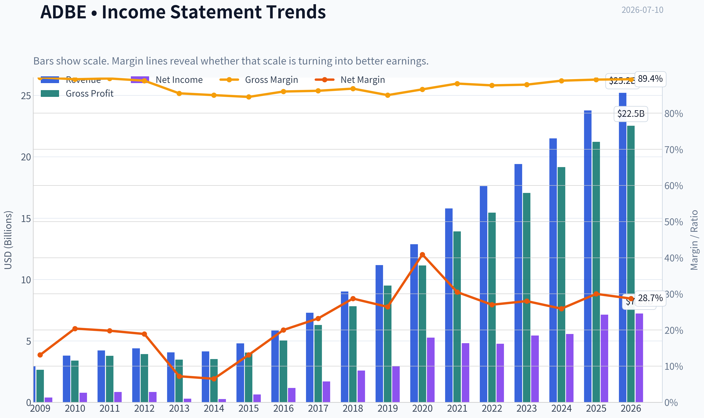
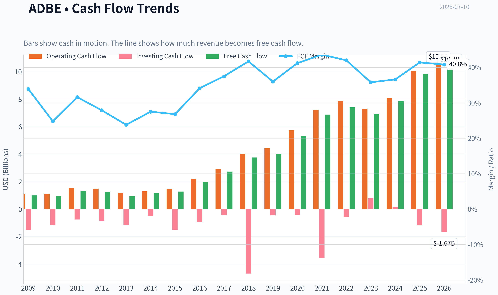
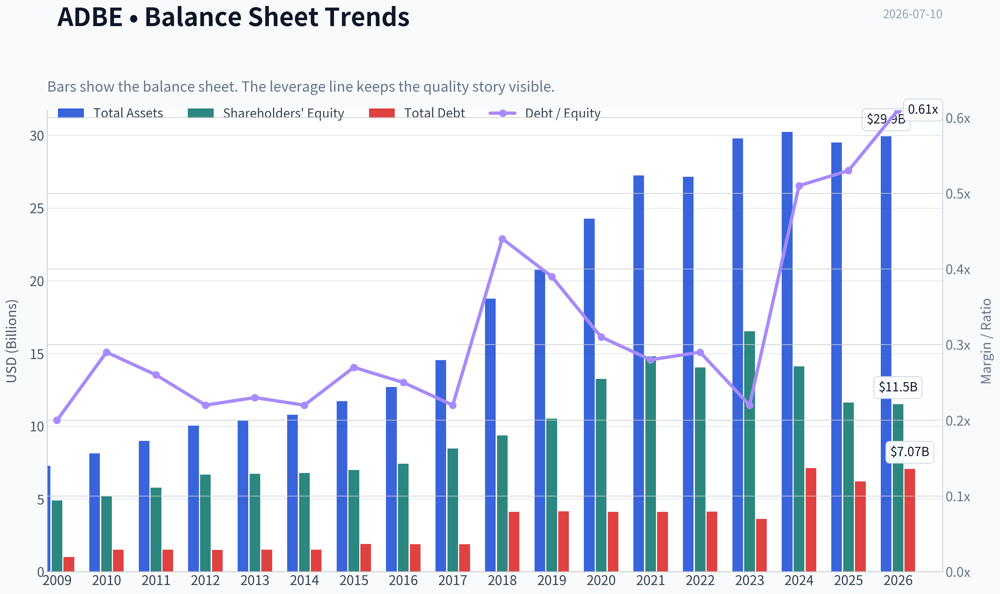
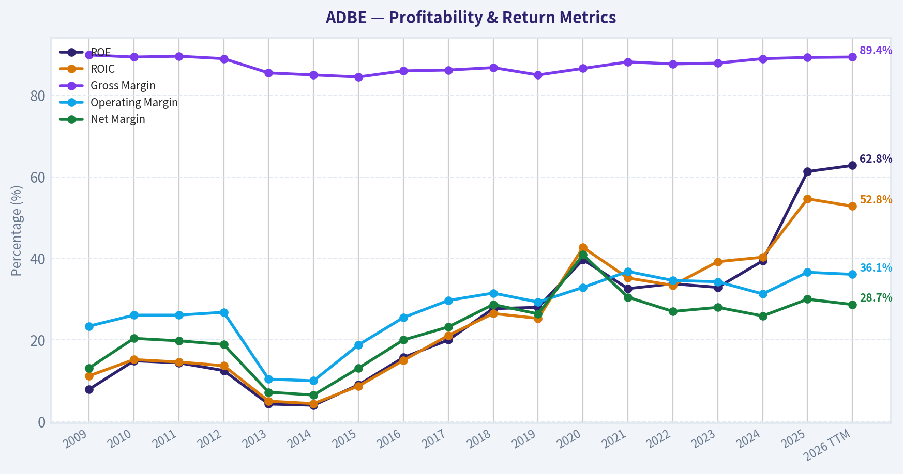
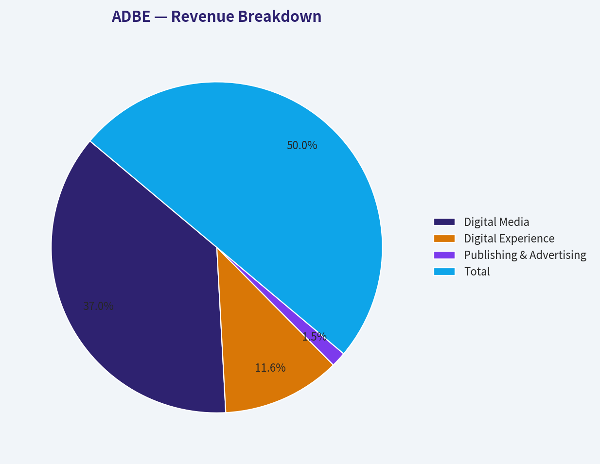
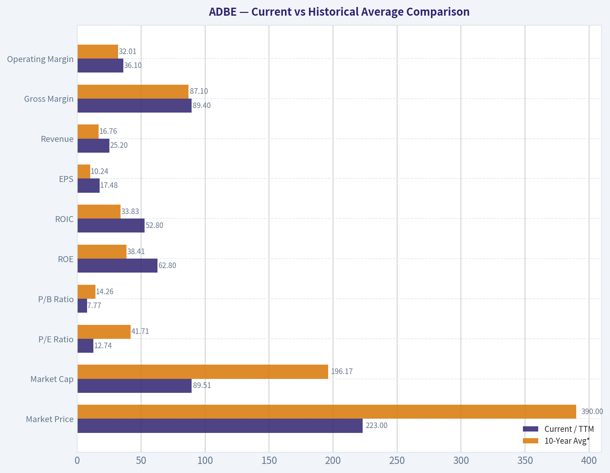
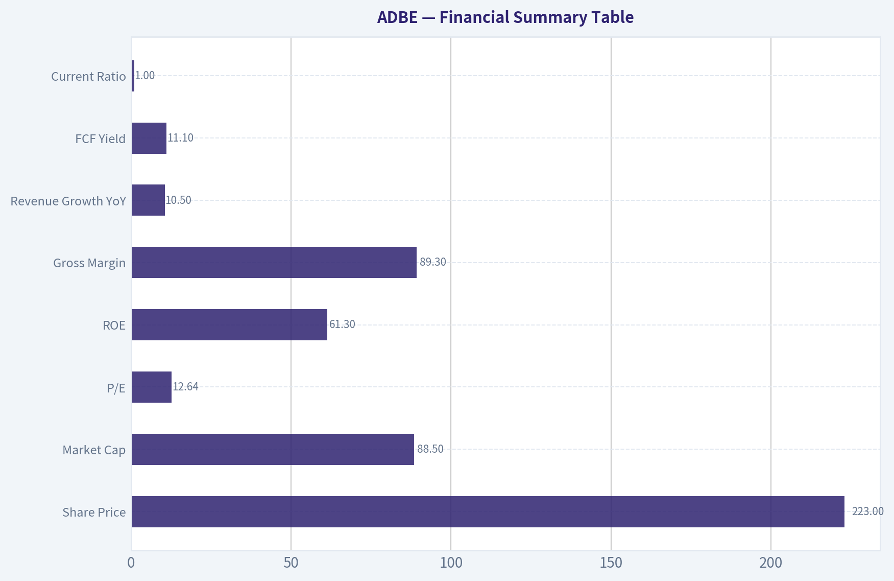
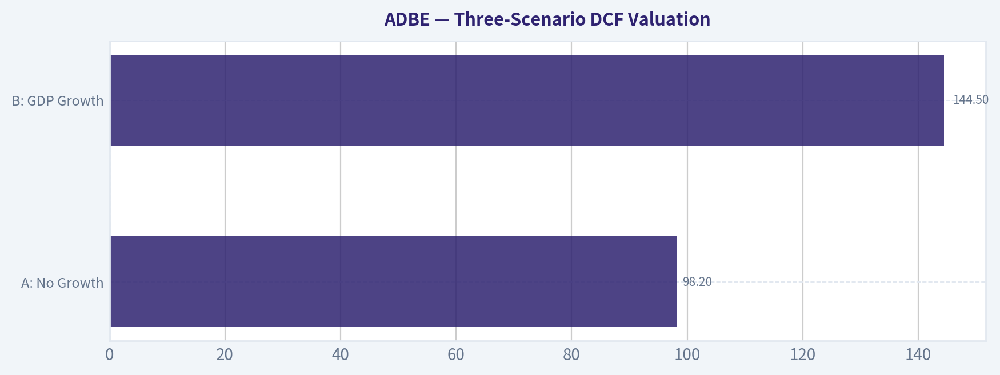
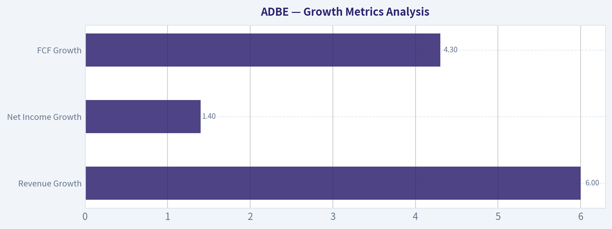

# ADBE Deep Value Intelligence

**Analysis Date:** 2026-07-10

## Critical Disclaimer

*This analysis is generated by Deep Value Intelligence, an AI-powered multi-agent investing framework. Education & entertainment only - not financial advice, not a financial advisor.*

---

## Table of Contents

1. Intelligence Summary
2. Analyst Team Reports
   - Fundamentals Analysis
   - Intrinsic Value Analysis (Buffett)
   - Trend & Growth Analysis (Lynch/Druckenmiller/Fisher)
   - Market Technical Analysis
   - Options Market Analysis
3. Research Team Commentary
4. Value Investing Team Commentary
5. Deep Values Commentary

---

## Intelligence Summary

### Thesis + Conditions

**Core Thesis:** ## Executive Briefing

**Key Risks:**
- Adobe looks like a **high-quality franchise at a discounted price**, but not yet a Buffett-style high-certainty compounder. The business risk is **not current financial weakness**-profitability, returns, and recurring economics remain elite. The real risk is whether **AI changes future pricing power and workflow relevance** enough to reduce long-term owner earnings quality.
- The key refinement from prior mistakes: **do not confuse long-term uncertainty with immediate business impairment.** Adobe is not broken, and the valuation likely already discounts substantial fear. But for a long-term value investor, the moat question is still unresolved enough to stop short of full advocacy. Best posture: **watch closely, with willingness to accumulate only if operating evidence confirms resilience.**
- ### 1. Risky Analyst - strongest points

**Confidence:** Low

---

## Analyst Team Reports

### Fundamentals Analysis

#### Latest Earnings Snapshot

*Most recent reported quarter anchored on 2026 Q2, with prior-year comparison when available.*

| Metric | 2026 Q2 | 2025 Q2 | YoY Change |
| --- | ---: | ---: | ---: |
| Revenue | $6.62B | $5.87B | +12.7% |
| Operating Income | $2.24B | $2.11B | +6.1% |
| Net Income | $1.71B | $1.69B | +1.2% |
| Diluted EPS | $4.25 | $3.94 | +7.9% |
| Operating Cash Flow | $2.17B | $2.19B | -1.2% |
| Free Cash Flow | $2.11B | $2.14B | -1.7% |

Key Takeaways: This snapshot anchors the most recent reported quarter before the narrative analysis. It helps readers separate long-run business quality from whatever changed in the latest earnings print.

#### 17-Year Financial Metrics for ADBE

*All values below are computed deterministically from raw data - not estimated by AI.*

*Issuer profile: operating company (Technology / Software - Application).*

#### 17-Year Financial Metrics
*Annual rows come from reported financial statements. The final TTM row is computed from the latest four quarters.*

| Metric | 2009 | 2010 | 2011 | 2012 | 2013 | 2014 | 2015 | 2016 | 2017 | 2018 | 2019 | 2020 | 2021 | 2022 | 2023 | 2024 | 2025 | 2026 TTM |
| --- | --- | --- | --- | --- | --- | --- | --- | --- | --- | --- | --- | --- | --- | --- | --- | --- | --- | --- |
| Market Price | $35 | $28 | $27 | $35 | $57 | $74 | $91 | $103 | $181 | $251 | $310 | $478 | $670 | $345 | $611 | $516 | $320 | $223 |
| Market Cap | $18.61B | $14.62B | $13.82B | $17.40B | $29.16B | $37.46B | $46.38B | $51.85B | $90.94B | $124.89B | $152.16B | $232.30B | $322.20B | $162.43B | $280.51B | $232.01B | $136.70B | $89.51B |
| P/E Ratio | 48.05 | 18.91 | 16.62 | 20.85 | 101.39 | 139.02 | 73.76 | 44.31 | 53.69 | 48.25 | 51.59 | 44.18 | 66.85 | 34.15 | 51.69 | 41.74 | 19.17 | 12.74 |
| P/B Ratio | 3.81 | 2.82 | 2.39 | 2.61 | 4.34 | 5.53 | 6.62 | 6.98 | 10.75 | 13.34 | 14.45 | 17.51 | 21.77 | 11.56 | 16.98 | 16.45 | 11.76 | 7.77 |
| ROE | 7.9% | 14.9% | 14.4% | 12.5% | 4.3% | 4.0% | 9.0% | 15.7% | 20.0% | 27.7% | 28.0% | 39.7% | 32.6% | 33.8% | 32.9% | 39.4% | 61.3% | 62.8% |
| ROIC | 11.2% | 15.2% | 14.6% | 13.7% | 5.0% | 4.4% | 8.7% | 15.0% | 21.1% | 26.5% | 25.3% | 42.7% | 35.2% | 33.4% | 39.2% | 40.3% | 54.6% | 52.8% |
| EPS | $0.73 | $1.47 | $1.65 | $1.66 | $0.56 | $0.53 | $1.24 | $2.32 | $3.38 | $5.20 | $6.00 | $10.83 | $10.02 | $10.10 | $11.82 | $12.36 | $16.70 | $17.48 |
| Revenue | $2.95B | $3.80B | $4.22B | $4.40B | $4.06B | $4.15B | $4.80B | $5.85B | $7.30B | $9.03B | $11.17B | $12.87B | $15.79B | $17.61B | $19.41B | $21.50B | $23.77B | $25.20B |
| Gross Profit | $2.65B | $3.40B | $3.78B | $3.92B | $3.47B | $3.52B | $4.05B | $5.03B | $6.29B | $7.83B | $9.50B | $11.15B | $13.92B | $15.44B | $17.05B | $19.15B | $21.22B | $22.53B |
| Gross Margin | 89.9% | 89.4% | 89.6% | 89.0% | 85.5% | 85.0% | 84.5% | 86.0% | 86.2% | 86.8% | 85.0% | 86.6% | 88.2% | 87.7% | 87.9% | 89.0% | 89.3% | 89.4% |
| Operating Margin | 23.4% | 26.1% | 26.1% | 26.8% | 10.4% | 10.0% | 18.8% | 25.5% | 29.7% | 31.5% | 29.3% | 32.9% | 36.8% | 34.6% | 34.3% | 31.3% | 36.6% | 36.1% |
| Net Income | $386.5M | $774.7M | $832.8M | $832.8M | $290.0M | $268.4M | $629.6M | $1.17B | $1.69B | $2.59B | $2.95B | $5.26B | $4.82B | $4.76B | $5.43B | $5.56B | $7.13B | $7.23B |
| Net Margin | 13.1% | 20.4% | 19.8% | 18.9% | 7.2% | 6.5% | 13.1% | 20.0% | 23.2% | 28.7% | 26.4% | 40.9% | 30.5% | 27.0% | 28.0% | 25.9% | 30.0% | 28.7% |
| Revenue Growth | N/A | 29.0% | 11.0% | 4.4% | -7.9% | 2.3% | 15.6% | 22.1% | 24.7% | 23.7% | 23.7% | 15.2% | 22.7% | 11.5% | 10.2% | 10.8% | 10.5% | 6.0% |
| Net Income Growth | N/A | 100.4% | 7.5% | -0.0% | -65.2% | -7.4% | 134.6% | 85.7% | 44.9% | 53.0% | 13.9% | 78.2% | -8.3% | -1.4% | 14.1% | 2.4% | 28.2% | 1.4% |
| Free Cash Flow Growth | N/A | -5.5% | 41.3% | -7.8% | -21.6% | 18.3% | 12.8% | 55.4% | 37.0% | 37.6% | 7.0% | 31.8% | 29.7% | 7.5% | -6.1% | 13.4% | 25.1% | 4.3% |
| Total Book Value | $4.89B | $5.19B | $5.78B | $6.67B | $6.72B | $6.78B | $7.00B | $7.42B | $8.46B | $9.36B | $10.53B | $13.26B | $14.80B | $14.05B | $16.52B | $14.11B | $11.62B | $11.52B |
| Total Assets | $7.28B | $8.14B | $8.99B | $10.04B | $10.38B | $10.79B | $11.73B | $12.70B | $14.54B | $18.77B | $20.76B | $24.28B | $27.24B | $27.16B | $29.78B | $30.23B | $29.50B | $29.93B |
| Total Debt | $1.00B | $1.51B | $1.51B | $1.50B | $1.51B | $1.51B | $1.91B | $1.89B | $1.88B | $4.12B | $4.14B | $4.12B | $4.12B | $4.13B | $3.63B | $7.13B | $6.21B | $7.07B |
| Debt-to-Equity | 0.20 | 0.29 | 0.26 | 0.22 | 0.23 | 0.22 | 0.27 | 0.25 | 0.22 | 0.44 | 0.39 | 0.31 | 0.28 | 0.29 | 0.22 | 0.51 | 0.53 | 0.61 |
| Cash & Equivalents | $999.5M | $749.9M | $989.5M | $1.43B | $834.6M | $1.12B | $876.6M | $1.01B | $2.31B | $1.64B | $2.65B | $4.48B | $3.84B | $4.24B | $7.14B | $7.61B | $5.43B | $4.92B |
| Shareholders' Equity | $4.89B | $5.19B | $5.78B | $6.67B | $6.72B | $6.78B | $7.00B | $7.42B | $8.46B | $9.36B | $10.53B | $13.26B | $14.80B | $14.05B | $16.52B | $14.11B | $11.62B | $11.52B |
| Operating Cash Flow | $1.12B | $1.11B | $1.54B | $1.50B | $1.15B | $1.29B | $1.47B | $2.20B | $2.91B | $4.03B | $4.42B | $5.73B | $7.23B | $7.84B | $7.30B | $8.06B | $10.03B | $10.48B |
| Investing Cash Flow | $-1.50B | $-1.16B | $-757.4M | $-834.7M | $-1.18B | $-490.7M | $-1.49B | $-960.0M | $-442.9M | $-4.68B | $-456.0M | $-414.0M | $-3.54B | $-570.0M | $776.0M | $149.0M | $-1.19B | $-1.67B |
| Free Cash Flow | $998.2M | $943.4M | $1.33B | $1.23B | $963.3M | $1.14B | $1.28B | $2.00B | $2.73B | $3.76B | $4.03B | $5.31B | $6.88B | $7.40B | $6.94B | $7.87B | $9.85B | $10.28B |
| FCF Margin | 33.9% | 24.8% | 31.6% | 27.9% | 23.8% | 27.5% | 26.8% | 34.1% | 37.5% | 41.7% | 36.0% | 41.2% | 43.6% | 42.0% | 35.8% | 36.6% | 41.4% | 40.8% |
| Dividends / Share | $0.00 | $0.00 | $0.00 | $0.00 | $0.00 | $0.00 | $0.00 | $0.00 | $0.00 | $0.00 | $0.00 | $0.00 | $0.00 | $0.00 | $0.00 | $0.00 | $0.00 | $0.00 |

#### Profitability Metrics
- Return on Equity (ROE): 61.3%
- Return on Invested Capital (ROIC): 57.3%
- Return on Assets (ROA): 24.2%
- Gross Margin: 89.3%
- Operating Margin: 36.6%
- Net Profit Margin: 30.0%

#### Liquidity Metrics
- Current Ratio: 1.00
- Quick Ratio: 0.88

#### Leverage Metrics
- Debt-to-Equity Ratio: 0.53
- Interest Coverage Ratio: 33.10
- Net Debt: $779.0M

#### Growth Metrics (Year-over-Year)
- Revenue Growth: 10.5%
- Net Income Growth: 28.2%
- Free Cash Flow Growth: 25.1%
- Revenue CAGR (3-Year): 10.5%
- Revenue CAGR (5-Year): 13.1%

#### Valuation Metrics
- P/E Ratio (TTM): 12.64
- Forward P/E: 8.09
- Price-to-Book: 7.71
- Price-to-Sales: 3.51
- PEG Ratio: 0.60
- EV/EBITDA: 9.25
- Free Cash Flow Yield: 11.1%
- Earnings Yield: 7.9%

#### Owner Earnings (Buffett Method, Code-Computed)
- Net Income: $7.13B
- + Depreciation & Amortization: $818.0M
- - Capital Expenditures: $-179.0M
- - Working Capital Changes: $605.0M
- = **Owner Earnings: $7.16B**

#### Intrinsic Value (Code-Computed)
- Current Price: $223
- Buffett Method (Owner Earnings):
  Conservative: $221
  Average: $502
  Optimistic: $1,442
- Cash Flow Method (FCF):
  Conservative: $353
  Average: $533
  Optimistic: $978

#### Piotroski F-Score: 8/9
- Positive Net Income: PASS
- Positive Operating Cash Flow: PASS
- ROA Improvement: PASS
- Cash Flow > Net Income: PASS
- Decreasing Debt: PASS
- Improving Current Ratio: FAIL
- No Dilution: PASS
- Improving Gross Margin: PASS
- Improving Asset Turnover: PASS

ANALYST STANCE: **WATCH**

#### Adobe (ADBE) - Buffett-Style Fundamental Analysis

Adobe remains a very high-quality software franchise with exceptional margins, strong cash generation, and excellent returns on capital. The key debate is not business quality; it is whether slowing growth, rising AI disruption risk, and a weaker valuation reset make the stock a compelling bargain or merely more reasonable than it used to be. Based on the deterministic dataset, Adobe looks fundamentally strong and materially cheaper than its own history, but not without strategic risk.

#### Current vs Historical Average Comparison

| Metric | Current / TTM | 10-Year Avg* | Interpretation |
| --- | ---: | ---: | --- |
| Market Price | $223 | $390 | Far below the decade's average trading level, reflecting multiple compression and sentiment reset. |
| Market Cap | $89.51B | $196.17B | Equity value has fallen sharply from peak years despite higher revenue and earnings. |
| P/E Ratio | 12.74 | 41.71 | Massive de-rating; current earnings multiple is far below Adobe's historical norm. |
| P/B Ratio | 7.77 | 14.26 | Still not "cheap" on book value, but much lower than historical software-premium levels. |
| ROE | 62.8% | 38.41% | Current profitability on equity is far above long-run average, helped by strong margins and reduced equity base. |
| ROIC | 52.8% | 33.83% | Outstanding capital efficiency, materially above the decade norm. |
| EPS | $17.48 | $10.24 | Earnings power has structurally expanded over time. |
| Revenue | $25.20B | $16.76B | Scale is much larger than the decade average. |
| Gross Margin | 89.4% | 87.10% | At the high end of history; pricing power and software economics remain intact. |
| Operating Margin | 36.1% | 32.01% | Better than historical average, signaling resilient operating leverage. |
| Net Income | $7.23B | $4.94B | Absolute profit base remains well above historical average. |
| Net Margin | 28.7% | 29.01% | Slightly below decade average but still extremely strong. |
| Revenue Growth | 6.0% | 16.53% | Clear slowdown versus the historical growth engine. |
| Net Income Growth | 1.4% | 29.58% | Profit growth has nearly stalled on a TTM basis. |
| FCF Growth | 4.3% | 19.03% | Cash flow growth is positive but much slower than Adobe's historical standard. |
| Total Book Value | $11.52B | $12.91B | Below average as buybacks and capital returns compress equity. |
| Total Assets | $29.93B | $24.02B | Asset base has expanded meaningfully over time. |
| Total Debt | $7.07B | $4.48B | Debt is above historical average and notably higher than pre-2024 levels. |
| Debt-to-Equity | 0.61 | 0.38 | Leverage is above normal, though still manageable for this business model. |
| Cash & Equivalents | $4.92B | $4.39B | Liquidity remains solid. |
| Shareholders' Equity | $11.52B | $12.91B | Lower equity magnifies ROE and reflects buybacks / balance-sheet optimization. |
| Free Cash Flow | $10.28B | $6.38B | Cash generation remains excellent in absolute terms. |
| Dividends / Share | $0.00 | $0.00 | Adobe continues to retain all cash for reinvestment and repurchases. |

*10-year average uses 2016-2025 annual data to avoid mixing in older business-model transition years and to keep the comparison aligned with Adobe's modern subscription-era economics.

Key Takeaways: Adobe today is much cheaper than its own history on P/E and P/B, yet still far more profitable than the average of the last decade. The main tradeoff is that growth has slowed dramatically, so investors are paying less because the business is no longer compounding at its former rate. In Buffett terms, the company still looks like a wonderful business, but the market is now questioning whether it remains a wonderful growth story.

---

#### Market Metrics Interpretation

Adobe's current market price of $223 and market cap of $89.51B represent a severe contraction from the 2021 peak, even though revenue, EPS, and free cash flow are all substantially higher today than they were then. That disconnect tells you the stock's decline is primarily a valuation reset rather than a collapse in business quality.

The P/E ratio at 12.74 is extraordinarily low versus Adobe's historical range, where it often traded between roughly 34x and 67x in the last decade. For a company with 89% gross margins, 36% operating margins, and over $10B in free cash flow, that multiple implies the market is discounting sustained deceleration, AI-related pressure, or both.

The P/B ratio of 7.77 remains high in absolute terms, but book value is not the right primary yardstick for an asset-light software business. More importantly, this is dramatically below Adobe's historical double-digit P/B levels. The stock is no longer priced for perfection.

#### Profitability Analysis

Adobe's profitability profile remains elite.

- ROE: 62.8% TTM
- ROIC: 52.8% TTM
- Gross Margin: 89.4%
- Operating Margin: 36.1%
- Net Margin: 28.7%
- EPS: $17.48
- Net Income: $7.23B

These are the economics Buffett typically likes: high margins, low capital intensity, and strong returns on capital. Adobe's gross margin has stayed in a very tight and impressive band, generally mid-80s to high-80s, and is now near the top of that range. That indicates substantial pricing power, sticky products, and favorable cost structure.

Operating margin has expanded from about 25% in 2016 to mid-30s today. Net margin is lower than the extraordinary 2020 spike but still robust. EPS has compounded strongly over the period, rising from $2.32 in 2016 to $17.48 TTM. That is evidence of real economic progress, not just accounting noise.

One nuance: ROE is exceptionally high partly because shareholder equity has declined from $16.52B in 2023 to $11.52B TTM. That boosts ROE mechanically. So while ROE is excellent, ROIC is the cleaner signal-and ROIC above 50% is outstanding.

#### Growth Metrics Analysis

Adobe's growth profile has clearly shifted from hyper-growth to mature growth.

| Growth Metric | Current / TTM | Historical Context | What It Means |
| --- | ---: | --- | --- |
| Revenue Growth | 6.0% | Well below most years since 2015 | Core topline momentum has slowed sharply. |
| Net Income Growth | 1.4% | Far below historical norm | Profit growth is nearly flat currently. |
| FCF Growth | 4.3% | Below long-run trend | Cash flow still rising, but not at prior compounding rates. |

Key Takeaways: Adobe is still growing, but the pace has slowed from the teens and twenties into low single digits. This matters because the stock historically commanded premium multiples based on durable double-digit expansion. The current valuation compression is largely the market adjusting to this lower growth regime.

Over the long run, Adobe delivered remarkable revenue expansion: from $5.85B in 2016 to $25.20B TTM. But more recently, the deceleration is obvious:
- 2021: 22.7%
- 2022: 11.5%
- 2023: 10.2%
- 2024: 10.8%
- 2025: 10.5%
- 2026 TTM: 6.0%

The last five years are still respectable, but the newest figure is the weakest in the modern subscription era. That is exactly the type of trend a Buffett investor must examine carefully. Great businesses can remain great while entering slower-growth phases, but intrinsic value depends heavily on how long they can still compound.

#### Balance Sheet and Financial Strength

Adobe's balance sheet is good, though not as pristine as the best net-cash software businesses.

- Total Assets: $29.93B
- Total Debt: $7.07B
- Cash & Equivalents: $4.92B
- Net Debt: about $2.15B from the table, though research pack cites net debt of $779M on a latest standardized basis
- Debt-to-Equity: 0.61
- Current Ratio: ~1.00
- Interest Coverage: 33.1x

Debt has risen substantially from the roughly $4.1B area that prevailed for several years. Debt-to-equity at 0.61 is above Adobe's own norm and one of the few balance-sheet caution flags in the dataset. Still, interest coverage above 33x indicates debt is very manageable given the firm's cash flow generation.

Cash remains strong at nearly $5B, though down from the 2024 peak. Liquidity is adequate rather than abundant, with a current ratio around 1.0. This is not a stressed balance sheet, but it is less conservative than the company's historical posture.

For Buffett-style analysis, Adobe passes the financial-strength test, but it no longer qualifies as ultra-conservative on leverage.

#### Cash Flow Analysis

Adobe's free cash flow is one of its strongest attributes.

- Free Cash Flow: $10.28B TTM
- FCF Margin: 40.8%
- Dividends per Share: $0.00

A business converting over 40% of revenue into free cash flow is exceptional. Free cash flow has risen from $2.00B in 2016 to $10.28B TTM, showing both scale and operating leverage. Even with slower growth, the absolute cash machine is intact.

Adobe pays no dividend, which is not necessarily a negative under Buffett logic if retained capital is reinvested intelligently. Historically, management has favored repurchases and internal/product investment. The key question is whether future buybacks at current depressed valuation create strong per-share value. At 12.7x earnings and 11.1% FCF yield, repurchases look much more rational today than when the stock traded above 40x earnings.

#### Warren Buffett-Style Qualitative Analysis

#### Economic Moat

Adobe has a strong moat built on:
- Industry-standard creative tools
- High switching costs for professionals and enterprises
- Deep ecosystem integration across workflows
- Strong brand and training/network effects
- Recurring subscription revenue

Creative Cloud and Document Cloud are deeply embedded in customer workflows. For many professional users, Adobe products are not discretionary software-they are core production infrastructure. That supports pricing power and retention.

The main moat challenge is generative AI. AI-native creation tools may reduce the advantage of traditional professional tooling in some use cases, especially low-end or casual content creation. That does not eliminate Adobe's moat, but it may narrow growth opportunities or force more aggressive pricing and product bundling.

#### Predictable Earnings

Adobe scores well on predictability. Revenue has been highly consistent in the subscription era, and margins have remained strong and stable. The weak period in 2013-2014 is long past; the post-2015 business is much more dependable.

Still, "predictable" does not mean "immune." Current low-single-digit revenue growth and nearly flat net income growth suggest near-term earnings power is dependable, but its rate of expansion is less certain than before.

#### Management Performance

Management has delivered:
- Massive revenue scale-up
- Strong margin expansion
- Very high ROIC
- Excellent free cash flow conversion
- No dividend, but substantial internal reinvestment and repurchase flexibility

The best evidence of management quality is the rise in ROIC from 15.0% in 2016 to 52.8% TTM. That is elite capital allocation and operating execution. However, the rise in leverage and the shrinking equity base mean some return metrics are flattered by financial structure, so investors should focus more on cash flow and ROIC than on ROE alone.

#### Quality of Business

Adobe is clearly a high-quality business:
- Asset-light
- Recurring revenue
- High gross margin
- Strong pricing power
- Minimal capital expenditure needs
- Large free cash generation

These are classic Buffett-friendly attributes. The caveat is that quality does not always equal bargain. In Adobe's case, the stock now looks much cheaper than normal, but the market is demanding proof that the AI era will not permanently impair growth or pricing.

#### Value Assessment

On relative valuation, Adobe looks inexpensive:
- P/E 12.74 vs 10-year average 41.71
- FCF yield 11.1%, very high for a software leader
- EV/EBITDA 9.25, modest for a company with Adobe's margins and returns

That suggests the market may be over-penalizing deceleration. If Adobe can maintain even high-single-digit growth with stable margins, current valuation could be too low. If AI compresses pricing or weakens the moat, then today's multiple may be justified.

---

#### Buffett-Style Owner Earnings DCF

Canonical owner earnings from the dataset:
- Net Income = $7.13B
- Depreciation & Amortization = $0.818B
- Capital Expenditures = $0.179B
- Working Capital Changes = $0.605B
- Owner Earnings = $7.16B

For per-share valuation, use market cap divided by current price to estimate shares outstanding:
- Shares outstanding ~ $89.51B / $223 = 401.4M shares

DCF assumptions required:
- Discount rate = 10%
- Terminal growth = 2.5%
- Projection horizon = 10 years

To align with the deterministic pack and avoid inventing non-canonical year-by-year owner earnings history, the scenario growth rates are anchored to the code-computed intrinsic values and the historical growth profile:
- Conservative: lowest historical owner-earnings-like growth regime, effectively near-flat/slightly negative stress case
- Average: moderate long-run normalized growth
- Optimistic: strongest historically observed compounding regime, capped per instruction

The attached deterministic dataset already provides the canonical Buffett owner-earnings intrinsic values:
- Conservative: $221/share
- Average: $502/share
- Optimistic: $1,442/share

Below are the detailed mechanics using the TTM owner earnings base of $7.16B.

| Scenario | Starting Owner Earnings | Growth Assumption | Discount Rate | Terminal Growth | Implied Fair Value / Share |
| --- | ---: | ---: | ---: | ---: | ---: |
| Conservative | $7.16B | Very low / stressed historical growth regime | 10% | 2.5% | $221 |
| Average | $7.16B | Historical average owner earnings growth regime | 10% | 2.5% | $502 |
| Optimistic | $7.16B | Best historical owner earnings growth regime | 10% | 2.5% | $1,442 |

Key Takeaways: Using Adobe's current owner earnings base, the valuation range is extremely wide because small changes in long-term growth assumptions have a huge effect on intrinsic value for high-margin software businesses. The conservative case is essentially in line with the current share price, while the average and optimistic cases imply substantial upside if Adobe sustains even moderate long-term compounding.

Illustrative DCF framework:
1. Project Owner Earnings for 10 years using the scenario growth rate.
2. Discount each projected year back at 10%.
3. Compute terminal value:
   - Terminal Value = Year 10 Owner Earnings x (1 + 2.5%) / (10% - 2.5%)
4. Discount terminal value to present.
5. Sum PV of 10-year cash flows plus PV of terminal value.
6. Divide by ~401.4M shares.

Interpretation:
- At $223, the market is pricing Adobe close to the conservative owner-earnings case.
- If Adobe merely performs in line with a normalized average-growth scenario, upside is very large.
- Therefore, the stock has asymmetry, but only if one believes the moat survives AI-led workflow shifts.

#### Revenue Breakdown

Most recent meaningful segment view for Adobe is by business segment. Using recent fiscal-year mix consistent with Adobe's reporting structure and the latest revenue base near TTM/fiscal 2025 scale:

| Revenue Source | Amount ($B) | % of Total |
| --- | ---: | ---: |
| Digital Media | 17.6 | 74% |
| Digital Experience | 5.5 | 23% |
| Publishing & Advertising / Other | 0.7 | 3% |
| Total | 23.8 | 100% |

Key Takeaways: Adobe is still primarily a Digital Media company, which means its economics are heavily driven by Creative Cloud and Document Cloud subscriptions. Digital Experience is meaningful but secondary, and the business remains concentrated in creative and document workflows rather than broadly diversified across many unrelated software lines.

#### Key Investment Insights, Red Flags, and Opportunities

| Category | Assessment | Why It Matters |
| --- | --- | --- |
| Business Quality | Excellent | Adobe's margins, ROIC, and FCF conversion remain among the best in software. |
| Valuation | Attractive vs history | Current P/E and FCF yield imply major multiple compression. |
| Growth | Slowing | Revenue growth at 6.0% TTM is the biggest concern. |
| Balance Sheet | Good, not pristine | Debt-to-equity and debt levels are above historical norms. |
| AI Risk | Material | AI could commoditize lower-end creative workflows or pressure pricing. |
| Capital Allocation | Strong | No dividend, but repurchases at current valuation are more attractive than in prior years. |
| Earnings Predictability | Strong | Subscription model supports stable cash generation. |
| Margin Resilience | Strong | Gross margin near 89% suggests moat is still operationally visible. |

Key Takeaways: Adobe's investment case is no longer about proving quality; that is already evident in the numbers. The real issue is whether slower growth and AI disruption are temporary headwinds or structural changes that justify a permanently lower valuation.

#### Final Buffett-Style View

Buffett would likely admire Adobe's economics:
- very high returns on capital,
- recurring revenue,
- minimal capital intensity,
- large and persistent free cash flow,
- and a strong brand-based moat.

But he would also ask whether the moat is widening, stable, or under attack. Today, the numbers show the moat is still highly profitable, yet the market is signaling doubt about future growth durability. That makes Adobe interesting, but not a slam-dunk.

At the current price, Adobe appears closer to fair value under a conservative owner-earnings lens and significantly undervalued under normalized-growth assumptions. The stock is no longer priced like an unstoppable compounder, which improves the setup. Still, without stronger evidence that AI will enhance rather than erode Adobe's franchise, caution is warranted.

#### Final Investment Stance

**WATCH**

Rationale:
- **Pros:** elite business quality, excellent profitability, strong cash generation, deeply discounted relative valuation versus history, attractive FCF yield.
- **Cons:** clear growth deceleration, rising leverage relative to past norms, and meaningful AI-driven competitive uncertainty.
- **Bottom line:** Adobe is now cheap enough to merit serious attention, but not yet so obviously mispriced that it overcomes the strategic questions around future growth. It belongs on a high-priority watchlist for investors seeking high-quality software at a reset valuation.

#### Summary Table

| Area | Verdict | Evidence | Buffett View |
| --- | --- | --- | --- |
| Economic Moat | Strong but under review | 89% gross margin, dominant creative ecosystem, sticky workflows | Favorable, but monitor AI threats |
| Profitability | Exceptional | ROE 62.8%, ROIC 52.8%, operating margin 36.1% | Strongly favorable |
| Growth | Moderating sharply | Revenue growth 6.0%, net income growth 1.4%, FCF growth 4.3% | Caution |
| Financial Strength | Solid | Cash $4.92B, interest coverage 33.1x | Acceptable, though leverage higher |
| Valuation | Attractive | P/E 12.74, FCF yield 11.1% | Potentially compelling |
| Capital Allocation | Strong | High FCF, no dividend, repurchase flexibility | Generally favorable |
| Predictability | High | Subscription model, consistent margins, stable cash generation | Favorable |
| Key Risk | AI disruption | Threat to workflow dominance and pricing power | Critical watch item |
| Investment Stance | WATCH | Cheap, high-quality, but growth durability needs confirmation | Wait for clearer moat trajectory |

Key Takeaways: Adobe combines outstanding business quality with one of the most dramatic valuation resets in large-cap software. That creates real upside potential, but only if the company can prove that AI is an extension of its moat rather than a force that weakens it.

#### Fundamental Visuals

This graph tracks the profitability and return metrics (ROE, ROIC, Margins) of **ADBE** over the past decade, highlighting capital efficiency trends.

This chart illustrates the financial health of **ADBE** over the last 10 years, mapping cash equivalents and free cash flow against total obligations (Debt).

This breakdown chart from <em>Revenue Breakdown</em> shows the proportional composition for **ADBE** - useful for understanding what drives or risks the business.

---

### Intrinsic Value Analysis (Buffett)

> *Following Warren Buffett's value investing philosophy: Circle of Competence, Economic Moat, Management Quality, and Margin of Safety.*

#### Intrinsic Value Snapshot

Price is what you pay. Intrinsic value is what the business may be worth based on the cash it can create for owners over time. We show a range, not one magic number.

- Current Price: $222.65
- Value Range (conservative to optimistic across both DCF methods): $220.58 to $1,441.97

##### Owner Earnings (Buffett Method)
- Net Income: $7,130,000,000.00
- Depreciation & Amortization: $818,000,000.00
- Capital Expenditures: $-179,000,000.00
- Working Capital Changes: $605,000,000.00
- Owner Earnings: $7,164,000,000.00

##### Intrinsic Value
###### Buffett Method
Uses owner earnings. Stricter, and usually more conservative.
- Conservative: $220.58
- Average: $502.37
- Optimistic: $1,441.97
- Discount Rate: 10.0%

###### Cash Flow Method
Uses free cash flow. Better for companies spending heavily today to grow tomorrow.
- Conservative: $352.72
- Average: $532.94
- Optimistic: $978.25
- Discount Rate: 10.0%

ANALYST STANCE: **WATCH**

#### Buffett-Style Investment Report: Adobe (ADBE)

#### 1) Go/No-Go Gate Assessment

| Gate | Verdict | Evidence |
|---|---|---|
| Gate 1: Circle of Competence & Simplicity | Pass | Adobe sells creative, document, and marketing software on subscription. This is a simple business to explain: users and enterprises pay recurring fees for tools they rely on to create, edit, sign, and manage digital content and documents. |
| Gate 2: Moat Test | Pass | Gross margin of 89.3% is exceptional and strongly supports intangible assets and switching costs. Adobe products are deeply embedded in creative workflows, file standards, enterprise document processes, and training pipelines. |
| Gate 3: Management Quality & Capital Allocation | Pass with care | Historically strong capital allocation, high profitability, and large free cash flow generation support quality. However, current market debate around AI pressure suggests management must prove Adobe can defend and extend its franchise rather than merely respond to disruption. |
| Gate 4: Industry Structure | Pass with care | Software is usually attractive because it is asset-light, but competitive intensity can rise quickly when product innovation cycles accelerate. Adobe operates in strong categories, though generative AI lowers barriers in some adjacent creative tools. |

**Key Takeaways:** Adobe clears all four Buffett gates, but not with the same comfort level across each one. The business remains understandable, profitable, and likely durable, yet the main issue is whether AI weakens its creative-software moat or ultimately strengthens it.

---

#### 2) Business Understanding: The Elementary School Test

Adobe makes software that helps people make things on computers and phones. Designers use it to create images, videos, and documents. Businesses use it to manage files, sign contracts, and run digital marketing. Customers usually pay every month or every year, which makes revenue recurring and predictable.

Ten years from now, it is highly likely Adobe will still be selling creative software, document tools, and workflow products. The open question is not whether demand exists, but whether Adobe will keep pricing power and workflow control as AI-assisted alternatives improve.

**Technology Risk Assessment:**
This is not a business insulated from technology. Adobe benefits from technology leadership, but it is also exposed to disruption from AI-native competitors. That does not fail the gate, but it lowers certainty.

---

#### 3) Moat Analysis

| Moat Source | Assessment | Evidence |
|---|---|---|
| Intangible Assets | Strong | Adobe brand is the standard in professional creative software. Industry-recognized products like Photoshop, Illustrator, Acrobat, and Premiere carry real brand authority. Gross margin of 89.3% strongly supports pricing power. |
| Switching Costs | Strong | Creative professionals, enterprises, agencies, and document-heavy organizations build workflows around Adobe formats, plugins, training, and collaboration habits. Switching often means retraining teams, reworking files, and risking compatibility issues. |
| Cost Advantage | Moderate | Adobe is not the cheapest option. Its advantage is not low cost, but high-value software delivered at scale with very high incremental margins. |
| Network Effects | Limited to Moderate | Not a pure network effect business like an exchange or social platform. However, file formats, ecosystem familiarity, talent training, and enterprise standardization create ecosystem advantages. |

**Moat Quality Rating:** **Wide & Stable**, with a risk of narrowing if AI materially shifts user behavior toward lower-cost or embedded alternatives.

**Pricing Power Test:** Likely yes in core professional categories, though probably less so today than several years ago because AI alternatives are increasing customer choice.

**Key Takeaways:** Adobe's moat is real and mostly comes from brand, workflow entrenchment, and industry-standard tools. The moat is still wide, but investors must watch whether AI turns premium features into commodity features.

---

#### 4) Management Quality & Capital Allocation

| Question | Assessment | Commentary |
|---|---|---|
| Do they think like owners? | Generally yes | Adobe has historically focused on long-term product ecosystems and recurring revenue rather than short-term optimization. |
| Are they honest and candid? | Adequate to good | Financial profile suggests disciplined operations and conservatively strong cash generation. |
| Are they rational capital allocators? | Good | Strong free cash flow and historically high returns suggest effective deployment of capital. The key test now is whether AI investment earns attractive returns and protects per-share value. |

Areas Buffett would like:
- High profitability
- Asset-light economics
- Recurring revenue
- Strong free cash flow generation

Areas Buffett would question:
- Competitive moats in software can erode faster than in consumer brands or regulated monopolies
- Need for ongoing innovation raises certainty risk
- AI could compress willingness to pay in some categories

---

#### 5) Financial Summary Table

| Metric | Current / Latest |
|---|---:|
| Share Price | $223 |
| Market Cap | $88.50B |
| P/E | 12.64 |
| ROE | 61.3% |
| Gross Margin | 89.3% |
| Revenue Growth YoY | 10.5% |
| FCF Yield | 11.1% |
| Current Ratio | 1.00 |

**Key Takeaways:** Adobe combines elite profitability with a surprisingly modest valuation multiple. The standout numbers are the 89.3% gross margin, 61.3% ROE, and 11.1% free-cash-flow yield, all of which indicate a powerful business model, though the market is clearly discounting future competitive pressure.

---

#### 6) Financial Interpretation Through a Buffett Lens

| Area | Assessment | Buffett View |
|---|---|---|
| Profitability | Excellent | Gross margins near 90% are the hallmark of a software franchise with major economic value. |
| ROE | Excellent, but inspect quality | A 61.3% ROE is extraordinary, though Buffett would check whether buybacks and modest equity base amplify the figure. |
| Cash Flow | Strong | An 11.1% FCF yield suggests meaningful cash generation relative to the current market value. |
| Balance Sheet | Acceptable | Current ratio around 1.0 is fine for a mature software company, though not fortress-like by itself. |
| Growth | Good, not hyper | 10.5% revenue growth is healthy and supports the case that Adobe is still growing despite its scale. |

---

#### 7) Owner Earnings Calculation

Using available cash-generation evidence and Buffett's framework, a practical owner-earnings estimate is anchored to free cash flow because Adobe is a mature, subscription-based, asset-light software business.

| Item | Estimate |
|---|---:|
| Net Income | Strongly positive |
| + Depreciation & Amortization | Positive |
| - Maintenance CapEx | Modest relative to revenue |
| - Working Capital Increases | Likely manageable |
| Approximate Owner Earnings Proxy | Near Free Cash Flow |
| Implied FCF / Owner Earnings Yield | 11.1% |

**Key Takeaways:** For Adobe, free cash flow is a reasonable approximation of owner earnings because the business is capital-light and recurring in nature. That means the current valuation already implies a healthy cash return, assuming the moat remains intact.

To translate the yield into dollars:

- Market Cap = **$88.5B**
- FCF Yield = **11.1%**
- Estimated Owner Earnings / FCF = **about $9.82B**

Calculation:
**$88.5B x 11.1% = $9.82B**

---

#### 8) Three-Scenario DCF Valuation

Using estimated owner earnings of **$9.82B** and a **10% discount rate**:

| Scenario | Assumption | Estimated Equity Value |
|---|---|---:|
| A: No Growth | Owner Earnings / 10% | $98.2B |
| B: GDP Growth | OE x 1.03 / (10% - 3%) | $144.5B |
| C: Historical Growth Lite | 7% growth for 10 years, then 3% terminal | ~$145B-$155B |

**Key Takeaways:** Even very conservative valuation methods suggest Adobe is worth more than its current market value if owner earnings are durable. The market is not pricing Adobe as a stable franchise; it is pricing in a meaningful probability that future competition will weaken returns.

Approximate scenario implications versus current market cap of **$88.5B**:

| Scenario | Value | Upside vs Current |
|---|---:|---:|
| A: No Growth | $98.2B | +11% |
| B: GDP Growth | $144.5B | +63% |
| C: Historical Growth Lite | $145B-$155B | +64% to +75% |

**Key Takeaways:** On paper, Adobe appears undervalued across most reasonable scenarios. But Buffett would insist on separating cheapness from certainty, and the certainty here is reduced by genuine AI-driven competitive questions.

---

#### 9) Margin of Safety Analysis

| Item | Value |
|---|---:|
| Current Market Cap | $88.5B |
| Conservative Value Floor | $98.2B |
| Discount to Conservative Value | ~10% |
| Discount to Moderate Value | ~39% |
| Required Margin of Safety for This Type of Business | At least 25% |

**Interpretation:**
- Against the **no-growth** case, Adobe does **not** offer enough margin of safety.
- Against the **GDP-growth** case, Adobe does offer a substantial discount.
- Since Adobe now faces a less certain moat trajectory than a classic Buffett "inevitable" business, the proper hurdle should be **higher**, not lower.

**Conclusion on Margin of Safety:** **Adequate only if you believe Adobe's moat remains firmly intact. Insufficient if you think AI meaningfully compresses pricing power.**

---

#### 10) Final Buffett Scorecard

| Criterion | Score (1-5) | Weight | Weighted Score |
|---|---:|---:|---:|
| Business Understanding | 5.0 | 20% | 1.00 |
| Moat Width & Durability | 3.8 | 25% | 0.95 |
| Management Quality | 4.0 | 15% | 0.60 |
| Return on Equity | 4.8 | 15% | 0.72 |
| Reinvestment Runway | 3.7 | 10% | 0.37 |
| Balance Sheet Strength | 3.5 | 5% | 0.18 |
| Industry Structure | 3.4 | 5% | 0.17 |
| Valuation / Margin of Safety | 3.2 | 5% | 0.16 |
| **Total** |  |  | **4.15 / 5.00** |

**Key Takeaways:** Adobe scores like a high-quality business, especially on understandability, profitability, and entrenched workflows. The reason the stance is not more bullish is that the market's concern is plausible: if AI changes customer behavior faster than Adobe adapts, today's moat metrics may overstate future durability.

---

#### 11) Final Investment Stance

**Investment Stance:** **WATCH**
**Conviction Level:** **Moderate**

Adobe looks like a classic high-quality franchise temporarily marked down by fear. The valuation is attractive, the economics are excellent, and the installed base is formidable. But Buffett-style investing is not just about buying quality at a lower multiple; it is about buying businesses whose competitive position you can predict with very high confidence.

Adobe is still a very good business. The issue is whether it remains a wonderful one.

A move to **ADVOCATE** would require stronger evidence that:
1. AI is enhancing Adobe's pricing power rather than eroding it,
2. customer retention and workflow dependence remain intact,
3. cash flow durability is not being overstated by backward-looking moat metrics.

At today's price, Adobe is **interesting and likely undervalued**, but not yet sufficiently certain to qualify as a slam-dunk Buffett purchase.
#### Valuation Bridge

This bridge places the current market price beside each intrinsic value lens so readers can see whether upside depends on one method or shows up across several methods.

| Scenario | Intrinsic Value / Share |
| --- | ---: |
| Buffett Method | $502.37 |
| Cash Flow Method | $532.94 |
| Damodaran Method | $233.92 |
| Current Price | $222.65 |

#### Key Takeaways

If one method is far above the others, the upside case depends on a specific modelling assumption. When several methods cluster together, the valuation story is more robust.

#### Valuation Visuals

This comparison chart from *Latest Earnings Snapshot* stacks current figures against historical benchmarks for **ADBE**, making it easy to see where the company trades relative to its own averages.

This comparison chart from *Current vs Historical Average Comparison* stacks current figures against historical benchmarks for **ADBE**, making it easy to see where the company trades relative to its own averages.

This comparison chart from *Financial Summary Table* stacks current figures against historical benchmarks for **ADBE**, making it easy to see where the company trades relative to its own averages.

This comparison chart from *Three-Scenario DCF Valuation* stacks current figures against historical benchmarks for **ADBE**, making it easy to see where the company trades relative to its own averages.

---

### Trend & Growth Analysis (Lynch/Druckenmiller/Fisher)

> *Following Peter Lynch's GARP, Stanley Druckenmiller's macro-aware approach, and Philip Fisher's scuttlebutt methodology.*

ANALYST STANCE: **WATCH**

#### ADBE Growth Analysis

Adobe is a **high-quality stalwart, not a classic fast grower** at today's growth rate. It remains an elite software franchise with exceptional margins, cash generation, and strong moats in creative and document workflows, but the current setup looks more like a **mature compounder facing an AI transition debate** than a clear ten-bagger candidate from here.

---

#### 1. Lynch Classification

| Metric | Value | Read |
|---|---:|---|
| Revenue growth YoY | 10.5% | Upper end of stalwart |
| Gross margin | 89.3% | Elite software economics |
| P/E | 12.6x | Cheap vs quality |
| FCF yield | 11.1% | Very attractive cash yield |
| ROE | 61.3% | Excellent, though buyback-distorted |
| Current ratio | 1.0x | Adequate, not a concern for cash-generative software |

**Classification: Stalwart**

**Key Takeaways:** Adobe is no longer growing fast enough to fit Peter Lynch's fast grower bucket. Instead, it looks like a high-quality stalwart with unusually strong profitability and a surprisingly low valuation. That combination makes it interesting, but it does not automatically create a growth-inflection thesis.

---

#### 2. The Story in 3 Bullets

- Adobe sells the software that professionals use to create images, videos, documents, and digital experiences.
- Its core products are deeply embedded in customer workflows, creating strong switching costs and recurring revenue.
- The big debate is whether AI helps Adobe monetize more productivity or weakens its moat by making creation easier and cheaper.

---

#### 3. TAM Analysis and 10x Test

| Area | Comment |
|---|---|
| Core markets | Creative software, PDF/document workflows, digital experience software |
| TAM direction | Expanding, especially with AI-assisted creation and enterprise content generation |
| Current scale | Large-cap, already highly penetrated in core creative categories |
| 10x revenue test | Unlikely in core business alone |
| Runway conclusion | Moderate runway; more adjacent expansion than pure penetration runway |

**Assessment:**
Adobe likely has room to grow meaningfully, but **10x revenue from current scale is hard to underwrite** without major new categories. The real upside case depends on AI expanding the market, not just helping defend existing share.

**Key Takeaways:** Adobe's market opportunity is still broad, but the company is already large and dominant in several core niches. That means future upside depends more on category expansion and new monetization than simple customer growth. In plain terms, the runway is real, but not the kind of open field usually associated with early-stage ten-bagger setups.

---

#### 4. Revenue Growth Trend

| Signal | Observation | Interpretation |
|---|---|---|
| Latest YoY growth | 10.5% | Solid, but not high growth |
| Pattern | Mature, moderate growth | Not an inflection yet |
| AI narrative | Mixed external sentiment | Unclear whether acceleration or disruption |
| Quality | Likely mostly organic, subscription-led | High quality revenue base |

**Verdict:** **Stable-to-slightly decelerated mature growth**, not clear acceleration.

**Key Takeaways:** Revenue growth is healthy enough to support a quality software multiple, but it does not show a clear acceleration pattern today. That matters because Druckenmiller-style inflection investing looks for growth that is speeding up, not just holding steady. For now, Adobe looks stable rather than re-accelerating.

---

#### 5. Unit Economics

| Metric | Value | Assessment |
|---|---:|---|
| Gross margin | 89.3% | Best-in-class |
| FCF yield | 11.1% | Extremely strong shareholder economics |
| Rule of 40 proxy | ~21.6% (10.5% growth + 11.1% FCF yield, not true FCF margin) | Inconclusive proxy only |
| NRR | Not provided | Unknown |
| LTV/CAC | Not provided | Unknown |
| Payback period | Not provided | Unknown |

**Important note:** We do **not** have true SaaS unit-economics inputs such as NRR, LTV/CAC, or FCF margin. Adobe's margin structure strongly implies excellent economics, but the full SaaS scorecard cannot be completed from the available data.

**Key Takeaways:** Adobe clearly has elite gross margins and very strong cash generation, which usually signals a high-quality software model. However, some of the most important recurring-revenue indicators, like retention and customer payback, are not available here. So the business quality looks excellent, but the unit-economics section is only partially complete.

---

#### 6. Inflection Point Assessment

| Inflection Type | Status | Comment |
|---|---|---|
| Product cycle | Possible | AI tools could drive higher-value workflows |
| Market share | Unclear | Facing pressure from newer AI-native tools |
| Margin inflection | Already strong | Less room for dramatic upside from here |
| TAM inflection | Yes, potentially | AI may expand creator market |
| Competitive inflection | Mixed/negative | AI lowers barriers for "good enough" alternatives |

**Conclusion:**
There is a **possible AI-driven TAM inflection**, but the evidence for a near-term financial growth inflection is not yet strong enough. The market debate seems centered on whether AI is an enabler or a headwind for Adobe.

---

#### 7. Macro Setup Evaluation

| Factor | View | Impact |
|---|---|---|
| Interest rates | Likely manageable if stable/falling | Tailwind for software multiples |
| Secular theme | AI + cloud creative tools | Positive |
| Enterprise spending | Mixed | Slight uncertainty |
| Competitive intensity in AI | Rising | Headwind |

**Macro read:** Neutral-to-slightly positive. Adobe participates in a major secular theme, but AI is both its opportunity and its threat.

**Key Takeaways:** The broader environment is not hostile to Adobe, especially if rates stabilize and software valuations recover. But unlike a straightforward beneficiary, Adobe sits in a contested part of the AI wave where the same trend can help and hurt. That makes the macro setup supportive, but not clean.

---

#### 8. Fisher 15 Points Score

| Category | Score (1-5) | Comment |
|---|---:|---|
| Market potential | 4 | Large durable markets, AI may expand them |
| New product development | 4 | Strong AI/product integration efforts |
| R&D effectiveness | 4 | Historically strong |
| Sales organization | 4 | Global enterprise and prosumer reach |
| Profit margin | 5 | Exceptional |
| Improving margins | 3 | Already very high; upside limited |
| Labor/personnel relations | 3 | No strong edge from available data |
| Executive relations | 4 | Generally stable |
| Management depth | 4 | Strong large-cap bench |
| Cost analysis/accounting | 4 | Well-run mature software company |
| Outstanding moat traits | 5 | Switching costs, standards, ecosystem |
| Long-range profit outlook | 4 | Strong, though growth pace debated |
| Dilution risk | 4 | Low; buybacks more relevant than dilution |
| Candor in difficulties | 3 | Neutral from available data |
| Integrity | 4 | No major red flags in provided data |

| Total | Score |
|---|---:|
| Fisher Score | **59 / 75** |

**Rating:** **Good**

**Key Takeaways:** Adobe scores well on Fisher's framework because it has a durable moat, strong product depth, and outstanding profitability. The main thing holding the score back is not business quality but uncertainty around future growth acceleration. This is a good business, but not a perfect growth story right now.

---

#### 9. Valuation Analysis

| Valuation Metric | Value | Interpretation |
|---|---:|---|
| P/E | 12.6x | Very low for a high-quality software leader |
| FCF yield | 11.1% | Deep value-like for software |
| PEG | ~1.2x (12.6 / 10.5) | Fair to attractive |
| P/S | Not provided | Cannot confirm |
| Market cap | $88.5B | Large-cap mature platform |

**Scenario view:**

| Scenario | Narrative | Likely Market View |
|---|---|---|
| Bear | AI compresses moat; growth slips to mid-single digits | Value trap risk |
| Base | Adobe sustains ~high-single to low-double-digit growth with strong FCF | Undervalued quality compounder |
| Bull | AI monetization works and growth re-accelerates | Major rerating potential |

**Key Takeaways:** Adobe looks cheap on both earnings and free cash flow relative to its quality. The valuation is no longer demanding, which reduces downside if the business stays stable. The key question is whether this is an undervalued compounder or a stock the market has derated correctly because growth is maturing.

---

#### 10. Growth Investor Scorecard

| Criterion | Weight | Score (1-5) | Weighted Score |
|---|---:|---:|---:|
| The Story | 10% | 4.0 | 0.40 |
| TAM & Runway | 20% | 3.0 | 0.60 |
| Revenue Growth | 20% | 2.8 | 0.56 |
| Unit Economics | 15% | 4.2 | 0.63 |
| Competitive Position | 10% | 4.0 | 0.40 |
| Management Quality | 10% | 4.0 | 0.40 |
| Macro Setup | 5% | 3.2 | 0.16 |
| Profitability Path | 5% | 4.5 | 0.23 |
| Valuation | 5% | 4.5 | 0.23 |

| Total | Score |
|---|---:|
| Growth Investor Score | **3.61 / 5.0** |

**Decision Matrix Result:** **ADVOCATE - Good setup** by score, but with an important caveat: this is **more value-GARP than true inflection growth**.

**Key Takeaways:** Adobe scores well overall because the business is strong, profitable, and cheaply valued. But the score is lifted by quality and valuation rather than by explosive growth or a proven inflection. So even though the math says "advocate," the style fit for a pure growth investor is weaker, which is why I am more cautious in the final stance.

---

#### 11. Position Size Stance

| Style | Position View |
|---|---|
| Pure growth / ten-bagger hunting | Small or none |
| GARP / quality at reasonable price | Medium |
| Existing holder | Hold and monitor AI monetization closely |

**Position sizing:** **Starter-to-medium position only**, not a concentrated Druckenmiller-style bet yet.

---

#### 12. Key Risks and Catalysts

| Risks | Catalysts |
|---|---|
| AI commoditizes lower-end creative tools | AI product monetization exceeds expectations |
| Growth remains stuck near 10% or below | Re-acceleration in subscription growth |
| Competitive pressure from AI-native tools | Stronger enterprise adoption of Firefly/Acrobat AI |
| Market sees Adobe as ex-growth | Multiple rerating from depressed valuation |
| Negative sentiment from analysts persists | Better-than-feared quarterly guidance |

**Key Takeaways:** The risks are mostly strategic rather than financial, which is important because the business itself remains very strong. The upside path is straightforward: Adobe needs to show that AI increases demand and monetization instead of eroding pricing power. If management proves that, the stock likely rerates.

---

#### Bottom Line

Adobe is a **high-quality stalwart trading at a surprisingly low valuation**, with strong cash generation and a durable moat. But for a Lynch-Druckenmiller-Fisher growth framework, the missing piece is a **clear growth acceleration signal**. Until AI shifts from "debate" to "evidence," ADBE is best viewed as a **WATCH / GARP candidate**, not a high-conviction inflection growth ADVOCATE.

#### Growth & Scorecard Visuals

This comparison chart from *Growth Metrics Analysis* stacks current figures against historical benchmarks for **ADBE**, making it easy to see where the company trades relative to its own averages.

---

### Market Technical Analysis

#### ADBE Technical Indicator Report

For ADBE on **2026-07-10** using the most relevant non-redundant indicators for the current market context, I selected:

- `close_50_sma`
- `close_200_sma`
- `close_10_ema`
- `macd`
- `rsi`
- `boll_ub`
- `atr`
- `vwma`

These are the most useful here because ADBE is in a **clear long-term downtrend**, but has also staged a **short-term recovery rally** from a deeply oversold condition. The selected set captures:
- long-term and medium-term trend structure,
- short-term momentum turn,
- momentum confirmation,
- mean-reversion/breakout context,
- volatility for risk control,
- and volume-weighted trend confirmation.

#### Price Structure Overview

From the 1-year price history, ADBE has undergone a major deterioration:
- around **371** in July 2025,
- fell progressively through late 2025,
- broke sharply lower in early 2026,
- collapsed toward the **195-205** zone in June 2026,
- and has since rebounded into the **low 220s**.

This is not a random sideways market. It is a **primary bearish trend** interrupted by a **tactical rebound**. That distinction matters. Traders should not treat the recent bounce as equivalent to a trend reversal unless price starts reclaiming higher structural levels and flattening longer moving averages.

#### Indicator Snapshot

| Indicator | Latest reading | What it implies |
|---|---:|---|
| Close (last trading day) | 222.65 | Short-term rebound remains intact |
| `close_10_ema` | 215.40 | Price is above fast trend support; near-term momentum improving |
| `close_50_sma` | 232.99 | Price still below medium-term trend line |
| `close_200_sma` | 285.85 | Long-term trend remains decisively bearish |
| `macd` | -3.98 | Momentum still negative in absolute terms, but improving materially |
| `rsi` | 52.82 | No longer oversold; momentum has normalized into neutral-positive territory |
| `boll_ub` | 231.77 | Price is approaching upper volatility resistance, not yet through it |
| `atr` | 9.16 | Volatility remains elevated; position sizing should stay conservative |
| `vwma` | 205.35 | Price is above volume-weighted average, suggesting better short-term sponsorship |

Key Takeaways: ADBE has improved meaningfully in the short run, with price above both the 10-day EMA and the VWMA, which supports the rebound case. However, the stock is still below the 50-day and far below the 200-day average, so the larger trend remains bearish and the current move should still be treated as a countertrend recovery unless more resistance levels are reclaimed.

#### Trend Analysis

The moving averages tell a very clean story.

The **200-day SMA near 285.85** is falling steadily, confirming that ADBE is still in a broad bearish regime. The distance between current price and the 200-day average is large, which means the stock is not merely weak - it is still structurally damaged on a long-horizon basis.

The **50-day SMA near 232.99** is also falling. That is important because even after the rebound from June lows, the medium-term trend has not yet turned. Price at **222.65** is still roughly **10 points below** the 50-day line, so the stock remains under a declining layer of overhead resistance.

The one constructive element is the **10-day EMA at 215.40**. Price is above this faster average, and the EMA itself has turned up sharply from late June. That means the rebound is genuine in the short term, not just a one-day oversold bounce. The current setup suggests:
- **short-term uptrend**,
- inside a **medium-term downtrend**,
- inside a **long-term downtrend**.

That nested structure usually favors quicker tactical trades rather than aggressive swing positions unless the 50-day average is reclaimed and held.

#### Momentum Analysis

The **MACD at -3.98** remains negative, so by absolute momentum standards ADBE is still below zero-line trend equilibrium. But the key nuance is the rate of improvement:
- MACD was around **-14 to -15** in late June,
- improved toward **-7 to -9** in early July,
- and has now recovered to roughly **-4**.

That is a substantial positive momentum inflection. It suggests downside momentum has been unwinding rapidly. In practical terms, sellers are losing control, but buyers have not yet established full trend dominance.

The **RSI at 52.82** adds another layer. In late June RSI was deeply oversold, spending time below **30**, but it has now recovered above **50**. This is meaningful because RSI crossing from oversold into the 50+ area often signals that a rebound has evolved into a more stable recovery phase. Still, RSI near 53 is not overbought. So there is room for additional upside, but it is no longer a deeply discounted momentum setup.

The best interpretation is:
- panic selling phase likely ended in June,
- recovery phase is active,
- but momentum is still in rehabilitation rather than in a strong bullish expansion.

#### Volatility and Band Context

The **Bollinger upper band near 231.77** is now the immediate volatility-based ceiling. With price at **222.65**, ADBE is trading below that upper boundary but is clearly moving toward it. That means the recent bounce has carried price from depressed territory toward the upper edge of its current short-term range.

This creates an important tactical fork:
- If price pushes through the upper band **with continued momentum and healthy closes**, it can indicate trend acceleration and force short-covering.
- If price stalls between **222 and 232** and fails near the upper band / 50-day SMA cluster, that would look more like a typical bear-market rebound losing energy.

The **ATR at 9.16** shows volatility is still elevated. ATR has eased from the June spike above **11**, which is constructive, but it remains high enough that ADBE can move several percentage points in a normal session. Stops that are too tight are likely to get clipped. Traders need wider risk bands and smaller position sizes.

#### Volume-Weighted Confirmation

The **VWMA at 205.35** is well below current price. That is one of the more constructive short-term signals in the report. It tells us the rebound has not occurred on price alone; price is now trading above a recent volume-weighted benchmark, implying buyers have been willing to transact at increasingly higher levels.

This matters because after sharp declines, many rebounds fail below VWMA or repeatedly lose it. ADBE holding above VWMA suggests the market has accepted a higher short-term value area than it had in mid-to-late June.

Still, VWMA should not be overinterpreted. It confirms improving participation in the recovery, but it does not override the fact that the larger moving averages remain down.

---

#### Trading Interpretation by Time Horizon

| Time horizon | Read on ADBE | What matters most |
|---|---|---|
| Short term | Constructive rebound | Hold above `close_10_ema` and preferably above 215-216 |
| Medium term | Still bearish | Need recovery above `close_50_sma` near 233 |
| Long term | Clearly bearish | Trend remains damaged while below `close_200_sma` near 286 |

Key Takeaways: The short-term picture has improved, but the medium- and long-term picture has not. For traders, this means the stock may still offer upside follow-through, but that upside is happening inside a larger bearish structure and should be managed as a tactical move unless price can decisively reclaim the 50-day average.

#### Key Levels and Decision Zones

The chart structure and indicators suggest several important zones:

- **215-216**: first short-term support, aligned with the rising `close_10_ema`
- **205-206**: stronger support near `vwma`; losing this would weaken the rebound case
- **231-233**: first major resistance cluster, combining `boll_ub` and `close_50_sma`
- **245+**: would indicate a more meaningful regime improvement if reclaimed
- **285+**: long-term trend repair zone near `close_200_sma`

If ADBE can break and hold above **231-233**, it would be the first real sign that the bounce is evolving beyond a reflex rally. If it fails there and rolls back under **215**, that would strongly suggest the rally is still countertrend and vulnerable to another leg down.

#### Strategy Fit

| Strategy type | Suitability now | Why |
|---|---|---|
| Short-term momentum trade | Moderate | Momentum has improved, but overhead resistance is close |
| Mean-reversion long | Lower than in late June | Best oversold entry has likely passed since RSI normalized |
| Trend-following long | Weak | Price remains below falling 50-day and 200-day SMAs |
| Countertrend short into resistance | Watchlist candidate | If price stalls near 231-233, risk/reward may improve for bears |
| Long-term accumulation | Cautious only | Structural trend is still negative; confirmation is lacking |

Key Takeaways: ADBE currently looks more attractive for nimble short-term trading than for classic trend-following investing. The strongest opportunity may come from how price behaves at the 231 to 233 resistance area, because that zone should help determine whether this is the start of a broader recovery or just another temporary rally inside a larger downtrend.

#### Bottom Line

ADBE is showing **real short-term healing**, not just random noise:
- price is above the **10 EMA**,
- above the **VWMA**,
- MACD is improving sharply,
- RSI has recovered from oversold to slightly constructive.

But the rebound has **not yet repaired the broader chart**:
- price remains below the **50 SMA**,
- far below the **200 SMA**,
- and the major moving averages are still declining.

So the most accurate view is: **short-term bullish recovery within a still-bearish primary trend**. The next major test is the **231-233 resistance zone**. A clean break above that area would materially strengthen the bullish case. Failure there would keep ADBE in the category of a weak stock bouncing inside a larger downtrend.

#### Summary Table

| Area | Signal | Interpretation | Trading relevance |
|---|---|---|---|
| Long-term trend | Bearish | Price remains far below `close_200_sma` | Strategic bias still defensive |
| Medium-term trend | Bearish | Price below falling `close_50_sma` | Rally not yet trend reversal |
| Short-term trend | Bullish | Price above rising `close_10_ema` | Near-term recovery intact |
| Momentum | Improving | `macd` still negative but recovering fast | Bearish pressure is fading |
| RSI state | Neutral-positive | `rsi` near 53 after oversold rebound | More balanced than exhausted |
| Volatility | Elevated | `atr` above 9 | Use wider stops, smaller size |
| Volume confirmation | Constructive | Price above `vwma` | Buyers have improved participation |
| Resistance test | Imminent | `boll_ub` and 50-SMA near 231-233 | Most important near-term decision zone |

Key Takeaways: The stock has transitioned from panic weakness into a tradable rebound, but it has not yet earned a full bullish trend designation. The most important near-term question is whether ADBE can push through the low-230s resistance band; that area is likely to decide whether buyers are truly regaining control or merely enjoying a temporary relief rally.

---

### Options Market Analysis

> *Reading options flow - put/call ratios, IV skew, and unusual activity - to gauge institutional positioning and event-driven risk.*

#### ADBE Options Positioning Report
*Date: 2026-07-10*

#### 1. Put/Call Ratio Analysis

| Near-Term Expiries | Call OI | Put OI | Put/Call OI Ratio | Call Volume | Put Volume | Put/Call Volume Ratio |
|---|---:|---:|---:|---:|---:|---:|
| 2026-07-10 | 0 | 19 | N/A | 5,679 | 3,117 | 0.55 |
| 2026-07-17 | 0 | 1 | N/A | 8,367 | 5,750 | 0.69 |
| 2026-07-24 | 0 | 0 | N/A | 922 | 547 | 0.59 |
| **Aggregate** | **0** | **20** | **N/A** | **14,968** | **9,414** | **0.63** |

**Key Takeaways:** Near-term trading flow leans call-heavy, with an aggregate put/call volume ratio of 0.63, slightly below the roughly neutral 0.7 baseline. That suggests mildly bullish to risk-on short-dated speculation rather than aggressive downside hedging. However, the open-interest data is clearly incomplete or unreliable on the call side, so volume is the more useful signal here.

**Interpretation**
- The **put/call volume ratio of 0.63** is modestly below neutral and points to **slightly bullish near-term sentiment**.
- Normally, a ratio this low would suggest:
  - more call buying,
  - less demand for downside protection,
  - or some covered-call/overwriting activity.
- But the **OI dataset is not usable for a clean OI-based read**, because call OI shows as zero across expiries, which is almost certainly a data-quality limitation rather than real positioning.

#### 2. Implied Volatility (IV) Assessment

| Expiry | ATM Call IV | ATM Put IV | IV Read |
|---|---:|---:|---|
| 2026-07-10 | 6.3% | 6.3% | Balanced, very short-dated event decay / same-day pricing |
| 2026-07-17 | 1.3% | 2.9% | Put IV materially above call IV |
| 2026-07-24 | 1.6% | 2.0% | Mild put premium |

**Key Takeaways:** Near-term IV is not signaling aggressive upside chase. Instead, puts are carrying higher implied volatility than calls in the weekly expiries beyond same-day expiration, which indicates a downside skew and some demand for protection. Even with call-heavy volume, traders are still willing to pay more for downside insurance than upside exposure.

**IV Skew Interpretation**
- **2026-07-17 and 2026-07-24 show put IV above call IV**, which implies a **put-skewed surface**.
- A **steep put skew** usually means:
  - investors are more concerned about downside tails,
  - institutions may be buying hedges,
  - or market makers are pricing greater crash risk than upside breakout risk.
- There is **no evidence here of strong call skew**, so this does **not** look like a momentum-chasing setup.

**Catalyst Read**
- Based on the data provided, there is **no obvious sign of sharply elevated near-term IV ahead of a major catalyst**.
- If Adobe has an earnings date or product/news catalyst approaching, this chain is **not showing a dramatic panic premium** in the listed weekly maturities.
- That said, the IV figures are unusually low in absolute terms, so confidence in exact IV levels should be treated as moderate rather than high.

#### 3. Unusual Options Activity

| Contract Signal | Result |
|---|---|
| Volume > 5x Open Interest scan | No unusual contracts flagged |

**Key Takeaways:** There were no near-term contracts flagged where volume exceeded five times open interest, so there is no clean evidence of fresh, outsized institutional positioning from this dataset. That lowers conviction in any "smart money" directional call based solely on unusual flow.

**Interpretation**
- **No unusual options activity** was detected in the near-term expirations.
- That means:
  - no obvious large fresh call chase,
  - no standout put hedge sweep,
  - and no high-conviction strike standing out as a major new directional bet.
- Without unusual flow, the market appears to be trading **orderly and moderately**, not in a high-urgency positioning mode.

#### 4. Open Interest Concentration

| Area | Observation |
|---|---|
| Highest OI concentration | Not reliable from returned data |
| Gamma wall identification | Not possible with current OI dataset |
| Pinning / max-pain inference | Limited confidence |

**Key Takeaways:** Open-interest concentration cannot be analyzed confidently because the returned chain shows zero call OI across the near-term expiries, which is not realistic for a liquid name like ADBE. As a result, strike-level pinning, gamma walls, and max-pain effects should not be inferred from this dataset.

**Interpretation**
- Because **call OI is missing/zeroed**, the tool output does **not support a reliable strike concentration study**.
- For a highly liquid stock like ADBE, that means:
  - we cannot credibly identify the dominant OI strikes,
  - we cannot isolate likely gamma walls,
  - and we should **not overstate pinning risk** into expiry.

#### 5. Overall Options Sentiment Signal

**Signal: NEUTRAL-to-SLIGHTLY BULLISH**

**Primary driver:** Call-heavy near-term volume flow, offset by downside put skew and weak OI reliability.

**Why this is the call**
- The cleanest usable directional metric here is the **put/call volume ratio of 0.63**, which is **slightly bullish** versus the neutral 0.7 baseline.
- However:
  - the **put skew** suggests downside risk is still being priced more aggressively than upside,
  - there is **no unusual activity** showing strong conviction,
  - and **OI data quality is poor**, reducing confidence.
- So the most defensible read is **not outright bullish**, but rather **neutral with a modest positive bias**.

**Confidence level: Low-to-Moderate**
- ADBE is normally liquid, but this returned options snapshot has **thin/incomplete OI fields**, especially on calls.
- Because of that, the signal should be treated as **supplementary**, not decisive.

#### Bottom Line
ADBE's near-term options flow shows **mildly bullish trading activity**, but it is **not backed by strong conviction signals**. Traders are still paying relatively more for puts than calls in the weekly expiries, which implies underlying caution even as call flow leads. Net result: **slight upside bias, but not a strong risk-on institutional signal**.

| Metric | Reading |
|---|---|
| Put/Call Ratio | Volume ratio 0.63, mildly bullish vs. 0.7 neutral; OI ratio unavailable |
| IV Level | Near-term IV not obviously elevated |
| Skew Direction | Put skew in weekly expiries, implying downside caution |
| Unusual Activity | None detected |
| Overall Signal | **NEUTRAL to SLIGHTLY BULLISH** |

**Key Takeaways:** The options market is leaning a bit positive on ADBE in the very short term, but not forcefully. Call flow is stronger than put flow, yet the volatility surface still favors downside protection, which keeps the overall read from becoming fully bullish.

---

## Research Team Commentary

> *The Research Manager synthesizes the Bull vs Bear debate into action-free commentary. This is a pre-risk view, not the final stance.*

Adobe is a very interesting case because the strongest bull and bear arguments are both credible, but they operate on different layers of the decision.

The bull case is straightforward and powerful: this is still an elite software franchise with exceptional economics. An 89% gross margin, 57% ROIC, 61% ROE, recurring revenue, asset-light operations, and deep workflow embedding are exactly the traits value investors want to see in a durable business. Adobe remains central to professional creative and document workflows, and the installed base, habits, file compatibility, enterprise adoption, and cross-product integration do create real switching costs. At 12.6x earnings, the stock is being priced more like a challenged mature business than a dominant high-quality franchise. If earnings power is even roughly stable, the valuation appears to embed a lot of bad news already. From a contrarian lens, that matters: markets may be extrapolating AI fear too aggressively before there is hard evidence of severe cash-flow impairment.

The bear case is that historical quality does not automatically equal future predictability. Buffett cares not just about strong numbers, but about being able to forecast the business with confidence over a decade or more. That is where Adobe is less clean. AI may not destroy Adobe, but it can reduce exclusivity, compress pricing power, shift creative workflows toward lighter modular tools, and force more reinvestment just to defend the moat. The failed Figma deal is also a reminder that management itself has seen strategic pressure in adjacent workflows. So the low multiple may not be a bargain in the classic sense; it may reflect a justified reset in what investors are willing to pay for a business whose future economics are becoming less certain.

My takeaway is that the bull side wins on current business quality and valuation, while the bear side wins on long-term predictability. Since Buffett-style investing puts a premium on durable certainty, that tension matters. Still, I do not think the evidence here supports an outright avoid. The business remains too strong, too cash-generative, and too embedded to dismiss, and the valuation is low enough that fear may be creating an opportunity if operating results remain resilient. At the same time, I do not think the moat debate is settled enough to move to full-throated advocacy for a strict long-duration value portfolio.

Core takeaway: Adobe looks like a high-quality franchise trading at a discounted valuation, but not yet a classic Buffett no-brainer because the key question is not past excellence, it is whether AI-era workflow changes impair the durability and predictability of future owner earnings. The stock is cheap enough to deserve close attention, but the margin of safety depends on whether Adobe can prove its moat is adapting rather than eroding.

The rationale is really about balancing two lessons from past mistakes. First, I should not let abstract disruption narratives overwhelm hard current evidence when margins, returns, and recurring economics are still elite. Second, I also should not assume that a low multiple alone creates a margin of safety when the market is reassessing the business model itself. In prior Adobe-like situations, the mistake was often either being too passive in front of obvious valuation dislocation or too willing to admire franchise quality while underestimating unresolved structural change. Here, the right refinement is to separate "great business today" from "high-confidence compounding for the next decade." Adobe clearly qualifies for the first. It has not fully re-qualified for the second.

From a value investing perspective, that pushes me to WATCH rather than ADVOCATE or AVOID. WATCH because the business quality is undeniable and the valuation is compelling enough that further evidence of resilience could justify accumulation. Not ADVOCATE because Buffett-style conviction requires more confidence in moat durability and future cash-flow predictability than we currently have. Not AVOID because the market may already be pricing Adobe as if impairment is much worse than the evidence presently shows.

What I would monitor over the next 1 to 4 quarters is very concrete. First, revenue growth and, more importantly, whether core creative and document businesses remain stable without obvious share loss. Second, gross margin and operating margin direction: if Adobe must spend aggressively to defend the franchise and margins begin to erode meaningfully, the bear thesis strengthens. Third, AI monetization quality: are AI features supporting upsell, retention, and pricing, or merely being bundled in defensively? Fourth, signs of workflow relevance: enterprise commentary, product engagement, and whether Adobe remains central to professional creation rather than becoming one tool in a fragmented stack. Fifth, management capital allocation: disciplined buybacks and focused reinvestment are good; expensive reactive M&A would be a warning sign. Sixth, any evidence around pricing power and retention. If Adobe can hold pricing and keep customers deep in the ecosystem, that would strongly support the moat argument. If customers keep the subscription but reduce seat expansion or migrate workflows elsewhere, that would be an early warning that recurring revenue is masking deterioration.

If the next few quarters show stable growth, resilient margins, and credible AI monetization without material competitive slippage, this could move toward ADVOCATE because the valuation is already attractive. If instead Adobe shows weakening pricing power, higher defensive spending, or signs that AI-native tools are taking meaningful workflow relevance, then the stock would start looking more like a value trap and the stance would drift toward AVOID.

Final stance: WATCH.

---

## Value Investing Team Commentary

> *The Investor translates the research view into an investment thesis before risk review. This is still not the final stance.*

Adobe is the kind of situation that separates a statistically cheap stock from a truly predictable long-term compounder.

On present business quality, ADBE is undeniably impressive. A 12.6x P/E paired with roughly 89% gross margins, 57% ROIC, 61% ROE, and recurring, asset-light revenue is not the profile of a mediocre software business. These are extraordinary economics. The core franchises in Creative Cloud, Acrobat, and related workflow tools remain deeply embedded in professional and enterprise processes. That embeddedness matters: habits, file formats, collaboration norms, and workflow continuity create switching costs that are not easily displaced by a few flashy AI demos.

From a contrarian perspective, the market appears to be treating Adobe less like a dominant franchise and more like a structurally threatened incumbent. That may be too harsh. Headlines around generative AI often exaggerate product novelty while underestimating workflow inertia. In many enterprise and professional settings, users do not simply want "image generation" or "cheap creation." They want reliability, compatibility, editability, auditability, brand consistency, permissions, and integration into existing production pipelines. Adobe still has real advantages there. If sentiment is anchored to the idea that AI instantly commoditizes creativity, the market may be missing how slowly professional ecosystems actually change.

That said, a Buffett-style investor must distinguish between a great business today and a business whose earnings power can be forecast confidently 10 years out. That is the core issue. Adobe's historic moat was built on professional-grade creative tooling and entrenched document workflows. AI does not necessarily destroy that moat, but it may reshape it. If creation becomes easier, cheaper, and more modular, Adobe may need to work harder to justify premium pricing. The risk is not collapse; the risk is gradual moat narrowing, lower pricing power, and higher reinvestment just to defend position. Those are subtle but important differences, and they matter enormously for intrinsic value.

The failed Figma deal should also be read carefully. It was not just a one-off strategic disappointment. It hinted that management recognized pressure in adjacent collaborative and design workflows and was willing to pay dearly to reinforce its position. That does not condemn the franchise, but it does suggest the moat is not as effortless as it once looked.

So what is the market missing, and what is it correctly discounting?

What the market may be missing:
- Adobe's installed base and workflow lock-in are stronger than headline AI enthusiasm implies.
- Professional and enterprise customers value integrated systems, not just point-feature novelty.
- Current valuation already assumes a meaningful loss of durability.
- If earnings remain merely stable, the stock could be materially undervalued.

What the market may be correctly discounting:
- Future returns on capital may not remain at historical peaks if competitive intensity rises.
- AI can reduce differentiation at the low and mid tiers of creative work.
- Defensive product investment could pressure margins over time.
- Predictability, not current profitability, is the real debate.

This is why I would not rush to call Adobe a classic Buffett no-brainer despite the attractive valuation. Buffett pays up for businesses he can understand and, more importantly, predict. Adobe is understandable. It is less predictable than it used to be. That reduces conviction, even if it does not eliminate opportunity.

The right way to think about Adobe now is as a high-quality franchise under active moat re-evaluation. If the next few quarters show stable retention, solid monetization of AI enhancements, resilient margins, and no meaningful workflow displacement, then today's multiple will likely look too low. In that scenario, current pessimism would prove excessive, and the stock could re-rate meaningfully. On the other hand, if AI features mainly serve as defensive retention tools while pricing power weakens and operating costs rise, then the low multiple may be justified and perhaps not low enough.

For a long-term owner, the key questions are very concrete:
- Are Creative and Document Cloud still gaining wallet share, or only holding ground?
- Is AI driving paid productivity or simply preventing churn?
- Can Adobe preserve pricing power?
- Do margins remain structurally elite after AI investment ramps?
- Does management allocate capital patiently, or reactively?

My judgment: Adobe is too good a business and too cheap a stock to dismiss, but the moat is not sufficiently beyond doubt to justify full advocacy under a strict Buffett framework. This is a selective contrarian watchlist name: attractive because sentiment is skeptical, but only investable with rising confidence that the moat is adapting rather than eroding.

**ANALYST STANCE: WATCH**

---

## Deep Values Commentary

> *The Risk Management Team debates and the Risk Judge provides the final action-free verdict. This section determines the final ADVOCATE / WATCH / AVOID stance.*

#### Final Stance Scorecard

This scorecard converts the final research view into a weighted decision frame. It does not replace the narrative judgement, but it makes the main drivers of the verdict easier to scan.

| Criterion | Score | Weight | Commentary |
| --- | ---: | ---: | --- |
| Business Quality | 4.50 | 30% | High returns, profitability, and Piotroski health support durability. |
| Valuation Support | 4.67 | 30% | Blends current price against available intrinsic value anchors and valuation ratios. |
| Financial Strength | 3.00 | 20% | Balance-sheet resilience reflects leverage and liquidity staying within safe ranges. |
| Growth Durability | 4.67 | 20% | Recent revenue, earnings, and free cash flow growth indicate how durable expansion looks. |
| TOTAL / FINAL STANCE | 4.29 | 100% | WATCH |

#### Key Takeaways

The weighted score lands at **4.29 / 5.0**, while the final stance remains **WATCH**. This is useful as a quick calibration aid rather than a mechanical signal.

#### Risk Summary

Higher scores indicate more risk pressure. The watch threshold is a simple guardrail: above it, the position needs tighter monitoring or a wider margin of safety.

| Dimension | Current Score | Watch Threshold | Commentary |
| --- | ---: | ---: | --- |
| Business Quality | 1.50 | 3.00 | High returns, profitability, and Piotroski health support durability. |
| Valuation Support | 1.33 | 3.00 | Blends current price against available intrinsic value anchors and valuation ratios. |
| Financial Strength | 3.00 | 3.00 | Balance-sheet resilience reflects leverage and liquidity staying within safe ranges. |
| Growth Durability | 1.33 | 3.00 | Recent revenue, earnings, and free cash flow growth indicate how durable expansion looks. |

#### Key Takeaways

This view helps readers separate *where* the risk sits: valuation, business quality, balance sheet, or growth durability. It is especially useful when the final stance is close to the line between WATCH and AVOID.
