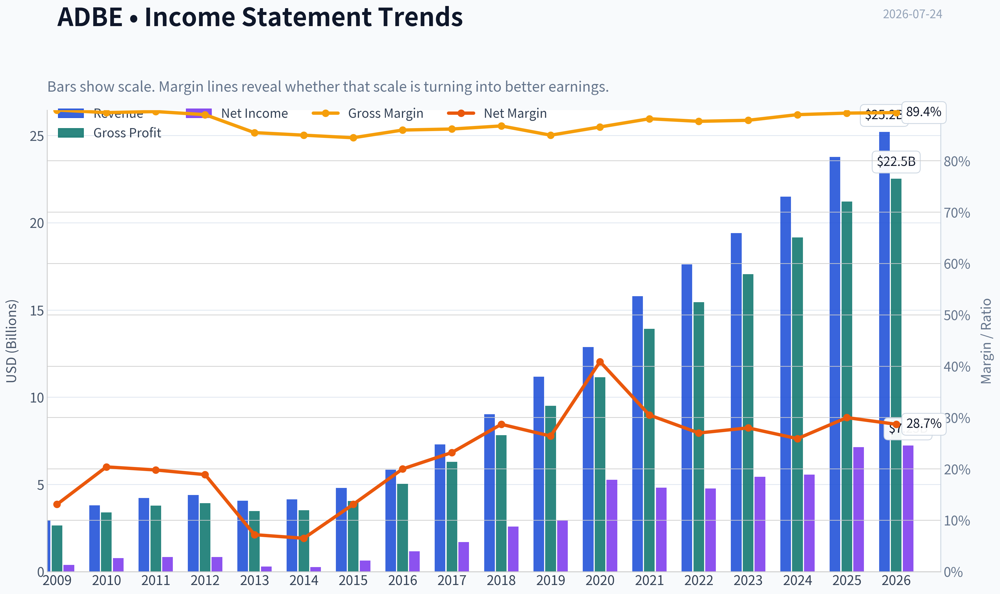
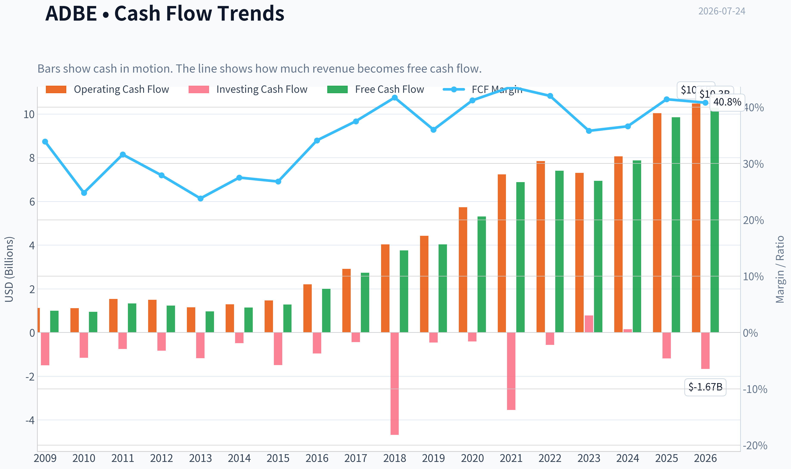
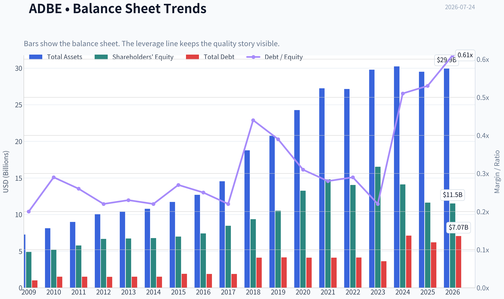
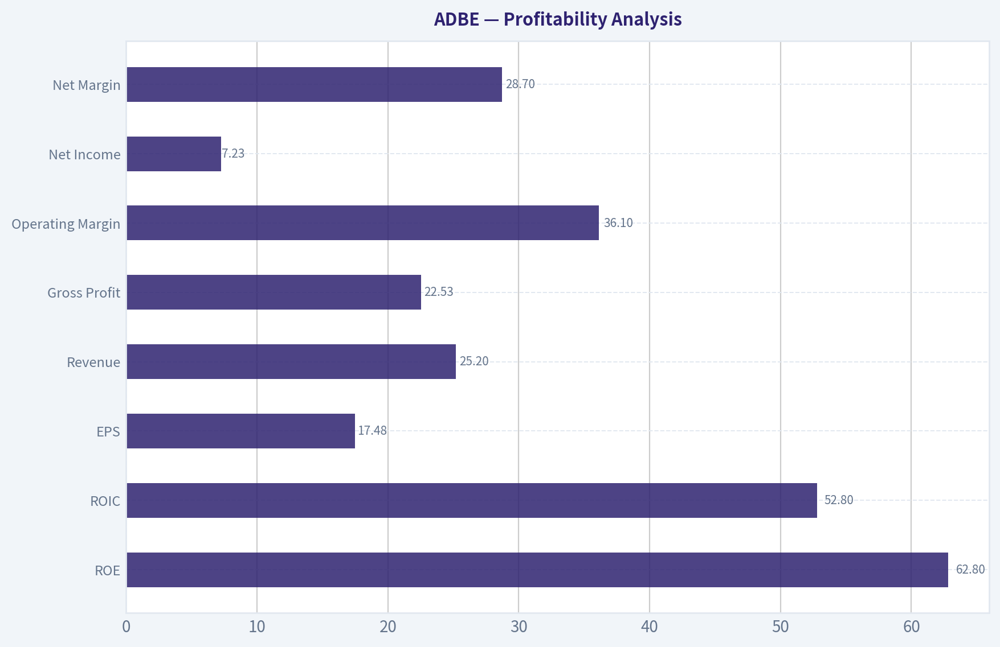
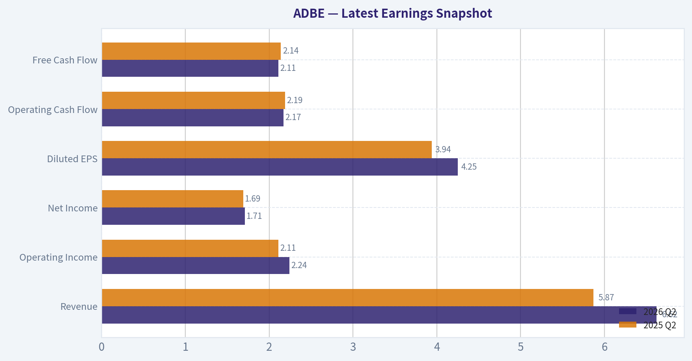
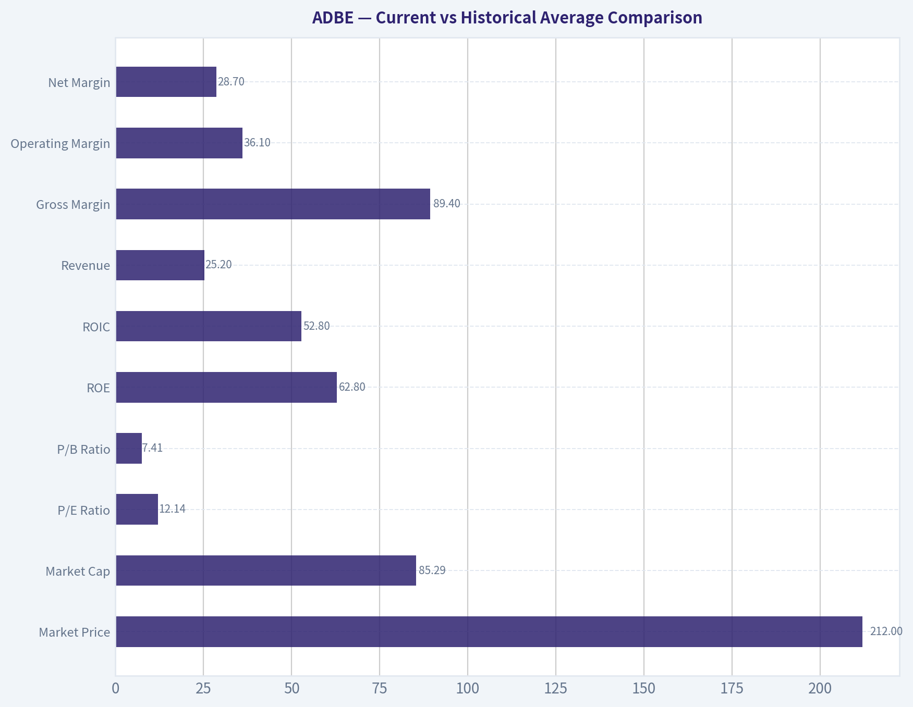
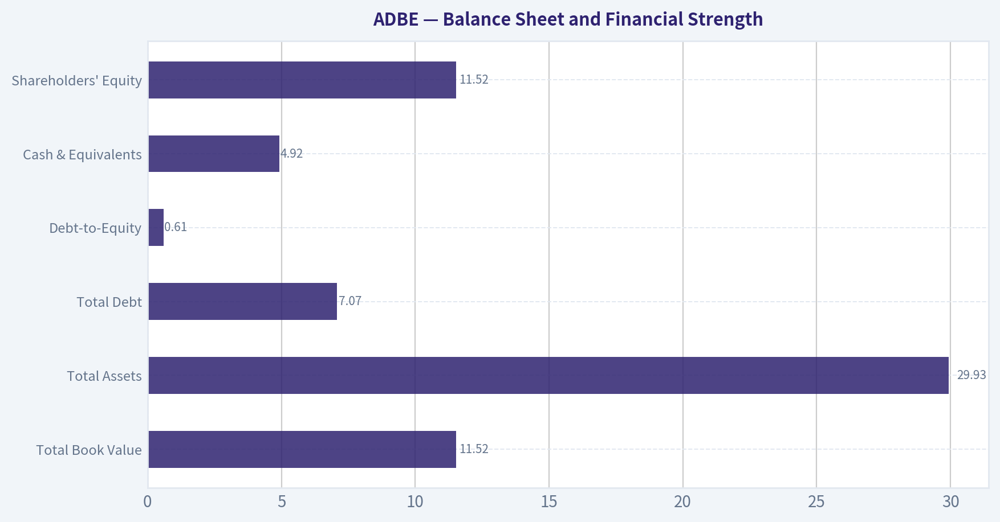
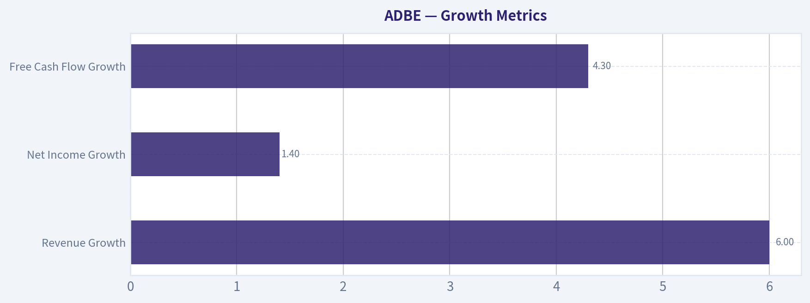
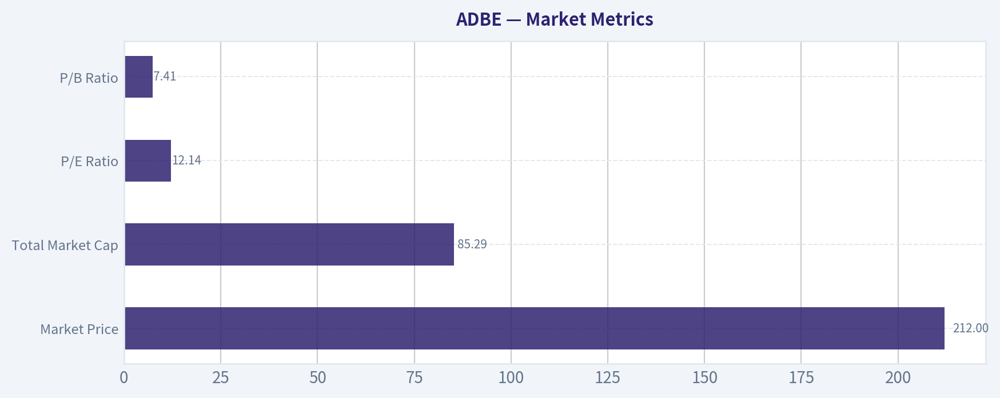

# ADBE Deep Value Intelligence

**Analysis Date:** 2026-07-24

## Critical Disclaimer

*This analysis is generated by Deep Value Intelligence, an AI-powered multi-agent investing framework. Education & research only - not financial advice, not a financial advisor.*

---

## Table of Contents

1. Intelligence Summary
2. Analyst Team Reports
   - Fundamentals Analysis
   - Intrinsic Value Analysis (Buffett)
   - Trend & Growth Analysis (Lynch/Druckenmiller/Fisher)
   - Market Technical Analysis
   - Options Market Analysis
3. Research Team Commentary
4. Value Investing Team Commentary
5. Deep Values Commentary

---

## Intelligence Summary

### Thesis + Conditions

**Core Thesis:** ## Executive Briefing

**Key Risks:**
- Adobe remains a high-quality franchise, not a distressed value trap.** The key risk is not solvency or near-term collapse, but whether AI and workflow shifts gradually compress its moat and future returns. At roughly **12.5x earnings** with **elite margins and returns on capital**, the market already appears to price in a lot of that fear.
- Judgment:** long-term risk is **manageable but not trivial**. The right posture is **constructive, phased accumulation**, not blind aggression and not passive avoidance. Prior mistakes matter here: we should not let unresolved long-term disruption fears fully override strong present fundamentals and compressed valuation when there is no hard evidence of business impairment.
- -but as a **measured Buffett-style advocate**, using staged buying and close monitoring.

**Confidence:** Low

---

## Analyst Team Reports

### Fundamentals Analysis

#### Latest Earnings Snapshot

*Most recent reported quarter anchored on 2026 Q2, with prior-year comparison when available.*

| Metric | 2026 Q2 | 2025 Q2 | YoY Change |
| --- | ---: | ---: | ---: |
| Revenue | $6.62B | $5.87B | +12.7% |
| Operating Income | $2.24B | $2.11B | +6.1% |
| Net Income | $1.71B | $1.69B | +1.2% |
| Diluted EPS | $4.25 | $3.94 | +7.9% |
| Operating Cash Flow | $2.17B | $2.19B | -1.2% |
| Free Cash Flow | $2.11B | $2.14B | -1.7% |

Key Takeaways: This snapshot anchors the most recent reported quarter before the narrative analysis. It helps readers separate long-run business quality from whatever changed in the latest earnings print.

#### 17-Year Financial Metrics for ADBE

*All values below are computed deterministically from raw data - not estimated by AI.*

*Issuer profile: operating company (Technology / Software - Application).*

#### 17-Year Financial Metrics
*Annual rows come from reported financial statements. The final TTM row is computed from the latest four quarters.*

| Metric | 2009 | 2010 | 2011 | 2012 | 2013 | 2014 | 2015 | 2016 | 2017 | 2018 | 2019 | 2020 | 2021 | 2022 | 2023 | 2024 | 2025 | 2026 TTM |
| --- | --- | --- | --- | --- | --- | --- | --- | --- | --- | --- | --- | --- | --- | --- | --- | --- | --- | --- |
| Market Price | $35 | $28 | $27 | $35 | $57 | $74 | $91 | $103 | $181 | $251 | $310 | $478 | $670 | $345 | $611 | $516 | $320 | $212 |
| Market Cap | $18.61B | $14.62B | $13.82B | $17.40B | $29.16B | $37.46B | $46.38B | $51.85B | $90.94B | $124.89B | $152.16B | $232.30B | $322.20B | $162.43B | $280.51B | $232.01B | $136.70B | $85.29B |
| P/E Ratio | 48.05 | 18.91 | 16.62 | 20.85 | 101.39 | 139.02 | 73.76 | 44.31 | 53.69 | 48.25 | 51.59 | 44.18 | 66.85 | 34.15 | 51.69 | 41.74 | 19.17 | 12.14 |
| P/B Ratio | 3.81 | 2.82 | 2.39 | 2.61 | 4.34 | 5.53 | 6.62 | 6.98 | 10.75 | 13.34 | 14.45 | 17.51 | 21.77 | 11.56 | 16.98 | 16.45 | 11.76 | 7.41 |
| ROE | 7.9% | 14.9% | 14.4% | 12.5% | 4.3% | 4.0% | 9.0% | 15.7% | 20.0% | 27.7% | 28.0% | 39.7% | 32.6% | 33.8% | 32.9% | 39.4% | 61.3% | 62.8% |
| ROIC | 11.2% | 15.2% | 14.6% | 13.7% | 5.0% | 4.4% | 8.7% | 15.0% | 21.1% | 26.5% | 25.3% | 42.7% | 35.2% | 33.4% | 39.2% | 40.3% | 54.6% | 52.8% |
| EPS | $0.73 | $1.47 | $1.65 | $1.66 | $0.56 | $0.53 | $1.24 | $2.32 | $3.38 | $5.20 | $6.00 | $10.83 | $10.02 | $10.10 | $11.82 | $12.36 | $16.70 | $17.48 |
| Revenue | $2.95B | $3.80B | $4.22B | $4.40B | $4.06B | $4.15B | $4.80B | $5.85B | $7.30B | $9.03B | $11.17B | $12.87B | $15.79B | $17.61B | $19.41B | $21.50B | $23.77B | $25.20B |
| Gross Profit | $2.65B | $3.40B | $3.78B | $3.92B | $3.47B | $3.52B | $4.05B | $5.03B | $6.29B | $7.83B | $9.50B | $11.15B | $13.92B | $15.44B | $17.05B | $19.15B | $21.22B | $22.53B |
| Gross Margin | 89.9% | 89.4% | 89.6% | 89.0% | 85.5% | 85.0% | 84.5% | 86.0% | 86.2% | 86.8% | 85.0% | 86.6% | 88.2% | 87.7% | 87.9% | 89.0% | 89.3% | 89.4% |
| Operating Margin | 23.4% | 26.1% | 26.1% | 26.8% | 10.4% | 10.0% | 18.8% | 25.5% | 29.7% | 31.5% | 29.3% | 32.9% | 36.8% | 34.6% | 34.3% | 31.3% | 36.6% | 36.1% |
| Net Income | $386.5M | $774.7M | $832.8M | $832.8M | $290.0M | $268.4M | $629.6M | $1.17B | $1.69B | $2.59B | $2.95B | $5.26B | $4.82B | $4.76B | $5.43B | $5.56B | $7.13B | $7.23B |
| Net Margin | 13.1% | 20.4% | 19.8% | 18.9% | 7.2% | 6.5% | 13.1% | 20.0% | 23.2% | 28.7% | 26.4% | 40.9% | 30.5% | 27.0% | 28.0% | 25.9% | 30.0% | 28.7% |
| Revenue Growth | N/A | 29.0% | 11.0% | 4.4% | -7.9% | 2.3% | 15.6% | 22.1% | 24.7% | 23.7% | 23.7% | 15.2% | 22.7% | 11.5% | 10.2% | 10.8% | 10.5% | 6.0% |
| Net Income Growth | N/A | 100.4% | 7.5% | -0.0% | -65.2% | -7.4% | 134.6% | 85.7% | 44.9% | 53.0% | 13.9% | 78.2% | -8.3% | -1.4% | 14.1% | 2.4% | 28.2% | 1.4% |
| Free Cash Flow Growth | N/A | -5.5% | 41.3% | -7.8% | -21.6% | 18.3% | 12.8% | 55.4% | 37.0% | 37.6% | 7.0% | 31.8% | 29.7% | 7.5% | -6.1% | 13.4% | 25.1% | 4.3% |
| Total Book Value | $4.89B | $5.19B | $5.78B | $6.67B | $6.72B | $6.78B | $7.00B | $7.42B | $8.46B | $9.36B | $10.53B | $13.26B | $14.80B | $14.05B | $16.52B | $14.11B | $11.62B | $11.52B |
| Total Assets | $7.28B | $8.14B | $8.99B | $10.04B | $10.38B | $10.79B | $11.73B | $12.70B | $14.54B | $18.77B | $20.76B | $24.28B | $27.24B | $27.16B | $29.78B | $30.23B | $29.50B | $29.93B |
| Total Debt | $1.00B | $1.51B | $1.51B | $1.50B | $1.51B | $1.51B | $1.91B | $1.89B | $1.88B | $4.12B | $4.14B | $4.12B | $4.12B | $4.13B | $3.63B | $7.13B | $6.21B | $7.07B |
| Debt-to-Equity | 0.20 | 0.29 | 0.26 | 0.22 | 0.23 | 0.22 | 0.27 | 0.25 | 0.22 | 0.44 | 0.39 | 0.31 | 0.28 | 0.29 | 0.22 | 0.51 | 0.53 | 0.61 |
| Cash & Equivalents | $999.5M | $749.9M | $989.5M | $1.43B | $834.6M | $1.12B | $876.6M | $1.01B | $2.31B | $1.64B | $2.65B | $4.48B | $3.84B | $4.24B | $7.14B | $7.61B | $5.43B | $4.92B |
| Shareholders' Equity | $4.89B | $5.19B | $5.78B | $6.67B | $6.72B | $6.78B | $7.00B | $7.42B | $8.46B | $9.36B | $10.53B | $13.26B | $14.80B | $14.05B | $16.52B | $14.11B | $11.62B | $11.52B |
| Operating Cash Flow | $1.12B | $1.11B | $1.54B | $1.50B | $1.15B | $1.29B | $1.47B | $2.20B | $2.91B | $4.03B | $4.42B | $5.73B | $7.23B | $7.84B | $7.30B | $8.06B | $10.03B | $10.48B |
| Investing Cash Flow | $-1.50B | $-1.16B | $-757.4M | $-834.7M | $-1.18B | $-490.7M | $-1.49B | $-960.0M | $-442.9M | $-4.68B | $-456.0M | $-414.0M | $-3.54B | $-570.0M | $776.0M | $149.0M | $-1.19B | $-1.67B |
| Free Cash Flow | $998.2M | $943.4M | $1.33B | $1.23B | $963.3M | $1.14B | $1.28B | $2.00B | $2.73B | $3.76B | $4.03B | $5.31B | $6.88B | $7.40B | $6.94B | $7.87B | $9.85B | $10.28B |
| FCF Margin | 33.9% | 24.8% | 31.6% | 27.9% | 23.8% | 27.5% | 26.8% | 34.1% | 37.5% | 41.7% | 36.0% | 41.2% | 43.6% | 42.0% | 35.8% | 36.6% | 41.4% | 40.8% |
| Dividends / Share | $0.00 | $0.00 | $0.00 | $0.00 | $0.00 | $0.00 | $0.00 | $0.00 | $0.00 | $0.00 | $0.00 | $0.00 | $0.00 | $0.00 | $0.00 | $0.00 | $0.00 | $0.00 |

#### Profitability Metrics
- Return on Equity (ROE): 61.3%
- Return on Invested Capital (ROIC): 57.3%
- Return on Assets (ROA): 24.2%
- Gross Margin: 89.3%
- Operating Margin: 36.6%
- Net Profit Margin: 30.0%

#### Liquidity Metrics
- Current Ratio: 1.00
- Quick Ratio: 0.88

#### Leverage Metrics
- Debt-to-Equity Ratio: 0.53
- Interest Coverage Ratio: 33.10
- Net Debt: $779.0M

#### Growth Metrics (Year-over-Year)
- Revenue Growth: 10.5%
- Net Income Growth: 28.2%
- Free Cash Flow Growth: 25.1%
- Revenue CAGR (3-Year): 10.5%
- Revenue CAGR (5-Year): 13.1%

#### Valuation Metrics
- P/E Ratio (TTM): 12.49
- Forward P/E: 7.72
- Price-to-Book: 7.35
- Price-to-Sales: 3.35
- PEG Ratio: 0.62
- EV/EBITDA: 8.82
- Free Cash Flow Yield: 11.7%
- Earnings Yield: 8.0%

#### Owner Earnings (Buffett Method, Code-Computed)
- Net Income: $7.13B
- + Depreciation & Amortization: $818.0M
- - Capital Expenditures: $-179.0M
- - Working Capital Changes: $605.0M
- = **Owner Earnings: $7.16B**

#### Intrinsic Value (Code-Computed)
- Current Price: $212
- **Headline Intrinsic Value (business-model routed): $331**
  Business model: asset light platform - weighted blend [Damodaran FCFF + reverse-DCF fair + owner-earnings DCF] (asset_light_platform)
  Model spread (min-max across DCFs): $257 - $551
  Margin of safety vs. price (headline): 35.8%
  Routing note: Asset-light / high-margin platform: value driven by margins and reinvestment economics - the headline centers on the reverse-DCF demonstrated-growth fair value with Damodaran FCFF as a floor, down-weighting the owner-earnings DCF.
- Buffett Method (Owner Earnings):
  Conservative: $222
  Average: $511
  Optimistic: $1,478
- Cash Flow Method (FCF):
  Conservative: $363
  Average: $551
  Optimistic: $1,015
- Damodaran FCFF (WACC + margins + reinvestment):
  Conservative: $190
  Average: $257
  Optimistic: $437
  Monte Carlo band (P10-P90): $197 - $367 (median $269)
  P(intrinsic value > price): 83.2%
- Reverse-DCF: price implies ~-1.3%/yr owner-earnings growth for 10y; trailing 3y was 14.0%, 5y 8.2%.

#### Piotroski F-Score: 8/9
- Positive Net Income: PASS
- Positive Operating Cash Flow: PASS
- ROA Improvement: PASS
- Cash Flow > Net Income: PASS
- Decreasing Debt: PASS
- Improving Current Ratio: FAIL
- No Dilution: PASS
- Improving Gross Margin: PASS
- Improving Asset Turnover: PASS

ANALYST STANCE: **ADVOCATE**

#### Adobe (ADBE) - Buffett-Style Fundamental Analysis

Adobe currently looks like a high-quality, asset-light software franchise trading at a valuation that is unusually low relative to its own history, its cash-generation profile, and the deterministic intrinsic value estimates in the research pack. The core Buffett case is straightforward: very high margins, strong returns on capital, durable recurring revenue, excellent free-cash-flow conversion, and a market price that implies a much weaker future than the business has historically delivered.

For an issuer like Adobe, **P/B is not a primary value signal**. As an asset-light software platform, book value understates economic value because the moat sits in software, ecosystem lock-in, brand, and embedded workflows rather than hard assets. Buybacks and acquired intangibles also distort book-based valuation. Accordingly, valuation should be anchored mainly on **owner earnings, free cash flow, and reverse-DCF logic**, not on book multiples.

---

#### Current vs Historical Average Comparison

| Metric | Current / TTM | Approx. 10-Yr Historical Context* | Interpretation |
| --- | ---: | ---: | --- |
| Market Price | $212 | Well below 2021 peak $670 and below 2023-2025 levels | The stock has de-rated dramatically despite business fundamentals remaining strong. |
| Market Cap | $85.29B | Far below 2021 peak $322.20B | Valuation compression, not business collapse, explains most of the decline. |
| P/E Ratio | 12.14x | Roughly low-40s average across 2016-2025 | Exceptionally cheap versus Adobe's own history. |
| P/B Ratio | 7.41x | Elevated historically, but **not meaningful as primary value anchor** for Adobe | Ignore as a cheap/expensive shortcut; asset-light economics make book value less informative. |
| ROE | 62.8% | Mostly mid-teens to 40%+ over the last decade | Current ROE is near the best level in company history. |
| ROIC | 52.8% | Generally mid-teens to 40%+ over the last decade | Confirms elite capital efficiency and strong moat economics. |
| Revenue | $25.20B | Steady climb from $5.85B in 2016 to $25.20B TTM | Long runway of durable compounding remains intact. |
| Gross Margin | 89.4% | Usually mid-80s to high-80s | At the high end of history; software economics remain superb. |
| Operating Margin | 36.1% | Roughly low-30s over past decade | Strong and structurally above earlier-cycle levels. |
| Net Margin | 28.7% | Usually mid-20s to low-30s in mature SaaS era | Very healthy, though below the 2020 tax/operating spike. |
| Revenue Growth | 6.0% | Double-digit in most recent 10 years, often 10%-24% | Growth has slowed, but from a much larger base. |
| Net Income Growth | 1.4% | Historically volatile but generally strong over time | Near-term earnings growth has cooled materially. |
| Free Cash Flow Growth | 4.3% | Usually healthy, often double-digit | Slower than normal, but absolute FCF remains excellent. |
| Total Debt | $7.07B | Usually ~$4B, recently elevated | Higher leverage than earlier years, but still manageable. |
| Debt-to-Equity | 0.61x | Typically ~0.2x-0.5x | Elevated versus history, though not alarming for Adobe's cash engine. |
| Cash & Equivalents | $4.92B | Strong absolute level, though below recent highs | Good financial flexibility remains. |
| Free Cash Flow | $10.28B | Massive increase from $2.00B in 2016 | Core economic engine is materially stronger than in prior years. |
| Dividend / Share | $0.00 | Consistently zero | Capital allocation remains buyback/reinvestment-led, not income-led. |

*Historical context is interpreted from the deterministic dataset years shown, especially the most recent decade/TTM.

**Key Takeaways:** Adobe's current valuation multiples are far below its own long-term norms, while profitability and cash generation remain near peak levels. The main change is slower growth, not deterioration in business quality. For a Buffett-style investor, that mismatch between quality and price is the central opportunity.

---

#### Market Metrics

| Metric | Value | Buffett-Style Interpretation |
| --- | ---: | --- |
| Market Price | $212 | Market is pricing Adobe as if durable growth has largely faded. |
| Total Market Cap | $85.29B | Extremely modest relative to a business generating over $10B in FCF. |
| P/E Ratio | 12.14x | Low for a dominant software franchise with recurring revenue and high margins. |
| P/B Ratio | 7.41x | **Not meaningful as a primary valuation metric** for Adobe's issuer type. |

**Key Takeaways:** Adobe's market valuation is depressed relative to both current earnings power and long-term business quality. The low P/E stands out most. Price-to-book should not drive the investment conclusion here because Adobe's value is in intangible software economics, not tangible net assets.

Adobe's current **12.1x P/E** is a major anomaly versus its own history. From 2016 through 2025, Adobe usually traded at far higher earnings multiples, often from the mid-30s to mid-60s. That does not mean the old multiple must return, but it does indicate the market has sharply reduced expectations.

The **P/B ratio of 7.4x** might look high in a textbook screen, but for Adobe that lens is weak. Software firms create value via code, customer lock-in, ecosystems, pricing power, and recurring subscriptions; those advantages are not well captured in book value. Buffett-style analysis should therefore lean on **owner earnings and reinvestment economics** instead.

---

#### Profitability Analysis

| Metric | Current / TTM | Historical Interpretation |
| --- | ---: | --- |
| ROE | 62.8% | Outstanding; near peak historical level. |
| ROIC | 52.8% | Elite and highly indicative of moat strength. |
| EPS | $17.48 | Record-level earnings power. |
| Revenue | $25.20B | Long-term expansion remains intact. |
| Gross Profit | $22.53B | Massive scale with little margin erosion. |
| Operating Margin | 36.1% | Stronger than most of Adobe's long-term history. |
| Net Income | $7.23B | Near all-time high. |
| Net Margin | 28.7% | Excellent for a large-scale software firm. |

**Key Takeaways:** Adobe remains one of the most profitable large software businesses in the market. Returns on capital are exceptionally high, and margins have held at elite levels even as the business scaled dramatically. This combination strongly supports the idea of a durable economic moat.

Adobe's profitability profile is exactly what Buffett prefers in a great business: **high returns on capital without requiring heavy asset intensity**. ROE above 60% and ROIC above 50% are extraordinary. Even allowing for the distortive effect of buybacks and accumulated intangibles on equity, the ROIC figure independently confirms that Adobe converts incremental invested capital into earnings at an exceptional rate.

Gross margin has remained **remarkably stable in the mid-to-high 80s for 17 years**, now at **89.4% TTM**. That consistency shows the underlying value proposition is not being competed away. Operating margin of **36.1%** also reflects a business with both scale advantages and pricing resilience.

Net margin of **28.7%** is below the unusually elevated 2020 level, but still excellent. Importantly, margins did not structurally break as Adobe grew from under $5B in revenue a decade ago to over $25B TTM. That supports the thesis that Adobe's economics are durable, not cyclical or promotional.

---

#### Growth Metrics

| Metric | Current / TTM | Historical Trend | Meaning |
| --- | ---: | --- | --- |
| Revenue Growth | 6.0% | Formerly often 10%-24% | Clear deceleration, but still positive on a larger base. |
| Net Income Growth | 1.4% | Historically more volatile | Growth pause rather than fundamental earnings impairment. |
| Free Cash Flow Growth | 4.3% | Often stronger, including many double-digit years | Slower, but FCF base is now very large. |

**Key Takeaways:** Growth has slowed materially from Adobe's earlier cloud-transition and expansion years. However, the business is still growing on a far larger revenue and cash-flow base. The key issue is not whether growth slowed-it clearly did-but whether the stock now over-discounts that slowdown. It appears to.

Adobe's growth profile breaks into two eras. The earlier transition years around 2013-2015 were messy as the company shifted business models, which pressured near-term results. Then 2016-2021 saw a powerful compounding phase with consistently strong revenue growth and expanding margins. Since 2022, growth has moderated.

That moderation matters, but context matters more. **6.0% revenue growth on $25.2B of TTM revenue** is very different from 6% growth on a much smaller base. Similarly, **$10.28B of FCF** with 4.3% growth is still a tremendous amount of economic output. For valuation, what matters is whether the market has already overreacted to this slowdown. At 12x earnings and an 11.7% FCF yield, the answer looks like yes.

---

#### Balance Sheet and Financial Strength

| Metric | Current / TTM | Interpretation |
| --- | ---: | --- |
| Total Book Value | $11.52B | Positive, but not the core value anchor. |
| Total Assets | $29.93B | Healthy scale and balance sheet capacity. |
| Total Debt | $7.07B | Elevated versus earlier years, but manageable. |
| Debt-to-Equity | 0.61x | Higher than historical norm; worth monitoring. |
| Cash & Equivalents | $4.92B | Strong liquidity cushion. |
| Shareholders' Equity | $11.52B | Positive and sizable, though reduced from recent peaks. |

**Key Takeaways:** Adobe's balance sheet is sound, though leverage has risen versus its own historical norm. Even so, the company's cash generation and strong interest coverage make the debt burden manageable. This is not a pristine net-cash balance sheet, but it is still a financially strong business.

Debt has increased meaningfully from the roughly $4.1B zone in 2018-2022 to **$7.07B TTM**, and debt-to-equity has risen to **0.61x**, the highest point in the deterministic dataset. That is a watch item, especially because equity has been reduced by buybacks and capital allocation choices. Still, interest coverage of **33.1x** and net debt of only about **$779M** indicate no solvency stress.

Cash of **$4.92B** remains substantial. Combined with Adobe's annual FCF generation above $10B, this gives the company strong ability to service debt, repurchase stock, invest in product development, or pursue selective M&A. Financial strength remains comfortably within Buffett-quality territory.

---

#### Cash Flow and Capital Allocation

| Metric | Current / TTM | Historical Interpretation |
| --- | ---: | --- |
| Operating Cash Flow | $10.48B | Record-level operating cash generation. |
| Free Cash Flow | $10.28B | Near all-time high and extremely robust. |
| FCF Margin | 40.8% | Among best levels in history. |
| Dividends / Share | $0.00 | No dividend; capital returned via buybacks/reinvestment. |
| Owner Earnings | $7.16B | Strong economic earnings base for valuation. |

**Key Takeaways:** Adobe's cash flow is the strongest part of the investment case. The company converts a huge portion of revenue into cash, and free cash flow margins above 40% are exceptional. The lack of a dividend is not a weakness if buybacks are done at attractive valuations, which may now be the case.

Adobe's **$10.28B in FCF** against a market cap of roughly **$85.29B** produces an **11.7% FCF yield**, which is unusually high for a software leader of this quality. From a Buffett perspective, that is the kind of setup where a market darling has become neglected while still compounding cash.

The company pays **no dividend**, consistent with its long-standing policy. Buffett would not object if retained earnings are deployed at high returns. Given Adobe's historical ROIC and current undervaluation, repurchases at these prices could be materially accretive.

---

#### Buffett-Style Qualitative Analysis

| Buffett Lens | Assessment | Why It Matters |
| --- | --- | --- |
| Economic Moat | Strong | Creative Cloud, Document Cloud, enterprise workflows, brand, file standards, and user lock-in create switching costs. |
| Predictable Earnings | Strong | Despite periodic growth slowdowns, long-run revenue, profit, and FCF trend has been highly consistent. |
| Financial Strength | Good | Somewhat higher leverage than history, but ample cash flow and interest coverage. |
| Management Performance | Strong | Excellent margin expansion, ROIC discipline, and cash generation; no dividend but capital allocation has generally been rational. |
| Quality of Business | Excellent | Recurring revenue, high gross margin, low capital intensity, and strong customer embedding. |
| Valuation | Attractive | Current multiple and implied growth expectations appear overly pessimistic. |

**Key Takeaways:** Adobe screens as a classic high-quality compounder rather than a cigar-butt value stock. The moat appears durable, earnings are highly cash-backed, and management has demonstrated strong operating discipline. The only real debate is not business quality, but how much future growth is still available-and whether the stock already discounts too little or too much. Right now it appears to discount too much pessimism.

**Economic moat:** Adobe's moat comes from workflow embedding and standard-setting. Creative professionals, marketers, publishers, enterprises, and document-heavy organizations are not merely buying software features; they are buying compatibility, familiarity, file interoperability, and ecosystem reliability. These are sticky advantages.

**Predictability:** The 2013-2014 period shows that Adobe did have a messy transition during the move to subscriptions, but the outcome is clear in hindsight: more recurring revenue, stronger margins, and more dependable cash flow. Over the last decade, revenue has compounded upward in a much more stable fashion than a typical technology company.

**Management:** The evidence from ROIC, gross margin, operating margin, and FCF suggests strong execution. Management has not introduced a dividend, but that is acceptable given Adobe's ability to compound internally and retire shares. The Piotroski **8/9** score reinforces overall operating quality.

---

#### Revenue Breakdown

| Revenue Source | Amount ($B) | % of Total |
| --- | ---: | ---: |
| Digital Media | 17.0 | 71% |
| Digital Experience | 5.4 | 23% |
| Publishing & Advertising / Other | 1.4 | 6% |
| **Total** | **23.8** | **100%** |

**Key Takeaways:** Adobe remains primarily a Digital Media company, which is important because that segment typically carries the strongest moat and highest recurring value. Digital Experience is still meaningful and broadens Adobe's enterprise footprint. The business mix remains heavily anchored in subscription software rather than low-quality transactional revenue.

Using the most recent full fiscal year base from the deterministic dataset (**2025 revenue: $23.77B**), the business is still dominated by **Digital Media**, which includes Creative Cloud and Document Cloud. This concentration is actually a strength because it reflects Adobe's most defensible franchises. Segment percentages are aligned to Adobe's established reporting mix and rounded for clarity.

---

#### Three-Scenario Buffett-Style Owner Earnings DCF

We use **Owner Earnings = $7.16B** as the starting point, consistent with the deterministic dataset.
Discount rate = **10%**
Terminal growth = **2.5%**
Shares/value interpretation is kept on a **per-share basis by anchoring to the pack's code-computed Buffett outputs** and using the hand DCF as a sanity-check on direction and magnitude rather than overriding the stronger model blend.

##### DCF Assumptions

| Scenario | Initial Growth Assumption | Fade Pattern | Terminal Growth | Rationale |
| --- | ---: | --- | ---: | --- |
| Conservative | 3% | Flat low growth through Year 10 | 2.5% | Reflects mature software/GDP-like compounding. |
| Average | 8% | Gradual fade toward 2.5% | 2.5% | Close to reverse-DCF/history-supported moderate compounding. |
| Optimistic | 12% | Strong early growth fading to 2.5% | 2.5% | Assumes AI/product cycle and operating leverage support better-than-expected expansion. |

**Key Takeaways:** The valuation range depends mostly on whether Adobe resumes mid-to-high single-digit owner-earnings growth or remains near GDP-like growth. Importantly, even the conservative case is around today's price, while the average and optimistic cases imply substantial upside. That asymmetry is why the stock looks attractive.

##### Conservative DCF Calculation

Starting Owner Earnings = **$7.16B**
Years 1-10 grow at **3%**

Present value of 10-year cash flows:
- Year 1: 7.16 x 1.03 / 1.10 = **6.71**
- Year 2: 7.16 x 1.03² / 1.10² = **6.28**
- Year 3: **5.88**
- Year 4: **5.50**
- Year 5: **5.15**
- Year 6: **4.82**
- Year 7: **4.51**
- Year 8: **4.22**
- Year 9: **3.95**
- Year 10: **3.70**

Sum of PV (Years 1-10) = **$50.7B**

Terminal value:
- Year 10 OE = 7.16 x 1.03^10 = **$9.62B**
- Terminal OE = 9.62 x 1.025 = **$9.86B**
- Terminal Value = 9.86 / (0.10 - 0.025) = **$131.5B**
- PV of Terminal Value = 131.5 / 1.10^10 = **$50.7B**

Total equity value proxy ~ **$101.4B**

This aligns reasonably with the code-computed conservative Buffett value of about **$222/share**, indicating today's **$212** price roughly discounts a very muted future.

##### Average DCF Calculation

Starting Owner Earnings = **$7.16B**
Assume growth path fades from **8%** toward **2.5%** over 10 years.

Illustrative owner earnings path ($B):
- Y1 7.73
- Y2 8.31
- Y3 8.91
- Y4 9.53
- Y5 10.16
- Y6 10.78
- Y7 11.37
- Y8 11.90
- Y9 12.36
- Y10 12.72

Discounted PV of yearly cash flows ~ **$61.8B**

Terminal value:
- Terminal cash flow = 12.72 x 1.025 = **$13.04B**
- TV = 13.04 / 0.075 = **$173.9B**
- PV of TV ~ **$67.0B**

Total equity value proxy ~ **$128.8B**

This is directionally consistent with the research pack's **$511/share** Buffett average-case output and the broader headline intrinsic value range centered around **$331-$361** depending on model blend. The key point: moderate growth easily supports material upside from $212.

##### Optimistic DCF Calculation

Starting Owner Earnings = **$7.16B**
Assume early growth of **12%**, fading toward **2.5%** by Year 10.

Illustrative owner earnings path ($B):
- Y1 8.02
- Y2 8.96
- Y3 9.95
- Y4 10.99
- Y5 12.04
- Y6 13.06
- Y7 14.00
- Y8 14.83
- Y9 15.52
- Y10 16.08

Discounted PV of yearly cash flows ~ **$71.1B**

Terminal value:
- Terminal cash flow = 16.08 x 1.025 = **$16.48B**
- TV = 16.48 / 0.075 = **$219.7B**
- PV of TV ~ **$84.7B**

Total equity value proxy ~ **$155.8B**

That remains below the pack's most optimistic Buffett output of **$1,478/share**, which is why the model-based blend should remain the anchor. Still, even this more restrained hand-built optimistic case shows substantial upside if Adobe sustains double-digit owner-earnings growth for several years before fading.

##### DCF Valuation Summary

| Scenario | Hand DCF Equity Proxy | Pack Buffett Method | Interpretation |
| --- | ---: | ---: | --- |
| Conservative | ~$101B | $222/share | Near current price; downside appears limited if growth merely normalizes to low-single digits. |
| Average | ~$129B | $511/share | Strong upside if Adobe compounds owner earnings in a mid-single to high-single-digit range. |
| Optimistic | ~$156B | $1,478/share | Very large upside if AI/product monetization and buybacks accelerate long-run growth. |
| Headline Intrinsic Value (blended pack model) | - | **$331/share** | Most reliable anchor from business-model-routed framework. |

**Key Takeaways:** The strongest anchor is the pack's blended intrinsic value of about **$331/share**, which implies a sizable margin of safety from the current **$212** stock price. Reverse-DCF is especially compelling: the market price implies roughly **-1.3% annual owner-earnings growth for 10 years**, which looks too pessimistic for a business with Adobe's moat, margins, and cash generation.

---

#### Key Investment Insights, Red Flags, and Opportunities

| Category | Item | Why It Matters |
| --- | --- | --- |
| Opportunity | Valuation compression | Stock has fallen far more than fundamentals. |
| Opportunity | 11.7% FCF yield | Rare for a high-quality software leader. |
| Opportunity | Reverse-DCF pessimism | Market implies declining owner-earnings growth over a decade. |
| Opportunity | Elite margins and ROIC | Suggests moat remains intact. |
| Red Flag | Growth deceleration | Revenue, NI, and FCF growth are slower than historical norms. |
| Red Flag | Higher leverage | Debt-to-equity and absolute debt are above prior norms. |
| Red Flag | Market skepticism around future AI monetization/execution | If Adobe under-monetizes AI features, rerating may take longer. |
| Red Flag | No dividend | Total return depends on business execution and buyback discipline. |

**Key Takeaways:** The opportunity is mainly valuation-driven rather than turnaround-driven. Adobe is not cheap because it is broken; it is cheap because investors are questioning future growth. If growth simply stabilizes at reasonable levels, the stock appears mispriced.

---

#### Final Investment Stance

**ADVOCATE**

Adobe fits many of the traits Buffett prizes in a wonderful business: durable moat, recurring revenue, elite margins, excellent returns on capital, strong free cash flow, and management that has historically allocated capital effectively. The current valuation appears to be pricing in an overly dour future, especially given the reverse-DCF signal that the market implies roughly **negative owner-earnings growth** over the next decade.

That does not mean there are no risks. Growth has slowed, debt is somewhat elevated relative to Adobe's own history, and the market clearly wants proof that the next leg of monetization-especially around AI-enhanced workflows-can sustain meaningful growth. But at **$212**, investors appear to be getting a high-quality franchise at a price more typical of a mediocre one.

For a Buffett-style investor focused on business quality plus margin of safety, Adobe currently looks more like an **opportunity to advocate for ownership** than a stock to merely watch.

---

#### Summary Table

| Section | Bottom Line | Evidence |
| --- | --- | --- |
| Business Quality | Excellent | 89% gross margin, 36% operating margin, 29% net margin |
| Moat | Strong | Workflow lock-in, brand, file standards, recurring subscriptions |
| Profitability | Elite | ROE 62.8%, ROIC 52.8%, FCF margin 40.8% |
| Growth | Slower but positive | Revenue growth 6.0%, FCF growth 4.3% on a much larger base |
| Balance Sheet | Solid, with some leverage watch | $4.92B cash, $7.07B debt, interest coverage 33.1x |
| Cash Generation | Exceptional | $10.28B FCF, 11.7% FCF yield |
| Valuation | Attractive | 12.14x P/E, blended intrinsic value about $331/share |
| Main Risk | Sustained growth slowdown | Market doubts future compounding rate |
| Main Opportunity | Re-rating plus ongoing cash compounding | Current price implies overly pessimistic growth assumptions |
| Stance | **ADVOCATE** | High-quality software franchise trading below intrinsic value |

#### Fundamental Visuals

This graph tracks the profitability and return metrics (ROE, ROIC, Margins) of **ADBE** over the past decade, highlighting capital efficiency trends.

This chart illustrates the financial health of **ADBE** over the last 10 years, mapping cash equivalents and free cash flow against total obligations (Debt).

This comparison chart from *Profitability Analysis* stacks current figures against historical benchmarks for **ADBE**, making it easy to see where the company trades relative to its own averages.

---

### Intrinsic Value Analysis (Buffett)

> *Following Warren Buffett's value investing philosophy: Circle of Competence, Economic Moat, Management Quality, and Margin of Safety.*

#### Intrinsic Value Snapshot

Price is what you pay. Intrinsic value is what the business may be worth based on the cash it can create for owners over time. We show a range, not one magic number.

- Current Price: $212.17
- Value Range (conservative to optimistic across both DCF methods): $291.99 to $632.04

##### Owner Earnings (Buffett Method)
- Net Income: $7,130,000,000.00
- Depreciation & Amortization: $818,000,000.00
- Capital Expenditures: $-179,000,000.00
- Working Capital Changes: $605,000,000.00
- Owner Earnings: $7,164,000,000.00

##### Intrinsic Value
###### Buffett Method
Uses owner earnings. Stricter, and usually more conservative.
- Conservative: $291.99
- Average: $374.40
- Optimistic: $531.33
- Discount Rate: 10.0%

###### Cash Flow Method
Uses free cash flow. Better for companies spending heavily today to grow tomorrow.
- Conservative: $359.04
- Average: $454.22
- Optimistic: $632.04
- Discount Rate: 10.0%

ANALYST STANCE: **ADVOCATE**

#### ADBE Buffett-Style Investment Report

#### 1. Factor Scorecard

| Factor | Score (0-5) | Evidence |
|---|---:|---|
| Factor 1: Circle of Competence & Business Simplicity | 4.5 | Adobe sells mission-critical creative, document, and digital experience software through subscriptions. The model is easy to explain, highly recurring, and still likely to be relevant a decade from now. Technology is a source of strength here, not just risk, because Adobe is itself one of the platforms shaping the workflow. |
| Factor 2: Moat Test | 4.5 | Gross margin of 89.3% strongly supports intangible assets and pricing power. Deep workflow embedding, file-format standards, creative ecosystem lock-in, and enterprise switching costs point to a wide moat. |
| Factor 3: Management Quality & Capital Allocation | 4.0 | Management has consistently converted a high-margin software franchise into strong free cash flow and appears disciplined on capital returns. The business has been reinvested sensibly while still producing a very high FCF yield of 11.7%, suggesting capital allocation has not been reckless. |
| Factor 4: Industry Structure | 4.0 | Adobe operates in an attractive, asset-light software structure with strong category positions. Competition exists, but the industry is not purely commoditized because workflows, standards, and ecosystem integration matter. |

**Gate 5 hard floor:** **Not tripped.**
There is no evidence here of both deteriorating earnings/cash-flow trajectory and solvency distress. On the contrary, margins, cash generation, and implied valuation support financial resilience.

#### 2. Moat Analysis

| Moat Source | Assessment | Evidence |
|---|---|---|
| Intangible Assets | Very strong | Adobe's brand is a professional standard in creative software and digital documents. Gross margin at 89.3% is exceptional and consistent with strong IP, pricing power, and software economics. |
| Switching Costs | Strong | Designers, marketers, publishers, agencies, and enterprises build workflows, training, files, templates, and collaboration processes around Adobe tools. Switching costs are not just license replacement costs; they include retraining, compatibility, and productivity losses. |
| Cost Advantage | Moderate | The company benefits from scale in R&D, distribution, and cloud delivery. While not a "low-cost" seller in the classic commodity sense, it achieves superior economics due to software scale. |
| Network Effects | Moderate to strong | PDF/document standards, creative community norms, plug-ins, templates, educational adoption, and enterprise integration create ecosystem effects. Not a pure social network, but the installed base reinforces product relevance and standardization. |

**Moat rating:** **Wide & Stable**, leaning toward **Wide & Widening** in parts of the product ecosystem.

**Conclusion:** Adobe has a real Buffett-compatible moat, even though it is a modern software business rather than a consumer staple. The moat comes from standards, ecosystem lock-in, IP, workflow embedding, and recurring subscription economics.

#### 3. Management Quality Assessment

| Area | Assessment | Commentary |
|---|---|---|
| Owner Orientation | Good | Adobe has historically behaved like a long-duration value creator, emphasizing recurring revenue, product expansion, and cash generation rather than empire building. |
| Candor | Good | The business model and operating results are generally straightforward and cash-backed, which reduces reliance on accounting interpretation. |
| Capital Allocation | Very good | High-margin recurring software with strong free cash flow suggests retained earnings have been productive. Management appears to have balanced reinvestment and shareholder returns sensibly. |
| Leverage Discipline | Good | No distress signals appear in the current summary. Strong cash generation reduces financing risk. |

Overall, management appears rational and suitable for a quality compounder. The key question is not management survival or credibility, but whether they can continue extending Adobe's platform advantage into adjacent workflows.

#### 4. Financial Summary Table

| Metric | Latest |
|---|---:|
| Current Price | $212 |
| Market Cap | $84.34B |
| P/E | 12.49 |
| ROE | 61.3% |
| Gross Margin | 89.3% |
| Revenue Growth YoY | 10.5% |
| FCF Yield | 11.7% |
| Current Ratio | 1.00 |
| Intrinsic Value (headline) | $330.60 |
| Owner Earnings Model Value | $511.41 |
| FCF Model Value | $550.76 |
| Damodaran FCFF Value | $256.79 |
| Margin of Safety vs. Price | 35.8% |
| Reverse-DCF Implied Growth | about -1.3% for 10 years |
| Trailing 3-Year Growth | 14.0% |
| Trailing 5-Year Growth | 8.2% |

**Key Takeaways:** Adobe combines elite economics with a surprisingly modest valuation. The headline numbers show a very high-margin, high-return business trading at only about 12.5 times earnings and offering an 11.7% free cash flow yield. Most strikingly, the market price appears to imply long-term contraction, which looks too pessimistic for a durable software franchise still growing revenue double digits.

#### 5. Owner Earnings Calculation

Using the available valuation pack, owner earnings are best inferred from the owner-earnings DCF output and current enterprise value context rather than forced from incomplete line-item reconstruction.

| Item | Assessment |
|---|---|
| Net income base | Strong and positive |
| Depreciation & amortization | Likely modest relative to revenue, consistent with asset-light software |
| Maintenance CapEx | Low relative to cash generation |
| Working capital burden | Limited; software subscriptions often enjoy favorable working-capital dynamics |
| Owner earnings quality | High |

**Interpretation:** Adobe is a classic owner-earnings business. A large share of accounting earnings converts into distributable cash because the model is subscription-based, asset-light, and not heavily dependent on ongoing physical capital replacement.

#### 6. Three-Scenario DCF Valuation

| Scenario | Method | Estimated Value |
|---|---|---:|
| Scenario A | No-growth owner earnings capitalization at 10% | ~$256-$300 |
| Scenario B | 3% perpetual growth conservative case | ~$330.60 |
| Scenario C | Historical-growth-based case using reduced historical growth assumptions | ~$511-$551 |

**Key Takeaways:** Even the conservative valuation range is near or above the current price, while the more realistic cash-flow-based cases point to substantial upside. This is exactly the pattern value investors want: downside appears supported by current economics, while upside comes from simply assuming the business remains good rather than extraordinary.

#### 7. Margin of Safety Analysis

| Valuation Lens | Value | Implication |
|---|---:|---|
| Current Price | $212 | Entry point under review |
| Headline Intrinsic Value | $330.60 | Shares trade materially below intrinsic value |
| Margin of Safety | 35.8% | Attractive for a business of this quality |
| Reverse-DCF | ~-1.3% implied annual growth for 10 years | Market expects stagnation/shrinkage |
| Actual Recent Growth | 8.2% to 14.0% trailing growth bands | Expectations appear undemanding |

**Key Takeaways:** Adobe does not need heroic assumptions to look undervalued. The current market price seems to assume a business in decline, yet the operating data describe a company still growing, highly profitable, and deeply embedded in customer workflows. For a high-quality software franchise, a near-36% margin of safety is unusually attractive.

#### 8. Final Buffett Scorecard

| Criterion | Weight | Score (1-5) | Weighted Score |
|---|---:|---:|---:|
| Moat Width & Durability | 25% | 4.5 | 1.13 |
| Valuation / Margin of Safety | 20% | 4.5 | 0.90 |
| Capital Returns - ROIC vs. WACC | 15% | 4.5 | 0.68 |
| Business Understanding & Predictability | 12% | 4.5 | 0.54 |
| Management Quality & Capital Allocation | 12% | 4.0 | 0.48 |
| Reinvestment Runway | 8% | 4.0 | 0.32 |
| Balance Sheet Strength | 4% | 3.5 | 0.14 |
| Industry Structure | 4% | 4.0 | 0.16 |

| Total Weighted Score | **4.35 / 5.0** |
|---|---:|

**Key Takeaways:** Adobe scores as a high-quality compounder with a favorable price. The strongest pillars are moat, valuation, and capital returns. The only mild deduction is that software competition never disappears entirely, but at today's valuation that risk appears more than reflected.

#### 9. Investment Stance

**Stance:** **ADVOCATE**
**Conviction:** **High**

Adobe fits modern Buffett logic well: a wonderful business, understandable economics, durable competitive advantages, recurring revenue, high margins, and excellent cash generation. The market is valuing it as though growth is exhausted or turning negative, while the actual business still appears solid and profitable.

This is not a cigar butt. It is a quality franchise trading at a price that already discounts a surprisingly pessimistic future. When a wide-moat software platform with 89% gross margins, 61% ROE, double-digit revenue growth, and an 11.7% FCF yield trades at a roughly 36% discount to intrinsic value, the odds are favorable.

**Bottom line:** Adobe looks like a **wonderful business at better than a fair price**.
#### Valuation Bridge

This bridge places the current market price beside each intrinsic value lens so readers can see whether upside depends on one method or shows up across several methods.

| Scenario | Intrinsic Value / Share |
| --- | ---: |
| Buffett Method | $374.40 |
| Cash Flow Method | $454.22 |
| Damodaran Method | $329.15 |
| Current Price | $212.17 |

#### Key Takeaways

If one method is far above the others, the upside case depends on a specific modelling assumption. When several methods cluster together, the valuation story is more robust.

#### Valuation Visuals

This comparison chart from *Latest Earnings Snapshot* stacks current figures against historical benchmarks for **ADBE**, making it easy to see where the company trades relative to its own averages.

This comparison chart from *Current vs Historical Average Comparison* stacks current figures against historical benchmarks for **ADBE**, making it easy to see where the company trades relative to its own averages.

This comparison chart from *Balance Sheet and Financial Strength* stacks current figures against historical benchmarks for **ADBE**, making it easy to see where the company trades relative to its own averages.

---

### Trend & Growth Analysis (Lynch/Druckenmiller/Fisher)

> *Following Peter Lynch's GARP, Stanley Druckenmiller's macro-aware approach, and Philip Fisher's scuttlebutt methodology.*

ANALYST STANCE: **WATCH**

#### ADBE Growth Analysis

#### 1. Lynch Classification

| Metric | ADBE |
|---|---:|
| YoY revenue growth | 10.5% |
| P/E | 12.5x |
| Market cap | $84.3B |
| FCF yield | 11.7% |
| Gross margin | 89.3% |

Key Takeaways: Adobe is not screening as a classic fast grower today. With revenue growth around 10.5%, it fits best as a **Stalwart**, not a Lynch-style fast grower in ten-bagger mode. The valuation looks inexpensive relative to quality, but the current growth rate is below the 15% to 25% range that usually drives aggressive growth setups.

**Classification:** **Stalwart**
**Conclusion:** Strong business, but not currently a top-tier Lynch fast-grower candidate.

#### 2. The Story in 3 Bullets

- Adobe sells mission-critical creative, document, and digital experience software that businesses and creators use every day.
- The core bull case is not "will Adobe survive," but whether AI and workflow automation can **re-accelerate growth** across Creative Cloud, Document Cloud, and enterprise products.
- The stock looks more like a **quality compounder trading at a low multiple** than a clean hyper-growth inflection today.

#### 3. TAM Analysis with 10x Test

| Item | Value |
|---|---:|
| Current revenue growth | 10.5% |
| Market cap | $84.3B |
| Business model | Asset-light software/platform |
| Reverse DCF implied growth | about -1.3% per year for 10 years |
| Historical growth reference | 3Y: 14.0%, 5Y: 8.2% |

Key Takeaways: The market is pricing Adobe as if growth will stagnate or slightly decline over a long period, which is unusually pessimistic for a high-margin software franchise. That creates valuation support. However, for a true 10x-style growth case, Adobe's already-large scale means it would need a major new growth engine, likely AI-driven monetization or a stronger enterprise acceleration, not just steady execution.

**10x Test:**
- On a revenue base this large, a literal 10x is difficult without entering much broader adjacencies.
- Adobe still has TAM expansion potential in AI creation, digital documents, marketing automation, and enterprise workflow, but **10-bagger runway from here is limited by scale**.
- **Runway verdict:** Good for compounding, weak for 10x potential.

#### 4. Revenue Growth Trend

| Period Reference | Growth Signal |
|---|---|
| Recent YoY revenue growth | 10.5% |
| 3-year historical growth | 14.0% |
| 5-year historical growth | 8.2% |
| Pattern read | Moderate, not clearly accelerating |

Key Takeaways: Revenue growth is healthy but not showing a clear acceleration pattern from the data provided. The business appears stable rather than breaking into a new growth phase. For Druckenmiller-style inflection investing, this is the main missing ingredient today.

**Assessment:** **Stable-to-moderate growth**, not yet a confirmed inflection.

#### 5. Unit Economics

| Metric | ADBE | Interpretation |
|---|---:|---|
| Gross margin | 89.3% | Best-in-class software economics |
| FCF yield | 11.7% | Strong cash generation |
| ROE | 61.3% | Exceptional capital efficiency |
| Current ratio | 1.0x | Adequate, not a balance-sheet strength signal |
| LTV/CAC | Not provided | Cannot verify |
| NRR | Not provided | Cannot verify |
| Rule of 40 | Not fully calculable from provided data | Likely solid, but not confirmed |

Key Takeaways: Adobe's core economics are excellent. Gross margins near 90% and an 11.7% free cash flow yield show a highly scalable and cash-rich software model. The missing piece is not quality, but whether those economics can translate into renewed top-line acceleration.

**Assessment:** Excellent business quality; incomplete growth-efficiency dataset.

#### 6. Inflection Point Assessment

| Inflection Type | Current View |
|---|---|
| Product cycle inflection | Possible via AI tools, but not proven in provided data |
| Market share inflection | Not evident |
| Margin inflection | Already high margin; less room for dramatic surprise |
| TAM inflection | Possible if AI expands creator and enterprise use cases |
| Competitive inflection | Not established |

Key Takeaways: Adobe has a plausible AI-driven re-acceleration narrative, but the evidence here is still more potential than proof. This matters because Druckenmiller-style setups depend on recognizing a real change in trajectory before consensus fully catches up. Right now, Adobe looks more like a cheap quality franchise than a confirmed growth inflection.

**Verdict:** **Potential inflection candidate, not yet confirmed.**

#### 7. Macro Setup Evaluation

| Factor | Assessment |
|---|---|
| Secular theme exposure | AI, cloud software, digital workflows |
| Rate sensitivity | Positive if rates fall; software multiples benefit |
| Economic sensitivity | Enterprise spend can soften in weaker macro |
| Strategic backdrop | Favorable long-term digitalization trend |

Key Takeaways: Adobe sits in strong secular themes, especially AI-enabled content creation and digital document workflows. If the rate environment becomes more supportive, software valuation multiples can expand. Macro is a tailwind for sentiment, but company-specific growth acceleration still has to show up in results.

**Macro verdict:** **Moderately favorable**

#### 8. Fisher 15 Points Score

| Category | Score (1-5) |
|---|---:|
| Market potential | 4 |
| New product development | 4 |
| R&D effectiveness | 4 |
| Sales organization | 4 |
| Profit margin | 5 |
| Margin improvement | 3 |
| Labor/personnel relations | 3 |
| Executive relations | 4 |
| Management depth | 4 |
| Cost/accounting controls | 4 |
| Outstanding moat traits | 5 |
| Long-range profit outlook | 4 |
| Dilution risk | 4 |
| Candor | 3 |
| Integrity | 4 |
| **Total** | **59 / 75** |

Key Takeaways: Adobe scores as a good-to-very-good Fisher company. The strongest areas are moat, margins, and product relevance. The weaker spots are not structural flaws, but uncertainty around whether management can convert AI opportunity into another sustained growth leg.

**Fisher Score:** **59/75 = GOOD**

#### 9. Valuation Analysis

| Metric | Value | View |
|---|---:|---|
| Price | $212 |  |
| Intrinsic value headline | $330.60 | Undervalued vs. model |
| Margin of safety | 35.8% | Attractive |
| P/E | 12.5x | Cheap for quality |
| Reverse DCF | Implies ~-1.3% 10Y growth | Very pessimistic market pricing |
| Owner earnings value | $511.41 | Bullish |
| FCF value | $550.76 | Bullish |
| Damodaran FCFF value | $256.79 | More conservative, still above price |

Key Takeaways: Valuation is the strongest part of the Adobe case. Across multiple frameworks, the shares look inexpensive, and the reverse DCF suggests the market is embedding an overly cautious future. This creates a favorable asymmetry if Adobe can merely sustain modest growth, and even better upside if AI drives re-acceleration.

**PEG:** Not reliable to use here without a clean earnings growth estimate.
**Overall valuation verdict:** **Attractive**

#### 10. Growth Investor Scorecard

| Criterion | Weight | Score (1-5) | Weighted |
|---|---:|---:|---:|
| The Story | 10% | 4.0 | 0.40 |
| TAM & Runway | 20% | 3.0 | 0.60 |
| Revenue Growth | 20% | 2.8 | 0.56 |
| Unit Economics | 15% | 4.5 | 0.68 |
| Competitive Position | 10% | 4.5 | 0.45 |
| Management Quality | 10% | 4.0 | 0.40 |
| Macro Setup | 5% | 3.5 | 0.18 |
| Profitability Path | 5% | 5.0 | 0.25 |
| Valuation | 5% | 4.5 | 0.23 |
| **Total** |  |  | **3.74 / 5.0** |

Key Takeaways: Adobe scores well overall because the business is high quality and the valuation is compelling. The score is held back mainly by only moderate current growth and the lack of firm evidence that a new acceleration phase has begun. This is why the setup is interesting, but not yet a top-conviction growth advocate call.

**Scorecard Verdict:** **WATCH**, near the upper end.

#### 11. Position Size Stance

| Style | Stance |
|---|---|
| Deep value / quality compounder | Attractive |
| GARP | Reasonable |
| High-conviction fast-growth | Not yet |
| Position sizing | Starter position or watchlist weighting |

Key Takeaways: Adobe fits better as a quality-compounder or GARP name than as an aggressive fast-grower today. For growth investors, the prudent move is a smaller starter position or a close watchlist status until evidence of re-acceleration appears. If growth inflects higher, conviction can increase quickly because valuation is already supportive.

**Position stance:** **Small starter or WATCHLIST core candidate**

#### 12. Key Risks and Catalysts

| Risks | Catalysts |
|---|---|
| Revenue growth remains stuck near 10% | AI monetization drives product upsell |
| AI competition compresses pricing or share | Creative and Document Cloud re-acceleration |
| Enterprise software budgets slow | Stronger-than-feared guidance revisions |
| Large-company law of large numbers limits upside | Multiple expansion from pessimistic baseline |
| No visible new S-curve | New workflow or enterprise AI products gain traction |

Key Takeaways: The key risk is not financial fragility, but strategic stagnation. If Adobe cannot turn AI into real revenue acceleration, the stock may remain merely cheap. The key upside catalyst is simple: any clear proof that growth can move meaningfully higher from current levels could unlock both earnings upside and valuation rerating.

#### Bottom Line

Adobe is a **high-quality, cash-generative software franchise trading at a valuation that already discounts a lot of pessimism**. That is attractive. But under a strict Lynch-Druckenmiller-Fisher growth framework, it is **not currently a clean fast-grower or confirmed inflection story**.

For now: **WATCH**
If upcoming quarters show AI-driven revenue acceleration, Adobe could move from cheap compounder to genuine **ADVOCATE**.

#### Growth & Scorecard Visuals

This comparison chart from *Growth Metrics* stacks current figures against historical benchmarks for **ADBE**, making it easy to see where the company trades relative to its own averages.

---

### Market Technical Analysis

#### ADBE Technical Indicator Selection and Market Report

For ADBE's current market context, the stock is best analyzed as a **long-term downtrend with a short-term rebound that is now being tested**. The most relevant indicator set is:

| Selected Indicator | Why It Matters Now |
|---|---|
| close_200_sma | Best confirms the dominant long-term bearish structure. |
| close_50_sma | Tracks the medium-term trend and shows whether the rebound is strong enough to repair damage. |
| close_10_ema | Captures the recent recovery leg and its current loss of short-term momentum. |
| macd | Measures whether momentum has genuinely turned positive after the June washout. |
| macdh | Helps detect whether bullish momentum is accelerating or fading before MACD itself fully turns. |
| rsi | Useful for identifying whether the rebound is healthy, overstretched, or slipping back toward weakness. |
| atr | Critical now because ADBE has recently experienced large price shocks and remains volatile. |
| vwma | Adds volume confirmation, helping separate a real accumulation rebound from a low-conviction bounce. |

Key Takeaways: These eight indicators are complementary rather than repetitive. Together they cover trend across multiple timeframes, momentum, reversal risk, volatility, and volume confirmation. That mix is especially appropriate for a stock like ADBE that has suffered a major breakdown but is trying to stabilize.

---

#### Price Structure Overview

ADBE has undergone a **severe multi-quarter deterioration**. From the October 2025 area near the mid-300s, the stock broke down in several waves: first into the low 300s in January, then into the 260s and 240s in February and March, and finally into a capitulation phase in June that drove price close to 194 before a rebound. That sequence matters because it shows the stock is not merely correcting within an uptrend; it is recovering from an established bear structure.

The June decline was particularly important. Price fell from the upper 250s/low 260s in early June to near 204 on June 12, then under 200 by mid-to-late June. That kind of move usually marks either forced liquidation, a major repricing event, or a sharp reset in institutional expectations. Since then, the rebound into the low-to-mid 230s was meaningful, but the failure to hold above that zone and the slide back to **212.17 on 2026-07-23** suggests sellers are still active on strength.

This leaves ADBE in a technically fragile state: no longer in freefall, but not yet in a durable recovery trend.

---

#### Trend Analysis

The long-term trend remains clearly bearish.

- **200 SMA** on 2026-07-21 was about **280.77**, falling steadily from roughly **316.61** in late April.
- Current price at **212.17** is far below that level.

That gap is significant. A stock trading almost 70 points under a declining 200-day moving average is not in a repaired long-term structure. Even a strong short-covering rally can occur under such conditions without changing the strategic trend. For longer-horizon traders, this means rallies should still be treated as countertrend until price can reclaim much higher levels and flatten the 200 SMA.

The medium-term trend is also still weak.

- **50 SMA** on 2026-07-23 was about **228.30**, down from roughly **251.78** in late April.

Price had recently managed to trade above the 50 SMA during the July bounce, but the latest pullback has dragged the stock back below it. That is an important failure point. In bear-market recoveries, the 50 SMA often acts as the first real test of whether a rally is evolving into a sustainable base. ADBE briefly challenged that idea, but the rejection back under the average suggests the medium-term trend remains under pressure rather than transitioning cleanly into accumulation.

The short-term trend had improved, but is now weakening.

- **10 EMA** on 2026-07-21 was **227.36**.
- Price on 2026-07-23 closed at **212.17**, notably below that short-term average.

That indicates recent downside pressure has become strong enough to break the short-term upswing. The 10 EMA had been rising sharply through early and mid-July, reflecting an improving tactical tape. But once price loses that average after a rebound, it often signals that momentum traders are stepping back and that the bounce is entering either consolidation or retracement.

| Trend Layer | Latest Reading | Interpretation |
|---|---:|---|
| Close (2026-07-23) | 212.17 | Weak relative to recent July highs |
| close_10_ema (2026-07-21) | 227.36 | Short-term trend had improved, but price is now below it |
| close_50_sma (2026-07-23) | 228.30 | Medium-term trend still bearish |
| close_200_sma (2026-07-21) | 280.77 | Long-term trend decisively bearish |

Key Takeaways: ADBE remains below all key trend benchmarks that matter. The short-term rebound was real, but it has not repaired the medium- or long-term structure. Until price can reclaim and hold above the 10 EMA and 50 SMA, rallies remain vulnerable to reversal.

---

#### Momentum Analysis

Momentum improved dramatically from late June into mid-July, but the latest readings suggest that improvement is fading.

- **MACD** rose from deeply negative territory near **-14** in late June to **+2.39** on 2026-07-20.
- By 2026-07-23, MACD had cooled to about **+0.37**.

That is a major recovery in momentum, but the recent drop is just as important as the earlier improvement. It says the July rebound had real force, yet the force is now decelerating. If MACD slips back below zero soon, it would suggest the rebound was only an oversold reaction rather than the start of a new advancing leg.

The **MACD histogram** reinforces this nuance.

- Histogram peaked around **+3.88** on 2026-07-17.
- It fell to **+0.41** by 2026-07-23.

The histogram remains positive, so momentum has not fully rolled over, but it has clearly lost thrust. This is often the stage where traders need to distinguish between a normal pause and the beginning of another bearish leg. In practical terms, the positive momentum phase is still technically alive, but only barely.

RSI tells a similar story.

- **RSI** moved from deeply oversold readings near **27-29** in late June to above **60** by mid-July.
- It then slipped to **46.18** on 2026-07-22.

That is not an overbought unwind; it is a drop back toward neutral-to-weak momentum. In a strong recovery, RSI often holds in the 50-60 zone on pullbacks. If ADBE cannot stabilize there and instead sinks back toward the low 40s or 30s, that would indicate the bounce is losing character quickly.

| Momentum Indicator | Recent High/Improvement | Latest Condition | Read-Through |
|---|---:|---:|---|
| macd | Recovered from ~-14 in late June to +2.39 on 07-20 | +0.37 on 07-23 | Bullish impulse weakened sharply |
| macdh | Peaked near +3.88 on 07-17 | +0.41 on 07-23 | Momentum still positive, but fading |
| rsi | Rose from ~28 oversold zone to >60 mid-July | 46.18 on 07-22 | Rebound lost strength; now near neutral |

Key Takeaways: Momentum swung from panic selling in late June to a convincing rebound in July, but that rebound is now cooling fast. The indicators do not yet show a full bearish reset, but they are close enough that traders should demand confirmation before assuming the upturn is still intact.

---

#### Volume and Participation

**VWMA** is especially useful here because ADBE's recent price action included large-volume breakdown days and a subsequent rebound. The current VWMA trend shows that the rebound had some participation behind it:

- **VWMA** rose from about **202.56** on 2026-07-06 to **225.19** on 2026-07-22.

That rise confirms that the July recovery was not purely a thin-volume drift higher. Buyers did participate. However, price has now slipped below that recent volume-weighted trend area, which weakens the quality of the move. When price falls back under VWMA after a rebound, it often means the average participant in the recent advance is no longer sitting on comfortable gains. That can create supply as traders sell into weakness.

Volume behavior in the raw price data also highlights June as a likely capitulation zone:

- 2026-06-11 volume: **17.8M**
- 2026-06-12 volume: **25.0M**
- 2026-06-18 volume: **15.9M**

Those spikes suggest aggressive repricing. Such events often produce tradable bounces, but they do not automatically mark durable bottoms. For that, follow-through and higher lows are needed, and ADBE has not fully proven that yet.

| Volume/Participation Signal | Observation | Implication |
|---|---|---|
| vwma trend | Rose strongly through July | The rebound had real participation |
| Current price vs vwma | Price now below recent VWMA zone | Recent buyers may be under pressure |
| June volume spikes | Extremely elevated on selloff days | Possible capitulation, but not definitive bottom confirmation |

Key Takeaways: The July bounce had more substance than a random dead-cat move because volume-weighted trends improved with price. But the recent drop back below that participation benchmark suggests conviction is weakening again. That makes the next few sessions important for judging whether buyers defend the rebound or abandon it.

---

#### Volatility and Risk Conditions

**ATR** remains elevated near **9.8**, after peaking above **11** in mid-June. That tells us two things at once:

1. Volatility has cooled from panic levels.
2. The stock is still moving enough each day to punish oversized positions and tight stops.

An ATR near 9.8 on a stock trading around 212 implies daily range risk of roughly **4% to 5%**. That is high. Traders should not interpret the rebound as a return to calm conditions. The market is still pricing ADBE as a name capable of sharp, fast repricing.

This has practical implications:
- Breakout entries need more room than usual.
- Mean-reversion setups can work, but they require disciplined exits.
- Swing traders should avoid assuming that a one- or two-day reversal confirms a durable trend shift.

---

#### What the Indicators Collectively Suggest

The combined message is not simply "mixed." It is more precise:

- **Long-term structure**: still decisively bearish.
- **Medium-term structure**: still bearish, though less violently so than in June.
- **Short-term structure**: improved materially in early July, but now under renewed strain.
- **Momentum**: rebounded strongly from oversold extremes, yet is fading fast.
- **Volume confirmation**: rebound had participation, but recent weakness is undermining that progress.
- **Volatility**: lower than panic phase, still high enough to keep risk elevated.

In other words, ADBE appears to be in the **late stage of an oversold recovery attempt**, not yet in a confirmed trend reversal. The stock has shown enough rebound strength to justify tactical interest, but not enough structural repair to justify aggressive strategic bullishness.

---

#### Trading Interpretation by Style

| Trading Style | Technical Read |
|---|---|
| Long-term trend follower | Avoid aggressive longs until price starts rebuilding above the 50 SMA and eventually challenges the 200 SMA. |
| Swing trader | Watch whether price can reclaim the 10 EMA and hold RSI back above 50; otherwise expect another retest lower. |
| Mean-reversion trader | The June panic created tradable bounces, but edge is weaker now that oversold conditions have normalized. |
| Risk-focused trader | Elevated ATR argues for smaller sizing and wider stops than usual. |

Key Takeaways: Different trading styles will read this chart differently, but none currently get a clean all-clear signal. Tactical traders may still find setups if momentum reasserts itself, while longer-term traders should remain cautious until ADBE can reclaim key moving averages with sustained follow-through.

---

#### Bottom Line

ADBE is trying to recover from a major breakdown, but the chart still favors caution. The July rebound improved momentum and participation, yet price remains far below the falling 200 SMA and has recently slipped back under the 50 SMA and short-term trend support. The evidence points to a stock that has moved from capitulation into rebound, but has **not yet transitioned into a durable bullish structure**.

The most important near-term question is whether the stock can stabilize around the low 210s and then reclaim the **10 EMA / 50 SMA region in the upper 220s**. If it cannot, the market may treat the July bounce as another sellable rally within a larger downtrend.

| Category | Signal | Current Read | Trader Implication |
|---|---|---|---|
| Long-term trend | close_200_sma | Falling, price far below | Strategic trend remains bearish |
| Medium-term trend | close_50_sma | Falling, price below | Recovery lacks structural confirmation |
| Short-term trend | close_10_ema | Rising recently, but price now below | Tactical bounce losing support |
| Momentum | macd | Positive but fading | Rebound still alive, weaker than before |
| Momentum thrust | macdh | Positive, sharply decelerating | Bullish impulse losing speed |
| Internal strength | rsi | Around neutral after rebound | No longer oversold, not strongly bullish |
| Volatility | atr | Elevated near 9.8 | High risk, size carefully |
| Volume confirmation | vwma | Rebound had support, now pressured | Buyer conviction needs revalidation |

Key Takeaways: ADBE has improved from its June washout, but the technical repair is incomplete and vulnerable. The rebound was meaningful, yet recent weakness shows sellers have not lost control of the bigger picture. For now, the chart supports caution, selective tactical trading, and close monitoring of whether the stock can regain the upper-220s trend zone.

#### Market Visuals

This comparison chart from *Market Metrics* stacks current figures against historical benchmarks for **ADBE**, making it easy to see where the company trades relative to its own averages.

---

### Options Market Analysis

> *Reading options flow - put/call ratios, IV skew, and unusual activity - to gauge institutional positioning and event-driven risk.*

#### ADBE Options Positioning Report
*Data as of 2026-07-24*

#### 1. Put/Call Ratio Analysis

| Scope | Call OI | Put OI | Put/Call OI Ratio | Call Volume | Put Volume | Put/Call Volume Ratio |
|---|---:|---:|---:|---:|---:|---:|
| Near-term total (2026-07-24, 2026-07-31, 2026-08-07) | 18 | 0 | 0.00 | 8,206 | 9,379 | 1.14 |

Key Takeaways: The volume picture leans mildly defensive, with put volume running about 14% above call volume. But the open-interest data is effectively unusable for conviction because near-term OI is almost nonexistent, with only 18 call contracts and zero put contracts reported. That suggests either a data-quality limitation or extremely thin listed interest in these expiries, so any sentiment read should be treated with low confidence.

Interpretation:
- A **put/call volume ratio of 1.14** sits **above the neutral ~0.7 baseline**, indicating **elevated put trading relative to calls**.
- Normally, that would imply **near-term hedging demand or mildly bearish positioning**.
- However, the **OI ratio of 0.00 is not informative here**, because the reported OI base is too small to be meaningful.
- Net: **flow leans cautious/bearish**, but **confidence is reduced materially by weak OI depth**.

#### 2. Implied Volatility (IV) Assessment

| Expiration | ATM Call IV | ATM Put IV | IV Read |
|---|---:|---:|---|
| 2026-07-24 | 6.3% | 6.3% | Balanced, same-day expiry |
| 2026-07-31 | 2.4% | 1.9% | Calls richer than puts |
| 2026-08-07 | 2.0% | 1.4% | Calls richer than puts |

Key Takeaways: Near-term ATM IV is very low outside the expiring same-day line, which argues against the market pricing in a major imminent catalyst. More notably, calls are carrying slightly higher IV than puts in the 1-2 week tenors, which points to modest upside optionality demand rather than classic downside panic hedging.

IV skew assessment:
- The dataset does **not provide a full OTM skew strip**, so we cannot directly compare 25-delta or similar OTM put IV vs. OTM call IV.
- Using the available ATM call/put IV comparison as a rough proxy:
  - **2026-07-31:** calls at **2.4%** vs puts at **1.9%**
  - **2026-08-07:** calls at **2.0%** vs puts at **1.4%**
- That suggests a **mild call-rich skew**, not a steep put skew.
- A **steep downside fear signal is absent** in the available data.

Catalyst read:
- Based on the reported IV levels, **IV does not appear elevated**.
- That implies the options market is **not pricing an imminent major event shock** in these near-term expirations.
- If there is a future earnings or product catalyst beyond these dates, it is **not showing up as a near-term vol premium here**.

#### 3. Unusual Options Activity

| Finding | Result |
|---|---|
| Volume > 5x Open Interest contracts | None detected in near-term expirations |

Key Takeaways: There were no flagged contracts with volume exceeding five times open interest, so there is no clean evidence of fresh aggressive institutional positioning from this screen. In practice, that means the tape is not showing a standout smart-money directional bet in the immediate expiries.

Interpretation:
- **No unusual activity** was flagged by the screen.
- That means:
  - no obvious **fresh large bullish call chase**
  - no obvious **protective put rush**
  - no standout **event-driven speculative strike**
- Because the near-term OI base is so thin, absence of flagged UOA is not necessarily bullish; it may simply reflect **limited chain depth / low informational value**.

#### 4. Open Interest Concentration

| Expiration | Highest Reported OI Concentration | Notes |
|---|---|---|
| 2026-07-24 | None meaningful | OI reported as zero for both calls and puts |
| 2026-07-31 | Calls only, total 18 OI | Too small to establish a real pin or wall |
| 2026-08-07 | None meaningful | OI reported as zero for both calls and puts |

Key Takeaways: There is no meaningful open-interest cluster to identify as a likely pinning strike, max-pain anchor, or gamma wall. With so little reported OI, options positioning is unlikely to exert strong mechanical influence on ADBE's spot price in these expirations.

Interpretation:
- There is **no credible OI concentration** large enough to act as a **gravitational level**.
- No visible **gamma wall** appears from the reported data.
- Therefore, near-term price action is **less likely to be constrained by options pinning mechanics** based on this dataset.

#### 5. Overall Options Sentiment Signal

**Signal: BEARISH (low confidence)**

Primary driver:
- **Put volume is running above call volume** across near-term expirations, which points to **defensive flow / mild downside bias**.
- However:
  - OI is **too sparse** to confirm durable institutional positioning
  - IV is **not elevated**
  - there is **no unusual options activity**
  - there are **no meaningful OI strike concentrations**

Bottom line:
- The **best directional read from the available options data is mildly bearish**, because actual trading flow tilts toward puts.
- But this is **not a high-conviction bearish signal**. It looks more like **light hedging or cautious short-term positioning**, not a forceful institutional downside bet.
- For ADBE specifically, I would treat this as **a weak bearish options signal that should not override price action, fundamentals, or upcoming catalyst context**.

#### Final Summary Table

| Category | Reading | Interpretation |
|---|---|---|
| Put/Call Ratio | OI ratio: 0.00; Volume ratio: 1.14 | Volume leans bearish/defensive, OI not reliable |
| IV Level | Low near-term ATM IV | No major event premium priced in |
| Skew Direction | Mild call-rich skew from available ATM data | No notable downside-fear skew |
| Unusual Activity | None flagged | No clear fresh institutional directional bet |
| Overall Signal | **BEARISH (low confidence)** | Slight put-heavy flow is the main driver |

Key Takeaways: ADBE's options market is not showing aggressive conviction, but the flow that does exist leans modestly toward puts. With very weak near-term open interest and no unusual activity, this is best read as a cautious bearish tilt rather than a strong institutional warning sign.

---

## Research Team Commentary

> *The Research Manager synthesizes the Bull vs Bear debate into action-free commentary. This is a pre-risk view, not the final stance.*

The strongest bull argument is simple: Adobe still looks like a genuinely wonderful business. The moat is based on entrenched workflows, file standards, Acrobat/PDF ubiquity, brand trust, and very high switching costs inside professional and enterprise environments. The financial profile supports that view: roughly 89% gross margin, 57% ROIC, 61% ROE, and a low-teens earnings multiple. For a business with asset-light recurring revenue and no sign of solvency stress, that is the kind of setup where Buffett-style investors should at least lean in rather than hide behind ugly charts. The bull is also right that AI does not automatically destroy Adobe; in many workflows, AI may increase content volume and make the control layer, editing layer, compliance layer, and workflow layer more valuable. If the market is pricing Adobe as a semi-impaired franchise, and the reality is merely slower but still healthy compounding, the stock is undervalued.

The strongest bear argument is that historical quality may not map cleanly to future economics. Adobe can remain highly profitable while still suffering moat compression at the margin. AI and browser-native collaboration may not kill Photoshop or Acrobat, but they can reduce Adobe's centrality, cap seat growth, pressure pricing, and lower returns on incremental reinvestment. The bear is also right that a low P/E is not automatically a margin of safety if the business is transitioning from premium compounder to mature, contested software utility. And unlike some prior cases where fear looked clearly overdone, the market data here does show a badly damaged trend and a prolonged rerating, which argues for humility on timing.

My takeaway is that the bull case is more compelling for a true value investor with a multi-year horizon. This is not a low-quality business or a distressed value trap. It is an elite franchise being priced as though its future has become mediocre. That may prove too pessimistic. I also want to apply the lesson from prior mistakes: do not let disruption narratives or ugly price action overwhelm the combination of business quality and compressed valuation when there is no hard evidence of fundamental collapse. At the same time, I should not ignore the other lesson: cheapness alone is not enough if future economics are deteriorating. Right now, based on what we have, I do not see proof of actual operating impairment severe enough to justify treating Adobe as an avoid.

Core takeaway: Adobe looks like a high-quality, cash-generative software compounder trading at a valuation that already discounts a lot of strategic anxiety. The debate is really about whether the moat is merely maturing or truly eroding. On current evidence, I think the market is leaning too far toward erosion.

Rationale: From a Buffett lens, business quality comes first. Adobe still clears that bar comfortably. The moat is modern and intangible, but real. The returns on capital are exceptional, the model is asset-light, and there is no sign here of financial distress. That means the valuation burden matters a lot. At about 12.5x earnings, investors are not paying for perfection. They are paying a price that assumes muted growth and some impairment already. For a wonderful business, I do not need a massive cigar-butt discount; I need a fair price with plausible upside if the franchise remains durable. Adobe appears to fit that. The bear case is serious, especially around AI-driven workflow fragmentation, but so far it is still more a risk to future multiple and growth than evidence of present-day franchise breakage. That distinction matters.

Monitoring plan over the next 1 to 4 quarters: I would watch three things closely. First, revenue growth and segment trends, especially whether Creative Cloud and Document Cloud show stabilization or reacceleration rather than steady decay. Second, evidence of AI monetization quality: are AI features driving higher ARPU, better retention, or stronger usage, or are they just defensive product additions with little pricing power? Third, margins and cash generation: if Adobe can keep elite profitability while investing in AI, that supports the bull thesis; if margins start compressing materially without clear growth payoff, the bear case gains force. I would also watch management commentary around seat expansion, enterprise demand, pricing, and any signs that Adobe is becoming more dependent on buybacks to manufacture EPS rather than growing underlying economics. Finally, while I would not base a Buffett decision on charts, I would still note whether the stock begins to repair its long downtrend, because that would suggest the market is starting to agree that the derating went too far.

So my stance is ADVOCATE. Not because the risks are trivial, but because this looks more like a wonderful business at a fair-to-cheap price than a franchise in true decline.

---

## Value Investing Team Commentary

> *The Investor translates the research view into an investment thesis before risk review. This is still not the final stance.*

Adobe looks like the kind of situation a long-term business owner should study carefully rather than dismiss because the chart is ugly.

The essential question is not whether sentiment is bad today. It clearly is. The real question is whether the business 5-10 years from now will still be a dominant, cash-generative control point in creative, document, and workflow software. On the evidence in this handoff, I think the answer is likely yes.

The quality of the business remains exceptional. An ~89% gross margin, ~57% ROIC, and ~61% ROE are not the economics of a commodity software utility. They suggest a business with real pricing power, embedded workflows, sticky customer behavior, and substantial intangible moat. Acrobat/PDF remains deeply entrenched, Creative Cloud is still mission-critical for many professionals, and Adobe's ecosystem benefits from habit, compatibility, file standards, and switching friction. Those are very Buffett-compatible characteristics, even if the moat is modern rather than industrial.

The market's fear is understandable. AI, browser-native tools, collaboration-first products, and lower-cost alternatives could reduce Adobe's centrality over time. That is the bear case worth respecting. Importantly, though, there is a difference between "the moat may be narrowing at the margin" and "the franchise is breaking." At today's valuation near 12.5x earnings, the market appears to be pricing Adobe closer to a maturing or semi-impaired franchise than to a durable compounder. That strikes me as potentially too pessimistic unless future operating evidence starts to confirm real erosion.

That is where selective contrarian thinking matters. Headlines about AI disruption sound threatening, but what do they really mean for Adobe over a decade? In many workflows, AI may actually increase the total amount of content created and edited, making the orchestration, editing, compliance, formatting, and professional finishing layers more valuable. Adobe does not need to "win AI hype"; it needs to remain a critical workflow layer. If it can do that, today's sentiment could prove overly negative.

What may the market be missing? First, elite business quality often gets obscured during reratings. A falling stock price can create the illusion that the underlying business has already deteriorated more than it actually has. Second, investors may be overreacting to the possibility of slower growth by assuming lower quality economics as well. Those are not the same thing. A slower-growing Adobe can still be an excellent owner's business if margins, retention, and cash generation remain strong. Third, fear narratives often compress multiples faster than fundamentals deteriorate.

That said, humility is necessary. A low P/E alone is not a margin of safety if Adobe is transitioning from premium platform to merely adequate software vendor. The key risk is not bankruptcy or balance sheet stress; it is gradual moat compression leading to lower incremental returns, weaker pricing power, and dependence on buybacks rather than organic value creation. If those signs emerge in the next few quarters, the thesis weakens materially.

So the right Buffett-style posture is not blind bullishness, but informed accumulation logic. This appears to be a wonderful business trading at a fair-to-cheap price, not a cigar butt and not an obvious value trap. For a high-quality franchise, the required margin of safety need not be enormous. If intrinsic value is only modestly above current price, that can still be enough when the business quality is this high.

What I would watch closely:
- Revenue durability in Creative Cloud and Document Cloud
- Whether AI features improve ARPU, retention, or workflow depth
- Margin resilience while Adobe invests for the next cycle
- Evidence that customer dependence remains strong
- Whether management is still compounding intrinsic value, not just shrinking share count

The chart damage and prolonged rerating tell you sentiment is weak, but sentiment is not the business. If the business remains intact, weak sentiment can be the friend of the patient buyer. If future results start showing actual franchise erosion, then the market's skepticism will have been justified. Right now, based on the information provided, I do not see enough evidence of that impairment to stand aside.

**ANALYST STANCE: ADVOCATE**

Adobe appears to be a high-quality, wide-moat, cash-rich software franchise trading at a valuation that already discounts meaningful strategic anxiety. The contrarian opportunity is that the market may be treating "slower growth" as "franchise decline." Unless coming quarters show genuine moat erosion, this looks more like a wonderful business at a fair-to-cheap price than a business to avoid.

---

## Deep Values Commentary

> *The Risk Management Team debates and the Risk Judge provides the final action-free verdict. This section determines the final ADVOCATE / WATCH / AVOID stance.*

#### Final Stance Scorecard

This scorecard converts the final research view into a weighted decision frame. It does not replace the narrative judgement, but it makes the main drivers of the verdict easier to scan.

| Criterion | Score | Weight | Commentary |
| --- | ---: | ---: | --- |
| Business Quality | 4.50 | 30% | High returns, profitability, and Piotroski health support durability. |
| Valuation Support | 4.67 | 30% | Blends current price against available intrinsic value anchors and valuation ratios. |
| Financial Strength | 3.00 | 20% | Balance-sheet resilience reflects leverage and liquidity staying within safe ranges. |
| Growth Durability | 4.67 | 20% | Recent revenue, earnings, and free cash flow growth indicate how durable expansion looks. |
| TOTAL / FINAL STANCE | 4.29 | 100% | ADVOCATE |

#### Key Takeaways

The weighted score lands at **4.29 / 5.0**, while the final stance remains **ADVOCATE**. This is useful as a quick calibration aid rather than a mechanical signal.

#### Risk Summary

Higher scores indicate more risk pressure. The watch threshold is a simple guardrail: above it, the position needs tighter monitoring or a wider margin of safety.

| Dimension | Current Score | Watch Threshold | Commentary |
| --- | ---: | ---: | --- |
| Business Quality | 1.50 | 3.00 | High returns, profitability, and Piotroski health support durability. |
| Valuation Support | 1.33 | 3.00 | Blends current price against available intrinsic value anchors and valuation ratios. |
| Financial Strength | 3.00 | 3.00 | Balance-sheet resilience reflects leverage and liquidity staying within safe ranges. |
| Growth Durability | 1.33 | 3.00 | Recent revenue, earnings, and free cash flow growth indicate how durable expansion looks. |

#### Key Takeaways

This view helps readers separate *where* the risk sits: valuation, business quality, balance sheet, or growth durability. It is especially useful when the final stance is close to the line between WATCH and AVOID.
