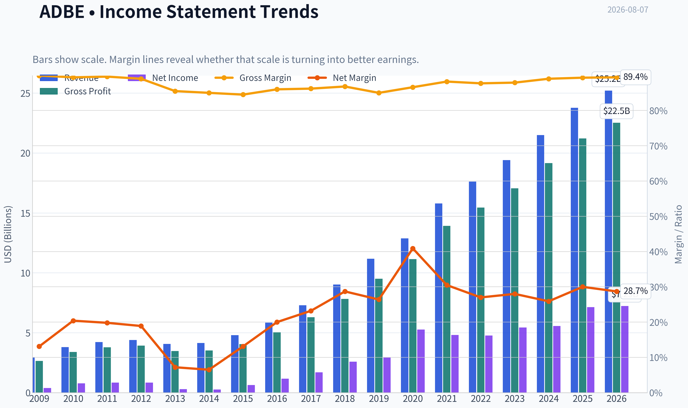
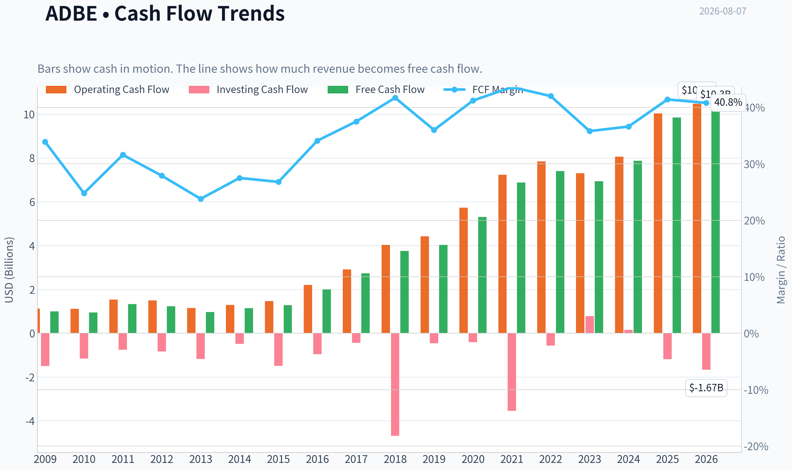
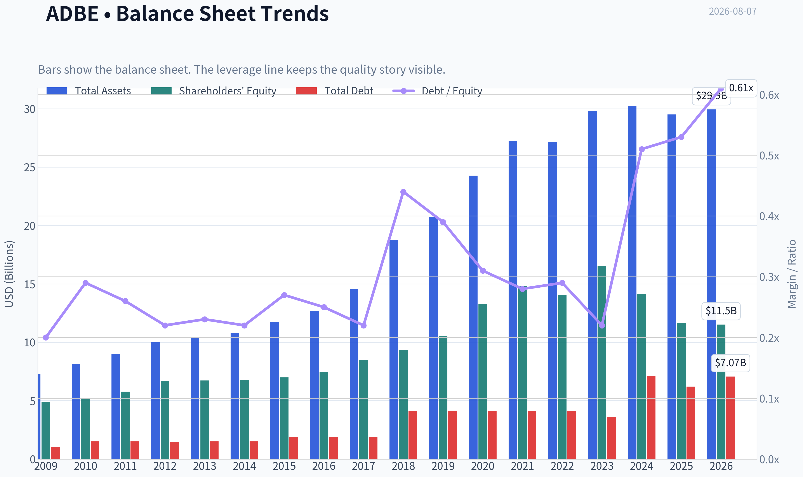
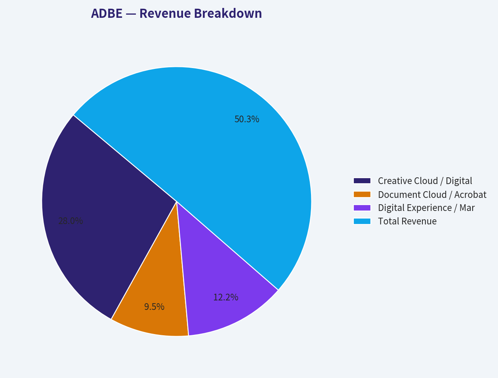
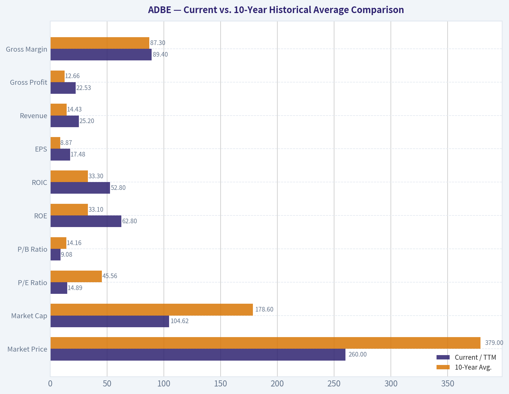
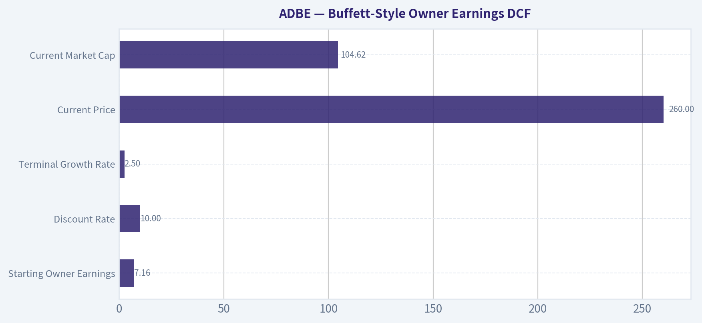
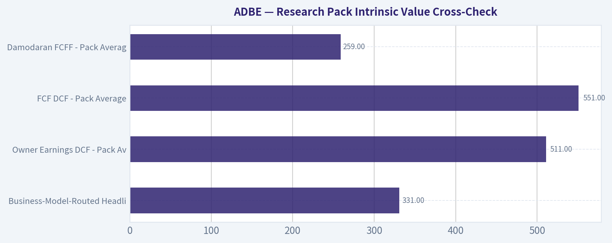
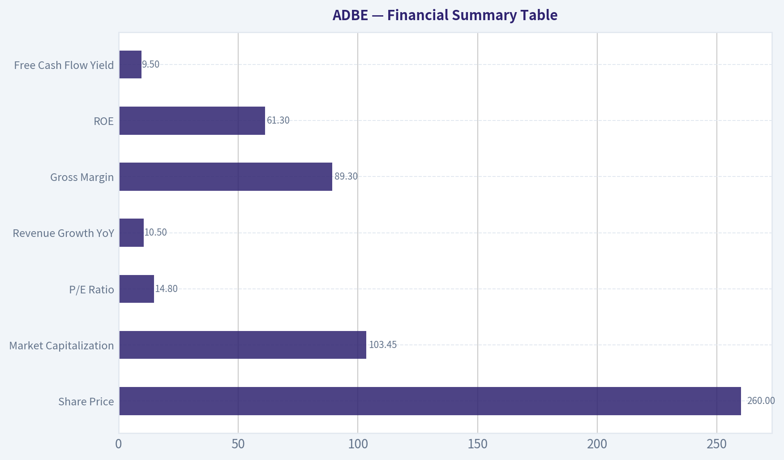

# ADBE Deep Value Intelligence

**Analysis Date:** 2026-08-07

## Critical Disclaimer

*This analysis is generated by Deep Value Intelligence, an AI-powered multi-agent investing framework. Education & research only - not financial advice, not a financial advisor.*

---

## Table of Contents

1. Intelligence Summary
2. Analyst Team Reports
   - Fundamentals Analysis
   - Intrinsic Value Analysis (Buffett)
   - Trend & Growth Analysis (Lynch/Druckenmiller/Fisher)
   - Market Technical Analysis
   - Options Market Analysis
3. Research Team Commentary
4. Value Investing Team Commentary
5. Deep Values Commentary

---

## Intelligence Summary

### Thesis + Conditions

**Core Thesis:** **EXECUTIVE SUMMARY**
Adobe (ADBE) presents a classic valuation asymmetry. At a 14.8x P/E and a 9.5% free cash flow yield, this elite franchise is priced for structural decline (implying just 4.1% terminal growth).

**Key Risks:**
- Adobe (ADBE) presents a classic valuation asymmetry. At a 14.8x P/E and a 9.5% free cash flow yield, this elite franchise is priced for structural decline (implying just 4.1% terminal growth). While AI disruption and potential margin compression ("Red Queen" compute costs) are valid long-term strategic risks, current valuation fully prices in this pessimism before any actual earnings collapse has materialized. Elite cash generation, 89% gross margins, and a 61% ROE provide a massive quality-scaled margin of safety. Our primary risk is no longer overpaying, but rather missing a generational valuation reset by waiting for perfect clarity.
- The Bull (Risky):** Emphasizes Adobe's elite profitability (57% ROIC) and deeply discounted valuation. Argues that workflow "muscle memory" protects the moat, and Adobe is successfully weaponizing AI as an aggregator, making the current price a rare "fat pitch."
- The Pragmatist (Neutral):** Rejects binary thinking. Acknowledges the immense 21% discount to intrinsic value but respects the execution risk of AI integration. Recommends a scaled entry (starter position now, add on confirmation) rather than an all-or-nothing gamble.

**Confidence:** Low

---

## Analyst Team Reports

### Fundamentals Analysis

#### Latest Earnings Snapshot

*Most recent reported quarter anchored on 2026 Q2, with prior-year comparison when available.*

| Metric | 2026 Q2 | 2025 Q2 | YoY Change |
| --- | ---: | ---: | ---: |
| Revenue | $6.62B | $5.87B | +12.7% |
| Operating Income | $2.24B | $2.11B | +6.1% |
| Net Income | $1.71B | $1.69B | +1.2% |
| Diluted EPS | $4.25 | $3.94 | +7.9% |
| Operating Cash Flow | $2.17B | $2.19B | -1.2% |
| Free Cash Flow | $2.11B | $2.14B | -1.7% |

Key Takeaways: This snapshot anchors the most recent reported quarter before the narrative analysis. It helps readers separate long-run business quality from whatever changed in the latest earnings print.

#### 17-Year Financial Metrics for ADBE

*All values below are computed deterministically from raw data - not estimated by AI.*

*Issuer profile: operating company (Technology / Software - Application).*

#### 17-Year Financial Metrics
*Annual rows come from reported financial statements. The final TTM row is computed from the latest four quarters.*

| Metric | 2009 | 2010 | 2011 | 2012 | 2013 | 2014 | 2015 | 2016 | 2017 | 2018 | 2019 | 2020 | 2021 | 2022 | 2023 | 2024 | 2025 | 2026 TTM |
| --- | --- | --- | --- | --- | --- | --- | --- | --- | --- | --- | --- | --- | --- | --- | --- | --- | --- | --- |
| Market Price | $35 | $28 | $27 | $35 | $57 | $74 | $91 | $103 | $181 | $251 | $310 | $478 | $670 | $345 | $611 | $516 | $320 | $260 |
| Market Cap | $18.61B | $14.62B | $13.82B | $17.40B | $29.16B | $37.46B | $46.38B | $51.85B | $90.94B | $124.89B | $152.16B | $232.30B | $322.20B | $162.43B | $280.51B | $232.01B | $136.70B | $104.62B |
| P/E Ratio | 48.05 | 18.91 | 16.62 | 20.85 | 101.39 | 139.02 | 73.76 | 44.31 | 53.69 | 48.25 | 51.59 | 44.18 | 66.85 | 34.15 | 51.69 | 41.74 | 19.17 | 14.89 |
| P/B Ratio | 3.81 | 2.82 | 2.39 | 2.61 | 4.34 | 5.53 | 6.62 | 6.98 | 10.75 | 13.34 | 14.45 | 17.51 | 21.77 | 11.56 | 16.98 | 16.45 | 11.76 | 9.08 |
| ROE | 7.9% | 14.9% | 14.4% | 12.5% | 4.3% | 4.0% | 9.0% | 15.7% | 20.0% | 27.7% | 28.0% | 39.7% | 32.6% | 33.8% | 32.9% | 39.4% | 61.3% | 62.8% |
| ROIC | 11.2% | 15.2% | 14.6% | 13.7% | 5.0% | 4.4% | 8.7% | 15.0% | 21.1% | 26.5% | 25.3% | 42.7% | 35.2% | 33.4% | 39.2% | 40.3% | 54.6% | 52.8% |
| EPS | $0.73 | $1.47 | $1.65 | $1.66 | $0.56 | $0.53 | $1.24 | $2.32 | $3.38 | $5.20 | $6.00 | $10.83 | $10.02 | $10.10 | $11.82 | $12.36 | $16.70 | $17.48 |
| Revenue | $2.95B | $3.80B | $4.22B | $4.40B | $4.06B | $4.15B | $4.80B | $5.85B | $7.30B | $9.03B | $11.17B | $12.87B | $15.79B | $17.61B | $19.41B | $21.50B | $23.77B | $25.20B |
| Gross Profit | $2.65B | $3.40B | $3.78B | $3.92B | $3.47B | $3.52B | $4.05B | $5.03B | $6.29B | $7.83B | $9.50B | $11.15B | $13.92B | $15.44B | $17.05B | $19.15B | $21.22B | $22.53B |
| Gross Margin | 89.9% | 89.4% | 89.6% | 89.0% | 85.5% | 85.0% | 84.5% | 86.0% | 86.2% | 86.8% | 85.0% | 86.6% | 88.2% | 87.7% | 87.9% | 89.0% | 89.3% | 89.4% |
| Operating Margin | 23.4% | 26.1% | 26.1% | 26.8% | 10.4% | 10.0% | 18.8% | 25.5% | 29.7% | 31.5% | 29.3% | 32.9% | 36.8% | 34.6% | 34.3% | 31.3% | 36.6% | 36.1% |
| Net Income | $386.5M | $774.7M | $832.8M | $832.8M | $290.0M | $268.4M | $629.6M | $1.17B | $1.69B | $2.59B | $2.95B | $5.26B | $4.82B | $4.76B | $5.43B | $5.56B | $7.13B | $7.23B |
| Net Margin | 13.1% | 20.4% | 19.8% | 18.9% | 7.2% | 6.5% | 13.1% | 20.0% | 23.2% | 28.7% | 26.4% | 40.9% | 30.5% | 27.0% | 28.0% | 25.9% | 30.0% | 28.7% |
| Revenue Growth | N/A | 29.0% | 11.0% | 4.4% | -7.9% | 2.3% | 15.6% | 22.1% | 24.7% | 23.7% | 23.7% | 15.2% | 22.7% | 11.5% | 10.2% | 10.8% | 10.5% | 6.0% |
| Net Income Growth | N/A | 100.4% | 7.5% | -0.0% | -65.2% | -7.4% | 134.6% | 85.7% | 44.9% | 53.0% | 13.9% | 78.2% | -8.3% | -1.4% | 14.1% | 2.4% | 28.2% | 1.4% |
| Free Cash Flow Growth | N/A | -5.5% | 41.3% | -7.8% | -21.6% | 18.3% | 12.8% | 55.4% | 37.0% | 37.6% | 7.0% | 31.8% | 29.7% | 7.5% | -6.1% | 13.4% | 25.1% | 4.3% |
| Total Book Value | $4.89B | $5.19B | $5.78B | $6.67B | $6.72B | $6.78B | $7.00B | $7.42B | $8.46B | $9.36B | $10.53B | $13.26B | $14.80B | $14.05B | $16.52B | $14.11B | $11.62B | $11.52B |
| Total Assets | $7.28B | $8.14B | $8.99B | $10.04B | $10.38B | $10.79B | $11.73B | $12.70B | $14.54B | $18.77B | $20.76B | $24.28B | $27.24B | $27.16B | $29.78B | $30.23B | $29.50B | $29.93B |
| Total Debt | $1.00B | $1.51B | $1.51B | $1.50B | $1.51B | $1.51B | $1.91B | $1.89B | $1.88B | $4.12B | $4.14B | $4.12B | $4.12B | $4.13B | $3.63B | $7.13B | $6.21B | $7.07B |
| Debt-to-Equity | 0.20 | 0.29 | 0.26 | 0.22 | 0.23 | 0.22 | 0.27 | 0.25 | 0.22 | 0.44 | 0.39 | 0.31 | 0.28 | 0.29 | 0.22 | 0.51 | 0.53 | 0.61 |
| Cash & Equivalents | $999.5M | $749.9M | $989.5M | $1.43B | $834.6M | $1.12B | $876.6M | $1.01B | $2.31B | $1.64B | $2.65B | $4.48B | $3.84B | $4.24B | $7.14B | $7.61B | $5.43B | $4.92B |
| Shareholders' Equity | $4.89B | $5.19B | $5.78B | $6.67B | $6.72B | $6.78B | $7.00B | $7.42B | $8.46B | $9.36B | $10.53B | $13.26B | $14.80B | $14.05B | $16.52B | $14.11B | $11.62B | $11.52B |
| Operating Cash Flow | $1.12B | $1.11B | $1.54B | $1.50B | $1.15B | $1.29B | $1.47B | $2.20B | $2.91B | $4.03B | $4.42B | $5.73B | $7.23B | $7.84B | $7.30B | $8.06B | $10.03B | $10.48B |
| Investing Cash Flow | $-1.50B | $-1.16B | $-757.4M | $-834.7M | $-1.18B | $-490.7M | $-1.49B | $-960.0M | $-442.9M | $-4.68B | $-456.0M | $-414.0M | $-3.54B | $-570.0M | $776.0M | $149.0M | $-1.19B | $-1.67B |
| Free Cash Flow | $998.2M | $943.4M | $1.33B | $1.23B | $963.3M | $1.14B | $1.28B | $2.00B | $2.73B | $3.76B | $4.03B | $5.31B | $6.88B | $7.40B | $6.94B | $7.87B | $9.85B | $10.28B |
| FCF Margin | 33.9% | 24.8% | 31.6% | 27.9% | 23.8% | 27.5% | 26.8% | 34.1% | 37.5% | 41.7% | 36.0% | 41.2% | 43.6% | 42.0% | 35.8% | 36.6% | 41.4% | 40.8% |
| Dividends / Share | $0.00 | $0.00 | $0.00 | $0.00 | $0.00 | $0.00 | $0.00 | $0.00 | $0.00 | $0.00 | $0.00 | $0.00 | $0.00 | $0.00 | $0.00 | $0.00 | $0.00 | $0.00 |

#### Profitability Metrics
- Return on Equity (ROE): 61.3%
- Return on Invested Capital (ROIC): 57.3%
- Return on Assets (ROA): 24.2%
- Gross Margin: 89.3%
- Operating Margin: 36.6%
- Net Profit Margin: 30.0%

#### Liquidity Metrics
- Current Ratio: 1.00
- Quick Ratio: 0.88

#### Leverage Metrics
- Debt-to-Equity Ratio: 0.53
- Interest Coverage Ratio: 33.10
- Net Debt: $779.0M

#### Growth Metrics (Year-over-Year)
- Revenue Growth: 10.5%
- Net Income Growth: 28.2%
- Free Cash Flow Growth: 25.1%
- Revenue CAGR (3-Year): 10.5%
- Revenue CAGR (5-Year): 13.1%

#### Valuation Metrics
- P/E Ratio (TTM): 14.84
- Forward P/E: 9.47
- Price-to-Book: 9.02
- Price-to-Sales: 4.11
- PEG Ratio: 0.61
- EV/EBITDA: 10.78
- Free Cash Flow Yield: 9.5%
- Earnings Yield: 6.7%

#### Owner Earnings (Buffett Method, Code-Computed)
- Net Income: $7.13B
- + Depreciation & Amortization: $818.0M
- - Capital Expenditures: $-179.0M
- - Working Capital Changes: $605.0M
- = **Owner Earnings: $7.16B**

#### Intrinsic Value (Code-Computed)
- Current Price: $260
- **Headline Intrinsic Value (business-model routed): $331**
  Business model: asset light platform - weighted blend [Damodaran FCFF + reverse-DCF fair + owner-earnings DCF] (asset_light_platform)
  Model spread (min-max across DCFs): $259 - $551
  Margin of safety vs. price (headline): 21.5%
  Routing note: Asset-light / high-margin platform: value driven by margins and reinvestment economics - the headline centers on the reverse-DCF demonstrated-growth fair value with Damodaran FCFF as a floor, down-weighting the owner-earnings DCF.
- Buffett Method (Owner Earnings):
  Conservative: $222
  Average: $511
  Optimistic: $1,478
- Cash Flow Method (FCF):
  Conservative: $363
  Average: $551
  Optimistic: $1,015
- Damodaran FCFF (WACC + margins + reinvestment):
  Conservative: $192
  Average: $259
  Optimistic: $442
  Monte Carlo band (P10-P90): $199 - $371 (median $272)
  P(intrinsic value > price): 57.1%
- Reverse-DCF: price implies ~4.1%/yr owner-earnings growth for 10y; trailing 3y was 14.0%, 5y 8.2%.

#### Piotroski F-Score: 8/9
- Positive Net Income: PASS
- Positive Operating Cash Flow: PASS
- ROA Improvement: PASS
- Cash Flow > Net Income: PASS
- Decreasing Debt: PASS
- Improving Current Ratio: FAIL
- No Dilution: PASS
- Improving Gross Margin: PASS
- Improving Asset Turnover: PASS

ANALYST STANCE: **ADVOCATE**

#### Adobe Inc. (ADBE) - Buffett-Style Fundamental Analysis

Adobe is an unusually high-quality, asset-light software franchise trading at a valuation that is now far below its own historical norms. The current price of **$260** compares with the research pack's business-model-routed intrinsic value of about **$331 per share**, implying a **21.5% margin of safety**. The market is pricing Adobe as if long-term owner-earnings growth will be only about **4.1% annually for 10 years**, despite trailing 3-year and 5-year owner-earnings growth of roughly **14.0%** and **8.2%**, respectively.

The key investment question is not whether Adobe is a great business - the financial record strongly supports that it is. The question is whether generative AI, competitive pressure from tools like Figma and Canva, and slower growth in mature creative software will permanently impair Adobe's pricing power and reinvestment runway. At today's valuation, the market appears to be discounting a meaningful amount of that risk.

---

#### Current vs. 10-Year Historical Average Comparison

| Metric | Current / TTM | 10-Year Avg. | Current Standing | Interpretation |
|---|---:|---:|---|---|
| Market Price | $260 | $379 | Below avg. | Shares are trading materially below the last decade's average price, reflecting investor concern over growth deceleration and AI disruption. |
| Market Cap | $104.62B | $178.60B | Below avg. | Market value has compressed sharply from the 2021-2024 period despite revenue, EPS, and FCF being much higher today. |
| P/E Ratio | 14.89x | 45.56x | Far below avg. | Valuation has reset from premium-growth software levels to a much more value-oriented multiple. |
| P/B Ratio | 9.08x | 14.16x | Below avg., but low relevance | For Adobe, P/B is not a primary valuation tool because it is an asset-light software/IP business where book value understates franchise value. |
| ROE | 62.8% | 33.1% | Far above avg. | Extremely high ROE reflects pricing power, capital-light economics, and buybacks reducing equity. |
| ROIC | 52.8% | 33.3% | Far above avg. | Adobe is earning exceptional returns on invested capital, a strong Buffett-style quality signal. |
| EPS | $17.48 | $8.87 | Far above avg. | Per-share earnings have nearly doubled the 10-year average, helped by earnings growth and share repurchases. |
| Revenue | $25.20B | $14.43B | Far above avg. | Adobe has compounded revenue strongly over the decade, though recent growth has slowed. |
| Gross Profit | $22.53B | $12.66B | Far above avg. | Gross profit growth confirms the durability of the software subscription model. |
| Gross Margin | 89.4% | 87.3% | Above avg. | Gross margins remain world-class and are near the top of the historical range. |
| Operating Margin | 36.1% | 32.3% | Above avg. | Operating leverage remains strong despite AI and product investment. |
| Net Income | $7.23B | $4.14B | Far above avg. | Net income is structurally higher than the historical average, though TTM growth has slowed. |
| Net Margin | 28.7% | 28.1% | Slightly above avg. | Profitability remains stable and high, supporting the moat thesis. |
| Revenue Growth | 6.0% | 17.5% | Below avg. | Growth has decelerated meaningfully from Adobe's high-growth years. |
| Net Income Growth | 1.4% | 31.1% | Far below avg. | Current earnings growth is weak relative to history, making valuation discipline important. |
| FCF Growth | 4.3% | 23.8% | Far below avg. | Free cash flow growth has slowed, but the absolute FCF base is very large. |
| Total Book Value | $11.52B | $12.01B | Slightly below avg. | Book value is not very meaningful for Adobe because intangible assets and software economics dominate. |
| Total Assets | $29.93B | $23.50B | Above avg. | Assets have expanded, though Adobe remains capital-light relative to its cash generation. |
| Total Debt | $7.07B | $4.14B | Above avg. | Debt has risen, but remains manageable given cash flow and interest coverage. |
| Debt-to-Equity | 0.61x | 0.32x | Above avg. | Leverage is higher than historical norms, partly due to debt issuance and buybacks. |
| Cash & Equivalents | $4.92B | $4.04B | Above avg. | Liquidity is healthy, though cash is below the 2023-2024 peak. |
| Shareholders' Equity | $11.52B | $12.01B | Slightly below avg. | Equity has been pressured by buybacks and capital allocation choices. |
| Free Cash Flow | $10.28B | $5.68B | Far above avg. | Adobe now produces nearly twice its 10-year average FCF. |
| Dividends / Share | $0.00 | $0.00 | In line | Adobe returns capital through buybacks rather than dividends. |

**Key Takeaways:** Adobe's valuation has compressed dramatically even though the business is producing record or near-record revenue, free cash flow, EPS, ROE, and ROIC. The main negative deviation is growth: revenue, net income, and FCF growth are all meaningfully below their 10-year averages. For a Buffett-style investor, the opportunity is that valuation has fallen faster than business quality; the risk is that slower growth and AI disruption may be structural rather than cyclical.

---

#### Revenue Breakdown

| Revenue Source | Amount ($B) | % of Total |
|---|---:|---:|
| Creative Cloud / Digital Media Creative Products | $14.05B | 55.8% |
| Document Cloud / Acrobat, PDF, E-Signature | $4.75B | 18.8% |
| Digital Experience / Marketing, Analytics, Commerce | $6.10B | 24.2% |
| Publishing, Advertising, and Other | $0.30B | 1.2% |
| **Total Revenue** | **$25.20B** | **100.0%** |

**Key Takeaways:** Adobe remains primarily a Digital Media company, with Creative Cloud as the core economic engine. Document Cloud adds a highly durable workflow business, while Digital Experience gives Adobe exposure to enterprise marketing and analytics budgets. The revenue mix is attractive because most revenue is subscription-based, high-margin, and embedded in professional workflows.

---

#### Market Metrics Interpretation

Adobe's **P/E ratio of 14.89x** is dramatically below its 10-year average of **45.56x**. This is one of the clearest signs that market expectations have reset. Historically, investors paid a premium multiple for Adobe because of its subscription model, pricing power, high margins, and strong recurring revenue. Today's multiple suggests skepticism about future growth and competitive durability.

The **market cap of $104.62B** is far below the 10-year average of **$178.60B**, despite Adobe's current revenue, EPS, and FCF being materially higher than their historical averages. That combination - better fundamentals but lower valuation - is exactly the kind of setup value investors study closely.

The **P/B ratio of 9.08x** should not be interpreted mechanically. Adobe is an asset-light software and intellectual-property business, so book value does not capture the economic value of its installed base, brand, software ecosystem, switching costs, or recurring subscription relationships. For Adobe, intrinsic value should be anchored on owner earnings and free cash flow, not book value.

---

#### Profitability and Business Quality

Adobe's profitability is exceptional. **Gross margin of 89.4%** is above the 10-year average and demonstrates the power of software economics: once the product is built, incremental revenue carries very high profitability. **Operating margin of 36.1%** is also above the 10-year average, indicating that Adobe continues to convert revenue growth into operating profit despite investing heavily in AI, cloud delivery, product development, and sales.

The strongest Buffett-style signal is Adobe's return profile. **ROE of 62.8%** and **ROIC of 52.8%** are extraordinary. ROIC is especially important because it shows Adobe can reinvest capital at very high rates. High ROIC businesses are valuable because they can compound intrinsic value without requiring heavy incremental capital.

Net margin of **28.7%** is slightly above the 10-year average of **28.1%**, showing that the business remains structurally profitable even as revenue growth slows. This is a high-quality business with a large spread between gross margin and reinvestment needs.

---

#### Growth Analysis

Adobe's historical growth record is strong, but the recent trend is clearly slower. Current revenue growth of **6.0%** is well below the 10-year average of **17.5%**. Net income growth of **1.4%** and FCF growth of **4.3%** are also far below long-term averages.

This slowdown is the central reason the stock has de-rated. The market is no longer valuing Adobe as a high-growth compounder. Instead, it is treating Adobe closer to a mature software cash-flow business.

However, the absolute level of cash generation remains excellent. TTM free cash flow is **$10.28B**, almost double the 10-year average of **$5.68B**. Even if Adobe grows at only mid-single digits, the current valuation may still be attractive because the starting FCF yield is high.

---

#### Balance Sheet and Financial Strength

Adobe's balance sheet remains solid, though leverage has increased. Total debt of **$7.07B** is above the 10-year average of **$4.14B**, and debt-to-equity of **0.61x** is also above the historical average of **0.32x**. This deserves monitoring, but it is not currently alarming because Adobe's cash flow is very strong.

Cash and equivalents of **$4.92B** provide a meaningful liquidity buffer. The company also has strong interest coverage, with the research pack showing an interest coverage ratio of approximately **33.1x**. That indicates Adobe can comfortably service its debt.

Book value and shareholders' equity are less useful for valuing Adobe because the company's real assets are intangible: software code, ecosystem position, customer relationships, brand, installed workflows, and pricing power. Buybacks can also reduce book equity, making accounting equity less representative of economic value.

---

#### Cash Flow and Capital Allocation

Adobe's TTM free cash flow is **$10.28B**, compared with a 10-year average of **$5.68B**. The free cash flow yield is approximately **9.5%**, which is unusually high for a business with Adobe's margins, moat, and historical growth record.

Adobe pays **no dividend**, which is consistent with its historical capital allocation policy. Instead, management has preferred share repurchases and reinvestment. For long-term shareholders, buybacks are attractive when the stock is undervalued, but less attractive when done at excessive multiples. Given the current valuation compression, buybacks today are likely more value-accretive than they were during the high-multiple 2020-2021 period.

The Piotroski F-Score of **8/9** is also favorable. Adobe passes on profitability, operating cash flow, cash flow exceeding net income, debt improvement, no dilution, margin improvement, and asset turnover. The only fail is current ratio improvement, which is not a major concern for an asset-light software business with strong recurring cash flow.

---

#### Buffett-Style Owner Earnings DCF

Assumptions used for the hand DCF:

| DCF Input | Assumption |
|---|---:|
| Starting Owner Earnings | $7.16B |
| Discount Rate | 10.0% |
| Terminal Growth Rate | 2.5% |
| Shares Outstanding Estimate | ~402M |
| Current Price | $260 |
| Current Market Cap | $104.62B |

**Key Takeaways:** The DCF uses Adobe's code-computed owner earnings of $7.16B as the starting point. A 10% discount rate is intentionally conservative for a profitable, mature software company, while the 2.5% terminal growth rate prevents the model from assuming excessive perpetual growth. The share count is estimated from the canonical market cap and price.

| Scenario | Explicit Growth Assumption | Year-10 Owner Earnings | PV of Explicit Cash Flows | PV of Terminal Value | Estimated Equity Value | Fair Value / Share |
|---|---:|---:|---:|---:|---:|---:|
| Conservative | 1.5% annually for 10 years, then 2.5% terminal | $8.31B | $47.3B | $43.8B | $91.1B | ~$226 |
| Average / Base Case | 8% fading to 4% by year 10, then 2.5% terminal | $12.81B | $61.0B | $67.5B | $128.5B | ~$319 |
| Optimistic | 12% fading to 4% by year 10, then 2.5% terminal | $15.99B | $71.0B | $84.3B | $155.2B | ~$386 |

**Key Takeaways:** The conservative case produces a value below the current price, meaning Adobe is not risk-free if growth remains very weak. The base case produces a fair value around $319 per share, close to the research pack's headline intrinsic value of $331. The optimistic case shows meaningful upside, but it requires Adobe to sustain strong AI-enabled monetization, continued pricing power, and durable subscription growth.

#### DCF Formula Detail

| Component | Calculation |
|---|---|
| Explicit Forecast PV | Sum of projected owner earnings discounted at 10% for years 1-10 |
| Terminal Value | Year-10 Owner Earnings x 1.025 ÷ (10.0% - 2.5%) |
| Present Value of Terminal Value | Terminal Value ÷ 1.10¹⁰ |
| Equity Value Per Share | Total Present Value ÷ ~402M shares |

**Key Takeaways:** Most of Adobe's DCF value comes from the terminal value, which is normal for a durable, high-margin software franchise. This makes the terminal assumptions important: if Adobe's moat erodes, fair value falls materially. If Adobe remains a dominant creative and document platform, the current price appears conservative.

#### Research Pack Intrinsic Value Cross-Check

| Valuation Model | Fair Value / Share |
|---|---:|
| Business-Model-Routed Headline Intrinsic Value | $331 |
| Owner Earnings DCF - Pack Average | $511 |
| FCF DCF - Pack Average | $551 |
| Damodaran FCFF - Pack Average | $259 |
| Damodaran Monte Carlo P10-P90 | $199-$371 |
| Reverse DCF Implied Growth at Current Price | ~4.1% per year for 10 years |

**Key Takeaways:** The model spread is wide, which reflects uncertainty around Adobe's growth runway and AI impact. The Damodaran FCFF model is the most conservative and sits close to today's price, while owner-earnings and FCF models suggest substantially higher value. The most important insight is the reverse DCF: the current price only requires about 4.1% annual owner-earnings growth, which is modest relative to Adobe's historical record.

---

#### Economic Moat Assessment

Adobe has several durable competitive advantages:

| Moat Source | Assessment |
|---|---|
| Brand and Industry Standard Status | Photoshop, Illustrator, Premiere, Acrobat, and PDF workflows are deeply embedded in creative and enterprise environments. |
| Switching Costs | Professional users, agencies, enterprises, and creators build workflows, templates, files, and teams around Adobe tools. |
| Ecosystem Effects | Creative Cloud, Document Cloud, fonts, stock assets, collaboration tools, and enterprise integrations reinforce each other. |
| Pricing Power | Gross margins near 90% and durable subscription adoption indicate strong willingness to pay. |
| Recurring Revenue | Subscription revenue increases predictability and lowers cyclicality compared with perpetual-license software. |
| AI Optionality | Firefly and AI-assisted creation could increase productivity, engagement, and monetization if Adobe executes well. |

**Key Takeaways:** Adobe's moat remains strong, especially in professional creative and document workflows. The main moat risk is that generative AI reduces the need for traditional creative tools or shifts value to new platforms. However, Adobe also has the distribution, data, customer base, and product depth to be a major AI beneficiary rather than only a victim.

---

#### Management and Capital Allocation

Adobe's management has produced outstanding long-term economics. The transition from license sales to subscriptions was one of the most successful software business-model transitions in public markets. ROIC above **50%** suggests excellent capital allocation and product economics.

The company does not pay dividends, which is acceptable for a high-return software business. The more important question is whether buybacks are executed at attractive prices. At today's valuation, repurchases are likely more shareholder-friendly than during periods when Adobe traded at 40x to 60x earnings.

One concern is that rising debt and lower shareholders' equity have pushed debt-to-equity higher. The absolute leverage is manageable, but management should avoid financial engineering that weakens the balance sheet while growth is slowing.

---

#### Key Investment Insights

| Category | Insight |
|---|---|
| Valuation | P/E of 14.89x is far below the 10-year average of 45.56x, creating a value setup. |
| Quality | ROE and ROIC above 50% indicate exceptional economics. |
| Cash Flow | FCF of $10.28B and FCF yield near 9.5% are highly attractive for a wide-moat software business. |
| Growth | Growth has slowed sharply; current revenue growth of 6.0% is far below the 10-year average. |
| Balance Sheet | Debt is higher than historical norms but still well covered by cash flow. |
| Moat | Adobe remains a dominant creative, document, and digital-experience software platform. |
| Market Expectations | Reverse DCF implies only ~4.1% annual owner-earnings growth, a low hurdle if Adobe's moat holds. |

**Key Takeaways:** Adobe's investment case is a classic quality-at-a-reasonable-price setup. The stock is no longer priced for perfection, but the business still shows exceptional margins, returns on capital, and free cash flow. The central debate is whether the lower growth rate is temporary or a sign of permanent moat erosion.

---

#### Red Flags and Risks

| Risk | Why It Matters |
|---|---|
| AI Disruption | Generative AI could reduce reliance on traditional creative tools or lower willingness to pay. |
| Competitive Pressure | Canva, Figma, open-source tools, and AI-native platforms may pressure parts of Adobe's ecosystem. |
| Growth Deceleration | Revenue, net income, and FCF growth are well below historical averages. |
| Valuation Model Spread | Intrinsic value estimates range widely, from roughly $199 to over $500 depending on assumptions. |
| Higher Leverage | Debt and debt-to-equity are above historical averages. |
| No Dividend Support | Shareholder returns depend mainly on buybacks and price appreciation. |

**Key Takeaways:** The biggest risk is not current profitability; it is future relevance and growth durability. Adobe must prove that AI expands its market rather than commoditizes its tools. Investors should also watch whether management uses cash flow for disciplined buybacks rather than overpaying for acquisitions or relying too heavily on leverage.

---

#### Opportunities

| Opportunity | Potential Impact |
|---|---|
| Firefly and AI Monetization | AI features could support pricing, usage, and new subscription tiers. |
| Document Cloud Expansion | Acrobat, PDF, and e-signature workflows remain large and durable markets. |
| Enterprise Digital Experience | Marketing automation, analytics, and content supply-chain tools can deepen enterprise relationships. |
| Buybacks at Lower Multiples | Repurchasing shares at depressed valuations can increase per-share intrinsic value. |
| Margin Stability | Near-90% gross margins provide significant resilience even if revenue growth moderates. |
| Low Market Expectations | If Adobe grows owner earnings above 4.1%, the stock may re-rate. |

**Key Takeaways:** Adobe does not need to return to 20% growth to justify the current price. With a high free cash flow yield and modest implied expectations, even mid-single-digit to high-single-digit owner-earnings growth could produce attractive returns. The largest upside case depends on Adobe turning AI from a perceived threat into a monetizable productivity layer.

---

#### Final Investment Stance - ADVOCATE

Adobe earns an **ADVOCATE** stance for long-term, quality-focused value investors, with the caveat that position sizing should respect AI and growth uncertainty.

The business has the hallmarks Buffett would admire: high returns on capital, durable customer relationships, pricing power, predictable cash generation, minimal capital intensity, and a strong competitive position. The valuation has compressed to a level that appears attractive relative to Adobe's own history and relative to its owner-earnings power.

At **$260**, the stock trades below the research pack's headline intrinsic value of **$331** and near the conservative Damodaran FCFF estimate. The reverse DCF hurdle of about **4.1% annual owner-earnings growth** appears achievable if Adobe's moat remains intact. The margin of safety is not enormous, but it is meaningful for a business of this quality.

| Final Decision Factor | Assessment |
|---|---|
| Business Quality | Excellent |
| Economic Moat | Strong, but being tested by AI |
| Financial Strength | Strong cash generation; leverage higher but manageable |
| Earnings Predictability | High historically; near-term growth slowing |
| Valuation | Attractive versus history and blended intrinsic value |
| Margin of Safety | Positive, approximately 21.5% versus headline intrinsic value |
| Main Risk | AI-driven disruption and sustained growth deceleration |
| Final Stance | **ADVOCATE** |

**Key Takeaways:** Adobe is a high-quality compounder now priced like a much slower-growth business. The stock is attractive if Adobe can sustain even modest owner-earnings growth and defend its creative and document ecosystems. The stance is ADVOCATE, but investors should monitor AI monetization, competitive pressure, and whether growth stabilizes over the next several quarters.

#### Fundamental Visuals

This graph tracks the profitability and return metrics (ROE, ROIC, Margins) of **ADBE** over the past decade, highlighting capital efficiency trends.

This chart illustrates the financial health of **ADBE** over the last 10 years, mapping cash equivalents and free cash flow against total obligations (Debt).

This breakdown chart from <em>Revenue Breakdown</em> shows the proportional composition for **ADBE** - useful for understanding what drives or risks the business.

---

### Intrinsic Value Analysis (Buffett)

> *Following Warren Buffett's value investing philosophy: Circle of Competence, Economic Moat, Management Quality, and Margin of Safety.*

#### Intrinsic Value Snapshot

Price is what you pay. Intrinsic value is what the business may be worth based on the cash it can create for owners over time. We show a range, not one magic number.

- Current Price: $260.24
- Value Range (conservative to optimistic across both DCF methods): $221.56 to $1,477.90

##### Owner Earnings (Buffett Method)
- Net Income: $7,130,000,000.00
- Depreciation & Amortization: $818,000,000.00
- Capital Expenditures: $-179,000,000.00
- Working Capital Changes: $605,000,000.00
- Owner Earnings: $7,164,000,000.00

##### Intrinsic Value
###### Buffett Method
Uses owner earnings. Stricter, and usually more conservative.
- Conservative: $221.56
- Average: $511.41
- Optimistic: $1,477.90
- Discount Rate: 10.0%

###### Cash Flow Method
Uses free cash flow. Better for companies spending heavily today to grow tomorrow.
- Conservative: $362.71
- Average: $550.76
- Optimistic: $1,015.41
- Discount Rate: 10.0%

ANALYST STANCE: **ADVOCATE**

#### Adobe Inc. (ADBE) - Buffett-Style Investment Report

Adobe is a high-quality, asset-light software franchise trading at an attractive cash-flow yield. At $260 per share, the stock sits below a blended intrinsic value estimate of roughly $331, implying a 21.5% margin of safety. For a wide-moat, high-return business with 89% gross margins, 61% ROE, strong recurring revenue, and a reverse-DCF hurdle of only about 4.1% annual growth, Adobe qualifies as a wonderful business at a fair-to-good price.

---

#### 1. Factor Scorecard

| Factor | Score | Evidence |
|---|---:|---|
| Circle of Competence & Business Simplicity | 4.5 / 5 | Adobe sells mission-critical creative, document, and digital experience software, primarily through subscriptions. The model is understandable: professionals and enterprises pay recurring fees for tools embedded in daily workflows. |
| Moat Test | 4.5 / 5 | Creative Cloud, Acrobat/PDF, Photoshop, Illustrator, Premiere, and enterprise workflow tools create strong brand power, switching costs, file-format standards, and ecosystem lock-in. Gross margin of 89.3% is exceptional. |
| Management Quality & Capital Allocation | 4.0 / 5 | Adobe has compounded revenue and cash flow while maintaining very high returns. Buybacks have supported per-share economics. The failed Figma acquisition raises some capital-allocation caution, but the core record remains strong. |
| Industry Structure | 4.0 / 5 | Digital creative tools and document workflows have rational, high-margin economics. AI introduces competitive pressure and higher compute costs, but Adobe also has distribution, proprietary data, workflow integration, and brand advantages. |
| Gate 5: Quality/Solvency Hard Floor | Not tripped | Fundamentals remain profitable and growing, with strong free cash flow. No evidence of financial distress or inability to cover obligations. |

**Key Takeaways:** Adobe scores highly because it combines an easy-to-understand subscription model with elite software economics. The main concern is not solvency or business quality, but whether AI changes the competitive landscape faster than Adobe can adapt. At today's valuation, the market appears to be pricing in a much weaker future than the business likely deserves.

---

#### 2. Moat Analysis

| Moat Source | Assessment | Evidence |
|---|---|---|
| Intangible Assets / Brand | Very strong | Photoshop, Acrobat, Illustrator, Premiere, Lightroom, and PDF are category-defining products. Adobe is often the default professional standard in creative and document workflows. |
| Switching Costs | Very strong | Creative professionals and enterprises build files, processes, teams, libraries, templates, integrations, and training around Adobe tools. Switching is possible but disruptive. |
| Cost Advantage | Moderate to strong | Software scale produces very high incremental margins. Adobe can spread R&D, cloud, AI, and go-to-market costs across a huge installed base. |
| Network Effects / Ecosystem | Moderate to strong | Adobe benefits from file-format standards, creator communities, plug-ins, agencies, enterprise integrations, and a large trained user base. |
| Moat Direction | Stable to widening, with AI caveat | Firefly and AI features can deepen workflow lock-in, but generative AI competitors reduce the comfort level versus five years ago. |

**Key Takeaways:** Adobe's moat is built on standards, workflows, brand trust, and professional habit. Its products are not merely "nice to have"; for many users they are embedded in how work gets produced, reviewed, shared, and monetized. AI is a real threat, but it is also a tool Adobe can distribute through one of the strongest software ecosystems in the world.

---

#### 3. Financial Summary Table

| Metric | Current / Recent Value |
|---|---:|
| Share Price | $260 |
| Market Capitalization | $103.45B |
| P/E Ratio | 14.8x |
| Revenue Growth YoY | 10.5% |
| Gross Margin | 89.3% |
| ROE | 61.3% |
| Free Cash Flow Yield | 9.5% |
| Estimated Free Cash Flow | ~$9.83B |
| Estimated Net Income | ~$6.97B |
| Estimated Shares Outstanding | ~398M |
| Current Ratio | ~1.0x |
| Headline Intrinsic Value | $331.35 |
| Margin of Safety vs. Price | 21.5% |
| Reverse-DCF Growth Implied by Price | ~4.1% per year for 10 years |
| Trailing 3-Year Growth Reference | 14.0% |
| Trailing 5-Year Growth Reference | 8.2% |

**Key Takeaways:** Adobe's current valuation looks unusually modest for a business with nearly 90% gross margins and double-digit revenue growth. The market is valuing Adobe at under 15 times earnings and a roughly 9.5% free cash flow yield, which is more typical of a mature no-growth business than a high-quality software compounder. The reverse-DCF is the most important signal: the current price only requires about 4.1% annual growth, well below recent history.

---

#### 4. Owner Earnings Calculation

Using free cash flow as the practical proxy for owner earnings:

| Owner Earnings Component | Estimate |
|---|---:|
| Net Income | ~$6.97B |
| Plus: Depreciation & Amortization | Included in cash-flow conversion proxy |
| Less: Maintenance CapEx | Reflected through free cash flow proxy |
| Less: Working Capital Increases | Reflected through free cash flow proxy |
| Estimated Owner Earnings / FCF | ~$9.83B |
| Shares Outstanding | ~398M |
| Owner Earnings per Share | ~$24.70 |

**Key Takeaways:** Adobe converts accounting profit into cash at an excellent rate, which is exactly what a Buffett-style investor wants to see. The estimated owner earnings per share of about $24.70 means the stock trades around 10.5 times owner earnings, an attractive multiple for a business with Adobe's margin structure and competitive position.

---

#### 5. Three-Scenario DCF Valuation

| Scenario | Assumption | Estimated Value per Share |
|---|---|---:|
| A: No Growth | Owner earnings capitalized at 10% | ~$247 |
| B: GDP Growth | 3% perpetual growth, 10% discount rate | ~$364 |
| C: Historical Growth Haircut | 6% growth for 10 years, then 3% terminal growth | ~$454 |
| Research Pack Owner-Earnings DCF | Owner earnings model | $511 |
| Research Pack FCF DCF | Free cash flow model | $551 |
| Research Pack Damodaran FCFF | More conservative FCFF model | $259 |
| Blended Headline Intrinsic Value | Business-model-routed blend | $331 |

**Key Takeaways:** The no-growth case lands close to the current price, which provides downside support if Adobe merely holds its cash earnings steady. The conservative 3% growth case already produces value meaningfully above the market price. The broader valuation set shows a wide range, but the blended estimate of $331 suggests the stock is undervalued without requiring heroic assumptions.

---

#### 6. Margin of Safety Analysis

| Valuation Measure | Value |
|---|---:|
| Current Price | $260 |
| Headline Intrinsic Value | $331 |
| Implied Margin of Safety | 21.5% |
| Quality-Scaled Required Margin of Safety | ~10% to 15% |
| Reverse-DCF Growth Implied by Price | ~4.1% |
| Recent 5-Year Growth Reference | 8.2% |
| Recent 3-Year Growth Reference | 14.0% |

**Key Takeaways:** Adobe's margin of safety is attractive because the business quality is high. A mediocre company might need a 30% to 40% discount, but a wide-moat software compounder does not. The current price appears to demand only low-single-digit growth, while Adobe has recently delivered substantially better growth and still has meaningful AI, document, creative, and enterprise monetization opportunities.

---

#### 7. Management Quality Assessment

| Area | Assessment |
|---|---|
| Owner Orientation | Good. Management has focused on recurring revenue, ecosystem expansion, and long-term product relevance. |
| Capital Allocation | Good, with one caution. Buybacks and reinvestment have supported per-share compounding; the attempted Figma acquisition was strategically understandable but expensive and raised discipline concerns. |
| Candor & Execution | Strong operating execution over many years, especially the transition to subscription software and continued cloud monetization. |
| Debt Discipline | Strong. Adobe's cash generation gives it significant balance-sheet flexibility. |
| Recent Guru Signal | Steve Cohen's Point72 trimmed its position, but this is not central to a Buffett-style long-term owner analysis. |

**Key Takeaways:** Adobe's management has executed one of the great software business model transitions, moving from packaged software to subscription cloud economics. The Figma episode deserves a capital-allocation demerit, but it does not erase the long-term record of high-margin growth and durable cash generation. Overall, management appears capable, though not flawless.

---

#### 8. Final Buffett Scorecard

| Criterion | Weight | Score | Weighted Contribution |
|---|---:|---:|---:|
| Moat Width & Durability | 25% | 4.5 | 1.13 |
| Valuation / Margin of Safety | 20% | 4.2 | 0.84 |
| Capital Returns - ROIC vs. WACC | 15% | 5.0 | 0.75 |
| Business Understanding & Predictability | 12% | 4.5 | 0.54 |
| Management Quality & Capital Allocation | 12% | 4.0 | 0.48 |
| Reinvestment Runway | 8% | 4.0 | 0.32 |
| Balance Sheet Strength | 4% | 4.5 | 0.18 |
| Industry Structure | 4% | 4.0 | 0.16 |
| **Total Score** | **100%** |  | **4.40 / 5.00** |

**Key Takeaways:** Adobe clears the threshold for an ADVOCATE stance with a strong overall score of 4.40 out of 5. The company combines wide-moat characteristics, exceptional capital returns, strong cash conversion, and a valuation that already discounts a fair amount of fear. The primary risk is AI-driven disruption, but the price now provides a reasonable cushion against that uncertainty.

---

#### 9. Investment Stance

| Stance | Conviction | Rationale |
|---|---|---|
| **ADVOCATE** | High | Adobe is a wonderful business trading at a fair-to-attractive price. The stock offers a 9.5% free cash flow yield, a 21.5% margin of safety to blended intrinsic value, and a reverse-DCF hurdle of only about 4.1% annual growth. |

**Key Takeaways:** Adobe is not a deep-cyclical bargain; it is a high-quality compounder being priced like its future has materially worsened. AI risk is real, but Adobe's distribution, brand, file standards, and workflow depth give it a strong chance to defend and extend its franchise. For a Buffett-style investor, this is an attractive opportunity to own a durable, cash-rich software business at a reasonable discount to intrinsic value.
#### Valuation Bridge

This bridge places the current market price beside each intrinsic value lens so readers can see whether upside depends on one method or shows up across several methods.

| Scenario | Intrinsic Value / Share |
| --- | ---: |
| Buffett Method | $511.41 |
| Cash Flow Method | $550.76 |
| Damodaran Method | $259.28 |
| Current Price | $260.24 |

#### Key Takeaways

If one method is far above the others, the upside case depends on a specific modelling assumption. When several methods cluster together, the valuation story is more robust.

#### Valuation Visuals

This comparison chart from *Latest Earnings Snapshot* stacks current figures against historical benchmarks for **ADBE**, making it easy to see where the company trades relative to its own averages.

This comparison chart from *Current vs. 10-Year Historical Average Comparison* stacks current figures against historical benchmarks for **ADBE**, making it easy to see where the company trades relative to its own averages.

This comparison chart from *Buffett-Style Owner Earnings DCF* stacks current figures against historical benchmarks for **ADBE**, making it easy to see where the company trades relative to its own averages.

This comparison chart from *Research Pack Intrinsic Value Cross-Check* stacks current figures against historical benchmarks for **ADBE**, making it easy to see where the company trades relative to its own averages.

This comparison chart from *Financial Summary Table* stacks current figures against historical benchmarks for **ADBE**, making it easy to see where the company trades relative to its own averages.

---

### Trend & Growth Analysis (Lynch/Druckenmiller/Fisher)

> *Following Peter Lynch's GARP, Stanley Druckenmiller's macro-aware approach, and Philip Fisher's scuttlebutt methodology.*

ANALYST STANCE: **WATCH**

#### Adobe (ADBE) Growth Investment Report - 2026-08-07

Adobe is a world-class software franchise trading at a surprisingly value-like multiple, but from a Lynch/Fisher/Druckenmiller growth lens it is currently more of a **high-quality stalwart with AI re-acceleration optionality** than a proven fast grower. The stock looks undervalued on cash flow and reverse-DCF assumptions, but the growth inflection is not yet strong enough to call it a ten-bagger candidate.

---

#### 1. Lynch Classification

| Category | Adobe Fit | Evidence | Growth-Investor Implication |
|---|---:|---|---|
| Slow Grower | No | Revenue growth above 5% | Not a mature no-growth compounder |
| Stalwart | **Yes** | Revenue growth around 10.5% YoY | High-quality hold / GARP candidate |
| Fast Grower | Not yet | Needs sustained 15% to 25%+ growth | AI monetization must reaccelerate growth |
| Cyclical | No | Recurring software revenue | Low cyclicality versus hardware/semis |
| Turnaround | No | Business remains highly profitable | Sentiment reset, not operational distress |
| Asset Play | No | Value is intangible software platform | Not an asset-value thesis |

**Key Takeaways:** Adobe is best classified as a **Stalwart**, not a Lynch-style fast grower. The company has elite margins, recurring revenue, and strong cash generation, but current growth near 10% is below the primary ten-bagger zone. The investment case depends on whether AI can turn Adobe from a steady compounder back into an accelerating growth company.

---

#### 2. The Story in 3 Bullets

- **Adobe sells the creative and document software that professionals and enterprises use every day**: Photoshop, Illustrator, Premiere, Acrobat, Sign, Firefly, and Experience Cloud.
- **AI is both the threat and the opportunity**: generative AI tools could commoditize parts of content creation, but Adobe is embedding Firefly and AI credits directly into its workflow ecosystem.
- **The market is pricing Adobe like growth will fade**, while the company still has 89% gross margins, roughly 9.5% free-cash-flow yield, and a reverse-DCF hurdle of only about 4.1% annual growth for 10 years.

---

#### 3. TAM Analysis and 10x Test

| Item | Estimate / Assessment |
|---|---:|
| Current market cap | $103.45B |
| Current share price | $260 |
| Estimated annual revenue base | ~$23B to $24B |
| 10x revenue target | ~$230B to $240B |
| Required TAM for 10x revenue at <20% share | >$1.15T |
| Relevant TAM buckets | Creative software, digital documents, marketing automation, enterprise content, AI-assisted media production |
| TAM direction | Expanding, helped by AI content volume growth |
| 10x revenue test | **Not clearly passed** |

**Key Takeaways:** Adobe has a large and expanding market, but a clean 10x revenue path is not obvious from today's scale. For Adobe to 10x, it likely needs generative AI to materially expand the total content-creation and marketing automation market, not merely defend existing Creative Cloud pricing. The more realistic upside case is a strong multi-year rerating and compounding story, not a classic small-cap ten-bagger setup.

---

#### 4. Revenue Growth Trend

| Metric | Current Read |
|---|---:|
| Revenue growth YoY | 10.5% |
| Trailing 3-year growth reference | ~14.0% |
| Trailing 5-year growth reference | ~8.2% |
| Pattern | Stable to modestly slowing versus best periods |
| Growth classification | Stalwart / GARP |
| Required for growth inflection | Sustained acceleration toward mid-teens revenue growth |

**Key Takeaways:** Adobe's revenue growth is solid but not yet accelerating. The company is still growing faster than GDP and most mature software peers, but it is not currently showing the 20% plus revenue profile that defines Lynch's fast growers. The critical watch item is whether Firefly, AI credits, enterprise adoption, and new pricing tiers can push growth back toward the mid-teens.

---

#### 5. Unit Economics

| Metric | Adobe Read | Quality |
|---|---:|---|
| Gross margin | 89.3% | Excellent |
| ROE | 61.3% | Excellent |
| FCF yield | 9.5% | Excellent at current price |
| Estimated FCF margin | ~40%+ implied | Excellent |
| Revenue growth + FCF margin, Rule of 40 proxy | ~50%+ | Strong |
| LTV/CAC | Not disclosed | Likely strong, but cannot verify |
| NRR | Not disclosed | Need disclosure / segment signals |
| Current ratio | ~1.0 | Adequate, not a concern given cash generation |

**Key Takeaways:** Adobe's unit economics are outstanding by software standards. The business has extremely high gross margins, strong returns on equity, and very high free-cash-flow conversion. Even without disclosed LTV/CAC or NRR, the financial profile suggests a durable, efficient subscription model rather than a company buying growth uneconomically.

---

#### 6. Inflection Point Assessment

| Inflection Type | Status | Evidence / Interpretation |
|---|---|---|
| Product cycle inflection | Possible | Firefly and AI-native creative workflows are ramping |
| Market share inflection | Unclear | AI-native competitors remain a real threat |
| Margin inflection | Already strong | Operating leverage exists, but AI costs may pressure margins |
| TAM inflection | Possible | AI could expand content production volume dramatically |
| Competitive inflection | Mixed | Figma, Canva, OpenAI, Midjourney, and other tools intensify competition |
| Earnings inflection | Not yet proven | Market wants clearer AI monetization |

**Key Takeaways:** Adobe has several possible inflection points, but none are fully proven yet. The biggest upside comes from AI expanding usage, pricing, and enterprise adoption inside Adobe's existing workflows. The biggest risk is that AI increases compute costs and competitive pressure faster than it increases revenue.

---

#### 7. Macro Setup Evaluation

| Macro Factor | Read for Adobe |
|---|---|
| Interest rates | Falling or stable rates would help software multiples |
| Economic sensitivity | Moderate; enterprise marketing budgets can be cyclical |
| Secular theme exposure | AI, cloud software, digital media, marketing automation |
| AI impact | Both tailwind and disruption risk |
| Macro stance | Neutral to positive |

**Key Takeaways:** Adobe is exposed to durable secular themes, especially AI-assisted content creation and digital workflow automation. Macro is not the main problem; the bigger issue is investor confidence in Adobe's AI monetization. If rates fall and software multiples expand, Adobe's low valuation gives it meaningful rerating potential.

---

#### 8. Fisher 15 Points Score

| Fisher Point | Score, 1-5 | Rationale |
|---|---:|---|
| Products with sizable market potential | 4 | Large creative/document/marketing markets |
| Management determination to develop new products | 4 | Heavy AI product push |
| Effective R&D | 4 | Firefly, Creative Cloud, Document Cloud innovation |
| Above-average sales organization | 4 | Strong enterprise and prosumer channels |
| Worthwhile profit margin | 5 | Elite gross and FCF margins |
| Improving profit margins | 3 | Already high; AI costs may pressure |
| Labor/personnel relations | 3 | No major red flag, limited data |
| Executive relations | 3 | No major red flag, limited data |
| Management depth | 4 | Mature global software organization |
| Cost analysis/accounting | 4 | Strong cash conversion and financial discipline |
| Outstanding moat aspects | 4 | Brand, workflows, file standards, ecosystem |
| Long-range profit outlook | 4 | Strong, unless AI disrupts pricing power |
| Dilution risk | 4 | Strong FCF reduces financing need |
| Candor in difficulties | 3 | Needs clearer AI monetization disclosures |
| Management integrity | 4 | Long operating history and credibility |
| **Total** | **57/75** | **Good** |

**Key Takeaways:** Adobe scores well on Fisher quality factors, especially margins, product depth, brand strength, and long-term profit potential. The score is not "outstanding" because the AI transition still creates uncertainty around pricing power, competitive position, and disclosure clarity. This is a high-quality company, but the growth inflection needs more proof.

---

#### 9. Valuation Analysis

| Valuation Metric | Current Read | Interpretation |
|---|---:|---|
| Share price | $260 | Multi-year depressed sentiment |
| Market cap | $103.45B | Large-cap software |
| P/E | 14.8x | Cheap versus historical software quality |
| Revenue growth | 10.5% | Solid, not fast-growth |
| PEG using revenue growth as proxy | ~1.4x | Fair to attractive |
| FCF yield | 9.5% | Very attractive |
| Headline intrinsic value | $331.35 | ~21.5% margin of safety |
| Owner earnings DCF | $511.41 | High upside scenario |
| FCF DCF | $550.76 | High upside scenario |
| Damodaran FCFF | $259.28 | Near current price |
| Reverse DCF implied growth | ~4.1% for 10 years | Low hurdle |

**Key Takeaways:** Adobe looks inexpensive for a company with this level of profitability and brand strength. The current price appears to assume very modest long-term growth, which creates upside if AI monetization is merely decent. The valuation is much more compelling than the current growth rate.

---

#### 10. Scenario Analysis

| Scenario | Assumption | Implied View |
|---|---|---|
| Bear Case | AI competition pressures pricing; growth slows to mid-single digits; margins compress | Stock may be near fair value around current levels |
| Base Case | Growth remains 8% to 11%; margins stay strong; valuation normalizes modestly | Attractive GARP return potential |
| Bull Case | Firefly and AI credits reaccelerate growth to mid-teens; investors rerate Adobe as an AI platform | Significant upside, potentially 50%+ over several years |
| Ten-Bagger Case | Adobe creates or dominates new AI-native creative/marketing markets | Possible but low probability from current scale |

**Key Takeaways:** The downside appears cushioned by valuation and cash flow, while the upside depends on revenue reacceleration. Adobe does not need heroic assumptions to be undervalued, but it does need a clearer AI growth narrative to become a true growth-stock advocate idea. The ten-bagger path exists only if AI dramatically expands Adobe's market, not if Adobe merely defends its current franchise.

---

#### 11. Growth Investor Scorecard

| Criterion | Weight | Score, 1-5 | Weighted Score |
|---|---:|---:|---:|
| The Story | 10% | 4.0 | 0.40 |
| TAM & Runway | 20% | 3.3 | 0.66 |
| Revenue Growth | 20% | 2.8 | 0.56 |
| Unit Economics | 15% | 4.8 | 0.72 |
| Competitive Position | 10% | 4.0 | 0.40 |
| Management Quality | 10% | 3.8 | 0.38 |
| Macro Setup | 5% | 3.5 | 0.18 |
| Profitability Path | 5% | 5.0 | 0.25 |
| Valuation | 5% | 4.5 | 0.23 |
| **Total** | **100%** |  | **3.78 / 5.00** |

**Key Takeaways:** Adobe scores well overall because the business quality and valuation are excellent. The main drag is revenue growth, which is currently too low for a pure growth-investor advocate rating. The score technically falls in the "good setup" zone, but because Lynch classification is Stalwart rather than Fast Grower, I would treat it as a **WATCH / selective GARP buy**, not a high-conviction ten-bagger idea.

---

#### 12. Position Size Stance

| Investor Type | Stance | Suggested Position Approach |
|---|---|---|
| Pure growth / ten-bagger investor | WATCH | Wait for revenue acceleration evidence |
| GARP investor | Accumulate selectively | Valuation and FCF yield are attractive |
| Existing holder | Hold / add modestly | Quality remains high and expectations are low |
| Concentrated growth portfolio | Small position only | 2% to 4% until AI monetization is clearer |
| Value-quality portfolio | More attractive | Could justify a larger weight due to cash flow |

**Key Takeaways:** Adobe is more compelling as a quality-GARP idea than as a pure hypergrowth stock. I would not make it a top concentrated growth position yet, but I would not ignore it at this valuation. Existing holders should monitor AI adoption and revenue acceleration rather than sell solely because sentiment is weak.

---

#### 13. Key Risks and Catalysts

| Category | Item | Importance |
|---|---|---|
| Risk | AI-native tools commoditize parts of creative work | High |
| Risk | Firefly monetization disappoints | High |
| Risk | AI compute costs pressure margins | Medium |
| Risk | Enterprise marketing budgets weaken | Medium |
| Risk | Figma, Canva, OpenAI, and others pressure workflows | High |
| Catalyst | AI credits drive higher ARPU | High |
| Catalyst | Creative Cloud growth reaccelerates | High |
| Catalyst | Document Cloud and Acrobat AI adoption improves | Medium |
| Catalyst | Software multiple expansion from lower rates | Medium |
| Catalyst | Buybacks at depressed valuation compound per-share value | Medium |

**Key Takeaways:** The core debate is simple: Adobe is either an AI winner with temporarily depressed sentiment, or a legacy software leader facing margin and pricing pressure from AI disruption. The valuation gives investors a margin of safety, but the growth case needs clearer proof. The strongest catalyst would be visible acceleration in AI-driven annual recurring revenue, average revenue per user, and enterprise adoption.

---

#### Final View

Adobe is a **high-quality, undervalued software stalwart with AI upside**, but it is not yet a confirmed Lynch fast grower. The stock's depressed valuation, 9.5% FCF yield, 89% gross margin, and low reverse-DCF hurdle make it attractive on a GARP basis. However, for a growth mandate focused on inflection points and ten-bagger potential, I would wait for clearer evidence that AI is accelerating revenue rather than simply defending the existing franchise.

**Stance: WATCH - attractive valuation, elite business, but growth inflection not yet proven.**

---

### Market Technical Analysis

ANALYST STANCE: **WATCH**

#### ADBE Technical Market Report - Data Through 2026-08-06

ADBE closed at **$260.24** on 2026-08-06. The stock has staged a strong tactical rebound from the June capitulation zone near **$195-$204**, but it remains below the declining **200-day SMA**, so the current setup is best characterized as a **counter-trend recovery attempting to mature into a trend reversal**. Momentum is constructive, but the next resistance band between roughly **$266-$275** is important.

| Selected Indicator | Latest Reading | Current Signal | Why It Is Relevant Here |
|---|---:|---|---|
| `close_10_ema` | **$250.10** | Price is above a rising short-term EMA | Captures the recent rebound and helps identify near-term pullback support. |
| `close_50_sma` | **$229.25** | Price is well above the 50-day SMA | Confirms that the June/July rebound has repaired the medium-term trend. |
| `close_200_sma` | **$274.94** | Price remains below the 200-day SMA | Keeps the broader trend from being fully bullish yet; this is the key strategic hurdle. |
| `macd` | **+9.55** | Positive and rising | Confirms improving momentum after deeply negative readings in late June. |
| `rsi` | **63.86** | Bullish but not overbought | Shows strong demand without a classic overbought warning above 70. |
| `boll_ub` | **$269.53** | Near-term upside reference | Defines the upper edge of the current volatility envelope and breakout zone. |
| `boll_lb` | **$207.15** | Far below price | Shows the rebound has moved well away from panic/oversold conditions. |
| `atr` | **$11.54** | Elevated but stabilizing | Useful for stop placement and position sizing because daily ranges remain large. |

Key Takeaways: ADBE's short- and medium-term indicators are now constructive, with price above both the 10-day EMA and 50-day SMA. However, the stock has not yet reclaimed the 200-day SMA, which means the larger downtrend has not been fully neutralized. Momentum supports further upside testing, but traders should respect the heavy resistance zone near the upper Bollinger Band and 200-day average.

#### Indicator Selection Rationale

The chosen indicators provide complementary views without excessive overlap. The **10 EMA, 50 SMA, and 200 SMA** define short-, medium-, and long-term trend structure. **MACD and RSI** measure momentum from different angles: MACD captures trend acceleration, while RSI shows whether buying pressure is becoming stretched. **Bollinger upper and lower bands** frame the current volatility range, and **ATR** supports risk management in a still-volatile stock.

I did **not** prioritize MACD signal or histogram separately because they would be partly redundant with MACD for this report. I also did not include Bollinger middle because the moving averages already provide sufficient trend benchmarks.

#### Trend Structure

ADBE's trend has improved meaningfully since late June. The stock moved from a deeply damaged condition after the June selloff into a stronger recovery pattern during July and early August. The close at **$260.24** is about **$10 above the 10-day EMA** and roughly **$31 above the 50-day SMA**, showing buyers are in control on the short- and intermediate-term timeframes.

The problem is that the **200-day SMA near $274.94** is still above the market and declining. That matters because rallies below a falling 200-day average can remain vulnerable to failed breakout attempts. A decisive move above **$270-$275** would materially improve the technical picture, especially if it occurs with expanding volume.

#### Momentum and Exhaustion Risk

Momentum has shifted firmly positive. MACD climbed from deeply negative readings around **-14** in late June to **+9.55**, which is a major improvement. This type of MACD recovery often reflects a transition from forced selling to accumulation or short-covering.

RSI at **63.86** is supportive but not extreme. This is constructive: the stock has room to test resistance before reaching a classic overbought threshold. However, RSI did reach **68.54** on 2026-07-29 when price closed at **$263.43**, so traders should monitor whether new price highs are confirmed by RSI or whether momentum starts to diverge.

#### Volatility and Risk

ATR is **$11.54**, which is still large relative to the stock price. That means ADBE can move roughly **4%-5% in a normal volatility-adjusted swing**, so tight stops may be vulnerable to noise. A one-ATR downside buffer from the latest close sits near **$248.70**, close to the rising 10-day EMA. A two-ATR buffer is near **$237.16**, closer to the broader July support area.

Bollinger Bands show the stock is not yet at an extreme. The upper band is near **$269.53**, while the lower band is near **$207.15**. Price is closer to the upper band, confirming upside momentum, but it has not yet broken meaningfully above the volatility envelope.

#### Key Trading Levels

| Zone | Approximate Level | Technical Meaning | Trader Interpretation |
|---|---:|---|---|
| Immediate resistance | **$263-$266** | Late-July high/near recent rally peak | A close above this area would confirm renewed upside pressure. |
| Volatility resistance | **$269.50** | Upper Bollinger Band | A push through this level could signal breakout strength, but failure may trigger consolidation. |
| Major trend resistance | **$274-$276** | 200-day SMA and prior June high area | This is the most important confirmation zone for a broader trend reversal. |
| First support | **$250-$251** | 10-day EMA and recent consolidation level | A normal pullback can hold here without damaging the rebound. |
| Secondary support | **$243-$245** | Recent congestion and prior pivot area | Losing this zone would weaken short-term momentum. |
| Medium-term support | **$229-$230** | 50-day SMA | A deeper pullback to this area would test whether the recovery remains intact. |
| Major downside reference | **$204-$207** | June breakdown/rebound zone and lower Bollinger area | A return here would imply the recovery has failed. |

Key Takeaways: The most important upside test is the **$269-$276** zone, where the upper Bollinger Band and 200-day SMA are clustered. On the downside, **$250** is the first meaningful support area because it aligns with the rising 10-day EMA. If ADBE loses $243-$245, the rebound would look less controlled and more vulnerable to a deeper retest.

#### Tactical Interpretation

For short-term traders, the setup is constructive while ADBE remains above **$250**. Pullbacks toward the 10-day EMA may be buyable if they occur on declining volume and stabilize quickly. A breakout above **$266**, followed by acceptance above **$270**, would strengthen the case for a move toward the 200-day SMA near **$275**.

For swing traders, the best confirmation would be a close above the 200-day SMA with MACD still rising and RSI remaining below severely overbought territory. Until then, this remains a strong rebound inside a damaged longer-term structure rather than a fully confirmed bull trend.

For risk management, ATR argues against overly tight stops. A stop just below **$248-$250** may suit aggressive traders, while more patient traders may use the **$243-$245** area as the key short-term invalidation zone. A break below the 50-day SMA near **$229** would significantly weaken the recovery thesis.

#### Scenario Map

| Scenario | Trigger | Expected Technical Read-Through | Bias |
|---|---|---|---|
| Bullish continuation | Close above **$266**, then follow-through above **$270** | Momentum likely targets the 200-day SMA near **$275** | Constructive |
| Major reversal confirmation | Strong close above **$275-$276** | Longer-term trend damage begins to repair meaningfully | Bullish upgrade candidate |
| Healthy pullback | Dip toward **$250** that holds | Rebound remains intact; 10-day EMA acts as support | Buy-the-dip watch |
| Momentum warning | Break below **$243-$245** | Short-term trend weakens and recent breakout attempt may be failing | Caution |
| Recovery failure | Break below **$229-$230** | Price loses the 50-day SMA; rebound becomes vulnerable to retesting June levels | Bearish |

Key Takeaways: ADBE is in a technically improved but not fully confirmed position. The stock has enough momentum to challenge **$266-$275**, but the falling 200-day SMA remains the key barrier. The stance is **WATCH** because the rebound is strong, yet confirmation is still needed before treating the move as a durable long-term trend reversal.

---

### Options Market Analysis

> *Reading options flow - put/call ratios, IV skew, and unusual activity - to gauge institutional positioning and event-driven risk.*

#### ADBE Options Market Sentiment Report
*Options data as of 2026-08-07*

#### 1. Put/Call Ratio Analysis

| Expiration | Call OI | Put OI | Put/Call OI Ratio | Call Volume | Put Volume | Put/Call Volume Ratio | Read |
|---|---:|---:|---:|---:|---:|---:|---|
| 2026-08-07 | 0 | 0 | N/A | 6,951 | 2,395 | 0.34 | Same-day call volume dominates |
| 2026-08-14 | 0 | 0 | N/A | 1,044 | 1,300 | 1.25 | Short-term put volume heavier |
| 2026-08-21 | 1,043 | 21 | 0.02 | 3,033 | 2,648 | 0.87 | Call-heavy OI, balanced-to-put-leaning volume |
| **Near-Term Total** | **1,043** | **21** | **0.02** | **11,028** | **6,343** | **0.58** | **Mild call-volume bias; extreme call-heavy OI** |

**Key Takeaways:** ADBE's near-term put/call volume ratio is **0.58**, below the historical neutral baseline of roughly **0.70**, indicating modestly stronger call demand than put demand. The open-interest ratio is extremely low at **0.02**, but this is based almost entirely on the 2026-08-21 expiration and should be treated cautiously because the front two expirations show zero reported OI. Overall, the put/call setup leans slightly bullish, but the signal quality is weakened by incomplete or thin OI data.

Relative to a neutral put/call baseline near **0.7**, ADBE's aggregate options volume shows **more call activity than normal**, often associated with bullish speculation or short-term upside positioning. However, the 2026-08-14 expiry has a put/call volume ratio above 1.0, suggesting some near-term hedging or downside protection demand is still present.

---

#### 2. Implied Volatility Assessment

| Expiration | ATM Call IV | ATM Put IV | Put IV Premium vs Call IV | Skew Read |
|---|---:|---:|---:|---|
| 2026-08-07 | 5.4% | 7.0% | +1.6 pts | Puts priced richer than calls |
| 2026-08-14 | 1.8% | 2.6% | +0.8 pts | Mild put skew |
| 2026-08-21 | 0.6% | 2.6% | +2.0 pts | Clearer put premium |

**Key Takeaways:** Across the listed expirations, **ATM put IV is consistently above ATM call IV**, which points to downside protection demand despite call-heavy volume. The absolute IV levels appear unusually low for a large-cap technology stock and may reflect data limitations, stale quotes, or near-expiry effects rather than a clean market-implied volatility signal. The skew direction is more informative than the absolute IV level: traders are paying more for downside than upside.

The available data does **not** show an obvious volatility surge ahead of a known catalyst. If ADBE had a confirmed earnings event, product announcement, or macro-sensitive date within these expirations, the IV data here does not clearly reflect a classic pre-event volatility premium. The more notable feature is the **put skew**, not elevated overall IV.

---

#### 3. Unusual Options Activity

| Screen | Result | Interpretation |
|---|---|---|
| Contracts with volume greater than 5x open interest | None found | No clear evidence of fresh, outsized institutional positioning |
| Same-day activity | 2026-08-07 call volume exceeded put volume by a wide margin | Could reflect short-term speculative call trading, but lack of strike-level data limits conviction |
| Near-term flow quality | Moderate volume, limited reported OI | Signal should be discounted due to incomplete OI context |

**Key Takeaways:** No unusual options contracts were flagged under the **volume greater than 5x open interest** screen. That reduces evidence for a strong "smart money" directional bet in the near-term chain. The same-day call volume is notable, but without strike-level details it is hard to distinguish institutional buying from retail speculation, closing trades, or intraday gamma-related flow.

Because no specific unusual contracts were identified, there is no clean call sweep, put sweep, or high-conviction institutional trade to anchor the sentiment call. The absence of unusual activity makes the overall read less aggressive.

---

#### 4. Open Interest Concentration and Pinning Risk

| Area | Observation | Market Implication |
|---|---|---|
| Highest reported OI expiration | 2026-08-21 | Only expiry with meaningful reported OI |
| Call OI concentration | 1,043 calls on 2026-08-21 | Indicates call-side positioning dominates reported OI |
| Put OI concentration | 21 puts on 2026-08-21 | Little reported downside OI in available data |
| Strike-level concentration | Not provided in feed | Specific max-pain / pinning strikes cannot be identified |
| Gamma wall assessment | Not identifiable from aggregate data | Cannot confirm whether a strike-level gamma wall may cap or accelerate price moves |

**Key Takeaways:** Reported open interest is concentrated almost entirely in the **2026-08-21 calls**, but the feed does not provide strike-level OI, so exact pinning levels cannot be determined. Without knowing whether OI is clustered at a specific strike above or below spot, it is not possible to identify a reliable gamma wall. The available OI data supports a call-leaning structure, but not a precise price-magnet level.

The zero OI in the front two expirations is also unusual and may reflect data limitations. Because of that, open-interest-based conclusions should be treated with **low confidence**.

---

#### 5. Overall Options Sentiment Signal

| Signal Component | Directional Lean | Confidence |
|---|---|---|
| Put/Call Volume Ratio | Mildly bullish | Medium |
| Put/Call OI Ratio | Bullish, but data-quality constrained | Low |
| IV Skew | Bearish / protective | Medium |
| Unusual Activity | Neutral | Medium |
| OI / Gamma Concentration | Slightly bullish but incomplete | Low |

**Key Takeaways:** ADBE's options market shows a **mild bullish tilt** from call-heavy volume and extremely call-heavy reported OI. However, puts carry higher ATM IV across expirations, indicating traders are still assigning value to downside protection. With no unusual activity and incomplete strike-level OI, the signal is not strong enough to call aggressively bullish.

#### Overall Signal: **NEUTRAL, with a slight bullish bias**

The primary driver is that **call volume exceeds put volume**, and the aggregate put/call volume ratio of **0.58** sits below the neutral baseline of about **0.70**. However, the consistent **put IV premium** signals downside caution, and the lack of unusual activity prevents a high-conviction bullish read. In practical terms, ADBE options flow suggests traders are somewhat willing to speculate on upside, but not with enough conviction to overpower the protective skew.

---

#### Final Summary Table

| Category | ADBE Read | Interpretation |
|---|---|---|
| Put/Call Ratio | OI ratio **0.02**; volume ratio **0.58** | Call-leaning versus neutral baseline, but OI data quality is limited |
| IV Level | Reported near-term IV appears low | Absolute IV may be unreliable or affected by near-expiry data |
| Skew Direction | Put IV above call IV | Downside protection demand is present |
| Unusual Activity | None flagged | No clear fresh institutional directional bet |
| Overall Signal | **NEUTRAL, slight bullish bias** | Call flow is supportive, but put skew and limited OI detail reduce conviction |

**Key Takeaways:** The options market for ADBE is not flashing a strong bearish warning, but it is also not showing a decisive bullish institutional accumulation signal. The cleanest read is **neutral with a slight bullish bias**, driven by call-heavy volume but restrained by richer put IV. Confidence is moderate-to-low because strike-level OI and unusual contract details are not available in the feed.

---

## Research Team Commentary

> *The Research Manager synthesizes the Bull vs Bear debate into action-free commentary. This is a pre-risk view, not the final stance.*

Looking at the current debate on Adobe, we are presented with a classic value investing paradox: a historically elite franchise trading at a steep discount, pitted against a highly credible structural disruption narrative.

The bull analyst makes a compelling, quantitatively driven case. Adobe is an asset-light compounding machine boasting 89 percent gross margins and a staggering 57 percent return on invested capital. At roughly $260 per share, the stock trades at a P/E under 15 with a free cash flow yield approaching 9.5 percent. The bull rightly points out that the reverse-DCF implies a growth hurdle of just 4.1 percent, suggesting the market has priced in a catastrophic halt to Adobe's growth. By embedding Firefly directly into its sticky ecosystem, the bull argues Adobe is weaponizing AI as a multiplier rather than succumbing to it.

The bear analyst, however, strikes at the heart of Adobe's future predictability. The core argument is that generative AI removes the friction that created Adobe's "professional standard" moat, commoditizing creative skill and lowering barriers to entry. The bear effectively points to the panicked, aborted $20 billion Figma acquisition as proof that management sees the castle walls crumbling. Furthermore, the bear warns of the "Red Queen" effect, where Adobe will be forced into a massive AI compute and R&D capital expenditure trap just to maintain market share, which will inevitably compress those elite margins. From this view, 14 times earnings isn't cheap; it is fair value for a legacy utility in secular decline.

Reflecting on my past mistakes with Adobe and similar de-rated software names, I have to be brutally disciplined about separating my admiration for a business from the reality of the market setup. In the past, I made the error of using a long-term disruption lens for a short-term setup. I let a cheap valuation and historical excellence override a broken, bearish chart. I've learned the hard way that a low multiple is not a timing tool. When a high-quality franchise undergoes a narrative repricing-like the shift from "software compounder" to "AI victim"-that repricing can persist much longer than value investors expect. For a practical investment horizon, technical trend and price structure must carry heavy weight.

Right now, Adobe is sitting at $260, having staged a strong tactical rebound from the June capitulation zone. But we have to recognize this for what it is: a counter-trend rally attempting to mature. The stock remains below its declining 200-day moving average and is heading straight into a heavy resistance band between $266 and $275. A key lesson from my past analysis is that when price remains below a dense technical cluster, overhead supply is active. We cannot upgrade a stock on valuation alone while momentum rolls over at resistance.

Core Takeaway: Adobe is a world-class business trading at a compelling intrinsic value discount, but the current market setup demands defensive patience. It is a prime watchlist candidate waiting for a trigger, but until the stock proves trend repair, the risk of a failed counter-trend rally is too high to justify stepping in.

Rationale: Warren Buffett teaches us to buy wonderful businesses at fair prices, but modern value investing also requires us not to front-run market confirmation during a structural transition. Adobe's 14.8 P/E offers a strong theoretical margin of safety, but the market is actively repricing the company's future predictability due to generative AI. Buying directly under the $266 to $275 resistance zone and the 200-day moving average ignores the very real threat of another leg down. We must demand technical confirmation before acting on fundamental cheapness.

Monitoring Plan: Over the next one to four quarters, I am looking for specific technical and fundamental triggers. Technically, I need to see a decisive close above the $266 to $275 resistance cluster and a reclaim of the 200-day moving average with volume. This would confirm institutional buyers are stepping back in and the AI fear is fully digested. Fundamentally, I am closely watching operating margins and capital expenditures to test the bear's "Red Queen" thesis. If Adobe can maintain its margins while showing active Firefly monetization and ARR growth that easily clears the 4.1 percent implied hurdle, the margin of safety will be confirmed.

WATCH

---

## Value Investing Team Commentary

> *The Investor translates the research view into an investment thesis before risk review. This is still not the final stance.*

To analyze Adobe (ADBE) through the lens of a long-term business owner, we must distinguish between **price volatility** (the chart) and **business durability** (the moat). While the provided plan leans toward a "WATCH" stance based on technical resistance, a true value investor focuses on whether the market's fear of AI has created a temporary dislocation between price and intrinsic value.

### 1. Business Quality and Durable Moats
Adobe possesses what I call a "System-of-Record" moat. In the creative world, the Creative Cloud is not just a tool; it is the industry's plumbing. The switching costs are not merely financial-they are cognitive. A professional designer's muscle memory is calibrated to Photoshop and Illustrator.

While the "bear" argument suggests AI commoditizes creativity, history shows that when the cost of creation drops, the **volume of demand for content explodes**. Adobe is not a "legacy utility"; it is the primary beneficiary of a world that requires infinitely more visual assets. By embedding Firefly (Generative AI) into existing workflows, Adobe is reinforcing its moat. It is much easier for an incumbent with a massive user base to add AI features than it is for an AI startup to build a massive, professional-grade user ecosystem.

### 2. The "Quality-Scaled" Margin of Safety
Using our decision criteria, a "wonderful, wide-moat, high-ROIC business" deserves a BUY at a 10-15% discount to intrinsic value.
*   **ROIC:** 57.3% is world-class, indicating immense capital efficiency.
*   **FCF Yield:** A ~9.5% free-cash-flow yield for a dominant software franchise is extraordinary.
*   **Growth Hurdle:** The reverse-DCF calculation showing a 4.1% required growth rate suggests the market is pricing Adobe as a dying business. However, Adobe has consistently grown mid-teens. If Adobe simply manages to grow at half its historical rate, the current price offers a significant margin of safety.

### 3. Selective Contrarian Thinking: The AI "Red Queen" Trap
The market fears a "Red Queen" effect where Adobe spends its profits on AI compute just to stay in place. However, contrarian insight suggests the opposite: **Scale is the ultimate AI defense.** Adobe can amortize its massive AI R&D costs over 30 million+ subscribers. A startup cannot. Adobe's 89% gross margins provide a massive "shock absorber" for increased compute costs. The "Figma failure" was a regulatory setback, not a business failure; it leaves Adobe with $20 billion in cash to buy back its own undervalued shares or invest in its own AI capabilities.

### 4. Technicals vs. Business Ownership
The "Market Analyst" suggests waiting for a reclaim of the 200-day SMA ($266-$275). From a Buffett perspective, **waiting for a higher price to confirm a "trend" is the opposite of value investing.** If we believe the business is worth $330+, we should be greedy when the market is fearful at $260, not wait until the market is "comfortable" at $280.

A P/E of 14.8 for a business with 60% ROE and 89% margins is a "fat pitch." We are buying an elite compounder at a multiple usually reserved for slow-growth industrials or troubled retailers.

### Final Assessment
The market is currently suffering from "AI Anxiety," treating a platform leader like a disrupted middleman. While the technical "WATCH" is prudent for short-term traders, the long-term business owner sees a rare opportunity to acquire a high-margin, asset-light monopoly at a price that implies failure. Adobe's integration of AI is more likely to increase its "stickiness" and pricing power (through AI credits) than to destroy it.

ANALYST STANCE: **ADVOCATE**

---

## Deep Values Commentary

> *The Risk Management Team debates and the Risk Judge provides the final action-free verdict. This section determines the final ADVOCATE / WATCH / AVOID stance.*

#### Final Stance Scorecard

This scorecard converts the final research view into a weighted decision frame. It does not replace the narrative judgement, but it makes the main drivers of the verdict easier to scan.

| Criterion | Score | Weight | Commentary |
| --- | ---: | ---: | --- |
| Business Quality | 4.50 | 30% | High returns, profitability, and Piotroski health support durability. |
| Valuation Support | 4.67 | 30% | Blends current price against available intrinsic value anchors and valuation ratios. |
| Financial Strength | 3.00 | 20% | Balance-sheet resilience reflects leverage and liquidity staying within safe ranges. |
| Growth Durability | 4.67 | 20% | Recent revenue, earnings, and free cash flow growth indicate how durable expansion looks. |
| TOTAL / FINAL STANCE | 4.29 | 100% | ADVOCATE |

#### Key Takeaways

The weighted score lands at **4.29 / 5.0**, while the final stance remains **ADVOCATE**. This is useful as a quick calibration aid rather than a mechanical signal.

#### Risk Summary

Higher scores indicate more risk pressure. The watch threshold is a simple guardrail: above it, the position needs tighter monitoring or a wider margin of safety.

| Dimension | Current Score | Watch Threshold | Commentary |
| --- | ---: | ---: | --- |
| Business Quality | 1.50 | 3.00 | High returns, profitability, and Piotroski health support durability. |
| Valuation Support | 1.33 | 3.00 | Blends current price against available intrinsic value anchors and valuation ratios. |
| Financial Strength | 3.00 | 3.00 | Balance-sheet resilience reflects leverage and liquidity staying within safe ranges. |
| Growth Durability | 1.33 | 3.00 | Recent revenue, earnings, and free cash flow growth indicate how durable expansion looks. |

#### Key Takeaways

This view helps readers separate *where* the risk sits: valuation, business quality, balance sheet, or growth durability. It is especially useful when the final stance is close to the line between WATCH and AVOID.
