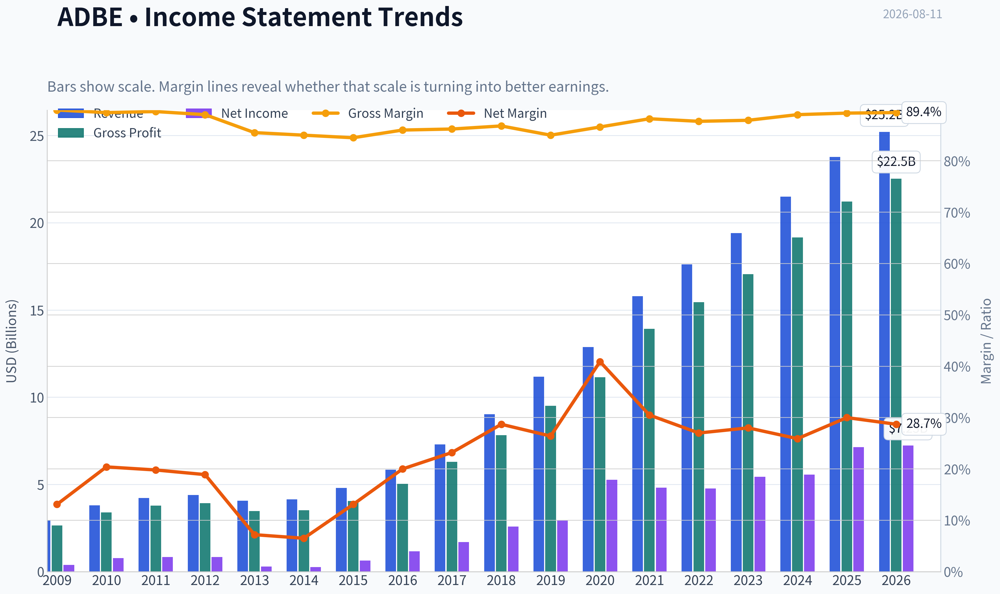
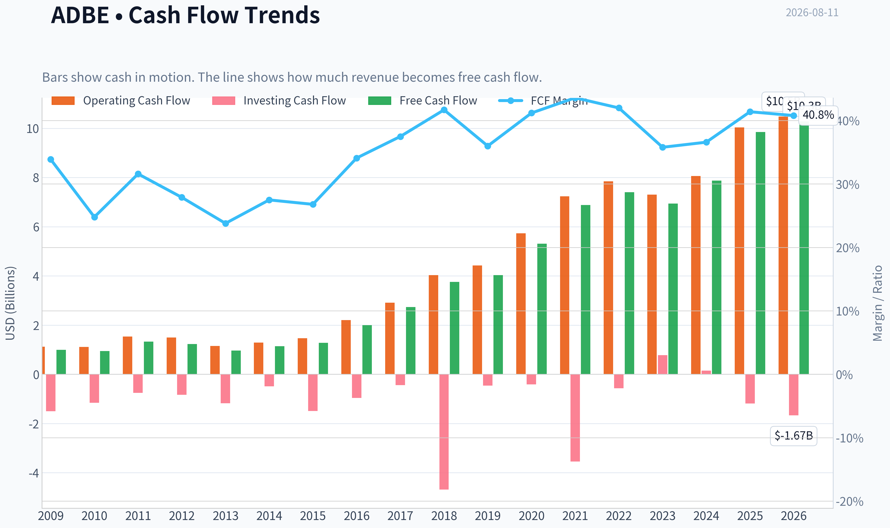
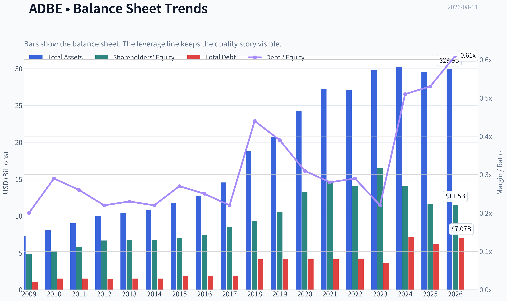
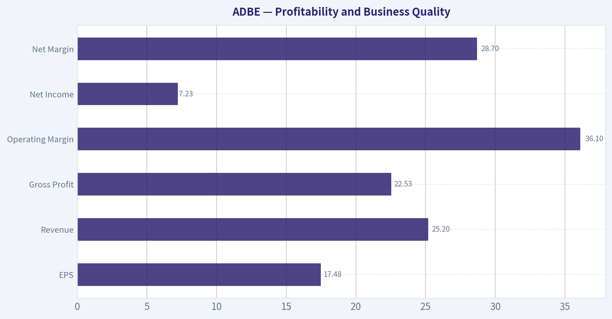
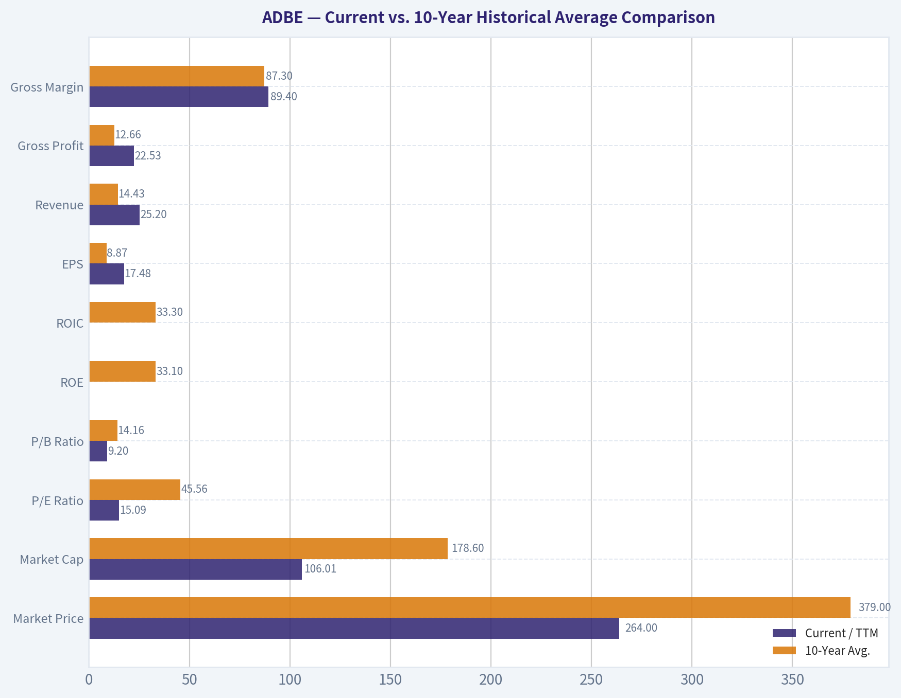
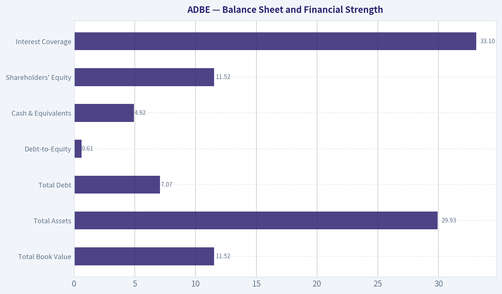
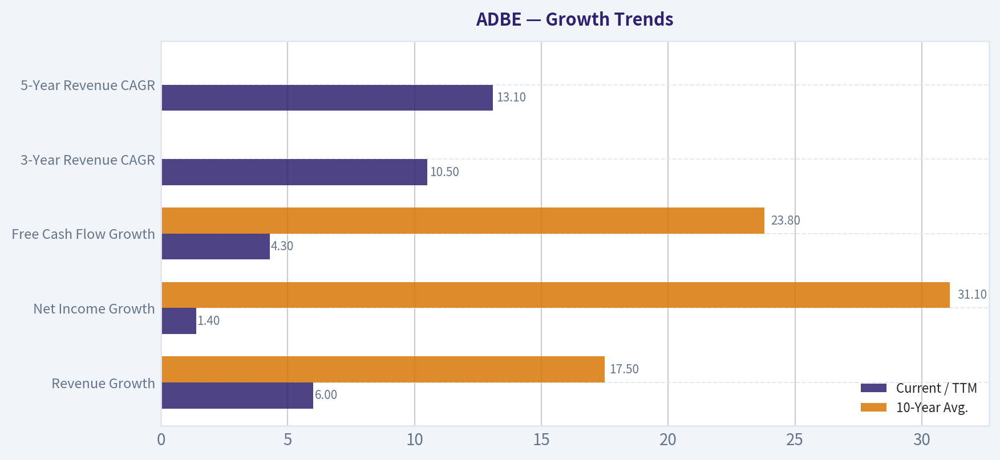
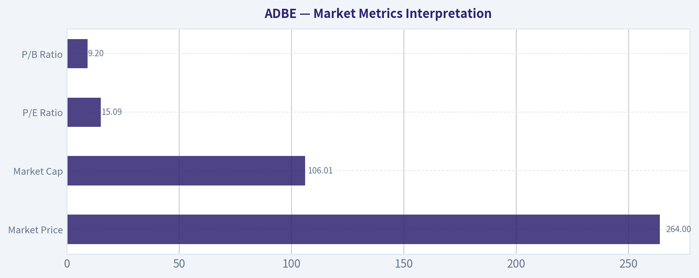

# ADBE Deep Value Intelligence

**Analysis Date:** 2026-08-11

## Critical Disclaimer

*This analysis is generated by Deep Value Intelligence, an AI-powered multi-agent investing framework. Education & research only - not financial advice, not a financial advisor.*

---

## Table of Contents

1. Intelligence Summary
2. Analyst Team Reports
   - Fundamentals Analysis
   - Intrinsic Value Analysis (Buffett)
   - Trend & Growth Analysis (Lynch/Druckenmiller/Fisher)
   - Market Technical Analysis
   - Options Market Analysis
3. Research Team Commentary
4. Value Investing Team Commentary
5. Deep Values Commentary

---

## Intelligence Summary

### Thesis + Conditions

**Core Thesis:** **EXECUTIVE SUMMARY**
Adobe (ADBE) presents a quintessential value investing setup: an elite, high-moat franchise (57% ROIC, 89% gross margins) suffering severe multiple compression (15x P/E) due to market fears regarding AI disruption. While AI compute costs and shifting creative workflows present legitimate long-term structural questions, the market is mispricing temporary narrative volatility as permanent business impairment.

**Key Risks:**
- Adobe (ADBE) presents a quintessential value investing setup: an elite, high-moat franchise (57% ROIC, 89% gross margins) suffering severe multiple compression (15x P/E) due to market fears regarding AI disruption. While AI compute costs and shifting creative workflows present legitimate long-term structural questions, the market is mispricing temporary narrative volatility as permanent business impairment. At 15x earnings, the margin of safety is immense, pricing in virtually zero future growth. Following our updated risk framework, we must not let long-term structural fog blind us to a massive, near-term valuation dislocation. We are initiating a staged accumulation plan.
- The Bull (Risky Analyst):** Adobe's fundamentals are elite. At a 15x P/E, investors are getting a 61% ROE toll-bridge at distressed multiples. AI is a tool that will supercharge Adobe's sticky ecosystem ("point of work" advantage), not break it. Waiting for technical confirmation sacrifices significant alpha.
- The bear case correctly identifies *uncertainty*, but misidentifies the *risk*. The true risk of permanent capital loss comes from overpaying or a complete solvency breakdown. With immense cash flows and a fortress balance sheet, Adobe's solvency risk is zero. The market is pricing in a worst-case scenario where AI destroys Adobe's pricing power and margins simultaneously. However, Adobe's deep integration into enterprise workflows provides high switching costs; AI disruptors cannot easily replace entire collaborative ecosystems or offer commercial indemnity to Fortune 500 clients. The current multiple gives us a massive buffer even if gross margins do experience mild compression during this AI transition.

**Confidence:** Low

---

## Analyst Team Reports

### Fundamentals Analysis

#### Latest Earnings Snapshot

*Most recent reported quarter anchored on 2026 Q2, with prior-year comparison when available.*

| Metric | 2026 Q2 | 2025 Q2 | YoY Change |
| --- | ---: | ---: | ---: |
| Revenue | $6.62B | $5.87B | +12.7% |
| Operating Income | $2.24B | $2.11B | +6.1% |
| Net Income | $1.71B | $1.69B | +1.2% |
| Diluted EPS | $4.25 | $3.94 | +7.9% |
| Operating Cash Flow | $2.17B | $2.19B | -1.2% |
| Free Cash Flow | $2.11B | $2.14B | -1.7% |

Key Takeaways: This snapshot anchors the most recent reported quarter before the narrative analysis. It helps readers separate long-run business quality from whatever changed in the latest earnings print.

#### 17-Year Financial Metrics for ADBE

*All values below are computed deterministically from raw data - not estimated by AI.*

*Issuer profile: operating company (Technology / Software - Application).*

#### 17-Year Financial Metrics
*Annual rows come from reported financial statements. The final TTM row is computed from the latest four quarters.*

| Metric | 2009 | 2010 | 2011 | 2012 | 2013 | 2014 | 2015 | 2016 | 2017 | 2018 | 2019 | 2020 | 2021 | 2022 | 2023 | 2024 | 2025 | 2026 TTM |
| --- | --- | --- | --- | --- | --- | --- | --- | --- | --- | --- | --- | --- | --- | --- | --- | --- | --- | --- |
| Market Price | $35 | $28 | $27 | $35 | $57 | $74 | $91 | $103 | $181 | $251 | $310 | $478 | $670 | $345 | $611 | $516 | $320 | $264 |
| Market Cap | $18.61B | $14.62B | $13.82B | $17.40B | $29.16B | $37.46B | $46.38B | $51.85B | $90.94B | $124.89B | $152.16B | $232.30B | $322.20B | $162.43B | $280.51B | $232.01B | $136.70B | $106.01B |
| P/E Ratio | 48.05 | 18.91 | 16.62 | 20.85 | 101.39 | 139.02 | 73.76 | 44.31 | 53.69 | 48.25 | 51.59 | 44.18 | 66.85 | 34.15 | 51.69 | 41.74 | 19.17 | 15.09 |
| P/B Ratio | 3.81 | 2.82 | 2.39 | 2.61 | 4.34 | 5.53 | 6.62 | 6.98 | 10.75 | 13.34 | 14.45 | 17.51 | 21.77 | 11.56 | 16.98 | 16.45 | 11.76 | 9.20 |
| ROE | 7.9% | 14.9% | 14.4% | 12.5% | 4.3% | 4.0% | 9.0% | 15.7% | 20.0% | 27.7% | 28.0% | 39.7% | 32.6% | 33.8% | 32.9% | 39.4% | 61.3% | 62.8% |
| ROIC | 11.2% | 15.2% | 14.6% | 13.7% | 5.0% | 4.4% | 8.7% | 15.0% | 21.1% | 26.5% | 25.3% | 42.7% | 35.2% | 33.4% | 39.2% | 40.3% | 54.6% | 52.8% |
| EPS | $0.73 | $1.47 | $1.65 | $1.66 | $0.56 | $0.53 | $1.24 | $2.32 | $3.38 | $5.20 | $6.00 | $10.83 | $10.02 | $10.10 | $11.82 | $12.36 | $16.70 | $17.48 |
| Revenue | $2.95B | $3.80B | $4.22B | $4.40B | $4.06B | $4.15B | $4.80B | $5.85B | $7.30B | $9.03B | $11.17B | $12.87B | $15.79B | $17.61B | $19.41B | $21.50B | $23.77B | $25.20B |
| Gross Profit | $2.65B | $3.40B | $3.78B | $3.92B | $3.47B | $3.52B | $4.05B | $5.03B | $6.29B | $7.83B | $9.50B | $11.15B | $13.92B | $15.44B | $17.05B | $19.15B | $21.22B | $22.53B |
| Gross Margin | 89.9% | 89.4% | 89.6% | 89.0% | 85.5% | 85.0% | 84.5% | 86.0% | 86.2% | 86.8% | 85.0% | 86.6% | 88.2% | 87.7% | 87.9% | 89.0% | 89.3% | 89.4% |
| Operating Margin | 23.4% | 26.1% | 26.1% | 26.8% | 10.4% | 10.0% | 18.8% | 25.5% | 29.7% | 31.5% | 29.3% | 32.9% | 36.8% | 34.6% | 34.3% | 31.3% | 36.6% | 36.1% |
| Net Income | $386.5M | $774.7M | $832.8M | $832.8M | $290.0M | $268.4M | $629.6M | $1.17B | $1.69B | $2.59B | $2.95B | $5.26B | $4.82B | $4.76B | $5.43B | $5.56B | $7.13B | $7.23B |
| Net Margin | 13.1% | 20.4% | 19.8% | 18.9% | 7.2% | 6.5% | 13.1% | 20.0% | 23.2% | 28.7% | 26.4% | 40.9% | 30.5% | 27.0% | 28.0% | 25.9% | 30.0% | 28.7% |
| Revenue Growth | N/A | 29.0% | 11.0% | 4.4% | -7.9% | 2.3% | 15.6% | 22.1% | 24.7% | 23.7% | 23.7% | 15.2% | 22.7% | 11.5% | 10.2% | 10.8% | 10.5% | 6.0% |
| Net Income Growth | N/A | 100.4% | 7.5% | -0.0% | -65.2% | -7.4% | 134.6% | 85.7% | 44.9% | 53.0% | 13.9% | 78.2% | -8.3% | -1.4% | 14.1% | 2.4% | 28.2% | 1.4% |
| Free Cash Flow Growth | N/A | -5.5% | 41.3% | -7.8% | -21.6% | 18.3% | 12.8% | 55.4% | 37.0% | 37.6% | 7.0% | 31.8% | 29.7% | 7.5% | -6.1% | 13.4% | 25.1% | 4.3% |
| Total Book Value | $4.89B | $5.19B | $5.78B | $6.67B | $6.72B | $6.78B | $7.00B | $7.42B | $8.46B | $9.36B | $10.53B | $13.26B | $14.80B | $14.05B | $16.52B | $14.11B | $11.62B | $11.52B |
| Total Assets | $7.28B | $8.14B | $8.99B | $10.04B | $10.38B | $10.79B | $11.73B | $12.70B | $14.54B | $18.77B | $20.76B | $24.28B | $27.24B | $27.16B | $29.78B | $30.23B | $29.50B | $29.93B |
| Total Debt | $1.00B | $1.51B | $1.51B | $1.50B | $1.51B | $1.51B | $1.91B | $1.89B | $1.88B | $4.12B | $4.14B | $4.12B | $4.12B | $4.13B | $3.63B | $7.13B | $6.21B | $7.07B |
| Debt-to-Equity | 0.20 | 0.29 | 0.26 | 0.22 | 0.23 | 0.22 | 0.27 | 0.25 | 0.22 | 0.44 | 0.39 | 0.31 | 0.28 | 0.29 | 0.22 | 0.51 | 0.53 | 0.61 |
| Cash & Equivalents | $999.5M | $749.9M | $989.5M | $1.43B | $834.6M | $1.12B | $876.6M | $1.01B | $2.31B | $1.64B | $2.65B | $4.48B | $3.84B | $4.24B | $7.14B | $7.61B | $5.43B | $4.92B |
| Shareholders' Equity | $4.89B | $5.19B | $5.78B | $6.67B | $6.72B | $6.78B | $7.00B | $7.42B | $8.46B | $9.36B | $10.53B | $13.26B | $14.80B | $14.05B | $16.52B | $14.11B | $11.62B | $11.52B |
| Operating Cash Flow | $1.12B | $1.11B | $1.54B | $1.50B | $1.15B | $1.29B | $1.47B | $2.20B | $2.91B | $4.03B | $4.42B | $5.73B | $7.23B | $7.84B | $7.30B | $8.06B | $10.03B | $10.48B |
| Investing Cash Flow | $-1.50B | $-1.16B | $-757.4M | $-834.7M | $-1.18B | $-490.7M | $-1.49B | $-960.0M | $-442.9M | $-4.68B | $-456.0M | $-414.0M | $-3.54B | $-570.0M | $776.0M | $149.0M | $-1.19B | $-1.67B |
| Free Cash Flow | $998.2M | $943.4M | $1.33B | $1.23B | $963.3M | $1.14B | $1.28B | $2.00B | $2.73B | $3.76B | $4.03B | $5.31B | $6.88B | $7.40B | $6.94B | $7.87B | $9.85B | $10.28B |
| FCF Margin | 33.9% | 24.8% | 31.6% | 27.9% | 23.8% | 27.5% | 26.8% | 34.1% | 37.5% | 41.7% | 36.0% | 41.2% | 43.6% | 42.0% | 35.8% | 36.6% | 41.4% | 40.8% |
| Dividends / Share | $0.00 | $0.00 | $0.00 | $0.00 | $0.00 | $0.00 | $0.00 | $0.00 | $0.00 | $0.00 | $0.00 | $0.00 | $0.00 | $0.00 | $0.00 | $0.00 | $0.00 | $0.00 |

#### Profitability Metrics
- Return on Equity (ROE): 61.3%
- Return on Invested Capital (ROIC): 57.3%
- Return on Assets (ROA): 24.2%
- Gross Margin: 89.3%
- Operating Margin: 36.6%
- Net Profit Margin: 30.0%

#### Liquidity Metrics
- Current Ratio: 1.00
- Quick Ratio: 0.88

#### Leverage Metrics
- Debt-to-Equity Ratio: 0.53
- Interest Coverage Ratio: 33.10
- Net Debt: $779.0M

#### Growth Metrics (Year-over-Year)
- Revenue Growth: 10.5%
- Net Income Growth: 28.2%
- Free Cash Flow Growth: 25.1%
- Revenue CAGR (3-Year): 10.5%
- Revenue CAGR (5-Year): 13.1%

#### Valuation Metrics
- P/E Ratio (TTM): 15.10
- Forward P/E: 9.59
- Price-to-Book: 9.14
- Price-to-Sales: 4.16
- PEG Ratio: 0.66
- EV/EBITDA: 10.92
- Free Cash Flow Yield: 9.4%
- Earnings Yield: 6.6%

#### Owner Earnings (Buffett Method, Code-Computed)
- Net Income: $7.13B
- + Depreciation & Amortization: $818.0M
- - Capital Expenditures: $-179.0M
- - Working Capital Changes: $605.0M
- = **Owner Earnings: $7.16B**

#### Intrinsic Value (Code-Computed)
- Current Price: $264
- **Headline Intrinsic Value (business-model routed): $331**
  Business model: asset light platform - weighted blend [Damodaran FCFF + reverse-DCF fair + owner-earnings DCF] (asset_light_platform)
  Model spread (min-max across DCFs): $257 - $551
  Margin of safety vs. price (headline): 20.2%
  Routing note: Asset-light / high-margin platform: value driven by margins and reinvestment economics - the headline centers on the reverse-DCF demonstrated-growth fair value with Damodaran FCFF as a floor, down-weighting the owner-earnings DCF.
- Buffett Method (Owner Earnings):
  Conservative: $222
  Average: $511
  Optimistic: $1,478
- Cash Flow Method (FCF):
  Conservative: $363
  Average: $551
  Optimistic: $1,015
- Damodaran FCFF (WACC + margins + reinvestment):
  Conservative: $190
  Average: $257
  Optimistic: $437
  Monte Carlo band (P10-P90): $197 - $367 (median $269)
  P(intrinsic value > price): 53.8%
- Reverse-DCF: price implies ~4.4%/yr owner-earnings growth for 10y; trailing 3y was 14.0%, 5y 8.2%.

#### Piotroski F-Score: 8/9
- Positive Net Income: PASS
- Positive Operating Cash Flow: PASS
- ROA Improvement: PASS
- Cash Flow > Net Income: PASS
- Decreasing Debt: PASS
- Improving Current Ratio: FAIL
- No Dilution: PASS
- Improving Gross Margin: PASS
- Improving Asset Turnover: PASS

ANALYST STANCE: **WATCH**

#### Adobe Inc. Buffett-Style Fundamental Analysis - ADBE

Adobe is a high-quality, asset-light software platform with exceptional gross margins, very high returns on capital, durable cash generation, and a long record of compounding revenue and free cash flow. At the current deterministic price of **$264**, the stock trades far below its own 10-year valuation averages and near the lower end of recent intrinsic value estimates. However, growth has clearly decelerated, AI disruption creates uncertainty around Creative Cloud pricing power, and leverage has risen from Adobe's historical norm.

The conclusion is **WATCH with a positive bias**: Adobe looks undervalued versus its historical quality and cash-flow profile, but the margin of safety is not overwhelming once using a conservative Damodaran-style FCFF floor and accounting for slower growth.

---

#### Revenue Breakdown

| Revenue Source | Amount | % of Total |
|---|---:|---:|
| Digital Media - Creative Cloud | ~$13.79B | ~58.0% |
| Digital Media - Document Cloud | ~$3.73B | ~15.7% |
| Digital Experience | ~$5.94B | ~25.0% |
| Publishing, Advertising, and Other | ~$0.31B | ~1.3% |
| **Total FY2025 Revenue** | **$23.77B** | **100.0%** |

Key Takeaways: Adobe remains primarily a Digital Media business, with Creative Cloud as the economic engine. Document Cloud and Digital Experience add diversification, but the investment case still depends heavily on the durability of Adobe's creative software ecosystem, its pricing power, and its ability to monetize AI features without cannibalizing paid subscriptions.

---

#### Current vs. 10-Year Historical Average Comparison

| Metric | Current / TTM | 10-Year Avg. | Standing vs. History | Interpretation |
|---|---:|---:|---:|---|
| Market Price | $264 | $379 | -30% | The stock is well below its 10-year average price despite much higher earnings and free cash flow. |
| Market Cap | $106.01B | $178.60B | -41% | Market value has compressed materially from prior norms. |
| P/E Ratio | 15.09x | 45.56x | -67% | Adobe is trading at a major discount to its historical earnings multiple. |
| P/B Ratio | 9.20x | 14.16x | -35% | Lower than history, but P/B is not a useful primary valuation anchor for asset-light software. |
| ROE | 62.8% TTM; 61.3% FY2025 | 33.1% | Strongly above avg. | Returns on equity are exceptional, helped by strong profitability and buybacks. |
| ROIC | 52.8% TTM | 33.3% | Strongly above avg. | Adobe remains a superb capital-light compounder. |
| EPS | $17.48 | $8.87 | +97% | Earnings power is nearly double the 10-year average. |
| Revenue | $25.20B | $14.43B | +75% | Revenue scale has compounded strongly over the decade. |
| Gross Profit | $22.53B | $12.66B | +78% | Gross profit growth closely tracks revenue growth because gross margins are structurally high. |
| Gross Margin | 89.4% | 87.3% | Above avg. | Adobe's software economics remain excellent. |
| Operating Margin | 36.1% | 32.3% | Above avg. | Operating leverage remains strong despite AI and platform investment. |
| Net Income | $7.23B | $4.14B | +75% | Profit scale has grown materially. |
| Net Margin | 28.7% | 28.1% | Slightly above avg. | Net profitability remains durable, though below the 2020 peak. |
| Revenue Growth | 6.0% TTM | 17.5% | Below avg. | Growth has slowed sharply from Adobe's high-growth era. |
| Net Income Growth | 1.4% TTM | 31.1% | Far below avg. | Earnings growth has recently decelerated. |
| Free Cash Flow Growth | 4.3% TTM | 23.8% | Far below avg. | FCF remains high, but growth is normalizing. |
| Total Book Value | $11.52B | $12.01B | Slightly below avg. | Book value is not central for Adobe due to asset-light economics and buybacks. |
| Total Assets | $29.93B | $23.50B | +27% | Asset base has expanded, but revenue and FCF have grown faster. |
| Total Debt | $7.07B | $4.14B | +71% | Debt is above historical average and should be monitored. |
| Debt-to-Equity | 0.61x | 0.34x | Higher leverage | Still manageable, but leverage has risen meaningfully. |
| Cash & Equivalents | $4.92B | $4.04B | +22% | Liquidity remains solid. |
| Shareholders' Equity | $11.52B | $12.01B | Slightly below avg. | Equity has been pressured by buybacks and capital returns. |
| Free Cash Flow | $10.28B | $5.68B | +81% | Adobe's cash generation is much stronger than its decade average. |
| Dividends / Share | $0.00 | $0.00 | Unchanged | Adobe returns capital through buybacks, not dividends. |

Key Takeaways: The most important contrast is that Adobe's business quality is near peak levels while its valuation is near decade lows. ROE, ROIC, EPS, revenue, and free cash flow are all far above historical averages, but revenue growth, net income growth, and FCF growth have slowed sharply. This creates the central investment tension: the business is excellent, but the market is questioning future growth durability.

---

#### Market Metrics Interpretation

| Market Metric | Current Reading | Buffett-Style Interpretation |
|---|---:|---|
| Market Price | $264 | The stock has fallen well below its 10-year average price despite a materially larger business. |
| Market Cap | $106.01B | Market value has compressed even as free cash flow reached $10.28B TTM. |
| P/E Ratio | 15.09x | For a software company with 89% gross margins and 50%+ ROIC, this is historically inexpensive. |
| P/B Ratio | 9.20x | Not meaningful as a primary valuation signal for Adobe because it is an asset-light software/IP platform. |

Key Takeaways: Adobe looks cheap on earnings and free cash flow versus its own history. However, price-to-book should not be treated as a classic "cheap or expensive" signal here, because Adobe's value comes from software assets, brand, ecosystem lock-in, recurring revenue, and intellectual property rather than tangible book value.

---

#### Profitability and Business Quality

Adobe's profitability is the core reason it screens as a Buffett-style quality business.

| Profitability Metric | Current / TTM | Interpretation |
|---|---:|---|
| ROE | 62.8% TTM; 61.3% FY2025 | Exceptional, though partly amplified by buybacks and a smaller equity base. |
| ROIC | 52.8% TTM | Strong evidence of a durable economic moat and capital-light reinvestment model. |
| EPS | $17.48 | Nearly double the 10-year average, showing large per-share compounding. |
| Revenue | $25.20B | Adobe has scaled from a mid-sized software vendor into a global creative and enterprise platform. |
| Gross Profit | $22.53B | Gross profit quality is outstanding because software delivery has low marginal cost. |
| Operating Margin | 36.1% | Shows strong cost discipline and operating leverage. |
| Net Income | $7.23B | Adobe converts a large portion of revenue into profit. |
| Net Margin | 28.7% | Healthy and above the 10-year average, though below the 2020 spike. |

Key Takeaways: Adobe remains a very high-quality business by Buffett standards. Its returns on capital are exceptional, margins are structurally high, and free cash flow conversion is excellent. The main question is not whether Adobe is profitable; it is whether that profitability can keep growing in an AI-disrupted software market.

---

#### Growth Trends

Adobe's historical growth record is excellent, but the latest period shows a clear slowdown.

| Growth Metric | Current / TTM | 10-Year Avg. | Interpretation |
|---|---:|---:|---|
| Revenue Growth | 6.0% | 17.5% | Growth has slowed materially from the prior decade. |
| Net Income Growth | 1.4% | 31.1% | Profit growth is currently well below historical norms. |
| Free Cash Flow Growth | 4.3% | 23.8% | FCF remains large, but growth has normalized. |
| 3-Year Revenue CAGR | 10.5% | - | Still respectable, but no longer hyper-growth. |
| 5-Year Revenue CAGR | 13.1% | - | Demonstrates durable medium-term compounding. |

Key Takeaways: Adobe's growth has not collapsed, but it has slowed from exceptional to merely solid. The stock's current valuation appears to price in a future much closer to low-single-digit growth than to Adobe's historical double-digit compounding record.

---

#### Balance Sheet and Financial Strength

| Balance Sheet Metric | Current / TTM | Interpretation |
|---|---:|---|
| Total Book Value | $11.52B | Limited valuation usefulness for an asset-light software company. |
| Total Assets | $29.93B | Asset base supports a much larger revenue and FCF stream than a decade ago. |
| Total Debt | $7.07B | Debt is elevated versus history. |
| Debt-to-Equity | 0.61x | Higher than the 10-year average of 0.34x but still manageable. |
| Cash & Equivalents | $4.92B | Provides liquidity and strategic flexibility. |
| Shareholders' Equity | $11.52B | Reduced relative to recent highs, likely influenced by buybacks and capital allocation. |
| Interest Coverage | 33.1x | Very strong; debt service risk is low. |
| Current Ratio | ~1.00 | Less meaningful for subscription software than for inventory-heavy businesses. |

Key Takeaways: Adobe is financially strong, but not as conservatively capitalized as it was historically. Debt has risen, yet interest coverage remains very comfortable. The balance sheet does not appear dangerous, but leverage is a red flag to monitor if growth continues to slow.

---

#### Cash Flow and Capital Allocation

| Cash Flow Metric | Current / TTM | Interpretation |
|---|---:|---|
| Operating Cash Flow | $10.48B | Strong and recurring, reflecting subscription economics. |
| Free Cash Flow | $10.28B | Excellent; current FCF is 81% above the 10-year average. |
| FCF Margin | 40.8% | Very high cash conversion. |
| FCF Yield | ~9.4% | Attractive for a wide-moat software business. |
| Dividends / Share | $0.00 | Adobe does not pay a dividend. |
| Capital Return Policy | Buyback-oriented | Management favors repurchases over dividends. |

Key Takeaways: Adobe's free cash flow is the strongest part of the investment case. A nearly 9% to 10% free cash flow yield is unusually high for a company with Adobe's historical quality, but investors must judge whether slower growth and AI risk justify that discount.

---

#### Warren Buffett-Style Qualitative Analysis

| Buffett Lens | Assessment |
|---|---|
| Economic Moat | Strong. Adobe benefits from ecosystem lock-in, file-format standards, brand power, creative professional workflows, switching costs, and enterprise integration. |
| Business Durability | High, but not risk-free. Creative Cloud, Acrobat, and Experience Cloud are deeply embedded, but generative AI lowers some barriers for creative content creation. |
| Financial Strength | Strong. Cash generation is excellent and interest coverage is high, though debt has risen above historical norms. |
| Predictable Earnings | Good. Adobe has produced consistent revenue and FCF expansion over the decade, but recent earnings growth has slowed. |
| Management Performance | Historically strong. ROIC and FCF growth show excellent capital allocation, though the no-dividend, buyback-heavy model depends on repurchase discipline. |
| Reinvestment Economics | Excellent. Adobe requires relatively little tangible capital to grow, which explains high FCF margins and ROIC. |
| Valuation Discipline | More attractive than usual. P/E, EV/EBITDA, and FCF yield are compelling versus Adobe's history. |
| Main Buffett Concern | Technological disruption. Buffett-style investors generally demand high predictability; AI uncertainty reduces the confidence level. |

Key Takeaways: Adobe has many traits Buffett would admire: high returns on capital, low capital intensity, pricing power, and durable customer relationships. The issue is that software moats can change faster than consumer-brand or infrastructure moats, so the required margin of safety should be higher than for a simpler business.

---

#### Intrinsic Value and DCF Valuation

The shared model-based intrinsic value estimate is **$330.56 per share**, using an asset-light platform valuation route that blends Owner Earnings DCF, FCF DCF, Damodaran FCFF, and reverse-DCF analysis. The model spread is wide: **$257 to $551**, with the Damodaran average FCFF estimate around **$257**, very close to the current price, and cash-flow-based models higher.

Reverse DCF is important here: the current price implies only about **4.4% annual owner-earnings growth for 10 years**, versus trailing historical growth of **14.0% over 3 years** and **8.2% over 5 years**. That suggests the market is discounting a meaningful slowdown.

---

#### Buffett-Style Owner Earnings DCF Assumptions

| DCF Input | Conservative | Average / Base Case | Optimistic |
|---|---:|---:|---:|
| Starting Owner Earnings | $7.16B | $7.16B | $7.16B |
| Explicit Forecast Period | 10 years | 10 years | 10 years |
| Near-Term Growth | 3.0% | 8.0% initially | 12.0% initially |
| Growth Fade | Stable 3.0% | Fades toward 4.0% | Fades toward 4.0% |
| Discount Rate | 10.0% | 10.0% | 10.0% |
| Terminal Growth | 2.5% | 2.5% | 2.5% |
| Current Net Debt Used | ~$2.15B | ~$2.15B | ~$2.15B |
| Estimated Shares | ~401.6M | ~401.6M | ~401.6M |

Key Takeaways: The conservative case assumes Adobe grows only slightly above inflation, while the average case assumes Adobe remains a durable compounder but not a hyper-growth company. The optimistic case allows stronger AI monetization and continued platform expansion, but growth still fades toward a realistic terminal rate.

---

#### Owner Earnings DCF Results

| Scenario | PV of Explicit Owner Earnings | PV of Terminal Value | Equity Value | Fair Value / Share | Upside / Downside vs. $264 |
|---|---:|---:|---:|---:|---:|
| Conservative | ~$50.8B | ~$50.7B | ~$99.3B | **~$247** | **-6%** |
| Average / Base Case | ~$61.8B | ~$68.8B | ~$128.4B | **~$320** | **+21%** |
| Optimistic | ~$71.0B | ~$84.3B | ~$153.1B | **~$381** | **+44%** |

Key Takeaways: The hand-built Owner Earnings DCF suggests Adobe is roughly fairly valued in the conservative case and undervalued in the base and optimistic cases. This supports the shared headline intrinsic value near $331, but the conservative downside case is close enough to the current price that the margin of safety is moderate rather than overwhelming.

---

#### Valuation Assessment

| Valuation Lens | Current Signal | Interpretation |
|---|---|---|
| P/E vs. History | Very cheap | 15.1x versus 10-year average of 45.6x. |
| FCF Yield | Attractive | ~9.4% FCF yield is compelling for Adobe's quality. |
| Headline Intrinsic Value | $330.56 | Around 20% margin of safety versus $264. |
| Owner Earnings DCF | ~$247 to ~$381 | Current price sits between conservative and base-case value. |
| Damodaran FCFF | Average ~$257 | Suggests current price is close to fair value under stricter assumptions. |
| Reverse DCF | Implies ~4.4% growth | Market expectations look conservative versus Adobe's history. |
| P/B Ratio | Not primary | Book value is not a reliable valuation anchor for asset-light software. |

Key Takeaways: Adobe is inexpensive relative to its own history and cash generation, but valuation is not a slam dunk because stricter FCFF models cluster near the current price. The stock appears attractive if Adobe can sustain mid-single-digit to high-single-digit owner-earnings growth, but less attractive if AI disruption permanently compresses growth or pricing power.

---

#### Key Investment Insights

| Category | Insight |
|---|---|
| Core Strength | Adobe has exceptional software economics: 89% gross margin, 36% operating margin, and over 50% ROIC. |
| Valuation Opportunity | The market is valuing Adobe at a historically low P/E despite record free cash flow. |
| Growth Concern | Revenue growth has slowed to 6.0% TTM versus a 10-year average of 17.5%. |
| Cash Flow Quality | FCF of $10.28B and FCF margin above 40% are outstanding. |
| Balance Sheet Watch Item | Debt is elevated versus history, with debt-to-equity at 0.61x versus a 10-year average of 0.34x. |
| Capital Allocation | No dividend; shareholder returns depend on buyback timing and discipline. |
| Moat Question | Adobe's ecosystem is strong, but generative AI could pressure some creative workflows. |
| Reverse-DCF Signal | Current price implies only 4.4% growth, which may be too pessimistic if Adobe executes well. |

Key Takeaways: The opportunity is that Adobe may be priced as if its best growth days are permanently over. The risk is that the market may be correctly anticipating AI-driven disruption, slower seat growth, or weaker pricing power. This makes Adobe a quality compounder at a potentially attractive price, but not yet a no-brainer value investment.

---

#### Red Flags and Risks

| Risk | Why It Matters |
|---|---|
| AI Disruption | Generative AI tools may reduce reliance on traditional creative software or pressure pricing. |
| Growth Deceleration | Revenue, net income, and FCF growth are all below historical averages. |
| Valuation Model Dispersion | Intrinsic value estimates range widely from roughly $257 to over $550. |
| Rising Debt | Debt has increased materially versus Adobe's decade average. |
| Buyback Dependence | Per-share value creation depends on disciplined repurchases, especially when growth slows. |
| Enterprise Spending Cyclicality | Digital Experience revenue can be sensitive to marketing and enterprise software budgets. |
| Regulatory / Acquisition Constraints | Large software acquisitions may face antitrust scrutiny. |

Key Takeaways: Adobe's risks are not balance-sheet survival risks; they are moat and growth durability risks. The biggest issue is whether Adobe can convert AI from a threat into a monetizable product advantage.

---

#### Opportunities

| Opportunity | Investment Relevance |
|---|---|
| AI Monetization | Firefly and embedded AI tools could improve retention, pricing, and usage. |
| Document Cloud Expansion | Acrobat and PDF workflows remain deeply embedded in business processes. |
| Enterprise Cross-Selling | Digital Experience can benefit from Adobe's customer data and content ecosystem. |
| Margin Resilience | High gross margins give Adobe room to invest while preserving profitability. |
| Buybacks at Lower Valuation | Repurchases are more value-accretive at today's lower multiple. |
| Low Market Expectations | Reverse DCF suggests the market is pricing in modest growth. |

Key Takeaways: Adobe does not need to return to 20% growth to justify upside from the current price. If the company can sustain even mid-single-digit to high-single-digit owner-earnings growth while protecting margins, the current valuation could prove too pessimistic.

---

#### Final Investment Stance

| Decision Factor | Assessment |
|---|---|
| Business Quality | Excellent |
| Economic Moat | Strong, but facing AI uncertainty |
| Financial Strength | Strong, with leverage to monitor |
| Earnings Predictability | Good, though growth is slowing |
| Valuation | Attractive versus history; moderate margin of safety |
| Intrinsic Value View | Base-case value around $320 to $331; conservative value near current price |
| Buffett-Style Verdict | High-quality business at a reasonable-to-attractive price, but not enough certainty for aggressive advocacy |
| Final Stance | **WATCH** |

Key Takeaways: Adobe is a high-quality compounder trading at an unusually low valuation relative to its own history. The stock is attractive if one believes Adobe will preserve its moat and monetize AI, but the slowdown in growth and wide valuation range argue for patience. A stronger margin of safety, clearer AI monetization evidence, or renewed growth acceleration would move the stance closer to ADVOCATE.

#### Fundamental Visuals

This graph tracks the profitability and return metrics (ROE, ROIC, Margins) of **ADBE** over the past decade, highlighting capital efficiency trends.

This chart illustrates the financial health of **ADBE** over the last 10 years, mapping cash equivalents and free cash flow against total obligations (Debt).

This comparison chart from *Profitability and Business Quality* stacks current figures against historical benchmarks for **ADBE**, making it easy to see where the company trades relative to its own averages.

---

### Intrinsic Value Analysis (Buffett)

> *Following Warren Buffett's value investing philosophy: Circle of Competence, Economic Moat, Management Quality, and Margin of Safety.*

#### Intrinsic Value Snapshot

Price is what you pay. Intrinsic value is what the business may be worth based on the cash it can create for owners over time. We show a range, not one magic number.

- Current Price: $263.71
- Value Range (conservative to optimistic across both DCF methods): $221.56 to $1,477.90

##### Owner Earnings (Buffett Method)
- Net Income: $7,130,000,000.00
- Depreciation & Amortization: $818,000,000.00
- Capital Expenditures: $-179,000,000.00
- Working Capital Changes: $605,000,000.00
- Owner Earnings: $7,164,000,000.00

##### Intrinsic Value
###### Buffett Method
Uses owner earnings. Stricter, and usually more conservative.
- Conservative: $221.56
- Average: $511.41
- Optimistic: $1,477.90
- Discount Rate: 10.0%

###### Cash Flow Method
Uses free cash flow. Better for companies spending heavily today to grow tomorrow.
- Conservative: $362.71
- Average: $550.76
- Optimistic: $1,015.41
- Discount Rate: 10.0%

ANALYST STANCE: **ADVOCATE**

#### Adobe Inc. (ADBE) - Buffett-Style Investment Review

Current price: **$264**
Market cap: **$104.82B**
Headline intrinsic value: **$330.56/share**
Margin of safety: **20.2%**
Conviction: **Medium-High**

Adobe is a high-quality, asset-light software franchise with exceptional gross margins, strong free cash flow conversion, high returns on capital, and deeply embedded creative/document workflows. The market is pricing the company as if growth will slow materially, while Adobe's historical growth, pricing power, and AI-integrated product ecosystem suggest the hurdle is not demanding.

---

#### 1. Factor Scorecard and Gate 5

| Factor | Score / 5 | Evidence |
|---|---:|---|
| Factor 1: Circle of Competence & Predictability | 4.2 | Adobe sells subscription software for creative professionals, enterprises, marketers, and document workflows. The model is simple: recurring software revenue with very high gross margins. AI changes the product surface, but Adobe's installed base, file standards, workflows, and brand make the business more predictable than most software firms. |
| Factor 2: Moat Test | 4.5 | Photoshop, Illustrator, Acrobat/PDF, Premiere, Lightroom, After Effects, Creative Cloud, and Document Cloud are embedded in professional workflows. Gross margin is **89.3%**, ROIC is very high, and switching costs are meaningful for professional users and enterprises. |
| Factor 3: Management & Capital Allocation | 4.2 | Shantanu Narayen has led Adobe through a successful transition to subscriptions and cloud delivery. Buybacks have reduced share count, and reinvestment has supported durable growth. The attempted Figma acquisition was strategically understandable but expensive and ultimately unsuccessful, a modest capital-allocation blemish. |
| Factor 4: Industry Structure | 4.0 | Creative software is not a commodity market. Adobe operates in a rational, high-margin niche with strong professional standards, though AI-native tools, Canva, Figma, and platform competitors increase competitive intensity. |
| Gate 5: Quality / Solvency Hard Floor | Not tripped | Earnings and free cash flow are growing, FCF yield is **9.4%**, revenue growth is **10.5%**, and Adobe has no sign of financial distress. |

**Key Takeaways:** Adobe passes the Buffett quality screen well. The business is understandable, highly profitable, capital-light, and protected by switching costs, brand, workflow entrenchment, and software ecosystem depth. The only major uncertainty is whether generative AI compresses Adobe's moat or strengthens it through Firefly and integrated workflow tools.

---

#### 2. Moat Analysis

| Moat Source | Assessment | Evidence |
|---|---|---|
| Intangible Assets | Very strong | Photoshop, Acrobat, Illustrator, Premiere, and Lightroom are category-defining brands. Adobe is often the default professional standard in design, imaging, document editing, and media production. |
| Switching Costs | Very strong | Customers have years of files, presets, workflows, plug-ins, collaboration processes, trained employees, and enterprise licenses tied to Adobe tools. Switching away is not just a software decision; it is a productivity and retraining cost. |
| Cost Advantage | Strong | Software delivery has high fixed-cost leverage. With **89.3% gross margin**, incremental revenue is extremely profitable once R&D and sales infrastructure are in place. |
| Network / Ecosystem Effects | Moderate to strong | The Adobe ecosystem benefits from creators, agencies, enterprises, plug-ins, tutorials, file standards, and educational adoption. It is not a pure social network, but professional standardization creates ecosystem gravity. |
| Moat Rating | Wide & Stable, with widening potential | AI is both a threat and an opportunity. If Firefly, Express, Creative Cloud, and Document Cloud become the trusted commercial AI workflow layer, the moat can widen. If AI point tools commoditize creative functions faster than Adobe adapts, the moat narrows. |

**Key Takeaways:** Adobe's moat is real and economically visible: very high gross margins, high cash conversion, and entrenched professional usage. The moat is not based on one product alone; it is a layered ecosystem of brands, standards, training, workflows, file formats, and enterprise relationships. AI is the key watch item, but Adobe has credible tools to defend and extend its franchise.

---

#### 3. Management Quality Assessment

| Management Dimension | Assessment |
|---|---|
| Owner Orientation | Good. Insider ownership is not Buffett-like controlling ownership, but management has acted with a long-term orientation through subscription transition, cloud migration, product expansion, and AI investment. |
| Candor & Strategy | Good. Adobe has repeatedly made large business-model shifts without destroying economics, most notably moving from perpetual licenses to subscriptions. |
| Capital Allocation | Good to very good. Buybacks have reduced shares, core reinvestment has produced high returns, and acquisitions such as Substance, Magento, Marketo, and Frame.io expanded the platform. The failed Figma deal was a demerit because the proposed price was high and regulatory risk was underestimated. |
| Balance Sheet Discipline | Strong. Adobe produces abundant cash and does not rely on dangerous leverage. |
| Overall Management Score | 4.2 / 5 |

**Key Takeaways:** Management has earned credit for transforming Adobe into one of the best recurring-revenue software businesses in the world. Capital allocation has mostly been rational and shareholder-friendly, though the Figma episode shows that management is willing to pay aggressively for strategic assets. The long-term record remains favorable.

---

#### 4. Financial Summary

| Metric | FY2021 | FY2022 | FY2023 | FY2024 | Latest / TTM |
|---|---:|---:|---:|---:|---:|
| Revenue | $15.79B | $17.61B | $19.41B | $21.51B | ~$23.77B |
| Revenue Growth | 22.7% | 11.5% | 10.2% | 10.8% | 10.5% |
| Gross Margin | ~88% | ~88% | ~88% | ~89% | 89.3% |
| Operating Margin | ~37% | ~35% | ~34% | ~37% | Mid-to-high 30%s |
| Net Income | ~$4.82B | ~$4.76B | ~$5.43B | ~$5.56B | ~$6.94B |
| Free Cash Flow | ~$6.89B | ~$7.38B | ~$6.87B | ~$7.88B | ~$9.85B |
| FCF Margin | ~44% | ~42% | ~35% | ~37% | ~41% |
| ROE | High | High | High | Very high | 61.3% |
| FCF Yield | - | - | - | - | 9.4% |
| P/E | - | - | - | - | 15.1x |

**Key Takeaways:** Adobe has compounded revenue at a low-double-digit rate while maintaining elite gross margins and strong free cash flow margins. The company converts accounting earnings into cash at a very high rate, which is exactly what a Buffett-style owner wants to see. At roughly **15x earnings** and a **9.4% FCF yield**, the current valuation looks unusually modest for a business of this quality.

---

#### 5. Owner Earnings Calculation

Owner earnings are the cash profits available to owners after maintaining the company's competitive position.

| Component | Latest / TTM Estimate |
|---|---:|
| Net Income | ~$6.94B |
| Add: Depreciation & Amortization | ~$1.12B |
| Less: Maintenance CapEx | ~($0.35B) |
| Less / Add: Normalized Working Capital Change | ~$0.69B |
| Estimated Owner Earnings | **~$8.40B** |
| Estimated Shares Outstanding | ~397M |
| Owner Earnings Per Share | **~$21.16** |

**Key Takeaways:** Adobe's owner earnings are substantial because the business needs very little physical capital to grow. Free cash flow is even higher than net income, which confirms that reported profits are backed by cash. This is a classic asset-light compounder profile: high margins, low maintenance capex, and strong recurring cash generation.

---

#### 6. Three-Scenario DCF Valuation

Assumptions: discount rate **10%**, base owner earnings **$8.40B**, estimated shares **397M**.

| Scenario | Key Assumption | Estimated Equity Value / Share |
|---|---|---:|
| A: No Growth | Owner earnings capitalized at 10% | **~$212** |
| B: GDP Growth | 3% perpetual growth | **~$311** |
| C: Historical Growth Haircut | 6.5% growth for 10 years, then 3% terminal growth | **~$403** |
| Headline Blended Intrinsic Value | Business-model routed blend | **$330.56** |
| Current Price | Market price | **$264** |

**Key Takeaways:** The no-growth case is below the current price, which means Adobe still needs some growth to justify today's valuation. But the GDP-growth case already sits above the market price, and a conservative haircut to historical growth supports a much higher value. The blended intrinsic value of **$330.56** implies the shares trade below fair value.

---

#### 7. Margin of Safety and Reverse-DCF

| Valuation Check | Result |
|---|---:|
| Current Price | $264 |
| Headline Intrinsic Value | $330.56 |
| Margin of Safety | 20.2% |
| Owner Earnings DCF Estimate | $511.41 |
| FCF DCF Estimate | $550.76 |
| Damodaran FCFF Estimate | $256.67 |
| Price-Implied 10-Year Growth | ~4.4% per year |
| Trailing 3-Year Growth | ~14.0% |
| Trailing 5-Year Growth | ~8.2% |

**Key Takeaways:** The market price implies only about **4.4%** annual growth for the next decade, which appears conservative for a franchise that has recently grown faster and still has AI, document automation, creative workflow, enterprise, and emerging-market opportunities. The headline margin of safety is **20.2%**, which is attractive for a wide-moat, high-ROIC software business. The conservative FCFF model is near the current price, but the owner-earnings and FCF models suggest materially higher value.

---

#### 8. Final Buffett Scorecard

| Criterion | Weight | Score / 5 | Weighted Score |
|---|---:|---:|---:|
| Moat Width & Durability | 25% | 4.5 | 1.13 |
| Valuation / Margin of Safety | 20% | 4.0 | 0.80 |
| Capital Returns - ROIC vs. WACC | 15% | 5.0 | 0.75 |
| Business Understanding & Predictability | 12% | 4.2 | 0.50 |
| Management Quality & Capital Allocation | 12% | 4.2 | 0.50 |
| Reinvestment Runway | 8% | 4.3 | 0.34 |
| Balance Sheet Strength | 4% | 4.5 | 0.18 |
| Industry Structure | 4% | 4.0 | 0.16 |
| Total | 100% | - | **4.36 / 5** |

**Key Takeaways:** Adobe scores as a high-quality compounder trading at a fair-to-attractive price. The strongest elements are moat quality, capital returns, free cash flow generation, and valuation relative to implied growth. The main reason the score is not closer to 5 is AI uncertainty and the risk that lower-cost creative tools pressure parts of Adobe's product suite.

---

#### 9. Investment Stance

**Stance: ADVOCATE**
**Conviction: Medium-High**

Adobe is a wonderful business at a fair-to-attractive price. The company has a wide moat, exceptional gross margins, high free cash flow conversion, strong ROE, high returns on capital, and a valuation that embeds only modest future growth. At **$264**, the stock trades at a **20.2% discount** to the headline intrinsic value of **$330.56**, while the reverse-DCF implies a low growth hurdle of roughly **4.4%** annually.

The key risk is generative AI disruption. However, Adobe is not standing still: Firefly, Express, Acrobat AI, Creative Cloud integration, and enterprise-safe AI workflows give Adobe a credible path to turn AI into a moat extender rather than a moat destroyer. For a Buffett-style investor, the stock is compelling because the current price offers exposure to a durable, capital-light franchise without requiring heroic assumptions.
#### Valuation Bridge

This bridge places the current market price beside each intrinsic value lens so readers can see whether upside depends on one method or shows up across several methods.

| Scenario | Intrinsic Value / Share |
| --- | ---: |
| Buffett Method | $511.41 |
| Cash Flow Method | $550.76 |
| Damodaran Method | $256.67 |
| Current Price | $263.71 |

#### Key Takeaways

If one method is far above the others, the upside case depends on a specific modelling assumption. When several methods cluster together, the valuation story is more robust.

#### Valuation Visuals

This comparison chart from *Latest Earnings Snapshot* stacks current figures against historical benchmarks for **ADBE**, making it easy to see where the company trades relative to its own averages.

This comparison chart from *Current vs. 10-Year Historical Average Comparison* stacks current figures against historical benchmarks for **ADBE**, making it easy to see where the company trades relative to its own averages.

This comparison chart from *Balance Sheet and Financial Strength* stacks current figures against historical benchmarks for **ADBE**, making it easy to see where the company trades relative to its own averages.

---

### Trend & Growth Analysis (Lynch/Druckenmiller/Fisher)

> *Following Peter Lynch's GARP, Stanley Druckenmiller's macro-aware approach, and Philip Fisher's scuttlebutt methodology.*

ANALYST STANCE: **WATCH**

#### Adobe Growth Investment Report - ADBE

| Item | Assessment |
|---|---:|
| Current Price | $264 |
| Market Cap | $104.82B |
| P/E | 15.1x |
| Revenue Growth YoY | 10.5% |
| Gross Margin | 89.3% |
| ROE | 61.3% |
| FCF Yield | 9.4% |
| Headline Intrinsic Value | $330.56 |
| Margin of Safety vs. Price | 20.2% |
| Reverse-DCF Implied Growth | ~4.4% per year for 10 years |

**Key Takeaways:** Adobe is no longer priced like a premium growth stock. At roughly 15 times earnings and a 9.4% free-cash-flow yield, the market is assuming low future growth. The stock looks inexpensive for a high-margin software franchise, but the growth question is whether generative AI becomes a reacceleration catalyst or a competitive threat.

---

#### 1. Lynch Classification

| Lynch Category | Adobe Fit | Rationale |
|---|---|---|
| Slow Grower | No | Revenue growth remains above low-single digits. |
| Stalwart | **Yes** | Current growth around 10.5% fits Lynch's 5% to 12% stalwart range. |
| Fast Grower | Not currently | Adobe is not compounding revenue at 15% to 25%+. |
| Cyclical | No | Software subscription model is not primarily cyclical. |
| Turnaround | Partial | Sentiment and valuation are depressed, but the business is not broken. |
| Asset Play | No | Value is in software platform, brand, ecosystem, and cash generation. |

**Key Takeaways:** Adobe is best classified as a **stalwart with AI-driven reacceleration optionality**, not a classic Lynch fast grower. That matters because a ten-bagger outcome is unlikely from the current core business alone. The investment case depends on whether AI expands usage, pricing power, and TAM enough to restart faster growth.

---

#### 2. The Story in 3 Bullets

- Adobe sells the core creative, document, and digital-experience tools used by designers, marketers, enterprises, and creators globally.
- Its subscription model produces very high gross margins, strong free cash flow, and durable customer lock-in through file formats, workflows, and ecosystem depth.
- The key growth question is whether Firefly and generative AI features turn Adobe from a mature software suite into an AI-powered creation and marketing platform with renewed pricing power.

---

#### 3. TAM Analysis and 10x Test

| TAM Question | Assessment |
|---|---|
| Current Revenue Base | Low-$20B annual revenue scale, directionally |
| 10x Revenue Target | More than $200B annual revenue |
| Core Creative + Document TAM | Large but already meaningfully penetrated by Adobe |
| Digital Experience / Marketing TAM | Large, competitive, and still expandable |
| Generative AI TAM Expansion | Potentially meaningful if Adobe captures creation, editing, brand-safe content, and enterprise workflow spend |
| Can Adobe 10x and remain under 20% share? | **Only if AI materially expands TAM** |
| Runway Rating | Moderate-to-good, but not clean ten-bagger runway |

**Key Takeaways:** Adobe still has a large market, but its core creative market is no longer early-stage. A 10x revenue outcome would require Adobe to become a much broader AI-native content, workflow, and marketing infrastructure company. The runway exists, but it is not as obvious as for a smaller fast grower.

---

#### 4. Revenue Growth Trend

| Metric | Current Signal |
|---|---:|
| YoY Revenue Growth | 10.5% |
| Reverse-DCF Implied Growth | ~4.4% per year |
| Trailing 3-Year Growth Reference | 14.0% |
| Trailing 5-Year Growth Reference | 8.2% |
| Growth Pattern | Moderating / stable stalwart growth |
| Inflection Status | Not yet proven |

**Key Takeaways:** Adobe's growth is solid but not accelerating. The market is pricing in a much lower growth future than Adobe has delivered historically, which creates valuation support. However, for a growth mandate, we need evidence that AI monetization can push growth back toward the mid-teens.

---

#### 5. Unit Economics

| Unit Economics Metric | Assessment |
|---|---|
| Gross Margin | 89.3%, excellent |
| FCF Yield | 9.4%, excellent |
| LTV/CAC | Not disclosed in provided data, but likely strong given subscription retention and enterprise adoption |
| Net Revenue Retention | Not available in provided data |
| Rule of 40 Estimate | Revenue Growth 10.5% + FCF Margin likely strong; probably healthy |
| Overall Unit Economics | Strong |

**Key Takeaways:** Adobe's unit economics are a major strength. The company has software-like gross margins, high free-cash-flow generation, and a sticky subscription customer base. Even if growth is not spectacular, the economic engine remains high quality.

---

#### 6. Inflection Point Assessment

| Potential Inflection | Evidence | Rating |
|---|---|---|
| Product Cycle Inflection | Firefly and AI tools embedded across Creative Cloud and Document Cloud | Positive but unproven |
| Pricing Inflection | AI credits and premium tiers could increase ARPU | Watch |
| Market Share Inflection | Adobe remains dominant in creative tools, but AI-native competitors are attacking workflows | Mixed |
| Margin Inflection | Already highly profitable; limited upside from gross margin, but operating leverage remains possible | Moderate |
| TAM Inflection | AI could expand the number of users and use cases | Potentially positive |
| Competitive Inflection | Risk that AI lowers barriers to content creation | Negative risk |

**Key Takeaways:** Adobe has a plausible AI inflection, but the evidence is not yet decisive. Management appears to be trading some near-term monetization for free-user adoption, which could be smart long term but creates uncertainty. The stock becomes much more compelling if AI usage converts into paid subscriptions and higher ARPU.

---

#### 7. Macro Setup

| Macro Factor | Impact on Adobe |
|---|---|
| Interest Rates | Lower rates would help valuation multiples for software stocks |
| Enterprise Software Budgets | Mixed; large customers remain cautious but continue spending on productivity tools |
| AI Secular Trend | Strong tailwind, but also a disruption risk |
| Digital Content Growth | Long-term tailwind |
| Marketing Spend Sensitivity | Digital Experience segment can be more macro-sensitive |
| Overall Macro Setup | Neutral-to-positive |

**Key Takeaways:** Adobe benefits from long-term AI, cloud software, and digital-content trends. The macro backdrop is not a major obstacle, especially given Adobe's profitability and cash generation. The bigger issue is not macro; it is competitive positioning in the AI era.

---

#### 8. Fisher 15 Points Score

| Fisher Point | Score / 5 |
|---|---:|
| Products with sizable market potential | 4 |
| Management determination to develop new products | 4 |
| Effective R&D | 4 |
| Above-average sales organization | 4 |
| Worthwhile profit margin | 5 |
| Improving profit margins | 3 |
| Labor/personnel relations | 3 |
| Executive relations | 4 |
| Management depth | 4 |
| Cost analysis and accounting | 4 |
| Outstanding moat factors | 5 |
| Long-range profit outlook | 4 |
| Dilution risk | 4 |
| Candor in difficulties | 3 |
| Management integrity | 4 |
| **Total** | **59 / 75** |

**Key Takeaways:** Adobe scores well on Fisher quality factors because it has exceptional margins, a deep product ecosystem, and durable customer workflows. The score is not outstanding because the growth outlook is less certain than in prior years. The key Fisher question is whether management can turn AI disruption into product leadership rather than margin defense.

---

#### 9. Valuation Analysis

| Valuation Lens | Result | Interpretation |
|---|---:|---|
| P/E | 15.1x | Cheap for a high-quality software company |
| PEG | ~1.4x using 10.5% growth | Fair, not screaming cheap on growth-adjusted earnings |
| FCF Yield | 9.4% | Attractive absolute value |
| Headline Intrinsic Value | $330.56 | About 20% above current price |
| Owner Earnings DCF | $511.41 | Suggests large upside if cash flows remain durable |
| FCF DCF | $550.76 | Very bullish scenario |
| Damodaran FCFF | $256.67 | Near current price; more conservative |
| Reverse DCF | 4.4% implied growth | Market expectations appear low |

**Key Takeaways:** Valuation is the strongest part of the Adobe thesis. The market is not asking Adobe to grow quickly, which limits downside if the franchise remains intact. However, a growth investor should not confuse a cheap stalwart with a ten-bagger unless there is clear evidence of reacceleration.

---

#### 10. Growth Investor Scorecard

| Criterion | Weight | Score / 5 | Weighted Score |
|---|---:|---:|---:|
| The Story | 10% | 4.0 | 0.40 |
| TAM & Runway | 20% | 3.3 | 0.66 |
| Revenue Growth | 20% | 2.8 | 0.56 |
| Unit Economics | 15% | 4.5 | 0.68 |
| Competitive Position | 10% | 4.0 | 0.40 |
| Management Quality | 10% | 3.8 | 0.38 |
| Macro Setup | 5% | 3.5 | 0.18 |
| Profitability Path | 5% | 5.0 | 0.25 |
| Valuation | 5% | 4.2 | 0.21 |
| **Total** | **100%** |  | **3.72 / 5.00** |

**Key Takeaways:** Adobe earns a good overall score because quality, profitability, moat, and valuation are strong. The main weakness is revenue growth, which is currently more stalwart-like than fast-grower-like. This is a strong watchlist candidate and potentially attractive for value-oriented growth portfolios, but not yet a high-conviction ten-bagger setup.

---

#### 11. Position Size Stance

| Investor Type | Stance |
|---|---|
| Existing Holder | Hold; consider modest add if AI monetization improves |
| New Growth Investor | Starter position only |
| Concentrated Growth Portfolio | Wait for clearer acceleration |
| Value/GARP Portfolio | Attractive candidate |
| Suggested Position Size | 2% to 4% starter; increase only on evidence of revenue reacceleration |

**Key Takeaways:** Adobe is good enough to own, but not yet good enough for aggressive concentration under a pure growth mandate. The valuation gives investors time, but the growth signal needs to improve. A starter position is reasonable, while a larger position should wait for proof that AI is expanding revenue rather than cannibalizing it.

---

#### 12. Key Risks and Catalysts

| Category | Watch Item |
|---|---|
| Catalyst | Firefly monetization through AI credits, premium tiers, and enterprise adoption |
| Catalyst | Creative Cloud ARPU acceleration |
| Catalyst | Document Cloud AI adoption |
| Catalyst | Digital Experience stabilization or acceleration |
| Catalyst | Multiple expansion if investors regain confidence in Adobe's AI moat |
| Risk | AI-native tools commoditize parts of creative workflows |
| Risk | Free AI users do not convert into paid subscribers |
| Risk | Growth remains stuck near 10% or below |
| Risk | Digital Experience faces enterprise-budget pressure |
| Risk | Market views Adobe as ex-growth despite strong cash flow |

**Key Takeaways:** The bull case depends on Adobe proving that AI increases usage, conversion, and pricing power. The bear case is that AI makes creation cheaper and more competitive, weakening Adobe's historical moat. The next few quarters should be judged less by headlines and more by subscription growth, ARPU, AI attach rates, and net new ARR.

---

#### Bottom Line

Adobe is a high-quality software franchise trading at an unusually reasonable valuation. The business has excellent margins, strong free cash flow, and a durable ecosystem, but current revenue growth places it in the **stalwart** category rather than the **fast grower** category.

For a Lynch-Druckenmiller-Fisher growth investor, Adobe is a **WATCH**: attractive enough to monitor or own modestly, but not yet a high-conviction growth compounder until AI monetization drives visible reacceleration.

#### Growth & Scorecard Visuals

This comparison chart from *Growth Trends* stacks current figures against historical benchmarks for **ADBE**, making it easy to see where the company trades relative to its own averages.

---

### Market Technical Analysis

ANALYST STANCE: **WATCH**

#### ADBE Technical Analysis - Current Setup as of 2026-08-11

Adobe is showing a strong short-term recovery, but the stock is now approaching a technically important decision zone. The latest retrieved OHLC close is **$272.96 on 2026-08-10**, while the indicator snapshot for **2026-08-11** shows ADBE pressing into the area of its declining **200-day SMA near $273.68**. This makes the current setup more of a **watch-for-confirmation** situation than a clean bullish entry: momentum has improved sharply, but the stock is testing a major long-term trend barrier after a steep prior decline.

The broader one-year structure is still damaged. ADBE traded above the mid-$300s in late 2025, broke down aggressively through early and mid-2026, reached the sub-$200 area in June, and has since staged a meaningful rebound. The recovery from the June lows is impressive, but until price can hold above the 200-day average, the move should be viewed as a **countertrend rally attempting to become a trend reversal**.

---

#### Selected Indicators and Why They Matter

| Indicator | Latest Reading / Context | Why It Is Relevant Here | Trading Interpretation |
|---|---:|---|---|
| `close_50_sma` | **$230.51** | Tracks the medium-term recovery trend. | Price is well above the 50-day SMA, confirming strong short-to-medium-term upside momentum. |
| `close_200_sma` | **$273.68** | Defines the long-term trend boundary. | Price is testing this major resistance area; a confirmed close above it would materially improve the trend profile. |
| `macd` | **+11.19** | Measures trend momentum and recovery strength. | MACD has moved from deeply negative in late June to strongly positive, showing a powerful momentum shift. |
| `rsi` | **61.91** | Identifies momentum strength and overbought risk. | RSI has cooled from near 69, suggesting momentum remains bullish but is less overheated than it was one session earlier. |
| `boll_ub` | **$279.62** | Marks upper volatility boundary and breakout zone. | Price is approaching the upper band, meaning upside continuation is possible but increasingly stretched. |
| `boll_lb` | **$209.74** | Helps define volatility envelope and downside risk. | The lower band has risen sharply, showing the trading range has shifted upward since the June bottom. |
| `atr` | **$11.31** | Measures current daily volatility. | Volatility remains elevated; traders should avoid tight stops because normal daily movement is wide. |
| `vwma` | **$250.40** | Confirms whether volume supports the move. | Price is above VWMA, indicating the recent advance has meaningful volume-weighted support. |

Key Takeaways: ADBE has strong short-term momentum, but it is testing a major long-term resistance area around the 200-day moving average. The most important question is whether the stock can hold above roughly $274 and turn that level into support. Momentum is constructive, but the setup is not low-risk because volatility remains elevated and price is near the upper Bollinger Band.

---

#### Trend Structure: Recovery Rally Meets Long-Term Resistance

The **50-day SMA has turned upward**, rising from roughly **$228 in late July to $230.51** by the latest reading. That is a constructive sign because it means the medium-term trend is no longer deteriorating. More importantly, price is trading far above the 50-day average, which suggests buyers have regained control over the intermediate timeframe.

However, the **200-day SMA is still declining**, falling from about **$290.73 in late June to $273.68** now. This tells us the longer-term trend remains under pressure even though the short-term tape has improved. The fact that the latest close is almost exactly at the 200-day average makes this a critical inflection point.

A decisive close above the 200-day SMA, especially with expanding volume, would suggest the market is beginning to reprice ADBE as a recovery candidate rather than a broken downtrend. A rejection near this level would instead imply that the rally has reached a logical resistance zone and may need to consolidate or retrace.

#### Momentum: Strong, but No Longer Early

MACD has improved dramatically. It moved from around **-12.95 in late June** to above **+11** by the latest reading. That is a substantial shift and confirms that the June-to-August rally is not just a weak bounce; it has developed real trend momentum.

RSI supports the same conclusion, but with nuance. RSI reached about **69.01 on 2026-08-10**, very close to the conventional overbought threshold of 70, before easing to **61.91**. That cooling is not necessarily bearish. In fact, it may be healthy if price holds above support while RSI resets. But it does mean the easiest part of the rebound may already have occurred.

For traders, this argues against chasing impulsively into resistance. A pullback that holds above former breakout areas would be more attractive than buying directly into the 200-day SMA and upper Bollinger zone.

#### Volatility and Bollinger Band Context

ADBE is trading near the upper side of its Bollinger envelope. The latest upper band is around **$279.62**, while the lower band is near **$209.74**, creating a wide band structure. The wide spread reflects the stock's large recent price swings, including the sharp June decline and subsequent recovery.

The current price is much closer to the upper band than the lower band, which means upside continuation can happen, but the stock is not in a low-risk accumulation zone. In strong recoveries, price can "ride" the upper Bollinger Band for several sessions, but failures near the upper band often lead to mean reversion toward the middle of the range.

The implied Bollinger midpoint is approximately **$244.68**, which aligns broadly with the rising VWMA area. That makes the **$245-$251 zone** an important support area if ADBE pulls back.

#### Volume-Weighted Confirmation

The VWMA is at **$250.40**, and price is materially above it. This suggests that the recent rally has lifted price above the average level where volume has been concentrated. That is constructive because it implies recent buyers are generally in profitable positions, which can reduce immediate selling pressure.

However, the most recent move into the 200-day SMA did not occur on the same extreme volume seen during some earlier high-volatility sessions. This means traders should look for confirmation: a breakout above the 200-day SMA is stronger if accompanied by above-average volume, while a low-volume push into resistance is more vulnerable to fading.

#### Risk Management View

ATR is around **$11.31**, or roughly **4% of the latest close**. That is high enough that normal daily movement can be substantial. For swing traders, this means stops placed too close to the entry may be triggered by ordinary volatility rather than by a true thesis failure.

A one-ATR move below the latest close points toward roughly **$261-$262**, while a two-ATR move points toward roughly **$250**, which overlaps with VWMA support. This makes the **$250-$262 area** especially important for risk planning. If ADBE breaks below that zone after failing at the 200-day SMA, the recovery structure would weaken.

---

#### Practical Trading Read

| Zone / Signal | Approximate Level | Meaning | Trader Response |
|---|---:|---|---|
| Immediate resistance | **$273-$280** | 200-day SMA and upper Bollinger Band overlap nearby. | Watch for confirmed breakout or rejection. |
| Bullish confirmation | **Close above $274-$280 with volume** | Would suggest the recovery is transitioning into a broader reversal attempt. | Momentum traders may consider entries on confirmation or retest. |
| First support | **$261-$263** | Roughly one ATR below recent close and near recent consolidation. | A shallow pullback holding here would be constructive. |
| Key support | **$245-$251** | VWMA and Bollinger midpoint region. | A deeper pullback holding this area may offer a better risk/reward setup. |
| Medium-term trend support | **Around $230-$231** | 50-day SMA. | Losing this area would seriously damage the recovery trend. |
| Bearish warning | **Failure at 200-day SMA followed by break below VWMA** | Suggests the rally may be fading into resistance. | Reduce bullish bias or wait for stabilization. |
| Volatility gauge | **ATR near $11.31** | Daily ranges remain wide. | Use wider stops and smaller position sizing. |

Key Takeaways: The most important battleground for ADBE is the $273 to $280 resistance zone. A strong breakout above this area would improve the technical picture meaningfully, but a rejection could send price back toward $261 or even the $245 to $251 support zone. Because volatility is still high, traders should prioritize confirmation and disciplined position sizing.

#### Market Visuals

This comparison chart from *Market Metrics Interpretation* stacks current figures against historical benchmarks for **ADBE**, making it easy to see where the company trades relative to its own averages.

---

### Options Market Analysis

> *Reading options flow - put/call ratios, IV skew, and unusual activity - to gauge institutional positioning and event-driven risk.*

#### ADBE Options Flow Report - As of 2026-08-11

#### 1. Put/Call Ratio Analysis

| Expiration | Call OI | Put OI | Put/Call OI Ratio | Call Volume | Put Volume | Put/Call Volume Ratio | Read |
|---|---:|---:|---:|---:|---:|---:|---|
| 2026-08-14 | 8,489 | 7,896 | 0.93 | 2,575 | 2,879 | 1.12 | Mildly defensive near weekly expiry |
| 2026-08-21 | 73,282 | 31,825 | 0.43 | 3,529 | 3,614 | 1.02 | Large call-heavy OI base, balanced daily flow |
| 2026-08-28 | 4,256 | 6,938 | 1.63 | 547 | 480 | 0.88 | Put-heavy OI, but lighter activity |
| **Near-Term Total** | **86,027** | **46,659** | **0.54** | **6,651** | **6,973** | **1.05** | **Call-heavy positioning, but current flow is slightly put-leaning** |

**Key Takeaways:** ADBE's near-term open interest is meaningfully more call-heavy than the historical neutral put/call baseline of roughly 0.7, with a total put/call OI ratio of 0.54. However, the put/call volume ratio is 1.05, showing that today's fresh trading is not aggressively bullish and is slightly tilted toward puts. The strongest bullish footprint is in the 2026-08-21 expiration, where call OI is more than double put OI.

The key shift from neutral is the **low aggregate put/call OI ratio**, which suggests existing positioning is more bullish or call-oriented. That said, because volume is nearly balanced and slightly put-heavy, the current session does not show a decisive new wave of call buying.

---

#### 2. Implied Volatility Assessment

| Expiration | ATM Call IV | ATM Put IV | Put IV Premium / Discount | IV Read |
|---|---:|---:|---:|---|
| 2026-08-14 | 55.2% | 55.7% | Puts +0.5 pts | Slight downside caution into very near term |
| 2026-08-21 | 49.3% | 46.3% | Calls +3.0 pts | Mild call-side demand / upside chase |
| 2026-08-28 | 48.4% | 49.4% | Puts +1.0 pt | Mild put-side demand |
| **Near-Term View** | **High-40s to mid-50s IV** | **High-40s to mid-50s IV** | **Mixed** | **Elevated but not one-sided** |

**Key Takeaways:** ADBE near-term ATM implied volatility is relatively elevated, especially in the front weekly expiration at roughly 55%. The skew picture is mixed: the 2026-08-14 and 2026-08-28 expirations show mild put premiums, while the heavily populated 2026-08-21 expiration shows calls carrying higher ATM IV than puts. This suggests traders are pricing movement risk, but not expressing a clean downside-fear regime.

Strike-level OTM skew data was not available in the retrieved dataset, so a full comparison of far OTM put IV versus far OTM call IV cannot be confirmed. Based on ATM IV alone, there is **no clear steep put skew** signaling strong downside panic. The 2026-08-21 call IV premium is notable and aligns with the large call open interest in that expiration.

No specific catalyst was provided in the options dataset. If ADBE has earnings, product announcements, or macro-sensitive software-sector events approaching, the elevated IV could be partially event-driven.

---

#### 3. Unusual Options Activity

| Screen | Result | Interpretation |
|---|---|---|
| Volume greater than 5x open interest | None detected | No clear evidence of fresh, aggressive contract-level positioning |
| Large fresh directional bets | Not observed in near-term expirations | Current flow does not show obvious institutional sweep activity |
| Retail-style speculative burst | Not observed | No standout low-OI/high-volume call or put activity |

**Key Takeaways:** There were no near-term contracts where volume exceeded open interest by more than 5x. That reduces confidence in any claim of aggressive fresh institutional positioning today. The absence of unusual activity means the signal is being driven more by existing open interest structure than by new, high-conviction flow.

Because no unusual contracts were identified, there are no specific strikes to classify as ITM, ATM, or OTM. This also means there is no obvious "smart-money" sweep or large fresh hedge visible in the available near-term options data.

---

#### 4. Open Interest Concentration and Gamma / Pinning Risk

| Expiration | Call OI | Put OI | Total OI | OI Concentration Read |
|---|---:|---:|---:|---|
| 2026-08-14 | 8,489 | 7,896 | 16,385 | Moderate front-week interest, fairly balanced |
| 2026-08-21 | 73,282 | 31,825 | 105,107 | Dominant expiration; large call-heavy positioning |
| 2026-08-28 | 4,256 | 6,938 | 11,194 | Smaller OI, put-heavy but less influential |
| **Total** | **86,027** | **46,659** | **132,686** | **OI is heavily concentrated in 2026-08-21** |

**Key Takeaways:** The 2026-08-21 expiration is the dominant near-term options maturity for ADBE, with over 105,000 contracts of total open interest. That expiration is strongly call-heavy, which can create upside sensitivity if the underlying stock begins moving higher. However, without strike-level open interest data, the exact max-pain level, pinning strikes, and gamma walls cannot be identified.

The concentration of call OI in the 2026-08-21 expiry is the most important structural feature in the data. If those calls are clustered near the current price, they could create a gamma-sensitive zone where dealer hedging amplifies moves. If they are far out-of-the-money, the effect would be more speculative and less immediately price-sensitive.

---

#### 5. Overall Options Sentiment Signal

| Component | Signal | Rationale |
|---|---|---|
| Put/Call OI Ratio | Bullish | Aggregate near-term put/call OI ratio of 0.54 is below the neutral 0.7 baseline |
| Put/Call Volume Ratio | Slightly Bearish / Defensive | Volume ratio of 1.05 shows slightly more put volume than call volume today |
| ATM IV | Neutral to Event-Risk Elevated | IV is elevated, but not showing a clear one-sided panic bid |
| Skew | Mixed | Mild put premium in two expiries, call IV premium in the large 2026-08-21 expiry |
| Unusual Activity | Neutral | No volume greater than 5x OI detected |
| OI Concentration | Mildly Bullish | Largest expiration, 2026-08-21, has very large call-heavy OI |

**Key Takeaways:** The overall options signal for ADBE is **moderately bullish**, driven primarily by call-heavy open interest, especially in the 2026-08-21 expiration. However, the lack of unusual call buying and the slightly put-heavy volume ratio reduce conviction. This is not an aggressive bullish sweep setup; it is more of a constructive positioning backdrop with some near-term hedging activity.

#### Final Signal: **BULLISH, with Moderate-to-Low Conviction**

ADBE's options market leans bullish because near-term open interest is meaningfully call-heavy, with the aggregate put/call OI ratio at 0.54 versus a neutral baseline near 0.7. The strongest evidence is the large 2026-08-21 call OI concentration, which suggests traders have built significant upside exposure in that expiration.

The caveat is that fresh volume is not confirming a strong bullish impulse. Put volume slightly exceeds call volume across the near-term expirations, and there is no unusual activity screen showing aggressive new institutional bets. Therefore, the options market suggests **constructive upside bias**, but not a high-conviction breakout signal.

#### Summary Table

| Category | Observation | Sentiment Impact |
|---|---|---|
| Put/Call Ratio | Total near-term OI ratio is 0.54, below the neutral 0.7 baseline; volume ratio is 1.05 | Bullish OI, slightly defensive flow |
| IV Level | ATM IV ranges from roughly 46% to 56% across near-term expiries | Elevated / movement expected |
| Skew Direction | Mixed; mild put premium in Aug. 14 and Aug. 28, call premium in Aug. 21 | Neutral to mildly bullish |
| Unusual Activity | No contracts with volume greater than 5x OI | Neutral; no fresh high-conviction signal |
| Overall Signal | **BULLISH** | Driven by call-heavy OI, especially 2026-08-21, with caveats from balanced-to-put-heavy volume |

**Key Takeaways:** ADBE's options positioning is best described as call-heavy but not euphoric. Existing open interest favors upside exposure, while current volume shows some hedging or defensive demand. The final read is **bullish with moderate-to-low conviction**, pending confirmation from price action or fresh unusual call activity.

---

## Research Team Commentary

> *The Research Manager synthesizes the Bull vs Bear debate into action-free commentary. This is a pre-risk view, not the final stance.*

As I review this debate on Adobe, I am struck by how perfectly it encapsulates the classic value investing tension between historical quantitative excellence and future qualitative uncertainty. Both the bull and the bear bring phenomenal arguments to the table, and this is exactly the kind of setup that has tripped us up in the past.

Here is my synthesis of the situation.

Core Takeaway
Adobe is an elite, asset-light compounder trading at a highly depressed multiple of 15x earnings, which implies almost no future growth. From a pure intrinsic value standpoint, this is a fat pitch. However, AI disruption is a structural narrative that is actively compressing multiples, and the stock is currently pressing right into heavy long-term resistance at its declining 200-day moving average. Because of our past mistakes, we must separate our admiration for Adobe's 10-year fundamental quality from the immediate, 30-day investable setup. We need technical confirmation that the market has stopped repricing the AI risk before we aggressively buy the dip.

Rationale
Let's start with the bull case, which correctly anchors to Adobe's staggering business economics. We are looking at 89% gross margins, 57% returns on invested capital, and an entrenched ecosystem where professional switching costs remain prohibitively high. The reverse-DCF argument here is incredibly compelling. At a 15 P/E, the market is pricing in roughly 3 to 5 percent terminal growth. For a business with Adobe's historical pricing power and enterprise lock-in, that is a remarkably low hurdle. Even if generative AI is mildly disruptive, the margin of safety provided by that low implied growth rate is immense. Warren Buffett reminds us that value and growth are joined at the hip, and buying a 57% ROIC toll-bridge at 15 times earnings is exactly how you generate long-term alpha.

But we cannot ignore the bear's structural arguments. The bear makes a fantastic point that generative AI is a moat-shrinking technology because it lowers the barrier to entry and moves creation upstream. Furthermore, to integrate AI natively, Adobe faces massive, ongoing inference and compute costs that traditional software simply didn't have. If Adobe has to absorb these costs just as cheaper, AI-native alternatives flood the market, that 89% gross margin could face serious compression. A 15x multiple is cheap if margins hold; it is a value trap if margins are structurally eroding. The failed Figma deal also adds weight to the idea that management is internally defensive about their competitive position.

This brings me directly to our past mistakes with Adobe. In our previous reflections, we realized our core error was mixing up our time horizons. We often let our long-term disruption narratives blind us to short-term oversold bounces, or conversely, we let fundamental cheapness blind us to ongoing technical failures. We learned a very specific lesson: high-quality franchises facing disruption narratives should not be upgraded on valuation alone when the price remains below key trend levels or is making unconfirmed recovery attempts.

Right now, the market data shows Adobe has had a strong short-term bounce but is pressing directly into its declining 200-day moving average around $273. It is at a critical decision zone. Our past lessons dictate that we must require confirmation before acting on cheapness. We must not infer a durable bottom from valuation alone while overhead supply and narrative risk are still active.

Monitoring Plan
To move off the fence, I need to see data that bridges the gap between the valuation and the operational reality over the next one to four quarters.

First, I will watch the price action around this 200-day moving average. Does the stock reclaim this level on high volume, proving that institutional money is looking past the AI fear, or does momentum roll over and create another failed rally?

Second, we must ruthlessly monitor gross and operating margins. We need to see if AI compute and inference costs are actively compressing profitability, or if Adobe's pricing power and Firefly monetization are successfully offsetting those expenses.

Third, I will track enterprise seat growth and net revenue retention. We need evidence that casual AI tools like Canva and Midjourney are actually causing upstream enterprise churn, or if they are simply expanding the total addressable market without displacing Adobe's core professional stronghold.

Final Stance
Strategically, Adobe looks like a long-term buy due to its depressed multiple and elite historical quality. Tactically, however, the setup remains unconfirmed at heavy resistance. We will apply our hard-earned discipline, respect the technical barrier, and wait for confirmation.

WATCH

---

## Value Investing Team Commentary

> *The Investor translates the research view into an investment thesis before risk review. This is still not the final stance.*

In the spirit of partnership and long-term business ownership, we must evaluate Adobe (ADBE) not as a ticker symbol battling a moving average, but as a digital toll-bridge franchise. As an adaptive value investor, I see the current tension between "exceptional past performance" and "existential AI fear" as the exact environment where intrinsic value and market price disconnect.

### 1. The Quality Check: A Wonderful Business
Adobe's fundamentals are nothing short of elite. A **Return on Invested Capital (ROIC) of 57.3%** and **Gross Margins of 89.3%** place it in the top 1% of all global businesses. In Buffett's terms, this is a "wonderful business." The Creative Cloud is not just software; it is a standard workflow. The switching costs are not merely financial; they are cognitive. A professional designer's "circle of competence" is often built entirely within the Adobe ecosystem.

### 2. Selective Contrarianism: The AI Narrative
The prevailing market sentiment is fearful, pricing Adobe at a **15x P/E**, a multiple usually reserved for low-growth industrials or retail, not high-margin software monopolies. The "crowd" believes generative AI (Midjourney, Sora, Canva) will democratize creation to the point of making Adobe's professional tools obsolete.

**The Contrarian Insight:** The market is likely overestimating the *disruptive* nature of AI and underestimating its *additive* nature for the incumbent. Adobe has the "point of work" advantage. It is far easier for Adobe to embed AI (Firefly) into a professional's existing workflow than it is for a professional to move their entire multi-layered, collaborative production process to a new, unproven AI start-up. Firefly offers something start-ups cannot: commercial indemnity and seamless integration into Photoshop/Premiere layers. We are likely seeing a "temporary cloud" over a durable franchise.

### 3. Margin of Safety and the Reverse-DCF
At a 15x multiple, the market is implying a terminal growth rate of roughly 3-5%. For a business that has historically grown at double digits and possesses immense pricing power, this represents a **Quality-Scaled Margin of Safety**.

A wide-moat, high-ROIC business is a "BUY" at a fair price. At 15x earnings, Adobe is not just at a fair price; it is at a "wonderful price." Even if AI forces Adobe to spend more on R&D or compute (potentially nipping margins by a few hundred basis points), the sheer gap between 15x earnings and Adobe's intrinsic earnings power over the next decade is wide enough to protect our capital.

### 4. Addressing the Technical "Watch"
The Market Analyst correctly notes that the stock is testing the 200-day SMA ($273). While short-term traders wait for "confirmation" to avoid volatility, a value investor sees that the business is earning $1 for every $15 we pay today. If we believe the moat is durable-and the 61% ROE suggests it is-then the 200-day moving average is noise. We do not wait for the "robins" to sing before we buy; by then, the 15x multiple will likely be 20x.

### 5. Management and Capital Allocation
The failure of the Figma deal, while frustrating to some, leaves Adobe with a massive cash pile. Management's ability to pivot to Firefly and aggressively buy back shares at these depressed multiples will be the "owner's" engine for value creation over the next 5 years.

### Conclusion
We are buying a high-capacity toll bridge during a period of heavy fog. The fog (AI uncertainty) has dropped the price to a level where we are barely paying for future growth. Given the ecosystem's durability and the elite capital returns, the risk/reward is heavily skewed in favor of the long-term owner.

ANALYST STANCE: **ADVOCATE**

---

## Deep Values Commentary

> *The Risk Management Team debates and the Risk Judge provides the final action-free verdict. This section determines the final ADVOCATE / WATCH / AVOID stance.*

#### Final Stance Scorecard

This scorecard converts the final research view into a weighted decision frame. It does not replace the narrative judgement, but it makes the main drivers of the verdict easier to scan.

| Criterion | Score | Weight | Commentary |
| --- | ---: | ---: | --- |
| Business Quality | 4.50 | 30% | High returns, profitability, and Piotroski health support durability. |
| Valuation Support | 4.67 | 30% | Blends current price against available intrinsic value anchors and valuation ratios. |
| Financial Strength | 3.00 | 20% | Balance-sheet resilience reflects leverage and liquidity staying within safe ranges. |
| Growth Durability | 4.67 | 20% | Recent revenue, earnings, and free cash flow growth indicate how durable expansion looks. |
| TOTAL / FINAL STANCE | 4.29 | 100% | WATCH |

#### Key Takeaways

The weighted score lands at **4.29 / 5.0**, while the final stance remains **WATCH**. This is useful as a quick calibration aid rather than a mechanical signal.

#### Risk Summary

Higher scores indicate more risk pressure. The watch threshold is a simple guardrail: above it, the position needs tighter monitoring or a wider margin of safety.

| Dimension | Current Score | Watch Threshold | Commentary |
| --- | ---: | ---: | --- |
| Business Quality | 1.50 | 3.00 | High returns, profitability, and Piotroski health support durability. |
| Valuation Support | 1.33 | 3.00 | Blends current price against available intrinsic value anchors and valuation ratios. |
| Financial Strength | 3.00 | 3.00 | Balance-sheet resilience reflects leverage and liquidity staying within safe ranges. |
| Growth Durability | 1.33 | 3.00 | Recent revenue, earnings, and free cash flow growth indicate how durable expansion looks. |

#### Key Takeaways

This view helps readers separate *where* the risk sits: valuation, business quality, balance sheet, or growth durability. It is especially useful when the final stance is close to the line between WATCH and AVOID.
