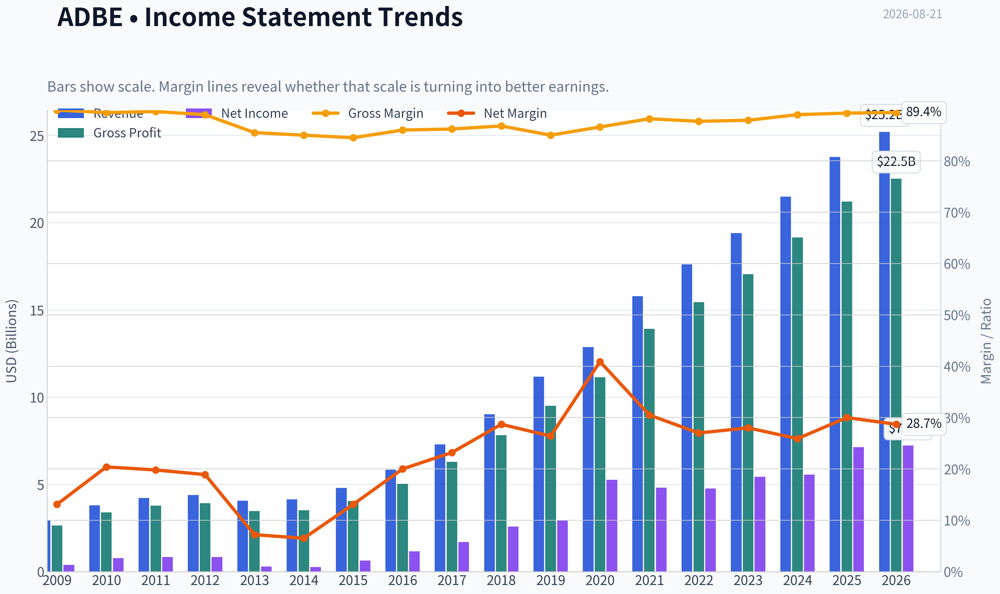
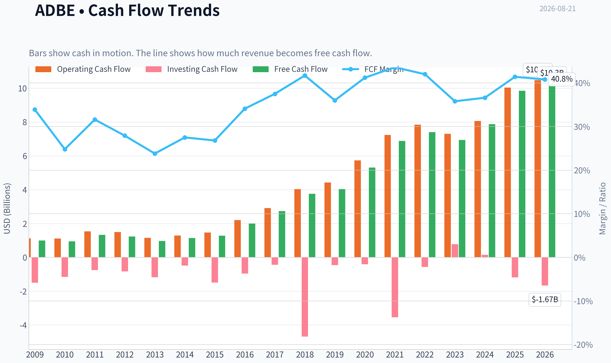
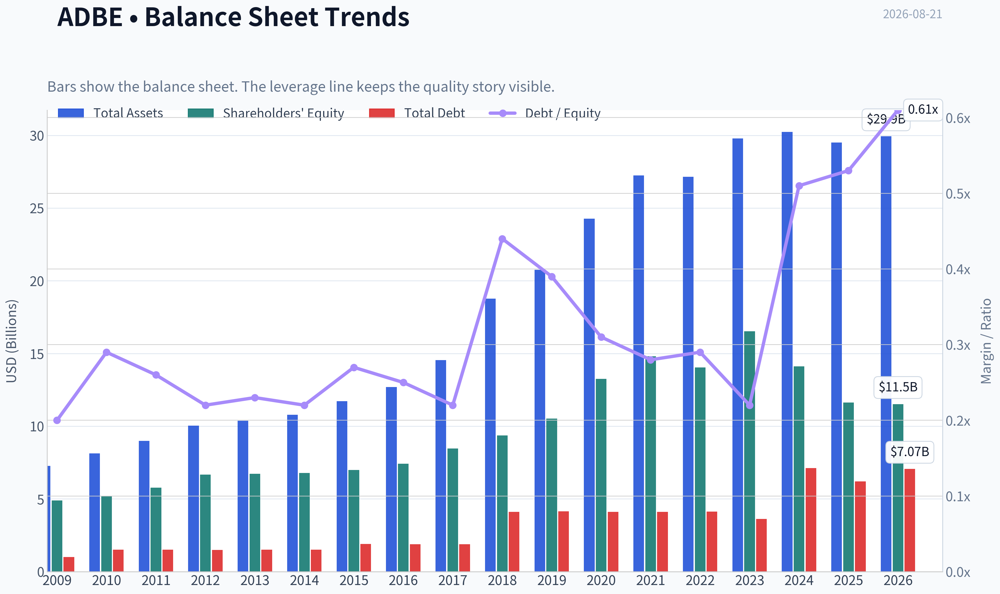
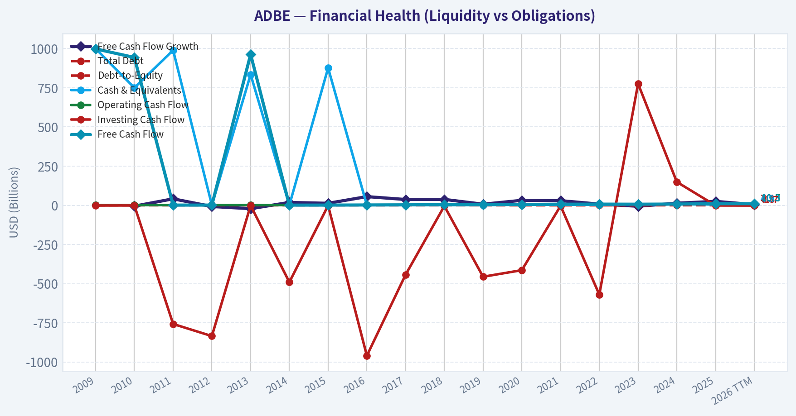
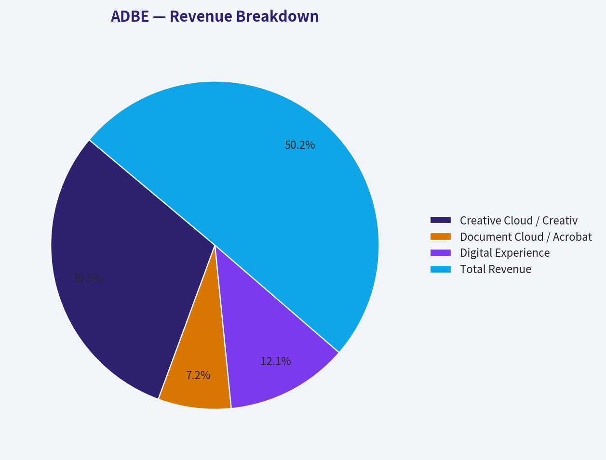
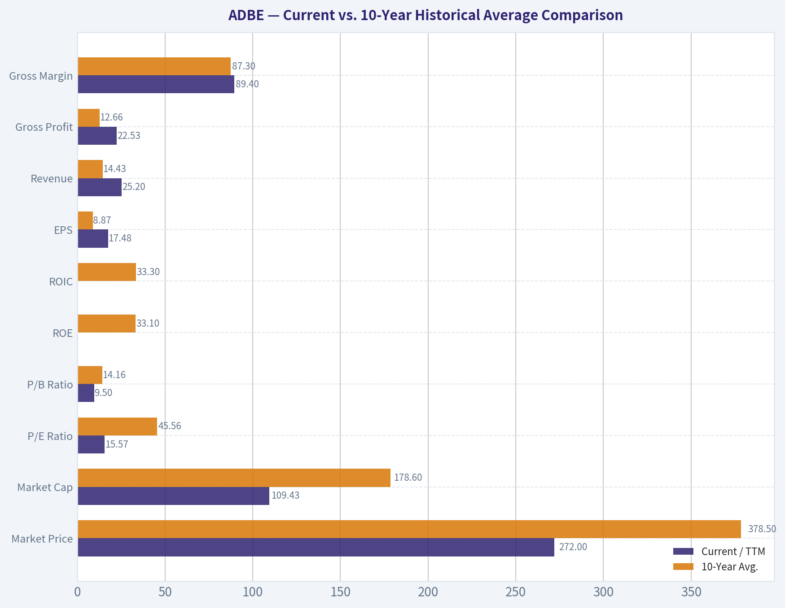
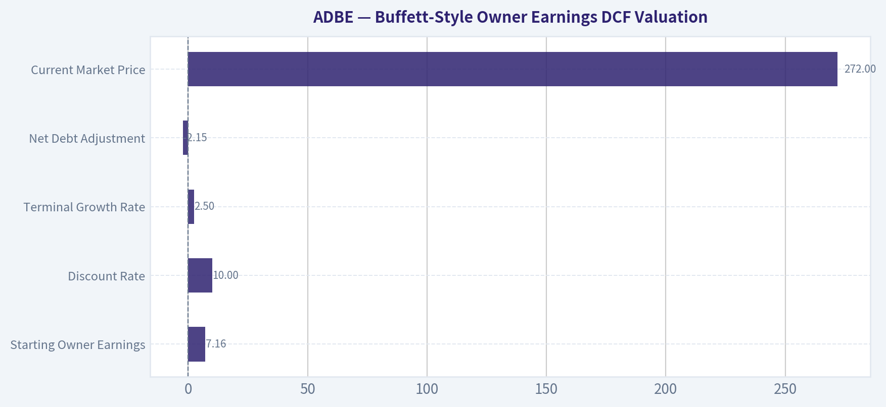
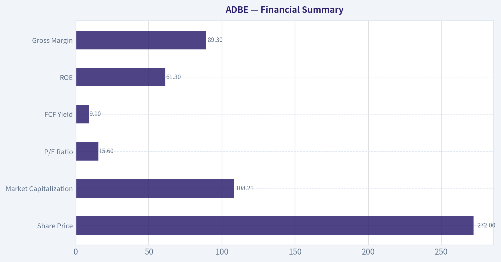

# ADBE Deep Value Intelligence

**Analysis Date:** 2026-08-21

## Critical Disclaimer

*This analysis is generated by Deep Value Intelligence, an AI-powered multi-agent investing framework. Education & research only - not financial advice, not a financial advisor.*

---

## Table of Contents

1. Intelligence Summary
2. Analyst Team Reports
   - Fundamentals Analysis
   - Intrinsic Value Analysis (Buffett)
   - Trend & Growth Analysis (Lynch/Druckenmiller/Fisher)
   - Market Technical Analysis
   - Options Market Analysis
3. Research Team Commentary
4. Value Investing Team Commentary
5. Deep Values Commentary

---

## Intelligence Summary

### Thesis + Conditions

**Core Thesis:** **1. Executive Summary**
At $272, Adobe presents a profound dislocation between market sentiment and business reality.

**Key Risks:**
- At $272, Adobe presents a profound dislocation between market sentiment and business reality. The market is pricing a dominant software utility (89.3% gross margin, 61.3% ROE, 57.3% ROIC) as a structurally declining asset, assigning it a 15.6x P/E and a 9.1% free cash flow yield. While generative AI introduces valid long-term uncertainty regarding seat consolidation, this risk is already aggressively discounted in the price. Our past mistakes taught us that demanding perfect technical confirmation or total narrative clarity on a deeply undervalued, high-quality franchise results in missed opportunities. The valuation offers a massive, quality-scaled margin of safety, justifying an immediate staged accumulation.
- Risky Analyst (Bullish):** Argues that AI expands Adobe's Total Addressable Market rather than shrinking it. Highlights Firefly's enterprise-grade legal indemnity as an unmatched moat and views the failed Figma deal as a catalyst for massive, highly accretive share buybacks at 15x multiples.
- Neutral Analyst (Pragmatic):** Suggests a middle ground, noting that a 9.1% FCF yield on a 61% ROE business is too cheap to ignore, but technicals and AI risks warrant caution. Advocates for a staged entry-buying now for value, but waiting for a moving average crossover and earnings confirmation before taking a full-weight position.

**Confidence:** Low

---

## Analyst Team Reports

### Fundamentals Analysis

#### Latest Earnings Snapshot

*Most recent reported quarter anchored on 2026 Q2, with prior-year comparison when available.*

| Metric | 2026 Q2 | 2025 Q2 | YoY Change |
| --- | ---: | ---: | ---: |
| Revenue | $6.62B | $5.87B | +12.7% |
| Operating Income | $2.24B | $2.11B | +6.1% |
| Net Income | $1.71B | $1.69B | +1.2% |
| Diluted EPS | $4.25 | $3.94 | +7.9% |
| Operating Cash Flow | $2.17B | $2.19B | -1.2% |
| Free Cash Flow | $2.11B | $2.14B | -1.7% |

Key Takeaways: This snapshot anchors the most recent reported quarter before the narrative analysis. It helps readers separate long-run business quality from whatever changed in the latest earnings print.

#### 17-Year Financial Metrics for ADBE

*All values below are computed deterministically from raw data - not estimated by AI.*

*Issuer profile: operating company (Technology / Software - Application).*

#### 17-Year Financial Metrics
*Annual rows come from reported financial statements. The final TTM row is computed from the latest four quarters.*

| Metric | 2009 | 2010 | 2011 | 2012 | 2013 | 2014 | 2015 | 2016 | 2017 | 2018 | 2019 | 2020 | 2021 | 2022 | 2023 | 2024 | 2025 | 2026 TTM |
| --- | --- | --- | --- | --- | --- | --- | --- | --- | --- | --- | --- | --- | --- | --- | --- | --- | --- | --- |
| Market Price | $35 | $28 | $27 | $35 | $57 | $74 | $91 | $103 | $181 | $251 | $310 | $478 | $670 | $345 | $611 | $516 | $320 | $272 |
| Market Cap | $18.61B | $14.62B | $13.82B | $17.40B | $29.16B | $37.46B | $46.38B | $51.85B | $90.94B | $124.89B | $152.16B | $232.30B | $322.20B | $162.43B | $280.51B | $232.01B | $136.70B | $109.43B |
| P/E Ratio | 48.05 | 18.91 | 16.62 | 20.85 | 101.39 | 139.02 | 73.76 | 44.31 | 53.69 | 48.25 | 51.59 | 44.18 | 66.85 | 34.15 | 51.69 | 41.74 | 19.17 | 15.57 |
| P/B Ratio | 3.81 | 2.82 | 2.39 | 2.61 | 4.34 | 5.53 | 6.62 | 6.98 | 10.75 | 13.34 | 14.45 | 17.51 | 21.77 | 11.56 | 16.98 | 16.45 | 11.76 | 9.50 |
| ROE | 7.9% | 14.9% | 14.4% | 12.5% | 4.3% | 4.0% | 9.0% | 15.7% | 20.0% | 27.7% | 28.0% | 39.7% | 32.6% | 33.8% | 32.9% | 39.4% | 61.3% | 62.8% |
| ROIC | 11.2% | 15.2% | 14.6% | 13.7% | 5.0% | 4.4% | 8.7% | 15.0% | 21.1% | 26.5% | 25.3% | 42.7% | 35.2% | 33.4% | 39.2% | 40.3% | 54.6% | 52.8% |
| EPS | $0.73 | $1.47 | $1.65 | $1.66 | $0.56 | $0.53 | $1.24 | $2.32 | $3.38 | $5.20 | $6.00 | $10.83 | $10.02 | $10.10 | $11.82 | $12.36 | $16.70 | $17.48 |
| Revenue | $2.95B | $3.80B | $4.22B | $4.40B | $4.06B | $4.15B | $4.80B | $5.85B | $7.30B | $9.03B | $11.17B | $12.87B | $15.79B | $17.61B | $19.41B | $21.50B | $23.77B | $25.20B |
| Gross Profit | $2.65B | $3.40B | $3.78B | $3.92B | $3.47B | $3.52B | $4.05B | $5.03B | $6.29B | $7.83B | $9.50B | $11.15B | $13.92B | $15.44B | $17.05B | $19.15B | $21.22B | $22.53B |
| Gross Margin | 89.9% | 89.4% | 89.6% | 89.0% | 85.5% | 85.0% | 84.5% | 86.0% | 86.2% | 86.8% | 85.0% | 86.6% | 88.2% | 87.7% | 87.9% | 89.0% | 89.3% | 89.4% |
| Operating Margin | 23.4% | 26.1% | 26.1% | 26.8% | 10.4% | 10.0% | 18.8% | 25.5% | 29.7% | 31.5% | 29.3% | 32.9% | 36.8% | 34.6% | 34.3% | 31.3% | 36.6% | 36.1% |
| Net Income | $386.5M | $774.7M | $832.8M | $832.8M | $290.0M | $268.4M | $629.6M | $1.17B | $1.69B | $2.59B | $2.95B | $5.26B | $4.82B | $4.76B | $5.43B | $5.56B | $7.13B | $7.23B |
| Net Margin | 13.1% | 20.4% | 19.8% | 18.9% | 7.2% | 6.5% | 13.1% | 20.0% | 23.2% | 28.7% | 26.4% | 40.9% | 30.5% | 27.0% | 28.0% | 25.9% | 30.0% | 28.7% |
| Revenue Growth | N/A | 29.0% | 11.0% | 4.4% | -7.9% | 2.3% | 15.6% | 22.1% | 24.7% | 23.7% | 23.7% | 15.2% | 22.7% | 11.5% | 10.2% | 10.8% | 10.5% | 6.0% |
| Net Income Growth | N/A | 100.4% | 7.5% | -0.0% | -65.2% | -7.4% | 134.6% | 85.7% | 44.9% | 53.0% | 13.9% | 78.2% | -8.3% | -1.4% | 14.1% | 2.4% | 28.2% | 1.4% |
| Free Cash Flow Growth | N/A | -5.5% | 41.3% | -7.8% | -21.6% | 18.3% | 12.8% | 55.4% | 37.0% | 37.6% | 7.0% | 31.8% | 29.7% | 7.5% | -6.1% | 13.4% | 25.1% | 4.3% |
| Total Book Value | $4.89B | $5.19B | $5.78B | $6.67B | $6.72B | $6.78B | $7.00B | $7.42B | $8.46B | $9.36B | $10.53B | $13.26B | $14.80B | $14.05B | $16.52B | $14.11B | $11.62B | $11.52B |
| Total Assets | $7.28B | $8.14B | $8.99B | $10.04B | $10.38B | $10.79B | $11.73B | $12.70B | $14.54B | $18.77B | $20.76B | $24.28B | $27.24B | $27.16B | $29.78B | $30.23B | $29.50B | $29.93B |
| Total Debt | $1.00B | $1.51B | $1.51B | $1.50B | $1.51B | $1.51B | $1.91B | $1.89B | $1.88B | $4.12B | $4.14B | $4.12B | $4.12B | $4.13B | $3.63B | $7.13B | $6.21B | $7.07B |
| Debt-to-Equity | 0.20 | 0.29 | 0.26 | 0.22 | 0.23 | 0.22 | 0.27 | 0.25 | 0.22 | 0.44 | 0.39 | 0.31 | 0.28 | 0.29 | 0.22 | 0.51 | 0.53 | 0.61 |
| Cash & Equivalents | $999.5M | $749.9M | $989.5M | $1.43B | $834.6M | $1.12B | $876.6M | $1.01B | $2.31B | $1.64B | $2.65B | $4.48B | $3.84B | $4.24B | $7.14B | $7.61B | $5.43B | $4.92B |
| Shareholders' Equity | $4.89B | $5.19B | $5.78B | $6.67B | $6.72B | $6.78B | $7.00B | $7.42B | $8.46B | $9.36B | $10.53B | $13.26B | $14.80B | $14.05B | $16.52B | $14.11B | $11.62B | $11.52B |
| Operating Cash Flow | $1.12B | $1.11B | $1.54B | $1.50B | $1.15B | $1.29B | $1.47B | $2.20B | $2.91B | $4.03B | $4.42B | $5.73B | $7.23B | $7.84B | $7.30B | $8.06B | $10.03B | $10.48B |
| Investing Cash Flow | $-1.50B | $-1.16B | $-757.4M | $-834.7M | $-1.18B | $-490.7M | $-1.49B | $-960.0M | $-442.9M | $-4.68B | $-456.0M | $-414.0M | $-3.54B | $-570.0M | $776.0M | $149.0M | $-1.19B | $-1.67B |
| Free Cash Flow | $998.2M | $943.4M | $1.33B | $1.23B | $963.3M | $1.14B | $1.28B | $2.00B | $2.73B | $3.76B | $4.03B | $5.31B | $6.88B | $7.40B | $6.94B | $7.87B | $9.85B | $10.28B |
| FCF Margin | 33.9% | 24.8% | 31.6% | 27.9% | 23.8% | 27.5% | 26.8% | 34.1% | 37.5% | 41.7% | 36.0% | 41.2% | 43.6% | 42.0% | 35.8% | 36.6% | 41.4% | 40.8% |
| Dividends / Share | $0.00 | $0.00 | $0.00 | $0.00 | $0.00 | $0.00 | $0.00 | $0.00 | $0.00 | $0.00 | $0.00 | $0.00 | $0.00 | $0.00 | $0.00 | $0.00 | $0.00 | $0.00 |

#### Profitability Metrics
- Return on Equity (ROE): 61.3%
- Return on Invested Capital (ROIC): 57.3%
- Return on Assets (ROA): 24.2%
- Gross Margin: 89.3%
- Operating Margin: 36.6%
- Net Profit Margin: 30.0%

#### Liquidity Metrics
- Current Ratio: 1.00
- Quick Ratio: 0.88

#### Leverage Metrics
- Debt-to-Equity Ratio: 0.53
- Interest Coverage Ratio: 33.10
- Net Debt: $779.0M

#### Growth Metrics (Year-over-Year)
- Revenue Growth: 10.5%
- Net Income Growth: 28.2%
- Free Cash Flow Growth: 25.1%
- Revenue CAGR (3-Year): 10.5%
- Revenue CAGR (5-Year): 13.1%

#### Valuation Metrics
- P/E Ratio (TTM): 15.57
- Forward P/E: 9.90
- Price-to-Book: 9.43
- Price-to-Sales: 4.29
- PEG Ratio: 0.66
- EV/EBITDA: 11.27
- Free Cash Flow Yield: 9.1%
- Earnings Yield: 6.4%

#### Owner Earnings (Buffett Method, Code-Computed)
- Net Income: $7.13B
- + Depreciation & Amortization: $818.0M
- - Capital Expenditures: $-179.0M
- - Working Capital Changes: $605.0M
- = **Owner Earnings: $7.16B**

#### Intrinsic Value (Code-Computed)
- Current Price: $272
- **Headline Intrinsic Value (business-model routed): $330**
  Business model: asset light platform - weighted blend [Damodaran FCFF + reverse-DCF fair + owner-earnings DCF] (asset_light_platform)
  Model spread (min-max across DCFs): $256 - $551
  Margin of safety vs. price (headline): 17.6%
  Routing note: Asset-light / high-margin platform: value driven by margins and reinvestment economics - the headline centers on the reverse-DCF demonstrated-growth fair value with Damodaran FCFF as a floor, down-weighting the owner-earnings DCF.
- Buffett Method (Owner Earnings):
  Conservative: $222
  Average: $511
  Optimistic: $1,478
- Cash Flow Method (FCF):
  Conservative: $363
  Average: $551
  Optimistic: $1,015
- Damodaran FCFF (WACC + margins + reinvestment):
  Conservative: $189
  Average: $256
  Optimistic: $435
  Monte Carlo band (P10-P90): $196 - $366 (median $268)
  P(intrinsic value > price): 47.4%
- Reverse-DCF: price implies ~5.3%/yr owner-earnings growth for 10y; trailing 3y was 14.0%, 5y 8.2%.

#### Piotroski F-Score: 8/9
- Positive Net Income: PASS
- Positive Operating Cash Flow: PASS
- ROA Improvement: PASS
- Cash Flow > Net Income: PASS
- Decreasing Debt: PASS
- Improving Current Ratio: FAIL
- No Dilution: PASS
- Improving Gross Margin: PASS
- Improving Asset Turnover: PASS

ANALYST STANCE: **ADVOCATE**

#### Adobe Inc. (ADBE) - Buffett-Style Fundamental Analysis

Adobe is a high-quality, asset-light software compounder whose economics are driven by subscription revenue, creative workflow lock-in, pricing power, very high gross margins, and strong free cash flow conversion. At a current market price of **$272**, the deterministic dataset shows Adobe trading at a **TTM P/E of 15.57**, a **free cash flow yield around 9.1%**, and below its model-routed intrinsic value of **about $330 per share**, implying a **margin of safety of roughly 17.6%**.

The key Buffett question is not whether Adobe has been a great business - it clearly has - but whether the current price adequately discounts slowing growth, generative AI disruption fears, and rising competitive pressure. At today's valuation, the answer is favorable, though not without risks.

---

#### Current vs. 10-Year Historical Average Comparison

| Metric | Current / TTM | 10-Year Avg. | Current Standing vs. History | Interpretation |
|---|---:|---:|---|---|
| Market Price | $272 | $378.50 | Below average | The stock has de-rated sharply from its 2021-2024 premium valuation period. |
| Market Cap | $109.43B | $178.60B | Below average | Enterprise value has contracted despite revenue and FCF being near record highs. |
| P/E Ratio | 15.57x | 45.56x | Far below average | Adobe is trading at a rare historical earnings multiple discount. |
| P/B Ratio | 9.50x | 14.16x | Below average, but not meaningful | For asset-light software, book value is not a reliable valuation anchor; DCF and FCF yield matter more. |
| ROE | 62.8% TTM | 33.1% | Far above average | Very high ROE reflects asset-light economics, buybacks, and strong profitability. |
| ROIC | 52.8% TTM | 33.3% | Far above average | Adobe earns exceptional returns on capital, a strong Buffett-style quality signal. |
| EPS | $17.48 | $8.87 | Above average | EPS has nearly doubled the 10-year average, aided by margin strength and buybacks. |
| Revenue | $25.20B | $14.43B | Above average | Revenue scale has grown substantially, but recent growth has slowed. |
| Gross Profit | $22.53B | $12.66B | Above average | Gross profit has compounded with revenue while margins remain elite. |
| Gross Margin | 89.4% | 87.3% | Above average | Software economics remain outstanding; little evidence of gross-margin erosion. |
| Operating Margin | 36.1% | 32.3% | Above average | Adobe continues to convert revenue into operating profit efficiently. |
| Net Income | $7.23B | $4.14B | Above average | Net income is near a record level, though TTM growth has slowed. |
| Net Margin | 28.7% | 28.1% | In line/slightly above | Profitability is structurally strong and relatively stable. |
| Revenue Growth | 6.0% TTM | 17.5% | Below average | Growth has decelerated meaningfully from the high-growth subscription transition era. |
| Net Income Growth | 1.4% TTM | 31.1% | Below average | Earnings growth is currently muted after a strong 2025. |
| Free Cash Flow Growth | 4.3% TTM | 23.8% | Below average | FCF growth is positive but much slower than historical norms. |
| Total Book Value | $11.52B | $12.01B | Slightly below average | Book value is affected by buybacks and is not central to Adobe's valuation. |
| Total Assets | $29.93B | $23.50B | Above average | Asset base has grown, but Adobe remains highly asset-light relative to revenue. |
| Total Debt | $7.07B | $4.14B | Above average | Leverage has increased, but interest coverage remains very strong. |
| Debt-to-Equity | 0.61x | 0.34x | Above average | Balance-sheet leverage is higher than usual, though still manageable. |
| Cash & Equivalents | $4.92B | $4.04B | Above average | Liquidity remains solid despite higher debt. |
| Shareholders' Equity | $11.52B | $12.01B | Slightly below average | Equity has been pressured by capital returns and balance-sheet structure. |
| Free Cash Flow | $10.28B | $5.68B | Far above average | Adobe's cash generation is materially stronger than its historical average. |
| Dividends / Share | $0.00 | $0.00 | Unchanged | Adobe reinvests and repurchases stock rather than paying dividends. |

**Key Takeaways:** Adobe's current valuation is dramatically cheaper than its own 10-year history, while profitability and free cash flow are near record levels. The main negative deviation is growth: revenue, earnings, and FCF growth have all slowed versus the last decade. For an asset-light software business, the low P/E and high FCF yield are more important than P/B, which is not a meaningful valuation anchor for this issuer type.

---

#### Revenue Breakdown

| Revenue Source | Amount ($B) | % of Total |
|---|---:|---:|
| Creative Cloud / Creative products | $15.30B | 60.7% |
| Document Cloud / Acrobat and PDF workflows | $3.61B | 14.3% |
| Digital Experience | $6.05B | 24.0% |
| Publishing, advertising, and other | $0.24B | 1.0% |
| **Total Revenue** | **$25.20B** | **100.0%** |

**Key Takeaways:** Adobe remains primarily a Digital Media company, with Creative Cloud and Document Cloud representing roughly three-quarters of revenue. Digital Experience is the second major pillar, contributing about one-quarter of sales. The revenue mix is attractive because it is subscription-heavy, mission-critical for creative professionals and enterprises, and supported by high switching costs.

---

#### Market Metrics Interpretation

Adobe's **market price of $272** and **market cap of about $109.43B** are well below the 10-year averages, even though the company's revenue, EPS, free cash flow, ROE, and ROIC are all materially above their historical averages. This is the classic setup Buffett-style investors look for: a superior business temporarily priced as if its moat is deteriorating faster than the evidence currently shows.

The **P/E ratio of 15.57x** is especially notable. Adobe's 10-year average P/E is about **45.56x**, meaning the market has shifted from valuing Adobe as a premium compounder to valuing it closer to a mature software company. That de-rating reflects fears around AI disruption, slower growth, and competitive pressure from tools such as Canva, Figma-like design workflows, and AI-native content platforms.

The **P/B ratio of 9.50x** should not be interpreted mechanically. Adobe is an asset-light software and intellectual property business; its value lies in code, brand, data, installed base, ecosystem, and recurring cash flow - not tangible book value. Buybacks can also suppress book equity. Therefore, P/B is **not meaningful as a cheap-or-expensive signal** for Adobe; cash-flow-based intrinsic value is the correct valuation anchor.

---

#### Profitability Analysis

Adobe's profitability remains exceptional. TTM **gross margin is 89.4%**, slightly above the 10-year average of **87.3%**, showing that competitive pressure has not yet materially impaired the company's core economics. A business that can retain nearly ninety cents of gross profit on every dollar of revenue has significant pricing power and scale leverage.

The **operating margin of 36.1%** is also above the 10-year average of **32.3%**. This indicates that Adobe's subscription model, cloud delivery, and operating discipline continue to generate strong incremental margins. The company has absorbed investment in AI, product development, and sales while preserving very high profitability.

**ROE of 62.8%** and **ROIC of 52.8%** are outstanding. From a Buffett perspective, ROIC is particularly important because it shows how efficiently the company converts invested capital into profit. Adobe's ROIC being far above its cost of capital is a strong evidence point for a durable economic moat.

Net income of **$7.23B** and net margin of **28.7%** show that the business is not merely growing revenue; it is converting revenue into real owner earnings. However, net income growth has slowed to **1.4% TTM**, so investors should not assume that past 20%+ growth rates will automatically continue.

---

#### Growth Analysis

Adobe's long-term growth record is excellent, but the current growth rate is clearly below its own historical standard. TTM revenue growth is **6.0%**, versus a 10-year average of roughly **17.5%**. Latest annual revenue growth was stronger at **10.5%**, but the TTM figure signals moderation.

Free cash flow growth is **4.3% TTM**, below the 10-year average of **23.8%**. This is the central valuation debate. If Adobe is now a mid-single-digit grower, the current valuation is fair to moderately attractive. If Adobe can sustain high-single-digit to low-double-digit owner earnings growth through AI monetization, pricing, Document Cloud expansion, and enterprise adoption, the stock is meaningfully undervalued.

The reverse-DCF from the deterministic model indicates that the current price implies about **5.3% annual owner-earnings growth for 10 years**. That is not an aggressive hurdle for a company with Adobe's margins, brand strength, and historical trailing growth, but it does require the moat to remain intact through the AI transition.

---

#### Balance Sheet and Financial Strength

Adobe's balance sheet is sound, though leverage is higher than its historical average. Total debt is **$7.07B**, compared with a 10-year average of **$4.14B**. Debt-to-equity is **0.61x**, above the 10-year average of **0.34x**.

The company also holds **$4.92B in cash and equivalents**, leaving manageable net debt. Interest coverage is very strong at about **33x**, so debt does not currently threaten financial flexibility. From a Buffett perspective, Adobe is not overleveraged; however, the rising debt load should be monitored because buybacks at poor prices or debt-funded acquisitions could reduce shareholder value.

The current ratio near **1.0** and quick ratio near **0.88** are not major red flags for this type of business. For subscription software companies with strong recurring cash flow and low capital intensity, liquidity should be judged more by FCF generation, cash balances, and debt service capacity than by traditional industrial balance-sheet ratios.

---

#### Cash Flow and Capital Allocation

Adobe's TTM free cash flow is **$10.28B**, almost double the 10-year average of **$5.68B**. Free cash flow margin is approximately **40.8%**, reinforcing the quality of the business model. This is exactly the type of cash-generative business Buffett favors: low capital requirements, high margins, repeat customers, and strong reinvestment economics.

Adobe pays **no dividend**, which is consistent with its historical policy. The company has preferred repurchases and reinvestment. This can be attractive if shares are repurchased below intrinsic value. At the current valuation, buybacks are likely more value-accretive than they were when Adobe traded above 40x-60x earnings.

Capital allocation is generally strong, but the failed Figma acquisition attempt remains a reminder that management may pursue large strategic deals when trying to defend or extend the moat. Future acquisitions should be judged carefully against Adobe's organic AI and product innovation opportunities.

---

#### Buffett-Style Owner Earnings DCF Valuation

Core assumptions used for the hand-built sanity-check DCF:

| Assumption | Value |
|---|---:|
| Starting Owner Earnings | $7.16B |
| Discount Rate | 10.0% |
| Terminal Growth Rate | 2.5% |
| Net Debt Adjustment | -$2.15B |
| Implied Shares Outstanding | ~402.3M |
| Current Market Price | $272 |

**Key Takeaways:** The DCF starts from owner earnings rather than accounting earnings, which is appropriate for a Buffett-style valuation. A 10% discount rate and 2.5% terminal growth rate are used to avoid over-capitalizing growth. Net debt is subtracted to convert enterprise value into equity value.

| Scenario | Explicit Growth Assumption | PV of 10-Year Owner Earnings | PV of Terminal Value | Equity Value | Fair Value / Share | Implied Upside / Downside |
|---|---|---:|---:|---:|---:|---:|
| Conservative | 3% for years 1-5, then fades to 2.5% | $50.5B | $49.5B | $97.8B | **$243** | **-10.7%** |
| Average / Base Case | 8% for years 1-5, then fades toward 3% | $62.9B | $70.7B | $131.5B | **$327** | **+20.2%** |
| Optimistic | 12% for years 1-5, then fades toward 3% | $74.3B | $89.7B | $161.9B | **$402** | **+47.8%** |

**Key Takeaways:** The hand-built DCF suggests Adobe is close to fairly valued in a conservative case and undervalued in the base and optimistic cases. The base-case fair value of about **$327 per share** closely aligns with the deterministic model-routed intrinsic value of about **$330**. The current price appears to require only modest long-term growth, which is favorable for a high-margin software franchise.

Detailed calculation structure:

| Step | Formula / Method | Conservative | Average | Optimistic |
|---|---|---:|---:|---:|
| Starting Owner Earnings | Given | $7.16B | $7.16B | $7.16B |
| Year 10 Owner Earnings | OE grown under scenario assumptions | $9.39B | $13.42B | $17.02B |
| Terminal Value | Year 10 OE x 1.025 / (10% - 2.5%) | $128.35B | $183.42B | $232.65B |
| Present Value of Terminal Value | Terminal Value / 1.10^10 | $49.5B | $70.7B | $89.7B |
| Enterprise Value | PV explicit OE + PV terminal value | $100.0B | $133.6B | $164.0B |
| Equity Value | Enterprise value less net debt | $97.8B | $131.5B | $161.9B |
| Per-Share Value | Equity value / ~402.3M shares | $243 | $327 | $402 |

**Key Takeaways:** The valuation is sensitive to whether Adobe can sustain high-single-digit owner-earnings growth. The conservative case assumes Adobe becomes a GDP-like grower and produces a value below the current price. The base case requires Adobe to grow slower than its best historical years but better than the market's implied expectation, which appears reasonable.

The deterministic valuation pack gives a routed intrinsic value of **$330 per share**, with model support from Owner Earnings, FCF, Damodaran FCFF, and reverse-DCF methods. The model spread is wide, ranging from very conservative Damodaran-style values to much higher owner-earnings outcomes, so the right conclusion is not "certainly cheap," but rather: **high-quality business, valuation now reasonable-to-attractive, with upside if AI fears prove overdone.**

---

#### Economic Moat Assessment

Adobe has a wide economic moat built on several reinforcing advantages:

| Moat Source | Evidence | Buffett-Style Assessment |
|---|---|---|
| Brand and industry standard | Photoshop, Illustrator, Premiere, Acrobat, PDF workflows | Adobe products are deeply embedded in professional creative and document workflows. |
| Switching costs | Files, workflows, plugins, teams, training, enterprise integrations | Customers face productivity loss and retraining costs when switching. |
| Ecosystem depth | Creative Cloud, Document Cloud, Experience Cloud | Bundled workflows increase retention and cross-sell potential. |
| Pricing power | Gross margin near 89% and operating margin above 36% | Margins suggest strong willingness to pay and limited commoditization so far. |
| Recurring revenue | Subscription-heavy model | Predictable revenue improves durability and valuation quality. |
| AI integration | Firefly and generative AI features embedded into existing tools | Adobe can monetize AI inside trusted workflows rather than competing only as a standalone AI tool. |

**Key Takeaways:** Adobe's moat remains strong because it controls mission-critical creative and document workflows. The biggest uncertainty is whether generative AI weakens the moat by lowering the skill barrier for competitors. So far, Adobe's margins and revenue base suggest the moat is adapting rather than collapsing.

---

#### Predictable Earnings and Business Quality

Adobe's earnings have become more predictable over time because the company successfully transitioned from perpetual licenses to subscriptions. Revenue increased from **$5.85B in 2016** to **$25.20B TTM**, while free cash flow rose from **$2.00B in 2016** to **$10.28B TTM**. This is a strong long-term compounding record.

The company's biggest quality marker is free cash flow consistency. Even during years when net income growth slowed or declined, Adobe continued producing substantial cash. Free cash flow growth was negative in 2023, but recovered strongly in 2024 and 2025 before slowing again on a TTM basis.

For Buffett-style investors, Adobe qualifies as a high-quality business because it has high returns on capital, low capital intensity, recurring revenue, and a durable customer base. The main question is price and future growth, not business quality.

---

#### Management Performance and Capital Allocation

Management has delivered excellent long-term economics: ROIC is above **50% TTM**, free cash flow has compounded materially, and margins remain elite. Adobe's no-dividend policy is appropriate because the company has historically had better uses for capital through reinvestment, acquisitions, and share repurchases.

However, capital allocation is not risk-free. Repurchases at high valuation multiples are less attractive, and large acquisitions can create integration and regulatory risk. The failed Figma deal highlighted Adobe's awareness of competitive threats in collaborative design, but also showed that management may be willing to pursue expensive strategic transactions.

At today's lower valuation, buybacks are more appealing. If Adobe repurchases stock meaningfully around the current price, those repurchases could compound per-share intrinsic value.

---

#### Key Investment Insights

| Category | Insight | Importance |
|---|---|---|
| Valuation | P/E of 15.57x is far below the 10-year average of 45.56x | Suggests a significant de-rating and potential mispricing. |
| Cash Flow | FCF of $10.28B and FCF yield around 9.1% | Strong owner earnings support intrinsic value. |
| Profitability | ROIC above 50% and gross margin near 89% | Indicates a high-quality, capital-light moat. |
| Growth | TTM revenue growth of 6.0% is below historical norms | Main reason the market has compressed the multiple. |
| AI Risk | Generative AI could disrupt creative workflows | Key uncertainty, but Adobe is also embedding AI into its own products. |
| Balance Sheet | Debt is elevated versus history but manageable | Not a major concern given interest coverage and cash flow. |
| Capital Allocation | No dividend; buybacks likely more attractive at current prices | Could enhance per-share value if executed below intrinsic value. |

**Key Takeaways:** Adobe combines unusually high business quality with a valuation that is now below its historical norm. The investment case depends on whether growth stabilizes above the roughly 5.3% implied by the current price. If Adobe sustains even mid-to-high-single-digit owner-earnings growth, the stock appears undervalued.

---

#### Red Flags and Risks

| Risk | Why It Matters | Severity |
|---|---|---|
| AI disruption | AI-native tools may reduce dependence on Adobe products | High |
| Slowing growth | TTM revenue growth has fallen to 6.0% | Medium-High |
| Competitive pressure | Canva, Figma-like workflows, and AI design tools pressure pricing and relevance | Medium-High |
| Valuation sensitivity | DCF downside exists if Adobe becomes a low-growth mature software company | Medium |
| Higher leverage | Debt-to-equity is above historical average | Medium |
| Acquisition risk | Large strategic deals could destroy value if overpriced | Medium |
| No dividend | Returns depend on growth and buybacks, not income | Low |

**Key Takeaways:** The biggest risk is not current profitability; it is the durability of Adobe's growth and moat in an AI-driven software environment. The current valuation already prices in some disappointment, but not a full collapse of the franchise. Investors should monitor AI monetization, retention, pricing power, and Digital Media growth closely.

---

#### Opportunities

| Opportunity | Potential Impact |
|---|---|
| AI monetization through Firefly and embedded generative tools | Could reaccelerate Creative Cloud growth and defend pricing power. |
| Document Cloud expansion | Acrobat, PDF, e-signature, and workflow automation remain large markets. |
| Enterprise cross-selling | Adobe can bundle Creative, Document, and Experience Cloud capabilities. |
| Margin resilience | High gross margins allow continued AI investment without destroying profitability. |
| Buybacks at lower valuation | Repurchases near current levels could be meaningfully accretive. |
| Market sentiment recovery | If AI fears fade, Adobe's valuation multiple could normalize upward. |

**Key Takeaways:** Adobe has multiple ways to create value even if overall software spending remains moderate. The most important upside driver is proving that AI expands Adobe's addressable market rather than commoditizing its products. If that happens, today's valuation could look unusually attractive in hindsight.

---

#### Final Investment Stance: ADVOCATE

Adobe earns an **ADVOCATE** rating for long-term, value-oriented investors willing to tolerate AI-related uncertainty. The business has the core Buffett attributes: high ROIC, strong recurring revenue, durable customer relationships, exceptional margins, and robust owner earnings. The current valuation is also unusually reasonable relative to Adobe's own history and to its cash-flow generation.

The margin of safety is not enormous in the most conservative case, so this is not a risk-free bargain. But the market price of **$272** is below the deterministic routed intrinsic value of about **$330**, below the base-case owner-earnings DCF value of roughly **$327**, and well below the optimistic case of about **$402**. The reverse-DCF implied growth rate of approximately **5.3%** appears achievable for a company of Adobe's quality.

For Buffett-style investors, Adobe is attractive when viewed as a wide-moat software franchise temporarily priced for lower growth. The correct stance is **ADVOCATE**, with the caveat that position sizing should reflect AI disruption risk and the need to confirm that revenue growth stabilizes.

---

#### Summary Table

| Area | Conclusion | Investor Implication |
|---|---|---|
| Business Quality | Excellent asset-light software economics | Adobe remains a high-quality compounder. |
| Moat | Wide, but being tested by AI | Monitor retention, pricing, and product relevance. |
| Profitability | ROE and ROIC far above historical averages | Strong evidence of durable competitive advantage. |
| Growth | Slower than historical norms | Main reason for valuation compression. |
| Balance Sheet | Manageable leverage, strong cash flow | Financial risk is acceptable. |
| Valuation | Below historical averages and below base-case intrinsic value | Shares appear moderately undervalued. |
| DCF View | Conservative value $243, base $327, optimistic $402 | Current price offers upside if growth exceeds low expectations. |
| Key Risk | AI-native disruption and slower Creative Cloud growth | Requires ongoing monitoring. |
| Key Opportunity | AI monetization and buybacks at lower valuation | Could drive meaningful per-share value creation. |
| Final Stance | **ADVOCATE** | Attractive for long-term investors seeking quality at a reasonable price. |

**Key Takeaways:** Adobe is no longer priced like a flawless growth stock, yet its profitability and cash generation remain exceptional. The stock offers a favorable balance of business quality and valuation, provided the AI transition strengthens rather than erodes Adobe's ecosystem. The final stance is **ADVOCATE**, with disciplined monitoring of growth and competitive risk.

#### Fundamental Visuals

This graph tracks the profitability and return metrics (ROE, ROIC, Margins) of **ADBE** over the past decade, highlighting capital efficiency trends.

This chart illustrates the financial health of **ADBE** over the last 10 years, mapping cash equivalents and free cash flow against total obligations (Debt).

This breakdown chart from <em>Revenue Breakdown</em> shows the proportional composition for **ADBE** - useful for understanding what drives or risks the business.

---

### Intrinsic Value Analysis (Buffett)

> *Following Warren Buffett's value investing philosophy: Circle of Competence, Economic Moat, Management Quality, and Margin of Safety.*

#### Intrinsic Value Snapshot

Price is what you pay. Intrinsic value is what the business may be worth based on the cash it can create for owners over time. We show a range, not one magic number.

- Current Price: $272.22
- Value Range (conservative to optimistic across both DCF methods): $291.99 to $632.04

##### Owner Earnings (Buffett Method)
- Net Income: $7,130,000,000.00
- Depreciation & Amortization: $818,000,000.00
- Capital Expenditures: $-179,000,000.00
- Working Capital Changes: $605,000,000.00
- Owner Earnings: $7,164,000,000.00

##### Intrinsic Value
###### Buffett Method
Uses owner earnings. Stricter, and usually more conservative.
- Conservative: $291.99
- Average: $374.40
- Optimistic: $531.33
- Discount Rate: 10.0%

###### Cash Flow Method
Uses free cash flow. Better for companies spending heavily today to grow tomorrow.
- Conservative: $359.04
- Average: $454.22
- Optimistic: $632.04
- Discount Rate: 10.0%

ANALYST STANCE: **ADVOCATE**

#### Adobe Investment View - Buffett-Style Value Analysis

Adobe is a high-quality, asset-light software franchise with exceptional gross margins, strong cash conversion, a durable creative and document ecosystem, and a current valuation that looks unusually attractive for the quality of the business. At $272 per share, the stock trades below the provided headline intrinsic value of $360.29, offering a 24.4% margin of safety while the reverse-DCF implies only about 5.3% annual growth for 10 years - well below Adobe's recent growth record and long-term franchise potential.

---

#### 1. Factor Scorecard

| Factor | Score | Evidence |
|---|---:|---|
| Circle of Competence & Business Simplicity | 4.5 / 5 | Adobe sells mission-critical creative, document, and digital experience software through recurring subscriptions. The model is simple: customers pay for tools deeply embedded in professional workflows. |
| Moat Test | 4.5 / 5 | 89.3% gross margin, strong brand dominance in creative software, PDF/document standards, workflow switching costs, and AI-enhanced product ecosystem. |
| Management Quality & Capital Allocation | 4.0 / 5 | Long-tenured leadership, disciplined subscription transition, strong buyback history, high cash generation, and rational reinvestment in AI/product expansion. |
| Industry Structure | 4.0 / 5 | Software is competitive, but Adobe operates in categories where it has standard-setting products and scale advantages. AI is both a risk and an opportunity; current evidence suggests Adobe is adapting well. |
| Gate 5: Quality/Solvency Hard Floor | Not Tripped | Fundamentals remain profitable and cash-generative. No evidence of earnings/cash-flow collapse combined with solvency stress. |

**Key Takeaways:** Adobe passes the Buffett quality screen strongly. The business is understandable, highly profitable, and protected by brand, workflow integration, and switching costs. The hard solvency floor is not triggered, so the decision turns on quality versus price - and both look favorable.

---

#### 2. Moat Analysis

| Moat Source | Assessment | Evidence |
|---|---|---|
| Intangible Assets | Very strong | Photoshop, Illustrator, Acrobat, Premiere, Lightroom, and PDF are category-defining assets. Adobe has professional credibility that newer tools struggle to replicate. |
| Switching Costs | Strong | Creative Cloud files, workflows, teams, plugins, training, enterprise contracts, and document processes create friction against switching. |
| Cost Advantage | Moderate to strong | Asset-light SaaS model and scale produce very high gross margins. Adobe can spread R&D and AI infrastructure investment across a large subscriber base. |
| Network Effects | Moderate | Not a pure network-effect business, but ecosystem effects exist through file formats, creator workflows, templates, plugins, agencies, and enterprise adoption. |
| Moat Rating | Wide & Stable to Widening | AI initially created disruption fears, but Adobe's embedded distribution gives it a strong path to monetize AI inside existing workflows. |

**Key Takeaways:** Adobe's moat is not based on factories or physical scale; it is based on habit, standards, software ecosystems, and professional trust. The key risk is generative AI disruption, but Adobe's own AI integration and entrenched user base make the moat more resilient than the market's low multiple implies.

---

#### 3. Management Quality Assessment

| Management Question | Assessment |
|---|---|
| Do they think like owners? | Positive. Management has emphasized recurring revenue, product depth, and long-term platform relevance rather than short-term license maximization. |
| Are they honest and candid? | Generally positive. Adobe has been transparent about AI strategy, subscription economics, and product roadmap priorities. |
| Are they rational capital allocators? | Strong. The shift to subscription was value-enhancing, buybacks have supported per-share economics, and reinvestment in creative/document AI is strategically logical. |
| Main criticism | The attempted Figma acquisition raised questions about price discipline, though the deal did not close and therefore did not permanently impair capital. |

**Key Takeaways:** Adobe's management record is strong, especially the successful transition from packaged software to recurring subscriptions. Capital allocation is not flawless, but the long-term record shows high-return reinvestment and per-share value creation.

---

#### 4. Financial Summary

| Metric | Current / Recent Figure | Buffett-Style Interpretation |
|---|---:|---|
| Share Price | $272 | Price paid today. |
| Market Capitalization | $108.21B | Large, established compounder. |
| P/E Ratio | 15.6x | Low for a high-margin, recurring-revenue software franchise. |
| Implied Net Income | ~$6.95B | Based on market cap divided by P/E. |
| Implied EPS | ~$17.47 | Based on price divided by P/E. |
| FCF Yield | 9.1% | Very attractive for a business of Adobe's quality. |
| Implied Free Cash Flow | ~$9.85B | Market cap multiplied by FCF yield. |
| Implied FCF / Share | ~$24.76 | Strong cash earnings power per share. |
| ROE | 61.3% | Excellent, though asset-light economics make book equity less meaningful. |
| Gross Margin | 89.3% | Exceptional evidence of pricing power and software economics. |
| Revenue Growth YoY | 10.5% | Solid double-digit growth despite mature scale. |
| Trailing 3-Year Growth | 14.0% | Strong historical compounding base. |
| Current Ratio | ~1.0x | Not a concern for an asset-light subscription model with strong cash generation. |

**Key Takeaways:** Adobe combines high growth, high margins, and high cash conversion. The standout number is the 9.1% free cash flow yield, which is unusually high for a company with Adobe's moat and recurring-revenue profile. Traditional balance-sheet ratios like current ratio are less informative here than cash generation and franchise durability.

---

#### 5. Owner Earnings Calculation

Using Buffett's framework:

Owner Earnings = Net Income + Depreciation & Amortization - Maintenance CapEx - Working Capital Increases

For Adobe, free cash flow is a practical conservative proxy for owner earnings because maintenance capital needs are low and the business is asset-light.

| Item | Estimate |
|---|---:|
| Net Income | ~$6.95B |
| Free Cash Flow Proxy | ~$9.85B |
| Shares Outstanding, Implied | ~397.8M |
| Owner Earnings Used for Valuation | ~$9.85B |
| Owner Earnings per Share | ~$24.76 |

**Key Takeaways:** Adobe produces far more cash than a typical capital-intensive company because it does not need heavy physical reinvestment to maintain the business. At today's price, investors are receiving roughly a 9.1% owner-earnings yield before assuming meaningful future growth.

---

#### 6. Three-Scenario DCF Valuation

| Scenario | Assumptions | Intrinsic Value / Share |
|---|---|---:|
| A - No Growth | Owner earnings per share of $24.76 capitalized at 10% | ~$248 |
| B - GDP Growth | 3% perpetual growth, 10% discount rate | ~$364 |
| C - Historical Growth Discounted | 8% growth for 10 years, then 3% terminal growth, 10% discount rate | ~$528 |
| Provided Headline Intrinsic Value | Business-model routed blend of Damodaran FCFF, reverse-DCF fair value, and owner-earnings DCF | $360.29 |
| 3-Model Spread | Owner Earnings / FCF / Damodaran FCFF | $374.40 / $454.22 / $327.37 |

**Key Takeaways:** The no-growth case is close to the current market price, which means the market is giving little credit for Adobe's future growth. The GDP-growth case and the provided intrinsic value both sit meaningfully above today's price. If Adobe compounds anywhere near its recent growth rate, the upside case is materially higher.

---

#### 7. Margin of Safety Analysis

| Valuation Measure | Value |
|---|---:|
| Current Price | $272 |
| Headline Intrinsic Value | $360.29 |
| Margin of Safety vs. Headline Value | 24.4% |
| Reverse-DCF Implied Growth | ~5.3% per year for 10 years |
| Recent Revenue Growth YoY | 10.5% |
| Trailing 3-Year Growth | 14.0% |
| Quality-Scaled Required Margin of Safety | ~10-15% for a wide-moat, high-return compounder |
| Actual Margin of Safety | Above required threshold |

**Key Takeaways:** Adobe's valuation is compelling because the stock does not require heroic assumptions. The market price implies growth far below recent performance, while the business still has durable pricing power, recurring revenue, and AI monetization opportunities. For a wide-moat software compounder, a 24.4% discount to intrinsic value is attractive.

---

#### 8. Final Buffett Scorecard

| Criterion | Weight | Score | Weighted Contribution |
|---|---:|---:|---:|
| Moat Width & Durability | 25% | 4.5 | 1.13 |
| Valuation / Margin of Safety | 20% | 4.5 | 0.90 |
| Capital Returns - ROIC vs. WACC | 15% | 4.5 | 0.68 |
| Business Understanding & Predictability | 12% | 4.5 | 0.54 |
| Management Quality & Capital Allocation | 12% | 4.0 | 0.48 |
| Reinvestment Runway | 8% | 4.0 | 0.32 |
| Balance Sheet Strength | 4% | 4.0 | 0.16 |
| Industry Structure | 4% | 4.0 | 0.16 |
| Final Weighted Score | 100% | - | 4.36 / 5.00 |

**Key Takeaways:** Adobe scores in the ADVOCATE range because it combines a wide moat, excellent economics, and a valuation below intrinsic value. The biggest debate is AI disruption, but the current price appears to over-discount that risk relative to Adobe's actual franchise strength.

---

#### 9. Investment Stance

| Stance | Conviction | Rationale |
|---|---|---|
| **ADVOCATE** | High | Adobe is a wonderful business trading at a fair-to-attractive price. The company has exceptional gross margins, high returns on capital, strong cash generation, entrenched customer workflows, and a margin of safety above the threshold required for a wide-moat compounder. |

Adobe fits Buffett's modern compounder framework: an understandable, asset-light business with durable customer captivity, high incremental returns, and a long reinvestment runway. At $272, the market appears to be pricing Adobe as if AI will structurally impair growth, while the evidence suggests Adobe remains a central platform for creative and document workflows. The risk is real, but the price more than compensates for it.
#### Valuation Bridge

This bridge places the current market price beside each intrinsic value lens so readers can see whether upside depends on one method or shows up across several methods.

| Scenario | Intrinsic Value / Share |
| --- | ---: |
| Buffett Method | $374.40 |
| Cash Flow Method | $454.22 |
| Damodaran Method | $327.37 |
| Current Price | $272.22 |

#### Key Takeaways

If one method is far above the others, the upside case depends on a specific modelling assumption. When several methods cluster together, the valuation story is more robust.

#### Valuation Visuals

This comparison chart from *Latest Earnings Snapshot* stacks current figures against historical benchmarks for **ADBE**, making it easy to see where the company trades relative to its own averages.

This comparison chart from *Current vs. 10-Year Historical Average Comparison* stacks current figures against historical benchmarks for **ADBE**, making it easy to see where the company trades relative to its own averages.

This comparison chart from *Buffett-Style Owner Earnings DCF Valuation* stacks current figures against historical benchmarks for **ADBE**, making it easy to see where the company trades relative to its own averages.

This comparison chart from *Buffett-Style Owner Earnings DCF Valuation* stacks current figures against historical benchmarks for **ADBE**, making it easy to see where the company trades relative to its own averages.

This comparison chart from *Financial Summary* stacks current figures against historical benchmarks for **ADBE**, making it easy to see where the company trades relative to its own averages.

---

### Trend & Growth Analysis (Lynch/Druckenmiller/Fisher)

> *Following Peter Lynch's GARP, Stanley Druckenmiller's macro-aware approach, and Philip Fisher's scuttlebutt methodology.*

ANALYST STANCE: **WATCH**

#### Adobe (ADBE) Growth Investment Report - 2026-08-21

| Snapshot | Data |
|---|---:|
| Current Price | $272 |
| Market Cap | $108.21B |
| P/E | 15.6x |
| YoY Revenue Growth | 10.5% |
| Gross Margin | 89.3% |
| ROE | 61.3% |
| FCF Yield | 9.1% |
| Headline Intrinsic Value | $360.29 |
| Margin of Safety vs. Price | 24.4% |
| Reverse-DCF Implied Growth | ~5.3% per year for 10 years |

**Key Takeaways:** Adobe is no longer a classic fast grower, but it is a very high-quality software franchise trading at a surprisingly modest valuation. The stock appears priced for low-to-mid-single-digit growth, while the business is still growing revenue around 10% with elite margins and cash generation. That creates an attractive GARP setup, but not yet a clear ten-bagger growth setup.

---

#### 1. Lynch Classification

| Lynch Category | Assessment |
|---|---|
| Classification | **Stalwart / GARP Compounder** |
| Growth Profile | ~10.5% revenue growth, below the 15-25% "Fast Grower" zone |
| Growth Investor Fit | Good for quality/value-growth portfolios; less compelling for pure ten-bagger hunting |
| Lynch View | Attractive if bought at a reasonable price, but not a classic explosive growth stock |

**Key Takeaways:** Adobe fits Lynch's "stalwart" bucket rather than the "fast grower" bucket. The business is excellent, durable, and cash-rich, but current growth is not fast enough to make it a primary ten-bagger candidate. The investment case depends on valuation, AI monetization, and whether growth can reaccelerate.

---

#### 2. The Story in 3 Bullets

- Adobe sells mission-critical creative, document, and marketing software used by designers, businesses, students, creators, and enterprises.
- The market's fear is that generative AI will disrupt Adobe; the bull case is that Adobe turns AI into a monetization engine through Firefly, Creative Cloud upsells, enterprise workflows, and content generation tools.
- At 15.6x earnings and a 9.1% FCF yield, the market is pricing Adobe more like a low-growth mature software company than a dominant AI-enabled creative platform.

---

#### 3. TAM Analysis and 10x Test

| TAM Factor | Assessment |
|---|---:|
| Approximate Revenue Base | ~$23B-$24B trailing revenue estimate |
| 10x Revenue Target | ~$230B-$240B |
| Core TAM | Creative software, document workflows, digital experience, marketing automation, content supply chain |
| Long-Term TAM Direction | Expanding, helped by AI content creation and enterprise digital workflows |
| 10x Test Result | **Fails / unlikely at current scale** |
| More Realistic Upside Test | 2x-3x revenue over long horizon is plausible if AI expands ARPU and usage |

**Key Takeaways:** Adobe has a large and expanding market, but its current revenue base is already too large for a clean 10x revenue path. The more realistic bull case is not a ten-bagger from here, but a durable compounding story with margin expansion, buybacks, AI monetization, and multiple re-rating. This is a quality compounder, not an early-stage land-grab.

---

#### 4. Revenue Growth Trend

| Metric | Current Reading | Interpretation |
|---|---:|---|
| YoY Revenue Growth | 10.5% | Solid, but not fast-grower territory |
| Growth Pattern | Stable/moderate | No clear acceleration yet |
| Reverse-DCF Hurdle | ~5.3% implied 10-year growth | Market expectations look low |
| Inflection Needed | AI monetization must lift growth toward mid-teens | Key catalyst |

**Key Takeaways:** Adobe is still growing, but the growth rate is not yet accelerating enough to qualify as a Lynch-style fast grower. The attractive part of the setup is that the stock price seems to embed very low expectations. A true growth re-rating requires evidence that AI can push revenue growth back toward the mid-teens.

---

#### 5. Unit Economics

| Unit Economics Metric | Adobe Assessment |
|---|---|
| Gross Margin | 89.3%, elite software margin |
| FCF Yield | 9.1%, very strong |
| LTV/CAC | Not disclosed, but likely strong given subscription model and brand dominance |
| NRR | Not provided in available data |
| Rule of 40 Estimate | Revenue growth 10.5% + strong FCF margin likely comfortably above 40 |
| Overall Unit Economics | Excellent |

**Key Takeaways:** Adobe's unit economics are likely among the best in software. The company has very high gross margins, strong free cash flow, and deeply embedded subscription products. Even without disclosed LTV/CAC or NRR, the financial profile suggests a highly efficient software model.

---

#### 6. Inflection Point Assessment

| Inflection Type | Evidence | Rating |
|---|---|---|
| Product Cycle Inflection | Firefly and AI-native creative tools could expand usage and pricing | Positive but still developing |
| TAM Inflection | AI may expand content creation from professionals to every business user | Positive |
| Margin Inflection | Already highly profitable; less room for dramatic margin expansion | Moderate |
| Competitive Inflection | AI disruption fears are fading, but competition from Figma, Canva, OpenAI, and other tools remains | Mixed |
| Market Sentiment Inflection | Recent coverage suggests AI panic is easing | Positive |
| Revenue Inflection | Not yet visible in provided data | Watch |

**Key Takeaways:** The most important potential inflection is sentiment and product-cycle related, not yet revenue-proven. Adobe may be moving from "AI disruption victim" to "AI monetization beneficiary," which could support multiple expansion. However, the hard evidence of revenue acceleration is still insufficient.

---

#### 7. Macro Setup

| Macro Factor | Impact on Adobe |
|---|---|
| Interest Rates | Falling rates would help software multiples |
| AI Theme | Strong tailwind if Adobe monetizes AI rather than being disrupted by it |
| Enterprise Software Spending | Moderate tailwind if budgets stabilize |
| Digital Content Growth | Structural tailwind |
| Economic Sensitivity | Marketing and creative budgets can soften in downturns |

**Key Takeaways:** The macro setup is reasonably favorable if rates decline and software multiples recover. Adobe also sits directly in the AI and digital content theme, but it must prove that AI expands its business rather than commoditizes it. The macro backdrop is supportive, but not enough by itself to make Adobe a high-conviction growth inflection.

---

#### 8. Fisher 15 Points Score

| Fisher Point | Score / 5 | Comment |
|---|---:|---|
| Market potential | 4 | Large creative, document, and enterprise workflow markets |
| New product determination | 4 | Strong AI/product investment |
| R&D effectiveness | 4 | Firefly and platform integrations are strategically important |
| Sales organization | 4 | Deep enterprise and creator reach |
| Profit margin | 5 | Elite gross margin |
| Improving margins | 3 | Already high; upside is incremental |
| Labor/personnel relations | 3 | No major data in pack |
| Executive relations | 3 | No major data in pack |
| Management depth | 4 | Mature, experienced software leadership |
| Cost analysis/accounting | 4 | Strong cash conversion and operating discipline |
| Moat | 5 | Brand, workflows, switching costs, ecosystem |
| Long-range profit outlook | 4 | Strong, assuming AI defense succeeds |
| Dilution risk | 4 | Cash generative; less reliant on equity financing |
| Candor | 3 | Not enough evidence in provided data |
| Integrity | 3 | No major concern in provided data |
| **Total** | **57 / 75** | **Good** |

**Key Takeaways:** Adobe scores well on Fisher's framework because it has durable products, strong margins, a deep moat, and a long runway in digital workflows. The score is held back by uncertainty around AI disruption and limited fresh qualitative evidence on management candor, personnel culture, and customer-level scuttlebutt. Overall, this is a good Fisher business, though not an obvious emerging hypergrowth winner.

---

#### 9. Valuation Analysis

| Valuation Metric | Result | Interpretation |
|---|---:|---|
| P/E | 15.6x | Cheap for a high-quality software franchise |
| Revenue Growth | 10.5% | Moderate |
| PEG Ratio | ~1.5x | Fair value to modestly attractive |
| FCF Yield | 9.1% | Very attractive |
| Headline Intrinsic Value | $360.29 | Above current price |
| Margin of Safety | 24.4% | Attractive |
| Reverse-DCF Implied Growth | ~5.3% | Low hurdle |

**Key Takeaways:** Valuation is the strongest part of the Adobe case. A 15.6x P/E and 9.1% free cash flow yield are unusually inexpensive for a dominant software platform with nearly 90% gross margins. The stock does not require heroic assumptions, but it does require the business to avoid meaningful AI-driven deterioration.

---

#### Scenario Analysis

| Scenario | Assumptions | Implied View |
|---|---|---|
| Bear Case | AI competition pressures pricing; growth falls to mid-single digits; multiple stays compressed | Stock may remain range-bound or decline modestly |
| Base Case | Revenue grows high-single to low-double digits; FCF remains strong; multiple normalizes slightly | Solid compounder with attractive risk/reward |
| Bull Case | AI tools drive ARPU expansion and enterprise adoption; growth reaccelerates toward mid-teens | Meaningful upside and multiple re-rating possible |

**Key Takeaways:** The downside case is mainly about AI commoditization and slower growth. The base case is a high-quality cash compounder bought at a reasonable price. The bull case requires Adobe to prove that AI is a revenue accelerator, not just a defensive feature.

---

#### 10. Growth Investor Scorecard

| Criterion | Weight | Score / 5 | Weighted Score |
|---|---:|---:|---:|
| The Story | 10% | 4.0 | 0.40 |
| TAM & Runway | 20% | 3.5 | 0.70 |
| Revenue Growth | 20% | 2.8 | 0.56 |
| Unit Economics | 15% | 4.8 | 0.72 |
| Competitive Position | 10% | 4.2 | 0.42 |
| Management Quality | 10% | 3.8 | 0.38 |
| Macro Setup | 5% | 3.5 | 0.18 |
| Profitability Path | 5% | 4.8 | 0.24 |
| Valuation | 5% | 4.3 | 0.22 |
| **Total** | **100%** |  | **3.82 / 5.0** |

**Key Takeaways:** Adobe scores well because the business quality, unit economics, moat, profitability, and valuation are all strong. The main weakness is revenue growth, which is too low for a true fast-grower classification. The total score supports a constructive stance, but with the caveat that this is a GARP compounder rather than a ten-bagger-style growth stock.

---

#### 11. Position Size Stance

| Investor Type | Suggested Stance |
|---|---|
| Pure Ten-Bagger Growth Portfolio | **WATCH** - wait for revenue acceleration |
| GARP / Quality Growth Portfolio | **Accumulate modestly** |
| Existing Holders | **Hold / add selectively** if AI monetization evidence improves |
| Suggested Position Size | 3%-5% for quality-growth portfolios; smaller for aggressive growth mandates |

**Key Takeaways:** Adobe is attractive enough to own, but not aggressive enough to make it a top ten-bagger candidate. For investors focused on quality growth at a reasonable price, the current valuation is compelling. For investors seeking explosive growth, the right move is to monitor for AI-driven acceleration before sizing heavily.

---

#### 12. Key Risks and Catalysts

| Category | Key Items |
|---|---|
| Major Risks | Generative AI commoditizes creative tools; Canva/Figma/OpenAI competition; slower enterprise software spending; growth remains near 10% or lower; AI features fail to produce pricing power |
| Catalysts | Firefly monetization; Creative Cloud ARPU expansion; enterprise AI adoption; margin durability; buybacks; software multiple recovery; analyst sentiment shifting from AI panic to AI beneficiary |
| Evidence to Watch | Net new ARR trends, Digital Media growth, AI attach rates, pricing power, churn, enterprise adoption, and management commentary on Firefly monetization |

**Key Takeaways:** The central debate is simple: is AI a threat to Adobe's moat, or the next expansion layer of the moat? If Adobe proves AI monetization, the stock can re-rate materially from a low valuation. If AI merely defends the existing base without accelerating growth, Adobe remains a solid but less exciting compounder.

---

#### Final View

Adobe is a high-quality, cash-rich software stalwart trading at a valuation that looks too pessimistic. However, under a Lynch/Druckenmiller/Fisher growth framework, it is not yet a clear fast-grower or ten-bagger candidate because revenue growth is only about 10.5% and acceleration is not yet proven.

The setup is best described as **GARP with an AI inflection option**. I would keep Adobe on the active buy/watch list, own it selectively in quality-growth portfolios, and upgrade to stronger advocacy if AI monetization pushes revenue growth back toward the mid-teens.

---

### Market Technical Analysis

ANALYST STANCE: **WATCH**

#### ADBE Technical Report - Current Setup as of 2026-08-20

Adobe closed at **$272.22** on the latest available trading day, completing a strong recovery from the June capitulation area near **$190-$205**. The short- and medium-term picture has improved materially: price is above the **10 EMA**, well above the **50 SMA**, and volume-weighted trend confirmation has strengthened. However, the long-term structure is not fully repaired because the **50 SMA remains far below the 200 SMA**, and price is only marginally above the 200-day average. That makes ADBE a constructive but still unconfirmed recovery candidate rather than a clean long-term trend continuation setup.

#### Selected Indicators and Why They Matter

| Indicator | Latest Value | Why It Is Relevant for ADBE Now | Interpretation |
|---|---:|---|---|
| close_10_ema | 264.29 | Captures short-term momentum after the July-August rebound | Price is above it, showing near-term buyers remain active |
| close_50_sma | 231.91 | Defines the medium-term recovery trend | Price is far above it, confirming a strong intermediate rebound |
| close_200_sma | 270.74 | Tests whether the long-term downtrend is being repaired | Price is only slightly above it, so confirmation is still fragile |
| macd | 9.69 | Measures momentum behind the recovery | Positive and elevated, but no longer accelerating aggressively |
| rsi | 61.20 | Checks whether the rebound is overextended | Bullish but not overbought; momentum is healthy |
| boll_ub | 282.09 | Identifies near-term upside stretch and breakout zone | Price has room before the upper band, but upside is not unlimited |
| atr | 11.36 | Measures volatility for stop placement and position sizing | Volatility remains high, requiring wider risk controls |
| vwma | 262.61 | Confirms whether volume supports the price advance | Price above VWMA suggests accumulation support remains constructive |

Key Takeaways: The selected indicators show a stock in recovery mode, with short-term and medium-term momentum clearly positive. The biggest caution is that ADBE is only barely above its 200-day moving average, so the long-term trend has not yet been decisively reclaimed. Traders should treat the setup as constructive but still dependent on follow-through above the 200 SMA.

#### Trend Structure: Recovery Has Improved, but the Long-Term Repair Is Incomplete

ADBE's price action over the past year shows a major downtrend followed by a strong rebound. The stock traded around the **$350-$365** area in late summer and early fall of 2025, then deteriorated sharply into early 2026. The most damaging phase came in June 2026, when ADBE fell from the mid-$240s to near **$196-$204** on extremely heavy volume. That type of move often reflects capitulation, forced selling, or a major repricing event.

Since that June washout, the stock has built a more constructive base. It recovered above **$210**, then **$230**, then pushed into the **$250-$270** area. The late-July surge to **$263.43** on elevated volume was particularly important because it showed that buyers were willing to chase strength rather than simply buy weakness. The current close of **$272.22** is now very close to the 200 SMA at **$270.74**, which makes the current zone technically important.

The most bullish feature is that price is now above the short-term, medium-term, and long-term moving averages. The most bearish feature is the alignment of the averages: the **50 SMA remains much lower than the 200 SMA**, reflecting the damage from the prior decline. In a healthier long-term uptrend, the 50 SMA would typically be above the 200 SMA or at least rising quickly toward it. Here, the recovery is strong, but the long-term structure still needs time.

#### Moving Average and Momentum Snapshot

| Metric | Latest Value | Price Relationship | Technical Message |
|---|---:|---:|---|
| ADBE Close | 272.22 | - | Current reference price |
| 10 EMA | 264.29 | Price is about 3.0% above | Short-term momentum remains positive |
| 50 SMA | 231.91 | Price is about 17.4% above | Medium-term rebound is strong but extended |
| 200 SMA | 270.74 | Price is about 0.5% above | Long-term trend test is active but not yet decisive |
| MACD | 9.69 | Positive | Momentum supports the rebound |
| RSI | 61.20 | Bullish-neutral | Strength is present without a classic overbought reading |

Key Takeaways: ADBE is trading above all three key moving averages, which is constructive. However, the stock is only slightly above the 200-day average, so a small pullback could put it back below long-term resistance. The strongest confirmation would be several closes above the 200 SMA, ideally with sustained volume.

#### Short-Term Momentum: Positive, but Not Risk-Free

The **10 EMA has risen steadily from around $210 in early July to $264.29**, showing a clear improvement in short-term trend quality. Price has repeatedly pulled back toward or near short-term support and then recovered, which is a constructive sign. The recent close at **$272.22** remains above the 10 EMA, so buyers still have control of the near-term tape.

The **MACD is strongly positive at 9.69**, compared with deeply negative readings in early July. This confirms that the rebound is more than a one-day bounce; momentum has shifted meaningfully upward. That said, MACD peaked around the **11.2** area earlier in August and has eased slightly. This does not mean the trend has reversed, but it suggests the most explosive momentum phase may have passed.

RSI at **61.20** is favorable. It is high enough to confirm demand, but not so high that the stock is obviously overbought. A move above **70** would suggest a more crowded short-term rally. A fall below **50** would be a warning that momentum is fading and the stock may need to retest lower support.

#### Volatility and Risk: ATR Remains Elevated

ATR is **11.36**, which is large relative to the current share price. This means ADBE can move roughly **4% or more** in a normal high-volatility swing. Traders using tight stops may be easily shaken out, especially after such a sharp rebound.

Because price is near the 200 SMA and volatility remains elevated, the setup is sensitive. A bullish trader would likely want to see price hold above **$264-$265**, where the 10 EMA and VWMA cluster. A more conservative risk zone sits near the **$250-$255** area, where recent consolidation and pullback support appeared. A break below that region would weaken the current recovery structure.

The upper Bollinger Band is at **$282.09**, giving the stock some upside room before it becomes statistically stretched. The $280-$285 region is therefore a logical near-term resistance zone. If ADBE pushes into that area and volume expands, it could indicate breakout continuation. If it reaches that area on weak volume and RSI rises sharply, the risk of a pullback would increase.

#### Volume-Weighted Confirmation

VWMA is at **$262.61**, and price is trading above it. This matters because it means the recent price advance is not merely above a simple average; it is also above a volume-weighted benchmark. In practical terms, buyers who participated in the recent high-volume recovery are, on average, now sitting in profitable territory.

The VWMA has climbed from roughly **$202.56 in early July to $262.61**, a major improvement. This confirms that the market's volume-weighted cost basis has shifted higher. It also makes the **$260-$265** zone an important near-term support band. If ADBE holds that area, the recovery remains intact. If it loses that band decisively, the stock could retest the $250s.

#### Trading Interpretation

ADBE currently presents a **constructive recovery setup**, but not yet a high-confidence long-term bullish setup. The price has reclaimed the 200 SMA by a narrow margin, which is encouraging, but it has not created enough separation from that level to remove whipsaw risk. The stock's best bullish path would be to hold above **$270**, then push through **$282-$285** with strong volume.

For tactical traders, the near-term bias remains upward while price stays above the **10 EMA near $264** and VWMA near **$263**. For swing traders, the key support zone is likely **$250-$255**. For longer-term investors, the bigger confirmation would be a sustained recovery above the 200 SMA followed by the 50 SMA turning up toward the 200 SMA over time.

The most important warning sign would be a failed 200 SMA reclaim. If ADBE closes back below **$270**, then breaks below **$264**, the rally would look more vulnerable to profit-taking. If it then loses **$250-$255**, the recovery structure would weaken materially.

#### Key Levels and Action Framework

| Zone / Signal | Approximate Level | Bullish Meaning | Bearish Warning |
|---|---:|---|---|
| Upper Bollinger resistance | 282-285 | Breakout continuation if volume confirms | Rejection may trigger short-term profit-taking |
| 200 SMA pivot | 270.74 | Holding above it supports long-term repair | Losing it suggests the reclaim was premature |
| Current close | 272.22 | Slightly above long-term trend benchmark | Not enough margin of safety yet |
| 10 EMA / VWMA support | 262-265 | Healthy pullback area if defended | Losing it would weaken short-term momentum |
| Secondary support | 250-255 | Keeps recovery structure intact | Break below would signal deeper correction risk |
| Medium-term trend support | 231-232 | Major rebound support near 50 SMA | Break would severely damage the recovery case |
| RSI | 61.20 | Healthy momentum without overbought pressure | Drop below 50 would show fading demand |
| ATR | 11.36 | Use wider stops and smaller sizing | High volatility increases whipsaw risk |

Key Takeaways: The most important level is the 200 SMA near $270.74 because ADBE is barely above it. Holding above $262-$265 would keep the short-term recovery intact, while a breakout through $282-$285 would strengthen the bullish case. Because volatility remains elevated, traders should avoid overly tight stops and should size positions carefully.

#### Final View

ADBE is improving technically, but the setup still deserves a **WATCH** stance rather than an outright aggressive bullish call. The recovery from the June lows is strong, momentum is positive, and volume-weighted confirmation is supportive. However, the long-term trend is only just being tested, not fully repaired.

A sustained move above **$282-$285** would make the chart meaningfully more bullish. A failure back below **$264**, especially if followed by a break under **$250-$255**, would suggest the rebound is losing quality. For now, ADBE is a constructive recovery candidate sitting at a critical long-term decision point.

---

### Options Market Analysis

> *Reading options flow - put/call ratios, IV skew, and unusual activity - to gauge institutional positioning and event-driven risk.*

ANALYST STANCE: **WATCH**

#### ADBE Options Market Report - As of 2026-08-21

ADBE's near-term options data shows **thin open interest but active same-day volume**, especially in puts. The main signal is not strong institutional conviction, but rather **short-dated downside hedging or bearish tactical positioning** into the current expiration. Because open interest is extremely low in the retrieved near-term chains, confidence in the options signal is **reduced**.

---

#### 1. Put/Call Ratio Analysis

| Expiration | Call Open Interest | Put Open Interest | Put/Call OI Ratio | Call Volume | Put Volume | Put/Call Volume Ratio |
|---|---:|---:|---:|---:|---:|---:|
| 2026-08-21 | 89 | 20 | 0.22 | 4,182 | 5,949 | 1.42 |
| 2026-08-28 | 0 | 0 | N/A | 1,158 | 697 | 0.60 |
| 2026-09-04 | 0 | 0 | N/A | 460 | 372 | 0.81 |
| **Near-Term Total** | **89** | **20** | **0.22** | **5,800** | **7,018** | **1.21** |

**Key Takeaways:**
The near-term **put/call open interest ratio of 0.22** is well below the historical neutral baseline of roughly **0.7**, which would normally suggest call-heavy positioning. However, open interest is extremely thin, so the OI signal is not very reliable. The more relevant signal is the **put/call volume ratio of 1.21**, showing heavier put activity than call activity in the near term, especially in the same-day expiration.

**Interpretation:**
- **OI ratio:** Bullish-looking, but unreliable due to very low OI.
- **Volume ratio:** Mildly bearish or hedging-driven, with puts outpacing calls.
- **Shift from neutral:** The volume ratio is meaningfully above the ~0.7 neutral baseline, suggesting a short-term defensive tilt.

---

#### 2. Implied Volatility Assessment

| Expiration | ATM Call IV | ATM Put IV | IV Read |
|---|---:|---:|---|
| 2026-08-21 | 6.3% | 5.4% | Very low / compressed |
| 2026-08-28 | 2.1% | 2.3% | Extremely low |
| 2026-09-04 | 1.8% | 1.7% | Extremely low |

**Key Takeaways:**
Near-term ATM implied volatility appears unusually low across the retrieved expirations. There is no obvious sign of elevated event premium in this data. The same-day expiration shows slightly higher call IV than put IV, but the difference is small and not enough to indicate a strong upside volatility chase.

**IV Skew Read:**
- The available data does **not show a steep put skew**.
- 2026-08-21 has call IV slightly above put IV, suggesting no clear downside fear premium at the ATM level.
- 2026-08-28 has put IV marginally above call IV, but the difference is minor.
- No strong evidence of earnings-style volatility pricing appears in the retrieved near-term data.

**Catalyst Risk:**
No elevated IV signal is visible from the provided options snapshot. If ADBE has an upcoming company-specific catalyst outside this dataset, the options market is not clearly pricing it in through near-term ATM IV.

---

#### 3. Unusual Options Activity

| Screen | Result |
|---|---|
| Contracts with volume greater than 5x open interest | None detected |
| Fresh directional activity | Not confirmed by contract-level unusual activity |
| Institutional-style sweep signal | Not observed in retrieved data |

**Key Takeaways:**
No near-term ADBE contracts met the unusual activity threshold of **volume greater than 5x open interest**. That means there is no clear contract-specific evidence of fresh institutional positioning from this screen. The elevated aggregate put volume is notable, but without strike-level unusual activity, it is harder to classify as smart-money hedging versus short-term trading.

**Interpretation:**
The options tape shows **more put volume than call volume**, but not in a way that isolates a specific strike or expiration as a high-conviction institutional bet. This leans toward **general short-term hedging or tactical bearish trading**, rather than a clear large directional wager.

---

#### 4. Open Interest Concentration and Gamma Levels

| Expiration | Highest OI Information | Gamma / Pinning Read |
|---|---|---|
| 2026-08-21 | Strike-level concentration not provided; total OI very low | Low confidence in any pinning level |
| 2026-08-28 | No reported OI | No identifiable gamma wall |
| 2026-09-04 | No reported OI | No identifiable gamma wall |

**Key Takeaways:**
The retrieved data does not provide strike-level open interest concentrations, and total open interest is very low. As a result, there is no reliable evidence of a major gamma wall, max-pain level, or pinning strike. Near-term price movement is therefore less likely to be dominated by visible options OI positioning based on this dataset.

**Interpretation:**
Because open interest is minimal, options-market "gravity" appears weak. Any near-term move in ADBE is more likely to be driven by stock-specific news, broader market direction, or technical flows rather than obvious options pinning.

---

#### 5. Overall Options Sentiment Signal

| Category | Signal | Rationale |
|---|---|---|
| Put/Call OI | Bullish-looking but unreliable | OI ratio is only 0.22, but total OI is extremely thin |
| Put/Call Volume | Mildly bearish | Near-term put volume exceeds call volume, with total P/C volume ratio at 1.21 |
| IV Level | Neutral | IV appears low, with no clear catalyst premium |
| Skew | Neutral | No meaningful downside put skew or upside call skew |
| Unusual Activity | Neutral | No volume > 5x OI contracts detected |
| Liquidity / Confidence | Low | Thin OI limits signal quality |

**Key Takeaways:**
The cleanest actionable read is that ADBE options sentiment is **NEUTRAL with a short-term defensive tilt**. Put volume is elevated versus calls, but the absence of unusual contract-level activity and weak open interest reduce conviction. This does not look like aggressive institutional bearish positioning; it looks more like near-term hedging or tactical downside protection.

#### Final Options Sentiment: **NEUTRAL**

The primary driver of the neutral signal is the lack of strong confirming evidence: no unusual options activity, no significant IV spike, no clear skew, and no meaningful open interest concentration. The one bearish input is the elevated **put/call volume ratio of 1.21**, but because OI is thin and no specific contract stands out, the signal is best interpreted as **cautious rather than outright bearish**.

---

#### Summary Table

| Factor | Current Read | Sentiment Impact |
|---|---|---|
| Put/Call Ratio | OI ratio 0.22; volume ratio 1.21 | OI bullish but unreliable; volume mildly bearish |
| IV Level | Very low near-term ATM IV | Neutral; no clear event premium |
| Skew Direction | No meaningful put or call skew | Neutral |
| Unusual Activity | No contracts with volume > 5x OI | Neutral / low conviction |
| Open Interest Concentration | No clear high-OI strike or gamma wall visible | Neutral; limited pinning evidence |
| Overall Signal | **NEUTRAL** | Short-term defensive tilt, but weak confirmation |

**Key Takeaways:**
ADBE's options market does not show a high-conviction bullish or bearish setup. The most notable feature is heavier put volume, which suggests caution, but the lack of unusual activity and weak open interest prevent a stronger bearish call. Overall, the options signal is **neutral, with a mild near-term downside-hedging bias**.

---

## Research Team Commentary

> *The Research Manager synthesizes the Bull vs Bear debate into action-free commentary. This is a pre-risk view, not the final stance.*

When evaluating this debate through the lens of our adaptive Warren Buffett framework, we are presented with a classic clash between backward-looking financial supremacy and forward-looking structural fear. The Bull builds a compelling case around Adobe's elite quality-an 89% gross margin, 57% ROIC, and a sticky enterprise ecosystem-arguing that a 15.6x P/E multiple on an entrenched compounder represents a massive dislocation. The Bear counters with a sobering narrative of a structural sunset, arguing that Generative AI destroys Adobe's multi-year learning curve moat, threatening its seat-based pricing model and making historical margins a target for low-cost competitors.

Here is my synthesis of the situation and the path forward.

Core Takeaway
The market is mispricing Adobe's enterprise entrenchment and legal moats, treating a durable, cash-gushing platform as a structurally declining asset. At 15.6x earnings and a roughly 9% to 10% free cash flow yield, the market's reverse-DCF implies zero or even negative terminal growth. Because Adobe has now begun to demonstrate technical trend repair by reclaiming key moving averages, the extreme valuation discount offers a substantial, quality-scaled margin of safety.

Rationale
To understand why this is a highly attractive setup, we have to revisit our past mistakes with this exact company. In our previous evaluations, we correctly identified Adobe's fundamental cheapness and elite quality, but we faltered by applying a long-term, philosophical lens to a stock whose short-term technicals were still broken and rolling over. We let our admiration for the franchise blind us to the fact that the market was still actively punishing the stock, and our neutral "Watch" stance ultimately failed to navigate the volatility properly. We learned a hard lesson: a cheap multiple is not a timing tool, and we must demand technical confirmation of stabilization before stepping in to catch a falling knife in a narrative-driven selloff.

Today, the facts on the ground have changed, and our framework must adapt. The stock has recovered from its June capitulation lows. Price has firmly cleared the 10-day EMA and the 50-day SMA, and volume-weighted confirmation is strengthening as it pushes above the 200-day average. The technical trend repair we demanded is now active. We are no longer catching a falling knife; we are boarding a recovering compounder.

Fundamentally, the Bear's argument that Generative AI will commoditize Adobe's tools is intellectually sound for consumer-level image generation, but it completely misses the reality of enterprise software. Midjourney and Canva are incredible tools, but Fortune 500 companies do not run global, multi-agency ad campaigns on isolated prompt-boxes. They require workflow integration, version control, collaborative pipelines, and most importantly, absolute copyright indemnity. Adobe's Firefly is trained on licensed, safe data. That is a massive, often under-appreciated enterprise moat. The failed Figma deal was certainly a moment of strategic panic, as the Bear points out, but Adobe's 57% ROIC and massive free cash flow allow it the luxury of pivoting and funding its own internal AI solutions, which it has done successfully with Firefly.

Warren Buffett teaches us to buy wonderful businesses at fair prices. Usually, a business with a near-90% gross margin and a 60% ROE commands a 30x to 40x multiple. At 15.6x earnings, we are being offered a wide-moat technology compounder at the price of a slow-growth utility. The market is assuming the Bear's worst-case scenario-massive seat-count deflation and pricing collapse-is already a certainty. But if Adobe simply maintains its current cash flows with minimal 2% to 4% growth, the stock is wildly undervalued. We do not need Adobe to grow at 20% a year to make a great return here; the FCF yield alone does the heavy lifting.

Monitoring Plan
To ensure the Bear's thesis isn't quietly manifesting, we must watch a few critical metrics over the next 1 to 4 quarters.

First, track Digital Media Net New ARR (Annualized Recurring Revenue). This is the canary in the coal mine for seat-count deflation. If AI is truly allowing one designer to do the work of five, we will see it show up as prolonged weakness here.

Second, monitor gross margins. AI compute is expensive. If Adobe's gross margins begin to slip structurally below the mid-80s, it implies they are having to give away Firefly compute just to prevent churn, validating the Bear's thesis of margin compression.

Third, watch enterprise adoption and monetization of Firefly. We need to see concrete evidence that Firefly is acting as an ARPU (Average Revenue Per User) driver rather than just a defensive retention tool.

Finally, keep a close eye on the 50-day moving average. Our thesis relies on the fact that the technical trend has repaired. If the stock violently breaks back below the 50-day and 200-day averages on heavy volume, we must respect the tape and reassess, avoiding our past mistake of ignoring price action.

Given the combination of an elite franchise, deeply compressed valuation implying zero growth, and a newly repaired technical trend, the risk-reward is heavily skewed in the investor's favor.

Stance: ADVOCATE

---

## Value Investing Team Commentary

> *The Investor translates the research view into an investment thesis before risk review. This is still not the final stance.*

This analysis approaches Adobe (ADBE) not as a ticker symbol, but as a dominant global utility for the creative and document economy. After a period of significant narrative-driven distress, we are looking at a classic Buffett-style setup: a high-moat, high-ROIC franchise trading at a price that suggests the market has mistaken a technological evolution for a terminal decline.

### 1. The Business Quality: A "Wonderful" Enterprise
Adobe remains one of the most structurally advantaged businesses in the digital age. A **61% Return on Equity (ROE)** and a **57% Return on Invested Capital (ROIC)** are not accidental; they are the result of deep-rooted switching costs and the "standardization" of its software. When your product name becomes a verb (to "Photoshop"), your moat is psychological as much as it is technical.

The **89.3% gross margin** is the hallmark of a business that sells "bits" with immense pricing power. While the bear narrative suggests AI will commoditize creation, it ignores the "pipes." Adobe does not just sell a brush; it sells the entire studio, the gallery, and the legal department.

### 2. The AI Paradox: Threat or Catalyst?
The market's fear-that generative AI lowers the barrier to entry so far that Adobe's "pro" tools become obsolete-is the primary reason for the current valuation discount. However, a contrarian view suggests the opposite:
*   **The Enterprise Shield:** Large corporations cannot risk using "scraped" AI models that might trigger copyright lawsuits. Adobe's **Firefly** is trained on licensed data, providing "legal indemnity" that competitors like Midjourney cannot easily replicate for a Fortune 500 legal team.
*   **Workflow vs. Generation:** Generating a cool image is easy; editing that image across 50 different formats for a global ad campaign is a workflow problem. Adobe owns the workflow. AI simply makes the "factory" inside Adobe's Creative Cloud run faster, potentially increasing the value of the subscription.
*   **The "Seat Count" Fallacy:** Even if AI allows one designer to do the work of three, history shows that when the cost of production drops, the *demand* for content explodes. Adobe is positioned to capture this volume.

### 3. Margin of Safety and Valuation
At **15.6x earnings** and a **9.1% FCF yield**, the market is pricing Adobe like a stagnant railroad rather than a software titan.
*   **Reverse-DCF Reality Check:** This multiple implies the market expects nearly zero real growth over the next decade. For a company that has consistently grown revenue in the double digits and maintains an elite ROIC, this is an extreme "Quality-Scaled Margin of Safety."
*   **The "Fair Price" Benchmark:** Usually, a business of this caliber trades at 25-30x earnings. Buying at 15.6x provides a massive cushion against even a moderate slowdown in growth.

### 4. Management and Capital Allocation
The failed Figma acquisition was a rare moment of strategic insecurity, but the underlying business remains a cash-flow machine. Management's pivot to aggressive share repurchases and the rapid integration of AI into the existing suite shows an ability to adapt. We are investing in a team that treats shareholders as partners by utilizing high FCF to retire shares at these depressed multiples-a classic Buffett move.

### 5. Selective Contrarian Insight
The crowd is currently euphoric about "AI hardware" (Nvidia) but fearful of "AI software" (Adobe). This is a temporary distortion. Hardware is the pickaxe, but Adobe is the gold refinery. The technical repair-reclaiming the 200-day average-indicates that the "marginal seller" has likely exited. We are now seeing "stronger hands" recognize that the death of Adobe was greatly exaggerated.

### Final Assessment
We are following the rule: **"Be fearful when others are greedy, and greedy when others are fearful."** The fear surrounding Adobe is narrative-based, while the strength is fundamental-based. The combination of an elite franchise, a 9% FCF yield, and a stabilizing technical trend creates a high-conviction entry point for the long-term business owner.

ANALYST STANCE: **ADVOCATE**

---

## Deep Values Commentary

> *The Risk Management Team debates and the Risk Judge provides the final action-free verdict. This section determines the final ADVOCATE / WATCH / AVOID stance.*

#### Final Stance Scorecard

This scorecard converts the final research view into a weighted decision frame. It does not replace the narrative judgement, but it makes the main drivers of the verdict easier to scan.

| Criterion | Score | Weight | Commentary |
| --- | ---: | ---: | --- |
| Business Quality | 4.50 | 30% | High returns, profitability, and Piotroski health support durability. |
| Valuation Support | 4.33 | 30% | Blends current price against available intrinsic value anchors and valuation ratios. |
| Financial Strength | 3.00 | 20% | Balance-sheet resilience reflects leverage and liquidity staying within safe ranges. |
| Growth Durability | 4.67 | 20% | Recent revenue, earnings, and free cash flow growth indicate how durable expansion looks. |
| TOTAL / FINAL STANCE | 4.18 | 100% | WATCH |

#### Key Takeaways

The weighted score lands at **4.18 / 5.0**, while the final stance remains **WATCH**. This is useful as a quick calibration aid rather than a mechanical signal.

#### Risk Summary

Higher scores indicate more risk pressure. The watch threshold is a simple guardrail: above it, the position needs tighter monitoring or a wider margin of safety.

| Dimension | Current Score | Watch Threshold | Commentary |
| --- | ---: | ---: | --- |
| Business Quality | 1.50 | 3.00 | High returns, profitability, and Piotroski health support durability. |
| Valuation Support | 1.67 | 3.00 | Blends current price against available intrinsic value anchors and valuation ratios. |
| Financial Strength | 3.00 | 3.00 | Balance-sheet resilience reflects leverage and liquidity staying within safe ranges. |
| Growth Durability | 1.33 | 3.00 | Recent revenue, earnings, and free cash flow growth indicate how durable expansion looks. |

#### Key Takeaways

This view helps readers separate *where* the risk sits: valuation, business quality, balance sheet, or growth durability. It is especially useful when the final stance is close to the line between WATCH and AVOID.
