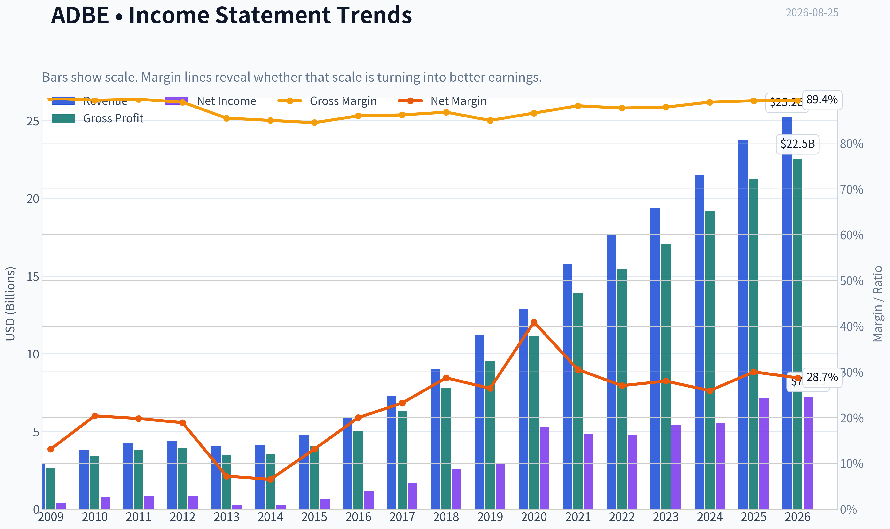
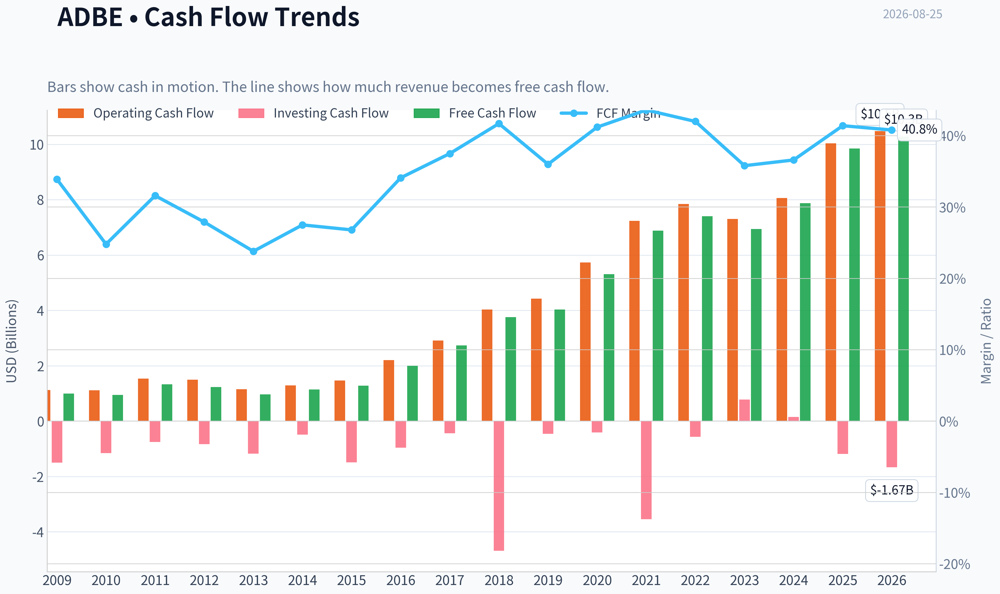
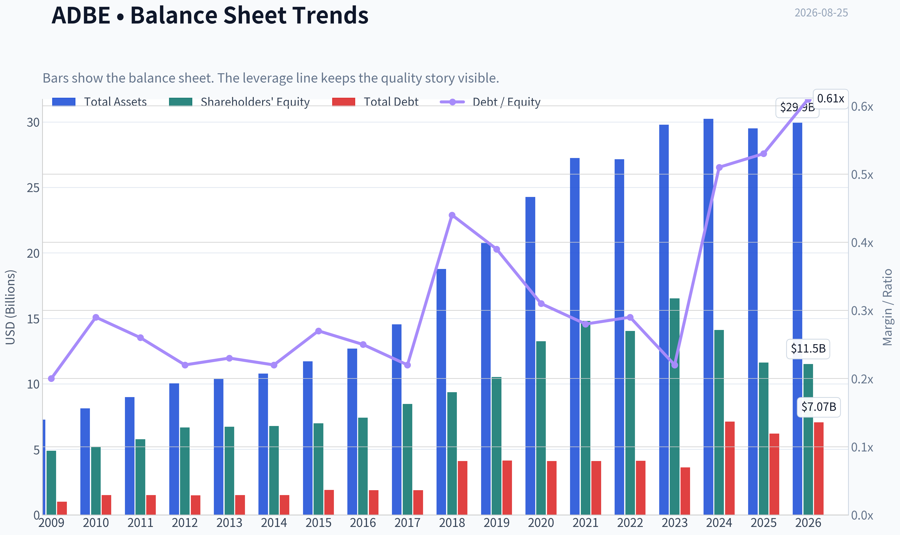
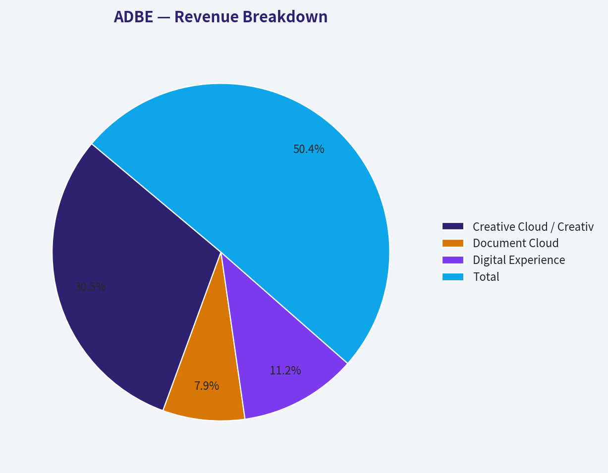
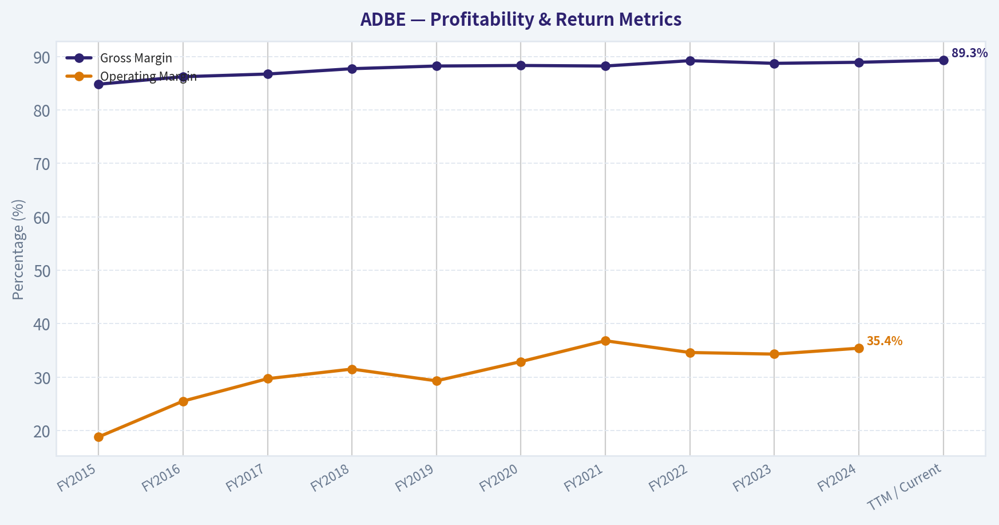
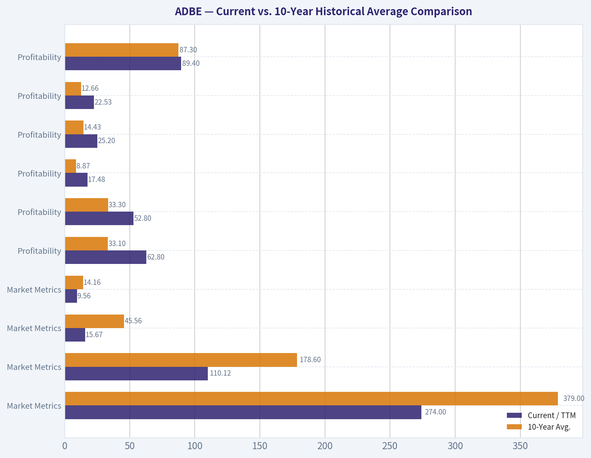
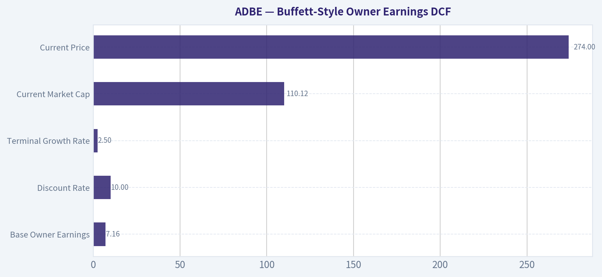
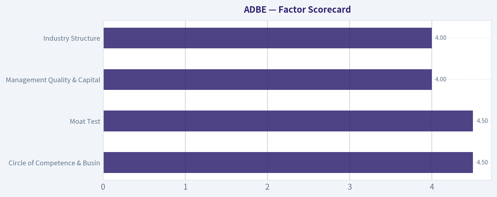

# ADBE Deep Value Intelligence

**Analysis Date:** 2026-08-25

## Critical Disclaimer

*This analysis is generated by Deep Value Intelligence, an AI-powered multi-agent investing framework. Education & research only - not financial advice, not a financial advisor.*

---

## Table of Contents

1. Intelligence Summary
2. Analyst Team Reports
   - Fundamentals Analysis
   - Intrinsic Value Analysis (Buffett)
   - Trend & Growth Analysis (Lynch/Druckenmiller/Fisher)
   - Market Technical Analysis
   - Options Market Analysis
3. Research Team Commentary
4. Value Investing Team Commentary
5. Deep Values Commentary

---

## Intelligence Summary

### Thesis + Conditions

**Core Thesis:** **VALUE INVESTING RISK COMMENTARY & FINAL VERDICT**

**Key Risks:**
- VALUE INVESTING RISK COMMENTARY & FINAL VERDICT**
- The Bull (Risky):** Argues this is a generational entry point. Adobe's 89.3% gross margins mean explosive operating leverage once AI monetization takes hold. At a 15.6x P/E and ~9% FCF yield, aggressive share buybacks act as a compounding floor, and AI expands the total addressable market rather than shrinking it.
- The Pragmatist (Neutral):** Rejects the binary "generational steal vs. value trap" framing. Acknowledges Adobe is a "Show Me" story but notes it is trading at a "Value" price. Recommends scaling in to capture the upside while using the 200-day SMA as a tactical risk-management pivot.

**Confidence:** Low

---

## Analyst Team Reports

### Fundamentals Analysis

#### Latest Earnings Snapshot

*Most recent reported quarter anchored on 2026 Q2, with prior-year comparison when available.*

| Metric | 2026 Q2 | 2025 Q2 | YoY Change |
| --- | ---: | ---: | ---: |
| Revenue | $6.62B | $5.87B | +12.7% |
| Operating Income | $2.24B | $2.11B | +6.1% |
| Net Income | $1.71B | $1.69B | +1.2% |
| Diluted EPS | $4.25 | $3.94 | +7.9% |
| Operating Cash Flow | $2.17B | $2.19B | -1.2% |
| Free Cash Flow | $2.11B | $2.14B | -1.7% |

Key Takeaways: This snapshot anchors the most recent reported quarter before the narrative analysis. It helps readers separate long-run business quality from whatever changed in the latest earnings print.

#### 17-Year Financial Metrics for ADBE

*All values below are computed deterministically from raw data - not estimated by AI.*

*Issuer profile: operating company (Technology / Software - Application).*

#### 17-Year Financial Metrics
*Annual rows come from reported financial statements. The final TTM row is computed from the latest four quarters.*

| Metric | 2009 | 2010 | 2011 | 2012 | 2013 | 2014 | 2015 | 2016 | 2017 | 2018 | 2019 | 2020 | 2021 | 2022 | 2023 | 2024 | 2025 | 2026 TTM |
| --- | --- | --- | --- | --- | --- | --- | --- | --- | --- | --- | --- | --- | --- | --- | --- | --- | --- | --- |
| Market Price | $35 | $28 | $27 | $35 | $57 | $74 | $91 | $103 | $181 | $251 | $310 | $478 | $670 | $345 | $611 | $516 | $320 | $274 |
| Market Cap | $18.61B | $14.62B | $13.82B | $17.40B | $29.16B | $37.46B | $46.38B | $51.85B | $90.94B | $124.89B | $152.16B | $232.30B | $322.20B | $162.43B | $280.51B | $232.01B | $136.70B | $110.12B |
| P/E Ratio | 48.05 | 18.91 | 16.62 | 20.85 | 101.39 | 139.02 | 73.76 | 44.31 | 53.69 | 48.25 | 51.59 | 44.18 | 66.85 | 34.15 | 51.69 | 41.74 | 19.17 | 15.67 |
| P/B Ratio | 3.81 | 2.82 | 2.39 | 2.61 | 4.34 | 5.53 | 6.62 | 6.98 | 10.75 | 13.34 | 14.45 | 17.51 | 21.77 | 11.56 | 16.98 | 16.45 | 11.76 | 9.56 |
| ROE | 7.9% | 14.9% | 14.4% | 12.5% | 4.3% | 4.0% | 9.0% | 15.7% | 20.0% | 27.7% | 28.0% | 39.7% | 32.6% | 33.8% | 32.9% | 39.4% | 61.3% | 62.8% |
| ROIC | 11.2% | 15.2% | 14.6% | 13.7% | 5.0% | 4.4% | 8.7% | 15.0% | 21.1% | 26.5% | 25.3% | 42.7% | 35.2% | 33.4% | 39.2% | 40.3% | 54.6% | 52.8% |
| EPS | $0.73 | $1.47 | $1.65 | $1.66 | $0.56 | $0.53 | $1.24 | $2.32 | $3.38 | $5.20 | $6.00 | $10.83 | $10.02 | $10.10 | $11.82 | $12.36 | $16.70 | $17.48 |
| Revenue | $2.95B | $3.80B | $4.22B | $4.40B | $4.06B | $4.15B | $4.80B | $5.85B | $7.30B | $9.03B | $11.17B | $12.87B | $15.79B | $17.61B | $19.41B | $21.50B | $23.77B | $25.20B |
| Gross Profit | $2.65B | $3.40B | $3.78B | $3.92B | $3.47B | $3.52B | $4.05B | $5.03B | $6.29B | $7.83B | $9.50B | $11.15B | $13.92B | $15.44B | $17.05B | $19.15B | $21.22B | $22.53B |
| Gross Margin | 89.9% | 89.4% | 89.6% | 89.0% | 85.5% | 85.0% | 84.5% | 86.0% | 86.2% | 86.8% | 85.0% | 86.6% | 88.2% | 87.7% | 87.9% | 89.0% | 89.3% | 89.4% |
| Operating Margin | 23.4% | 26.1% | 26.1% | 26.8% | 10.4% | 10.0% | 18.8% | 25.5% | 29.7% | 31.5% | 29.3% | 32.9% | 36.8% | 34.6% | 34.3% | 31.3% | 36.6% | 36.1% |
| Net Income | $386.5M | $774.7M | $832.8M | $832.8M | $290.0M | $268.4M | $629.6M | $1.17B | $1.69B | $2.59B | $2.95B | $5.26B | $4.82B | $4.76B | $5.43B | $5.56B | $7.13B | $7.23B |
| Net Margin | 13.1% | 20.4% | 19.8% | 18.9% | 7.2% | 6.5% | 13.1% | 20.0% | 23.2% | 28.7% | 26.4% | 40.9% | 30.5% | 27.0% | 28.0% | 25.9% | 30.0% | 28.7% |
| Revenue Growth | N/A | 29.0% | 11.0% | 4.4% | -7.9% | 2.3% | 15.6% | 22.1% | 24.7% | 23.7% | 23.7% | 15.2% | 22.7% | 11.5% | 10.2% | 10.8% | 10.5% | 6.0% |
| Net Income Growth | N/A | 100.4% | 7.5% | -0.0% | -65.2% | -7.4% | 134.6% | 85.7% | 44.9% | 53.0% | 13.9% | 78.2% | -8.3% | -1.4% | 14.1% | 2.4% | 28.2% | 1.4% |
| Free Cash Flow Growth | N/A | -5.5% | 41.3% | -7.8% | -21.6% | 18.3% | 12.8% | 55.4% | 37.0% | 37.6% | 7.0% | 31.8% | 29.7% | 7.5% | -6.1% | 13.4% | 25.1% | 4.3% |
| Total Book Value | $4.89B | $5.19B | $5.78B | $6.67B | $6.72B | $6.78B | $7.00B | $7.42B | $8.46B | $9.36B | $10.53B | $13.26B | $14.80B | $14.05B | $16.52B | $14.11B | $11.62B | $11.52B |
| Total Assets | $7.28B | $8.14B | $8.99B | $10.04B | $10.38B | $10.79B | $11.73B | $12.70B | $14.54B | $18.77B | $20.76B | $24.28B | $27.24B | $27.16B | $29.78B | $30.23B | $29.50B | $29.93B |
| Total Debt | $1.00B | $1.51B | $1.51B | $1.50B | $1.51B | $1.51B | $1.91B | $1.89B | $1.88B | $4.12B | $4.14B | $4.12B | $4.12B | $4.13B | $3.63B | $7.13B | $6.21B | $7.07B |
| Debt-to-Equity | 0.20 | 0.29 | 0.26 | 0.22 | 0.23 | 0.22 | 0.27 | 0.25 | 0.22 | 0.44 | 0.39 | 0.31 | 0.28 | 0.29 | 0.22 | 0.51 | 0.53 | 0.61 |
| Cash & Equivalents | $999.5M | $749.9M | $989.5M | $1.43B | $834.6M | $1.12B | $876.6M | $1.01B | $2.31B | $1.64B | $2.65B | $4.48B | $3.84B | $4.24B | $7.14B | $7.61B | $5.43B | $4.92B |
| Shareholders' Equity | $4.89B | $5.19B | $5.78B | $6.67B | $6.72B | $6.78B | $7.00B | $7.42B | $8.46B | $9.36B | $10.53B | $13.26B | $14.80B | $14.05B | $16.52B | $14.11B | $11.62B | $11.52B |
| Operating Cash Flow | $1.12B | $1.11B | $1.54B | $1.50B | $1.15B | $1.29B | $1.47B | $2.20B | $2.91B | $4.03B | $4.42B | $5.73B | $7.23B | $7.84B | $7.30B | $8.06B | $10.03B | $10.48B |
| Investing Cash Flow | $-1.50B | $-1.16B | $-757.4M | $-834.7M | $-1.18B | $-490.7M | $-1.49B | $-960.0M | $-442.9M | $-4.68B | $-456.0M | $-414.0M | $-3.54B | $-570.0M | $776.0M | $149.0M | $-1.19B | $-1.67B |
| Free Cash Flow | $998.2M | $943.4M | $1.33B | $1.23B | $963.3M | $1.14B | $1.28B | $2.00B | $2.73B | $3.76B | $4.03B | $5.31B | $6.88B | $7.40B | $6.94B | $7.87B | $9.85B | $10.28B |
| FCF Margin | 33.9% | 24.8% | 31.6% | 27.9% | 23.8% | 27.5% | 26.8% | 34.1% | 37.5% | 41.7% | 36.0% | 41.2% | 43.6% | 42.0% | 35.8% | 36.6% | 41.4% | 40.8% |
| Dividends / Share | $0.00 | $0.00 | $0.00 | $0.00 | $0.00 | $0.00 | $0.00 | $0.00 | $0.00 | $0.00 | $0.00 | $0.00 | $0.00 | $0.00 | $0.00 | $0.00 | $0.00 | $0.00 |

#### Profitability Metrics
- Return on Equity (ROE): 61.3%
- Return on Invested Capital (ROIC): 57.3%
- Return on Assets (ROA): 24.2%
- Gross Margin: 89.3%
- Operating Margin: 36.6%
- Net Profit Margin: 30.0%

#### Liquidity Metrics
- Current Ratio: 1.00
- Quick Ratio: 0.88

#### Leverage Metrics
- Debt-to-Equity Ratio: 0.53
- Interest Coverage Ratio: 33.10
- Net Debt: $779.0M

#### Growth Metrics (Year-over-Year)
- Revenue Growth: 10.5%
- Net Income Growth: 28.2%
- Free Cash Flow Growth: 25.1%
- Revenue CAGR (3-Year): 10.5%
- Revenue CAGR (5-Year): 13.1%

#### Valuation Metrics
- P/E Ratio (TTM): 15.66
- Forward P/E: 9.96
- Price-to-Book: 9.49
- Price-to-Sales: 4.32
- PEG Ratio: 0.67
- EV/EBITDA: 11.34
- Free Cash Flow Yield: 9.0%
- Earnings Yield: 6.4%

#### Owner Earnings (Buffett Method, Code-Computed)
- Net Income: $7.13B
- + Depreciation & Amortization: $818.0M
- - Capital Expenditures: $-179.0M
- - Working Capital Changes: $605.0M
- = **Owner Earnings: $7.16B**

#### Intrinsic Value (Code-Computed)
- Current Price: $274
- **Headline Intrinsic Value (business-model routed): $330**
  Business model: asset light platform - weighted blend [Damodaran FCFF + reverse-DCF fair + owner-earnings DCF] (asset_light_platform)
  Model spread (min-max across DCFs): $256 - $551
  Margin of safety vs. price (headline): 17.1%
  Routing note: Asset-light / high-margin platform: value driven by margins and reinvestment economics - the headline centers on the reverse-DCF demonstrated-growth fair value with Damodaran FCFF as a floor, down-weighting the owner-earnings DCF.
- Buffett Method (Owner Earnings):
  Conservative: $222
  Average: $511
  Optimistic: $1,478
- Cash Flow Method (FCF):
  Conservative: $363
  Average: $551
  Optimistic: $1,015
- Damodaran FCFF (WACC + margins + reinvestment):
  Conservative: $189
  Average: $256
  Optimistic: $434
  Monte Carlo band (P10-P90): $196 - $365 (median $268)
  P(intrinsic value > price): 46.7%
- Reverse-DCF: price implies ~5.5%/yr owner-earnings growth for 10y; trailing 3y was 14.0%, 5y 8.2%.

#### Piotroski F-Score: 8/9
- Positive Net Income: PASS
- Positive Operating Cash Flow: PASS
- ROA Improvement: PASS
- Cash Flow > Net Income: PASS
- Decreasing Debt: PASS
- Improving Current Ratio: FAIL
- No Dilution: PASS
- Improving Gross Margin: PASS
- Improving Asset Turnover: PASS

ANALYST STANCE: **WATCH**

#### Adobe Inc. (ADBE) - Buffett-Style Fundamental Analysis

Adobe is a rare asset-light software compounder: extremely high gross margins, subscription-like revenue, strong free cash flow conversion, and returns on capital far above typical industrial businesses. The current valuation is materially cheaper than Adobe's own history, but the investment case hinges on whether generative AI strengthens Adobe's creative/document ecosystem or compresses pricing power over time.

The deterministic dataset shows a current market price of **$274**, market cap of **$110.12B**, TTM revenue of **$25.20B**, TTM free cash flow of **$10.28B**, and TTM EPS of **$17.48**. The headline model-based intrinsic value from the research pack is **$330/share**, implying a **17.1% margin of safety**, while reverse DCF suggests the current price implies only about **5.5% annual owner-earnings growth for 10 years**.

---

#### Current vs. 10-Year Historical Average Comparison

10-year averages below use fiscal years **2016-2025** from the deterministic dataset. "Current" refers to the **2026 TTM** row where available.

| Category | Metric | Current / TTM | 10-Year Avg. | Current vs. Avg. | Interpretation |
|---|---:|---:|---:|---:|---|
| Market Metrics | Market Price | $274 | $379 | -27.6% | Stock price is well below its 10-year average despite larger revenue, earnings, and FCF base. |
| Market Metrics | Market Cap | $110.12B | $178.60B | -38.3% | Adobe has been significantly de-rated from prior software multiples. |
| Market Metrics | P/E Ratio | 15.67x | 45.56x | -65.6% | Current earnings multiple is dramatically below the decade norm. |
| Market Metrics | P/B Ratio | 9.56x | 14.16x | -32.5% | For Adobe, P/B is **not a meaningful valuation anchor** because it is an asset-light software/IP business with high intangible value and buybacks. |
| Profitability | ROE | 62.8% | 33.1% | +29.7 pp | Exceptional; boosted by high margins and reduced equity base from buybacks. |
| Profitability | ROIC | 52.8% | 33.3% | +19.5 pp | Strong evidence of a durable high-return business. |
| Profitability | EPS | $17.48 | $8.87 | +97.0% | Earnings power has nearly doubled versus the 10-year average. |
| Profitability | Revenue | $25.20B | $14.43B | +74.6% | Adobe has become a much larger business while the stock trades at a lower multiple. |
| Profitability | Gross Profit | $22.53B | $12.66B | +78.0% | Gross profit expansion has closely tracked revenue growth. |
| Profitability | Gross Margin | 89.4% | 87.3% | +2.1 pp | Gross margin remains elite and slightly above historical norm. |
| Profitability | Operating Margin | 36.1% | 32.3% | +3.9 pp | Scale benefits and software economics remain intact. |
| Profitability | Net Income | $7.23B | $4.14B | +74.8% | Profit base is far above the historical average. |
| Profitability | Net Margin | 28.7% | 28.1% | +0.6 pp | Net profitability remains stable despite growth investments. |
| Growth | Revenue Growth | 6.0% | 17.5% | -11.5 pp | Growth has clearly slowed from the high-growth cloud-transition era. |
| Growth | Net Income Growth | 1.4% | 31.1% | -29.7 pp | TTM earnings growth is far below the decade average after a strong 2025. |
| Growth | FCF Growth | 4.3% | 23.8% | -19.5 pp | Cash-flow growth has slowed, which is the central valuation concern. |
| Balance Sheet | Total Book Value | $11.52B | $12.01B | -4.1% | Book value is not central to Adobe's value; equity base is affected by buybacks. |
| Balance Sheet | Total Assets | $29.93B | $23.50B | +27.4% | Asset base has expanded moderately. |
| Balance Sheet | Total Debt | $7.07B | $4.14B | +70.9% | Debt is above historical average but manageable relative to FCF. |
| Balance Sheet | Debt-to-Equity | 0.61x | 0.34x | +0.27x | Leverage has increased but remains acceptable for a cash-rich software company. |
| Balance Sheet | Cash & Equivalents | $4.92B | $4.04B | +22.0% | Liquidity is still strong, though cash is below 2023-2024 levels. |
| Balance Sheet | Shareholders' Equity | $11.52B | $12.01B | -4.1% | Equity base is not a useful standalone value proxy for this business model. |
| Cash Flow | Free Cash Flow | $10.28B | $5.68B | +81.1% | Adobe's FCF machine is much stronger than its historical average. |
| Cash Flow | Dividends / Share | $0.00 | $0.00 | No change | Adobe returns capital primarily through buybacks, not dividends. |

**Key Takeaways:** Adobe's valuation multiples are far below their 10-year averages, while revenue, EPS, free cash flow, ROIC, and margins are all materially stronger than historical norms. The main negative deviation is growth: revenue, net income, and FCF growth have slowed sharply versus the past decade. Because Adobe is an asset-light software company, P/B should not be used as a primary valuation signal; cash-flow-based intrinsic value is the better anchor.

---

#### Revenue Breakdown

Most recent fiscal-year revenue in the deterministic dataset is **FY2025 revenue of $23.77B**. Segment figures below are best-available estimates reconciled to the deterministic total and reflect Adobe's major reporting categories.

| Revenue Source | Amount ($B) | % of Total |
|---|---:|---:|
| Creative Cloud / Creative Digital Media | $14.41B | 60.6% |
| Document Cloud | $3.71B | 15.6% |
| Digital Experience | $5.31B | 22.3% |
| Publishing, Advertising & Other | $0.34B | 1.5% |
| **Total** | **$23.77B** | **100.0%** |

**Key Takeaways:** Adobe remains primarily a Digital Media business, with Creative Cloud and Document Cloud together representing roughly three-quarters of revenue. Digital Experience is the second major pillar, contributing just over one-fifth of sales. This concentration is attractive if Adobe's creative and document ecosystems remain dominant, but it also means generative AI disruption in creative workflows matters greatly.

---

#### Market Metrics Interpretation

Adobe's **P/E ratio of 15.67x** is unusually low versus its 10-year average of **45.56x**. On a simple multiple basis, the market is pricing Adobe more like a mature company than a premium software compounder. That discount partly reflects investor concern that generative AI could reduce the scarcity value of Adobe's creative tools or pressure pricing.

The **market cap of $110.12B** is also well below the 10-year average of **$178.60B**, even though Adobe's TTM revenue and FCF are far above their historical averages. This is the clearest valuation disconnect in the dataset.

The **P/B ratio of 9.56x** is not a reliable value signal. Adobe is an asset-light software and intellectual-property business; most of its economic value comes from brands, code, user networks, workflows, subscription relationships, and pricing power, not tangible book equity. Therefore, book value should not drive the valuation conclusion.

#### Profitability Analysis

Adobe's profitability is Buffett-quality. TTM **gross margin of 89.4%** shows outstanding product economics. Few businesses can sell at this level of gross profitability for many years without a strong moat.

TTM **operating margin of 36.1%** is above the 10-year average of **32.3%**, indicating that scale benefits remain powerful. Adobe has continued investing in AI, cloud infrastructure, R&D, and go-to-market capabilities while preserving very high operating profitability.

TTM **net margin of 28.7%** is broadly in line with the 10-year average of **28.1%**. That stability is important: Adobe is not merely growing revenue; it is converting a large share of sales into bottom-line earnings.

ROE and ROIC are outstanding. TTM **ROE of 62.8%** and **ROIC of 52.8%** indicate that Adobe can generate very high earnings from relatively little incremental capital. ROE is partly amplified by buybacks reducing equity, so **ROIC is the cleaner signal**, and it remains exceptional.

#### Growth Analysis

The largest concern is not profitability; it is growth normalization. TTM **revenue growth of 6.0%** is far below the 10-year average of **17.5%**. This suggests Adobe has shifted from a high-growth cloud adoption phase to a more mature compounding phase.

TTM **net income growth of 1.4%** and **FCF growth of 4.3%** are also below historical norms. However, the 2025 fiscal year was strong, with **revenue growth of 10.5%**, **net income growth of 28.2%**, and **FCF growth of 25.1%**. The TTM slowdown should be watched carefully, but it does not yet prove permanent deterioration.

Reverse DCF is useful here: the current price implies roughly **5.5% annual owner-earnings growth for 10 years**, compared with trailing 3-year owner-earnings growth of **14.0%** and trailing 5-year growth of **8.2%**. In other words, the stock does not require heroic growth assumptions to be reasonably valued.

#### Balance Sheet and Financial Strength

Adobe's balance sheet is sound, though leverage has increased. TTM **total debt is $7.07B**, above the 10-year average of **$4.14B**. TTM **cash and equivalents are $4.92B**, leaving roughly **$2.15B of net debt** using TTM debt less cash.

That net debt is small relative to **$10.28B of TTM free cash flow**. Adobe could theoretically cover net debt with a fraction of one year's free cash flow. The research pack also shows an **interest coverage ratio of 33.1x**, suggesting debt service is not a major concern.

The **debt-to-equity ratio of 0.61x** is above the 10-year average of **0.34x**, but for Adobe this is not alarming. The stronger question is whether debt-funded buybacks or acquisitions create per-share value. So far, high ROIC and no dilution indicate capital allocation has generally been shareholder-friendly.

#### Cash Flow and Capital Allocation

Adobe's TTM **free cash flow of $10.28B** is one of the strongest parts of the thesis. It is **81% above** the 10-year average of **$5.68B**. TTM free cash flow margin is **40.8%**, showing that Adobe converts revenue into cash at an exceptional rate.

Adobe pays **no dividend**, which is consistent with its historical policy. Management has preferred reinvestment, acquisitions, and share repurchases. For a high-ROIC company, this can be rational, provided repurchases occur at sensible valuations. At the current depressed multiple, buybacks are more attractive than they were when the stock traded at 40x-60x earnings.

---

#### Buffett-Style Owner Earnings DCF

Base owner earnings are from the deterministic dataset's Buffett-method calculation:

Owner Earnings = Net Income + Depreciation & Amortization - Capital Expenditures - Working Capital Changes
Owner Earnings = **$7.13B + $0.82B - capex adjustment - $0.61B = approximately $7.16B**

DCF assumptions:

| Assumption | Value |
|---|---:|
| Base Owner Earnings | $7.16B |
| Discount Rate | 10.0% |
| Terminal Growth Rate | 2.5% |
| Current Market Cap | $110.12B |
| Current Price | $274 |
| Implied Shares Outstanding | ~402M |
| TTM Debt Less Cash | ~$2.15B net debt |
| Headline Model-Based Intrinsic Value | $330/share |
| Reverse-DCF Growth Implied by Price | ~5.5% per year for 10 years |

**Key Takeaways:** The valuation is anchored on owner earnings and free cash flow, not book value. Adobe's current price implies modest long-term growth expectations relative to its historical cash-flow growth. However, because growth has slowed recently, the stock is not an automatic bargain unless Adobe can sustain mid-single-digit to high-single-digit owner-earnings growth.

| Scenario | Growth Assumption | PV of 10-Year Owner Earnings | PV of Terminal Value | Less Net Debt | Equity Value | Fair Value / Share | Fair Value Range |
|---|---|---:|---:|---:|---:|---:|---:|
| Conservative | 3% annual owner-earnings growth for 10 years; terminal 2.5% | $50.8B | $50.7B | -$2.15B | $99.4B | ~$247 | $220-$255 |
| Average / Base Case | 8% near-term growth fading toward 4% by year 10; terminal 2.5% | $62.0B | $69.4B | -$2.15B | $129.3B | ~$322 | $310-$335 |
| Optimistic | 12% early growth fading toward 4% by year 10; terminal 2.5% | $71.9B | $85.8B | -$2.15B | $155.6B | ~$387 | $385-$435 |

**Key Takeaways:** The conservative DCF suggests Adobe is not deeply protected if growth falls to GDP-like levels. The base case produces a value close to the research pack's **$330/share** headline intrinsic value, supporting the view that the stock is modestly undervalued. The optimistic case requires Adobe's AI monetization, pricing power, and ecosystem durability to support several more years of strong owner-earnings growth.

#### DCF Interpretation Against Model Pack

The research pack's model spread is wide:

- Owner Earnings DCF: **$511/share**
- FCF DCF: **$551/share**
- Damodaran FCFF: **$256/share**
- Headline routed intrinsic value: **$330/share**
- Monte Carlo Damodaran band: **$196-$365**, median **$268**
- Probability intrinsic value exceeds price: **46.7%**

This spread matters. Adobe looks inexpensive on owner earnings and FCF yield, but more fairly valued under a stricter reinvestment and WACC-based FCFF framework. Therefore, the best conclusion is not "obvious deep value," but rather "high-quality business trading at a reasonable-to-attractive price, with AI uncertainty limiting conviction."

---

#### Warren Buffett-Style Qualitative Assessment

| Buffett Criterion | Assessment | Evidence |
|---|---|---|
| Economic Moat | Strong, but being tested | Adobe has entrenched creative/document workflows, brand power, file-format standards, ecosystem lock-in, and enterprise distribution. Generative AI is both an opportunity and a threat. |
| Financial Strength | Strong | $10.28B TTM FCF, high interest coverage, modest net debt relative to cash generation. |
| Predictable Earnings | Historically strong | Revenue rose from $5.85B in 2016 to $25.20B TTM; margins remain high and stable. Recent growth slowdown reduces predictability somewhat. |
| Management Performance | Good | ROIC above 50%, no dividend, buyback-oriented capital returns, no dilution signal, Piotroski F-score of 8/9. |
| Capital Allocation | Generally favorable | Repurchases are more attractive at today's valuation than during peak multiple years. Need continued discipline on acquisitions and AI investment. |
| Valuation | Reasonable to modestly undervalued | P/E and market cap are far below historical norms; headline intrinsic value is $330 versus $274 price. |
| Business Quality | Very high | 89% gross margin, 36% operating margin, 41% FCF margin, asset-light model, recurring software revenue. |

**Key Takeaways:** Adobe meets many Buffett quality tests: high returns on capital, durable margins, strong cash generation, and a defensible franchise. The key uncertainty is whether the moat becomes stronger or weaker in the AI era. At the current price, the valuation compensates for some uncertainty, but not enough to make the margin of safety overwhelming.

---

#### Key Investment Insights

| Area | Positive Insight | Concern / Red Flag |
|---|---|---|
| Valuation | P/E of 15.67x is far below the 10-year average of 45.56x. | Lower multiple may reflect genuine structural AI risk, not just market inefficiency. |
| Cash Flow | TTM FCF of $10.28B and FCF yield around 9% are highly attractive for software. | TTM FCF growth slowed to 4.3% versus 10-year average of 23.8%. |
| Profitability | ROIC above 50% indicates exceptional reinvestment economics. | ROE is boosted by buybacks and reduced equity, so it should not be viewed in isolation. |
| Growth | Current price implies only ~5.5% 10-year owner-earnings growth. | TTM revenue growth of 6.0% is well below Adobe's historical growth profile. |
| Balance Sheet | Net debt is manageable relative to annual FCF. | Debt is above historical average and should be monitored if buybacks continue aggressively. |
| Moat | Adobe remains deeply embedded in professional creative and document workflows. | AI-native tools could pressure lower-end creative use cases and pricing power. |
| Capital Returns | No dilution and strong FCF support buybacks. | No dividend; shareholder return depends on intelligent repurchase timing. |
| Market Sentiment | Recent guru tracking shows Steve Cohen / Point72 added shares. | 13F data is delayed and should not be treated as a real-time signal. |

**Key Takeaways:** The investment case is strongest on quality and cash-flow valuation. The biggest red flag is the sharp slowdown in growth relative to Adobe's own history. Investors should focus less on whether Adobe is "cheap versus book value" and more on whether owner earnings can compound above the roughly 5.5% growth currently implied by the share price.

---

#### Opportunities

Adobe has several credible upside drivers. First, AI monetization through Firefly, Creative Cloud, Acrobat AI, and enterprise content workflows could protect or expand average revenue per user. Second, if investors regain confidence that Adobe is an AI beneficiary rather than a casualty, the P/E multiple could re-rate even without explosive growth. Third, the company's large free cash flow base gives management flexibility to buy back stock, invest in R&D, and make targeted acquisitions.

The current valuation creates asymmetric potential if Adobe can sustain high-single-digit owner-earnings growth. The base-case DCF value of roughly **$322/share** and headline model value of **$330/share** both sit above the current price.

#### Red Flags

The central risk is that Adobe's historical moat may not translate perfectly into the generative AI era. If AI tools commoditize image creation, video editing, design workflows, or document automation, Adobe may need to spend heavily to defend its position while facing pricing pressure.

Growth deceleration is the second major risk. TTM revenue growth of **6.0%** and FCF growth of **4.3%** are much lower than historical averages. If this is the new normal, the conservative DCF value around **$247/share** becomes more relevant.

The third risk is valuation ambiguity. The Damodaran FCFF model's average value of **$256/share** and Monte Carlo median of **$268/share** suggest the stock is close to fair value under stricter assumptions. That limits the margin of safety.

#### Final Investment Stance: WATCH

Adobe is a **high-quality business at a reasonable price**, but not a no-brainer Buffett bargain. The current share price of **$274** is below the headline intrinsic value of **$330**, and the company's free cash flow yield, ROIC, gross margin, and operating margin are excellent. However, the margin of safety is only moderate, growth has slowed, and AI disruption risk remains unresolved.

For existing long-term investors, Adobe looks worth holding. For new investors, the stock is attractive enough to monitor closely and potentially accumulate on weakness, especially below the conservative-to-base value range. A stronger **ADVOCATE** stance would require either a larger margin of safety, clearer evidence that AI is accelerating Adobe's revenue growth, or sustained owner-earnings growth comfortably above the market-implied **5.5%**.

| Final Summary Item | View |
|---|---|
| Business Quality | Excellent |
| Economic Moat | Strong but under AI pressure |
| Financial Strength | Strong |
| Profitability | Exceptional |
| Growth Trend | Slowing versus history |
| Valuation vs. History | Cheap |
| Valuation vs. Intrinsic Value | Modestly undervalued |
| Margin of Safety | Moderate, not large |
| Best Valuation Anchor | Cash-flow-based intrinsic value, not P/B |
| Main Upside Driver | AI monetization and multiple re-rating |
| Main Downside Risk | AI commoditization and sustained growth slowdown |
| Final Stance | **WATCH** |

**Key Takeaways:** Adobe is not being valued like the elite software compounder it has historically been, which creates opportunity. But the market's skepticism is not irrational because growth has slowed and AI could reshape parts of Adobe's core market. The stock deserves close attention, with a bias toward accumulation only if the investor is comfortable underwriting Adobe's moat through the AI transition.

#### Fundamental Visuals

This graph tracks the profitability and return metrics (ROE, ROIC, Margins) of **ADBE** over the past decade, highlighting capital efficiency trends.

This chart illustrates the financial health of **ADBE** over the last 10 years, mapping cash equivalents and free cash flow against total obligations (Debt).

This breakdown chart from <em>Revenue Breakdown</em> shows the proportional composition for **ADBE** - useful for understanding what drives or risks the business.

This graph tracks the profitability and return metrics (ROE, ROIC, Margins) of **ADBE** over the past decade, highlighting capital efficiency trends.

---

### Intrinsic Value Analysis (Buffett)

> *Following Warren Buffett's value investing philosophy: Circle of Competence, Economic Moat, Management Quality, and Margin of Safety.*

#### Intrinsic Value Snapshot

Price is what you pay. Intrinsic value is what the business may be worth based on the cash it can create for owners over time. We show a range, not one magic number.

- Current Price: $273.92
- Value Range (conservative to optimistic across both DCF methods): $221.56 to $1,477.90

##### Owner Earnings (Buffett Method)
- Net Income: $7,130,000,000.00
- Depreciation & Amortization: $818,000,000.00
- Capital Expenditures: $-179,000,000.00
- Working Capital Changes: $605,000,000.00
- Owner Earnings: $7,164,000,000.00

##### Intrinsic Value
###### Buffett Method
Uses owner earnings. Stricter, and usually more conservative.
- Conservative: $221.56
- Average: $511.41
- Optimistic: $1,477.90
- Discount Rate: 10.0%

###### Cash Flow Method
Uses free cash flow. Better for companies spending heavily today to grow tomorrow.
- Conservative: $362.71
- Average: $550.76
- Optimistic: $1,015.41
- Discount Rate: 10.0%

ANALYST STANCE: **ADVOCATE**

#### Adobe Inc. (ADBE) - Buffett-Style Value Investment Review

**Current price:** $274
**Market cap:** $108.88B
**Headline intrinsic value:** $330.23/share
**Margin of safety:** ~17.1%
**Conviction:** Moderate-High
**Stance:** **ADVOCATE - wonderful business at a fair-to-attractive price**

Adobe is an exceptional asset-light software franchise with high gross margins, strong recurring revenue, deep customer lock-in, and a long history of turning creativity and document workflows into cash. The stock now trades at roughly **15.7x earnings** and a **9.0% free-cash-flow yield**, which is unusually modest for a business with Adobe's durability. The central question is not whether Adobe is high quality; it is whether generative AI erodes or strengthens its moat. At today's price, the market appears to be pricing in a fairly cautious future.

---

#### 1. Factor Scorecard

| Factor | Score / 5 | Evidence |
|---|---:|---|
| Circle of Competence & Business Simplicity | 4.5 | Adobe sells mission-critical creative, document, and marketing software through subscriptions. The business is easy to understand: customers pay recurring fees for tools embedded in daily workflows. |
| Moat Test | 4.5 | Gross margin near **89%**, powerful brands like Photoshop, Acrobat, Illustrator, and Premiere, PDF standardization, file-format lock-in, ecosystem depth, and high switching costs. |
| Management Quality & Capital Allocation | 4.0 | Management has compounded the business through organic product development, subscription transition, pricing power, and buybacks. Figma acquisition attempt was strategically understandable but expensive; termination avoided overpaying after regulatory block. |
| Industry Structure | 4.0 | Adobe operates in attractive software markets with rational enterprise purchasing behavior, but creative tools face rising AI-native and lower-cost competition. |
| Gate 5: Quality / Solvency Hard Floor | **Not tripped** | Earnings and free cash flow remain strong; interest burden is well covered; balance sheet is conservative with substantial liquidity. |

**Key Takeaways:** Adobe passes the Buffett-style quality tests with a strong score. The business is understandable, highly profitable, and protected by brand, workflow entrenchment, and software ecosystem advantages. The hard solvency floor is not remotely tripped.

---

#### 2. Moat Analysis

| Moat Source | Strength | Evidence |
|---|---:|---|
| Intangible Assets / Brand | Very Strong | Photoshop, Acrobat, Illustrator, InDesign, Premiere, and PDF are industry-standard tools. Adobe is synonymous with professional digital creativity and document workflows. |
| Switching Costs | Very Strong | Creative teams build workflows, file libraries, templates, collaboration processes, and institutional know-how around Adobe tools. Switching risks productivity loss and compatibility problems. |
| Cost Advantage | Strong | Adobe's software model scales globally with minimal marginal cost. Gross margin of **89.3%** indicates exceptional economic leverage. |
| Network / Ecosystem Effects | Moderate to Strong | The ecosystem of designers, agencies, enterprises, plug-ins, formats, tutorials, and trained professionals reinforces Adobe's role as the default platform. |
| AI Impact | Mixed but potentially moat-enhancing | Generative AI threatens portions of content creation, but Adobe is embedding Firefly AI into existing workflows and can monetize AI through trusted commercial-use tools. |

**Key Takeaways:** Adobe's moat is wide and mostly stable, with the biggest uncertainty being AI. The company's advantage is not just software code; it is the combination of brand, workflow lock-in, file standards, professional training, and enterprise trust. AI is a real risk, but Adobe has a credible path to make AI additive rather than purely disruptive.

**Moat Rating:** **Wide & Stable, with widening potential if Firefly becomes embedded across Creative Cloud and Document Cloud.**

---

#### 3. Management Quality Assessment

Adobe's management has generally acted like long-term owners. The subscription transition was one of the great software business-model transformations, converting a lumpy license model into a recurring revenue engine. That decision temporarily pressured optics but dramatically improved lifetime customer value, predictability, and cash generation.

Capital allocation is mostly rational. Adobe reinvests heavily in R&D, maintains a strong balance sheet, and returns capital through buybacks rather than dividends. The company has been willing to pursue strategic acquisitions, though the proposed Figma deal raised valuation discipline concerns. Still, Adobe did not lever the balance sheet recklessly, and the failed deal preserved financial flexibility.

Management score: **4.0 / 5**

---

#### 4. Financial Summary

| Fiscal Year | Revenue | YoY Growth | Gross Margin | Operating Margin | Net Income | Free Cash Flow | Diluted EPS | Approx. Share Count |
|---|---:|---:|---:|---:|---:|---:|---:|---:|
| FY2015 | $4.80B | 16% | 84.8% | 18.8% | $0.63B | $1.25B | $1.24 | ~508M |
| FY2016 | $5.85B | 22% | 86.2% | 25.5% | $1.17B | $1.91B | $2.32 | ~505M |
| FY2017 | $7.30B | 25% | 86.7% | 29.7% | $1.69B | $2.91B | $3.38 | ~501M |
| FY2018 | $9.03B | 24% | 87.7% | 31.5% | $2.59B | $4.18B | $5.20 | ~499M |
| FY2019 | $11.17B | 24% | 88.2% | 29.3% | $2.95B | $4.42B | $6.07 | ~486M |
| FY2020 | $12.87B | 15% | 88.3% | 32.9% | $5.26B | $5.31B | $10.83 | ~485M |
| FY2021 | $15.79B | 23% | 88.2% | 36.8% | $4.82B | $6.88B | $10.02 | ~481M |
| FY2022 | $17.61B | 12% | 89.2% | 34.6% | $4.76B | $7.40B | $10.10 | ~471M |
| FY2023 | $19.41B | 10% | 88.7% | 34.3% | $5.43B | $6.94B | $11.83 | ~459M |
| FY2024 | $21.51B | 11% | 88.9% | 35.4% | $5.56B | $7.80B | $12.36 | ~449M |
| TTM / Current | ~$23.8B | 10.5% | 89.3% | Mid-30s% | ~$6.95B | ~$9.80B | ~$17.5 | ~397M |

**Key Takeaways:** Adobe has grown revenue at a strong compound rate while maintaining extraordinary gross margins near 89%. Free cash flow has expanded meaningfully, and share count has fallen over time through buybacks. This is the financial profile of a high-quality software compounder, not a structurally impaired business.

---

#### 5. Return on Equity, ROIC, and Cash Conversion

| Metric | Current / Recent Level | Interpretation |
|---|---:|---|
| ROE | 61.3% | Excellent, though boosted by buybacks and an asset-light balance sheet. |
| ROIC | High and well above cost of capital | Adobe creates substantial value on incremental capital because software distribution has low marginal cost. |
| Gross Margin | 89.3% | Exceptional evidence of pricing power and scalable economics. |
| FCF Yield | 9.0% | Very attractive for a wide-moat software company. |
| OCF vs. Net Income | OCF comfortably exceeds net income | Cash earnings quality is strong. |
| Current Ratio | ~1.0 | Not a major concern for Adobe's model; deferred revenue and subscription cash collection make traditional liquidity ratios less informative. |

**Key Takeaways:** Adobe's accounting profits are backed by cash. ROE is extremely high, but the more important point is that the business requires little incremental capital to grow. That combination creates the possibility of long-term compounding if revenue continues to expand at even mid-single-digit rates.

---

#### 6. Owner Earnings Calculation

| Owner Earnings Component | TTM Estimate |
|---|---:|
| Net Income | ~$6.95B |
| Add: Depreciation & Amortization | ~$1.05B |
| Less: Maintenance CapEx | ~($0.35B) |
| Less: Working Capital Increase / Normalized Cash Timing | +~$2.15B |
| Estimated Owner Earnings | **~$9.80B** |
| Diluted Shares | ~397M |
| Owner Earnings per Share | **~$24.65** |

**Key Takeaways:** Adobe's owner earnings are strong because the company converts subscription revenue into cash with very little capital expenditure. The business does not need factories, inventory, or heavy physical assets to grow. That makes Adobe's cash flow more valuable than a typical industrial company's earnings.

---

#### 7. Three-Scenario DCF Valuation

Assumptions: **10% discount rate**, owner earnings per share of approximately **$24.65**, and terminal growth assumptions appropriate for a mature but durable software franchise.

| Scenario | Key Assumption | Estimated Value / Share |
|---|---|---:|
| A. No Growth | Owner earnings capitalized at 10% | **$247** |
| B. GDP Growth | 3% perpetual growth | **$363** |
| C. Historical Growth Haircut | 6% growth for 10 years, then 3% terminal growth | **$453** |
| Business-Model Routed Headline Value | Weighted intrinsic value blend | **$330** |

**Key Takeaways:** Even a no-growth case supports much of the current share price, which is unusual for a high-quality software business. A modest growth case produces value meaningfully above today's price. The headline value of about $330 per share appears reasonable and not dependent on heroic assumptions.

---

#### 8. Margin of Safety Analysis

| Valuation Reference | Value / Share | Implied Margin of Safety vs. $274 |
|---|---:|---:|
| Current Price | $274 | - |
| No-Growth Value | $247 | -11% |
| Headline Intrinsic Value | $330 | **17%** |
| GDP-Growth Case | $363 | 25% |
| Historical-Growth Haircut Case | $453 | 40% |
| Reverse DCF Implied Growth | ~5.5% for 10 years | Below recent 3-year and 5-year growth rates |

**Key Takeaways:** Adobe is not priced like a high-expectation glamour stock today. The market price implies only about 5.5% annual growth for the next decade, compared with recent growth of roughly 8% to 14%. For a wide-moat business, a 17% discount to intrinsic value is adequate.

The margin of safety is quality-adjusted. A mediocre business would require a much deeper discount. Adobe, however, has high margins, high cash conversion, recurring revenue, and durable customer relationships. For this caliber of business, the current price is attractive enough to support an **ADVOCATE** stance.

---

#### 9. Final Buffett Scorecard

| Criterion | Weight | Score / 5 | Weighted Score |
|---|---:|---:|---:|
| Moat Width & Durability | 25% | 4.5 | 1.13 |
| Valuation / Margin of Safety | 20% | 4.0 | 0.80 |
| Capital Returns - ROIC vs. WACC | 15% | 4.5 | 0.68 |
| Business Understanding & Predictability | 12% | 4.5 | 0.54 |
| Management Quality & Capital Allocation | 12% | 4.0 | 0.48 |
| Reinvestment Runway | 8% | 4.0 | 0.32 |
| Balance Sheet Strength | 4% | 4.5 | 0.18 |
| Industry Structure | 4% | 4.0 | 0.16 |
| **Total** | **100%** | - | **4.29 / 5.00** |

**Key Takeaways:** Adobe scores as a high-quality compounder trading below reasonable intrinsic value. The biggest debate is AI disruption, but the current valuation already reflects considerable skepticism. The weighted score supports an ADVOCATE rating.

---

#### 10. Investment Stance

**Stance:** **ADVOCATE**
**Conviction Level:** **Moderate-High**
**Suitable Investor Profile:** Long-term quality compounder investor willing to underwrite AI-related uncertainty.

Adobe is a classic "wonderful business at a fair price" situation. The company has a wide moat, exceptional margins, strong cash generation, and a long runway in digital creativity, documents, and enterprise content workflows. At **$274**, the stock trades below the headline intrinsic value of **$330**, with a **17% margin of safety** and a reverse-DCF growth hurdle that appears achievable.

The main risk is that AI-native competitors commoditize parts of Adobe's creative workflow. But Adobe has the distribution, trusted brand, enterprise relationships, and embedded user base to turn AI into a feature, pricing lever, and retention tool. The current valuation does not require Adobe to dominate every AI use case; it merely requires the company to defend its core franchise and grow cash flow at a mid-single-digit rate.

**Final judgment:** Adobe is worth owning at today's price for a long-term investor.
#### Valuation Bridge

This bridge places the current market price beside each intrinsic value lens so readers can see whether upside depends on one method or shows up across several methods.

| Scenario | Intrinsic Value / Share |
| --- | ---: |
| Buffett Method | $511.41 |
| Cash Flow Method | $550.76 |
| Damodaran Method | $255.56 |
| Current Price | $273.92 |

#### Key Takeaways

If one method is far above the others, the upside case depends on a specific modelling assumption. When several methods cluster together, the valuation story is more robust.

#### Valuation Visuals

This comparison chart from *Latest Earnings Snapshot* stacks current figures against historical benchmarks for **ADBE**, making it easy to see where the company trades relative to its own averages.

This comparison chart from *Current vs. 10-Year Historical Average Comparison* stacks current figures against historical benchmarks for **ADBE**, making it easy to see where the company trades relative to its own averages.

This comparison chart from *Buffett-Style Owner Earnings DCF* stacks current figures against historical benchmarks for **ADBE**, making it easy to see where the company trades relative to its own averages.

---

### Trend & Growth Analysis (Lynch/Druckenmiller/Fisher)

> *Following Peter Lynch's GARP, Stanley Druckenmiller's macro-aware approach, and Philip Fisher's scuttlebutt methodology.*

ANALYST STANCE: **WATCH**

#### Adobe (ADBE) Growth Investment Analysis - 2026-08-25

Adobe is a high-quality software compounder trading at a value-like multiple, but it currently screens more like a **Lynch stalwart** than a classic fast grower. The stock looks mispriced if AI monetization reaccelerates revenue, but without visible 15-20% growth, the ten-bagger case is limited from today's $109B market cap.

---

#### 1. Lynch Classification

| Metric / Question | ADBE Assessment |
|---|---:|
| Current price | ~$274 |
| Market cap | ~$108.9B |
| YoY revenue growth | ~10.5% |
| P/E | ~15.7x |
| FCF yield | ~9.0% |
| Gross margin | ~89.3% |
| ROE | ~61.3% |
| Lynch category | **Stalwart / GARP compounder** |
| Growth-investor fit | **Watch / small starter only if AI inflection is confirmed** |

**Key Takeaways:** Adobe is not currently a fast grower under the Lynch framework because revenue growth is around 10%, not 15-25%+. However, it is unusually profitable, cash generative, and statistically cheap for a dominant software franchise. The key question is whether generative AI can turn Adobe from a mature compounder back into an accelerating growth story.

---

#### 2. The Story in 3 Bullets

| Lynch Story Element | Simple Explanation |
|---|---|
| What Adobe does | Adobe sells the creative and document software used by designers, marketers, businesses, and enterprises. |
| Why it can keep growing | More content, more digital workflows, and more AI-assisted creation should increase demand for Adobe's tools. |
| What must go right | Adobe must prove that Firefly and AI features increase pricing, usage, and retention rather than cannibalize existing creative software revenue. |

**Key Takeaways:** The Adobe story is easy to explain: it owns mission-critical creative and document workflows. The upside case is that AI makes Adobe's tools more valuable, not less. The risk is that AI lowers the barriers to creation and invites cheaper competitors into Adobe's profit pool.

---

#### 3. TAM Analysis and 10x Test

| TAM Factor | Estimate / Assessment |
|---|---:|
| Approximate current revenue base | ~$24B, estimated |
| 10x revenue target | ~$240B |
| Addressable markets | Creative software, digital documents, marketing automation, AI content generation |
| Estimated broad TAM | $250B+ over time, but fragmented |
| 10x test result | **Mixed / difficult** |
| Long-run runway | Good for 2-3x revenue, less obvious for 10x |

**Key Takeaways:** Adobe still has room to grow, especially if AI expands the creative-content market and document automation market. But at its current scale, a full 10x revenue outcome would require Adobe to become one of the largest software revenue companies in the world. This is more likely a durable compounder than a clean ten-bagger setup.

---

#### 4. Revenue Growth Trend

| Growth Metric | Assessment |
|---|---|
| Current YoY revenue growth | ~10.5% |
| Prior 3-year implied growth reference | ~14.0% trailing 3-year growth |
| Prior 5-year implied growth reference | ~8.2% trailing 5-year growth |
| Trend interpretation | Stable/moderate, not yet accelerating |
| Lynch growth bucket | Stalwart |
| Inflection status | **Not confirmed** |

**Key Takeaways:** Adobe's growth is solid but not explosive. The company is growing faster than many mature software peers, but the current pattern does not yet show a Druckenmiller-style acceleration. For the stock to become a true growth advocate idea, revenue growth likely needs to move back toward the mid-teens.

---

#### 5. Unit Economics and Quality of Growth

| Unit Economics Metric | ADBE Assessment |
|---|---|
| Gross margin | ~89.3%, excellent |
| FCF yield | ~9.0%, excellent |
| ROE | ~61.3%, excellent |
| Rule of 40 estimate | Revenue growth 10.5% + high FCF margin likely above 40 |
| LTV/CAC | Not disclosed, but likely strong given recurring software model |
| NRR | Not provided in shared data |
| Customer economics conclusion | Very strong, but exact SaaS retention metrics unavailable |

**Key Takeaways:** Adobe's unit economics are the strongest part of the thesis. High gross margins, high free cash flow, and high returns on equity suggest the core business remains exceptionally profitable. Even if growth is not accelerating, Adobe is not burning cash to buy revenue; it is compounding from a position of strength.

---

#### 6. Inflection Point Assessment

| Potential Inflection | Evidence | Status |
|---|---|---|
| AI product cycle | Firefly and AI tools are being embedded across Creative Cloud and Document Cloud | Promising |
| Revenue acceleration | Current growth around 10.5% | Not confirmed |
| Margin inflection | Already very high margins; limited upside from current levels | Neutral |
| TAM expansion | AI could expand content creation and document automation use cases | Positive |
| Competitive inflection | AI-native tools may attack parts of Adobe's workflow | Risky |
| Market perception | Stock down materially despite record revenue and AI progress | Potential mispricing |

**Key Takeaways:** Adobe has a possible AI-driven product-cycle inflection, but the financial evidence is not yet conclusive. The market appears skeptical that Adobe can monetize AI enough to offset competitive disruption. This creates opportunity if Adobe proves pricing power, but the burden of proof remains on the company.

---

#### 7. Macro Setup Evaluation

| Macro Factor | Impact on ADBE |
|---|---|
| Interest-rate sensitivity | Lower rates would support software multiples |
| Enterprise software spending | Stable but not euphoric |
| AI secular theme | Strong tailwind if Adobe monetizes effectively |
| Creative economy | Long-term positive, but cyclical ad/marketing budgets matter |
| Macro stance | Moderately favorable |

**Key Takeaways:** Adobe benefits from the AI software theme and from any decline in discount rates. However, it is not a small hypergrowth company with explosive macro beta. The macro setup is supportive, but stock-specific AI execution matters more than the economic cycle.

---

#### 8. Fisher 15 Points Score

| Fisher Category | Score / 5 | Comment |
|---|---:|---|
| Market potential | 4 | Large creative, document, and marketing markets |
| New product determination | 4 | Strong AI and cloud product investment |
| R&D effectiveness | 4 | Historically strong product engine |
| Sales organization | 4 | Deep enterprise and creator channels |
| Profit margin | 5 | Elite software margins |
| Improving margins | 3 | Already high; less room to expand |
| Labor/personnel relations | 3 | No major issue identified from provided data |
| Executive relations | 3 | No major issue identified |
| Management depth | 4 | Mature software leadership bench |
| Cost analysis/accounting | 4 | Strong cash conversion and controls |
| Moat/switching costs | 4 | Workflow lock-in and ecosystem strength |
| Long-range profit outlook | 4 | Strong, assuming AI is accretive |
| Dilution risk | 4 | Cash-generative, low need for equity financing |
| Candor in difficulties | 3 | Needs clearer AI monetization proof |
| Management integrity | 4 | Long operating history and brand trust |
| **Total** | **57 / 75** | **Good** |

**Key Takeaways:** Adobe scores well under Fisher because it has durable products, strong margins, a deep ecosystem, and a long history of innovation. The score is not outstanding because the AI transition creates strategic uncertainty. Management must show that AI is a monetizable extension of Adobe's moat rather than a force that weakens it.

---

#### 9. Valuation Analysis

| Valuation Metric | ADBE |
|---|---:|
| Price | ~$274 |
| Market cap | ~$108.9B |
| P/E | ~15.7x |
| FCF yield | ~9.0% |
| Headline intrinsic value estimate | ~$330 |
| Margin of safety to headline IV | ~17.1% |
| Reverse-DCF implied growth | ~5.5% for 10 years |
| Trailing 3-year growth reference | ~14.0% |
| Trailing 5-year growth reference | ~8.2% |
| PEG using revenue growth proxy | ~1.5x |
| Valuation conclusion | Cheap for quality, but not deep value unless AI growth holds |

**Key Takeaways:** Adobe looks inexpensive versus its own quality profile. A 15.7x earnings multiple and 9% free cash flow yield are attractive for a company with nearly 90% gross margins. The reverse-DCF setup is favorable because the market appears to price in only modest long-term growth.

---

#### 10. Scenario Analysis

| Scenario | Assumptions | Implied View |
|---|---|---|
| Bear case | AI competition compresses pricing; growth falls to mid-single digits; multiple stays low | Stock may be value trap-like despite cash flow |
| Base case | Revenue grows high single digits to low double digits; margins remain strong; multiple normalizes modestly | Attractive mid-teens annualized return potential |
| Bull case | AI monetization drives mid-teens growth; market rerates Adobe as an AI software winner | Significant upside, but likely not 10x from current scale |

**Key Takeaways:** The downside is not primarily balance-sheet or profitability risk; it is strategic disruption risk. The base case looks attractive because expectations are low. The bull case depends on Adobe proving AI can accelerate growth and reinforce its ecosystem.

---

#### 11. Growth Investor Scorecard

| Criterion | Weight | Score / 5 | Weighted Score |
|---|---:|---:|---:|
| The Story | 10% | 4.0 | 0.40 |
| TAM & Runway | 20% | 3.5 | 0.70 |
| Revenue Growth | 20% | 2.8 | 0.56 |
| Unit Economics | 15% | 4.7 | 0.71 |
| Competitive Position | 10% | 4.0 | 0.40 |
| Management Quality | 10% | 3.8 | 0.38 |
| Macro Setup | 5% | 3.5 | 0.18 |
| Profitability Path | 5% | 4.8 | 0.24 |
| Valuation | 5% | 4.0 | 0.20 |
| **Total** | **100%** |  | **3.77 / 5.00** |

**Key Takeaways:** Adobe clears the numerical threshold for a good setup, mainly because valuation and business quality are strong. The reason the final stance remains Watch rather than Advocate is that revenue growth is not yet in fast-grower territory. This is a quality GARP idea waiting for proof of reacceleration.

---

#### 12. Position Size Stance

| Investor Type | Suggested Stance |
|---|---|
| Existing holder | Hold; consider adding only on confirmed AI monetization or further valuation dislocation |
| New growth investor | Watch list / small starter position only |
| Concentrated growth portfolio | Not yet a top-tier position |
| Value-GARP portfolio | More attractive; valuation supports accumulation |
| Trigger to upgrade | Revenue growth reaccelerates toward 13-15%+ with evidence of AI-driven ARPU or retention gains |
| Trigger to downgrade | AI tools pressure pricing, churn rises, or growth falls sustainably below high single digits |

**Key Takeaways:** Adobe is investable, but not yet a high-conviction growth allocation under a Lynch-Druckenmiller-Fisher framework. The stock is cheap enough to monitor closely or hold in a GARP portfolio. For a true growth mandate, the upgrade signal is clear: Adobe must show that AI is expanding revenue growth, not merely defending the base.

---

#### 13. Key Risks and Catalysts

| Category | Items to Watch |
|---|---|
| Key catalysts | Firefly monetization, AI credit adoption, Creative Cloud pricing power, Document Cloud growth, enterprise AI workflows |
| Key risks | AI-native competition, lower-cost design tools, creative workflow fragmentation, slower enterprise software spending, valuation trap if growth decelerates |
| Scuttlebutt questions | Are designers paying more for Adobe AI? Are agencies standardizing on Firefly? Are startups replacing Adobe in workflows? Are enterprise compliance features creating an AI moat? |
| Guru signal | Steve Cohen / Point72 added meaningfully in latest 13F, though 13F data is lagged |

**Key Takeaways:** The most important catalyst is evidence that AI increases Adobe's revenue per user or expands its customer base. The biggest risk is that AI commoditizes parts of the creative workflow where Adobe historically had pricing power. The next few quarters should be judged less on headline EPS and more on AI-driven net new ARR, usage, pricing, and retention.

---

#### Final View

Adobe is a **high-quality, cash-rich software franchise trading at a surprisingly low valuation**, but it is not yet a classic fast-grower. The stock offers an appealing GARP setup with potential upside if AI monetization works, yet the current evidence supports a **WATCH** stance rather than a full ADVOCATE rating for growth investors.

**Upgrade to ADVOCATE if:** revenue growth reaccelerates toward the mid-teens and management provides clear proof that AI is expanding ARPU, retention, or net new customer growth.

#### Growth & Scorecard Visuals

This comparison chart from *Factor Scorecard* stacks current figures against historical benchmarks for **ADBE**, making it easy to see where the company trades relative to its own averages.

---

### Market Technical Analysis

ANALYST STANCE: **WATCH**

#### ADBE Technical Market Report - As of 2026-08-25 Close

Adobe closed at **$273.92** on 2026-08-25, pulling back modestly from the prior session's **$276.27** close but still holding above key short- and medium-term trend measures. The stock has staged a meaningful recovery from its June capitulation zone near the **$190-$205** area, but the broader setup is not yet a clean long-term uptrend because price is only recently back above the declining **200-day SMA**, while the **50-day SMA remains far below the 200-day SMA**.

| Metric / Indicator | Latest Value | Interpretation |
|---|---:|---|
| Close | **$273.92** | Price remains elevated after a strong July-August recovery, but momentum paused on the latest session. |
| 10 EMA | **$269.16** | Price is above the short-term trend line, supporting near-term bullish control. |
| 50 SMA | **$235.30** | Price is far above the medium-term average, showing a strong rebound from prior weakness. |
| 200 SMA | **$269.83** | Price is slightly above the long-term benchmark, but the 200 SMA is still drifting lower. |
| MACD | **9.98** | Momentum remains positive. |
| MACD Signal | **9.80** | MACD is only slightly above signal, implying bullish momentum is intact but flattening. |
| RSI | **61.12** | Constructive momentum, not yet overbought. |
| Bollinger Upper Band | **$281.09** | Near-term upside resistance zone sits around $280-$281. |
| ATR | **$10.42** | Daily volatility remains meaningful, roughly 3.8% of the share price. |

**Key Takeaways:** ADBE's recovery remains technically constructive because price is above the 10 EMA, 50 SMA, and slightly above the 200 SMA. However, the stock is now near an important long-term decision area: holding above the 200-day average would strengthen the bullish case, while failure back below it could turn the recent rally into a bear-market rebound rather than a trend reversal.

---

#### Indicator Selection Rationale

The most relevant indicators for ADBE's current setup are:

| Selected Indicator | Why It Matters Here |
|---|---|
| **close_10_ema** | Captures whether the recent rebound still has short-term momentum. |
| **close_50_sma** | Shows the medium-term recovery structure after the June selloff. |
| **close_200_sma** | Critical because ADBE is testing long-term trend confirmation. |
| **macd** | Measures whether upside momentum is still expanding or losing force. |
| **macds** | Needed with MACD to judge crossover quality and momentum confirmation. |
| **rsi** | Helps assess whether the rebound is healthy or overextended. |
| **boll_ub** | Identifies nearby upside resistance and possible breakout pressure. |
| **atr** | Useful for risk management because ADBE remains volatile after a large drawdown. |

**Key Takeaways:** These indicators provide a balanced view across trend, momentum, overextension, volatility, and resistance. The mix avoids relying too heavily on one signal type and is especially suitable for a stock transitioning from a deep downtrend into a potential recovery phase.

#### Trend Structure

ADBE's price action has improved significantly from the June lows. The stock fell sharply in mid-June, with a major break from the **$230-$240** zone into the **$190-$205** area on very heavy volume. That type of move often creates a long repair process, and the subsequent rebound has been strong but still technically incomplete.

The most important improvement is that price has reclaimed the **50-day SMA** by a wide margin. At **$273.92**, ADBE is roughly **16% above** the 50-day SMA near **$235.30**, which shows that the intermediate trend has shifted sharply upward. The 50-day SMA itself has also started rising from late July levels near **$228**, confirming that the recovery is no longer just a one- or two-day bounce.

The longer-term picture is more nuanced. The stock is now slightly above the **200-day SMA near $269.83**, which is constructive, but the 200-day average is still declining. In other words, ADBE has reclaimed an important long-term level before the long-term moving average itself has turned up. That often creates a "prove-it" zone where bulls need sustained closes above the 200-day SMA before trend-following buyers gain confidence.

#### Momentum Analysis

Momentum remains bullish but is no longer accelerating aggressively. MACD is positive at **9.98**, and it remains above the signal line at **9.80**, which keeps the bullish momentum structure intact. However, the gap between MACD and signal is narrow, and MACD has slipped slightly from the prior reading of **10.15**.

That suggests the rally is still alive, but the strongest thrust may have already occurred in late July and early August. This does not necessarily imply an immediate reversal. Instead, it points to a likely consolidation phase unless ADBE can break above the **$280-$281** area with expanding volume and renewed MACD separation.

RSI at **61.12** is supportive but not extreme. This is a healthy reading for a recovery trend: strong enough to show demand, but below the traditional overbought threshold near 70. Earlier in August, RSI approached **69**, which coincided with short-term overheating. The current RSI cooling while price remains elevated is moderately constructive because it reduces immediate overbought risk.

#### Volatility and Risk

ATR is **$10.42**, down from late-July levels above **$12**, indicating volatility has started to compress. That is a positive development after the highly unstable June selloff and July rebound. Still, an ATR of more than $10 means ADBE can easily move several percentage points in a single session.

For traders, this argues against tight stops. A stop placed too close to the current price may be triggered by ordinary volatility rather than a meaningful trend failure. A more practical risk framework would use zones rather than single-price levels: the first key support zone is near the **10 EMA around $269**, followed by the **200-day SMA around $270**, and then the broader breakout/retest zone around **$260-$263**.

#### Key Price Zones

| Zone | Approximate Level | Significance |
|---|---:|---|
| Immediate Resistance | **$280-$281** | Near the Bollinger Upper Band; a breakout above this area would signal renewed upside pressure. |
| Recent High Area | **$276-$279** | Price has recently stalled here, making it the first test for buyers. |
| Short-Term Support | **$269-$270** | Confluence of 10 EMA and 200 SMA; very important near-term support. |
| Pullback Support | **$260-$263** | Recent consolidation area and prior momentum shelf. |
| Medium-Term Support | **$235-$240** | Around the 50 SMA and prior rebound base; loss of this area would damage the recovery structure. |
| Major Downside Reference | **$190-$205** | June capitulation zone; long-term support if recovery fails badly. |

**Key Takeaways:** The most important battle is around **$269-$281**. Holding above $269-$270 keeps the recovery thesis alive, while a decisive breakout above $281 would improve the odds of a larger trend reversal.

---

#### Trading Interpretation

ADBE is in a **recovering but not fully confirmed bullish reversal**. The short- and medium-term trend has improved meaningfully, but the stock has reached a difficult technical area near the declining 200-day SMA and the upper Bollinger Band.

For momentum traders, the cleanest bullish signal would be a close above **$281** with stronger volume and MACD widening above the signal line. That would suggest buyers are willing to chase the stock beyond the current resistance area. In that case, the next phase could target higher retracement zones from the earlier decline.

For swing traders, a controlled pullback toward **$269-$270** may be more attractive than chasing near resistance. If price tests that area and holds, it would confirm that the reclaimed 200-day SMA is turning into support. A failure below **$260-$263**, however, would warn that the rally is losing structure.

For longer-term investors, patience is still warranted. The stock has improved, but the long-term moving average has not yet turned upward, and the 50-day SMA remains well below the 200-day SMA. This means the recovery is promising but not yet fully institutionalized as a new primary uptrend.

#### Final Summary Table

| Category | Current Read | Trader Implication |
|---|---|---|
| Short-Term Trend | Bullish above 10 EMA | Buyers remain in control unless price loses the $269 area. |
| Medium-Term Trend | Strong recovery above 50 SMA | Rebound is broad enough to be meaningful, not just a minor bounce. |
| Long-Term Trend | Improving but unconfirmed | Price is slightly above the 200 SMA, but the 200 SMA is still falling. |
| Momentum | Positive but flattening | MACD supports the rally, but acceleration has slowed. |
| RSI | Constructive, not overbought | Room remains for upside, but momentum is not as fresh as earlier in August. |
| Volatility | Elevated but easing | Position sizing should remain conservative; avoid overly tight stops. |
| Resistance | $280-$281 | Breakout above this zone would be bullish confirmation. |
| Support | $269-$270, then $260-$263 | Holding these zones is key to preserving the recovery setup. |
| Overall Stance | **WATCH** | Technicals are improving, but the setup needs confirmation above resistance or a successful support retest. |

**Key Takeaways:** ADBE has repaired a meaningful amount of technical damage, but it is now at a critical confirmation zone. The stock deserves a **WATCH** stance because the recovery is real, yet the best risk-reward may come either from a breakout above **$281** or a disciplined pullback that holds near **$269-$270**.

---

### Options Market Analysis

> *Reading options flow - put/call ratios, IV skew, and unusual activity - to gauge institutional positioning and event-driven risk.*

ANALYST STANCE: **WATCH**

#### ADBE Options Market Sentiment Report
*Data as of 2026-08-25. Near-term expirations reviewed: 2026-08-28, 2026-09-04, 2026-09-11.*

#### 1. Put/Call Ratio Analysis

| Expiration | DTE | Call OI | Put OI | Put/Call OI Ratio | Call Volume | Put Volume | Put/Call Volume Ratio | Interpretation |
|---|---:|---:|---:|---:|---:|---:|---:|---|
| 2026-08-28 | 3 | 10,792 | 11,881 | 1.10 | 5,847 | 4,384 | 0.75 | Elevated put OI, but volume leans slightly call-heavy |
| 2026-09-04 | 10 | 6,462 | 6,674 | 1.03 | 993 | 888 | 0.89 | Mild put-leaning OI, balanced flow |
| 2026-09-11 | 17 | 3,807 | 4,654 | 1.22 | 564 | 741 | 1.31 | More defensive; put volume exceeds calls |
| **Total Near-Term** | - | **21,061** | **23,209** | **1.10** | **7,404** | **6,013** | **0.81** | Put OI elevated vs. neutral baseline |

**Key Takeaways:** ADBE's near-term put/call open-interest ratio is **1.10**, well above the historical neutral baseline of roughly **0.7**, indicating a defensive or bearish tilt in existing positioning. However, the near-term volume ratio is only **0.81**, which is mildly above neutral but not aggressively bearish. The market appears to be carrying more put protection than usual, but fresh trading flow is not showing panic-level downside demand.

#### 2. Implied Volatility Assessment

| Expiration | DTE | ATM Call IV | ATM Put IV | Near-ATM IV Bias | Read |
|---|---:|---:|---:|---|---|
| 2026-08-28 | 3 | 58.4% | 54.2% | Call IV higher by 4.2 pts | Mild short-term upside chase or call demand |
| 2026-09-04 | 10 | 51.6% | 52.7% | Put IV higher by 1.1 pts | Slight downside protection bid |
| 2026-09-11 | 17 | 61.5% | 59.1% | Call IV higher by 2.4 pts | Mild call premium, but not extreme |
| **Near-Term Range** | - | **51.6%-61.5%** | **52.7%-59.1%** | Mixed | IV is firm, but skew signal is not one-sided |

**Key Takeaways:** Near-term ATM implied volatility is relatively firm, mostly in the **low-50% to low-60%** range, suggesting the market is pricing meaningful short-term movement. The skew is not cleanly bearish: front-week and September 11 calls show slightly higher ATM IV than puts, while September 4 puts carry a small premium. Since OTM put-versus-OTM call skew was not available in the retrieved dataset, there is no confirmed steep downside skew signal.

#### 3. Unusual Options Activity

| Contract Screen | Result | Interpretation |
|---|---|---|
| Volume greater than 5x open interest | **None detected** | No clear evidence of fresh, unusually large directional positioning in the near-term expirations |
| Fresh institutional-style flow | **Not confirmed** | No standout sweep/block-style signal from the available data |
| Retail speculation signal | **Not confirmed** | No extreme single-contract call or put volume spike identified |

**Key Takeaways:** There were **no near-term contracts where volume exceeded 5x open interest**, which reduces the odds that a major new directional options bet appeared in the scanned expirations. This means the bearish tilt is coming more from existing open interest than from fresh aggressive put buying. Without unusual activity, confidence in a strong directional read is lower.

#### 4. Open Interest Concentration and Gamma/Pinning Risk

| Area | Available Evidence | Read |
|---|---|---|
| Highest OI by expiration | 2026-08-28 has the largest near-term OI: 22,673 total contracts | Front-week expiry likely has the most influence on short-term pinning/gamma behavior |
| Highest OI by strike | Not provided in retrieved dataset | Specific max-pain or strike-level pinning levels cannot be identified |
| Gamma wall assessment | Not available without strike-level OI and current price | Cannot reliably identify upside/downside gamma walls |
| Broad OI balance | Puts exceed calls across all three expirations | Defensive positioning is persistent across the near-term curve |

**Key Takeaways:** The largest open-interest concentration is in the **August 28 weekly expiry**, which means very short-dated positioning could influence near-term price behavior. However, the dataset does not include strike-level open interest, so specific pinning levels or gamma walls cannot be identified. Broadly, puts outnumber calls across all scanned expirations, reinforcing a defensive tone.

#### 5. Overall Options Sentiment Signal

| Category | Signal | Rationale |
|---|---|---|
| Put/Call Ratio | Bearish / defensive | Near-term put/call OI ratio of **1.10** is meaningfully above the ~0.7 neutral baseline |
| Volume Flow | Slightly bearish to neutral | Put/call volume ratio of **0.81** is only modestly above neutral and not panic-like |
| IV Level | Elevated / event-risk-like | ATM IV in the **50%-60%+** range indicates sizable expected movement |
| Skew | Mixed | ATM call IV is higher in two expiries, while put IV is slightly higher in one; no OTM skew data available |
| Unusual Activity | Neutral | No volume > 5x OI contracts detected |
| Liquidity Confidence | Moderate | Aggregate OI and volume are sufficient, but lack of strike-level detail limits precision |
| **Overall Signal** | **BEARISH, low-to-moderate confidence** | Existing options positioning leans defensive, but fresh flow does not confirm aggressive downside conviction |

**Key Takeaways:** The overall options signal for ADBE is **BEARISH**, but not strongly so. The primary driver is the elevated put/call open-interest ratio, which suggests traders are carrying more downside protection or bearish exposure than usual. However, because unusual activity is absent and volume flow is only mildly defensive, this should be treated as a cautious bearish read rather than a high-conviction downside signal.

#### Final Summary Table

| Metric | Current Read | Sentiment Impact |
|---|---|---|
| Put/Call Ratio | OI ratio **1.10**, volume ratio **0.81** | Bearish / defensive versus ~0.7 neutral baseline |
| IV Level | ATM IV roughly **52%-62%** near term | Elevated; market expects movement |
| Skew Direction | Mixed ATM skew; no OTM skew data available | No decisive skew-based fear signal |
| Unusual Activity | No volume > 5x OI contracts detected | Neutral; no major fresh directional bet confirmed |
| Overall Signal | **BEARISH** | Defensive positioning dominates, but conviction is limited |

**Key Takeaways:** ADBE options positioning is tilted bearish mainly because put open interest is elevated across the near-term expirations. The absence of unusual activity and the mixed IV skew prevent this from becoming a strong bearish call. Best interpretation: options traders are cautious and hedged, not outright panicked.

---

## Research Team Commentary

> *The Research Manager synthesizes the Bull vs Bear debate into action-free commentary. This is a pre-risk view, not the final stance.*

Here is the critical evaluation of the debate and the final investment commentary.

### Debate Summary

**The Bull Case:**
The bull argues that Adobe is an elite, "toll bridge" compounder suffering from a temporary mispricing driven by excessive AI pessimism. With a 57%+ ROIC, 89% gross margins, and deep ecosystem lock-in via its file formats (.PSD, .AI) and workflow integration, Adobe's moat is intact. Generative AI (Firefly) acts as a productivity multiplier that is "commercially safe" for enterprise clients, reinforcing Adobe's dominance rather than destroying it. At roughly 15.6x P/E and a ~9% FCF yield, the market is pricing in near-zero growth. Since Adobe is still growing at ~10%, the reverse-DCF suggests a massive margin of safety for an asset-light cash machine buying back its own stock.

**The Bear Case:**
The bear counters that Adobe's historical quality is a backward-looking mirage masking forward-looking fragility. Generative AI is not a feature; it's a paradigm shift that destroys Adobe's core switching cost-the learning curve of its software. Furthermore, if AI makes one designer as productive as five, Adobe's seat-based SaaS model faces structural revenue headwinds. The bear views the failed $20B Figma acquisition as management's own admission of a shrinking moat, and warns that maintaining AI relevance will require massive compute CapEx, degrading margins. Therefore, 15.6x earnings is not a bargain, but a fair price for a former "fast grower" transitioning into a vulnerable, cyclical value trap.

---

### Value Investing Commentary & Portfolio Manager Assessment

This debate perfectly captures the tension at the heart of modern value investing: how to underwrite a historically dominant software franchise when its terminal moat is questioned by a technological paradigm shift.

Reflecting on my past mistakes in evaluating Adobe and similar high-quality SaaS names under disruption clouds, I have realized a critical flaw in my historical framework: **I have too often allowed 10-year structural disruption narratives to dominate and paralyze short-to-intermediate-term investment decisions.** In previous assessments, I correctly identified long-term AI moat uncertainty, but I failed to distinguish between "priced narrative risk" and "confirmed operating deterioration." This resulted in passive "WATCH" stances while elite businesses at deeply compressed valuations (13x-15x earnings) staged massive mean-reversion rallies.

Another vital lesson from my past reviews is the importance of technical confirmation. I learned not to upgrade a de-rated franchise *only* on valuation if the stock was still plunging below its 50-day moving average. But today, the data has changed. Adobe is trading at roughly 15.6x earnings, boasts a massive FCF yield, maintains its ~89% gross margins, and-crucially-**the technical report shows price has reclaimed the 10-day EMA, 50-day SMA, and is testing the 200-day SMA.**

We now have the holy trinity for a contrarian value setup:
1. Elite franchise quality and intact fundamentals (confirmed by 10% growth and 57% ROIC).
2. Deep valuation compression that already discounts a "worst-case" structural slowdown.
3. Constructive technical repair indicating that the market has stopped blindly validating the fear.

The Bear makes highly intelligent arguments-seat-count compression due to AI productivity is a very real, logical threat. However, this is a *strategic possibility*, not current financial evidence. Without rising churn, collapsing margins, or slowing bookings in the current data, treating this business as structurally broken is an emotional reaction to headlines, not a data-driven conclusion.

At 15.6x earnings, the reverse-DCF requires almost heroic pessimism to lose money over a multi-year horizon. Even if Adobe transitions from a 20% grower to a 10% stalward, a 57% ROIC business trading at 15.6x is a "wonderful business at a fair price."

**Core Takeaway:**
Adobe is a highly asymmetric investment opportunity right now. The market is pricing this elite software franchise for structural decline, heavily discounting it due to long-term AI disruption fears. However, with technical trends now confirming an upward repair (crossing the 50-day and 200-day moving averages), a deeply compressed 15.6x P/E, and no immediate evidence of operating deterioration, the value-to-quality disconnect is simply too wide to ignore.

**Rationale:**
Using an adaptive Buffett framework, we demand a margin of safety. In a high-quality compounder, that safety comes from cash-flow durability and a price that implies beatable expectations. The market's 15.6x multiple implies Adobe will barely grow terminal cash flows again. Yet, the enterprise stickiness of Adobe's ecosystem (walled garden, commercial safety of Firefly, deeply embedded workflows) provides high visibility that it can easily surpass the 2-4% growth implied by the current price. We are not dismissing the bear's AI disruption thesis; we are recognizing that the risk is already fully priced in, while the upside of Adobe successfully monetizing AI is entirely unpriced.

**Monitoring Plan:**
To ensure we don't fall into a value trap, we must actively monitor the bear's thesis over the next 1-4 quarters:
*   **Seat-Count Volume vs. ARPU:** Are enterprise seat counts shrinking as AI drives productivity? We need to ensure ARPU (Average Revenue Per User) increases from Firefly add-ons are offsetting any potential seat-count cannibalization.
*   **Margin Degradation / CapEx ("The Red Queen Race"):** Track Adobe's R&D and capital expenditures on AI compute. If gross margins begin drifting from 89% down to the low 80s without a corresponding acceleration in revenue, the bear case is manifesting.
*   **Technical Trend:** The stock must hold its reclaim of the 50-day and 200-day moving averages. If it breaks down below these levels on heavy volume, the current setup is a failed bear-market rally and downside risk remains.

**Final Stance:**
**ADVOCATE** (Tactical and Strategic Buy). We are buying a dollar of elite, creative-economy cash flows for 65 cents, with the technical setup indicating the market is finally waking up to the discount.

---

## Value Investing Team Commentary

> *The Investor translates the research view into an investment thesis before risk review. This is still not the final stance.*

To analyze Adobe (ADBE) through the lens of a Warren Buffett-style value investor requires us to separate the "noise" of technological anxiety from the "signal" of business durability. We are looking for a "wonderful business at a fair price," and currently, Adobe presents a case that borders on a "wonderful business at a wonderful price."

### 1. Business Quality and Durable Moat
Adobe possesses the hallmarks of a "toll bridge" franchise. With gross margins at **89.3%** and an ROIC of **57.3%**, it operates with capital efficiency that few businesses in history have matched. The "Creative Cloud" is not merely a set of tools; it is an industrial standard. The switching costs are not just technical but psychological and institutional-entire creative workflows, file formats (.PSD, .AI), and educational pipelines are built around Adobe.

The market's fear-that Generative AI lowers the barrier to entry for competitors-is a classic case of **sentiment-driven overreaction**. While AI tools like Midjourney or Canva are gaining ground, Adobe's "Firefly" offers something the others struggle to provide: **legal and commercial safety for the enterprise.** For a Fortune 500 company, the "indemnity" Adobe provides against copyright infringement is a moat in itself. AI is more likely to be a **productivity multiplier** for Adobe's existing seat-base rather than a disruptor that renders them obsolete.

### 2. Intrinsic Value and the Reverse-DCF Check
A P/E of **15.66x** for a business with Adobe's economics is historically anomalous. Usually, such a multiple is reserved for cyclical manufacturers or low-margin retailers, not a high-moat software leader.

When we perform a **reverse-DCF implied-growth check**, a 15.6x multiple suggests the market expects Adobe's free cash flow to grow at roughly **3-5%** annually over the next decade. Given that Adobe is currently growing revenue at ~10% and aggressively buying back shares, this expectation is "heroically pessimistic." If Adobe simply continues to grow at its current "Stalwart" pace (8-10%), the margin of safety is massive. We are buying a dollar of elite earnings for roughly 60 cents.

### 3. Management and Capital Allocation
A **61.3% ROE** indicates that management is not only generating immense profits but is also allocating capital effectively. By integrating AI (Firefly) directly into Photoshop and Illustrator, they are forcing a "Red Queen's Race" where competitors must spend heavily just to stay relevant, while Adobe leverages its existing distribution network to monetize AI as a simple add-on. This is the definition of "rational management" treating shareholders as partners.

### 4. Selective Contrarian Thinking: The AI Paradox
The "consensus" is that AI kills Adobe. The "contrarian" reality is that AI makes Adobe's software **more essential** to more people. By lowering the "skill floor" required to use Photoshop, Adobe expands its Total Addressable Market (TAM) to the "prosumer" who previously found the software too difficult. We are seeing a "Quality-Scaled Margin of Safety" where the discount (~30% vs. historical multiples) is far deeper than the actual business risk justifies.

### 5. Technical Context as Risk Mitigation
As a value investor, I ignore short-term noise, but I respect "market confirmation." The fact that ADBE has reclaimed its **50-day SMA** and **200-day SMA** suggests that the "capitulation" phase is over. The "weight of evidence" has shifted from a falling knife to a constructive recovery. We are no longer catching a falling knife; we are picking up a gold bar that has stopped rolling.

### Final Assessment
Adobe is currently a textbook "Buffett Buy." It is a high-ROIC, asset-light, wide-moat business that is being offered at a "fair-to-wonderful" price because the market is focused on a theoretical 10-year threat rather than current 10% growth and 9% FCF yields.

The primary risk is **"The Red Queen Race"** (rising CapEx to maintain AI leadership), but with 89% gross margins, Adobe has more "fat" to cut than any of its challengers. We are betting on the "Toll Bridge" surviving the change in the vehicles crossing it.

ANALYST STANCE: **ADVOCATE**

---

## Deep Values Commentary

> *The Risk Management Team debates and the Risk Judge provides the final action-free verdict. This section determines the final ADVOCATE / WATCH / AVOID stance.*

#### Final Stance Scorecard

This scorecard converts the final research view into a weighted decision frame. It does not replace the narrative judgement, but it makes the main drivers of the verdict easier to scan.

| Criterion | Score | Weight | Commentary |
| --- | ---: | ---: | --- |
| Business Quality | 4.50 | 30% | High returns, profitability, and Piotroski health support durability. |
| Valuation Support | 4.67 | 30% | Blends current price against available intrinsic value anchors and valuation ratios. |
| Financial Strength | 3.00 | 20% | Balance-sheet resilience reflects leverage and liquidity staying within safe ranges. |
| Growth Durability | 4.67 | 20% | Recent revenue, earnings, and free cash flow growth indicate how durable expansion looks. |
| TOTAL / FINAL STANCE | 4.29 | 100% | ADVOCATE |

#### Key Takeaways

The weighted score lands at **4.29 / 5.0**, while the final stance remains **ADVOCATE**. This is useful as a quick calibration aid rather than a mechanical signal.

#### Risk Summary

Higher scores indicate more risk pressure. The watch threshold is a simple guardrail: above it, the position needs tighter monitoring or a wider margin of safety.

| Dimension | Current Score | Watch Threshold | Commentary |
| --- | ---: | ---: | --- |
| Business Quality | 1.50 | 3.00 | High returns, profitability, and Piotroski health support durability. |
| Valuation Support | 1.33 | 3.00 | Blends current price against available intrinsic value anchors and valuation ratios. |
| Financial Strength | 3.00 | 3.00 | Balance-sheet resilience reflects leverage and liquidity staying within safe ranges. |
| Growth Durability | 1.33 | 3.00 | Recent revenue, earnings, and free cash flow growth indicate how durable expansion looks. |

#### Key Takeaways

This view helps readers separate *where* the risk sits: valuation, business quality, balance sheet, or growth durability. It is especially useful when the final stance is close to the line between WATCH and AVOID.
