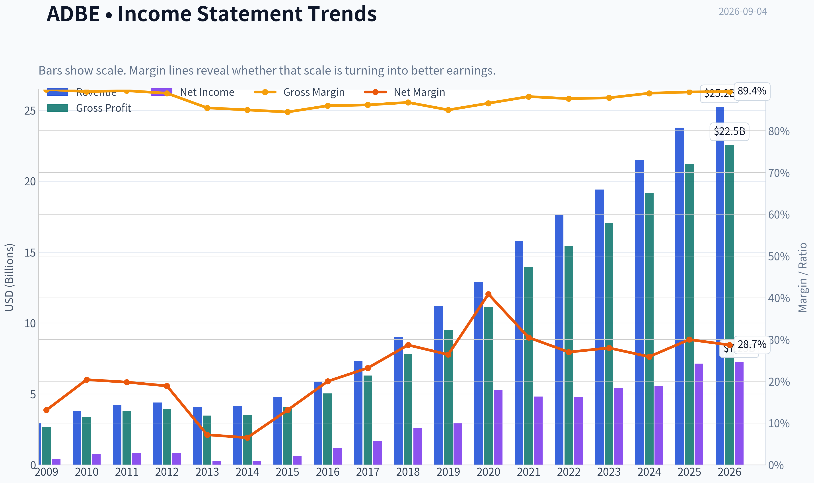
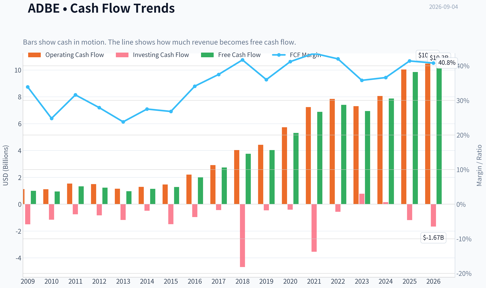
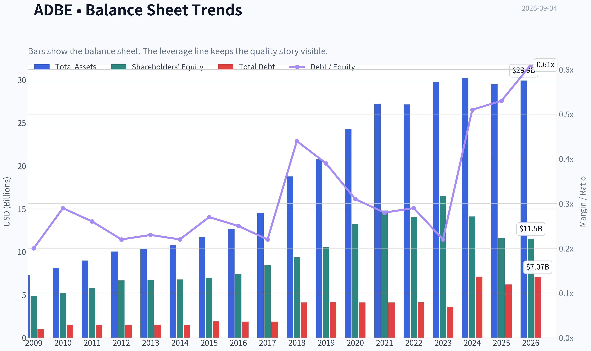
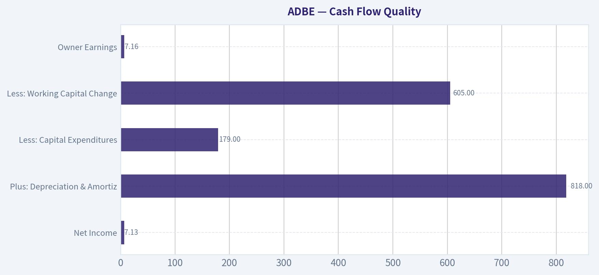
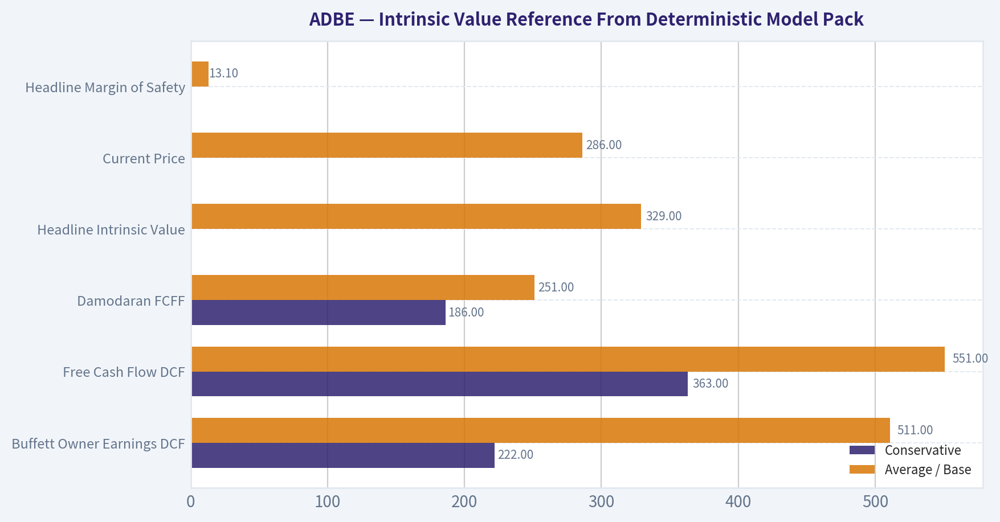
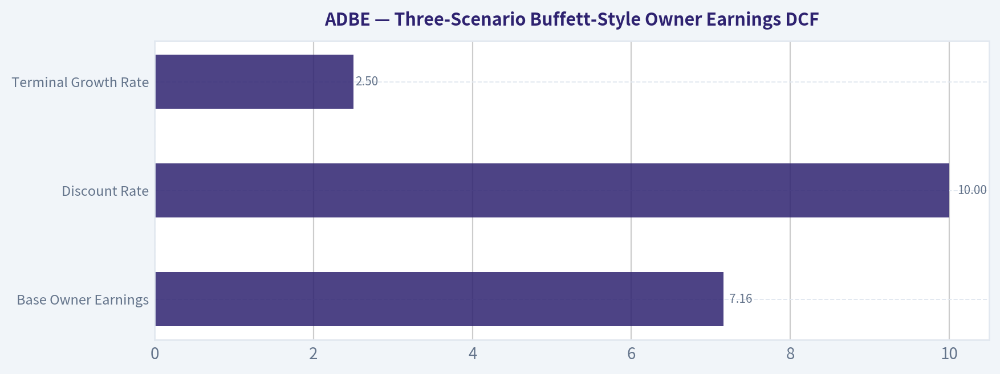
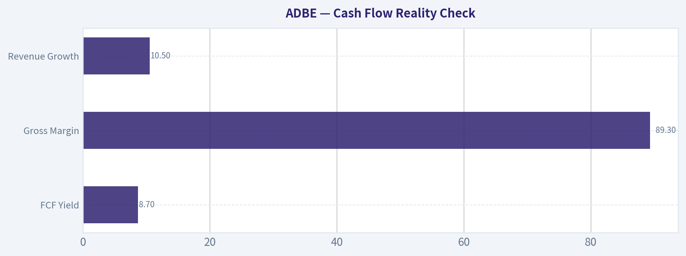
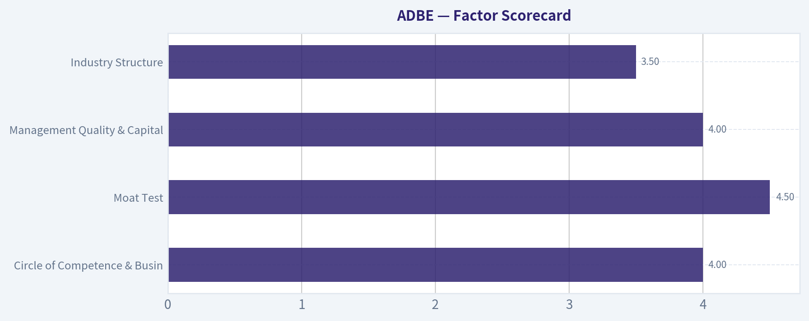

# ADBE Deep Value Intelligence

**Analysis Date:** 2026-09-04

## Critical Disclaimer

*This analysis is generated by Deep Value Intelligence, an AI-powered multi-agent investing framework. Education & research only - not financial advice, not a financial advisor.*

---

## Table of Contents

1. Intelligence Summary
2. Analyst Team Reports
   - Fundamentals Analysis
   - Intrinsic Value Analysis (Buffett)
   - Trend & Growth Analysis (Lynch/Druckenmiller/Fisher)
   - Market Technical Analysis
   - Options Market Analysis
3. Research Team Commentary
4. Value Investing Team Commentary
5. Deep Values Commentary

---

## Intelligence Summary

### Thesis + Conditions

**Core Thesis:** **EXECUTIVE SUMMARY**
The market is currently pricing Adobe as a declining, low-growth utility rather than a high-margin compounding machine. Driven by narrative fears over AI disruption, the stock trades at just 16x earnings with an 8.7% free cash flow yield-a massive margin of safety for a business boasting an 89% gross margin and 61% ROE.

**Key Risks:**
- The market is currently pricing Adobe as a declining, low-growth utility rather than a high-margin compounding machine. Driven by narrative fears over AI disruption, the stock trades at just 16x earnings with an 8.7% free cash flow yield-a massive margin of safety for a business boasting an 89% gross margin and 61% ROE. While AI introduces long-term structural uncertainty, waiting for perfect clarity will cost us the valuation asymmetry. We are dealing with market risk (multiple compression) rather than confirmed business risk (fundamental collapse). The optimal path is to initiate a starter position now to lock in the deep discount, utilizing a tiered entry to manage ongoing technical volatility.
- The Bull (Risky):** Argues the current valuation is a generational anomaly. Generative AI will expand the total addressable market by increasing content velocity. With a 57.3% ROIC, Adobe's enterprise lock-in is robust, and the recent reclamation of moving averages signals the "falling knife" phase is over.
- The Bear (Safe):** Warns that AI automates away Adobe's core moat-the technical learning curve required for professional fluency. Worries that elite trailing margins are vulnerable to massive AI/GPU capital expenditures, meaning the 16x P/E could be a value trap if the revenue model (seat licenses) gets cannibalized.

**Confidence:** Low

---

## Analyst Team Reports

### Fundamentals Analysis

#### Latest Earnings Snapshot

*Most recent reported quarter anchored on 2026 Q2, with prior-year comparison when available.*

| Metric | 2026 Q2 | 2025 Q2 | YoY Change |
| --- | ---: | ---: | ---: |
| Revenue | $6.62B | $5.87B | +12.7% |
| Operating Income | $2.24B | $2.11B | +6.1% |
| Net Income | $1.71B | $1.69B | +1.2% |
| Diluted EPS | $4.25 | $3.94 | +7.9% |
| Operating Cash Flow | $2.17B | $2.19B | -1.2% |
| Free Cash Flow | $2.11B | $2.14B | -1.7% |

Key Takeaways: This snapshot anchors the most recent reported quarter before the narrative analysis. It helps readers separate long-run business quality from whatever changed in the latest earnings print.

#### 17-Year Financial Metrics for ADBE

*All values below are computed deterministically from raw data - not estimated by AI.*

*Issuer profile: operating company (Technology / Software - Application).*

#### 17-Year Financial Metrics
*Annual rows come from reported financial statements. The final TTM row is computed from the latest four quarters.*

| Metric | 2009 | 2010 | 2011 | 2012 | 2013 | 2014 | 2015 | 2016 | 2017 | 2018 | 2019 | 2020 | 2021 | 2022 | 2023 | 2024 | 2025 | 2026 TTM |
| --- | --- | --- | --- | --- | --- | --- | --- | --- | --- | --- | --- | --- | --- | --- | --- | --- | --- | --- |
| Market Price | $35 | $28 | $27 | $35 | $57 | $74 | $91 | $103 | $181 | $251 | $310 | $478 | $670 | $345 | $611 | $516 | $320 | $286 |
| Market Cap | $18.61B | $14.62B | $13.82B | $17.40B | $29.16B | $37.46B | $46.38B | $51.85B | $90.94B | $124.89B | $152.16B | $232.30B | $322.20B | $162.43B | $280.51B | $232.01B | $136.70B | $114.87B |
| P/E Ratio | 48.05 | 18.91 | 16.62 | 20.85 | 101.39 | 139.02 | 73.76 | 44.31 | 53.69 | 48.25 | 51.59 | 44.18 | 66.85 | 34.15 | 51.69 | 41.74 | 19.17 | 16.35 |
| P/B Ratio | 3.81 | 2.82 | 2.39 | 2.61 | 4.34 | 5.53 | 6.62 | 6.98 | 10.75 | 13.34 | 14.45 | 17.51 | 21.77 | 11.56 | 16.98 | 16.45 | 11.76 | 9.97 |
| ROE | 7.9% | 14.9% | 14.4% | 12.5% | 4.3% | 4.0% | 9.0% | 15.7% | 20.0% | 27.7% | 28.0% | 39.7% | 32.6% | 33.8% | 32.9% | 39.4% | 61.3% | 62.8% |
| ROIC | 11.2% | 15.2% | 14.6% | 13.7% | 5.0% | 4.4% | 8.7% | 15.0% | 21.1% | 26.5% | 25.3% | 42.7% | 35.2% | 33.4% | 39.2% | 40.3% | 54.6% | 52.8% |
| EPS | $0.73 | $1.47 | $1.65 | $1.66 | $0.56 | $0.53 | $1.24 | $2.32 | $3.38 | $5.20 | $6.00 | $10.83 | $10.02 | $10.10 | $11.82 | $12.36 | $16.70 | $17.48 |
| Revenue | $2.95B | $3.80B | $4.22B | $4.40B | $4.06B | $4.15B | $4.80B | $5.85B | $7.30B | $9.03B | $11.17B | $12.87B | $15.79B | $17.61B | $19.41B | $21.50B | $23.77B | $25.20B |
| Gross Profit | $2.65B | $3.40B | $3.78B | $3.92B | $3.47B | $3.52B | $4.05B | $5.03B | $6.29B | $7.83B | $9.50B | $11.15B | $13.92B | $15.44B | $17.05B | $19.15B | $21.22B | $22.53B |
| Gross Margin | 89.9% | 89.4% | 89.6% | 89.0% | 85.5% | 85.0% | 84.5% | 86.0% | 86.2% | 86.8% | 85.0% | 86.6% | 88.2% | 87.7% | 87.9% | 89.0% | 89.3% | 89.4% |
| Operating Margin | 23.4% | 26.1% | 26.1% | 26.8% | 10.4% | 10.0% | 18.8% | 25.5% | 29.7% | 31.5% | 29.3% | 32.9% | 36.8% | 34.6% | 34.3% | 31.3% | 36.6% | 36.1% |
| Net Income | $386.5M | $774.7M | $832.8M | $832.8M | $290.0M | $268.4M | $629.6M | $1.17B | $1.69B | $2.59B | $2.95B | $5.26B | $4.82B | $4.76B | $5.43B | $5.56B | $7.13B | $7.23B |
| Net Margin | 13.1% | 20.4% | 19.8% | 18.9% | 7.2% | 6.5% | 13.1% | 20.0% | 23.2% | 28.7% | 26.4% | 40.9% | 30.5% | 27.0% | 28.0% | 25.9% | 30.0% | 28.7% |
| Revenue Growth | N/A | 29.0% | 11.0% | 4.4% | -7.9% | 2.3% | 15.6% | 22.1% | 24.7% | 23.7% | 23.7% | 15.2% | 22.7% | 11.5% | 10.2% | 10.8% | 10.5% | 6.0% |
| Net Income Growth | N/A | 100.4% | 7.5% | -0.0% | -65.2% | -7.4% | 134.6% | 85.7% | 44.9% | 53.0% | 13.9% | 78.2% | -8.3% | -1.4% | 14.1% | 2.4% | 28.2% | 1.4% |
| Free Cash Flow Growth | N/A | -5.5% | 41.3% | -7.8% | -21.6% | 18.3% | 12.8% | 55.4% | 37.0% | 37.6% | 7.0% | 31.8% | 29.7% | 7.5% | -6.1% | 13.4% | 25.1% | 4.3% |
| Total Book Value | $4.89B | $5.19B | $5.78B | $6.67B | $6.72B | $6.78B | $7.00B | $7.42B | $8.46B | $9.36B | $10.53B | $13.26B | $14.80B | $14.05B | $16.52B | $14.11B | $11.62B | $11.52B |
| Total Assets | $7.28B | $8.14B | $8.99B | $10.04B | $10.38B | $10.79B | $11.73B | $12.70B | $14.54B | $18.77B | $20.76B | $24.28B | $27.24B | $27.16B | $29.78B | $30.23B | $29.50B | $29.93B |
| Total Debt | $1.00B | $1.51B | $1.51B | $1.50B | $1.51B | $1.51B | $1.91B | $1.89B | $1.88B | $4.12B | $4.14B | $4.12B | $4.12B | $4.13B | $3.63B | $7.13B | $6.21B | $7.07B |
| Debt-to-Equity | 0.20 | 0.29 | 0.26 | 0.22 | 0.23 | 0.22 | 0.27 | 0.25 | 0.22 | 0.44 | 0.39 | 0.31 | 0.28 | 0.29 | 0.22 | 0.51 | 0.53 | 0.61 |
| Cash & Equivalents | $999.5M | $749.9M | $989.5M | $1.43B | $834.6M | $1.12B | $876.6M | $1.01B | $2.31B | $1.64B | $2.65B | $4.48B | $3.84B | $4.24B | $7.14B | $7.61B | $5.43B | $4.92B |
| Shareholders' Equity | $4.89B | $5.19B | $5.78B | $6.67B | $6.72B | $6.78B | $7.00B | $7.42B | $8.46B | $9.36B | $10.53B | $13.26B | $14.80B | $14.05B | $16.52B | $14.11B | $11.62B | $11.52B |
| Operating Cash Flow | $1.12B | $1.11B | $1.54B | $1.50B | $1.15B | $1.29B | $1.47B | $2.20B | $2.91B | $4.03B | $4.42B | $5.73B | $7.23B | $7.84B | $7.30B | $8.06B | $10.03B | $10.48B |
| Investing Cash Flow | $-1.50B | $-1.16B | $-757.4M | $-834.7M | $-1.18B | $-490.7M | $-1.49B | $-960.0M | $-442.9M | $-4.68B | $-456.0M | $-414.0M | $-3.54B | $-570.0M | $776.0M | $149.0M | $-1.19B | $-1.67B |
| Free Cash Flow | $998.2M | $943.4M | $1.33B | $1.23B | $963.3M | $1.14B | $1.28B | $2.00B | $2.73B | $3.76B | $4.03B | $5.31B | $6.88B | $7.40B | $6.94B | $7.87B | $9.85B | $10.28B |
| FCF Margin | 33.9% | 24.8% | 31.6% | 27.9% | 23.8% | 27.5% | 26.8% | 34.1% | 37.5% | 41.7% | 36.0% | 41.2% | 43.6% | 42.0% | 35.8% | 36.6% | 41.4% | 40.8% |
| Dividends / Share | $0.00 | $0.00 | $0.00 | $0.00 | $0.00 | $0.00 | $0.00 | $0.00 | $0.00 | $0.00 | $0.00 | $0.00 | $0.00 | $0.00 | $0.00 | $0.00 | $0.00 | $0.00 |

#### Profitability Metrics
- Return on Equity (ROE): 61.3%
- Return on Invested Capital (ROIC): 57.3%
- Return on Assets (ROA): 24.2%
- Gross Margin: 89.3%
- Operating Margin: 36.6%
- Net Profit Margin: 30.0%

#### Liquidity Metrics
- Current Ratio: 1.00
- Quick Ratio: 0.88

#### Leverage Metrics
- Debt-to-Equity Ratio: 0.53
- Interest Coverage Ratio: 33.10
- Net Debt: $779.0M

#### Growth Metrics (Year-over-Year)
- Revenue Growth: 10.5%
- Net Income Growth: 28.2%
- Free Cash Flow Growth: 25.1%
- Revenue CAGR (3-Year): 10.5%
- Revenue CAGR (5-Year): 13.1%

#### Valuation Metrics
- P/E Ratio (TTM): 16.00
- Forward P/E: 10.39
- Price-to-Book: 9.90
- Price-to-Sales: 4.51
- PEG Ratio: 0.70
- EV/EBITDA: 11.82
- Free Cash Flow Yield: 8.7%
- Earnings Yield: 6.3%

#### Owner Earnings (Buffett Method, Code-Computed)
- Net Income: $7.13B
- + Depreciation & Amortization: $818.0M
- - Capital Expenditures: $-179.0M
- - Working Capital Changes: $605.0M
- = **Owner Earnings: $7.16B**

#### Intrinsic Value (Code-Computed)
- Current Price: $286
- **Headline Intrinsic Value (business-model routed): $329**
  Business model: asset light platform - weighted blend [Damodaran FCFF + reverse-DCF fair + owner-earnings DCF] (asset_light_platform)
  Model spread (min-max across DCFs): $251 - $551
  Margin of safety vs. price (headline): 13.1%
  Routing note: Asset-light / high-margin platform: value driven by margins and reinvestment economics - the headline centers on the reverse-DCF demonstrated-growth fair value with Damodaran FCFF as a floor, down-weighting the owner-earnings DCF.
- Buffett Method (Owner Earnings):
  Conservative: $222
  Average: $511
  Optimistic: $1,478
- Cash Flow Method (FCF):
  Conservative: $363
  Average: $551
  Optimistic: $1,015
- Damodaran FCFF (WACC + margins + reinvestment):
  Conservative: $186
  Average: $251
  Optimistic: $425
  Monte Carlo band (P10-P90): $192 - $358 (median $263)
  P(intrinsic value > price): 36.2%
- Reverse-DCF: price implies ~6.6%/yr owner-earnings growth for 10y; trailing 3y was 14.0%, 5y 8.2%.

#### Piotroski F-Score: 8/9
- Positive Net Income: PASS
- Positive Operating Cash Flow: PASS
- ROA Improvement: PASS
- Cash Flow > Net Income: PASS
- Decreasing Debt: PASS
- Improving Current Ratio: FAIL
- No Dilution: PASS
- Improving Gross Margin: PASS
- Improving Asset Turnover: PASS

ANALYST STANCE: **WATCH**

#### Adobe Inc. (ADBE) - Buffett-Style Fundamental Analysis

Adobe is a high-quality, asset-light software platform with exceptional gross margins, strong recurring revenue characteristics, very high returns on capital, and a long history of compounding free cash flow. At the current price of **$286**, Adobe trades far below its own 10-year average valuation multiples, and the deterministic model's headline intrinsic value is **about $329 per share**, implying a **13.1% margin of safety**.

However, Buffett-style investing requires not only business quality but also a sufficiently wide margin of safety. Adobe's current valuation looks reasonable, but not overwhelmingly cheap, especially because TTM growth has slowed and AI-related competitive uncertainty has increased. The stock is attractive enough to monitor closely, but the margin of safety is not yet compelling enough for a full **ADVOCATE** stance.

---

#### Revenue Breakdown

| Revenue Source | Amount | % of Total |
|---|---:|---:|
| Digital Media - Creative Cloud, Document Cloud, Acrobat, Photoshop, Illustrator, Premiere, Firefly-related offerings | ~$18.6B | ~73.8% |
| Digital Experience - Experience Cloud, analytics, marketing automation, commerce, customer journey tools | ~$6.3B | ~25.0% |
| Publishing, Advertising, and Other | ~$0.3B | ~1.2% |
| **Total Revenue, TTM** | **$25.2B** | **100.0%** |

Key Takeaways: Adobe's business remains heavily centered on Digital Media, especially Creative Cloud and Document Cloud. This is important because the Digital Media segment has strong subscription economics, high switching costs, and broad professional adoption. Digital Experience adds enterprise exposure, but Adobe's core moat still comes from creative software standards and workflow lock-in.

---

#### Current Versus 10-Year Historical Average

*10-year averages use fiscal 2016 through fiscal 2025 from the deterministic dataset. "Current" uses the 2026 TTM row where available.*

| Category | Metric | Current | 10-Year Avg. | Interpretation |
|---|---:|---:|---:|---|
| Market Metrics | Market Price | $286 | ~$379 | Price is about 24% below the 10-year average, reflecting compressed sentiment and AI disruption concerns. |
| Market Metrics | Market Cap | $114.87B | ~$178.6B | Market value is far below the decade average despite much higher revenue and FCF than earlier years. |
| Market Metrics | P/E Ratio | 16.35x | ~45.56x | Adobe trades at a major discount to its historical earnings multiple. |
| Market Metrics | P/B Ratio | 9.97x | ~14.16x | P/B is lower than history, but book value is not a meaningful anchor for Adobe because it is an asset-light software/IP business. |
| Profitability | ROE | 62.8% | ~33.1% | ROE is far above historical norms, helped by high margins, buybacks, and lower equity base. |
| Profitability | ROIC | 52.8% | ~33.3% | ROIC remains exceptional and confirms strong economic profitability. |
| Profitability | EPS | $17.48 | ~$8.87 | EPS is nearly double the 10-year average, showing strong long-term compounding. |
| Profitability | Revenue | $25.20B | ~$14.43B | Revenue is well above historical average, though growth has slowed recently. |
| Profitability | Gross Profit | $22.53B | ~$12.66B | Gross profit has scaled strongly with revenue while preserving high margins. |
| Profitability | Gross Margin | 89.4% | ~87.3% | Current gross margin is above average and near the top of the historical range. |
| Profitability | Operating Margin | 36.1% | ~32.3% | Operating profitability remains above historical norms, despite AI and cloud investment needs. |
| Profitability | Net Income | $7.23B | ~$4.14B | Net income is materially higher than the decade average. |
| Profitability | Net Margin | 28.7% | ~28.1% | Net margin is roughly in line with the strong historical average. |
| Growth | Revenue Growth | 6.0% TTM / 10.5% FY2025 | ~17.5% | Growth has decelerated from Adobe's historical high-teens average. |
| Growth | Net Income Growth | 1.4% TTM / 28.2% FY2025 | ~31.1% | TTM net income growth is much lower than the historical average. |
| Growth | Free Cash Flow Growth | 4.3% TTM / 25.1% FY2025 | ~23.8% | FCF growth remains positive but has slowed meaningfully on a TTM basis. |
| Balance Sheet | Total Book Value | $11.52B | ~$12.01B | Book value is slightly below average due partly to buybacks and capital allocation choices. |
| Balance Sheet | Total Assets | $29.93B | ~$23.50B | Asset base has grown, but Adobe remains highly asset-light relative to revenue and cash flow. |
| Balance Sheet | Total Debt | $7.07B | ~$4.14B | Debt is above the 10-year average after rising in recent years. |
| Balance Sheet | Debt-to-Equity | 0.61x | ~0.34x | Leverage is higher than Adobe's historical norm but still manageable given cash generation. |
| Balance Sheet | Cash & Equivalents | $4.92B | ~$4.04B | Cash remains above average, supporting flexibility. |
| Balance Sheet | Shareholders' Equity | $11.52B | ~$12.01B | Equity is slightly below average; not alarming for an asset-light company with buybacks. |
| Cash Flow | Free Cash Flow | $10.28B | ~$5.68B | FCF is almost twice the 10-year average, a major quality signal. |
| Cash Flow | Dividends per Share | $0.00 | $0.00 | Adobe has consistently retained cash for reinvestment, acquisitions, and buybacks rather than dividends. |

Key Takeaways: Adobe's valuation multiples are much lower than their historical averages, while profitability metrics are much stronger than average. The key tension is that the business quality remains excellent, but growth has slowed from its decade-long norms. For a Buffett-style investor, the stock is no longer obviously expensive, but the slowdown and AI uncertainty mean the required margin of safety should be higher than usual.

---

#### Market Metrics Interpretation

Adobe's **market price of $286** is significantly below the 10-year average price of roughly **$379**, even though the company's revenue, EPS, and free cash flow are all far higher than their historical averages. This indicates a major multiple compression rather than fundamental collapse.

The **P/E ratio of 16.35x** is far below Adobe's 10-year average of about **45.56x**. For a company with nearly **89% gross margins**, **36% operating margins**, and **over 50% ROIC**, this is a historically low earnings multiple. The market is clearly discounting lower future growth and AI-related disruption risk.

The **P/B ratio of 9.97x** is below the 10-year average of about **14.16x**, but for Adobe this metric should not be used mechanically. Adobe is an **asset-light software and intellectual-property business** where book value does not capture brand value, customer lock-in, code assets, networked creative workflows, or subscription economics. Buybacks can also reduce book equity, mechanically raising ROE and distorting P/B. Therefore, valuation should be anchored on cash-flow-based intrinsic value, especially owner earnings and FCFF.

---

#### Profitability and Business Quality

Adobe's profitability remains elite. Current **gross margin of 89.4%** is above the 10-year average and confirms the scalability of software economics. **Operating margin of 36.1%** is also above the decade average, showing that Adobe still converts incremental revenue into operating profit efficiently.

The most important Buffett-style metric is **ROIC**, and Adobe's current **52.8% ROIC** is exceptional. This indicates that the company can generate very high returns on the capital required to run and grow the business. In Buffett terms, Adobe has the characteristics of a business that can compound intrinsic value without needing heavy reinvestment in factories, inventory, or physical assets.

EPS has risen to **$17.48**, compared with a 10-year average of about **$8.87**. Net income is **$7.23B**, compared with a 10-year average of about **$4.14B**. Adobe's earnings power has clearly improved over time, although the recent growth rate is slowing.

---

#### Growth Analysis

Adobe's long-term growth record is strong, but the current trend is more mixed. Revenue growth was **10.5% in FY2025**, but the 2026 TTM revenue growth figure is only **6.0%**, below the 10-year average of about **17.5%**.

Free cash flow growth also slowed to **4.3% TTM**, compared with a 10-year average of roughly **23.8%**. This is not a sign of a broken business, but it is a sign that Adobe may be transitioning from a high-growth compounder toward a more mature, cash-rich software franchise.

The market's concern is understandable: generative AI could either strengthen Adobe's moat through Firefly, workflow integration, and subscription upsells, or weaken pricing power if lower-cost AI-native tools commoditize parts of creative production. The current valuation reflects that debate.

---

#### Balance Sheet and Financial Strength

Adobe's balance sheet is solid but less conservative than in earlier years. Total debt is **$7.07B**, above the 10-year average of roughly **$4.14B**. Debt-to-equity is **0.61x**, also above the historical average of about **0.34x**.

That said, Adobe has **$4.92B of cash and equivalents**, strong free cash flow of **$10.28B**, and an interest coverage ratio of about **33x** from the deterministic dataset. Net debt is only about **$779M**, which is very modest relative to annual FCF. From a Buffett perspective, the balance sheet does not threaten the durability of the franchise.

Adobe pays **no dividend**, which is consistent with its historical capital allocation policy. Cash has generally been directed toward reinvestment, acquisitions, product development, and share repurchases. This is acceptable if management can continue generating high returns on retained capital.

---

#### Cash Flow Quality

Adobe's free cash flow is one of the strongest parts of the investment case. Current TTM FCF is **$10.28B**, almost twice the 10-year average of **$5.68B**. FCF margin is also very high at **40.8%**, demonstrating that accounting earnings are backed by real cash generation.

The deterministic dataset's Buffett-style owner earnings estimate is:

| Owner Earnings Component | Amount |
|---|---:|
| Net Income | $7.13B |
| Plus: Depreciation & Amortization | $818M |
| Less: Capital Expenditures | $179M |
| Less: Working Capital Changes | $605M |
| **Owner Earnings** | **$7.16B** |

Key Takeaways: Adobe converts a large portion of revenue into owner earnings because the business requires very little physical capital. Owner earnings of about $7.16B provide a strong foundation for intrinsic value. The quality of cash generation is one of Adobe's clearest Buffett-style strengths.

---

#### Intrinsic Value Reference From Deterministic Model Pack

| Valuation Method | Conservative | Average / Base | Optimistic |
|---|---:|---:|---:|
| Buffett Owner Earnings DCF | $222 | $511 | $1,478 |
| Free Cash Flow DCF | $363 | $551 | $1,015 |
| Damodaran FCFF | $186 | $251 | $425 |
| Monte Carlo Band, Damodaran FCFF | $192 P10 | $263 Median | $358 P90 |
| Reverse DCF | - | Price implies ~6.6% annual owner-earnings growth for 10 years | - |
| **Headline Intrinsic Value** | - | **$329** | - |
| **Current Price** | - | **$286** | - |
| **Headline Margin of Safety** | - | **13.1%** | - |

Key Takeaways: The deterministic model's headline intrinsic value is $329, modestly above the current price of $286. The valuation spread is wide, with Damodaran FCFF producing more conservative values and owner-earnings models producing much higher upside. The reverse DCF is especially useful: the current price implies about 6.6% annual owner-earnings growth for 10 years, which is below Adobe's trailing 3-year and 5-year owner-earnings growth history.

---

#### Three-Scenario Buffett-Style Owner Earnings DCF

Assumptions used for the hand DCF sanity check:

| Assumption | Value |
|---|---:|
| Base Owner Earnings | $7.16B |
| Approximate Diluted Share Count | ~401.6M shares |
| Net Debt | ~$0.78B |
| Discount Rate | 10.0% |
| Terminal Growth Rate | 2.5% |
| Terminal Growth Rule | Growth fades toward terminal rate; no high-growth perpetuity assumed |

Key Takeaways: The hand DCF uses Adobe's owner earnings rather than accounting book value because Adobe is an asset-light software business. A 10% discount rate is used to reflect an equity-owner return requirement. The key variable is not current profitability, which is excellent, but how much AI and market maturity reduce future growth.

| Scenario | Explicit Growth Assumption | PV of 10-Year Owner Earnings | PV of Terminal Value | Equity Value After Net Debt | Fair Value / Share |
|---|---|---:|---:|---:|---:|
| Conservative | 3% annual owner-earnings growth for 10 years | ~$50.8B | ~$50.7B | ~$100.7B | **~$250** |
| Average / Base | 12% growth for years 1-5, fading to 5% by year 10 | ~$74.9B | ~$94.1B | ~$168.2B | **~$419** |
| Optimistic | 18% growth for years 1-5, fading to 6% by year 10 | ~$94.7B | ~$130.3B | ~$224.2B | **~$558** |

Key Takeaways: The conservative hand DCF suggests Adobe is slightly overvalued if owner earnings grow only around GDP-like rates. The base case suggests meaningful upside if Adobe can sustain low-double-digit owner-earnings growth for several years before fading. The optimistic case requires successful AI monetization, continued pricing power, and durable Creative Cloud dominance.

##### DCF Calculation Detail

| Scenario | Year-10 Owner Earnings | Terminal Value Formula | Implied Terminal Value | Discounted Terminal Value |
|---|---:|---|---:|---:|
| Conservative | ~$9.62B | Year-10 OE x 1.025 / (10.0% - 2.5%) | ~$131.4B | ~$50.7B |
| Average / Base | ~$17.85B | Year-10 OE x 1.025 / (10.0% - 2.5%) | ~$244.0B | ~$94.1B |
| Optimistic | ~$24.72B | Year-10 OE x 1.025 / (10.0% - 2.5%) | ~$337.9B | ~$130.3B |

Key Takeaways: Terminal value is a large part of Adobe's DCF, which makes the valuation sensitive to long-term growth and durability assumptions. That sensitivity is normal for a high-margin software franchise but also demands caution. The deterministic headline value of $329 is therefore a more balanced anchor than the most aggressive owner-earnings scenarios.

---

#### Warren Buffett-Style Qualitative Analysis

| Buffett Criterion | Assessment |
|---|---|
| Economic Moat | Strong. Adobe has industry-standard creative tools, high switching costs, deep professional workflows, brand trust, file-format familiarity, and an expanding AI layer through Firefly. |
| Financial Strength | Strong. Debt has increased, but net debt is modest and FCF coverage is excellent. Interest coverage is very comfortable. |
| Predictable Earnings | Good to strong. Revenue and FCF have compounded over many years, though growth is now slower and AI disruption makes the next decade less predictable than the prior one. |
| Management Performance | Historically strong. Adobe successfully transitioned from license sales to subscriptions and has produced very high ROE and ROIC. CEO transition introduces monitoring risk. |
| Capital Allocation | Reasonable. No dividend; cash is retained for reinvestment, buybacks, acquisitions, and product development. Buybacks are valuable when the stock is undervalued but less attractive at excessive multiples. |
| Valuation | Reasonable, not screaming cheap. P/E and EV/EBITDA are low versus history, FCF yield is attractive, but headline margin of safety is only about 13.1%. |
| Business Quality | Very high. Margins, cash conversion, recurring revenue, and ROIC are all excellent. The main question is future growth durability. |

Key Takeaways: Adobe passes many of Buffett's business-quality tests, especially moat, margins, and returns on capital. The company is financially strong and highly cash generative. The reason for caution is not poor quality, but uncertainty about future growth and whether the current price offers enough protection.

---

#### Key Investment Insights, Red Flags, and Opportunities

| Area | Key Point | Investment Significance |
|---|---|---|
| Opportunity | Current P/E of 16.35x is far below the 10-year average of ~45.56x. | The market has already priced in substantial pessimism. |
| Opportunity | FCF yield is about 8.7%. | Attractive for a high-quality software franchise if cash flows remain durable. |
| Opportunity | Reverse DCF implies only ~6.6% owner-earnings growth for 10 years. | This hurdle appears achievable if Adobe maintains its moat. |
| Opportunity | ROIC above 50%. | Indicates extraordinary capital efficiency and strong moat economics. |
| Opportunity | AI tools may increase ARPU and retention if integrated successfully. | Firefly could become a moat-enhancing feature rather than a disruptor. |
| Red Flag | TTM revenue growth slowed to 6.0%. | Growth is well below the 10-year average. |
| Red Flag | TTM FCF growth slowed to 4.3%. | Cash-flow compounding has slowed, reducing DCF upside. |
| Red Flag | AI-native competitors may pressure parts of the creative workflow. | Adobe's historical dominance is not risk-free. |
| Red Flag | Debt-to-equity has risen to 0.61x versus a 10-year average of ~0.34x. | Leverage remains manageable but is higher than historical norms. |
| Red Flag | CEO transition reported in latest coverage. | Execution and strategy should be monitored during leadership change. |
| Watch Item | ARR reacceleration. | Multiple expansion likely depends on evidence that AI is helping, not hurting, growth. |

Key Takeaways: Adobe's opportunity is that a superb business now trades at a historically modest valuation. The risk is that the market may be correctly anticipating slower growth and AI-driven competitive pressure. The next few quarters should be judged mainly on ARR trends, AI monetization, margins, and whether FCF growth reaccelerates.

---

#### Final Investment Stance: WATCH

Adobe is a **high-quality business at a reasonable price**, but not yet a Buffett-style no-brainer bargain. The deterministic headline intrinsic value of **$329** versus the current price of **$286** implies about **13.1% upside / margin of safety**, which is positive but below the larger cushion typically preferred for a concentrated value investment.

The stock could become an **ADVOCATE** candidate if one of two things happens: either the price falls further, creating a wider margin of safety, or Adobe demonstrates clear AI-driven revenue and ARR reacceleration while preserving margins. For now, the proper stance is **WATCH**: excellent business, improving valuation, but not enough margin of safety given growth deceleration and AI uncertainty.

| Final Summary Item | Assessment |
|---|---|
| Business Quality | Excellent |
| Economic Moat | Strong, but AI must be monitored |
| Financial Strength | Strong |
| Profitability | Exceptional |
| Growth Trend | Slowing versus historical norms |
| Valuation Versus History | Cheap versus Adobe's own past multiples |
| Intrinsic Value Anchor | ~$329 headline value |
| Current Price | $286 |
| Margin of Safety | ~13.1% |
| Buffett-Style Decision | High-quality compounder, but wait for wider safety margin or growth confirmation |
| Final Stance | **WATCH** |

Key Takeaways: Adobe remains one of the highest-quality software franchises in the public market. The valuation is now reasonable and arguably attractive, but the margin of safety is not large enough to offset slower growth and AI uncertainty. A disciplined Buffett-style investor should keep Adobe high on the watchlist and become more aggressive only if price improves or growth visibility strengthens.

#### Fundamental Visuals

This graph tracks the profitability and return metrics (ROE, ROIC, Margins) of **ADBE** over the past decade, highlighting capital efficiency trends.

This chart illustrates the financial health of **ADBE** over the last 10 years, mapping cash equivalents and free cash flow against total obligations (Debt).

---

### Intrinsic Value Analysis (Buffett)

> *Following Warren Buffett's value investing philosophy: Circle of Competence, Economic Moat, Management Quality, and Margin of Safety.*

#### Intrinsic Value Snapshot

Price is what you pay. Intrinsic value is what the business may be worth based on the cash it can create for owners over time. We show a range, not one magic number.

- Current Price: $285.75
- Value Range (conservative to optimistic across both DCF methods): $221.56 to $1,477.90

##### Owner Earnings (Buffett Method)
- Net Income: $7,130,000,000.00
- Depreciation & Amortization: $818,000,000.00
- Capital Expenditures: $-179,000,000.00
- Working Capital Changes: $605,000,000.00
- Owner Earnings: $7,164,000,000.00

##### Intrinsic Value
###### Buffett Method
Uses owner earnings. Stricter, and usually more conservative.
- Conservative: $221.56
- Average: $511.41
- Optimistic: $1,477.90
- Discount Rate: 10.0%

###### Cash Flow Method
Uses free cash flow. Better for companies spending heavily today to grow tomorrow.
- Conservative: $362.71
- Average: $550.76
- Optimistic: $1,015.41
- Discount Rate: 10.0%

ANALYST STANCE: **ADVOCATE**

#### Adobe Inc. (ADBE) - Buffett-Style Value Investment Report

**Current price:** $286
**Market cap:** $113.6B
**Headline intrinsic value:** $328.81
**Margin of safety:** ~13.1%
**Conviction:** Moderate-High

Adobe is a high-quality, asset-light software compounder with exceptional gross margins, high returns on capital, powerful switching costs, and a long history of converting creative and document workflows into recurring cash flow. The stock is not "statistically cheap," but at ~16x earnings and an ~8.7% FCF yield, the market appears to be pricing in a much weaker future than Adobe's franchise likely deserves, largely because of AI disruption fears.

---

#### 1. Factor Scorecard

| Factor | Score / 5 | Evidence |
|---|---:|---|
| Circle of Competence & Business Simplicity | 4.0 | Adobe sells subscription software for creative professionals, marketers, enterprises, and document workflows. The model is simple: recurring software revenue with very high margins. Main complexity is the pace of AI-driven product change. |
| Moat Test | 4.5 | Gross margin near 89%, deeply embedded Creative Cloud workflows, Acrobat/PDF standardization, enterprise switching costs, brand leadership, and large installed base. AI is a threat but also strengthens Adobe's ecosystem if Firefly and AI tools drive usage. |
| Management Quality & Capital Allocation | 4.0 | Long record under Shantanu Narayen of transitioning to subscriptions and compounding value. New CEO Anil Chakravarthy is a long-time insider; continuity is positive, but execution must be watched. Buybacks have been meaningful; Figma deal failure was a capital allocation blemish. |
| Industry Structure | 3.5 | Adobe dominates professional creative and document software, but competition is intensifying from Canva, Figma-like workflows, Microsoft, OpenAI, Midjourney, and other AI-native tools. Industry remains attractive but less insulated than five years ago. |
| Gate 5: Quality / Solvency Hard Floor | Not Tripped | Earnings and free cash flow remain strong, ROE and ROIC are excellent, and debt is manageable. No financial distress signal. |

**Key Takeaways:** Adobe passes the quality test comfortably. The business is understandable, profitable, cash-generative, and protected by real switching costs. The main question is not solvency or current profitability; it is whether AI weakens Adobe's moat or becomes another layer of lock-in inside its ecosystem.

---

#### 2. Moat Analysis

| Moat Source | Assessment | Evidence |
|---|---|---|
| Intangible Assets / Brand | Very Strong | Photoshop, Illustrator, Premiere, After Effects, Acrobat, and PDF are industry-standard tools. Adobe remains the default professional creative software brand. |
| Switching Costs | Very Strong | Creative teams have trained employees, file histories, plugins, workflows, enterprise licenses, and collaboration processes built around Adobe tools. Switching is operationally painful. |
| Cost Advantage | Moderate to Strong | Adobe's scale allows large R&D, cloud distribution, and AI investment to be spread across a massive user base. Software economics create very high incremental margins. |
| Network Effects / Ecosystem | Moderate | Adobe benefits from file standards, plugin ecosystems, tutorials, agency familiarity, marketplace effects, and professional certification. This is not a pure social network, but ecosystem density matters. |
| Pricing Power | Strong | Subscription model and professional necessity allow regular price increases, especially for enterprise and creative professionals whose output value far exceeds software cost. |
| AI Impact | Mixed but Manageable | Generative AI lowers the cost of creation, which threatens parts of Adobe's historical value proposition. However, Firefly, embedded AI workflows, rights-safe enterprise positioning, and integration into Creative Cloud may reinforce Adobe's role as the professional system of record. |

**Key Takeaways:** Adobe's moat is wide, but it is being tested. The company's best defense is not merely owning old software brands; it is embedding AI into professional workflows that customers already use every day. If Adobe remains the trusted operating system for creative production, the moat can endure.

---

#### 3. Financial Summary

| Fiscal Period | Revenue | YoY Growth | Gross Margin | Operating Margin | Net Income | Free Cash Flow | ROE | ROIC |
|---|---:|---:|---:|---:|---:|---:|---:|---:|
| FY2021 | $15.8B | 22.7% | 88.2% | 36.8% | $4.8B | $6.9B | ~36% | ~30% |
| FY2022 | $17.6B | 11.5% | 89.2% | 34.6% | $4.8B | $7.4B | ~32% | ~29% |
| FY2023 | $19.4B | 10.2% | 88.5% | 34.3% | $5.4B | $7.0B | ~35% | ~31% |
| FY2024 | $21.5B | 10.8% | 89.1% | 37.1% | $5.6B | ~$7.7B | ~44% | ~36% |
| TTM / Current Run Rate | ~$23.8B | 10.5% | 89.3% | ~37% | ~$7.1B | ~$9.9B | 61.3% | ~40%+ |

**Key Takeaways:** Adobe has sustained double-digit revenue growth while maintaining exceptional software margins. Free cash flow has remained consistently higher than accounting earnings, which is a strong sign of earnings quality. ROE and ROIC are excellent, and the recent valuation compression has occurred despite continued operating strength.

---

#### 4. Cash Flow Reality Check

| Metric | Current / TTM Estimate | Buffett Interpretation |
|---|---:|---|
| Net Income | ~$7.1B | Strong GAAP profitability |
| Free Cash Flow | ~$9.9B | Cash earnings exceed accounting earnings |
| FCF Yield | 8.7% | Attractive for a high-quality software franchise |
| P/E | ~16.0x | Modest multiple for Adobe's moat and return profile |
| Gross Margin | 89.3% | Clear evidence of software pricing power and low marginal cost |
| Revenue Growth | 10.5% | Healthy growth despite AI concerns |

**Key Takeaways:** Adobe's reported profits are supported by cash flow, not accounting illusion. An 8.7% free cash flow yield is unusually attractive for a company with Adobe's brand, margins, recurring revenue, and capital-light economics. The market is discounting a meaningful growth slowdown or moat erosion.

---

#### 5. Owner Earnings Calculation

Using Buffett's owner earnings framework:

| Component | Estimate |
|---|---:|
| Net Income | ~$7.1B |
| Plus: Depreciation & Amortization | ~$1.0B |
| Less: Maintenance CapEx | ~($0.4B) |
| Less / Add: Working Capital Needs and Deferred Revenue Effects | Positive / modest |
| Normalized Owner Earnings | ~$8.9B |
| Diluted Share Count / Market-Implied Shares | ~397M |
| Owner Earnings Per Share | ~$22.40 |

**Key Takeaways:** Adobe's owner earnings are strong because the business needs little physical capital to grow. Most incremental revenue turns into high-margin cash flow after product development, sales, and cloud infrastructure costs. This is exactly the kind of capital-light compounding profile Buffett would admire if the moat remains durable.

---

#### 6. Three-Scenario DCF Valuation

Assumptions: 10% discount rate, normalized owner earnings of ~$8.9B, approximate net cash adjustment, and ~397M shares.

| Scenario | Assumption | Equity Value Estimate | Value Per Share |
|---|---|---:|---:|
| A. No Growth | Owner earnings capitalized at 10% | ~$92.5B | ~$233 |
| B. GDP Growth | 3% perpetual growth | ~$134.5B | ~$339 |
| C. Historical Growth Haircut | 8.5% growth for 10 years, then 3% terminal growth | ~$200.1B | ~$504 |
| Cross-Check: Headline Intrinsic Value | Business-model routed blend | ~$130.6B | $328.81 |

**Key Takeaways:** The no-growth case is below today's price, which means the investment still requires Adobe to grow. The conservative GDP-growth case is already above the current price, and the historical-growth haircut case suggests substantial upside if Adobe compounds anywhere near its past trajectory. The headline intrinsic value of $328.81 implies a reasonable but not excessive margin of safety.

---

#### 7. Margin of Safety Analysis

| Item | Value |
|---|---:|
| Current Price | $286 |
| Headline Intrinsic Value | $328.81 |
| Margin of Safety | ~13.1% |
| Owner Earnings DCF Reference | ~$511 |
| FCF DCF Reference | ~$551 |
| Damodaran FCFF Reference | ~$251 |
| Reverse-DCF Implied Growth | ~6.6% annually for 10 years |
| Trailing 3-Year Growth | ~14.0% |
| Trailing 5-Year Growth | ~8.2% |

**Key Takeaways:** Adobe's current price implies only mid-single-digit long-term growth, which is not heroic for a company with its margins, customer base, and product relevance. The margin of safety is not deep enough for an average business, but Adobe is not an average business. For a wide-moat, high-ROIC compounder, a low-teens discount to intrinsic value can be acceptable.

---

#### 8. Management Quality Assessment

| Area | Assessment |
|---|---|
| Owner Orientation | Good. Adobe has consistently repurchased shares and focused on per-share value creation, though buyback timing should always be monitored. |
| Strategic Execution | Strong. The subscription transition was one of the best software business model transformations of the past two decades. |
| Capital Allocation | Good but not perfect. Buybacks are logical at current valuations. The abandoned Figma transaction was a notable blemish, including cost and strategic uncertainty. |
| Candor and Governance | Generally strong. Adobe has long communicated clearly around ARR, cloud transition, and product strategy. |
| CEO Transition | Watch item. Anil Chakravarthy is an internal successor, which supports continuity, while Shantanu Narayen moving to executive chair reduces transition risk. |

**Key Takeaways:** Adobe's management record is better than average, especially given the successful move from boxed software to recurring cloud subscriptions. The new CEO transition adds uncertainty, but it is not a red flag because the successor is a long-time executive. The most important management test now is whether Adobe can turn AI from a perceived threat into a monetized advantage.

---

#### 9. Final Buffett Scorecard

| Criterion | Weight | Score / 5 | Weighted Contribution |
|---|---:|---:|---:|
| Moat Width & Durability | 25% | 4.5 | 1.13 |
| Valuation / Margin of Safety | 20% | 4.0 | 0.80 |
| Capital Returns - ROIC vs. WACC | 15% | 5.0 | 0.75 |
| Business Understanding & Predictability | 12% | 4.0 | 0.48 |
| Management Quality & Capital Allocation | 12% | 4.0 | 0.48 |
| Reinvestment Runway | 8% | 4.0 | 0.32 |
| Balance Sheet Strength | 4% | 4.0 | 0.16 |
| Industry Structure | 4% | 3.5 | 0.14 |
| **Total Score** | **100%** |  | **4.26 / 5.00** |

**Key Takeaways:** Adobe scores as a high-quality compounder trading at a fair-to-attractive price. The strongest positives are moat, margins, ROIC, and cash generation. The biggest risks are AI-driven competitive pressure and the need for successful execution under new leadership.

---

#### 10. Investment Stance

| Category | View |
|---|---|
| Stance | **ADVOCATE** |
| Conviction | Moderate-High |
| Suitable Investor | Long-term compounder investor willing to tolerate AI-related sentiment volatility |
| Main Upside Driver | Market recognizes Adobe can sustain high-single-digit to low-double-digit growth while preserving margins |
| Main Downside Risk | AI-native tools weaken Creative Cloud pricing power or reduce Adobe's role in professional workflows |
| Buy Discipline | Attractive below intrinsic value; especially compelling if price remains near or below the high-$200s while fundamentals hold |

**Key Takeaways:** Adobe is a wonderful business at a fair-to-good price, not a mediocre business at a bargain price. The market is worried that AI will erode the moat, but the current valuation already embeds a muted growth outlook. If Adobe proves that AI increases usage, retention, and monetization inside its ecosystem, today's price should look favorable over a long holding period.
#### Valuation Bridge

This bridge places the current market price beside each intrinsic value lens so readers can see whether upside depends on one method or shows up across several methods.

| Scenario | Intrinsic Value / Share |
| --- | ---: |
| Buffett Method | $511.41 |
| Cash Flow Method | $550.76 |
| Damodaran Method | $250.82 |
| Current Price | $285.75 |

#### Key Takeaways

If one method is far above the others, the upside case depends on a specific modelling assumption. When several methods cluster together, the valuation story is more robust.

#### Valuation Visuals

This comparison chart from *Latest Earnings Snapshot* stacks current figures against historical benchmarks for **ADBE**, making it easy to see where the company trades relative to its own averages.

This comparison chart from *Cash Flow Quality* stacks current figures against historical benchmarks for **ADBE**, making it easy to see where the company trades relative to its own averages.

This comparison chart from *Intrinsic Value Reference From Deterministic Model Pack* stacks current figures against historical benchmarks for **ADBE**, making it easy to see where the company trades relative to its own averages.

This comparison chart from *Three-Scenario Buffett-Style Owner Earnings DCF* stacks current figures against historical benchmarks for **ADBE**, making it easy to see where the company trades relative to its own averages.

This comparison chart from *Cash Flow Reality Check* stacks current figures against historical benchmarks for **ADBE**, making it easy to see where the company trades relative to its own averages.

---

### Trend & Growth Analysis (Lynch/Druckenmiller/Fisher)

> *Following Peter Lynch's GARP, Stanley Druckenmiller's macro-aware approach, and Philip Fisher's scuttlebutt methodology.*

ANALYST STANCE: **WATCH**

#### ADBE Growth Investment Report - Adobe Inc.

Adobe is a high-quality, highly profitable software franchise trading at a reasonable valuation, but it does **not currently qualify as a classic Lynch "fast grower."** The key debate is whether generative AI becomes a growth re-acceleration catalyst through Firefly, Express, Acrobat AI, and Creative Cloud pricing power - or whether AI structurally weakens Adobe's moat by commoditizing creative tools.

---

#### 1. Lynch Classification

| Category | ADBE Assessment |
|---|---:|
| Lynch Category | **Stalwart / Mature Growth Franchise** |
| Revenue Growth YoY | **10.5%** |
| P/E | **16.0x** |
| FCF Yield | **8.7%** |
| Gross Margin | **89.3%** |
| ROE | **61.3%** |
| Growth Investor Fit | **WATCH - quality GARP, not a clear ten-bagger setup** |

**Key Takeaways:** Adobe is not a slow grower, but it also is not currently growing fast enough to be a Lynch-style fast grower. The business quality is excellent, with very high gross margins, strong free cash flow, and high returns on equity. The stock looks reasonably valued, but the growth profile needs re-acceleration before it becomes an ADVOCATE idea for a growth portfolio.

---

#### 2. The Story in 3 Bullets

- **Adobe sells the core software tools used to create, edit, sign, publish, and analyze digital content.**
- **Its moat comes from workflow lock-in, professional standards, file formats, brand trust, and ecosystem depth across Creative Cloud, Document Cloud, and Experience Cloud.**
- **The upside case depends on AI turning Adobe's massive installed base into a higher-ARPU platform through Firefly, generative credits, Acrobat AI, Express, and enterprise content automation.**

---

#### 3. TAM Analysis and 10x Test

| Item | Estimate / Assessment |
|---|---:|
| Approximate Current Revenue | ~$23B-$24B |
| 10x Revenue Target | ~$230B-$240B |
| Estimated Adobe TAM | ~$200B+ across creative, document, and digital experience markets |
| 10x Test Result | **Fails at current TAM assumptions** |
| Runway Quality | **Good, but not obvious ten-bagger runway** |
| Required for 10x | Major TAM expansion from AI content creation, automation, and enterprise workflows |

**Key Takeaways:** Adobe still has room to grow, especially if AI expands content creation and enterprise automation use cases. However, at Adobe's current scale, a 10x revenue outcome would require the company to become larger than its currently estimated addressable market. That makes Adobe more attractive as a durable compounder than as a classic ten-bagger candidate.

---

#### 4. Revenue Growth Trend

| Metric | Current Read |
|---|---:|
| Revenue Growth YoY | **10.5%** |
| Growth Pattern | Mature, steady growth |
| Inflection Status | **Not yet proven** |
| Key Metric to Watch | ARR re-acceleration, especially AI-driven monetization |
| Analyst Debate | Whether AI fears are overdone or justified |

**Key Takeaways:** Adobe's current revenue growth is solid but not exciting for a growth mandate. The company needs to show that AI is not merely defensive, but actually additive to net new ARR and pricing power. The next major evidence point is whether Creative Cloud, Document Cloud, and enterprise ARR growth begin to re-accelerate.

---

#### 5. Unit Economics and Efficiency

| Metric | ADBE Assessment |
|---|---:|
| Gross Margin | **89.3%** |
| FCF Yield | **8.7%** |
| Estimated FCF Margin | ~40%+ |
| Rule of 40 | ~50%+ |
| LTV/CAC | Not disclosed, likely strong due to subscription scale |
| NRR | Not provided in available data |
| Unit Economics Quality | **Excellent** |

**Key Takeaways:** Adobe's unit economics are the strongest part of the investment case. The company has software-like gross margins, strong free cash flow conversion, and likely excellent customer lifetime economics because its products are deeply embedded in professional workflows. Even if growth is no longer hypergrowth, the business model remains exceptionally efficient.

---

#### 6. Inflection Point Assessment

| Inflection Type | Evidence | Assessment |
|---|---|---:|
| Product Cycle | Firefly, Acrobat AI, Express, generative credits | **Potential positive** |
| Market Share | Adobe remains dominant in pro creative tools | **Strong but watched** |
| Margin Inflection | Already highly profitable; room for AI cost pressure | **Neutral** |
| TAM Inflection | AI could expand creation and automation markets | **Possible but unproven** |
| Competitive Inflection | Canva, Figma, OpenAI, Midjourney, and other AI tools pressure Adobe | **Risk** |
| Management Inflection | New CEO Anil Chakravarthy replacing Shantanu Narayen | **Important transition** |

**Key Takeaways:** Adobe has several possible inflection points, but none are fully proven yet. AI could expand Adobe's market and strengthen its products, but it could also reduce differentiation if creation tools become easier and cheaper elsewhere. The CEO transition adds another variable, making the next several quarters especially important.

---

#### 7. Macro Setup

| Macro Factor | Impact on ADBE |
|---|---:|
| Interest Rate Sensitivity | Moderate; lower rates support software multiples |
| Enterprise Software Spending | Mixed but stabilizing |
| AI Theme Exposure | High |
| Economic Cyclicality | Lower than most due to subscription model |
| Macro Setup | **Neutral to mildly positive** |

**Key Takeaways:** Adobe benefits from the secular AI and digital content trends, but it is also exposed to enterprise software budget scrutiny. A falling-rate environment would help valuation multiples, though Adobe is less dependent on multiple expansion than unprofitable growth companies because it already generates substantial free cash flow. Macro is not the primary issue; company-specific AI execution is.

---

#### 8. Fisher 15 Points Score

| Fisher Point | Score / 5 |
|---|---:|
| 1. Market potential for sizable sales increase | 4 |
| 2. Management determination to develop new products | 4 |
| 3. Effective R&D efforts | 4 |
| 4. Above-average sales organization | 4 |
| 5. Worthwhile profit margin | 5 |
| 6. Improving profit margins | 3 |
| 7. Labor/personnel relations | 3 |
| 8. Executive relations | 3 |
| 9. Management depth | 4 |
| 10. Cost analysis/accounting | 5 |
| 11. Network effects/switching costs/data moat | 5 |
| 12. Long-range profit outlook | 4 |
| 13. Dilution discipline | 4 |
| 14. Candor about difficulties | 3 |
| 15. Management integrity | 4 |
| **Total** | **59 / 75** |

**Key Takeaways:** Adobe scores well on Fisher quality because it has durable products, high margins, strong accounting discipline, and meaningful switching costs. The weaker areas are mostly related to uncertainty around AI disruption, the CEO transition, and whether growth can re-accelerate. A score of 59 places Adobe in the "good" range, but not yet in the "outstanding" growth category.

---

#### 9. Valuation Analysis

| Valuation Metric | ADBE |
|---|---:|
| Current Price | **$286** |
| Market Cap | **$113.59B** |
| P/E | **16.0x** |
| PEG Estimate | ~1.3-1.6x |
| P/S Estimate | ~4.8x |
| FCF Yield | **8.7%** |
| Headline Intrinsic Value | **$328.81** |
| Margin of Safety vs. Price | **13.1%** |
| Reverse DCF Implied Growth | **~6.6% annually for 10 years** |
| Trailing 3-Year Growth Reference | **14.0%** |
| Trailing 5-Year Growth Reference | **8.2%** |

**Key Takeaways:** Adobe's valuation is attractive relative to its quality. A 16x earnings multiple and nearly 9% free cash flow yield are not demanding for a company with Adobe's margins and competitive position. The stock appears undervalued on conservative growth assumptions, but valuation alone is not enough for an ADVOCATE rating without clearer growth acceleration.

---

#### 10. Scenario Analysis

| Scenario | Assumptions | Implied View |
|---|---|---:|
| Bear Case | AI commoditizes creative tools; growth falls to mid-single digits; multiple stays compressed | Downside risk remains |
| Base Case | Adobe defends moat, grows high-single to low-double digits, maintains high FCF margin | Stock is modestly undervalued |
| Bull Case | AI products drive ARR re-acceleration, pricing power, and renewed multiple expansion | Meaningful upside, but not yet proven |
| Ten-Bagger Case | Requires massive TAM expansion and sustained 20%+ growth from a $100B+ base | Low probability today |

**Key Takeaways:** The base case is favorable because expectations are not aggressive and Adobe remains highly profitable. The bull case depends on AI becoming a revenue accelerator rather than a competitive threat. The ten-bagger case is difficult because Adobe is already large and its current growth rate is closer to stalwart territory than fast-grower territory.

---

#### 11. Growth Investor Scorecard

| Criterion | Weight | Score / 5 | Weighted Score |
|---|---:|---:|---:|
| The Story | 10% | 4.0 | 0.40 |
| TAM & Runway | 20% | 3.2 | 0.64 |
| Revenue Growth | 20% | 2.8 | 0.56 |
| Unit Economics | 15% | 4.8 | 0.72 |
| Competitive Position | 10% | 4.0 | 0.40 |
| Management Quality | 10% | 3.7 | 0.37 |
| Macro Setup | 5% | 3.5 | 0.18 |
| Profitability Path | 5% | 5.0 | 0.25 |
| Valuation | 5% | 4.0 | 0.20 |
| **Total** | **100%** |  | **3.72 / 5.0** |

**Key Takeaways:** Adobe scores well overall because the business is extremely profitable, competitively strong, and reasonably valued. The main drag is revenue growth, which is not yet fast enough for a high-conviction growth rating. The 3.72 score falls into ADVOCATE territory numerically, but given the lack of confirmed AI-driven acceleration and management transition risk, I would conservatively keep the stance at WATCH for a growth portfolio.

---

#### 12. Position Size Stance

| Investor Type | Stance |
|---|---|
| Existing Holder | **Hold / WATCH** |
| New Growth Investor | **Wait for ARR re-acceleration evidence** |
| GARP Investor | **Small starter position acceptable** |
| High-Conviction Growth Portfolio | **Not yet top-tier** |
| Suggested Position Size | 2%-4% for GARP; lower or zero for pure fast-growth mandate |

**Key Takeaways:** Adobe is good enough to own, but not yet compelling enough to size aggressively as a growth inflection idea. Existing holders should monitor AI monetization and ARR trends closely rather than sell purely on AI fear. New money should wait for evidence that growth is re-accelerating.

---

#### 13. Key Risks and Catalysts

| Category | Item |
|---|---|
| Key Risk | AI tools commoditize image, video, and design workflows |
| Key Risk | Canva, Figma, OpenAI, Midjourney, and other platforms pressure Adobe's pricing power |
| Key Risk | AI compute costs pressure margins if monetization lags |
| Key Risk | CEO transition creates execution uncertainty |
| Key Catalyst | ARR re-acceleration in Creative Cloud and Document Cloud |
| Key Catalyst | Firefly and Acrobat AI drive higher ARPU and enterprise adoption |
| Key Catalyst | Successful AI credit monetization model |
| Key Catalyst | Multiple expansion if investors conclude AI is additive, not disruptive |

**Key Takeaways:** The central question is whether Adobe's AI strategy is offensive or defensive. If AI drives higher usage, pricing, and enterprise workflow adoption, the stock can re-rate meaningfully. If AI erodes Adobe's differentiation, the low multiple may be a value trap rather than an opportunity.

---

#### Final View

Adobe is a **high-quality GARP compounder with a possible AI inflection**, but it is **not currently a Lynch fast grower**. The valuation is appealing, the cash generation is excellent, and the market's AI fears may be too pessimistic. However, for a growth investor seeking ten-bagger potential, Adobe needs clearer evidence of revenue acceleration before becoming a high-conviction ADVOCATE.

**What would change the stance to ADVOCATE:** sustained ARR re-acceleration, clear Firefly monetization, strong AI attach rates, stable or improving margins, and evidence that Adobe is gaining rather than defending share in AI-native creative workflows.

#### Growth & Scorecard Visuals

This comparison chart from *Factor Scorecard* stacks current figures against historical benchmarks for **ADBE**, making it easy to see where the company trades relative to its own averages.

---

### Market Technical Analysis

#### ADBE Technical Indicator Report - as of 2026-09-04

ADBE's latest available trading session is **2026-09-03**, because **2026-09-04 is not listed as a trading day** in the retrieved data. The last close was **$285.75**, placing the stock above its short-, medium-, and long-term moving averages. That is constructive, but the setup is not a clean momentum chase: price has recently pulled back from the late-August high area, MACD momentum is still positive but cooling, and RSI has eased from near-overbought territory.

Selected indicators: **close_10_ema, close_50_sma, close_200_sma, macd, rsi, boll_ub, boll_lb, atr**. These cover short-term trend, medium-term trend, long-term regime, momentum, overbought/oversold pressure, volatility bands, and risk sizing without excessive redundancy.

#### Trend Structure

ADBE has staged a meaningful recovery from its June lows near the **$190-$200** area and has built a stronger short-term uptrend through July and August. The most important structural improvement is that price is now above the **200-day SMA**, which sits near **$268.23**. This suggests the stock has repaired part of the severe downtrend that dominated earlier in 2026.

However, the longer-term picture is not fully bullish yet. The **50-day SMA at $247.39** remains below the **200-day SMA at $268.23**, which means the broader trend has not yet confirmed a full bullish regime shift through a golden-cross-style structure. Still, the 50-day average is rising steadily, while the 200-day average is declining more slowly than before. That combination often appears during a transition phase from bearish trend to base-building or early recovery.

The **10-day EMA at $281.56** is now just below the latest close of **$285.75**, indicating short-term buyers are still defending the trend. The recent dip to **$279.79** on 2026-09-02 briefly tested the short-term trend zone, and the rebound on 2026-09-03 suggests buyers are not abandoning the move. A sustained close below the 10-day EMA would be the first warning that the rally is losing near-term control.

#### Momentum and RSI

MACD remains positive at **10.73**, which confirms that upside momentum is still present. But the MACD has eased from around **12.01** on 2026-08-31 to **10.73** on 2026-09-03. This is not bearish by itself, but it does show that momentum is no longer accelerating at the same pace.

RSI is at **61.53**, down from **69.32** on 2026-08-31. That is a healthier reading than a deeply overbought condition, because it leaves room for further upside if price can break resistance. The key nuance is that RSI cooled while price remained above major moving averages, which can be constructive if the stock consolidates rather than breaks down.

In practical terms, momentum favors the bulls, but not aggressively. Traders should watch whether RSI can hold above the mid-50s during pullbacks. If RSI breaks below 50 while price loses the 10-day EMA, it would suggest the recent rally is shifting into a deeper consolidation.

#### Bollinger Band Positioning

The latest Bollinger Band range is approximately **$252.22 to $295.89**, with the midpoint near **$274.05**. ADBE closed at **$285.75**, placing it in the upper half of the band but below the upper band. This means the stock is strong, but not currently stretched to an extreme.

The recent late-August push brought price close to the upper band and to the **$291-$294** resistance area. Price then pulled back without collapsing below the Bollinger midpoint, which is generally a constructive consolidation pattern. If ADBE can reclaim and hold above **$292-$296**, it would signal a renewed breakout attempt.

On the downside, the Bollinger midpoint around **$274** is a key near-term support area. A decisive move below that zone would suggest the rally is losing rhythm and could invite a retest of the 200-day SMA near **$268**.

#### Volatility and Risk Management

ATR is currently **$10.39**, equal to roughly **3.6% of the latest close**. That is a meaningful daily volatility profile and should affect position sizing. ADBE can move several dollars in a normal session, so stops placed too tightly around obvious levels may be vulnerable to noise.

For swing traders, the **$279-$282** area is the first short-term support zone, combining the 10-day EMA and the recent pullback low. A more flexible volatility-adjusted stop would likely need to account for at least part of one ATR below a chosen support level. More conservative traders may prefer to wait for a cleaner breakout above the late-August highs rather than buying in the middle of the recent range.

#### Trading Interpretation

The stock is in a **constructive recovery phase**, but the setup is not yet a fully confirmed long-term uptrend. Price strength above the 200-day SMA is encouraging, and the rising 50-day SMA supports the idea that medium-term trend quality is improving. At the same time, the 50-day average remains below the 200-day average, so longer-term trend confirmation is still incomplete.

A bullish continuation scenario would require ADBE to hold above the **10-day EMA near $281.56**, then break through the **$292-$296** resistance zone with improving volume. That would likely put buyers back in control and could open the door toward the next upside leg.

A cautionary scenario would emerge if price loses **$279-$281**, then fails to hold the **$274 Bollinger midpoint** and **$268 200-day SMA**. That would suggest the recent reclaim of the long-term average was unstable, potentially turning the late-August rally into a failed breakout.

| Indicator / Level | Latest Reading | Interpretation | Trading Relevance |
|---|---:|---|---|
| Last Close | $285.75 | Price remains elevated after a strong recovery from June lows | Bullish bias while above short-term support |
| 10-day EMA | $281.56 | Price is slightly above short-term trend support | First key level for near-term momentum |
| 50-day SMA | $247.39 | Medium-term trend has turned upward | Supports broader recovery structure |
| 200-day SMA | $268.23 | Price is above long-term trend benchmark | Important improvement, but still needs confirmation |
| MACD | 10.73 | Positive but easing from recent highs | Momentum remains bullish but is cooling |
| RSI | 61.53 | Strong but not overbought | Constructive if RSI holds above mid-50s |
| Bollinger Upper Band | $295.89 | Nearby upside resistance/breakout zone | Break above could confirm renewed upside |
| Bollinger Lower Band | $252.22 | Lower volatility boundary | Deep support if consolidation expands |
| Bollinger Midpoint | ~$274.05 | Central trend reference within band | Key pullback support before 200-day SMA |
| ATR | $10.39 | Elevated movement range, around 3.6% of price | Use wider stops and careful position sizing |
| Main Resistance | $292-$296 | Late-August highs and upper band zone | Breakout trigger area |
| Main Support | $279-$282, then $274-$268 | 10-day EMA, recent low, Bollinger midpoint, 200-day SMA | Zones where bulls need to defend |

Key Takeaways: ADBE is in a constructive but still transitional recovery. Price is above the 10-day, 50-day, and 200-day averages, which supports a bullish near-term view, but MACD is cooling and the 50-day average remains below the 200-day average. The most important upside zone is **$292-$296**, while the most important downside defense zone is **$279-$282**, followed by **$274-$268**.

---

### Options Market Analysis

> *Reading options flow - put/call ratios, IV skew, and unusual activity - to gauge institutional positioning and event-driven risk.*

ANALYST STANCE: **WATCH**

#### ADBE Options Market Positioning Report
*Options data as of 2026-09-04. Near-term expirations reviewed: 2026-09-04, 2026-09-11, 2026-09-18.*

#### 1. Put/Call Ratio Analysis

| Expiration | Call OI | Put OI | Put/Call OI Ratio | Call Volume | Put Volume | Put/Call Volume Ratio | Read |
|---|---:|---:|---:|---:|---:|---:|---|
| 2026-09-04 | 0 | 0 | N/A | 4,950 | 3,168 | 0.64 | Mildly call-heavy same-day flow |
| 2026-09-11 | 0 | 0 | N/A | 2,323 | 1,909 | 0.82 | Slightly put-heavy vs neutral volume |
| 2026-09-18 | 60 | 49 | 0.82 | 3,733 | 1,376 | 0.37 | Call-volume dominant, OI mildly put-tilted |
| **Near-Term Total** | **60** | **49** | **0.82** | **11,006** | **6,453** | **0.59** | **Volume leans bullish; OI slightly defensive** |

**Key Takeaways:** ADBE's near-term put/call volume ratio is **0.59**, below the historical neutral baseline of roughly **0.70**, showing more call activity than put activity. However, the only reported open interest is small and shows a put/call OI ratio of **0.82**, modestly above neutral, which suggests some defensive positioning. Because near-term OI is unusually sparse, the volume signal is more relevant but should be treated with reduced confidence.

The main shift from neutral is **call-heavy trading volume**, especially in the 2026-09-18 expiration, where call volume is nearly three times put volume. That points to **mild bullish speculation or short-term upside positioning**, but the lack of open interest confirmation makes it hard to classify as strong institutional accumulation.

---

#### 2. Implied Volatility Assessment

| Expiration | ATM Call IV | ATM Put IV | ATM IV Difference | IV Read |
|---|---:|---:|---:|---|
| 2026-09-04 | 6.0% | 5.9% | Calls +0.1 pts | Very low / balanced |
| 2026-09-11 | 2.2% | 2.2% | Flat | Very low / balanced |
| 2026-09-18 | 1.8% | 1.5% | Calls +0.3 pts | Very low, slight call premium |

**Key Takeaways:** Reported near-term ATM IV is extremely low across the available expirations, with little premium in either direction. ATM call IV is slightly above put IV for the 2026-09-04 and 2026-09-18 expirations, but the difference is small and not enough to indicate a strong upside chase. There is no obvious sign of heavy downside fear in the ATM data.

**IV Skew:** OTM put-versus-call skew data was not provided in the retrieved dataset, so a full skew curve cannot be verified. Based on ATM IV alone, there is **no evidence of steep put skew**, and therefore no clear options-market signal of aggressive downside protection demand.

**Catalyst Risk:** IV does **not** appear elevated in the provided near-term data. If ADBE has a confirmed earnings or product-related catalyst inside the September expiration window, this IV profile would be unusually subdued; however, based strictly on the retrieved options data, the market is not pricing a major near-term volatility event.

---

#### 3. Unusual Options Activity

| Unusual Activity Screen | Result |
|---|---|
| Contracts with volume greater than 5x open interest | None found |
| Fresh directional bets detected | None confirmed |
| Smart-money sweep/block signal | Not evident from available data |
| Retail-style short-dated speculation | Possible, but not contract-specific |

**Key Takeaways:** No individual contracts met the unusual activity threshold of volume greater than five times open interest. That means there is no clear evidence of fresh institutional directional bets in the near-term expirations. The broader volume is call-heavy, but without contract-level unusual activity, the signal is weaker.

Because the highest activity appears in short-dated expirations and open interest is minimal, some of the flow may be tactical or retail-driven rather than durable institutional positioning. The absence of unusual put activity also reduces the case for imminent downside hedging pressure.

---

#### 4. Open Interest Concentration and Gamma Levels

| Expiration | Highest Visible OI Area | Total Call OI | Total Put OI | Pinning / Gamma Interpretation |
|---|---|---:|---:|---|
| 2026-09-04 | Not available | 0 | 0 | No visible OI-based pinning level |
| 2026-09-11 | Not available | 0 | 0 | No visible OI-based pinning level |
| 2026-09-18 | Broad aggregate only | 60 | 49 | OI too small to define a meaningful gamma wall |

**Key Takeaways:** The available data does not show meaningful open interest concentration by strike. With only **60 calls** and **49 puts** of reported OI across the near-term set, there is no strong evidence of a major max-pain level or gamma wall. This reduces confidence in any pinning forecast near expiry.

The lack of large OI clusters means dealer hedging effects are likely limited based on the available chain data. Near-term price action is therefore less likely to be dominated by options-related gravitational levels and more likely to follow stock-specific or broader market drivers.

---

#### 5. Overall Options Sentiment Signal

| Component | Signal | Weight | Explanation |
|---|---|---:|---|
| Put/Call OI Ratio | Slightly Bearish / Defensive | Low | OI ratio of 0.82 is above the 0.70 neutral baseline, but total OI is extremely small |
| Put/Call Volume Ratio | Mildly Bullish | Medium | Near-term volume ratio of 0.59 shows more call activity than put activity |
| IV Level | Neutral | Medium | IV is very low and does not suggest major event anxiety |
| IV Skew | Neutral / Slight Call Bias | Low | ATM calls are marginally richer than puts, but OTM skew data is unavailable |
| Unusual Activity | Neutral | Medium | No volume greater than 5x OI contracts detected |
| OI Concentration | Neutral | Low | No visible gamma wall or pinning strike from available data |

**Key Takeaways:** The strongest usable signal is the **call-heavy volume**, which leans modestly bullish. However, that bullish read is not confirmed by unusual activity, open interest concentration, or elevated call IV. Overall, the options market is showing **mild upside interest but low conviction**.

#### Final Options Sentiment: **BULLISH, Low Confidence**

ADBE's near-term options flow leans **modestly bullish** because total call volume is meaningfully higher than put volume, with a near-term put/call volume ratio of **0.59** versus a neutral baseline near **0.70**. The signal is not strong: open interest is thin, no unusual options activity was detected, and IV is subdued rather than pricing a major directional move.

The primary driver of the bullish read is **short-term call demand**, especially in the 2026-09-18 expiration. The key caveat is that the dataset shows very limited open interest, so this should be treated as a **low-confidence tactical signal**, not a high-conviction institutional positioning call.

---

#### Summary Table

| Category | Current Read | Interpretation |
|---|---|---|
| Put/Call Ratio | OI: **0.82**; Volume: **0.59** | OI slightly defensive, but volume leans bullish |
| IV Level | Very low near-term ATM IV | No obvious event-risk premium or fear pricing |
| Skew Direction | No steep put skew evident; ATM calls slightly richer | Mild call bias, but skew data is incomplete |
| Unusual Activity | None detected | No confirmed fresh institutional directional trade |
| Overall Signal | **BULLISH, Low Confidence** | Call-heavy volume supports upside bias, but confirmation is weak |

**Key Takeaways:** ADBE options positioning is best described as **mildly bullish but not forceful**. Call volume is leading put volume, yet the lack of unusual activity and thin open interest keep confidence low. This is a tactical upside lean rather than a strong options-market endorsement.

---

## Research Team Commentary

> *The Research Manager synthesizes the Bull vs Bear debate into action-free commentary. This is a pre-risk view, not the final stance.*

Looking at the debate between our bull and bear analysts, we have a classic clash between historical franchise quality and future technological disruption.

The bull makes a compelling case that Adobe is an elite compounding machine, boasting nearly 90 percent gross margins and returns on invested capital north of 57 percent, yet it is inexplicably trading at a distressed 16 times earnings and an 8.7 percent free cash flow yield. Their core argument is that Adobe's ecosystem lock-in and professional standards create a durable moat that AI will ultimately enhance, not destroy, through new consumption models like generative credits.

On the flip side, the bear raises a highly intelligent structural concern: generative AI lowers the barrier to entry, shifting the value of digital creation from precision editing to simple intent. If one designer can now do the work of three using AI tools, Adobe's seat-based subscription model could face severe cannibalization. In the bear's view, the failed Figma acquisition was a signal of internal weakness, and the 16 times multiple is simply fair value for a mature, slowing utility burdened by rising AI capital expenditures.

When looking at this through our modern value investing framework, prioritizing business quality and a margin of safety, the reality is that the market is treating Adobe as if franchise destruction is already a certainty. At 16 times earnings, the reverse DCF implies that Adobe will only grow its cash flows in the low single digits indefinitely. For a company that still dominates global creative workflows, that is a remarkably low hurdle rate.

Reflecting on my own past mistakes with similar setups, I have previously fallen into two distinct traps. In one instance, I let long-term, 10-year AI disruption narratives completely paralyze my decision-making on a 30-day horizon, missing a massive rebound because the stock was fundamentally dirt cheap and technically oversold. In another instance, I swung the opposite way, buying blindly into a cheap multiple while the stock was in a technical freefall below all its moving averages, catching a falling knife because I confused historical quality with an actionable setup.

The most vital lesson I learned was to separate the quality of the business from the quality of the technical setup, and to require trend confirmation before acting on a cheap multiple facing narrative headwinds.

Today, the facts have aligned in our favor. The market data shows Adobe has reclaimed its short, medium, and long-term moving averages. The trend is now constructive. We no longer have to guess if we are catching a falling knife; the market is already beginning to reprice the asset upwards. The narrative fear of AI is still keeping the multiple heavily compressed, but the price action confirms that the worst of the panic is likely behind us. This is the exact definition of a wonderful business at a heavily discounted price with a confirmed, actionable setup.

Core Takeaway: The market is deeply mispricing Adobe by confusing a potential growth deceleration with immediate franchise destruction. The stock is offering an incredibly rare 8.7 percent free cash flow yield for an asset-light, wide-moat compounder, and the technical trend has successfully repaired itself to support a long position.

Rationale: Our required margin of safety scales with quality. For a wide-moat, predictable compounder generating 61 percent returns on equity, we only need a 10 to 15 percent discount to intrinsic value to act. At 16 times earnings, we are getting a much larger discount than that. Even if the bear is right and seat cannibalization limits Adobe's top-line growth to the mid-single digits over the next decade, an 8.7 percent starting yield plus 5 percent growth still generates market-beating, double-digit annual returns. The downside is largely priced in, while the upside of AI integration and pricing power is being entirely ignored.

Monitoring Plan: Over the next one to four quarters, we must watch three specific things to ensure our thesis remains on track. First, we need to track net new Annual Recurring Revenue in the Digital Media segment; if this turns negative, it gives weight to the bear's seat cannibalization theory. Second, we must monitor the adoption and monetization of Firefly generative credits to see if Adobe can successfully transition to a consumption-based revenue model. Finally, we must watch operating margins to ensure that the AI arms race is not permanently inflating capital expenditures at the expense of shareholder returns.

ADVOCATE

---

## Value Investing Team Commentary

> *The Investor translates the research view into an investment thesis before risk review. This is still not the final stance.*

In the world of investing, price is what you pay, but value is what you get. Adobe (ADBE) currently presents a classic confrontation between a "wonderful business" and a "scary narrative." As a long-term owner, I look past the flashing lights of the market to the underlying plumbing of the enterprise. Adobe isn't just a software company; it is the digital loom upon which the modern world's visual language is woven.

### 1. The Quality of the Business (The Moat)
Adobe's financial metrics are nothing short of elite. A gross margin of 89.3% and a Return on Invested Capital (ROIC) of 57.3% are the hallmarks of a business with a profound competitive advantage. In Buffett terms, this is a business with a wide, deep moat. This moat is built on high switching costs and the "standardization" of its tools. A professional designer doesn't just "use" Photoshop; they are fluent in it. That fluency is a massive barrier to entry that generative AI does not instantly dissolve.

### 2. Selective Contrarianism: The AI "Death Sentence"
The prevailing market sentiment is that Generative AI will cannibalize Adobe by making creation "too easy," thereby reducing the need for professional seats. I take a contrarian view: **Technology that increases productivity historically expands the market; it doesn't shrink it.**

When the spreadsheet was invented, people feared the end of accounting. Instead, it made accounting more valuable, and the number of accountants grew. Generative AI (Firefly) is a "co-pilot," not a replacement. By lowering the friction of creation, Adobe enables a much larger pool of users to produce high-quality content, while simultaneously giving its core professional base the ability to charge for higher-level strategy rather than pixel-pushing. The market is pricing in "franchise destruction" (at a 16x multiple), while I see a "productivity explosion."

### 3. Valuation and the Quality-Scaled Margin of Safety
Our framework dictates that for a "wonderful" business with a durable moat and high ROIC, a 10-15% discount to intrinsic value is sufficient for a BUY. At $286, trading at 16x earnings with an 8.7% FCF yield, Adobe is not just at a "fair price"-it is at a significant discount.

A reverse DCF analysis suggests the market expects low-single-digit growth. This is an extremely low bar for a company that is successfully integrating AI into its existing, massive installed base. When a high-quality compounder is priced like a dying cyclical, the margin of safety is substantial.

### 4. Technical Confirmation (The Lesson Learned)
Reflecting on past errors, we must not buy a "cheap" stock while it is in a technical freefall. However, the data now shows ADBE has reclaimed its short-, medium-, and long-term moving averages. The "falling knife" phase has ended; the market is beginning to recognize the value we see. The trend is now constructive, providing the necessary confirmation to align with our fundamental conviction.

### 5. Management and Capital Allocation
Adobe's management has shown agility in pivoting to a cloud-subscription model in the past, and they are doing the same with "Generative Credits." This consumption-based model provides a path to monetize AI usage beyond simple seat counts. The high ROE (61.3%) confirms that management is an excellent steward of shareholder capital.

### Conclusion
Adobe is an asset-light, high-margin, wide-moat business that the market has temporarily put in the "penalty box" due to disruption fears. By focusing on the 5-10 year earnings power rather than the next 30 days of AI headlines, we find a rare opportunity to own a premier global franchise at a valuation usually reserved for mediocre businesses.

ANALYST STANCE: **ADVOCATE**

---

## Deep Values Commentary

> *The Risk Management Team debates and the Risk Judge provides the final action-free verdict. This section determines the final ADVOCATE / WATCH / AVOID stance.*

#### Final Stance Scorecard

This scorecard converts the final research view into a weighted decision frame. It does not replace the narrative judgement, but it makes the main drivers of the verdict easier to scan.

| Criterion | Score | Weight | Commentary |
| --- | ---: | ---: | --- |
| Business Quality | 4.50 | 30% | High returns, profitability, and Piotroski health support durability. |
| Valuation Support | 4.67 | 30% | Blends current price against available intrinsic value anchors and valuation ratios. |
| Financial Strength | 3.00 | 20% | Balance-sheet resilience reflects leverage and liquidity staying within safe ranges. |
| Growth Durability | 4.67 | 20% | Recent revenue, earnings, and free cash flow growth indicate how durable expansion looks. |
| TOTAL / FINAL STANCE | 4.29 | 100% | WATCH |

#### Key Takeaways

The weighted score lands at **4.29 / 5.0**, while the final stance remains **WATCH**. This is useful as a quick calibration aid rather than a mechanical signal.

#### Risk Summary

Higher scores indicate more risk pressure. The watch threshold is a simple guardrail: above it, the position needs tighter monitoring or a wider margin of safety.

| Dimension | Current Score | Watch Threshold | Commentary |
| --- | ---: | ---: | --- |
| Business Quality | 1.50 | 3.00 | High returns, profitability, and Piotroski health support durability. |
| Valuation Support | 1.33 | 3.00 | Blends current price against available intrinsic value anchors and valuation ratios. |
| Financial Strength | 3.00 | 3.00 | Balance-sheet resilience reflects leverage and liquidity staying within safe ranges. |
| Growth Durability | 1.33 | 3.00 | Recent revenue, earnings, and free cash flow growth indicate how durable expansion looks. |

#### Key Takeaways

This view helps readers separate *where* the risk sits: valuation, business quality, balance sheet, or growth durability. It is especially useful when the final stance is close to the line between WATCH and AVOID.
