# ADBE Deep Value Intelligence

**Analysis Date:** 2026-09-18

## Critical Disclaimer

*This analysis is generated by Deep Value Intelligence, an AI-powered multi-agent investing framework. Education & research only - not financial advice, not a financial advisor.*

---

## Table of Contents

1. Intelligence Summary
2. Analyst Team Reports
   - Fundamentals Analysis
   - Intrinsic Value Analysis (Buffett)
   - Trend & Growth Analysis (Lynch/Druckenmiller/Fisher)
   - Market Technical Analysis
   - Options Market Analysis
3. Research Team Commentary
4. Value Investing Team Commentary
5. Deep Values Commentary

---

## Intelligence Summary

### Thesis + Conditions

**Core Thesis:** ## Executive Briefing

**Key Risks:**
- The risk is real: AI could reduce seat growth, raise compute and R&D costs, pressure pricing, and shift initial creation toward browser-native competitors. Moreover, the reverse DCF is not auditable from the supplied data, so the apparent margin of safety is indicative rather than proven.
- ### Risky Analyst: strongest arguments
- Revenue or accounting earnings growth above 5.3% would not ensure value creation if free cash flow per share grows more slowly.

**Confidence:** Low

---

## Analyst Team Reports

### Fundamentals Analysis

#### Latest Earnings Snapshot

*Most recent reported quarter anchored on 2026 Q3, with prior-year comparison when available.*

| Metric | 2026 Q3 | 2025 Q3 | YoY Change |
| --- | ---: | ---: | ---: |
| Revenue | N/A | $5.99B | N/A |
| Operating Income | N/A | $2.17B | N/A |
| Net Income | N/A | $1.77B | N/A |
| Diluted EPS | $4.62 | $4.18 | +10.5% |
| Operating Cash Flow | $2.17B | $2.19B | -1.2% |
| Free Cash Flow | $2.11B | $2.14B | -1.7% |

Key Takeaways: This snapshot anchors the most recent reported quarter before the narrative analysis. It helps readers separate long-run business quality from whatever changed in the latest earnings print.

#### 17-Year Financial Metrics for ADBE

*All values below are computed deterministically from raw data - not estimated by AI.*

*Issuer profile: operating company (Technology / Software - Application).*

#### 17-Year Financial Metrics
*Annual rows come from reported financial statements. The final TTM row is computed from the latest four quarters.*

| Metric | 2009 | 2010 | 2011 | 2012 | 2013 | 2014 | 2015 | 2016 | 2017 | 2018 | 2019 | 2020 | 2021 | 2022 | 2023 | 2024 | 2025 |
| --- | --- | --- | --- | --- | --- | --- | --- | --- | --- | --- | --- | --- | --- | --- | --- | --- | --- |
| Market Price | $35 | $28 | $27 | $35 | $57 | $74 | $91 | $103 | $181 | $251 | $310 | $478 | $670 | $345 | $611 | $516 | $320 |
| Market Cap | $18.61B | $14.62B | $13.82B | $17.40B | $29.16B | $37.46B | $46.38B | $51.85B | $90.94B | $124.89B | $152.16B | $232.30B | $322.20B | $162.43B | $280.51B | $232.01B | $136.70B |
| P/E Ratio | 48.05 | 18.91 | 16.62 | 20.85 | 101.39 | 139.02 | 73.76 | 44.31 | 53.69 | 48.25 | 51.59 | 44.18 | 66.85 | 34.15 | 51.69 | 41.74 | 19.17 |
| P/B Ratio | 3.81 | 2.82 | 2.39 | 2.61 | 4.34 | 5.53 | 6.62 | 6.98 | 10.75 | 13.34 | 14.45 | 17.51 | 21.77 | 11.56 | 16.98 | 16.45 | 11.76 |
| ROE | 7.9% | 14.9% | 14.4% | 12.5% | 4.3% | 4.0% | 9.0% | 15.7% | 20.0% | 27.7% | 28.0% | 39.7% | 32.6% | 33.8% | 32.9% | 39.4% | 61.3% |
| ROIC | 11.2% | 15.2% | 14.6% | 13.7% | 5.0% | 4.4% | 8.7% | 15.0% | 21.1% | 26.5% | 25.3% | 42.7% | 35.2% | 33.4% | 39.2% | 42.7% | 57.9% |
| EPS | $0.73 | $1.47 | $1.65 | $1.66 | $0.56 | $0.53 | $1.24 | $2.32 | $3.38 | $5.20 | $6.00 | $10.83 | $10.02 | $10.10 | $11.82 | $12.36 | $16.70 |
| Revenue | $2.95B | $3.80B | $4.22B | $4.40B | $4.06B | $4.15B | $4.80B | $5.85B | $7.30B | $9.03B | $11.17B | $12.87B | $15.79B | $17.61B | $19.41B | $21.50B | $23.77B |
| Gross Profit | $2.65B | $3.40B | $3.78B | $3.92B | $3.47B | $3.52B | $4.05B | $5.03B | $6.29B | $7.83B | $9.50B | $11.15B | $13.92B | $15.44B | $17.05B | $19.15B | $21.22B |
| Gross Margin | 89.9% | 89.4% | 89.6% | 89.0% | 85.5% | 85.0% | 84.5% | 86.0% | 86.2% | 86.8% | 85.0% | 86.6% | 88.2% | 87.7% | 87.9% | 89.0% | 89.3% |
| Operating Margin | 23.4% | 26.1% | 26.1% | 26.8% | 10.4% | 10.0% | 18.8% | 25.5% | 29.7% | 31.5% | 29.3% | 32.9% | 36.8% | 34.6% | 34.3% | 31.3% | 36.6% |
| Net Income | $386.5M | $774.7M | $832.8M | $832.8M | $290.0M | $268.4M | $629.6M | $1.17B | $1.69B | $2.59B | $2.95B | $5.26B | $4.82B | $4.76B | $5.43B | $5.56B | $7.13B |
| Net Margin | 13.1% | 20.4% | 19.8% | 18.9% | 7.2% | 6.5% | 13.1% | 20.0% | 23.2% | 28.7% | 26.4% | 40.9% | 30.5% | 27.0% | 28.0% | 25.9% | 30.0% |
| Revenue Growth | N/A | 29.0% | 11.0% | 4.4% | -7.9% | 2.3% | 15.6% | 22.1% | 24.7% | 23.7% | 23.7% | 15.2% | 22.7% | 11.5% | 10.2% | 10.8% | 10.5% |
| Net Income Growth | N/A | 100.4% | 7.5% | -0.0% | -65.2% | -7.4% | 134.6% | 85.7% | 44.9% | 53.0% | 13.9% | 78.2% | -8.3% | -1.4% | 14.1% | 2.4% | 28.2% |
| Free Cash Flow Growth | N/A | -5.5% | 41.3% | -7.8% | -21.6% | 18.3% | 12.8% | 55.4% | 37.0% | 37.6% | 7.0% | 31.8% | 29.7% | 7.5% | -6.1% | 13.4% | 25.1% |
| Total Book Value | $4.89B | $5.19B | $5.78B | $6.67B | $6.72B | $6.78B | $7.00B | $7.42B | $8.46B | $9.36B | $10.53B | $13.26B | $14.80B | $14.05B | $16.52B | $14.11B | $11.62B |
| Total Assets | $7.28B | $8.14B | $8.99B | $10.04B | $10.38B | $10.79B | $11.73B | $12.70B | $14.54B | $18.77B | $20.76B | $24.28B | $27.24B | $27.16B | $29.78B | $30.23B | $29.50B |
| Total Debt | $1.00B | $1.51B | $1.51B | $1.50B | $1.51B | $1.51B | $1.91B | $1.89B | $1.88B | $4.12B | $4.14B | $4.12B | $4.12B | $4.13B | $3.63B | $5.63B | $6.21B |
| Debt-to-Equity | 0.20 | 0.29 | 0.26 | 0.22 | 0.23 | 0.22 | 0.27 | 0.25 | 0.22 | 0.44 | 0.39 | 0.31 | 0.28 | 0.29 | 0.22 | 0.40 | 0.53 |
| Cash & Equivalents | $999.5M | $749.9M | $989.5M | $1.43B | $834.6M | $1.12B | $876.6M | $1.01B | $2.31B | $1.64B | $2.65B | $4.48B | $3.84B | $4.24B | $7.14B | $7.61B | $5.43B |
| Shareholders' Equity | $4.89B | $5.19B | $5.78B | $6.67B | $6.72B | $6.78B | $7.00B | $7.42B | $8.46B | $9.36B | $10.53B | $13.26B | $14.80B | $14.05B | $16.52B | $14.11B | $11.62B |
| Operating Cash Flow | $1.12B | $1.11B | $1.54B | $1.50B | $1.15B | $1.29B | $1.47B | $2.20B | $2.91B | $4.03B | $4.42B | $5.73B | $7.23B | $7.84B | $7.30B | $8.06B | $10.03B |
| Investing Cash Flow | $-1.50B | $-1.16B | $-757.4M | $-834.7M | $-1.18B | $-490.7M | $-1.49B | $-960.0M | $-442.9M | $-4.68B | $-456.0M | $-414.0M | $-3.54B | $-570.0M | $776.0M | $149.0M | $-1.19B |
| Free Cash Flow | $998.2M | $943.4M | $1.33B | $1.23B | $963.3M | $1.14B | $1.28B | $2.00B | $2.73B | $3.76B | $4.03B | $5.31B | $6.88B | $7.40B | $6.94B | $7.87B | $9.85B |
| FCF Margin | 33.9% | 24.8% | 31.6% | 27.9% | 23.8% | 27.5% | 26.8% | 34.1% | 37.5% | 41.7% | 36.0% | 41.2% | 43.6% | 42.0% | 35.8% | 36.6% | 41.4% |
| Dividends / Share | $0.00 | $0.00 | $0.00 | $0.00 | $0.00 | $0.00 | $0.00 | $0.00 | $0.00 | $0.00 | $0.00 | $0.00 | $0.00 | $0.00 | $0.00 | $0.00 | $0.00 |

#### Profitability Metrics
- Return on Equity (ROE): 61.3%
- Return on Invested Capital (ROIC): 63.2%
- Return on Assets (ROA): 24.2%
- Gross Margin: 89.3%
- Operating Margin: 36.6%
- Net Profit Margin: 30.0%

#### Liquidity Metrics
- Current Ratio: 1.00
- Quick Ratio: 0.88

#### Leverage Metrics
- Debt-to-Equity Ratio: 0.53
- Interest Coverage Ratio: 33.10
- Net Debt: $-385.0M

#### Growth Metrics (Year-over-Year)
- Revenue Growth: 10.5%
- Net Income Growth: 28.2%
- Free Cash Flow Growth: 25.1%
- Revenue CAGR (3-Year): 10.5%
- Revenue CAGR (5-Year): 13.1%

#### Valuation Metrics
- P/E Ratio (TTM): 13.98
- Forward P/E: 9.13
- Price-to-Book: 8.48
- Price-to-Sales: 3.87
- PEG Ratio: 0.61
- EV/EBITDA: 10.35
- Free Cash Flow Yield: 9.8%
- Earnings Yield: 7.2%

#### Owner Earnings (Buffett Method, Code-Computed)
- Net Income: $7.13B
- + Depreciation & Amortization: $818.0M
- - Capital Expenditures: $-179.0M
- - Working Capital Changes: $605.0M
- = **Owner Earnings: $7.16B**

#### Intrinsic Value (Code-Computed)
- Current Price: $253
- **Headline Intrinsic Value (business-model routed): $300**
  Business model: asset light platform - weighted blend [Damodaran FCFF + reverse-DCF fair + owner-earnings DCF] (asset_light_platform)
  Model spread (min-max across DCFs): $220 - $500
  Margin of safety vs. price (headline): 15.8%
  Routing note: Asset-light / high-margin platform: value driven by margins and reinvestment economics - the headline centers on the reverse-DCF demonstrated-growth fair value with Damodaran FCFF as a floor, down-weighting the owner-earnings DCF.
- Buffett Method (Owner Earnings):
  Conservative: $206
  Average: $471
  Optimistic: $1,356
- Cash Flow Method (FCF):
  Conservative: $330
  Average: $500
  Optimistic: $919
- Damodaran FCFF (WACC + margins + reinvestment):
  Conservative: $164
  Average: $220
  Optimistic: $369
  Monte Carlo band (P10-P90): $170 - $311 (median $230)
  P(intrinsic value > price): 34.6%
- Reverse-DCF: price implies ~5.3%/yr owner-earnings growth for 10y; trailing 3y was 14.0%, 5y 8.2%.

#### Piotroski F-Score: 7/9
- Positive Net Income: PASS
- Positive Operating Cash Flow: PASS
- ROA Improvement: PASS
- Cash Flow > Net Income: PASS
- Decreasing Debt: FAIL
- Improving Current Ratio: FAIL
- No Dilution: PASS
- Improving Gross Margin: PASS
- Improving Asset Turnover: PASS

ANALYST STANCE: **WATCH**

#### Executive Summary

Adobe remains an exceptionally profitable, asset-light software platform with substantial competitive advantages in creative and digital-document workflows. The latest dataset shows revenue of **$23.77 billion**, free cash flow of **$9.85 billion**, a **89.3% gross margin**, **36.6% operating margin**, and current TTM ROE of **61.3%**.

At **$253 per share** and a **$100.44 billion market capitalization**, valuation is materially more reasonable than Adobe's decade-long norm. The headline intrinsic-value estimate is approximately **$300 per share**, implying about **15.8% upside**, but model dispersion is unusually wide: the pack's intrinsic-value models range from approximately **$220 to $500** per share. That dispersion reflects uncertainty around long-term growth, artificial-intelligence disruption, and the appropriate treatment of Adobe's unusually high shareholder returns.

The business quality supports an investment case, but the margin of safety is not large enough for an unequivocal Buffett-style "Advocate" designation. Adobe is better classified as a **high-quality company at a potentially attractive price, but with meaningful execution and competitive risks**.

#### Current Metrics Versus Ten-Year Averages

The historical comparison below uses the ten annual observations from **2016 through 2025**. Current figures refer to the latest TTM or current dataset values where available.

| Metric | Current | 2016-2025 Average | Current vs. Average | Interpretation |
|---|---:|---:|---:|---|
| Market Price | $253 | $378.50 | 33% below | Significant de-rating from the decade's elevated trading levels |
| Market Capitalization | $100.44B | $178.90B | 44% below | Market value has fallen faster than operating results |
| P/E Ratio | 13.98x | 45.56x | 69% below | Valuation is near the low end of Adobe's history |
| P/B Ratio | 8.48x | 14.16x | Below average | Not a reliable value signal for asset-light software |
| ROE | 61.3% | 33.1% | Well above | Exceptional current shareholder returns, partly amplified by buybacks |
| ROIC | 63.2% | 33.9% | Well above | Strong evidence of high-quality economics |
| Revenue | $23.77B | $14.43B | 65% above | Long-term scale and monetization have expanded substantially |
| Operating Margin | 36.6% | 33.3% | Above | Margin remains structurally strong |
| Net Margin | 30.0% | 28.1% | Above | Profit conversion is better than the historical average |
| Net Income | $7.13B | $4.14B | 72% above | Earnings power has compounded significantly |
| Free Cash Flow | $9.85B | $5.68B | 74% above | Cash generation has grown faster than revenue |
| Revenue Growth | 10.5% | 17.5% | Below | Growth has normalized from the earlier subscription-transition period |
| Net Income Growth | 28.2% | 31.1% | Slightly below | Current rebound is strong but historical average is distorted by base effects |
| FCF Growth | 25.1% | 23.8% | Above | Cash flow momentum is currently favorable |
| Total Debt | $6.21B | $3.99B | Above | Debt has increased meaningfully |
| Cash and Equivalents | $5.43B | $4.04B | Above | Cash is strong, though below recent peak levels |
| Debt-to-Equity | 0.53x | 0.33x | Above | Leverage is higher than the historical norm |
| Dividends per Share | $0.00 | $0.00 | Unchanged | Adobe returns capital primarily through reinvestment and buybacks |

**Key Takeaways:** Adobe's valuation has compressed far more sharply than its operating performance. Current margins, ROE, ROIC, net income, and free cash flow are above their ten-year averages, while revenue growth is slower. The principal balance-sheet deterioration is higher debt and a higher debt-to-equity ratio, although interest coverage remains very strong and net debt is still negative.

#### Market Metrics and Valuation

- **Market price:** $253, versus a 2016-2025 average annual price of approximately $378.50. The lower price reflects a substantial market reassessment of Adobe's growth durability rather than a collapse in current earnings.
- **Market capitalization:** $100.44 billion, versus a ten-year average of approximately $178.90 billion. This is a particularly large decline relative to revenue and cash-flow growth.
- **P/E ratio:** 13.98x TTM, compared with a decade average of approximately 45.56x. Adobe historically traded at a premium growth multiple; today's multiple implies that investors expect materially slower growth, greater AI-related competition, or both.
- **Forward P/E:** 9.13x in the research pack. If earnings estimates are achieved, this is a low multiple for a company with 30% net margins and double-digit revenue growth.
- **Free-cash-flow yield:** 9.8%, which is attractive for an asset-light software business.
- **PEG ratio:** 0.61, suggesting the current price is low relative to reported earnings growth. However, PEG ratios can be misleading when growth is affected by acquisitions, buybacks, or unusually easy comparisons.
- **P/B ratio:** The dataset reports 8.48x currently and 11.76x in the latest annual row. For Adobe, this should not be treated as a conventional cheap-versus-expensive indicator. Adobe is an asset-light intellectual-property and software platform whose tangible book value does not capture brand, ecosystem, customer data, recurring contracts, and distribution advantages. Buybacks can also reduce book equity and mechanically inflate P/B. Cash-flow-based valuation is more appropriate.

The current valuation is therefore attractive relative to Adobe's own history, but not automatically safe. A low P/E can represent either an opportunity or a rational repricing if the company's competitive moat is weakening.

#### Profitability and Earnings Quality

Adobe's profitability profile is the strongest part of the investment case:

- **Revenue:** $23.77 billion, up 10.5% year over year and well above the ten-year average of $14.43 billion.
- **Gross profit:** $21.22 billion.
- **Gross margin:** 89.3%, compared with a 2016-2025 average of approximately 86.8%. This indicates strong pricing power and minimal marginal distribution costs.
- **Operating margin:** 36.6%, above the ten-year average of 33.3%.
- **Net income:** $7.13 billion, up 28.2% year over year.
- **Net margin:** 30.0%, above the ten-year average of 28.1%.
- **EPS:** $16.70 in the latest annual row, versus $0.73 in 2009. EPS growth has been aided by genuine earnings expansion and share repurchases.
- **ROE:** 61.3%, compared with a ten-year average of 33.1%.
- **ROIC:** 63.2% on the current profitability summary, compared with approximately 33.9% across 2016-2025.
- **ROA:** 24.2%.

The historical pattern is important. Adobe experienced a period of weaker profitability in 2013-2014, followed by a major improvement as the company transitioned toward recurring subscription revenue. From 2016 onward, operating margins generally remained above 25%, and from 2018 onward they were mostly near or above 30%. This is evidence of a durable business model rather than a single-year margin spike.

The latest ROE and ROIC are unusually high and should not be extrapolated mechanically. They are partly enhanced by capital-light operations, substantial cash generation, and buybacks that reduce the equity base. Nevertheless, even the more conservative historical averages demonstrate excellent economics.

#### Growth Analysis

Adobe's growth has moderated, but remains economically meaningful:

- Revenue increased from **$5.85 billion in 2016 to $23.77 billion currently**, an approximate fourfold expansion.
- Revenue growth has declined from the 20%-plus rates common in 2016-2020 to approximately **10.5% currently**.
- The current **three-year revenue CAGR is 10.5%**, while the five-year CAGR is **13.1%**.
- Net income growth of **28.2%** and FCF growth of **25.1%** currently exceed revenue growth, showing operating leverage and strong cash conversion.
- Historical growth is volatile. Net income growth includes large rebound years and contraction in 2021-2022, so the arithmetic ten-year average of 31.1% overstates a sustainable normalized rate.
- Free cash flow has been more dependable than net income. The historical series contains only a few declining years, including 2010, 2012, 2013, and 2023, while the long-term trend is strongly upward.

The reverse DCF is useful here: the current price implies only approximately **5.3% annual owner-earnings growth for ten years**, versus trailing three-year growth of approximately **14.0%** and five-year growth of **8.2%**. This does not require Adobe to return to its former 20%-plus growth rate. It requires the business to sustain a modest level of growth while preserving its margins.

#### Balance Sheet and Financial Strength

Adobe's balance sheet is generally strong, although leverage has moved in the wrong direction:

- **Total assets:** $29.50 billion.
- **Total book value/shareholders' equity:** $11.62 billion.
- **Total debt:** $6.21 billion, above the 2016-2025 average of approximately $3.99 billion.
- **Debt-to-equity:** 0.53x, compared with a decade average of approximately 0.33x.
- **Cash and equivalents:** $5.43 billion.
- **Net debt:** negative $385 million, meaning cash slightly exceeds debt under the dataset's definition.
- **Interest coverage:** 33.10x, indicating ample ability to service debt.
- **Current ratio:** approximately 1.00.
- **Quick ratio:** approximately 0.88.

Current and quick ratios are less important for Adobe than for a manufacturing or highly inventory-dependent company. Adobe's recurring billing, high margins, and large operating cash flow reduce liquidity risk. Still, the debt increase deserves monitoring, especially if management pursues additional acquisitions or large capital-return programs during a period of slower growth.

The Piotroski F-score is **7 out of 9**, with failures on decreasing debt and improving current ratio. That is a favorable overall financial-quality score, but it confirms that the balance sheet is not improving across every dimension.

#### Cash Flow and Capital Allocation

Adobe generated:

- **Operating cash flow:** $10.03 billion.
- **Free cash flow:** $9.85 billion.
- **FCF margin:** 41.4%.
- **Owner earnings:** $7.16 billion under the deterministic Buffett-method calculation.
- **Dividends per share:** $0.00.

The difference between reported FCF and owner earnings results from the dataset's treatment of depreciation, capital expenditures, and working-capital changes. Both measures indicate exceptional cash generation relative to revenue and asset requirements.

Adobe does not pay a dividend. For a high-return software company, retaining cash can be rational if it is reinvested at high returns or used to repurchase materially undervalued shares. The key question is whether repurchases are made opportunistically. Buybacks at historically high valuation multiples would destroy some shareholder value, whereas buybacks near the current depressed multiple could be highly accretive.

#### Economic Moat and Business Durability

Adobe's moat is substantial but not invulnerable.

**Sources of competitive advantage include:**

1. **Embedded workflows:** Creative Cloud, Acrobat, and related products are deeply integrated into professional and enterprise processes.
2. **Brand and standards:** Photoshop, Illustrator, Acrobat, and PDF-related workflows have become industry standards.
3. **Ecosystem and switching costs:** Professionals build skills, files, templates, plug-ins, and collaborative processes around Adobe products.
4. **Recurring subscription economics:** Subscription revenue improves visibility, retention, and monetization compared with perpetual licenses.
5. **Distribution and scale:** Adobe can spread research, infrastructure, and sales costs across a large global installed base.
6. **High incremental margins:** Digital delivery allows additional revenue to convert efficiently into operating profit and free cash flow.

The main moat risk is that generative AI may reduce the value of certain editing and content-creation functions. If AI tools make sophisticated creative output cheaper and easier, Adobe may need to lower prices, bundle more functionality, or spend more heavily to defend its position. Conversely, Adobe can benefit if it becomes the trusted enterprise layer for commercial-grade AI creation, editing, rights management, and document workflows.

#### Revenue Breakdown

Adobe's public reporting is primarily organized around business segments. The following is an approximate latest-year breakdown based on the company's segment structure; precise segment amounts should be confirmed against the latest annual filing.

| Revenue Source | Amount ($B) | % of Total |
|---|---:|---:|
| Digital Media | ~$17.6B | ~74% |
| Digital Experience | ~$5.3B | ~22% |
| Publishing and Advertising / Other | ~$0.9B | ~4% |
| **Total** | **~$23.8B** | **~100%** |

**Key Takeaways:** Digital Media is the economic center of Adobe, contributing roughly three-quarters of revenue and containing the company's most recognizable creative and document franchises. Digital Experience provides enterprise exposure and diversification, while Publishing and Advertising is comparatively immaterial. The concentration in Digital Media is a strength because of its moat, but also a risk because AI disruption to creative workflows would affect the dominant revenue source.

#### Buffett-Style Owner-Earnings DCF

The deterministic dataset reports current owner earnings of **$7.16 billion**. Using the current market capitalization of **$100.44 billion**, implied shares outstanding are approximately:

- $100.44 billion ÷ $253 = **397 million shares**
- Current owner earnings per share = $7.16 billion ÷ 397 million = approximately **$18.03**

For a sanity-check DCF, I use:

- Discount rate: **10%**
- Terminal growth: **2.5%**
- Forecast period: **10 years**
- Growth rates fade toward terminal growth rather than remaining permanently high
- No speculative value assigned to unannounced products or acquisitions

| Scenario | Explicit Growth Assumption | PV of Years 1-10 | PV of Terminal Value | Total Equity Value | Implied Value/Share |
|---|---|---:|---:|---:|---:|
| Conservative | 3% initially, fading to 2.5% | ~$50.6B | ~$47.0B | ~$97.6B | ~$246 |
| Average | 8% initially, fading through 6%, 4%, and 2.5% | ~$56.8B | ~$66.1B | ~$122.9B | ~$310 |
| Optimistic | 12% initially, fading through 8%, 5%, and 2.5% | ~$72.5B | ~$83.6B | ~$156.1B | ~$393 |

**Key Takeaways:** The hand-built DCF produces a broad range of approximately $246 to $393 per share, with the base case near $310. At $253, the market price is close to the conservative case and below the average case, but the result is highly sensitive to long-term growth and discount-rate assumptions.

The research pack's model-based values are more widely dispersed:

| Valuation Method | Conservative | Average | Optimistic |
|---|---:|---:|---:|
| Owner Earnings DCF | $206 | $471 | $1,356 |
| FCF Method | $330 | $500 | $919 |
| Damodaran FCFF | $164 | $220 | $369 |
| Headline blended intrinsic value | - | **$300** | - |
| Monte Carlo FCFF band | **$170** | **$230 median** | **$311** |

**Key Takeaways:** The model spread is unusually wide because different methods make different assumptions about reinvestment, margins, and the duration of growth. The headline blended value of $300 is a reasonable central anchor, but the FCFF median of $230 shows that the margin of safety is not decisive under more conservative assumptions. The appropriate conclusion is modest undervaluation, not a no-risk bargain.

#### Key Investment Insights

**Opportunities**

- The current valuation requires only approximately 5.3% annual owner-earnings growth for ten years.
- Adobe's 9.8% FCF yield is attractive relative to its business quality.
- Gross margins near 90% and operating margins above 35% provide substantial resilience.
- AI could become a monetizable product layer rather than purely a competitive threat.
- Repurchasing shares at a depressed valuation could create significant per-share growth.
- The installed base, brand, and workflow integration create meaningful customer-retention advantages.

**Red Flags**

- Revenue growth has slowed materially from the 20%-plus rates of the earlier subscription transition.
- Digital Media concentration leaves the company exposed to disruption in creative software.
- Debt-to-equity has risen to 0.53x from a decade average near 0.33x.
- The intrinsic-value range of $220-$500 demonstrates substantial model uncertainty.
- High ROE may be partially inflated by buybacks and a reduced equity base.
- The absence of a dividend means shareholders depend entirely on reinvestment, buybacks, and capital appreciation.
- Management must demonstrate that AI features increase retention and average revenue per user rather than merely replace existing paid functionality.

#### Final Investment Assessment

Adobe passes several Buffett-style quality tests:

- **Economic moat:** Strong, based on brands, standards, ecosystem effects, and switching costs.
- **Financial strength:** Good, with negative net debt and very high interest coverage, though leverage is rising.
- **Predictable earnings:** Strong relative to most technology companies, supported by subscription revenue and recurring workflows.
- **Management and capital allocation:** Generally effective in building a high-return platform, but buyback timing and debt increases require continued scrutiny.
- **Quality of business:** Excellent margins, high cash conversion, and a scalable asset-light model.
- **Valuation:** Attractive relative to historical multiples and modestly below the central intrinsic-value estimate, but not clearly below conservative value.

The investment case depends on Adobe maintaining at least mid-single-digit growth while preserving its pricing power and margins. If AI strengthens Adobe's ecosystem, the current price could offer a favorable long-term entry point. If AI commoditizes core creative functions or forces sustained price reductions, the current low multiple could be justified.

Therefore, the appropriate stance is **WATCH**, with an underlying bias toward accumulation for investors who have high conviction in Adobe's AI execution and who can tolerate valuation-model uncertainty. A stronger margin of safety would likely require either a lower share price, clearer evidence of sustained double-digit growth, or demonstrated AI-driven acceleration in net new annualized recurring revenue.

#### Key Points Summary

| Area | Assessment | Investor Significance |
|---|---|---|
| Business quality | Excellent | High margins, strong brands, recurring revenue, and scalable economics |
| Moat | Strong but contested | Workflow integration is durable; AI is the principal threat |
| Revenue growth | Healthy but slowing | Current 10.5% growth is adequate, but below historical levels |
| Profitability | Exceptional | ROE 61.3%, ROIC 63.2%, operating margin 36.6% |
| Cash generation | Excellent | $9.85B FCF and 41.4% FCF margin |
| Balance sheet | Sound but less conservative | Negative net debt, but debt-to-equity has increased |
| Valuation | Potentially attractive | $253 price versus approximately $300 headline intrinsic value |
| DCF confidence | Moderate | Model range is very wide, approximately $220-$500 |
| Primary opportunity | AI monetization and buybacks | Could restore growth and improve per-share economics |
| Primary risk | AI commoditization | Could pressure pricing, retention, and competitive positioning |
| Final stance | **WATCH** | High-quality business, but margin of safety is not yet decisive |

#### Fundamental Visuals

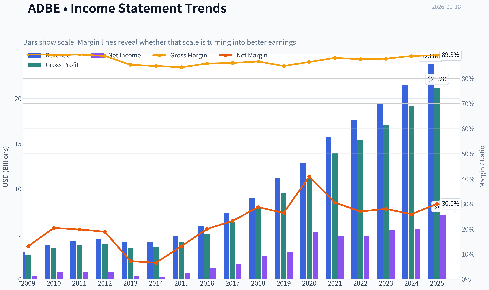

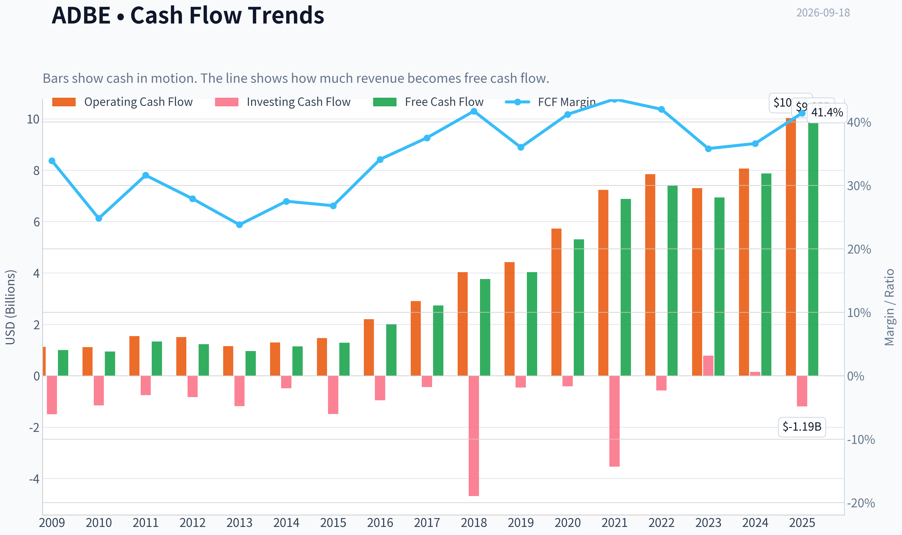

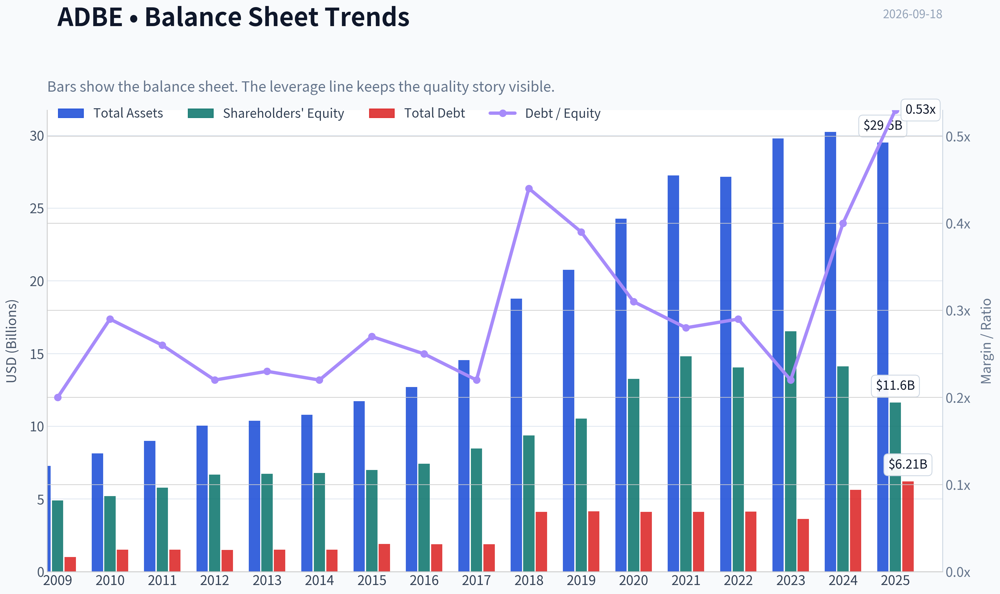

This graph tracks the profitability and return metrics (ROE, ROIC, Margins) of **ADBE** over the past decade, highlighting capital efficiency trends.

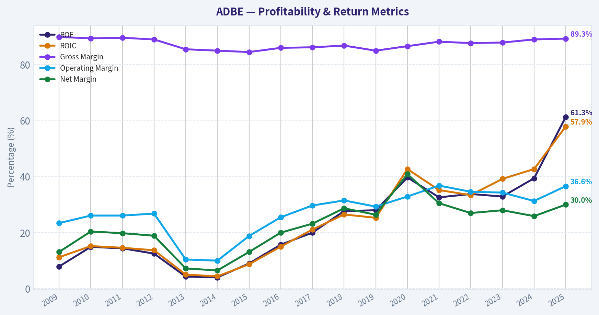

This chart illustrates the financial health of **ADBE** over the last 10 years, mapping cash equivalents and free cash flow against total obligations (Debt).

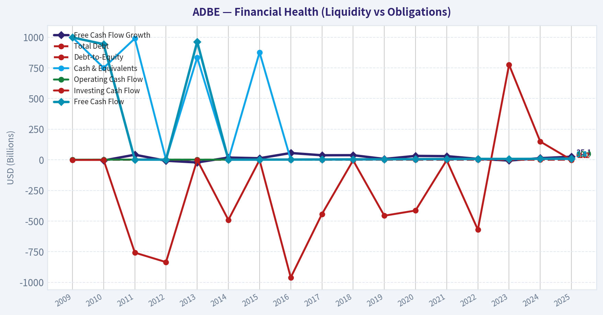

---

### Intrinsic Value Analysis (Buffett)

> *Following Warren Buffett's value investing philosophy: Circle of Competence, Economic Moat, Management Quality, and Margin of Safety.*

#### Intrinsic Value Snapshot

Price is what you pay. Intrinsic value is what the business may be worth based on the cash it can create for owners over time. We show a range, not one magic number.

- Current Price: $252.67
- Value Range (conservative to optimistic across both DCF methods): $205.84 to $1,355.72

##### Owner Earnings (Buffett Method)
- Net Income: $7,130,000,000.00
- Depreciation & Amortization: $818,000,000.00
- Capital Expenditures: $-179,000,000.00
- Working Capital Changes: $605,000,000.00
- Owner Earnings: $7,164,000,000.00

##### Intrinsic Value
###### Buffett Method
Uses owner earnings. Stricter, and usually more conservative.
- Conservative: $205.84
- Average: $471.13
- Optimistic: $1,355.72
- Discount Rate: 10.0%

###### Cash Flow Method
Uses free cash flow. Better for companies spending heavily today to grow tomorrow.
- Conservative: $330.25
- Average: $499.92
- Optimistic: $919.15
- Discount Rate: 10.0%

ANALYST STANCE: **ADVOCATE**

#### Executive Summary

Adobe is a high-quality, asset-light software compounder trading at a price that is reasonable for its franchise, though not deeply discounted. Its 89.3% gross margin, 61.3% ROE, strong free-cash-flow generation, recurring revenue model, and embedded creative workflows indicate a durable moat.

The principal risks are artificial-intelligence disruption, intensified competition from Canva, Figma, Microsoft, and other software providers, and uncertainty over how much Adobe must reinvest to defend its ecosystem. At $253 per share, the stock offers an estimated 15.8% margin of safety against the business-model-routed intrinsic value of $300.15. That is adequate for a wide-moat, high-return company, but leaves limited room for execution mistakes.

#### 1. Factor Scorecard

| Factor | Score | Evidence |
|---|---:|---|
| Circle of Competence & Business Simplicity | 4.0/5 | Adobe sells subscription software used to create, edit, manage, and measure digital content. The model is understandable, recurring, and highly scalable. AI creates uncertainty, but Adobe is integrating it rather than ignoring it. |
| Moat Test | 4.2/5 | Strong brand, ecosystem breadth, workflow integration, proprietary formats, customer familiarity, and switching costs. Gross margin of 89.3% is powerful evidence of pricing power and software economics. |
| Management & Capital Allocation | 3.5/5 | Strong cash generation and shareholder returns, but the costly Figma transaction attempt raises questions about acquisition discipline. Continued buybacks must be judged against valuation. |
| Industry Structure | 4.0/5 | Software has attractive incremental economics and recurring revenue, although competition is active and AI may reduce barriers in selected creative workflows. |

**Key Takeaways:** Adobe scores highly because its business is simple, recurring, and exceptionally profitable. The moat is substantial but must continuously evolve as AI lowers the cost of producing software and content. Management is capable, but acquisition discipline is a meaningful consideration.

#### 2. Moat Analysis

| Moat Source | Assessment | Supporting Evidence |
|---|---|---|
| Intangible assets | Strong | The Adobe, Photoshop, Illustrator, Acrobat, and Premiere brands are deeply established in professional and enterprise workflows. |
| Switching costs | Strong | Creative files, templates, learned workflows, team processes, and document archives make migration disruptive for professional users and enterprises. |
| Cost advantage | Strong | Digital distribution and subscription economics produce very high gross margins and low marginal delivery costs. |
| Network effects | Moderate | Adobe benefits from format familiarity, creator communities, plugins, educational adoption, and employer-driven skill requirements, though this is not a pure network-effect business. |
| AI defensibility | Developing | Adobe has proprietary content, workflow data, distribution, and trusted professional tools. However, generative AI could commoditize portions of image, design, and video creation. |

**Moat Quality Rating: Wide and Stable, with potential to widen - 4/5.**

Adobe's moat is based more on workflow captivity, brand, professional standards, and ecosystem integration than on a conventional social network. Acrobat and document workflows are particularly durable. Creative software remains defensible, but the moat will depend on whether Adobe can make AI a feature that strengthens customer retention rather than a technology that makes its products less necessary.

#### 3. Management Quality Assessment

Adobe's management has historically built a successful subscription transition and created a highly profitable recurring-revenue model. That transformation demonstrates strategic adaptability and strong long-term execution.

Capital allocation is more mixed. Repurchases can be attractive when the shares trade below intrinsic value, but buybacks at elevated valuations destroy value rather than create it. The attempted Figma acquisition also illustrates the risk of paying aggressively for strategic growth. Overall, management merits a **3.5/5** assessment: strong operators, but not a perfect capital-allocation record.

#### 4. Financial Summary

| Metric | Latest Value |
|---|---:|
| Share price | $253 |
| Market capitalization | $100.44 billion |
| P/E ratio | 13.98 |
| Revenue growth, year over year | 10.5% |
| Gross margin | 89.3% |
| ROE | 61.3% |
| Free-cash-flow yield | 9.8% |
| Estimated annual free cash flow | $9.84 billion |
| Current ratio | 1.00 |
| Headline intrinsic value | $300.15 |
| Margin of safety versus price | 15.8% |
| Reverse-DCF implied annual growth | Approximately 5.3% for 10 years |

**Key Takeaways:** Adobe combines unusually high gross margins with double-digit revenue growth and a substantial free-cash-flow yield. The 61.3% ROE reflects excellent economics, although asset-light companies can produce very high ROE because they require relatively little tangible capital. The market price implies only about 5.3% annual growth, below Adobe's recent five-year revenue growth of approximately 8.2%.

#### 5. Owner Earnings Calculation

The available free-cash-flow yield implies:

| Calculation | Amount |
|---|---:|
| Market capitalization | $100.44 billion |
| Free-cash-flow yield | 9.8% |
| Estimated normalized owner earnings proxy | $9.84 billion |
| Estimated diluted shares, using price and market capitalization | 397 million |
| Owner earnings per share proxy | $24.79 |

Adobe's reported free cash flow is used as a practical owner-earnings proxy because the business is asset-light and maintenance capital expenditure is relatively modest. The key quality test is whether cash generation remains at least comparable to accounting earnings; Adobe's high-margin subscription model supports that conclusion.

#### 6. Three-Scenario DCF Valuation

Using estimated owner earnings of $24.79 per share and a 10% discount rate:

| Scenario | Assumption | Estimated Value per Share |
|---|---|---:|
| A. No growth | Owner earnings remain constant indefinitely | $247.90 |
| B. GDP growth | 3% annual growth in perpetuity | $364.10 |
| C. Historical-growth sensitivity | Approximately 6.15% annual growth for 10 years, then terminal value | Approximately $672 |
| Research-pack headline value | Weighted business-model-routed valuation | $300.15 |

**Key Takeaways:** The no-growth valuation is close to the current share price, providing a conservative downside reference. A modest 3% perpetual-growth assumption produces meaningful upside, while the historical-growth sensitivity is much higher and should not be treated as a base case. The $300.15 headline value is appropriately more conservative than the optimistic growth case.

#### 7. Margin of Safety Analysis

| Valuation Reference | Value per Share | Upside/(Downside) vs. $253 |
|---|---:|---:|
| No-growth DCF | $247.90 | -2.0% |
| 3% perpetual-growth DCF | $364.10 | +43.9% |
| Historical-growth sensitivity | ~$672 | +165.6% |
| Damodaran FCFF model | $219.76 | -13.1% |
| Owner-earnings model | $471.13 | +86.2% |
| FCF model | $499.92 | +97.6% |
| Weighted headline intrinsic value | $300.15 | +18.6% |

**Key Takeaways:** The valuation range is wide, reflecting uncertainty over sustainable growth and the correct treatment of Adobe's future AI investment. The conservative FCFF model indicates that the shares are not obviously cheap, while the owner-earnings and FCF models show substantial upside if Adobe maintains its current economics. The 15.8% headline margin of safety is appropriate for a high-quality compounder, but not sufficient for a low-quality or highly cyclical business.

#### 8. Reverse-DCF Assessment

At $253 per share, the market appears to require approximately 5.3% annual growth over the next decade. Adobe's recent growth rates are higher:

- Three-year growth: approximately 14.0%
- Five-year growth: approximately 8.2%
- Current year-over-year growth: approximately 10.5%

This suggests the stock price does not require heroic assumptions. The market is pricing in a meaningful slowdown, but not a collapse. If AI strengthens Adobe's products and retention, the implied growth rate could prove conservative. If AI commoditizes core creative functions, the current valuation may be fair rather than undervalued.

#### 9. Final Buffett Scorecard

| Criterion | Weight | Score | Weighted Contribution |
|---|---:|---:|---:|
| Moat width and durability | 25% | 4.2 | 1.05 |
| Valuation and margin of safety | 20% | 3.5 | 0.70 |
| Capital returns versus WACC | 15% | 4.5 | 0.68 |
| Business understanding and predictability | 12% | 4.0 | 0.48 |
| Management quality and capital allocation | 12% | 3.5 | 0.42 |
| Reinvestment runway | 8% | 4.0 | 0.32 |
| Balance-sheet strength | 4% | 4.0 | 0.16 |
| Industry structure | 4% | 4.0 | 0.16 |
| **Total** | **100%** |  | **3.97/5.00** |

**Key Takeaways:** Adobe's strongest attributes are capital efficiency, recurring revenue, gross margins, and reinvestment potential. Valuation is the least decisive part of the thesis because the models produce a broad range of outcomes. The overall score places Adobe near the top of the "good business at an adequate price" range.

#### Gate 5: Quality and Solvency

**Gate 5 hard floor: Not tripped.**

Adobe is profitable, strongly cash-generative, and not displaying the combination of deteriorating fundamentals and distress-level solvency that would justify an automatic hard avoid. Its current ratio near 1.0 should not be overinterpreted for an asset-light subscription business with deferred revenue and efficient working-capital dynamics.

#### Investment Stance

**ADVOCATE - Medium conviction.**

Adobe is a high-quality compounder that can reasonably be purchased around $253, particularly by investors with a long holding period and tolerance for AI-related uncertainty. The stock is not a classic deep-value bargain: the conservative valuation case offers little downside protection, and the Damodaran FCFF estimate is below the current price.

The investment case improves materially if Adobe sustains high-single-digit growth, successfully monetizes generative AI, and preserves its workflow ecosystem. A more attractive purchase zone would be approximately **$220 to $235**, while sustained evidence of accelerating AI-driven growth could justify paying above the current price.
#### Valuation Bridge

This bridge places the current market price beside each intrinsic value lens so readers can see whether upside depends on one method or shows up across several methods.

| Scenario | Intrinsic Value / Share |
| --- | ---: |
| Buffett Method | $471.13 |
| Cash Flow Method | $499.92 |
| Damodaran Method | $219.76 |
| Current Price | $252.67 |

#### Key Takeaways

If one method is far above the others, the upside case depends on a specific modelling assumption. When several methods cluster together, the valuation story is more robust.

#### Valuation Visuals

This comparison chart from *Latest Earnings Snapshot* stacks current figures against historical benchmarks for **ADBE**, making it easy to see where the company trades relative to its own averages.

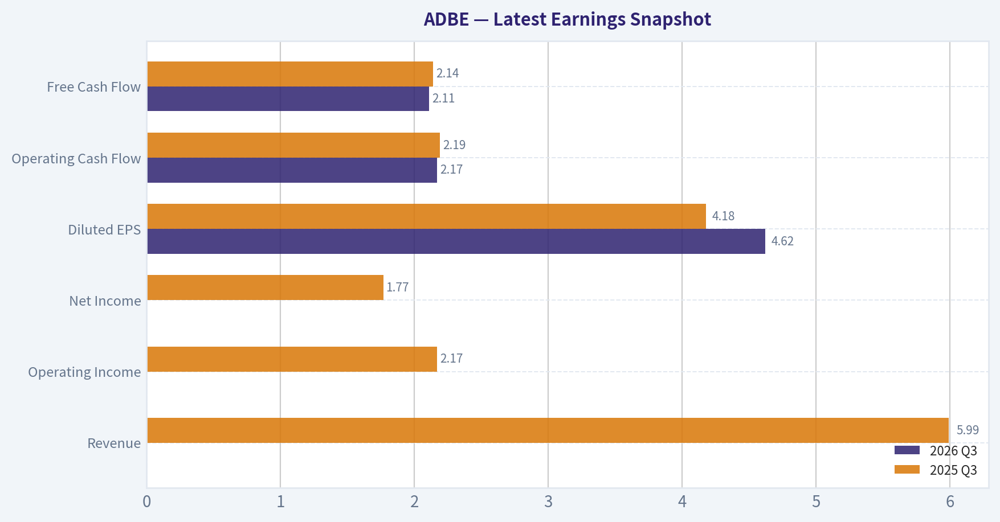

This comparison chart from *Current Metrics Versus Ten-Year Averages* stacks current figures against historical benchmarks for **ADBE**, making it easy to see where the company trades relative to its own averages.

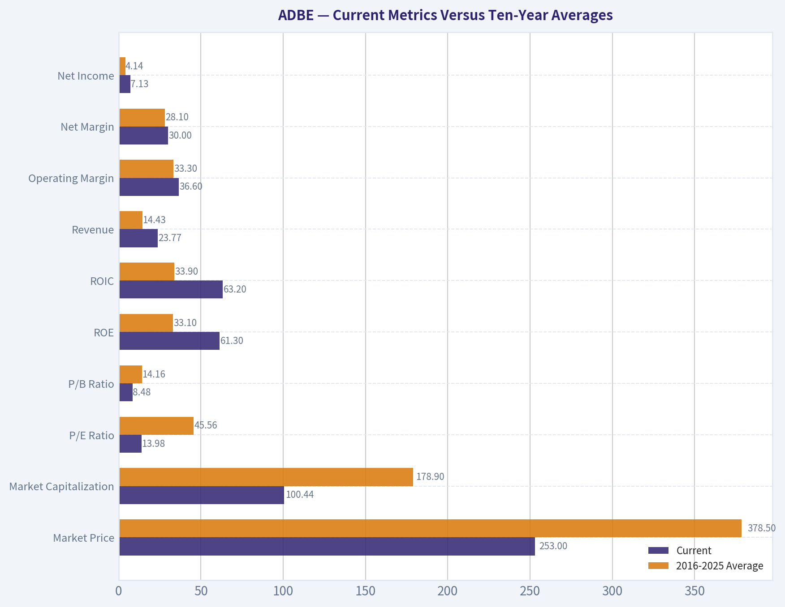

This comparison chart from *Buffett-Style Owner-Earnings DCF* stacks current figures against historical benchmarks for **ADBE**, making it easy to see where the company trades relative to its own averages.

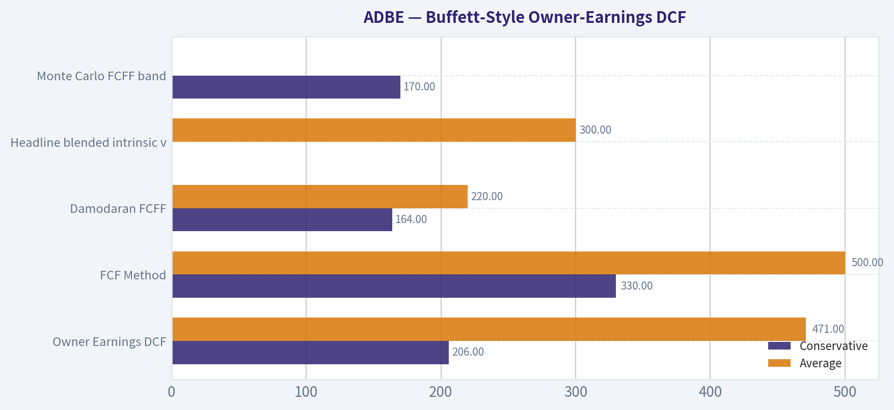

This comparison chart from *Financial Summary* stacks current figures against historical benchmarks for **ADBE**, making it easy to see where the company trades relative to its own averages.

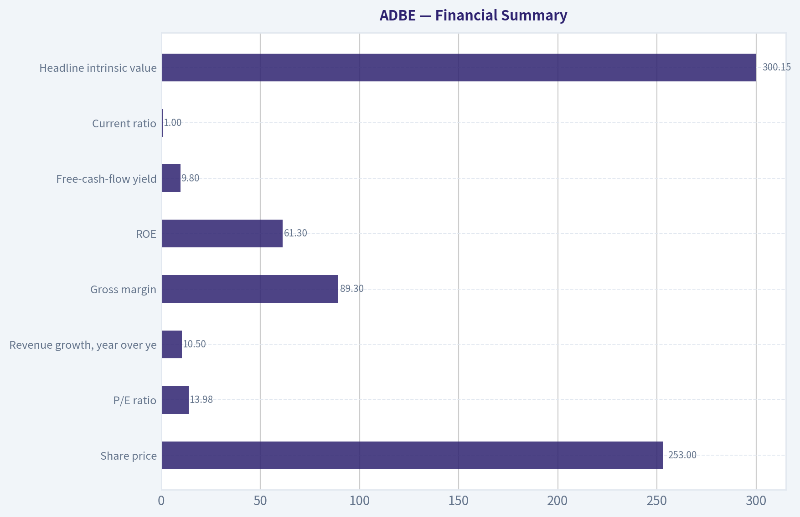

This comparison chart from *Owner Earnings Calculation* stacks current figures against historical benchmarks for **ADBE**, making it easy to see where the company trades relative to its own averages.

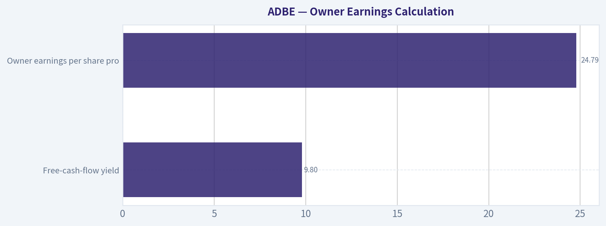

The following chart maps the **ADBE** Owner Earnings DCF valuation scenarios (Conservative, Average, Optimistic) to visually represent the margin of safety based on intrinsic value calculations.

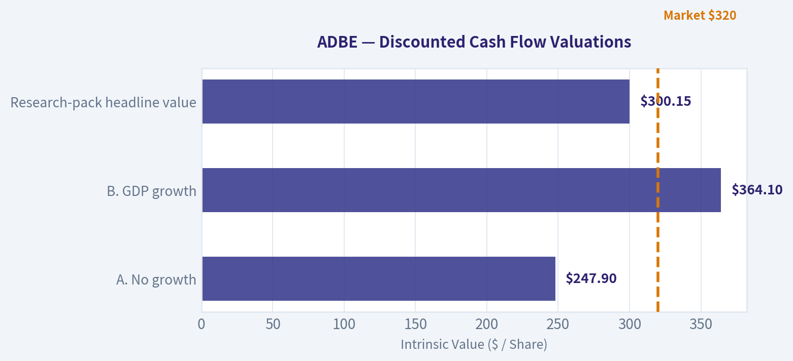

---

### Trend & Growth Analysis (Lynch/Druckenmiller/Fisher)

> *Following Peter Lynch's GARP, Stanley Druckenmiller's macro-aware approach, and Philip Fisher's scuttlebutt methodology.*

ANALYST STANCE: **WATCH**

#### 1. Lynch Classification

**Stalwart, with a potential AI/product-cycle reacceleration catalyst.**

Adobe is not currently a classic Lynch fast grower: reported revenue growth is **10.5% year over year**, below the 15-25%+ range normally required for primary growth-stock focus. However, its strong margins, cash generation, brand, and embedded position in creative and document workflows create a potentially attractive "quality at a reasonable price" setup if AI monetization reaccelerates growth.

#### 2. The Story in Three Bullets

- Adobe owns deeply embedded creative, digital-document, and marketing software used by professionals and enterprises.
- Generative AI can expand Adobe's total market by enabling more people to create, edit, automate, and personalize digital content.
- The market appears to be pricing Adobe for modest growth: the current price implies approximately **5.3% annual growth over the next decade**, versus historical three-year growth of **14.0%**.

#### 3. TAM and Runway

Adobe's opportunity spans creative software, digital documents, digital experience, workflow automation, and AI-assisted content creation. The runway is strategically large, but the 10x test cannot be validated precisely from the supplied data because current revenue and segment TAM figures were not provided.

| TAM question | Assessment |
|---|---|
| Core market growth | Moderate, with potential expansion from generative AI |
| Addressable markets | Creative, documents, marketing, workflow, and AI |
| Current competitive position | Category leader with strong distribution and switching costs |
| 10x revenue test | Potentially possible across multiple markets, but unproven |
| Main constraint | Adobe must convert AI adoption into incremental paid revenue rather than merely defend existing products |

**Key Takeaways:** Adobe has a substantial and expanding opportunity set, particularly if AI increases software usage and customer willingness to pay. However, the current evidence supports a durable platform more clearly than it supports a 10x growth case.

#### 4. Revenue Growth Trend

| Indicator | Result | Interpretation |
|---|---:|---|
| Latest revenue growth | 10.5% YoY | Stalwart-level growth |
| Trailing three-year growth reference | 14.0% | Stronger than current growth |
| Trailing five-year growth reference | 8.2% | Indicates historical variability and some deceleration |
| Current trend classification | Stable-to-decelerating | No confirmed acceleration yet |

**Key Takeaways:** Adobe is growing, but the available data does not show a clear acceleration inflection. The key question is whether AI-powered products can lift growth back toward the mid-teens or higher.

#### 5. Unit Economics and Financial Quality

Detailed CAC, LTV, NRR, and subscription cohort data were not supplied, so SaaS unit economics cannot be calculated reliably.

| Metric | Available data | Assessment |
|---|---:|---|
| Gross margin | 89.3% | Exceptional software economics |
| FCF yield | 9.8% | Strong cash-generation valuation support |
| ROE | 61.3% | Excellent capital efficiency |
| Current ratio | 1.00 | Adequate but not a major liquidity cushion |
| Rule of 40 | Not calculable | FCF margin was not provided |
| NRR / LTV-to-CAC | Not available | Requires company disclosure |

**Key Takeaways:** Adobe's gross margin, return on equity, and free-cash-flow yield indicate a highly attractive economic model. The missing subscription metrics are important because they would reveal whether customer expansion and retention remain strong.

#### 6. Inflection-Point Assessment

| Potential inflection | Current assessment | Evidence required |
|---|---|---|
| AI product cycle | Possible, not confirmed | Accelerating AI-related revenue and paid adoption |
| TAM expansion | Positive | Broader creator and enterprise usage |
| Margin inflection | Already strong | Sustained margins while funding AI investment |
| Market-share inflection | Unclear | Evidence of share gains versus Microsoft, Canva, Figma, and newer AI tools |
| Earnings revision inflection | Not yet visible | Repeated upward guidance or consensus upgrades |

**Key Takeaways:** Adobe has credible catalysts but no confirmed inflection point in the supplied data. The stock becomes more compelling if AI begins producing measurable incremental revenue rather than only improving product defensibility.

#### 7. Macro Setup

The macro backdrop is **mixed**. Adobe benefits from secular trends in AI, cloud software, digital content, and workflow automation. Its valuation is also helped by a lower implied growth expectation. Conversely, software remains sensitive to interest rates, enterprise IT budgets, competition, and rapid changes in AI product economics.

**Druckenmiller assessment:** favorable secular wind, but the cyclical and rate-sensitive backdrop is not sufficient by itself to justify a concentrated position without earnings acceleration.

#### 8. Fisher 15-Point Score

This is a preliminary score based on the supplied financial profile rather than direct scuttlebutt interviews.

| Fisher criterion group | Score |
|---|---:|
| Market potential and long-range outlook | 4/5 |
| Product innovation and R&D | 4/5 |
| Sales organization and distribution | 5/5 |
| Profit margins and margin durability | 5/5 |
| Labor, executive depth, and organizational quality | 4/5 |
| Cost control, accounting, and capital efficiency | 4/5 |
| Competitive advantages and switching costs | 5/5 |
| Dilution, candor, and management integrity | 3/5 |
| **Preliminary total** | **34/40 equivalent, or approximately 64/75** |

**Key Takeaways:** Adobe scores well on market position, distribution, margins, and competitive advantages. The score is reduced mainly because management quality, dilution, customer retention, and AI execution require more direct evidence.

#### 9. Valuation Analysis

| Valuation measure | Result | Interpretation |
|---|---:|---|
| Share price | $253 | Supplied current price |
| Market capitalization | $100.44B | Large-cap platform |
| P/E | 13.98x | Low for a high-margin software leader |
| PEG using 10.5% revenue growth as proxy | 1.33x | Fair-to-reasonable, not clearly cheap by Lynch's growth test |
| FCF yield | 9.8% | Attractive cash-flow valuation |
| Headline intrinsic value | $300.15 | Approximately 15.8% above current price |
| Reverse-DCF implied growth | 5.3% for 10 years | Conservative market expectation |

**Key Takeaways:** Adobe appears inexpensive on earnings and free cash flow, with an estimated 15.8% margin of safety. The PEG is only approximate because revenue growth was used instead of earnings growth; valuation is attractive mainly if Adobe can stabilize or reaccelerate growth.

| Scenario | Operating assumption | Valuation implication |
|---|---|---|
| Bear | Growth remains near high single digits and AI monetization disappoints | Current valuation may be justified; limited upside |
| Base | Growth stabilizes around low-to-mid teens with durable margins | Re-rating toward approximately $300 is plausible |
| Bull | AI drives sustained mid-to-high-teens growth and stronger estimates | Material upside beyond intrinsic-value headline is possible |

**Key Takeaways:** The bear case is not primarily a collapse scenario; it is a prolonged period of mediocre growth. The bull case requires proof that AI expands Adobe's revenue growth rather than simply protecting its existing franchise.

#### 10. Growth Investor Scorecard

| Criterion | Weight | Score |
|---|---:|---:|
| Lynch story | 10% | 3.8/5 |
| TAM and runway | 20% | 4.0/5 |
| Revenue growth | 20% | 3.0/5 |
| Unit economics | 15% | 4.2/5 |
| Competitive position | 10% | 4.5/5 |
| Management quality | 10% | 3.8/5 |
| Macro setup | 5% | 3.2/5 |
| Profitability path | 5% | 4.7/5 |
| Valuation | 5% | 4.2/5 |
| **Weighted score** | **100%** | **3.8/5** |

**Key Takeaways:** Adobe earns a good setup score because valuation and business quality are strong. It does not reach high-conviction advocate status because current revenue growth is only 10.5% and the AI acceleration thesis remains unproven.

#### 11. Position Size Stance

**Small-to-moderate position, approximately 1-3% of a diversified growth portfolio.**

A larger position would require evidence of:

- Revenue growth returning to the mid-teens or better.
- Meaningful paid adoption of AI products.
- Stable or improving customer retention and cross-sell metrics.
- Upward revisions to earnings and free-cash-flow estimates.

This is better viewed as a **quality compounder with a potential reacceleration option** than as a proven ten-bagger candidate today.

#### 12. Key Risks and Catalysts

| Catalysts | Risks |
|---|---|
| AI features drive new paid seats or usage revenue | AI commoditizes parts of Adobe's product suite |
| Revenue growth reaccelerates above 15% | Continued growth deceleration |
| Successful expansion into enterprise workflow and marketing | Competition from Microsoft, Canva, Figma, and AI-native tools |
| Operating leverage and buybacks support EPS growth | Enterprise budget pressure or weaker renewals |
| Market re-rates the stock toward intrinsic value | Low valuation reflects a structural disruption risk |

**Key Takeaways:** The principal catalyst is measurable AI monetization combined with renewed growth. The principal risk is that Adobe remains highly profitable but becomes a slower-growing incumbent whose low valuation is deserved.

#### Final Assessment

Adobe is a **WATCH**, not an avoid. It combines exceptional gross margins, high ROE, strong free-cash-flow generation, category leadership, and a valuation that appears to discount modest growth. The missing ingredient is a confirmed growth inflection: until AI produces visible acceleration in revenue and earnings, Adobe is a compelling value-oriented software compounder but not yet a clear ten-bagger setup.

---

### Market Technical Analysis

ANALYST STANCE: **WATCH**

#### ADBE technical analysis - as of September 17, 2026

The latest available trading session is September 17, because September 18 is not marked as a trading day in the retrieved data. ADBE closed at **$252.67**, after trading between **$245.40 and $252.84**. The stock remains in a damaged longer-term trend: it has declined from approximately **$367.46 one year earlier to $252.67**, a fall of roughly **31%**.

The near-term picture is also fragile. ADBE rallied from the June low near $193 to a late-August high near $294, but that recovery has since reversed sharply. The decline from $292.79 on August 31 to $248.83 on September 10 was particularly forceful, accompanied by elevated volume on September 10 and September 11. A bounce to $265.60 on September 14 failed to hold, and the subsequent closes near $250-$253 suggest that sellers remain active on rebounds.

#### Trend structure

The moving averages provide a clear hierarchy of resistance:

- The **10-day EMA is $259.54**, and price is below it by about **2.6%**. This indicates that short-term momentum has turned lower.
- The **50-day SMA is $255.53**, only slightly above the latest close. A sustained move back above this average would be an initial improvement, but the narrow gap means ADBE could easily reclaim or lose it in ordinary daily volatility.
- The **200-day SMA is $265.36**, and it is declining gradually. Price is about **4.8% below** this long-term benchmark, confirming that the broader trend remains bearish.
- The averages are arranged bearishly: the 10-day EMA is above the 50-day SMA, but both are below the 200-day SMA. This can occur during a rebound within a larger downtrend; it is not yet evidence of a durable trend reversal.

The most important near-term test is therefore the **$255-$260 zone**, where the 50-day SMA and 10-day EMA cluster. A close above that area, followed by successful retests, would improve the short-term setup. The more consequential longer-term barrier is the **$265-$267 region**, where the 200-day SMA and recent failed rebound area converge.

#### Momentum and MACD

MACD has deteriorated substantially. It fell from **12.01 on August 31** to **6.55 on September 8**, then crossed toward negative territory and reached **-1.72 on September 17**. This is a meaningful loss of upside momentum rather than a minor fluctuation.

The sequence suggests that the August rally lost force before the September decline accelerated. MACD alone does not identify an exact bottom, but the negative reading warns that any rebound should initially be treated as corrective unless the indicator turns upward and crosses back above its signal line. Because the latest MACD decline occurred alongside a rejection from $265.60, the momentum evidence currently favors caution.

#### RSI interpretation

RSI stands at **44.29**, down from **69.32 on August 31**. This shows a substantial cooling of momentum, but it does not yet indicate an extreme oversold condition.

The reading is bearish-neutral:

- It is below the 50 midpoint, showing that recent losses outweigh recent gains.
- It remains above the traditional oversold threshold of 30.
- Therefore, the stock has room for further downside before RSI reaches a level commonly associated with capitulation or a high-probability technical rebound.

A bullish divergence could develop if price makes a lower low while RSI holds above its September low near 40, but no strong divergence is confirmed by the current data.

#### Bollinger Bands and price location

The latest Bollinger Band readings are approximately:

- **Upper band: $299.39**
- **Lower band: $240.86**
- Implied middle band: roughly **$270.12**

At $252.67, ADBE is well below the middle band but still above the lower band. This positioning is bearish, yet not an outright lower-band breakdown. The lower band near **$241** is an important technical reference because it is close to the September 10 low of $248.83 and the recent trading range lows.

The bands have widened materially from late August into September, reflecting the increase in volatility during the selloff. A move toward the lower band would not automatically signal a buy opportunity: in a persistent downtrend, price can remain near or ride the lower band. A more constructive setup would require price to stabilize above roughly $245-$241 and then reclaim the middle band near $270.

#### Volatility and risk management

ATR is **$10.47**, meaning the recent average daily trading range is approximately **4.1% of the share price**. This is substantial volatility for a large-cap software stock and has important implications for stops and position sizing.

A stop placed only a few dollars below the latest close could be triggered by normal price movement rather than a decisive trend break. For short-term traders, the ATR suggests using smaller position sizes and allowing more room for price fluctuations. Conversely, a break below the $241 lower-band area would represent a more meaningful deterioration than an ordinary intraday move, particularly if accompanied by heavy volume.

#### Trading scenarios

The technical evidence favors a **watchful, confirmation-based approach** rather than aggressive bottom-fishing.

**Bullish recovery scenario:** ADBE first reclaims $255-$260, then holds that area on a pullback. A move through $265-$267 would be more significant because it would recover the 200-day SMA and challenge the recent failed rebound zone. For confirmation, traders would ideally want RSI to recover above 50 and MACD to turn upward rather than merely seeing a one-day price spike.

**Range stabilization scenario:** Price may continue oscillating between approximately $241 and $260 while momentum resets. RSI near the mid-40s is compatible with consolidation, but the declining MACD and sub-200-day-SMA price structure mean this would currently be a neutral-to-bearish range, not a confirmed accumulation pattern.

**Bearish continuation scenario:** Failure near $255-$260 followed by a break under $245-$241 would expose the stock to renewed selling pressure. A close beneath the lower Bollinger Band, especially with expanding volume, would signal that volatility is accelerating and that the June lows could become relevant again.

#### Selected indicators

The eight selected indicators are complementary: three moving averages define trend across different time horizons, MACD measures directional momentum, RSI measures momentum exhaustion, Bollinger Bands frame price location and volatility, and ATR supports risk management.

| Indicator | Latest reading | Signal | Why it matters for ADBE |
|---|---:|---|---|
| close_10_ema | $259.54 | Bearish short term | Price is below the responsive average, showing that the September rebound has weakened. |
| close_50_sma | $255.53 | Slightly bearish | The latest close is just below medium-term trend support; reclaiming it would be an initial recovery signal. |
| close_200_sma | $265.36 | Bearish long term | Price remains below a declining long-term benchmark, so the broader trend has not reversed. |
| macd | -1.72 | Bearish momentum | MACD fell sharply from positive territory into negative territory, confirming loss of upside momentum. |
| rsi | 44.29 | Neutral-to-bearish | Momentum is weak but not oversold; the indicator does not yet provide a strong reversal signal. |
| boll_ub | $299.39 | Overhead resistance | The upper band is far above price and aligns broadly with the recent August peak region. |
| boll_lb | $240.86 | Key downside reference | A break below this area would indicate a more decisive deterioration; stabilization above it could support a range trade. |
| atr | $10.47 | High volatility | Daily price movement is large, requiring disciplined position sizing and volatility-aware stops. |

Key Takeaways: ADBE is below its 10-day EMA, 50-day SMA, and 200-day SMA, while MACD has turned negative, so the dominant technical bias remains bearish. RSI is weak but not oversold, and price is above the lower Bollinger Band, meaning a rebound is possible but not yet confirmed. The most important levels are $255-$260 on the upside and $241-$245 on the downside; traders should wait for a decisive break and confirmation rather than assume the recent decline has ended.

---

### Options Market Analysis

> *Reading options flow - put/call ratios, IV skew, and unusual activity - to gauge institutional positioning and event-driven risk.*

#### ADBE Options Market Report

**As of September 18, 2026.** The available near-term options data is extremely thin in open interest and does not include strike-level details or the current stock price. Accordingly, directional confidence is low, especially because the nearest expiration is the current trading day.

#### Put/Call Ratio Analysis

| Expiration | Call OI | Put OI | Put/Call OI Ratio | Call Volume | Put Volume | Put/Call Volume Ratio |
|---|---:|---:|---:|---:|---:|---:|
| Sep. 18, 2026 | 62 | 3 | 0.05 | 8,829 | 17,642 | 2.00 |
| Sep. 25, 2026 | 0 | 0 | N/A | 3,527 | 1,688 | 0.48 |
| Oct. 2, 2026 | 0 | 0 | N/A | 643 | 550 | 0.86 |
| **Near-term total** | **62** | **3** | **0.05** | **12,999** | **19,880** | **1.53** |

**Key Takeaways:** The aggregate put/call open-interest ratio of 0.05 is far below the approximately 0.7 neutral baseline and appears superficially bullish. However, almost all open interest is concentrated in the expiring September 18 chain, making this ratio unreliable as a durable positioning signal. Trading volume is more put-heavy, with a 1.53 ratio, indicating near-term hedging or bearish speculation.

#### Implied Volatility Assessment

| Expiration | Call ATM IV | Put ATM IV | IV Level Assessment |
|---|---:|---:|---|
| Sep. 18, 2026 | 6.9% | 5.7% | Very low; call IV modestly above put IV |
| Sep. 25, 2026 | 2.3% | 1.7% | Extremely low |
| Oct. 2, 2026 | 2.2% | 0.9% | Extremely low |
| **Near-term read** | - | - | Low implied-volatility environment |

**Key Takeaways:** Near-term ATM implied volatility is unusually low, with no evidence of significant event premium in the supplied data. Calls carry slightly higher ATM IV than puts, suggesting a mild call-side volatility preference rather than downside fear. Reliable out-of-the-money skew data was not provided, so a definitive put-skew or call-skew conclusion is not possible.

The low IV readings also do not indicate that the market is aggressively pricing a known catalyst such as earnings or a major product event. No catalyst calendar was supplied, so this should not be interpreted as proof that no event risk exists.

#### Unusual Options Activity

| Finding | Result |
|---|---|
| Contracts with volume greater than 5x open interest | None identified |
| Fresh directional institutional-style activity | No confirmed examples |
| Retail speculation versus smart-money flow | Cannot distinguish from supplied data |

**Key Takeaways:** No contract met the tool's threshold for unusual activity. Therefore, there is no clear evidence of a fresh, high-conviction call purchase, put hedge, or directional sweep. The elevated put volume is notable, but without contract-level volume, price, and execution information, it cannot be classified confidently as institutional positioning.

#### Open Interest Concentration and Gamma Levels

| Metric | Observation |
|---|---|
| Highest total call OI | 62 contracts across the reported near-term chains |
| Highest total put OI | 3 contracts |
| Strike-level concentration | Not available |
| Expiration concentration | Heavily concentrated in Sep. 18, 2026 |
| Confirmed gamma walls or pinning levels | Cannot be determined |

**Key Takeaways:** Open interest is concentrated almost entirely in the current-day expiration, but the data does not identify the individual strikes. As a result, specific gravitational levels, max-pain estimates, and gamma walls cannot be calculated. The very small total OI also means any apparent pinning effect is likely limited and fragile.

#### Overall Options Sentiment

**Overall signal: NEUTRAL, with a bearish near-term tilt.**

The primary reason for the neutral classification is the conflict between the data categories:

- The **0.05 put/call OI ratio** is strongly call-heavy, but it is based on only 65 contracts and is dominated by the expiring chain.
- The **1.53 put/call volume ratio** shows materially heavier put trading and is the more cautious current-flow signal.
- **No unusual activity** confirms a high-conviction institutional directional bet.
- **Very low IV** suggests limited priced-in event risk and low conviction.
- The options market is **illiquid in open interest**, so the signal should be given low weight.

In practical terms, ADBE options flow is not providing a strong bullish or bearish forecast. If forced to identify the immediate directional pressure, it leans modestly bearish because of the put-heavy volume, but the evidence is insufficient for a BEARISH classification.

#### Data Quality and Confidence

The reported chain is unusually sparse: 62 call contracts and 3 put contracts of open interest across the near-term expirations. The current-day expiration likely contains trading activity that will not translate into persistent positioning after expiration. Confidence in this options-based signal is therefore **low**.

| Category | Assessment |
|---|---|
| Put/Call Ratio | OI ratio strongly bullish-looking, volume ratio bearish-leaning |
| IV Level | Very low |
| Skew Direction | Mild call-side bias at ATM; OTM skew unavailable |
| Unusual Activity | None detected |
| Overall Signal | **NEUTRAL**, with a bearish near-term tilt |

**Key Takeaways:** ADBE's options market does not show a high-conviction directional signal. Put-heavy volume creates a cautious short-term tone, but the exceptionally low open interest, lack of unusual contracts, and absent strike-level data make the overall read neutral with low confidence.

---

## Research Team Commentary

> *The Research Manager synthesizes the Bull vs Bear debate into action-free commentary. This is a pre-risk view, not the final stance.*

Core Takeaway: Adobe is a genuinely exceptional business facing a legitimate technological transition, but the valuation now compensates investors for much of that uncertainty. At $253, roughly 14 times earnings, the market appears to require only about 5.3% long-term growth. Adobe should be able to exceed that hurdle if it retains control of professional creative and document workflows, even without returning to its historical growth rate or premium multiple. I would accumulate gradually rather than wait for every AI question to be resolved.

The strongest bull argument is not merely that Adobe looks cheap relative to its history. It is that a deeply embedded, recurring-revenue franchise with an 89.3% gross margin and 63.2% ROIC is being valued like a mediocre mature software company. Adobe's moat consists of professional workflows, file compatibility, training, plug-ins, enterprise integrations, governance, and customer trust-not just isolated editing features. Generative AI can reproduce individual functions much more easily than it can reproduce this entire ecosystem.

AI may also increase the amount of content produced, creating more demand for editing, brand consistency, provenance, approvals, and distribution. Adobe does not have to own every foundation model; it must remain the environment in which commercially important content is refined and managed. With current growth around 10.5%, against an implied long-term hurdle near 5.3%, expectations appear sufficiently restrained.

The bear's strongest point is that the reverse DCF is not fully auditable from the supplied information. We do not know the exact starting free cash flow, discount rate, terminal assumptions, stock-based compensation treatment, or cost of providing generative AI. Revenue growth above 5.3% would not necessarily create value if compute costs, R&D, bundling, or pricing pressure cause free cash flow per share to grow more slowly.

The bear is also right that Adobe does not have to lose its installed base for its economics to deteriorate. Competitors can capture new users, initial content generation, incremental budgets, and browser-based collaboration while customers continue using some Adobe products. Switching costs protect the core, but they do not automatically guarantee that Adobe controls the industry's next growth layer. Historical ROIC also does not prove that incremental spending on AI will earn similarly high returns.

Those concerns prevent me from treating Adobe as a risk-free bargain, but they do not justify avoidance. There is no evidence here of financial distress, collapsing margins, widespread customer loss, or growth falling below the rate embedded in the price. The bear case is currently driven more by plausible future erosion than by confirmed operating damage. For a company of this quality, a roughly 10-15% discount to a reasonable base-case value can be sufficient; demanding a distressed-company discount would likely cause an investor to miss the opportunity if the moat remains mostly intact.

The bull's $285-$310 base-case range should still be treated as indicative rather than precise. Its midpoint implies approximately 15% upside, while continued intrinsic-value growth and repurchases could add to long-term returns. At the current price, the earnings yield is about 7.2%. If normalized earnings per share can compound in the mid-to-high single digits, the prospective long-term return is attractive without requiring substantial multiple expansion. Conversely, sustained free-cash-flow-per-share growth below roughly 5%, accompanied by margin pressure, would make the apparent cheapness much less compelling.

Management deserves credit for Adobe's successful transition to subscriptions, but the AI transition is different and arguably harder. The attempted Figma acquisition suggests management understood the threat from collaborative, browser-based workflows, although it also raises questions about internal innovation and acquisition discipline. Capital allocation should now favor internal product leadership and repurchases at attractive prices rather than expensive defensive acquisitions.

The weak chart affects entry method, not the ten-year business appraisal. Adobe remains below its 10-day EMA and declining 200-day average, while put volume is elevated. However, the options evidence is small and inconclusive, and the stock is only modestly below those averages rather than presenting a clear capitulation setup. This is therefore not the same tactical rebound opportunity as a deeply oversold stock far below support. The appropriate response is gradual accumulation, not an immediate full-sized position based on expectations of a short-term bounce.

That distinction incorporates the lesson from prior calls. We should not allow long-term disruption narratives to overwhelm intact fundamentals and a compressed valuation, but we also should not mistake cheapness for a near-term catalyst. Strategically, Adobe is attractive. Tactically, the stock may remain volatile until operating results or price action restore confidence.

Over the next one to four quarters, I would monitor Digital Media and net-new ARR growth, Creative Cloud and Document Cloud retention, pricing, and evidence that younger or AI-native users are entering rather than bypassing Adobe's ecosystem. Firefly and other AI products must generate incremental revenue, usage, or retention benefits that exceed their compute and development costs. Stable operating margins and high-single-digit free-cash-flow-per-share growth would materially strengthen the thesis; persistent margin compression or growth approaching the implied 5.3% hurdle would weaken it.

I would also watch net share-count reduction after stock-based compensation, acquisition discipline, management's forward guidance, and signs of share loss in professional workflows-not merely the popularity of casual AI tools. A sustained decline in professional retention, pricing power, or incremental ROIC would be more important than headline excitement around a competing application.

Overall, the market appears to be treating AI-driven feature commoditization as if it will necessarily displace Adobe's broader professional workflow. That outcome is possible, but it has not been demonstrated in the supplied operating evidence. At approximately 14 times earnings, investors are being paid to accept that uncertainty. The sensible approach is to establish a partial position and add as AI monetization, retention, and free-cash-flow durability are confirmed.

ADVOCATE

---

## Value Investing Team Commentary

> *The Investor translates the research view into an investment thesis before risk review. This is still not the final stance.*

### Adobe: Exceptional Economics, Real Transition Risk, Attractive Expectations

Adobe appears to be a wonderful business offered at a price that assumes it will become merely average. At approximately **$253 and 14 times earnings**, the valuation provides a reasonable entry point for a long-term owner, although uncertainty around AI economics argues for staged accumulation rather than immediate full sizing.

### Business quality remains exceptional

Adobe's reported economics are difficult to dismiss:

- **89.3% gross margin**
- **63.2% ROIC**
- **61.3% ROE**
- Recurring, deeply embedded software workflows
- Category leadership across creative, document, and marketing applications

ROE may be amplified by repurchases and the company's capital structure, and the exact ROIC calculation should be verified. Nevertheless, the combination of extraordinary gross margins, recurring revenue, and historically strong cash generation clearly identifies Adobe as a high-quality, asset-light franchise.

Its moat is broader than any individual editing feature. It includes professional standards, file formats, user training, plug-ins, enterprise integrations, approval systems, brand governance, and trust around commercially sensitive content. A competitor can reproduce a feature without reproducing the complete workflow.

That distinction is central to the investment case.

### AI is both the risk and the opportunity

The bearish AI argument should not be dismissed. Adobe can retain much of its installed base while still losing:

- New and casual creators
- Entry-level design activity
- Browser-based collaboration
- Initial content generation
- Incremental marketing budgets
- Pricing power as individual features become commoditized

Switching costs protect existing workflows, but they do not guarantee ownership of the next growth layer. Adobe's failed attempt to acquire Figma also suggests management recognized the strategic importance of collaborative, browser-native creation. That episode raises legitimate questions about whether Adobe can innovate internally rather than rely on expensive defensive acquisitions.

However, current sentiment appears to extrapolate feature commoditization into ecosystem displacement. That is not yet supported by the operating evidence supplied. Generative AI is also likely to increase the volume of content produced, which raises demand for refinement, consistency, rights management, provenance, approvals, and distribution. Adobe does not need to build the best model for every use case. It needs to remain the trusted operating environment in which commercially important content is finished and managed.

The critical question is therefore not whether competing AI applications are impressive. It is whether Adobe's professional relevance, retention, pricing power, and free cash flow per share are deteriorating.

### Valuation offers an asymmetric but not risk-free opportunity

The shares' earnings yield is approximately **7.2%**. The supplied reverse-DCF analysis indicates that the market is pricing in roughly **5.3% annual growth**, compared with:

- Approximately **10.5%** current year-over-year growth
- Approximately **14%** three-year growth
- Approximately **8.2%** five-year growth

If Adobe can sustain mid-to-high-single-digit growth in normalized free cash flow per share, the present valuation should support satisfactory long-term returns without a return to its former premium multiple.

Still, the 5.3% implied-growth estimate should not be treated as fully established without the underlying model. Its reliability depends on starting free cash flow, discount rate, terminal value, dilution, repurchases, tax assumptions, and the incremental cost of AI infrastructure. Revenue growth can exceed 5.3% while shareholder value creation disappoints if compute expenses, R&D, stock-based compensation, or pricing pressure reduce free-cash-flow conversion.

The indicated **$285-$310** value range represents approximately **13%-23% upside**, with about **18% upside at the midpoint**, rather than precisely 15%. For an exceptional, high-ROIC business, that can satisfy a quality-scaled margin of safety, provided the moat remains intact. Adobe does not require the 30%-50% discount appropriate for a mediocre, capital-intensive, or financially distressed company.

### Selective contrarian interpretation

The contrarian opportunity is not simply that Adobe's stock has declined. It is that the market may be confusing uncertainty with confirmed impairment.

The supplied evidence does not show:

- Collapsing margins
- Financial distress
- Widespread customer departures
- Growth already below the implied long-term hurdle
- Destruction of the professional workflow moat

Fear surrounding AI is rational, but the price appears to discount a meaningful degree of future erosion before that erosion has been demonstrated. This is the kind of uncertainty under which long-term opportunities can emerge.

At the same time, investors should not be contrarian merely because sentiment is negative. The market could be correctly anticipating that Adobe will retain existing customers while losing relevance among younger and AI-native users. Evidence of that outcome would make the low multiple a value trap rather than an opportunity.

### Capital allocation and management

Management deserves substantial credit for the transition from perpetual licenses to subscriptions. The AI transition may be more difficult because it changes both product capabilities and the competitive structure of content creation.

Capital allocation should prioritize:

1. Internal AI and workflow innovation
2. Integration of AI across Creative Cloud, Document Cloud, and enterprise products
3. Repurchases when shares remain materially below intrinsic value
4. Restraint regarding expensive defensive acquisitions

Reported repurchases should be evaluated on a **net-share-count basis after stock-based compensation**. Gross repurchase dollars are less meaningful if dilution absorbs much of the benefit.

### Entry strategy

The weak chart changes position construction, not the ten-year appraisal. Adobe remains below its short- and long-term moving averages, and put volume indicates caution, but neither technical weakness nor the small options sample establishes fundamental impairment.

A sensible approach would be:

- Establish a partial position at the current valuation.
- Add through volatility rather than trying to identify the exact bottom.
- Increase the position as retention, AI monetization, and free-cash-flow durability are confirmed.
- Avoid making a full allocation solely because the historical multiple looks low.

The most important monitoring points over the next several quarters are:

- Digital Media and net-new ARR growth
- Creative Cloud and Document Cloud retention
- Pricing power and customer expansion
- Adoption among younger and AI-native creators
- Firefly revenue and measurable retention benefits
- AI compute costs and operating-margin effects
- Free-cash-flow-per-share growth
- Net share-count reduction
- Incremental returns on AI investment
- Acquisition discipline

The thesis would weaken materially if free-cash-flow-per-share growth remains below roughly 5%, margins decline persistently, professional retention deteriorates, or Adobe loses pricing power. Short-term share-price weakness alone would not invalidate it.

**ANALYST STANCE: ADVOCATE** - Adobe combines exceptional business economics, deeply embedded professional workflows, and a valuation that already reflects considerable AI uncertainty. At roughly 14 times earnings, the risk/reward supports gradual ownership, not avoidance. The appropriate strategy is to initiate a partial position and add as Adobe demonstrates that AI strengthens-or at least does not materially erode-retention, margins, and free cash flow per share.

---

## Deep Values Commentary

> *The Risk Management Team debates and the Risk Judge provides the final action-free verdict. This section determines the final ADVOCATE / WATCH / AVOID stance.*

#### Final Stance Scorecard

This scorecard converts the final research view into a weighted decision frame. It does not replace the narrative judgement, but it makes the main drivers of the verdict easier to scan.

| Criterion | Score | Weight | Commentary |
| --- | ---: | ---: | --- |
| Business Quality | 4.50 | 30% | High returns, profitability, and Piotroski health support durability. |
| Valuation Support | 4.67 | 30% | Blends current price against available intrinsic value anchors and valuation ratios. |
| Financial Strength | 3.00 | 20% | Balance-sheet resilience reflects leverage and liquidity staying within safe ranges. |
| Growth Durability | 4.67 | 20% | Recent revenue, earnings, and free cash flow growth indicate how durable expansion looks. |
| TOTAL / FINAL STANCE | 4.29 | 100% | ADVOCATE |

#### Key Takeaways

The weighted score lands at **4.29 / 5.0**, while the final stance remains **ADVOCATE**. This is useful as a quick calibration aid rather than a mechanical signal.

#### Risk Summary

Higher scores indicate more risk pressure. The watch threshold is a simple guardrail: above it, the position needs tighter monitoring or a wider margin of safety.

| Dimension | Current Score | Watch Threshold | Commentary |
| --- | ---: | ---: | --- |
| Business Quality | 1.50 | 3.00 | High returns, profitability, and Piotroski health support durability. |
| Valuation Support | 1.33 | 3.00 | Blends current price against available intrinsic value anchors and valuation ratios. |
| Financial Strength | 3.00 | 3.00 | Balance-sheet resilience reflects leverage and liquidity staying within safe ranges. |
| Growth Durability | 1.33 | 3.00 | Recent revenue, earnings, and free cash flow growth indicate how durable expansion looks. |

#### Key Takeaways

This view helps readers separate *where* the risk sits: valuation, business quality, balance sheet, or growth durability. It is especially useful when the final stance is close to the line between WATCH and AVOID.
