# ADBE Deep Value Intelligence

**Analysis Date:** 2026-11-25

## Critical Disclaimer

*This analysis is generated by Deep Value Intelligence, an AI-powered multi-agent investing framework. Education & research only - not financial advice, not a financial advisor.*

---

## Table of Contents

1. Intelligence Summary
2. Analyst Team Reports
   - Fundamentals Analysis
   - Intrinsic Value Analysis (Buffett)
   - Trend & Growth Analysis (Lynch/Druckenmiller/Fisher)
   - Market Technical Analysis
   - Options Market Analysis
3. Research Team Commentary
4. Value Investing Team Commentary
5. Deep Values Commentary

---

## Intelligence Summary

### Thesis + Conditions

**Core Thesis:** **Verdict: Adobe remains a high-quality, cash-generative franchise facing a credible but not yet demonstrated AI impairment.** At approximately **$232 and 12.95x reported earnings**, the valuation appears to assume weak growth, margin pressure, or meaningful competitive erosion. That is a restrained valuation for a recurring-revenue business reporting an **89.3% gross margin, 63.2% ROIC, and record operating cash flow**.

**Key Risks:**
- The principal risk is not share-price volatility or the 27.4% annual decline. It is that AI reduces seat demand and pricing power while increasing compute costs. The supplied evidence does not yet show accelerating churn, sustained discounting, declining owner earnings, or material margin deterioration. However, the absence of those measurements is an important evidence gap, not proof that disruption is immaterial.
- Adobe's valuation looks favorable if normalized free cash flow remains durable and compounds even modestly. It would be much less compelling if earnings declined structurally by 20-30%. With no DeepValues intrinsic-value estimate or normalized owner-earnings calculation supplied, the exact margin of safety cannot be established.
- This argument properly separates **market volatility from business risk**. It also correctly observes that Adobe does not need to regain its historical growth rate for the current valuation to prove reasonable.

**Confidence:** Low

---

## Analyst Team Reports

### Fundamentals Analysis

#### Latest Earnings Snapshot

*Most recent reported quarter anchored on 2026 Q3, with prior-year comparison when available.*

| Metric | 2026 Q3 | 2025 Q3 | YoY Change |
| --- | ---: | ---: | ---: |
| Revenue | $6.76B | $5.99B | +12.9% |
| Operating Income | $2.35B | $2.17B | +8.3% |
| Net Income | $1.83B | $1.77B | +3.1% |
| Diluted EPS | $4.62 | $4.18 | +10.5% |
| Operating Cash Flow | $2.52B | $2.20B | +14.8% |
| Free Cash Flow | $2.44B | $2.13B | +14.7% |

Key Takeaways: This snapshot anchors the most recent reported quarter before the narrative analysis. It helps readers separate long-run business quality from whatever changed in the latest earnings print.

#### 17-Year Financial Metrics for ADBE

*All values below are computed deterministically from raw data - not estimated by AI.*

*Issuer profile: operating company (Technology / Software - Application).*

#### 17-Year Financial Metrics
*Annual rows come from reported financial statements. The final TTM row is computed from the latest four quarters.*

| Metric | 2009 | 2010 | 2011 | 2012 | 2013 | 2014 | 2015 | 2016 | 2017 | 2018 | 2019 | 2020 | 2021 | 2022 | 2023 | 2024 | 2025 | 2026 TTM |
| --- | --- | --- | --- | --- | --- | --- | --- | --- | --- | --- | --- | --- | --- | --- | --- | --- | --- | --- |
| Market Price | $35 | $28 | $27 | $35 | $57 | $74 | $91 | $103 | $181 | $251 | $310 | $478 | $670 | $345 | $611 | $516 | $320 | $232 |
| Market Cap | $18.61B | $14.62B | $13.82B | $17.40B | $29.16B | $37.46B | $46.39B | $51.85B | $90.94B | $124.89B | $152.16B | $232.30B | $322.20B | $162.43B | $280.51B | $232.01B | $136.70B | $91.58B |
| P/E Ratio | 48.05 | 18.91 | 16.62 | 20.85 | 101.39 | 139.02 | 73.76 | 44.31 | 53.69 | 48.25 | 51.59 | 44.18 | 66.85 | 34.15 | 51.69 | 41.74 | 19.17 | 12.94 |
| P/B Ratio | 3.81 | 2.82 | 2.39 | 2.61 | 4.34 | 5.53 | 6.62 | 6.98 | 10.75 | 13.34 | 14.45 | 17.51 | 21.77 | 11.56 | 16.98 | 16.45 | 11.76 | 7.79 |
| ROE | 7.9% | 14.9% | 14.4% | 12.5% | 4.3% | 4.0% | 9.0% | 15.7% | 20.0% | 27.7% | 28.0% | 39.7% | 32.6% | 33.8% | 32.9% | 39.4% | 61.3% | 61.9% |
| ROIC | 11.2% | 15.2% | 14.6% | 13.7% | 5.0% | 4.4% | 8.7% | 15.0% | 21.1% | 26.5% | 25.3% | 42.7% | 35.2% | 33.4% | 39.2% | 42.7% | 57.9% | 51.4% |
| EPS | $0.73 | $1.47 | $1.65 | $1.66 | $0.56 | $0.53 | $1.24 | $2.32 | $3.38 | $5.20 | $6.00 | $10.83 | $10.02 | $10.10 | $11.82 | $12.36 | $16.70 | $17.92 |
| Revenue | $2.95B | $3.80B | $4.22B | $4.40B | $4.06B | $4.15B | $4.80B | $5.85B | $7.30B | $9.03B | $11.17B | $12.87B | $15.79B | $17.61B | $19.41B | $21.50B | $23.77B | $25.97B |
| Gross Profit | $2.65B | $3.40B | $3.78B | $3.92B | $3.47B | $3.52B | $4.05B | $5.03B | $6.29B | $7.83B | $9.50B | $11.15B | $13.92B | $15.44B | $17.05B | $19.15B | $21.22B | $23.18B |
| Gross Margin | 89.9% | 89.4% | 89.6% | 89.0% | 85.5% | 85.0% | 84.5% | 86.0% | 86.2% | 86.8% | 85.0% | 86.6% | 88.2% | 87.7% | 87.9% | 89.0% | 89.3% | 89.3% |
| Operating Margin | 23.4% | 26.1% | 26.1% | 26.8% | 10.4% | 10.0% | 18.8% | 25.5% | 29.7% | 31.5% | 29.3% | 32.9% | 36.8% | 34.6% | 34.3% | 31.3% | 36.6% | 35.7% |
| Net Income | $386.5M | $774.7M | $832.8M | $832.8M | $290.0M | $268.4M | $629.6M | $1.17B | $1.69B | $2.59B | $2.95B | $5.26B | $4.82B | $4.76B | $5.43B | $5.56B | $7.13B | $7.28B |
| Net Margin | 13.1% | 20.4% | 19.8% | 18.9% | 7.2% | 6.5% | 13.1% | 20.0% | 23.2% | 28.7% | 26.4% | 40.9% | 30.5% | 27.0% | 28.0% | 25.9% | 30.0% | 28.0% |
| Revenue Growth | N/A | 29.0% | 11.0% | 4.4% | -7.9% | 2.3% | 15.6% | 22.1% | 24.7% | 23.7% | 23.7% | 15.2% | 22.7% | 11.5% | 10.2% | 10.8% | 10.5% | 9.3% |
| Net Income Growth | N/A | 100.4% | 7.5% | -0.0% | -65.2% | -7.4% | 134.6% | 85.7% | 44.9% | 53.0% | 13.9% | 78.2% | -8.3% | -1.4% | 14.1% | 2.4% | 28.2% | 2.2% |
| Free Cash Flow Growth | N/A | -5.5% | 41.3% | -7.8% | -21.6% | 18.3% | 12.8% | 55.4% | 37.0% | 37.6% | 7.0% | 31.8% | 29.7% | 7.5% | -6.1% | 13.4% | 25.1% | 7.5% |
| Total Book Value | $4.89B | $5.19B | $5.78B | $6.67B | $6.72B | $6.78B | $7.00B | $7.42B | $8.46B | $9.36B | $10.53B | $13.26B | $14.80B | $14.05B | $16.52B | $14.11B | $11.62B | $11.76B |
| Total Assets | $7.28B | $8.14B | $8.99B | $10.04B | $10.38B | $10.79B | $11.73B | $12.70B | $14.54B | $18.77B | $20.76B | $24.28B | $27.24B | $27.16B | $29.78B | $30.23B | $29.50B | $29.98B |
| Total Debt | $1.00B | $1.51B | $1.51B | $1.50B | $1.51B | $1.51B | $1.91B | $1.89B | $1.88B | $4.12B | $4.14B | $4.12B | $4.12B | $4.13B | $3.63B | $5.63B | $6.21B | $6.76B |
| Debt-to-Equity | 0.20 | 0.29 | 0.26 | 0.22 | 0.23 | 0.22 | 0.27 | 0.25 | 0.22 | 0.44 | 0.39 | 0.31 | 0.28 | 0.29 | 0.22 | 0.40 | 0.53 | 0.57 |
| Cash & Equivalents | $999.5M | $749.9M | $989.5M | $1.43B | $834.6M | $1.12B | $876.6M | $1.01B | $2.31B | $1.64B | $2.65B | $4.48B | $3.84B | $4.24B | $7.14B | $7.61B | $5.43B | $4.36B |
| Shareholders' Equity | $4.89B | $5.19B | $5.78B | $6.67B | $6.72B | $6.78B | $7.00B | $7.42B | $8.46B | $9.36B | $10.53B | $13.26B | $14.80B | $14.05B | $16.52B | $14.11B | $11.62B | $11.76B |
| Operating Cash Flow | $1.12B | $1.11B | $1.54B | $1.50B | $1.15B | $1.29B | $1.47B | $2.20B | $2.91B | $4.03B | $4.42B | $5.73B | $7.23B | $7.84B | $7.30B | $8.06B | $10.03B | $10.81B |
| Investing Cash Flow | $-1.50B | $-1.16B | $-757.4M | $-834.7M | $-1.18B | $-490.7M | $-1.49B | $-960.0M | $-442.9M | $-4.68B | $-456.0M | $-414.0M | $-3.54B | $-570.0M | $776.0M | $149.0M | $-1.19B | $-2.05B |
| Free Cash Flow | $998.2M | $943.4M | $1.33B | $1.23B | $963.3M | $1.14B | $1.28B | $2.00B | $2.73B | $3.76B | $4.03B | $5.31B | $6.88B | $7.40B | $6.94B | $7.87B | $9.85B | $10.59B |
| FCF Margin | 33.9% | 24.8% | 31.6% | 27.9% | 23.8% | 27.5% | 26.8% | 34.1% | 37.5% | 41.7% | 36.0% | 41.2% | 43.6% | 42.0% | 35.8% | 36.6% | 41.4% | 40.8% |
| Dividends / Share | $0.00 | $0.00 | $0.00 | $0.00 | $0.00 | $0.00 | $0.00 | $0.00 | $0.00 | $0.00 | $0.00 | $0.00 | $0.00 | $0.00 | $0.00 | $0.00 | $0.00 | $0.00 |

#### Profitability Metrics
- Return on Equity (ROE): 61.3%
- Return on Invested Capital (ROIC): 63.2%
- Return on Assets (ROA): 24.2%
- Gross Margin: 89.3%
- Operating Margin: 36.6%
- Net Profit Margin: 30.0%

#### Liquidity Metrics
- Current Ratio: 1.00
- Quick Ratio: 0.88

#### Leverage Metrics
- Debt-to-Equity Ratio: 0.53
- Interest Coverage Ratio: 33.10
- Net Debt: $-385.0M

#### Growth Metrics (Year-over-Year)
- Revenue Growth: 10.5%
- Net Income Growth: 28.2%
- Free Cash Flow Growth: 25.1%
- Revenue CAGR (3-Year): 10.5%
- Revenue CAGR (5-Year): 13.1%

#### Valuation Metrics
- P/E Ratio (TTM): 12.95
- Forward P/E: 8.46
- Price-to-Book: 7.71
- Price-to-Sales: 3.47
- PEG Ratio: 1.48
- EV/EBITDA: 9.22
- Free Cash Flow Yield: 10.9%
- Earnings Yield: 7.7%

#### Owner Earnings (Buffett Method, Code-Computed)
- Net Income: $7.13B
- + Depreciation & Amortization: $818.0M
- - Capital Expenditures: $-179.0M
- + Working Capital (cash-flow statement; negative = cash tied up): $605.0M
- = **Owner Earnings: $8.35B**

#### Intrinsic Value (DeepValues app - SEC filings pipeline)
- **Intrinsic value (DeepValues app, the headline): $466.98** - Owner Earnings (Buffett), method buffett-1986-v2, as of 2026-11-24 (FY2025)
  Range (conservative - optimistic): $326.88 - $466.98
  Margin of safety vs. price: 50.3% (price $231.86)
  Inputs the app used (ttm_2026Q3): after-tax operating income $7.4B (operating income $9.3B, tax 19.8%) + D&A $0.8B - capex charge $0.3B (three-year average capex/revenue x trailing revenue; reported capex $0.2B) - working capital $0.0B = owner earnings $7.9B.
  Growth 10.0% fading to 2.5% terminal (min(owner-earnings CAGR, 5-year revenue CAGR), clamped [0, 10%]); discount rate 8.3% (30Y Treasury 5.29% + 3 pts (as of 2026-11-23)); net cash $-0.7B (cash $4.4B + marketable securities $1.3B - debt $6.4B); 396M shares.
- Owner Earnings (Buffett): $326.88 / $466.98 / $466.98 (conservative / base / optimistic) ← headline
- Free cash flow DCF: $513.80 / $655.81 / $1,238.10 (conservative / base / optimistic)
- Damodaran two-stage FCFF: $235.14 / $312.28 / $556.80 (conservative / base / optimistic)
  This is THE intrinsic value: quote it as the intrinsic value and measure margin of safety against it. Any DVI scenario figures elsewhere are a secondary cross-check, not the value.

#### DVI scenario model (secondary cross-check - NOT the intrinsic value)
DVI's own Yahoo-based scenarios, shown only as a sensitivity check. Do not quote these as the intrinsic value; the intrinsic value is the DeepValues app value above.
- Current Price: $232
- DVI scenario value (business-model routed): $510
  Business model: asset light platform - weighted blend [Damodaran FCFF + reverse-DCF fair + owner-earnings DCF] (asset_light_platform)
  Model spread (min-max across DCFs): $246 - $725
  Margin of safety vs. price (headline): 54.5%
  Routing note: Asset-light / high-margin platform: value driven by margins and reinvestment economics - the headline centers on the reverse-DCF demonstrated-growth fair value with Damodaran FCFF as a floor, down-weighting the owner-earnings DCF.
- Buffett Method (Owner Earnings):
  Conservative: $529
  Average: $725
  Optimistic: $1,511
- Cash Flow Method (FCF):
  Conservative: $383
  Average: $580
  Optimistic: $1,068
- Damodaran FCFF (WACC + margins + reinvestment):
  Conservative: $183
  Average: $246
  Optimistic: $414
  Monte Carlo band (P10-P90): $189 - $348 (median $258)
  P(intrinsic value > price): 67.3%
- Reverse-DCF: price implies ~-9.5%/yr owner-earnings growth for 10y; trailing 3y was 14.4%, 5y 23.3%.

#### Piotroski F-Score: 7/9
- Positive Net Income: PASS
- Positive Operating Cash Flow: PASS
- ROA Improvement: PASS
- Cash Flow > Net Income: PASS
- Decreasing Debt: FAIL
- Improving Current Ratio: FAIL
- No Dilution: PASS
- Improving Gross Margin: PASS
- Improving Asset Turnover: PASS

ANALYST STANCE: **Bullish**

#### Executive Summary

Adobe is an unusually profitable, asset-light software business trading at a valuation far below its own recent history. The deterministic dataset shows trailing revenue of **$25.97 billion**, free cash flow of **$10.59 billion**, a **40.8% FCF margin**, **61.9% ROE**, and **51.4% ROIC**. Revenue continues to grow at approximately 9%-11%, while cash flow and earnings remain strongly positive.

At **$232 per share**, the dataset shows a trailing P/E of **12.94**, compared with a 2016-2025 average of approximately **45.6**. The DeepValues Owner Earnings model reports intrinsic value of **$466.98 per share**, with a conservative value of **$326.88**. This implies substantial valuation support, although the main risks are AI-driven disruption, slowing growth, rising debt, and the possibility that recent profitability gains are partly aided by share repurchases and operating leverage.

#### Market Metrics and Valuation

| Metric | 2026 TTM / Current | 2016-2025 Average | Interpretation |
|---|---:|---:|---|
| Market Price | $232 | $378.50 | 39% below the decade average |
| Market Capitalization | $91.58B | $178.60B | Material contraction from historical levels |
| P/E Ratio | 12.94 | 45.56 | Historically depressed valuation |
| P/B Ratio | 7.79 | 11.76 | Lower than history, but not a primary valuation tool |
| Price-to-Sales | 3.47 | Not available in the historical table | Moderate for a high-margin software company |
| FCF Yield | 10.9% | Not available in the historical table | Strong cash-flow yield |
| Earnings Yield | 7.7% | Not available in the historical table | Attractive relative to the current P/E |

**Key Takeaways:** Adobe's market valuation is substantially below its 2016-2025 norm, particularly on earnings. The P/B ratio is not a reliable cheapness indicator here because Adobe is an asset-light software company with substantial intellectual property, buybacks, and relatively limited tangible assets. Cash-flow-based valuation is therefore more relevant than book value.

The current market capitalization in the deterministic table is **$91.58 billion**. The shared market snapshot lists approximately **$90.29 billion**, a small source-timing difference; the deterministic dataset remains the canonical source.

#### Profitability and Operating Performance

| Metric | 2026 TTM | 2016-2025 Average | Historical Interpretation |
|---|---:|---:|---|
| ROE | 61.9% | 33.1% | Almost twice the decade average |
| ROIC | 51.4% | 33.9% | Well above historical norm |
| EPS | $17.92 | $8.87 | Approximately double the decade average |
| Revenue | $25.97B | $14.43B | 80% above the decade average |
| Gross Profit | $23.18B | Not calculated from table | Extremely high gross-profit generation |
| Gross Margin | 89.3% | 87.3% | Near the upper end of the historical range |
| Operating Margin | 35.7% | 32.7% | Above historical average |
| Net Income | $7.28B | Not calculated from table | Strong absolute earnings growth |
| Net Margin | 28.0% | 26.1% | Above historical average |

**Key Takeaways:** Adobe's current profitability is stronger than its historical average across nearly every major measure. Gross margin remains exceptionally stable near 89%, while operating margin has expanded from the low-to-mid 20% range in earlier years to roughly 36% currently. The very high ROE partly reflects capital-light economics and share repurchases, so ROIC is the more informative measure of underlying business quality.

Revenue increased from **$5.85 billion in 2016** to **$25.97 billion on a TTM basis**, while EPS rose from **$2.32** to **$17.92**. This demonstrates substantial per-share compounding, although EPS growth has benefited from reduced share count and operating leverage in addition to revenue growth.

#### Growth Metrics

| Metric | 2026 TTM | 2016-2025 Average | Assessment |
|---|---:|---:|---|
| Revenue Growth | 9.3% in the latest TTM row; 10.5% in the current profile | 17.5% | Growth has decelerated from earlier expansion |
| Net Income Growth | 2.2% in the latest TTM row; 28.2% in the current profile | 31.1% | Highly volatile, but positive over the long term |
| FCF Growth | 7.5% in the latest TTM row; 25.1% in the current profile | 23.8% | Recent growth is slower than the decade average |
| Three-Year Revenue CAGR | 10.5% | - | Durable low-double-digit expansion |
| Five-Year Revenue CAGR | 13.1% | - | Still strong for a mature software platform |

**Key Takeaways:** Adobe is no longer growing at the 20%-25% revenue rates seen during the major Creative Cloud transition and earlier expansion years. Current revenue growth around 9%-11% is still healthy for a large, highly profitable software company, but the valuation discount is partly a recognition that the historical growth rate is unlikely to return consistently. Cash-flow growth remains positive, though more cyclical and less predictable than revenue growth.

The dataset contains both annual and TTM-derived growth rates. The latest TTM row shows revenue growth of **9.3%**, net income growth of **2.2%**, and FCF growth of **7.5%**, while the current profile snapshot shows **10.5%**, **28.2%**, and **25.1%**, respectively. These differences reflect different reporting windows and should not be treated as contradictory business trends.

#### Balance Sheet and Financial Strength

| Metric | 2026 TTM | 2016-2025 Average | Interpretation |
|---|---:|---:|---|
| Total Book Value | $11.76B | $12.51B | Relatively flat despite substantial earnings |
| Total Assets | $29.98B | Not calculated | Asset-light balance sheet |
| Total Debt | $6.76B | $3.99B | Debt has increased materially |
| Debt-to-Equity | 0.57 | 0.33 | Higher than historical norm |
| Cash and Equivalents | $4.36B | $4.04B | Near the historical average |
| Shareholders' Equity | $11.76B | $12.51B | Reduced by buybacks and capital returns |
| Interest Coverage | 33.10x | Not available | Strong ability to service debt |
| Current Ratio | 1.00 | Not available | Adequate but not a meaningful quality signal here |
| Quick Ratio | 0.88 | Not available | Below 1.0, but less important for subscription software |

**Key Takeaways:** Adobe has ample operating cash generation and very strong interest coverage, but leverage has risen. Debt increased from approximately $1.9 billion in 2016 to $6.76 billion currently, while debt-to-equity rose from approximately 0.25 to 0.57. The company still has significant financial flexibility, but the balance sheet is less conservative than it was earlier in the decade.

Current and quick ratios are less informative for a subscription software issuer than recurring cash generation, deferred revenue, interest coverage, and net liquidity. The shared research pack estimates net debt of approximately **$0.7 billion** using cash, marketable securities, and debt, which is modest relative to annual operating cash flow.

#### Cash Flow and Capital Allocation

| Metric | 2026 TTM | 2016-2025 Average | Assessment |
|---|---:|---:|---|
| Operating Cash Flow | $10.81B | Not calculated | Exceptional cash conversion |
| Free Cash Flow | $10.59B | $5.08B | More than twice the decade average |
| FCF Margin | 40.8% | 39.0% | Stable and exceptionally high |
| Dividends per Share | $0.00 | $0.00 | No dividend policy |
| Owner Earnings, dataset calculation | $8.35B | - | Strong normalized economic earnings |
| Owner Earnings, DeepValues model | $7.9B | - | More conservative after-tax operating-income approach |

**Key Takeaways:** Adobe converts a very high proportion of revenue into free cash flow, with TTM FCF of $10.59 billion and an FCF margin above 40%. The absence of dividends means shareholder returns depend primarily on reinvestment, debt management, and repurchases. The company has a substantial remaining buyback authorization, but buybacks should be evaluated against the valuation paid and the increase in debt.

The dataset's mechanical Owner Earnings calculation produces **$8.35 billion**, while the DeepValues model uses approximately **$7.9 billion** after-tax operating income plus D&A, less a normalized capital-expenditure charge and working-capital adjustment. The latter is used for the canonical intrinsic-value estimate.

#### Revenue Breakdown

Adobe's precise segment amounts are not included in the deterministic financial table. The following is a rounded representation based on Adobe's publicly reported business mix and the latest revenue base of approximately **$23.8 billion for FY2025**.

| Revenue Source | Amount ($B) | % of Total |
|---|---:|---:|
| Digital Media: Creative Cloud, Document Cloud, Acrobat and related products | ~$17.6B | ~74% |
| Digital Experience: marketing, analytics, commerce and customer-experience software | ~$5.4B | ~23% |
| Publishing and advertising, including legacy products | ~$0.8B | ~3% |
| **Total** | **~$23.8B** | **~100%** |

**Key Takeaways:** Adobe is heavily concentrated in Digital Media, which provides the core recurring subscription engine and contains the strongest margins. Digital Experience provides diversification and an enterprise growth avenue, but its growth and competitive dynamics differ from Creative Cloud. Legacy publishing and advertising are small contributors and do not materially change the overall investment thesis.

#### Buffett-Style Business Quality Assessment

**Economic moat:** Adobe's moat is based on workflow entrenchment, proprietary creative tools, file-format standards, user familiarity, ecosystem integration, and high switching costs for professional users. Photoshop, Illustrator, Premiere, Acrobat, and related products are embedded in agency, media, enterprise, education, and creator workflows. The moat is real, but generative AI lowers some barriers to basic content creation and may pressure the perceived value of individual tools.

**Predictable earnings:** Revenue has grown from $2.95 billion in 2009 to $25.97 billion TTM. Revenue was negative only once in the historical table, declining 7.9% in 2013, while recurring revenue has become more important over time. Net income growth is less predictable because it includes operating leverage, tax effects, share repurchases, and occasional volatility. FCF has been positive in every year shown and has generally trended upward.

**Margin durability:** Gross margins have remained in the mid-to-high 80% range for the entire period. Current gross margin of 89.3% is near the historical high. Operating margins have expanded substantially, reaching 35.7% TTM compared with 10%-11% during the 2013-2014 period.

**Management and capital allocation:** Management has executed a successful transition toward subscriptions and has produced strong cash conversion. The key capital-allocation issue is the balance between repurchases and debt. Book value has not compounded in line with earnings, partly because buybacks reduce equity. This makes ROE unusually high and reinforces the importance of ROIC and per-share cash flow.

**Financial strength:** Interest coverage of approximately 33 times is robust. Debt is manageable in relation to cash flow, but the increase from roughly $4.1 billion in 2018-2022 to $6.76 billion currently is a clear watch item. The Piotroski F-score of 7 out of 9 is supportive overall, with debt reduction and current-ratio improvement being the two failed criteria.

#### Buffett-Style Owner Earnings DCF

The DeepValues Owner Earnings model is treated as the primary intrinsic-value estimate:

- Normalized Owner Earnings: approximately **$7.9 billion**
- Shares outstanding: approximately **396 million**
- Discount rate: **8.3%**
- Terminal growth rate: **2.5%**
- Net debt adjustment: approximately **$0.7 billion**
- Explicit growth fades toward the terminal rate
- Canonical intrinsic value: **$466.98 per share**

A simplified five-year Owner Earnings framework is:

\[
\text{Value} =
\sum_{t=1}^{5}\frac{OE_t}{(1+r)^t}
+
\frac{OE_5(1+g_T)}{(r-g_T)(1+r)^5}
-
\text{Net Debt}
\]

where \(OE_0\) is approximately $7.9 billion, \(r\) is 8.3%, and terminal growth \(g_T\) is 2.5%.

| Scenario | Growth Assumption | Discount / Terminal Assumption | Owner Earnings Value per Share | Interpretation |
|---|---:|---:|---:|---|
| Conservative | Low-growth case, approximately GDP-like after normalization | 8.3% / 2.5% | $326.88 | Still above the current $232 price |
| Base | Approximately 10% initially, fading toward 2.5% | 8.3% / 2.5% | $466.98 | Canonical intrinsic value |
| Optimistic | Stronger near-term growth with a fade to terminal growth | 8.3% / 2.5% | $466.98 | Capped by the model's growth framework |

**Key Takeaways:** The Owner Earnings model produces a conservative value above the current market price and a headline intrinsic value of $466.98. At $232, the stated margin of safety versus the headline value is approximately 50.3%. The optimistic case is capped at the same value as the base case because the model limits sustainable growth and prevents a permanently high growth assumption.

The hand DCF is broadly consistent with this result. Starting from approximately $7.9 billion of Owner Earnings, a 3% normalized growth case produces a value in the approximate low-to-mid $300s per share, while a 10% near-term growth case produces a value in the approximate mid-$400s before model-specific adjustments. This sanity check supports, rather than overrides, the DeepValues estimate.

#### Valuation Cross-Checks

| Valuation Measure | Conservative | Base | Optimistic | Role |
|---|---:|---:|---:|---|
| DeepValues Owner Earnings DCF | $326.88 | $466.98 | $466.98 | Primary intrinsic-value framework |
| Free Cash Flow DCF | $513.80 | $655.81 | $1,238.10 | More aggressive cash-flow cross-check |
| Damodaran FCFF | $235.14 | $312.28 | $556.80 | More conservative enterprise-value cross-check |
| Current Price | - | **$232.00** | - | Market reference |

**Key Takeaways:** The valuation models vary widely because they make different assumptions about reinvestment, capital structure, and the treatment of cash flow. The Damodaran conservative case is close to the current price, while the Owner Earnings and FCF models show much greater upside potential. The broad spread means the valuation conclusion is favorable but not risk-free; the evidence is strongest when Adobe maintains high margins and at least mid-single-digit to low-double-digit cash-flow growth.

The reverse-DCF cross-check indicates that the current price implies approximately **negative 9.5% annual Owner Earnings growth for ten years**, despite trailing three-year Owner Earnings growth of approximately 14.4% and five-year growth of approximately 23.3%. This is a highly pessimistic embedded expectation, although reverse-DCF results are sensitive to the discount rate and terminal assumptions.

#### Key Risks, Red Flags, and Opportunities

| Category | Evidence | Investment Significance |
|---|---|---|
| AI disruption | Generative AI may reduce the value of basic editing and creation tools | Could pressure pricing, usage, or competitive differentiation |
| Growth deceleration | Revenue growth has declined from 20%-25% historical rates to roughly 9%-11% | Lower growth could justify a lower valuation multiple |
| Rising leverage | Debt increased to $6.76B; debt-to-equity is 0.57 | Manageable, but less conservative than the earlier balance sheet |
| Share-repurchase dependence | Book value has declined while EPS has risen strongly | Per-share growth partly reflects reduced share count |
| Enterprise competition | Digital Experience competes with large marketing and analytics platforms | Could limit growth and increase sales costs |
| Exceptional margins | Gross margin near 89% and FCF margin above 40% | Provides a large buffer if moderate pressure emerges |
| Workflow entrenchment | Industry-standard products and file formats | Supports retention and pricing power |
| Valuation compression | P/E of 12.94 versus a decade average near 45.6 | Creates substantial valuation support if earnings remain durable |
| Buyback capacity | Large remaining authorization and strong cash generation | Can support per-share growth if executed at reasonable valuations |

**Key Takeaways:** The primary risk is not financial distress; it is the possibility that AI permanently reduces the economic value of Adobe's core workflows or causes sustained growth and pricing pressure. The principal opportunity is that the market appears to be discounting a much more severe deterioration than the current operating results show. Adobe's high margins, recurring revenue, and strong cash generation provide meaningful resilience, but the valuation case depends on those advantages remaining durable.

#### Final Investment Stance

**Bullish**

The evidence supports an **Bullish** stance on valuation and business quality. Adobe combines a substantial economic moat, recurring subscription revenue, high margins, strong free cash flow, high ROIC, and a valuation well below its own historical average. The canonical Owner Earnings intrinsic value of **$466.98 per share** is approximately twice the current market price of **$232**, while the conservative modeled value of **$326.88** also exceeds the market price.

The stance is subject to three qualifications: growth has slowed, leverage has increased, and AI could weaken the durability of Adobe's product moat. The valuation remains favorable if Adobe sustains roughly mid-single-digit to low-double-digit revenue and Owner Earnings growth while preserving its current margin structure.

| Key Point | Current Evidence | Interpretation |
|---|---|---|
| Business quality | 89.3% gross margin, 35.7% operating margin, 40.8% FCF margin | Exceptional economics for a mature software company |
| Profitability | 61.9% ROE and 51.4% ROIC | Strong capital efficiency, with ROIC more reliable than ROE |
| Growth | Revenue growth approximately 9%-11%; five-year revenue CAGR 13.1% | Slower than the historical peak but still durable |
| Financial strength | $10.81B operating cash flow, 33.1x interest coverage | Strong debt-servicing capacity |
| Balance-sheet concern | $6.76B debt and 0.57 debt-to-equity | Manageable but rising leverage requires monitoring |
| Valuation | P/E 12.94; FCF yield 10.9% | Material discount to Adobe's historical valuation |
| Intrinsic value | DeepValues Owner Earnings value $466.98 | Approximately 50.3% margin of safety versus $232 |
| Main risk | AI-driven commoditization or lower pricing power | Could reduce growth and compress valuation |
| Overall stance | **Bullish** | Valuation and business quality outweigh the identified risks under the stated assumptions |

#### Fundamental Visuals

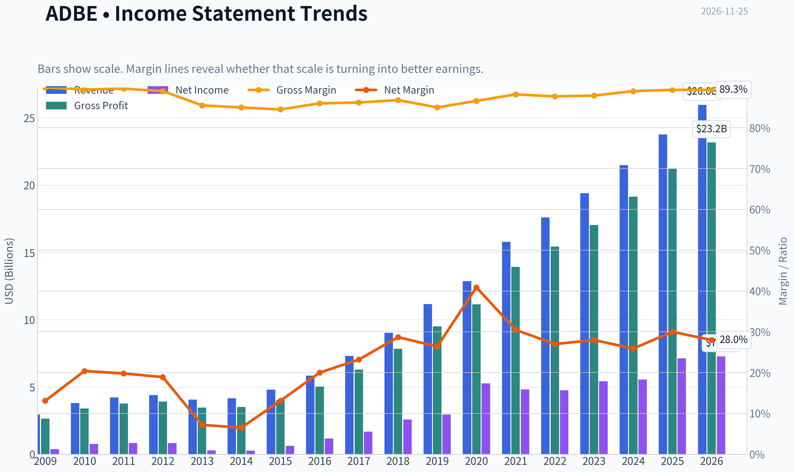

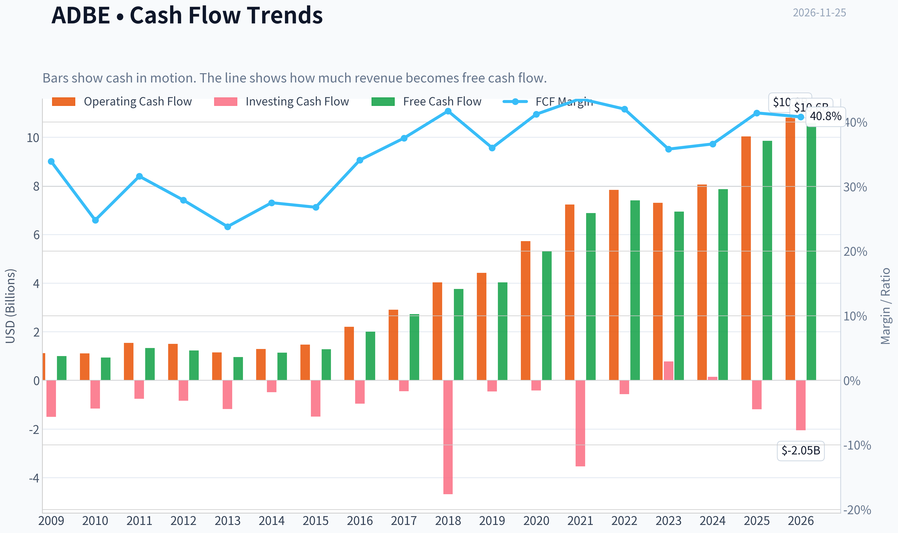

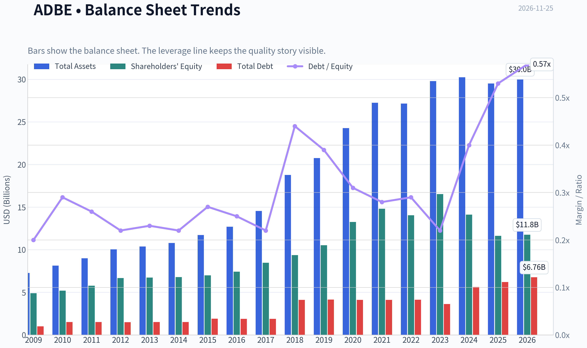

This graph tracks the profitability and return metrics (ROE, ROIC, Margins) of **ADBE** over the past decade, highlighting capital efficiency trends.

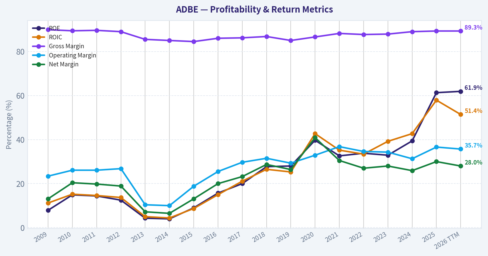

This chart illustrates the financial health of **ADBE** over the last 10 years, mapping cash equivalents and free cash flow against total obligations (Debt).

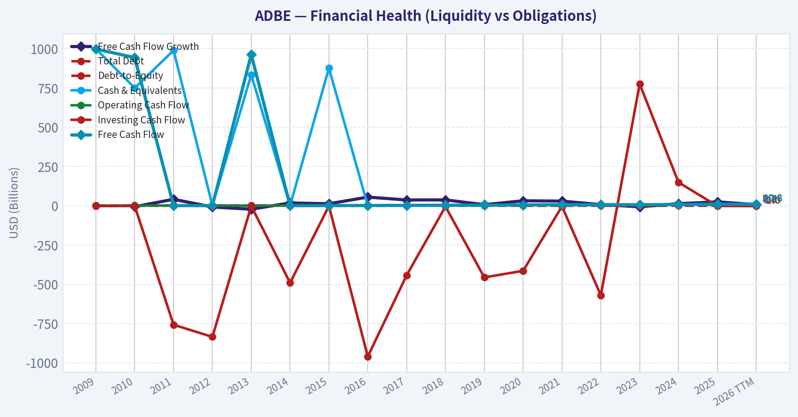

This comparison chart from *Profitability and Operating Performance* stacks current figures against historical benchmarks for **ADBE**, making it easy to see where the company trades relative to its own averages.

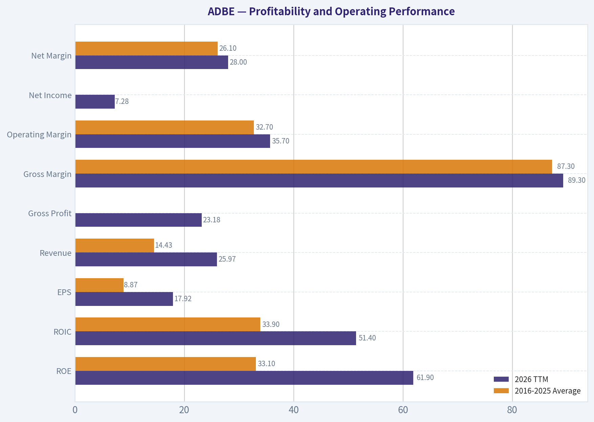

---

### Intrinsic Value Analysis (Buffett)

> *Following Warren Buffett's value investing philosophy: Circle of Competence, Economic Moat, Management Quality, and Margin of Safety.*

#### Intrinsic Value Snapshot

Price is what you pay. Intrinsic value is what the business may be worth based on the cash it can create for owners over time. We show a range, not one magic number.

- Current Price: $232.03
- Value Range (conservative to optimistic across both DCF methods): $326.88 to $1,238.10

##### Owner Earnings (Buffett Method)
- Net Income: $7,130,000,000.00
- Depreciation & Amortization: $818,000,000.00
- Capital Expenditures: $-179,000,000.00
- Working Capital Changes: $605,000,000.00
- Owner Earnings: $8,351,142,202.89

##### Intrinsic Value
###### Buffett Method
Uses owner earnings. Stricter, and usually more conservative.
- Conservative: $326.88
- Average: $466.98
- Optimistic: $466.98
- Discount Rate: 8.3%

###### Cash Flow Method
Uses free cash flow. Better for companies spending heavily today to grow tomorrow.
- Conservative: $513.80
- Average: $655.81
- Optimistic: $1,238.10
- Discount Rate: 9.1%

ANALYST STANCE: **Bullish**

#### Executive Summary

Adobe is a high-margin, subscription-driven software franchise with powerful brands, deeply embedded creative workflows, strong cash generation, and substantial reinvestment potential in artificial intelligence and digital document services. At $232 per share, the DeepValues Buffett owner-earnings valuation is $466.98 per share, implying a 50.3% margin of safety.

The principal risk is not financial distress but technological disruption: generative AI could reduce the value of certain creative tools or intensify competition. Adobe's distribution, workflow integration, ecosystem, and enterprise relationships provide meaningful defenses, but the durability of those advantages requires continued execution.

#### Factor Scorecard

| Factor | Score | Assessment |
|---|---:|---|
| 1. Circle of Competence & Simplicity | 4.5/5 | Adobe sells recurring subscriptions for creative, document, marketing, and AI-enabled software. The model is understandable and increasingly predictable, although the pace of AI change creates some uncertainty. |
| 2. Durable Competitive Advantage | 5.0/5 | Wide and potentially widening moat from iconic brands, embedded workflows, proprietary formats, switching costs, ecosystem breadth, and network effects across creative professionals and enterprises. |
| 3. Management & Capital Allocation | 4.0/5 | Strong recurring cash generation, large repurchase authorization, and continued reinvestment in products and AI. Capital-allocation evidence is favorable, though shareholder ownership and compensation alignment are not fully quantified here. |
| 4. Industry Structure | 4.0/5 | Attractive economics in scaled enterprise software, with high gross margins and recurring revenue. Competition is intense, particularly from AI-native tools and large technology platforms. |
| **Gate 5: Quality/Solvency Floor** | **Not tripped** | Owner earnings and operating cash flow are strong, net debt is modest relative to cash generation, and the available evidence does not indicate deteriorating fundamentals combined with solvency distress. |

**Key Takeaways:** Adobe scores highly because its business is simple enough to understand, highly profitable, and protected by embedded customer workflows. The main deduction is uncertainty around AI-driven competition rather than balance-sheet weakness or cash-flow deterioration.

#### Moat Analysis

| Moat Source | Evidence | Assessment |
|---|---|---|
| Intangible assets | Photoshop, Illustrator, Acrobat, Premiere, InDesign, and PDF-related standards are globally recognized. | Strong brand and intellectual-property moat |
| Switching costs | Creative professionals and organizations build workflows, libraries, documents, training, and collaboration processes around Adobe products. | High, especially for professional and enterprise users |
| Cost advantages | Software distribution is highly scalable, with gross margin of 89.3%. | Structural scale economics |
| Network effects and ecosystem | Creative Cloud, Document Cloud, integrations, marketplaces, and connected workflows reinforce Adobe's role in customer processes. | Meaningful, though less direct than a consumer social network |

Adobe's 89.3% gross margin is strong financial evidence of software pricing power and scalability. Its 61.3% reported ROE is also excellent, although ROE is amplified by the asset-light model and should not be interpreted independently of leverage and share repurchases.

#### Management Quality and Capital Allocation

Adobe's capital allocation profile is favorable:

- The company has generated record operating cash flow according to the latest coverage.
- A remaining $24.55 billion repurchase authorization provides flexibility to return excess capital.
- Reinvestment is focused on product development, AI capabilities, integrations, and subscription ecosystems rather than unrelated diversification.
- Subscription revenue and recurring customer relationships support long-term planning.
- The balance sheet carries approximately $6.4 billion of debt against $5.7 billion of cash and marketable securities, producing modest net debt of approximately $0.7 billion.

The principal management question is whether Adobe can convert AI from a competitive threat into a monetized product and retention advantage. Current product integrations and AI-assisted features suggest the company is addressing that challenge directly.

#### Financial Summary

| Metric | Latest Available Figure |
|---|---:|
| Share price | $232 |
| Market capitalization | $90.29 billion |
| Price-to-earnings ratio | 12.95 |
| Revenue growth, year over year | 10.5% |
| Gross margin | 89.3% |
| Return on equity | 61.3% |
| Free-cash-flow yield | 10.9% |
| After-tax operating income | $7.4 billion |
| Operating income | $9.3 billion |
| Tax rate used in valuation | 19.8% |
| Depreciation and amortization | $0.8 billion |
| Capital-expenditure charge | $0.3 billion |
| Working-capital investment | Approximately $0.0 billion |
| Cash and marketable securities | $5.7 billion |
| Debt | $6.4 billion |
| Net cash/(net debt) | $(0.7) billion |
| Shares used in valuation | 396 million |

**Key Takeaways:** Adobe combines exceptional gross margins with double-digit revenue growth and a 10.9% free-cash-flow yield. Net debt is modest relative to annual owner earnings, while the valuation data indicate that the market price is materially below the DeepValues owner-earnings estimate.

#### Owner Earnings Calculation

| Owner-Earnings Component | Amount |
|---|---:|
| Net operating earnings after tax proxy | $7.4 billion |
| Add: depreciation and amortization | $0.8 billion |
| Less: maintenance capital expenditure | $(0.3) billion |
| Less: working-capital investment | Approximately $0.0 billion |
| **Estimated owner earnings** | **$7.9 billion** |
| Owner earnings per share | **Approximately $19.95** |

**Key Takeaways:** Adobe's estimated owner earnings are approximately $7.9 billion, or about $19.95 per share. The calculation indicates that reported accounting earnings are supported by substantial underlying cash economics rather than requiring heavy reinvestment in physical assets.

#### Three-Scenario DCF Valuation

The following scenarios are sensitivity checks. The DeepValues app valuation shown below remains the headline intrinsic value.

| Scenario | Key Assumptions | Equity Value | Value per Share |
|---|---|---:|---:|
| A: No growth | $7.9B owner earnings capitalized at 10% | $79.0B | $199.50 |
| B: GDP-like growth | 3% perpetual growth, 10% discount rate | $116.2B | $293.40 |
| C: Historical-growth sensitivity | 7.5% growth for 10 years, 2.5% terminal growth, 10% discount rate | $155.5B | $392.70 |
| DeepValues headline valuation | 10% growth fading to 2.5%, 8.3% discount rate, less $0.7B net debt | $184.9B | **$466.98** |

**Key Takeaways:** Even the no-growth scenario produces a value near the current market capitalization, while moderate growth produces materially higher values. The headline valuation is more optimistic because it uses a lower 8.3% discount rate and a higher near-term growth assumption, making the discount rate and AI-driven growth durability the most important sensitivities.

#### Intrinsic Value and Margin of Safety

| Valuation Measure | Per Share |
|---|---:|
| Current price | $232.00 |
| DeepValues conservative value | $326.88 |
| DeepValues headline intrinsic value | **$466.98** |
| DeepValues optimistic value | $466.98 |
| Margin of safety versus headline intrinsic value | **50.3%** |
| Damodaran FCFF cross-check, conservative | $235.14 |
| Damodaran FCFF cross-check, base | $312.28 |
| DVI scenario model | $510.12 |

**Key Takeaways:** The primary owner-earnings valuation indicates a wide margin of safety, even against the conservative $326.88 estimate. A separate FCFF methodology is much more cautious, with its conservative estimate close to the market price, so the valuation conclusion depends meaningfully on the assumed growth rate, discount rate, and treatment of future AI economics.

#### Final Buffett Scorecard

| Criterion | Weight | Score | Weighted Contribution |
|---|---:|---:|---:|
| Moat width and durability | 25% | 5.0 | 1.25 |
| Valuation and margin of safety | 20% | 4.5 | 0.90 |
| Capital returns, ROIC versus WACC | 15% | 4.5 | 0.68 |
| Business understanding and predictability | 12% | 4.5 | 0.54 |
| Management quality and capital allocation | 12% | 4.0 | 0.48 |
| Reinvestment runway | 8% | 4.5 | 0.36 |
| Balance-sheet strength | 4% | 4.0 | 0.16 |
| Industry structure | 4% | 4.0 | 0.16 |
| **Total** | **100%** |  | **4.53/5.00** |

**Key Takeaways:** Adobe's weighted score is 4.53 out of 5.00, placing it in the highest decision category. The score is driven by the combination of a wide moat, exceptional operating economics, substantial reinvestment opportunities, and a valuation that is favorable under the primary owner-earnings framework.

#### Investment Stance

**Bullish - High conviction.**

Adobe resembles a modern Buffett-style compounder: asset-light, highly profitable, recurring-revenue-based, globally entrenched, and capable of reinvesting at attractive returns. The valuation evidence supports an Bullish classification at $232, with the important qualification that the conservative FCFF cross-check is less generous and AI competition remains the central long-term risk.
#### Valuation Bridge

This bridge places the current market price beside each intrinsic value lens so readers can see whether upside depends on one method or shows up across several methods.

| Scenario | Intrinsic Value / Share |
| --- | ---: |
| Buffett Method | $466.98 |
| Cash Flow Method | $655.81 |
| Damodaran Method | $312.28 |
| Current Price | $232.03 |

#### Key Takeaways

If one method is far above the others, the upside case depends on a specific modelling assumption. When several methods cluster together, the valuation story is more robust.

#### Valuation Visuals

This comparison chart from *Latest Earnings Snapshot* stacks current figures against historical benchmarks for **ADBE**, making it easy to see where the company trades relative to its own averages.

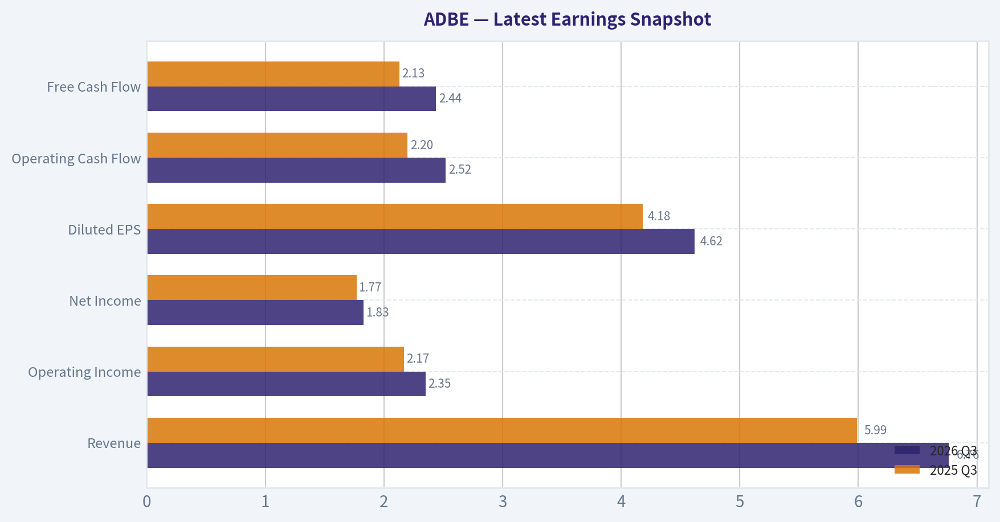

This comparison chart from *Balance Sheet and Financial Strength* stacks current figures against historical benchmarks for **ADBE**, making it easy to see where the company trades relative to its own averages.

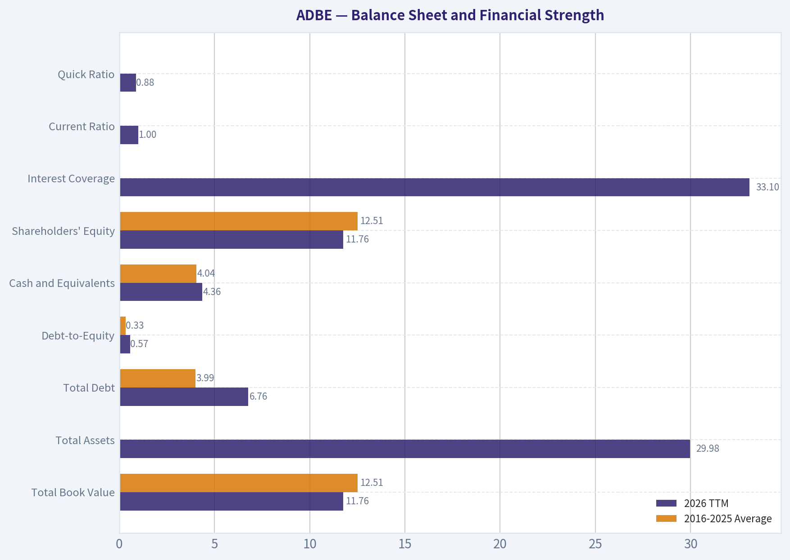

This comparison chart from *Cash Flow and Capital Allocation* stacks current figures against historical benchmarks for **ADBE**, making it easy to see where the company trades relative to its own averages.

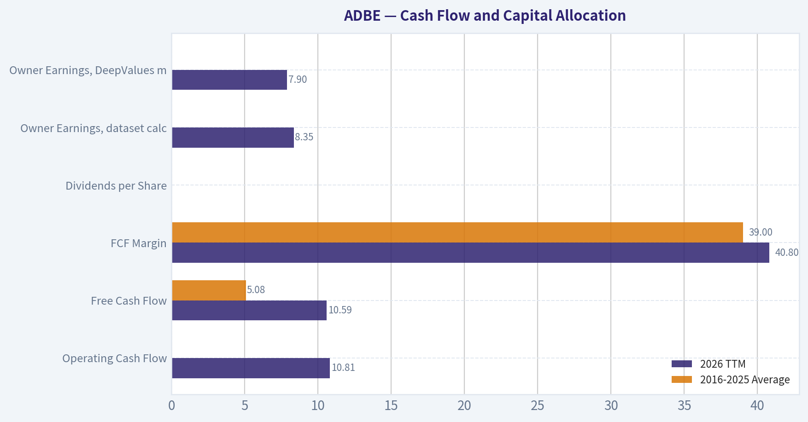

---

### Trend & Growth Analysis (Lynch/Druckenmiller/Fisher)

> *Following Peter Lynch's GARP, Stanley Druckenmiller's macro-aware approach, and Philip Fisher's scuttlebutt methodology.*

ANALYST STANCE: **Neutral**

#### 1. Lynch Classification

**Stalwart, transitioning toward a slower-growing mature compounder.** Adobe's 10.5% year-over-year revenue growth is below the 15-25% threshold for a Lynch fast grower. Its exceptional gross margin, recurring subscriptions, strong cash generation, and leading franchises remain attractive, but current growth does not yet indicate a clear ten-bagger trajectory.

#### 2. The Story in Three Bullets

- Adobe owns deeply embedded creative, document, and digital-experience workflows through products such as Photoshop, Acrobat, Premiere, and Creative Cloud.
- Generative AI can expand usage, pricing power, automation, and the addressable market, provided Adobe converts AI features into measurable customer value.
- The company combines a high-margin subscription model with substantial cash generation and buyback capacity, while the market is discounting concerns about AI competition and growth deceleration.

#### 3. TAM Analysis and 10x Test

Adobe's opportunity spans creative software, digital documents, collaboration, marketing automation, content supply chains, and AI-assisted creation. The narrow creative and document software market is large but increasingly mature; the broader digital-experience and AI workflow opportunity is materially larger.

| TAM factor | Assessment |
|---|---:|
| Current market capitalization | $90.3B |
| Approximate current annual revenue base | Approximately $24B |
| Revenue required for a 10x outcome | Approximately $240B |
| Narrow direct-market test | Does not clearly pass |
| Broad ecosystem test | Potentially passes if Adobe captures adjacent AI, workflow, and digital-experience markets |
| TAM growth | Likely positive, but difficult to quantify; AI is the main expansion catalyst |

**Key Takeaways:** Adobe has a durable and expanding market, but a tenfold revenue increase is not supported by the mature creative-software market alone. The ten-times test depends on successful expansion into AI-enabled workflows, collaboration, marketing, and enterprise content operations.

#### 4. Revenue Growth Trend

| Indicator | Data / interpretation |
|---|---|
| Latest reported year-over-year revenue growth | 10.5% |
| Lynch fast-grower threshold | 15-25% or higher |
| Current classification from growth rate | Stalwart rather than fast grower |
| Trend assessment | Sustained growth, but no confirmed acceleration |
| Main potential inflection | Monetization and adoption of generative AI across the installed base |

**Key Takeaways:** Revenue growth is healthy but below the level normally associated with ten-bagger candidates. The key question is whether AI produces a renewed acceleration rather than merely protecting Adobe's existing franchise.

#### 5. Unit Economics and Operating Model

Detailed CAC, LTV, NRR, and customer cohort data were not provided in the research pack, so those metrics cannot be calculated reliably.

| Metric | Assessment |
|---|---|
| Gross margin | 89.3% |
| Free-cash-flow yield | 10.9% |
| Rule of 40 | Not calculable without a verified FCF margin |
| LTV/CAC | Not disclosed in the available data |
| Net revenue retention | Not disclosed in the available data |
| Subscription quality | Structurally attractive, but cohort-level evidence is incomplete |
| Balance-sheet liquidity | Current ratio approximately 1.0; net debt is modest relative to cash generation |

**Key Takeaways:** Adobe's gross margin and free-cash-flow profile indicate excellent software economics. However, the missing NRR and cohort metrics limit confidence about whether AI is increasing expansion revenue or merely offsetting competitive pressure.

#### 6. Inflection-Point Assessment

| Potential inflection | Evidence | Status |
|---|---|---|
| Product cycle | Firefly and broader generative-AI integration | Promising, not yet proven in reported growth |
| TAM expansion | AI-assisted creation and enterprise content workflows | Positive |
| Market share | Strong incumbent position, but competitive intensity is rising | Unconfirmed |
| Margin inflection | Already very high gross margins; additional upside depends on operating leverage | Possible |
| Capital return | $24.55B remaining repurchase authorization and strong operating cash flow | Supportive |
| Competitive inflection | AI-native competitors and platform providers are increasing pressure | Risk |

**Key Takeaways:** Adobe has a credible product and TAM inflection opportunity, but the financial inflection has not yet appeared clearly in the 10.5% revenue-growth figure. The next evidence to monitor is accelerating AI-related bookings, adoption, monetization, and customer expansion.

#### 7. Macro Setup

| Macro factor | Implication for Adobe |
|---|---|
| Interest rates | Lower rates would generally support software valuation multiples; elevated rates remain a valuation headwind |
| Economic cycle | Enterprise and marketing budgets can be cyclical, although subscriptions provide recurring revenue |
| Secular exposure | Strong exposure to AI, cloud software, digital content, cybersecurity-adjacent workflows, and digital transformation |
| AI environment | Both a growth catalyst and a source of disruption risk |
| Capital markets | Strong cash generation reduces dependence on external financing |

**Key Takeaways:** Adobe benefits from several durable technology trends, particularly AI and cloud-based workflows. Macro sensitivity remains primarily a valuation issue, while AI is simultaneously the largest opportunity and the most important competitive threat.

#### 8. Fisher's 15-Point Score

| Fisher category | Score / 5 | Rationale |
|---|---:|---|
| Market potential | 4 | Large global creative, document, and enterprise workflow markets |
| New-product determination | 4 | Significant AI and platform investment |
| R&D effectiveness | 4 | Strong history of product innovation |
| Sales organization | 4 | Established enterprise and professional distribution |
| Profit margins | 5 | 89.3% gross margin and strong cash generation |
| Margin direction | 4 | Attractive operating leverage potential |
| Labor relations | 3 | Limited evidence in the available pack |
| Executive relations | 4 | No major leadership disruption identified |
| Management depth | 4 | Broad product and enterprise capabilities |
| Cost accounting | 4 | Mature public-company reporting infrastructure |
| Outstanding competitive aspects | 5 | Workflow integration, brand, ecosystem, and switching costs |
| Long-range profit outlook | 4 | Strong, but AI competition creates uncertainty |
| Dilution | 4 | Buyback capacity; no major dilution concern identified |
| Candor | 3 | Insufficient evidence from the supplied material |
| Integrity | 4 | No material integrity issue identified |

**Total Fisher score: 60 / 75 - Good**

**Key Takeaways:** Adobe scores well on market position, margins, innovation, and competitive advantages. The score is held below the outstanding range by incomplete evidence on customer economics, labor relations, candor, and the durability of AI monetization.

#### 9. Valuation Analysis

| Valuation measure | Result | Interpretation |
|---|---:|---|
| Share price | $232 | Current reference price |
| Market capitalization | $90.29B | Large-cap valuation |
| P/E | 12.95x | Low relative to many high-quality software franchises |
| Revenue growth | 10.5% | Moderate rather than fast growth |
| PEG | Approximately 1.23 | Fair-to-reasonable, not a classic Lynch bargain |
| FCF yield | 10.9% | Strong cash-flow support |
| Owner-earnings intrinsic value | $466.98 | Headline DeepValues base/optimistic value |
| Conservative owner-earnings value | $326.88 | Still above the reference price |
| Margin of safety versus headline intrinsic value | 50.3% | Large model-based discount |

**Key Takeaways:** Adobe appears inexpensive on earnings and free cash flow, while the PEG of approximately 1.23 indicates fair value rather than extreme growth-at-a-reasonable-price valuation. The owner-earnings model indicates substantial valuation support, but that result depends on roughly 10% growth fading to a 2.5% terminal rate and should not be treated as proof that AI execution risk is resolved.

#### 10. Valuation Sensitivity

The following sensitivity uses illustrative revenue-growth and valuation-multiple combinations rather than a estimated value.

| Scenario | Revenue growth assumption | Terminal P/E assumption | Valuation implication |
|---|---:|---:|---|
| Bear | 5-7% | 10-12x | Material downside risk if AI fails to offset maturity and competition |
| Base | 9-12% | 13-16x | Consistent with a profitable, durable software compounder |
| Bull | 15-20% | 18-22x | Requires visible AI-driven acceleration and renewed fast-grower status |

**Key Takeaways:** Valuation is relatively resilient if Adobe maintains high-single-digit to low-double-digit growth and strong cash conversion. A more substantial re-rating requires growth to return to the mid-teens or higher; otherwise, the company is more likely to be valued as a high-quality stalwart.

#### 11. Growth Investor Scorecard

| Criterion | Weight | Score / 5 | Weighted contribution |
|---|---:|---:|---:|
| Lynch story | 10% | 4.0 | 0.40 |
| TAM and runway | 20% | 3.5 | 0.70 |
| Revenue growth | 20% | 3.0 | 0.60 |
| Unit economics | 15% | 4.0 | 0.60 |
| Competitive position | 10% | 4.5 | 0.45 |
| Management quality | 10% | 4.0 | 0.40 |
| Macro setup | 5% | 3.5 | 0.18 |
| Profitability path | 5% | 4.5 | 0.23 |
| Valuation | 5% | 4.0 | 0.20 |
| **Total** | **100%** | - | **3.76 / 5.00** |

**Key Takeaways:** Adobe's weighted score of 3.76 places it in the "Advocate - Good Setup" range under the supplied framework. The score is supported by valuation, margins, and competitive strength, but its growth score remains restrained until AI produces measurable acceleration.

#### 12. Key Risks and Catalysts

| Catalysts | Risks |
|---|---|
| AI features increase paid conversion, usage, or pricing | AI-native competitors reduce differentiation |
| Creative Cloud and Acrobat expansion into broader workflows | Revenue growth remains near 10% or decelerates |
| Enterprise digital-experience recovery | Customers consolidate software spending |
| Operating leverage and larger buybacks | Regulatory, copyright, or legal issues involving AI training and content |
| Higher net retention from AI-enabled products | High dependence on successful monetization of new products |

**Key Takeaways:** The central catalyst is evidence that AI expands Adobe's revenue growth rather than simply defending its installed base. The central risk is that Adobe remains highly profitable but matures into a slower-growing software stalwart while competitive AI tools compress its pricing power.

#### Conclusion

Adobe is a high-quality, cash-generative software franchise with strong competitive advantages and valuation support. It is not currently a classic Lynch fast grower because revenue growth is 10.5%, but its AI product cycle could create a meaningful reacceleration. The evidence supports a **Neutral** stance: valuation appears favorable relative to intrinsic-value estimates, while the ten-bagger case depends on proving that AI can materially expand the company's growth rate and addressable market.

#### Growth & Scorecard Visuals

This comparison chart from *Growth Metrics* stacks current figures against historical benchmarks for **ADBE**, making it easy to see where the company trades relative to its own averages.

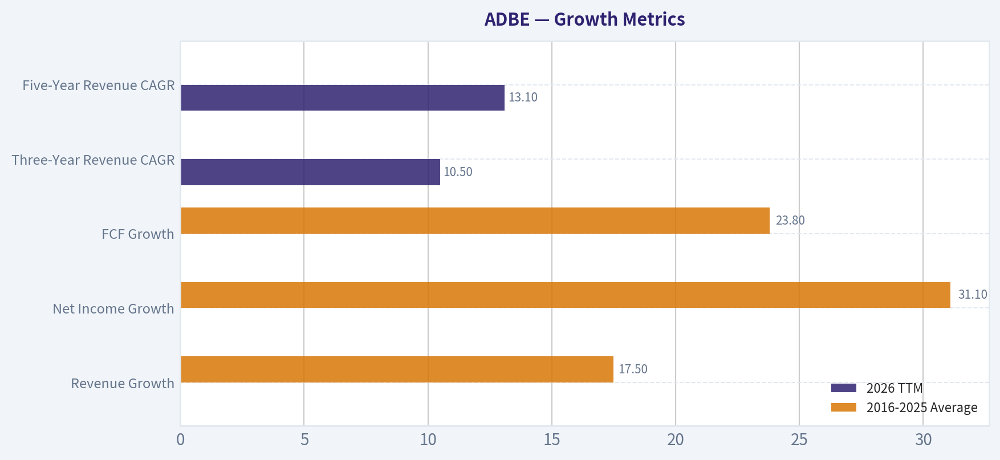

---

### Market Technical Analysis

ANALYST STANCE: **Neutral**

#### ADBE technical market report

The latest available trading session is November 24, 2026, because November 25 is marked as a non-trading day in the retrieved dataset. Adobe closed at **$232.08**, up **3.6%** from the prior session, but the broader one-year structure remains materially weaker: the stock declined from **$319.55** on November 25, 2025, to $232.08, a loss of approximately **27.4%**.

The price history shows several distinct phases. A strong advance carried ADBE from the low-$200s in June to nearly $293 by late August. That recovery failed to establish a durable uptrend, followed by a retreat toward $231 in late September. October produced a brief rebound toward $271, but November brought renewed weakness, including a decline from $246 on November 16 to $217.71 on November 20. The two-session recovery to $232.08 is therefore meaningful as a short-term bounce, but it has not yet reversed the larger pattern of lower highs and lower moving averages.

#### Trend structure and moving averages

The **50-day SMA is $242.39**, while the **200-day SMA is $245.97**. The close remains below both, indicating that medium- and longer-term trend filters are still negative. More importantly, both averages are declining: the 50-day average fell from approximately $255.68 on October 26 to $242.39 on November 24, while the 200-day average declined from approximately $251.83 to $245.97.

The relationship between these averages also remains unfavorable. The 50-day SMA is below the 200-day SMA by roughly **$3.58**, or about **1.5%**. That configuration reflects persistent intermediate-term underperformance rather than a confirmed trend transition.

The **10-day EMA is $231.11**, placing the latest close only about **$0.97 above it**. This suggests that the immediate selling pressure has eased, but the margin is narrow. A close near the short-term average can represent stabilization, yet it does not by itself demonstrate a sustained recovery, especially while the price remains below the slower averages.

#### Momentum assessment

The MACD reading is **-5.93**, still decisively below zero. It improved from **-6.37** on November 23, but this follows a sharp deterioration from **+3.12** on October 26. The sequence indicates that bearish momentum intensified throughout early and mid-November, with only a modest recent improvement.

Because the retrieved MACD report provides the MACD line but not a separate signal-line or histogram value, crossover confirmation is unavailable from this output. The negative absolute level remains the more important observation: momentum has improved marginally over the last two sessions but remains bearish over the broader 30-day window.

The **RSI is 44.88**, up from **30.89** on November 20. This is a substantial recovery from near-oversold conditions, but RSI has not reached the neutral 50 level. The move suggests that downside momentum has moderated rather than that bullish momentum has become dominant. There is no current evidence of overbought conditions.

#### Volatility and Bollinger-band context

The Bollinger upper band is **$259.10** and the lower band is **$218.53**. The implied middle band is approximately **$238.82**, placing the latest close about **$6.74 below the middle line**. This is consistent with a market still trading in the lower half of its recent volatility range.

The close is approximately **$13.55 above the lower band**, so it is no longer pressing directly against the lower volatility boundary. That aligns with the recent rebound from $217.71. However, the lower band itself has moved down from roughly $224.37 on October 26 to $218.53, showing that the volatility envelope has adjusted downward as the price trend weakened.

The **ATR is $8.97**, equivalent to roughly **3.9% of the latest closing price**. This is elevated enough for ordinary daily moves to appear large in percentage terms. ATR has eased from a recent high above $9.27 but remains well above the calmer readings seen during parts of the October rebound. The combination of a declining trend and sizable daily ranges indicates elevated uncertainty rather than orderly accumulation.

#### Volume and price-action interpretation

The most severe phase of the November decline occurred on November 17-20, when the stock fell from $235.55 to $217.71. Volume rose to approximately **5.46 million shares** on November 20, above the recent average and consistent with intensified selling interest. The recovery on November 24 occurred on approximately **3.76 million shares**, below the November 20 volume and not obviously representative of a broad, high-conviction reversal.

The broader year-long record also contains several high-volume dislocations, including the June decline toward $190 and the late-May to early-June rebound. This history suggests that ADBE has been sensitive to abrupt repricing events. Consequently, short-term rebounds can occur without immediately repairing the medium-term trend structure.

#### Valuation implication

No fundamental valuation measures were provided, so this report cannot determine whether Adobe is inexpensive or expensive on earnings, cash flow, or sales. From a technical perspective, the evidence does not yet substantiate a bullish valuation premium: the price is below both major trend averages, MACD remains negative, RSI is below neutral, and volatility remains elevated.

The evidence is more consistent with **an attempted short-term stabilization inside a damaged intermediate-term trend**. A stronger technical re-rating would generally require sustained improvement in the moving-average structure, momentum readings, and the ability to reclaim the Bollinger middle band, rather than a single two-session rebound.

#### Selected indicators

The selected set contains eight complementary indicators: **close_50_sma, close_200_sma, close_10_ema, macd, rsi, boll_ub, boll_lb, and atr**. Together they cover long-term trend, intermediate trend, short-term price alignment, momentum, mean-reversion context, volatility boundaries, and realized volatility without duplicating the same signal excessively.

| Indicator | Latest reading | Direction or condition | Interpretation for ADBE |
|---|---:|---|---|
| Close | $232.08 on Nov. 24 | Two-session rebound | Short-term stabilization, but still well below the prior year's starting level |
| 50-day SMA | $242.39 | Declining | Price is below the medium-term trend benchmark |
| 200-day SMA | $245.97 | Declining | Longer-term trend remains negative |
| 10-day EMA | $231.11 | Slightly below price | Immediate selling pressure has eased, but the margin is narrow |
| MACD | -5.93 | Negative, modestly improving | Bearish momentum persists despite a small recent improvement |
| RSI | 44.88 | Recovered from 30.89 | Bounce from near-oversold conditions; still below neutral |
| Bollinger upper/lower bands | $259.10 / $218.53 | Price below implied middle band near $238.82 | Price remains in the lower half of its recent range |
| ATR | $8.97 | Elevated volatility | Daily price variability remains substantial |
| Overall technical stance | - | **Neutral** | Rebound signals are present, but trend and momentum confirmation remain incomplete |

**Key Takeaways:** ADBE has produced a short-term rebound from its November low, and RSI has recovered from near-oversold territory. However, the stock remains below its 50-day and 200-day averages, MACD is still negative, and the price is below the Bollinger middle band. The evidence supports monitoring for confirmation of stabilization rather than treating the recent bounce as an established trend reversal.

#### Market Visuals

This comparison chart from *Market Metrics and Valuation* stacks current figures against historical benchmarks for **ADBE**, making it easy to see where the company trades relative to its own averages.

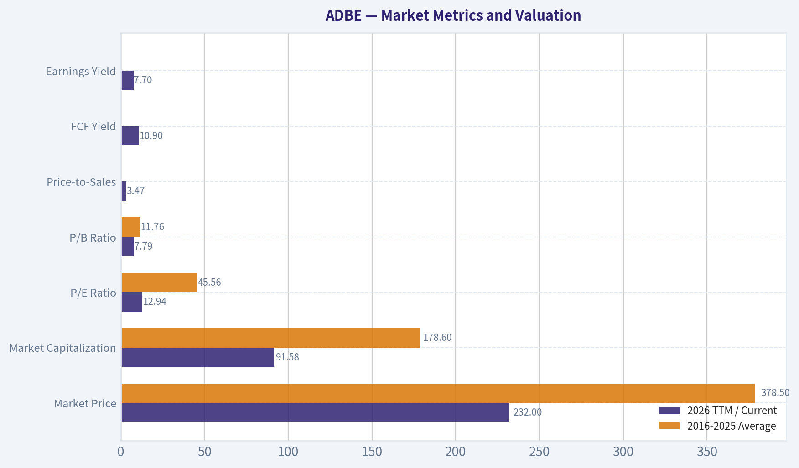

---

### Options Market Analysis

> *Reading options flow - put/call ratios, IV skew, and unusual activity - to gauge institutional positioning and event-driven risk.*

ANALYST STANCE: **BULLISH**

#### ADBE Options Market Overview

Data is available for the near-term expirations from November 27 through December 11, 2026. Aggregate call open interest and volume exceed put activity, but the signal is moderate rather than extreme.

| Expiration | Call OI | Put OI | Put/Call OI | Call Volume | Put Volume | Put/Call Volume |
|---|---:|---:|---:|---:|---:|---:|
| Nov. 27, 2026 | 10,963 | 6,290 | 0.57 | 2,521 | 778 | 0.31 |
| Dec. 4, 2026 | 6,745 | 4,789 | 0.71 | 507 | 287 | 0.57 |
| Dec. 11, 2026 | 4,655 | 5,361 | 1.15 | 305 | 469 | 1.54 |
| **Total** | **22,363** | **16,440** | **0.74** | **3,333** | **1,534** | **0.46** |

**Key Takeaways:** The aggregate put/call open-interest ratio of 0.74 is close to the historical neutral baseline of approximately 0.70, while the 0.46 volume ratio shows substantially heavier call activity. The near-term November 27 chain is the most call-dominant, but the December 11 expiration reverses toward put activity, indicating some downside protection or event-related hedging farther out.

#### Implied Volatility Assessment

| Expiration | Call ATM IV | Put ATM IV | IV Difference: Calls Minus Puts |
|---|---:|---:|---:|
| Nov. 27, 2026 | 50.6% | 42.6% | +8.0 percentage points |
| Dec. 4, 2026 | 54.7% | 50.9% | +3.8 percentage points |
| Dec. 11, 2026 | 67.4% | 63.6% | +3.8 percentage points |

**Key Takeaways:** Near-term implied volatility is elevated, particularly for the December 11 expiration, where ATM IV reaches 67.4% for calls and 63.6% for puts. Calls carry higher ATM IV than puts across all listed expirations, which is consistent with upside demand or upside event speculation rather than pronounced downside fear. True out-of-the-money skew data was not provided, so a definitive put-skew or call-skew measurement is unavailable.

The sharp IV increase into December 11 may reflect an anticipated company-specific or market catalyst, but the supplied data does not identify the catalyst. The elevated volatility indicates that the market is pricing a potentially large move around that window.

#### Unusual Options Activity

No contracts met the supplied unusual-activity threshold of volume greater than five times open interest.

| Metric | Result |
|---|---|
| Contracts exceeding 5x volume-to-OI threshold | None |
| Evidence of fresh, highly concentrated directional bets | Not detected |
| Ability to distinguish institutional from retail activity | Limited |

**Key Takeaways:** There is no clear volume-versus-open-interest signal pointing to a single fresh institutional trade. The bullish read therefore comes from broad call dominance and the aggregate volume ratio, not from a specific unusual contract or large apparent sweep.

#### Open Interest Concentration and Gamma Levels

The data identifies open interest by expiration but does not provide strike-level open interest. Consequently, specific high-OI strikes, maximum-pain levels, and gamma walls cannot be calculated from the available feed.

| Expiration | Total OI | OI Concentration Assessment |
|---|---:|---|
| Nov. 27, 2026 | 17,253 | Largest near-term OI concentration |
| Dec. 4, 2026 | 11,534 | Secondary concentration |
| Dec. 11, 2026 | 10,016 | Lower total OI, but highest IV |
| **Total** | **38,803** | - |

**Key Takeaways:** The November 27 expiration has the largest aggregate open interest and may exert the greatest short-term expiration-related influence. However, without strike-level data, no specific price-pinning or gamma-amplification level can be identified. The December 11 expiration has less open interest but considerably higher implied volatility, suggesting greater expected movement rather than a clearly defined gamma wall.

#### Overall Options Sentiment

The overall signal is **BULLISH**, with **moderate conviction**.

The primary bullish evidence is:

- Aggregate put/call OI ratio of 0.74, close to neutral but slightly call-favorable.
- Put/call volume ratio of 0.46, indicating call volume more than twice put volume.
- Call ATM IV exceeding put ATM IV across all three expirations.
- The strongest call dominance occurs in the nearest November 27 expiration.

The main caveats are:

- The December 11 expiration has a put/call OI ratio above 1.0 and a put/call volume ratio of 1.54.
- No unusual contracts exceeded the five-times-volume-to-open-interest threshold.
- Strike-level OI and true OTM IV skew are unavailable.
- The elevated December 11 IV implies meaningful event-driven or volatility risk.

The evidence supports a modestly bullish options-market interpretation for ADBE, but not an aggressive directional signal. The data suggests near-term upside demand is stronger than downside demand, while later-dated hedging and elevated volatility indicate uncertainty remains substantial.

#### Summary

| Category | Assessment |
|---|---|
| Put/Call Ratio | OI ratio 0.74, near neutral but slightly call-favorable; volume ratio 0.46, clearly call-dominant |
| IV Level | Elevated, especially for December 11, with ATM IV above 63% |
| Skew Direction | ATM call IV exceeds put IV; apparent call-favorable skew, though OTM skew is unavailable |
| Unusual Activity | No contracts with volume greater than five times open interest |
| Overall Signal | **BULLISH**, moderate conviction |

**Key Takeaways:** ADBE's near-term options data leans bullish because calls dominate both aggregate volume and open interest, and call ATM IV exceeds put IV. The signal is tempered by heavier put activity in the December 11 expiration, elevated event-related volatility, and the absence of strike-level and unusual-contract detail.

---

## Research Team Commentary

> *The Research Manager synthesizes the Bull vs Bear debate into action-free commentary. This is a pre-risk view, not the final stance.*

Core takeaway: Adobe remains a high-quality franchise whose current valuation appears to reflect substantial, but not yet demonstrated, erosion in its competitive position. At roughly $232 and 12.95 times earnings, investors are receiving a 7.7% reported earnings yield from a recurring-revenue business with an 89.3% gross margin and 63.2% ROIC. The bear case identifies a genuine structural threat-AI could commoditize individual features, reduce seat requirements, and raise delivery costs-but the supplied evidence describes these mainly as plausible future outcomes rather than showing that Adobe's cash flows, retention, or pricing power are already deteriorating materially. On balance, the valuation appears more pessimistic than the operating evidence currently warrants.

Rationale: The strongest bullish argument is not simply that Adobe has famous products. Its moat rests on integrated professional workflows, file compatibility, accumulated customer content, user training, plug-ins, enterprise integrations, and broad distribution. Photoshop, Premiere, Acrobat, and Creative Cloud are embedded in how customers complete work, not merely purchased as isolated features. Competitors can reproduce a generation or editing function more easily than they can reproduce Adobe's complete workflow, installed base, and institutional trust.

The financial profile supports that quality assessment. An 89.3% gross margin, 63.2% ROIC, recurring subscriptions, and record operating cash flow indicate excellent economics and substantial capacity to fund product development. ROE is less informative because repurchases can shrink equity, while historical ROIC may overstate the returns Adobe will earn on new AI spending. Even after making those adjustments, this is plainly not a capital-intensive or financially distressed enterprise.

The valuation is the decisive point. No DeepValues intrinsic-value estimate was supplied, so a precise percentage discount cannot be claimed. Nevertheless, a multiple of approximately 13 times reported earnings is restrained for a franchise with Adobe's current economics. In a simplified reverse-valuation interpretation, the price appears consistent with low long-term growth, some margin pressure, or a permanently higher risk premium. It does not appear to require a return to Adobe's historical growth rate. If owner earnings remain close to reported earnings and free cash flow per share compounds even in the mid-single digits, Adobe could outperform the modest expectations embedded in the price.

The bear case is strongest where it challenges the durability of the denominator. A trailing P/E can be misleading if normalized earnings are about to decline. A 20% earnings contraction would turn the stated multiple into roughly 16 times reduced earnings, and a 30% contraction would raise it to approximately 18.5 times. Those levels would be less compelling for a mature company experiencing structural moat erosion.

AI creates several credible paths to such erosion. Natural-language interfaces can reduce the value of specialized expertise, lower switching friction, and make basic creative functions widely available. Productivity improvements could also reduce the number of seats customers need. Adobe might have to include expensive generative features in existing plans merely to preserve retention, leaving the company with higher compute costs but little incremental revenue. Creative Cloud's lower end and Digital Experience's contested enterprise market appear more vulnerable than mission-critical professional and document workflows.

The failed Figma transaction is also a legitimate warning. It does not prove poor capital allocation, but the willingness to offer approximately $20 billion suggests that management regarded collaborative, browser-based design as strategically important. Future defensive acquisitions, aggressive AI expenditure, or pricing concessions could lower incremental returns even while historical ROIC remains impressive.

Still, the bear argument currently relies more on what could happen than on supplied evidence of what has happened. There are no figures here showing accelerating churn, collapsing net-new recurring revenue, severe price discounting, sustained margin compression, or declining owner earnings. The approximately 27% one-year share-price decline signals an expectations reset, not by itself permanent impairment. Likewise, call-favorable options activity and short-term technical behavior provide little information about ten-year earning power.

The $24.55 billion repurchase authorization is potentially helpful but should not be counted as intrinsic value by itself. Repurchases create value only when made below intrinsic value and when they reduce the diluted share count after stock-based compensation. They cannot substitute for organic demand or repair a weakening moat. Management's capital allocation should therefore be judged by free-cash-flow-per-share growth, net share reduction, and returns on current AI investment rather than the headline authorization.

The most important analytical discipline here is to avoid two symmetrical mistakes. One is treating a low P/E and high historical ROIC as proof of undervaluation. The other is treating AI disruption as proof that a deeply embedded platform has already lost its moat. No specific past-error reflection was provided, so the appropriate refinement is to demand measurable evidence on both sides. Adobe should retain its quality designation only if present economics persist in customer retention, pricing, and owner earnings-not merely in reported gross margin. Conversely, a permanent-impairment conclusion requires more than a falling share price and a list of capable competitors.

Monitoring plan: Over the next one to four quarters, the first priority is organic recurring-revenue performance. Digital Media net-new ARR, Creative Cloud and Document Cloud growth, Digital Experience bookings, renewal rates, and any disclosed churn or seat trends will show whether competition is reducing demand. Stable or improving net-new ARR alongside sustained pricing would strengthen the thesis; subscriber growth driven by discounts, weaker renewals, or persistent seat contraction would weaken it.

Second, Adobe must demonstrate AI monetization rather than merely AI adoption. Firefly usage, generative-credit consumption, premium-plan adoption, enterprise AI contracts, and management's disclosure of incremental AI revenue are important. Evidence that AI increases revenue per customer, retention, or workflow breadth faster than it increases compute expense would be favorable. Heavy usage without incremental revenue, or repeated bundling of costly AI features simply to defend existing subscriptions, would support the bear case.

Third, margins and cash conversion need close attention. Gross margin, operating margin, AI-related cost of revenue, R&D intensity, capital expenditures, stock-based compensation, deferred-revenue movements, and free cash flow should be reviewed together. Stable free-cash-flow margins would indicate that Adobe can absorb AI investment without sacrificing its economics. Declining margins accompanied by weak growth would suggest that competition is shifting value from Adobe to customers and infrastructure providers.

Fourth, per-share results should be separated from financial engineering. Organic revenue and operating-income growth should be compared with earnings-per-share growth, while diluted share-count reduction should be measured after employee compensation. Repurchases that meaningfully reduce shares at restrained valuations would support capital-allocation quality. Repurchases that merely offset dilution or mask stagnant operating earnings would not.

Finally, competitive and legal developments matter. Adoption trends for Canva, Figma, CapCut, Microsoft, Google, and AI-native creative tools should be evaluated by customer segment rather than treated as one market. Copyright rulings, content-authenticity standards, training-data restrictions, and enterprise demand for commercially safe AI could either raise Adobe's costs or strengthen its trusted-platform advantage.

The current evidence supports Adobe as a durable franchise facing a serious but still unproven disruption thesis. The valuation offers a quality-scaled margin of safety if earnings and cash conversion remain broadly durable, while a confirmed decline in retention, pricing power, and normalized free cash flow would undermine that conclusion.

Stance: Bullish.

---

## Value Investing Team Commentary

> *The Investor translates the research view into an investment thesis before risk review. This is still not the final stance.*

Adobe's current setup is a useful test of whether the market is discounting a genuine impairment or merely a slower growth phase. The roughly 27% one-year decline and a reported P/E near 13 indicate a substantial expectations reset. Yet the operating data supplied do not show a business already in distress: gross margins remain exceptionally high, ROIC is outstanding, subscriptions generate recurring revenue, and operating cash flow is reportedly at a record level.

### Business quality and moat

Adobe's moat is broader than any individual application. Photoshop, Premiere, Acrobat, and Creative Cloud are embedded in professional workflows, file standards, customer archives, training systems, plug-ins, and enterprise processes. That ecosystem creates switching costs and institutional familiarity that are difficult for a single AI-native competitor to replicate.

The more vulnerable part of the franchise is likely the lower end of the creative market, where basic image generation, editing, presentation, and video functions are becoming increasingly interchangeable. Document workflows, professional production, regulated enterprise use, and commercially safe content should prove more resilient. The relevant question is therefore not whether AI can reproduce isolated Adobe features-it clearly can-but whether customers can replace Adobe's complete workflow at comparable reliability, compatibility, and scale.

### AI: threat and opportunity

The bearish AI thesis is economically credible. Generative tools could reduce the value of specialized skills, lower switching costs, reduce seat requirements, and shift value toward infrastructure providers. Adobe may also face a difficult monetization trade-off: costly AI functionality may be necessary to preserve retention, while customers resist meaningful price increases.

The contrarian observation is that AI could strengthen Adobe if customers value trusted commercial outputs, rights-managed content, brand controls, workflow integration, and compatibility with existing files. AI may increase the amount of creative work performed rather than simply eliminate seats. Adobe's opportunity is to monetize broader workflow usage and higher customer productivity, not merely to add a chatbot or image generator.

However, adoption alone is not enough. The decisive evidence will be incremental revenue per customer, renewal performance, pricing resilience, and the relationship between AI usage and compute expense. High Firefly engagement without improving cash economics would be a weaker outcome than modest adoption accompanied by stronger retention and monetization.

### Valuation and margin of safety

At approximately $232 and 12.95 times reported earnings, Adobe is priced more like a mature or structurally challenged company than a premium software franchise. The implied earnings yield is approximately 7.7%, before considering the durability of future growth. That valuation does not require Adobe to reproduce its historical expansion rate; it appears compatible with low growth, some margin pressure, or a permanently higher risk premium.

Still, the valuation should not be described as a confirmed deep discount because no DeepValues intrinsic-value estimate or normalized owner-earnings figure was supplied. The key uncertainty is the denominator. If earnings remain broadly durable and free cash flow compounds at even a mid-single-digit rate, the market's assumptions may prove excessively pessimistic. If earnings fall by 20% to 30% because of slower demand, higher AI costs, or weaker pricing, the effective valuation would be materially less attractive.

This is where the quality-scaled margin-of-safety framework matters. Adobe's historical economics justify a smaller discount than would be required for a cyclical or financially weak company. Yet historical ROIC and gross margin should not be treated as permanent. ROE is particularly less informative because buybacks can reduce the equity base. ROIC may also overstate future returns if AI investment requires substantial spending without equivalent monetization.

### Capital allocation and financial quality

The $24.55 billion repurchase authorization provides flexibility, but authorization size is not intrinsic value. Repurchases are economically beneficial only when they reduce the diluted share count at valuations below intrinsic value. The important measures are free-cash-flow-per-share growth, net share reduction after stock-based compensation, and the return earned on AI and product-development spending.

The failed Figma transaction deserves attention but not overinterpretation. It indicated that management viewed collaborative, browser-based design as strategically important, while the eventual failure also limited a potentially expensive allocation decision. The more important forward-looking issue is whether Adobe can strengthen its own collaborative and browser-based capabilities without sacrificing returns through defensive acquisitions or excessive pricing concessions.

### What sentiment is revealing

The market's skepticism appears rational in one respect: Adobe faces a more serious technology transition than a normal cyclical slowdown. The concern is not simply weaker quarterly growth; it is whether AI changes the economics of creative software and reduces the value of specialized platforms.

At the same time, the pessimism may be extrapolating feature-level competition into ecosystem-level disruption. A cheaper or more capable isolated tool does not automatically replace a trusted professional workflow. The absence of supplied evidence showing accelerating churn, collapsing recurring-revenue growth, severe discounting, or sustained free-cash-flow deterioration makes the current bearish conclusion incomplete.

Options data and technical trends add little to the ten-year assessment. A modestly call-favorable put/call profile may show that near-term sentiment is no longer uniformly negative, but it does not establish intrinsic value. Similarly, the share-price decline demonstrates an expectations reset, not permanent impairment.

### Evidence that would change the assessment

The most important indicators are:

- Creative Cloud and Document Cloud retention, pricing, and net-new recurring revenue.
- Digital Experience bookings and enterprise renewal trends.
- Whether AI produces measurable revenue per customer rather than only usage.
- AI-related cost of revenue, operating margins, and free-cash-flow conversion.
- Organic operating-income growth compared with earnings-per-share growth.
- Diluted share-count reduction after stock-based compensation.
- Competitive adoption by customer segment across Canva, Figma, Microsoft, Google, CapCut, and AI-native tools.
- Enterprise demand for commercially safe, rights-managed, and provenance-supported AI output.

Stable retention and pricing alongside improving AI monetization would suggest the market has overestimated disruption risk. Persistent seat contraction, lower renewals, weaker pricing, and declining free-cash-flow margins would indicate that the valuation is not as conservative as it appears.

Adobe therefore remains a high-quality franchise with a credible, not hypothetical, technology risk. The supplied evidence supports the view that the market is pricing in substantial competitive erosion before that erosion has been demonstrated in the operating results. The valuation appears favorable relative to the quality of the existing business, but the margin of safety depends on the durability of normalized earnings rather than on the headline P/E alone.

**ANALYST STANCE: Bullish.** Adobe's combination of embedded workflows, recurring revenue, exceptional historical returns, and restrained valuation supports an Advocate classification. The stance is conditional on retention, pricing power, cash conversion, and AI monetization remaining broadly durable; confirmed deterioration in those measures would weaken the valuation case materially.

---

## Deep Values Commentary

> *The Risk Management Team debates and the Risk Judge provides the final action-free verdict. This section determines the final Bullish / Neutral / Bearish stance.*

#### Final Stance Scorecard

This scorecard converts the final research view into a weighted decision frame. It does not replace the narrative judgement, but it makes the main drivers of the verdict easier to scan.

| Criterion | Score | Weight | Commentary |
| --- | ---: | ---: | --- |
| Business Quality | 4.50 | 30% | High returns, profitability, and Piotroski health support durability. |
| Valuation Support | 4.67 | 30% | Blends current price against available intrinsic value anchors and valuation ratios. |
| Financial Strength | 3.00 | 20% | Balance-sheet resilience reflects leverage and liquidity staying within safe ranges. |
| Growth Durability | 4.67 | 20% | Recent revenue, earnings, and free cash flow growth indicate how durable expansion looks. |
| TOTAL / FINAL STANCE | 4.29 | 100% | Bullish |

#### Key Takeaways

The weighted score lands at **4.29 / 5.0**, while the final stance remains **Bullish**. This is useful as a quick calibration aid rather than a mechanical signal.

#### Risk Summary

Higher scores indicate more risk pressure. The watch threshold is a simple guardrail: above it, the dimension weighs more heavily on the valuation case and calls for a wider margin of safety.

| Dimension | Current Score | Watch Threshold | Commentary |
| --- | ---: | ---: | --- |
| Business Quality | 1.50 | 3.00 | High returns, profitability, and Piotroski health support durability. |
| Valuation Support | 1.33 | 3.00 | Blends current price against available intrinsic value anchors and valuation ratios. |
| Financial Strength | 3.00 | 3.00 | Balance-sheet resilience reflects leverage and liquidity staying within safe ranges. |
| Growth Durability | 1.33 | 3.00 | Recent revenue, earnings, and free cash flow growth indicate how durable expansion looks. |

#### Key Takeaways

This view helps readers separate *where* the risk sits: valuation, business quality, balance sheet, or growth durability. It is especially useful when the final stance is close to the line between Neutral and Bearish.
