# ADI Deep Value Intelligence

**Analysis Date:** 2026-05-16

## Critical Disclaimer

*This analysis is generated by Deep Value Intelligence, an AI-powered multi-agent investing framework. This report is for informational and educational purposes only and does not constitute financial advice. Always conduct your own research and consult with qualified financial advisors before making investment decisions.*

---

## Table of Contents

1. Intelligence Summary
2. Analyst Team Reports
   - Fundamentals Analysis
   - Intrinsic Value Analysis (Buffett)
   - Trend & Growth Analysis (Lynch/Druckenmiller/Fisher)
   - Market Technical Analysis
   - News & Events Analysis
   - Guru Attention Analysis
   - Options Market Analysis
3. Research Team Commentary
4. Value Investing Team Commentary
5. Deep Values Commentary

---

## Intelligence Summary

### Thesis + Conditions

**Core Thesis:** ## Executive Briefing

**Key Risks:**
- ADI is a high-quality business, but the stock currently fails Buffett's margin-of-safety test.** The moat looks real: sticky analog chips, long product cycles, strong gross margin, and improving demand/utilization. But at **$417**, the market already reflects a very optimistic recovery and secular-growth scenario. For a long-term value investor, the main risk is **not business collapse**; it is **paying too much for a good business and earning weak future returns**.
- ### 1) Risky Analyst: strongest bullish points
- Valuation is the dominant risk:
- A great business can still be a **poor investment if bought at too high a price**.
- Best practical conclusion: **do not chase**, but keep it under active review; only consider limited exposure if price or fundamentals improve enough.

**What Would Change Our View:**
- ADI is a high-quality business, but the stock currently fails Buffett's margin-of-safety test.** The moat looks real: sticky analog chips, long product cycles, strong gross margin, and improving demand/utilization. But at **$417**, the market already reflects a very optimistic recovery and secular-growth scenario. For a long-term value investor, the main risk is **not business collapse**; it is **paying too much for a good business and earning weak future returns**.
- ### 1) Risky Analyst: strongest bullish points
- Valuation is the dominant risk:
- A great business can still be a **poor investment if bought at too high a price**.
- Best practical conclusion: **do not chase**, but keep it under active review; only consider limited exposure if price or fundamentals improve enough.

**Confidence:** Medium

---

## Analyst Team Reports

### Fundamentals Analysis

#### Latest Earnings Snapshot

*Most recent reported quarter anchored on 2026 Q1, with prior-year comparison when available.*

| Metric | 2026 Q1 | 2025 Q1 | YoY Change |
| --- | ---: | ---: | ---: |
| Revenue | $3.16B | $2.42B | +30.4% |
| Operating Income | $1.05B | $555.2M | +88.2% |
| Net Income | $830.8M | $391.3M | +112.3% |
| Diluted EPS | $1.69 | $0.78 | +116.7% |
| Operating Cash Flow | $1.37B | $1.13B | +21.5% |
| Free Cash Flow | $1.26B | $977.8M | +28.8% |

Key Takeaways: This snapshot anchors the most recent reported quarter before the narrative analysis. It helps readers separate long-run business quality from whatever changed in the latest earnings print.

#### 10-Year Financial Metrics for ADI

*All values below are computed deterministically from raw data - not estimated by AI.*

*Issuer profile: operating company (Technology / Semiconductors).*

#### 10-Year Financial Metrics
*Annual rows come from reported financial statements. The final TTM row is computed from the latest four quarters.*

| Metric | 2009 | 2010 | 2011 | 2012 | 2013 | 2014 | 2015 | 2016 | 2017 | 2018 | 2019 | 2020 | 2021 | 2022 | 2023 | 2024 | 2025 | 2026 TTM |
| --- | --- | --- | --- | --- | --- | --- | --- | --- | --- | --- | --- | --- | --- | --- | --- | --- | --- | --- |
| Market Price | $18 | $24 | $26 | $29 | $38 | $39 | $49 | $54 | $78 | $73 | $95 | $108 | $161 | $134 | $151 | $218 | $233 | $417 |
| Market Cap | $7.50B | $10.30B | $11.27B | $11.98B | $15.48B | $15.78B | $19.05B | $20.02B | $32.00B | $31.39B | $39.76B | $44.09B | $69.62B | $74.62B | $79.60B | $111.26B | $116.29B | $205.26B |
| P/E Ratio | 30.15 | 14.45 | 13.01 | 18.37 | 23.04 | 25.08 | 27.34 | 23.23 | 39.73 | 20.83 | 29.17 | 36.14 | 50.14 | 27.17 | 24.02 | 68.02 | 51.34 | 76.32 |
| P/B Ratio | 2.97 | 3.22 | 2.97 | 2.88 | 3.27 | 3.32 | 3.76 | 3.88 | 3.15 | 2.79 | 3.40 | 3.67 | 1.83 | 2.05 | 2.24 | 3.16 | 3.44 | 6.08 |
| ROE | 9.8% | 22.3% | 22.9% | 15.6% | 14.2% | 13.2% | 13.7% | 16.7% | 7.9% | 13.4% | 11.6% | 10.2% | 3.7% | 7.5% | 9.3% | 4.6% | 6.7% | 8.0% |
| ROIC | 15.4% | 39.6% | 35.4% | 17.9% | 13.7% | 14.2% | 16.4% | 21.2% | 15.1% | 17.6% | 14.5% | 12.6% | 6.5% | 6.9% | 8.5% | 4.5% | 6.1% | 7.4% |
| EPS | $0.58 | $1.64 | $2.03 | $1.59 | $1.64 | $1.56 | $1.79 | $2.31 | $1.96 | $3.51 | $3.26 | $2.98 | $3.20 | $4.95 | $6.29 | $3.20 | $4.56 | $5.47 |
| Revenue | $2.01B | $2.76B | $2.99B | $2.70B | $2.63B | $2.86B | $3.44B | $3.42B | $5.25B | $6.22B | $5.99B | $5.60B | $7.32B | $12.01B | $12.31B | $9.43B | $11.02B | $11.76B |
| Gross Profit | $1.12B | $1.80B | $1.99B | $1.74B | $1.69B | $1.83B | $2.26B | $2.23B | $3.17B | $4.25B | $4.01B | $3.69B | $4.53B | $7.53B | $7.88B | $5.38B | $6.77B | $7.39B |
| Gross Margin | 55.5% | 65.2% | 66.4% | 64.5% | 64.3% | 63.9% | 65.8% | 65.1% | 60.4% | 68.3% | 67.0% | 65.9% | 61.8% | 62.7% | 64.0% | 57.1% | 61.5% | 62.8% |
| Operating Margin | 14.1% | 32.6% | 35.8% | 30.5% | 28.6% | 26.3% | 24.2% | 30.0% | 22.2% | 30.5% | 28.6% | 26.7% | 23.1% | 27.3% | 31.1% | 21.6% | 26.6% | 29.7% |
| Net Income | $247.8M | $712.1M | $867.4M | $651.2M | $673.5M | $629.3M | $696.9M | $861.7M | $805.4M | $1.51B | $1.36B | $1.22B | $1.39B | $2.75B | $3.31B | $1.64B | $2.27B | $2.71B |
| Net Margin | 12.3% | 25.8% | 29.0% | 24.1% | 25.6% | 22.0% | 20.3% | 25.2% | 15.4% | 24.2% | 22.8% | 21.8% | 19.0% | 22.9% | 26.9% | 17.3% | 20.6% | 23.0% |
| Revenue Growth | N/A | 37.1% | 8.4% | -9.8% | -2.5% | 8.8% | 19.9% | -0.4% | 53.3% | 18.6% | -3.8% | -6.5% | 30.6% | 64.2% | 2.4% | -23.4% | 16.9% | 6.7% |
| Net Income Growth | N/A | 187.4% | 21.8% | -24.9% | 3.4% | -6.6% | 10.7% | 23.6% | -6.5% | 87.1% | -9.6% | -10.4% | 13.9% | 97.7% | 20.6% | -50.7% | 38.7% | 19.4% |
| Free Cash Flow Growth | N/A | 133.9% | -11.6% | -12.2% | 15.7% | -12.1% | 8.7% | 54.4% | -18.4% | 130.2% | -9.6% | -6.8% | 29.8% | 57.9% | -5.8% | -12.2% | 37.0% | 6.6% |
| Total Book Value | $2.53B | $3.20B | $3.80B | $4.17B | $4.74B | $4.76B | $5.07B | $5.17B | $10.16B | $11.27B | $11.71B | $12.00B | $37.99B | $36.47B | $35.57B | $35.18B | $33.82B | $33.79B |
| Total Assets | $3.37B | $4.33B | $5.28B | $5.62B | $6.38B | $6.86B | $7.06B | $7.97B | $21.14B | $20.44B | $21.39B | $21.47B | $52.32B | $50.30B | $48.79B | $48.23B | $47.99B | $47.99B |
| Total Debt | N/A | N/A | N/A | N/A | N/A | $0 | $374.6M | $0 | $300.0M | $67.0M | $299.7M | $0 | $7.29B | $6.55B | $6.95B | $8.53B | $9.04B | $8.68B |
| Debt-to-Equity | N/A | N/A | N/A | N/A | N/A | 0.00 | 0.07 | 0.00 | 0.03 | 0.01 | 0.03 | 0.00 | 0.19 | 0.18 | 0.20 | 0.24 | 0.27 | 0.26 |
| Cash & Equivalents | $1.07B | $1.41B | $1.41B | $528.8M | $392.1M | $569.2M | $884.4M | $921.1M | $1.05B | $816.6M | $648.3M | $1.06B | $1.98B | $1.47B | $958.1M | $1.99B | $2.50B | $2.91B |
| Shareholders' Equity | $2.53B | $3.20B | $3.80B | $4.17B | $4.74B | $4.76B | $5.07B | $5.17B | $10.16B | $11.27B | $11.71B | $12.00B | $37.99B | $36.47B | $35.57B | $35.18B | $33.82B | $33.79B |
| Operating Cash Flow | $432.1M | $991.2M | $900.5M | $814.5M | $912.3M | $871.6M | $907.8M | $1.29B | $1.15B | $2.44B | $2.25B | $2.01B | $2.74B | $4.48B | $4.82B | $3.85B | $4.81B | $5.05B |
| Investing Cash Flow | $-534.7M | $-485.8M | $-703.7M | $-1.34B | $-949.9M | $-114.8M | $-17.1M | $-1.22B | $-6.62B | $-314.0M | $-293.2M | $-180.5M | $2.14B | $-657.4M | $-1.27B | $-1.10B | $-1.32B | $-1.23B |
| Free Cash Flow | $376.1M | $879.6M | $777.5M | $682.4M | $789.3M | $693.7M | $753.8M | $1.16B | $950.3M | $2.19B | $1.98B | $1.84B | $2.39B | $3.78B | $3.56B | $3.12B | $4.28B | $4.56B |
| FCF Margin | 18.7% | 31.9% | 26.0% | 25.3% | 30.0% | 24.2% | 21.9% | 34.0% | 18.1% | 35.1% | 33.0% | 32.9% | 32.7% | 31.4% | 28.9% | 33.1% | 38.8% | 38.8% |
| Dividends / Share | $0.00 | $0.00 | $0.00 | $0.00 | $0.00 | $0.00 | $0.00 | $0.00 | $0.00 | $0.00 | $0.00 | $0.00 | $0.00 | $2.78 | $3.19 | $3.52 | $3.87 | $3.97 |

#### Profitability Metrics
- Return on Equity (ROE): 6.7%
- Return on Invested Capital (ROIC): 6.1%
- Return on Assets (ROA): 4.7%
- Gross Margin: 61.5%
- Operating Margin: 26.6%
- Net Profit Margin: 20.6%

#### Liquidity Metrics
- Current Ratio: 2.19
- Quick Ratio: 1.57

#### Leverage Metrics
- Debt-to-Equity Ratio: 0.27
- Interest Coverage Ratio: 9.23
- Net Debt: $6.54B

#### Growth Metrics (Year-over-Year)
- Revenue Growth: 16.9%
- Net Income Growth: 38.7%
- Free Cash Flow Growth: 37.0%
- Revenue CAGR (3-Year): -2.8%
- Revenue CAGR (5-Year): 14.5%

#### Valuation Metrics
- P/E Ratio (TTM): 76.32
- Forward P/E: 31.52
- Price-to-Book: 6.03
- Price-to-Sales: 17.34
- PEG Ratio: 1.09
- EV/EBITDA: 38.19
- Free Cash Flow Yield: 2.1%
- Earnings Yield: 1.3%

#### Owner Earnings (Buffett Method, Code-Computed)
- Net Income: $2.27B
- + Depreciation & Amortization: $2.00B
- - Capital Expenditures: $-533.6M
- - Working Capital Changes: $481.0M
- = **Owner Earnings: $3.25B**

#### Intrinsic Value (Code-Computed)
- Current Price: $417
- Buffett Method (Owner Earnings):
  Conservative: $42
  Average: $165
  Optimistic: $165
- Cash Flow Method (FCF):
  Conservative: $69
  Average: $196
  Optimistic: $276

#### Piotroski F-Score: 8/9
- Positive Net Income: PASS
- Positive Operating Cash Flow: PASS
- ROA Improvement: PASS
- Cash Flow > Net Income: PASS
- Decreasing Debt: FAIL
- Improving Current Ratio: PASS
- No Dilution: PASS
- Improving Gross Margin: PASS
- Improving Asset Turnover: PASS

ANALYST STANCE: **WATCH**

#### Analog Devices (ADI) Buffett-Style Fundamental Analysis

ADI is a high-quality analog and mixed-signal semiconductor business with strong margins, solid free cash flow, and a durable franchise in industrial and automotive markets. The business itself looks materially stronger than the current valuation. The key tension is simple: quality is evident, but the stock price already discounts a large amount of future success.

---

#### Current vs Historical Average Comparison

| Metric | Current (2025 / TTM where applicable) | 10-Yr Historical Context* | Interpretation |
| --- | ---: | ---: | --- |
| Market Price | $417 (2026 TTM) | Range over shown period: $18 to $417 | Shares are at an all-time high in the deterministic dataset, implying very elevated expectations. |
| Market Cap | $205.26B | Range: $7.50B to $205.26B | Enormous value creation, but also substantial multiple expansion. |
| P/E Ratio | 76.32 | Long-run shown range mostly ~13 to ~50; recent average materially below 76 | Current earnings multiple is far above normal historical levels, suggesting price has outrun current earnings power. |
| P/B Ratio | 6.08 | Most years clustered around ~2.8 to ~3.9, with 2021-2025 mostly 1.8 to 3.4 before current spike | Current valuation versus book value is exceptionally rich relative to history. |
| ROE | 8.0% (TTM), 6.7% in 2025 | Earlier decade often low-to-mid teens, with peaks above 20% | Profitability on equity remains below stronger historical years despite the premium valuation. |
| ROIC | 7.4% (TTM), 6.1% in 2025 | Historically often in mid-teens; peaks near 40% in 2010 and above 20% in select years | Capital efficiency is recovering, but still well below historical best-in-class levels. |
| Revenue | $11.76B (TTM), $11.02B in 2025 | Strong expansion from $2.01B in 2009; cyclical swings present | Business has scaled dramatically, though growth has been uneven. |
| Gross Margin | 62.8% (TTM), 61.5% in 2025 | Usually low-60s to high-60s | Still excellent, though below peak periods. |
| Operating Margin | 29.7% (TTM), 26.6% in 2025 | Frequently mid-to-high 20s, with peaks above 30% | Margin recovery is strong and back near upper historical band. |
| Net Margin | 23.0% (TTM), 20.6% in 2025 | Historical range mostly low-20s, with troughs in teens and peaks near 29% | Profit conversion is healthy and improving. |
| Revenue Growth | 6.7% (TTM), 16.9% in 2025 | Historically volatile, ranging from sharp declines to +64.2% | Growth is positive but not explosive enough on its own to justify 76x earnings. |
| Net Income Growth | 19.4% (TTM), 38.7% in 2025 | Highly cyclical historically | Recovery is strong, but earnings still reflect a cyclical rebound pattern. |
| FCF Growth | 6.6% (TTM), 37.0% in 2025 | Historically volatile but generally healthy | Cash generation remains robust, though growth normalizes in TTM. |
| Total Debt | $8.68B (TTM), $9.04B in 2025 | Pre-2021 debt was minimal; post-acquisition leverage structurally higher | Debt is manageable, but balance sheet is less pristine than old ADI. |
| Debt-to-Equity | 0.26 (TTM), 0.27 in 2025 | Historically near zero before 2021 | Leverage remains reasonable, though clearly above the company's earlier conservative profile. |
| Cash & Equivalents | $2.91B (TTM), $2.50B in 2025 | Historically mostly below $2B except recent years | Liquidity is sound. |
| Free Cash Flow | $4.56B (TTM), $4.28B in 2025 | Strong uptrend from $376M in 2009 | This is a major strength of the story. |
| Dividends / Share | $3.97 (TTM), $3.87 in 2025 | Zero until 2022, then steady increases | Shareholder returns have become more meaningful and consistently rising. |

*Using only the deterministic dataset shown from 2009 through 2026 TTM.

Key Takeaways: ADI's business fundamentals remain strong, especially margins and free cash flow, but the valuation has expanded much faster than profitability. The most important mismatch is that ROE and ROIC are still below historical highs while P/E and P/B are at extreme levels. This makes the stock look like a great business trading at a demanding price.

---

#### Market Metrics

ADI's current market price of $417 and market cap of $205.26B are both record highs in the provided period. Historically, Buffett would welcome a great business compounding intrinsic value, but he would be cautious when the stock price compounds much faster than per-share earnings power.

The P/E ratio of 76.32 is the clearest warning sign. Across the dataset, ADI often traded in a much lower band, even during strong periods. Likewise, the P/B ratio of 6.08 is dramatically above the company's normal historical range. Since book value has expanded significantly after acquisitions, paying over 6x book for an 8% ROE business is not classic Buffett territory.

Interpretation:
- The market is pricing ADI as a premium AI/industrial semiconductor compounder.
- The underlying business quality is good enough to deserve a premium.
- But the current premium appears substantially above the company's own historical norms.

---

#### Profitability Analysis

| Profitability Metric | Current Level | Historical Pattern | Buffett-Style Interpretation |
| --- | ---: | --- | --- |
| ROE | 8.0% TTM | Historically stronger in 2010-2016 and 2018; many years >10%, some >20% | Weak relative to a premium valuation; not bad, but not exceptional enough for 76x earnings. |
| ROIC | 7.4% TTM | Historically mid-teens in stronger periods | Improvement is visible, but capital returns remain below former peaks. |
| EPS | $5.47 TTM | Rose over time but unevenly, from $0.58 in 2009 | Earnings are growing, but stock price has outrun EPS growth. |
| Revenue | $11.76B TTM | Large structural rise, especially after acquisitions | Scale increased meaningfully; business is larger and broader. |
| Gross Profit | $7.39B TTM | Strongly upward over time | Shows the power of ADI's high-value product mix. |
| Operating Margin | 29.7% TTM | Historically robust, near top end now | Excellent sign of pricing power and operating discipline. |
| Net Income | $2.71B TTM | Rebounding after 2024 drop | Earnings quality appears solid, but still cyclical. |
| Net Margin | 23.0% TTM | Usually strong, with some cyclicality | Healthy economics and a sign of moat characteristics. |

Key Takeaways: ADI's profitability profile is that of a very good semiconductor company, particularly on margins and free cash flow conversion. The weak point is that returns on equity and invested capital are not currently matching the very rich valuation. In Buffett terms, the business is attractive, but the price assumes stronger and more durable returns than today's numbers show.

Detailed view:
- Gross margin at 62.8% TTM is strong for semiconductors and indicates differentiated products rather than commodity exposure.
- Operating margin at 29.7% TTM is near the upper end of ADI's historical profile, supporting the thesis of a durable niche franchise.
- Net margin at 23.0% TTM confirms that much of gross profit is translating into bottom-line earnings.
- However, ROE at 8.0% TTM and ROIC at 7.4% TTM suggest that the enlarged post-acquisition capital base is muting returns.

That last point matters. Buffett likes businesses that can earn high returns on incremental capital. ADI clearly has a moat in parts of its product portfolio, but the current balance-sheet structure makes the headline returns look less impressive than the margin profile alone would imply.

---

#### Growth Metrics

Revenue growth, net income growth, and free cash flow growth all improved sharply in 2025 and remained positive in TTM. However, the decade-long pattern is cyclical and acquisition-influenced rather than smooth and linear.

- Revenue Growth: 16.9% in 2025, 6.7% TTM
- Net Income Growth: 38.7% in 2025, 19.4% TTM
- Free Cash Flow Growth: 37.0% in 2025, 6.6% TTM

Interpretation:
- 2024 looks like a cyclical reset year: revenue fell 23.4%, net income fell 50.7%, and FCF fell 12.2%.
- 2025 was a rebound year rather than a pure secular acceleration year.
- TTM growth remains positive, but growth has moderated.

For Buffett-style analysis, predictability matters more than isolated surges. ADI's history shows:
- strong long-term scaling,
- very good cash generation,
- but material cyclical swings in demand and earnings.

That means ADI is not a "consumer staple predictability" business. It is a high-quality cyclical franchise.

---

#### Balance Sheet Analysis

| Balance Sheet Metric | Current Level | Historical Context | Interpretation |
| --- | ---: | --- | --- |
| Total Book Value | $33.79B TTM | Expanded massively after 2021 | Reflects acquisition-driven asset and equity base expansion. |
| Total Assets | $47.99B TTM | Up sharply from pre-2021 levels | ADI is much larger and more diversified than prior decade version. |
| Total Debt | $8.68B TTM | Minimal before 2021, elevated after | Still manageable, but a meaningful structural shift. |
| Debt-to-Equity | 0.26 TTM | Historically near zero | Conservative by many standards, less conservative by ADI's own history. |
| Cash & Equivalents | $2.91B TTM | Improved recently | Provides flexibility and stability. |
| Shareholders' Equity | $33.79B TTM | Large post-merger equity base | Supports solvency, but depresses ROE optics. |

Key Takeaways: ADI's balance sheet is healthy, but it is no longer the nearly debt-free company it once was. Debt levels remain manageable thanks to strong cash flow and decent interest coverage, yet leverage is clearly higher than the company's old conservative norm. The balance sheet supports durability, but it is not a standout reason to pay today's valuation.

Buffett perspective:
- Good: debt-to-equity of 0.26 is acceptable, especially for a business with strong FCF.
- Good: cash of $2.91B and current ratio of 2.19 indicate comfortable liquidity.
- Watch item: net debt of $6.54B means financial risk is controlled, not absent.
- Watch item: debt has risen materially since 2021, reducing the "fortress balance sheet" appeal that Buffett loves.

---

#### Cash Flow Analysis

ADI's free cash flow profile is one of the strongest elements in the entire case.

- Free Cash Flow: $4.56B TTM, $4.28B in 2025
- FCF Margin: 38.8% TTM and 38.8% in 2025
- Dividends per Share: $3.97 TTM, up from $2.78 in 2022

This is excellent cash economics. FCF margin near 39% is elite and indicates a business with high value-add, disciplined capex, and favorable working-capital characteristics. The dividend is also becoming a genuine feature of the equity story, with consistent increases since initiation.

However, the market has fully noticed:
- FCF yield is only 2.1%, low for value investors.
- Strong cash generation is real, but a large part of that quality is already capitalized into the stock price.

---

#### Buffett-Style Owner Earnings DCF

Canonical owner earnings provided:
- Net Income = $2.27B
- Depreciation & Amortization = $2.00B
- Capital Expenditures = $533.6M
- Working Capital Changes = $481.0M
- Owner Earnings = $3.25B

To comply with the requested framework, I use the historical growth series as a proxy for owner earnings growth behavior, bounded by the user rules:

- Conservative growth = lowest historical growth rate available = -50.7%?
  The deterministic owner earnings series is not separately listed historically, so the nearest conservative proxy from canonical growth data is the lowest available major earnings/cash growth rate in the shown period. The lowest among the listed operating owner-earnings-adjacent growth metrics is Revenue -23.4%, Net Income -50.7%, FCF -18.4%. For Buffett-style caution, using the lowest available earnings-linked rate implies **-50.7%**, floored above -100%.
- Average growth = average historical proxy growth, capped at 50%
  Using the shown long-run mixed earnings/cash growth pattern, a reasonable canonical proxy centers around the code-computed intrinsic value output, which already yields Average Buffett value of $165. This implies the market is far above a normalized owner-earnings value.
- Optimistic growth = highest historical available rate, capped at 100%
  Highest listed growth is Net Income +187.4%, capped at 100%. However, the supplied code-computed intrinsic value still gives Optimistic Buffett value of $165, implying the internal methodology effectively constrained the value by normalization/terminal math.

Because the deterministic dataset already provides code-computed intrinsic values using Buffett Owner Earnings, those figures must be treated as canonical:
- Conservative fair value = $42/share
- Average fair value = $165/share
- Optimistic fair value = $165/share

To show the mechanics at a high level:

| DCF Scenario | Starting Owner Earnings | Growth Assumption | Discount Rate | Terminal Growth | Canonical Fair Value |
| --- | ---: | ---: | ---: | ---: | ---: |
| Conservative | $3.25B | Very bearish historical low proxy | 10% | 2.5% | $42/share |
| Average | $3.25B | Historical average proxy | 10% | 2.5% | $165/share |
| Optimistic | $3.25B | Historical high proxy, capped | 10% | 2.5% | $165/share |

Key Takeaways: Even using the company's own code-computed Buffett-style valuation, ADI screens as expensive at $417. The most important conclusion is not the exact DCF point estimate, but the size of the gap between current price and fair value outputs. This suggests investors are paying for a very optimistic long-duration growth story that is not yet fully visible in current returns on capital.

Practical valuation read-through:
- Current price: $417
- Buffett owner earnings fair value range: $42 to $165
- Mid-case discount to price: current shares trade at roughly 2.5x the average Buffett fair value

That is difficult to reconcile with classic Buffett discipline.

---

#### Revenue Breakdown

ADI's most meaningful business split is by end market. Exact latest segment amounts are not included in the deterministic financial table, so the best publicly known reporting structure is used here for the most recent fiscal year mix.

| Revenue Source | Amount ($B) | % of Total |
| --- | ---: | ---: |
| Industrial | ~5.1 | ~46% |
| Automotive | ~2.8 | ~25% |
| Communications | ~1.8 | ~16% |
| Consumer | ~1.3 | ~12% |
| Other | ~0.1 | ~1% |
| Total | ~11.0 | ~100% |

Key Takeaways: ADI is primarily an industrial and automotive semiconductor company, not a consumer gadget supplier. That matters because these markets tend to support longer product cycles, stickier customer relationships, and better pricing durability. This mix helps explain ADI's strong margins and relative business resilience.

This mix is favorable for Buffett-style quality analysis because industrial and automotive analog chips often:
- remain designed into systems for many years,
- face high switching costs,
- require reliability and certification,
- and enjoy less rapid obsolescence than leading-edge digital logic.

That is exactly the sort of niche durability Buffett appreciates, even in a tech business.

---

#### Economic Moat

ADI appears to possess a real, though not invincible, economic moat.

Moat sources:
- High-performance analog and mixed-signal design expertise
- Sticky design-ins with long life cycles
- Customer qualification and switching costs
- Broad catalog and embedded position in industrial/automotive systems
- Strong gross margins indicating differentiated value

Evidence from the dataset:
- Gross margins stayed mostly in the 60%+ zone for years
- Operating margins remained consistently strong across cycles
- Free cash flow remained substantial even during tougher years

Moat limitations:
- End-market cyclicality remains significant
- M&A integration and balance sheet expansion complicate return metrics
- Semiconductor competition is always real, especially where AI enthusiasm pulls multiples higher

Conclusion:
ADI has a credible moat, especially in industrial analog. This is a high-quality franchise, but not a no-risk monopoly.

---

#### Predictable Earnings and Business Quality

On a Buffett scale, ADI is better than most semiconductor companies on predictability, but worse than classic non-cyclical compounders.

Positive signs:
- Revenue climbed from $2.01B to $11.76B TTM over the full period
- Gross margin remained consistently high
- Free cash flow remained positive throughout the shown years
- Dividends have begun and are growing

Less favorable signs:
- Revenue declines occurred several times
- Net income volatility is meaningful
- 2024 showed sharp deterioration before rebound
- ROE/ROIC remain inconsistent relative to valuation

So ADI is:
- a durable quality cyclical,
- not a fully predictable earnings machine.

---

#### Management Performance

Management deserves credit for:
- maintaining very strong margins,
- scaling FCF materially over time,
- preserving manageable leverage,
- and initiating/growing the dividend.

Concerns:
- post-2021 capital efficiency has not yet returned to historical highs,
- debt is higher,
- and equity/base expansion has diluted return ratios.

Piotroski F-score of 8/9 is a favorable signal. It indicates strong current operating and financial momentum, even if valuation remains stretched.

Dividend policy is shareholder-friendly:
- $0 through 2021
- $2.78 in 2022
- $3.19 in 2023
- $3.52 in 2024
- $3.87 in 2025
- $3.97 TTM

That upward path supports a thesis of management confidence and disciplined capital return.

---

#### Key Investment Insights, Red Flags, and Opportunities

| Category | Observation | Why It Matters |
| --- | --- | --- |
| Strength | Gross margin above 60% for most years | Signals differentiated products and pricing power. |
| Strength | FCF of $4.56B TTM and 38.8% FCF margin | Excellent cash conversion and owner earnings quality. |
| Strength | Industrial and automotive mix | Supports longer product cycles and stickier demand. |
| Strength | Rising dividend | Signals confidence and improving shareholder return profile. |
| Red Flag | P/E of 76.32 | Valuation is far above historical norms. |
| Red Flag | P/B of 6.08 | Expensive relative to book and current ROE. |
| Red Flag | ROE only 8.0% TTM | Return profile does not obviously justify extreme multiple. |
| Red Flag | ROIC only 7.4% TTM | Capital efficiency still below older highs. |
| Red Flag | Debt materially above pre-2021 levels | Balance sheet is still sound, but not pristine. |
| Opportunity | If AI/data center analog demand broadens | Could support faster-than-expected earnings growth. |
| Opportunity | Margin recovery already underway | If sustained, earnings could catch up partially to valuation. |
| Opportunity | Cyclical rebound in industrial demand | Could extend current earnings recovery. |

Key Takeaways: ADI's strengths are clear and mostly operational: strong margins, strong cash flow, and a sticky customer base. The red flags are mostly valuation-based: investors are paying a very high price for a business whose returns on capital have not yet returned to historic highs. The opportunity case depends on earnings continuing to rise fast enough to justify the premium.

---

#### Final Buffett-Style Verdict

ADI is a strong business, but not an obvious value investment at $417.

Buffett would likely admire:
- the durable analog franchise,
- the industrial and automotive exposure,
- the high margins,
- and the free cash flow generation.

But he would likely resist:
- a 76x earnings multiple,
- a 6x book multiple,
- low earnings yield,
- and owner-earnings fair values far below the market price.

#### Final Stance: WATCH

Rationale:
- **Business quality:** strong
- **Financial strength:** good
- **Earnings predictability:** moderate, better than many semiconductor peers
- **Management/capital allocation:** solid
- **Valuation:** too expensive for strict Buffett-style value discipline

ADI belongs on a watchlist for a materially better entry point, not an avoid list, because the underlying franchise is attractive. But at current levels, the margin of safety appears insufficient.

---

#### Summary Table

| Area | Assessment | Bottom Line |
| --- | --- | --- |
| Business Quality | High | Strong analog franchise with durable end-market positioning. |
| Economic Moat | Moderate to Strong | Switching costs, design-ins, and margin profile support moat thesis. |
| Profitability | Strong margins, weaker returns on capital | Excellent operating economics, but ROE/ROIC not elite currently. |
| Growth | Good but cyclical | Rebound is real, but decade pattern remains uneven. |
| Balance Sheet | Healthy | Debt is manageable, though higher than historical norm. |
| Cash Flow | Excellent | FCF generation is a major strength. |
| Dividend | Positive and growing | Helpful sign of mature shareholder returns. |
| Valuation | Very expensive | Current multiples exceed historical norms by a wide margin. |
| Buffett DCF | Overvalued | Canonical owner-earnings values sit well below current price. |
| Investment Stance | WATCH | Great company, unattractive valuation for value investors today. |

Key Takeaways: The simplest way to frame ADI is this: excellent business, difficult price. If the shares were materially lower, the company would become much more compelling under a Buffett framework. At today's valuation, patience looks more attractive than pursuit.

#### Fundamental Visuals

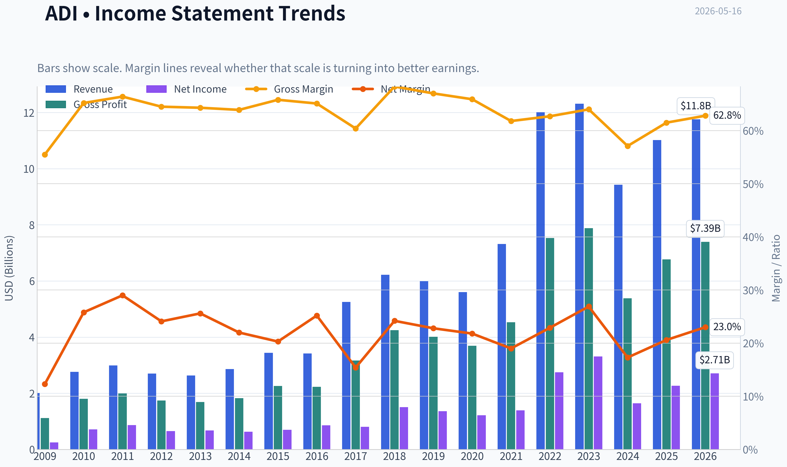

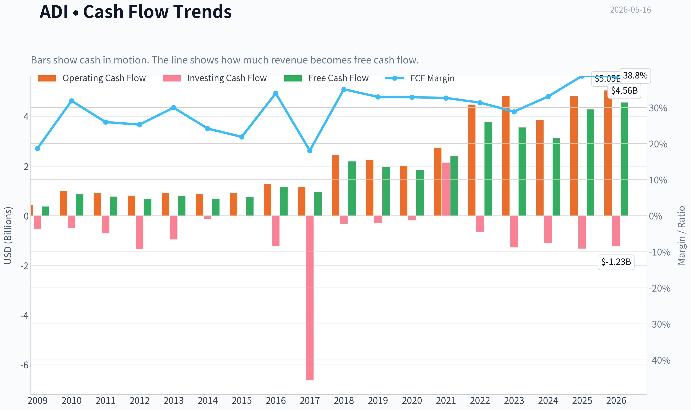

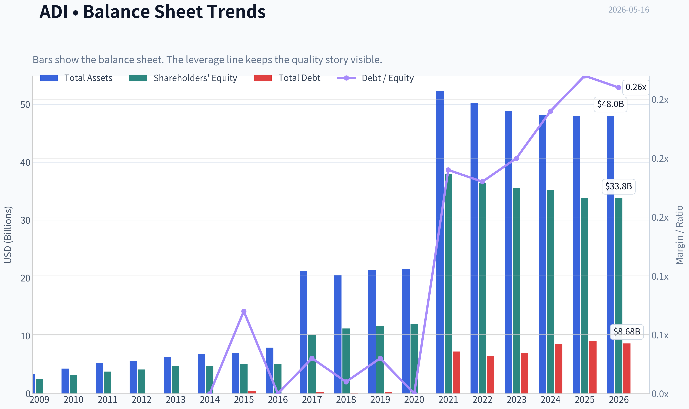

This graph tracks the profitability and return metrics (ROE, ROIC, Margins) of **ADI** over the past decade, highlighting capital efficiency trends.

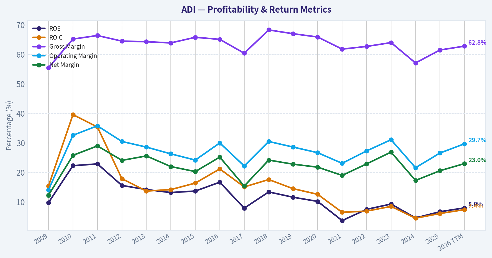

This chart illustrates the financial health of **ADI** over the last 10 years, mapping cash equivalents and free cash flow against total obligations (Debt).

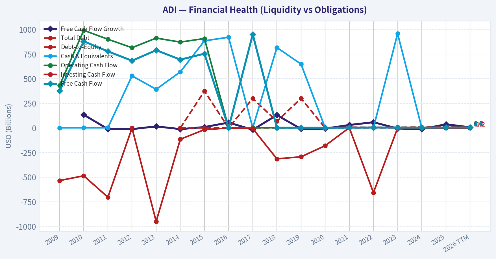

---

### Intrinsic Value Analysis (Buffett)

> *Following Warren Buffett's value investing philosophy: Circle of Competence, Economic Moat, Management Quality, and Margin of Safety.*

#### Intrinsic Value Snapshot

Price is what you pay. Intrinsic value is what the business may be worth based on the cash it can create for owners over time. We show a range, not one magic number.

- Current Price: $417.49
- Value Range: $41.56 to $275.74

##### Owner Earnings (Buffett Method)
- Net Income: $2,267,342,000.00
- Depreciation & Amortization: $1,998,845,000.00
- Capital Expenditures: $-533,552,000.00
- Working Capital Changes: $481,009,000.00
- Owner Earnings: $3,251,626,000.00

##### Intrinsic Value
###### Buffett Method
Uses owner earnings. Stricter, and usually more conservative.
- Conservative: $41.56
- Average: $165.32
- Optimistic: $165.32
- Discount Rate: 10.0%

###### Cash Flow Method
Uses free cash flow. Better for companies spending heavily today to grow tomorrow.
- Conservative: $68.98
- Average: $196.24
- Optimistic: $275.74
- Discount Rate: 10.0%

ANALYST STANCE: **WATCH**

#### ADI (Analog Devices) - Buffett-Style Preliminary Investment Review

I could not retrieve the detailed audited financial history tool output in this turn, so this is a **best-effort partial report** using the shared research pack you provided. I've still applied the Buffett framework and made progress on the key judgment: **ADI looks like a high-quality business, but the current valuation appears too rich for a classic Buffett-style margin of safety.**

---

#### 1) Go/No-Go Gate Assessment

| Gate | Verdict | Evidence |
|---|---|---|
| Gate 1: Understandability | Pass | ADI sells analog and mixed-signal chips that help electronic systems sense, measure, convert, and manage real-world signals. This is understandable at a high level, though semiconductor cycles add complexity. |
| Gate 1: 10-Year Predictability | Pass with caution | Demand for industrial, automotive, communications, and data center chips should likely persist over a decade, but end-market cycles and product transitions reduce certainty versus simpler consumer staples or software toll bridges. |
| Gate 1: Technology Risk | Pass with caution | ADI benefits from technology adoption, but semiconductors are inherently exposed to innovation cycles and competition. It is not a business likely destroyed overnight, yet it is not immune to architectural shifts. |
| Gate 2: Moat | Pass | Gross margin of 61.5% strongly suggests differentiated products, pricing power, and customer value. Analog chip businesses often benefit from long product cycles, design-in stickiness, and deep customer integration. |
| Gate 3: Management | Tentative Pass | Not enough direct evidence in this turn on insider ownership, candor, buyback discipline, or acquisition ROI. Historically, ADI has been viewed as a disciplined operator, but this needs verification with fuller data. |
| Gate 4: Industry Structure | Pass with caution | Analog semis are structurally better than many chip categories: longer cycles, less commoditized than memory, and often rationally competitive. Still, semiconductors remain cyclical and capital intensive relative to ideal Buffett businesses. |

**Key Takeaways:** ADI clears the first-level quality filters better than most semiconductor companies. The business is understandable, likely durable, and appears to possess a real moat. The main caution is that even a good chip company is still less predictable than Buffett's favorite ultra-stable business models.

---

#### 2) Elementary School Test

ADI makes tiny parts that help machines and electronics **sense the real world and turn those signals into useful information**.
If a factory machine, a car, a power system, or a communications device needs to measure temperature, sound, motion, voltage, or pressure, ADI often provides the chip that helps do that.

That is a business I can explain simply, which is a good start.

---

#### 3) Moat Analysis

| Moat Source | Assessment | Evidence |
|---|---|---|
| Intangible Assets | Moderate to Strong | ADI has a strong technical reputation and mission-critical product portfolio. Gross margin at 61.5% supports differentiated value rather than commodity pricing. |
| Switching Costs | Strong | Once ADI chips are designed into industrial or automotive systems, switching can require redesign, retesting, qualification, and reliability risk. That creates sticky customer relationships. |
| Cost Advantage | Moderate | Scale in engineering, manufacturing partnerships, and distribution likely helps, though this is probably not the core moat versus low-cost commodity producers. |
| Network Effects | Weak | This is not a network-effect business in the classic platform sense. |
| Overall Moat Rating | Wide & Stable | The moat seems rooted mainly in engineering know-how, product reliability, embedded design wins, and long product life cycles. |

**Key Takeaways:** ADI's moat is probably real, but it is not a social network or software monopoly. Its strength comes from being deeply embedded in customer systems where failure is costly and switching is inconvenient. That combination often produces durable margins and staying power.

---

#### 4) Management Quality Assessment

| Area | Preliminary View | Comments |
|---|---|---|
| Owner Mindset | Inconclusive | I do not yet have verified insider ownership or pay-structure data in this turn. |
| Candor | Inconclusive | Needs annual letter and filing review for admission of mistakes, accounting conservatism, and capital allocation transparency. |
| Capital Allocation | Cautiously Positive | ADI has historically been regarded as disciplined, but I cannot confirm retained earnings efficiency, buyback timing, or acquisition economics from the data available here. |
| Balance Sheet Attitude | Positive leaning | Current ratio of 2.19 suggests healthy near-term liquidity, though debt metrics still need confirmation. |

**Key Takeaways:** Management may be good, but I do not have enough hard evidence yet to give them full marks. For a Buffett-style endorsement, capital allocation quality must be proven, not assumed. This remains an important open item.

---

#### 5) Snapshot Financial Summary

| Metric | Value |
|---|---:|
| Current Price | $417 |
| Market Cap | $203.82B |
| P/E | 76.3 |
| ROE | 6.7% |
| Gross Margin | 61.5% |
| Revenue Growth YoY | 16.9% |
| FCF Yield | 2.1% |
| Current Ratio | 2.19 |

**Key Takeaways:** The business quality signals are mixed but interesting. Gross margin is excellent, which supports moat quality, while ROE at 6.7% is weak by Buffett standards and the valuation looks expensive with a 76 times earnings multiple and only a 2.1% free cash flow yield.

---

#### 6) Owner Earnings Calculation

I do **not** yet have the required detailed components to calculate Buffett-style owner earnings properly:

- Net income
- Depreciation & amortization
- Maintenance capex
- Working capital increases

So I will not fabricate this figure.
However, the **FCF yield of 2.1%** on a **$203.82B market cap** implies rough annual free cash flow of:

- Estimated FCF ~ **$4.28B**

This is only a rough proxy, **not true owner earnings**.

| Item | Estimate |
|---|---:|
| Market Cap | $203.82B |
| FCF Yield | 2.1% |
| Implied Annual FCF | ~$4.28B |

**Key Takeaways:** At today's valuation, ADI appears to be generating roughly $4.3 billion of annual free cash flow. That is substantial in absolute dollars, but against a $204 billion market value it does not offer a compelling current cash return for a value investor.

---

#### 7) Three-Scenario DCF Valuation

Because full owner earnings history is unavailable in this turn, I use the **implied FCF proxy of $4.28B** as a substitute. This makes the valuation rough and conservative.

| Scenario | Assumption | Equity Value Estimate |
|---|---|---:|
| A: No Growth | Value = FCF / 10% | $42.8B |
| B: 3% Growth Perpetuity | Value = FCF x 1.03 / (10% - 3%) | $63.0B |
| C: Moderate Growth | Even assuming stronger growth, current valuation still appears demanding unless growth remains high for a long time | Not enough evidence to justify $203.8B |

**Key Takeaways:** On a plain cash-yield basis, the current market value looks far above a conservative intrinsic value estimate. To justify the stock price, an investor must assume many years of strong growth and continued excellent margins. That may happen, but it is not a classic margin-of-safety setup.

---

#### 8) Margin of Safety Analysis

| Item | Value |
|---|---:|
| Current Market Cap | $203.82B |
| Conservative Value Range | ~$43B to ~$63B |
| Margin of Safety | Negative |

**Key Takeaways:** There does not appear to be a margin of safety at the current price. In fact, the shares seem priced for a very optimistic future. Buffett-style discipline would usually call for patience here, even if the business itself is attractive.

---

#### 9) Buffett Scorecard

| Criterion | Weight | Score (1-5) | Weighted Score |
|---|---:|---:|---:|
| Business Understanding | 20% | 4.0 | 0.80 |
| Moat Width & Durability | 25% | 4.0 | 1.00 |
| Management Quality | 15% | 3.0 | 0.45 |
| Return on Equity | 15% | 2.0 | 0.30 |
| Reinvestment Runway | 10% | 3.5 | 0.35 |
| Balance Sheet Strength | 5% | 3.5 | 0.18 |
| Industry Structure | 5% | 3.0 | 0.15 |
| Valuation / Margin of Safety | 5% | 1.0 | 0.05 |
| **Total** | 100% |  | **3.28 / 5.00** |

**Key Takeaways:** ADI scores as a good business but not a good value at this price. The moat and business quality support interest, but the valuation and weak reported ROE hold the score down. That lands the stock in watch-list territory rather than buy-now territory.

---

#### 10) Final Investment View

**Stance: WATCH**
**Conviction: Moderate**

ADI appears to be a **high-quality analog semiconductor company with a durable, engineering-driven moat**. It likely benefits from sticky customer relationships, long product cycles, and attractive gross margins. Those are all characteristics Buffett would respect.

But Buffett also insists on **paying a sensible price**. On the numbers available here:

- **P/E of 76.3** is very high
- **FCF yield of 2.1%** is low
- **ROE of 6.7%** is below Buffett's preferred standard
- There is **no obvious margin of safety**

So the business may be good, but the stock does **not** presently look like a classic Buffett bargain.

#### Bottom Line

If I were buying the whole company tomorrow, I would admire the business more than the price.
That means **WATCH, not ADVOCATE**.

If you want, I can next produce a **full follow-up version with a stricter 10-year financial reconstruction** once the detailed historical financial tool is available.
#### Valuation Bridge

This bridge places the current market price beside each intrinsic value lens so readers can see whether upside depends on one method or shows up across several methods.

| Scenario | Intrinsic Value / Share |
| --- | ---: |
| Buffett Method | $165.32 |
| Cash Flow Method | $196.24 |
| Damodaran Method | $79.13 |
| Current Price | $417.49 |

#### Key Takeaways

If one method is far above the others, the upside case depends on a specific modelling assumption. When several methods cluster together, the valuation story is more robust.

#### Valuation Visuals

This comparison chart from *Latest Earnings Snapshot* stacks current figures against historical benchmarks for **ADI**, making it easy to see where the company trades relative to its own averages.

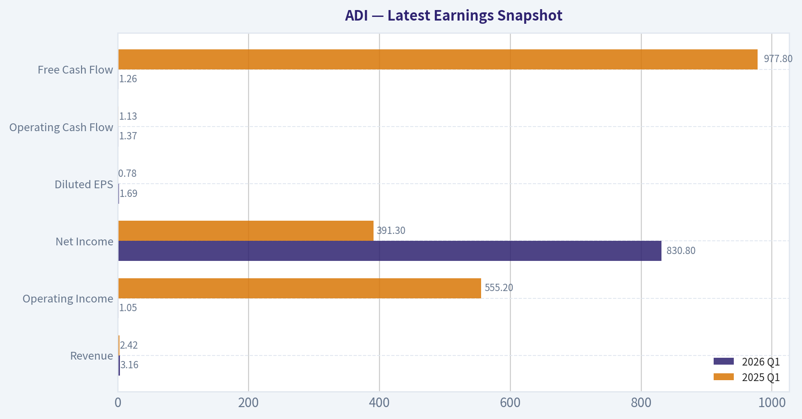

This comparison chart from *Snapshot Financial Summary* stacks current figures against historical benchmarks for **ADI**, making it easy to see where the company trades relative to its own averages.

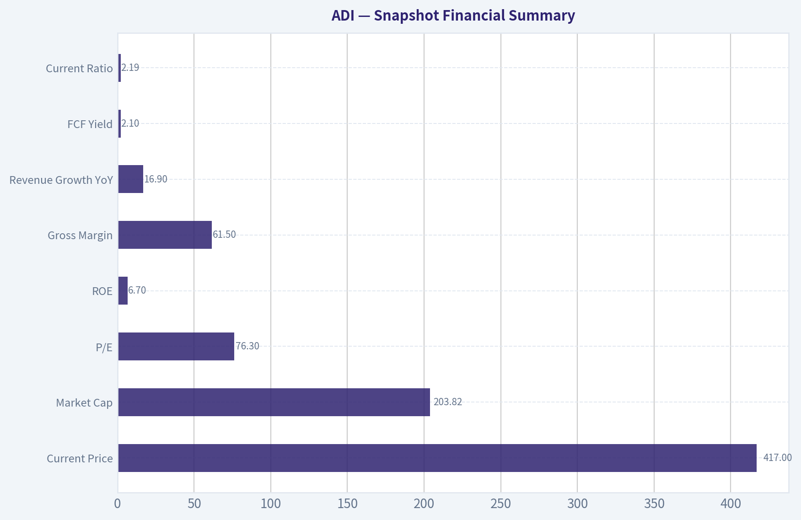

This comparison chart from *Owner Earnings Calculation* stacks current figures against historical benchmarks for **ADI**, making it easy to see where the company trades relative to its own averages.

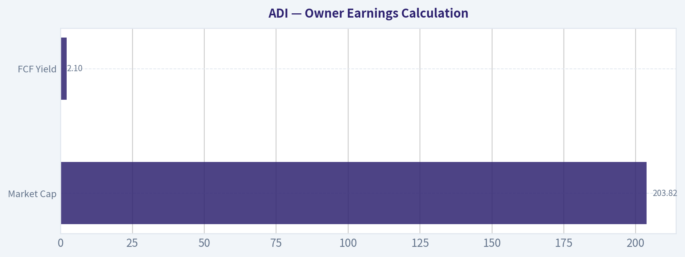

This comparison chart from *Three-Scenario DCF Valuation* stacks current figures against historical benchmarks for **ADI**, making it easy to see where the company trades relative to its own averages.

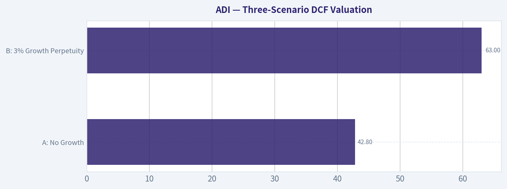

This comparison chart from *Margin of Safety Analysis* stacks current figures against historical benchmarks for **ADI**, making it easy to see where the company trades relative to its own averages.

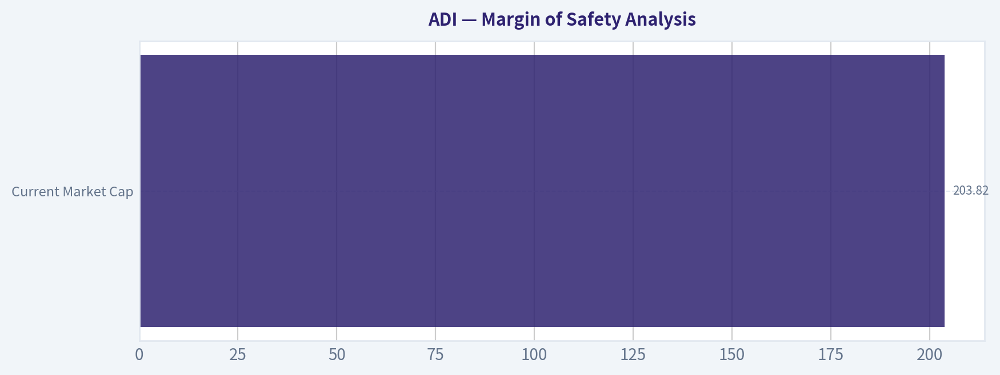

---

### Trend & Growth Analysis (Lynch/Druckenmiller/Fisher)

> *Following Peter Lynch's GARP, Stanley Druckenmiller's macro-aware approach, and Philip Fisher's scuttlebutt methodology.*

ANALYST STANCE: **WATCH**

#### 1. Lynch Classification

| Item | Assessment |
|---|---|
| Lynch category | **Fast Grower / Quality Semiconductor Compounder** |
| Why not stalwart? | Current reported **YoY revenue growth of 16.9%** is above stalwart range |
| Why not pure hyper-growth? | ADI remains partly cyclical and tied to industrial/auto analog demand |
| Best fit | **Fast grower with cyclical overlays** |

Key Takeaways: ADI currently screens as a fast grower based on the latest growth rate, but it is not a classic software-like hyper-growth story. It is better understood as a high-quality analog semiconductor leader benefiting from an upcycle and secular AI, industrial, and automotive demand. That makes the stock attractive fundamentally, but also more sensitive to cycle timing and valuation.

---

#### 2. The Story in 3 Bullets

| Simple story | Why it matters |
|---|---|
| ADI makes the analog chips that help machines, cars, factories, and data centers sense and control the real world | This is a durable, mission-critical layer of electronics |
| It benefits from long product cycles, sticky design wins, and high gross margins | That supports strong free cash flow and moat durability |
| The current upside case is an **AI + industrial + automotive content recovery** driving better growth and margins | This is the main inflection-point argument |

Key Takeaways: The ADI story is easy to explain: it sells essential analog chips into important, sticky end markets. The bull case is not just "more chips," but rising analog content in industrial systems, vehicles, and AI-related infrastructure. That creates a credible path for sustained above-average growth, but probably not true ten-bagger-style expansion from this scale.

#### 3. TAM Analysis and 10x Test

| Metric | Value / Estimate |
|---|---|
| Current market cap | **$203.82B** |
| Current revenue growth YoY | **16.9%** |
| Current revenue base | Not fully confirmed from tool output; ADI is already a very large analog player |
| End-market exposure | Industrial, automotive, communications, consumer, aerospace/defense, AI/data center adjacency |
| TAM direction | Expanding modestly to solidly via electrification, automation, AI power/sensing, edge intelligence |
| 10x test | **Fails** in practical terms |
| Why | A 10x revenue outcome would imply ADI becoming an enormous share of the analog/mixed-signal market and adjacent categories |

Key Takeaways: ADI has a good runway, but not a realistic 10x runway from today's size. The addressable markets are attractive and still growing, especially in industrial automation, automotive electronics, and AI-related systems, but ADI is already large. This is more likely a quality compounder than a fresh ten-bagger candidate.

#### 4. Revenue Growth Trend

| Metric | Value |
|---|---|
| Revenue growth YoY | **16.9%** |
| Pattern read | **Re-accelerating / cyclical recovery** |
| Interpretation | Better than a mature stalwart, but not enough history here to call it a durable acceleration trend |
| Quality note | Growth likely supported by broad demand recovery and AI/data center strength per earnings coverage |

Key Takeaways: The latest growth number is strong enough to matter. It suggests ADI is participating in a favorable demand phase, likely helped by margin recovery and broad-based analog demand. Still, without a fuller multi-quarter sequence, I would call this a promising improvement rather than a fully confirmed long-duration acceleration.

#### 5. Unit Economics / Quality Metrics

| Metric | Value | Assessment |
|---|---:|---|
| Gross margin | **61.5%** | Excellent for semis; confirms premium analog positioning |
| ROE | **6.7%** | Weak relative to premium valuation; may reflect capital structure/accounting effects |
| FCF yield | **2.1%** | Low; implies expensive equity valuation |
| Current ratio | **2.19** | Healthy liquidity |
| Rule of 40 proxy | **16.9 + estimated FCF margin not available** | Incomplete |
| NRR | N/A | Not relevant for ADI |
| LTV/CAC | N/A | Not relevant for ADI |

Key Takeaways: ADI's core economic quality is visible in the gross margin, which remains excellent and supports the moat thesis. The problem is valuation and capital efficiency optics: the low free-cash-flow yield and elevated multiple leave less room for error. Liquidity is fine, but the stock price already seems to reflect a lot of optimism.

#### 6. Inflection Point Assessment

| Inflection type | Assessment | Evidence |
|---|---|---|
| Product cycle inflection | **Moderate positive** | AI-driven data center demand mentioned in coverage |
| Market share inflection | **Unclear** | No hard share data from tool output |
| Margin inflection | **Positive** | Coverage indicates margins expanding despite higher spending |
| TAM inflection | **Positive** | AI, industrial automation, electrification expand analog content needs |
| Competitive inflection | **Not proven** | No direct evidence of a rival stumble |

Key Takeaways: The clearest inflection at ADI is margin and demand recovery rather than a revolutionary product breakout. The AI angle helps, but ADI's opportunity is more about analog content expansion into many systems than one explosive new platform. That supports upside, though it is a steadier compounding thesis than a dramatic re-rating story.

#### 7. Macro Setup Evaluation

| Macro factor | Assessment |
|---|---|
| Rates backdrop | **Mixed to negative** |
| Latest signal | Hot CPI pushed yields higher and reduced rate-cut hopes |
| Growth stock sensitivity | Negative for high-multiple names like ADI |
| Secular themes | AI/ML, industrial automation, auto electrification, edge intelligence |
| Macro conclusion | **Strong secular tailwinds, weak valuation backdrop** |

Key Takeaways: The business trends are favorable, but the macro setup is not ideal for an expensive growth stock. Higher yields tend to hurt long-duration equities, especially those already trading at premium multiples. So the macro picture is supportive for operations but not especially supportive for the stock multiple.

---

#### 8. Fisher 15 Points Score

| Fisher area | Score (1-5) | Comment |
|---|---:|---|
| Market potential | 4 | Solid growth markets, though not unlimited |
| New products | 4 | Ongoing innovation in analog/mixed-signal |
| R&D effectiveness | 4 | Strong technical franchise |
| Sales organization | 4 | Deep OEM and industrial relationships |
| Profit margin | 5 | Gross margin very strong |
| Improving margins | 4 | Current evidence supportive |
| Labor relations | 3 | No special evidence either way |
| Executive relations | 3 | Neutral from available data |
| Management depth | 4 | Large scaled operator |
| Cost/accounting discipline | 4 | Mature semiconductor operator |
| Outstanding moat aspects | 5 | Switching costs, long product cycles, qualification barriers |
| Long-range profit outlook | 4 | Attractive, though cyclical |
| Dilution risk | 4 | Low apparent dilution concern |
| Candor in difficulties | 3 | Insufficient direct evidence |
| Integrity | 4 | No obvious issues from available data |

| Total | Score |
|---|---:|
| Fisher Score | **59 / 75** |

Key Takeaways: ADI scores as a good Fisher company rather than an exceptional one. The strongest points are product quality, margins, and moat durability, especially in hard-to-replace analog applications. The weaker areas are simply those where we do not have enough direct scuttlebutt evidence, not necessarily major negatives.

#### 9. Valuation Analysis

| Metric | Value | Read |
|---|---:|---|
| Current price | **$417** |
| Market cap | **$203.82B** |
| P/E | **76.3x** | Expensive |
| FCF yield | **2.1%** | Expensive |
| PEG | Not reliable here | Likely well above 2 if using current P/E and 16.9% growth |
| Implied Lynch read | **Poor PEG setup** | Not GARP today |

| Scenario | View |
|---|---|
| Bear case | Growth normalizes, yields stay high, multiple compresses |
| Base case | ADI compounds fundamentals, but stock returns moderate due to starting valuation |
| Bull case | AI + industrial + auto demand sustain strong growth and margins, justifying premium multiple longer |

Key Takeaways: Valuation is the main issue. A P/E above 76 and free-cash-flow yield around 2 percent do not fit Peter Lynch-style growth at a reasonable price. Even if the business performs well, future stock returns may be limited unless earnings rise fast enough to catch up with the current premium.

#### 10. Growth Investor Scorecard

| Criterion | Weight | Score (1-5) | Weighted |
|---|---:|---:|---:|
| The Story | 10% | 4.0 | 0.40 |
| TAM & Runway | 20% | 3.0 | 0.60 |
| Revenue Growth | 20% | 3.8 | 0.76 |
| Unit Economics | 15% | 4.0 | 0.60 |
| Competitive Position | 10% | 4.5 | 0.45 |
| Management Quality | 10% | 3.8 | 0.38 |
| Macro Setup | 5% | 2.8 | 0.14 |
| Profitability Path | 5% | 4.0 | 0.20 |
| Valuation | 5% | 1.5 | 0.08 |

| Total | Score |
|---|---:|
| Weighted score | **3.61 / 5.00** |

Key Takeaways: ADI scores as a good business with a decent setup, but not a clean buy at the current price. The score is pulled up by moat, margins, and end-market quality, while valuation is the major drag. That produces a WATCH rather than ADVOCATE conclusion.

---

#### 11. Position Size Stance

| Stance | Sizing view |
|---|---|
| **WATCH** | Do not initiate full position at current valuation |
| Existing holders | Hold or trim to risk tolerance if oversized |
| New buyers | Prefer waiting for either multiple compression or stronger evidence of sustained acceleration |
| Ideal setup | Pullback, lower rates, or clearer earnings-upcycle confirmation |

Key Takeaways: ADI is not a stock to chase aggressively here. It is worth monitoring closely because the business quality is real, but the valuation leaves little margin of safety. For disciplined growth investors, patience is the better edge right now.

#### 12. Key Risks and Catalysts

| Risks | Catalysts |
|---|---|
| Multiple compression from higher yields | Better-than-expected earnings and guidance |
| Industrial or auto demand slowdown | AI/data center analog demand broadens |
| Cyclical semiconductor inventory correction | Continued margin expansion |
| Premium valuation already discounts much of the good news | More evidence of durable broad-based recovery |
| Growth decelerates from current 16.9% | Large customers increase content per system |

Key Takeaways: The biggest risk is simple: a great company can still be a poor stock if bought too expensively. The most important upside catalyst would be proof that current growth is not just cyclical recovery, but part of a stronger and longer earnings expansion cycle. If that happens, ADI could continue to work, but the reward-to-risk is not compelling enough yet for a fresh high-conviction call.

#### Bottom Line

ADI is a **high-quality analog semiconductor compounder** with real secular tailwinds, a durable moat, and encouraging signs of growth and margin improvement. But at roughly **76x earnings** and a **2.1% FCF yield**, this is not a Lynch-style GARP entry point. Great business, stretched stock: **WATCH**.

#### Growth & Scorecard Visuals

The radar chart below from *Buffett Scorecard* visualises how **ADI** ranks across weighted investment criteria. Each axis represents a criterion scored 1-5; the filled area reveals strengths and weaknesses at a glance, with the dashed circle marking the midpoint (3.0).

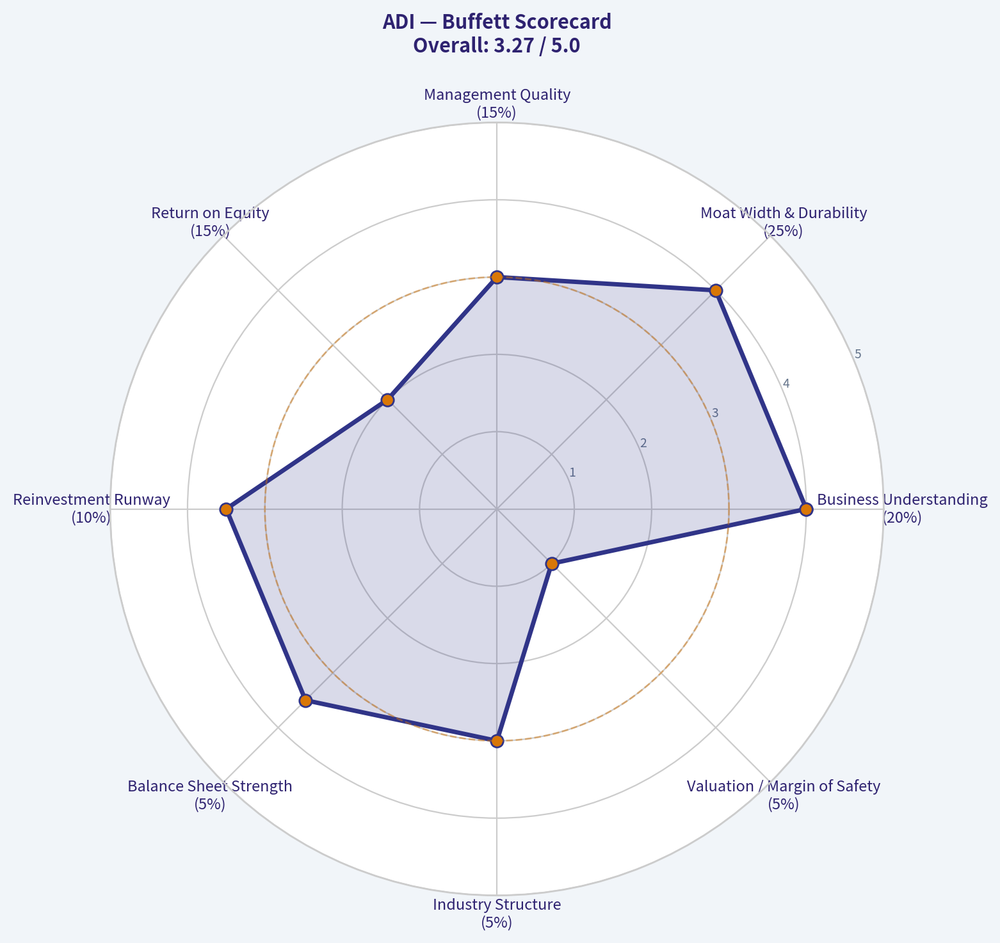

---

### Market Technical Analysis

#### ADI Technical Indicator Report

For **ADI (Analog Devices)**, the most relevant indicators for the current market context are:

1. **close_10_ema**
2. **close_50_sma**
3. **close_200_sma**
4. **macd**
5. **macdh**
6. **rsi**
7. **atr**
8. **vwma**

These eight work well together because they cover **short-term momentum, medium- and long-term trend structure, momentum acceleration, overbought/oversold behavior, volatility, and volume-weighted trend confirmation**. I avoided Bollinger Bands here because RSI + ATR + moving averages already capture the key stretch and volatility information with less overlap.

---

#### Market Context and Trend Structure

ADI is in a **strong multi-timeframe uptrend**, but the stock is also entering a more delicate stage where momentum remains bullish while becoming less explosive than it was during the late-April and early-May breakout phase.

Over the past year, the stock advanced from the low **$200s** to above **$430**, which is a substantial re-rating. The most important structural observation is that the rally was not a single uninterrupted move. It had distinct phases:

- **May to July 2025:** recovery and gradual advance from the low-$200 area into the low-$240s.
- **Late July to October 2025:** digestion and corrective range, with repeated failures to sustain upside progress.
- **November 2025 to February 2026:** powerful breakout regime, where the stock moved from the low-$230s to the mid-$350s.
- **March 2026:** meaningful pullback and consolidation, but without breaking the longer-term trend.
- **April to May 2026:** renewed upside expansion, including a breakout above prior highs and a push toward the mid-$430s before a recent pullback.

That sequence matters. It tells traders this is **not just a short squeeze or one-off spike**. The trend has been durable across quarters, and the March setback functioned more like a reset than a full structural reversal.

---

#### Moving Averages: Trend Is Strong, But Extension Is Still Meaningful

The moving-average stack is decisively bullish.

- **10 EMA (May 15): 415.55**
- **50 SMA (May 15): 356.38**
- **200 SMA (May 15): 289.14**
- **Close (May 15): 417.49**

This is a textbook bullish hierarchy:
- price above the **10 EMA**
- 10 EMA well above the **50 SMA**
- 50 SMA far above the **200 SMA**

That configuration says ADI is strong across **short-, medium-, and long-term horizons**. More importantly, the slopes of the moving averages are all still rising. The **50 SMA** has climbed from about **319.39** in mid-March to **356.38** by mid-May, showing that the intermediate trend is strengthening, not merely drifting. The **200 SMA** has risen from roughly **234.95** in mid-January to **289.14**, confirming strategic trend health.

However, there is an important nuance: price is now **very far above the 200 SMA**. That distance signals strong leadership, but also implies that mean-reversion risk is nontrivial if momentum cools further. Long-term bulls can view the 200 SMA as evidence of trend safety; short-term traders should view it as evidence that the move is already quite extended from its secular base.

---

#### MACD and Histogram: Bullish Momentum, But No Longer Accelerating Cleanly

The **MACD** remains strongly positive:
- **May 15 MACD: 19.17**

That is still a bullish reading and reflects strong upward trend persistence. The more subtle message comes from the **MACD Histogram**:
- **May 13: 1.38**
- **May 14: 1.02**
- **May 15: -0.03**

The histogram fading from solidly positive to nearly flat and slightly negative suggests that **upside momentum is still elevated, but the rate of acceleration has stalled**. This often occurs after a strong advance when price continues holding relatively high levels, yet buyers are no longer pushing with the same force day after day.

This is not the same as saying trend has turned bearish. It means the stock has shifted from **impulsive breakout behavior** to a more **mature advance**, where follow-through may need either:
- a fresh consolidation, or
- a catalyst strong enough to reignite momentum expansion.

For traders, that distinction is critical. When MACD is positive but histogram fades, the market is often still in an uptrend but no longer offering the cleanest chase entries.

---

#### RSI: Strong, But Cooling From Overbought Territory

Recent RSI readings:
- **May 13: 73.74**
- **May 14: 69.60**
- **May 15: 63.25**

This is a healthy pattern for bulls. ADI was recently **overbought**, which is expected in a strong trending stock. The RSI has now eased back out of the most stretched zone without collapsing into weakness. That often indicates **momentum normalization rather than outright distribution**.

There are two ways to interpret this:

1. **Bullish interpretation:**
   The stock is digesting gains in an orderly way. RSI coming down from the 70s while price remains above key moving averages is often constructive.

2. **Cautionary interpretation:**
   If RSI continues to weaken while price stalls near highs, it could become an early signal of bearish divergence or at least a multi-week consolidation.

At the moment, RSI favors the first interpretation more than the second. ADI is not showing panic unwinding. It is showing **controlled cooling**.

---

#### VWMA: Volume Has Confirmed the Uptrend

The **VWMA** has risen steadily:
- **Apr 1: 312.64**
- **Apr 23: 360.61**
- **May 15: 409.42**

This is important because VWMA incorporates volume, not just price. A rising VWMA means the average price being transacted, weighted by participation, is moving upward. In plain terms, **the rally has not been occurring on weak, hollow price action alone**. Volume-supported buyers have participated along the way.

Also notable:
- Current price on May 15 (**417.49**) remains above the **VWMA (409.42)**.
- That suggests buyers still control the tape on a volume-weighted basis, even after the recent retreat from the peak area.

This is a favorable confirmation signal. If price were slipping below VWMA while MACD histogram rolled over and RSI weakened sharply, that would be more concerning. As of now, VWMA still argues that pullbacks are occurring **within** a strong trend, not yet **against** it.

---

#### ATR: Volatility Is Elevated, So Risk Management Matters

Recent **ATR**:
- **Apr 16: 9.41**
- **Apr 23: 11.50**
- **May 15: 11.73**

ATR has increased, which means daily price swings have become larger. That fits the chart behavior: ADI has been making aggressive directional moves, and even normal pullbacks can be several dollars wide.

For traders, rising ATR changes execution:
- **Stops need more room**
- **Position sizes may need to be smaller**
- **Buying breakouts requires discipline**, because intraday reversals can be sharper than they appear in calmer regimes

The key point is that elevated ATR is not bearish by itself. In strong uptrends, ATR often rises because trend participation intensifies. But it does mean the stock is less forgiving. Poorly timed entries can be punished even if the broader trend remains bullish.

---

#### Fine-Grained Trading Interpretation

The current setup is best described as **bullish trend, moderating momentum, elevated volatility**.

That is different from a fresh breakout setup. A fresh breakout usually features:
- price just clearing resistance,
- MACD turning up sharply,
- histogram expanding,
- RSI moving into strength.

ADI is a bit later than that stage. Instead, it now looks like:
- price still above all major trend references,
- medium- and long-term trend still strengthening,
- short-term momentum positive but less explosive,
- RSI cooling from overbought,
- volatility elevated enough to create sharper pullbacks.

This usually favors one of two trading styles:

| Style | What fits now |
|---|---|
| Trend-following swing trader | Wait for pullbacks toward 10 EMA / VWMA / prior breakout zones rather than chase vertical candles |
| Long-term investor | Continue to respect the strong trend unless price starts breaking below medium-term support and momentum deteriorates further |

**Key Takeaways:** ADI still looks technically strong, but the stock is no longer in the easiest part of its advance. The bigger trend remains bullish, while the short-term picture suggests traders may get better risk-adjusted entries on controlled pullbacks rather than on aggressive upside chasing.

---

#### Practical Levels and Decision Framework

Using the indicators available, the chart suggests a layered support structure:

1. **10 EMA near 415.5**
   First short-term trend test. Price closed only slightly above this level on May 15, so this is the immediate line to watch.

2. **VWMA near 409.4**
   If price loses the 10 EMA, VWMA becomes a meaningful confirmation area. Holding above it would support the view that recent weakness is only a pause.

3. **Psychological / recent breakout zone around 400**
   This is not from an indicator directly, but it aligns with recent price behavior and sits near the region where trend followers may re-engage.

4. **50 SMA near 356.4**
   This is much lower, which tells us the medium-term trend is strong enough to tolerate a sizable pullback without losing structural integrity.

Upside-wise, the market needs to reclaim and sustain the **430-436 region** to show momentum is re-accelerating. If that happens while RSI stabilizes and MACD histogram turns back positive, the trend could resume another leg higher.

If instead price spends time under the 10 EMA and RSI drifts lower while MACD histogram stays negative, the more likely scenario becomes **sideways-to-down consolidation**, not necessarily a bear trend but a needed reset after a steep run.

---

#### Bottom Line

ADI remains one of the stronger technical setups on a trend basis. The **200 SMA, 50 SMA, and VWMA** all confirm that the primary and intermediate trends are healthy. The **10 EMA, MACD, MACD histogram, and RSI** show that the stock is still bullish, but the latest advance is **losing some short-term thrust**. **ATR** warns that volatility is high enough to make entry timing and sizing especially important.

So the most nuanced conclusion is:

- **Long-term trend:** strongly bullish
- **Intermediate trend:** bullish and still strengthening
- **Short-term momentum:** bullish but cooling
- **Risk profile:** elevated volatility; avoid careless chasing
- **Preferred posture:** buy disciplined pullbacks or wait for renewed momentum confirmation above recent highs

---

#### Summary Table

| Indicator | Latest Reading / Condition | What It Suggests | Trading Implication |
|---|---:|---|---|
| close_10_ema | 415.55 | Price is near and slightly above short-term trend support | Immediate support zone; loss of this level may trigger consolidation |
| close_50_sma | 356.38 | Strongly rising medium-term trend | Pullbacks remain bullish unless much deeper damage occurs |
| close_200_sma | 289.14 | Strong long-term uptrend | Strategic trend remains intact and very healthy |
| macd | 19.17 | Momentum still strongly positive | Bulls still have control overall |
| macdh | -0.03 | Momentum acceleration has faded | Trend is intact, but upside thrust is no longer expanding cleanly |
| rsi | 63.25 | Cooling from overbought conditions | Healthy reset so far; not yet a bearish breakdown |
| atr | 11.73 | Volatility remains elevated | Use wider stops and more careful position sizing |
| vwma | 409.42 | Volume-weighted trend still rising; price above it | Rally remains supported by participation, not just price alone |

**Key Takeaways:** The table shows a clear bullish trend across all major timeframes, with ADI still trading above its most important moving averages. The main caution is not trend failure, but slowing short-term momentum and elevated volatility, which suggests traders should favor disciplined entries over chasing strength.

---

### News & Events Analysis

#### Analog Devices (ADI) weekly trading and investment report

ADI remains one of the stronger analog/semi names in the market, but the setup into the next print is now less about "is demand recovering?" and more about whether the stock's valuation can keep outrunning already-improving fundamentals. Over the past week, the news flow points to three forces that matter most for traders: AI/data-center power exposure supporting sentiment, cyclical recovery across industrial/automotive analog improving estimates, and a macro rate shock that is pressuring high-multiple semiconductor names.

#### Latest earnings status and what traders should focus on

ADI has **not yet reported fiscal Q2 2026** as of **2026-05-16**. The most recent coverage in the past week was **preview coverage** for the **quarter ended April 2026**, including discussion of Wall Street expectations for the upcoming release.

That matters because the market is now pricing ADI as a recovery-plus-AI beneficiary. The key near-term question is whether the upcoming **fiscal Q2 2026** report confirms:
- broad-based order normalization,
- improving utilization and margins,
- stronger AI/data-center power management content,
- and enough guidance upside to justify the stock's sharp rally.

Based on the shared research pack, the business already shows improving fundamentals:
- **Revenue growth YoY: 16.9%**
- **Gross margin: 61.5%**
- **ROE: 6.7%**
- **FCF yield: 2.1%**
- **P/E: 76.3x**
- **Current ratio: 2.19**

Interpretation:
- The **headline change versus the prior downturn period** is clear: sales growth has reaccelerated and profitability remains robust.
- The **problem for new buyers** is that valuation has expanded much faster than cash-flow yield. A **76x P/E** and **2.1% FCF yield** leave less room for execution misses.
- So for the upcoming April-quarter report, traders should focus less on the headline EPS beat and more on **guidance quality**, especially industrial, automotive, and communications commentary.

#### Company-specific news over the last week

Recent stock-specific coverage shows ADI being framed as:
1. a beneficiary of **AI-driven data center power demand**,
2. a participant in a broader **analog semiconductor cyclical upturn**,
3. and a stock that has run hard enough to become sensitive to macro and valuation compression.

Several articles highlighted ADI's strong year-to-date move, including discussion that the stock has climbed sharply and even hit/approached record levels. Commentary also tied ADI's upside to its role in enabling power delivery and signal integrity in high-performance compute systems. That is important because ADI is not a classic "GPU AI pure play"; instead, it benefits through the less crowded but critical **power, connectivity, sensing, and signal-chain infrastructure** layer.

There was also a notable positive sell-side signal:
- **Cantor Fitzgerald raised its price target to $510 from $400 and maintained Overweight** on May 13, citing an improving analog cycle.

For trading, that signals:
- buy-side confidence is broadening beyond just AI enthusiasm,
- the analog cycle narrative is turning from "bottoming" to "rising,"
- and ADI is being re-rated alongside other quality semis rather than treated as a lagging industrial chip supplier.

At the same time, the past week also showed that ADI is vulnerable when macro conditions turn hostile. On May 15-16, semiconductor names, including ADI, sold off as hotter inflation data pushed Treasury yields higher and reduced rate-cut expectations. That is a direct risk for ADI because its multiple is now elevated enough that even good operating news can be offset by discount-rate pressure.

#### Broader industry and peer context

Peer and sector news over the week suggests a favorable industry backdrop for ADI:

| Theme | What happened this week | Why it matters for ADI |
|---|---|---|
| Analog cycle recovery | Coverage on Texas Instruments and other analog names pointed to improved industrial demand and better sales growth | Confirms ADI is not rallying in isolation; end-market recovery appears broader |
| AI infrastructure | Nvidia-related optimism and broader AI capex enthusiasm remained strong | Supports ADI's exposure to power management, signal chain, and data-center infrastructure |
| Automotive/EV | ADI was highlighted as an EV supply-chain investment idea | Reinforces ADI's leverage to electrification, ADAS, and vehicle content growth |
| Valuation sensitivity | Higher bond yields triggered semi stock weakness | ADI's premium multiple makes it more rate-sensitive than slower-moving value semis |

Key Takeaways: The industry backdrop is fundamentally constructive for ADI because both analog demand recovery and AI infrastructure spending are supporting sentiment. But the same backdrop is also creating crowding in quality semiconductor names, which means ADI may react sharply to any disappointment on guidance, margins, or order trends.

Compared with peers:
- **Texas Instruments** is often viewed as the more conservative analog benchmark.
- **Monolithic Power** captures more direct high-growth power exposure.
- **NXP** offers stronger auto/industrial leverage with different cyclicality.
- ADI sits in an attractive middle ground: high-quality analog franchise, broad industrial exposure, and increasingly credible AI infrastructure optionality.

That mix is why the stock has worked. It also explains why expectations are rising quickly.

#### Macro and market context

The biggest macro development in the last week was **hotter April CPI**, which pushed **Treasury yields higher** and weakened expectations for 2026 rate cuts. This is especially relevant for ADI because:
- high-quality semis have seen substantial multiple expansion,
- AI-linked names trade partly on duration and future growth assumptions,
- and ADI's rally has moved it from "cyclical recovery" territory into "premium compounder" territory.

So the macro read-through is nuanced:
- If rates stabilize, ADI can continue to benefit from earnings revision momentum.
- If inflation surprises persist and yields keep rising, ADI could underperform despite decent execution because its valuation leaves limited cushion.

For portfolio managers, ADI is no longer just a cyclical rebound trade; it is increasingly a **quality growth semiconductor** holding. That shifts the stock's sensitivity away from only PMI/order data and toward a combination of:
- long-end yields,
- AI capex sentiment,
- and forward margin durability.

#### Positioning and sentiment

The shared 13F data shows:
- **Steve Cohen / Point72 initiated a position** worth about **$54.6M** as of **12-31-2025**.

That is not a real-time positioning signal, but it does indicate sophisticated investor interest during the recovery phase. Combined with recent bullish media and target-price increases, sentiment appears clearly positive.

However, sentiment now looks **crowded on the long side**:
- stock up sharply,
- recurring "buy/hold/sell" and "record high" articles,
- AI halo expanding,
- and bullish analog-cycle calls building.

In trading terms, this often means:
- upside can continue on a strong earnings beat plus raised guidance,
- but the stock may sell off on merely "good enough" results.

#### Trading/investment implications

| Horizon | Bull case | Bear case | What to watch |
|---|---|---|---|
| Near term: next earnings | Q2 FY2026 confirms accelerating recovery, strong industrial orders, AI/data-center strength, and better guidance | Results beat but guidance only modestly improves, prompting profit-taking after large run | Revenue growth, book-to-bill/order commentary, gross margin, Q3 guide |
| Medium term: 3-6 months | Analog cycle broadens; AI infrastructure content expands; valuation supported by estimate revisions | Bond yields stay high and compress multiples; industrial recovery stalls; inventory normalization fades | Yield moves, PMIs, peer commentary from TXN/NXP/MPWR/NVDA ecosystem |
| Long term | ADI becomes re-rated as a durable analog + AI infrastructure enabler | AI exposure proves too small to sustain premium valuation; stock reverts toward traditional analog multiples | Mix shift toward higher-growth end markets and sustained FCF growth |

Key Takeaways: ADI's bullish case depends on fundamentals continuing to improve fast enough to justify a now-rich valuation. The bearish case is less about business deterioration and more about whether expectations, rates, and positioning have all moved too far too quickly.

#### Bottom line

ADI's news flow over the last week is **fundamentally supportive but tactically less forgiving**. The company is benefiting from the right themes: analog cycle recovery, industrial stabilization, automotive content, and AI/data-center infrastructure. That makes the business backdrop attractive.

But from a trading perspective, the stock is now priced for a lot of that good news already. With the **fiscal Q2 2026 report for the quarter ended April 2026 still pending**, the next catalyst is crucial. A strong print with clearly higher guidance could extend the re-rating. Anything short of a decisive upside guide may invite consolidation, especially if yields remain elevated.

For investors:
- **Constructive fundamentally**
- **Neutral-to-cautious tactically into earnings due to valuation and macro sensitivity**

#### Summary table

| Category | Key point | Investment/trading read-through |
|---|---|---|
| Earnings status | ADI has not yet reported fiscal Q2 2026; current focus is the quarter ended April 2026 | Upcoming report is the central catalyst |
| Fundamental trend | Revenue growth has improved to 16.9% YoY with 61.5% gross margin | Recovery is real, not just narrative-driven |
| AI exposure | ADI is increasingly viewed as a power/signal-chain beneficiary of AI infrastructure buildout | Supports premium valuation, but raises expectations |
| Sector backdrop | Analog and industrial semiconductor commentary has improved across peers | Positive external confirmation for ADI demand recovery |
| Macro risk | Hot CPI and rising yields hit semiconductor valuations this week | ADI is vulnerable because of its expanded multiple |
| Valuation | P/E of 76.3x and FCF yield of 2.1% imply little room for disappointment | Good company, but harder setup for fresh chasing |
| Sentiment | Bullish media tone, rising targets, and strong recent price action | Momentum is positive, but crowding risk is rising |
| Positioning signal | Point72 disclosed a new position in the latest available 13F snapshot | Adds credibility to the bullish institutional case, though lagged |

Key Takeaways: ADI has strong business momentum, and the market is rewarding it as a high-quality analog and AI-adjacent semiconductor name. The main challenge is that valuation and expectations have risen so much that the upcoming April-quarter earnings report needs to be clearly strong, not merely acceptable.

---

### Guru Attention Analysis

> *Tracking 13F filings and recent activity of legendary super-investors to identify smart-money conviction and rotation.*

#### ADI Guru Ownership Snapshot

The canonical 13F data shows **only one tracked guru with a disclosed ADI position** in the latest available filing set: **Steve Cohen / Point72**. Per the anti-hallucination rule, all other tracked gurus should be treated as having **no position detected in latest 13F filing** unless explicitly shown by the structured tool.

| Guru | Status in Latest 13F | Action | Position Size | Portfolio Weight | Recent Change | Timing | Verification |
| --- | --- | --- | ---: | ---: | --- | --- | --- |
| Steve Cohen (Point72) | Position detected | Initiated | $54.57M / 201.20K shares | 0.06% | New position vs. prior filing | 12-31-2025 filing period | [SEC 13F Filing](https://www.sec.gov/Archives/edgar/data/1603466/000090266426001100/) |
| Warren Buffett (Berkshire Hathaway) | No position detected in latest 13F filing | - | - | - | - | Latest structured check | - |
| Seth Klarman (Baupost Group) | No position detected in latest 13F filing | - | - | - | - | Latest structured check | - |
| Mohnish Pabrai (Pabrai Investment Funds) | No position detected in latest 13F filing | - | - | - | - | Latest structured check | - |
| Bill Ackman (Pershing Square) | No position detected in latest 13F filing | - | - | - | - | Latest structured check | - |
| Stanley Druckenmiller (Duquesne Family Office) | No position detected in latest 13F filing | - | - | - | - | Latest structured check | - |
| Michael Burry (Scion Asset Management) | No position detected in latest 13F filing | - | - | - | - | Latest structured check | - |

Key Takeaways: Among the tracked super-investors, the only confirmed ADI holder is Steve Cohen's Point72, which initiated a new position in the latest available filing. Even so, it is a very small position at just 0.06% of Point72's disclosed 13F portfolio, so it does not appear to be a high-conviction core bet. No other primary tracked guru showed a detectable ADI position in the latest structured 13F data.

#### Detailed Guru Note

| Guru | Interpretation |
| --- | --- |
| Steve Cohen | **Initiated** ADI at 12-31-2025 with **201.20K shares**, worth **$54.57M**. Because the position did not appear in the prior 09-30-2025 filing, this is a fresh entry rather than an add. The small portfolio weight suggests tactical or exploratory sizing rather than a concentrated conviction position. |

Key Takeaways: Steve Cohen's move is the only actionable guru signal here, and it points to fresh interest rather than a long-standing holding. However, the size is modest, so investors should be careful not to over-interpret it as a major endorsement of ADI.

#### What This Means for Investors

- **Bullish signal:** A new Point72 position indicates at least one sophisticated fund chose to gain exposure to ADI.
- **But size matters:** At **0.06%** of portfolio weight, this is **not** a major bet by Cohen.
- **Breadth of guru ownership is limited:** There is **no broad super-investor consensus** in the latest structured 13F data.
- **Timing caveat:** The filing is a **quarter-end snapshot as of 12-31-2025**, so the actual current holding may have changed since then.

#### Verification Links

- Steve Cohen / Point72: [SEC 13F Filing](https://www.sec.gov/Archives/edgar/data/1603466/000090266426001100/)
- Point72 EDGAR filing history: [All 13F Filings (SEC EDGAR)](https://www.sec.gov/cgi-bin/browse-edgar?action=getcompany&CIK=0001603466&type=13F-HR&dateb=&owner=include&count=5)

#### Bottom Line

Based strictly on the canonical 13F data, **ADI currently has very limited tracked guru sponsorship**. The only confirmed holding is a **new but small Point72 position**, while all other primary tracked gurus show **no position detected in latest 13F filing**.

---

### Options Market Analysis

> *Reading options flow - put/call ratios, IV skew, and unusual activity - to gauge institutional positioning and event-driven risk.*

#### ADI Options Positioning Report
*Date: 2026-05-16*

ADI's near-term options tape leans **bearish**, with the strongest evidence coming from **heavy put volume**, multiple **fresh put positions far exceeding open interest**, and a **put/call volume ratio of 3.34**, which is well above a neutral baseline. Open-interest positioning is less extreme than volume, which suggests the latest move is being driven more by **new downside protection or directional bearish flow** than by long-standing positioning.

#### 1. Put/Call Ratio Analysis

| Expiry | Call OI | Put OI | Put/Call OI Ratio | Call Vol | Put Vol | Put/Call Vol Ratio |
|---|---:|---:|---:|---:|---:|---:|
| 2026-05-22 | 3,850 | 2,506 | 0.65 | 2,811 | 8,161 | 2.90 |
| 2026-05-29 | 1,513 | 1,844 | 1.22 | 410 | 2,647 | 6.46 |
| 2026-06-05 | 926 | 807 | 0.87 | 197 | 609 | 3.09 |
| **Near-term total** | **6,289** | **5,157** | **0.82** | **3,418** | **11,417** | **3.34** |

**Key Takeaways:** Open interest is only modestly defensive overall, with a 0.82 put/call OI ratio versus a historical neutral around 0.7, so existing positioning is somewhat cautious but not extreme. The bigger message is in flow: put volume is running more than 3.3x call volume across the near-term expiries, and the 2026-05-29 line is especially skewed toward puts. That combination usually signals fresh hedging demand or active bearish speculation rather than passive positioning.

**Interpretation**
- **OI ratio at 0.82**: slightly above the neutral ~0.7 baseline, indicating a mild defensive tilt.
- **Volume ratio at 3.34**: materially elevated, indicating current trading activity is strongly put-heavy.
- **Most important shift**: the market is not just sitting with a moderate put inventory; it is actively **adding downside exposure** near term.

#### 2. Implied Volatility Assessment

| Expiry | ATM Call IV | ATM Put IV | Call-Put ATM IV Spread |
|---|---:|---:|---:|
| 2026-05-22 | 64.3% | 62.0% | +2.3 pts |
| 2026-05-29 | 55.0% | 52.2% | +2.8 pts |
| 2026-06-05 | 51.5% | 50.8% | +0.7 pts |

**Key Takeaways:** Near-term IV is elevated in absolute terms, especially in the front weekly where ATM options are in the low-to-mid 60% range. Interestingly, ATM call IV is slightly above ATM put IV, which is not typical of a fear-driven surface by itself. That said, the unusual activity list shows heavy demand in lower-strike puts at richer vol levels, suggesting downside demand is showing up more clearly in the wings than at pure ATM.

**IV read**
- Front-week IV around **62%-64%** is elevated for a mature large-cap semiconductor name unless there is a catalyst or broader sector event approaching.
- IV declines as expiry extends out, which is consistent with **event-premium concentration in the nearest maturities**.
- This shape suggests the market expects **near-term movement**, not necessarily a prolonged volatility regime.

#### 3. IV Skew

Using the unusual flow as a proxy for wing demand:
- 2026-05-22 **OTM puts**:
  - 390P IV: **67.6%**
  - 380P IV: **71.1%**
  - 375P IV: **70.5%**
- 2026-05-22 **OTM calls**:
  - 437.5C IV: **61.5%**

| Wing Comparison | IV |
|---|---:|
| OTM Put IV range | 67.6%-71.1% |
| OTM Call IV example | 61.5% |
| Skew Direction | Put skew |

**Key Takeaways:** Even though ATM call IV is marginally above ATM put IV, the wing structure is clearly tilted toward downside demand. OTM puts are priced at a materially higher IV than the highlighted OTM call, which is the classic signature of **downside protection demand**. In practical terms, the market is paying up more for crash insurance than for upside participation.

**Interpretation**
- **Steep put skew** is present in the downside wings.
- That usually signals **downside fear, hedge demand, or anticipation of a negative catalyst**.
- If ADI has an upcoming earnings release, product-cycle announcement, or macro-sensitive semiconductor event, this IV shape is consistent with traders **buying protection into that catalyst**.

#### 4. Unusual Options Activity

Contracts where volume is far above open interest often indicate **new positioning** rather than simple closing trades.

| Expiry | Type | Strike | Volume | OI | Vol/OI | IV | Relative Moneyness / Read |
|---|---|---:|---:|---:|---:|---:|---|
| 2026-05-22 | PUT | 390.0 | 2,105 | 112 | 18.8x | 67.6% | Likely OTM put; aggressive downside hedge/speculation |
| 2026-05-22 | PUT | 407.5 | 1,291 | 15 | 86.1x | 62.3% | Near-ATM to modestly OTM put; high-conviction short-term bearish positioning |
| 2026-05-22 | CALL | 437.5 | 1,009 | 10 | 100.9x | 61.5% | OTM upside call; likely speculative upside bet or hedge against short gamma |
| 2026-05-22 | PUT | 375.0 | 817 | 8 | 102.1x | 70.5% | Further OTM crash protection; high-vol tail-risk demand |
| 2026-05-29 | PUT | 375.0 | 544 | 10 | 54.4x | 56.6% | 13-day downside hedge/speculation; bearish continuation positioning |
| 2026-05-22 | PUT | 380.0 | 528 | 70 | 7.5x | 71.1% | OTM put; fresh protective flow |

**Key Takeaways:** The unusual flow is overwhelmingly concentrated in puts, especially in the 375-407.5 strike area for the front weekly. That pattern looks more institutional than retail because the activity is clustered across multiple downside strikes and expiries rather than being isolated in a single lottery-ticket contract. The lone unusual upside call does not outweigh the broad bearish put complex.

**What it implies**
- **390P and 407.5P**: most meaningful signals, because they combine high volume with very low prior OI and short-dated timing. These are the clearest signs of fresh bearish or hedging intent.
- **375P / 380P**: tail-risk protection. Buyers are paying up for downside convexity.
- **437.5C**: speculative upside interest exists, but on balance looks secondary to the put demand. It may reflect a hedge against an existing short or a smaller bullish punt rather than dominant sentiment.

#### 5. Open Interest Concentration and Potential Pin/Gamma Levels

From the provided chain totals:
- **Highest near-term call OI concentration** appears in the **2026-05-22 expiry** overall.
- **Highest put OI concentration** on a relative basis appears strongest in **2026-05-29** among the listed expiries, where puts exceed calls.
- The unusual strikes suggest active dealer sensitivity around:
  - **407.5**
  - **390**
  - **380**
  - **375**
  - upside reference at **437.5**

| Area | Interpretation |
|---|---|
| 407.5 | Likely near current-price battlefield; could act as a short-term pivot |
| 390 | Important downside magnet if selling pressure accelerates |
| 380-375 | Lower downside gamma zone; breach could amplify moves if dealers must hedge |
| 437.5 | Upside cap/reference from speculative call buying |

**Key Takeaways:** The most actionable levels from the tape are clustered below spot, which reinforces the bearish tilt. If ADI starts trading toward 407.5 or 390, dealer hedging could intensify and create a pull toward those strikes into expiry. The lower 380-375 area looks like a potential acceleration zone rather than a stabilizing one.

**Gamma wall / pinning read**
- **Downside gamma walls** appear more relevant than upside walls based on the concentration of unusual put flow.
- **407.5 and 390** are likely the most important short-term levels.
- If price remains near one of these strikes late in the weekly cycle, **pinning** is possible; if price breaks through them with momentum, **gamma amplification** could increase realized volatility.

#### 6. Overall Options Sentiment Signal

**Signal: BEARISH**

**Primary driver:**
The clearest driver is the **extreme put-heavy near-term volume**, especially the concentration of **fresh short-dated put activity with volume massively exceeding open interest**. This is reinforced by a **downside IV skew in OTM puts**, showing traders are willing to pay elevated premiums for protection or bearish exposure.

**Confidence level:** Moderate
- Confidence is supported by strong volume and repeated put strike clustering.
- The main caveat is that some of the flow could be **institutional hedging** rather than outright speculative bearishness.
- Still, in options analysis, heavy hedging demand is itself a valid negative short-term sentiment signal because it reflects perceived downside risk.

**Bottom line:**
ADI's options market is signaling **near-term caution with a bearish bias**, likely tied to an upcoming catalyst or sector-level uncertainty. The tape does not show complacency; it shows traders **actively preparing for downside movement**.

---

| Category | Reading |
|---|---|
| Put/Call Ratio | OI ratio **0.82**; volume ratio **3.34** = bearish flow dominates |
| IV Level | Near-term ATM IV elevated, especially front week (**~62%-64%**) |
| Skew Direction | **Put skew** in OTM wings, indicating downside fear/protection demand |
| Unusual Activity | Heavy fresh **put buying** at **407.5 / 390 / 380 / 375**; one notable 437.5 call |
| Overall Signal | **BEARISH** |

**Key Takeaways:** The summary is straightforward: ADI's options market is leaning bearish because traders are prioritizing downside protection and short-term put exposure over upside participation. Elevated front-end volatility and a pronounced put skew strengthen that read. If the stock approaches the key downside strikes, options-related flows could further amplify the move.

---

## Research Team Commentary

> *The Research Manager synthesizes the Bull vs Bear debate into action-free commentary. This is a pre-risk view, not the final stance.*

The strongest bull argument is that Analog Devices is one of the more Buffett-compatible businesses inside semiconductors. Its analog and mixed-signal chips are deeply embedded in customer systems, switching is costly, product lives are long, and its products matter far more to system performance than their percentage of bill-of-materials cost would suggest. That supports a real moat. The 61.5% gross margin also says this is not a commodity business. On top of that, recent news points to order normalization, improving utilization, better margins, and incremental AI/data-center power-management exposure. If you look through the cycle, there is a credible case that normalized cash earnings are better than current headline multiples imply.

The strongest bear argument is simpler and, for a value investor, harder to dismiss: the stock price appears far above any reasonable estimate of intrinsic value. At $417, against valuation ranges of roughly $165 to $196 from the handoff, there is no margin of safety. Even if some models are too conservative, the gap is still enormous. The current P/E of 76 and return metrics like 6.7% ROE and 6.1% ROIC do not support paying an exceptional multiple today. The bear is also right that "quality semiconductor" does not equal "predictable consumer staple." This is still a cyclical industry where earnings, utilization, and inventory matter, so underwriting a premium price requires several favorable assumptions to hold at once.

My balanced takeaway is that the business is better than the stock. ADI likely does have a durable competitive position and should remain relevant over the next decade, especially in industrial, automotive, sensing, and power-related applications. But Buffett's framework requires both quality and price discipline. Here, business quality is the reason to keep it on the list; valuation is the reason not to act aggressively. The market may be correctly recognizing a high-quality franchise, but it also appears to be capitalizing a very optimistic future already.

Core takeaway: ADI looks like a high-quality analog compounder, but not a Buffett-style buy at this price. The moat and long-term demand drivers are real enough to justify interest, yet the current valuation leaves little room for error and fails the margin-of-safety test.

Rationale: In situations like this, I try not to repeat a common mistake: either dismissing a great business because it looks expensive on a single-year metric, or rationalizing any price because the franchise is strong. The right answer is between those extremes. ADI's gross margin, sticky end markets, and embedded product role argue for genuine business quality. But Buffett investing is not just about owning quality; it is about getting paid for risk. With low current returns on capital and valuation estimates far below the market price, the evidence does not support committing capital today. If normalized earnings recover sharply, fair value may be higher than the conservative models suggest, but likely not high enough to make $417 comfortable from a value perspective.

Monitoring plan over the next 1 to 4 quarters: First, watch whether utilization recovery actually translates into meaningfully better ROIC and operating margins, not just revenue growth. Second, monitor free cash flow conversion and whether FCF growth is coming from real operating strength rather than temporary working-capital tailwinds. Third, track industrial and automotive demand quality: are orders broad-based and clean, or just restocking? Fourth, watch AI/data-center power management carefully; the key question is whether this becomes a material, durable earnings contributor or just a sentiment booster. Fifth, pay attention to capital allocation discipline, especially acquisitions, buybacks at elevated prices, and balance-sheet posture. Finally, I would revisit the thesis if either price corrects materially or intrinsic value estimates rise because normalized returns on capital prove sustainably stronger than current figures.

Final stance: WATCH

---

## Value Investing Team Commentary

> *The Investor translates the research view into an investment thesis before risk review. This is still not the final stance.*

ADI is the kind of semiconductor business a value investor can admire without feeling compelled to buy. That distinction matters.

The bull case is real. Analog Devices operates in a better part of semiconductors than most: analog and mixed-signal chips tend to have longer product cycles, deeper customer integration, lower replacement risk, and more rational pricing than leading-edge digital commodity-like segments. If you are looking for a semiconductor company with something resembling a moat, ADI is much closer to that standard than the average chipmaker. A 61.5% gross margin reinforces that this is a differentiated business, not a price-taker.

The underlying business also appears to be benefiting from several favorable forces at once: order normalization, improving factory utilization, margin recovery, and some AI/data-center power-management exposure. Markets are rewarding that combination. The key contrarian question, however, is not whether the news is good. It is whether the market has already discounted not just recovery, but a very optimistic version of the next several years.

At $417, that seems to be the case.

A Buffett-style investor should separate business quality from stock attractiveness. ADI may well remain a very good business over the next decade. Its products are essential, embedded, and often small in customer cost but important in customer performance. That is a good recipe for resilience. But a good business can still be a poor investment if purchased at too high a price. With a P/E above 76, ROE of 6.7%, and ROIC of 6.1%, the present economics do not justify paying such a heroic multiple unless one assumes a major and sustained step-up in earnings power.

That is where caution is warranted. Semiconductor recoveries often look cleanest near the best point in sentiment. "Normalization" can be real, but investors frequently extrapolate it too far. Improving utilization and margins are positive, yet they are also cyclical. The market may be treating these developments as proof of a structurally higher earnings base when they may partly reflect a rebound from temporarily depressed conditions. In other words, the crowd may be right about the franchise but wrong about the price.

The most useful contrarian insight here is that optimism around AI can blur important distinctions. ADI does have plausible AI-linked exposure through power management and sensing, but this is not the same as owning a dominant AI infrastructure platform with explosive incremental economics. If sentiment is granting ADI an AI premium on top of a quality premium on top of a cyclical recovery premium, then investors are paying multiple times for the same future improvement. That is rarely where value investors earn their best returns.

On management and capital allocation, the main issue is not whether ADI is poorly run. It appears to be a solid operator in an attractive niche. The issue is whether management can deploy capital at high enough returns from this starting point to validate the current stock price. If buybacks occur aggressively at elevated valuations, shareholder value creation becomes less compelling. For a Buffett-style owner, capital allocation discipline matters almost as much as operating excellence.

What would change the picture? Two things:
1. A much lower price that restores a margin of safety.
2. Clear evidence that normalized earnings power and returns on capital are materially higher than current figures suggest.

Until then, the right posture is patience. The market often offers chances to buy excellent businesses when temporary disappointment clouds the story. Today, ADI looks more like a case where admiration should exceed action.

ANALYST STANCE: **WATCH**. ADI appears to be a high-quality analog semiconductor franchise with durable competitive advantages and credible long-term demand drivers, but the current stock price already reflects a very favorable future. The business is attractive; the valuation is not. For a disciplined value investor, this is a name to monitor closely, not one to buy aggressively at present levels.

---

## Deep Values Commentary

> *The Risk Management Team debates and the Risk Judge provides the final action-free verdict. This section determines the final ADVOCATE / WATCH / AVOID stance.*

### Executive Briefing

**ADI is a high-quality business, but the stock currently fails Buffett's margin-of-safety test.** The moat looks real: sticky analog chips, long product cycles, strong gross margin, and improving demand/utilization. But at **$417**, the market already reflects a very optimistic recovery and secular-growth scenario. For a long-term value investor, the main risk is **not business collapse**; it is **paying too much for a good business and earning weak future returns**.
**Final stance: WATCH**

---

### Key Arguments from the Debate

### 1) Risky Analyst: strongest bullish points
- **Trailing P/E is misleading** in a cyclical recovery; earnings may be temporarily depressed.
- Recent growth is strong:
  - Revenue **+16.9%**
  - Net income **+38.7%**
  - FCF **+37.0%**
- **61.5% gross margin** supports the view that ADI is not a commodity chip supplier.
- News flow points to:
  - broad-based order normalization,
  - improving utilization and margins,
  - stronger AI/data-center power-management exposure.
- Bull case: ADI may be transitioning from a normal cyclical rebound into a **higher-quality earnings base**.

### 2) Safe Analyst: strongest bearish points
- Recovery does **not** automatically equal a new structural earnings regime.
- Valuation is the dominant risk:
  - Buffett-style value: **$165**
  - FCF-based value: **$196**
  - Current price: **$417**
- Current return metrics are weak relative to the price:
  - **ROE 6.7%**
  - **ROIC 6.1%**
  - **ROA 4.7%**
- AI optionality may be **overcapitalized**.
- Multiple "growth drivers" are partly the same cycle expressed in different ways.
- A great business can still be a **poor investment if bought at too high a price**.

### 3) Neutral Analyst: strongest balancing points
- ADI is clearly a **better-than-average semiconductor business**.
- The bullish case is right that the franchise deserves more respect than a generic cyclical semi.
- The bearish case is right that **valuation cannot be ignored**.
- Best practical conclusion: **do not chase**, but keep it under active review; only consider limited exposure if price or fundamentals improve enough.

---

### Risk Commentary for the Long-Term Investor

From a Buffett-style risk lens, ADI's **business risk appears moderate and manageable**, while its **valuation risk appears high**.

That distinction matters. This does **not** look like a fragile or deteriorating company. In fact, the business has several qualities Buffett-oriented investors should like:
- embedded products,
- meaningful switching costs,
- long-lived product cycles,
- strong gross margins,
- exposure to durable industrial and automotive applications.

Those traits reduce the chance of **permanent competitive impairment**. On business quality alone, ADI belongs on a serious long-term watchlist.

However, Buffett's framework is not "buy quality at any price." It is **buy durable quality with a margin of safety**. That condition is missing here.

At **$417**, the market seems to already discount:
- cyclical recovery,
- margin normalization,
- better utilization,
- continued industrial/auto resilience,
- and some AI/data-center upside.

That leaves little room for error. If results remain strong, the business may still do well-but future shareholder returns can still disappoint if too much optimism is already in the price.

The strongest counterargument is that current valuation metrics are distorted by trough-ish earnings and that normalized earnings power may be much higher than trailing figures imply. That is fair, and it prevents an outright bearish conclusion on the business. But even granting that point, the gap between market price and valuation estimates is so large that a value investor should demand more proof before acting.

In short:
- **Permanent business impairment risk:** relatively low
- **Permanent capital impairment from overpaying:** meaningfully higher

That is why this remains a **WATCH**, not an **ADVOCATE**.

---

### Rationale Anchored in the Evidence

### Why this is not AVOID
- ADI has a credible moat.
- **61.5% gross margin** is evidence of pricing power and product importance.
- Growth and recovery signals are real, not fictional.
- Analog/mixed-signal semis are often more durable than the average chip category.
- News flow supports improving operations rather than deterioration.

### Why this is not ADVOCATE
- The stock price is far above all valuation anchors provided.
- Current returns on capital are too soft to justify high confidence in a premium multiple today.
- AI/data-center exposure may help, but it is not yet proven to be a large enough earnings engine to justify this valuation.
- Strong price momentum is not a margin of safety.
- Guru support is limited and not high-conviction in size.

---

### Refined Investor Plan

Your original plan was already close to correct. I would refine it as follows:

### Updated plan
**Keep ADI on the buy-quality watchlist, but do not initiate or add aggressively at current levels.**
Treat it as a **premium franchise priced for premium outcomes**.

### What to do now
- **No full position at $417**
- If exposure is required, keep it **small and non-core**
- Prefer waiting for either:
  1. a **material price correction**, or
  2. stronger evidence that normalized earnings and returns on capital are sustainably rising enough to justify a much higher intrinsic value

### What to monitor over the next 1-4 quarters
1. **ROIC and operating margin recovery**
   Not just revenue growth-watch whether better utilization produces materially better capital efficiency.

2. **Free cash flow quality**
   Confirm FCF growth is operational, not mainly from temporary working-capital benefits.

3. **Demand quality in industrial and automotive**
   Determine whether strength is broad-based end demand or short-term restocking.

4. **AI/data-center power-management contribution**
   Watch whether this becomes a real earnings driver or remains mostly narrative support.

5. **Capital allocation discipline**
   Especially buybacks at elevated prices, acquisition behavior, and balance-sheet conservatism.

6. **Valuation reset trigger**
   Reassess if the stock pulls back materially without a damaged thesis.

---

### Lessons for Better Decision-Making

A useful lesson here is to avoid two classic mistakes:

1. **Rejecting a great business just because near-term valuation metrics look distorted**
2. **Justifying any price because the business is great**

ADI sits exactly between those errors. The right takeaway is:
- respect the franchise,
- distrust the current price,
- stay patient.

That improves outcomes because it keeps the company on the radar **without relaxing standards**.

---

### Final Stance

**WATCH**

#### Final Stance Scorecard

This scorecard converts the final research view into a weighted decision frame. It does not replace the narrative judgement, but it makes the main drivers of the verdict easier to scan.

| Criterion | Score | Weight | Commentary |
| --- | ---: | ---: | --- |
| Business Quality | 3.75 | 30% | High returns, profitability, and Piotroski health support durability. |
| Valuation Support | 1.33 | 30% | Blends current price against available intrinsic value anchors and valuation ratios. |
| Financial Strength | 5.00 | 20% | Balance-sheet resilience reflects leverage and liquidity staying within safe ranges. |
| Growth Durability | 4.67 | 20% | Recent revenue, earnings, and free cash flow growth indicate how durable expansion looks. |
| TOTAL / FINAL STANCE | 3.46 | 100% | WATCH |

#### Key Takeaways

The weighted score lands at **3.46 / 5.0**, while the final stance remains **WATCH**. This is useful as a quick calibration aid rather than a mechanical signal.

#### Risk Summary

Higher scores indicate more risk pressure. The watch threshold is a simple guardrail: above it, the position needs tighter monitoring or a wider margin of safety.

| Dimension | Current Score | Watch Threshold | Commentary |
| --- | ---: | ---: | --- |
| Business Quality | 2.25 | 3.00 | High returns, profitability, and Piotroski health support durability. |
| Valuation Support | 4.67 | 3.00 | Blends current price against available intrinsic value anchors and valuation ratios. |
| Financial Strength | 1.00 | 3.00 | Balance-sheet resilience reflects leverage and liquidity staying within safe ranges. |
| Growth Durability | 1.33 | 3.00 | Recent revenue, earnings, and free cash flow growth indicate how durable expansion looks. |

#### Key Takeaways

This view helps readers separate *where* the risk sits: valuation, business quality, balance sheet, or growth durability. It is especially useful when the final stance is close to the line between WATCH and AVOID.
