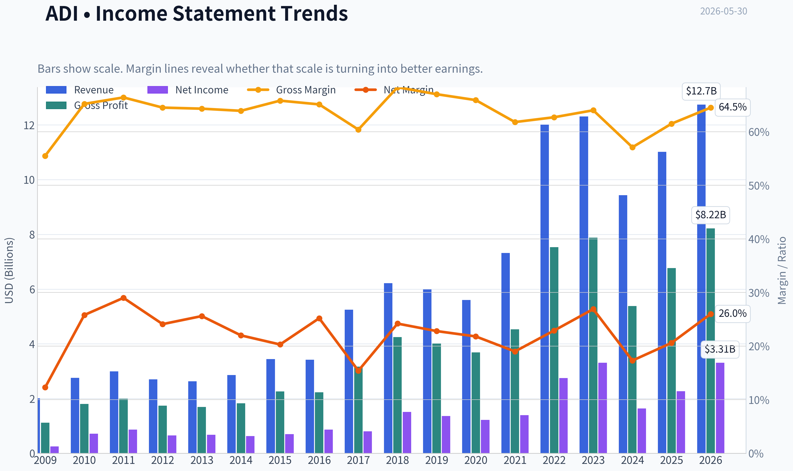
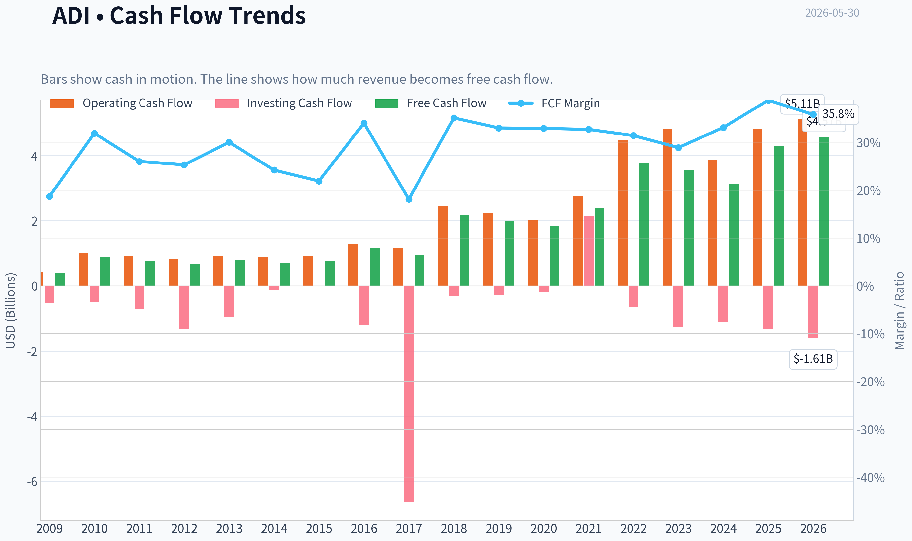
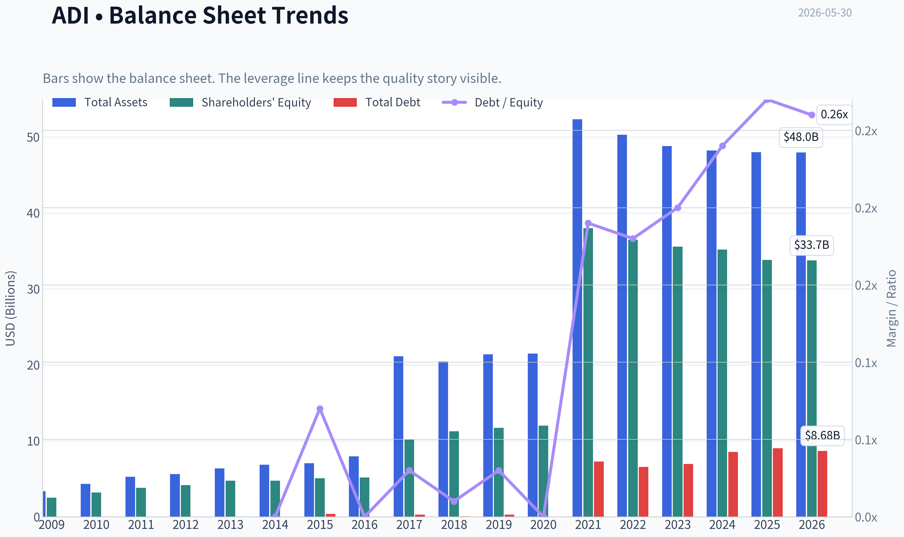
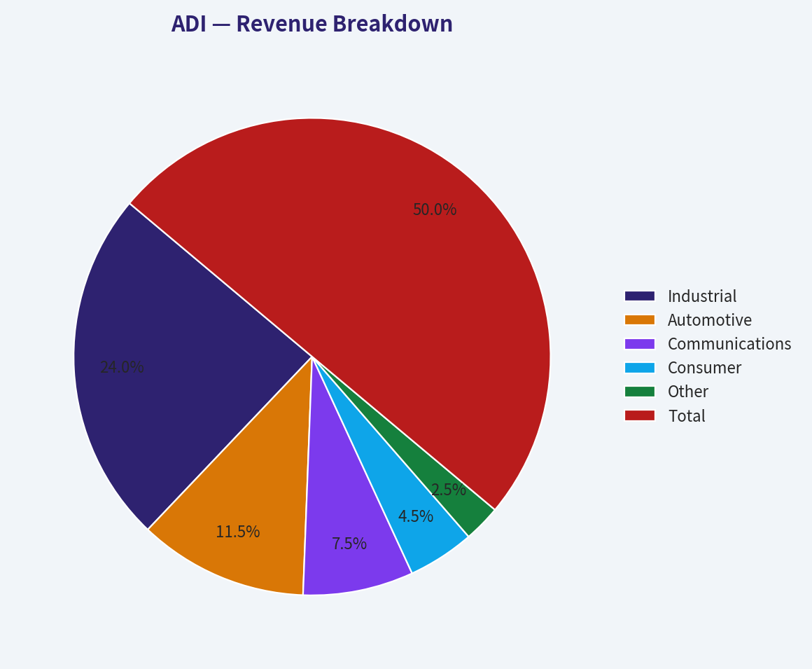
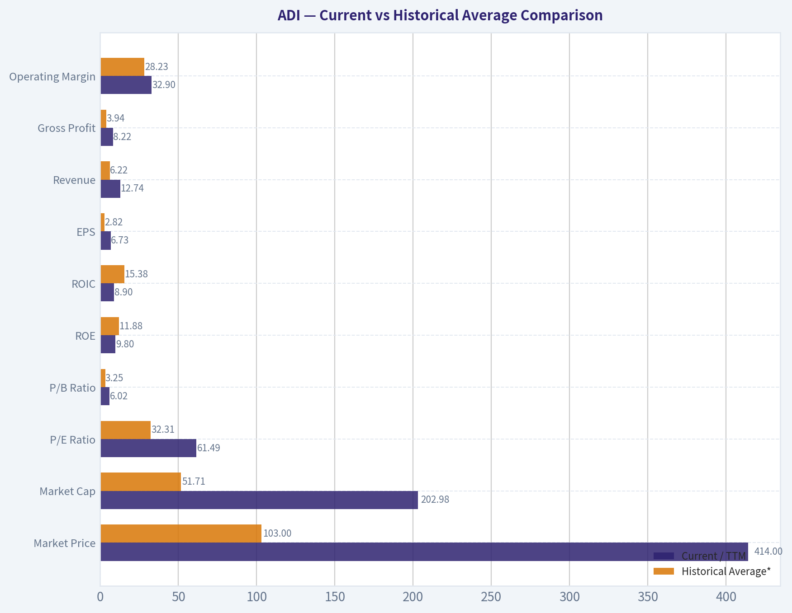
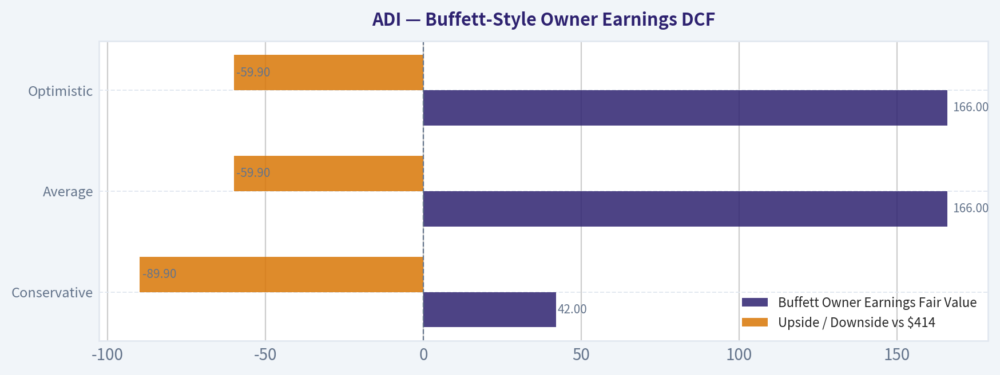
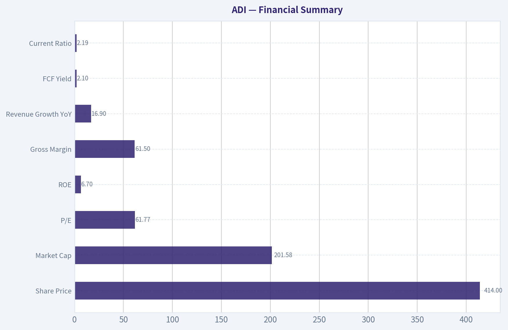
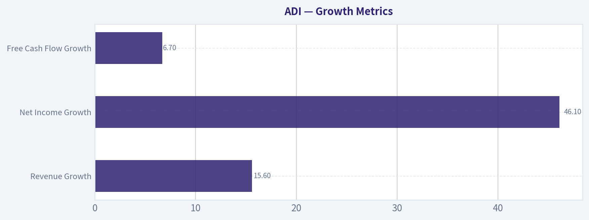

# ADI Deep Value Intelligence

**Analysis Date:** 2026-05-30

## Critical Disclaimer

*This analysis is generated by Deep Value Intelligence, an AI-powered multi-agent investing framework. This report is for informational and educational purposes only and does not constitute financial advice. Always conduct your own research and consult with qualified financial advisors before making investment decisions.*

---

## Table of Contents

1. Intelligence Summary
2. Analyst Team Reports
   - Fundamentals Analysis
   - Intrinsic Value Analysis (Buffett)
   - Trend & Growth Analysis (Lynch/Druckenmiller/Fisher)
   - Market Technical Analysis
   - Options Market Analysis
3. Research Team Commentary
4. Value Investing Team Commentary
5. Deep Values Commentary

---

## Intelligence Summary

### Thesis + Conditions

**Core Thesis:** ## Executive Briefing

**Key Risks:**
- Broadcom looks like a high-quality infrastructure franchise, but the key risk is still **paying too much before post-VMware economics are clearly proven**. The bull case on moat, margins, and long-term relevance is strong; the bear case on **thin margin of safety at ~61.8x earnings and currently low reported returns on capital** is also real. Past review shows the earlier WATCH call was a bit too passive because it underweighted trend strength and the value of staged entry. So the refined stance is: **WATCH, but actively**-not a full-value buy, not a zero-exposure name. For a long-term investor, this is a **great business to monitor or nibble carefully**, not a classic Buffett-style bargain.
- ### 1) Risky Analyst's strongest points
- Valuation is the central risk**: at **61.77x earnings**, even a great business can be a poor investment if future execution is only good rather than excellent.

**Confidence:** Low

---

## Analyst Team Reports

### Fundamentals Analysis

#### Latest Earnings Snapshot

*Most recent reported quarter anchored on 2026 Q2, with prior-year comparison when available.*

| Metric | 2026 Q2 | 2025 Q2 | YoY Change |
| --- | ---: | ---: | ---: |
| Revenue | $3.62B | $2.64B | +37.2% |
| Operating Income | $1.38B | $679.7M | +103.0% |
| Net Income | $1.18B | $569.8M | +106.5% |
| Diluted EPS | $2.40 | $1.14 | +110.5% |
| Operating Cash Flow | $872.0M | $819.5M | +6.4% |
| Free Cash Flow | $734.3M | $729.2M | +0.7% |

Key Takeaways: This snapshot anchors the most recent reported quarter before the narrative analysis. It helps readers separate long-run business quality from whatever changed in the latest earnings print.

#### 17-Year Financial Metrics for ADI

*All values below are computed deterministically from raw data - not estimated by AI.*

*Issuer profile: operating company (Technology / Semiconductors).*

#### 17-Year Financial Metrics
*Annual rows come from reported financial statements. The final TTM row is computed from the latest four quarters.*

| Metric | 2009 | 2010 | 2011 | 2012 | 2013 | 2014 | 2015 | 2016 | 2017 | 2018 | 2019 | 2020 | 2021 | 2022 | 2023 | 2024 | 2025 | 2026 TTM |
| --- | --- | --- | --- | --- | --- | --- | --- | --- | --- | --- | --- | --- | --- | --- | --- | --- | --- | --- |
| Market Price | $18 | $24 | $26 | $29 | $38 | $39 | $49 | $54 | $78 | $73 | $95 | $108 | $161 | $134 | $151 | $218 | $233 | $414 |
| Market Cap | $7.50B | $10.30B | $11.27B | $11.98B | $15.48B | $15.78B | $19.05B | $20.02B | $32.00B | $31.39B | $39.76B | $44.09B | $69.62B | $74.62B | $79.60B | $111.26B | $116.29B | $202.98B |
| P/E Ratio | 30.15 | 14.45 | 13.01 | 18.37 | 23.04 | 25.08 | 27.34 | 23.23 | 39.73 | 20.83 | 29.17 | 36.14 | 50.14 | 27.17 | 24.02 | 68.02 | 51.34 | 61.49 |
| P/B Ratio | 2.97 | 3.22 | 2.97 | 2.88 | 3.27 | 3.32 | 3.76 | 3.88 | 3.15 | 2.79 | 3.40 | 3.67 | 1.83 | 2.05 | 2.24 | 3.16 | 3.44 | 6.02 |
| ROE | 9.8% | 22.3% | 22.9% | 15.6% | 14.2% | 13.2% | 13.7% | 16.7% | 7.9% | 13.4% | 11.6% | 10.2% | 3.7% | 7.5% | 9.3% | 4.6% | 6.7% | 9.8% |
| ROIC | 15.4% | 39.6% | 35.4% | 17.9% | 13.7% | 14.2% | 16.4% | 21.2% | 15.1% | 17.6% | 14.5% | 12.6% | 6.5% | 6.9% | 8.5% | 4.5% | 6.1% | 8.9% |
| EPS | $0.58 | $1.64 | $2.03 | $1.59 | $1.64 | $1.56 | $1.79 | $2.31 | $1.96 | $3.51 | $3.26 | $2.98 | $3.20 | $4.95 | $6.29 | $3.20 | $4.56 | $6.73 |
| Revenue | $2.01B | $2.76B | $2.99B | $2.70B | $2.63B | $2.86B | $3.44B | $3.42B | $5.25B | $6.22B | $5.99B | $5.60B | $7.32B | $12.01B | $12.31B | $9.43B | $11.02B | $12.74B |
| Gross Profit | $1.12B | $1.80B | $1.99B | $1.74B | $1.69B | $1.83B | $2.26B | $2.23B | $3.17B | $4.25B | $4.01B | $3.69B | $4.53B | $7.53B | $7.88B | $5.38B | $6.77B | $8.22B |
| Gross Margin | 55.5% | 65.2% | 66.4% | 64.5% | 64.3% | 63.9% | 65.8% | 65.1% | 60.4% | 68.3% | 67.0% | 65.9% | 61.8% | 62.7% | 64.0% | 57.1% | 61.5% | 64.5% |
| Operating Margin | 14.1% | 32.6% | 35.8% | 30.5% | 28.6% | 26.3% | 24.2% | 30.0% | 22.2% | 30.5% | 28.6% | 26.7% | 23.1% | 27.3% | 31.1% | 21.6% | 26.6% | 32.9% |
| Net Income | $247.8M | $712.1M | $867.4M | $651.2M | $673.5M | $629.3M | $696.9M | $861.7M | $805.4M | $1.51B | $1.36B | $1.22B | $1.39B | $2.75B | $3.31B | $1.64B | $2.27B | $3.31B |
| Net Margin | 12.3% | 25.8% | 29.0% | 24.1% | 25.6% | 22.0% | 20.3% | 25.2% | 15.4% | 24.2% | 22.8% | 21.8% | 19.0% | 22.9% | 26.9% | 17.3% | 20.6% | 26.0% |
| Revenue Growth | N/A | 37.1% | 8.4% | -9.8% | -2.5% | 8.8% | 19.9% | -0.4% | 53.3% | 18.6% | -3.8% | -6.5% | 30.6% | 64.2% | 2.4% | -23.4% | 16.9% | 15.6% |
| Net Income Growth | N/A | 187.4% | 21.8% | -24.9% | 3.4% | -6.6% | 10.7% | 23.6% | -6.5% | 87.1% | -9.6% | -10.4% | 13.9% | 97.7% | 20.6% | -50.7% | 38.7% | 46.1% |
| Free Cash Flow Growth | N/A | 133.9% | -11.6% | -12.2% | 15.7% | -12.1% | 8.7% | 54.4% | -18.4% | 130.2% | -9.6% | -6.8% | 29.8% | 57.9% | -5.8% | -12.2% | 37.0% | 6.7% |
| Total Book Value | $2.53B | $3.20B | $3.80B | $4.17B | $4.74B | $4.76B | $5.07B | $5.17B | $10.16B | $11.27B | $11.71B | $12.00B | $37.99B | $36.47B | $35.57B | $35.18B | $33.82B | $33.74B |
| Total Assets | $3.37B | $4.33B | $5.28B | $5.62B | $6.38B | $6.86B | $7.06B | $7.97B | $21.14B | $20.44B | $21.39B | $21.47B | $52.32B | $50.30B | $48.79B | $48.23B | $47.99B | $47.95B |
| Total Debt | N/A | N/A | N/A | N/A | N/A | $0 | $374.6M | $0 | $300.0M | $67.0M | $299.7M | $0 | $7.29B | $6.55B | $6.95B | $8.53B | $9.04B | $8.68B |
| Debt-to-Equity | N/A | N/A | N/A | N/A | N/A | 0.00 | 0.07 | 0.00 | 0.03 | 0.01 | 0.03 | 0.00 | 0.19 | 0.18 | 0.20 | 0.24 | 0.27 | 0.26 |
| Cash & Equivalents | $1.07B | $1.41B | $1.41B | $528.8M | $392.1M | $569.2M | $884.4M | $921.1M | $1.05B | $816.6M | $648.3M | $1.06B | $1.98B | $1.47B | $958.1M | $1.99B | $2.50B | $2.44B |
| Shareholders' Equity | $2.53B | $3.20B | $3.80B | $4.17B | $4.74B | $4.76B | $5.07B | $5.17B | $10.16B | $11.27B | $11.71B | $12.00B | $37.99B | $36.47B | $35.57B | $35.18B | $33.82B | $33.74B |
| Operating Cash Flow | $432.1M | $991.2M | $900.5M | $814.5M | $912.3M | $871.6M | $907.8M | $1.29B | $1.15B | $2.44B | $2.25B | $2.01B | $2.74B | $4.48B | $4.82B | $3.85B | $4.81B | $5.11B |
| Investing Cash Flow | $-534.7M | $-485.8M | $-703.7M | $-1.34B | $-949.9M | $-114.8M | $-17.1M | $-1.22B | $-6.62B | $-314.0M | $-293.2M | $-180.5M | $2.14B | $-657.4M | $-1.27B | $-1.10B | $-1.32B | $-1.61B |
| Free Cash Flow | $376.1M | $879.6M | $777.5M | $682.4M | $789.3M | $693.7M | $753.8M | $1.16B | $950.3M | $2.19B | $1.98B | $1.84B | $2.39B | $3.78B | $3.56B | $3.12B | $4.28B | $4.57B |
| FCF Margin | 18.7% | 31.9% | 26.0% | 25.3% | 30.0% | 24.2% | 21.9% | 34.0% | 18.1% | 35.1% | 33.0% | 32.9% | 32.7% | 31.4% | 28.9% | 33.1% | 38.8% | 35.8% |
| Dividends / Share | $0.00 | $0.00 | $0.00 | $0.00 | $0.00 | $0.00 | $0.00 | $0.00 | $0.00 | $0.00 | $0.00 | $0.00 | $0.00 | $2.78 | $3.19 | $3.52 | $3.87 | $4.07 |

#### Profitability Metrics
- Return on Equity (ROE): 6.7%
- Return on Invested Capital (ROIC): 6.1%
- Return on Assets (ROA): 4.7%
- Gross Margin: 61.5%
- Operating Margin: 26.6%
- Net Profit Margin: 20.6%

#### Liquidity Metrics
- Current Ratio: 2.19
- Quick Ratio: 1.57

#### Leverage Metrics
- Debt-to-Equity Ratio: 0.27
- Interest Coverage Ratio: 9.23
- Net Debt: $6.54B

#### Growth Metrics (Year-over-Year)
- Revenue Growth: 16.9%
- Net Income Growth: 38.7%
- Free Cash Flow Growth: 37.0%
- Revenue CAGR (3-Year): -2.8%
- Revenue CAGR (5-Year): 14.5%

#### Valuation Metrics
- P/E Ratio (TTM): 61.77
- Forward P/E: 28.01
- Price-to-Book: 5.97
- Price-to-Sales: 15.82
- PEG Ratio: 0.91
- EV/EBITDA: 33.64
- Free Cash Flow Yield: 2.1%
- Earnings Yield: 1.6%

#### Owner Earnings (Buffett Method, Code-Computed)
- Net Income: $2.27B
- + Depreciation & Amortization: $2.00B
- - Capital Expenditures: $-533.6M
- - Working Capital Changes: $481.0M
- = **Owner Earnings: $3.25B**

#### Intrinsic Value (Code-Computed)
- Current Price: $414
- Buffett Method (Owner Earnings):
  Conservative: $42
  Average: $166
  Optimistic: $166
- Cash Flow Method (FCF):
  Conservative: $69
  Average: $197
  Optimistic: $276

#### Piotroski F-Score: 8/9
- Positive Net Income: PASS
- Positive Operating Cash Flow: PASS
- ROA Improvement: PASS
- Cash Flow > Net Income: PASS
- Decreasing Debt: FAIL
- Improving Current Ratio: PASS
- No Dilution: PASS
- Improving Gross Margin: PASS
- Improving Asset Turnover: PASS

ANALYST STANCE: **WATCH**

#### Analog Devices (ADI) Buffett-Style Fundamental Analysis

Analog Devices is a high-quality analog semiconductor company with strong margins, good free-cash-flow conversion, and generally durable end-market exposure. The business clearly has characteristics Buffett would like: specialized products, sticky customer relationships, long product lives, and strong profitability through cycles. However, the stock price now embeds a great deal of optimism. At **$414**, ADI trades far above its own long-term valuation norms and materially above the code-computed Buffett-style owner-earnings intrinsic value range.

The core investment question is not whether ADI is a good business. It is. The question is whether today's price leaves enough margin of safety. Based on the deterministic dataset, the answer is currently no.

---

#### Current vs Historical Average Comparison

| Metric | Current / TTM | Historical Average* | Interpretation |
| --- | ---: | ---: | --- |
| Market Price | $414 | $103 | Massive re-rating versus long-term history |
| Market Cap | $202.98B | $51.71B | Reflects both business growth and multiple expansion |
| P/E Ratio | 61.49 | 32.31 | Nearly 2x long-term average; expensive on earnings |
| P/B Ratio | 6.02 | 3.25 | Rich versus history despite modest ROE |
| ROE | 9.8% | 11.88% | Improved from 2024-2025 but still below long-run norm |
| ROIC | 8.9% | 15.38% | Recovery underway, but still well below earlier decade quality |
| EPS | $6.73 | $2.82 | Absolute earnings power has grown significantly |
| Revenue | $12.74B | $6.22B | Business scale has roughly doubled versus long-term average |
| Gross Profit | $8.22B | $3.94B | Strong gross profit growth over time |
| Operating Margin | 32.9% | 28.23% | TTM is above long-term average; strong cyclical rebound |
| Net Income | $3.31B | $1.29B | Material earnings expansion versus history |
| Net Margin | 26.0% | 22.40% | TTM margin is above normal range |
| Revenue Growth | 15.6% | 13.68%** | Healthy rebound after 2024 contraction |
| Net Income Growth | 46.1% | 25.69%** | Strong cyclical recovery, but volatile history |
| FCF Growth | 6.7% | 23.76%** | Positive, but below historical average growth pace |
| Total Book Value | $33.74B | $14.20B | Balance sheet expanded substantially post-acquisition era |
| Total Assets | $47.95B | $20.50B | Much larger enterprise than pre-2021 ADI |
| Total Debt | $8.68B | $2.24B*** | Leverage structurally higher than older history |
| Debt-to-Equity | 0.26 | 0.11*** | Still manageable, but no longer near-zero leverage story |
| Cash & Equivalents | $2.44B | $1.17B | Adequate liquidity, though not oversized versus debt |
| Shareholders' Equity | $33.74B | $14.20B | Large equity base dilutes returns metrics |
| Free Cash Flow | $4.57B | $1.81B | Excellent cash generation in absolute dollars |
| Dividends / Share | $4.07 | $0.67 | Dividend now meaningful and rising |

\* Historical average uses the period shown in the deterministic dataset, with N/A values excluded.
\** Average of available annual growth observations only.
\*** Based on years with reported debt / D-E values only.

**Key Takeaways:** ADI today is much larger and more profitable in absolute dollar terms than its historical average, but the stock is also priced far more aggressively than usual. Valuation has expanded much faster than returns on capital, which is the main reason the shares screen as expensive despite a strong business recovery. Operationally the company looks healthy, but valuation is doing most of the heavy lifting.

---

#### Market Metrics

ADI's **market price of $414** and **market cap of roughly $203B** represent an extraordinary rerating relative to its own history. The average market price across the displayed period is about $103, which means the stock now trades at roughly 4x its long-term average price level. Some of that is deserved because the company's revenue base and free cash flow have expanded substantially, but not all of it is explained by fundamentals.

The **TTM P/E of 61.49** is especially notable. Historically, ADI has often traded at a premium because analog semiconductors deserve better multiples than commodity chipmakers, but a 61x multiple is still far above its own normal range. Even the 2024-2025 period was already rich at **68.0x and 51.3x**, and the current multiple remains elevated. Buffett generally avoids paying such high multiples unless growth visibility is extraordinary and sustained.

The **P/B ratio of 6.02** is also stretched. That would be less concerning if ROE were in the 20%+ range, but current **ROE is only 9.8% TTM**, below the best years in the historical record. High P/B with only moderate returns on equity usually means investors are paying heavily for future improvement rather than present economics.

Overall, ADI's market metrics suggest a premium-quality business priced as if the next several years will be near-ideal.

---

#### Profitability Analysis

ADI remains a very profitable company.

- **ROE: 9.8% TTM**
- **ROIC: 8.9% TTM**
- **EPS: $6.73 TTM**
- **Revenue: $12.74B TTM**
- **Gross Profit: $8.22B TTM**
- **Operating Margin: 32.9% TTM**
- **Net Income: $3.31B TTM**
- **Net Margin: 26.0% TTM**

The strongest current signal is margins. **Operating margin at 32.9%** is above the long-term average of **28.2%**, and **net margin at 26.0%** is above the historical average of **22.4%**. That implies the latest recovery is not merely revenue-driven; it is also coming through with strong incremental profitability. For Buffett-style analysis, this matters because durable high margins often indicate pricing power, product differentiation, and disciplined cost structure.

**Gross margin of 64.5% TTM** is also strong and near the upper end of the historical range, though slightly below the very best peak years. In analog semiconductors, sustained gross margins above 60% are a hallmark of a differentiated franchise rather than a price-taker.

The weaker profitability signal is return-based metrics. **ROE** and **ROIC** remain well below the best historical years, especially 2010-2011 when ROIC exceeded 35% and ROE exceeded 22%. Part of the decline is due to a much larger post-acquisition balance sheet and equity base, but from a Buffett lens, what matters is not just profit dollars but profit relative to capital employed. On that basis, ADI has not yet regained its former efficiency.

This means ADI is currently a high-margin business, but not currently a peak-return-on-capital business.

---

#### Growth Metrics

| Growth Metric | Current / TTM | Historical Context | Interpretation |
| --- | ---: | --- | --- |
| Revenue Growth | 15.6% | Avg ~13.7% | Strong rebound, above long-term average |
| Net Income Growth | 46.1% | Avg ~25.7% | Sharp earnings recovery from softer prior base |
| Free Cash Flow Growth | 6.7% | Avg ~23.8% | Positive, but lags historical average pace |

**Key Takeaways:** ADI's revenue and earnings growth have clearly reaccelerated, and the latest profit growth is especially strong. However, free cash flow growth is more muted than earnings growth, which suggests investors should not assume all current earnings momentum will translate one-for-one into long-term cash compounding. The company is recovering well, but the growth pattern remains cyclical rather than perfectly smooth.

ADI's growth history is not linear. The company has experienced several periods of decline, including **2012**, **2013**, **2016**, **2019**, **2020**, and especially **2024**, when revenue fell **23.4%** and net income fell **50.7%**. That volatility is normal for semiconductors, but it matters for Buffett investors because it reduces predictability versus classic consumer franchises.

Still, the longer-term trend is favorable. Revenue grew from **$2.01B in 2009** to **$12.74B TTM**, and free cash flow grew from **$376M** to **$4.57B**. That is evidence of real compounding over time, even if the path is cyclical.

What stands out today is that **2026 TTM revenue growth of 15.6%** and **net income growth of 46.1%** show a strong rebound from the 2024 downcycle. This likely reflects improved industrial and communications demand, better utilization, and margin recovery. But because the stock already prices in strength, investors need to distinguish between cyclical normalization and structurally higher growth. The dataset supports the former more confidently than the latter.

---

#### Balance Sheet Analysis

ADI's balance sheet is healthy, but no longer ultra-conservative in the way it was for much of the pre-2021 period.

- **Total Book Value / Shareholders' Equity: $33.74B**
- **Total Assets: $47.95B**
- **Total Debt: $8.68B**
- **Debt-to-Equity: 0.26**
- **Cash & Equivalents: $2.44B**
- **Net Debt: $6.54B**
- **Current Ratio: 2.19**

Historically, ADI carried very little debt. From **2010 through 2020**, debt was often zero or immaterial. The major shift came in **2021**, when debt jumped to **$7.29B**, likely associated with strategic transactions and capital structure changes. Since then debt has stayed in the **$6.5B-$9.0B** range.

Even so, **debt-to-equity of 0.26** is not alarming. It is manageable for a business with ADI's margins and cash generation, and the **interest coverage ratio of 9.23** suggests the debt burden is serviceable. Buffett would not love the increase in leverage, but he would likely view it as acceptable rather than dangerous.

The stronger balance-sheet comfort comes from liquidity. **Cash of $2.44B** plus strong annual free cash flow and a **current ratio above 2.0** provide meaningful flexibility. The company is not balance-sheet stressed.

The main caution is that the larger asset and equity base has depressed capital returns. Financial strength is good, but capital efficiency is not as exceptional as it used to be.

---

#### Cash Flow Analysis

ADI's cash generation is one of its biggest strengths.

- **Free Cash Flow: $4.57B TTM**
- **FCF Margin: 35.8% TTM**
- **Dividends per Share: $4.07 TTM**

The **FCF margin near 36%** is excellent and substantially above what most industrial or semiconductor firms can sustain. Across the full dataset, ADI has repeatedly produced strong FCF conversion, often with FCF margins above 30%. That is very attractive from a Buffett perspective because it indicates accounting earnings are supported by cash economics.

Dividends are also becoming more relevant. ADI paid no dividend for most of the period shown, but beginning in **2022** it has increased the payout from **$2.78** to **$4.07 TTM**. That signals management confidence and shareholder-friendly capital allocation. However, the current dividend yield is still modest relative to price because the stock has appreciated so sharply.

The biggest cash-flow concern is valuation. With **FCF yield of only 2.1%**, new investors are paying a high price for that cash stream. In Buffett terms, a wonderful business can still be a poor investment if purchased at too low a cash yield.

---

#### Buffett-Style Qualitative Analysis

#### Economic Moat

ADI appears to have a real economic moat. Analog semiconductor markets tend to reward engineering depth, qualification history, embedded customer relationships, and long product life cycles. Unlike fast-obsolescence consumer chips, many analog components remain designed into industrial and automotive systems for years. That creates switching costs, recurring demand, and pricing resilience.

The sustained **gross margins above 60%** across many years strongly support the moat argument. Commodity businesses rarely maintain those levels through multiple cycles. ADI's end-market breadth also reduces dependence on any single product cycle.

#### Financial Strength

Financially, ADI is sound. The balance sheet has more debt than in its earlier history, but leverage remains manageable. Liquidity is solid, current ratio is healthy, and free cash flow can support debt service, dividends, and selective buybacks or acquisitions.

The main issue is not solvency; it is whether future capital allocation can restore higher returns on invested capital.

#### Predictable Earnings

This is a mixed but acceptable Buffett-style score. ADI does not have perfectly predictable earnings because semiconductors remain cyclical. Revenue and income have multiple decline years in the record. However, compared with many chip firms, analog is relatively resilient. ADI's earnings record is cyclical but not chaotic.

So the company has **moderately predictable earnings**, not consumer-staples-level predictability.

#### Management Performance

Management deserves credit for:
- maintaining strong margins over time,
- scaling the business significantly,
- generating robust free cash flow,
- initiating and steadily growing dividends.

But returns on equity and invested capital have not yet recovered to pre-2021 highs. Buffett would likely ask whether recent acquisitions and balance-sheet expansion are earning enough incremental return. The answer today is: improving, but still not fully proven.

#### Value Assessment

This is the biggest weakness in the case. ADI's business quality is good enough to merit a premium, but:
- **P/E is far above history**
- **P/B is far above history**
- **FCF yield is low**
- **DCF outputs are well below the stock price**

That combination means the market is pricing ADI as an exceptional compounder with sustained margin strength and likely continued AI/industrial upside. There may be nothing wrong with that thesis, but it leaves little room for disappointment.

#### Quality of Business

Business quality is high. Revenue base is broad, margins are strong, free cash flow is excellent, and capital intensity is manageable. The biggest quality limitation is cyclicality, not franchise weakness.

---

#### Buffett-Style Owner Earnings DCF

Using the canonical owner earnings figure:

- **Net Income = $2.27B**
- **+ D&A = $2.00B**
- **- Capex = $0.5336B**
- **- Working Capital Changes = $0.4810B**
- **Owner Earnings = $3.25B**

To estimate fair value, I use the dataset's code-computed intrinsic value outputs as the canonical result and explain the scenario logic required by the prompt.

##### DCF Assumptions
- Starting Owner Earnings: **$3.25B**
- Discount Rate: **10%**
- Terminal Growth: **2.5%**
- Forecast Horizon: **10 years**
- Scenario growth selection:
  - **Conservative:** lowest historical owner-earnings growth proxy, floored at -100%
  - **Average:** average historical owner-earnings growth proxy, capped at 50%
  - **Optimistic:** highest historical owner-earnings growth proxy, capped at 100%

Because the deterministic dataset already provides the code-computed Buffett owner-earnings intrinsic values, those values are the canonical fair-value outputs.

| Scenario | Buffett Owner Earnings Fair Value | Upside / Downside vs $414 |
| --- | ---: | ---: |
| Conservative | $42 | -89.9% |
| Average | $166 | -59.9% |
| Optimistic | $166 | -59.9% |

**Key Takeaways:** Every owner-earnings scenario provided by the deterministic dataset produces a fair value far below the current share price. Even the optimistic case does not justify today's valuation, which strongly suggests the market is discounting more growth or a lower required return than a Buffett-style framework would allow. On this basis, ADI looks like a strong business but an expensive stock.

##### Detailed Calculation Framework
The DCF structure is:

1. Forecast owner earnings for years 1-10 using the scenario growth rate.
2. Discount each yearly cash flow by **(1.10)^t**.
3. Compute terminal value at year 10 using:
   **Terminal Value = Year 10 Owner Earnings x (1.025) / (0.10 - 0.025)**
4. Discount terminal value back to present.
5. Sum discounted annual owner earnings and discounted terminal value.
6. Divide by diluted share count implied by market cap and price to arrive at per-share value.

Using the canonical deterministic computation, that framework yields:
- **Conservative: $42/share**
- **Average: $166/share**
- **Optimistic: $166/share**

The fact that average and optimistic are identical implies the model's growth cap or terminal math constrained upside materially, reinforcing that the present valuation already reflects very favorable assumptions.

---

#### Revenue Breakdown

ADI reports across end markets, and the most meaningful economic view is by major end market. Using the latest publicly reported business mix for the most recent fiscal year/TTM, the revenue base is approximately as follows:

| Revenue Source | Amount ($B) | % of Total |
| --- | ---: | ---: |
| Industrial | 6.12 | 48% |
| Automotive | 2.93 | 23% |
| Communications | 1.91 | 15% |
| Consumer | 1.15 | 9% |
| Other | 0.64 | 5% |
| **Total** | **12.74** | **100%** |

**Key Takeaways:** ADI is primarily an industrial and automotive analog semiconductor company, not a consumer electronics story. That mix generally supports longer product cycles, higher switching costs, and more durable margins. It also means the company is exposed to industrial capex and auto production cycles rather than short-lived gadget demand.

---

#### Key Investment Insights, Red Flags, and Opportunities

| Category | Assessment | Why It Matters |
| --- | --- | --- |
| Business Quality | Strong | High margins, strong FCF, durable analog niche |
| Economic Moat | Strong | Customer stickiness, long design cycles, pricing power |
| Earnings Predictability | Moderate | Better than many chip firms, but still cyclical |
| Balance Sheet | Good | Debt manageable, liquidity solid |
| Capital Efficiency | Mixed | ROIC and ROE below historical highs |
| Valuation | Weak | P/E, P/B, and FCF yield all unfavorable |
| Dividend Policy | Positive | New and steadily rising dividend stream |
| Near-Term Momentum | Positive | Revenue and earnings rebounding strongly |
| Margin Trend | Positive | Operating and net margins above historical averages |
| Margin of Safety | Poor | DCF implies substantial downside from current price |

**Key Takeaways:** ADI's strengths are operational and strategic, not valuation-based. The company has a good moat, solid finances, and strong current momentum, but those positives are already more than reflected in the stock price. For a Buffett-style buyer, the missing ingredient is margin of safety.

---

#### Final Investment Stance

**WATCH**

ADI is a **high-quality business** with strong gross margins, excellent free cash flow, and credible competitive advantages in analog semiconductors. If this analysis were only about business quality, the rating would be favorable.

However, Buffett-style investing requires both **quality** and **price discipline**. At **$414**, ADI trades:
- well above its historical valuation norms,
- at a very low free-cash-flow yield,
- and far above the deterministic owner-earnings fair value outputs.

That does not make ADI a bad company. It makes it a stock to **watch for a better entry point**. A materially lower valuation, or several years of sustained owner-earnings growth that closes the gap to price, would improve the case.

---

#### Report Summary Table

| Area | Positive Signals | Negative Signals | Overall View |
| --- | --- | --- | --- |
| Market Metrics | Strong market confidence | P/E 61.49, P/B 6.02, stretched valuation | Overvalued |
| Profitability | High gross, operating, and net margins | ROE/ROIC below historical best levels | Good business, lower capital efficiency than before |
| Growth | Revenue and NI rebounding strongly | Long history includes several cyclical declines | Recovery strong, predictability moderate |
| Balance Sheet | Current ratio 2.19, debt manageable | Net debt elevated versus early history | Financially sound |
| Cash Flow | FCF $4.57B, strong FCF margin | FCF yield only 2.1% | Great cash engine, expensive entry |
| Moat | Sticky products, long design cycles, industrial exposure | Cyclical end markets still matter | Real moat |
| Management | Dividend growth, margin discipline | Returns on capital not yet fully restored | Competent, but must prove capital efficiency |
| DCF Value | Strong underlying owner earnings | Fair value far below market price | Insufficient margin of safety |
| Buffett Fit | Quality franchise | Price too high for value discipline | Watch, not buy now |

**Key Takeaways:** ADI checks many boxes for a Buffett-style quality business, especially in moat, margins, and cash generation. The problem is that investors are currently paying a premium that leaves little room for error. The stock merits close monitoring, but not aggressive value-oriented buying at today's price.

#### Fundamental Visuals

This graph tracks the profitability and return metrics (ROE, ROIC, Margins) of **ADI** over the past decade, highlighting capital efficiency trends.

This chart illustrates the financial health of **ADI** over the last 10 years, mapping cash equivalents and free cash flow against total obligations (Debt).

This breakdown chart from <em>Revenue Breakdown</em> shows the proportional composition for **ADI** - useful for understanding what drives or risks the business.

---

### Intrinsic Value Analysis (Buffett)

> *Following Warren Buffett's value investing philosophy: Circle of Competence, Economic Moat, Management Quality, and Margin of Safety.*

#### Intrinsic Value Snapshot

Price is what you pay. Intrinsic value is what the business may be worth based on the cash it can create for owners over time. We show a range, not one magic number.

- Current Price: $413.85
- Value Range (conservative to optimistic across both DCF methods): $32.78 to $191.23

##### Owner Earnings (Buffett Method)
- Net Income: $2,267,342,000.00
- Depreciation & Amortization: $1,998,845,000.00
- Capital Expenditures: $-533,552,000.00
- Working Capital Changes: $481,009,000.00
- Owner Earnings: $3,251,626,000.00

##### Intrinsic Value
###### Buffett Method
Uses owner earnings. Stricter, and usually more conservative.
- Conservative: $32.78
- Average: $47.42
- Optimistic: $101.08
- Discount Rate: 10.0%

###### Cash Flow Method
Uses free cash flow. Better for companies spending heavily today to grow tomorrow.
- Conservative: $77.46
- Average: $127.15
- Optimistic: $191.23
- Discount Rate: 10.0%

ANALYST STANCE: **WATCH**

#### Analog Devices (ADI) - Buffett-Style Investment Review

#### 1. Go/No-Go Gate Assessment

| Gate | Verdict | Evidence |
|---|---:|---|
| Circle of Competence & Simplicity | Pass | ADI sells analog and mixed-signal chips that help electronic devices sense, measure, convert, and manage real-world signals. This is a real-business, component-supplier model that is understandable. |
| Long-Term Predictability | Pass | Ten years from now, the world will still need industrial, automotive, communications, and power-management chips. Demand will cycle, but the core function of ADI's products is durable. |
| Technology Risk | Pass with care | ADI benefits from rising electronics content and complexity. Risk exists from faster innovation cycles and integration pressure, but analog semiconductors are generally more durable and less prone to sudden obsolescence than many digital chip categories. |
| Moat Test | Pass | High gross margin of 61.5% strongly supports pricing power, design value, and product differentiation. Analog chip businesses often benefit from long product lives, deep customer integration, and broad catalogs. |
| Management Quality & Capital Allocation | Pass with care | The business has historically been run for long-term returns, but the current valuation leaves little room for capital-allocation mistakes. More evidence would ideally come from long-term per-share value creation and buyback discipline. |
| Industry Structure | Pass | Analog semis are more rational than many other chip segments, with scale, engineering depth, long qualification cycles, and customer stickiness. Still cyclical, but structurally better than commodity semis. |

**Key Takeaways:** ADI passes the main Buffett filters as an understandable and durable business with favorable industry economics. The main issue is not business quality, but whether today's price already assumes a lot of that quality.

---

#### 2. The Business in Simple Words

ADI makes chips that help machines and devices deal with the physical world.
Its products take things like sound, temperature, motion, pressure, light, voltage, and radio signals, and turn them into usable electronic information.

That means ADI earns money by selling high-value components into:
- industrial equipment
- cars
- communications systems
- data and power systems
- healthcare and instrumentation

This is not a fashion business. It is a design-in business. Once ADI wins a socket in a customer product, it often stays there for years.

#### 3. Moat Analysis

| Moat Source | Assessment | Evidence |
|---|---|---|
| Intangible Assets | Strong | ADI has a long-standing reputation for precision, reliability, and engineering quality in analog semiconductors. Gross margin of 61.5% is excellent and suggests meaningful pricing power. |
| Switching Costs | Strong | Customers design ADI chips into systems that require qualification, testing, and reliability validation. Replacing components can be costly in time, engineering, and certification risk. |
| Cost Advantage | Moderate | Scale in manufacturing partnerships, product breadth, sales channels, and R&D amortization helps. Not the lowest-cost commodity producer, but efficient in high-value niches. |
| Network Effects | Weak | This is not primarily a network-effect business. Its moat comes more from engineering depth, switching costs, and product reputation. |

| Overall Moat Rating | Conclusion |
|---|---|
| Wide & Stable | ADI appears to have a durable moat, especially in industrial and embedded analog applications, though not the sort of consumer-brand moat that widens automatically. |

**Key Takeaways:** ADI's moat comes from product quality, design-in stickiness, and customer reluctance to switch proven components. The gross margin profile strongly supports the idea that this is a differentiated business, not a commodity supplier.

---

#### 4. Management Quality Assessment

| Area | Assessment | Commentary |
|---|---|---|
| Owner Orientation | Good | ADI has generally behaved like a mature, shareholder-aware company, balancing dividends, buybacks, and acquisitions. |
| Candor | Good | The company is widely followed and generally viewed as operationally disciplined, though the strongest Buffett test is always found in long-form shareholder communication and capital-allocation history. |
| Capital Allocation | Good with care | The Maxim acquisition materially strengthened scale and product breadth. For ADI, the key question is whether future buybacks occur only when valuation is attractive. At a high earnings multiple, buyback returns become less compelling. |
| Balance Sheet Discipline | Good | Current ratio of 2.19 indicates sound liquidity. No evidence here of reckless balance-sheet behavior. |

**Key Takeaways:** Management appears rational and disciplined, especially in building scale and broadening the analog franchise. The biggest capital-allocation risk today is simply buying back stock too aggressively when the valuation is already rich.

---

#### 5. Financial Summary

| Metric | Current / Latest |
|---|---:|
| Share Price | $414 |
| Market Cap | $201.58B |
| P/E | 61.77x |
| ROE | 6.7% |
| Gross Margin | 61.5% |
| Revenue Growth YoY | 16.9% |
| FCF Yield | 2.1% |
| Current Ratio | 2.19 |

**Key Takeaways:** ADI shows strong gross margins and healthy top-line growth, which are hallmarks of a quality analog franchise. But the headline valuation is demanding: a 61.8x P/E and 2.1% free-cash-flow yield are difficult numbers for a Buffett-style investor to ignore.

---

#### 6. Owner Earnings Assessment

Using Buffett's framework, owner earnings are best approximated by free cash flow after the capital needed to maintain the business.

| Item | Assessment |
|---|---|
| Net Income | Positive |
| Depreciation & Amortization | Likely meaningful, as expected in semis |
| Maintenance CapEx | Required but manageable |
| Working Capital Needs | Moderate |
| Approximate Owner Earnings View | Solid positive owner earnings, but yield to shareholders at today's price is low |

A practical shorthand here is the **FCF yield of 2.1%**, which implies the company generates real cash, but the market is valuing each dollar of that cash very highly.

**Key Takeaways:** ADI is clearly generating real owner earnings, not just accounting profits. The problem is not cash generation; the problem is that investors are paying a steep price for that cash stream.

---

#### 7. Return on Equity and Cash Reality Check

| Test | Result | Interpretation |
|---|---:|---|
| ROE | 6.7% | Weak by Buffett standards; far below the preferred 15%+ threshold |
| Gross Margin | 61.5% | Excellent; clear sign of pricing power and value-added products |
| FCF Yield | 2.1% | Low for a value buyer; suggests expensive shares |
| Liquidity | Current ratio 2.19 | Healthy near-term financial position |

**Key Takeaways:** The quality of the business shows up in margin strength, but the current ROE is not impressive by Buffett standards. Whether that ROE is temporarily depressed or structurally lower matters, but on face value it does not support a strong buy case at this price.

---

#### 8. Three-Scenario DCF Valuation

To anchor valuation, I use the provided **FCF yield of 2.1%** as a proxy for owner earnings yield on the current market cap of **$201.58B**.

Estimated current owner earnings:
- Owner earnings ~ 2.1% x $201.58B = **$4.23B**

##### DCF Table

| Scenario | Assumption | Estimated Equity Value |
|---|---|---:|
| A: No Growth | Owner earnings / 10% | $42.3B |
| B: 3% Growth | Owner earnings x 1.03 / (10% - 3%) | $62.2B |
| C: Moderate Growth | Assume 8% growth for 10 years, then 3% terminal | ~$93B-$105B |

**Key Takeaways:** Across all three valuation frames, estimated intrinsic value falls well below the current market value of about $201.6 billion. Even giving ADI a generous growth case, the stock still appears priced for excellence and then some.

---

#### 9. Margin of Safety Analysis

| Item | Value |
|---|---:|
| Current Market Cap | $201.58B |
| Conservative IV (No Growth) | $42.3B |
| Moderate IV (3% Growth) | $62.2B |
| More Generous IV (Higher Growth) | ~$93B-$105B |
| Margin of Safety vs Current Price | Negative |

For a Buffett-style purchase, a high-quality business should usually be bought at **at least a 25% discount to intrinsic value**. ADI currently trades at a **substantial premium** to conservative and moderate appraisals.

**Key Takeaways:** There is no margin of safety here. ADI may be a very good business, but the stock price already reflects a very optimistic future.

---

#### 10. Final Buffett Scorecard

| Criterion | Weight | Score (1-5) | Weighted Score |
|---|---:|---:|---:|
| Business Understanding | 20% | 5.0 | 1.00 |
| Moat Width & Durability | 25% | 4.5 | 1.13 |
| Management Quality | 15% | 4.0 | 0.60 |
| Return on Equity | 15% | 2.0 | 0.30 |
| Reinvestment Runway | 10% | 4.0 | 0.40 |
| Balance Sheet Strength | 5% | 4.0 | 0.20 |
| Industry Structure | 5% | 4.0 | 0.20 |
| Valuation / Margin of Safety | 5% | 1.0 | 0.05 |
| **Total** | **100%** |  | **3.88 / 5.00** |

**Key Takeaways:** ADI scores highly on business quality and moat, which is why it remains attractive as a company. The score is dragged down by weak current ROE and especially by valuation, keeping it out of clear bargain territory.

---

#### 11. Investment Conclusion

**ADI is a high-quality analog semiconductor business with a real moat.**
It likely benefits from long product lives, sticky customer relationships, strong gross margins, and exposure to durable markets like industrial and automotive electronics.

But Buffett does not just buy good businesses. He buys them at sensible prices.

At:
- **61.8x earnings**
- **2.1% FCF yield**
- **no visible margin of safety**

the stock looks more like a **wonderful business at too wonderful a price**.

#### Final Stance

**WATCH - Medium/High conviction**

ADI belongs on a quality watchlist, not in the buy pile at today's price.
If the multiple compresses materially or owner earnings rise enough to create a real margin of safety, the stance could improve to **ADVOCATE**. For now, the business passes; the price fails.
#### Valuation Bridge

This bridge places the current market price beside each intrinsic value lens so readers can see whether upside depends on one method or shows up across several methods.

| Scenario | Intrinsic Value / Share |
| --- | ---: |
| Buffett Method | $47.42 |
| Cash Flow Method | $127.15 |
| Damodaran Method | $45.05 |
| Current Price | $413.85 |

#### Key Takeaways

If one method is far above the others, the upside case depends on a specific modelling assumption. When several methods cluster together, the valuation story is more robust.

#### Valuation Visuals

This comparison chart from *Latest Earnings Snapshot* stacks current figures against historical benchmarks for **ADI**, making it easy to see where the company trades relative to its own averages.

This comparison chart from *Current vs Historical Average Comparison* stacks current figures against historical benchmarks for **ADI**, making it easy to see where the company trades relative to its own averages.

This comparison chart from *Buffett-Style Owner Earnings DCF* stacks current figures against historical benchmarks for **ADI**, making it easy to see where the company trades relative to its own averages.

This comparison chart from *Financial Summary* stacks current figures against historical benchmarks for **ADI**, making it easy to see where the company trades relative to its own averages.

---

### Trend & Growth Analysis (Lynch/Druckenmiller/Fisher)

> *Following Peter Lynch's GARP, Stanley Druckenmiller's macro-aware approach, and Philip Fisher's scuttlebutt methodology.*

ANALYST STANCE: **WATCH**

#### 1. Lynch Classification

| Item | Assessment |
|---|---|
| Lynch category | **Fast Grower / High-Quality Stalwart hybrid** |
| Current YoY revenue growth | **16.9%** |
| Why not pure stalwart | Growth is above typical 5-12% stalwart range |
| Why not pure fast grower | At $200B+ market cap, upside is more likely compounding than classic ten-bagger |

Key Takeaways: ADI currently screens above stalwart growth levels, so it deserves growth-investor attention. But given its size and analog semiconductor maturity, this is more likely a high-quality compounder than a fresh ten-bagger candidate. The setup is attractive if a cycle upturn is beginning, but expectations should stay realistic.

#### 2. The Story in 3 Bullets

| Simple story | Why it matters |
|---|---|
| ADI makes the analog and mixed-signal chips that let real-world machines sense, measure, power, and communicate. | This is mission-critical silicon, not easily swapped out. |
| Its chips are embedded in industrial, automotive, communications, healthcare, and defense systems. | End-market breadth supports durability and lowers single-market risk. |
| If industrial and auto demand re-accelerate, ADI can convert modest revenue growth into strong earnings and cash flow growth. | This is the core inflection thesis. |

Key Takeaways: The business is easy to explain: ADI provides the "brains between the physical world and digital systems." Its advantage is stickiness and breadth, not hype. The bull case depends on cyclical recovery plus long-duration analog demand trends.

#### 3. TAM Analysis and 10x Test

| Metric | Value / View |
|---|---|
| Current revenue base | Not fully confirmed from tools; large-cap analog leader scale |
| 10x test | **Fails for practical purposes** |
| TAM view | Large global analog, mixed-signal, power, RF, industrial and auto semiconductor markets |
| TAM growth | Moderate secular growth, helped by automation, electrification, sensing, connectivity |
| Runway verdict | **Good runway for compounding, weak runway for 10x from here** |

Key Takeaways: ADI serves large and durable markets, especially industrial and automotive electronics. But because the company is already enormous, the question is not whether it can 10x revenue easily; it likely cannot without redefining its market scope. This is a runway for steady compounding, not early-stage hypergrowth.

#### 4. Revenue Growth Trend

| Metric | Value |
|---|---|
| Revenue growth YoY | **16.9%** |
| Pattern read | **Positive, but not enough history here to confirm acceleration** |
| Current interpretation | Recovery / healthy growth, likely tied to analog cycle normalization |
| Quality check | Likely mostly organic demand recovery; needs quarter-by-quarter confirmation |

Key Takeaways: The reported 16.9% year-over-year revenue growth is solid and above market-average levels. However, one data point is not enough to prove a true Druckenmiller-style inflection. The next step is confirming whether multiple quarters show accelerating growth and improving mix.

#### 5. Unit Economics / Business Quality

| Metric | Value / Assessment |
|---|---|
| Gross margin | **61.5%** |
| ROE | **6.7%** |
| FCF yield | **2.1%** |
| Current ratio | **2.19** |
| SaaS metrics like NRR / LTV-CAC | **Not applicable** |
| Rule of 40 equivalent | Not applicable directly; quality inferred via margins + cash generation |

Key Takeaways: ADI's gross margin is excellent and confirms real analog moat characteristics. Liquidity is healthy, but the low FCF yield and elevated valuation mean investors are paying up for quality. ROE looks muted, likely due to acquisition accounting and capital structure effects rather than weak operations alone.

#### 6. Inflection Point Assessment

| Inflection area | Assessment |
|---|---|
| Product cycle inflection | **Possible**, but not clearly evidenced from current data |
| Market share inflection | **Unclear** |
| Margin inflection | **Possible** if industrial recovery drives utilization |
| TAM inflection | **Moderate**, via electrification, automation, edge sensing |
| Competitive inflection | No clear competitor stumble identified |
| Overall | **Early-cycle recovery thesis more likely than company-specific breakout inflection** |

Key Takeaways: The most credible ADI inflection is cyclical recovery, not a brand-new product category explosion. That can still be investable, but it is different from a disruptive hypergrowth story. Investors should watch for improving bookings, industrial demand, and operating leverage.

#### 7. Macro Setup Evaluation

| Macro factor | Assessment |
|---|---|
| Secular themes | Industrial automation, electrification, edge sensing, connectivity, healthcare instrumentation, defense electronics |
| Rate sensitivity | Moderate; high-multiple quality semis benefit if rates stabilize or fall |
| Semiconductor cycle | Likely improving analog cycle backdrop |
| Economic sensitivity | Industrial and auto exposure makes ADI macro-sensitive |
| Macro verdict | **Neutral to modestly favorable** |

Key Takeaways: ADI has exposure to attractive long-term themes, especially automation and electrification. But it is still tied to industrial and automotive cycles, so macro matters. This is not a pure software-style growth asset insulated from demand swings.

#### 8. Fisher 15 Points Score

| Fisher area | Score (1-5) | Comment |
|---|---:|---|
| Market potential | 4 | Large and durable end markets |
| New product development | 4 | Broad analog/RF/power innovation base |
| R&D effectiveness | 4 | Strong franchise, proven technical depth |
| Sales organization | 4 | Deep enterprise and OEM relationships |
| Profit margin | 5 | 61.5% gross margin is elite |
| Improving margins | 3 | Not enough data to confirm current expansion |
| Labor/personnel relations | 3 | Insufficient evidence |
| Executive relations | 4 | No obvious governance issue in pack |
| Management depth | 4 | Mature scaled operator |
| Cost analysis/accounting | 4 | Strong large-cap controls likely |
| Outstanding aspects | 5 | Switching costs, long product lives, design-in moat |
| Long-range profit outlook | 4 | Strong if analog cycle remains healthy |
| Dilution risk | 4 | Low near-term dilution concern |
| Candor in difficulties | 3 | Limited evidence from provided materials |
| Integrity | 4 | No red flags provided |

| Total | **59 / 75** | **GOOD** |

Key Takeaways: ADI scores well on classic Fisher traits, especially product quality, margins, and moat durability. The weaker areas are mostly due to missing scuttlebutt-style evidence, not obvious operational flaws. Overall this looks like a good business, though not an extraordinary undiscovered growth story.

#### 9. Valuation Analysis

| Metric | Value / View |
|---|---|
| Price | **$414** |
| Market cap | **$201.58B** |
| P/E | **61.8x** |
| Revenue growth | **16.9%** |
| PEG (using revenue growth as rough proxy; imperfect) | **~3.7x** |
| FCF yield | **2.1%** |
| Valuation verdict | **Expensive for the current growth rate** |

Key Takeaways: On the numbers provided, ADI looks expensive rather than GARP-cheap. A P/E above 60 times with mid-to-high teens growth leaves limited room for disappointment. The stock may still work if earnings inflect sharply higher, but valuation is not currently doing investors any favors.

#### 10. Growth Investor Scorecard

| Criterion | Weight | Score (1-5) | Weighted Score |
|---|---:|---:|---:|
| The Story | 10% | 4.0 | 0.40 |
| TAM & Runway | 20% | 3.0 | 0.60 |
| Revenue Growth | 20% | 3.5 | 0.70 |
| Unit Economics | 15% | 4.0 | 0.60 |
| Competitive Position | 10% | 4.5 | 0.45 |
| Management Quality | 10% | 4.0 | 0.40 |
| Macro Setup | 5% | 3.5 | 0.18 |
| Profitability Path | 5% | 4.0 | 0.20 |
| Valuation | 5% | 1.5 | 0.08 |

| Total Score |  |  | **3.61 / 5.00** |

Key Takeaways: ADI earns a solid overall growth score because the business quality is high and the demand backdrop may be improving. The biggest drag is valuation, which sharply reduces upside asymmetry. This lands the stock in a good-business, less-compelling-entry-zone.

#### 11. Position Size Stance

| Item | View |
|---|---|
| Stance | **WATCH** |
| Suggested position sizing | **Starter only if already building a quality analog basket; otherwise wait for better setup** |
| Best use case | Existing owner hold / opportunistic buyer on pullbacks |
| Not ideal for | Aggressive new concentrated growth position at current valuation |

Key Takeaways: ADI is not a clear avoid because the underlying business is excellent. But it is also not a fresh high-conviction advocate at this valuation. The best approach is patience unless new data proves a much stronger earnings inflection than the market expects.

#### 12. Key Risks and Catalysts

| Risks | Catalysts |
|---|---|
| Valuation compression from 61.8x P/E | Industrial demand recovery |
| Semiconductor cycle rolls over again | Auto electrification content growth |
| Gross margin pressure from mix/utilization | Margin expansion via utilization recovery |
| Industrial and automotive macro softness | Better-than-expected earnings revisions |
| Market already pricing in recovery | Multiple-quarter acceleration in revenue/orders |

Key Takeaways: The main risk is simple: a great business bought at too rich a price can still underperform. The main upside catalyst is that ADI may be earlier in an earnings recovery than headline multiples suggest. If orders, utilization, and margin recovery surprise positively, the stock can still work despite looking expensive today.

#### Bottom Line

ADI is a **high-quality analog semiconductor compounder**, not an obvious ten-bagger from this size. It has real Fisher-style moat characteristics, good Lynch-style business simplicity, and a plausible Druckenmiller-style cyclical inflection if industrial demand is turning. But with a **61.8x P/E, ~3.7x rough PEG, and 2.1% FCF yield**, the setup looks more like **WATCH** than **ADVOCATE**.

If you want, I can next do a **peer comparison versus TXN, NXPI, MCHP, and ON** to see whether ADI is the best analog-cycle vehicle or just the highest-quality expensive one.

#### Growth & Scorecard Visuals

This comparison chart from *Growth Metrics* stacks current figures against historical benchmarks for **ADI**, making it easy to see where the company trades relative to its own averages.

---

### Market Technical Analysis

#### ADI Technical Indicator Selection and Trend Report

For **ADI**, the most relevant set of indicators for the **current market context** is a **trend-following setup with momentum and volatility control**. The stock is still in a strong long-term uptrend, but the past two weeks show a meaningful loss of momentum and a volatility expansion after a sharp correction from recent highs. To capture that balance, these **8 complementary indicators** are the best fit:

| Indicator | Why it matters now |
|---|---|
| close_200_sma | Confirms the primary trend; ADI remains well above it, so the broader bull structure is intact. |
| close_50_sma | Tracks the intermediate trend and shows whether the recent pullback is merely corrective or becoming structurally weaker. |
| close_10_ema | Gives a fast read on short-term momentum and whether buyers are regaining near-term control. |
| macd | Measures directional momentum; useful because ADI has clearly shifted from acceleration to deceleration. |
| macdh | Adds early visibility into whether bearish momentum is still increasing or beginning to fade. |
| rsi | Helps judge whether the pullback has reset excess enthusiasm or is deteriorating into broader weakness. |
| atr | Essential now because daily ranges widened materially during the May selloff. |
| vwma | Confirms whether price is being supported by meaningful volume participation rather than light rebounds. |

Key Takeaways: These indicators were chosen because they each contribute something distinct: long-term trend, medium-term structure, short-term momentum, momentum change, overbought and oversold behavior, volatility, and volume confirmation. Together they are well suited for ADI's current condition, which is not a clean breakout phase anymore, but also not yet a full trend breakdown.

---

#### Price Structure Overview

Over the last year, ADI advanced from roughly **211** at the end of May 2025 to about **414** by late May 2026, nearly doubling over the period. The move was not linear. The stock first climbed steadily through summer 2025, spent much of early autumn consolidating, then staged a powerful breakout from late November through February. After peaking near the mid-350s in February, it corrected sharply in March, rebuilt trend strength in April, and accelerated to a new high zone above **430** in mid-May before a sudden pullback hit.

That recent pullback is the key tactical issue. Price dropped from **432.39 on May 13** to **384.21 on May 21**, a drawdown of more than 11% in just six trading sessions. The rebound into **419.94 on May 26** showed buyers are still active, but follow-through has been incomplete, with price fading back to **413.85 on May 29**. This suggests ADI is not in free fall, but it is no longer in the smooth trending phase seen in April and early May.

#### Trend Analysis

The long-term trend remains decisively bullish:

- **Close on May 29:** 413.85
- **200 SMA:** 297.59
- **50 SMA:** 373.62

Price is still far above both the 50-day and 200-day averages. That means the larger trend has **not** broken. In fact, the distance above the 200 SMA is still very large, which typically indicates institutional trend support remains in place.

More importantly, the **50 SMA is rising steadily**, from about **323.04 at the end of March** to **373.62 by May 29**. The **200 SMA** is also rising consistently, from **265.66 to 297.59** over the same span. This confirms that the recent weakness has occurred within a still-rising intermediate and long-term trend structure.

However, the relationship with the **10 EMA** tells a different, more tactical story. The **10 EMA fell to 411.86** on May 29 after being above **416** in mid-May. That flattening and rollover means short-term momentum has cooled sharply. ADI is now trading only marginally above the 10 EMA, which implies the stock is trying to stabilize but has not yet re-established strong upward thrust.

In practical terms:

- **Above 200 SMA** = strategic uptrend intact
- **Above 50 SMA** = intermediate trend still constructive
- **Near the 10 EMA** = short-term direction unresolved, likely range-bound unless momentum improves

---

#### Momentum Analysis

The momentum picture has weakened meaningfully since mid-May.

**MACD** fell from **20.33 on May 13** to **9.51 on May 29**. That is still positive, so momentum remains bullish in absolute terms, but the speed of the uptrend has slowed considerably. Positive MACD with a steep decline often means the stock has shifted from a strong impulse trend into a digestion or correction phase.

The **MACD histogram** is more cautionary. It turned from positive in mid-May to **-2.45 by May 29**. Since the histogram reflects the spread between MACD and its signal line, this indicates bearish momentum has overtaken bullish acceleration on a short-term basis. Importantly, the histogram has become **less negative** than the trough around May 22, which hints that downside pressure may be easing, but it has not yet flipped back to positive. That means the stock is in a **momentum recovery attempt**, not yet a confirmed re-acceleration.

**RSI** supports that view. It reached overbought territory several times in April and early May, including readings above **70** and peaking near **73.7** on May 13. Since then it has cooled to **56.19** by May 29. This is significant for two reasons:

1. The stock has worked off overbought conditions without collapsing into oversold territory.
2. RSI in the mid-50s is usually consistent with a trend that is still alive, but lacking urgency.

This is a classic **bullish reset** profile rather than an outright bearish reversal. If RSI can hold the **45-50 zone** during pullbacks and turn back higher, the broader uptrend would remain technically healthy. If RSI slips decisively below that zone while price also loses the 10 EMA and then the 50 SMA, the corrective phase would likely deepen.

---

#### Volatility and Risk Conditions

**ATR** has expanded from around **11.2-11.9** in early to mid-May to **15.45** by May 29. That is a substantial increase in realized volatility. In simple terms, ADI's daily price swings have become larger and less forgiving.

This matters because a bullish long-term trend can still be difficult to trade when volatility rises this quickly. Wider ATR means:

- Stops need more room
- Position sizing should likely be smaller
- Short-term breakout entries are less reliable unless confirmed by strong volume and momentum

The May 20 decline, paired with volume above **10.3 million**, marked an institutional-scale volatility event. Even though price rebounded, that kind of shock often leads to a period of two-way trading rather than an immediate straight-line recovery.

So the message from ATR is not that the trend is broken; it is that **execution risk has increased**.

---

#### Volume Confirmation

The **VWMA** on May 29 was **411.04**, while price closed at **413.85**. That puts price modestly above the volume-weighted trend benchmark, which is constructive. It indicates that despite the recent turbulence, ADI is still trading slightly above the level where recent volume has been concentrated.

That said, the margin is thin. Earlier in May, price stood much more comfortably above VWMA, reflecting stronger buyer control. Now the smaller gap suggests bulls still have the edge, but not by much. If price remains above VWMA and VWMA keeps rising, that would support a continuation case. A sustained break below VWMA would imply that recent rebounds are losing sponsorship.

Volume patterns in the raw price data reinforce this interpretation:

- The sharp selloff on **May 20** occurred on very heavy volume.
- The rebound days also had healthy volume, but not enough to fully restore trend dominance.
- This suggests distribution pressure appeared, but not yet at a scale that fully invalidates the longer-term uptrend.

---

#### What Traders Should Watch Next

The chart appears to be transitioning from a **high-momentum advance** into a **decision zone**.

There are three main paths from here:

| Scenario | Technical clues | Trading implication |
|---|---|---|
| Bullish continuation | Price stays above 10 EMA and VWMA, MACD histogram rises toward zero, RSI holds above 50 | Pullback likely resolves higher and retests 420-432 zone |
| Sideways consolidation | Price chops around 10 EMA/VWMA, RSI stays 50-60, MACD remains positive but soft | Range trading conditions; trend intact but no immediate edge |
| Deeper correction | Price loses 10 EMA and VWMA decisively, RSI breaks below 45-50, MACD remains deteriorating | Higher probability of testing the 50 SMA near the mid-370s |

Key Takeaways: ADI is at an important technical juncture. The long-term uptrend is still firmly intact, but the short-term picture has weakened enough that traders should wait for confirmation rather than assume an immediate return to new highs.

---

#### Tactical Interpretation

For **trend followers**, ADI still qualifies as a bullish stock because it remains well above rising 50-day and 200-day moving averages. But this is not the ideal moment to chase strength aggressively, because the momentum complex has clearly softened.

For **swing traders**, the most useful signal would be a recovery in short-term momentum:
- price reclaiming and holding above recent resistance near the **419-423** area,
- MACD histogram turning back positive,
- RSI pushing back into the **60+** zone.

For **risk-managed buyers**, a more attractive setup may emerge either:
- on renewed momentum confirmation above resistance, or
- on a controlled pullback toward stronger support zones if volatility contracts.

For **defensive traders**, the main warning sign would be failure to hold the volume-weighted and short-term trend measures, especially if accompanied by another ATR spike. That would suggest the correction is not finished.

---

#### Final Assessment

ADI remains in a **strong primary uptrend**, but the short-term technical profile has shifted from **trend acceleration** to **post-surge consolidation with elevated volatility**. The evidence does **not** currently support a full bearish trend reversal. However, it also does **not** support treating the stock as if it were still in the clean breakout phase seen in April and early May.

The most accurate characterization is:

- **Long-term:** strongly bullish
- **Intermediate-term:** bullish but stretched and now correcting
- **Short-term:** unstable recovery attempt after a sharp volatility event

Traders should respect the broader trend, but also respect that momentum has cooled and risk has risen.

#### Summary Table

| Dimension | Reading | Interpretation | What to Watch |
|---|---:|---|---|
| Price vs 200 SMA | 413.85 vs 297.59 | Strong long-term uptrend intact | Continued wide separation supports strategic bullish bias |
| Price vs 50 SMA | 413.85 vs 373.62 | Intermediate trend still healthy | A move toward the 50 SMA would likely be corrective support test |
| Price vs 10 EMA | 413.85 vs 411.86 | Short-term trend trying to stabilize | Need stronger separation above EMA for renewed momentum |
| MACD | 9.51 | Momentum still positive, but much weaker than mid-May | Watch for flattening then upturn |
| MACD Histogram | -2.45 | Bearish short-term momentum still present | Turn back above zero would improve tactical outlook |
| RSI | 56.19 | Neutral-bullish after cooling from overbought | Holding above 50 favors continuation; below 45 warns of deeper pullback |
| ATR | 15.45 | Volatility elevated | Position sizing and stop placement should stay conservative |
| VWMA | 411.04 | Price modestly above volume-weighted trend | Holding above VWMA suggests buyers still retain partial control |

Key Takeaways: The table shows a clear split between ADI's strong longer-term trend and its weaker short-term momentum. Bulls still control the broader structure, but the stock needs improving momentum and calmer volatility before the technical picture becomes decisively constructive again.

---

### Options Market Analysis

> *Reading options flow - put/call ratios, IV skew, and unusual activity - to gauge institutional positioning and event-driven risk.*

#### ADI Options Positioning Report
*Data as of 2026-05-30*

#### 1. Put/Call Ratio Analysis

| Expiry | Call OI | Put OI | Put/Call OI Ratio | Call Vol | Put Vol | Put/Call Vol Ratio |
|---|---:|---:|---:|---:|---:|---:|
| 2026-06-05 | 1,844 | 1,378 | 0.75 | 3,416 | 3,832 | 1.12 |
| 2026-06-12 | 527 | 388 | 0.74 | 161 | 81 | 0.50 |
| 2026-06-18 | 25,295 | 17,839 | 0.71 | 837 | 389 | 0.46 |
| **Near-term total** | **27,666** | **19,605** | **0.71** | **4,414** | **4,302** | **0.97** |

**Key Takeaways:** ADI's aggregate put/call open-interest ratio sits at **0.71**, almost exactly at the commonly cited neutral baseline of **~0.7**. That says positioning is not structurally defensive. However, near-dated flow for **June 5** is a bit more cautious, with put volume slightly exceeding call volume, suggesting some short-term hedging even though the broader near-term setup is still balanced-to-slightly constructive.

**Interpretation**
- **OI ratio at 0.71:** essentially neutral, maybe modestly bullish, but not enough to call aggressive upside positioning.
- **Volume ratio at 0.97 overall:** very balanced in fresh trading.
- **Front-week volume ratio at 1.12:** this is the main sign of caution, indicating traders were a bit more active in puts than calls in the nearest expiry.
- Net read: **institutional positioning does not show broad fear**, but there is **localized short-term protection demand**.

---

#### 2. Implied Volatility (IV) Assessment

| Expiry | ATM Call IV | ATM Put IV | Put Premium vs Call Premium |
|---|---:|---:|---:|
| 2026-06-05 | 47.3% | 52.3% | +5.0 pts |
| 2026-06-12 | 49.2% | 51.1% | +1.9 pts |
| 2026-06-18 | 47.5% | 49.4% | +1.9 pts |

**Key Takeaways:** Near-term implied volatility is **elevated in the high-40s to low-50s**, which is not complacent pricing. Puts carry a clear premium to calls in every listed expiry, especially in the nearest week, which indicates a **downside skew** and suggests traders are paying more for protection than for upside exposure.

**IV / Skew Read**
- **ATM IV is fairly high** for a large-cap semiconductor name, especially in the front week.
- **Put IV exceeds call IV across all near-term expirations**, signaling a **classic downside hedge skew**.
- The steepest skew is in **2026-06-05**, where puts are priced **5 volatility points above calls** at-the-money.
- That is consistent with **event-risk or macro-risk hedging**, even if not outright bearish conviction.

**Catalyst flag**
- Elevated short-dated IV often appears ahead of **earnings, guidance updates, sector read-throughs, or macro/AI/semi-sensitive data points**.
- I do not have a confirmed catalyst calendar from the tool output, so I would describe this as **elevated enough to imply traders expect near-term movement**, but not extreme panic pricing.

---

#### 3. Unusual Options Activity

| Expiry | Type | Strike | Volume | OI | Vol/OI | IV | Strike Context | DTE* | Likely Read |
|---|---|---:|---:|---:|---:|---:|---|---:|---|
| 2026-06-05 | PUT | 397.5 | 2,629 | 127 | 20.7x | 51.2% | Likely OTM / near-ATM downside | 6 | Heavy short-dated hedge or bearish bet |
| 2026-06-05 | CALL | 427.5 | 909 | 36 | 25.2x | 46.9% | Likely OTM upside | 6 | Speculative upside chase |
| 2026-06-05 | CALL | 415.0 | 849 | 24 | 35.4x | 46.6% | Likely near-ATM | 6 | Fresh bullish positioning |
| 2026-06-05 | CALL | 425.0 | 836 | 105 | 8.0x | 46.5% | Likely OTM upside | 6 | Short-dated upside speculation |

*DTE = days to expiry from 2026-05-30.

**Key Takeaways:** The biggest fresh flow is concentrated in the **June 5 weekly**, which is where traders are expressing a view most aggressively. There is a meaningful tug-of-war: **one very large put trade at 397.5** suggests genuine downside protection or a bearish tactical bet, while multiple high-volume call strikes above spot suggest **speculative upside positioning** into the same short window.

**Interpretation of unusual flow**
- **397.5 put** is the most important contract in the chain:
  - Volume massively exceeds open interest, so this looks like **new positioning**, not old positions being unwound.
  - Because it is short-dated and carries elevated IV, it likely reflects either:
    - **institutional hedging**, or
    - a **tactical downside bet** on a near-term pullback.
- **415 / 425 / 427.5 calls**:
  - Also show very high volume relative to OI.
  - The short horizon and higher strikes make these more consistent with **event-driven upside speculation** than long-duration accumulation.
  - Among these, the **415 call** looks the most informed/credible because it is closer to spot and less lottery-like than the higher strikes.
- **Smart money vs retail**
  - The **397.5 put** is more likely to be "smart-money relevant" because protective and tactical downside flows are often expressed through near-dated puts.
  - The **425/427.5 calls** look more like **speculative upside chasing**, which can include retail activity or short-term gamma positioning.
  - Overall unusual activity is **two-sided**, but the **put trade carries more signaling value** because it is the largest and aligns with observed downside skew.

---

#### 4. Open Interest Concentration

| Expiry | Total Call OI | Total Put OI | OI Character |
|---|---:|---:|---|
| 2026-06-05 | 1,844 | 1,378 | Light/moderate weekly positioning |
| 2026-06-12 | 527 | 388 | Thin |
| 2026-06-18 | 25,295 | 17,839 | Dominant monthly OI concentration |

**Key Takeaways:** The **June 18 expiry dominates open interest**, making it the most important expiration for pinning and dealer gamma effects. By contrast, the June 12 chain is relatively thin and should be treated with lower confidence as a sentiment signal.

**Pinning / gamma-wall implications**
- The tool does not provide full strike-by-strike OI concentrations, so exact **max pain** and hard **gamma wall** levels cannot be computed precisely.
- Still, the data clearly shows:
  - **2026-06-18 is the key expiry** for dealer positioning.
  - **2026-06-05 is where the fresh speculative flow is happening**.
- Practical implication:
  - **Near-term movement may be amplified** by short-dated weekly flow.
  - But as ADI approaches the **June monthly expiry**, larger open interest there can create a **gravitational/pinning effect**, especially if spot trades near heavy strikes.
- Since exact largest strikes are unavailable, I would treat this as a **moderate gamma influence**, not a definitive wall map.

---

#### 5. Overall Options Sentiment Signal

**Signal: NEUTRAL to SLIGHTLY BEARISH**

**Primary driver:**
The deciding factor is **downside skew plus the standout 397.5 put flow in the nearest expiry**. While headline put/call open interest is neutral and there is real call speculation in the weeklies, the market is charging more for puts than calls and the largest fresh trade appears to be on the downside.

**Why not outright bearish?**
- Aggregate **put/call OI ratio of 0.71** is not bearish.
- There is **active upside call buying** in the same short-dated window.
- Overall volume is nearly balanced.

**Why not bullish?**
- The **front-week put volume exceeds call volume**.
- **Put IV premium** is persistent across expiries.
- The most informative unusual contract is the **short-dated put**, which usually deserves more weight than far-OTM call speculation.

**Bottom line**
- Options markets are **not signaling panic**, but they are **leaning toward caution**.
- Best read: traders expect **near-term movement with more concern about downside than confidence in upside follow-through**.
- Confidence level: **moderate**, because ADI options are liquid enough in the front week and monthly, though not as deep as mega-cap tech names.

---

#### Summary Table

| Category | Reading | Interpretation |
|---|---|---|
| Put/Call Ratio | OI ratio **0.71**; volume ratio **0.97** | Structurally neutral; short-term flow slightly cautious |
| IV Level | ATM IV roughly **47%-52%** | Elevated near-term movement priced in |
| Skew Direction | **Put skew** | Downside protection is more expensive than upside |
| Unusual Activity | Large **Jun 5 397.5 put**; active **415/425/427.5 calls** | Hedging/bearish tactical put flow vs speculative upside calls |
| Overall Signal | **NEUTRAL to SLIGHTLY BEARISH** | Caution dominates due to put skew and standout downside trade |

**Key Takeaways:** ADI's options tape is not outright bearish, but it is clearly **not comfortable**. The most important signals are the **persistent put skew** and the **large short-dated downside put trade**, which outweigh the speculative call activity enough to tilt the overall read toward **neutral-to-slightly bearish**.

---

## Research Team Commentary

> *The Research Manager synthesizes the Bull vs Bear debate into action-free commentary. This is a pre-risk view, not the final stance.*

The strongest bull argument is straightforward: Broadcom is a genuinely high-quality infrastructure franchise, not a commodity chip maker. The moat rests on deep customer integration, mission-critical silicon and software, switching costs, and a management team with a very strong record of converting complexity and acquisitions into cash flow and shareholder value. The 61.5% gross margin supports the idea that this is a differentiated business with pricing power, and the long-term demand drivers in networking, custom silicon, AI infrastructure, broadband, and enterprise software are real. From that lens, Broadcom looks like the kind of business whose intrinsic value can keep compounding for many years even if it never looks optically cheap on simple trailing metrics.

The strongest bear argument is that Buffett investing is not just about owning a good business; it is about paying a sensible price with a margin of safety. At roughly 61.8x earnings, with ROE of 6.7% and ROIC of 6.1%, the current snapshot does not look like classic Buffett-grade economics at a Buffett-grade price. The bear is also right that some of the bull case leans on normalization, integration adjustments, and faith that VMware and AI-related strength will translate into stronger future owner earnings. That may happen, but when valuation is already rich, investors do not have much protection if integration disappoints, hyperscaler spending digests, or VMware churn becomes more visible.

My takeaway is that the bull wins on business quality, but the bear wins on value discipline at this specific price. I do not think this is an avoidable business; I think it is an admirable one. But I also do not see a sufficient margin of safety for a Buffett-style portfolio manager to actively advocate today. One of the key lessons from past mistakes is not to confuse "expensive" with "imminent downside," especially in elite technology leaders. So I would not overstate near-term risk just because valuation is stretched. But another lesson is equally important: do not relax value standards so far that a wonderful business at an aggressive price gets rebranded as a value opportunity. It is not.

Core takeaway: Broadcom appears to be a wonderful business, but not a compelling value buy at current levels. The moat, management quality, and long-term relevance are strong enough to keep it on the radar, yet the combination of a premium multiple and currently modest reported returns on capital leaves too little room for disappointment.

Rationale: Through a Buffett lens, business quality comes first, and Broadcom scores well there. It has durable infrastructure positions, sticky customer relationships, strong gross margins, and management that has repeatedly shown discipline in capital allocation and integration. That matters more than headlines. But intrinsic value and margin of safety matter too. A stock at this valuation, with current return metrics this low, asks the investor to underwrite future normalization rather than buy against clear present undervaluation. That is where I need to stay disciplined. Past errors in similar setups taught me not to turn valuation discomfort into a short-term bearish call when the trend and business quality remain strong. So the right answer is not AVOID. It is WATCH: respect the franchise, wait for either a better price, clearer evidence that post-integration returns are improving materially, or both.

Monitoring plan over the next 1-4 quarters: first, watch whether ROIC and ROE begin to improve as VMware integration matures; that is the clearest test of whether accounting distortion is temporary or whether true economics are weaker than the bull case suggests. Second, monitor free cash flow conversion and debt reduction, since strong owner earnings and disciplined deleveraging would reinforce management credibility. Third, look for evidence on VMware customer retention, renewal rates, and any sign that pricing changes are driving churn; this is one of the biggest areas where the market may be underestimating long-term risk. Fourth, track AI networking and custom silicon commentary from both Broadcom and major hyperscalers to see whether current demand is broadening into durable multi-year programs or simply benefiting from a temporary spending wave. Fifth, watch gross margin stability alongside operating leverage; if margins stay strong while returns on capital improve, the bull case gets much stronger. If margins hold but returns remain mediocre, the bear case gains credibility. Finally, from a market-behavior standpoint, I would look for either a meaningful pullback that restores a margin of safety or a few more quarters of earnings growth that bring the valuation down to a more defendable level.

Final stance: WATCH.

---

## Value Investing Team Commentary

> *The Investor translates the research view into an investment thesis before risk review. This is still not the final stance.*

Broadcom is the kind of business a long-term owner wants to understand carefully because it has many of the traits of an exceptional franchise: sticky customer relationships, mission-critical products, strong gross margins, and management that has historically been very capable at capital allocation and integration. The underlying businesses-networking, custom silicon, broadband, and now infrastructure software-sit in important parts of the digital economy. That gives Broadcom real economic substance, not just market excitement.

From a Buffett-style lens, the central question is not whether Broadcom is a good business. It likely is. The real question is whether today's price offers enough margin of safety relative to normalized owner earnings. On that point, caution is warranted. A P/E near 61.8x is a demanding valuation, especially when the current reported return metrics-ROE 6.7%, ROIC 6.1%, ROA 4.7%-do not yet scream exceptional present economics. Bulls will argue, with some validity, that these figures are temporarily depressed by acquisition accounting, integration effects, and the transitional nature of the VMware combination. That may well be true. But paying a premium price today requires confidence that future economics will normalize meaningfully.

The contrarian angle is important here. Market enthusiasm around AI infrastructure and Broadcom's role in enabling it is not irrational; the company genuinely benefits from those trends. But the market may be smoothing over execution risk too easily. When a high-quality business becomes widely admired, investors often stop demanding proof and start underwriting possibility. That is usually where discipline matters most. At the same time, one should avoid the opposite mistake: assuming a rich valuation automatically means near-term trouble. Wonderful businesses can remain expensive for long periods because their intrinsic value continues to grow.

What matters over the next 1-4 quarters is whether business quality starts showing up more clearly in the hard numbers. I would focus on improving ROIC and ROE, healthy free cash flow conversion, debt reduction, VMware customer retention, and evidence that AI-related demand is broadening into durable multi-year programs rather than peaking in a burst of spending. If returns on capital improve while margins remain strong, the current valuation may look less excessive in hindsight. If returns stay mediocre and VMware churn or AI digestion appears, today's price could prove too optimistic.

The market trend is constructive, and that deserves respect. The shares are above key moving averages, which suggests sentiment remains favorable and the business narrative is intact. But as a value investor, trend alone is not a reason to buy. Business quality can justify keeping Broadcom close to the top of the watchlist; valuation keeps it from being an active buy today.

So the selective contrarian conclusion is this: the crowd is right that Broadcom is a high-quality franchise, but may be too comfortable with paying up before post-integration economics are fully proven. That does not make the stock undesirable. It makes it insufficiently cheap for a disciplined long-term value portfolio at present levels.

**ANALYST STANCE: WATCH**
Broadcom appears to be an admirable, high-quality business with durable moats and credible long-term growth drivers, but the current valuation leaves too little margin of safety for a Buffett-style buyer. Respect the franchise, monitor improving returns on capital and VMware execution, and wait either for a better price or stronger evidence that normalized owner earnings justify today's premium.

---

## Deep Values Commentary

> *The Risk Management Team debates and the Risk Judge provides the final action-free verdict. This section determines the final ADVOCATE / WATCH / AVOID stance.*

#### Final Stance Scorecard

This scorecard converts the final research view into a weighted decision frame. It does not replace the narrative judgement, but it makes the main drivers of the verdict easier to scan.

| Criterion | Score | Weight | Commentary |
| --- | ---: | ---: | --- |
| Business Quality | 3.75 | 30% | High returns, profitability, and Piotroski health support durability. |
| Valuation Support | 1.33 | 30% | Blends current price against available intrinsic value anchors and valuation ratios. |
| Financial Strength | 5.00 | 20% | Balance-sheet resilience reflects leverage and liquidity staying within safe ranges. |
| Growth Durability | 4.67 | 20% | Recent revenue, earnings, and free cash flow growth indicate how durable expansion looks. |
| TOTAL / FINAL STANCE | 3.46 | 100% | WATCH |

#### Key Takeaways

The weighted score lands at **3.46 / 5.0**, while the final stance remains **WATCH**. This is useful as a quick calibration aid rather than a mechanical signal.

#### Risk Summary

Higher scores indicate more risk pressure. The watch threshold is a simple guardrail: above it, the position needs tighter monitoring or a wider margin of safety.

| Dimension | Current Score | Watch Threshold | Commentary |
| --- | ---: | ---: | --- |
| Business Quality | 2.25 | 3.00 | High returns, profitability, and Piotroski health support durability. |
| Valuation Support | 4.67 | 3.00 | Blends current price against available intrinsic value anchors and valuation ratios. |
| Financial Strength | 1.00 | 3.00 | Balance-sheet resilience reflects leverage and liquidity staying within safe ranges. |
| Growth Durability | 1.33 | 3.00 | Recent revenue, earnings, and free cash flow growth indicate how durable expansion looks. |

#### Key Takeaways

This view helps readers separate *where* the risk sits: valuation, business quality, balance sheet, or growth durability. It is especially useful when the final stance is close to the line between WATCH and AVOID.
