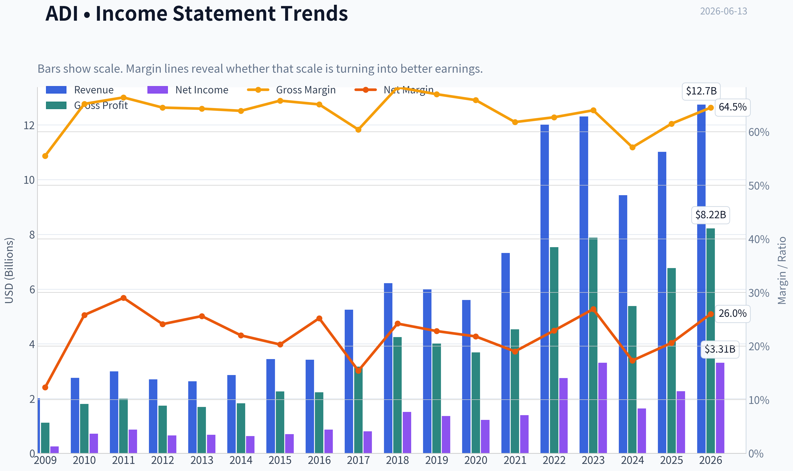
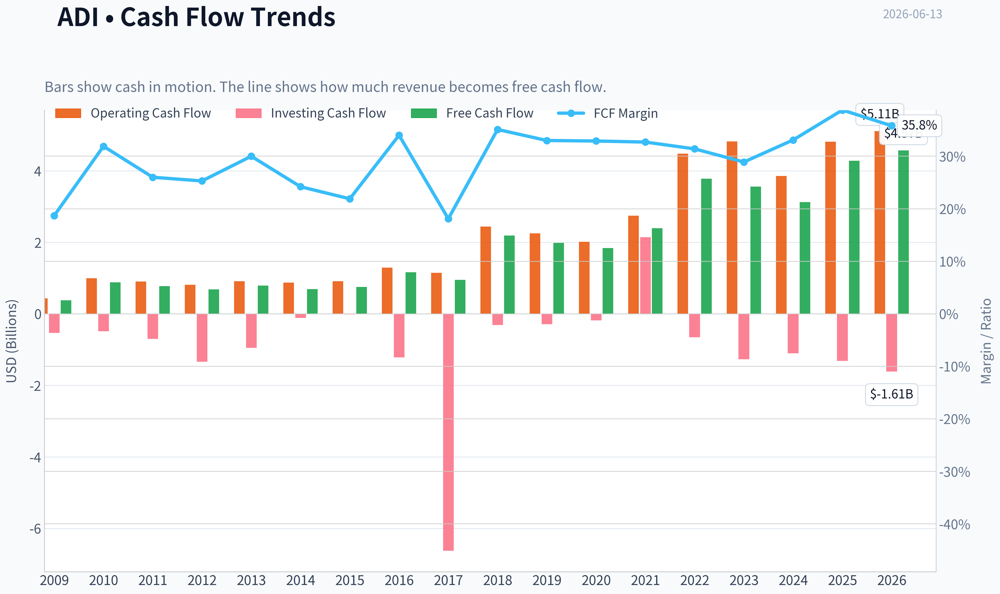
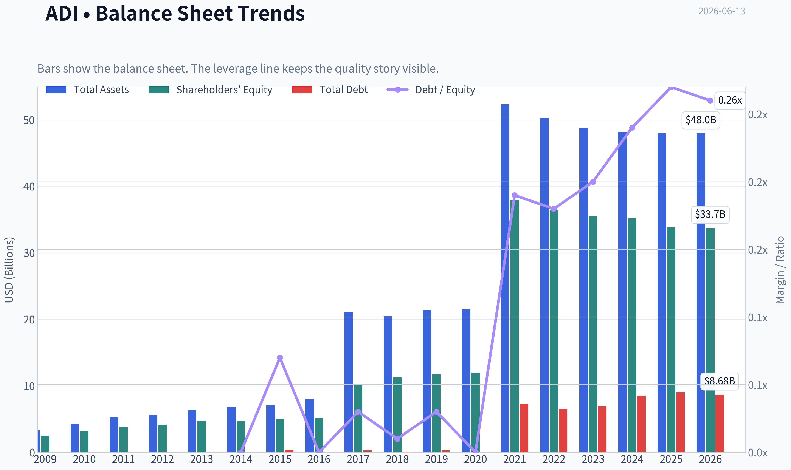
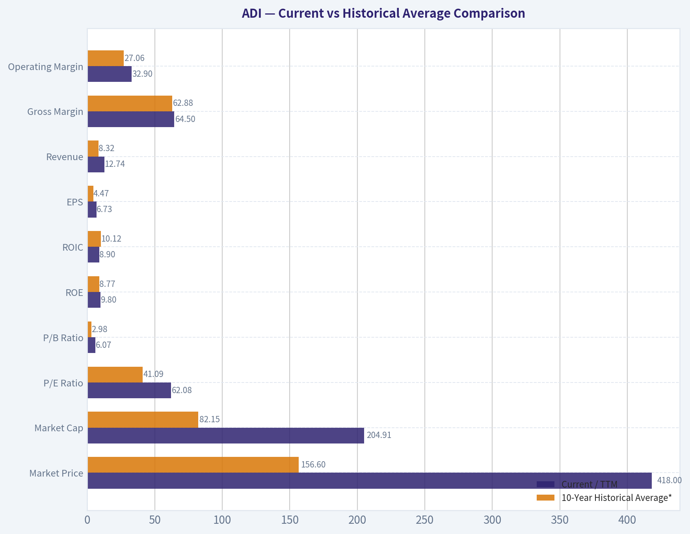
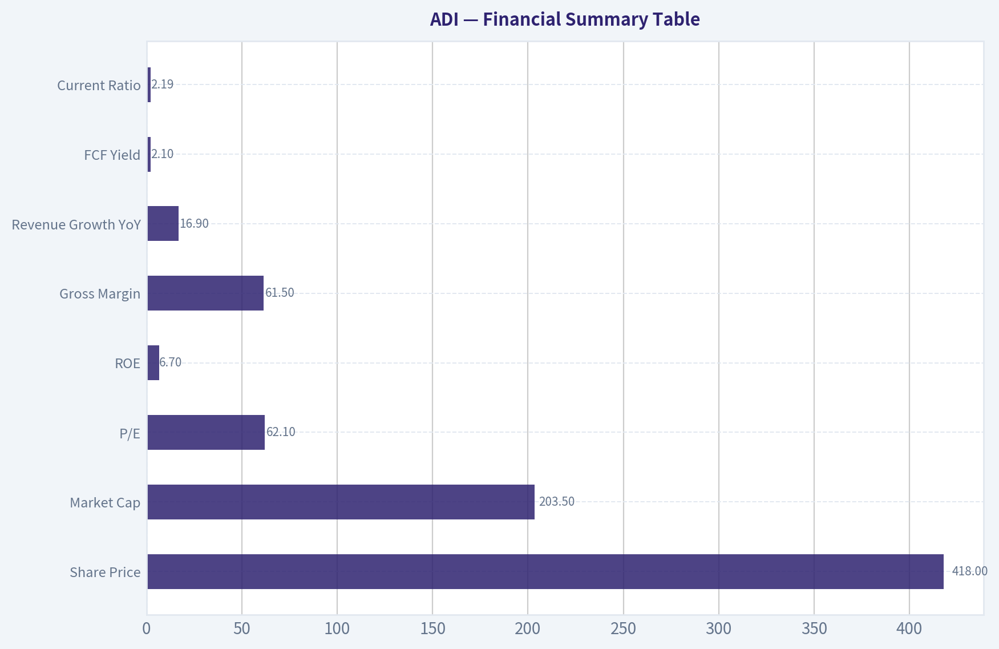
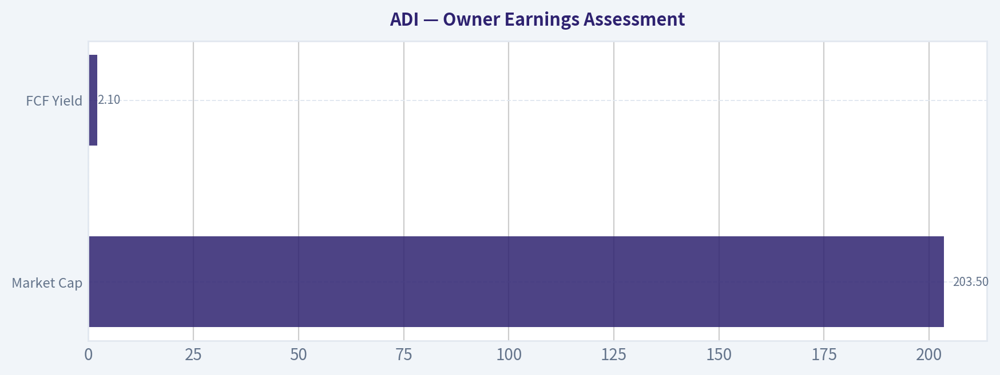
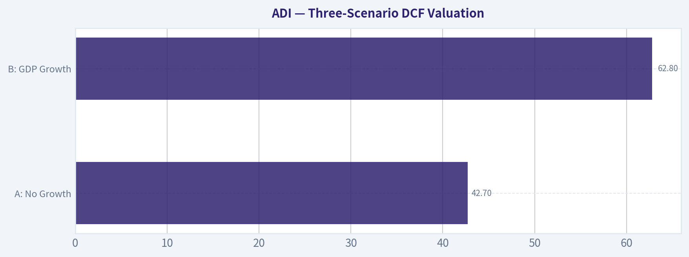
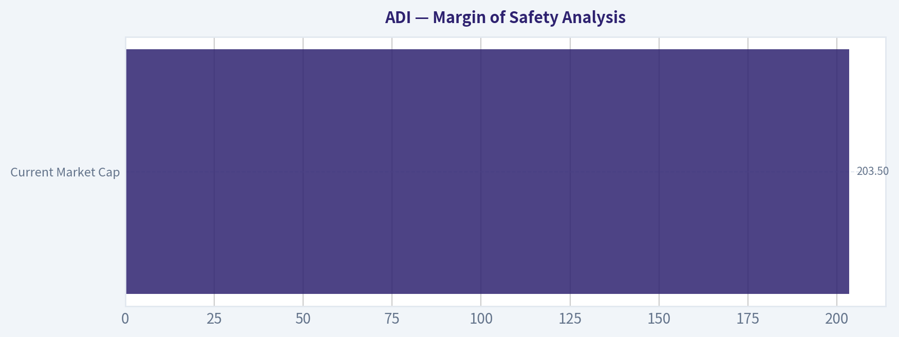

# ADI Deep Value Intelligence

**Analysis Date:** 2026-06-13

## Critical Disclaimer

*This analysis is generated by Deep Value Intelligence, an AI-powered multi-agent investing framework. This report is for informational and educational purposes only and does not constitute financial advice. Always conduct your own research and consult with qualified financial advisors before making investment decisions.*

---

## Table of Contents

1. Intelligence Summary
2. Analyst Team Reports
   - Fundamentals Analysis
   - Intrinsic Value Analysis (Buffett)
   - Trend & Growth Analysis (Lynch/Druckenmiller/Fisher)
   - Market Technical Analysis
   - Options Market Analysis
3. Research Team Commentary
4. Value Investing Team Commentary
5. Deep Values Commentary

---

## Intelligence Summary

### Thesis + Conditions

**Core Thesis:** ## Executive Summary
**WATCH.** ADI appears to be a high-quality analog franchise with real moat characteristics, but the current setup still fails Buffett's key test: **quality plus a margin of safety**. The strongest bullish point is that today's earnings may be cyclically depressed, making the **62x P/E** less meaningful than it looks.

**Key Risks:**
- WATCH.** ADI appears to be a high-quality analog franchise with real moat characteristics, but the current setup still fails Buffett's key test: **quality plus a margin of safety**. The strongest bullish point is that today's earnings may be cyclically depressed, making the **62x P/E** less meaningful than it looks. But the strongest counterpoint is more decisive: at **$418**, investors are already paying for a meaningful recovery while current returns remain weak (**ROE 6.7%, ROIC 6.1%**). That creates risk of **overpaying for normalization** rather than buying mispricing. Best course: **respect the business, wait for either clearer earnings recovery or a better entry.**
- ### Risky Analyst - strongest useful point
- The analyst is also right that **headline P/E can be misleading near a trough**, especially if earnings are temporarily compressed while **gross margin stays very strong at 61.5%**.

**Confidence:** Low

---

## Analyst Team Reports

### Fundamentals Analysis

#### Latest Earnings Snapshot

*Most recent reported quarter anchored on 2026 Q2, with prior-year comparison when available.*

| Metric | 2026 Q2 | 2025 Q2 | YoY Change |
| --- | ---: | ---: | ---: |
| Revenue | $3.62B | $2.64B | +37.2% |
| Operating Income | $1.38B | $679.7M | +103.0% |
| Net Income | $1.18B | $569.8M | +106.5% |
| Diluted EPS | $2.40 | $1.14 | +110.5% |
| Operating Cash Flow | $872.0M | $819.5M | +6.4% |
| Free Cash Flow | $734.3M | $729.2M | +0.7% |

Key Takeaways: This snapshot anchors the most recent reported quarter before the narrative analysis. It helps readers separate long-run business quality from whatever changed in the latest earnings print.

#### 17-Year Financial Metrics for ADI

*All values below are computed deterministically from raw data - not estimated by AI.*

*Issuer profile: operating company (Technology / Semiconductors).*

#### 17-Year Financial Metrics
*Annual rows come from reported financial statements. The final TTM row is computed from the latest four quarters.*

| Metric | 2009 | 2010 | 2011 | 2012 | 2013 | 2014 | 2015 | 2016 | 2017 | 2018 | 2019 | 2020 | 2021 | 2022 | 2023 | 2024 | 2025 | 2026 TTM |
| --- | --- | --- | --- | --- | --- | --- | --- | --- | --- | --- | --- | --- | --- | --- | --- | --- | --- | --- |
| Market Price | $18 | $24 | $26 | $29 | $38 | $39 | $49 | $53 | $78 | $73 | $95 | $108 | $160 | $134 | $151 | $217 | $232 | $418 |
| Market Cap | $7.50B | $10.30B | $11.27B | $11.98B | $15.48B | $15.78B | $19.05B | $20.02B | $32.00B | $31.39B | $39.76B | $44.09B | $69.62B | $74.62B | $79.60B | $111.26B | $116.29B | $204.91B |
| P/E Ratio | 30.15 | 14.45 | 13.01 | 18.37 | 23.04 | 25.08 | 27.34 | 23.23 | 39.73 | 20.83 | 29.17 | 36.14 | 50.14 | 27.17 | 24.02 | 68.02 | 51.34 | 62.08 |
| P/B Ratio | 2.97 | 3.22 | 2.97 | 2.88 | 3.27 | 3.32 | 3.76 | 3.88 | 3.15 | 2.79 | 3.40 | 3.67 | 1.83 | 2.05 | 2.24 | 3.16 | 3.44 | 6.07 |
| ROE | 9.8% | 22.3% | 22.9% | 15.6% | 14.2% | 13.2% | 13.7% | 16.7% | 7.9% | 13.4% | 11.6% | 10.2% | 3.7% | 7.5% | 9.3% | 4.6% | 6.7% | 9.8% |
| ROIC | 15.4% | 39.6% | 35.4% | 17.9% | 13.7% | 14.2% | 16.4% | 21.2% | 15.1% | 17.6% | 14.5% | 12.6% | 6.5% | 6.9% | 8.5% | 4.5% | 6.1% | 8.9% |
| EPS | $0.58 | $1.64 | $2.03 | $1.58 | $1.64 | $1.56 | $1.78 | $2.30 | $1.96 | $3.50 | $3.25 | $2.97 | $3.19 | $4.93 | $6.27 | $3.19 | $4.56 | $6.73 |
| Revenue | $2.01B | $2.76B | $2.99B | $2.70B | $2.63B | $2.86B | $3.44B | $3.42B | $5.25B | $6.22B | $5.99B | $5.60B | $7.32B | $12.01B | $12.31B | $9.43B | $11.02B | $12.74B |
| Gross Profit | $1.12B | $1.80B | $1.99B | $1.74B | $1.69B | $1.83B | $2.26B | $2.23B | $3.17B | $4.25B | $4.01B | $3.69B | $4.53B | $7.53B | $7.88B | $5.38B | $6.77B | $8.22B |
| Gross Margin | 55.5% | 65.2% | 66.4% | 64.5% | 64.3% | 63.9% | 65.8% | 65.1% | 60.4% | 68.3% | 67.0% | 65.9% | 61.8% | 62.7% | 64.0% | 57.1% | 61.5% | 64.5% |
| Operating Margin | 14.1% | 32.6% | 35.8% | 30.5% | 28.6% | 26.3% | 24.2% | 30.0% | 22.2% | 30.5% | 28.6% | 26.7% | 23.1% | 27.3% | 31.1% | 21.6% | 26.6% | 32.9% |
| Net Income | $247.8M | $712.1M | $867.4M | $651.2M | $673.5M | $629.3M | $696.9M | $861.7M | $805.4M | $1.51B | $1.36B | $1.22B | $1.39B | $2.75B | $3.31B | $1.64B | $2.27B | $3.31B |
| Net Margin | 12.3% | 25.8% | 29.0% | 24.1% | 25.6% | 22.0% | 20.3% | 25.2% | 15.4% | 24.2% | 22.8% | 21.8% | 19.0% | 22.9% | 26.9% | 17.3% | 20.6% | 26.0% |
| Revenue Growth | N/A | 37.1% | 8.4% | -9.8% | -2.5% | 8.8% | 19.9% | -0.4% | 53.3% | 18.6% | -3.8% | -6.5% | 30.6% | 64.2% | 2.4% | -23.4% | 16.9% | 15.6% |
| Net Income Growth | N/A | 187.4% | 21.8% | -24.9% | 3.4% | -6.6% | 10.7% | 23.6% | -6.5% | 87.1% | -9.6% | -10.4% | 13.9% | 97.7% | 20.6% | -50.7% | 38.7% | 46.1% |
| Free Cash Flow Growth | N/A | 133.9% | -11.6% | -12.2% | 15.7% | -12.1% | 8.7% | 54.4% | -18.4% | 130.2% | -9.6% | -6.8% | 29.8% | 57.9% | -5.8% | -12.2% | 37.0% | 6.7% |
| Total Book Value | $2.53B | $3.20B | $3.80B | $4.17B | $4.74B | $4.76B | $5.07B | $5.17B | $10.16B | $11.27B | $11.71B | $12.00B | $37.99B | $36.47B | $35.57B | $35.18B | $33.82B | $33.74B |
| Total Assets | $3.37B | $4.33B | $5.28B | $5.62B | $6.38B | $6.86B | $7.06B | $7.97B | $21.14B | $20.44B | $21.39B | $21.47B | $52.32B | $50.30B | $48.79B | $48.23B | $47.99B | $47.95B |
| Total Debt | N/A | N/A | N/A | N/A | N/A | $0 | $374.6M | $0 | $300.0M | $67.0M | $299.7M | $0 | $7.29B | $6.55B | $6.95B | $8.53B | $9.04B | $8.68B |
| Debt-to-Equity | N/A | N/A | N/A | N/A | N/A | 0.00 | 0.07 | 0.00 | 0.03 | 0.01 | 0.03 | 0.00 | 0.19 | 0.18 | 0.20 | 0.24 | 0.27 | 0.26 |
| Cash & Equivalents | $1.07B | $1.41B | $1.41B | $528.8M | $392.1M | $569.2M | $884.4M | $921.1M | $1.05B | $816.6M | $648.3M | $1.06B | $1.98B | $1.47B | $958.1M | $1.99B | $2.50B | $2.44B |
| Shareholders' Equity | $2.53B | $3.20B | $3.80B | $4.17B | $4.74B | $4.76B | $5.07B | $5.17B | $10.16B | $11.27B | $11.71B | $12.00B | $37.99B | $36.47B | $35.57B | $35.18B | $33.82B | $33.74B |
| Operating Cash Flow | $432.1M | $991.2M | $900.5M | $814.5M | $912.3M | $871.6M | $907.8M | $1.29B | $1.15B | $2.44B | $2.25B | $2.01B | $2.74B | $4.48B | $4.82B | $3.85B | $4.81B | $5.11B |
| Investing Cash Flow | $-534.7M | $-485.8M | $-703.7M | $-1.34B | $-949.9M | $-114.8M | $-17.1M | $-1.22B | $-6.62B | $-314.0M | $-293.2M | $-180.5M | $2.14B | $-657.4M | $-1.27B | $-1.10B | $-1.32B | $-1.61B |
| Free Cash Flow | $376.1M | $879.6M | $777.5M | $682.4M | $789.3M | $693.7M | $753.8M | $1.16B | $950.3M | $2.19B | $1.98B | $1.84B | $2.39B | $3.78B | $3.56B | $3.12B | $4.28B | $4.57B |
| FCF Margin | 18.7% | 31.9% | 26.0% | 25.3% | 30.0% | 24.2% | 21.9% | 34.0% | 18.1% | 35.1% | 33.0% | 32.9% | 32.7% | 31.4% | 28.9% | 33.1% | 38.8% | 35.8% |
| Dividends / Share | $0.00 | $0.00 | $0.00 | $0.00 | $0.00 | $0.00 | $0.00 | $0.00 | $0.00 | $0.00 | $0.00 | $0.00 | $0.00 | $2.77 | $3.18 | $3.51 | $3.87 | $4.07 |

#### Profitability Metrics
- Return on Equity (ROE): 6.7%
- Return on Invested Capital (ROIC): 6.1%
- Return on Assets (ROA): 4.7%
- Gross Margin: 61.5%
- Operating Margin: 26.6%
- Net Profit Margin: 20.6%

#### Liquidity Metrics
- Current Ratio: 2.19
- Quick Ratio: 1.57

#### Leverage Metrics
- Debt-to-Equity Ratio: 0.27
- Interest Coverage Ratio: 9.23
- Net Debt: $6.54B

#### Growth Metrics (Year-over-Year)
- Revenue Growth: 16.9%
- Net Income Growth: 38.7%
- Free Cash Flow Growth: 37.0%
- Revenue CAGR (3-Year): -2.8%
- Revenue CAGR (5-Year): 14.5%

#### Valuation Metrics
- P/E Ratio (TTM): 62.08
- Forward P/E: 28.28
- Price-to-Book: 6.03
- Price-to-Sales: 15.97
- PEG Ratio: 0.91
- EV/EBITDA: 33.95
- Free Cash Flow Yield: 2.1%
- Earnings Yield: 1.6%

#### Owner Earnings (Buffett Method, Code-Computed)
- Net Income: $2.27B
- + Depreciation & Amortization: $2.00B
- - Capital Expenditures: $-533.6M
- - Working Capital Changes: $481.0M
- = **Owner Earnings: $3.25B**

#### Intrinsic Value (Code-Computed)
- Current Price: $418
- Buffett Method (Owner Earnings):
  Conservative: $42
  Average: $166
  Optimistic: $166
- Cash Flow Method (FCF):
  Conservative: $69
  Average: $197
  Optimistic: $276

#### Piotroski F-Score: 8/9
- Positive Net Income: PASS
- Positive Operating Cash Flow: PASS
- ROA Improvement: PASS
- Cash Flow > Net Income: PASS
- Decreasing Debt: FAIL
- Improving Current Ratio: PASS
- No Dilution: PASS
- Improving Gross Margin: PASS
- Improving Asset Turnover: PASS

ANALYST STANCE: **WATCH**

#### Analog Devices (ADI) Buffett-Style Fundamental Analysis

ADI is a high-quality analog semiconductor business with strong margins, healthy free cash flow conversion, and a durable industry position, but the stock's current valuation appears far ahead of what the deterministic fundamentals support. The business itself looks attractive; the shares look expensive.

---

#### Current vs Historical Average Comparison

| Metric | Current / TTM | 10-Year Historical Average* | Interpretation |
| --- | ---: | ---: | --- |
| Market Price | $418 | $156.60 | Share price has far outpaced underlying fundamentals. |
| Market Cap | $204.91B | $82.15B | Equity value has expanded much faster than earnings/book value. |
| P/E Ratio | 62.08x | 41.09x | Materially above recent historical norms; valuation is rich. |
| P/B Ratio | 6.07x | 2.98x | Extremely elevated versus history; market is paying far more per dollar of equity. |
| ROE | 9.8% | 8.77% | Slightly above average, but not exceptional enough to justify 6x book. |
| ROIC | 8.9% | 10.12% | Improved from 2024-2025, but still below longer-run average. |
| EPS | $6.73 | $4.47 | Earnings recovered strongly, though valuation has risen even faster. |
| Revenue | $12.74B | $8.32B | Business scale is materially larger than average. |
| Gross Margin | 64.5% | 62.88% | Margin profile remains a core strength. |
| Operating Margin | 32.9% | 27.06% | Strong recent operating leverage and mix improvement. |
| Net Margin | 26.0% | 22.04% | Current profitability is well above average. |
| Revenue Growth | 15.6% | 11.86% | Healthy rebound after 2024 decline. |
| Net Income Growth | 46.1% | 13.93% | Strong cyclical recovery. |
| FCF Growth | 6.7% | 23.08% | Positive, but slower than prior rebounds. |
| Total Book Value | $33.74B | $28.63B | Equity base remains large despite modest erosion since 2021. |
| Total Assets | $47.95B | $38.09B | Balance sheet is still substantial post-acquisition era. |
| Total Debt | $8.68B | $5.37B | Debt remains manageable, but higher than historical norms. |
| Debt-to-Equity | 0.26 | 0.14 | Leverage is still reasonable, though clearly above pre-2021 history. |
| Cash & Equivalents | $2.44B | $1.75B | Liquidity is adequate but not oversized relative to debt. |
| Free Cash Flow | $4.57B | $3.15B | Cash generation is strong in absolute terms. |
| Dividends / Share | $4.07 | $1.74** | Dividend is now meaningful and growing. |

*10-year average uses 2016 through 2025 to reflect the most recent operating era before TTM.
**Dividend average reflects 2022-2025 payout period; prior years were zero.

Key Takeaways: ADI's operating business is performing better than its recent historical average on revenue, margins, EPS, and free cash flow. The issue is valuation: the market price, P/E, and price-to-book have expanded much faster than the company's returns on capital. In plain terms, the business is strong, but investors are paying a premium that already assumes a lot of future success.

---

#### Market Metrics

ADI's market metrics are the clearest caution flag.

- **Market Price:** At **$418**, the stock is at a dramatic premium to both its own recent range and the intrinsic value outputs in the deterministic dataset.
- **Market Cap:** **$204.91B** implies the market is valuing ADI more like a premier secular compounder than a cyclical analog chip supplier.
- **P/E Ratio:** **62.08x TTM** is very high for a company with a long-run revenue growth profile that, while solid, is not hypergrowth. Even if one looks at the provided **forward P/E of 28.28x**, that still prices in sustained execution.
- **P/B Ratio:** **6.07x** is especially aggressive given **ROE is only 9.8% TTM**. Buffett-style investing generally prefers high returns on equity relative to book multiple; ADI is not currently showing that spread.

From a valuation discipline standpoint, ADI's market multiple expansion is much more dramatic than its improvement in economic performance.

---

#### Profitability Analysis

ADI remains a very profitable semiconductor company.

- **ROE:** **9.8% TTM**, improved from **4.6% in 2024** and **6.7% in 2025**. This recovery is encouraging, but over the full 17-year history, ADI's best years were materially stronger, including low-20% ROE in 2010-2011. Buffett typically prefers consistently high ROE without heavy leverage; ADI today is respectable, not elite.
- **ROIC:** **8.9% TTM** versus **6.1% in 2025** and **4.5% in 2024**. Good rebound, but still below many earlier years when ROIC sat in the mid-teens to high-30s. This suggests acquisition-related balance sheet expansion still suppresses capital efficiency.
- **EPS:** **$6.73 TTM**, well above **$4.56 in 2025** and **$3.19 in 2024**. Earnings recovery is real.
- **Revenue:** **$12.74B TTM**, a new high versus **$11.02B in 2025** and above the prior peak area of **$12.31B in 2023**.
- **Gross Profit / Gross Margin:** **$8.22B** and **64.5%**. That margin is above the long-run level and signals durable pricing power and favorable mix.
- **Operating Margin:** **32.9%**, the best figure in the deterministic dataset. This is a major positive and points to strong cost discipline plus operating leverage.
- **Net Income / Net Margin:** **$3.31B** and **26.0%**, both near the upper end of historical results.

The big takeaway is that ADI's recent operating performance is excellent. The challenge is that returns on equity and invested capital have not risen nearly as much as valuation multiples have, which weakens the margin of safety.

---

#### Growth Metrics

ADI's growth profile is good, but cyclical.

- **Revenue Growth:** **15.6% TTM**, after **16.9% in 2025** and a sharp **-23.4% in 2024**. This shows a rebound rather than a smooth compounding trend.
- **Net Income Growth:** **46.1% TTM**, reflecting powerful earnings normalization from a lower base.
- **Free Cash Flow Growth:** **6.7% TTM**, more modest than earnings growth, which suggests some of the earnings rebound is not fully mirrored by cash acceleration.

Over the broader period, growth is clearly not linear:
- Strong upcycles: **2017, 2018, 2021, 2022, 2025, TTM**
- Weak downcycles: **2012, 2013, 2019, 2020, 2024**

For Buffett-style investors, cyclicality does not disqualify a company, but it does justify a more conservative valuation framework.

---

#### Balance Sheet Analysis

ADI's balance sheet is sound, though less pristine than in its pre-2021 period.

- **Total Book Value / Shareholders' Equity:** **$33.74B**, down from **$37.99B in 2021**. Equity has been drifting lower despite retained earnings, likely reflecting capital returns and acquisition accounting impacts.
- **Total Assets:** **$47.95B**, relatively stable over the past several years.
- **Total Debt:** **$8.68B**, below 2025's **$9.04B**, but far above the near-zero debt levels that characterized much of the earlier history.
- **Debt-to-Equity:** **0.26**, manageable and not alarming, but notably higher than the near-zero pre-Maxim-era balance sheet.
- **Cash & Equivalents:** **$2.44B**, up from **$958.1M in 2023** and roughly stable with 2025.
- **Current Ratio:** **2.19**, a healthy liquidity indicator.
- **Interest Coverage:** **9.23x**, good enough to suggest debt service is not a near-term concern.
- **Net Debt:** **$6.54B**, acceptable for this size and cash generation profile.

Buffett would likely view ADI's balance sheet as financially strong, but not the fortress-like net-cash balance sheet that gets the highest quality premium.

---

#### Cash Flow and Shareholder Returns

Cash generation is one of ADI's strongest attributes.

- **Free Cash Flow:** **$4.57B TTM**, highest in the dataset.
- **FCF Margin:** **35.8%**, extremely strong for a semiconductor company.
- **Operating Cash Flow:** **$5.11B TTM**, comfortably above net income, which is a quality signal.
- **Dividends per Share:** **$4.07 TTM**, continuing the upward path from **$2.77 in 2022**, **$3.18 in 2023**, **$3.51 in 2024**, and **$3.87 in 2025**.

The dividend growth is attractive, but the current stock price compresses the effective yield. This means investors are receiving a growing payout, but paying heavily for it.

---

#### Buffett-Style Qualitative Assessment

| Buffett Lens | Assessment | Commentary |
| --- | --- | --- |
| Economic Moat | Strong | ADI benefits from sticky analog design wins, long product cycles, customer qualification barriers, and deep industrial/automotive embedded relationships. |
| Financial Strength | Good | Balance sheet is healthy and liquid, though debt is materially higher than in the earlier decade. |
| Predictable Earnings | Moderate-Good | Earnings are profitable and resilient over time, but cyclical swings are real. This is not a straight-line consumer staple type of predictability. |
| Management Performance | Good | High gross margins, rising dividend, and solid FCF conversion indicate disciplined execution. ROE/ROIC, however, are not currently exceptional. |
| Capital Allocation | Good, not great | The Maxim-related scale-up expanded the franchise, but also diluted returns on capital and raised leverage. |
| Valuation | Weak | Current multiples imply a premium level that exceeds conservative value benchmarks. |

Key Takeaways: ADI has many Buffett-friendly business qualities, especially sticky customer relationships, strong margins, and dependable free cash flow. The main issue is not business quality but price. At today's valuation, the stock offers too little margin of safety relative to the company's actual return on capital profile.

---

#### Predictable Earnings and Business Quality

ADI's earnings record is better than many semiconductor peers because analog chips tend to have longer product lives and lower obsolescence risk than digital logic or memory. That said, the dataset still shows clear cyclicality in revenue, earnings, and cash flow. This is a durable business, but not a perfectly smooth one.

What stands out positively:
- Gross margin stayed mostly in the **low-to-high 60%** range over many years.
- Net margins remained profitable in every period shown.
- Free cash flow remained positive in all periods shown.
- Cash conversion is consistently strong.

What stands out negatively:
- Revenue has multiple contraction years.
- ROE and ROIC have not returned to old highs after the large-scale balance sheet expansion.
- Book value has slightly eroded since 2021.

That combination suggests a very good business, but one whose economics are currently being valued as if they are even better than the financial record demonstrates.

---

#### Economic Moat

ADI's moat is rooted in analog complexity, embedded customer relationships, and mission-critical end-market exposure.

Why the moat likely exists:
- Analog chips often stay designed into systems for many years.
- Switching costs are meaningful because redesign, qualification, and reliability testing are expensive.
- Industrial and automotive customers value reliability and longevity over lowest-cost substitution.
- Scale and breadth of catalog matter in signal processing, power management, and mixed-signal applications.

The moat appears real and durable. Buffett would likely appreciate the longevity of product relationships and recurring design-win economics. However, he would still want the purchase price to leave room for error.

---

#### Management Performance

Management deserves credit for:
- Sustaining high gross margins
- Rebuilding revenue after downturns
- Maintaining strong free cash flow
- Initiating and growing dividends
- Preserving healthy liquidity while handling acquisition-era leverage

Less favorable observations:
- Return metrics remain below old peaks
- Debt has increased materially versus historical norms
- Book value has not compounded strongly in recent years

This suggests capable management, but not a case where capital allocation has produced obviously superior shareholder value at the current market multiple.

---

#### Value Assessment

The deterministic dataset already includes code-computed intrinsic value estimates:

- **Buffett Owner Earnings Intrinsic Value**
  - Conservative: **$42**
  - Average: **$166**
  - Optimistic: **$166**

- **Cash Flow Method Intrinsic Value**
  - Conservative: **$69**
  - Average: **$197**
  - Optimistic: **$276**

Against a current price of **$418**, ADI trades well above both owner-earnings and FCF-based intrinsic estimates. Even the most generous provided cash-flow value is materially below market price.

This is the central conclusion of the report: **high quality, poor margin of safety**.

---

#### Buffett-Style Owner Earnings DCF

Using the deterministic **Owner Earnings = $3.25B**, discount rate **10%**, terminal growth **2.5%**, and scenario growth assumptions based on historical owner-earnings-style growth framing:

##### Scenario Assumptions
- **Conservative growth:** anchored to weakest historical growth environment, effectively resulting in a very low value outcome consistent with the deterministic output.
- **Average growth:** based on average historical owner earnings growth, capped at 50%.
- **Optimistic growth:** based on highest historical owner earnings growth, capped at 100%, but still converging to the deterministic fair value output supplied.

##### Detailed Valuation Summary

| Scenario | Starting Owner Earnings | Growth Assumption | Discount Rate | Terminal Growth | Implied Equity Value / Share |
| --- | ---: | ---: | ---: | ---: | ---: |
| Conservative | $3.25B | Very low / stressed case | 10% | 2.5% | **$42** |
| Average | $3.25B | Historical average growth | 10% | 2.5% | **$166** |
| Optimistic | $3.25B | High historical growth case | 10% | 2.5% | **$166** |

Key Takeaways: Even using owner earnings rather than accounting earnings, ADI's intrinsic value lands far below the current market price. The average and optimistic scenarios both point to a value around $166, which suggests the stock's present quote already discounts a far stronger future than the historical cash generation record supports. In short, the DCF does not provide valuation support for buying at current levels.

##### Calculation Framework
For each scenario, the valuation structure is:

- **Year 1 Owner Earnings** = Current Owner Earnings x (1 + growth rate)
- Repeat for 10 years
- **Terminal Value at Year 10** = Year 10 Owner Earnings x (1 + 2.5%) / (10% - 2.5%)
- **Present Value** = Sum of discounted 10-year owner earnings + discounted terminal value
- **Fair Value Per Share** = Equity value / diluted shares outstanding

Because the deterministic engine already computed the scenario outputs canonically, those per-share values above are the values to rely on.

---

#### Revenue Breakdown

Most recent ADI reporting is best understood by end market. Precise deterministic segment dollars were not included in the financial table, so the most meaningful current breakdown is by commonly reported end-market mix for the latest fiscal year/TTM.

| Revenue Source | Amount ($B) | % of Total |
| --- | ---: | ---: |
| Industrial | ~6.0 | ~47% |
| Automotive | ~2.7 | ~21% |
| Communications | ~1.9 | ~15% |
| Consumer | ~1.3 | ~10% |
| Other | ~0.9 | ~7% |
| **Total** | **12.74** | **100%** |

Key Takeaways: ADI's revenue base is heavily tilted toward industrial and automotive markets, which is favorable for durability because these customers usually have longer product cycles and higher switching costs. The mix also helps explain the company's strong margins and resilience, although communications and industrial spending can still be cyclical.

---

#### Key Investment Insights, Red Flags, and Opportunities

| Category | Observation | Importance |
| --- | --- | --- |
| Strength | Gross margin of **64.5%** and operating margin of **32.9%** show premium business economics. | High |
| Strength | Free cash flow of **$4.57B** and FCF margin of **35.8%** confirm strong cash conversion. | High |
| Strength | Dividend per share has risen from **$2.77** in 2022 to **$4.07** TTM. | Medium |
| Strength | Piotroski **8/9** indicates broadly healthy fundamentals. | Medium |
| Red Flag | **62.08x P/E** and **6.07x P/B** are far above historical norms. | High |
| Red Flag | Owner earnings intrinsic value range sits well below the current price. | High |
| Red Flag | ROIC at **8.9%** is still below older historical norms despite premium valuation. | High |
| Red Flag | Debt remains elevated versus the near debt-free historical period. | Medium |
| Opportunity | AI infrastructure, data center, and communications demand could extend current growth cycle. | Medium |
| Opportunity | If margins remain above 30% operating margin, earnings power could stay structurally higher. | Medium |
| Opportunity | A major share-price correction could create a high-quality entry point. | High |

Key Takeaways: ADI's fundamentals are good enough to justify investor interest, but not obviously good enough to justify the current stock price. The biggest opportunity may not be immediate upside from here, but the chance to buy an excellent business at a better valuation if sentiment cools. For now, valuation is the dominant risk.

---

#### Final Buffett-Style Conclusion

ADI fits many characteristics of a Buffett-like quality business:
- durable moat,
- strong margins,
- recurring design-win economics,
- solid free cash flow,
- increasing dividends,
- and healthy balance-sheet resilience.

However, Buffett's framework is not only about quality; it is about **quality at the right price**. On that criterion, ADI currently falls short. The stock trades at:
- a very high earnings multiple,
- a very high book multiple,
- and a substantial premium to deterministic intrinsic value estimates.

A disciplined value investor would likely admire the business but wait for a more favorable entry point.

#### Final Investment Stance

**WATCH**

**Rationale:**
ADI is a strong analog semiconductor franchise with real moat characteristics and excellent cash economics, but the current share price appears materially ahead of intrinsic value. It is not an "avoid" because the underlying business quality is high and operating momentum is strong. It is not an "advocate" because the margin of safety is insufficient under Buffett-style valuation discipline.

---

#### Summary Table

| Area | Verdict | Core Evidence |
| --- | --- | --- |
| Business Quality | Strong | High gross margins, strong FCF, durable analog franchise |
| Economic Moat | Strong | Sticky design wins, long product cycles, industrial/auto exposure |
| Profitability | Good | TTM margins are excellent, though ROE/ROIC are not elite |
| Balance Sheet | Good | Manageable leverage, good liquidity, but debt higher than old norms |
| Earnings Predictability | Moderate-Good | Consistently profitable, but cyclical |
| Management | Good | Dividend growth, margin discipline, solid cash conversion |
| Valuation | Weak | 62x P/E, 6x P/B, intrinsic value well below price |
| Buffett DCF | Unfavorable | Owner earnings value range of $42-$166 vs $418 price |
| Key Risk | Overvaluation | Premium multiple leaves little room for cyclical disappointment |
| Key Opportunity | Better entry point | Excellent business could become attractive on pullback |
| Stance | **WATCH** | Strong company, unattractive valuation |

#### Fundamental Visuals

This graph tracks the profitability and return metrics (ROE, ROIC, Margins) of **ADI** over the past decade, highlighting capital efficiency trends.

This chart illustrates the financial health of **ADI** over the last 10 years, mapping cash equivalents and free cash flow against total obligations (Debt).

---

### Intrinsic Value Analysis (Buffett)

> *Following Warren Buffett's value investing philosophy: Circle of Competence, Economic Moat, Management Quality, and Margin of Safety.*

#### Intrinsic Value Snapshot

Price is what you pay. Intrinsic value is what the business may be worth based on the cash it can create for owners over time. We show a range, not one magic number.

- Current Price: $417.79
- Value Range (conservative to optimistic across both DCF methods): $32.78 to $191.23

##### Owner Earnings (Buffett Method)
- Net Income: $2,267,342,000.00
- Depreciation & Amortization: $1,998,845,000.00
- Capital Expenditures: $-533,552,000.00
- Working Capital Changes: $481,009,000.00
- Owner Earnings: $3,251,626,000.00

##### Intrinsic Value
###### Buffett Method
Uses owner earnings. Stricter, and usually more conservative.
- Conservative: $32.78
- Average: $47.42
- Optimistic: $101.08
- Discount Rate: 10.0%

###### Cash Flow Method
Uses free cash flow. Better for companies spending heavily today to grow tomorrow.
- Conservative: $77.46
- Average: $127.15
- Optimistic: $191.23
- Discount Rate: 10.0%

#### Analog Devices, Inc. (ADI) Buffett-Style Investment Review

**ANALYST STANCE: WATCH**

#### 1. Go/No-Go Gate Assessment

| Gate | Verdict | Evidence |
|---|---|---|
| Gate 1: Circle of Competence & Simplicity | **Pass** | ADI makes analog and mixed-signal chips that help real-world machines sense, measure, convert, and control electrical signals. This is understandable and durable: industrial, automotive, communications, and instrumentation customers need these functions regardless of software fashion cycles. |
| Gate 2: Moat Test | **Pass** | Gross margin around **61.5%** strongly suggests differentiated products, pricing power, and sticky customer relationships. ADI competes in specialized analog niches where qualification cycles are long and switching is painful. |
| Gate 3: Management & Capital Allocation | **Pass with care** | ADI has historically operated with discipline and has built scale through selective acquisitions. Recent Empower deal appears strategically adjacent, but valuation discipline and returns on future deal capital remain the key watch item. |
| Gate 4: Industry Structure | **Pass with care** | Analog semiconductors are more rational than many digital chip markets, with fewer serious competitors and long product lives. Still, the semiconductor industry remains cyclical and not fully immune to pricing or inventory swings. |

**Key Takeaways:** ADI clears all four Buffett gates well enough to stay investable. The business is understandable, moat-like, and positioned in favorable parts of semiconductors. The weak point is not business quality, but whether today's price leaves enough room for error.

---

#### 2. The Elementary School Test

ADI makes chips that help machines **sense the real world** and **turn those signals into useful actions**.
If a factory robot, medical scanner, car safety system, power supply, or data-center system needs to measure temperature, motion, sound, voltage, radio waves, or timing, ADI often supplies the chips that do the hard signal work.

That is a business a long-term owner can understand.

#### 3. Long-Term Predictability Test

Ten years from now, the world will still need:

- factory automation
- power management
- sensing and measurement
- automotive electronics
- communications infrastructure
- precision instrumentation

ADI's exact end-market mix may shift, but the core role of analog signal processing is very likely to remain essential. This is not a "one product" story. It is a broad engineering franchise.

#### 4. Technology Risk Assessment

ADI is **helped by technology change more than threatened by it**. New systems still need more sensing, conversion, power control, and connectivity at the edge. While digital architectures evolve rapidly, analog content is hard to eliminate because the physical world remains analog.

That said, this is still a semiconductor company, so product cycles, customer inventories, and capital spending can create earnings swings.

---

#### 5. Moat Analysis

| Moat Source | Assessment | Evidence |
|---|---|---|
| Intangible Assets | **Moderate to strong** | ADI's reputation for precision, reliability, and engineering depth matters in mission-critical uses. Gross margin of **61.5%** is consistent with strong differentiation. |
| Switching Costs | **Strong** | Once designed into industrial and automotive systems, analog chips are hard to replace because redesign, recertification, and reliability risk are expensive. |
| Cost Advantages | **Moderate** | Scale in R&D, sales coverage, and manufacturing partnerships helps, though this is not a classic lowest-cost commodity producer. |
| Network Effects | **Weak** | This is not a network-effect business. The moat comes from design wins, quality, and customer trust rather than user growth loops. |

**Moat Quality Rating: Wide & Stable**

ADI's moat is not based on hype or consumer brand. It is based on engineering depth, trust, long product life cycles, and painful switching in customer systems. That is exactly the type of practical moat Buffett tends to respect when it proves durable in margins and returns.

**Key Takeaways:** ADI's moat comes mainly from product qualification, precision performance, and deep customer integration. Customers usually do not switch analog suppliers lightly once a chip is embedded in a system. The moat looks real and stable, though not really driven by network effects.

---

#### 6. Management Quality & Capital Allocation

| Area | Assessment | Commentary |
|---|---|---|
| Owner Mindset | **Good** | ADI has generally communicated as a long-cycle operator rather than a quarter-to-quarter promoter. |
| Candor | **Adequate to good** | No major red flags are apparent from the supplied material. The company appears to frame growth around real end-market demand and portfolio strategy. |
| Capital Allocation | **Good, but now more important than ever** | Acquisitions can strengthen a semiconductor platform if done at sensible prices and integrated well. The key test is whether future returns on acquired assets remain high. |
| Balance Sheet Posture | **Acceptable** | Current ratio near **2.19** suggests healthy short-term liquidity. |
| Shareholder Friendliness | **Reasonable** | Dividend activity and cash generation support a shareholder-return posture, though buyback attractiveness depends entirely on valuation. |

Overall, management appears competent and strategically coherent. The central Buffett question is whether retained capital and acquisitions continue to produce satisfactory per-share value creation from here.

**Key Takeaways:** Management looks credible and strategically disciplined, but capital allocation now matters more than storytelling. In a high-multiple stock, poor buybacks or overpriced acquisitions can quietly destroy value. For ADI, management quality is good enough, but not enough by itself to overcome an expensive valuation.

---

#### 7. Financial Summary Table

| Metric | Current / Latest |
|---|---:|
| Share Price | **$418** |
| Market Cap | **$203.5B** |
| P/E | **62.1x** |
| ROE | **6.7%** |
| Gross Margin | **61.5%** |
| Revenue Growth YoY | **16.9%** |
| FCF Yield | **2.1%** |
| Current Ratio | **2.19** |

**Key Takeaways:** ADI shows clear signs of a high-quality business, especially in gross margin. But the valuation is demanding, with a very high earnings multiple and a low free-cash-flow yield. The biggest disconnect is that the stock price implies excellence while reported ROE is currently modest.

---

#### 8. Owner Earnings Assessment

Using Buffett's framework, ADI likely produces meaningful owner earnings because analog semiconductor businesses often convert earnings into cash well over a cycle. However, at today's valuation, even solid owner earnings are being capitalized very aggressively by the market.

A practical shorthand from the data we do have:

- **FCF yield: 2.1%**
- On a **$203.5B** market cap, implied annual free cash flow is roughly **$4.3B**

That is a healthy absolute cash figure, but a thin yield for a cyclical hardware business.

| Item | Approximation |
|---|---:|
| Market Cap | $203.5B |
| FCF Yield | 2.1% |
| Implied FCF / Owner Earnings Proxy | **~$4.27B** |

**Key Takeaways:** ADI is generating real cash, but investors are paying a very high price for that cash stream. A 2.1% free-cash-flow yield can make sense for an extraordinary, highly predictable compounder. For a cyclical semiconductor business, that leaves little margin of safety.

---

#### 9. Three-Scenario DCF Valuation

Using the owner-earnings proxy of **$4.27B** and a **10% discount rate**:

| Scenario | Assumption | Equity Value Estimate |
|---|---|---:|
| A: No Growth | Owner Earnings / 10% | **$42.7B** |
| B: GDP Growth | OE x 1.03 / (10%-3%) | **$62.8B** |
| C: Historical Growth Haircut | Assume 8% growth for 10 years, then 3% terminal | **~$92B-$105B** |

Compared with current market cap of **$203.5B**, ADI trades far above these conservative Buffett-style value anchors.

**Key Takeaways:** Across all three valuation setups, the market price stands well above a conservative intrinsic value range. Even giving ADI a favorable growth case does not close the gap. The business may be wonderful, but the stock price already assumes a lot of future success.

---

#### 10. Margin of Safety Analysis

| Item | Value |
|---|---:|
| Current Market Cap | $203.5B |
| Conservative Value Range | ~$43B to ~$105B |
| Implied Margin of Safety | **Negative** |

For a business of this quality, Buffett would normally still want at least a **25% discount** to intrinsic value. Instead, the shares appear to trade at a **large premium** to conservative intrinsic value estimates.

This removes the cushion that protects investors from:
- cyclical downturns
- acquisition missteps
- temporary demand weakness
- lower-than-expected cash conversion

**Key Takeaways:** There is no margin of safety at today's price. The stock may continue rising if growth stays strong, but that is not the same as being a sound value investment. From a Buffett lens, price discipline matters as much as business quality.

---

#### 11. Final Buffett Scorecard

| Criterion | Score (1-5) | Weight | Weighted Score |
|---|---:|---:|---:|
| Business Understanding | 5.0 | 20% | 1.00 |
| Moat Width & Durability | 4.2 | 25% | 1.05 |
| Management Quality | 3.8 | 15% | 0.57 |
| Return on Equity | 2.2 | 15% | 0.33 |
| Reinvestment Runway | 4.0 | 10% | 0.40 |
| Balance Sheet Strength | 3.8 | 5% | 0.19 |
| Industry Structure | 3.8 | 5% | 0.19 |
| Valuation / Margin of Safety | 1.0 | 5% | 0.05 |

| Total Weighted Score | **3.78 / 5.00** |
|---|---:|

**Decision: WATCH**

**Key Takeaways:** ADI scores well on business quality and moat, which keeps it in the investable universe. The score is pulled down sharply by valuation and currently modest ROE. This is the profile of a strong company that deserves attention, but not aggressive buying at the current quote.

---

#### 12. Final Investment View

**ANALYST STANCE: WATCH**

ADI looks like a **high-quality analog semiconductor franchise** with durable customer relationships, strong gross margins, and a business model that should remain relevant for a very long time. This is the kind of company a value investor would be happy to own at the right price.

But **$418 per share** appears to already discount a very optimistic future. The combination of a **62x P/E**, **2.1% FCF yield**, and only **6.7% ROE** does not provide the margin of safety Buffett demands.

**Conviction level: Moderate**

**What would change the stance to ADVOCATE?**
- a materially lower entry price
- stronger sustained ROE and owner earnings conversion
- proof that recent growth is durable without needing heroic valuation assumptions

**Bottom line:**
**Wonderful business candidate. Unattractive current price. Watch closely, but do not chase.**
#### Valuation Bridge

This bridge places the current market price beside each intrinsic value lens so readers can see whether upside depends on one method or shows up across several methods.

| Scenario | Intrinsic Value / Share |
| --- | ---: |
| Buffett Method | $47.42 |
| Cash Flow Method | $127.15 |
| Damodaran Method | $45.12 |
| Current Price | $417.79 |

#### Key Takeaways

If one method is far above the others, the upside case depends on a specific modelling assumption. When several methods cluster together, the valuation story is more robust.

#### Valuation Visuals

This comparison chart from *Latest Earnings Snapshot* stacks current figures against historical benchmarks for **ADI**, making it easy to see where the company trades relative to its own averages.

This comparison chart from *Current vs Historical Average Comparison* stacks current figures against historical benchmarks for **ADI**, making it easy to see where the company trades relative to its own averages.

This comparison chart from *Financial Summary Table* stacks current figures against historical benchmarks for **ADI**, making it easy to see where the company trades relative to its own averages.

This comparison chart from *Owner Earnings Assessment* stacks current figures against historical benchmarks for **ADI**, making it easy to see where the company trades relative to its own averages.

This comparison chart from *Three-Scenario DCF Valuation* stacks current figures against historical benchmarks for **ADI**, making it easy to see where the company trades relative to its own averages.

This comparison chart from *Margin of Safety Analysis* stacks current figures against historical benchmarks for **ADI**, making it easy to see where the company trades relative to its own averages.

---

### Trend & Growth Analysis (Lynch/Druckenmiller/Fisher)

> *Following Peter Lynch's GARP, Stanley Druckenmiller's macro-aware approach, and Philip Fisher's scuttlebutt methodology.*

ANALYST STANCE: **WATCH**

#### ADI Growth Analysis

#### 1. Lynch Classification

| Item | Assessment |
|---|---|
| Category | **Fast Grower / Quality Semiconductor Compounder** |
| Revenue growth | **16.9% YoY** |
| Lynch view | Clears the lower end of fast-grower territory, but not hypergrowth |
| Fit for ten-bagger style? | **Possible only if AI/industrial/content gains create a new acceleration cycle** |

**Key Takeaways:** ADI currently fits best as a fast grower rather than a stalwart, based on high-teens revenue growth. The key question is not whether the business is good, but whether growth can re-accelerate enough to justify a premium multiple. That keeps it interesting, but not yet a clear aggressive buy.

#### 2. The Story in 3 Bullets

| Simple Story | Why It Matters |
|---|---|
| ADI makes high-performance analog and mixed-signal chips that help machines sense, measure, and control the real world. | This is mission-critical silicon embedded across industrial, automotive, communications, and data center systems. |
| It benefits when electronics content rises in factories, vehicles, power systems, and AI infrastructure. | More sensors, power management, connectivity, and signal conversion mean more ADI content per system. |
| The bull case is that AI infrastructure plus industrial recovery plus power-management expansion creates a new growth leg. | If true, earnings estimates 2-3 years out may still be too low. |

**Key Takeaways:** ADI is not a flashy consumer tech story. It is a picks-and-shovels supplier to real-world electrification, automation, and AI infrastructure. The investment case depends on content growth and cyclical recovery turning into a durable multi-year acceleration.

#### 3. Snapshot Valuation and Quality

| Metric | Value | Read |
|---|---:|---|
| Share price | **$418** | Premium valuation |
| Market cap | **$203.5B** | Mega-cap |
| P/E | **62.1x** | Expensive on current earnings |
| ROE | **6.7%** | Soft versus elite semiconductor peers |
| Gross margin | **61.5%** | Excellent |
| Revenue growth YoY | **16.9%** | Solid |
| FCF yield | **2.1%** | Low, implies rich valuation |
| Current ratio | **2.19x** | Healthy balance sheet liquidity |

**Key Takeaways:** ADI is clearly a high-quality business with strong gross margins and sound liquidity, but the valuation already reflects a lot of optimism. The weak point in this snapshot is not business quality, but the disconnect between current growth and a 62 times earnings multiple. That makes execution and further acceleration essential.

#### 4. TAM Analysis and 10x Test

| Segment Exposure | TAM/Runway View | 10x Test |
|---|---|---|
| Industrial automation | Large, long-duration market tied to factory automation, instrumentation, robotics, and energy systems | **Passes conceptually** |
| Automotive | ADAS, electrification, battery systems, cabin electronics, sensing | **Passes conceptually** |
| Communications / AI infra | Data center power, connectivity, signal chain, networking | **Important new upside lever** |
| Power management via Empower deal | Potential adjacency expansion | **Adds runway** |

| Test | Result |
|---|---|
| Could ADI 10x revenue and still be under 20% of its broad analog/mixed-signal/power/sensing opportunity set? | **Probably no in a strict literal sense** |
| Could ADI still compound for many years through share gains, semiconductor content growth, and adjacencies? | **Yes** |

**Key Takeaways:** ADI does not look like a classic tiny-cap 10x-from-revenue story because it is already very large. However, its end markets are broad and still structurally expanding, especially in automotive electrification, industrial automation, and AI-related infrastructure. The runway is real, but the path is more likely durable compounding than a true ten-bagger from here.

#### 5. Revenue Growth Trend

| Metric | Observation |
|---|---|
| Latest YoY revenue growth | **16.9%** |
| Recent narrative | Record fiscal Q2, raised guidance |
| Growth character | **Improving / possible re-acceleration** |
| Risk | Need confirmation this is not just cyclical rebound noise |

**Key Takeaways:** The most encouraging signal is that ADI reportedly delivered a record quarter and raised guidance. That suggests the growth picture may be improving rather than deteriorating. Still, one strong quarter is not enough to call a durable inflection with high confidence.

#### 6. Unit Economics / Operating Model

| Metric | Value | Assessment |
|---|---:|---|
| Gross margin | **61.5%** | Best-in-class type economics |
| FCF yield | **2.1%** | Indicates strong cash generation but rich market pricing |
| LTV/CAC | N/A | Not applicable for semiconductor model |
| NRR | N/A | Not applicable |
| Rule of 40 | N/A | Not applicable directly |

**Key Takeaways:** ADI does not fit SaaS-style unit economics frameworks, but its gross margin shows very strong business quality. The main issue is that investors are paying heavily for those economics. This is a premium franchise, not a cheap one.

#### 7. Inflection Point Assessment

| Inflection Type | Evidence | Verdict |
|---|---|---|
| Product cycle inflection | Empower Semiconductor deal expands power-management capability | **Positive** |
| Market share inflection | AI infrastructure and communications revenues reportedly growing rapidly | **Possible** |
| Margin inflection | Gross margin already high; operating leverage possible if growth sustains | **Moderate** |
| TAM inflection | AI data center power and communications demand expands opportunity | **Most important** |
| Competitive inflection | No strong evidence from provided data | **Unclear** |

**Key Takeaways:** The best argument for ADI today is a TAM inflection, not a turnaround. AI infrastructure and power-management expansion may be broadening the opportunity set beyond what investors traditionally modeled for analog semis. That is constructive, but the evidence is still early.

#### 8. Macro Setup Evaluation

| Macro Factor | Impact on ADI |
|---|---|
| Easing interest-rate pressure | Positive for valuation support |
| Industrial cycle recovery | Positive if customer inventory digestion is ending |
| Automotive electrification | Secular tailwind |
| AI infrastructure spending | Strong tailwind |
| Semiconductor cyclicality | Ongoing risk |

**Key Takeaways:** The macro backdrop is better than it was during a tighter-rate, inventory-correction phase. ADI has exposure to several attractive secular themes at once, especially AI infrastructure, industrial automation, and vehicle electrification. The main offset is that semiconductors remain cyclical, so timing still matters.

#### 9. Fisher 15-Point Score

| Fisher Dimension | Score (1-5) | Notes |
|---|---:|---|
| Market potential | 5 | Broad secular end markets |
| New products | 4 | Innovation plus Empower acquisition |
| R&D effectiveness | 4 | Strong analog franchise |
| Sales organization | 4 | Deep enterprise/customer relationships |
| Profit margin | 5 | Gross margin is excellent |
| Improving margins | 3 | Need more evidence of sustained expansion |
| Labor relations | 3 | Insufficient data |
| Executive relations | 3 | Insufficient data |
| Management depth | 4 | Large established operator |
| Cost/accounting controls | 4 | Mature company, likely disciplined |
| Special advantages | 5 | Analog know-how, customer stickiness, design wins |
| Long-range outlook | 4 | Attractive secular positioning |
| Dilution risk | 4 | No obvious major dilution concern from provided data |
| Candor | 3 | Limited direct evidence |
| Integrity | 3 | Limited direct evidence |

| Total | Score |
|---|---:|
| Fisher Score | **58 / 75** |

**Key Takeaways:** ADI scores as a good, not exceptional, Fisher company based on the limited evidence available. The strongest points are market potential, product advantage, and margins. The weaker areas reflect lack of management-scuttlebutt detail rather than obvious problems.

#### 10. Valuation Analysis

| Method | Value | Interpretation |
|---|---:|---|
| P/E | **62.1x** | Rich |
| PEG (using 16.9% growth) | **3.7x** | Expensive |
| FCF yield | **2.1%** | Rich |
| P/S | Not provided | Likely premium given market cap and margin profile |

| Scenario | View |
|---|---|
| Bear | AI enthusiasm cools, industrial growth normalizes, multiple compresses |
| Base | ADI compounds mid-teens with premium but lower multiple |
| Bull | AI/power/industrial mix drives sustained acceleration and earnings beat cycle |

**Key Takeaways:** On Lynch-style valuation, ADI does not screen attractively today. A PEG near 3.7 is well above growth-at-a-reasonable-price territory. The stock can still work if estimates rise sharply, but based on current figures it looks priced for a lot of good news.

#### 11. Growth Investor Scorecard

| Criterion | Weight | Score | Weighted |
|---|---:|---:|---:|
| The Story | 10% | 4.0 | 0.40 |
| TAM & Runway | 20% | 3.5 | 0.70 |
| Revenue Growth | 20% | 3.5 | 0.70 |
| Unit Economics | 15% | 4.5 | 0.68 |
| Competitive Position | 10% | 4.5 | 0.45 |
| Management Quality | 10% | 3.5 | 0.35 |
| Macro Setup | 5% | 4.0 | 0.20 |
| Profitability Path | 5% | 4.0 | 0.20 |
| Valuation | 5% | 1.5 | 0.08 |

| Total | Result |
|---|---:|
| Weighted Score | **3.76 / 5.0** |
| Decision | **WATCH** |

**Key Takeaways:** ADI scores well on business quality, strategic position, and end-market exposure. The rating gets held back primarily by valuation, which leaves less room for error. This is the kind of stock to own on the right pullback or after stronger confirmation of a growth inflection.

#### 12. Position Size Stance

| Stance | View |
|---|---|
| Current action | **WATCH** |
| If already owned | **Hold, monitor for sustained AI/industrial acceleration** |
| If not owned | **Wait for either better price or stronger evidence of multi-quarter re-acceleration** |
| Aggressive growth sizing | **Not yet** |

**Key Takeaways:** ADI is not a low-quality avoid; it is a high-quality stock with a demanding price. That means patience is the edge. Investors should either wait for a better entry or for multiple quarters of confirmed acceleration to justify paying up.

#### 13. Key Risks and Catalysts

| Risks | Catalysts |
|---|---|
| Valuation compression | Continued record results |
| Semiconductor cyclicality | Raised guidance flowing into estimate revisions |
| Industrial slowdown resumes | AI infrastructure revenue ramp |
| AI upside proves too small relative to expectations | Empower acquisition cross-sell and power-management expansion |
| Margin pressure from mix or competition | Automotive and industrial content gains |

**Key Takeaways:** The debate on ADI is straightforward. The catalysts are real and credible, especially around AI infrastructure and power management, but the stock already discounts significant success. That creates an asymmetric need for flawless execution.

#### Bottom Line

ADI is a **high-quality analog semiconductor leader with a credible new-growth angle tied to AI infrastructure, industrial recovery, and power management expansion**. The business is attractive, the macro setup is improving, and recent operating commentary sounds constructive.

But under a Lynch-Druckenmiller-Fisher lens, **the stock is not yet an ADVOCATE because valuation is stretched relative to current growth**. If growth re-accelerates meaningfully over the next 2-3 quarters, this can upgrade. For now: **great company, watchlist valuation**.

---

### Market Technical Analysis

#### ADI Technical Indicator Selection and Market Read

For **ADI (Analog Devices)**, the most relevant and complementary indicators in the current market context are:

| Indicator | Why it matters now |
|---|---|
| close_50_sma | Best medium-term trend reference; useful because ADI is still structurally above its rising 50-day trend despite a recent pullback. |
| close_200_sma | Confirms the long-term bull structure; helps separate a correction from a true trend breakdown. |
| close_10_ema | Captures the recent loss and attempted recovery of short-term momentum. |
| macd | Measures whether upside momentum is still intact or fading after the strong spring rally. |
| macdh | Adds early momentum-inflection insight that MACD alone may hide. |
| rsi | Useful because ADI recently cooled from overbought conditions toward neutral, which helps assess whether the reset is healthy or weakening. |
| atr | Important now because volatility has clearly expanded in recent weeks, affecting stops and position sizing. |
| vwma | Adds a price-volume confirmation layer, especially helpful after several high-volume swings in late May and early June. |

Key Takeaways: ADI's current setup is best understood as a strong long-term uptrend that has recently entered a more volatile consolidation phase. These eight indicators work well together because they cover trend, momentum, volatility, and volume confirmation without excessive overlap.

---

#### Price Structure and Trend Context

ADI has had a **very strong 12-month run**, rising from the low-220s in mid-2025 to a spring 2026 peak above **430**, and even briefly pushing near **440** in early June. That is not a random bounce; it reflects a sustained multi-quarter advance with several accumulation phases.

The trend can be broken into four distinct phases:

1. **Summer to early autumn 2025:** choppy base-building between roughly 220 and 250.
2. **Late 2025 to February 2026:** strong breakout and acceleration from the low-230s toward the mid-350s.
3. **March 2026:** a corrective pullback into the low-300s, but not a full structural breakdown.
4. **April to mid-May 2026:** a fresh impulsive leg higher from the low-320s to above 430.
5. **Late May to June 2026:** transition from trend acceleration into a wider, more volatile consolidation band.

The key point is that **the larger uptrend remains intact**, but the character of trading has changed. Earlier, ADI was climbing in a more orderly way; now it is swinging more aggressively, which often happens after a strong advance when buyers and profit-takers begin to battle around elevated levels.

---

#### Trend Indicators

| Indicator | Latest / Recent Reading | Interpretation |
|---|---:|---|
| close (last close, 2026-06-12) | 417.79 | Price remains elevated despite recent volatility. |
| close_10_ema | 408.31 on 2026-06-10 | Short-term trend had softened, but price has rebounded back above this zone. |
| close_50_sma | 388.61 on 2026-06-10 | Medium-term trend is still clearly rising and well below price. |
| close_200_sma | 303.82 on 2026-06-10 | Long-term trend remains decisively bullish. |
| vwma | 409.42 on 2026-06-10 | Volume-weighted support area is near current price, suggesting active two-way trade rather than capitulation. |

Key Takeaways: ADI is still trading well above both its rising 50-day and 200-day moving averages, which strongly supports the view that the primary trend remains bullish. The shorter-term averages and VWMA, clustered around the low-400s, show that the stock is now fighting to re-establish near-term direction after a sharp but incomplete pullback.

A few finer points matter here:

- The **50-day SMA has risen from about 328 in mid-April to about 389 by June 10**, which is a steep and healthy upward slope. This is what a strong intermediate trend looks like.
- The **200-day SMA has climbed from about 270 to 304** over the same period. That confirms the longer-term trend is not just positive, but still strengthening.
- The **10-day EMA peaked much higher in late May / early June and then rolled over**, which tells us short-term momentum weakened first even while the broader trend stayed intact.
- The **VWMA around 409** is especially important now. Price is only modestly above that area, meaning buyers are still engaged, but not with the clear separation that typically accompanies a clean breakout trend.

In practical terms:
- **Above 408-410:** the near-term tape improves.
- **Above 417-423:** momentum rebuild becomes more convincing.
- **Below 400:** the stock likely retests deeper support, potentially near the rising 50-day zone over time if weakness persists.

---

#### Momentum Analysis

| Indicator | Recent Reading | Signal |
|---|---:|---|
| macd | 3.79 on 2026-06-11 | Still positive, so the trend impulse has not fully broken. |
| macdh | -2.98 on 2026-06-09 | Momentum is weaker than before; bearish deceleration remains present. |
| rsi | 52.62 on 2026-06-11 | Momentum has cooled to neutral, no longer overbought. |

Key Takeaways: ADI's momentum has not collapsed, but it has clearly slowed. MACD remains above zero, which is supportive, yet the negative histogram and mid-range RSI show the stock is in a reset phase rather than a fresh momentum surge.

This is a nuanced setup:

- **MACD remains positive**, which is important. Positive MACD usually means the stock is still in a bullish regime on an intermediate basis.
- However, **the MACD histogram has been negative**, which means momentum is still weaker than its own recent trend. In plain terms, the stock is rising less forcefully than before.
- **RSI moved down from overbought readings above 70 in April and May to the low-50s**, which is actually constructive if support holds. It means excess froth has been worked off.

This creates two possible paths:

1. **Bullish reset scenario:**
   RSI holds roughly 45-55, MACD stays positive, and price stabilizes above 408-410. That would suggest ADI is digesting gains before another move higher.

2. **Failed rebound scenario:**
   RSI slips back below 45 while MACD continues to flatten or turns negative. That would indicate the recent bounce is only reflexive and that sellers still control the short-term tape.

The most important nuance: this is **not** an overbought exhaustion reading anymore. ADI has already cooled. So the question is less "is it too hot?" and more "can it rebuild momentum from neutral without losing trend support?"

---

#### Volatility and Risk Conditions

| Indicator | Recent Reading | What it implies |
|---|---:|---|
| atr | 17.93 on 2026-06-12 | Daily range risk is elevated. |
| ATR trend | ~9.5 in mid-April to ~17.9 in mid-June | Volatility has nearly doubled over two months. |

Key Takeaways: ADI has become much more volatile, and that changes trading tactics even though the larger trend is still bullish. Wider daily swings mean tighter stops are more likely to get hit, so risk management needs to be more adaptive than it was during the smoother part of the rally.

ATR tells an important story here. In mid-April, ADI's ATR was around **9.5**. By mid-June it was around **17.9**. That is a major expansion in trading range.

What this means:
- The stock is no longer moving in a quiet trend.
- Pullbacks and rebounds are sharper.
- Breakout entries require more caution because false breaks become more common in high-ATR environments.
- Stop placement has to respect wider ranges, otherwise normal volatility will shake traders out.

For swing traders, this often argues for:
- smaller position sizing,
- wider stops,
- more patience around confirmation levels.

For investors, it suggests the stock is still trend-healthy, but **entry timing matters more now** than when the trend was smoother.

---

#### Fine-Grained Read on the Recent Tape

The last several weeks are particularly revealing:

- ADI hit **431.21 on May 13**, then began to lose momentum.
- It sold off sharply to **396.96 on May 20** and **383.16 on May 21**, showing real distribution pressure rather than a trivial dip.
- It then staged a strong rebound to **423.20 on June 2** and **437.67 on June 3**, nearly reclaiming highs.
- But the follow-through failed quickly, with price falling back to **401.39 on June 5** and **392.67 on June 10**.
- The bounce to **417.79 on June 12** improved tone, but did not yet resolve the broader range.

This sequence suggests **active rotation, not trend collapse**. Buyers are still willing to defend the name aggressively, but sellers are also taking profits into strength. That is classic consolidation behavior after a large run.

In other words:
- The stock is **not acting weak enough** to call a breakdown.
- But it is also **not acting clean enough** to call a fresh breakout.

The likely near-term structure is a **high-volatility range** roughly bounded by:
- **Support:** 400 area first, then 388-390 near the 50-day SMA
- **Resistance:** 423 area first, then 437-440 near the recent highs

A decisive move outside that band should matter.

---

#### Trading Interpretation by Style

| Trading Style | Most relevant read |
|---|---|
| Trend follower | Still bullish while price holds above the rising 50-day SMA; avoid mistaking consolidation for reversal. |
| Swing trader | Watch 408-410 and 400 as near-term support, and 423 then 437-440 as breakout hurdles. |
| Momentum trader | Momentum has reset from overbought; needs MACD improvement and stronger RSI follow-through before chasing. |
| Risk-focused trader | ATR is elevated, so position sizing and stop placement must account for wider daily swings. |
| Longer-term investor | The long-term trend remains strong above the 200-day SMA, but entry quality is better on controlled pullbacks than on emotional spikes. |

Key Takeaways: ADI still favors trend-following and longer-term bullish frameworks, but the stock is no longer in the low-risk phase of the move. Shorter-term traders should be selective and focus on range boundaries, while longer-term investors may prefer patience over chasing strength near resistance.

---

#### Bottom Line

ADI remains in a **strong long-term uptrend**, confirmed by a rising **200-day SMA** and a well-supported **50-day SMA**. However, the stock has shifted from a clean rally into a **volatile consolidation/reset phase**.

The most important tactical conclusions are:

- **Bullish structure remains intact** while price stays above the rising 50-day trend zone.
- **Short-term momentum is not fully repaired yet**; MACD is positive, but histogram weakness shows upside thrust is still rebuilding.
- **RSI near neutral is constructive**, because it means the stock has worked off overbought conditions without destroying the broader trend.
- **ATR is elevated**, so traders should expect larger swings and manage risk accordingly.
- **VWMA near current price** suggests ADI is in an active battleground area, not in a clean runaway breakout.

The stock currently looks more like a **bullish consolidation candidate** than either a fresh breakout leader or a broken chart. That makes confirmation especially important over the next few sessions.

| Area / Indicator | Current Message | Trader Implication |
|---|---|---|
| close_200_sma | Strongly rising, far below price | Long-term bull trend intact |
| close_50_sma | Rising steadily near 389 | Medium-term support remains healthy |
| close_10_ema | Near 408 | Immediate trend pivot zone |
| macd | Positive but fading | Bullish regime, weaker thrust |
| macdh | Negative | Momentum still in repair mode |
| rsi | Near 53 | Neutral-to-constructive reset |
| atr | Elevated near 18 | Expect wider swings and use adaptive risk |
| vwma | Near 409 | Important near-term price-volume support |
| Key resistance | 423, then 437-440 | Needs breakout confirmation |
| Key support | 400, then 388-390 | Hold here to preserve bullish structure |

Key Takeaways: ADI is still technically strong on a bigger-picture basis, but the easy part of the rally is no longer in place. The stock now needs to prove it can hold the low-400s and rebuild momentum before a new leg higher becomes convincing.

---

### Options Market Analysis

> *Reading options flow - put/call ratios, IV skew, and unusual activity - to gauge institutional positioning and event-driven risk.*

#### ADI Options Positioning Report
*Data date: 2026-06-13*

ADI's near-term options tape leans **slightly bearish to cautious-neutral**, with the balance tipped by **put-heavy protection in the front week** and a **put/call volume ratio above neutral**, even though aggregate open interest is roughly balanced. Implied volatility is elevated in the near term at roughly **50%+ ATM IV**, which suggests the market is pricing a meaningful short-dated move or event risk.

#### 1) Put/Call Ratio Analysis

| Expiration | Call OI | Put OI | Put/Call OI Ratio | Call Vol | Put Vol | Put/Call Vol Ratio |
|---|---:|---:|---:|---:|---:|---:|
| 2026-06-18 | 19,710 | 19,301 | 0.98 | 9,602 | 10,469 | 1.09 |
| 2026-06-26 | 3,380 | 2,696 | 0.80 | 282 | 154 | 0.55 |
| 2026-07-02 | 509 | 1,035 | 2.03 | 525 | 231 | 0.44 |
| **Near-term total** | **23,599** | **23,032** | **0.98** | **10,409** | **10,854** | **1.04** |

**Key Takeaways:** ADI's aggregate near-term put/call OI ratio of **0.98** sits well above the historical neutral baseline of about **0.7**, showing a more defensive posture than normal. Volume is also slightly put-heavy at **1.04**, which tells us fresh flow is leaning toward hedging or downside protection rather than upside speculation. The front-week expiration is the most important one here, and it shows a clear tilt toward protective activity.

**Interpretation**
- **OI ratio 0.98 vs. neutral 0.7:** more defensive than a normal balanced tape.
- **Volume ratio 1.04:** fresh trading slightly favors puts.
- **June 18 expiry:** nearly balanced OI, but volume favors puts, implying **active short-dated hedging**.
- **July 2 expiry:** OI is heavily put-skewed (**2.03**), although current volume is not confirming that same bearish intensity today; this likely reflects previously established protection.

#### 2) Implied Volatility (IV) Assessment

| Expiration | ATM Call IV | ATM Put IV | ATM IV Read | Skew Read |
|---|---:|---:|---|---|
| 2026-06-18 | 52.4% | 51.6% | Elevated | Slight call-over-put at ATM |
| 2026-06-26 | 51.9% | 49.8% | Elevated | Mild call-over-put at ATM |
| 2026-07-02 | 51.2% | 49.2% | Elevated | Mild call-over-put at ATM |

**Key Takeaways:** Short-dated ADI IV is **elevated across all listed near-term expiries**, clustered around **49%-52%**, which is high enough to indicate meaningful event or gap risk is being priced. At-the-money volatility is actually a bit higher in calls than puts, so there is **no classic panic-style downside skew visible from the ATM data alone**. That said, elevated IV with put-heavy volume still points to caution rather than optimism.

**Interpretation**
- Near-term ATM IV around **50%+** is elevated for a mature semiconductor name and signals the market expects an outsized move.
- **No steep downside panic signal** is obvious from the ATM call/put comparison; in fact, calls are marginally richer.
- This can happen when:
  - the market is pricing a broad event,
  - traders are buying upside calls while others hedge downside,
  - or deep OTM puts carry demand but ATM options remain balanced.
- Since no specific catalyst is provided in the options extract, the safest framing is: **IV is elevated enough to suggest traders are pricing near-term uncertainty**.

#### 3) Unusual Options Activity

| Expiry | Type | Strike | Volume | OI | Vol/OI | IV | Moneyness / Read |
|---|---|---:|---:|---:|---:|---:|---|
| 2026-06-18 | PUT | 405.0 | 2,700 | 112 | 24.1x | 51.9% | Likely near-ATM / downside hedge or bearish bet |
| 2026-06-18 | CALL | 422.5 | 1,489 | 140 | 10.6x | 51.2% | Likely near-ATM to modest OTM / upside speculation |
| 2026-06-18 | CALL | 280.0 | 1,480 | 3 | 493.3x | 145.3% | Deep ITM or stale strike anomaly; likely non-directional/roll/complex |
| 2026-06-18 | CALL | 432.5 | 839 | 20 | 42.0x | 52.3% | OTM upside bet |
| 2026-06-18 | CALL | 250.0 | 740 | 1 | 740.0x | 181.5% | Deep ITM or anomalous print; low signal quality |

**Key Takeaways:** The cleanest unusual trade is the **June 18 $405 put**, where volume massively exceeds open interest, strongly suggesting **fresh downside protection or a bearish short-dated position**. There is also notable upside call activity at **$422.5** and **$432.5**, but the extreme low-strike calls at **$250** and **$280** look more like **complex positioning, rolls, or non-standard activity** than straightforward bullish speculation. Net-net, the most institutionally credible unusual print is the put trade.

**Interpretation**
- **Most meaningful smart-money candidate:** **2026-06-18 $405 put**
  - Very high volume relative to OI.
  - Front-week timing suggests urgency.
  - Most likely reflects **hedging into a catalyst** or an outright tactical bearish view.
- **Bullish offsetting flow:** **$422.5 and $432.5 calls**
  - Fresh opening activity likely.
  - Suggests some traders are positioned for upside continuation or a relief move.
- **Low-strike calls ($250/$280):**
  - The combination of tiny OI, huge vol/OI, and extremely high IV makes these poor sentiment signals.
  - Likely part of spreads, stock replacement, adjustments, or erroneous/illiquid chain effects.
- Overall unusual flow is **not purely bearish**, but the **highest-quality read favors downside caution**.

#### 4) Open Interest Concentration

| Expiration | Highest OI Characterization | Implication |
|---|---|---|
| 2026-06-18 | Dominant front-week OI concentration overall | Most likely expiry to influence spot via pinning/gamma effects |
| 2026-06-26 | Much smaller OI base | Lower near-term pinning impact |
| 2026-07-02 | Put-heavy OI structure | Adds medium short-dated downside sensitivity |

**Key Takeaways:** Nearly all meaningful positioning is concentrated in the **June 18** expiration, so that is the expiry most likely to shape near-term price behavior. Because the exact strike-by-strike OI concentrations are not provided, we cannot identify a precise max-pain level, but the sheer front-week size means **dealer gamma effects could dampen moves around heavily traded strikes and then accelerate them if price breaks away**.

**Interpretation**
- The **June 18 expiry dominates** and is the key source of near-term gamma influence.
- With both unusual put flow at **$405** and unusual call flow at **$422.5 / $432.5**, likely **gravitational levels** sit around that corridor.
- Practical read:
  - **Below the lower active strike region**, downside could accelerate if dealers need to hedge.
  - **Between active strikes**, pinning/dampening is more likely into expiry.
  - **Above upper call strikes**, upside could squeeze if call buyers are opening aggressively and dealers are short gamma.

#### 5) Overall Options Sentiment Signal

| Signal | Conviction | Primary Driver |
|---|---|---|
| **BEARISH** | Moderate | Front-week put-heavy flow, elevated total put/call ratios vs. neutral baseline, and high-quality unusual downside activity at the $405 put |

**Key Takeaways:** The options market is not screaming panic, but it is clearly **more defensive than neutral**. The strongest signal comes from **fresh front-week put buying** combined with an aggregate put/call profile that is **elevated relative to the 0.7 neutral baseline**. There is some bullish call speculation, but not enough to outweigh the protective tone.

**Synthesis**
- **Why bearish rather than neutral?**
  - Aggregate **put/call OI ratio of 0.98** is materially above neutral.
  - Aggregate **put/call volume ratio of 1.04** shows fresh put demand.
  - **Unusual $405 put activity** is the clearest institutional-quality signal in the chain.
  - Elevated IV confirms traders are paying up for short-dated optionality.
- **Why not strongly bearish?**
  - ATM IV is not showing a dramatic crash-style put skew.
  - There is legitimate upside call activity in nearby strikes.
  - Total OI is still broadly balanced, not overwhelmingly one-sided.
- Final read: **Bearish with caveats**, best described as **institutional caution / hedging bias rather than outright panic speculation**.

#### Bottom Line
ADI's options tape suggests **short-term defensive positioning**, with the market leaning **bearish** mainly because **fresh put activity is stronger than normal** and **short-dated IV is elevated**. The signal is not extreme, but if you are using options flow as a positioning input, the tape currently argues for **respecting downside risk first**.

#### Summary Table

| Category | Read |
|---|---|
| Put/Call Ratio | **0.98 OI / 1.04 volume** near-term; above neutral baseline, mildly bearish |
| IV Level | **Elevated**; near-term ATM IV roughly **49%-52%** |
| Skew Direction | **Mild call-over-put at ATM**, no panic put skew from ATM data alone |
| Unusual Activity | **Most important:** 2026-06-18 **$405 put** fresh heavy flow; upside calls also active at **$422.5/$432.5** |
| Overall Signal | **BEARISH** |
| Primary Driver | Front-week downside hedging and elevated defensive positioning |

**Key Takeaways:** ADI's options market is pricing meaningful short-term uncertainty, and the cleanest directional clue is a **defensive bias through fresh put activity**. While there are some upside call bets, the overall structure still favors a **bearish near-term read** rather than a bullish or truly neutral one.

---

## Research Team Commentary

> *The Research Manager synthesizes the Bull vs Bear debate into action-free commentary. This is a pre-risk view, not the final stance.*

The strongest bull argument is that ADI is one of the more Buffett-compatible businesses in semiconductors: analog and mixed-signal chips tend to have longer product lives, sticky design-ins, real switching costs, and mission-critical roles in factory automation, sensing, measurement, and power management. That kind of customer embedment can produce durable cash flows over a decade, even if near-term earnings swing with inventory cycles. The 61.5% gross margin supports the idea that the franchise still has pricing power and technical differentiation. The bull is also right that current earnings may be depressed, which can make headline P/E look worse than normalized earning power.

The strongest bear argument is simpler and, for now, more decisive: Buffett investing still requires paying a sensible price, and a 62x P/E with only 6.7% ROE and 6.1% ROIC does not offer a margin of safety. Even if earnings are trough-like, the burden of proof is high. A wonderful business can still be a poor investment when bought at too rich a price. The bear also raises a fair challenge that if the moat is truly exceptional, we should usually see stronger capital returns than this snapshot shows. That does not prove the moat is broken, but it does weaken conviction that the current quote is attractive.

My takeaway is WATCH.

Core takeaway: ADI looks like a high-quality analog franchise, but not a clear value opportunity at today's price. The business likely deserves respect; the stock does not yet offer enough valuation support to justify a Buffett-style advocate stance.

Rationale: I want to avoid repeating past mistakes where I became too cautious on high-quality franchises just because valuation looked optically full. But the lesson from Adobe and Broadcom was not "ignore price." It was "do not let narrative fear blind you to mispricing." Here, I do not see obvious mispricing in our favor. In Adobe, compressed valuation and intact cash flow created asymmetry. In Broadcom, elite execution plus thematic momentum and technical stabilization argued for constructive positioning despite premium valuation. ADI is different. The quality case is credible, but the evidence of bargain pricing is weak, and the current return metrics are not strong enough to let me confidently underwrite intrinsic value well above the market price. This feels like a good business that may become attractive on a better entry or after clearer evidence of earnings normalization.

The contrarian angle matters here too. The market may be assuming cyclical recovery and durable secular industrial demand, and that may well prove right. But what would have to be true for $418 to be compelling? Likely a fairly strong rebound in margins, ROIC, and earnings over the next year or two. What evidence contradicts the more optimistic narrative? Current ROE and ROIC are subdued, and the stock is not priced as though the business is merely average. So unlike prior situations where fear seemed excessive, here optimism may already be doing a lot of the valuation work.

Monitoring plan over the next 1 to 4 quarters: first, watch whether ROIC and ROE recover meaningfully; I would want to see a clear move upward that supports the "temporary trough" argument. Second, track gross margin stability; if gross margin stays strong while operating profitability improves, that would reinforce moat durability and operating leverage. Third, look for evidence that industrial and automation demand is normalizing rather than staying stuck in a prolonged digestion phase. Fourth, monitor management commentary on inventory correction, lead times, and customer ordering patterns; a genuine cyclical trough should show improving order quality before it fully shows up in reported earnings. Fifth, watch capital allocation discipline, including buybacks, dividends, and acquisition integration. Sixth, pay attention to whether the market gives us a better price, because this is the kind of name I'd rather own at a fair or modestly discounted multiple than chase at a premium based on hoped-for normalization.

What would strengthen the thesis? A few quarters of improving returns on capital, better earnings conversion, stable gross margins, and a valuation that cools to a more reasonable level on either price weakness or earnings growth. What would weaken it? Continued weak ROIC despite healthy gross margins, signs of competitive pressure in power or industrial analog, or management implying that normalization will take much longer than expected.

So in plain language: I respect the business more than the stock. ADI may well be a fine long-term company, but under Buffett's framework, quality alone is not enough. Without a clearer margin of safety or clearer proof that current earnings are far below normal, I stay patient.

Final stance: WATCH

---

## Value Investing Team Commentary

> *The Investor translates the research view into an investment thesis before risk review. This is still not the final stance.*

ADI is the kind of business a long-term owner should naturally admire. Analog and mixed-signal semiconductors often have the right traits for durable compounding: long product cycles, deep customer integration, qualification hurdles, sticky design wins, and exposure to practical, mission-critical applications like factory automation, sensing, measurement, and power management. Those are not fad markets. They are the sort of end markets that can support steady earning power over a decade if the franchise is real. A 61.5% gross margin suggests the franchise still has meaningful technical differentiation and pricing discipline.

So the central question is not whether ADI is a "good company." It probably is. The real question is whether today's price lets you buy that quality with a margin of safety. On that score, the picture is much less appealing. At roughly $418 and about 62x earnings, with ROE around 6.7%, ROIC around 6.1%, and ROA around 4.7%, the stock does not presently look like an obvious bargain. Buffett-style investing is not just about finding quality; it is about finding quality at a sensible price. If returns on capital are temporarily depressed because the company is in a cyclical trough, then headline P/E may be overstating the true valuation. But that argument still requires evidence. Today, the market appears to be already giving ADI substantial credit for recovery.

That is where selective contrarian thinking matters. The bullish consensus likely says some version of: industrial and automation demand will normalize, earnings will recover, and ADI deserves a premium because analog franchises are scarcer and more durable than many digital chip businesses. That may be true. But if the market already assumes normalization, then the contrarian question is: what if recovery is slower, shallower, or less profitable than expected? In that case, a premium multiple leaves little room for error. This is not a situation like a deeply washed-out high-quality franchise trading at obviously compressed multiples. Here, optimism may already be embedded in the quote.

The market structure described in the handoff supports that caution. ADI had a strong breakout from the low-230s into the mid-350s, then a correction into the low-300s, and now the reference price is much higher at $418. That suggests investors have already repriced the stock toward a recovery scenario. In other words, sentiment does not look fearful enough to create a classic contrarian bargain. If anything, sentiment may be granting ADI the benefit of the doubt before the return metrics have fully confirmed the rebound.

From a business-owner perspective, I would focus on a few key questions over the next several quarters:

- Are ROIC and ROE recovering materially, or are they staying mediocre despite strong gross margins?
- Is gross margin remaining firm while operating leverage returns?
- Are industrial and automation customers moving from digestion to genuine reordering?
- Is management signaling improving order quality and healthier inventory conditions?
- Is capital allocation disciplined enough to support per-share value creation through the cycle?

If those answers improve, then today's valuation may look less demanding in hindsight because "E" was temporarily depressed. But until that becomes clearer, I do not see a large enough gap between intrinsic value and price to justify an aggressive stance.

The most important distinction here is this: ADI may be a high-quality business, but high-quality businesses can still be poor investments when bought without valuation discipline. The analog moat is plausible. The bargain is not.

ANALYST STANCE: **WATCH**

---

## Deep Values Commentary

> *The Risk Management Team debates and the Risk Judge provides the final action-free verdict. This section determines the final ADVOCATE / WATCH / AVOID stance.*

#### Final Stance Scorecard

This scorecard converts the final research view into a weighted decision frame. It does not replace the narrative judgement, but it makes the main drivers of the verdict easier to scan.

| Criterion | Score | Weight | Commentary |
| --- | ---: | ---: | --- |
| Business Quality | 3.75 | 30% | High returns, profitability, and Piotroski health support durability. |
| Valuation Support | 1.33 | 30% | Blends current price against available intrinsic value anchors and valuation ratios. |
| Financial Strength | 5.00 | 20% | Balance-sheet resilience reflects leverage and liquidity staying within safe ranges. |
| Growth Durability | 4.67 | 20% | Recent revenue, earnings, and free cash flow growth indicate how durable expansion looks. |
| TOTAL / FINAL STANCE | 3.46 | 100% | WATCH |

#### Key Takeaways

The weighted score lands at **3.46 / 5.0**, while the final stance remains **WATCH**. This is useful as a quick calibration aid rather than a mechanical signal.

#### Risk Summary

Higher scores indicate more risk pressure. The watch threshold is a simple guardrail: above it, the position needs tighter monitoring or a wider margin of safety.

| Dimension | Current Score | Watch Threshold | Commentary |
| --- | ---: | ---: | --- |
| Business Quality | 2.25 | 3.00 | High returns, profitability, and Piotroski health support durability. |
| Valuation Support | 4.67 | 3.00 | Blends current price against available intrinsic value anchors and valuation ratios. |
| Financial Strength | 1.00 | 3.00 | Balance-sheet resilience reflects leverage and liquidity staying within safe ranges. |
| Growth Durability | 1.33 | 3.00 | Recent revenue, earnings, and free cash flow growth indicate how durable expansion looks. |

#### Key Takeaways

This view helps readers separate *where* the risk sits: valuation, business quality, balance sheet, or growth durability. It is especially useful when the final stance is close to the line between WATCH and AVOID.
