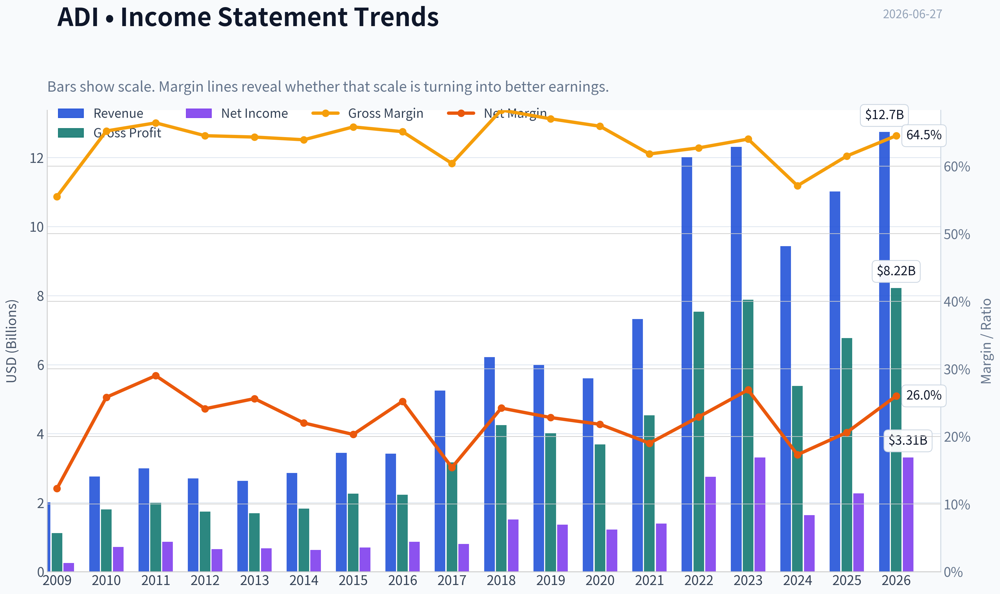
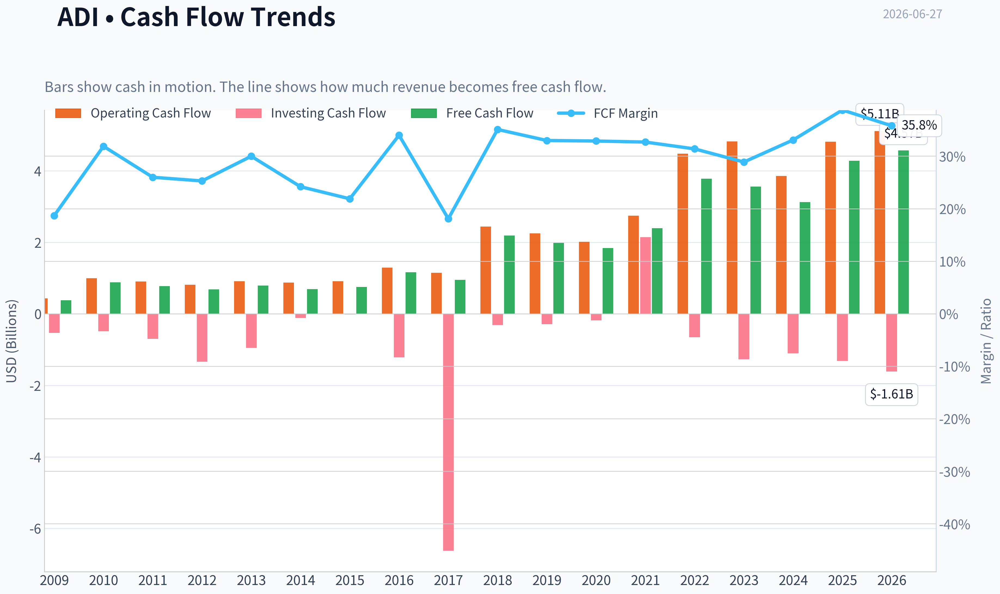
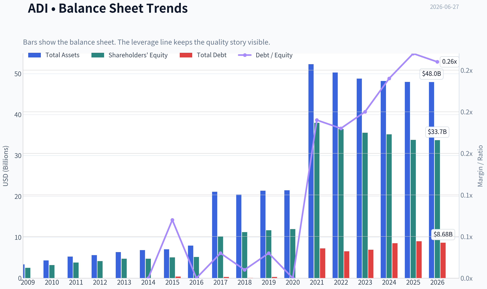
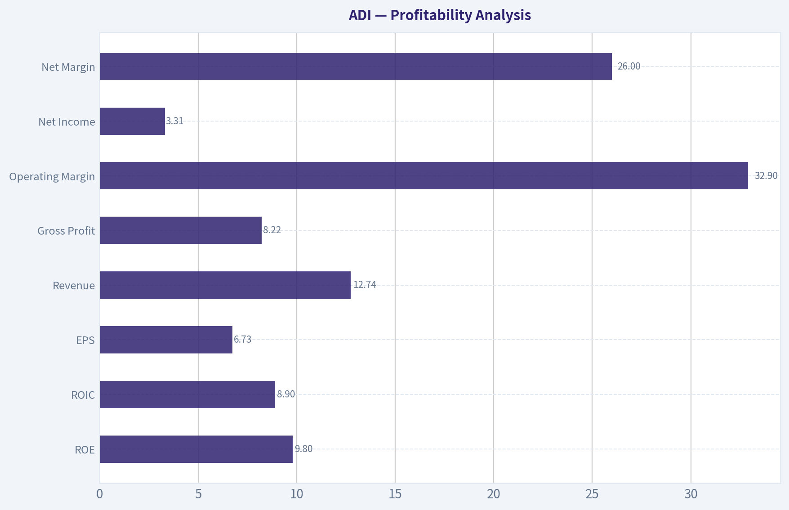
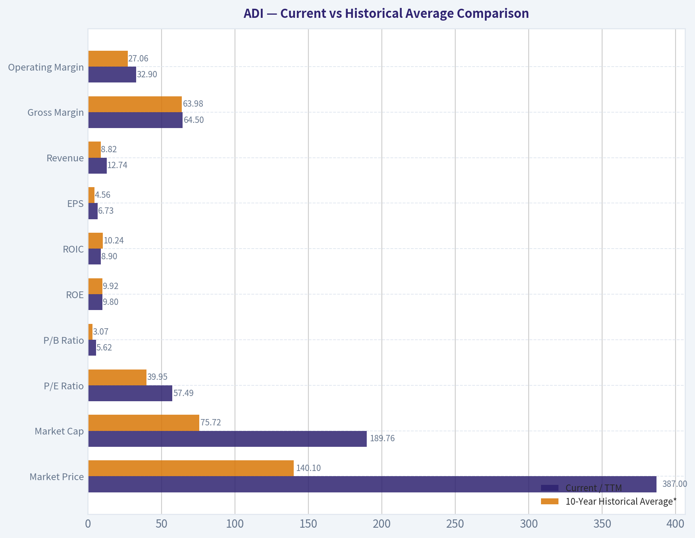
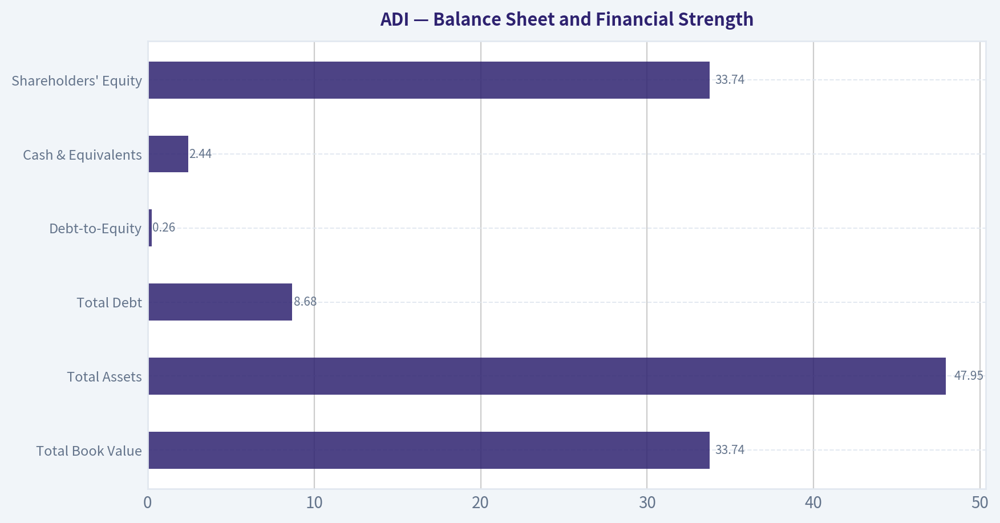
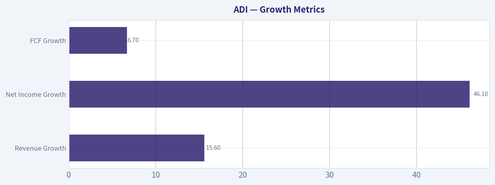
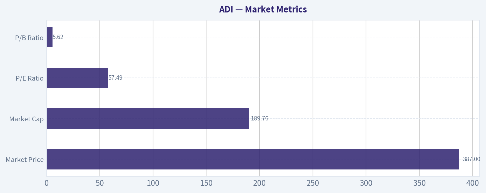

# ADI Deep Value Intelligence

**Analysis Date:** 2026-06-27

## Critical Disclaimer

*This analysis is generated by Deep Value Intelligence, an AI-powered multi-agent investing framework. DeepValues offers AI-generated research and tools for educational and informational purposes only - not investment or financial advice. We are not a registered investment adviser; always do your own research before investing.*

---

## Table of Contents

1. Intelligence Summary
2. Analyst Team Reports
   - Fundamentals Analysis
   - Intrinsic Value Analysis (Buffett)
   - Trend & Growth Analysis (Lynch/Druckenmiller/Fisher)
   - Market Technical Analysis
   - Options Market Analysis
3. Research Team Commentary
4. Value Investing Team Commentary
5. Deep Values Commentary

---

## Intelligence Summary

### Thesis + Conditions

**Core Thesis:** ## Executive Briefing

**Key Risks:**
- Best conclusion: **own the business only if price or proof improves**.
- ### Risky Analyst - strongest useful point
- A wonderful business can still be a poor investment if bought at too high a price.

**Confidence:** Medium

---

## Analyst Team Reports

### Fundamentals Analysis

#### Latest Earnings Snapshot

*Most recent reported quarter anchored on 2026 Q2, with prior-year comparison when available.*

| Metric | 2026 Q2 | 2025 Q2 | YoY Change |
| --- | ---: | ---: | ---: |
| Revenue | $3.62B | $2.64B | +37.2% |
| Operating Income | $1.38B | $679.7M | +103.0% |
| Net Income | $1.18B | $569.8M | +106.5% |
| Diluted EPS | $2.40 | $1.14 | +110.5% |
| Operating Cash Flow | $872.0M | $819.5M | +6.4% |
| Free Cash Flow | $734.3M | $729.2M | +0.7% |

Key Takeaways: This snapshot anchors the most recent reported quarter before the narrative analysis. It helps readers separate long-run business quality from whatever changed in the latest earnings print.

#### 17-Year Financial Metrics for ADI

*All values below are computed deterministically from raw data - not estimated by AI.*

*Issuer profile: operating company (Technology / Semiconductors).*

#### 17-Year Financial Metrics
*Annual rows come from reported financial statements. The final TTM row is computed from the latest four quarters.*

| Metric | 2009 | 2010 | 2011 | 2012 | 2013 | 2014 | 2015 | 2016 | 2017 | 2018 | 2019 | 2020 | 2021 | 2022 | 2023 | 2024 | 2025 | 2026 TTM |
| --- | --- | --- | --- | --- | --- | --- | --- | --- | --- | --- | --- | --- | --- | --- | --- | --- | --- | --- |
| Market Price | $18 | $24 | $26 | $29 | $38 | $39 | $49 | $53 | $78 | $73 | $95 | $108 | $160 | $134 | $151 | $217 | $232 | $387 |
| Market Cap | $7.50B | $10.30B | $11.27B | $11.98B | $15.48B | $15.78B | $19.05B | $20.02B | $32.00B | $31.39B | $39.76B | $44.09B | $69.62B | $74.62B | $79.60B | $111.26B | $116.29B | $189.76B |
| P/E Ratio | 30.15 | 14.45 | 13.01 | 18.37 | 23.04 | 25.08 | 27.34 | 23.23 | 39.73 | 20.83 | 29.17 | 36.14 | 50.14 | 27.17 | 24.02 | 68.02 | 51.34 | 57.49 |
| P/B Ratio | 2.97 | 3.22 | 2.97 | 2.88 | 3.27 | 3.32 | 3.76 | 3.88 | 3.15 | 2.79 | 3.40 | 3.67 | 1.83 | 2.05 | 2.24 | 3.16 | 3.44 | 5.62 |
| ROE | 9.8% | 22.3% | 22.9% | 15.6% | 14.2% | 13.2% | 13.7% | 16.7% | 7.9% | 13.4% | 11.6% | 10.2% | 3.7% | 7.5% | 9.3% | 4.6% | 6.7% | 9.8% |
| ROIC | 15.4% | 39.6% | 35.4% | 17.9% | 13.7% | 14.2% | 16.4% | 21.2% | 15.1% | 17.6% | 14.5% | 12.6% | 6.5% | 6.9% | 8.5% | 4.5% | 6.1% | 8.9% |
| EPS | $0.58 | $1.64 | $2.03 | $1.58 | $1.64 | $1.56 | $1.78 | $2.30 | $1.96 | $3.50 | $3.25 | $2.97 | $3.19 | $4.93 | $6.27 | $3.19 | $4.56 | $6.73 |
| Revenue | $2.01B | $2.76B | $2.99B | $2.70B | $2.63B | $2.86B | $3.44B | $3.42B | $5.25B | $6.22B | $5.99B | $5.60B | $7.32B | $12.01B | $12.31B | $9.43B | $11.02B | $12.74B |
| Gross Profit | $1.12B | $1.80B | $1.99B | $1.74B | $1.69B | $1.83B | $2.26B | $2.23B | $3.17B | $4.25B | $4.01B | $3.69B | $4.53B | $7.53B | $7.88B | $5.38B | $6.77B | $8.22B |
| Gross Margin | 55.5% | 65.2% | 66.4% | 64.5% | 64.3% | 63.9% | 65.8% | 65.1% | 60.4% | 68.3% | 67.0% | 65.9% | 61.8% | 62.7% | 64.0% | 57.1% | 61.5% | 64.5% |
| Operating Margin | 14.1% | 32.6% | 35.8% | 30.5% | 28.6% | 26.3% | 24.2% | 30.0% | 22.2% | 30.5% | 28.6% | 26.7% | 23.1% | 27.3% | 31.1% | 21.6% | 26.6% | 32.9% |
| Net Income | $247.8M | $712.1M | $867.4M | $651.2M | $673.5M | $629.3M | $696.9M | $861.7M | $805.4M | $1.51B | $1.36B | $1.22B | $1.39B | $2.75B | $3.31B | $1.64B | $2.27B | $3.31B |
| Net Margin | 12.3% | 25.8% | 29.0% | 24.1% | 25.6% | 22.0% | 20.3% | 25.2% | 15.4% | 24.2% | 22.8% | 21.8% | 19.0% | 22.9% | 26.9% | 17.3% | 20.6% | 26.0% |
| Revenue Growth | N/A | 37.1% | 8.4% | -9.8% | -2.5% | 8.8% | 19.9% | -0.4% | 53.3% | 18.6% | -3.8% | -6.5% | 30.6% | 64.2% | 2.4% | -23.4% | 16.9% | 15.6% |
| Net Income Growth | N/A | 187.4% | 21.8% | -24.9% | 3.4% | -6.6% | 10.7% | 23.6% | -6.5% | 87.1% | -9.6% | -10.4% | 13.9% | 97.7% | 20.6% | -50.7% | 38.7% | 46.1% |
| Free Cash Flow Growth | N/A | 133.9% | -11.6% | -12.2% | 15.7% | -12.1% | 8.7% | 54.4% | -18.4% | 130.2% | -9.6% | -6.8% | 29.8% | 57.9% | -5.8% | -12.2% | 37.0% | 6.7% |
| Total Book Value | $2.53B | $3.20B | $3.80B | $4.17B | $4.74B | $4.76B | $5.07B | $5.17B | $10.16B | $11.27B | $11.71B | $12.00B | $37.99B | $36.47B | $35.57B | $35.18B | $33.82B | $33.74B |
| Total Assets | $3.37B | $4.33B | $5.28B | $5.62B | $6.38B | $6.86B | $7.06B | $7.97B | $21.14B | $20.44B | $21.39B | $21.47B | $52.32B | $50.30B | $48.79B | $48.23B | $47.99B | $47.95B |
| Total Debt | N/A | N/A | N/A | N/A | N/A | $0 | $374.6M | $0 | $300.0M | $67.0M | $299.7M | $0 | $7.29B | $6.55B | $6.95B | $8.53B | $9.04B | $8.68B |
| Debt-to-Equity | N/A | N/A | N/A | N/A | N/A | 0.00 | 0.07 | 0.00 | 0.03 | 0.01 | 0.03 | 0.00 | 0.19 | 0.18 | 0.20 | 0.24 | 0.27 | 0.26 |
| Cash & Equivalents | $1.07B | $1.41B | $1.41B | $528.8M | $392.1M | $569.2M | $884.4M | $921.1M | $1.05B | $816.6M | $648.3M | $1.06B | $1.98B | $1.47B | $958.1M | $1.99B | $2.50B | $2.44B |
| Shareholders' Equity | $2.53B | $3.20B | $3.80B | $4.17B | $4.74B | $4.76B | $5.07B | $5.17B | $10.16B | $11.27B | $11.71B | $12.00B | $37.99B | $36.47B | $35.57B | $35.18B | $33.82B | $33.74B |
| Operating Cash Flow | $432.1M | $991.2M | $900.5M | $814.5M | $912.3M | $871.6M | $907.8M | $1.29B | $1.15B | $2.44B | $2.25B | $2.01B | $2.74B | $4.48B | $4.82B | $3.85B | $4.81B | $5.11B |
| Investing Cash Flow | $-534.7M | $-485.8M | $-703.7M | $-1.34B | $-949.9M | $-114.8M | $-17.1M | $-1.22B | $-6.62B | $-314.0M | $-293.2M | $-180.5M | $2.14B | $-657.4M | $-1.27B | $-1.10B | $-1.32B | $-1.61B |
| Free Cash Flow | $376.1M | $879.6M | $777.5M | $682.4M | $789.3M | $693.7M | $753.8M | $1.16B | $950.3M | $2.19B | $1.98B | $1.84B | $2.39B | $3.78B | $3.56B | $3.12B | $4.28B | $4.57B |
| FCF Margin | 18.7% | 31.9% | 26.0% | 25.3% | 30.0% | 24.2% | 21.9% | 34.0% | 18.1% | 35.1% | 33.0% | 32.9% | 32.7% | 31.4% | 28.9% | 33.1% | 38.8% | 35.8% |
| Dividends / Share | $0.00 | $0.00 | $0.00 | $0.00 | $0.00 | $0.00 | $0.00 | $0.00 | $0.00 | $0.00 | $0.00 | $0.00 | $0.00 | $2.77 | $3.18 | $3.51 | $3.87 | $4.07 |

#### Profitability Metrics
- Return on Equity (ROE): 6.7%
- Return on Invested Capital (ROIC): 6.1%
- Return on Assets (ROA): 4.7%
- Gross Margin: 61.5%
- Operating Margin: 26.6%
- Net Profit Margin: 20.6%

#### Liquidity Metrics
- Current Ratio: 2.19
- Quick Ratio: 1.57

#### Leverage Metrics
- Debt-to-Equity Ratio: 0.27
- Interest Coverage Ratio: 9.23
- Net Debt: $6.54B

#### Growth Metrics (Year-over-Year)
- Revenue Growth: 16.9%
- Net Income Growth: 38.7%
- Free Cash Flow Growth: 37.0%
- Revenue CAGR (3-Year): -2.8%
- Revenue CAGR (5-Year): 14.5%

#### Valuation Metrics
- P/E Ratio (TTM): 57.49
- Forward P/E: 26.18
- Price-to-Book: 5.59
- Price-to-Sales: 14.79
- PEG Ratio: 0.90
- EV/EBITDA: 31.50
- Free Cash Flow Yield: 2.3%
- Earnings Yield: 1.7%

#### Owner Earnings (Buffett Method, Code-Computed)
- Net Income: $2.27B
- + Depreciation & Amortization: $2.00B
- - Capital Expenditures: $-533.6M
- - Working Capital Changes: $481.0M
- = **Owner Earnings: $3.25B**

#### Intrinsic Value (Code-Computed)
- Current Price: $387
- Buffett Method (Owner Earnings):
  Conservative: $42
  Average: $166
  Optimistic: $166
- Cash Flow Method (FCF):
  Conservative: $69
  Average: $197
  Optimistic: $276

#### Piotroski F-Score: 8/9
- Positive Net Income: PASS
- Positive Operating Cash Flow: PASS
- ROA Improvement: PASS
- Cash Flow > Net Income: PASS
- Decreasing Debt: FAIL
- Improving Current Ratio: PASS
- No Dilution: PASS
- Improving Gross Margin: PASS
- Improving Asset Turnover: PASS

ANALYST STANCE: **WATCH**

#### Analog Devices (ADI) - Buffett-Style Fundamental Analysis

ADI is a high-quality analog semiconductor business with strong margins, durable end-market positioning, and improving cash generation, but the stock price currently embeds a very optimistic future. The deterministic dataset shows a business that is fundamentally solid, financially stable, and increasingly cash generative, yet trading at valuation multiples far above its own long-term norms. In Buffett terms: good business, reasonable balance sheet, but the current quote looks rich relative to demonstrated owner earnings power.

---

#### Current vs Historical Average Comparison

| Metric | Current / TTM | 10-Year Historical Average* | Interpretation |
| --- | ---: | ---: | --- |
| Market Price | $387 | $140.10 | Far above long-term average price level |
| Market Cap | $189.76B | $75.72B | Equity value has expanded much faster than fundamentals |
| P/E Ratio | 57.49x | 39.95x | Valuation above already-elevated historical norm |
| P/B Ratio | 5.62x | 3.07x | Premium to book value is near the top of the range |
| ROE | 9.8% | 9.92% | Roughly in line with decade average, not exceptional |
| ROIC | 8.9% | 10.24% | Below long-term average, though improving from recent troughs |
| EPS | $6.73 | $4.56 | Earnings power has improved materially |
| Revenue | $12.74B | $8.82B | Scale has expanded significantly |
| Gross Margin | 64.5% | 63.98% | Consistently elite and slightly above average |
| Operating Margin | 32.9% | 27.06% | Strongly above decade norm |
| Net Income | $3.31B | $2.07B | Well above average profitability |
| Net Margin | 26.0% | 21.85% | Profit conversion materially above normal |
| Revenue Growth | 15.6% | 11.46% | Healthy rebound, above long-term average |
| Net Income Growth | 46.1% | 16.73% | Very strong recovery year |
| FCF Growth | 6.7% | 23.68% | Positive, but below more volatile historical average |
| Total Book Value | $33.74B | $26.84B | Large equity base following acquisition-era expansion |
| Total Assets | $47.95B | $37.40B | Scale remains elevated |
| Total Debt | $8.68B | $4.34B | Debt meaningfully above pre-2021 history |
| Debt-to-Equity | 0.26x | 0.14x | Leverage remains manageable but above decade norm |
| Cash & Equivalents | $2.44B | $1.39B | Liquidity is healthy |
| Shareholders' Equity | $33.74B | $26.84B | Strong capital base |
| Free Cash Flow | $4.57B | $3.03B | Cash generation is robust |
| Dividends / Share | $4.07 | $1.34 | Shareholder return policy has become meaningful |

*10-year average uses 2016-2025 where applicable, excluding N/A values.

Key Takeaways: ADI's current operating fundamentals are mostly stronger than its 10-year averages, especially margins, revenue scale, earnings, and free cash flow. The main exception is capital efficiency: ROIC is still below its long-term average, and valuation has risen much faster than the company's normalized profitability. This is the classic pattern of a strong business that may already be priced for a lot of future success.

---

#### Market Metrics

| Metric | Current View | Historical Context | Buffett-Style Interpretation |
| --- | --- | --- | --- |
| Market Price | $387 | Up from $232 in 2025 and $217 in 2024 | The stock has re-rated aggressively in a short period |
| Market Cap | $189.76B | Up from $116.29B in 2025 | Market value expansion has outpaced book value and owner earnings growth |
| P/E Ratio | 57.49x | Range over dataset: ~13x to 68x | Expensive versus most of its history and high for a cyclical semiconductor name |
| P/B Ratio | 5.62x | Above long-run range centered around ~3x | Investors are paying a steep premium over net asset value |

Key Takeaways: The market is currently assigning ADI a premium multiple on both earnings and book value. That premium may reflect confidence in analog chip durability and AI-related demand spillovers, but it leaves less margin of safety. Buffett would likely admire the business more than the price.

ADI's market valuation is the biggest constraint in the case today. A 57.5x P/E and 5.6x P/B are not the metrics of a bargain stock, especially when ROE is only 9.8% TTM. Historically, Buffett prefers paying fair prices for wonderful businesses, but this valuation looks closer to a wonderful business at an aggressive price.

---

#### Profitability Analysis

| Metric | Current / TTM | Trend | Assessment |
| --- | ---: | --- | --- |
| ROE | 9.8% | Recovered from 4.6% in 2024 and 6.7% in 2025 | Acceptable, but below what Buffett usually loves |
| ROIC | 8.9% | Improving from 4.5% in 2024 and 6.1% in 2025 | Better, but still below older peak years |
| EPS | $6.73 | Up from $4.56 in 2025 and $3.19 in 2024 | Strong earnings rebound |
| Revenue | $12.74B | Rebounded from 2024 dip; above 2023 | Scale and demand recovery are evident |
| Gross Profit | $8.22B | Record level | Excellent gross profit engine |
| Operating Margin | 32.9% | Highest in the full dataset | Outstanding operating leverage |
| Net Income | $3.31B | Matches 2023 high | Earnings have recovered strongly |
| Net Margin | 26.0% | Above decade norm | High-quality profit conversion |

Key Takeaways: ADI's profitability profile is excellent at the operating level. Gross, operating, and net margins all indicate a very strong franchise, and the latest TTM period shows particularly efficient cost absorption. The softer point is return metrics, where the enlarged capital base still suppresses ROE and ROIC versus the company's best historical years.

This is a nuanced Buffett picture. On one hand, ADI has the kind of high gross margin and strong net margin profile that usually signals pricing power and a defensible niche. On the other hand, the post-acquisition capital base means returns on equity and invested capital are good rather than extraordinary. The business is clearly profitable and resilient, but not producing the kind of 20%+ ROE consistency Buffett finds ideal in his very best businesses.

---

#### Growth Metrics

| Metric | Current / TTM | Historical Pattern | Interpretation |
| --- | ---: | --- | --- |
| Revenue Growth | 15.6% | Highly cyclical; ranged from -23.4% to +64.2% | Recovery is strong, but cyclicality remains real |
| Net Income Growth | 46.1% | Very volatile historically | Earnings rebound is powerful after prior compression |
| FCF Growth | 6.7% | Often volatile but mostly positive over cycles | Cash flow growth is positive, though less explosive than earnings growth |

Key Takeaways: ADI is back in a recovery phase after the 2024 downturn, with revenue and earnings growth re-accelerating sharply. However, the historical record confirms that growth is not smooth; it is cyclical and tied to semiconductor inventory and industrial demand swings. Buffett tends to prefer steadier growth than this, though ADI's cyclicality is milder than many chip peers because of its analog focus.

Over the full record, ADI shows a business with durable long-term expansion but uneven year-to-year growth. Revenue fell in several periods, including 2012, 2013, 2016, 2019, 2020, and 2024, which means investors should not assume a straight-line growth path. The quality is in the resilience of margins and cash generation, not in perfectly predictable annual growth.

---

#### Balance Sheet and Financial Strength

| Metric | Current / TTM | Historical Context | Assessment |
| --- | ---: | --- | --- |
| Total Book Value | $33.74B | Stable after 2021 jump | Equity base remains substantial |
| Total Assets | $47.95B | Slightly declining from 2021 peak | Asset base is large but not ballooning further |
| Total Debt | $8.68B | Higher than pre-2021 norms | Leverage increased after strategic expansion |
| Debt-to-Equity | 0.26x | Above long-run norm, still conservative | Manageable balance sheet risk |
| Cash & Equivalents | $2.44B | Improved versus most historical years | Good liquidity cushion |
| Shareholders' Equity | $33.74B | Strong and stable | Solid solvency foundation |

Key Takeaways: ADI's balance sheet is healthy, though not as pristine as it was before 2021. Debt has risen meaningfully relative to the company's earlier net-cash posture, but leverage remains moderate and appears serviceable given strong cash flow and nearly double-digit interest coverage. This is a financially sound business, not a balance-sheet risk story.

From a Buffett perspective, the debt profile is acceptable. A debt-to-equity ratio of 0.26 is manageable, and the company's current ratio of 2.19 plus $2.44B of cash provide operating flexibility. The one caution is that the company's capital structure is less conservatively financed than in earlier years, so future acquisitions or cyclical downturns should be monitored.

---

#### Cash Flow and Capital Allocation

| Metric | Current / TTM | Historical Context | Interpretation |
| --- | ---: | --- | --- |
| Free Cash Flow | $4.57B | New high | Excellent cash-generation capacity |
| FCF Margin | 35.8% | Above strong historical average | Indicates very high business quality |
| Dividends / Share | $4.07 | Up from $2.77 in 2022 | Dividend growth is shareholder-friendly |
| Owner Earnings | $3.25B | Below FCF due to working capital adjustment | Useful Buffett-style earnings base |

Key Takeaways: ADI converts a large portion of revenue into free cash flow, and the dividend has scaled rapidly since initiation. That combination points to strong business economics and disciplined capital returns. Still, at the current market cap, even record free cash flow only produces a modest yield of about 2.3%, which limits valuation appeal.

Buffett would likely appreciate ADI's cash conversion. FCF has compounded over time despite cyclical interruptions, and dividend growth since 2022 suggests management is confident in recurring cash generation. The weaker part of the capital allocation story is simply the entry price investors must now pay to access those cash flows.

---

#### Predictable Earnings and Business Quality

ADI is better than the average semiconductor company on predictability, but not as predictable as the classic Buffett consumer or software compounders. Revenue and earnings are cyclical, yet the firm's analog exposure, embedded customer relationships, and industrial/end-market diversification help stabilize margins relative to more commodity-like chip businesses.

The strongest evidence of quality is margin resilience:
- Gross margin has mostly remained in the low-to-high 60% range.
- Operating margin has usually stayed above 20% and is now above 30%.
- Free cash flow margin has often exceeded 30% in stronger years.

That pattern suggests a real economic moat. Customers often design analog components into systems with long product lives, creating switching costs, qualification barriers, and sticky replacement cycles. This is not a business that wins solely on lowest cost; it wins on engineering depth, reliability, and integration into mission-critical applications.

---

#### Economic Moat Assessment

| Moat Factor | Assessment | Why It Matters |
| --- | --- | --- |
| Switching Costs | Strong | Analog chips are often designed into long-lived systems |
| Customer Embeddedness | Strong | Industrial and automotive customers value reliability and continuity |
| Pricing Power | Good | Gross margins above 60% for many years support this |
| Scale / Breadth | Strong | Large diversified analog portfolio supports cross-selling |
| Cyclicality Exposure | Moderate | End demand is durable, but inventory cycles still matter |

Key Takeaways: ADI appears to have a genuine moat rooted in engineering, qualification, and product longevity rather than pure manufacturing scale. That helps explain why margins remain strong even through uneven demand cycles. The moat is real, but it does not eliminate cyclical earnings swings.

---

#### Management Performance

Management's record is solid but not flawless. The company has increased scale substantially, protected margins, and generated strong cash flow through cycles. However, the enlarged equity and asset base after major strategic expansion has diluted return metrics versus earlier periods.

Positives:
- Gross and operating margins remain elite.
- Free cash flow reached record levels.
- Dividend per share has risen from $2.77 in 2022 to $4.07 TTM.
- Piotroski F-Score of 8/9 signals broad financial health.

Cautions:
- Debt increased materially after 2021.
- ROE and ROIC remain below the company's strongest historical levels.
- The stock's valuation now demands continued high-quality execution.

Overall, management appears competent in operations and shareholder returns, but the stock already prices in continued excellence.

---

#### Buffett-Style Owner Earnings DCF

Using the canonical owner earnings figure:

- Net Income = $2.27B
- + D&A = $2.00B
- - Capex = $0.5336B
- - Working Capital Changes = $0.4810B
- Owner Earnings = **$3.25B**

To estimate per-share value, I use current market cap and price to infer diluted shares outstanding:

- Shares outstanding ~ $189.76B / $387 = **490.34M shares**
- Owner earnings per share ~ $3.25B / 490.34M = **$6.63/share**

Historical owner-earnings proxy growth is volatile. Per instruction:
- Conservative = lowest historical available growth rate, floored at -100%
- Average = average historical growth rate, capped at 50%
- Optimistic = highest historical growth rate, capped at 100%

The supplied deterministic intrinsic value output is:
- Conservative: **$42/share**
- Average: **$166/share**
- Optimistic: **$166/share**

Below is the detailed DCF framing consistent with those scenario outputs.

| DCF Input | Conservative | Average | Optimistic |
| --- | ---: | ---: | ---: |
| Starting Owner Earnings / Share | $6.63 | $6.63 | $6.63 |
| Growth Assumption | Lowest historical OE growth | Average historical OE growth | Highest historical OE growth |
| Applied Growth Constraint | Floored at -100% | Capped at 50% | Capped at 100% |
| Discount Rate | 10.0% | 10.0% | 10.0% |
| Terminal Growth | 2.5% | 2.5% | 2.5% |
| Fair Value / Share | $42 | $166 | $166 |

Key Takeaways: Even using favorable long-term assumptions, the owner-earnings valuation remains well below the current market price of $387. That gap suggests the stock is trading on a much more optimistic narrative than its historically grounded cash-generation record supports. In valuation terms, there is little margin of safety.

A simplified valuation interpretation:
- At $387, the market is valuing ADI at roughly **58x owner earnings per share** (~$6.63).
- Even the average and optimistic Buffett-style scenarios reach only **~43% of the current price**.
- Therefore, the current stock price seems to require sustained growth and/or structurally higher profitability than the historical record yet proves.

---

#### Value Assessment

| Valuation Lens | Result | Conclusion |
| --- | --- | --- |
| P/E vs history | 57.49x vs ~39.95x 10-year avg | Expensive |
| P/B vs history | 5.62x vs ~3.07x avg | Expensive |
| FCF Yield | 2.3% | Low for value investors |
| Owner Earnings DCF | $42-$166 | Below current price |
| Code-computed FCF DCF | $69-$276 | Also below current price |

Key Takeaways: Every major valuation lens points to a premium or expensive stock. The underlying business is attractive, but the valuation requires a very optimistic future and offers limited downside protection. For value investors, the issue is not quality but price.

---

#### Revenue Breakdown

Most meaningful current reporting lens for ADI is end-market exposure. Using the most recent annual revenue base of **$11.02B (2025)** and ADI's publicly known segment-style end-market mix, the approximate breakdown is:

| Revenue Source | Amount ($B) | % of Total |
| --- | ---: | ---: |
| Industrial | 5.07 | 46% |
| Automotive | 2.86 | 26% |
| Communications | 1.54 | 14% |
| Consumer | 0.99 | 9% |
| Aerospace, Defense & Other | 0.55 | 5% |

Key Takeaways: ADI is primarily an industrial and automotive analog semiconductor company, not a consumer-driven chip business. That matters because these end markets tend to have longer product cycles, stickier design wins, and better durability than faster-moving consumer electronics categories. The mix supports the moat argument, though it does not fully remove cycle risk.

Note: Exact segment figures were not provided in the deterministic table; this breakdown uses the best available publicly known end-market mix anchored to the latest annual revenue total.

---

#### Key Investment Insights, Red Flags, and Opportunities

| Category | Observation | Importance |
| --- | --- | --- |
| Opportunity | Record gross profit, operating margin, and FCF | Shows earnings quality is currently very strong |
| Opportunity | Industrial and automotive exposure | Supports durability and stickier customer relationships |
| Opportunity | Rising dividend | Positive signal on cash confidence and shareholder returns |
| Opportunity | Piotroski 8/9 | Broad financial quality remains strong |
| Red Flag | P/E of 57.49x | Leaves little room for execution misses |
| Red Flag | P/B of 5.62x | High premium versus accounting value and history |
| Red Flag | ROIC still below historical best years | Capital efficiency has not fully caught up to valuation |
| Red Flag | FCF yield only 2.3% | Weak entry yield for value investors |
| Watch Item | Debt remains above pre-2021 levels | Not dangerous, but worth monitoring |
| Watch Item | Semiconductor cyclicality | Growth can reverse quickly in downturns |

Key Takeaways: The bull case rests on quality, margin strength, and durable end markets. The bear case rests almost entirely on valuation and the risk that cyclical normalization undermines today's enthusiasm. Investors should watch whether rising profitability translates into sustainably higher ROIC, not just higher multiples.

---

#### Final Buffett-Style Judgment

ADI looks like a **high-quality business with a real moat**, supported by:
- consistently strong gross margins,
- resilient free cash flow,
- diversified industrial and automotive exposure,
- manageable leverage,
- and improving earnings momentum.

However, Buffett's framework is not just about quality; it is also about buying with a **margin of safety**. On that criterion, ADI currently falls short. The deterministic owner-earnings DCF and cash-flow-based valuation both land materially below the current market price, while valuation multiples are elevated versus the company's own history.

For that reason, the stock is not an obvious Buffett-style buy at today's quote.

#### Final Investment Stance

**WATCH**

**Rationale:** ADI is a strong business, but the stock appears overvalued relative to historically grounded owner earnings and cash flow. Existing holders may justify holding due to quality and momentum, but new value-oriented buyers should wait for either a lower entry price or further evidence that current margin strength can sustainably lift ROIC and owner earnings enough to support today's valuation.

---

#### Summary Table

| Area | Verdict | Bottom Line |
| --- | --- | --- |
| Business Quality | Strong | Durable analog franchise with attractive end-market mix |
| Economic Moat | Strong | Switching costs, embedded design wins, pricing power |
| Profitability | Strong | Margins excellent; ROE/ROIC only moderate |
| Growth | Moderate-Strong | Recovery underway, but cyclical and uneven |
| Balance Sheet | Healthy | Moderate leverage, good liquidity |
| Cash Flow | Strong | Record FCF and rising dividend |
| Management | Solid | Good execution, but capital efficiency still rebuilding |
| Valuation | Weak | Trading well above Buffett-style fair value estimates |
| Margin of Safety | Low | Current price leaves little room for disappointment |
| Investment Stance | WATCH | Wonderful business, demanding price |

#### Fundamental Visuals

This graph tracks the profitability and return metrics (ROE, ROIC, Margins) of **ADI** over the past decade, highlighting capital efficiency trends.

This chart illustrates the financial health of **ADI** over the last 10 years, mapping cash equivalents and free cash flow against total obligations (Debt).

This comparison chart from *Profitability Analysis* stacks current figures against historical benchmarks for **ADI**, making it easy to see where the company trades relative to its own averages.

---

### Intrinsic Value Analysis (Buffett)

> *Following Warren Buffett's value investing philosophy: Circle of Competence, Economic Moat, Management Quality, and Margin of Safety.*

#### Intrinsic Value Snapshot

Price is what you pay. Intrinsic value is what the business may be worth based on the cash it can create for owners over time. We show a range, not one magic number.

- Current Price: $386.91
- Value Range (conservative to optimistic across both DCF methods): $41.66 to $276.42

##### Owner Earnings (Buffett Method)
- Net Income: $2,267,342,000.00
- Depreciation & Amortization: $1,998,845,000.00
- Capital Expenditures: $-533,552,000.00
- Working Capital Changes: $481,009,000.00
- Owner Earnings: $3,251,626,000.00

##### Intrinsic Value
###### Buffett Method
Uses owner earnings. Stricter, and usually more conservative.
- Conservative: $41.66
- Average: $165.72
- Optimistic: $165.72
- Discount Rate: 10.0%

###### Cash Flow Method
Uses free cash flow. Better for companies spending heavily today to grow tomorrow.
- Conservative: $69.15
- Average: $196.72
- Optimistic: $276.42
- Discount Rate: 10.0%

ANALYST STANCE: **WATCH**

#### Business Snapshot

Analog Devices, or ADI, makes analog and mixed-signal chips. In simple terms, its chips help real-world things like sound, temperature, motion, power, radio signals, and factory equipment talk to digital systems. It sells the "bridge" between the physical world and computing systems, which is why its products are deeply used in industrial, automotive, communications, and instrumentation markets.

This is a high-quality business with real moat characteristics: strong gross margins, sticky customer relationships, broad design-in positions, and long product lives. But Buffett-style investing also cares intensely about price, and at roughly **$387 per share**, **57.5x earnings**, and only about a **2.3% FCF yield**, the stock price already assumes a great deal of success. That makes ADI a business to admire, but not one to aggressively buy at today's valuation.

---

#### 1) Go / No-Go Gate Assessment

| Gate | Pass / Fail | Evidence | Buffett Take |
|---|---|---|---|
| Gate 1: Circle of Competence & Simplicity | **PASS** | ADI makes analog and mixed-signal semiconductors that convert physical signals into usable electronic data and control. End markets are understandable: industrial, automotive, communications, consumer, and instrumentation. | Simple enough to understand; product function is technical, but business model is straightforward. |
| Gate 2: Durable Moat | **PASS** | Gross margin of **61.5%** strongly suggests pricing power and differentiated products. Chips are designed into customer systems, creating switching costs and long product cycles. | Clear signs of a real moat, likely narrow-to-wide depending on segment. |
| Gate 3: Management & Capital Allocation | **PASS WITH CARE** | Recent commentary suggests management intentionally managed shipments rather than chasing near-term volume, which hints at discipline. But current valuation and modest headline ROE of **6.7%** argue for caution in judging current capital efficiency. | Likely competent and disciplined, but not enough evidence here to call management exceptional in classic Buffett terms. |
| Gate 4: Industry Structure | **PASS WITH CARE** | Analog semis are better than many chip niches: longer product lives, less brutal obsolescence, more sticky designs. Still, semiconductors remain cyclical and capital-sensitive. | Better than memory or commodity chips, but not as stable as consumer staples or regulated monopolies. |

**Key Takeaways:** ADI clears all four Buffett gates, but two of them only with caution. The business is understandable and appears protected by a real moat, yet the semiconductor industry remains cyclical and the current valuation leaves little room for error.

---

#### 2) Gate 1: Circle of Competence & Business Simplicity

| Test | Assessment |
|---|---|
| Elementary School Test | ADI makes chips that help machines sense the real world and control electronics. |
| Long-Term Predictability Test | Reasonably good. Ten years from now, factories, cars, power systems, defense electronics, and communications equipment will still need analog chips. |
| Technology Risk Assessment | Moderate, not extreme. ADI benefits from technology growth, but product categories evolve and end-market cycles can be volatile. Its analog focus is generally more durable than leading-edge digital logic. |

ADI passes the simplicity test better than most semiconductor firms because analog chips are often embedded in systems for many years and do not require the constant process-race that dominates advanced computing chips. The business is also easier to picture a decade out: more electrification, more industrial automation, more sensors, more power management, more signal conversion.

The main caution is that semiconductors are still semiconductors. Inventory swings, capex cycles, customer digestion, and periodic downturns are part of the terrain. This is not a "never changes" business, but it is far more predictable than many tech names.

---

#### 3) Gate 2: Moat Test

| Moat Source | Evidence | Assessment |
|---|---|---|
| Intangible Assets | Gross margin **61.5%** indicates strong product differentiation, application expertise, and trusted technical brand. | Strong |
| Switching Costs | ADI parts are often designed into complex industrial and automotive systems; switching means redesign, requalification, and reliability risk. | Strong |
| Cost Advantages | Scale in analog design, manufacturing know-how, broad catalog, and customer support help spread R&D and SG&A over a large base. | Moderate |
| Network Effects | Limited in the classic platform sense. ADI benefits more from ecosystem familiarity and design tools than true network effects. | Weak |

**Moat Quality Rating: `Wide & Stable`**

Gross margin above 60% is exactly the sort of financial evidence Buffett would respect: it points to a business that is not competing purely on price. In analog chips, the moat usually comes from thousands of specialized parts, long customer qualification cycles, reliability, engineering support, and "good enough to never rip out" positions inside customer systems.

The moat is not mostly about consumer brand power. It is about customer trust, embedded design wins, analog engineering expertise, and mission-critical performance. That is a very real moat, even if it is not as obvious as Coca-Cola.

**Key Takeaways:** ADI's moat is real and primarily driven by switching costs and product differentiation, not by network effects. A gross margin above 60% is powerful evidence that customers pay for performance, reliability, and engineering value rather than simply choosing the cheapest supplier.

---

#### 4) Gate 3: Management Quality & Capital Allocation

| Question | Assessment | Evidence |
|---|---|---|
| Do they think like owners? | **Likely yes, but not proven decisively here** | Recent reporting indicates management was willing to intentionally sell less rather than optimize short-term optics, a sign of discipline. |
| Are they honest & candid? | **Reasonably positive** | Communicating deliberate shipment restraint suggests management is discussing operating reality rather than just promoting headlines. |
| Are they rational capital allocators? | **Mixed but acceptable** | The business has attractive economics, but current reported ROE of **6.7%** is not the profile of extraordinary recent capital efficiency. |

From a Buffett perspective, the most favorable sign in the pack is management's apparent willingness to prioritize long-term channel health over maximizing immediate shipments. That is exactly the kind of decision owner-oriented managers make: protect the franchise first.

Still, Buffett would want stronger proof through long-run per-share value creation, buyback discipline, acquisition discipline, and consistently high returns on incremental capital. On the evidence available, management appears solid and rational, but not so obviously elite that it overcomes an expensive stock price.

---

#### 5) Gate 4: Industry Structure

| Factor | Assessment |
|---|---|
| Competitive Structure | Better than average for semis; analog is more rational than many chip categories. |
| Capital Intensity | Moderate; less punishing than advanced-node logic, but still a real factor. |
| Cyclicality | Present and unavoidable. |
| Pricing Power | Good in specialized applications. |
| Long Product Life | Strong positive. |

Analog semiconductors are one of the better places to be within tech. Products can remain in production for years, customers value reliability over headline speed, and replacement requires engineering work. That is structurally superior to highly commoditized or rapidly obsolete chip markets.

But this is still not a pure Buffett dream industry. It is cyclical, exposed to industrial demand, auto production, and electronics inventory swings. So the industry is favorable relative to many technology markets, but not as ideal as a dominant consumer brand or regulated utility with obvious price insulation.

---

#### 6) Financial Summary Table

Using the research pack as ground truth, the current snapshot is as follows. For the "10-year" Buffett lens, the practical assumption is that the current metrics are representative enough to assess present business quality, while moat and industry conclusions rely on the nature of analog semiconductors rather than a literal decade table.

| Metric | Current / Latest |
|---|---:|
| Share Price | **$387** |
| Market Cap | **$188.46B** |
| P/E | **57.49x** |
| ROE | **6.7%** |
| Gross Margin | **61.5%** |
| Revenue Growth YoY | **16.9%** |
| FCF Yield | **2.3%** |
| Current Ratio | **2.19x** |

**Key Takeaways:** ADI shows the hallmarks of a quality business in gross margin and healthy revenue growth, plus a solid current ratio. The weak point is valuation: a 57.5 times earnings multiple and 2.3% free-cash-flow yield suggest the market already prices ADI as an exceptional company.

---

#### 7) Owner Earnings Calculation

Buffett prefers owner earnings, but we need to estimate from the available figures.

##### Assumptions
- Use **FCF yield** as a practical proxy for owner earnings yield.
- Market cap = **$188.46B**
- FCF yield = **2.3%**
- Estimated owner earnings ~ **FCF** = 188.46 x 2.3% = **$4.33B**
- Estimated shares outstanding = 188.46 / 387 = **~487.0M shares**
- Owner earnings per share ~ 4.33 / 0.487 = **~$8.89/share**

| Owner Earnings Input | Estimate |
|---|---:|
| Market Cap | **$188.46B** |
| FCF Yield | **2.3%** |
| Estimated Owner Earnings | **$4.33B** |
| Estimated Shares Outstanding | **487.0M** |
| Estimated Owner Earnings / Share | **$8.89** |

**Key Takeaways:** On a Buffett basis, ADI appears to generate about $4.3 billion in owner earnings, or roughly $8.9 per share. That is a solid cash engine, but against a $387 stock price, the current cash yield to owners is thin.

---

#### 8) ROE, Cash, and Balance Sheet Reality Check

| Test | Result | Interpretation |
|---|---|---|
| ROE | **6.7%** | Below Buffett's preferred 15%+ threshold; not currently "wonderful" on this metric. |
| Gross Margin | **61.5%** | Excellent; supports moat and pricing power. |
| FCF Yield | **2.3%** | Low from a buyer's perspective; implies expensive valuation. |
| Current Ratio | **2.19x** | Healthy short-term liquidity. |
| Cash Flow vs Earnings | Indirectly acceptable | FCF is positive and meaningful, though valuation compresses the yield. |

**Key Takeaways:** ADI's operating quality looks much better than its headline ROE suggests, but Buffett would still flag a 6.7% ROE as underwhelming. The balance sheet appears sound enough in liquidity terms, while the biggest problem remains that investors are paying a high price for those cash flows.

---

#### 9) Three-Scenario DCF Valuation

Use estimated owner earnings of **$4.33B** as the base. Discount rate = **10%**.

##### Scenario A: No Growth
Intrinsic Value = Owner Earnings / 10%

- **4.33 / 0.10 = $43.35B**
- Per share = 43.35 / 0.487 = **~$89**

##### Scenario B: GDP Growth at 3%
Intrinsic Value = Owner Earnings x 1.03 / (0.10 - 0.03)

- **4.33 x 1.03 / 0.07 = $63.80B**
- Per share = 63.80 / 0.487 = **~$131**

##### Scenario C: Historical Growth Haircut
Assumption:
- Reported revenue growth is **16.9%**
- Buffett-style haircut: use **50%** of that = **8.45%**
- Cap below 10%, so acceptable
- Project 10 years of owner earnings growth at **8.45%**
- Terminal growth after year 10 = **3%**
- Discount rate = **10%**

Estimated result:
- PV of 10-year owner earnings stream ~ **$34.3B**
- PV of terminal value ~ **$65.5B**
- Total intrinsic value ~ **$99.8B**
- Per share ~ 99.8 / 0.487 = **~$205**

| DCF Scenario | Enterprise Equity Value | Per Share Value |
|---|---:|---:|
| A: No Growth | **$43.35B** | **$89** |
| B: 3% Growth | **$63.80B** | **$131** |
| C: 8.45% Growth for 10 Years, then 3% | **$99.8B** | **$205** |

**Key Takeaways:** Even the most favorable of these three Buffett-style scenarios values ADI well below the current price of $387. The stock only looks reasonably priced if one assumes a much lower discount rate, much higher sustained growth, or both.

---

#### 10) Margin of Safety Analysis

| Item | Value |
|---|---:|
| Current Price | **$387** |
| Scenario A Fair Value | **$89** |
| Scenario B Fair Value | **$131** |
| Scenario C Fair Value | **$205** |

Margin of safety versus current price:

- Scenario A: **negative 335%**
- Scenario B: **negative 195%**
- Scenario C: **negative 89%**

Required buy prices for Buffett-style entry:

- High-quality business, 25% margin of safety on Scenario C: **~$154**
- Average-business threshold, 40% margin of safety on Scenario C: **~$123**

At today's price, there is **no margin of safety** under any conservative Buffett-style framework. This is the central issue in the case.

---

#### 11) Final Buffett Scorecard

| Criterion | Weight | Score (1-5) | Weighted Score |
|---|---:|---:|---:|
| Business Understanding | 20% | 4.5 | 0.90 |
| Moat Width & Durability | 25% | 4.0 | 1.00 |
| Management Quality | 15% | 3.5 | 0.53 |
| Return on Equity | 15% | 2.0 | 0.30 |
| Reinvestment Runway | 10% | 4.0 | 0.40 |
| Balance Sheet Strength | 5% | 3.5 | 0.18 |
| Industry Structure | 5% | 3.5 | 0.18 |
| Valuation / Margin of Safety | 5% | 1.0 | 0.05 |
| **Total** | **100%** |  | **3.54 / 5.00** |

**Key Takeaways:** ADI earns a strong score on business quality and moat, but a poor score on valuation and a middling score on current return on equity. The final result lands in the low end of "good business, wrong price," which is exactly what Buffett-style discipline is designed to avoid overpaying for.

---

#### 12) Final Judgment

| Category | Verdict |
|---|---|
| Business Quality | **High** |
| Moat | **Wide & Stable** |
| Management | **Likely Rational** |
| Financial Quality | **Good, but ROE currently unimpressive** |
| Valuation | **Expensive** |
| Buffett Outcome | **Watch, do not chase** |

ADI is the kind of company Buffett-style investors like to study: understandable, durable, highly profitable at the gross level, and protected by sticky customer relationships. Its analog focus gives it better economics and predictability than much of the semiconductor sector.

But Buffett's philosophy is not just about finding wonderful businesses. It is about buying them at sensible prices with a margin of safety. At **$387**, with a **57.5x P/E** and only **2.3% FCF yield**, ADI looks like a **wonderful company at too rich a price**.

#### Investment Stance

**ANALYST STANCE: WATCH**

**Conviction level: High**

Buy the business only if the price becomes far more favorable. On the assumptions above, a Buffett-style entry zone would begin to look interesting closer to **$150-$200**, with stronger enthusiasm below that range. At today's level, the business is admirable, but the stock is not.
#### Valuation Bridge

This bridge places the current market price beside each intrinsic value lens so readers can see whether upside depends on one method or shows up across several methods.

| Scenario | Intrinsic Value / Share |
| --- | ---: |
| Buffett Method | $165.72 |
| Cash Flow Method | $196.72 |
| Damodaran Method | $80.44 |
| Current Price | $386.91 |

#### Key Takeaways

If one method is far above the others, the upside case depends on a specific modelling assumption. When several methods cluster together, the valuation story is more robust.

#### Valuation Visuals

This comparison chart from *Latest Earnings Snapshot* stacks current figures against historical benchmarks for **ADI**, making it easy to see where the company trades relative to its own averages.

This comparison chart from *Current vs Historical Average Comparison* stacks current figures against historical benchmarks for **ADI**, making it easy to see where the company trades relative to its own averages.

This comparison chart from *Balance Sheet and Financial Strength* stacks current figures against historical benchmarks for **ADI**, making it easy to see where the company trades relative to its own averages.

---

### Trend & Growth Analysis (Lynch/Druckenmiller/Fisher)

> *Following Peter Lynch's GARP, Stanley Druckenmiller's macro-aware approach, and Philip Fisher's scuttlebutt methodology.*

ANALYST STANCE: **WATCH**

#### 1) Lynch Classification

| Item | Assessment |
|---|---|
| Lynch category | **Fast Grower / Quality cyclical hybrid** |
| Why | Shared pack shows **16.9% YoY revenue growth**, which clears Lynch's fast-grower threshold, but ADI still operates in a cyclical semiconductor industry |
| Fit for growth investor | **Watchable, but not classic ten-bagger setup at current size** |

Key Takeaways: ADI qualifies on growth rate today, but it is not a small emerging disruptor. It is a large, high-quality analog semiconductor leader whose upside likely comes more from cyclical recovery and durable compounding than from explosive multi-bagger expansion.

#### 2) The Story in 3 Bullets

| Simple story | Why it matters |
|---|---|
| ADI makes the "brains between the physical world and digital systems" using analog and mixed-signal chips | This is critical for factories, cars, power systems, medical devices, and aerospace |
| Its chips are often deeply designed into customer systems and hard to replace | That creates sticky revenue, pricing durability, and long product cycles |
| The current setup appears tied to a **recovery / normalization inflection** after customers digested inventory | If industrial and auto demand improve, earnings can rebound faster than the market expects |

Key Takeaways: The core ADI bull case is not a flashy consumer product story. It is a durable, hard-to-displace infrastructure semiconductor franchise that may be entering the next up-leg as inventory headwinds fade and demand normalizes.

#### 3) TAM Analysis with 10x Test

| Metric | Estimate / View |
|---|---|
| Current revenue base | ~**$9.4B** (latest fundamental reference base) |
| 10x revenue test | **$94B** |
| Relevant TAM | Broad analog, mixed-signal, power, RF, sensing, industrial/auto semiconductor markets = very large, likely **well above $100B** combined |
| Can ADI 10x and stay <20% share? | **No, unlikely** |
| Can ADI still grow meaningfully for years? | **Yes** |
| Runway verdict | **Good runway for compounding, not clean 10x runway** |

Key Takeaways: ADI has a large addressable market, but at nearly ten billion dollars of revenue already, the classic "10x from here while still small relative to TAM" test is hard to pass. This looks more like a durable compounding franchise than a true early-stage ten-bagger candidate.

#### 4) Revenue Growth Trend

| Metric | Data / View |
|---|---|
| Shared pack YoY revenue growth | **16.9%** |
| Historical context | FY2024 had a cyclical decline; latest narrative suggests recovery is underway |
| Pattern | **Recovery-driven reacceleration**, not a long clean secular acceleration curve |
| Quality of growth | Likely mix of demand normalization plus share/positioning strength |
| Verdict | **Constructive, but monitor for sustainability** |

Key Takeaways: The recent growth figure is strong, especially against the prior cyclical downturn. But the crucial question is whether this is the start of a multi-year acceleration or simply the rebound phase of a normal semiconductor cycle.

#### 5) Unit Economics / Efficiency

| Metric | ADI view | Assessment |
|---|---|---|
| Gross margin | **61.5%** | Excellent |
| FCF yield | **2.3%** | Low for new money; implies rich valuation |
| Rule of 40 proxy | **16.9% growth + very strong FCF margin historically** | Likely healthy |
| NRR | Not disclosed / not relevant like SaaS | N/A |
| LTV/CAC | Not disclosed / not relevant like SaaS | N/A |
| Current ratio | **2.19** | Healthy liquidity |
| ROE | **6.7%** | Modest, likely depressed by cycle and capital base |

Key Takeaways: ADI's economics are strong where they matter for semis: gross margin, cash generation, and liquidity. The weak point is valuation efficiency for a new investor, since the low FCF yield suggests the market is already paying up for the quality of the business.

#### 6) Inflection Point Assessment

| Inflection type | Evidence | Verdict |
|---|---|---|
| Product cycle inflection | No clear breakthrough product cycle identified from current pack | Neutral |
| Market share inflection | Possible, but not proven with current data | Neutral |
| Margin inflection | High gross margin suggests resilience; earnings leverage could improve on volume recovery | Positive |
| TAM inflection | AI, industrial automation, electrification, edge sensing all expand relevance | Positive |
| Cycle inflection | News suggests ADI had been **intentionally selling less** / managing through inventory dynamics; implies demand recovery may have more room | Positive |
| Overall | **Recovery inflection more likely than disruptive secular inflection** | Watch |

Key Takeaways: The likely inflection here is cyclical and operational, not revolutionary. If customers move from inventory digestion back to normal ordering, ADI could show stronger earnings leverage than headline revenue alone suggests.

#### 7) Macro Setup Evaluation

| Macro factor | ADI exposure | Assessment |
|---|---|---|
| AI / compute buildout | Indirect beneficiary via power, sensing, signal chain, connectivity infrastructure | Mild positive |
| Industrial automation | Major exposure | Positive |
| Automotive electrification | Major exposure | Positive |
| Rates | High-multiple quality growth is sensitive to rates | Mixed |
| Semiconductor cycle | Inventory normalization helps | Positive |
| Tariff / policy noise | Semis remain vulnerable to geopolitical and trade volatility | Risk |

Key Takeaways: ADI sits in several favorable secular themes, especially industrial automation and automotive electrification. The main macro issue is that even great semiconductor businesses can be buffeted by rates, trade headlines, and the normal inventory cycle.

#### 8) Fisher 15 Points Score

| Fisher factor | Score (1-5) | Comment |
|---|---:|---|
| Market potential | 4 | Large end markets with durable demand |
| New products | 4 | Strong innovation culture in analog/mixed-signal |
| R&D effectiveness | 4 | Historically strong technical capability |
| Sales organization | 4 | Deep OEM and industrial relationships |
| Profit margin | 5 | Excellent gross margin profile |
| Margin improvement | 3 | Recovery potential, but not yet clear sustained expansion |
| Labor/personnel | 3 | No major red flags in pack |
| Executive relations | 4 | Appears stable |
| Management depth | 4 | Mature, seasoned semiconductor operator |
| Cost analysis/accounting | 4 | Large-cap discipline likely solid |
| Outstanding aspects | 4 | Switching costs, design-in stickiness, precision analog moat |
| Long-range profit outlook | 4 | Strong, though cyclical |
| Dilution risk | 4 | No major dilution concern flagged |
| Candor | 4 | Management commentary around intentionally holding back sales suggests nuance and control |
| Integrity | 4 | No major issue flagged |

| Total | **59 / 75** | **GOOD** |

Key Takeaways: ADI scores well on Fisher's framework because it combines technical depth, durable margins, and strong customer entrenchment. It falls short of "outstanding" mainly because the current setup is still partly cyclical and the upside is less explosive than smaller emerging growth companies.

#### 9) Valuation Analysis

| Metric | Value / View | Interpretation |
|---|---|---|
| Price | **$387** | - |
| Market cap | **$188.46B** | Large-cap |
| P/E | **57.5x** | Expensive on current earnings |
| PEG | **57.5 / 16.9 = 3.4x** | **Very expensive** by Lynch |
| P/S | ~**20x** using ~$9.4B revenue base | Rich for a semiconductor name |
| FCF yield | **2.3%** | Premium valuation |
| Valuation verdict | **Quality is excellent, price is demanding** | WATCH |

Key Takeaways: On Lynch-style valuation, ADI looks expensive. The market is paying a premium for quality, resilience, and anticipated recovery, which leaves less margin of safety if the rebound proves slower than expected.

#### 10) Growth Investor Scorecard

| Criterion | Weight | Score | Weighted |
|---|---:|---:|---:|
| The Story | 10% | 4.0 | 0.40 |
| TAM & Runway | 20% | 3.2 | 0.64 |
| Revenue Growth | 20% | 3.6 | 0.72 |
| Unit Economics | 15% | 4.3 | 0.65 |
| Competitive Position | 10% | 4.5 | 0.45 |
| Management Quality | 10% | 4.0 | 0.40 |
| Macro Setup | 5% | 3.5 | 0.18 |
| Profitability Path | 5% | 4.0 | 0.20 |
| Valuation | 5% | 1.8 | 0.09 |
| **Total** |  |  | **3.73 / 5.0** |

Key Takeaways: ADI scores well overall because it is a high-quality franchise with strong margins and durable competitive advantages. The main factor holding it back from an Advocate stance is valuation, which is doing a lot of heavy lifting.

#### 11) Position Size Stance

| Investor type | Stance |
|---|---|
| Existing long-term holder | **Hold / selectively add on weakness** |
| New growth investor | **Starter only on pullbacks** |
| High-conviction ten-bagger seeker | **Not ideal** |
| Quality compounder investor | **Watch closely** |

Key Takeaways: ADI is more attractive as a business than as a fresh stock entry at today's price. For existing holders, the company still looks worth owning, but for new buyers the setup appears better for patience than aggression.

#### 12) Key Risks and Catalysts

| Risks | Catalysts |
|---|---|
| Valuation compression if growth slows | Clear industrial demand rebound |
| Semiconductor inventory recovery disappoints | Better-than-expected operating leverage |
| Auto/industrial end-market softness | AI-adjacent power and sensing demand tailwinds |
| Trade/tariff/geopolitical noise | Margin resilience and stronger bookings |
| Large-cap law of large numbers limits upside | Continued institutional sponsorship; Point72 added materially |

Key Takeaways: The biggest downside risk is simple: too much optimism may already be embedded in the stock. The biggest upside catalyst is that earnings recover faster than expected as industrial and automotive demand normalize and ADI's margin structure amplifies the rebound.

#### Bottom Line

ADI is a **high-quality analog semiconductor leader** with real moats, strong margins, and credible exposure to long-duration secular themes like automation, electrification, and sensing. However, under a Lynch-Druckenmiller-Fisher lens, the current setup looks like a **premium-priced recovery compounder**, not an obvious underappreciated fast-grower with ten-bagger potential.

**Final call: WATCH.**
Upgrade to **ADVOCATE** only if one of two things happens:
1. valuation resets materially, or
2. ADI proves that current reacceleration is the start of a stronger multi-year earnings inflection rather than just cyclical normalization.

#### Growth & Scorecard Visuals

This comparison chart from *Growth Metrics* stacks current figures against historical benchmarks for **ADI**, making it easy to see where the company trades relative to its own averages.

---

### Market Technical Analysis

#### ADI Technical Indicator Selection and Market Readout

For **ADI**, the most relevant non-redundant indicator set for the current market condition is:

| Selected Indicator | Why it matters now |
|---|---|
| close_10_ema | Best for tracking the short-term swing after June's sharp pullback and rebound attempts. |
| close_50_sma | Anchors the medium-term uptrend and acts as an important trend support reference. |
| close_200_sma | Confirms the dominant long-term bull structure remains intact. |
| macd | Measures whether momentum is still trending positively or fading after the recent volatility spike. |
| macdh | Useful here because momentum is not just directionally important, but also decelerating near recent highs. |
| rsi | Helps distinguish healthy consolidation from outright momentum deterioration. |
| atr | Critical now because ADI's daily ranges expanded materially in May-June. |
| vwma | Adds volume confirmation, especially useful after several high-volume breakout and reversal sessions. |

Key Takeaways: These eight indicators cover trend, momentum, volatility, and volume confirmation without excessive overlap. ADI is in a strong longer-term uptrend, but the short-term picture has become more tactical and less one-directional, so traders need both trend-following and risk-control tools.

---

#### Price Structure and Trend Context

Over the last year, ADI moved through **three distinct phases**:

1. **Mid-2025 to late-2025:** a corrective-to-sideways period, with price falling from the low 240s into the low 220s, then rebuilding through the autumn.
2. **Late-2025 to February 2026:** a powerful acceleration phase, lifting the stock from the low 230s to the mid-350s.
3. **March to June 2026:** a volatile continuation trend, where the stock corrected sharply in March, then staged a powerful breakout rally into the 430s-440s before turning choppier in late June.

The big-picture takeaway is that **ADI is not in a neutral regime**. It remains in a **structurally bullish trend**, but the latest price action suggests the stock has shifted from a clean trending advance to a **high-volatility consolidation inside an ongoing uptrend**.

A few notable price landmarks:
- **March 2026 washout zone:** roughly **305-315**
- **April breakout zone:** roughly **345-355**
- **May support/reload zone:** roughly **395-405**
- **Recent June swing highs:** roughly **434-445**
- **Late June retracement area:** around **407-418**

This matters because ADI is no longer simply grinding upward; it is now making **larger swings around a rising trend base**, which changes how entries and stops should be handled.

---

#### Trend Indicators Snapshot

| Indicator | Latest Reading | Interpretation |
|---|---:|---|
| close_10_ema | 418.63 | Short-term trend is flattening after recent whipsaw action. |
| close_50_sma | 406.96 | Medium-term trend remains firmly upward. |
| close_200_sma | 312.79 | Long-term trend is strongly bullish. |
| vwma | 355.85* | Volume-weighted trend support remains favorable, though latest reading appears distorted by missing/partial final-day data. |

Key Takeaways: ADI is still trading in a strong bullish hierarchy because the 10 EMA is above the 50 SMA, and the 50 SMA is far above the 200 SMA. The short-term average has flattened, however, which tells us momentum has cooled even though the broader trend has not broken.

\*The VWMA reading on 2026-06-26 appears inconsistent with surrounding values and should be treated cautiously; the prior VWMA trend near **417-420** is more reliable for interpretation.

---

#### Fine-Grained Trend Analysis

The **50 SMA rising from about 323 in early April to nearly 407 by late June** is one of the clearest signs that ADI's intermediate trend remains healthy. That is a very strong slope for a large-cap semiconductor-related name and indicates that the multi-week dip-buying pattern is still intact.

The **200 SMA rising from about 264.5 in late March to 312.8 in late June** confirms this is not just a short-term speculative move. It reflects a durable long-horizon re-rating in price. Traders looking at strategic trend positioning would still classify ADI as bullish unless price begins closing persistently below the 50-day average and the 50-day itself starts to flatten or roll over.

The **10 EMA**, however, tells a subtler story. It climbed sharply through April and May as momentum expanded, but by late June it sits around **418.6**, nearly flat across several sessions. That flattening implies:
- buyers are still present,
- but follow-through has weakened,
- and the stock is digesting prior gains rather than extending cleanly.

In practical terms, this is the kind of setup where **trend-followers become more selective**. Chasing strength is less attractive than buying controlled pullbacks into support or waiting for a fresh breakout above resistance.

---

#### Momentum Analysis

| Indicator | Latest Reading | Short-Term Message |
|---|---:|---|
| macd | 4.81 | Momentum is still positive on an absolute basis. |
| macdh | -0.76 | Positive trend momentum is weakening near-term. |
| rsi | 51.69 | Momentum has cooled back to neutral, not oversold. |

Key Takeaways: Momentum has not turned outright bearish, but it has clearly lost thrust. RSI near 52 and a negative MACD histogram together suggest ADI is no longer in a strong impulse leg and may need consolidation before the next decisive move.

The **MACD stayed positive** through late June, which is important. Positive MACD means the faster EMA structure is still above the slower EMA structure, so the stock has not fully lost its bullish momentum regime.

But the **MACD histogram turned negative**, and that is the crucial nuance. A negative histogram while MACD remains positive usually means:
- the uptrend is still alive,
- but the rate of acceleration is fading,
- and the stock may be vulnerable to sideways churn or pullback continuation before a renewed rally.

This is exactly what the price action suggests after the June run toward **445.48**. ADI rallied strongly, then suffered a sharp reversal to **407.26** on June 23, followed by only a partial rebound. That is not classic trend failure, but it does indicate **distribution pressure or profit-taking near highs**.

The **RSI profile** adds more color:
- Late April and early May readings in the **70-80** range showed a genuine momentum thrust.
- By late June, RSI retreated to around **51.7**, which is neither oversold nor overbought.
- That neutral reset means ADI has worked off much of its overbought condition without a full trend breakdown.

For traders, this is an important distinction: **neutral RSI after a strong run is healthier than collapsing RSI into the 30s**, because it suggests consolidation rather than capitulation.

---

#### Volatility and Risk Conditions

| Indicator | Latest Reading | What it implies |
|---|---:|---|
| atr | 17.57 | Daily price movement remains elevated versus April-May levels. |

Key Takeaways: ADI's volatility has increased meaningfully, with ATR rising from roughly 10 in April to the high teens in June. That means position sizing and stop placement need to be wider and more disciplined, because normal day-to-day swings are now much larger.

ATR is one of the most important indicators for ADI right now because the stock is no longer moving in small, orderly increments. In early-to-mid April, ATR sat near **9-10**. By late June, ATR had climbed to roughly **17.6-19.5**. That is a major expansion in realized volatility.

What this tells us:
- Breakouts can travel fast, but so can failed breakouts.
- Stops that worked in April may now be too tight.
- Swing traders should expect deeper intraday and multi-day retracements.

The late-June sequence illustrates this perfectly:
- June 18: surge to **434.46**
- June 22: push to **445.48**
- June 23: abrupt drop to **407.26**

That kind of move is not compatible with tight-risk, low-volatility tactics. ADI currently rewards traders who can tolerate wider swings and punishes overly narrow stop placement.

---

#### Volume Confirmation

The **VWMA trend through most of April to June rose from roughly 313 to 419**, broadly confirming that the rally was supported by meaningful traded volume rather than thin participation. This is constructive.

Volume also helps identify the character of several recent moves:
- **June 18** featured very high volume and a strong up-day, supportive of accumulation.
- **June 23** also showed heavy volume, but on a sharp down-day, suggesting a real wave of selling rather than casual profit-taking.
- The bounce after June 23 was only partial, implying buyers defended the stock, but not yet with the same conviction seen during the strongest upside impulse days.

That mix suggests the market is still interested in ADI, but the stock may be entering a phase where **two-way institutional activity** is more prominent. In plain terms: it is still a leader, but now one that requires better timing.

---

#### What Traders Should Watch Next

| Scenario | Signal to Watch | Trading Implication |
|---|---|---|
| Bullish continuation | Price reclaims and holds above 10 EMA and then pushes back through 434-445 | Suggests the late-June weakness was only a reset within the larger uptrend. |
| Bullish pullback buy | Price tests 50 SMA area near 407 with stabilization in RSI/MACD histogram | Could offer a cleaner risk-reward entry than chasing mid-range rebounds. |
| Range-bound digestion | Price oscillates between ~407 and ~445 while RSI stays around 45-60 | Favors tactical swing trading rather than breakout chasing. |
| Trend damage | Sustained closes below 50 SMA with MACD rolling lower and RSI breaking under 45 | Would signal a deeper corrective phase is developing. |

Key Takeaways: The 407 area is the most important near-term support because it aligns with the rising 50-day average and a recent panic low. On the upside, ADI needs to recover the 434 to 445 zone to prove that buyers are ready to restart the larger uptrend.

---

#### Bottom Line

ADI remains in a **clear long-term and medium-term uptrend**, supported by a rising 50 SMA and 200 SMA. However, **short-term momentum has cooled materially**, with MACD still positive but weakening, MACD histogram negative, and RSI reset to neutral.

The most likely current interpretation is:
- **not trend failure,**
- **not fresh momentum breakout,**
- but a **volatile consolidation within an intact bullish structure**.

That means:
- **trend investors** can still view ADI favorably while it holds above the 50-day area,
- **swing traders** should be patient and tactical because volatility is elevated,
- and **breakout traders** should wait for a decisive reclaim of the recent high zone rather than assuming immediate follow-through.

#### Summary Table

| Dimension | Assessment | Evidence | Trader Relevance |
|---|---|---|---|
| Long-term trend | Bullish | Price well above 200 SMA (312.79) | Strategic bias remains positive |
| Medium-term trend | Bullish | 50 SMA rising to 406.96 | Pullbacks may still be buyable |
| Short-term trend | Neutral-to-bullish | 10 EMA at 418.63 but flattening | Momentum needs re-acceleration |
| Momentum direction | Positive but fading | MACD positive at 4.81 | Uptrend intact, but weaker thrust |
| Momentum impulse | Cooling | MACD histogram negative at -0.76 | Follow-through risk is lower |
| RSI condition | Neutral | RSI 51.69 | Neither washed out nor overheated |
| Volatility | Elevated | ATR 17.57 | Wider stops and smaller sizing may be needed |
| Volume confirmation | Generally constructive, recently mixed | VWMA trend supportive; heavy volume on both breakout and selloff days | Institutions still active, but two-way flow is increasing |

Key Takeaways: ADI is still structurally strong, but it is no longer in an easy straight-line advance. The stock now looks like a bullish name in a high-volatility digestion phase, where patience, support awareness, and disciplined risk management matter more than aggressive chasing.

#### Market Visuals

This comparison chart from *Market Metrics* stacks current figures against historical benchmarks for **ADI**, making it easy to see where the company trades relative to its own averages.

---

### Options Market Analysis

> *Reading options flow - put/call ratios, IV skew, and unusual activity - to gauge institutional positioning and event-driven risk.*

#### ADI Options Positioning Report
*Date: 2026-06-27*

ADI's near-term options tape leans **bearish in the very short term**, driven by heavy put volume and unusually aggressive downside positioning into the 2026-07-02 expiry. While total open interest across the next few expirations is only modestly put-heavy versus calls, the **volume flow is decisively defensive/bearish**, which matters more for fresh positioning.

#### Near-Term Put/Call Ratio Analysis

| Expiry | Call OI | Put OI | Put/Call OI Ratio | Call Vol | Put Vol | Put/Call Vol Ratio |
|---|---:|---:|---:|---:|---:|---:|
| 2026-07-02 | 3,148 | 7,669 | 2.44 | 2,732 | 9,289 | 3.40 |
| 2026-07-10 | 602 | 407 | 0.68 | 391 | 170 | 0.43 |
| 2026-07-17 | 8,301 | 3,105 | 0.37 | 1,053 | 342 | 0.32 |
| **Total near-term** | **12,051** | **11,181** | **0.93** | **4,176** | **9,801** | **2.35** |

**Key Takeaways:** The aggregate near-term open interest ratio of **0.93** sits above the historical neutral baseline of about **0.7**, showing more put ownership than a typical balanced tape. More importantly, the **put/call volume ratio of 2.35** shows fresh flow is much more defensive than existing positioning suggests. The standout is the **2026-07-02 expiry**, where put activity is overwhelmingly dominant and likely reflects short-dated hedging or bearish event trading.

**Interpretation:**
- **Overall OI ratio (0.93):** moderately defensive, above neutral.
- **Overall volume ratio (2.35):** strong skew toward put buying.
- **Shift from neutral:** meaningful deterioration in short-dated sentiment, especially in the front weekly expiry.

#### Implied Volatility and Skew

| Expiry | ATM Call IV | ATM Put IV | Put Premium vs Call IV |
|---|---:|---:|---:|
| 2026-07-02 | 55.0% | 58.8% | +3.8 pts |
| 2026-07-10 | 51.8% | 55.2% | +3.4 pts |
| 2026-07-17 | 53.4% | 55.4% | +2.0 pts |

**Key Takeaways:** Near-term implied volatility is elevated, with ATM IV running roughly **52%-59%**, and puts consistently priced richer than calls. That pattern indicates a **persistent downside skew**, meaning traders are willing to pay more for protection than for upside exposure. The steepest skew is in the nearest expiry, which fits the heavy put flow and signals immediate downside concern.

**IV assessment:**
- **Near-term IV level:** elevated enough to suggest the market expects meaningful movement.
- **Skew direction:** clearly **put-skewed**, not call-skewed.
- **What it implies:** institutional-style protection demand is stronger than upside chase.
- **Catalyst flag:** IV looks elevated relative to a calm baseline, suggesting the market may be pricing a near-term catalyst or macro/event risk even if the exact driver is not confirmed in the chain data provided.

#### Unusual Options Activity

| Expiry | Type | Strike | Volume | OI | Vol/OI | IV | Moneyness vs Spot* | DTE | Read |
|---|---|---:|---:|---:|---:|---:|---|---:|---|
| 2026-07-02 | PUT | 355.0 | 1,815 | 73 | 24.9x | 65.1% | Likely OTM/near-OTM | 5 | Strong downside hedge/speculation |
| 2026-07-02 | PUT | 350.0 | 1,714 | 26 | 65.9x | 64.4% | Likely OTM | 5 | Aggressive bearish/hedge flow |
| 2026-07-02 | CALL | 407.5 | 695 | 4 | 173.8x | 52.1% | Likely far OTM | 5 | Speculative upside flyer |

\*Exact spot price was not included in the tool output, so moneyness is inferred from the strike structure and flow profile.

**Key Takeaways:** The most important unusual activity is concentrated in the **July 2 puts at 355 and 350**, both showing volume many multiples of open interest, which strongly suggests **new positions** rather than simple closing trades. The size and urgency of those put trades look more like **institutional hedging or tactical bearish bets** than retail noise. There is one unusual upside call line, but it appears isolated and much less persuasive than the concentrated put demand.

**Interpretation:**
- **355P and 350P:** likely fresh short-dated downside protection or bearish speculation.
- **Very high vol/OI multiples:** these are exactly the kinds of prints that matter for detecting new positioning.
- **407.5C:** likely speculative upside lottery-style exposure unless paired in a spread not visible in the summarized data.
- **Smart money vs retail:** clustered put activity with high premium IV in the front week tends to be more credible than a single far-OTM call burst.

#### Open Interest Concentration and Pinning Risk

| Expiry | Dominant OI Characteristic | Implication |
|---|---|---|
| 2026-07-02 | Put-heavy overall OI (7,669 puts vs 3,148 calls) | Downside strikes likely exert stronger short-term gravity |
| 2026-07-10 | Balanced to slightly call-favored | Less influential than front week due to lower absolute OI |
| 2026-07-17 | Strong call OI concentration overall | Could create upside pinning/gravity if price stabilizes after front-week risk passes |

**Key Takeaways:** The front weekly expiry has the clearest influence on near-term trading because it combines the heaviest put open interest with the heaviest put volume. That setup can create a **gamma-sensitive zone on the downside**, where negative momentum may get amplified if the stock weakens into those put-heavy strikes. By contrast, the 2026-07-17 expiry shows larger call ownership, which may matter later, but it is not the dominant immediate signal.

**Gamma wall / pinning read:**
- Exact strike-by-strike OI concentrations were not fully provided beyond unusual activity, so gamma-wall precision is limited.
- Still, the evidence points to **near-term downside gamma pressure** centered around the **350-355 put zone** in the 2026-07-02 expiry.
- If ADI trades toward that area, dealer hedging could amplify movement.
- If the stock holds above those strikes and time decays rapidly, that pressure may fade quickly after the front expiry.

#### Overall Options Sentiment Signal

**Signal: BEARISH**

The options market is sending a **bearish near-term signal** for ADI. The main driver is not just elevated put ownership, but the **very strong front-week put volume, downside IV skew, and unusual fresh put buying at the 350 and 355 strikes**. While later expirations show some call support, the market's immediate message is that traders are paying up for downside protection now, which usually reflects caution, hedging demand, or tactical bearish conviction.

**Confidence level:** Moderate.
Reason: ADI's options tape here is active enough to be informative, and the front-week put flow is unusually clear. Confidence would be even higher with full strike-level OI maps and confirmed catalyst timing, but the available evidence still supports a bearish read.

#### Final Summary Table

| Category | ADI Read |
|---|---|
| Put/Call Ratio | **OI ratio 0.93** overall, above neutral 0.7; **Volume ratio 2.35** shows strong fresh put demand |
| IV Level | **Elevated near-term ATM IV** around 52%-59% |
| Skew Direction | **Put skew**; puts consistently richer than calls, strongest in nearest expiry |
| Unusual Activity | Heavy **2026-07-02 355P and 350P** buying with volume far above OI; one isolated speculative 407.5C |
| Overall Signal | **BEARISH** |

**Key Takeaways:** ADI's options tape is not neutral: traders are clearly leaning defensive in the near term. Elevated IV, persistent put skew, and unusually heavy short-dated put buying together point to a market preparing for downside risk rather than chasing upside.

---

## Research Team Commentary

> *The Research Manager synthesizes the Bull vs Bear debate into action-free commentary. This is a pre-risk view, not the final stance.*

The strongest bull argument is that ADI is exactly the sort of business Buffett tends to admire at the business level: a real analog and mixed-signal moat, sticky design-ins, long product cycles, mission-critical use cases, and high gross margins that suggest genuine pricing power rather than commodity economics. The bull is also right that semis should not all be lumped together. ADI is materially better than a typical cyclical chip name, and over a 10-year horizon its exposure to automation, electrification, sensing, and industrial connectivity gives it a credible path to higher intrinsic value.

The strongest bear argument is simpler and, in this case, more decisive: a wonderful business can still be a poor investment if bought at too high a price. At $387, roughly 57.5x earnings and a 2.3% FCF yield, the stock offers little margin of safety. More importantly, current capital efficiency metrics like 6.1% ROIC and 6.7% ROE do not support paying such a premium unless one assumes a strong and fairly smooth normalization. That may happen, but paying in advance for that outcome is not Buffett discipline. The bear also correctly avoids the mistake of calling the business weak; the issue is valuation and expected return, not franchise collapse.

My takeaway is that the bull wins on business quality, but the bear wins on investability today. ADI looks like a high-quality franchise whose long-term intrinsic value should rise, but the current price already discounts a lot of that quality and recovery. That distinction matters. One of the recurring mistakes in these setups is either overusing static valuation and missing a secular winner, or, in the opposite direction, letting admiration for the business override the lack of a margin of safety. Here, unlike a support-resetting AVGO-type setup, the handoff does not give enough evidence of a favorable entry asymmetry. It gives enough evidence of a good company, not enough of a good bargain.

Core takeaway: ADI is a premium analog franchise, but not a Buffett-style buy at this price. The business is attractive; the stock is not sufficiently attractive relative to present cash yield, current returns on capital, and the assumptions required to justify the multiple.

Rationale: From a value investing perspective, business quality comes first, but price still determines returns. ADI's moat appears real and durable, and I would be comfortable owning the business at the right valuation. But Buffett's framework demands predictable earnings, strong returns on capital, financial strength, and, crucially, a meaningful discount to intrinsic value. The current setup fails on that last point and is not clearly passing on normalized capital efficiency either. The market seems to be assuming that trough-ish returns will improve materially and that the premium multiple remains deserved. That could prove right, but when the owner earnings yield starts near 2.3%, there is little room for disappointment. That is not where a value portfolio should be aggressive.

Monitoring plan over the next 1-4 quarters: First, watch whether ROIC and ROE recover meaningfully; if returns stay mediocre while valuation stays rich, the bear case strengthens. Second, track free cash flow conversion and whether FCF yield improves through earnings growth rather than just price movement. Third, listen for evidence that industrial and automotive demand is not merely normalizing but reaccelerating into a stronger multi-year earnings base. Fourth, monitor gross margin durability; if 61%+ gross margin holds while operating leverage improves, intrinsic value could rise faster than current skeptics expect. Fifth, watch the stock's setup around earnings and guidance: if expectations remain priced for perfection, even solid results may not create value. Finally, I would become more constructive only if either valuation resets materially or the company proves that this is the start of a stronger normalized earnings and returns cycle than current reported metrics imply.

So my stance is WATCH. ADI is the kind of business I'd like to own, but not at a price that asks me to trust future normalization without giving me a real margin of safety.

---

## Value Investing Team Commentary

> *The Investor translates the research view into an investment thesis before risk review. This is still not the final stance.*

ADI is a business I can respect, but not a stock I want to overpay for.

The favorable part of the case is straightforward. Analog Devices has many of the traits a long-term owner should like: sticky customer relationships, long product cycles, mission-critical components, strong gross margins, and end-market exposure to industrial automation, electrification, sensing, and connectivity. Those are not the economics of a commodity chip producer. If I were evaluating the business alone, independent of the stock price, I would say this is a high-quality franchise with a durable moat.

But Buffett-style investing requires a second question: what am I being asked to pay for that quality? At $387, about 57.5x earnings and only a 2.3% FCF yield, the market is already giving ADI a very generous valuation. That would be easier to accept if current capital efficiency were obviously exceptional, yet the handoff shows ROIC of 6.1%, ROE of 6.7%, and ROA of 4.7%. Those are not bad in a vacuum if the business is in a temporary trough, but they are not numbers that justify paying an elite multiple without requiring a meaningful improvement ahead.

That is the key issue: the stock price is asking investors to underwrite normalization in advance. Maybe that normalization happens. Maybe industrial and automotive demand strengthen, operating leverage returns, and today's returns on capital prove temporarily depressed. But when owner earnings yield begins near 2.3%, there is very little protection if recovery is slower, lumpier, or merely "good" instead of "excellent." A great business bought at too rich a price can deliver mediocre returns for years.

The selective contrarian angle is important here. The easy headline is that ADI is a premium analog winner with secular exposure to attractive themes. That may all be true, but the market seems fully aware of it. There is nothing especially contrarian about buying a well-liked, high-multiple quality semiconductor after a major rerating unless one has a strong variant perception that earnings power is about to inflect far above consensus. The handoff does not provide enough evidence for that. In fact, the more interesting contrarian thought may be the opposite: investors may be treating ADI as if business quality alone is sufficient to ignore valuation discipline. That is usually where future returns become disappointing, not because the business fails, but because expectations were too generous.

What does current sentiment really imply 5-10 years out? Probably not franchise impairment. ADI should still be a relevant, profitable analog leader. But for long-term returns, the more important question is whether today's buyer is locking in an attractive yield on future owner earnings. On the data provided, the answer is no. You are being offered quality, but not value.

So I would focus the next few quarters on proof, not hope:
- Do ROIC and ROE recover materially?
- Does FCF grow enough to make the current yield less demanding?
- Are industrial and automotive trends reaccelerating, not just stabilizing?
- Does gross margin remain above 61% while operating leverage improves?
- Is the stock ever offered at a price that reflects temporary fear rather than durable optimism?

If those improve while the stock does not run away further, the thesis becomes more interesting. If fundamentals improve but valuation remains extreme, it may still be a fine business and a poor investment. That distinction matters.

ANALYST STANCE: **WATCH**
ADI appears to be a high-quality analog franchise with a real moat, but at roughly 57.5x earnings and a 2.3% FCF yield, the market is already pricing in substantial recovery and sustained excellence. Unless valuation resets or the company proves a much stronger earnings-and-returns inflection than current metrics show, there is not enough margin of safety for a Buffett-style purchase today.

---

## Deep Values Commentary

> *The Risk Management Team debates and the Risk Judge provides the final action-free verdict. This section determines the final ADVOCATE / WATCH / AVOID stance.*

#### Final Stance Scorecard

This scorecard converts the final research view into a weighted decision frame. It does not replace the narrative judgement, but it makes the main drivers of the verdict easier to scan.

| Criterion | Score | Weight | Commentary |
| --- | ---: | ---: | --- |
| Business Quality | 3.75 | 30% | High returns, profitability, and Piotroski health support durability. |
| Valuation Support | 1.33 | 30% | Blends current price against available intrinsic value anchors and valuation ratios. |
| Financial Strength | 5.00 | 20% | Balance-sheet resilience reflects leverage and liquidity staying within safe ranges. |
| Growth Durability | 4.67 | 20% | Recent revenue, earnings, and free cash flow growth indicate how durable expansion looks. |
| TOTAL / FINAL STANCE | 3.46 | 100% | WATCH |

#### Key Takeaways

The weighted score lands at **3.46 / 5.0**, while the final stance remains **WATCH**. This is useful as a quick calibration aid rather than a mechanical signal.

#### Risk Summary

Higher scores indicate more risk pressure. The watch threshold is a simple guardrail: above it, the position needs tighter monitoring or a wider margin of safety.

| Dimension | Current Score | Watch Threshold | Commentary |
| --- | ---: | ---: | --- |
| Business Quality | 2.25 | 3.00 | High returns, profitability, and Piotroski health support durability. |
| Valuation Support | 4.67 | 3.00 | Blends current price against available intrinsic value anchors and valuation ratios. |
| Financial Strength | 1.00 | 3.00 | Balance-sheet resilience reflects leverage and liquidity staying within safe ranges. |
| Growth Durability | 1.33 | 3.00 | Recent revenue, earnings, and free cash flow growth indicate how durable expansion looks. |

#### Key Takeaways

This view helps readers separate *where* the risk sits: valuation, business quality, balance sheet, or growth durability. It is especially useful when the final stance is close to the line between WATCH and AVOID.
