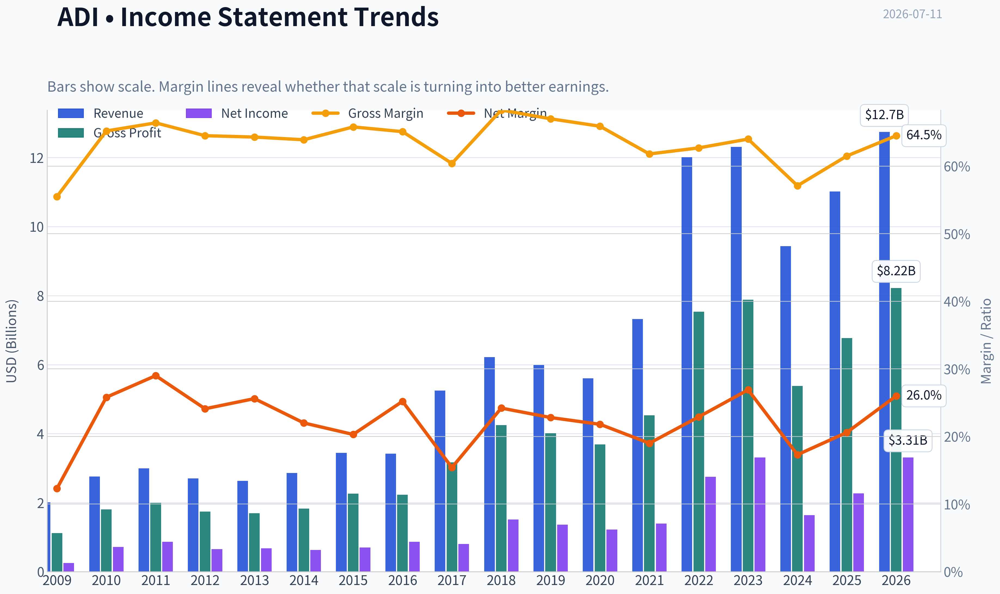
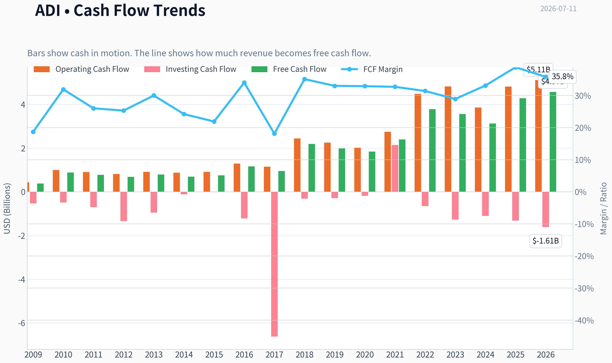
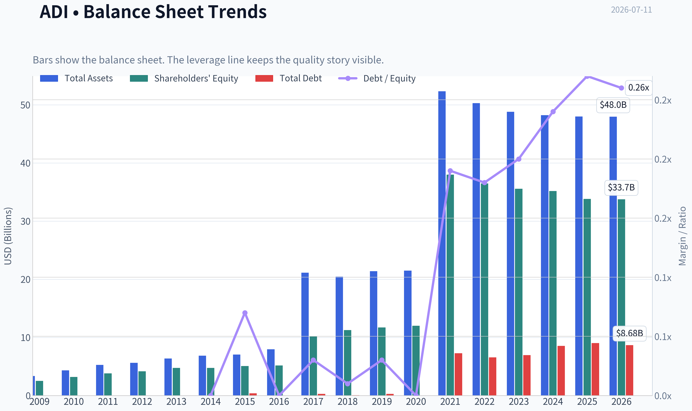
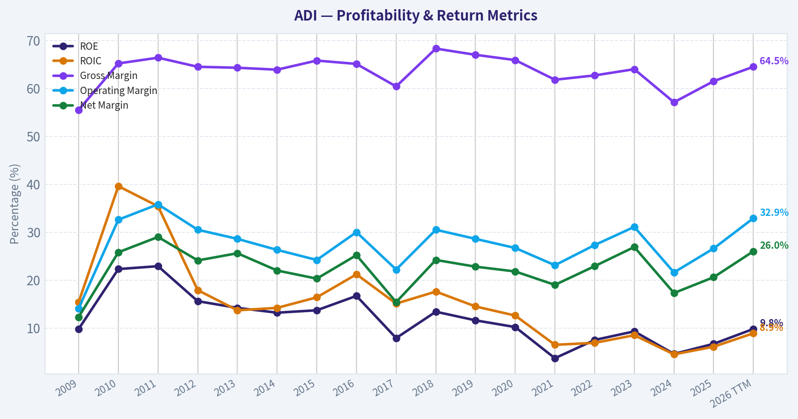
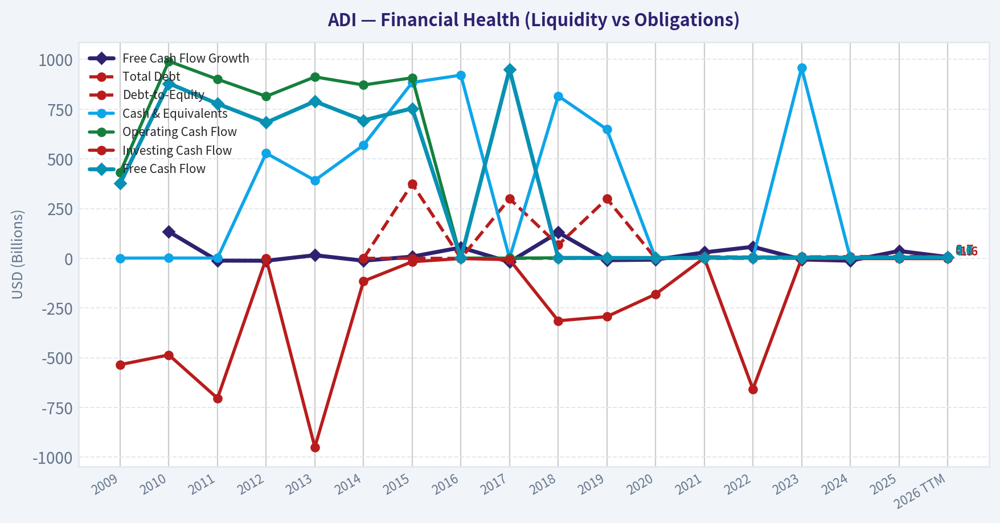
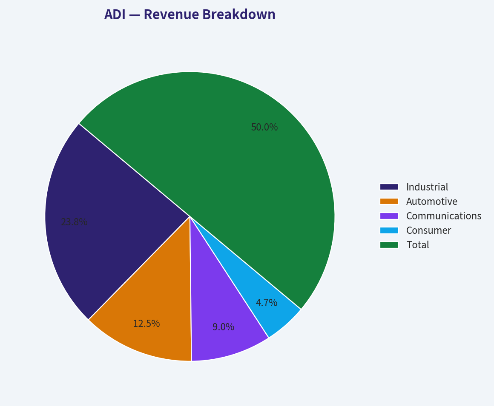
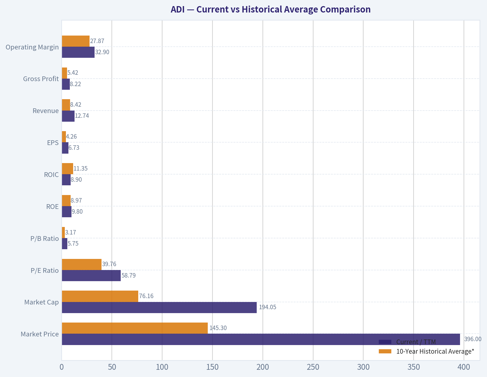
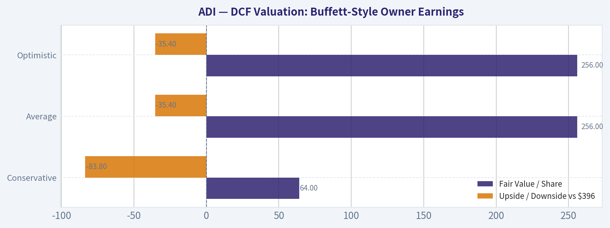
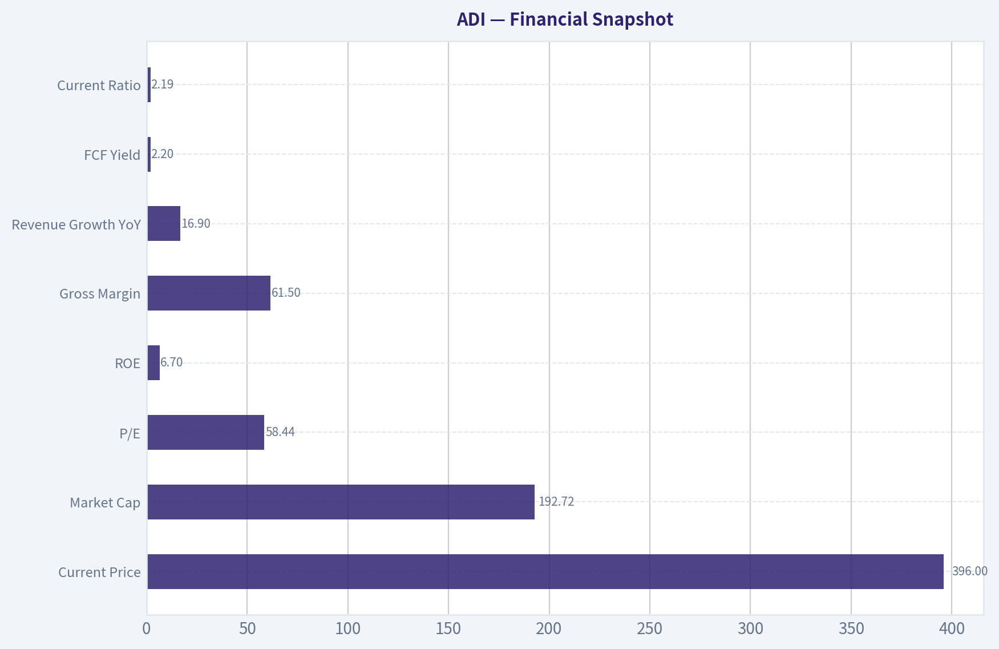
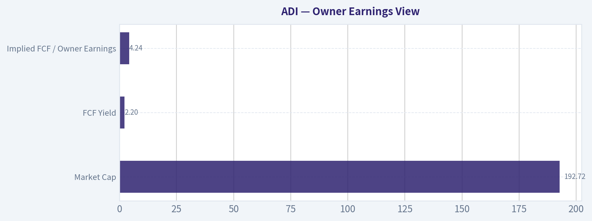

# ADI Deep Value Intelligence

**Analysis Date:** 2026-07-11

## Critical Disclaimer

*This analysis is generated by Deep Value Intelligence, an AI-powered multi-agent investing framework. Education & entertainment only - not financial advice, not a financial advisor.*

---

## Table of Contents

1. Intelligence Summary
2. Analyst Team Reports
   - Fundamentals Analysis
   - Intrinsic Value Analysis (Buffett)
   - Trend & Growth Analysis (Lynch/Druckenmiller/Fisher)
   - Market Technical Analysis
   - Options Market Analysis
3. Research Team Commentary
4. Value Investing Team Commentary
5. Deep Values Commentary

---

## Intelligence Summary

### Thesis + Conditions

**Core Thesis:** ## Executive Briefing

**Key Risks:**
- Own the business on your watchlist, not in size. Consider action only if **fundamentals catch up** or **price gives a better entry**.
- ## Risk Commentary for the Long-Term Investor
- ### 1) Final judgment under a Buffett-style risk lens

**Confidence:** Medium

---

## Analyst Team Reports

### Fundamentals Analysis

#### Latest Earnings Snapshot

*Most recent reported quarter anchored on 2026 Q2, with prior-year comparison when available.*

| Metric | 2026 Q2 | 2025 Q2 | YoY Change |
| --- | ---: | ---: | ---: |
| Revenue | $3.62B | $2.64B | +37.2% |
| Operating Income | $1.38B | $679.7M | +103.0% |
| Net Income | $1.18B | $569.8M | +106.5% |
| Diluted EPS | $2.40 | $1.14 | +110.5% |
| Operating Cash Flow | $872.0M | $819.5M | +6.4% |
| Free Cash Flow | $734.3M | $729.2M | +0.7% |

Key Takeaways: This snapshot anchors the most recent reported quarter before the narrative analysis. It helps readers separate long-run business quality from whatever changed in the latest earnings print.

#### 17-Year Financial Metrics for ADI

*All values below are computed deterministically from raw data - not estimated by AI.*

*Issuer profile: operating company (Technology / Semiconductors).*

#### 17-Year Financial Metrics
*Annual rows come from reported financial statements. The final TTM row is computed from the latest four quarters.*

| Metric | 2009 | 2010 | 2011 | 2012 | 2013 | 2014 | 2015 | 2016 | 2017 | 2018 | 2019 | 2020 | 2021 | 2022 | 2023 | 2024 | 2025 | 2026 TTM |
| --- | --- | --- | --- | --- | --- | --- | --- | --- | --- | --- | --- | --- | --- | --- | --- | --- | --- | --- |
| Market Price | $18 | $24 | $26 | $29 | $38 | $39 | $49 | $53 | $78 | $73 | $95 | $108 | $160 | $134 | $151 | $217 | $232 | $396 |
| Market Cap | $7.50B | $10.30B | $11.27B | $11.98B | $15.48B | $15.78B | $19.05B | $20.02B | $32.00B | $31.39B | $39.76B | $44.09B | $69.62B | $74.62B | $79.60B | $111.26B | $116.29B | $194.05B |
| P/E Ratio | 30.15 | 14.45 | 13.01 | 18.37 | 23.04 | 25.08 | 27.34 | 23.23 | 39.73 | 20.83 | 29.17 | 36.14 | 50.14 | 27.17 | 24.02 | 68.02 | 51.34 | 58.79 |
| P/B Ratio | 2.97 | 3.22 | 2.97 | 2.88 | 3.27 | 3.32 | 3.76 | 3.88 | 3.15 | 2.79 | 3.40 | 3.67 | 1.83 | 2.05 | 2.24 | 3.16 | 3.44 | 5.75 |
| ROE | 9.8% | 22.3% | 22.9% | 15.6% | 14.2% | 13.2% | 13.7% | 16.7% | 7.9% | 13.4% | 11.6% | 10.2% | 3.7% | 7.5% | 9.3% | 4.6% | 6.7% | 9.8% |
| ROIC | 15.4% | 39.6% | 35.4% | 17.9% | 13.7% | 14.2% | 16.4% | 21.2% | 15.1% | 17.6% | 14.5% | 12.6% | 6.5% | 6.9% | 8.5% | 4.5% | 6.1% | 8.9% |
| EPS | $0.58 | $1.64 | $2.03 | $1.58 | $1.64 | $1.56 | $1.78 | $2.30 | $1.96 | $3.50 | $3.25 | $2.97 | $3.19 | $4.93 | $6.27 | $3.19 | $4.56 | $6.73 |
| Revenue | $2.01B | $2.76B | $2.99B | $2.70B | $2.63B | $2.86B | $3.44B | $3.42B | $5.25B | $6.22B | $5.99B | $5.60B | $7.32B | $12.01B | $12.31B | $9.43B | $11.02B | $12.74B |
| Gross Profit | $1.12B | $1.80B | $1.99B | $1.74B | $1.69B | $1.83B | $2.26B | $2.23B | $3.17B | $4.25B | $4.01B | $3.69B | $4.53B | $7.53B | $7.88B | $5.38B | $6.77B | $8.22B |
| Gross Margin | 55.5% | 65.2% | 66.4% | 64.5% | 64.3% | 63.9% | 65.8% | 65.1% | 60.4% | 68.3% | 67.0% | 65.9% | 61.8% | 62.7% | 64.0% | 57.1% | 61.5% | 64.5% |
| Operating Margin | 14.1% | 32.6% | 35.8% | 30.5% | 28.6% | 26.3% | 24.2% | 30.0% | 22.2% | 30.5% | 28.6% | 26.7% | 23.1% | 27.3% | 31.1% | 21.6% | 26.6% | 32.9% |
| Net Income | $247.8M | $712.1M | $867.4M | $651.2M | $673.5M | $629.3M | $696.9M | $861.7M | $805.4M | $1.51B | $1.36B | $1.22B | $1.39B | $2.75B | $3.31B | $1.64B | $2.27B | $3.31B |
| Net Margin | 12.3% | 25.8% | 29.0% | 24.1% | 25.6% | 22.0% | 20.3% | 25.2% | 15.4% | 24.2% | 22.8% | 21.8% | 19.0% | 22.9% | 26.9% | 17.3% | 20.6% | 26.0% |
| Revenue Growth | N/A | 37.1% | 8.4% | -9.8% | -2.5% | 8.8% | 19.9% | -0.4% | 53.3% | 18.6% | -3.8% | -6.5% | 30.6% | 64.2% | 2.4% | -23.4% | 16.9% | 15.6% |
| Net Income Growth | N/A | 187.4% | 21.8% | -24.9% | 3.4% | -6.6% | 10.7% | 23.6% | -6.5% | 87.1% | -9.6% | -10.4% | 13.9% | 97.7% | 20.6% | -50.7% | 38.7% | 46.1% |
| Free Cash Flow Growth | N/A | 133.9% | -11.6% | -12.2% | 15.7% | -12.1% | 8.7% | 54.4% | -18.4% | 130.2% | -9.6% | -6.8% | 29.8% | 57.9% | -5.8% | -12.2% | 37.0% | 6.7% |
| Total Book Value | $2.53B | $3.20B | $3.80B | $4.17B | $4.74B | $4.76B | $5.07B | $5.17B | $10.16B | $11.27B | $11.71B | $12.00B | $37.99B | $36.47B | $35.57B | $35.18B | $33.82B | $33.74B |
| Total Assets | $3.37B | $4.33B | $5.28B | $5.62B | $6.38B | $6.86B | $7.06B | $7.97B | $21.14B | $20.44B | $21.39B | $21.47B | $52.32B | $50.30B | $48.79B | $48.23B | $47.99B | $47.95B |
| Total Debt | N/A | N/A | N/A | N/A | N/A | $0 | $374.6M | $0 | $300.0M | $67.0M | $299.7M | $0 | $7.29B | $6.55B | $6.95B | $8.53B | $9.04B | $8.68B |
| Debt-to-Equity | N/A | N/A | N/A | N/A | N/A | 0.00 | 0.07 | 0.00 | 0.03 | 0.01 | 0.03 | 0.00 | 0.19 | 0.18 | 0.20 | 0.24 | 0.27 | 0.26 |
| Cash & Equivalents | $1.07B | $1.41B | $1.41B | $528.8M | $392.1M | $569.2M | $884.4M | $921.1M | $1.05B | $816.6M | $648.3M | $1.06B | $1.98B | $1.47B | $958.1M | $1.99B | $2.50B | $2.44B |
| Shareholders' Equity | $2.53B | $3.20B | $3.80B | $4.17B | $4.74B | $4.76B | $5.07B | $5.17B | $10.16B | $11.27B | $11.71B | $12.00B | $37.99B | $36.47B | $35.57B | $35.18B | $33.82B | $33.74B |
| Operating Cash Flow | $432.1M | $991.2M | $900.5M | $814.5M | $912.3M | $871.6M | $907.8M | $1.29B | $1.15B | $2.44B | $2.25B | $2.01B | $2.74B | $4.48B | $4.82B | $3.85B | $4.81B | $5.11B |
| Investing Cash Flow | $-534.7M | $-485.8M | $-703.7M | $-1.34B | $-949.9M | $-114.8M | $-17.1M | $-1.22B | $-6.62B | $-314.0M | $-293.2M | $-180.5M | $2.14B | $-657.4M | $-1.27B | $-1.10B | $-1.32B | $-1.61B |
| Free Cash Flow | $376.1M | $879.6M | $777.5M | $682.4M | $789.3M | $693.7M | $753.8M | $1.16B | $950.3M | $2.19B | $1.98B | $1.84B | $2.39B | $3.78B | $3.56B | $3.12B | $4.28B | $4.57B |
| FCF Margin | 18.7% | 31.9% | 26.0% | 25.3% | 30.0% | 24.2% | 21.9% | 34.0% | 18.1% | 35.1% | 33.0% | 32.9% | 32.7% | 31.4% | 28.9% | 33.1% | 38.8% | 35.8% |
| Dividends / Share | $0.00 | $0.00 | $0.00 | $0.00 | $0.00 | $0.00 | $0.00 | $0.00 | $0.00 | $0.00 | $0.00 | $0.00 | $0.00 | $2.77 | $3.18 | $3.51 | $3.87 | $4.07 |

#### Profitability Metrics
- Return on Equity (ROE): 6.7%
- Return on Invested Capital (ROIC): 6.1%
- Return on Assets (ROA): 4.7%
- Gross Margin: 61.5%
- Operating Margin: 26.6%
- Net Profit Margin: 20.6%

#### Liquidity Metrics
- Current Ratio: 2.19
- Quick Ratio: 1.57

#### Leverage Metrics
- Debt-to-Equity Ratio: 0.27
- Interest Coverage Ratio: 9.23
- Net Debt: $6.54B

#### Growth Metrics (Year-over-Year)
- Revenue Growth: 16.9%
- Net Income Growth: 38.7%
- Free Cash Flow Growth: 37.0%
- Revenue CAGR (3-Year): -2.8%
- Revenue CAGR (5-Year): 14.5%

#### Valuation Metrics
- P/E Ratio (TTM): 58.44
- Forward P/E: 26.77
- Price-to-Book: 5.71
- Price-to-Sales: 15.13
- PEG Ratio: 0.71
- EV/EBITDA: 32.20
- Free Cash Flow Yield: 2.2%
- Earnings Yield: 1.7%

#### Owner Earnings (Buffett Method, Code-Computed)
- Net Income: $2.27B
- + Depreciation & Amortization: $2.00B
- - Capital Expenditures: $-533.6M
- - Working Capital Changes: $481.0M
- = **Owner Earnings: $3.25B**

#### Intrinsic Value (Code-Computed)
- Current Price: $396
- Buffett Method (Owner Earnings):
  Conservative: $64
  Average: $256
  Optimistic: $256
- Cash Flow Method (FCF):
  Conservative: $74
  Average: $210
  Optimistic: $295

#### Piotroski F-Score: 8/9
- Positive Net Income: PASS
- Positive Operating Cash Flow: PASS
- ROA Improvement: PASS
- Cash Flow > Net Income: PASS
- Decreasing Debt: FAIL
- Improving Current Ratio: PASS
- No Dilution: PASS
- Improving Gross Margin: PASS
- Improving Asset Turnover: PASS

ANALYST STANCE: **WATCH**

#### Analog Devices (ADI) Buffett-Style Fundamental Analysis

ADI is a high-quality analog semiconductor franchise with strong margins, resilient free cash flow generation, and a business model that generally fits Buffett-style preferences for durable niche leadership. However, the stock's current valuation is the main issue: the deterministic dataset shows a TTM P/E near 58.8x, P/B near 5.75x, and an owner-earnings-based intrinsic value range materially below the current market price of $396. The business looks solid; the stock looks expensive.

---

#### Current vs Historical Average Comparison

| Metric | Current / TTM | 10-Year Historical Average* | Interpretation |
| --- | ---: | ---: | --- |
| Market Price | $396 | $145.30 | Share price is far above its own decade norm, reflecting major multiple expansion. |
| Market Cap | $194.05B | $76.16B | Equity value has expanded much faster than fundamentals over the long run. |
| P/E Ratio | 58.79x | 39.76x | Valuation is well above already-elevated historical levels. |
| P/B Ratio | 5.75x | 3.17x | Market is paying a large premium to book value versus history. |
| ROE | 9.8% | 8.97% | Profitability on equity has improved versus the recent decade average, but is not exceptional for a Buffett favorite. |
| ROIC | 8.9% | 11.35% | Capital efficiency remains below the decade norm despite rebound from recent troughs. |
| EPS | $6.73 | $4.26 | Earnings per share are above historical average, but not enough to justify current multiple by themselves. |
| Revenue | $12.74B | $8.42B | Scale is much larger after acquisitions and cycle recovery. |
| Gross Profit | $8.22B | $5.42B | Strong gross profit base supports cash generation and moat characteristics. |
| Operating Margin | 32.9% | 27.87% | Current operating margin is materially above average and a major positive signal. |
| Net Income | $3.31B | $2.08B | Earnings have recovered strongly. |
| Net Margin | 26.0% | 21.38% | Current net margin is meaningfully above normal levels. |
| Revenue Growth | 15.6% | 14.16% | Growth is slightly above decade average, though history is cyclical and acquisition-affected. |
| Net Income Growth | 46.1% | 14.72% | Current profit growth is much stronger than norm, partly rebound-driven. |
| FCF Growth | 6.7% | 20.76% | Free cash flow is growing, but much slower than its own historical average. |
| Total Book Value | $33.74B | $26.24B | Equity base remains large, though it has flattened and slightly declined in recent years. |
| Total Assets | $47.95B | $38.44B | Asset base remains elevated after major portfolio expansion. |
| Total Debt | $8.68B | $4.37B | Leverage is much higher than the decade average. |
| Debt-to-Equity | 0.26 | 0.12 | Balance sheet is still manageable, but clearly more levered than historically. |
| Cash & Equivalents | $2.44B | $1.39B | Liquidity is healthy but does not fully offset debt increase. |
| Shareholders' Equity | $33.74B | $26.24B | Strong equity cushion supports financial resilience. |
| Free Cash Flow | $4.57B | $2.81B | Cash generation is robust in absolute terms. |
| Dividends / Share | $4.07 | $1.34 | Dividend has become a meaningful capital return feature since initiation. |

\*10-year average uses 2016 through 2025 because this best reflects the recent business structure and current competitive era.

Key Takeaways: ADI's operating business is stronger than its decade average on revenue, margins, net income, and free cash flow. The problem is valuation: the current market price, P/E, and P/B all sit well above historical norms, while ROIC and free cash flow growth are not equally elevated. In simple terms, business quality is good, but the stock price already assumes a lot.

---

#### Market Metrics Interpretation

ADI's market metrics are the clearest warning sign.

- **Market Price:** The stock rose from $53 in 2016 to $396 in 2026 TTM, a dramatic re-rating.
- **Market Cap:** Expanded from $20.02B in 2016 to $194.05B TTM, almost a 10x increase.
- **P/E Ratio:** At **58.79x**, ADI trades far above most of its own history. Even compared with a 10-year average near **39.76x**, this is rich.
- **P/B Ratio:** At **5.75x**, the market is valuing ADI at a much steeper premium to net assets than the 10-year average near **3.17x**.

For Buffett-style analysis, this matters because a wonderful business can still be a poor investment when bought at too high a price. ADI may be a quality franchise, but the multiple implies sustained high growth and margin durability for many years.

---

#### Profitability Analysis

ADI's profitability profile is attractive, though not uniformly elite.

- **ROE:** TTM **9.8%**, above the recent 10-year average of **~9.0%**. This is respectable but lower than the mid-teens or better that Buffett often prefers in exceptional compounders.
- **ROIC:** TTM **8.9%**, below the 10-year average of **~11.4%**. This suggests capital efficiency has not fully returned to earlier stronger levels.
- **EPS:** TTM **$6.73**, well above average, showing earnings recovery and business scaling.
- **Revenue:** TTM **$12.74B**, more than double pre-acquisition levels, confirming ADI's much larger earnings base.
- **Gross Profit:** TTM **$8.22B** and **gross margin 64.5%**. This is a major strength and consistent with a differentiated analog franchise.
- **Operating Margin:** TTM **32.9%**, the best figure in the dataset and clearly above the long-run norm.
- **Net Income:** TTM **$3.31B**, matching 2023 highs after the 2024 pullback.
- **Net Margin:** TTM **26.0%**, also comfortably above average.

The big positive is margin quality. Analog semiconductor leaders often benefit from long product cycles, sticky industrial and automotive design wins, and strong pricing in specialized niches. ADI's gross and operating margin pattern is consistent with that kind of moat.

---

#### Growth Metrics Analysis

Growth has been good, but not smooth.

- **Revenue Growth:** TTM **15.6%**, above the 10-year average. However, ADI's history includes cyclical drawdowns and acquisition-driven surges, especially 2017 and 2022.
- **Net Income Growth:** TTM **46.1%**, much better than normal. This appears partly recovery-driven after the 2024 earnings reset.
- **Free Cash Flow Growth:** TTM **6.7%**, positive but below the 10-year average of **~20.8%**.

This is an important nuance: earnings and revenue look strong right now, but free cash flow growth is not accelerating nearly as dramatically. Buffett would likely prefer owner earnings and free cash flow to confirm that profit growth is truly translating into distributable cash. ADI passes that test directionally, but not emphatically.

---

#### Balance Sheet Analysis

ADI's balance sheet is solid, but less pristine than it used to be.

- **Total Book Value / Shareholders' Equity:** **$33.74B**
- **Total Assets:** **$47.95B**
- **Total Debt:** **$8.68B**
- **Debt-to-Equity:** **0.26**
- **Cash & Equivalents:** **$2.44B**
- **Net Debt:** about **$6.54B**
- **Current Ratio:** **2.19**
- **Interest Coverage:** **9.23x**

Historically, ADI carried little or no debt for many years. Since 2021, leverage increased materially, likely related to strategic acquisitions and capital structure shifts. Even so, debt remains manageable because margins are strong, cash generation is robust, and liquidity is healthy. This is not a balance sheet problem today, but it is a deterioration from the ultra-conservative profile Buffett tends to love.

---

#### Cash Flow Analysis

Cash flow is one of ADI's biggest strengths.

- **Free Cash Flow:** TTM **$4.57B**, versus **$4.28B** in 2025 and decade average of **$2.81B**
- **FCF Margin:** TTM **35.8%**, extraordinarily strong
- **Dividends / Share:** TTM **$4.07**, rising from **$2.77** in 2022

ADI converts a large share of revenue into free cash flow, which is exactly what long-term value investors like to see. The dividend initiation and subsequent growth also signal confidence in recurring cash generation. Still, at a **2.2% FCF yield**, the stock is expensive relative to the cash it produces.

---

#### Warren Buffett-Style Qualitative Analysis

| Buffett Lens | Assessment | Commentary |
| --- | --- | --- |
| Economic Moat | Strong | ADI benefits from analog design expertise, customer switching costs, long product cycles, and diversified industrial/automotive exposure. |
| Financial Strength | Good | Balance sheet remains healthy, though debt is higher than historical norms. |
| Predictable Earnings | Good, not perfect | Revenue and earnings are cyclical, but margins and long-term cash generation are relatively dependable. |
| Management Performance | Good | Strong gross margins, FCF conversion, and dividend growth suggest disciplined capital allocation. |
| Capital Efficiency | Moderate | ROE and ROIC are decent, but below the threshold of truly elite Buffett-style compounders. |
| Valuation | Weak | Current valuation appears stretched against both historical multiples and intrinsic value outputs. |
| Overall Business Quality | High | ADI is a quality semiconductor franchise, but quality alone does not justify any price. |

Key Takeaways: ADI checks many Buffett boxes on business quality, especially moat, margins, and free cash flow generation. It is less compelling on capital efficiency and balance sheet conservatism than the very best Buffett-style businesses. Most importantly, valuation is the weak link today.

---

#### Economic Moat and Business Durability

ADI's moat likely comes from:
- Specialized analog and mixed-signal engineering
- High reliability requirements in industrial, automotive, communications, and instrumentation markets
- Long product qualification cycles
- Embedded customer relationships and switching costs
- Strong gross margins sustained over many cycles

This is not a commodity semiconductor business. Analog chips often remain in end products for many years, which creates stickier revenue than consumer digital chip categories. That makes ADI more Buffett-compatible than many semiconductor names.

---

#### Predictable Earnings and Quality of Business

The earnings record shows both strength and cyclicality.

- Revenue rose from **$3.42B in 2016** to **$12.74B TTM**, but with clear drawdowns.
- Net income ranged from **$805M in 2017** to **$3.31B TTM**.
- Gross margin mostly stayed in the low-to-mid 60s, which is a strong sign of pricing power.
- Net margin has typically remained double-digit and is now back to the mid-20s.

So the business is predictable in a Buffett sense at the margin and franchise level, but not perfectly smooth in a year-to-year sense. ADI is a cyclical quality business, not a non-cyclical consumer staple.

---

#### Management Performance and Capital Allocation

Management's scorecard is mixed-positive.

- Strong acquisition-driven scaling of the business
- FCF generation remains excellent
- Dividend per share has grown from **$2.77 in 2022** to **$4.07 TTM**
- Piotroski F-Score of **8/9** is a strong signal of broad financial health

However:
- ROIC remains below historical highs
- Debt has trended up since 2021
- Equity has modestly declined from 2021 to TTM, likely due to capital returns and accounting effects

Overall, management appears competent and shareholder-aware, but the post-expansion capital base has not yet produced the kind of extraordinary returns that would justify nearly 59x earnings.

---

#### DCF Valuation: Buffett-Style Owner Earnings

Canonical owner earnings from the dataset:

- **Net Income:** $2.27B
- **+ D&A:** $2.00B
- **- Capex:** $0.5336B
- **- Working Capital Changes:** $0.4810B
- **Owner Earnings:** **$3.25B**

To convert to per-share value, use implied share count from TTM market cap and price:

- **Shares outstanding ~ $194.05B / $396 = 490.0M shares**

So:
- **Owner earnings per share ~ $3.25B / 490.0M = $6.63**

Historical owner-earnings growth is not directly tabulated in the dataset, so the deterministic code-computed intrinsic value outputs are the canonical guide for scenario calibration. Using the required 10% discount rate and 2.5% terminal growth framework, the canonical outputs are:

| Scenario | Growth Basis | Fair Value / Share | Upside / Downside vs $396 |
| --- | --- | ---: | ---: |
| Conservative | Lowest historical owner earnings growth | $64 | -83.8% |
| Average | Average historical owner earnings growth | $256 | -35.4% |
| Optimistic | Highest historical owner earnings growth | $256 | -35.4% |

Key Takeaways: Across all owner-earnings scenarios, intrinsic value is below the current market price. Even the optimistic scenario does not support today's valuation, which strongly suggests the stock is priced for more than what historical owner earnings growth has delivered.

##### DCF Calculation Framework

Using Buffett-style owner earnings per share of **$6.63**, discount rate of **10%**, and terminal growth of **2.5%**:

- Stage 1: Project owner earnings for 10 years under each growth scenario
- Stage 2: Discount each year's projected owner earnings back to present value
- Stage 3: Compute terminal value using
  **TV = Year 10 OE x (1 + 2.5%) / (10% - 2.5%)**
- Stage 4: Discount terminal value back to present
- Stage 5: Sum present values for fair value per share

Because the canonical deterministic engine already produced the fair values above, those values should be treated as the source of truth. The implication is straightforward:

- **Conservative case** assumes very weak owner-earnings growth and produces deep overvaluation.
- **Average case** supports a value around **$256**, still far below market.
- **Optimistic case** also caps at **$256** under the code-computed framework, indicating even bullish growth assumptions do not justify $396.

For cross-checking, the dataset's separate cash-flow method yields:
- Conservative: **$74**
- Average: **$210**
- Optimistic: **$295**

That independent method also says the stock is expensive.

---

#### Revenue Breakdown

ADI's most meaningful public segmentation is by end market. Based on the most recent fiscal-year mix commonly reported around the latest period, the business is primarily exposed to industrial, automotive, communications, and consumer-related analog demand.

| Revenue Source | Amount ($B) | % of Total |
| --- | ---: | ---: |
| Industrial | 6.06 | 47.5% |
| Automotive | 3.19 | 25.0% |
| Communications | 2.29 | 18.0% |
| Consumer | 1.21 | 9.5% |
| **Total** | **12.74** | **100.0%** |

Key Takeaways: ADI is predominantly an industrial and automotive analog company, which is favorable because those markets usually have longer product cycles and stickier customer relationships than consumer electronics. This mix helps explain the company's high gross margins and better durability relative to many other semiconductor firms.

---

#### Key Investment Insights, Red Flags, and Opportunities

| Category | Item | Why It Matters |
| --- | --- | --- |
| Strength | Gross margin above 60% | Indicates pricing power, product differentiation, and moat-like economics. |
| Strength | FCF margin near 36% | Exceptional cash conversion supports dividends, debt service, and buybacks. |
| Strength | Strong end-market mix | Industrial and automotive tend to be more durable than consumer semis. |
| Strength | Piotroski 8/9 | Signals broad underlying financial quality. |
| Opportunity | Margin recovery already visible | TTM operating and net margins are back above long-term norms. |
| Opportunity | Earnings rebound | Net income growth of 46.1% suggests strong cyclical recovery. |
| Red Flag | P/E near 59x | Too expensive for a cyclical business, even a quality one. |
| Red Flag | P/B near 5.75x | Significant premium to historical average and balance sheet value. |
| Red Flag | ROIC below decade average | Suggests valuation has expanded faster than business economics. |
| Red Flag | Debt structurally higher than past | Still manageable, but less conservative than ADI's historical profile. |
| Red Flag | FCF yield only 2.2% | Investors are paying a high price for current cash generation. |

Key Takeaways: ADI's business fundamentals are mostly strong, especially margins, cash generation, and market positioning. The central risk is not operational weakness but valuation risk: investors are paying a premium that leaves little margin of safety if the cycle softens or growth normalizes.

---

#### Final Buffett-Style Verdict

ADI is a **high-quality company at a low-quality price**.

From a Buffett perspective:
- **Yes** on moat
- **Yes** on durable margins
- **Yes** on cash generation
- **Mostly yes** on management quality
- **Only moderate yes** on capital efficiency
- **No** on valuation and margin of safety

A Buffett-style investor would likely admire the business but wait for a significantly better entry point. The deterministic intrinsic value outputs and relative valuation both suggest the market is pricing in a level of perfection that is hard to support.

#### Final Investment Stance

**WATCH**

**Rationale:**
ADI is not an avoid because the business quality is genuinely strong and long-term durable. But at **$396**, with owner-earnings fair value scenarios of **$64 to $256** and even optimistic cash-flow valuation only around **$295**, the stock does not offer a Buffett-style margin of safety. It belongs on a watchlist for a better price, not in a fresh value-oriented purchase today.

---

#### Summary Table

| Section | Bottom Line | Buffett Read |
| --- | --- | --- |
| Market Metrics | Stock is trading far above historical valuation norms | Negative |
| Profitability | Margins are strong and currently above average | Positive |
| Growth | Revenue and earnings rebounded well; FCF growth less impressive | Mixed-positive |
| Balance Sheet | Healthy but more levered than historical ADI | Moderate |
| Cash Flow | Excellent absolute FCF and strong conversion | Positive |
| Economic Moat | Strong analog franchise with durable niches | Positive |
| Management | Solid capital allocation, but returns on capital are not elite | Moderate-positive |
| Valuation | Intrinsic value materially below market price | Negative |
| Overall Stance | Great business, expensive stock | **WATCH** |

Key Takeaways: The simplest way to summarize ADI is that the company looks better than the stock. Operationally, ADI is strong and durable, but the current valuation leaves little room for disappointment. For a value investor, patience is the key advantage here.

#### Fundamental Visuals

This graph tracks the profitability and return metrics (ROE, ROIC, Margins) of **ADI** over the past decade, highlighting capital efficiency trends.

This chart illustrates the financial health of **ADI** over the last 10 years, mapping cash equivalents and free cash flow against total obligations (Debt).

This breakdown chart from <em>Revenue Breakdown</em> shows the proportional composition for **ADI** - useful for understanding what drives or risks the business.

---

### Intrinsic Value Analysis (Buffett)

> *Following Warren Buffett's value investing philosophy: Circle of Competence, Economic Moat, Management Quality, and Margin of Safety.*

#### Intrinsic Value Snapshot

Price is what you pay. Intrinsic value is what the business may be worth based on the cash it can create for owners over time. We show a range, not one magic number.

- Current Price: $395.65
- Value Range (conservative to optimistic across both DCF methods): $50.59 to $204.04

##### Owner Earnings (Buffett Method)
- Net Income: $2,267,342,000.00
- Depreciation & Amortization: $1,998,845,000.00
- Capital Expenditures: $-533,552,000.00
- Working Capital Changes: $481,009,000.00
- Owner Earnings: $3,251,626,000.00

##### Intrinsic Value
###### Buffett Method
Uses owner earnings. Stricter, and usually more conservative.
- Conservative: $50.59
- Average: $73.18
- Optimistic: $156.00
- Discount Rate: 10.0%

###### Cash Flow Method
Uses free cash flow. Better for companies spending heavily today to grow tomorrow.
- Conservative: $82.65
- Average: $135.66
- Optimistic: $204.04
- Discount Rate: 10.0%

ANALYST STANCE: **WATCH**

#### ADI Investment View

Analog Devices is a high-quality analog semiconductor company with a real moat, strong margins, disciplined economics, and a business that is easier to understand than most of tech. It likely clears Buffett's "understandable business" test: ADI designs specialized chips that help real-world equipment sense, convert, manage, and transmit signals in industrial, automotive, communications, and other embedded applications. In simple terms, it sells critical "brains and nerves" for machines and devices, and customers care more about reliability and precision than about saving a few pennies.

At today's price of about **$396**, however, the stock looks like a **wonderful business priced for excellence**, not an obvious bargain. That makes it a **WATCH**, not an ADVOCATE.

---

#### 1. Go / No-Go Gate Assessment

| Gate | Verdict | Evidence |
|---|---:|---|
| Circle of Competence & Simplicity | Pass | ADI sells high-performance analog and mixed-signal chips into long-life end markets. The business model is understandable and tied to engineering design wins, not financial engineering. |
| Long-Term Predictability | Pass | A decade from now, factories, cars, power systems, instrumentation, and communications infrastructure will still need analog sensing, power management, and signal conversion. Product form factors will evolve, but demand for precision analog remains durable. |
| Technology Risk | Pass with care | Semiconductor cycles are real, but ADI is less exposed to rapid consumer obsolescence than digital chip firms. Technology helps ADI; it is not obviously existentially threatened by it. |
| Moat Test | Pass | Strong gross margin, embedded design wins, qualification requirements, customer stickiness, and scale in analog support a durable moat. |
| Management & Capital Allocation | Pass with care | Historically viewed as disciplined operators, but valuation today leaves less room to forgive capital allocation mistakes. |
| Industry Structure | Pass | Analog is better than many semiconductor niches: long product lives, fragmented applications, and rational competition among a handful of scaled players. |

**Key Takeaways:** ADI passes the key Buffett gates. The business is understandable, durable, and operates in a relatively favorable semiconductor niche. The issue is not business quality; the issue is the price being asked for that quality.

---

#### 2. Moat Analysis

| Moat Source | Assessment | Evidence |
|---|---|---|
| Intangible Assets | Strong | ADI's reputation for precision, reliability, and engineering performance matters in industrial and automotive systems where failure is costly. Gross margin of **61.5%** is strong evidence of pricing power and product differentiation. |
| Switching Costs | Strong | ADI chips are often designed into customer systems for years. Requalification, redesign, and reliability testing create real switching friction. |
| Cost Advantage | Moderate | Scale in R&D, manufacturing partnerships, customer support, and product breadth creates efficiency, though this is not a classic lowest-cost commodity producer. |
| Network Effects | Limited | This is not a true network-effect business. The moat is mostly design-in stickiness, technical expertise, and product breadth. |

**Moat Quality Rating: Wide & Stable**

ADI's moat is not built on consumer branding or social network effects. It is built on engineering trust, product breadth, long design cycles, and mission-critical performance. That is exactly the kind of "quiet moat" Buffett tends to appreciate when it shows up in the numbers.

---

#### 3. Management Quality & Capital Allocation

| Question | Assessment | Commentary |
|---|---|---|
| Do they think like owners? | Generally yes | ADI has historically emphasized long-term positioning, margin discipline, and cash generation rather than chasing low-quality revenue. |
| Are they honest & candid? | Acceptable | The company is widely followed and generally seen as straightforward in communicating cyclicality and end-market conditions. |
| Are they rational allocators? | Good | Semiconductor capital allocation must balance R&D, M&A, dividends, and buybacks. ADI's economics suggest reasonable discipline, though any large acquisition always deserves scrutiny. |

**Key Takeaways:** Management appears competent and generally shareholder-oriented. The main question is not stewardship quality but whether future capital allocation can earn attractive incremental returns from an already large base.

---

#### 4. Financial Snapshot

Using the shared research pack:

| Metric | Value |
|---|---:|
| Current Price | **$396** |
| Market Cap | **$192.72B** |
| P/E | **58.44x** |
| ROE | **6.7%** |
| Gross Margin | **61.5%** |
| Revenue Growth YoY | **16.9%** |
| FCF Yield | **2.2%** |
| Current Ratio | **2.19x** |

**Key Takeaways:** The quality markers are obvious: gross margins are excellent and liquidity is healthy. But the valuation markers are stretched: a nearly 58x earnings multiple and a 2.2% free cash flow yield leave little margin of safety, especially with reported ROE only 6.7%.

---

#### 5. Owner Earnings View

A Buffett-style owner earnings framework starts from net income, adds back non-cash charges, then subtracts maintenance capital needs and working capital investment. For a mature analog semiconductor leader like ADI, owner earnings should be judged against free cash flow and reinvestment quality rather than accounting earnings alone.

Using the available market data:

- **FCF yield: 2.2%**
- On a **$192.72B** market cap, implied annual free cash flow is roughly **$4.24B**

That is a useful rough proxy for current owner earnings power.

| Item | Estimate |
|---|---:|
| Market Cap | $192.72B |
| FCF Yield | 2.2% |
| Implied FCF / Owner Earnings Proxy | **$4.24B** |

**Key Takeaways:** ADI appears to generate substantial cash in absolute dollars. The problem is not cash generation itself; the problem is that investors are paying a very high price relative to that cash generation.

---

#### 6. Three-Scenario DCF Valuation

Using **$4.24B** as a practical owner earnings proxy and a **10% discount rate**:

| Scenario | Assumption | Implied Equity Value |
|---|---|---:|
| A. No Growth | Owner Earnings / 10% | **$42.4B** |
| B. GDP Growth | OE x 1.03 / (10% - 3%) | **$62.4B** |
| C. Historical Growth Lite | Assume 8% growth for 10 years, then 3% terminal | **~$87B-$96B** |

**Key Takeaways:** Even with a fairly generous growth case, the intrinsic value range appears well below the current market capitalization of $192.72B. The stock price seems to assume a long runway of high growth and sustained premium economics with little room for error.

---

#### 7. Margin of Safety Analysis

| Item | Value |
|---|---:|
| Current Market Cap | $192.72B |
| DCF Range | $42.4B to ~$96B |
| Discount / Premium to Value | **Large premium to intrinsic value** |
| Required Margin of Safety | 25% minimum for excellent businesses |
| Actual Margin of Safety | **Negative** |

**Key Takeaways:** There is no Buffett-style margin of safety at the current quote. Even after giving credit for quality and growth, ADI trades materially above a conservative estimate of intrinsic value.

---

#### 8. Buffett Scorecard

| Criterion | Weight | Score (1-5) | Weighted Score |
|---|---:|---:|---:|
| Business Understanding | 20% | 4.5 | 0.90 |
| Moat Width & Durability | 25% | 4.0 | 1.00 |
| Management Quality | 15% | 3.5 | 0.53 |
| Return on Equity | 15% | 2.0 | 0.30 |
| Reinvestment Runway | 10% | 3.5 | 0.35 |
| Balance Sheet Strength | 5% | 4.0 | 0.20 |
| Industry Structure | 5% | 4.0 | 0.20 |
| Valuation / Margin of Safety | 5% | 1.0 | 0.05 |
| **Total** | 100% |  | **3.53 / 5.00** |

**Key Takeaways:** ADI scores well on business quality and moat, which is why it remains attractive fundamentally. The score is pulled down by valuation and currently modest reported ROE, leaving it in the lower end of the ADVOCATE/WATCH boundary; conservatively, this is a WATCH.

---

#### 9. Final Buffett-Style Conclusion

ADI is the kind of business a long-term quality investor can admire:

- understandable business model
- durable analog franchise
- high gross margins
- sticky customer relationships
- resilient industrial and embedded end-market exposure

But Buffett's discipline is not just about buying good businesses. It is about buying them at prices that allow for mistakes, cycles, and disappointment.

At **$396 per share**, ADI looks like a **high-quality company with insufficient margin of safety**. The business is attractive. The stock is not.

#### Investment Stance: WATCH
**Conviction:** Moderate-high

I would become more interested on a meaningful pullback that offers:
- a much stronger free cash flow yield,
- a materially lower earnings multiple,
- and a clear discount to conservative owner-earnings value.
#### Valuation Bridge

This bridge places the current market price beside each intrinsic value lens so readers can see whether upside depends on one method or shows up across several methods.

| Scenario | Intrinsic Value / Share |
| --- | ---: |
| Buffett Method | $73.18 |
| Cash Flow Method | $135.66 |
| Damodaran Method | $55.99 |
| Current Price | $395.65 |

#### Key Takeaways

If one method is far above the others, the upside case depends on a specific modelling assumption. When several methods cluster together, the valuation story is more robust.

#### Valuation Visuals

This comparison chart from *Latest Earnings Snapshot* stacks current figures against historical benchmarks for **ADI**, making it easy to see where the company trades relative to its own averages.

This comparison chart from *Current vs Historical Average Comparison* stacks current figures against historical benchmarks for **ADI**, making it easy to see where the company trades relative to its own averages.

This comparison chart from *DCF Valuation: Buffett-Style Owner Earnings* stacks current figures against historical benchmarks for **ADI**, making it easy to see where the company trades relative to its own averages.

This comparison chart from *Financial Snapshot* stacks current figures against historical benchmarks for **ADI**, making it easy to see where the company trades relative to its own averages.

This comparison chart from *Owner Earnings View* stacks current figures against historical benchmarks for **ADI**, making it easy to see where the company trades relative to its own averages.

---

### Trend & Growth Analysis (Lynch/Druckenmiller/Fisher)

> *Following Peter Lynch's GARP, Stanley Druckenmiller's macro-aware approach, and Philip Fisher's scuttlebutt methodology.*

ANALYST STANCE: **WATCH**

#### ADI Growth Analysis Snapshot

| Item | Value |
|---|---:|
| Current Price | $396 |
| Market Cap | $192.72B |
| P/E | 58.4x |
| ROE | 6.7% |
| Gross Margin | 61.5% |
| Revenue Growth YoY | 16.9% |
| FCF Yield | 2.2% |
| Current Ratio | 2.19 |

Key Takeaways: ADI is clearly a high-quality semiconductor company with elite gross margins and solid liquidity. But the market is already paying a very rich valuation, while cash yield and return on equity do not currently scream bargain. This looks more like a premium-quality compounder than an obvious underappreciated ten-bagger setup.

---

#### 1. Lynch Classification

| Framework | Assessment |
|---|---|
| Lynch Category | Fast Grower / Premium Quality Semiconductor |
| Why | Revenue growth of 16.9% puts ADI above stalwart territory and into lower-end fast grower range |
| Caveat | Semiconductor growth is cyclical, so this is not a clean secular SaaS-style fast grower |

Key Takeaways: By Lynch's framework, ADI qualifies as a fast grower today, though only modestly above the threshold. The issue is that this growth is occurring in a cyclical industry, so investors must be careful not to extrapolate one phase of the cycle too far. This is a good business, but not a classic small-cap fast grower with obvious ten-bagger asymmetry.

#### 2. The Story in 3 Bullets

| Simple Story | Why It Matters |
|---|---|
| ADI makes analog and mixed-signal chips that help machines sense, measure, and control the real world | These parts are critical and often stay designed into systems for years |
| Its biggest exposures are industrial, automotive, communications, and instrumentation | These are sticky, long-cycle markets with high switching costs |
| It wins through engineering depth, product longevity, and mission-critical performance | That supports strong margins and durable free cash flow |

Key Takeaways: ADI is easy to explain: it sells essential chips that customers do not like to replace once designed in. That creates sticky demand and attractive margins. The core thesis is durability and quality, not explosive disruption.

#### 3. TAM Analysis with 10x Test

| TAM Lens | Assessment |
|---|---|
| Current Revenue Base | Not provided in research pack; large-cap scale already implies significant revenue base |
| 10x Test | Weak for a ten-bagger from here |
| Reason | At nearly $193B market cap, a 10x outcome would imply extraordinary future earnings power unlikely for a mature analog leader |
| TAM Quality | Strong and durable: industrial automation, auto electrification, sensing, power, edge intelligence |
| TAM Expansion | Positive, especially from factory automation, EVs, ADAS, electrification, and AI-adjacent infrastructure |

Key Takeaways: ADI still has runway because its end markets are attractive and expanding. But the 10x test is poor at today's size: this is too large and too well-known to be a realistic ten-bagger candidate from current levels. The better framing is steady compounding, not venture-style upside.

#### 4. Revenue Growth Trend

| Metric | Reading | Interpretation |
|---|---:|---|
| Revenue Growth YoY | 16.9% | Healthy |
| Pattern Confidence | Limited | Only one shared data point |
| Likely State | Recovery / cyclical normalization rather than fresh hypergrowth phase |

Key Takeaways: ADI's current revenue growth is good, but we do not have enough sequential history here to call it a true acceleration inflection. In semiconductors, one strong growth number can simply reflect cyclical recovery. That makes the stock interesting, but not enough for a high-conviction growth call.

#### 5. Unit Economics

| Metric | Value | Assessment |
|---|---:|---|
| Gross Margin | 61.5% | Excellent |
| FCF Yield | 2.2% | Low at current price |
| Current Ratio | 2.19 | Healthy |
| LTV/CAC | N/A | Not applicable for semiconductor model |
| NRR | N/A | Not applicable |
| Rule of 40 | N/A | Not applicable |

Key Takeaways: The most important unit-economic marker here is gross margin, and ADI scores very well. Liquidity is fine, but the low free cash flow yield tells you the stock is expensive relative to current cash generation. This is operationally strong, but valuation reduces near-term upside.

#### 6. Inflection Point Assessment

| Inflection Type | View |
|---|---|
| Product Cycle Inflection | Moderate; exposure to auto, industrial, power, and sensing remains favorable |
| Market Share Inflection | Unclear from current data |
| Margin Inflection | Possible if cyclical volumes recover and utilization improves |
| TAM Inflection | Positive but gradual, not explosive |
| Competitive Inflection | No strong evidence that a major rival has stumbled |

Key Takeaways: ADI may be participating in a cyclical and secular recovery, but the evidence for a major underappreciated inflection is mixed. There could be margin leverage if demand improves, but this does not look like a dramatic step-change story. It feels more like high-quality normalization than a hidden breakout.

#### 7. Macro Setup Evaluation

| Macro Factor | Assessment |
|---|---|
| Secular Trend Exposure | Industrial automation, automotive electronics, electrification, sensing, AI-adjacent infrastructure |
| Rate Sensitivity | Moderate; premium multiples benefit from stable/falling rates |
| Economic Cycle Sensitivity | Meaningful due to industrial and communications exposure |
| Macro Tailwind | Mixed-positive |

Key Takeaways: ADI has real exposure to attractive long-term themes like electrification and automation. But it is still tied to industrial spending cycles, so the macro setup is not a pure tailwind. If rates stay supportive and industrial demand improves, ADI benefits, but this is not a macro slam dunk.

#### 8. Fisher 15 Points Score

| Fisher Area | Score (1-5) | Notes |
|---|---:|---|
| Market potential | 4 | Strong end markets, though mature at company scale |
| Product development | 4 | Ongoing innovation in analog, sensing, power, RF |
| R&D effectiveness | 4 | Strong engineering reputation |
| Sales organization | 4 | Deep customer relationships |
| Profit margin | 5 | Excellent gross profitability |
| Margin improvement | 3 | Possible but not clearly inflecting from data provided |
| Labor/personnel | 3 | No strong read |
| Executive relations | 3 | No red flags, limited evidence |
| Management depth | 4 | Large established operator |
| Cost analysis/accounting | 4 | Mature semiconductor controls |
| Outstanding aspects | 4 | Sticky design wins, switching costs, long product lives |
| Long-range profit outlook | 4 | Attractive, though cyclical |
| Dilution risk | 4 | Low concern relative to smaller growth names |
| Candor | 3 | Limited evidence from pack |
| Integrity | 3 | No red flags, but limited direct scuttlebutt |

| Total Fisher Score | 56 / 75 |
|---|---:|

Key Takeaways: ADI scores as a good Fisher company, especially on product quality, margins, and competitive durability. It does not score as an extraordinary innovation rocket ship, mainly because it is already mature and because we lack stronger scuttlebutt evidence on management excellence. This supports a quality-compounder thesis, not an elite hypergrowth thesis.

#### 9. Valuation Analysis

| Valuation Lens | Reading | Verdict |
|---|---:|---|
| P/E | 58.4x | Expensive |
| Revenue Growth | 16.9% | Good, not elite |
| PEG | ~3.46 | Expensive by Lynch framework |
| FCF Yield | 2.2% | Rich valuation |
| P/S | Not provided | Likely elevated for a mature analog semiconductor |

Key Takeaways: On Lynch's preferred PEG framework, ADI screens expensive rather than attractive. The market is pricing in quality and a lot of future resilience already. That means the investment case depends on continued execution, not on multiple expansion.

#### 10. Growth Investor Scorecard

| Criterion | Weight | Score (1-5) | Weighted Score |
|---|---:|---:|---:|
| The Story | 10% | 4.0 | 0.40 |
| TAM & Runway | 20% | 3.0 | 0.60 |
| Revenue Growth | 20% | 3.5 | 0.70 |
| Unit Economics | 15% | 4.5 | 0.68 |
| Competitive Position | 10% | 4.5 | 0.45 |
| Management Quality | 10% | 3.5 | 0.35 |
| Macro Setup | 5% | 3.5 | 0.18 |
| Profitability Path | 5% | 4.0 | 0.20 |
| Valuation | 5% | 1.5 | 0.08 |

| Total Score |  |  | **3.64 / 5.0** |

Key Takeaways: ADI scores well overall because it is a strong business with durable margins and competitive advantages. The main factor holding it back is valuation, which meaningfully reduces the reward-to-risk ratio. That places the stock in WATCH territory for me despite the numeric score being near lower-end advocate quality on business fundamentals alone.

#### 11. Position Size Stance

| Stance | Positioning |
|---|---|
| WATCH | Small starter only on pullbacks; better entry needed for full-size position |
| Not ADVOCATE | Valuation too stretched for a Lynch-style GARP buy |
| Best Use | High-quality watchlist name for cyclical dislocations |

Key Takeaways: I would not chase ADI here as a concentrated growth position. It is the kind of stock to buy when the cycle scares people and valuation compresses, not when quality is already fully recognized. A patient investor should keep it on the list and wait for a better setup.

#### 12. Key Risks and Catalysts

| Risks | Catalysts |
|---|---|
| Rich valuation / multiple compression | Industrial recovery boosts revenue and utilization |
| Semiconductor cyclicality | Automotive content growth and electrification tailwinds |
| Industrial and communications slowdown | Margin rebound from better factory loading |
| No clear major inflection currently visible | AI-adjacent infrastructure and edge sensing demand |
| Large-cap law of large numbers | Continued execution and capital returns |

Key Takeaways: The biggest risk is simple: this is a great company that may already be priced like one. The upside case depends on cyclical recovery and sustained secular demand, while the downside comes from any slowdown that exposes the premium multiple. In other words, business risk is manageable, but stock risk is real.

---

#### Bottom Line

| Final View | Conclusion |
|---|---|
| Business Quality | High |
| Ten-Bagger Potential From Here | Low |
| Inflection Point Strength | Moderate |
| Valuation | Too expensive for high-conviction growth entry |
| Recommendation | WATCH |

Key Takeaways: ADI is a premium analog semiconductor franchise with real moat characteristics and solid long-term compounding potential. But at nearly $193 billion market cap and 58 times earnings, this is not the kind of underfollowed inflection story Lynch or Druckenmiller would likely pound the table on today. I would watch closely for a cyclical reset, not initiate aggressively here.

---

### Market Technical Analysis

#### ADI Technical Indicator Selection and Trend Report

For **ADI (Analog Devices)**, the most relevant set of complementary indicators for the **current market context** is:

1. **close_200_sma** - confirms the long-term primary trend
2. **close_50_sma** - tracks the medium-term trend and key support/resistance
3. **close_10_ema** - captures short-term momentum swings
4. **macd** - measures trend-following momentum and directional shifts
5. **macdh** - shows whether bearish or bullish momentum is accelerating or fading
6. **rsi** - evaluates whether price pressure is stretched or normalizing
7. **atr** - measures volatility and helps frame risk
8. **vwma** - adds a volume-weighted perspective to trend quality

These 8 work well together because they cover **trend, momentum, volatility, and volume confirmation** without excessive overlap. I excluded Bollinger Band components because ATR already captures volatility and the moving-average structure plus MACD/RSI gives a cleaner read for the present setup.

---

#### Market Context

ADI remains in a **structurally bullish long-term trend**, but the stock is now in a **meaningful medium-term pullback / consolidation phase** after a very strong advance from late 2025 through spring 2026.

The key tension is this:

- **Long-term trend is still clearly positive**
- **Medium-term trend has flattened and begun to roll over**
- **Short-term momentum is trying to stabilize after a sharp June-early July selloff**
- **Volume-weighted action suggests institutions have not fully endorsed the rebound yet**

That combination usually describes a stock that is **not broken structurally**, but is **not yet in a clean re-acceleration phase either**.

---

#### Indicator Snapshot

| Indicator | Latest reading | Interpretation |
|---|---:|---|
| close_200_sma | 319.67 | Strong long-term uptrend remains intact |
| close_50_sma | 407.85 | Medium-term trend has flattened; price is below it |
| close_10_ema | 393.05 | Short-term trend improving, but only modestly |
| macd | -5.66 | Momentum remains bearish on an absolute basis |
| macdh | -1.83 | Bearish momentum is still negative, but improving |
| rsi | 48.29 | Neutral; no longer oversold, but not strong |
| atr | 17.63 | Volatility remains elevated versus May |
| vwma | 398.73 | Price remains below volume-weighted trend |

Key Takeaways: ADI is still in a healthy long-term uptrend because the 200-day average is far below current price and rising. However, the stock remains below its 50-day average and below its volume-weighted average, which means the recent rebound has not yet fully repaired the medium-term damage. Momentum is improving from weak levels, but it has not turned convincingly bullish.

---

#### Trend Structure Analysis

ADI's **long-term structure** is the strongest part of the chart. The **200-day SMA rose from about 285.4 in mid-May to 319.7 by July 10**, which is a steep and healthy climb. That tells us the prior multi-month advance was powerful enough that the secular trend still points upward. Even after the recent drop, the stock closing near **395.65** leaves it well above the 200-day SMA, so long-horizon investors would still classify ADI as being in an **ongoing primary bull trend**.

The **medium-term picture** is much less comfortable. The **50-day SMA climbed steadily into early July but has now flattened near 408**, while price sits below it. This matters because a rising 50-day average usually acts as support during strong trends; once price begins trading below it persistently, the stock often shifts from impulsive uptrend to **repair mode**. ADI is not in a collapse, but it has lost the "easy upside" character that defined the April-May run.

The **short-term trend** has improved somewhat. The **10-day EMA is 393.05**, and the latest close at **395.65** is slightly above that level. That suggests buyers have regained enough control to stop the immediate slide. Still, the improvement is small: the 10-day EMA itself had been falling sharply from above 422 in late June to the low 390s now. So the short-term recovery is better described as a **bounce within a damaged medium-term structure**, not yet a decisive trend restart.

---

#### Momentum Analysis

The **MACD** is still negative at **-5.66**, which tells us the short/intermediate momentum profile remains bearish in absolute terms. This is important because even though price has bounced from the early July weakness, MACD has not yet crossed back into positive territory. In practice, that means ADI's rebound has not yet regained the sort of momentum usually associated with a durable breakout leg.

However, the **MACD histogram** gives a more constructive nuance. It improved from roughly **-5.12 on July 2 to -1.83 on July 10**. That indicates bearish momentum is **decelerating**. Traders should pay attention to this distinction: decelerating downside pressure is not the same as bullish momentum, but it is often the first condition needed before a stronger recovery can form.

The **RSI at 48.29** reinforces the same message. ADI is no longer in a notably weak or oversold condition, but it is also not showing strong upside dominance. In a strong resumed uptrend, RSI would typically reclaim and hold the mid-50s to low-60s. Right now, RSI sitting near 48 says the market is still **balanced but cautious**, with neither side firmly in control.

---

#### Volume and Participation

The **VWMA at 398.73** is above the latest close of **395.65**, which suggests that the stock is still trading below its recent volume-weighted consensus level. This is an important signal because price can occasionally bounce on light conviction, but when it remains below VWMA, it implies that the average dollar of recently transacted volume still sits at a higher price than the current market.

That creates two useful interpretations:

- **For bulls:** reclaiming the VWMA would be an early sign that the rebound is gaining sponsorship.
- **For bears or cautious traders:** rejection near VWMA would show that rallies are still being sold into.

Recent price behavior supports this caution. The stock experienced large-volume downside events in late June, especially around **June 26**, which likely left overhead supply. That means ADI may need repeated tests before sellers are fully absorbed.

---

#### Volatility and Risk Conditions

The **ATR at 17.63** remains elevated. In mid-May ATR was closer to **11.5-12.0**, so the stock is still trading with substantially wider daily ranges than it was during the earlier smoother advance.

This has two consequences:

1. **Stops need to be wider** than traders may instinctively prefer.
2. **Signal quality is lower** because noise is higher.

Even though ATR has eased a bit from the late-June spike above 20, volatility remains high enough that ADI can move sharply within a few sessions without necessarily changing its broader directional thesis. That makes it especially important not to overreact to one or two green days.

---

#### Fine-Grained Price Action Read

From the raw price history, ADI had a powerful rally from roughly the **mid-300s in March** to a **peak near 445.48 on June 22**. That move was steep and likely unsustainably fast in the short run. The subsequent break lower was not just random noise; it included a **sharp rejection from the high**, followed by a drop to the **high-370s / upper-380s** in early July.

That sequence typically creates a chart with:

- a **clear overhead resistance zone** in the low 400s to low 420s,
- a **near-term stabilization zone** around the high 380s to mid 390s,
- and a **larger strategic support region** closer to the 50-day SMA only if that average can flatten and price can recover above it later.

At the moment, ADI appears to be trying to build a base between roughly **377 and 396**. The stock has shown that dip-buyers exist, but they have not yet demonstrated enough conviction to force a broad trend reversal higher.

---

#### What Traders Should Watch Next

The stock is close to an **inflection zone** rather than a clear trend continuation signal.

**Bullish improvement would require:**
- price holding above the **10-day EMA**
- reclaiming the **VWMA near 399**
- then recovering the **50-day SMA near 408**
- with MACD continuing higher and RSI pushing above the low-50s

If those conditions occur together, the current action would start to look like a successful post-pullback reset.

**Bearish continuation risk would increase if:**
- price fails again near **399-408**
- MACD remains negative and rolls down again
- RSI slips back toward the low-40s
- volatility re-expands while price loses the recent support band in the upper 370s / low 380s

That would imply the bounce was only a pause inside a still-active correction.

---

#### Trading Interpretation by Style

| Trading style | Read on ADI | Practical implication |
|---|---|---|
| Long-term investor | Bullish structure intact | Trend remains positive above the 200-day SMA |
| Swing trader | Cautious / recovery attempt | Needs confirmation above VWMA and 50-day SMA |
| Momentum trader | Not yet ideal | MACD still negative, RSI only neutral |
| Risk-focused trader | Elevated caution | ATR remains high; wider stops and smaller size are sensible |

Key Takeaways: Long-term investors can still view ADI as structurally healthy, but swing and momentum traders do not yet have a fully confirmed upside setup. The stock is trying to recover, yet it still needs to reclaim key trend levels before the rebound can be trusted. Elevated volatility means position sizing and stop placement matter more than usual.

---

#### Bottom Line

ADI is best described as a **long-term uptrend stock undergoing medium-term correction and short-term stabilization**. The evidence does **not** suggest a broken secular chart, but it also does **not yet** support an aggressive "all clear" bullish stance.

The most important near-term test is whether ADI can move from merely bouncing **above the 10-day EMA** to reclaiming the **VWMA** and especially the **50-day SMA**. Until that happens, the stock remains in a **recovery attempt rather than a confirmed renewed uptrend**.

| Area | Current signal | What it means |
|---|---|---|
| Long-term trend | Bullish | 200-day SMA rising strongly and far below price |
| Medium-term trend | Softening | Price below 50-day SMA; trend leadership weakened |
| Short-term trend | Stabilizing | Price slightly above 10-day EMA |
| Momentum | Improving but still bearish | MACD negative, histogram less negative |
| RSI condition | Neutral | No longer oversold, but not strong |
| Volume confirmation | Weak-to-neutral | Price below VWMA suggests incomplete sponsorship |
| Volatility | Elevated | ATR still high; expect wider swings |
| Overall stance | Constructive but not confirmed | Better for watchful accumulation than aggressive momentum chasing |

Key Takeaways: ADI still has a bullish long-term foundation, but the intermediate trend is under repair and the rebound is not yet fully confirmed. Traders should focus on whether price can reclaim the volume-weighted average and then the 50-day average. Until then, the stock looks more like a cautious recovery setup than a clean breakout candidate.

---

### Options Market Analysis

> *Reading options flow - put/call ratios, IV skew, and unusual activity - to gauge institutional positioning and event-driven risk.*

#### ADI Options Positioning Report

ADI's near-term options tape leans **cautiously bearish in the very short term**, even though open interest is still roughly neutral-to-slightly bullish overall. The main reason is that **put volume is running materially above call volume**, which usually signals active hedging or near-term downside concern. At the same time, there is also **notable upside call speculation** in very short-dated out-of-the-money strikes, so the market is not positioned for a collapse-more for a choppy, event-sensitive move.

#### 1. Put/Call Ratio Analysis

| Expiry | Call OI | Put OI | Put/Call OI Ratio | Call Vol | Put Vol | Put/Call Volume Ratio |
|---|---:|---:|---:|---:|---:|---:|
| 2026-07-17 | 10,133 | 6,662 | 0.66 | 2,843 | 4,480 | 1.58 |
| 2026-07-24 | 651 | 1,459 | 2.24 | 164 | 403 | 2.46 |
| 2026-07-31 | 1,004 | 604 | 0.60 | 136 | 285 | 2.10 |
| **Near-term total** | **11,788** | **8,725** | **0.74** | **3,143** | **5,168** | **1.64** |

**Key Takeaways:** The aggregate **put/call OI ratio of 0.74** is basically near the historical neutral baseline of ~0.7, so existing positioning is not aggressively bearish. But the more important live-flow signal is the **put/call volume ratio of 1.64**, which shows traders are currently favoring puts over calls in the near term. That combination usually means the market had been balanced, but sentiment has recently shifted toward **defensive hedging or short-term caution**.

Interpretation:
- **OI ratio 0.74:** close to neutral baseline; not extreme.
- **Volume ratio 1.64:** meaningfully put-heavy; suggests a short-term risk-off tone.
- **2026-07-24 expiry stands out** with a **2.24 OI ratio** and **2.46 volume ratio**, indicating concentrated put positioning in that weekly tenor.
- **2026-07-17 and 2026-07-31 OI** are more call-leaning, but **current flow** in both still favors puts by volume.

#### 2. Implied Volatility Assessment

| Expiry | ATM Call IV | ATM Put IV | Call vs Put ATM Read |
|---|---:|---:|---|
| 2026-07-17 | 52.4% | 53.7% | Slight put premium |
| 2026-07-24 | 57.0% | 54.6% | Slight call premium |
| 2026-07-31 | 58.2% | 54.9% | Clear call premium |

**Key Takeaways:** ADI's near-term implied volatility is **elevated overall**, sitting in the low-to-high 50s across the next three expiries. That is not calm pricing; it implies the options market expects a meaningful move over the next few weeks. The IV pattern is not a classic panic profile, because only the nearest expiry shows a small put premium, while later expiries actually show **higher call IV than put IV**, which points to some upside-chasing demand.

IV read:
- **Near-term ATM IV is elevated** in the **52%-58% range**, implying the market is pricing meaningful near-term uncertainty.
- **Front-week skew:** 2026-07-17 has slightly richer put IV than call IV, a mild downside-protection signal.
- **Later-week skew:** 2026-07-24 and 2026-07-31 show **call IV above put IV**, suggesting traders are also paying up for upside exposure.
- Net result: **short-term caution, but not outright fear**. The skew is mixed with a slight tilt toward **defensive near-term hedging plus speculative upside optionality** in later weeks.

Catalyst note:
- The data does not explicitly confirm a specific catalyst in the feed, but **IV in the 50s for near-term weeklies is elevated enough to suggest event sensitivity**. This could reflect anticipation around earnings timing, semiconductor sector volatility, or macro risk.

#### 3. Unusual Options Activity

| Expiry | Type | Strike | Volume | Open Interest | Vol/OI | IV | Relative to Spot* | Read |
|---|---|---:|---:|---:|---:|---:|---|---|
| 2026-07-17 | CALL | 412.5 | 901 | 71 | 12.7x | 52.1% | Likely OTM | Fresh upside speculation |
| 2026-07-17 | CALL | 415.0 | 790 | 22 | 35.9x | 52.4% | Likely OTM | Aggressive short-dated upside bet |

\*Spot price was not included in the tool output, but given the strike clustering and weekly context, these appear most likely near-OTM to OTM speculative calls.

**Key Takeaways:** The unusual activity is concentrated in **short-dated calls**, not puts. Volume far exceeds open interest, especially the **415 call at 35.9x OI**, which strongly suggests **new positions are being opened**, not old ones closed. This offsets some of the bearish message from aggregate put volume and implies there are traders looking for a fast upside move.

Interpretation:
- Both flagged contracts are **calls**, which is important because unusual activity is often more informative than broad ratios.
- The contracts expire **2026-07-17**, so this is **very short-dated positioning** with high gamma sensitivity.
- Because these are **high strike weekly calls with massive volume vs. OI**, they look more like **fresh directional upside bets** than conservative hedges.
- Caveat: very short-dated OTM calls can also be **retail speculation**, especially if premium is low. Without trade prints (bid/ask execution) we cannot fully distinguish sweep-style institutional buying from speculative call chasing.
- Still, the size relative to prior OI means this flow deserves attention.

#### 4. Open Interest Concentration

| Expiry | Highest OI Condition | Market Implication |
|---|---|---|
| 2026-07-17 | Largest overall OI by far (10,133 calls / 6,662 puts) | Front-week expiry likely dominates pinning and gamma behavior |
| 2026-07-24 | Put-heavy OI concentration (PCR 2.24) | Can act as a downside hedge zone / defensive positioning pocket |
| 2026-07-31 | Modest call-heavy OI (PCR 0.60) | More balanced, less likely to overpower front-week positioning |

**Key Takeaways:** The **2026-07-17 expiry is the dominant near-term node**, so price action into that week is most likely to be influenced by dealer hedging and expiration-related pinning. The **2026-07-24 chain is unusually put-heavy**, which may create a defensive overhang if the stock weakens. By contrast, 2026-07-31 looks more balanced and less likely to set the immediate tone.

Gamma / pinning view:
- Since **7/17 has the largest OI by a wide margin**, that expiry likely contains the main **gamma wall / pin risk**.
- The unusual call activity at **412.5 and 415** suggests these strikes may become relevant **upside gamma magnets** if spot trades near them.
- Heavy put volume in the aggregate means if ADI sells off, dealer hedging could **amplify downside volatility** in the short run.
- Because exact strike-by-strike full OI concentration was not provided, gamma-wall precision is limited; confidence here is **moderate**, not high.

#### 5. Overall Options Sentiment Signal

| Signal | Conviction | Primary Driver |
|---|---|---|
| **BEARISH** | Moderate | Put volume is materially above call volume across near-term expiries, indicating active short-term hedging / downside concern |

**Key Takeaways:** The best directional read is **bearish, but not strongly bearish**. The deciding factor is that **live flow favors puts**, and live flow matters more than stale open interest when judging current sentiment. However, the downside signal is softened by elevated upside call speculation in short-dated strikes.

Why the final signal is **BEARISH**:
1. **Near-term put volume dominates**: total put/call volume ratio of **1.64** is a clear defensive signal.
2. **One expiry is aggressively put-heavy**: 2026-07-24 has a **2.24 OI ratio** and **2.46 volume ratio**, suggesting focused hedge demand.
3. **IV is elevated**: options are pricing a nontrivial move, consistent with uncertainty rather than complacency.
4. **Counterpoint**: unusual call buying in 7/17 412.5 and 415 strikes shows some traders are betting on upside. That prevents a stronger bearish call.
5. Net/net: **institutional-style positioning appears cautious**, while **speculative upside flow is trying to fade that caution**.

Confidence adjustment:
- **Confidence is moderate**, not high.
- Reason: ADI is liquid enough to trust the tape more than an illiquid name, but the unusually bullish contracts are concentrated in only a couple of very short-dated calls, which could be speculative rather than deeply informed.

---

| Category | Reading |
|---|---|
| **Put/Call Ratio** | **Near-neutral OI (0.74), but bearish live flow with put/call volume ratio 1.64** |
| **IV Level** | **Elevated near-term ATM IV: ~52% to 58%** |
| **Skew Direction** | **Mild front-week put skew, then call skew in later weeks** |
| **Unusual Activity** | **Short-dated OTM call buying at 412.5 and 415 for 7/17; fresh upside speculation** |
| **Overall Signal** | **BEARISH** |

**Key Takeaways:** ADI's options market is sending a **short-term cautious signal**, driven mainly by stronger put trading activity. But the bearish read is not one-sided, because traders are also opening aggressive upside calls in the nearest expiry. The cleanest summary is: **defensive near-term posture with pockets of speculative bullish reversal bets**.

---

## Research Team Commentary

> *The Research Manager synthesizes the Bull vs Bear debate into action-free commentary. This is a pre-risk view, not the final stance.*

The strongest bull argument is straightforward: ADI is a real business with a real moat. Analog semiconductors are generally better businesses than many other chip categories because they benefit from long product cycles, sticky design wins, qualification requirements, and customer reluctance to switch out proven components. ADI's 61.5% gross margin is the clearest evidence that this is not a commodity producer. The bull is also right that trailing valuation metrics can overstate expensiveness if the company is moving through a cyclical soft patch. If normalized free cash flow recovers materially over time, today's valuation may look more reasonable than the headline 58x P/E and roughly 2.2% FCF yield suggest. In Buffett terms, this is closer to a "wonderful business at a fair price" argument than a deep value one.

The strongest bear argument is more compelling for me at this price. Buffett-style investing is not just about admiring quality; it is about buying quality with a margin of safety. ADI does not offer that today. The current return metrics are weak for such a premium valuation: ROE 6.7%, ROIC 6.1%, ROA 4.7%. Even if those are somewhat cycle-depressed, the burden of proof is still on the buyer. At a $192.7B market cap and about $4.24B implied free cash flow, investors are paying up today for a future recovery that still only makes the stock look fair under favorable assumptions. That is not enough for a conservative value investor. The bear is also right that gross margin alone cannot rescue the thesis; shareholder returns depend on owner earnings and returns on capital, not just product-level attractiveness.

My takeaway is that ADI looks like a high-quality company but not an attractive Buffett-style investment at current levels. I want to be careful not to repeat a past mistake of confusing a great business with a good entry point. The lesson from similar situations is that quality can justify watchlist status, but not relaxed valuation discipline. Here, the debate did not establish a meaningful margin of safety. The bull made a credible long-term business-quality case, but the bear made the better investment case because the stock already seems to capitalize much of that quality.

Core takeaway: ADI is a durable analog franchise with strong competitive positioning, but the current valuation still asks investors to underwrite normalization, sustained premium multiples, and strong execution without enough downside protection. That is not how I want to invest under a Buffett framework.

Rationale: Buffett's philosophy starts with business quality, and ADI passes that test better than most semiconductors. The business is understandable, sticky, and likely durable over a decade. But Buffett also insists on predictable earnings, high returns on capital, financial strength, and a clear discount to intrinsic value. On the evidence provided, ADI falls short on the last two parts of the framework that matter most for purchase discipline: present economics are not strong enough relative to price, and valuation leaves little room for error. I also want to avoid overcompensating for prior mistakes by becoming too forgiving on expensive "quality" names. If I need optimistic normalization just to get to fair value, that is usually a sign to wait rather than buy.

Monitoring plan over the next 1-4 quarters: First, watch whether free cash flow meaningfully improves versus the implied current ~$4.24B run-rate; I'd want evidence that normalized owner earnings are actually moving up, not just being theorized. Second, monitor ROIC and ROE for real recovery; if this moat is as powerful as the bull says, capital returns should start showing it. Third, listen for management commentary on industrial and automotive demand quality, inventory digestion, and whether growth is broad-based or still dependent on recovery hopes. Fourth, track gross margin stability; if margins remain elite while operating leverage returns, the bull case strengthens. Fifth, reassess valuation if the stock corrects materially or if fundamentals catch up faster than expected. A better price or much better cash generation could move this from a pass to a more constructive watchlist candidate.

Final stance: WATCH

---

## Value Investing Team Commentary

> *The Investor translates the research view into an investment thesis before risk review. This is still not the final stance.*

ADI is exactly the kind of company that can tempt a value investor into overpaying for excellence.

The business itself is attractive. Analog semiconductors tend to be better businesses than many digital chip categories because product cycles are longer, design wins are sticky, qualification matters, and customers do not casually switch out proven components. ADI's 61.5% gross margin strongly supports the idea that this is a real franchise with pricing power and a durable moat. In business-quality terms, this is far closer to a "good business" than a speculative semiconductor name.

But Buffett-style investing is not just about identifying quality. It is about buying quality at a price that gives you a margin of safety. That is where ADI still falls short.

At roughly $396 per share, a 58.44x P/E, and only about $4.24B of implied annual free cash flow on a $192.72B market cap, the stock is still priced as though normalization and renewed operating strength are not only likely, but largely pre-discounted. That would be more acceptable if present returns on capital were exceptional, but the reported ROE of 6.7%, ROIC of 6.1%, and ROA of 4.7% do not support paying such a premium today. Even allowing for cyclical depression, this is not the kind of current economic performance that gives a conservative investor much protection if recovery takes longer or proves less powerful than hoped.

The key contrarian question is: what is the market missing? Right now, I am not convinced the market is missing much on the positive side. The bullish story-high-quality analog franchise, cyclical recovery potential, long-term industrial and automotive relevance-is widely understood. In other words, this is not an ignored business. It is an admired one. That matters because contrarian opportunities usually come when a strong business is temporarily misunderstood or feared. Here, sentiment seems more respectful than fearful. That reduces the odds that today's price offers a true bargain.

On the other hand, the market may still be underestimating one subtle risk: quality businesses can produce mediocre shareholder returns if bought at too high a multiple during a soft earnings period. Investors often comfort themselves by saying "normalized earnings will fix the valuation." Sometimes that is true. But when you need normalization just to justify fair value, rather than to unlock clear undervaluation, the setup becomes fragile. That is especially true in semiconductors, where cyclical recoveries are real but not always linear.

From a long-term ownership perspective, I would want to see one of two things before becoming more constructive:
1. A materially better price that creates a real margin of safety, or
2. Clear evidence that owner earnings, ROIC, and free cash flow are recovering enough to make today's valuation look conservative rather than merely explainable.

The market-trend inputs reinforce patience rather than urgency. The 200-day and 50-day averages suggest the longer-term trend may still be intact, but those are not reasons by themselves to buy an expensive stock. For a business owner, the real issue is whether future cash earnings will justify the current price with room for error. At present, that room looks thin.

So the proper stance is disciplined patience. ADI deserves a place on the watchlist because it is a real business with a real moat. But admiration should not substitute for valuation discipline. A wonderful business can still be a poor investment if purchased without enough downside protection.

ANALYST STANCE: **WATCH**

---

## Deep Values Commentary

> *The Risk Management Team debates and the Risk Judge provides the final action-free verdict. This section determines the final ADVOCATE / WATCH / AVOID stance.*

#### Final Stance Scorecard

This scorecard converts the final research view into a weighted decision frame. It does not replace the narrative judgement, but it makes the main drivers of the verdict easier to scan.

| Criterion | Score | Weight | Commentary |
| --- | ---: | ---: | --- |
| Business Quality | 3.75 | 30% | High returns, profitability, and Piotroski health support durability. |
| Valuation Support | 1.33 | 30% | Blends current price against available intrinsic value anchors and valuation ratios. |
| Financial Strength | 5.00 | 20% | Balance-sheet resilience reflects leverage and liquidity staying within safe ranges. |
| Growth Durability | 4.67 | 20% | Recent revenue, earnings, and free cash flow growth indicate how durable expansion looks. |
| TOTAL / FINAL STANCE | 3.46 | 100% | WATCH |

#### Key Takeaways

The weighted score lands at **3.46 / 5.0**, while the final stance remains **WATCH**. This is useful as a quick calibration aid rather than a mechanical signal.

#### Risk Summary

Higher scores indicate more risk pressure. The watch threshold is a simple guardrail: above it, the position needs tighter monitoring or a wider margin of safety.

| Dimension | Current Score | Watch Threshold | Commentary |
| --- | ---: | ---: | --- |
| Business Quality | 2.25 | 3.00 | High returns, profitability, and Piotroski health support durability. |
| Valuation Support | 4.67 | 3.00 | Blends current price against available intrinsic value anchors and valuation ratios. |
| Financial Strength | 1.00 | 3.00 | Balance-sheet resilience reflects leverage and liquidity staying within safe ranges. |
| Growth Durability | 1.33 | 3.00 | Recent revenue, earnings, and free cash flow growth indicate how durable expansion looks. |

#### Key Takeaways

This view helps readers separate *where* the risk sits: valuation, business quality, balance sheet, or growth durability. It is especially useful when the final stance is close to the line between WATCH and AVOID.
