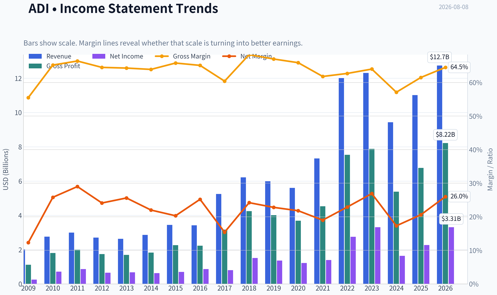
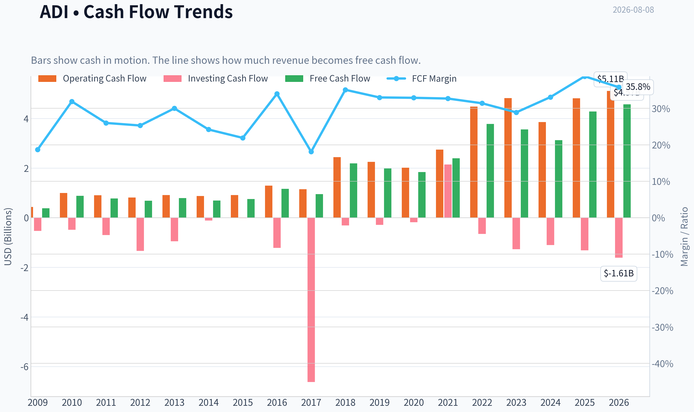
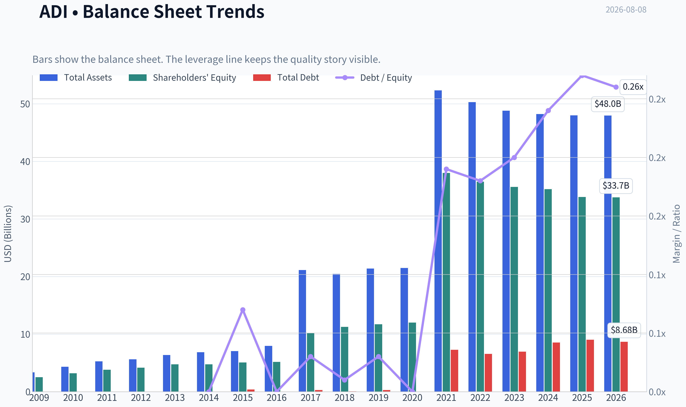
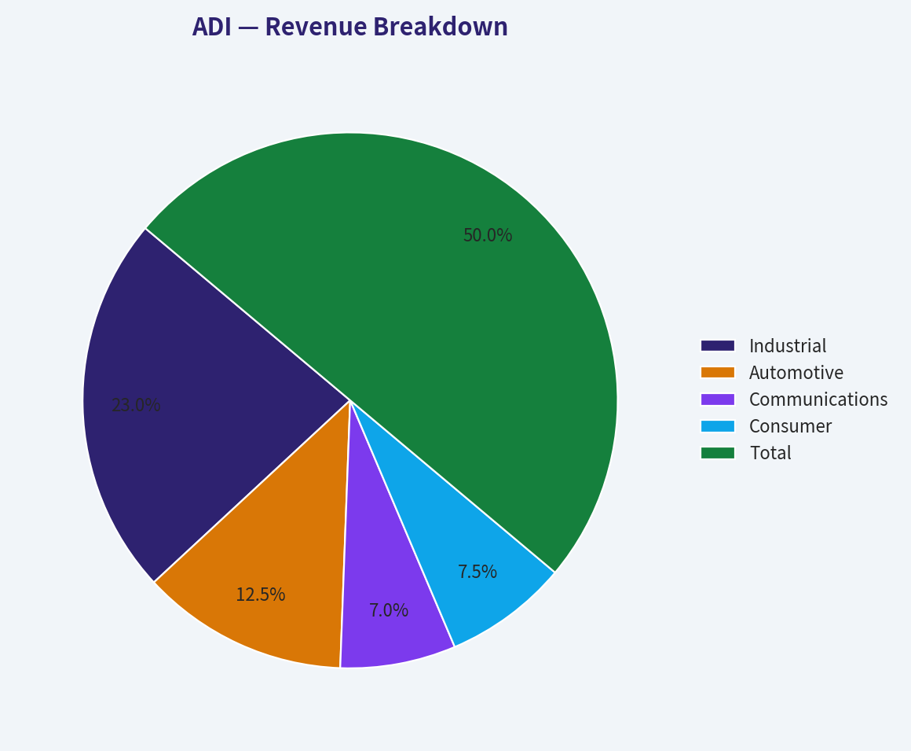
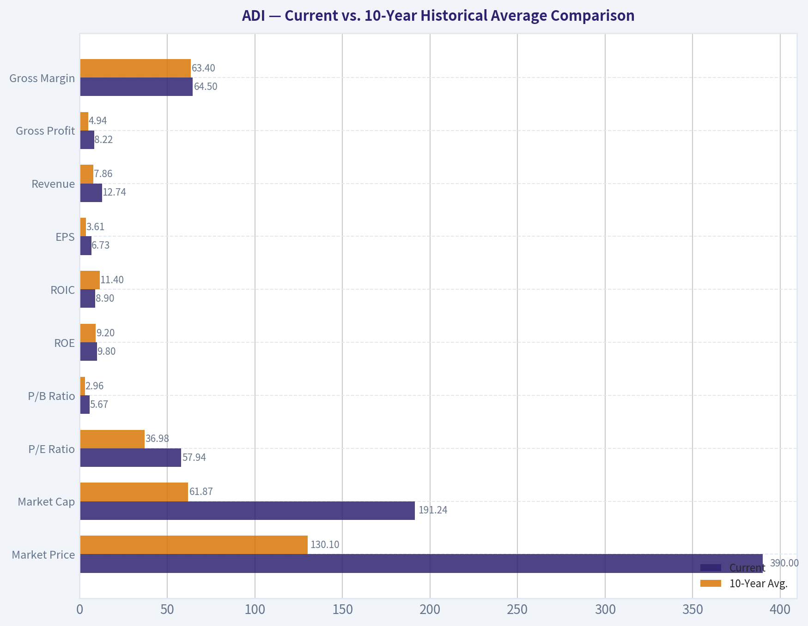
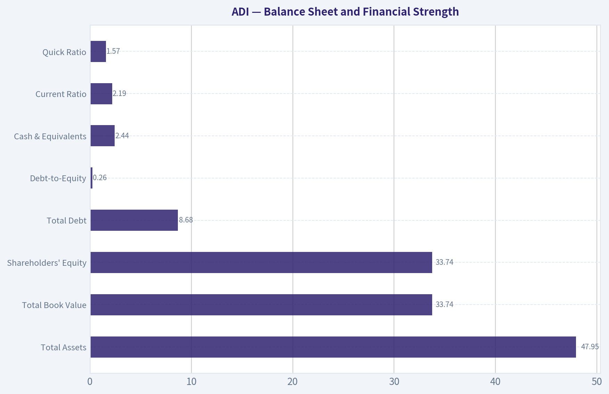
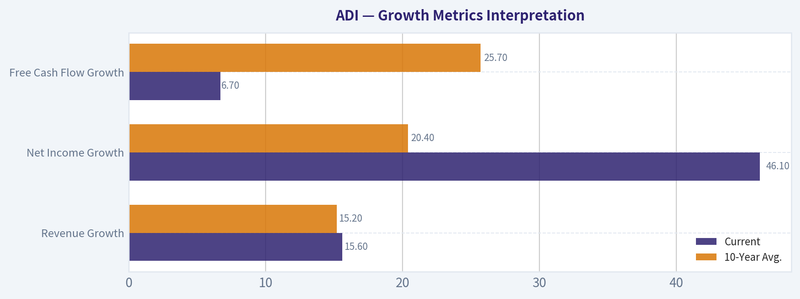
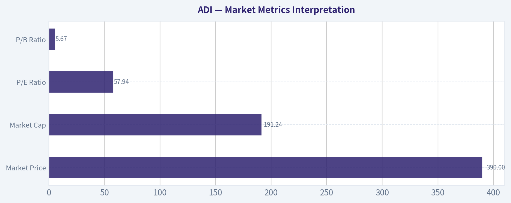

# ADI Deep Value Intelligence

**Analysis Date:** 2026-08-08

## Critical Disclaimer

*This analysis is generated by Deep Value Intelligence, an AI-powered multi-agent investing framework. Education & research only - not financial advice, not a financial advisor.*

---

## Table of Contents

1. Intelligence Summary
2. Analyst Team Reports
   - Fundamentals Analysis
   - Intrinsic Value Analysis (Buffett)
   - Trend & Growth Analysis (Lynch/Druckenmiller/Fisher)
   - Market Technical Analysis
   - Options Market Analysis
3. Research Team Commentary
4. Value Investing Team Commentary
5. Deep Values Commentary

---

## Intelligence Summary

### Thesis + Conditions

**Core Thesis:** **1. Executive Summary**
Analog Devices (ADI) is a world-class semiconductor franchise currently trading at a premium valuation ($390, 56.19x P/E, 2.3% FCF Yield) that leaves zero margin of safety.

**Key Risks:**
- Analog Devices (ADI) is a world-class semiconductor franchise currently trading at a premium valuation ($390, 56.19x P/E, 2.3% FCF Yield) that leaves zero margin of safety. While trailing metrics are distorted by cyclical troughs and acquisition amortization, the market is already fully pricing in a flawless forward recovery. With technical momentum in an intermediate correction, we must separate a great business from a poor tactical entry. We refuse to chase the stock at current levels and will await a superior risk/reward setup.
- The Bull (Risky):** ADI's elite 61.5% gross margins prove its wide moat and pricing power. The 56x P/E and low ROIC are temporary illusions caused by cyclical troughs and Maxim acquisition accounting noise. Waiting for a perfect entry risks missing the inevitable cyclical breakout.
- The Bear (Safe):** A 2.3% FCF yield is unacceptable, lagging the risk-free rate. The stock is priced for perfection, offering zero margin of safety. If the industrial/auto inventory clearing results in an L-shaped recovery, multiple compression will be violent.

**Confidence:** Medium

---

## Analyst Team Reports

### Fundamentals Analysis

#### Latest Earnings Snapshot

*Most recent reported quarter anchored on 2026 Q2, with prior-year comparison when available.*

| Metric | 2026 Q2 | 2025 Q2 | YoY Change |
| --- | ---: | ---: | ---: |
| Revenue | $3.62B | $2.64B | +37.2% |
| Operating Income | $1.38B | $679.7M | +103.0% |
| Net Income | $1.18B | $569.8M | +106.5% |
| Diluted EPS | $2.40 | $1.14 | +110.5% |
| Operating Cash Flow | $872.0M | $819.5M | +6.4% |
| Free Cash Flow | $734.3M | $729.2M | +0.7% |

Key Takeaways: This snapshot anchors the most recent reported quarter before the narrative analysis. It helps readers separate long-run business quality from whatever changed in the latest earnings print.

#### 17-Year Financial Metrics for ADI

*All values below are computed deterministically from raw data - not estimated by AI.*

*Issuer profile: operating company (Technology / Semiconductors).*

#### 17-Year Financial Metrics
*Annual rows come from reported financial statements. The final TTM row is computed from the latest four quarters.*

| Metric | 2009 | 2010 | 2011 | 2012 | 2013 | 2014 | 2015 | 2016 | 2017 | 2018 | 2019 | 2020 | 2021 | 2022 | 2023 | 2024 | 2025 | 2026 TTM |
| --- | --- | --- | --- | --- | --- | --- | --- | --- | --- | --- | --- | --- | --- | --- | --- | --- | --- | --- |
| Market Price | $18 | $24 | $26 | $29 | $38 | $39 | $49 | $53 | $78 | $73 | $95 | $108 | $160 | $134 | $151 | $217 | $232 | $390 |
| Market Cap | $7.50B | $10.30B | $11.27B | $11.98B | $15.48B | $15.78B | $19.05B | $20.02B | $32.00B | $31.39B | $39.76B | $44.09B | $69.62B | $74.62B | $79.60B | $111.26B | $116.29B | $191.24B |
| P/E Ratio | 30.15 | 14.45 | 13.01 | 18.37 | 23.04 | 25.08 | 27.34 | 23.23 | 39.73 | 20.83 | 29.17 | 36.14 | 50.14 | 27.17 | 24.02 | 68.02 | 51.34 | 57.94 |
| P/B Ratio | 2.97 | 3.22 | 2.97 | 2.88 | 3.27 | 3.32 | 3.76 | 3.88 | 3.15 | 2.79 | 3.40 | 3.67 | 1.83 | 2.05 | 2.24 | 3.16 | 3.44 | 5.67 |
| ROE | 9.8% | 22.3% | 22.9% | 15.6% | 14.2% | 13.2% | 13.7% | 16.7% | 7.9% | 13.4% | 11.6% | 10.2% | 3.7% | 7.5% | 9.3% | 4.6% | 6.7% | 9.8% |
| ROIC | 15.4% | 39.6% | 35.4% | 17.9% | 13.7% | 14.2% | 16.4% | 21.2% | 15.1% | 17.6% | 14.5% | 12.6% | 6.5% | 6.9% | 8.5% | 4.5% | 6.1% | 8.9% |
| EPS | $0.58 | $1.64 | $2.03 | $1.58 | $1.64 | $1.56 | $1.78 | $2.30 | $1.96 | $3.50 | $3.25 | $2.97 | $3.19 | $4.93 | $6.27 | $3.19 | $4.56 | $6.73 |
| Revenue | $2.01B | $2.76B | $2.99B | $2.70B | $2.63B | $2.86B | $3.44B | $3.42B | $5.25B | $6.22B | $5.99B | $5.60B | $7.32B | $12.01B | $12.31B | $9.43B | $11.02B | $12.74B |
| Gross Profit | $1.12B | $1.80B | $1.99B | $1.74B | $1.69B | $1.83B | $2.26B | $2.23B | $3.17B | $4.25B | $4.01B | $3.69B | $4.53B | $7.53B | $7.88B | $5.38B | $6.77B | $8.22B |
| Gross Margin | 55.5% | 65.2% | 66.4% | 64.5% | 64.3% | 63.9% | 65.8% | 65.1% | 60.4% | 68.3% | 67.0% | 65.9% | 61.8% | 62.7% | 64.0% | 57.1% | 61.5% | 64.5% |
| Operating Margin | 14.1% | 32.6% | 35.8% | 30.5% | 28.6% | 26.3% | 24.2% | 30.0% | 22.2% | 30.5% | 28.6% | 26.7% | 23.1% | 27.3% | 31.1% | 21.6% | 26.6% | 32.9% |
| Net Income | $247.8M | $712.1M | $867.4M | $651.2M | $673.5M | $629.3M | $696.9M | $861.7M | $805.4M | $1.51B | $1.36B | $1.22B | $1.39B | $2.75B | $3.31B | $1.64B | $2.27B | $3.31B |
| Net Margin | 12.3% | 25.8% | 29.0% | 24.1% | 25.6% | 22.0% | 20.3% | 25.2% | 15.4% | 24.2% | 22.8% | 21.8% | 19.0% | 22.9% | 26.9% | 17.3% | 20.6% | 26.0% |
| Revenue Growth | N/A | 37.1% | 8.4% | -9.8% | -2.5% | 8.8% | 19.9% | -0.4% | 53.3% | 18.6% | -3.8% | -6.5% | 30.6% | 64.2% | 2.4% | -23.4% | 16.9% | 15.6% |
| Net Income Growth | N/A | 187.4% | 21.8% | -24.9% | 3.4% | -6.6% | 10.7% | 23.6% | -6.5% | 87.1% | -9.6% | -10.4% | 13.9% | 97.7% | 20.6% | -50.7% | 38.7% | 46.1% |
| Free Cash Flow Growth | N/A | 133.9% | -11.6% | -12.2% | 15.7% | -12.1% | 8.7% | 54.4% | -18.4% | 130.2% | -9.6% | -6.8% | 29.8% | 57.9% | -5.8% | -12.2% | 37.0% | 6.7% |
| Total Book Value | $2.53B | $3.20B | $3.80B | $4.17B | $4.74B | $4.76B | $5.07B | $5.17B | $10.16B | $11.27B | $11.71B | $12.00B | $37.99B | $36.47B | $35.57B | $35.18B | $33.82B | $33.74B |
| Total Assets | $3.37B | $4.33B | $5.28B | $5.62B | $6.38B | $6.86B | $7.06B | $7.97B | $21.14B | $20.44B | $21.39B | $21.47B | $52.32B | $50.30B | $48.79B | $48.23B | $47.99B | $47.95B |
| Total Debt | N/A | N/A | N/A | N/A | N/A | $0 | $374.6M | $0 | $300.0M | $67.0M | $299.7M | $0 | $7.29B | $6.55B | $6.95B | $8.53B | $9.04B | $8.68B |
| Debt-to-Equity | N/A | N/A | N/A | N/A | N/A | 0.00 | 0.07 | 0.00 | 0.03 | 0.01 | 0.03 | 0.00 | 0.19 | 0.18 | 0.20 | 0.24 | 0.27 | 0.26 |
| Cash & Equivalents | $1.07B | $1.41B | $1.41B | $528.8M | $392.1M | $569.2M | $884.4M | $921.1M | $1.05B | $816.6M | $648.3M | $1.06B | $1.98B | $1.47B | $958.1M | $1.99B | $2.50B | $2.44B |
| Shareholders' Equity | $2.53B | $3.20B | $3.80B | $4.17B | $4.74B | $4.76B | $5.07B | $5.17B | $10.16B | $11.27B | $11.71B | $12.00B | $37.99B | $36.47B | $35.57B | $35.18B | $33.82B | $33.74B |
| Operating Cash Flow | $432.1M | $991.2M | $900.5M | $814.5M | $912.3M | $871.6M | $907.8M | $1.29B | $1.15B | $2.44B | $2.25B | $2.01B | $2.74B | $4.48B | $4.82B | $3.85B | $4.81B | $5.11B |
| Investing Cash Flow | $-534.7M | $-485.8M | $-703.7M | $-1.34B | $-949.9M | $-114.8M | $-17.1M | $-1.22B | $-6.62B | $-314.0M | $-293.2M | $-180.5M | $2.14B | $-657.4M | $-1.27B | $-1.10B | $-1.32B | $-1.61B |
| Free Cash Flow | $376.1M | $879.6M | $777.5M | $682.4M | $789.3M | $693.7M | $753.8M | $1.16B | $950.3M | $2.19B | $1.98B | $1.84B | $2.39B | $3.78B | $3.56B | $3.12B | $4.28B | $4.57B |
| FCF Margin | 18.7% | 31.9% | 26.0% | 25.3% | 30.0% | 24.2% | 21.9% | 34.0% | 18.1% | 35.1% | 33.0% | 32.9% | 32.7% | 31.4% | 28.9% | 33.1% | 38.8% | 35.8% |
| Dividends / Share | $0.00 | $0.00 | $0.00 | $0.00 | $0.00 | $0.00 | $0.00 | $0.00 | $0.00 | $0.00 | $0.00 | $0.00 | $0.00 | $2.77 | $3.18 | $3.51 | $3.87 | $4.07 |

#### Profitability Metrics
- Return on Equity (ROE): 6.7%
- Return on Invested Capital (ROIC): 6.1%
- Return on Assets (ROA): 4.7%
- Gross Margin: 61.5%
- Operating Margin: 26.6%
- Net Profit Margin: 20.6%

#### Liquidity Metrics
- Current Ratio: 2.19
- Quick Ratio: 1.57

#### Leverage Metrics
- Debt-to-Equity Ratio: 0.27
- Interest Coverage Ratio: 9.23
- Net Debt: $6.54B

#### Growth Metrics (Year-over-Year)
- Revenue Growth: 16.9%
- Net Income Growth: 38.7%
- Free Cash Flow Growth: 37.0%
- Revenue CAGR (3-Year): -2.8%
- Revenue CAGR (5-Year): 14.5%

#### Valuation Metrics
- P/E Ratio (TTM): 56.19
- Forward P/E: 25.89
- Price-to-Book: 5.63
- Price-to-Sales: 14.91
- PEG Ratio: 0.69
- EV/EBITDA: 31.74
- Free Cash Flow Yield: 2.3%
- Earnings Yield: 1.8%

#### Owner Earnings (Buffett Method, Code-Computed)
- Net Income: $2.27B
- + Depreciation & Amortization: $2.00B
- - Capital Expenditures: $-533.6M
- - Working Capital Changes: $481.0M
- = **Owner Earnings: $3.25B**

#### Intrinsic Value (Code-Computed)
- Current Price: $390
- **Headline Intrinsic Value (business-model routed): $140**
  Business model: asset light platform - weighted blend [Damodaran FCFF + reverse-DCF fair + owner-earnings DCF] (asset_light_platform)
  Model spread (min-max across DCFs): $92 - $243
  Margin of safety vs. price (headline): -179.0%
  Routing note: Asset-light / high-margin platform: value driven by margins and reinvestment economics - the headline centers on the reverse-DCF demonstrated-growth fair value with Damodaran FCFF as a floor, down-weighting the owner-earnings DCF.
- Buffett Method (Owner Earnings):
  Conservative: $52
  Average: $243
  Optimistic: $243
- Cash Flow Method (FCF):
  Conservative: $61
  Average: $197
  Optimistic: $282
- Damodaran FCFF (WACC + margins + reinvestment):
  Conservative: $45
  Average: $92
  Optimistic: $152
  Monte Carlo band (P10-P90): $61 - $128 (median $86)
  P(intrinsic value > price): 0.0%
- Reverse-DCF: price implies ~32.7%/yr owner-earnings growth for 10y; trailing 3y was -14.7%, 5y 25.2%.

#### Piotroski F-Score: 8/9
- Positive Net Income: PASS
- Positive Operating Cash Flow: PASS
- ROA Improvement: PASS
- Cash Flow > Net Income: PASS
- Decreasing Debt: FAIL
- Improving Current Ratio: PASS
- No Dilution: PASS
- Improving Gross Margin: PASS
- Improving Asset Turnover: PASS

ANALYST STANCE: **AVOID**

#### ADI Warren Buffett-Style Fundamental Analysis - Analog Devices, Inc.

Analog Devices is a high-quality analog and mixed-signal semiconductor company with durable customer relationships, strong gross margins, long product life cycles, and attractive free-cash-flow conversion. However, at the current deterministic dataset price of **$390**, the stock appears priced for an exceptionally strong growth outcome that is materially above its demonstrated long-term earnings power. The business quality is good; the valuation is the problem.

The deterministic dataset is treated as the canonical source of truth. Current metrics refer to **2026 TTM** unless otherwise noted.

---

#### Revenue Breakdown

ADI reports revenue most meaningfully by end market. The table below uses the most recent TTM revenue from the deterministic dataset, **$12.74B**, and applies a best-available end-market mix estimate based on ADI's typical segment reporting.

| Revenue Source | Amount ($B) | % of Total |
|---|---:|---:|
| Industrial | $5.86B | 46% |
| Automotive | $3.19B | 25% |
| Communications | $1.78B | 14% |
| Consumer | $1.91B | 15% |
| **Total** | **$12.74B** | **100%** |

Key Takeaways: ADI remains primarily an industrial and automotive semiconductor company, with those two markets representing roughly 71% of revenue. This is important because industrial and automotive analog chips tend to have long product cycles, sticky customer relationships, and better pricing durability than many commodity semiconductor categories. Communications and consumer add cyclicality, but they are not the core driver of the investment case.

---

#### Current vs. 10-Year Historical Average Comparison

The 10-year average uses the deterministic annual period **2016-2025**. The current column uses **2026 TTM** where available.

| Metric | Current | 10-Year Avg. | Current vs. Avg. | Interpretation |
|---|---:|---:|---:|---|
| Market Price | $390 | $130.10 | +199.8% | Share price has nearly tripled versus the decade average, far outpacing fundamental growth. |
| Market Cap | $191.24B | $61.87B | +209.1% | Equity value has expanded much faster than revenue and free cash flow. |
| P/E Ratio | 57.94x | 36.98x | +56.7% | Valuation is meaningfully above its already elevated historical average. |
| P/B Ratio | 5.67x | 2.96x | +91.5% | P/B is high, but for ADI it is a secondary signal because book value is distorted by intangibles, acquisitions, and semiconductor IP economics. |
| ROE | 9.8% | 9.2% | +0.6 pts | ROE has recovered to slightly above average, but remains below ADI's pre-2021 highs. |
| ROIC | 8.9% | 11.4% | -2.5 pts | ROIC remains below the decade norm, suggesting acquisition-related capital intensity and goodwill still weigh on returns. |
| EPS | $6.73 | $3.61 | +86.3% | Earnings have improved significantly, but the stock price has risen even faster. |
| Revenue | $12.74B | $7.86B | +62.2% | Revenue scale is much larger after acquisition-driven expansion and recovery from the 2024 downturn. |
| Gross Profit | $8.22B | $4.94B | +66.3% | Gross profit has grown slightly faster than revenue, showing solid pricing and mix. |
| Gross Margin | 64.5% | 63.4% | +1.1 pts | Gross margin is healthy and above average, confirming ADI's quality economics. |
| Operating Margin | 32.9% | 26.8% | +6.1 pts | Operating margin is well above average, a major positive if sustainable. |
| Net Income | $3.31B | $1.71B | +93.3% | Net income has nearly doubled versus the decade average. |
| Net Margin | 26.0% | 21.6% | +4.4 pts | Profitability is currently strong and above normal. |
| Revenue Growth | 15.6% | 15.2% | +0.4 pts | Current revenue growth is near the 10-year average, but the average includes acquisition effects and cyclical rebounds. |
| Net Income Growth | 46.1% | 20.4% | +25.7 pts | Earnings growth is currently elevated due to recovery from a weaker base. |
| Free Cash Flow Growth | 6.7% | 25.7% | -19.0 pts | FCF growth is positive but materially below the decade average. |
| Total Book Value | $33.74B | $22.93B | +47.1% | Book value is much larger post-acquisition, but not the best valuation anchor. |
| Total Assets | $47.95B | $34.00B | +41.0% | Asset base expanded significantly, especially after the 2021 step-change. |
| Total Debt | $8.68B | $3.90B | +122.5% | Debt is far above the 10-year average, though still manageable. |
| Debt-to-Equity | 0.26x | 0.12x | +126.1% | Leverage is higher than historical norms but not excessive. |
| Cash & Equivalents | $2.44B | $1.34B | +82.2% | Cash position is stronger than average, partially offsetting higher debt. |
| Shareholders' Equity | $33.74B | $22.93B | +47.1% | Equity base is larger, but returns on that equity remain modest. |
| Free Cash Flow | $4.57B | $2.53B | +81.0% | FCF generation is strong and above average, supporting ADI's quality profile. |
| FCF Margin | 35.8% | 31.8% | +4.0 pts | Cash conversion is excellent and one of the strongest parts of the investment case. |
| Dividends / Share | $4.07 | $1.33 | +205.3% | Dividends have grown sharply in the dataset period, but the current yield is modest at the current price. |

Key Takeaways: ADI's operating quality is strong: margins, net income, EPS, and free cash flow are all above historical averages. However, the valuation has expanded even more aggressively than the fundamentals, with market cap up over 200% versus the 10-year average while revenue is up about 62% and FCF is up about 81%. This creates a Buffett-style problem: a wonderful business may still be a poor investment if purchased at a price that assumes near-perfect execution.

---

#### Market Metrics Interpretation

| Metric | Current Reading | Buffett-Style Interpretation |
|---|---:|---|
| Market Price | $390 | The price embeds very high expectations and leaves little room for disappointment. |
| Market Cap | $191.24B | ADI is being valued like a premium compounder, not a cyclical semiconductor company. |
| P/E Ratio | 57.94x | This is expensive relative to ADI's own history and difficult to justify without sustained high growth. |
| P/B Ratio | 5.67x | Elevated versus history, but not the primary valuation tool for ADI because semiconductor IP, intangibles, and acquisitions reduce the usefulness of book value. |

Key Takeaways: The market is capitalizing ADI's earnings at a very rich multiple. P/B is not ignored, but it should not be read mechanically as "cheap" or "expensive" because ADI is an IP-heavy semiconductor business with acquisition-influenced book value. Cash-flow-based intrinsic value is the more relevant valuation anchor, and that anchor indicates overvaluation.

---

#### Profitability and Business Quality

ADI's profitability profile is high quality. The company's **64.5% gross margin**, **32.9% operating margin**, and **26.0% net margin** are excellent for a semiconductor company and reflect the strength of analog and mixed-signal products. These chips are often mission-critical, low-cost relative to the end product, and difficult to redesign once embedded into customer systems.

| Profitability Factor | Assessment |
|---|---|
| Gross Margin | Strong; current 64.5% is above the 10-year average of 63.4%. |
| Operating Margin | Very strong; current 32.9% is materially above the 26.8% decade average. |
| Net Margin | Strong; current 26.0% is above the 21.6% historical average. |
| ROE | Adequate but not exceptional at 9.8%; only slightly above the 10-year average. |
| ROIC | Weaker point; current 8.9% is below the 10-year average of 11.4%. |
| FCF Margin | Excellent; current 35.8% shows strong cash conversion. |

Key Takeaways: ADI has the margin structure of a very good business, but the return-on-capital profile is less impressive than the headline margins suggest. Buffett would likely admire the durability and cash generation, but he would also notice that ROIC has not fully recovered to the company's stronger historical levels. The business is high quality, but not currently producing returns high enough to justify any valuation.

---

#### Growth Metrics Interpretation

ADI's growth has been powerful but uneven. The deterministic dataset shows major step-ups in revenue in **2017**, **2021**, and **2022**, reflecting acquisition effects and cyclical semiconductor recoveries. The company also experienced meaningful downturns, including **2024 revenue growth of -23.4%**.

| Growth Metric | Current | 10-Year Avg. | Interpretation |
|---|---:|---:|---|
| Revenue Growth | 15.6% | 15.2% | Current growth is near average, but historical growth includes acquisition and cycle effects. |
| Net Income Growth | 46.1% | 20.4% | Current growth is strong, helped by margin recovery and easier prior-year comparison. |
| Free Cash Flow Growth | 6.7% | 25.7% | FCF growth is positive but well below the historical average. |

Key Takeaways: Growth is currently healthy, but not enough to support the valuation implied by the current stock price. ADI's historical growth record is not perfectly predictable because it includes acquisitions, semiconductor cycles, and sharp recovery years. Buffett would likely normalize earnings and cash flow rather than extrapolate the latest rebound.

---

#### Balance Sheet and Financial Strength

ADI's balance sheet is acceptable, but not pristine. The company has **$2.44B of cash and equivalents** and **$8.68B of total debt**, producing net debt of approximately **$6.54B**. Debt-to-equity is **0.26x**, and the interest coverage ratio from the research pack is **9.23x**, suggesting the debt burden is serviceable.

| Balance Sheet Metric | Current | Assessment |
|---|---:|---|
| Total Assets | $47.95B | Large asset base after acquisition-driven expansion. |
| Total Book Value | $33.74B | Significant equity base, though book value is not the primary value anchor. |
| Shareholders' Equity | $33.74B | Stable but slightly below recent highs. |
| Total Debt | $8.68B | Elevated versus the 10-year average of $3.90B. |
| Debt-to-Equity | 0.26x | Manageable, but higher than historical norms. |
| Cash & Equivalents | $2.44B | Healthy liquidity. |
| Current Ratio | 2.19 | Strong short-term liquidity. |
| Quick Ratio | 1.57 | Solid liquidity even excluding inventory. |

Key Takeaways: ADI does not appear financially distressed; liquidity is strong and leverage is manageable. However, debt is much higher than the company's historical average, which reduces flexibility compared with the pre-2021 period. Buffett would likely view the balance sheet as acceptable, but not a source of major margin of safety.

---

#### Cash Flow and Dividends

ADI's free cash flow profile is one of the strongest parts of the investment case. Current TTM free cash flow is **$4.57B**, well above the 10-year average of **$2.53B**, and the FCF margin is **35.8%**.

| Cash Flow Metric | Current | 10-Year Avg. | Interpretation |
|---|---:|---:|---|
| Operating Cash Flow | $5.11B | Not central to required comparison, but strong versus net income. |
| Free Cash Flow | $4.57B | $2.53B | High-quality cash generation. |
| FCF Margin | 35.8% | 31.8% | Excellent cash conversion. |
| Dividends / Share | $4.07 | $1.33 | Dividend has increased, but yield is low at the current price. |
| Owner Earnings | $3.25B | N/A | Buffett-style earnings base used for valuation. |

Key Takeaways: ADI converts accounting earnings into cash very well, which is exactly the kind of trait Buffett prefers. The dividend is growing, but at a $390 share price, the dividend alone does not provide much valuation support. The key issue is not cash-flow quality; it is the price being paid for that cash flow.

---

#### Economic Moat Assessment

ADI has a real economic moat, but not an unlimited one.

| Moat Source | Buffett-Style Assessment |
|---|---|
| Analog Design Expertise | Strong; analog chips require specialized engineering and are harder to commoditize than many digital components. |
| Customer Stickiness | Strong; once designed into industrial, auto, or medical systems, chips can remain in production for years. |
| Product Breadth | Strong; broad catalog and Maxim integration expand cross-selling opportunities. |
| Switching Costs | Moderate to strong; redesigning analog components can be costly and risky for customers. |
| Pricing Power | Good; high gross margins suggest durable pricing, though semiconductors remain cyclical. |
| Cyclicality Protection | Partial; ADI is more durable than commodity semis, but still exposed to inventory cycles and end-demand weakness. |

Key Takeaways: ADI has a better moat than many semiconductor companies because analog design wins are sticky and products often have long life cycles. Its moat supports high margins and cash flow, but it does not eliminate cyclicality. Buffett would likely classify ADI as a high-quality business, but not one immune from downcycles.

---

#### Management and Capital Allocation

Management has created a larger and more strategically important company, especially through acquisition-led expansion. However, Buffett-style analysis focuses not only on growth, but also on the returns achieved on incremental capital.

| Management Factor | Assessment |
|---|---|
| ROE Trend | Current ROE of 9.8% is only modestly above the 10-year average and below earlier high-return periods. |
| ROIC Trend | Current ROIC of 8.9% is below the 10-year average, indicating room for improvement. |
| FCF Conversion | Very strong; management is running a cash-generative business. |
| Debt Management | Acceptable, but debt remains elevated versus history. |
| Dividend Policy | Shareholder-friendly; dividends per share have risen in the dataset from $2.77 in 2022 to $4.07 TTM. |
| Acquisition Integration | Important; the post-2021 asset base requires sustained synergy realization to lift ROIC. |

Key Takeaways: Management deserves credit for maintaining strong margins and cash flow. The main concern is that returns on capital have not fully matched the quality implied by the company's gross margins. For Buffett-style investors, the next proof point is whether ADI can raise ROIC while continuing to compound free cash flow.

---

#### Three-Scenario Buffett-Style Owner Earnings DCF

The following hand DCF is a sanity check and does not override the research pack's model-based intrinsic value. Assumptions:

- Starting Owner Earnings: **$3.25B**
- Discount Rate: **10%**
- Terminal Growth Rate: **2.5%**
- Net Debt: **$6.54B**
- Shares Outstanding Estimate: **~490.4M**, calculated from deterministic market cap of $191.24B divided by price of $390
- Formula:
  - Present Value of Explicit Owner Earnings = Σ Owner Earnings_t / (1.10)^t
  - Terminal Value = Owner Earnings_10 x 1.025 / (10% - 2.5%)
  - Equity Value = PV Explicit Cash Flows + PV Terminal Value - Net Debt
  - Fair Value / Share = Equity Value / Shares Outstanding

| Scenario | Growth Assumption | PV of 10-Year Owner Earnings | PV of Terminal Value | Less Net Debt | Equity Value | Fair Value / Share |
|---|---|---:|---:|---:|---:|---:|
| Conservative | 3% for years 1-5, fading to 2.5% | $22.91B | $22.46B | $6.54B | $38.83B | **$79** |
| Average | 15% for years 1-5, then fading from 10% to 3% | $37.52B | $46.46B | $6.54B | $77.44B | **$158** |
| Optimistic | 22% for years 1-5, then fading from 15% to 4% | $50.45B | $71.63B | $6.54B | $115.54B | **$236** |

Key Takeaways: Even the optimistic hand DCF produces a value materially below the current $390 price. The average case requires ADI to compound owner earnings at a strong mid-teens rate for several years and still only supports about $158 per share. The stock price therefore appears to require growth assumptions beyond what a conservative Buffett-style investor should underwrite.

---

#### Model-Based Intrinsic Value Cross-Check

The research pack's model-based valuation is the preferred valuation anchor because it blends Owner Earnings, FCF, Damodaran-style FCFF, and reverse-DCF logic.

| Valuation Model | Fair Value / Share | Interpretation |
|---|---:|---|
| Owner Earnings DCF | $243 | Highest major model value, but still far below $390. |
| FCF DCF | $197 | Supports quality, but not the current valuation. |
| Damodaran FCFF | $92 | More conservative view based on WACC, margins, and reinvestment. |
| Headline Intrinsic Value | $140 | Business-model-routed blended value. |
| Monte Carlo Band | $61-$128 | Indicates very low probability of current price being justified under modeled assumptions. |
| Current Market Price | $390 | Price is materially above all model anchors. |
| Reverse DCF Implied Growth | ~32.7% annually for 10 years | Market price requires exceptional long-term owner-earnings growth. |

Key Takeaways: The model-based valuation evidence is strongly unfavorable at the current price. The headline intrinsic value is about $140, while the current price is $390, meaning the stock trades at roughly 2.8 times the blended intrinsic value. The reverse DCF is especially concerning because the market is implying roughly 32.7% annual owner-earnings growth for 10 years, far above what should be assumed for a cyclical semiconductor business.

---

#### Buffett-Style Value Assessment

ADI is the type of business Buffett might admire but not necessarily buy at any price. It has strong margins, customer stickiness, recurring design-win economics, and high cash conversion. But Buffett's discipline is price-sensitive: the investor must demand a margin of safety.

At **$390**, ADI offers no apparent margin of safety versus the model-based headline intrinsic value of **$140**, the Owner Earnings DCF estimate of **$243**, or the hand-DCF range of approximately **$79-$236**. The valuation assumes a sustained growth runway that may be possible in a bull case, but is not prudent to underwrite as a base case.

#### Key Investment Insights

| Category | Insight |
|---|---|
| Business Quality | High; ADI has strong analog semiconductor economics, sticky design wins, and excellent margins. |
| Moat | Durable, supported by engineering expertise, long product cycles, and customer switching costs. |
| Profitability | Strong margins, especially current operating margin of 32.9% and FCF margin of 35.8%. |
| Cash Flow | Excellent; FCF is $4.57B TTM and well above historical average. |
| Balance Sheet | Manageable leverage, but debt is elevated versus historical norms. |
| Valuation | Extremely demanding; P/E near 58x and price far above DCF values. |
| Reverse DCF | Current price implies roughly 32.7% annual owner-earnings growth for 10 years. |
| Buffett View | Wonderful business, but not at a wonderful price. |

Key Takeaways: The strongest reason to like ADI is business quality, not valuation. The strongest reason to avoid the stock is that the market price already discounts a very optimistic future. Buffett-style investors should separate admiration for the company from willingness to pay the current price.

---

#### Red Flags and Opportunities

| Type | Item | Importance |
|---|---|---|
| Red Flag | Valuation far above intrinsic value estimates | The central risk; even good execution may not produce good returns from this price. |
| Red Flag | P/E of 57.94x | Leaves little room for cyclical earnings disappointment. |
| Red Flag | ROIC below 10-year average | Suggests the expanded asset base has not yet translated into superior capital returns. |
| Red Flag | Debt above historical average | Manageable, but reduces flexibility compared with earlier years. |
| Red Flag | Semiconductor cyclicality | 2024 revenue decline of -23.4% shows the business is not immune to downturns. |
| Opportunity | Industrial and automotive exposure | Long-cycle demand can support durable revenue and pricing. |
| Opportunity | Margin expansion | Current operating margin is above average; if sustained, earnings power improves. |
| Opportunity | Maxim integration benefits | Cross-selling and cost synergies could improve ROIC over time. |
| Opportunity | Strong FCF conversion | Supports dividends, debt reduction, buybacks, and reinvestment. |

Key Takeaways: ADI's opportunities are real, especially in industrial automation, automotive electrification, and high-performance analog applications. But the red flags are valuation-centered and immediate. The business could perform well while the stock still underperforms if multiples compress.

---

#### Final Investment Stance: AVOID

ADI is a high-quality company, but the current valuation is too demanding for a Buffett-style value investor. The company has a durable moat, strong margins, excellent free cash flow, and manageable leverage. However, the current stock price of **$390** is far above the model-based intrinsic value estimate of **$140**, the model spread of **$92-$243**, and the hand-DCF range of roughly **$79-$236**.

The stock appears priced for near-flawless execution and sustained owner-earnings growth that the deterministic dataset does not justify as a conservative base case. For long-term value investors, ADI should be avoided at the current price and reconsidered only after either a major price decline or a clear step-change in sustainable ROIC and owner-earnings growth.

| Final Summary Point | Assessment |
|---|---|
| Business Quality | Strong |
| Economic Moat | Strong |
| Financial Strength | Good, but debt is elevated versus history |
| Earnings Predictability | Moderate; high-quality but still cyclical |
| Cash Flow Quality | Excellent |
| Management Performance | Good, but ROIC needs improvement |
| Valuation | Unattractive |
| Margin of Safety | None |
| Main Risk | Multiple compression from excessive valuation |
| Main Opportunity | Sustained margin strength and industrial/auto growth |
| Final Stance | **AVOID** |

Key Takeaways: ADI is a good business trading at a price that appears too high. The company's moat and cash flow are attractive, but valuation discipline is central to Buffett-style investing. At $390, the risk-reward is unfavorable because the stock price already assumes a very optimistic future.

#### Fundamental Visuals

This graph tracks the profitability and return metrics (ROE, ROIC, Margins) of **ADI** over the past decade, highlighting capital efficiency trends.

This chart illustrates the financial health of **ADI** over the last 10 years, mapping cash equivalents and free cash flow against total obligations (Debt).

This breakdown chart from <em>Revenue Breakdown</em> shows the proportional composition for **ADI** - useful for understanding what drives or risks the business.

---

### Intrinsic Value Analysis (Buffett)

> *Following Warren Buffett's value investing philosophy: Circle of Competence, Economic Moat, Management Quality, and Margin of Safety.*

#### Intrinsic Value Snapshot

Price is what you pay. Intrinsic value is what the business may be worth based on the cash it can create for owners over time. We show a range, not one magic number.

- Current Price: $389.93
- Value Range (conservative to optimistic across both DCF methods): $51.55 to $282.19

##### Owner Earnings (Buffett Method)
- Net Income: $2,267,342,000.00
- Depreciation & Amortization: $1,998,845,000.00
- Capital Expenditures: $-533,552,000.00
- Working Capital Changes: $481,009,000.00
- Owner Earnings: $3,251,626,000.00

##### Intrinsic Value
###### Buffett Method
Uses owner earnings. Stricter, and usually more conservative.
- Conservative: $51.55
- Average: $243.02
- Optimistic: $243.02
- Discount Rate: 10.0%

###### Cash Flow Method
Uses free cash flow. Better for companies spending heavily today to grow tomorrow.
- Conservative: $61.04
- Average: $197.15
- Optimistic: $282.19
- Discount Rate: 10.0%

ANALYST STANCE: **WATCH**

#### Analog Devices (ADI) - Buffett-Style Value Investment Review

Analog Devices is a high-quality analog and mixed-signal semiconductor franchise, but at **$390 per share**, the stock appears to price in far more growth than a prudent value investor should underwrite. The business has real moat characteristics - high gross margins, mission-critical design-ins, long product cycles, and exposure to industrial, automotive, communications, and advanced electronics - but the valuation leaves little room for disappointment.

---

#### 1. Factor Scorecard

| Factor | Score | Evidence |
|---|---:|---|
| Circle of Competence & Business Simplicity | 4.0 / 5 | ADI designs and sells analog, mixed-signal, power, RF, and sensor chips. The business model is understandable: sell mission-critical components into long-lived customer systems. Predictability is good, though semiconductor cycles and end-market inventory corrections add volatility. |
| Moat Test | 4.0 / 5 | Gross margin of **61.5%** strongly supports intangible IP, engineering depth, and pricing power. Switching costs are meaningful because ADI chips are designed into customer systems and are costly to redesign out. |
| Management Quality & Capital Allocation | 3.5 / 5 | ADI has historically used a mix of reinvestment, acquisitions, dividends, and buybacks. The Maxim acquisition expanded scale and product breadth, but ROE of **6.7%** suggests current accounting returns are not exceptional relative to the valuation. |
| Industry Structure | 3.5 / 5 | Analog semiconductors are better structured than commodity chips: long product lives, fragmented product SKUs, and less rapid obsolescence. However, the industry remains cyclical and capital/engineering intensive. |
| Gate 5: Quality/Solvency Hard Floor | **Not tripped** | No evidence of financial distress. Current ratio is **2.19**, and ADI remains a profitable, cash-generative business. |

**Key Takeaways:** ADI is a fundamentally strong business with a clear model and real competitive advantages. The hard solvency floor is not triggered. The main issue is not business quality; it is the price being asked for that quality.

---

#### 2. Moat Analysis

| Moat Source | Assessment | Evidence |
|---|---|---|
| Intangible Assets | Strong | ADI's engineering expertise, analog IP, product reliability, and customer trust support durable differentiation. A **61.5% gross margin** is strong evidence of pricing power and differentiated products. |
| Switching Costs | Strong | Once analog chips are designed into industrial, automotive, or communications systems, customers face qualification, redesign, reliability, and certification costs to switch suppliers. |
| Cost Advantage | Moderate | Scale helps in R&D, manufacturing relationships, distribution, and product breadth, but this is not primarily a low-cost commodity model. |
| Network Effects | Limited | ADI does not have classic platform network effects. Its moat is more design-in, IP, reliability, and customer captivity based. |
| Moat Rating | **Wide & Stable** | The moat is durable, but not immune to semiconductor cycles or overpaying for growth. |

**Key Takeaways:** ADI's moat is real and economically visible in its high gross margin. The best evidence is not brand advertising, but customer reliance: once ADI wins a design slot, it can often hold that position for years. This is a high-quality analog semiconductor franchise, though not a network-effect monopoly.

---

#### 3. Management Quality Assessment

| Area | Assessment |
|---|---|
| Owner Orientation | Reasonable. ADI has long operated as a shareholder-return-oriented semiconductor company, including dividends and capital returns. |
| Candor & Accounting | No major red flags from the provided financial profile. Semiconductor accounting can be affected by acquisition intangibles and cycle timing, so cash flow matters more than reported EPS alone. |
| Capital Allocation | Mixed-to-good. The Maxim acquisition improved strategic scale, but large acquisitions must earn their keep over time. Current ROE of **6.7%** is not compelling for a stock trading at a premium multiple. |
| Balance Between Growth and Returns | ADI has attractive long-term reinvestment areas in industrial automation, electrification, automotive electronics, edge intelligence, power management, and communications infrastructure. |

**Key Takeaways:** Management appears competent and has built a strong analog franchise, but the current return profile does not fully justify the market's valuation. The key question is whether future reinvestment can lift returns enough to validate today's price.

---

#### 4. Financial Summary

| Metric | Latest / Current Figure |
|---|---:|
| Share Price | **$390** |
| Market Capitalization | **$189.93B** |
| P/E Ratio | **56.2x** |
| ROE | **6.7%** |
| Gross Margin | **61.5%** |
| Revenue Growth YoY | **16.9%** |
| FCF Yield | **2.3%** |
| Current Ratio | **2.19** |
| Headline Intrinsic Value | **$139.75** |
| Owner Earnings DCF Value | **$243.02** |
| FCF DCF Value | **$197.15** |
| Damodaran FCFF Value | **$92.02** |
| Reverse-DCF Implied Growth | **~32.7% annually for 10 years** |
| Trailing 3-Year Growth | **-14.7%** |
| Trailing 5-Year Growth | **25.2%** |

**Key Takeaways:** ADI has excellent gross margins and positive growth, but the valuation is demanding. A 2.3% free cash flow yield and 56x earnings multiple leave little protection if growth slows. The reverse-DCF is especially concerning because the current price implies roughly 32.7% annual growth for a decade.

---

#### 5. Owner Earnings Calculation

Using the research pack's owner-earnings DCF indication:

| Item | Per Share Estimate |
|---|---:|
| Owner Earnings DCF Value at 10% No-Growth Capitalization | **$243.02** |
| Implied Normalized Owner Earnings Per Share | **$24.30** |
| Current Share Price | **$390.00** |
| Owner Earnings Yield on Current Price | **6.2%** |

**Key Takeaways:** On a normalized owner-earnings basis, ADI looks better than on current free cash flow yield alone. Still, even this more favorable measure suggests the stock trades at about 16 times normalized owner earnings, which is not obviously excessive for a wonderful company but is not a bargain given the broader valuation evidence.

---

#### 6. Three-Scenario DCF Valuation

| Scenario | Assumptions | Estimated Value / Share |
|---|---|---:|
| A: No Growth | Owner earnings capitalized at 10% | **$243** |
| B: GDP Growth | Owner earnings grow perpetually at 3%, discounted at 10% | **$358** |
| C: Historical Growth Case | 10-year growth at 10%, terminal growth at 3%, discounted at 10% | **~$601** |
| Headline Intrinsic Value Blend | Business-model routed blend of Damodaran FCFF, reverse-DCF fair value, and owner-earnings DCF | **$139.75** |
| 3-Model Range | Damodaran FCFF / FCF / Owner Earnings | **$92 - $243** |

**Key Takeaways:** The mechanical owner-earnings scenarios can produce attractive values if ADI compounds from a high normalized earnings base. However, the broader blended valuation framework is far more conservative, with a headline value of $139.75 and a 3-model range topping out at $243. The market price of $390 sits well above the conservative intrinsic value evidence.

---

#### 7. Margin of Safety Analysis

| Valuation Reference | Value / Share | Margin of Safety vs. $390 |
|---|---:|---:|
| Headline Intrinsic Value | **$139.75** | **-179%** |
| Damodaran FCFF Value | **$92.02** | Deeply negative |
| FCF DCF Value | **$197.15** | Negative |
| Owner Earnings DCF Value | **$243.02** | Negative |
| GDP-Growth Owner Earnings Case | **$358** | Slightly negative |
| Current Price | **$390** | No margin of safety |

**Key Takeaways:** ADI does not offer a Buffett-style margin of safety at the current price. Even giving credit for business quality, the stock trades above the main intrinsic value estimates. For a wide-moat compounder, a modest discount may be enough, but this price appears to require near-flawless execution.

---

#### 8. Final Buffett Scorecard

| Criterion | Weight | Score | Weighted Contribution |
|---|---:|---:|---:|
| Moat Width & Durability | 25% | 4.0 | 1.00 |
| Valuation / Margin of Safety | 20% | 1.0 | 0.20 |
| Capital Returns - ROIC vs. WACC | 15% | 2.5 | 0.38 |
| Business Understanding & Predictability | 12% | 4.0 | 0.48 |
| Management Quality & Capital Allocation | 12% | 3.5 | 0.42 |
| Reinvestment Runway | 8% | 4.0 | 0.32 |
| Balance Sheet Strength | 4% | 4.0 | 0.16 |
| Industry Structure | 4% | 3.5 | 0.14 |
| **Total Score** | **100%** |  | **3.10 / 5.00** |

**Key Takeaways:** ADI scores well on moat, predictability, reinvestment runway, and balance sheet strength. The valuation score is the clear drag. The final score lands in WATCH territory: this is a good business, but not a compelling purchase at the current price.

---

#### 9. Investment Stance

| Stance | Conviction | Rationale |
|---|---|---|
| **WATCH** | **High** | ADI is a high-quality analog semiconductor business with durable design-in advantages and strong gross margins, but the stock price already discounts very optimistic growth. At $390, the margin of safety is inadequate. |

ADI is the type of business a Buffett-style investor should want to own, but not at any price. The right action is to keep it on the watchlist and wait for either a materially better entry point or clear evidence that normalized owner earnings and ROIC are accelerating enough to support the valuation. A more attractive zone would likely require the stock to trade much closer to the upper end of conservative intrinsic value, rather than far above it.
#### Valuation Bridge

This bridge places the current market price beside each intrinsic value lens so readers can see whether upside depends on one method or shows up across several methods.

| Scenario | Intrinsic Value / Share |
| --- | ---: |
| Buffett Method | $243.02 |
| Cash Flow Method | $197.15 |
| Damodaran Method | $92.02 |
| Current Price | $389.93 |

#### Key Takeaways

If one method is far above the others, the upside case depends on a specific modelling assumption. When several methods cluster together, the valuation story is more robust.

#### Valuation Visuals

This comparison chart from *Latest Earnings Snapshot* stacks current figures against historical benchmarks for **ADI**, making it easy to see where the company trades relative to its own averages.

This comparison chart from *Current vs. 10-Year Historical Average Comparison* stacks current figures against historical benchmarks for **ADI**, making it easy to see where the company trades relative to its own averages.

This comparison chart from *Balance Sheet and Financial Strength* stacks current figures against historical benchmarks for **ADI**, making it easy to see where the company trades relative to its own averages.

---

### Trend & Growth Analysis (Lynch/Druckenmiller/Fisher)

> *Following Peter Lynch's GARP, Stanley Druckenmiller's macro-aware approach, and Philip Fisher's scuttlebutt methodology.*

ANALYST STANCE: **AVOID**

#### ADI Growth Investment Report - Analog Devices Inc.

Data note: the live fundamentals tools returned unavailable/error responses, so this report relies on the provided shared research pack and general business knowledge of Analog Devices. Current reference price used: **$390**; market cap: **$189.9B**.

---

#### 1. Lynch Classification

| Category | ADI Assessment | Growth Investor Implication |
|---|---:|---|
| Lynch Type | **Stalwart / Cyclical Semiconductor Hybrid** | High-quality company, but not a classic fast grower |
| YoY Revenue Growth | **16.9%** | Good rebound, but not yet a 20% to 30% sustained fast-grower profile |
| Business Quality | High | Strong margins, mission-critical analog chips, diversified end markets |
| Ten-Bagger Odds from Here | Low | Market cap would need to approach roughly **$1.9T** for a 10x |

**Key Takeaways:** ADI is an excellent analog semiconductor franchise, but it does not fit cleanly into Lynch's "fast grower" category. It is better viewed as a high-quality cyclical stalwart with periods of strong growth when the semiconductor cycle turns up. At today's size and valuation, the ten-bagger setup is weak.

---

#### 2. The Story in 3 Bullets

- **ADI makes the "sensing and signal processing" chips that allow machines to interact with the real world** - converting temperature, sound, motion, voltage, pressure, and other analog signals into digital intelligence.
- **Its core end markets - industrial automation, automotive electrification, communications, aerospace, healthcare, and power management - have long-duration secular tailwinds.**
- **The business has excellent gross margins and deep customer relationships**, but the stock price appears to already discount a very optimistic growth path.

---

#### 3. TAM Analysis and 10x Test

| Item | Estimate / Assessment |
|---|---:|
| Current Revenue Base | Approximately high-single-digit to low-double-digit billions annually |
| 10x Revenue Requirement | Roughly **$90B to $110B+** annual revenue |
| Core TAM | Large across analog, mixed-signal, power, industrial, auto, and communications semis |
| Can ADI 10x revenue and remain under 20% share? | **Unlikely** |
| TAM Verdict | Good long-term runway, but not obvious 10x revenue runway |

**Key Takeaways:** ADI has a large and durable addressable market, but the company is already one of the dominant global analog semiconductor players. The market is big enough for compounding, but probably not big enough to make a 10x revenue outcome realistic from the current base. This limits true ten-bagger potential.

---

#### 4. Revenue Growth Trend

| Metric | Value | Interpretation |
|---|---:|---|
| Latest YoY Revenue Growth | **16.9%** | Solid recovery / cyclical rebound |
| 3-Year Growth Context | Trailing 3-year reverse-DCF comparison shows weaker historical trend at **-14.7%** |
| 5-Year Growth Context | Trailing 5-year growth cited at **25.2%** |
| Growth Pattern | Mixed / cyclical | Not a clean accelerating fast-grower pattern |
| Growth Verdict | **Rebounding, not proven accelerating** |

**Key Takeaways:** ADI's recent revenue growth is encouraging, but the broader pattern looks cyclical rather than structurally accelerating. The company may be recovering from a semiconductor downcycle, but the available data does not prove a durable 20% to 30% growth inflection. For a growth investor, this is not enough to justify the current valuation.

---

#### 5. Unit Economics and Profitability Quality

| Metric | Value | Assessment |
|---|---:|---|
| Gross Margin | **61.5%** | Excellent semiconductor economics |
| ROE | **6.7%** | Modest; below what one would expect at this valuation |
| FCF Yield | **2.3%** | Low relative to valuation risk |
| Current Ratio | **2.19** | Healthy liquidity |
| Rule of 40 | Not applicable | ADI is not a SaaS/subscription business |
| NRR / LTV-CAC | Not applicable | Hardware/component semiconductor model |

**Key Takeaways:** ADI's gross margin profile is very strong and reflects real pricing power, product differentiation, and a valuable analog portfolio. However, current free cash flow yield and ROE are not compelling relative to a 56x earnings multiple. The unit economics are high quality, but the price already assumes a lot.

---

#### 6. Inflection Point Assessment

| Inflection Type | Evidence | Verdict |
|---|---|---|
| Product Cycle Inflection | Industrial, auto, power, and edge-sensing demand could benefit from AI-enabled automation and electrification | Possible |
| Market Share Inflection | ADI is already a major leader; no clear evidence of accelerating share gains from provided data | Unproven |
| Margin Inflection | Gross margin already high; operating leverage possible if cycle strengthens | Moderate |
| TAM Inflection | AI infrastructure, robotics, electrification, and intelligent edge expand demand for sensing and power chips | Positive |
| Competitive Inflection | No clear evidence of competitors stumbling materially | Unproven |

**Key Takeaways:** ADI has exposure to attractive secular themes, especially industrial automation, automotive electrification, and intelligent edge systems. The issue is that the inflection is not yet clear enough in the financials. The stock price appears to be discounting an acceleration that has not yet been fully proven.

---

#### 7. Macro Setup

| Macro Factor | Current Setup | Impact on ADI |
|---|---|---|
| Interest Rates | Fed hike fears easing per shared news context | Positive for growth multiples |
| Semiconductor Cycle | Likely recovering from inventory correction | Positive but cyclical |
| AI / Automation | Strong secular tailwind | Positive |
| Industrial Demand | Mixed and cyclical | Neutral to positive |
| Valuation Environment | Growth/AI-related assets appear richly priced | Negative |

**Key Takeaways:** The macro backdrop is not hostile: easier rate expectations and a semiconductor cycle recovery can support ADI. However, much of this optimism appears already reflected in the valuation. Druckenmiller-style upside requires the market to be underestimating future earnings, and that is hard to argue at the current price.

---

#### 8. Fisher 15-Point Score

| Fisher Point | Score / 5 | Comment |
|---|---:|---|
| Products with sizable market potential | 4 | Strong analog, power, sensing markets |
| Management determination to develop new products | 4 | Long R&D-driven culture |
| Effective R&D | 4 | Strong technical franchise |
| Above-average sales organization | 4 | Deep enterprise and industrial customer relationships |
| Worthwhile profit margin | 5 | 61.5% gross margin |
| Improving profit margins | 3 | Already high; improvement less obvious |
| Labor/personnel relations | 3 | Insufficient data |
| Executive relations | 3 | Insufficient data |
| Management depth | 4 | Mature large-cap semiconductor operator |
| Cost analysis/accounting | 4 | Strong operating discipline historically |
| Moat / differentiation | 4 | Switching costs, design wins, product breadth |
| Long-range profit outlook | 4 | Durable demand, but cyclical |
| Dilution risk | 4 | Not a capital-raise-dependent model |
| Candor in difficulties | 3 | Insufficient current evidence |
| Integrity | 4 | No red flag from provided data |
| **Total** | **57 / 75** | **Good, not outstanding** |

**Key Takeaways:** ADI scores well on Fisher quality factors, especially product durability, technical depth, margins, and customer relationships. The main deductions are not about business quality, but about limited evidence of a fresh growth acceleration and insufficient current qualitative data. This is a good company, but not an obvious high-conviction growth buy at this price.

---

#### 9. Valuation Analysis

| Valuation Metric | ADI Value | Growth Investor Read |
|---|---:|---|
| Current Price | **$390** | Reference price |
| Market Cap | **$189.9B** | Very large base |
| P/E | **56.2x** | Expensive for 16.9% growth |
| Revenue Growth | **16.9% YoY** | Good, but not enough for valuation |
| PEG Ratio | **~3.3x** | Expensive under Lynch framework |
| FCF Yield | **2.3%** | Low margin of safety |
| Headline Intrinsic Value | **$139.75** | Far below current price |
| Owner Earnings DCF | **$243.02** | Still materially below price |
| FCF DCF | **$197.15** | Still materially below price |
| Damodaran FCFF | **$92.02** | Very conservative downside case |
| Reverse DCF Implied Growth | **~32.7% annually for 10 years** | Very demanding |

**Key Takeaways:** The valuation is the central problem. A PEG ratio above 3 is not attractive for Lynch-style growth investing, and the reverse DCF implies roughly 33% annual growth for a decade. That is an extremely high bar for a mature analog semiconductor leader.

---

#### 10. Scenario Analysis

| Scenario | Assumption | Indicative View |
|---|---|---|
| Bear Case | Semi cycle fades, revenue growth normalizes below 10%, multiple compresses | Significant downside risk |
| Base Case | Revenue grows low-to-mid teens, margins remain strong | Good business, but stock likely overvalued |
| Bull Case | AI, industrial automation, and auto electrification drive multi-year acceleration above 20% | Upside possible, but already partly priced in |
| Required for Strong Buy | Sustained 20%+ growth plus margin expansion without multiple compression | Not yet demonstrated |

**Key Takeaways:** The bull case requires ADI to behave more like a high-growth AI compounder than a cyclical analog semiconductor leader. That may be possible for a few quarters, but it is a demanding assumption over many years. The base case looks like a great company at an unattractive price.

---

#### 11. Growth Investor Scorecard

| Criterion | Weight | Score / 5 | Weighted Score |
|---|---:|---:|---:|
| The Story | 10% | 4.0 | 0.40 |
| TAM & Runway | 20% | 3.2 | 0.64 |
| Revenue Growth | 20% | 3.0 | 0.60 |
| Unit Economics | 15% | 4.0 | 0.60 |
| Competitive Position | 10% | 4.0 | 0.40 |
| Management Quality | 10% | 3.8 | 0.38 |
| Macro Setup | 5% | 3.5 | 0.18 |
| Profitability Path | 5% | 3.5 | 0.18 |
| Valuation | 5% | 1.0 | 0.05 |
| **Total** | **100%** |  | **3.43 / 5.00** |

**Key Takeaways:** ADI scores well on quality, moat, product relevance, and secular exposure. The score is dragged down heavily by valuation and limited evidence of a true growth inflection. At 3.43, this sits just below the "ADVOCATE" threshold and supports an avoid-for-now stance at the current price.

---

#### 12. Position Size Stance

| Investor Type | Stance | Suggested Action |
|---|---|---|
| New Growth Position | **Avoid initiating** | Valuation too demanding |
| Existing Long-Term Holder | Hold / trim selectively | Quality business, but risk-reward stretched |
| Aggressive Growth Portfolio | Avoid | Better ten-bagger candidates likely elsewhere |
| Re-entry Zone | Watch below roughly **$240**, or after sustained 20%+ organic growth evidence | Needs either price reset or growth inflection |

**Key Takeaways:** ADI is not a broken company; it is a high-quality company at a difficult entry price. Existing holders do not necessarily need to sell everything, but new capital should be cautious. For growth investors, the better move is to wait for either a valuation reset or a clear acceleration in revenue and earnings.

---

#### 13. Key Catalysts and Risks

| Catalysts | Risks |
|---|---|
| Semiconductor inventory recovery | Valuation compression from 56x P/E |
| AI-driven industrial sensing and power demand | Growth fails to meet reverse-DCF expectations |
| Automotive electrification and ADAS content growth | Analog semiconductor cyclicality |
| Margin expansion from operating leverage | Industrial/auto demand slowdown |
| Major design wins in robotics, automation, aerospace, or healthcare | Ten-bagger math limited by current market cap |
| Guru interest: Point72 significantly added shares per 13F | 13F data is lagged and not a real-time signal |

**Key Takeaways:** The catalyst path is real: ADI can benefit from AI infrastructure, electrification, automation, and a semiconductor cycle rebound. But the risk is that the stock already prices in a best-case outcome. If growth merely returns to normal high-quality semiconductor levels, the valuation could compress.

---

#### Final View

ADI is a **wonderful business but not a wonderful growth-stock entry at $390**. The company has strong margins, durable end-market exposure, a respected analog franchise, and meaningful secular tailwinds. However, the stock's valuation implies growth that looks too aggressive for a mature, cyclical semiconductor leader.

**Decision: AVOID for new growth capital at current price. Keep on watchlist for a pullback or confirmed acceleration.**

#### Growth & Scorecard Visuals

This comparison chart from *Growth Metrics Interpretation* stacks current figures against historical benchmarks for **ADI**, making it easy to see where the company trades relative to its own averages.

---

### Market Technical Analysis

ANALYST STANCE: **WATCH**

#### ADI Technical Analysis Report - Latest Close: August 7, 2026

ADI closed at **$389.93** on the latest available trading day, August 7, 2026. The stock remains in a **long-term uptrend**, but it is still working through an **intermediate correction and recovery attempt** after falling sharply from its June peak. The current setup is constructive enough to monitor for continuation, but not yet strong enough to classify as a clean bullish re-entry without confirmation above nearby resistance.

#### Selected Indicators and Current Readings

| Indicator | Latest Reading | Interpretation | Why It Matters Now |
|---|---:|---|---|
| `close_10_ema` | **$376.38** | Price is above the short-term EMA | Confirms near-term rebound momentum after late-July weakness |
| `close_50_sma` | **$394.94** | Price remains slightly below the medium-term trend line | Key resistance; a reclaim would improve the tactical trend |
| `close_200_sma` | **$333.45** | Price remains well above the long-term average | Confirms the broader bull trend is still intact |
| `macd` | **-4.40** | Still negative, but improving from deeper lows | Momentum is recovering, but not yet fully bullish |
| `rsi` | **54.36** | Neutral-to-mildly bullish | Shows rebound strength without overbought pressure |
| `boll_ub` | **$397.30** | Near-term upper volatility resistance | Break above this area would signal improving upside pressure |
| `boll_lb` | **$355.89** | Lower volatility support zone | Helps define downside risk near the July low area |
| `atr` | **$14.72** | Volatility remains elevated but has cooled | Useful for wider stops and risk sizing during choppy recovery |

Key Takeaways: ADI is rebounding above its short-term trend measure, but it has not yet reclaimed the 50-day SMA or the upper Bollinger Band. The long-term trend remains positive because price is far above the 200-day SMA, while MACD and RSI show improving but not decisive momentum. This makes the stock a watch candidate rather than a high-conviction breakout yet.

---

#### Trend Structure: Long-Term Bullish, Medium-Term Repair Phase

ADI's longer-term chart remains strong. The stock traded near **$221 in August 2025** and reached a major closing high around **$445.48 on June 22, 2026**, representing a very large advance over the year. After that, the stock corrected to **$353.37 on July 29**, a decline of roughly **20% from the June closing high**, which is significant enough to qualify as an intermediate correction rather than a normal shallow pullback.

The most important positive feature is that ADI remains well above its **200-day SMA at $333.45**. That long-term average has also continued rising, which means the primary trend has not broken. In other words, the correction has damaged the medium-term structure, but it has not yet invalidated the broader bullish cycle.

The medium-term picture is less clean. The **50-day SMA is $394.94**, and ADI closed at **$389.93**, just below it. This creates a nearby resistance zone from roughly **$395 to $397**, where the 50-day SMA and the upper Bollinger Band are clustered. A close above that area would be a meaningful improvement because it would show that the rebound is not merely a reflex bounce from oversold levels.

#### Short-Term Momentum: Improving, But Still Needs Confirmation

The short-term trend has improved noticeably. ADI's **10-day EMA is $376.38**, and the stock is trading comfortably above it. This suggests that buyers have regained control in the very near term, especially after the late-July low.

However, the rebound still has a test directly overhead. The latest close is only modestly below the **50-day SMA at $394.94** and the **Bollinger upper band at $397.30**. This creates a tactical decision zone: if ADI can push through **$395-$400**, the recovery would likely gain credibility. If it stalls there, the move may simply be a counter-trend bounce inside a broader correction.

MACD supports the idea of improving momentum, but with caution. The MACD reading is still negative at **-4.40**, yet it has improved substantially from roughly **-9.42 in early August**. That means downside momentum is fading, but the indicator has not yet shifted into a fully bullish regime. Traders may want to see MACD continue rising, ideally paired with price closing above the 50-day SMA.

#### RSI and Volatility: Rebound Is Healthy, Not Overextended

RSI is at **54.36**, which is a constructive reading. It is above neutral but not near overbought territory. That is generally healthier than a sharp spike above 70 because it suggests the stock has room to continue higher if buying pressure persists.

Volatility remains important. ATR is **$14.72**, which is about **3.8% of the stock price**. That is still a wide daily-risk environment, even though ATR has cooled from late-June levels above $19-$20. For traders, this argues against overly tight stops. A normal fluctuation in ADI can still be large enough to shake out poorly placed entries.

The Bollinger Bands also show that ADI is trading in the upper half of its current volatility range. The lower band is around **$355.89**, close to the late-July low zone, while the upper band is near **$397.30**. The stock is now approaching the upper boundary, so the next move is important: a clean push above the upper band would suggest renewed expansion, while rejection there would imply the rebound is losing force.

#### Key Trading Levels

The most important resistance zone is **$395-$400**. This includes the 50-day SMA, the upper Bollinger Band, and the psychologically important $400 level. A close above this zone would improve the probability that ADI can retest higher resistance near **$407-$418**, where prior congestion occurred in June and July.

Support is now clustered near **$376-$377**, where the 10-day EMA and Bollinger midpoint area are located. If ADI pulls back but holds this zone, the short-term rebound structure remains intact. A break below that area would put focus back on **$366-$371**, and then the more important **$353-$356** support zone near the July low and lower Bollinger Band.

#### Tactical View

ADI currently deserves a **WATCH** stance. The stock is not weak enough to avoid outright, because the long-term uptrend remains intact and short-term momentum is improving. But it is also not yet a clean advocate-style setup because price remains below the 50-day SMA and MACD is still negative.

A bullish upgrade would require a convincing close above **$395-$400**, ideally with stronger volume and continued MACD improvement. A bearish warning would emerge if ADI loses **$376**, especially if that break is followed by a retest of **$353-$356**.

#### Final Summary Table

| Category | Current Signal | Key Level or Reading | Trader Implication |
|---|---|---:|---|
| Long-term trend | Bullish | 200-day SMA: **$333.45** | Broader uptrend remains intact while price stays well above this level |
| Medium-term trend | Still repairing | 50-day SMA: **$394.94** | A close above this would be an important bullish confirmation |
| Short-term trend | Improving | 10-day EMA: **$376.38** | Holding above this supports the near-term rebound |
| Momentum | Recovering but incomplete | MACD: **-4.40** | Downside momentum is fading, but full bullish confirmation is not present |
| RSI condition | Constructive-neutral | RSI: **54.36** | Rebound has room to continue without being overbought |
| Volatility resistance | Nearby | Bollinger upper band: **$397.30** | Break above $397-$400 could trigger continuation buying |
| Downside risk zone | Important support | Bollinger lower band: **$355.89** | Loss of this area would seriously weaken the recovery structure |
| Risk management | Elevated volatility | ATR: **$14.72** | Position sizing and stops should account for wide daily price swings |

Key Takeaways: ADI is recovering, but the decisive test is the **$395-$400** resistance zone. The long-term trend remains bullish because the stock is far above its 200-day SMA, while short-term momentum has improved above the 10-day EMA. Traders may consider watching for a confirmed breakout above resistance or a pullback that holds above the $376 area.

#### Market Visuals

This comparison chart from *Market Metrics Interpretation* stacks current figures against historical benchmarks for **ADI**, making it easy to see where the company trades relative to its own averages.

---

### Options Market Analysis

> *Reading options flow - put/call ratios, IV skew, and unusual activity - to gauge institutional positioning and event-driven risk.*

ANALYST STANCE: **WATCH**

#### ADI Options Market Positioning Report - As of 2026-08-08

ADI options flow leans **modestly bearish to risk-off**, not because call activity is absent, but because near-term open interest is skewed toward puts, the 2026-08-21 expiry shows a notably elevated put/call ratio, and there is fresh downside put activity in the front-week chain. That said, speculative call volume at $400-$410 tempers the bearish read and suggests traders are also positioning for a possible upside move or volatility-driven breakout.

---

#### 1. Put/Call Ratio Analysis

| Expiry | Call OI | Put OI | Put/Call OI Ratio | Call Volume | Put Volume | Put/Call Volume Ratio | Read |
|---|---:|---:|---:|---:|---:|---:|---|
| 2026-08-14 | 2,072 | 1,362 | 0.66 | 2,830 | 2,438 | 0.86 | Near neutral-to-slightly bullish OI, but active put demand |
| 2026-08-21 | 4,729 | 6,379 | 1.35 | 361 | 627 | 1.74 | Clear defensive / bearish skew |
| 2026-08-28 | 528 | 475 | 0.90 | 130 | 80 | 0.62 | Mildly put-heavy OI, low activity |
| **Near-Term Total** | **7,329** | **8,216** | **1.12** | **3,321** | **3,145** | **0.95** | Overall OI skewed bearish; volume balanced |

Key Takeaways: ADI's near-term put/call open interest ratio is **1.12**, well above the historical neutral baseline of roughly **0.7**, signaling greater demand for downside protection or bearish positioning. The strongest bearish skew appears in the **2026-08-21** expiry, where put open interest exceeds call open interest by a wide margin. However, volume is not overwhelmingly bearish overall, with the near-term volume ratio at **0.95**, suggesting active two-sided trading rather than a one-way downside bet.

#### Interpretation vs. Neutral Baseline

The overall put/call OI ratio of **1.12** represents a meaningful shift above the neutral baseline. This suggests institutions or larger traders may be hedging ADI into a near-term catalyst window. The front-week 2026-08-14 chain is closer to neutral, but the 2026-08-21 expiry carries a much more defensive tone, which is important because it may align with event-risk positioning.

---

#### 2. Implied Volatility Assessment

| Expiry | ATM Call IV | ATM Put IV | Put IV Premium | IV Read |
|---|---:|---:|---:|---|
| 2026-08-14 | 47.7% | 48.9% | +1.2 pts | Mild put IV premium |
| 2026-08-21 | 58.1% | 58.2% | +0.1 pts | Elevated but balanced |
| 2026-08-28 | 55.3% | 55.0% | -0.3 pts | Elevated, slight call premium |

Key Takeaways: Near-term ATM implied volatility is elevated, especially in the **2026-08-21** expiry at about **58%**, suggesting traders are pricing a larger-than-normal move. The put-call IV difference is not extreme at the money, so the volatility market is not showing panic-level downside skew. The elevated IV is more consistent with event-risk pricing than pure directional fear.

#### IV Skew and Catalyst Risk

The ATM IV profile is elevated across the near-term expirations, with the **2026-08-21** chain showing the highest implied volatility. That expiry also has the highest put/call OI ratio, which strengthens the case that traders are preparing for a potentially volatile event window.

The available data does not provide full OTM skew metrics, but the unusual activity table shows heavy demand for the **$367.50 put** with IV at **50.7%**, while upside calls at **$400-$410** carry IV around **45%-46%**. This points to a **mild downside skew**, suggesting downside hedging is being priced more aggressively than upside speculation.

---

#### 3. Unusual Options Activity

Approximate moneyness is based on the listed strike distribution, as spot price was not included in the options data. The activity suggests ADI is trading near the high-$300s to around the $400 area.

| Expiry | Type | Strike | Volume | Open Interest | Vol/OI | IV | Approx. Moneyness | Positioning Implication |
|---|---|---:|---:|---:|---:|---:|---|---|
| 2026-08-14 | Put | $367.50 | 1,609 | 2 | 804.5x | 50.7% | Likely OTM downside put | Fresh downside hedge or bearish bet |
| 2026-08-14 | Call | $400.00 | 962 | 22 | 43.7x | 45.5% | Likely ATM / slightly OTM call | Fresh upside speculation |
| 2026-08-14 | Call | $410.00 | 850 | 52 | 16.3x | 45.8% | Likely OTM call | Upside chase / breakout positioning |
| 2026-08-14 | Call | $405.00 | 809 | 113 | 7.2x | 44.9% | Likely OTM call | Short-term bullish speculation |

Key Takeaways: The most unusual contract is the **2026-08-14 $367.50 put**, where volume was more than **800 times** open interest, strongly suggesting fresh positioning. At the same time, there is notable call buying at **$400, $405, and $410**, indicating some traders are also betting on a short-term upside move. The flow is therefore event-like and volatile, but the largest single fresh signal is downside protection.

#### Smart-Money vs. Retail Read

The **$367.50 put** stands out as potentially more institutional because the volume is extremely large relative to almost nonexistent open interest. That kind of flow often reflects fresh hedging, portfolio protection, or a targeted bearish trade.

The **$400-$410 calls** may reflect shorter-dated speculative buying. Because these contracts expire within days, they are more sensitive to gamma and implied volatility decay. This type of activity can come from both aggressive retail traders and fast-money desks looking for a quick upside move.

---

#### 4. Open Interest Concentration and Gamma Levels

| Expiry | Highest Notable OI Area | OI Bias | Potential Price Effect |
|---|---|---|---|
| 2026-08-14 | Broad activity around $367.50 puts and $400-$410 calls | Mixed, with fresh put demand and call speculation | Could create volatility between downside hedge zone and upside call strikes |
| 2026-08-21 | Puts dominate total OI: 6,379 puts vs. 4,729 calls | Bearish / protective | May act as a defensive positioning window into catalyst risk |
| 2026-08-28 | Lower total OI and volume | Low conviction | Less meaningful pinning signal |

Key Takeaways: The clearest concentration is not just in total open interest, but in fresh volume around the **2026-08-14 $367.50 put** and **$400-$410 calls**. The $400-$410 call area could act as an upside gamma zone if ADI rallies into those strikes. Conversely, the $367.50 put activity suggests traders are actively defining or hedging downside risk.

#### Gamma Wall / Pinning Read

The **$400-$410 call cluster** may become a short-term upside magnet if ADI trades higher, particularly because front-week calls can create dealer hedging pressure as spot approaches those strikes. However, the large fresh **$367.50 put** activity introduces downside convexity as well. This creates a potentially wider short-term trading range, with ADI exposed to faster movement if it breaks either toward the put hedge zone or into the call-heavy upside strikes.

---

#### 5. Overall Options Sentiment Signal

| Category | Signal | Explanation |
|---|---|---|
| Put/Call Ratio | Bearish | Near-term total P/C OI ratio of **1.12** is above the neutral baseline of ~0.7 |
| IV Level | Elevated | ATM IV is highest in the 2026-08-21 expiry at roughly **58%** |
| Skew Direction | Mild downside skew | Put IV is modestly above call IV in the front week, and downside put activity is significant |
| Unusual Activity | Mixed, bearish tilt | Heavy $367.50 put flow offsets speculative $400-$410 call buying |
| Overall Signal | **BEARISH** | Defensive open interest and fresh put demand outweigh upside call speculation |

Key Takeaways: The overall ADI options signal is **BEARISH**, but not aggressively so. The main driver is the elevated near-term put/call open interest ratio and the unusually large fresh put activity in the 2026-08-14 expiry. Upside call activity prevents a high-conviction bearish call, so the best read is **bearish with volatility risk and two-sided event positioning**.

#### Final Read

ADI's options market is pricing **elevated near-term movement**, with a defensive tilt. The most important signal is the combination of a **1.12 near-term put/call OI ratio**, a highly put-heavy **2026-08-21** expiry, and unusual fresh activity in the **2026-08-14 $367.50 put**.

However, traders are not ignoring upside. The heavy short-dated call activity at **$400, $405, and $410** suggests a segment of the market is positioning for a quick rally or breakout. Net-net, the options tape points to **bearish/risk-off positioning with meaningful upside squeeze risk** if ADI moves into the call strike cluster.

---

## Research Team Commentary

> *The Research Manager synthesizes the Bull vs Bear debate into action-free commentary. This is a pre-risk view, not the final stance.*

This is a fantastic debate that perfectly captures the tension value investors face when looking at high-quality, cyclical compounders. On one side, the Bull correctly identifies ADI as a wide-moat, mission-critical franchise where trailing metrics mask true underlying earnings power. On the other side, the Bear rightly points out that paying 56x trailing earnings with a 2.3% free cash flow yield leaves virtually no margin of safety for macroeconomic stumbles.

Reflecting on my own past analysis of ADI, I have to be brutally honest with myself: I've made mistakes on this exact name by being too rigid. In the past, I anchored heavily on ADI's high trailing P/E and low spot ROIC, letting valuation anxiety blind me to the reality that in semiconductor cycles, trailing P/E is often highest at the exact moment earnings are troughing. I issued a passive "WATCH" stance when the stock was structurally bullish, failing to provide an actionable, tactical game plan. I learned that I must separate a stock's long-term intrinsic value from its short-term tradeability, using technical regimes and normalized earnings to guide the decision, rather than static snapshots.

With those hard-learned lessons in mind, here is how I synthesize today's debate and the current setup.

### Core Takeaway
Analog Devices is an elite, wide-moat business currently trading at a premium valuation that requires a smooth cyclical recovery, but the trailing 56x P/E and 6% ROIC are accounting illusions rather than structural defects. However, because the stock is working through an intermediate correction and has not yet confirmed a technical bottom or a breakout, the correct posture is a highly tactical, conditional "WATCH." We want to own this business, but we must dictate the terms of our entry.

### Rationale

**1. The Moat is Real, and Quality is High**
The Bull has the absolute upper hand regarding business quality. ADI's 61.5% gross margins are the ultimate lie detector in capitalism-you don't maintain margins like that without a durable moat. Analog chips are deeply embedded in industrial and automotive designs with 10-to-20-year product lifecycles. The Bear's fear of digital substitution and Chinese competition is a long-term monitorable risk, but it does not invalidate ADI's sticky, high-switching-cost reality today.

**2. Contextualizing the "Ugly" Fundamentals**
The Bear leans hard on the 6.7% ROE, 6.1% ROIC, and 56x P/E. If this were a consumer packaged goods company, I would agree with the Bear's "AVOID" stance immediately. But applying my past lessons, I know this is a misread of the asset. The low ROIC is heavily depressed by the $21 billion Maxim acquisition and the resulting accounting goodwill. While the Bear is right that "price is part of quality" and management did spend that capital, the *operating* returns on capital are vastly superior. Furthermore, cyclical semiconductor multiples expand during earnings troughs. The market is pricing ADI on its normalized, forward earnings curve, not its trailing 12-month dip.

**3. The Margin of Safety and Tactical Reality**
Where the Bear wins, however, is on the math of the current entry price. At $390, generating roughly a 2.3% FCF yield, the market has already priced in a lot of the expected cyclical recovery. If industrial automation or EV demand recovers slower than expected, the multiple is vulnerable to compression.

Coupling this with the Market Analyst's note that ADI is in an "intermediate correction" from its June peak, we lack the alignment necessary to aggressively buy today. We have a great business that is fully priced, hovering in technical no-man's-land. My past mistake was leaving it at that. This time, we apply a trigger-based action plan.

### Monitoring Plan
To shift this from a passive watch to an actionable strategy, here is exactly what we need to monitor over the next 1-4 quarters:

*   **Normalized Earnings & Forward P/E Trajectory:** We need to look past the trailing 56x P/E. I will be watching the forward EPS revisions. If the forward P/E normalizes down into the mid-20s as industrial inventory clears, the valuation becomes highly defensible for this quality tier.
*   **Gross Margin Resilience:** The Bear raised a valid concern about peak margins. We must watch for any deterioration below the 60% threshold, which would signal that pandemic-era pricing power is normalizing, directly threatening the intrinsic value assumptions.
*   **Technical Triggers (The Action Plan):**
    *   *The Bullish Trigger:* If the stock reclaims its moving averages and breaks out above nearby resistance on strong volume, the cycle is confirming the valuation, and we can initiate a position to avoid fighting the tape.
    *   *The Value Trigger:* If the correction deepens and tests major structural support (e.g., the low $300s or a technical base), bringing the FCF yield closer to 3.5-4%, we aggressively buy the dip.
    *   *The Churn:* While it chops in the current range, we do nothing.

I am not calling this business broken, nor am I blindly chasing it just because it's a great company. We respect the quality of the franchise, but we respect our capital enough to demand the right setup.

Stance: WATCH

---

## Value Investing Team Commentary

> *The Investor translates the research view into an investment thesis before risk review. This is still not the final stance.*

In evaluating Analog Devices (ADI), we must distinguish between the **excellence of the enterprise** and the **attractiveness of the entry price**. Charlie Munger famously noted that "a great business at a fair price is superior to a fair business at a great price," but even this wisdom has limits when the "fair price" is stretched into the realm of speculative optimism.

### 1. The Business: A "Castle with a Deep Moat"
From a fundamental perspective, ADI is an exceptional business. Its 61.5% gross margin is the "smoking gun" of a durable competitive advantage. In the analog world, competition isn't driven by the latest nanometer node (the "digital arms race"), but by proprietary circuit designs, engineering talent, and "design-ins" that last for decades. Once an ADI chip is integrated into a medical imaging machine or a fighter jet's radar, the cost of switching is prohibitively high. This creates an annuity-like revenue stream that is rare in technology.

### 2. The Accounting Mirage: Why 56x P/E is Misleading
A novice value investor might see a 56x P/E and run. However, we must apply **selective contrarian thinking** to the financial statements. Semiconductor earnings are notoriously cyclical. We are currently observing a trough in industrial and automotive inventory clearing.
*   **Owner Earnings vs. GAAP:** The Maxim Integrated acquisition created massive non-cash amortization and goodwill, which suppresses GAAP ROIC and ROE.
*   **The Trough Multiple:** Historically, the best time to buy quality cyclicals is when the P/E looks "expensive" (because earnings have collapsed) and the best time to sell is when the P/E looks "cheap" (because earnings are peaking).

### 3. The Margin of Safety: The Missing Link
Despite the business quality, the current **Margin of Safety is insufficient**. At a $390 share price, the Free Cash Flow (FCF) yield of ~2.3% is exceptionally thin.
*   **Reverse-DCF Reality Check:** To justify a 2.3% FCF yield today, ADI needs to grow its free cash flow at a high double-digit rate for the next decade. While secular tailwinds in EV electrification and industrial AI are real, this valuation leaves **zero room for execution error**.
*   **The Opportunity Cost:** A value investor asks: "What else can I do with this capital?" In a world where risk-free rates remain meaningful, paying a 40x+ multiple for a cyclical business-even a "wonderful" one-requires extreme conviction in a flawless cyclical recovery.

### 4. Contrarian Insight: Sentiment and the "AI Halo"
The market is currently treating almost all semiconductor leaders as beneficiaries of the "AI Revolution." While ADI's power management and sensing chips are essential for data centers, the bulk of its revenue remains tied to the **Industrial and Automotive** sectors. If the broader economy faces a "soft landing" that is harder than expected, or if EV adoption continues to plateau, the "AI halo" will not protect ADI from a valuation de-rating. Current sentiment is euphoric regarding the *inevitability* of a recovery, which is exactly when a value investor becomes most cautious.

### 5. Management and Capital Allocation
Management's track record is strong, particularly in maintaining pricing power during downturns. However, the $21 billion Maxim acquisition was a "top-of-cycle" move. While strategically sound, it has burdened the balance sheet with goodwill and reduced the immediate capital available for aggressive share repurchases at these elevated price levels.

### Conclusion
ADI is a business we want to own, but not at this specific moment in the market cycle. The "Quality-Scaled Margin of Safety" ladder suggests that for a wide-moat, high-ROIC business like ADI, we should look for at least a 10-15% discount to intrinsic value. Currently, the stock is trading at a premium to its historical normalized earnings power. We are essentially being asked to pay for the next three years of recovery today.

ANALYST STANCE: **WATCH**

---

## Deep Values Commentary

> *The Risk Management Team debates and the Risk Judge provides the final action-free verdict. This section determines the final ADVOCATE / WATCH / AVOID stance.*

#### Final Stance Scorecard

This scorecard converts the final research view into a weighted decision frame. It does not replace the narrative judgement, but it makes the main drivers of the verdict easier to scan.

| Criterion | Score | Weight | Commentary |
| --- | ---: | ---: | --- |
| Business Quality | 3.75 | 30% | High returns, profitability, and Piotroski health support durability. |
| Valuation Support | 1.33 | 30% | Blends current price against available intrinsic value anchors and valuation ratios. |
| Financial Strength | 5.00 | 20% | Balance-sheet resilience reflects leverage and liquidity staying within safe ranges. |
| Growth Durability | 4.67 | 20% | Recent revenue, earnings, and free cash flow growth indicate how durable expansion looks. |
| TOTAL / FINAL STANCE | 3.46 | 100% | WATCH |

#### Key Takeaways

The weighted score lands at **3.46 / 5.0**, while the final stance remains **WATCH**. This is useful as a quick calibration aid rather than a mechanical signal.

#### Risk Summary

Higher scores indicate more risk pressure. The watch threshold is a simple guardrail: above it, the position needs tighter monitoring or a wider margin of safety.

| Dimension | Current Score | Watch Threshold | Commentary |
| --- | ---: | ---: | --- |
| Business Quality | 2.25 | 3.00 | High returns, profitability, and Piotroski health support durability. |
| Valuation Support | 4.67 | 3.00 | Blends current price against available intrinsic value anchors and valuation ratios. |
| Financial Strength | 1.00 | 3.00 | Balance-sheet resilience reflects leverage and liquidity staying within safe ranges. |
| Growth Durability | 1.33 | 3.00 | Recent revenue, earnings, and free cash flow growth indicate how durable expansion looks. |

#### Key Takeaways

This view helps readers separate *where* the risk sits: valuation, business quality, balance sheet, or growth durability. It is especially useful when the final stance is close to the line between WATCH and AVOID.
