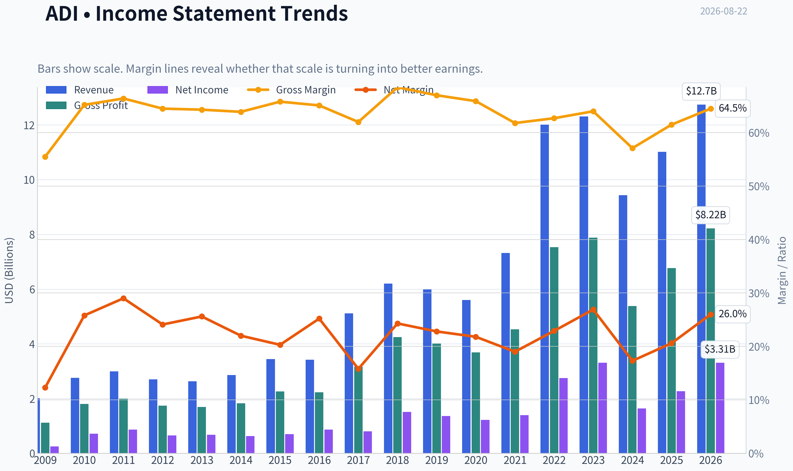
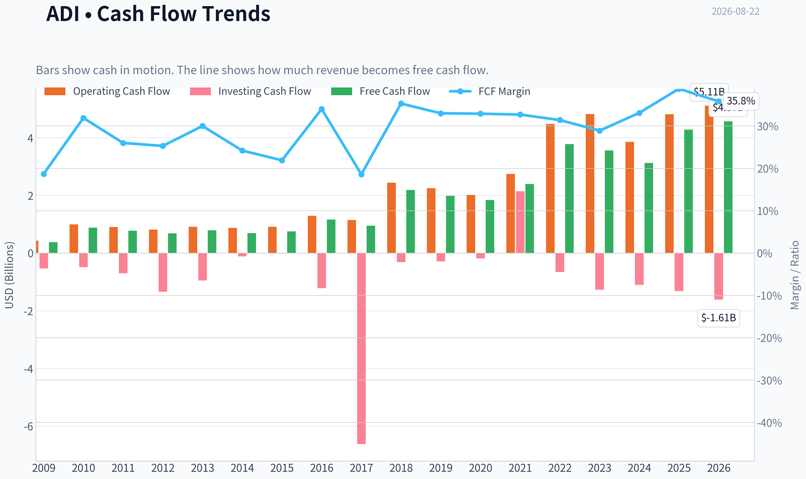
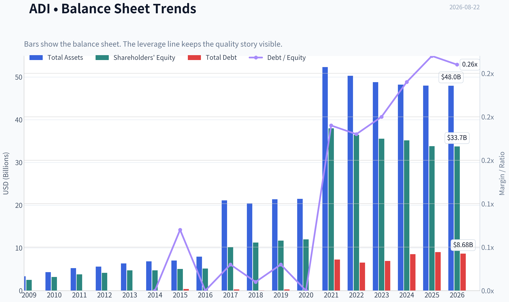
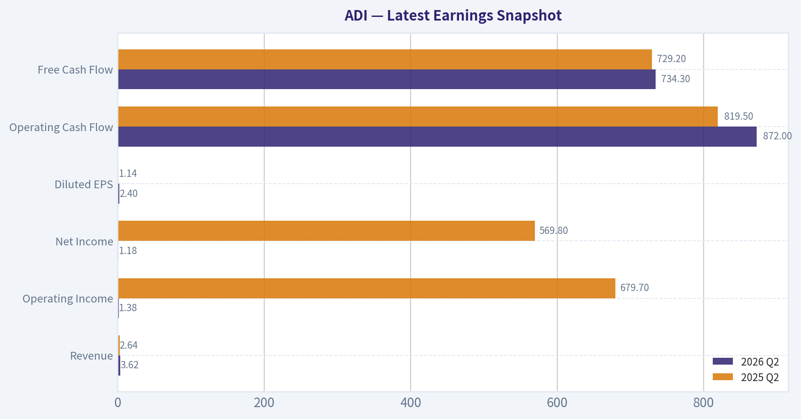
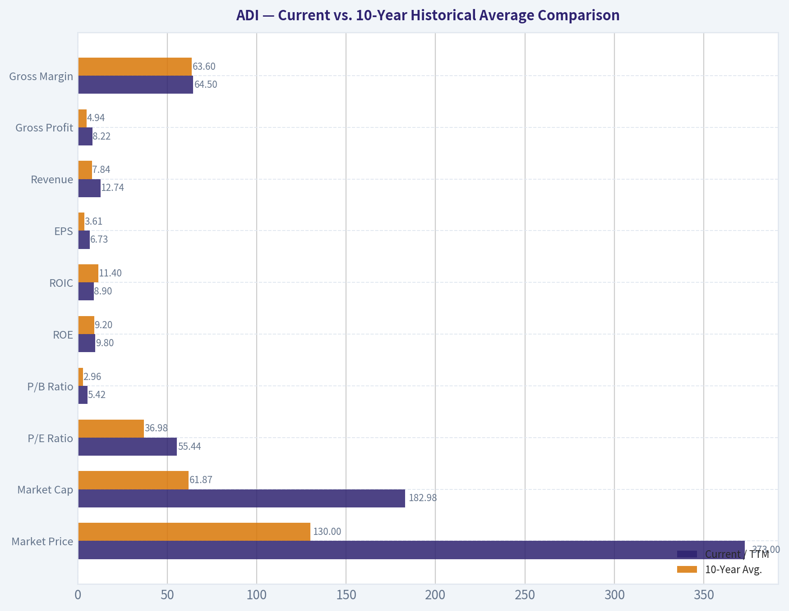
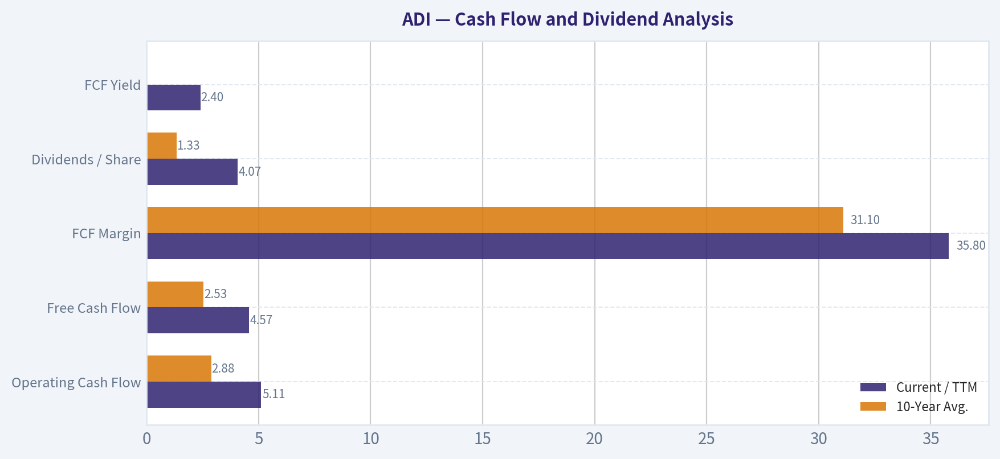
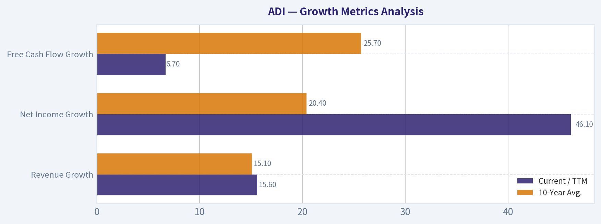
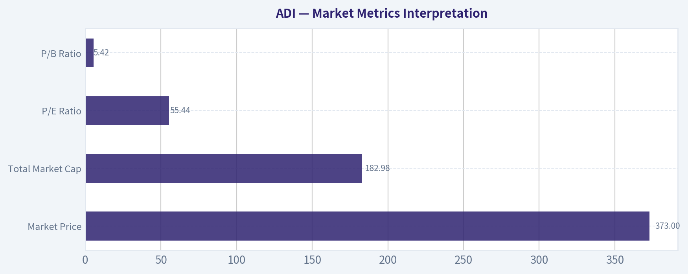

# ADI Deep Value Intelligence

**Analysis Date:** 2026-08-22

## Critical Disclaimer

*This analysis is generated by Deep Value Intelligence, an AI-powered multi-agent investing framework. Education & research only - not financial advice, not a financial advisor.*

---

## Table of Contents

1. Intelligence Summary
2. Analyst Team Reports
   - Fundamentals Analysis
   - Intrinsic Value Analysis (Buffett)
   - Trend & Growth Analysis (Lynch/Druckenmiller/Fisher)
   - Market Technical Analysis
   - Options Market Analysis
3. Research Team Commentary
4. Value Investing Team Commentary
5. Deep Values Commentary

---

## Intelligence Summary

### Thesis + Conditions

**Core Thesis:** **Executive Summary**
Analog Devices (ADI) is an elite, wide-moat semiconductor franchise, but its current $373 price tag and 44x P/E multiple offer zero margin of safety. While the underlying business quality is undeniable (evidenced by a 35% free cash flow margin), the stock is priced for perfection just as technical momentum is breaking down.

**Key Risks:**
- Analog Devices (ADI) is an elite, wide-moat semiconductor franchise, but its current $373 price tag and 44x P/E multiple offer zero margin of safety. While the underlying business quality is undeniable (evidenced by a 35% free cash flow margin), the stock is priced for perfection just as technical momentum is breaking down. We must separate our long-term admiration for the business from our short-term tactical entry. Until valuation cools or technicals confirm a decisive breakout, the near-term risk/reward is unfavorable. **Stance: WATCH (with downside bias).**
- Risky Analyst (The Bull):** Argues that GAAP metrics (like the 6.7% ROE) are distorted by the $21B Maxim Integrated acquisition. ADI's 35% FCF margin reflects a toll-bridge franchise, and the 16% drop from June highs is a rare buying opportunity to capitalize on secular AI and electrification trends.
- Safe Analyst (The Bear):** Counters that paying a 44x P/E in a cyclical industry is "growth-at-any-price" investing. Warns that macroeconomic headwinds in automotive and industrial sectors could trigger severe multiple compression. Demands a genuine margin of safety before entry.

**Confidence:** Medium

---

## Analyst Team Reports

### Fundamentals Analysis

#### Latest Earnings Snapshot

*Most recent reported quarter anchored on 2026 Q2, with prior-year comparison when available.*

| Metric | 2026 Q2 | 2025 Q2 | YoY Change |
| --- | ---: | ---: | ---: |
| Revenue | $3.62B | $2.64B | +37.2% |
| Operating Income | $1.38B | $679.7M | +103.0% |
| Net Income | $1.18B | $569.8M | +106.5% |
| Diluted EPS | $2.40 | $1.14 | +110.5% |
| Operating Cash Flow | $872.0M | $819.5M | +6.4% |
| Free Cash Flow | $734.3M | $729.2M | +0.7% |

Key Takeaways: This snapshot anchors the most recent reported quarter before the narrative analysis. It helps readers separate long-run business quality from whatever changed in the latest earnings print.

#### 17-Year Financial Metrics for ADI

*All values below are computed deterministically from raw data - not estimated by AI.*

*Issuer profile: operating company (Technology / Semiconductors).*

#### 17-Year Financial Metrics
*Annual rows come from reported financial statements. The final TTM row is computed from the latest four quarters.*

| Metric | 2009 | 2010 | 2011 | 2012 | 2013 | 2014 | 2015 | 2016 | 2017 | 2018 | 2019 | 2020 | 2021 | 2022 | 2023 | 2024 | 2025 | 2026 TTM |
| --- | --- | --- | --- | --- | --- | --- | --- | --- | --- | --- | --- | --- | --- | --- | --- | --- | --- | --- |
| Market Price | $18 | $24 | $26 | $29 | $38 | $39 | $49 | $53 | $78 | $73 | $95 | $108 | $160 | $134 | $151 | $217 | $232 | $373 |
| Market Cap | $7.50B | $10.30B | $11.27B | $11.98B | $15.48B | $15.78B | $19.05B | $20.02B | $32.00B | $31.39B | $39.76B | $44.09B | $69.62B | $74.62B | $79.60B | $111.26B | $116.29B | $182.98B |
| P/E Ratio | 30.15 | 14.45 | 13.01 | 18.37 | 23.04 | 25.08 | 27.34 | 23.23 | 39.73 | 20.83 | 29.17 | 36.14 | 50.14 | 27.17 | 24.02 | 68.02 | 51.34 | 55.44 |
| P/B Ratio | 2.97 | 3.22 | 2.97 | 2.88 | 3.27 | 3.32 | 3.76 | 3.88 | 3.15 | 2.79 | 3.40 | 3.67 | 1.83 | 2.05 | 2.24 | 3.16 | 3.44 | 5.42 |
| ROE | 9.8% | 22.3% | 22.9% | 15.6% | 14.2% | 13.2% | 13.7% | 16.7% | 7.9% | 13.4% | 11.6% | 10.2% | 3.7% | 7.5% | 9.3% | 4.6% | 6.7% | 9.8% |
| ROIC | 15.4% | 39.6% | 35.4% | 17.9% | 13.7% | 14.2% | 16.4% | 21.2% | 15.1% | 17.6% | 14.5% | 12.6% | 6.5% | 6.9% | 8.5% | 4.5% | 6.1% | 8.9% |
| EPS | $0.58 | $1.64 | $2.03 | $1.58 | $1.64 | $1.56 | $1.78 | $2.30 | $1.96 | $3.50 | $3.25 | $2.97 | $3.19 | $4.93 | $6.27 | $3.19 | $4.56 | $6.73 |
| Revenue | $2.01B | $2.76B | $2.99B | $2.70B | $2.63B | $2.86B | $3.44B | $3.42B | $5.11B | $6.20B | $5.99B | $5.60B | $7.32B | $12.01B | $12.31B | $9.43B | $11.02B | $12.74B |
| Gross Profit | $1.12B | $1.80B | $1.99B | $1.74B | $1.69B | $1.83B | $2.26B | $2.23B | $3.17B | $4.25B | $4.01B | $3.69B | $4.53B | $7.53B | $7.88B | $5.38B | $6.77B | $8.22B |
| Gross Margin | 55.5% | 65.2% | 66.4% | 64.5% | 64.3% | 63.9% | 65.8% | 65.1% | 62.0% | 68.5% | 67.0% | 65.9% | 61.8% | 62.7% | 64.0% | 57.1% | 61.5% | 64.5% |
| Operating Margin | 14.1% | 32.6% | 35.8% | 30.5% | 28.6% | 26.3% | 24.2% | 30.0% | 22.8% | 30.6% | 28.6% | 26.7% | 23.1% | 27.3% | 31.1% | 21.6% | 26.6% | 32.9% |
| Net Income | $247.8M | $712.1M | $867.4M | $651.2M | $673.5M | $629.3M | $696.9M | $861.7M | $805.4M | $1.51B | $1.36B | $1.22B | $1.39B | $2.75B | $3.31B | $1.64B | $2.27B | $3.31B |
| Net Margin | 12.3% | 25.8% | 29.0% | 24.1% | 25.6% | 22.0% | 20.3% | 25.2% | 15.8% | 24.3% | 22.8% | 21.8% | 19.0% | 22.9% | 26.9% | 17.3% | 20.6% | 26.0% |
| Revenue Growth | N/A | 37.1% | 8.4% | -9.8% | -2.5% | 8.8% | 19.9% | -0.4% | 49.3% | 21.4% | -3.4% | -6.5% | 30.6% | 64.2% | 2.4% | -23.4% | 16.9% | 15.6% |
| Net Income Growth | N/A | 187.4% | 21.8% | -24.9% | 3.4% | -6.6% | 10.7% | 23.6% | -6.5% | 87.1% | -9.6% | -10.4% | 13.9% | 97.7% | 20.6% | -50.7% | 38.7% | 46.1% |
| Free Cash Flow Growth | N/A | 133.9% | -11.6% | -12.2% | 15.7% | -12.1% | 8.7% | 54.4% | -18.4% | 130.2% | -9.6% | -6.8% | 29.8% | 57.9% | -5.8% | -12.2% | 37.0% | 6.7% |
| Total Book Value | $2.53B | $3.20B | $3.80B | $4.17B | $4.74B | $4.76B | $5.07B | $5.17B | $10.16B | $11.27B | $11.71B | $12.00B | $37.99B | $36.47B | $35.57B | $35.18B | $33.82B | $33.74B |
| Total Assets | $3.37B | $4.33B | $5.28B | $5.62B | $6.38B | $6.86B | $7.06B | $7.97B | $21.14B | $20.44B | $21.39B | $21.47B | $52.32B | $50.30B | $48.79B | $48.23B | $47.99B | $47.95B |
| Total Debt | N/A | N/A | N/A | N/A | N/A | $0 | $374.6M | $0 | $300.0M | $67.0M | $299.7M | $0 | $7.29B | $6.55B | $6.95B | $8.53B | $9.04B | $8.68B |
| Debt-to-Equity | N/A | N/A | N/A | N/A | N/A | 0.00 | 0.07 | 0.00 | 0.03 | 0.01 | 0.03 | 0.00 | 0.19 | 0.18 | 0.20 | 0.24 | 0.27 | 0.26 |
| Cash & Equivalents | $1.07B | $1.41B | $1.41B | $528.8M | $392.1M | $569.2M | $884.4M | $921.1M | $1.05B | $816.6M | $648.3M | $1.06B | $1.98B | $1.47B | $958.1M | $1.99B | $2.50B | $2.44B |
| Shareholders' Equity | $2.53B | $3.20B | $3.80B | $4.17B | $4.74B | $4.76B | $5.07B | $5.17B | $10.16B | $11.27B | $11.71B | $12.00B | $37.99B | $36.47B | $35.57B | $35.18B | $33.82B | $33.74B |
| Operating Cash Flow | $432.1M | $991.2M | $900.5M | $814.5M | $912.3M | $871.6M | $907.8M | $1.29B | $1.15B | $2.44B | $2.25B | $2.01B | $2.74B | $4.48B | $4.82B | $3.85B | $4.81B | $5.11B |
| Investing Cash Flow | $-534.7M | $-485.8M | $-703.7M | $-1.34B | $-949.9M | $-114.8M | $-17.1M | $-1.22B | $-6.62B | $-314.0M | $-293.2M | $-180.5M | $2.14B | $-657.4M | $-1.27B | $-1.10B | $-1.32B | $-1.61B |
| Free Cash Flow | $376.1M | $879.6M | $777.5M | $682.4M | $789.3M | $693.7M | $753.8M | $1.16B | $950.3M | $2.19B | $1.98B | $1.84B | $2.39B | $3.78B | $3.56B | $3.12B | $4.28B | $4.57B |
| FCF Margin | 18.7% | 31.9% | 26.0% | 25.3% | 30.0% | 24.2% | 21.9% | 34.0% | 18.6% | 35.3% | 33.0% | 32.9% | 32.7% | 31.4% | 28.9% | 33.1% | 38.8% | 35.8% |
| Dividends / Share | $0.00 | $0.00 | $0.00 | $0.00 | $0.00 | $0.00 | $0.00 | $0.00 | $0.00 | $0.00 | $0.00 | $0.00 | $0.00 | $2.77 | $3.18 | $3.51 | $3.87 | $4.07 |

#### Profitability Metrics
- Return on Equity (ROE): 6.7%
- Return on Invested Capital (ROIC): 6.1%
- Return on Assets (ROA): 4.7%
- Gross Margin: 61.5%
- Operating Margin: 26.6%
- Net Profit Margin: 20.6%

#### Liquidity Metrics
- Current Ratio: 2.19
- Quick Ratio: 1.57

#### Leverage Metrics
- Debt-to-Equity Ratio: 0.27
- Interest Coverage Ratio: 9.23
- Net Debt: $6.54B

#### Growth Metrics (Year-over-Year)
- Revenue Growth: 16.9%
- Net Income Growth: 38.7%
- Free Cash Flow Growth: 37.0%
- Revenue CAGR (3-Year): -2.8%
- Revenue CAGR (5-Year): 14.5%

#### Valuation Metrics
- P/E Ratio (TTM): 44.05
- Forward P/E: 22.81
- Price-to-Book: 5.40
- Price-to-Sales: 13.09
- PEG Ratio: 0.68
- EV/EBITDA: 27.10
- Free Cash Flow Yield: 2.4%
- Earnings Yield: 2.3%

#### Owner Earnings (Buffett Method, Code-Computed)
- Net Income: $2.27B
- + Depreciation & Amortization: $2.00B
- - Capital Expenditures: $-533.6M
- - Working Capital Changes: $481.0M
- = **Owner Earnings: $3.25B**

#### Intrinsic Value (Code-Computed)
- Current Price: $373
- **Headline Intrinsic Value (business-model routed): $140**
  Business model: asset light platform - weighted blend [Damodaran FCFF + reverse-DCF fair + owner-earnings DCF] (asset_light_platform)
  Model spread (min-max across DCFs): $93 - $243
  Margin of safety vs. price (headline): -166.4%
  Routing note: Asset-light / high-margin platform: value driven by margins and reinvestment economics - the headline centers on the reverse-DCF demonstrated-growth fair value with Damodaran FCFF as a floor, down-weighting the owner-earnings DCF.
- Buffett Method (Owner Earnings):
  Conservative: $52
  Average: $243
  Optimistic: $243
- Cash Flow Method (FCF):
  Conservative: $61
  Average: $197
  Optimistic: $282
- Damodaran FCFF (WACC + margins + reinvestment):
  Conservative: $46
  Average: $93
  Optimistic: $163
  Monte Carlo band (P10-P90): $62 - $134 (median $88)
  P(intrinsic value > price): 0.0%
- Reverse-DCF: price implies ~31.4%/yr owner-earnings growth for 10y; trailing 3y was -14.7%, 5y 25.2%.

#### Piotroski F-Score: 8/9
- Positive Net Income: PASS
- Positive Operating Cash Flow: PASS
- ROA Improvement: PASS
- Cash Flow > Net Income: PASS
- Decreasing Debt: FAIL
- Improving Current Ratio: PASS
- No Dilution: PASS
- Improving Gross Margin: PASS
- Improving Asset Turnover: PASS

ANALYST STANCE: **AVOID**

#### ADI - Warren Buffett-Style Fundamental Analysis

Analog Devices is a high-quality analog semiconductor franchise with strong gross margins, durable end-market exposure, and excellent free-cash-flow conversion. However, the current valuation embeds exceptionally high expectations. At a current market price of **$373**, ADI trades far above the deterministic dataset's model-routed intrinsic value estimate of **about $140 per share**, with a model spread of roughly **$93 to $243**. For a Buffett-style investor, the business quality is attractive, but the margin of safety is absent.

---

#### Current vs. 10-Year Historical Average Comparison

| Metric | Current / TTM | 10-Year Avg. | Current vs. History | Interpretation |
|---|---:|---:|---:|---|
| Market Price | $373 | $130 | +187% | Price has dramatically outrun the decade average. |
| Market Cap | $182.98B | $61.87B | +196% | Enterprise value has expanded much faster than normalized earnings power. |
| P/E Ratio | 55.44x | 36.98x | Above avg. | Valuation is rich even versus ADI's historically elevated multiple range. |
| P/B Ratio | 5.42x | 2.96x | Above avg. | Book value is not the best anchor for a semiconductor franchise with intangibles, but the multiple is stretched. |
| ROE | 9.8% | 9.2% | Slightly above avg. | ROE has recovered, but remains below the stronger pre-acquisition years. |
| ROIC | 8.9% | 11.4% | Below avg. | Returns on invested capital remain diluted by the enlarged asset base and acquisition-related capital. |
| EPS | $6.73 | $3.61 | Above avg. | Earnings have improved meaningfully from the 2024 cyclical trough. |
| Revenue | $12.74B | $7.84B | Above avg. | ADI is much larger after the Maxim acquisition and recent demand recovery. |
| Gross Profit | $8.22B | $4.94B | Above avg. | Scale and product mix support very strong gross profit dollars. |
| Gross Margin | 64.5% | 63.6% | Slightly above avg. | Gross margin is back near ADI's high-quality historical norm. |
| Operating Margin | 32.9% | 26.8% | Above avg. | Operating leverage is strong in the current TTM period. |
| Net Income | $3.31B | $1.71B | Above avg. | Profitability has rebounded sharply from 2024. |
| Net Margin | 26.0% | 21.7% | Above avg. | Net margin is strong and supports ADI's quality profile. |
| Revenue Growth | 15.6% | 15.1% | In line | Current growth is near the 10-year average, but the average includes acquisition-driven surges. |
| Net Income Growth | 46.1% | 20.4% | Above avg. | Earnings recovery is strong, but partly cyclical after a weak 2024. |
| FCF Growth | 6.7% | 25.7% | Below avg. | Free-cash-flow growth is positive but not matching the valuation-implied growth. |
| Total Book Value | $33.74B | $22.93B | Above avg. | Equity base expanded materially after acquisition activity. |
| Total Assets | $47.95B | $34.00B | Above avg. | ADI is structurally larger, but asset growth has weighed on ROIC. |
| Total Debt | $8.68B | $3.90B | Above avg. | Debt is much higher than the earlier decade, though still manageable. |
| Debt-to-Equity | 0.26x | 0.12x | Above avg. | Leverage is moderate, but higher than ADI's historical norm. |
| Cash & Equivalents | $2.44B | $1.34B | Above avg. | Liquidity is solid. |
| Shareholders' Equity | $33.74B | $22.93B | Above avg. | Equity remains substantial, though returns on that equity are not exceptional. |
| Free Cash Flow | $4.57B | $2.53B | Above avg. | FCF generation is excellent in absolute terms. |
| Dividends / Share | $4.07 | $1.33 | Above avg. | Dividend payments have become more significant in recent years. |

Key Takeaways: ADI's current profitability and cash generation are strong relative to its 10-year history, especially revenue, free cash flow, operating margin, and net margin. The problem is valuation: the stock price, market cap, P/E, P/B, and EV-style expectations have expanded faster than normalized ROIC and owner earnings. The company looks high quality, but the market is already pricing in a very favorable future.

---

#### Market Metrics Interpretation

| Metric | Current Reading | Buffett-Style Interpretation |
|---|---:|---|
| Market Price | $373 | The share price is near a peak versus the historical dataset and far above the model-routed intrinsic value of about $140. |
| Total Market Cap | $182.98B | ADI is being valued as a premium compounder, not merely as a cyclical semiconductor business. |
| P/E Ratio | 55.44x | This is expensive on reported earnings. Even allowing for cyclicality and margin recovery, the valuation demands sustained high growth. |
| P/B Ratio | 5.42x | For a semiconductor company with intellectual property, goodwill, and acquisition-related intangibles, P/B is less useful than cash-flow valuation. It should not be treated mechanically as a "cheap" or "expensive" signal by itself. |

Key Takeaways: ADI's market valuation is the central concern. The stock trades at a large premium to its historical average P/E and far above cash-flow-based intrinsic value estimates. P/B is elevated, but for ADI the more important issue is that free cash flow and owner earnings do not currently justify the share price under conservative Buffett-style assumptions.

---

#### Profitability Analysis

ADI's profitability profile is the strongest part of the investment case. The company has maintained gross margins mostly in the low-to-mid 60% range for many years, which is evidence of pricing power, differentiated analog and mixed-signal products, and sticky customer relationships. The current TTM gross margin of **64.5%** is slightly above the 10-year average of **63.6%**, showing that the franchise remains strong.

Operating margin is especially impressive at **32.9%**, versus a 10-year average of **26.8%**. This suggests that recent revenue recovery is flowing through the income statement with strong operating leverage. Net margin of **26.0%** is also well above the 10-year average of **21.7%**.

The weakness is in capital efficiency. Current TTM **ROIC of 8.9%** is below the 10-year average of **11.4%** and well below the very strong ROIC levels ADI produced earlier in the dataset. A Buffett investor wants not only high margins but also high returns on incremental invested capital. ADI remains a good business, but the post-acquisition balance sheet and larger asset base make the return profile less exceptional than the headline margins imply.

---

#### Growth Metrics Analysis

| Growth Metric | Current / TTM | 10-Year Avg. | Interpretation |
|---|---:|---:|---|
| Revenue Growth | 15.6% | 15.1% | Current growth is healthy and roughly in line with the historical average. |
| Net Income Growth | 46.1% | 20.4% | Earnings are rebounding sharply, but this partly reflects recovery from the 2024 decline. |
| Free Cash Flow Growth | 6.7% | 25.7% | FCF is still growing, but not nearly fast enough to support the valuation implied by the stock price. |

Key Takeaways: ADI's growth has been strong, but not smooth. The decade includes large jumps from acquisition effects and cyclical recoveries, as well as material downturns such as 2024. The current share price implies a much more aggressive and sustained growth path than ADI has consistently demonstrated.

Growth quality is mixed. Revenue rose from **$3.42B in 2016** to **$12.74B TTM**, helped materially by acquisition activity and scale expansion. However, revenue growth has also been cyclical, including declines in 2019, 2020, and 2024. Free cash flow has compounded well over the period, but the current TTM FCF growth rate of **6.7%** is modest compared with the market's expectations.

The deterministic dataset's reverse-DCF estimate indicates that the current price implies roughly **31.4% annual owner-earnings growth for 10 years**. That is a very high hurdle for a company whose trailing 3-year owner-earnings growth was negative and whose growth is exposed to semiconductor cycles.

---

#### Balance Sheet and Financial Strength

ADI's balance sheet is acceptable, but no longer as pristine as it was earlier in the dataset. Total debt is **$8.68B**, compared with a 10-year average of **$3.90B**. Debt-to-equity is **0.26x**, above the 10-year average of **0.12x**, but still moderate in absolute terms. The interest coverage ratio of **9.23x** indicates that debt service is manageable.

Cash and equivalents of **$2.44B** provide useful liquidity, though net debt remains approximately **$6.54B**. Shareholders' equity of **$33.74B** gives ADI a large capital base, but the company's ROE and ROIC have not fully recovered to earlier-decade levels.

From a Buffett perspective, ADI passes the financial strength test, but not with the same margin of safety it once had. The company is not overleveraged, yet the higher debt load reduces flexibility if the semiconductor cycle weakens.

---

#### Cash Flow and Dividend Analysis

| Metric | Current / TTM | 10-Year Avg. | Interpretation |
|---|---:|---:|---|
| Operating Cash Flow | $5.11B | $2.88B | Strong cash generation and well above historical average. |
| Free Cash Flow | $4.57B | $2.53B | Excellent FCF production, supporting dividends and debt service. |
| FCF Margin | 35.8% | 31.1% | Very strong conversion of revenue into free cash flow. |
| Dividends / Share | $4.07 | $1.33 | Dividend has become a meaningful capital-return component. |
| FCF Yield | 2.4% | N/A | Low yield at the current share price, signaling expensive valuation. |

Key Takeaways: ADI is a powerful free-cash-flow generator. The business converts a large share of revenue into cash, which is a major Buffett-style positive. However, at the current market price, the free-cash-flow yield is only about 2.4%, meaning investors are paying a very high price for each dollar of cash flow.

ADI's owner earnings are strong. The deterministic dataset calculates Buffett-style owner earnings as:

| Owner Earnings Component | Amount |
|---|---:|
| Net Income | $2.27B |
| Plus: Depreciation & Amortization | $2.00B |
| Less: Capital Expenditures | $533.6M |
| Less: Working Capital Changes | $481.0M |
| Owner Earnings | $3.25B |

Key Takeaways: ADI's owner earnings are materially higher than reported net income because depreciation and amortization are substantial. This supports the view that ADI is a cash-rich business. Still, even using owner earnings rather than accounting earnings, the current valuation requires unusually high future growth.

---

#### Revenue Breakdown

| Revenue Source | Amount ($B) | % of Total |
|---|---:|---:|
| Industrial | $4.52B | 41% |
| Automotive | $2.98B | 27% |
| Communications | $1.76B | 16% |
| Consumer | $1.76B | 16% |
| Total | $11.02B | 100% |

Key Takeaways: ADI's revenue is diversified across industrial, automotive, communications, and consumer end markets. Industrial and automotive are the most important sources and tend to be attractive because analog content, design cycles, and qualification requirements can create sticky customer relationships. Communications and consumer can offer upside, but they are also more exposed to shorter product cycles and demand volatility.

---

#### Economic Moat

ADI has a real economic moat, though it is not immune to semiconductor cyclicality. The moat comes from several sources:

| Moat Source | Assessment |
|---|---|
| Analog expertise | Strong. Precision analog, mixed-signal, power management, and signal-chain knowledge are difficult to replicate. |
| Customer stickiness | Strong. ADI components are often designed into long-life industrial, automotive, aerospace, healthcare, and communications systems. |
| Switching costs | Moderate to strong. Once designed into mission-critical systems, analog chips are not easily swapped out. |
| Product breadth | Strong. ADI's catalog and engineering support create scale advantages. |
| Pricing power | Strong. Gross margins above 60% suggest meaningful differentiation. |
| Cyclicality risk | Meaningful. Revenue and earnings still fluctuate with industrial, automotive, communications, and inventory cycles. |

Key Takeaways: ADI is not a commodity chipmaker. Its moat is built on technical differentiation, long product life cycles, and customer integration. However, the moat does not eliminate cyclicality, and investors should not value the company as if earnings will grow smoothly every year.

---

#### Management Performance and Capital Allocation

Management has created a larger and more strategically diversified business, especially after major acquisition activity. Revenue, gross profit, operating cash flow, and free cash flow are all far above their 10-year averages. The company also has a strong Piotroski F-Score of **8 out of 9**, indicating good recent fundamental momentum.

However, Buffett-style evaluation of management also focuses on returns on capital. On that test, the picture is less compelling. ROIC is currently **8.9%**, below its 10-year average and far below the 20%-plus levels achieved in stronger earlier years. That does not mean management has failed, but it does mean the market's current valuation is assuming a significant improvement in capital efficiency.

The dividend has grown meaningfully in recent years, with dividends per share at **$4.07 TTM**. This is shareholder-friendly, but at the current valuation the dividend yield is not enough to compensate for the lack of margin of safety.

---

#### Buffett-Style Owner Earnings DCF Valuation

The following DCF uses deterministic owner earnings of **$3.25B**, a **10% discount rate**, **2.5% terminal growth**, approximately **490.6M shares**, and net debt of approximately **$6.54B**. The model intentionally fades growth toward a mature terminal rate rather than assuming high growth forever.

| Scenario | Growth Assumption | PV of Explicit Owner Earnings | PV of Terminal Value | Enterprise Value | Less Net Debt | Equity Value | Fair Value / Share |
|---|---|---:|---:|---:|---:|---:|---:|
| Conservative | 3% for 10 years, then 2.5% terminal | $23.0B | $23.0B | $46.1B | $6.5B | $39.5B | ~$81 |
| Average | 12% for 5 years, then fades to 4% by year 10 | $33.4B | $40.4B | $73.8B | $6.5B | $67.2B | ~$137 |
| Optimistic | 18% for 5 years, then fades to 4.5% by year 10 | $42.8B | $57.8B | $100.6B | $6.5B | $94.1B | ~$192 |

Key Takeaways: Even under an optimistic owner-earnings scenario, the hand-built Buffett-style DCF produces a fair value well below the current $373 share price. The average case of about $137 per share is very close to the deterministic dataset's headline intrinsic value of about $140. This reinforces the view that the stock price already discounts a very aggressive future.

#### DCF Calculation Detail

| Item | Conservative | Average | Optimistic |
|---|---:|---:|---:|
| Starting Owner Earnings | $3.25B | $3.25B | $3.25B |
| Year 10 Owner Earnings | ~$4.37B | ~$7.66B | ~$10.96B |
| Terminal Growth Rate | 2.5% | 2.5% | 2.5% |
| Discount Rate | 10.0% | 10.0% | 10.0% |
| Terminal Value Formula | OE10 x 1.025 / 7.5% | OE10 x 1.025 / 7.5% | OE10 x 1.025 / 7.5% |
| Terminal Value at Year 10 | ~$59.7B | ~$104.7B | ~$149.8B |
| Present Value of Terminal Value | ~$23.0B | ~$40.4B | ~$57.8B |
| Fair Value / Share | ~$81 | ~$137 | ~$192 |

Key Takeaways: The valuation is highly sensitive to growth assumptions, but even generous assumptions do not close the gap to the current market price. To justify $373, ADI would need to compound owner earnings at a rate far above what a conservative investor should underwrite. This is why the stock may be an excellent company but still a poor value investment today.

#### Intrinsic Value Cross-Check from Deterministic Dataset

| Model | Estimated Value / Share |
|---|---:|
| Headline Business-Model Routed Intrinsic Value | $140 |
| Owner Earnings DCF Model Spread | $52 to $243 |
| Free Cash Flow DCF Model Spread | $61 to $282 |
| Damodaran FCFF Model Spread | $46 to $163 |
| Damodaran Monte Carlo P10-P90 Band | $62 to $134 |
| Current Market Price | $373 |
| Margin of Safety vs. Headline Intrinsic Value | -166.4% |

Key Takeaways: Multiple valuation methods point to the same conclusion: ADI trades materially above intrinsic value. The current price is not merely a little expensive; it is far above the central estimate and even above the upper end of most model ranges. The market is pricing ADI for exceptional execution, sustained growth, and continued premium margins.

---

#### Reverse-DCF Reality Check

The deterministic dataset indicates that the current price implies approximately **31.4% annual owner-earnings growth for 10 years**. That is the key valuation red flag.

ADI is a high-quality compounder, but a 31%-plus annual owner-earnings growth requirement is extremely demanding for a business already generating more than **$12B** in revenue and **$4.57B** in TTM free cash flow. Semiconductor companies can grow rapidly during upcycles, but they also experience inventory corrections, margin compression, and end-market slowdowns.

A Buffett-style investor should be skeptical when the investment case depends on extraordinary growth rather than a conservative purchase price.

---

#### Key Investment Insights

| Category | Insight |
|---|---|
| Business Quality | High. ADI has strong margins, technical differentiation, sticky customer relationships, and diversified end markets. |
| Moat | Durable. Analog and mixed-signal design expertise creates competitive advantages. |
| Cash Flow | Excellent. TTM free cash flow is $4.57B with a 35.8% FCF margin. |
| Balance Sheet | Acceptable. Debt is manageable, but leverage is higher than historical norms. |
| Profitability | Strong margins, but ROIC is below its 10-year average. |
| Growth | Healthy rebound, but growth has been cyclical and acquisition-influenced. |
| Valuation | Very expensive. Current price greatly exceeds intrinsic value estimates. |
| Buffett Suitability | Great business, poor current price. |

Key Takeaways: ADI checks many of the boxes Buffett likes in a business: durability, pricing power, cash generation, and shareholder returns. But Buffett also requires a rational price. At $373, the stock does not offer a sufficient margin of safety.

---

#### Red Flags

| Red Flag | Why It Matters |
|---|---|
| Valuation far above intrinsic value | The headline intrinsic value is about $140 versus a $373 market price. |
| Reverse-DCF requires ~31.4% annual owner-earnings growth | This is an aggressive expectation for a mature, cyclical semiconductor company. |
| ROIC below historical average | Capital efficiency has not kept pace with valuation expansion. |
| Higher leverage than historical norm | Debt is manageable, but financial flexibility is reduced versus earlier years. |
| Semiconductor cyclicality | Industrial, auto, communications, and consumer demand can weaken quickly. |
| Low FCF yield | A 2.4% FCF yield leaves little room for disappointment. |

Key Takeaways: The major risk is not business failure; it is valuation risk. ADI can continue to be a strong company while still delivering poor stock returns if the valuation multiple compresses. The current price leaves little room for cyclical weakness or execution missteps.

---

#### Opportunities

| Opportunity | Potential Upside Driver |
|---|---|
| AI infrastructure and data-center demand | Could increase demand for power, signal-chain, and connectivity-related analog solutions. |
| Automotive electrification | Higher analog content per vehicle may support long-term growth. |
| Industrial automation | Factory automation, instrumentation, and intelligent edge systems support durable demand. |
| Margin recovery | TTM operating margin of 32.9% shows strong operating leverage. |
| Free-cash-flow deployment | Debt reduction, dividends, and buybacks could enhance shareholder value over time. |

Key Takeaways: ADI has real long-term growth drivers. Automotive electrification, industrial automation, and AI-related infrastructure can support demand for many years. The issue is that the stock already appears to capitalize these opportunities at a very full price.

---

#### Final Buffett-Style Investment Stance: AVOID

ADI is a high-quality business, but the current valuation is not Buffett-like. The company has a durable moat, excellent gross margins, strong free-cash-flow conversion, and diversified long-life end markets. However, the stock trades at **$373**, compared with a deterministic headline intrinsic value of about **$140** and a hand-built Buffett-style average-case DCF value of about **$137**.

The investment fails the margin-of-safety test. At today's price, investors are being asked to pay for years of exceptional growth, sustained margin strength, and successful capital allocation with minimal cyclical disruption. That may happen, but it is not a conservative underwriting standard.

For existing long-term holders with large embedded gains, ADI may remain a high-quality compounder worth monitoring. For new Buffett-style capital, the stance is **AVOID until valuation becomes materially more attractive**, preferably closer to intrinsic value with a meaningful margin of safety.

---

#### Summary Table

| Area | Assessment | Buffett-Style Conclusion |
|---|---|---|
| Business Quality | High margins, strong cash flow, differentiated analog franchise | Attractive business |
| Economic Moat | Strong customer stickiness, design-in advantages, technical expertise | Durable moat |
| Profitability | Gross and operating margins are excellent; ROIC is below historical average | Good, but not flawless |
| Growth | Rebounding, but cyclical and partly acquisition-influenced | Positive but not smooth |
| Balance Sheet | Manageable debt, solid liquidity, higher leverage than past | Acceptable |
| Cash Flow | Very strong FCF and owner earnings | Major strength |
| Dividend Policy | Growing dividend, shareholder-friendly | Positive |
| Valuation | Price far above intrinsic value estimates | Major concern |
| Margin of Safety | Negative versus all central valuation estimates | Fails Buffett test |
| Final Stance | **AVOID** | Great company, wrong price |

#### Fundamental Visuals

This graph tracks the profitability and return metrics (ROE, ROIC, Margins) of **ADI** over the past decade, highlighting capital efficiency trends.

This chart illustrates the financial health of **ADI** over the last 10 years, mapping cash equivalents and free cash flow against total obligations (Debt).

---

### Intrinsic Value Analysis (Buffett)

> *Following Warren Buffett's value investing philosophy: Circle of Competence, Economic Moat, Management Quality, and Margin of Safety.*

#### Intrinsic Value Snapshot

Price is what you pay. Intrinsic value is what the business may be worth based on the cash it can create for owners over time. We show a range, not one magic number.

- Current Price: $373.09
- Value Range (conservative to optimistic across both DCF methods): $51.55 to $282.19

##### Owner Earnings (Buffett Method)
- Net Income: $2,267,342,000.00
- Depreciation & Amortization: $1,998,845,000.00
- Capital Expenditures: $-533,552,000.00
- Working Capital Changes: $481,009,000.00
- Owner Earnings: $3,251,626,000.00

##### Intrinsic Value
###### Buffett Method
Uses owner earnings. Stricter, and usually more conservative.
- Conservative: $51.55
- Average: $243.02
- Optimistic: $243.02
- Discount Rate: 10.0%

###### Cash Flow Method
Uses free cash flow. Better for companies spending heavily today to grow tomorrow.
- Conservative: $61.04
- Average: $197.15
- Optimistic: $282.19
- Discount Rate: 10.0%

ANALYST STANCE: **WATCH**

#### ADI - Buffett-Style Investment Review

Analog Devices is a high-quality analog and mixed-signal semiconductor franchise with durable customer relationships, excellent gross margins, and long product life cycles. The business is understandable, economically attractive, and competitively advantaged. The problem is price: at **$373**, the stock discounts a level of growth that appears far above what even a strong analog compounder can reliably deliver.

---

#### 1. Factor Scorecard

| Factor | Score / 5 | Assessment |
|---|---:|---|
| Circle of Competence & Business Simplicity | 4.0 | ADI sells analog, mixed-signal, power, RF, and sensor chips into industrial, automotive, communications, healthcare, and data-center applications. The business model is understandable: design mission-critical chips, win sockets, retain them for years, and earn high margins. |
| Moat Test | 4.5 | Strong intangible know-how, embedded design wins, qualification barriers, broad product catalog, and customer switching costs. Gross margin of **61.5%** supports real pricing power. |
| Management Quality & Capital Allocation | 3.5 | Long-term orientation, disciplined dividend record, and strategic acquisitions, including Maxim Integrated. Returns are currently muted by acquisition accounting and semiconductor-cycle normalization, so capital allocation earns a solid but not exceptional score. |
| Industry Structure | 3.5 | Analog semiconductors are more rational and durable than memory or commodity logic, with long product cycles and fewer winner-take-all dynamics. Still cyclical, exposed to inventory corrections, and facing AI-driven valuation enthusiasm. |
| Gate 5: Quality / Solvency Hard Floor | Not tripped | Earnings and free cash flow remain positive, the current ratio is **2.19**, and leverage appears manageable. There is no financial-distress case. |

**Key Takeaways:** ADI scores very well on business quality, moat, and understandability. The hard solvency floor is not triggered, so this is not a distressed or structurally impaired company. The main concern is not quality; it is valuation relative to realistic long-term cash generation.

---

#### 2. Moat Analysis

| Moat Source | Evidence | Strength |
|---|---|---|
| Intangible Assets | Deep analog engineering expertise, signal-chain IP, power-management know-how, RF and sensor capabilities, trusted reputation in industrial and automotive markets. | High |
| Switching Costs | ADI parts are often designed into mission-critical systems; customers face requalification costs, engineering risk, and supply-chain disruption if they switch. | High |
| Cost Advantage | Scale, broad catalog, manufacturing relationships, and long-lived products support strong margins. | Moderate to High |
| Network Effects | Engineer familiarity, design tools, and ecosystem breadth help, but this is not a classic network-effect business. | Low to Moderate |
| Financial Evidence | Gross margin around **61.5%**, current revenue growth **16.9% YoY**, and recurring design-win economics. | Strong |

**Key Takeaways:** ADI's moat is based less on consumer brand and more on embedded engineering trust. Once designed into a customer's system, analog chips can remain in production for many years, making revenue stickier than in many semiconductor categories. The moat is real and durable, though not immune to cyclicality.

---

#### 3. Management Quality & Capital Allocation

| Area | Assessment |
|---|---|
| Owner Orientation | Management has historically emphasized durable per-share value through dividends, buybacks, and portfolio strengthening. |
| Candor & Accounting | ADI is a mature public company with generally understandable financial reporting, though acquisition-related amortization makes GAAP returns look lower than underlying economics. |
| Reinvestment | Strong internal reinvestment opportunities remain in industrial automation, automotive electronics, electrification, communications infrastructure, and AI data-center power/signal applications. |
| Acquisitions | Maxim Integrated expanded scale and product breadth, but also increased goodwill and intangible assets, depressing reported ROE and ROIC. |
| Buybacks | Buybacks are value-accretive only below intrinsic value; at current valuation, repurchases would deserve scrutiny. |
| Balance Sheet Discipline | Current ratio of **2.19** and healthy cash generation indicate financial flexibility. |

**Key Takeaways:** Management has built a stronger, broader franchise, and the Maxim deal was strategically logical. The key capital-allocation test now is discipline: at this stock price, reinvestment in the business is attractive, but aggressive buybacks would be hard to justify. Overall management quality is good, not flawless.

---

#### 4. Financial Summary

| Metric | Recent / TTM Snapshot |
|---|---:|
| Current Price | **$373** |
| Market Capitalization | **$181.73B** |
| P/E Ratio | **44.0x** |
| Implied Net Income | **~$4.13B** |
| Free Cash Flow Yield | **2.4%** |
| Implied Free Cash Flow | **~$4.36B** |
| ROE | **6.7%** |
| Gross Margin | **61.5%** |
| Revenue Growth YoY | **16.9%** |
| Current Ratio | **2.19** |
| Estimated Shares Outstanding | **~487M** |

**Key Takeaways:** ADI is profitable and cash-generative, with excellent gross margins that confirm franchise quality. However, the valuation is demanding: a **44x P/E** and **2.4% FCF yield** leave little room for disappointment. Reported ROE is modest, partly because acquisition goodwill and amortization weigh on accounting returns.

---

#### 5. Owner Earnings Calculation

| Component | Estimate |
|---|---:|
| Net Income | **$4.13B** |
| Add: Depreciation & Amortization | **$2.40B** |
| Less: Estimated Maintenance CapEx | **($0.75B)** |
| Less: Working Capital Increase | **($0.08B)** |
| Estimated Owner Earnings | **$5.70B** |
| Shares Outstanding | **~487M** |
| Owner Earnings Per Share | **~$11.70** |

**Key Takeaways:** Owner earnings are estimated above reported free cash flow because ADI's depreciation and amortization include meaningful acquisition-related amortization. The company's cash economics are stronger than GAAP ROE suggests. Even using a generous owner-earnings estimate, the current share price still requires very strong future compounding.

---

#### 6. Three-Scenario DCF Valuation

| Scenario | Key Assumption | Estimated Value / Share | Margin of Safety vs. $373 |
|---|---|---:|---:|
| A: No Growth | Owner earnings capitalized at 10% | **$117** | **-219%** |
| B: GDP Growth | 3% perpetual growth, 10% discount rate | **$172** | **-117%** |
| C: Historical Growth Haircut | 8% growth for 10 years, then 3% terminal growth | **$247** | **-51%** |
| Business-Model Routed Intrinsic Value | Weighted blend of Damodaran FCFF, reverse DCF, and owner-earnings DCF | **$140** | **-166%** |

**Key Takeaways:** The valuation gap is substantial across all scenarios. Even the more optimistic owner-earnings growth case produces an intrinsic value meaningfully below the current price. The stock is not merely "a little expensive"; it is priced for exceptional execution and sustained growth.

---

#### 7. Margin of Safety Analysis

| Valuation Reference | Value / Share | Comment |
|---|---:|---|
| Owner-Earnings DCF | **$243** | Most favorable of the supplied valuation references. Still below the current price. |
| FCF DCF | **$197** | Cash-flow-based estimate also shows overvaluation. |
| Damodaran FCFF | **$93** | More conservative intrinsic value estimate. |
| Headline Intrinsic Value | **$140** | Business-model routed blended estimate. |
| Current Price | **$373** | Implies a large premium to intrinsic value. |
| Reverse-DCF Implied Growth | **~31.4% annually for 10 years** | Very demanding for a mature analog semiconductor leader. |
| Historical Growth Context | 3-year growth **-14.7%**, 5-year growth **25.2%** | 5-year growth was helped by cycle and acquisition effects; 31% sustained organic-like growth is aggressive. |

**Key Takeaways:** ADI is a wonderful business, but the market is asking investors to pay a wonderful-plus price. A wide-moat business can justify a lower margin of safety requirement, perhaps 10% to 15%, but ADI offers no margin of safety at today's price. The reverse-DCF growth requirement is the strongest warning signal.

---

#### 8. Buffett Scorecard

| Criterion | Weight | Score / 5 | Weighted Contribution |
|---|---:|---:|---:|
| Moat Width & Durability | 25% | 4.5 | 1.13 |
| Valuation / Margin of Safety | 20% | 1.0 | 0.20 |
| Capital Returns - ROIC vs. WACC | 15% | 3.2 | 0.48 |
| Business Understanding & Predictability | 12% | 4.0 | 0.48 |
| Management Quality & Capital Allocation | 12% | 3.5 | 0.42 |
| Reinvestment Runway | 8% | 4.0 | 0.32 |
| Balance Sheet Strength | 4% | 4.0 | 0.16 |
| Industry Structure | 4% | 3.5 | 0.14 |
| **Total Score** | **100%** |  | **3.33 / 5.00** |

**Key Takeaways:** The scorecard shows a high-quality company pulled down by valuation. ADI's moat, reinvestment runway, and balance sheet are attractive, but the valuation score is very weak. The weighted result lands in WATCH territory: right business, wrong price.

---

#### 9. Investment Stance

| Stance | Conviction | Rationale |
|---|---|---|
| **WATCH** | **High** | ADI is a durable, high-margin analog semiconductor franchise, but the current price embeds overly optimistic growth expectations. |

ADI deserves a place on a long-term quality watchlist. A more attractive entry point would require either a materially lower stock price or a clear step-change in sustainable owner earnings that justifies the current valuation. At **$373**, the prudent Buffett-style action is to admire the business, but not buy the stock.
#### Valuation Bridge

This bridge places the current market price beside each intrinsic value lens so readers can see whether upside depends on one method or shows up across several methods.

| Scenario | Intrinsic Value / Share |
| --- | ---: |
| Buffett Method | $243.02 |
| Cash Flow Method | $197.15 |
| Damodaran Method | $92.95 |
| Current Price | $373.09 |

#### Key Takeaways

If one method is far above the others, the upside case depends on a specific modelling assumption. When several methods cluster together, the valuation story is more robust.

#### Valuation Visuals

This comparison chart from *Latest Earnings Snapshot* stacks current figures against historical benchmarks for **ADI**, making it easy to see where the company trades relative to its own averages.

This comparison chart from *Current vs. 10-Year Historical Average Comparison* stacks current figures against historical benchmarks for **ADI**, making it easy to see where the company trades relative to its own averages.

This comparison chart from *Cash Flow and Dividend Analysis* stacks current figures against historical benchmarks for **ADI**, making it easy to see where the company trades relative to its own averages.

This comparison chart from *Cash Flow and Dividend Analysis* stacks current figures against historical benchmarks for **ADI**, making it easy to see where the company trades relative to its own averages.

---

### Trend & Growth Analysis (Lynch/Druckenmiller/Fisher)

> *Following Peter Lynch's GARP, Stanley Druckenmiller's macro-aware approach, and Philip Fisher's scuttlebutt methodology.*

ANALYST STANCE: **WATCH**

#### ADI Growth Investment Report - Analog Devices, Inc.
Current price: **$373** | Market cap: **$181.7B** | Date: **2026-08-22**

Analog Devices is a superb analog and mixed-signal semiconductor franchise with strong margins, sticky industrial and automotive customers, and a credible AI data-center demand inflection. However, at roughly **44x earnings** and about **11x annualized sales**, the market is already pricing in a very strong multi-year growth outcome. This is a high-quality company, but not an obvious Lynch-style ten-bagger from today's size and valuation.

---

#### 1. Lynch Classification

| Category | ADI Assessment |
|---|---|
| Primary Lynch bucket | **Stalwart / Cyclical Growth Hybrid** |
| Current growth profile | Revenue growth YoY: **16.9%** |
| Ten-bagger potential | **Low to moderate** from current $181.7B market cap |
| Best fit for growth investors | Existing holder / watchlist candidate, not aggressive new-money setup |
| Lynch verdict | Great business, but price and size limit upside asymmetry |

**Key Takeaways:** ADI is not a classic small fast grower. It is a large, high-quality semiconductor leader benefiting from cyclical recovery and AI-related demand. The business may compound, but a ten-bagger from today would imply a market cap approaching $1.8 trillion, which is a very high bar for an analog semiconductor company.

#### 2. The Story in 3 Bullets

| Lynch Story Element | Simple Explanation |
|---|---|
| What ADI does | ADI makes high-performance analog, mixed-signal, power, sensor, and signal-processing chips that help machines, cars, factories, communications equipment, and data centers interact with the physical world. |
| Why it can grow | Industrial automation, electrification, software-defined vehicles, edge sensing, and AI data-center power needs increase demand for precision analog and power-management chips. |
| Why it can win | ADI has deep customer relationships, long product lifecycles, high gross margins, engineering trust, and a broad catalog that is difficult to replicate quickly. |

**Key Takeaways:** ADI's story is durable and easy to understand: the digital world needs analog chips to sense, measure, convert, and control the real world. The new twist is AI infrastructure, where power efficiency and signal integrity matter more as data-center power loads rise. The question is not business quality; the question is whether the current valuation leaves enough upside.

#### 3. TAM and 10x Test

| Metric | Estimate / Assessment |
|---|---:|
| Current annualized revenue estimate | About **$16B**, based on recent $4B quarterly revenue coverage |
| 10x revenue target | About **$160B** |
| Market size needed for ADI to be <20% share at 10x revenue | About **$800B TAM** |
| Realistic current analog / mixed-signal / power semiconductor TAM | Likely far below $800B today |
| 10x test result | **Fails strict Lynch 10x test** |

**Key Takeaways:** ADI has a long runway, but not the kind of runway usually required for a clean ten-bagger from today's size. The company can grow meaningfully in AI power, industrial automation, automotive electrification, and communications, but reaching $160 billion in annual revenue would require an enormous expansion of its addressable market. This makes ADI more of a quality compounder than a classic hypergrowth opportunity.

#### 4. Revenue Growth Trend

| Data Point | ADI Read-Through |
|---|---|
| YoY revenue growth | **16.9%** |
| Latest earnings coverage | Record Q3 revenue, reportedly around **$4B quarterly revenue** |
| Trend interpretation | **Improving / cyclical recovery plus AI-driven acceleration** |
| Growth quality | Likely mix of cyclical rebound, AI data-center demand, and core industrial/auto recovery |
| Pattern | Moving from semiconductor downturn recovery toward potential AI-led inflection |

**Key Takeaways:** ADI appears to be entering a positive revenue phase after the prior analog semiconductor downcycle. The latest coverage points to record quarterly revenue and stronger AI-related demand. This is an encouraging inflection, but investors must separate cyclical recovery from sustainable secular acceleration.

#### 5. Unit Economics and Efficiency

| Metric | ADI Result | Interpretation |
|---|---:|---|
| Gross margin | **61.5%** | Excellent for a hardware semiconductor business |
| FCF yield | **2.4%** | Positive but not cheap at current valuation |
| Estimated FCF margin proxy | Roughly **27%**, using FCF yield and annualized sales estimate |
| Rule of 40 proxy | About **44%**, using 16.9% revenue growth plus estimated FCF margin |
| LTV/CAC | Not applicable / not disclosed | ADI is not a SaaS subscription model |
| NRR | Not applicable | Not a SaaS model |

**Key Takeaways:** ADI's unit economics are strong for a semiconductor company. Gross margins above 60% show pricing power, engineering differentiation, and durable customer value. The company is efficient and cash-generative, but the low FCF yield means investors are paying a premium for that quality.

#### 6. Inflection Point Assessment

| Inflection Type | Evidence | Rating |
|---|---|---|
| Product cycle inflection | AI data-center power and signal-chain demand appears stronger | Positive |
| Market share inflection | Not enough data to prove accelerated share gains | Neutral |
| Margin inflection | Coverage points to rising margins; gross margin already strong | Positive |
| TAM inflection | AI power infrastructure expands opportunity | Positive |
| Competitive inflection | No clear evidence of major competitor stumble | Neutral |
| Overall inflection score | Real, but partly priced in | **Moderately positive** |

**Key Takeaways:** ADI has a credible AI-related inflection, especially in power management, precision signal processing, and infrastructure electronics. Margin expansion and record revenue support the bull case. However, the market has already recognized much of this, as shown by analyst upgrades and a high valuation.

#### 7. Macro Setup

| Macro Factor | Setup for ADI |
|---|---|
| Semiconductor cycle | Improving after prior inventory correction |
| Interest rates | If rates fall, long-duration growth valuations benefit |
| AI capital spending | Strong tailwind for data-center-exposed chip suppliers |
| Industrial economy | Still mixed; recovery would help ADI materially |
| Automotive electrification | Long-term tailwind, but auto cycles can be volatile |
| Overall macro setup | **Constructive, but not risk-free** |

**Key Takeaways:** The macro backdrop is better for ADI than it was during the analog inventory correction. AI infrastructure spending is a powerful tailwind, and falling rates would support premium semiconductor valuations. The main macro risk is that industrial and auto demand remain cyclical and can weaken just as expectations are rising.

#### 8. Fisher 15 Points Score

| Fisher Point | Score / 5 | Comment |
|---|---:|---|
| 1. Products with sizable market potential | 4 | Broad exposure to industrial, auto, communications, and AI power |
| 2. Management determination to develop new products | 4 | Strong innovation culture |
| 3. Effective R&D | 4 | Deep engineering-driven product portfolio |
| 4. Above-average sales organization | 4 | Sticky customer relationships and design wins |
| 5. Worthwhile profit margin | 5 | Gross margin above 60% |
| 6. Improving profit margins | 4 | Recent coverage suggests margin improvement |
| 7. Labor/personnel relations | 3 | No major red flags from available data |
| 8. Executive relations | 3 | Limited evidence available |
| 9. Management depth | 4 | Large, established semiconductor platform |
| 10. Cost analysis/accounting | 4 | Mature, cash-generative business |
| 11. Outstanding competitive aspects | 4 | Switching costs, long product cycles, engineering trust |
| 12. Long-range profit outlook | 4 | Strong, though cyclical |
| 13. Dilution risk | 4 | Mature company; not dependent on equity financing |
| 14. Candor in difficulties | 3 | Not enough current detail to score highly |
| 15. Management integrity | 3 | No major red flags from available data |
| **Total** | **57 / 75** | **Good** |

**Key Takeaways:** ADI scores well on Fisher's quality framework. The strongest areas are product durability, margins, customer stickiness, and engineering depth. The score is good rather than outstanding because we lack enough fresh evidence on management candor, internal culture, and sales execution details.

#### 9. Valuation Analysis

| Valuation Metric | ADI Result | Interpretation |
|---|---:|---|
| Current P/E | **44.0x** | Expensive for a cyclical semiconductor business |
| Revenue growth YoY | **16.9%** | Solid, but not enough alone to justify extreme valuation |
| PEG proxy | **2.6x** | Expensive using revenue growth as growth proxy |
| Market cap | **$181.7B** | Large-cap scale limits ten-bagger odds |
| Estimated annualized P/S | About **11.4x** | Premium multiple |
| Headline intrinsic value estimate | **$140.03** | Far below current price |
| 3-model valuation spread | **$92.95 to $243.02** | Even upper model below current price |
| Reverse DCF implied growth | About **31.4% annually for 10 years** | Very demanding expectation |

**Key Takeaways:** Valuation is the biggest issue. ADI is priced as if strong growth and margin expansion continue for a long time. The shared intrinsic value work suggests the current price embeds very optimistic assumptions, leaving little margin of safety.

#### 10. Three-Year Scenario Analysis

| Scenario | Revenue CAGR | Year-3 Revenue Estimate | Exit Sales Multiple | Implied Future Market Cap | Discounted Value / Share Estimate |
|---|---:|---:|---:|---:|---:|
| Bear | 8% | ~$20.2B | 6x | ~$121B | ~$177 |
| Base | 14% | ~$23.7B | 8x | ~$190B | ~$277 |
| Bull | 20% | ~$27.6B | 10x | ~$276B | ~$404 |

**Key Takeaways:** The scenario math shows why ADI is difficult to advocate aggressively at $373. The stock already prices in something close to the bull case. If growth slows, multiples normalize, or AI demand disappoints, downside could be significant.

#### 11. Growth Investor Scorecard

| Criterion | Weight | Score / 5 | Weighted Score |
|---|---:|---:|---:|
| The Story | 10% | 4.0 | 0.40 |
| TAM and Runway | 20% | 3.0 | 0.60 |
| Revenue Growth | 20% | 3.5 | 0.70 |
| Unit Economics | 15% | 4.5 | 0.68 |
| Competitive Position | 10% | 4.0 | 0.40 |
| Management Quality | 10% | 3.5 | 0.35 |
| Macro Setup | 5% | 4.0 | 0.20 |
| Profitability Path | 5% | 4.5 | 0.23 |
| Valuation | 5% | 1.5 | 0.08 |
| **Total** | **100%** |  | **3.64 / 5.00** |

**Key Takeaways:** ADI earns a good overall growth score because the business is high quality, profitable, and exposed to durable secular trends. The score is pulled down mainly by valuation and limited ten-bagger potential from today's scale. This supports a Watch stance rather than an Avoid stance, because the business is too good to ignore but too expensive to chase.

#### 12. Position Size Stance

| Investor Type | Suggested Stance |
|---|---|
| Existing long-term holders | **Hold / Watch**, consider trimming if position is oversized |
| New investors | Wait for a better entry or clearer upside surprise |
| Growth portfolio position size | **0% to 2% starter max** at current valuation |
| Add aggressively? | Not at current price |
| Better entry zone | Prefer material pullback or evidence that AI-driven growth can sustain above 20% with margin expansion |

**Key Takeaways:** ADI is a stock to monitor closely, not a stock to chase blindly. Existing holders can justify staying involved because the company is excellent and the AI inflection may be real. New buyers should demand a better risk-reward setup.

#### 13. Key Catalysts and Risks

| Catalysts | Risks |
|---|---|
| AI data-center power demand exceeds expectations | Valuation already discounts a major AI benefit |
| Industrial cycle recovery accelerates | Analog semiconductor cycle rolls over again |
| Margin expansion from operating leverage | Gross margin pressure from mix, pricing, or underutilization |
| Analyst estimate revisions continue upward | Reverse DCF requires very high long-term growth |
| Automotive electrification and automation demand improves | Auto and industrial end markets remain cyclical |
| Potential rate cuts support premium growth multiples | Higher-for-longer rates compress multiples |
| Strong Q4 guidance and backlog commentary | Guru data shows Steve Cohen / Point72 trimmed 68%, though 13F data is lagged |

**Key Takeaways:** The upside case depends on ADI proving that AI is not just a short-term demand spike but a durable growth accelerator. The downside case is mainly valuation risk: if growth merely normalizes, the stock could de-rate. ADI is a great company, but the margin of safety is thin.

#### Final View

ADI is a **high-quality analog semiconductor compounder with a real AI-related inflection**, strong gross margins, and attractive long-term end-market exposure. But the stock is already priced for excellence, with a P/E around **44x**, an estimated P/S above **11x**, and reverse-DCF assumptions that appear demanding.

**Final stance: WATCH.**
I would hold an existing position, avoid aggressive new buying at $373, and revisit if either the price resets meaningfully or the company proves that AI-driven revenue growth can remain above 20% with expanding margins.

#### Growth & Scorecard Visuals

This comparison chart from *Growth Metrics Analysis* stacks current figures against historical benchmarks for **ADI**, making it easy to see where the company trades relative to its own averages.

---

### Market Technical Analysis

ANALYST STANCE: **WATCH**

#### ADI Technical Report - Analog Devices, Inc.
As of the latest available trading close, **2026-08-21**, ADI closed at **$373.09**. The stock remains in a structurally constructive long-term trend, but the short- and medium-term setup has weakened meaningfully since the June peak near **$445.48**. Current price action is best described as a **post-rally correction attempting to stabilize**, not yet a confirmed bullish reversal.

#### Selected Indicators and Rationale

| Indicator | Latest Value | Why It Matters Now | Current Interpretation |
|---|---:|---|---|
| `close_10_ema` | $377.69 | Captures short-term trend and near-term momentum shifts | Price is below the 10 EMA, showing short-term pressure remains active |
| `close_50_sma` | $388.61 | Defines the medium-term trend and likely resistance area | Price is below the 50 SMA, confirming the correction is not fully repaired |
| `close_200_sma` | $340.67 | Confirms long-term trend structure | Price remains well above the 200 SMA, preserving the broader uptrend |
| `macd` | -2.19 | Measures trend momentum and recovery/rollover risk | MACD improved from deeply negative levels but has rolled lower again |
| `rsi` | 45.35 | Measures momentum balance and oversold/overbought risk | Neutral-bearish; not oversold, but below the bullish 50 zone |
| `boll_lb` | $356.05 | Helps locate downside exhaustion or lower volatility-band support | Price is above the lower band, suggesting no fresh capitulation yet |
| `atr` | $13.22 | Measures trading range and helps size risk | Volatility has cooled from July but remains elevated enough to demand wider stops |
| `vwma` | $380.69 | Shows whether volume-weighted participation supports price | Price is below VWMA, implying recent volume-weighted pressure is still bearish |

Key Takeaways: ADI's long-term trend remains intact because the stock is still above its 200-day moving average. However, the stock is trading below its 10 EMA, 50 SMA, and VWMA, which means near-term and medium-term buyers have not yet regained control. Momentum is not deeply oversold, so traders should avoid assuming an automatic bounce.

---

#### Trend Structure

ADI had a powerful advance from late 2025 into mid-2026, moving from the low-$220s in October 2025 to a June 2026 high around **$445.48**. That rally created a strong long-term bullish foundation, reflected in the rising **200 SMA**, now near **$340.67**.

The problem is the intermediate trend has deteriorated. The **50 SMA has been declining**, falling from roughly **$407.80 on 2026-07-07** to **$388.61 on 2026-08-21**. That downward slope shows the correction has lasted long enough to damage the medium-term trend, not just create a short pullback.

Price is currently below the **10 EMA at $377.69** and below the **50 SMA at $388.61**. This means ADI must first reclaim the high-$370s to low-$380s before traders can treat the recent weakness as stabilizing. A stronger bullish confirmation would come from a close back above the **$388-$391** area, where the 50 SMA and recent congestion overlap.

#### Momentum and Buyer Commitment

The **MACD is still negative at -2.19**, but that number needs nuance. MACD was much more negative in late July and early August, reaching around **-9.49** near 2026-07-29. The improvement from those lows shows downside momentum faded during the early-August rebound.

However, MACD recently weakened again from near-flat territory around **2026-08-17**, when it was close to zero, to **-2.19** by 2026-08-21. That suggests the rebound attempt lost momentum before achieving a decisive trend reversal.

The **RSI at 45.35** reinforces this view. It is not oversold, so the stock is not showing a classic panic-low reversal setup. But RSI is also below 50, meaning momentum remains slightly bearish. For a stronger bullish read, RSI would ideally reclaim and hold above **50-55**, especially alongside price moving back above the 10 EMA and VWMA.

#### Volatility and Risk Levels

The **ATR has declined from about $18.56 on 2026-07-07 to $13.22 on 2026-08-21**, showing volatility has cooled. That is constructive because lower ATR often appears when selling pressure becomes less disorderly.

Still, a $13 ATR is not low in absolute terms. ADI can still move several percentage points in a short period, so tight stops around obvious intraday levels may be vulnerable to noise. Traders should consider that a normal daily fluctuation can be wide, especially around semiconductor-sector news or earnings-related volatility.

The **Bollinger lower band near $356.05** is an important downside reference. Price is currently above it, so the stock is not pressing into a fresh lower-band breakdown. If ADI revisits the **$356-$353** zone, that area becomes important because it combines the lower Bollinger band with the late-July low near **$353.37**.

#### Volume-Weighted View

The **VWMA is $380.69**, above the latest close of **$373.09**. This is a subtle but important bearish detail: on a volume-weighted basis, recent trading has not yet validated a durable recovery.

Earlier in July, VWMA was much higher, above **$400**, and it has trended down toward the current high-$370s/low-$380s. That tells us the volume-adjusted average price has followed the correction lower. Until ADI closes back above VWMA and holds there, rallies may still be treated as countertrend bounces rather than renewed accumulation.

#### Actionable Trading View

For bullish traders, ADI is not yet a clean momentum entry. The first constructive sign would be a reclaim of the **10 EMA near $378**, followed by a sustained move above the **VWMA near $381**. A more convincing confirmation would be a close above the **50 SMA near $389**, ideally with RSI above 50 and MACD continuing to improve.

For cautious or risk-managed traders, the most important downside zone is **$356-$353**. A hold above that area would preserve the possibility of a base-building process. A decisive break below it would increase the risk of a deeper test toward the rising **200 SMA near $341**.

The current setup favors **watching for confirmation rather than chasing**. ADI still has a bullish long-term backdrop, but the short-term evidence is not yet strong enough to classify the stock as a high-conviction buy.

#### Summary Table

| Category | Bullish Evidence | Bearish / Caution Evidence | Trading Implication |
|---|---|---|---|
| Long-term trend | Price remains above the 200 SMA at $340.67 | Distance from June highs shows a sizable correction | Long-term holders still have trend support, but should monitor $353-$341 |
| Medium-term trend | Potential base forming above late-July low | Price remains below falling 50 SMA at $388.61 | Reclaiming $389 would materially improve the setup |
| Short-term momentum | MACD improved from late-July lows | Price is below 10 EMA and MACD has weakened again | Wait for a close above $378-$381 before turning more constructive |
| RSI | Not oversold, avoiding panic conditions | RSI at 45.35 remains below bullish momentum territory | Momentum is neutral-bearish until RSI clears 50 |
| Volatility | ATR has cooled from July extremes | ATR at $13.22 still implies wide daily swings | Position sizing should remain conservative |
| Support zone | Bollinger lower band near $356 aligns with recent low area | Break below $353 would damage the base | $356-$353 is the key near-term defense zone |
| Volume confirmation | VWMA can act as a clear recovery trigger | Price is below VWMA at $380.69 | Bulls need volume-weighted confirmation above $381 |
| Overall stance | Long-term uptrend is still alive | Short- and medium-term repair is incomplete | **WATCH** until ADI reclaims $381-$389 or retests support constructively |

Key Takeaways: ADI is still in a broader long-term uptrend, but the near-term chart has not yet confirmed a durable reversal. The most important upside levels are roughly **$378**, **$381**, and **$389**, while the key downside support area is **$356-$353**. Until price recaptures volume-weighted and medium-term trend levels, the better stance is to watch rather than aggressively buy.

#### Market Visuals

This comparison chart from *Market Metrics Interpretation* stacks current figures against historical benchmarks for **ADI**, making it easy to see where the company trades relative to its own averages.

---

### Options Market Analysis

> *Reading options flow - put/call ratios, IV skew, and unusual activity - to gauge institutional positioning and event-driven risk.*

ANALYST STANCE: WATCH

#### ADI Options Market Sentiment Report
*Options data as of 2026-08-22. Near-term expirations analyzed: 2026-08-28, 2026-09-04, and 2026-09-11.*

#### 1. Put/Call Ratio Analysis

| Expiration | DTE | Call OI | Put OI | Put/Call OI | Call Volume | Put Volume | Put/Call Volume |
|---|---:|---:|---:|---:|---:|---:|---:|
| 2026-08-28 | 6 | 2,188 | 1,116 | 0.51 | 405 | 214 | 0.53 |
| 2026-09-04 | 13 | 797 | 567 | 0.71 | 107 | 252 | 2.36 |
| 2026-09-11 | 20 | 423 | 145 | 0.34 | 260 | 45 | 0.17 |
| **Near-Term Total** | - | **3,408** | **1,828** | **0.54** | **772** | **511** | **0.66** |

**Key Takeaways:** ADI's near-term put/call open interest ratio is **0.54**, below the historical neutral baseline of roughly **0.70**, indicating a call-heavy positioning backdrop. The volume ratio of **0.66** is also slightly call-favored overall, though the 2026-09-04 expiration shows a notable put-volume spike. Net-net, options positioning leans bullish, but there is some evidence of tactical hedging in the middle weekly expiration.

The **current put/call OI ratio of 0.54** is meaningfully below neutral, suggesting traders are carrying more upside exposure than downside protection. This can reflect bullish speculation, overwrite/covered-call activity, or positioning around expected strength in the stock. The biggest caution is the **2026-09-04 put/call volume ratio of 2.36**, which indicates a short-term pocket of put demand that may be protective or bearish.

#### 2. Implied Volatility Assessment

| Expiration | DTE | ATM Call IV | ATM Put IV | Put IV Premium vs Call IV | IV Read |
|---|---:|---:|---:|---:|---|
| 2026-08-28 | 6 | 40.8% | 39.7% | -1.1 pts | Slight call IV premium |
| 2026-09-04 | 13 | 39.8% | 41.0% | +1.2 pts | Mild put IV premium |
| 2026-09-11 | 20 | 38.1% | 39.3% | +1.2 pts | Mild put IV premium |
| **Average** | - | **39.6%** | **40.0%** | **+0.4 pts** | Broadly balanced |

**Key Takeaways:** Near-term ATM implied volatility is clustered around **38% to 41%**, which is fairly elevated in absolute terms for a large-cap semiconductor name but not extreme for a catalyst-sensitive sector. The skew is not aggressively bearish: puts carry only a small average IV premium over calls. There is no clear sign of panic downside hedging from the ATM IV structure alone.

ADI's IV profile is **moderately elevated**, suggesting the market is pricing meaningful near-term movement. However, the skew is fairly balanced: the front weekly has a slight call IV premium, while the following two expirations show mild put IV premiums. This does **not** indicate a steep downside-fear skew; rather, it points to two-sided event or sector volatility expectations.

No specific catalyst was provided in the options feed. Given ADI's semiconductor exposure, IV may be reflecting earnings-calendar risk, macro/rates sensitivity, AI/industrial semiconductor sentiment, or broader chip-sector volatility. Traders should verify the company's earnings date and any scheduled investor or product events before treating the IV premium as purely directional.

#### 3. Unusual Options Activity

| Screen | Result |
|---|---|
| Contracts with volume greater than 5x open interest | None detected |
| Interpretation | No clear evidence of fresh, aggressive institutional-sized directional bets in the near-term expirations |
| Confidence impact | Reduces conviction in a strong directional read |

**Key Takeaways:** The unusual-activity screen did **not** detect contracts where volume exceeded open interest by more than 5x. That means the bullish read is driven more by aggregate call-heavy positioning than by identifiable fresh sweep-style activity. Without standout contract-level prints, confidence should be moderate rather than high.

There were no flagged contracts showing volume far above open interest. That limits the ability to identify a specific "smart-money" strike, expiry, or directional bet. The absence of unusual activity does not negate bullish sentiment, but it means there is no obvious single trade that strongly validates an institutional thesis.

#### 4. Open Interest Concentration and Gamma Considerations

| Expiration | Total OI | Share of Near-Term OI | Call Share of Expiry OI | Put Share of Expiry OI | Gamma / Pinning Read |
|---|---:|---:|---:|---:|---|
| 2026-08-28 | 3,304 | 63.1% | 66.2% | 33.8% | Largest near-term expiry concentration; likely most relevant for short-term pinning |
| 2026-09-04 | 1,364 | 26.1% | 58.4% | 41.6% | Secondary concentration; put volume suggests hedging interest |
| 2026-09-11 | 568 | 10.8% | 74.5% | 25.5% | Smaller OI base; less likely to dominate near-term price action |

**Key Takeaways:** The largest open interest concentration is in the **2026-08-28** expiration, which holds over **63%** of the analyzed near-term OI. That makes the front weekly the most important expiration for short-term gamma effects. Strike-level OI was not available, so specific gamma-wall or max-pain levels cannot be identified from this dataset.

Open interest is clearly concentrated in the nearest weekly expiration, and that can increase the likelihood of short-term pinning as expiry approaches. Because call OI dominates the front weekly, upside strikes may matter if the stock rallies, but without strike-level data, it is not possible to pinpoint the exact gravitational levels. The lack of strike-level open interest is an important limitation.

#### 5. Overall Options Sentiment Signal

| Component | Signal | Rationale |
|---|---|---|
| Put/Call OI | Bullish | Near-term ratio of **0.54** is below the neutral baseline of ~0.70 |
| Put/Call Volume | Mildly Bullish | Overall volume ratio of **0.66**, though 2026-09-04 shows put-heavy activity |
| IV Level | Neutral to Event-Risk Elevated | ATM IV near **40%** suggests priced movement, but not a clear directional bias |
| Skew | Neutral / Slight Defensive | Mild put premium in later expirations, but no steep downside skew |
| Unusual Activity | Neutral | No volume > 5x OI contracts detected |
| OI Concentration | Mildly Bullish / Pin Risk | Front-week OI is call-heavy, but strike-level pinning data unavailable |
| **Overall Signal** | **BULLISH, moderate-low confidence** | Call-heavy OI and slightly call-favored total volume outweigh mild put hedging |

**Key Takeaways:** ADI's options market signal is **BULLISH**, driven primarily by a below-neutral put/call open interest ratio and call-heavy positioning in the front weekly expiration. However, confidence is not high because there is no unusual options activity and the 2026-09-04 expiration shows notable put-volume demand. This looks more like a constructive positioning setup with hedging beneath the surface than an aggressive upside chase.

The primary driver of the bullish read is the **0.54 near-term put/call OI ratio**, which shows more call exposure than the historical neutral baseline would imply. IV does not show a severe downside-fear skew, and there are no major fresh put sweeps flagged. The main caveat is that without strike-level OI and trade-direction data, this should be treated as a positioning signal rather than a standalone trading trigger.

#### Final Summary Table

| Category | Read |
|---|---|
| Put/Call Ratio | **Bullish** - near-term OI ratio of **0.54**, below neutral ~0.70 |
| IV Level | **Moderately elevated** - ATM IV around **39%-40%** |
| Skew Direction | **Mostly neutral, slight put skew in later expiries** |
| Unusual Activity | **None detected** - no contracts with volume > 5x OI |
| Open Interest Concentration | **Front-week dominant** - 2026-08-28 holds the largest OI concentration |
| Overall Signal | **BULLISH, with moderate-low confidence** |

**Key Takeaways:** ADI options positioning leans bullish, but not explosively so. The market is carrying more call exposure than put exposure, while IV remains elevated enough to suggest meaningful expected movement. The absence of unusual activity and lack of strike-level gamma data keep this from being a high-conviction signal.

---

## Research Team Commentary

> *The Research Manager synthesizes the Bull vs Bear debate into action-free commentary. This is a pre-risk view, not the final stance.*

This was an outstanding debate that perfectly highlights the tension modern value investors face when evaluating elite, asset-light compounders in the semiconductor space.

Starting with the Bull, the argument correctly identifies the true economic engine of Analog Devices. The Bull is spot on in pointing out that trailing ROE and ROIC metrics in the mid-single digits are a GAAP illusion created by the heavy goodwill and intangibles from the Maxim Integrated acquisition. When you look at ADI's actual cash generation-specifically that 35 percent free cash flow margin-you see the true hallmarks of a Warren Buffett toll-bridge franchise. The stickiness of analog design-ins across industrial and automotive sectors gives ADI a massive, durable moat.

However, the Bear delivers a sobering and mathematically grounded counterpunch. Even if we accept that ADI is a wonderful business, the Bear rightly points out that paying 44 times trailing earnings for a cyclical semiconductor stock leaves absolutely zero margin of safety. The reverse-DCF math doesn't lie; expecting a mature analog company to deliver 10 to 12 percent perpetual free cash flow growth requires heroic assumptions, especially with rising domestic Chinese competition and the natural cyclicality of the auto and industrial markets.

Core Takeaway: Analog Devices is a premier, wide-moat franchise, but the current combination of a premium valuation and deteriorating technical momentum makes it a poor immediate entry. We need to respect the business enough to want to own it, but respect the market enough to wait for a better price or a confirmed technical setup.

Rationale: Applying our adaptive value investing framework, we are absolutely willing to pay a fair price for a wonderful business. A high-quality compounder like ADI only needs a 10 to 15 percent discount to intrinsic value to be a buy. But a fair price must be grounded in realistic growth assumptions, not perfection.

This brings me directly to my past mistakes with this exact stock, which heavily inform my decision today. In a previous assessment of ADI, I made the error of letting a high trailing P/E and optically depressed ROIC keep me stubbornly sidelined while the stock was in a powerful, confirmed uptrend. I treated "expensive but strong" as untouchable, completely ignoring normalized forward earnings and the bullish technical structure, and I missed a tradable rally as a result. I learned a hard lesson: in cyclical semiconductor recoveries, you cannot rely purely on static, lagging valuation multiples while ignoring a strong technical trend.

But I also learned the corollary to that rule. High-quality semiconductor franchises should never be bought simply because the business is excellent. Today, the facts have changed. ADI is no longer "expensive but strong." The stock has fallen from its June peak near $445 down to $373. Momentum is fading, volatility is elevated, and the price is digesting. As I learned from my previous review, when valuation is stretched and momentum is failing, the correct move is to avoid chasing. We do not step in front of a falling chart just because we admire the moat. We must separate our long-term admiration for the business from our short-term tactical entry.

Monitoring Plan: Over the next one to four quarters, we are going to look for a specific alignment of fundamentals and price action before we commit capital.

First, we will monitor normalized forward earnings. We need to see if the trailing 44x P/E compresses naturally as the industrial cycle bottoms and earnings recover. If the forward P/E drops into the mid-20s, the valuation becomes much more digestible.

Second, we will watch the technical structure for explicit triggers. We are looking for either a firm, low-volatility consolidation at a key support level, or a decisive, high-volume reclaim of momentum to the upside. Until the chart proves that the selling pressure is exhausted, we sit on our hands.

Third, we must keep a close eye on the Bear's warning regarding Chinese analog substitution. If we see signs that lower-cost competitors are actually eroding ADI's industrial design-wins, we will have to permanently lower our terminal growth assumptions.

We are not going to repeat the mistake of ignoring the tape, nor are we going to overpay for a business just because it's a great one. We will be patient, let the current digestion phase play out, and look for an entry where quality and price align with a defined tactical edge.

WATCH

---

## Value Investing Team Commentary

> *The Investor translates the research view into an investment thesis before risk review. This is still not the final stance.*

Analog Devices (ADI) represents the quintessential "wonderful business" that Warren Buffett and Charlie Munger frequently lauded. It operates a high-moat "toll bridge" in the analog world, where long product lifecycles (often 10-20 years) and high switching costs create a fortress-like competitive position. However, a great business is not a great investment at any price.

Based on the provided data and our value-investing framework, here is the contrarian assessment:

### 1. The "GAAP Illusion" and Real Economic Earnings
The Fundamentals Analyst points to a lackluster 6.7% ROE. To a strict value investor, this would be a red flag. However, a Buffett-style analysis looks past the accounting noise. ADI's ROE and ROIC are currently suppressed by the massive amortization of intangibles and goodwill from the $21 billion Maxim Integrated acquisition.

The **selective contrarian insight** here is that ADI is much more profitable than it appears. With a **35% Free Cash Flow (FCF) margin**, the business is an absolute cash machine. It possesses the "asset-light" characteristics Buffett moved toward in his later years (like Apple), where intellectual property and customer "stickiness" matter more than physical factories.

### 2. The Valuation Gap: A Mathematical Reality Check
Even acknowledging its quality, the price of $373 is problematic. A **44x trailing P/E** for a cyclical semiconductor company is historically extreme. Applying our **Quality-Scaled Margin of Safety**, we are willing to pay a "fair price" for a wonderful business-typically defined as a 10-15% discount to intrinsic value.

Using a reverse-DCF lens, the current price implies that ADI must grow its free cash flow at a sustained double-digit rate for the next decade. While the AI and automotive-electrification narratives are compelling, the analog sector is inherently cyclical. To pay 44x earnings, one must believe that the "cycles" have been permanently dampened. History suggests that such "this time is different" thinking is usually the precursor to a valuation de-rating.

### 3. Contrarian Sentiment: The Danger of "Quality Consensus"
Currently, there is a consensus that ADI is a "safe" way to play the AI build-out and the industrial recovery. When "quality" becomes a crowded trade, the margin of safety evaporates. The stock's recent decline from $445 to $373 is not a "buy the dip" signal yet; rather, it is the market beginning to realize that the industrial recovery may be slower and more painful than the "soft landing" narrative suggests.

### 4. Management and Capital Allocation
Management has been aggressive with M&A (Maxim) and consistent with capital returns. However, at these price levels, share buybacks-a favorite Buffett tool-actually *destroy* intrinsic value if the stock is overvalued. We would prefer to see management preserve capital or wait for a cyclical trough to buy back shares more effectively.

### 5. Strategic Patience
The market is currently missing the risk of a protracted industrial slump. While the "Growth Analyst" is enamored with the AI data-center inflection, the bulk of ADI's revenue still comes from broad-based industrial and automotive sectors that are currently facing inventory corrections and geopolitical headwinds in China.

### Conclusion
ADI is a business we want to own, but not at this price. We are essentially being asked to pay for five years of future growth today, leaving us with all the cyclical risk and none of the valuation upside. We learned from past mistakes that ignoring the technical "tape" can be costly, but overpaying for a "great name" is the surer way to permanent capital impairment.

ANALYST STANCE: **WATCH**

---

## Deep Values Commentary

> *The Risk Management Team debates and the Risk Judge provides the final action-free verdict. This section determines the final ADVOCATE / WATCH / AVOID stance.*

#### Final Stance Scorecard

This scorecard converts the final research view into a weighted decision frame. It does not replace the narrative judgement, but it makes the main drivers of the verdict easier to scan.

| Criterion | Score | Weight | Commentary |
| --- | ---: | ---: | --- |
| Business Quality | 3.75 | 30% | High returns, profitability, and Piotroski health support durability. |
| Valuation Support | 1.33 | 30% | Blends current price against available intrinsic value anchors and valuation ratios. |
| Financial Strength | 5.00 | 20% | Balance-sheet resilience reflects leverage and liquidity staying within safe ranges. |
| Growth Durability | 4.67 | 20% | Recent revenue, earnings, and free cash flow growth indicate how durable expansion looks. |
| TOTAL / FINAL STANCE | 3.46 | 100% | WATCH |

#### Key Takeaways

The weighted score lands at **3.46 / 5.0**, while the final stance remains **WATCH**. This is useful as a quick calibration aid rather than a mechanical signal.

#### Risk Summary

Higher scores indicate more risk pressure. The watch threshold is a simple guardrail: above it, the position needs tighter monitoring or a wider margin of safety.

| Dimension | Current Score | Watch Threshold | Commentary |
| --- | ---: | ---: | --- |
| Business Quality | 2.25 | 3.00 | High returns, profitability, and Piotroski health support durability. |
| Valuation Support | 4.67 | 3.00 | Blends current price against available intrinsic value anchors and valuation ratios. |
| Financial Strength | 1.00 | 3.00 | Balance-sheet resilience reflects leverage and liquidity staying within safe ranges. |
| Growth Durability | 1.33 | 3.00 | Recent revenue, earnings, and free cash flow growth indicate how durable expansion looks. |

#### Key Takeaways

This view helps readers separate *where* the risk sits: valuation, business quality, balance sheet, or growth durability. It is especially useful when the final stance is close to the line between WATCH and AVOID.
