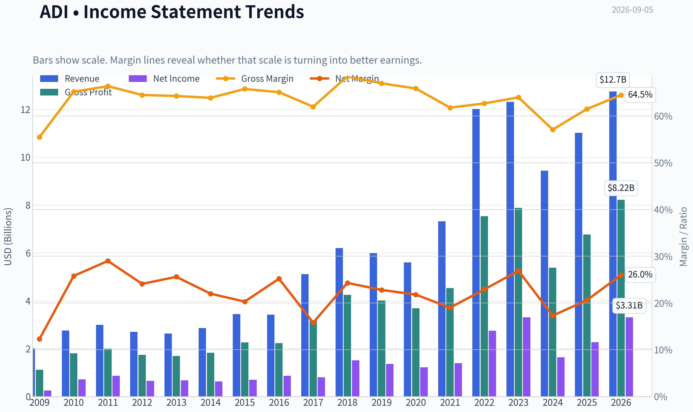
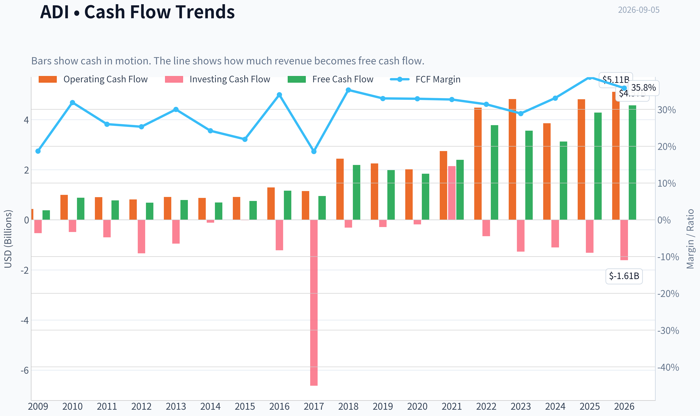
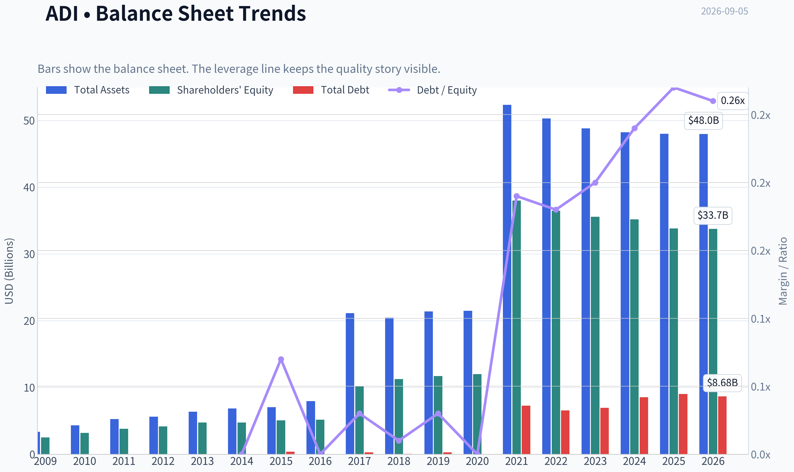
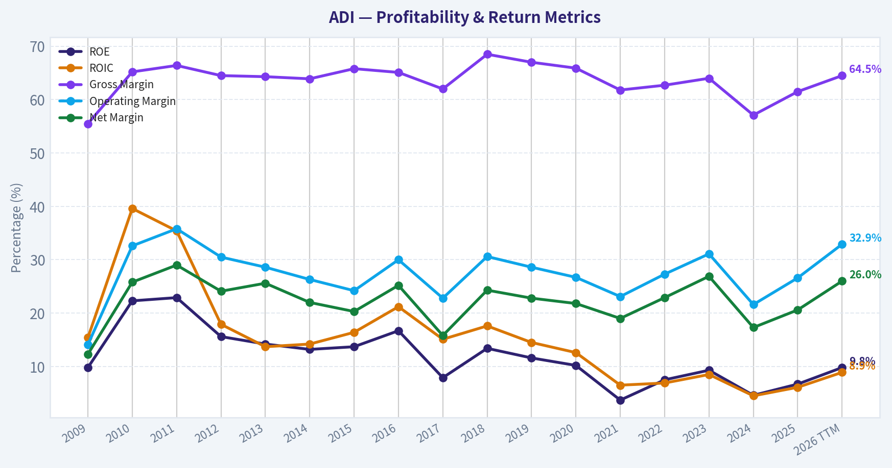
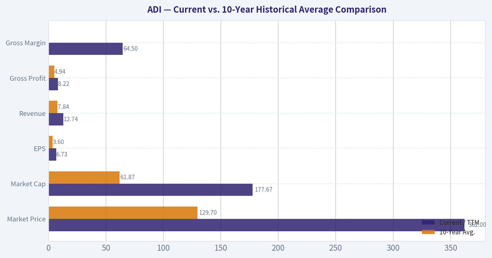
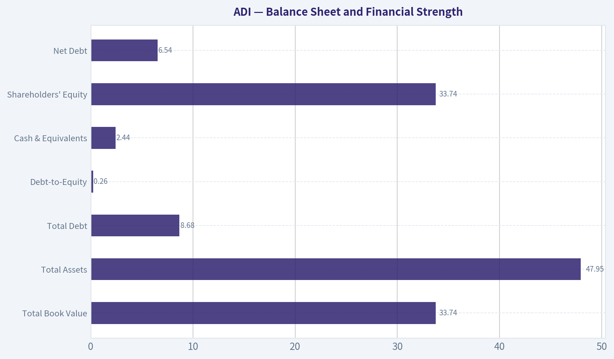
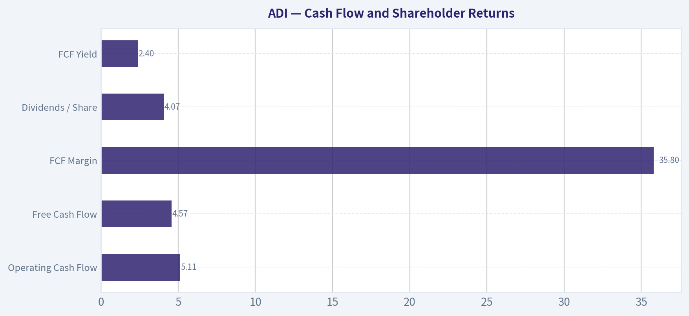
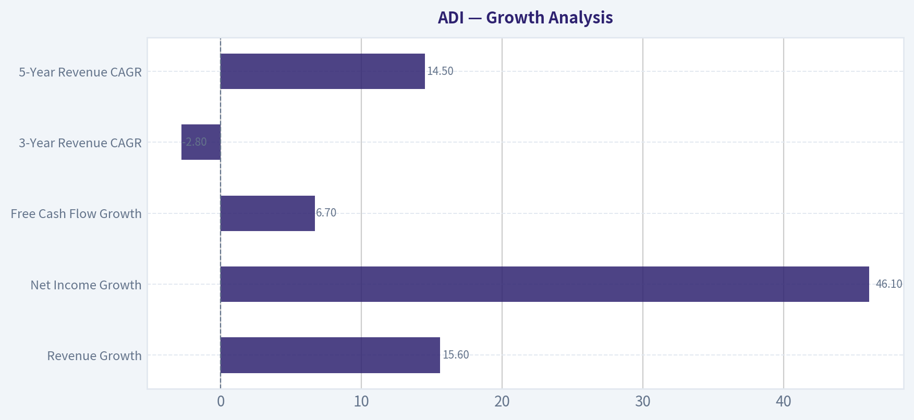
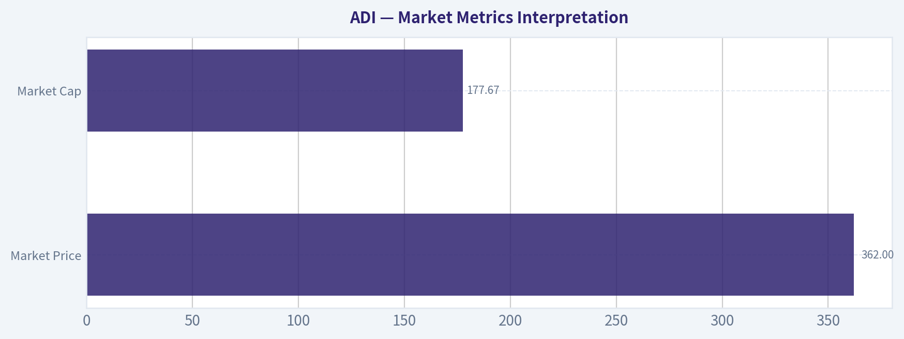

# ADI Deep Value Intelligence

**Analysis Date:** 2026-09-05

## Critical Disclaimer

*This analysis is generated by Deep Value Intelligence, an AI-powered multi-agent investing framework. Education & research only - not financial advice, not a financial advisor.*

---

## Table of Contents

1. Intelligence Summary
2. Analyst Team Reports
   - Fundamentals Analysis
   - Intrinsic Value Analysis (Buffett)
   - Trend & Growth Analysis (Lynch/Druckenmiller/Fisher)
   - Market Technical Analysis
   - Options Market Analysis
3. Research Team Commentary
4. Value Investing Team Commentary
5. Deep Values Commentary

---

## Intelligence Summary

### Thesis + Conditions

**Core Thesis:** **Executive Summary**
Analog Devices (ADI) is an elite, wide-moat franchise, but the current entry at $362 lacks a margin of safety. The business boasts immense pricing power (61.5% gross margin), but the stock is trading at a stretched 43x P/E while momentum cools below its 50-day SMA.

**Key Risks:**
- Analog Devices (ADI) is an elite, wide-moat franchise, but the current entry at $362 lacks a margin of safety. The business boasts immense pricing power (61.5% gross margin), but the stock is trading at a stretched 43x P/E while momentum cools below its 50-day SMA. As past lessons dictate, we must separate business quality from entry quality. Paying peak multiples for a semiconductor cyclical during a technical digestion phase is an asymmetric risk. We will not chase; we require either a pullback to proven support (200-day SMA near $350) or a confirmed momentum breakout above $376.
- The Bull (Risky Analyst):** Argues that GAAP ROE (6.7%) and ROIC (6.1%) are heavily distorted by non-cash amortization from the $21B Maxim Integrated acquisition. The 61.5% gross margin proves the company's "toll bridge" moat. Secular tailwinds in electrification and edge AI make a 15% growth rate the floor, justifying the premium multiple.
- The Bear (Safe Analyst):** Counters that 43x P/E prices in flawless execution and completely ignores the inherent cyclicality of the semiconductor industry. Furthermore, the stock is currently in a corrective phase, trapped below its 50-day moving average. Buying now risks a severe multiple contraction if industrial recovery slows.

**Confidence:** Medium

---

## Analyst Team Reports

### Fundamentals Analysis

#### Latest Earnings Snapshot

*Most recent reported quarter anchored on 2026 Q2, with prior-year comparison when available.*

| Metric | 2026 Q2 | 2025 Q2 | YoY Change |
| --- | ---: | ---: | ---: |
| Revenue | $3.62B | $2.64B | +37.2% |
| Operating Income | $1.38B | $679.7M | +103.0% |
| Net Income | $1.18B | $569.8M | +106.5% |
| Diluted EPS | $2.40 | $1.14 | +110.5% |
| Operating Cash Flow | $872.0M | $819.5M | +6.4% |
| Free Cash Flow | $734.3M | $729.2M | +0.7% |

Key Takeaways: This snapshot anchors the most recent reported quarter before the narrative analysis. It helps readers separate long-run business quality from whatever changed in the latest earnings print.

#### 17-Year Financial Metrics for ADI

*All values below are computed deterministically from raw data - not estimated by AI.*

*Issuer profile: operating company (Technology / Semiconductors).*

#### 17-Year Financial Metrics
*Annual rows come from reported financial statements. The final TTM row is computed from the latest four quarters.*

| Metric | 2009 | 2010 | 2011 | 2012 | 2013 | 2014 | 2015 | 2016 | 2017 | 2018 | 2019 | 2020 | 2021 | 2022 | 2023 | 2024 | 2025 | 2026 TTM |
| --- | --- | --- | --- | --- | --- | --- | --- | --- | --- | --- | --- | --- | --- | --- | --- | --- | --- | --- |
| Market Price | $17 | $24 | $26 | $29 | $38 | $39 | $49 | $53 | $78 | $73 | $94 | $107 | $160 | $134 | $150 | $217 | $231 | $362 |
| Market Cap | $7.50B | $10.30B | $11.27B | $11.98B | $15.48B | $15.78B | $19.05B | $20.02B | $32.00B | $31.39B | $39.76B | $44.09B | $69.62B | $74.62B | $79.60B | $111.26B | $116.29B | $177.67B |
| P/E Ratio | 30.15 | 14.45 | 13.01 | 18.37 | 23.04 | 25.08 | 27.34 | 23.23 | 39.73 | 20.83 | 29.17 | 36.14 | 50.14 | 27.17 | 24.02 | 68.02 | 51.34 | 53.83 |
| P/B Ratio | 2.97 | 3.22 | 2.97 | 2.88 | 3.27 | 3.32 | 3.76 | 3.88 | 3.15 | 2.79 | 3.40 | 3.67 | 1.83 | 2.05 | 2.24 | 3.16 | 3.44 | 5.27 |
| ROE | 9.8% | 22.3% | 22.9% | 15.6% | 14.2% | 13.2% | 13.7% | 16.7% | 7.9% | 13.4% | 11.6% | 10.2% | 3.7% | 7.5% | 9.3% | 4.6% | 6.7% | 9.8% |
| ROIC | 15.4% | 39.6% | 35.4% | 17.9% | 13.7% | 14.2% | 16.4% | 21.2% | 15.1% | 17.6% | 14.5% | 12.6% | 6.5% | 6.9% | 8.5% | 4.5% | 6.1% | 8.9% |
| EPS | $0.58 | $1.63 | $2.02 | $1.58 | $1.64 | $1.56 | $1.78 | $2.29 | $1.95 | $3.49 | $3.24 | $2.97 | $3.18 | $4.92 | $6.25 | $3.18 | $4.56 | $6.73 |
| Revenue | $2.01B | $2.76B | $2.99B | $2.70B | $2.63B | $2.86B | $3.44B | $3.42B | $5.11B | $6.20B | $5.99B | $5.60B | $7.32B | $12.01B | $12.31B | $9.43B | $11.02B | $12.74B |
| Gross Profit | $1.12B | $1.80B | $1.99B | $1.74B | $1.69B | $1.83B | $2.26B | $2.23B | $3.17B | $4.25B | $4.01B | $3.69B | $4.53B | $7.53B | $7.88B | $5.38B | $6.77B | $8.22B |
| Gross Margin | 55.5% | 65.2% | 66.4% | 64.5% | 64.3% | 63.9% | 65.8% | 65.1% | 62.0% | 68.5% | 67.0% | 65.9% | 61.8% | 62.7% | 64.0% | 57.1% | 61.5% | 64.5% |
| Operating Margin | 14.1% | 32.6% | 35.8% | 30.5% | 28.6% | 26.3% | 24.2% | 30.0% | 22.8% | 30.6% | 28.6% | 26.7% | 23.1% | 27.3% | 31.1% | 21.6% | 26.6% | 32.9% |
| Net Income | $247.8M | $712.1M | $867.4M | $651.2M | $673.5M | $629.3M | $696.9M | $861.7M | $805.4M | $1.51B | $1.36B | $1.22B | $1.39B | $2.75B | $3.31B | $1.64B | $2.27B | $3.31B |
| Net Margin | 12.3% | 25.8% | 29.0% | 24.1% | 25.6% | 22.0% | 20.3% | 25.2% | 15.8% | 24.3% | 22.8% | 21.8% | 19.0% | 22.9% | 26.9% | 17.3% | 20.6% | 26.0% |
| Revenue Growth | N/A | 37.1% | 8.4% | -9.8% | -2.5% | 8.8% | 19.9% | -0.4% | 49.3% | 21.4% | -3.4% | -6.5% | 30.6% | 64.2% | 2.4% | -23.4% | 16.9% | 15.6% |
| Net Income Growth | N/A | 187.4% | 21.8% | -24.9% | 3.4% | -6.6% | 10.7% | 23.6% | -6.5% | 87.1% | -9.6% | -10.4% | 13.9% | 97.7% | 20.6% | -50.7% | 38.7% | 46.1% |
| Free Cash Flow Growth | N/A | 133.9% | -11.6% | -12.2% | 15.7% | -12.1% | 8.7% | 54.4% | -18.4% | 130.2% | -9.6% | -6.8% | 29.8% | 57.9% | -5.8% | -12.2% | 37.0% | 6.7% |
| Total Book Value | $2.53B | $3.20B | $3.80B | $4.17B | $4.74B | $4.76B | $5.07B | $5.17B | $10.16B | $11.27B | $11.71B | $12.00B | $37.99B | $36.47B | $35.57B | $35.18B | $33.82B | $33.74B |
| Total Assets | $3.37B | $4.33B | $5.28B | $5.62B | $6.38B | $6.86B | $7.06B | $7.97B | $21.14B | $20.44B | $21.39B | $21.47B | $52.32B | $50.30B | $48.79B | $48.23B | $47.99B | $47.95B |
| Total Debt | N/A | N/A | N/A | N/A | N/A | $0 | $374.6M | $0 | $300.0M | $67.0M | $299.7M | $0 | $7.29B | $6.55B | $6.95B | $8.53B | $9.04B | $8.68B |
| Debt-to-Equity | N/A | N/A | N/A | N/A | N/A | 0.00 | 0.07 | 0.00 | 0.03 | 0.01 | 0.03 | 0.00 | 0.19 | 0.18 | 0.20 | 0.24 | 0.27 | 0.26 |
| Cash & Equivalents | $1.07B | $1.41B | $1.41B | $528.8M | $392.1M | $569.2M | $884.4M | $921.1M | $1.05B | $816.6M | $648.3M | $1.06B | $1.98B | $1.47B | $958.1M | $1.99B | $2.50B | $2.44B |
| Shareholders' Equity | $2.53B | $3.20B | $3.80B | $4.17B | $4.74B | $4.76B | $5.07B | $5.17B | $10.16B | $11.27B | $11.71B | $12.00B | $37.99B | $36.47B | $35.57B | $35.18B | $33.82B | $33.74B |
| Operating Cash Flow | $432.1M | $991.2M | $900.5M | $814.5M | $912.3M | $871.6M | $907.8M | $1.29B | $1.15B | $2.44B | $2.25B | $2.01B | $2.74B | $4.48B | $4.82B | $3.85B | $4.81B | $5.11B |
| Investing Cash Flow | $-534.7M | $-485.8M | $-703.7M | $-1.34B | $-949.9M | $-114.8M | $-17.1M | $-1.22B | $-6.62B | $-314.0M | $-293.2M | $-180.5M | $2.14B | $-657.4M | $-1.27B | $-1.10B | $-1.32B | $-1.61B |
| Free Cash Flow | $376.1M | $879.6M | $777.5M | $682.4M | $789.3M | $693.7M | $753.8M | $1.16B | $950.3M | $2.19B | $1.98B | $1.84B | $2.39B | $3.78B | $3.56B | $3.12B | $4.28B | $4.57B |
| FCF Margin | 18.7% | 31.9% | 26.0% | 25.3% | 30.0% | 24.2% | 21.9% | 34.0% | 18.6% | 35.3% | 33.0% | 32.9% | 32.7% | 31.4% | 28.9% | 33.1% | 38.8% | 35.8% |
| Dividends / Share | $0.00 | $0.00 | $0.00 | $0.00 | $0.00 | $0.00 | $0.00 | $0.00 | $0.00 | $0.00 | $0.00 | $0.00 | $0.00 | $2.77 | $3.17 | $3.50 | $3.87 | $4.07 |

#### Profitability Metrics
- Return on Equity (ROE): 6.7%
- Return on Invested Capital (ROIC): 6.1%
- Return on Assets (ROA): 4.7%
- Gross Margin: 61.5%
- Operating Margin: 26.6%
- Net Profit Margin: 20.6%

#### Liquidity Metrics
- Current Ratio: 2.19
- Quick Ratio: 1.57

#### Leverage Metrics
- Debt-to-Equity Ratio: 0.27
- Interest Coverage Ratio: 9.23
- Net Debt: $6.54B

#### Growth Metrics (Year-over-Year)
- Revenue Growth: 16.9%
- Net Income Growth: 38.7%
- Free Cash Flow Growth: 37.0%
- Revenue CAGR (3-Year): -2.8%
- Revenue CAGR (5-Year): 14.5%

#### Valuation Metrics
- P/E Ratio (TTM): 43.07
- Forward P/E: 22.17
- Price-to-Book: 5.23
- Price-to-Sales: 12.64
- PEG Ratio: 0.53
- EV/EBITDA: 26.34
- Free Cash Flow Yield: 2.4%
- Earnings Yield: 2.3%

#### Owner Earnings (Buffett Method, Code-Computed)
- Net Income: $2.27B
- + Depreciation & Amortization: $2.00B
- - Capital Expenditures: $-533.6M
- - Working Capital Changes: $481.0M
- = **Owner Earnings: $3.25B**

#### Intrinsic Value (Code-Computed)
- Current Price: $362
- **Headline Intrinsic Value (business-model routed): $140**
  Business model: asset light platform - weighted blend [Damodaran FCFF + reverse-DCF fair + owner-earnings DCF] (asset_light_platform)
  Model spread (min-max across DCFs): $92 - $243
  Margin of safety vs. price (headline): -159.3%
  Routing note: Asset-light / high-margin platform: value driven by margins and reinvestment economics - the headline centers on the reverse-DCF demonstrated-growth fair value with Damodaran FCFF as a floor, down-weighting the owner-earnings DCF.
- Buffett Method (Owner Earnings):
  Conservative: $52
  Average: $243
  Optimistic: $243
- Cash Flow Method (FCF):
  Conservative: $61
  Average: $197
  Optimistic: $282
- Damodaran FCFF (WACC + margins + reinvestment):
  Conservative: $46
  Average: $92
  Optimistic: $161
  Monte Carlo band (P10-P90): $61 - $132 (median $88)
  P(intrinsic value > price): 0.0%
- Reverse-DCF: price implies ~30.6%/yr owner-earnings growth for 10y; trailing 3y was -14.7%, 5y 25.2%.

#### Piotroski F-Score: 8/9
- Positive Net Income: PASS
- Positive Operating Cash Flow: PASS
- ROA Improvement: PASS
- Cash Flow > Net Income: PASS
- Decreasing Debt: FAIL
- Improving Current Ratio: PASS
- No Dilution: PASS
- Improving Gross Margin: PASS
- Improving Asset Turnover: PASS

ANALYST STANCE: **AVOID**

#### Analog Devices, Inc. (ADI) - Buffett-Style Fundamental Analysis

Analog Devices is a high-quality analog and mixed-signal semiconductor company with strong gross margins, durable customer relationships, and exposure to long-cycle industrial, automotive, communications, and data-center infrastructure markets. The business has many Buffett-like qualities: mission-critical products, high switching costs, long product life cycles, strong free cash flow conversion, and a conservatively leveraged balance sheet.

However, the current valuation is the central problem. At a current price of **$362**, ADI trades well above both its historical valuation norms and the deterministic model-based intrinsic value estimate of approximately **$140 per share**. The stock price implies roughly **30.6% annual owner-earnings growth for 10 years**, which appears demanding for a cyclical semiconductor business even one of ADI's quality.

---

#### Revenue Breakdown

| Revenue Source | Amount | % of Total |
|---|---:|---:|
| Industrial | ~$6.4B | ~50% |
| Automotive | ~$3.1B | ~24% |
| Communications | ~$1.7B | ~13% |
| Consumer | ~$1.5B | ~12% |
| **Total / TTM Revenue** | **$12.74B** | **100%** |

Key Takeaways: ADI's revenue base is diversified, but the company is most exposed to industrial and automotive end markets. These are attractive long-duration markets because analog chips are often mission-critical, designed into products for years, and less subject to rapid obsolescence than digital logic chips. The main risk is that industrial and automotive semiconductor demand remains cyclical, even when the company's product quality is high.

---

#### Current vs. 10-Year Historical Average Comparison

| Metric | Current / TTM | 10-Year Avg. | Current Standing |
|---|---:|---:|---|
| Market Price | $362 | $129.70 | Far above history |
| Market Cap | $177.67B | $61.87B | Far above history |
| P/E Ratio | 43.07 current valuation metric / 53.83 table TTM | ~37.0 | Expensive vs. history |
| P/B Ratio | 5.23-5.27 | ~3.0 | Elevated, but less meaningful for IP-heavy semiconductors |
| ROE | 9.8% TTM / 6.7% latest annual | ~9.2% | Near average on TTM, weak on latest annual |
| ROIC | 8.9% TTM / 6.1% latest annual | ~11.4% | Below historical norm |
| EPS | $6.73 | $3.60 | Strong above-average earnings recovery |
| Revenue | $12.74B | $7.84B | Well above history |
| Gross Profit | $8.22B | $4.94B | Well above history |
| Gross Margin | 64.5% | ~63.6% | Slightly above average |
| Operating Margin | 32.9% | ~27.2% | Very strong |
| Net Income | $3.31B | $1.71B | Well above average |
| Net Margin | 26.0% | ~21.7% | Strong above average |
| Revenue Growth | 15.6% TTM / 16.9% latest annual | ~15.1% | In line with historical average |
| Net Income Growth | 46.1% TTM / 38.7% latest annual | ~20.4% | Strong cyclical rebound |
| FCF Growth | 6.7% TTM / 37.0% latest annual | ~25.7% | TTM growth below long-term average |
| Total Book Value | $33.74B | $22.93B | Above average due acquisitions and retained capital |
| Total Assets | $47.95B | $34.00B | Above average |
| Total Debt | $8.68B | $3.90B | Above average |
| Debt-to-Equity | 0.26 | ~0.12 | Higher but still manageable |
| Cash & Equivalents | $2.44B | $1.34B | Strong liquidity |
| Shareholders' Equity | $33.74B | $22.93B | Above average |
| Free Cash Flow | $4.57B | $2.53B | Strong above average |
| Dividends / Share | $4.07 | $1.33 | Meaningfully higher shareholder return |

Key Takeaways: ADI's operating performance is strong, with revenue, earnings, free cash flow, and margins all above the 10-year average. The issue is that the stock price and market capitalization have risen much faster than normalized intrinsic value. Profitability quality remains good, but ROIC is below its historical average, while valuation multiples are elevated.

---

#### Market Metrics Interpretation

| Metric | Current Reading | Buffett-Style Interpretation |
|---|---:|---|
| Market Price | $362 | The market is pricing ADI as a premium compounder with a long growth runway. |
| Market Cap | $177.67B | Enterprise value has expanded dramatically relative to the company's earnings base. |
| P/E Ratio | 43.07 current valuation metric; 53.83 table TTM | Expensive relative to ADI's own history and demanding for a cyclical semiconductor business. |
| P/B Ratio | ~5.23-5.27 | Elevated, but book value is not the best valuation anchor for an asset-light, IP-rich semiconductor company. |

Key Takeaways: ADI's valuation is the clearest red flag. P/B should not be interpreted mechanically because ADI's value comes from intellectual property, customer relationships, product design wins, and free cash flow, not from tangible book value. A cash-flow-based intrinsic value approach is more appropriate, and that approach suggests the current price is well above fair value.

---

#### Profitability Analysis

ADI's profitability profile remains high quality. The company's **TTM gross margin of 64.5%** is slightly above its 10-year average, showing strong pricing power and product differentiation. The **TTM operating margin of 32.9%** is especially impressive and materially above the historical average of roughly 27%.

However, Buffett would focus heavily on returns on capital. ADI's **TTM ROIC of 8.9%** is below its 10-year average of roughly 11.4%, and the latest annual ROIC of **6.1%** is weaker still. This does not destroy the quality thesis, but it does suggest the market is valuing ADI as if returns and growth will accelerate materially from current levels.

| Profitability Metric | Current / TTM | Interpretation |
|---|---:|---|
| ROE | 9.8% TTM / 6.7% latest annual | Acceptable but not exceptional for a premium-priced compounder |
| ROIC | 8.9% TTM / 6.1% latest annual | Below historical norm; important valuation concern |
| EPS | $6.73 TTM | Strong recovery from 2024-2025 weakness |
| Revenue | $12.74B TTM | Scale is materially larger than historical levels |
| Gross Profit | $8.22B TTM | Strong evidence of product quality and pricing power |
| Operating Margin | 32.9% TTM | Excellent operating leverage |
| Net Income | $3.31B TTM | Recovered to near 2023 peak levels |
| Net Margin | 26.0% TTM | Strong and above average |

Key Takeaways: ADI is a very profitable business with excellent margins and strong cash generation. The weakness is not the quality of the income statement, but the return-on-capital profile relative to the valuation. Buffett would likely admire the business but question whether the current price leaves enough room for error.

---

#### Growth Analysis

ADI's growth has been meaningful but uneven. Revenue expanded from **$3.42B in 2016** to **$12.74B TTM**, helped by acquisitions, automotive and industrial demand, and broader analog content growth. However, the path was not smooth: revenue declined in 2019, 2020, and 2024, reflecting semiconductor cyclicality.

The latest recovery is strong, with **TTM revenue growth of 15.6%**, **net income growth of 46.1%**, and **FCF growth of 6.7%**. But the reverse-DCF implication is severe: the current price requires approximately **30.6% annual owner-earnings growth for 10 years**, far above the company's normalized long-term growth profile.

| Growth Metric | Current / TTM | 10-Year Avg. | Interpretation |
|---|---:|---:|---|
| Revenue Growth | 15.6% | ~15.1% | In line with history |
| Net Income Growth | 46.1% | ~20.4% | Strong rebound from cyclical trough |
| Free Cash Flow Growth | 6.7% | ~25.7% | Positive but below historical average |
| 3-Year Revenue CAGR | -2.8% | N/A | Shows recent cyclicality |
| 5-Year Revenue CAGR | 14.5% | N/A | Solid medium-term expansion |

Key Takeaways: ADI has grown substantially over the decade, but growth has been cyclical rather than perfectly predictable. The current market price appears to capitalize a very strong growth outlook. That creates downside risk if revenue or margins normalize.

---

#### Balance Sheet and Financial Strength

ADI's balance sheet is solid, though debt has increased meaningfully since the large-scale expansion of the business. Total debt is **$8.68B TTM**, compared with a 10-year average of approximately **$3.90B**. The **debt-to-equity ratio of 0.26** remains conservative, and interest coverage of **9.23x** indicates manageable debt service.

Cash and equivalents of **$2.44B** provide flexibility. Net debt is approximately **$6.54B**, which is not alarming given ADI's free cash flow generation of **$4.57B TTM**. Buffett would likely view the balance sheet as acceptable, but not a reason to pay any price.

| Balance Sheet Metric | Current / TTM | Buffett-Style View |
|---|---:|---|
| Total Book Value | $33.74B | Large equity base, but book value is not the best valuation tool here |
| Total Assets | $47.95B | Reflects expanded scale after acquisitions |
| Total Debt | $8.68B | Higher than historical average but manageable |
| Debt-to-Equity | 0.26 | Conservative leverage |
| Cash & Equivalents | $2.44B | Healthy liquidity |
| Shareholders' Equity | $33.74B | Stable capital base |
| Net Debt | $6.54B | Manageable relative to FCF |

Key Takeaways: ADI's financial position is healthy. Debt has risen, but not to a dangerous level, and the company produces enough free cash flow to support dividends, reinvestment, and debt reduction. The balance sheet does not justify an avoid stance by itself; the avoid stance is driven mainly by valuation.

---

#### Cash Flow and Shareholder Returns

Free cash flow is one of ADI's strongest qualities. TTM FCF is **$4.57B**, well above the 10-year average of approximately **$2.53B**. FCF margin is also excellent at **35.8% TTM**, demonstrating the capital efficiency of ADI's analog semiconductor model.

Dividends per share increased to **$4.07 TTM**, reflecting management's confidence in recurring cash flow. The dividend is attractive as a quality signal, but the implied dividend yield is modest at the current share price.

| Cash Flow Metric | Current / TTM | Interpretation |
|---|---:|---|
| Operating Cash Flow | $5.11B | Strong cash generation |
| Free Cash Flow | $4.57B | Excellent absolute level and above historical average |
| FCF Margin | 35.8% | Very strong cash conversion |
| Dividends / Share | $4.07 | Rising shareholder return |
| FCF Yield | 2.4% | Low yield due to high stock price |

Key Takeaways: ADI converts earnings into cash at a high rate, which is exactly what Buffett looks for. The problem is that the market is already assigning a very high value to that cash flow. A 2.4% free cash flow yield leaves little margin of safety.

---

#### Buffett-Style Economic Moat Assessment

| Moat Factor | Assessment |
|---|---|
| Switching Costs | High; analog components are often designed into customer systems and difficult to replace quickly |
| Product Durability | Strong; analog chips often have long product life cycles |
| Customer Diversification | Good; broad industrial, automotive, communications, and consumer exposure |
| Pricing Power | Strong; gross margins above 60% indicate differentiated products |
| Cyclicality | Moderate to high; semiconductor demand remains cyclical |
| Capital Intensity | Moderate; strong FCF margins suggest attractive economics |
| Competitive Position | Strong; ADI is one of the leading global analog semiconductor companies |

Key Takeaways: ADI has a real economic moat. Its products are specialized, embedded, and mission-critical, which supports strong margins and customer stickiness. The moat is not the issue; the issue is the price being paid for that moat.

---

#### Buffett-Style Owner Earnings DCF Valuation

The deterministic dataset computes Buffett-style owner earnings as follows:

| Owner Earnings Component | Amount |
|---|---:|
| Net Income | $2.27B |
| Add: Depreciation & Amortization | $2.00B |
| Less: Capital Expenditures | $533.6M |
| Less: Working Capital Changes | $481.0M |
| **Owner Earnings** | **$3.25B** |

Key Takeaways: ADI's owner earnings are strong and demonstrate high cash conversion. The company does not require excessive capital expenditure relative to its earnings power. This supports the quality thesis, but valuation still depends on the price paid for these owner earnings.

Assumptions used for the hand DCF sanity check:

| DCF Assumption | Value |
|---|---:|
| Starting Owner Earnings | $3.25B |
| Discount Rate | 10.0% |
| Terminal Growth Rate | 2.5% |
| Estimated Shares Outstanding | ~491M |
| Net Debt Adjustment | ~$6.54B |
| Current Price | $362 |

Key Takeaways: The DCF uses a Buffett-style 10% hurdle rate and a conservative terminal growth rate. High near-term growth is faded toward the terminal rate rather than assumed permanently. This is important because no semiconductor company should be valued as if peak growth can continue forever.

---

#### Scenario 1 - Conservative Owner Earnings DCF

Assumptions:

| Item | Assumption |
|---|---|
| Years 1-10 Growth | 3.0% annually |
| Terminal Growth | 2.5% |
| Rationale | GDP-like growth to reflect cyclicality and avoid over-extrapolating rebound earnings |

Calculation:

| DCF Step | Value |
|---|---:|
| Present Value of Explicit 10-Year Owner Earnings | ~$23.1B |
| Year 10 Owner Earnings | ~$4.37B |
| Terminal Value at Year 10 | ~$59.7B |
| Present Value of Terminal Value | ~$23.0B |
| Enterprise / Business Value | ~$46.1B |
| Less Net Debt | ~$6.5B |
| Equity Value | ~$39.6B |
| Fair Value / Share | **~$81** |

Key Takeaways: Under a conservative growth case, ADI's valuation is far below the current price. This scenario is not predicting business failure; it simply assumes normal growth and a reasonable required return. At $362, the stock offers no margin of safety under conservative assumptions.

---

#### Scenario 2 - Average / Base-Case Owner Earnings DCF

Assumptions:

| Item | Assumption |
|---|---|
| Years 1-5 Growth | 12.0% annually |
| Years 6-10 Growth | 6.0% annually |
| Terminal Growth | 2.5% |
| Rationale | Reflects ADI's strong moat, 5-year revenue CAGR, and high margins, while fading growth as scale increases |

Calculation:

| DCF Step | Value |
|---|---:|
| Present Value of Explicit 10-Year Owner Earnings | ~$33.1B |
| Year 10 Owner Earnings | ~$7.67B |
| Terminal Value at Year 10 | ~$104.8B |
| Present Value of Terminal Value | ~$40.4B |
| Enterprise / Business Value | ~$73.5B |
| Less Net Debt | ~$6.5B |
| Equity Value | ~$67.0B |
| Fair Value / Share | **~$136** |

Key Takeaways: The base case gives ADI credit for a durable moat and strong growth, but it still does not come close to the current market price. This is broadly consistent with the deterministic model's headline intrinsic value of roughly $140. The market is pricing in a much more aggressive outcome than this base case.

---

#### Scenario 3 - Optimistic Owner Earnings DCF

Assumptions:

| Item | Assumption |
|---|---|
| Years 1-5 Growth | 18.0% annually |
| Years 6-10 Growth | Fades from 10% to 3% |
| Terminal Growth | 2.5% |
| Rationale | Bull case assumes strong industrial, automotive, data-center, and automation demand, but still fades to mature growth |

Calculation:

| DCF Step | Value |
|---|---:|
| Present Value of Explicit 10-Year Owner Earnings | ~$41.7B |
| Year 10 Owner Earnings | ~$10.03B |
| Terminal Value at Year 10 | ~$137.1B |
| Present Value of Terminal Value | ~$52.9B |
| Enterprise / Business Value | ~$94.5B |
| Less Net Debt | ~$6.5B |
| Equity Value | ~$88.0B |
| Fair Value / Share | **~$179** |

Key Takeaways: Even an optimistic scenario does not justify the current price. The business would have to compound owner earnings at very high rates for a long period to make today's valuation work. This reinforces the reverse-DCF warning that the market is already pricing in exceptional execution.

---

#### Intrinsic Value Cross-Check

| Valuation Method | Estimated Fair Value / Share |
|---|---:|
| Hand DCF - Conservative | ~$81 |
| Hand DCF - Base Case | ~$136 |
| Hand DCF - Optimistic | ~$179 |
| Deterministic Owner Earnings DCF | $52-$243 |
| Deterministic FCF DCF | $61-$282 |
| Damodaran FCFF Model | $46-$161 |
| Deterministic Headline Intrinsic Value | **~$140** |
| Current Price | **$362** |

Key Takeaways: Multiple valuation methods point to a fair value materially below the current share price. The deterministic headline intrinsic value is approximately $140, while the current price is $362. The margin of safety is negative, meaning the investor is paying far above estimated intrinsic value.

---

#### Warren Buffett-Style Qualitative Judgment

| Category | Assessment |
|---|---|
| Economic Moat | Strong; high switching costs, long product cycles, differentiated analog IP |
| Financial Strength | Good; leverage is manageable and liquidity is healthy |
| Predictable Earnings | Moderate; long-term earnings power is strong, but semiconductor cycles create volatility |
| Management Performance | Good cash generation and rising dividends, but ROIC is currently below historical norms |
| Capital Allocation | Generally shareholder-friendly; dividends rising, but valuation limits buyback attractiveness |
| Business Quality | High; strong margins, strong FCF, durable customer relationships |
| Valuation | Unattractive; current price is far above intrinsic value estimates |
| Margin of Safety | Negative |

Key Takeaways: ADI is the type of business Buffett would likely respect but not necessarily buy at any price. The company has strong economics and a defensible competitive position. The investment problem is that the market valuation already reflects a very optimistic future.

---

#### Key Investment Insights

| Category | Insight |
|---|---|
| Business Quality | ADI is a high-quality analog semiconductor franchise with strong margins and durable customer demand. |
| Valuation Risk | The stock trades at a premium P/E, low FCF yield, and materially above DCF-based fair value. |
| Growth Expectations | The current price implies about 30.6% owner-earnings growth for 10 years, which is very demanding. |
| Cash Flow | FCF of $4.57B and FCF margin of 35.8% are excellent. |
| Balance Sheet | Debt is higher than historical norms but still manageable. |
| Moat | Strong switching costs and long product cycles support durable economics. |
| Cyclicality | Recent revenue and earnings volatility show that ADI is not immune to semiconductor cycles. |
| Dividend | Dividend growth is positive, but yield is not enough to offset valuation risk. |

Key Takeaways: The investment case is a classic conflict between quality and price. ADI is a strong business with attractive long-term economics, but the current valuation prices in too much optimism. Long-term investors should separate admiration for the company from willingness to buy the stock at today's price.

---

#### Red Flags and Opportunities

| Type | Point | Importance |
|---|---|---|
| Red Flag | Current price is far above headline intrinsic value of ~$140 | High |
| Red Flag | Reverse DCF implies ~30.6% annual owner-earnings growth for 10 years | High |
| Red Flag | ROIC remains below its 10-year average | Medium |
| Red Flag | Debt is above historical average | Medium |
| Red Flag | Semiconductor demand remains cyclical | Medium |
| Opportunity | Industrial and automotive analog content growth | High |
| Opportunity | Data-center power, signal chain, and automation exposure | Medium to high |
| Opportunity | Strong FCF conversion supports dividends and reinvestment | High |
| Opportunity | Margin recovery could support earnings upside | Medium |
| Opportunity | A major valuation pullback could create an attractive entry point | High |

Key Takeaways: The biggest risk is not business deterioration but overpayment. ADI has credible growth opportunities, especially in industrial automation, automotive electronics, and infrastructure. But those opportunities appear more than fully reflected in the current share price.

---

#### Final Investment Stance: AVOID

ADI is a high-quality company, but at **$362 per share**, the stock does not offer a Buffett-style margin of safety. The deterministic headline intrinsic value is approximately **$140**, and even an optimistic hand-built owner-earnings DCF produces a value materially below the current price. The company's moat, margins, and cash flow are attractive, but the valuation requires an aggressive growth trajectory that may be difficult to sustain through semiconductor cycles.

For existing holders, ADI may remain a quality compounder, but new capital should wait for a much better entry point. A more attractive Buffett-style setup would require either a substantial price decline or clear evidence that owner earnings can compound at an unusually high rate for many years without major cyclicality.

| Final Summary Point | Assessment |
|---|---|
| Business Quality | High |
| Moat | Strong |
| Balance Sheet | Solid |
| Cash Flow | Excellent |
| Earnings Predictability | Moderate |
| Valuation | Unattractive |
| Margin of Safety | Negative |
| Intrinsic Value Anchor | ~$140 per share |
| Current Price | $362 |
| Final Stance | **AVOID** |

Key Takeaways: ADI is an excellent company trading at a difficult valuation. The stock price is far above reasonable intrinsic value estimates, and the implied growth expectations are very high. Buffett-style investors should avoid initiating at this level and wait for a materially better margin of safety.

#### Fundamental Visuals

This graph tracks the profitability and return metrics (ROE, ROIC, Margins) of **ADI** over the past decade, highlighting capital efficiency trends.

This chart illustrates the financial health of **ADI** over the last 10 years, mapping cash equivalents and free cash flow against total obligations (Debt).

---

### Intrinsic Value Analysis (Buffett)

> *Following Warren Buffett's value investing philosophy: Circle of Competence, Economic Moat, Management Quality, and Margin of Safety.*

#### Intrinsic Value Snapshot

Price is what you pay. Intrinsic value is what the business may be worth based on the cash it can create for owners over time. We show a range, not one magic number.

- Current Price: $362.25
- Value Range (conservative to optimistic across both DCF methods): $51.55 to $282.19

##### Owner Earnings (Buffett Method)
- Net Income: $2,267,342,000.00
- Depreciation & Amortization: $1,998,845,000.00
- Capital Expenditures: $-533,552,000.00
- Working Capital Changes: $481,009,000.00
- Owner Earnings: $3,251,626,000.00

##### Intrinsic Value
###### Buffett Method
Uses owner earnings. Stricter, and usually more conservative.
- Conservative: $51.55
- Average: $243.02
- Optimistic: $243.02
- Discount Rate: 10.0%

###### Cash Flow Method
Uses free cash flow. Better for companies spending heavily today to grow tomorrow.
- Conservative: $61.04
- Average: $197.15
- Optimistic: $282.19
- Discount Rate: 10.0%

ANALYST STANCE: **AVOID**

#### ADI Buffett-Style Investment Review - Analog Devices, Inc.

Analog Devices is a high-quality analog and mixed-signal semiconductor franchise with real competitive advantages: sticky design-ins, long product life cycles, high gross margins, and strong positioning in industrial, automotive, communications, and data-conversion markets. The problem is not the business; the problem is the price. At **$362 per share**, the stock is trading far above cash-flow-based intrinsic value estimates, and the reverse DCF implies growth expectations that are too heroic for even a strong analog semiconductor compounder.

---

#### 1. Factor Scorecard

| Factor | Score / 5 | Evidence |
|---|---:|---|
| Circle of Competence & Business Simplicity | 4.0 | ADI designs and sells analog, mixed-signal, power, and sensor chips used in industrial, automotive, communications, and consumer applications. The model is understandable: design specialized chips, win sockets, then enjoy long production cycles. Semiconductor cyclicality and technology change reduce perfect predictability. |
| Moat Test | 4.0 | Gross margin of **61.5%** indicates pricing power and specialized product value. ADI benefits from switching costs, design-in stickiness, long product lives, engineering know-how, and broad customer/application diversity. |
| Management Quality & Capital Allocation | 3.5 | Management has used acquisitions, notably Linear Technology and Maxim Integrated, to strengthen scale and portfolio breadth. Capital allocation is generally rational, but current ROE of **6.7%** is weak and suggests returns are not presently translating into exceptional shareholder economics. |
| Industry Structure | 3.5 | Analog semiconductors have better structure than many chip categories because products are specialized, less prone to rapid obsolescence, and often mission-critical. However, the industry remains cyclical and competitive, with Texas Instruments, NXP, Infineon, STMicroelectronics, and others competing aggressively. |
| Gate 5: Quality / Solvency Hard Floor | Not tripped | ADI does not show the combination of deteriorating fundamentals and solvency distress required for a hard avoid. Current ratio is **2.19**, free cash flow is positive, and the business remains financially viable. |

**Key Takeaways:** ADI scores well on business quality, simplicity, and moat durability. The company has the characteristics of a strong analog semiconductor franchise, not a distressed or structurally broken business. The core issue is valuation, not solvency or business viability.

---

#### 2. Moat Analysis

| Moat Source | Assessment | Evidence |
|---|---|---|
| Intangible Assets | Strong | ADI has deep engineering expertise, trusted product reliability, and a broad catalog of specialized analog and mixed-signal components. Gross margin of **61.5%** supports the presence of product differentiation and pricing power. |
| Switching Costs | Strong | Once ADI chips are designed into customer systems, switching can require redesign, testing, qualification, and regulatory or safety validation. This is especially important in industrial, automotive, medical, aerospace, and communications applications. |
| Cost Advantage | Moderate | Scale helps in R&D, distribution, manufacturing partnerships, and customer support. However, ADI does not have an unassailable cost advantage versus Texas Instruments or other large analog competitors. |
| Network Effects | Low | ADI does not have a classic network effect. Its moat comes from engineering trust, product breadth, switching costs, and embedded customer relationships rather than user-network scale. |
| Overall Moat Rating | Wide & Stable | The moat is real and durable, but not rapidly widening. Competition and semiconductor cycles keep the moat below the very best global compounders. |

**Key Takeaways:** ADI's moat is based on technical specialization, customer design-ins, high switching costs, and trusted reliability. The company's high gross margin is strong evidence that customers value its products and are not buying purely on price. This is a wide, stable moat, but not a monopoly-like or network-effect-driven moat.

---

#### 3. Management Quality Assessment

| Management Dimension | Assessment |
|---|---|
| Owner Orientation | Reasonably strong. ADI has historically emphasized long-term portfolio quality, disciplined market participation, dividends, and strategic consolidation. |
| Candor & Conservatism | Generally acceptable for a mature public semiconductor company. The business is understandable and reporting is not dependent on obscure financial engineering. |
| Capital Allocation | Mixed-to-good. Strategic acquisitions have expanded ADI's analog franchise, but acquisitions also added complexity and can depress near-term accounting returns. Current ROE of **6.7%** is not Buffett-like. |
| Shareholder Returns | ADI returns capital through dividends and buybacks, but buybacks are less attractive when the stock trades far above intrinsic value. |
| Overall Management Score | 3.5 / 5 |

**Key Takeaways:** Management appears capable and strategically rational, especially in building ADI into one of the leading analog semiconductor franchises. The main concern is not competence but whether capital is being deployed at sufficiently high incremental returns from today's valuation base. Buybacks at this valuation would not be owner-friendly.

---

#### 4. Financial Summary

| Metric | Current / Recent Figure |
|---|---:|
| Share Price | **$362** |
| Market Capitalization | **$175.53B** |
| P/E Ratio | **43.1x** |
| ROE | **6.7%** |
| Gross Margin | **61.5%** |
| Revenue Growth YoY | **16.9%** |
| Free Cash Flow Yield | **2.4%** |
| Current Ratio | **2.19** |
| 3-Year Growth Trend | **-14.7%** |
| 5-Year Growth Trend | **25.2%** |
| Headline Intrinsic Value | **$139.71** |
| Owner-Earnings DCF Value | **$243.02** |
| FCF DCF Value | **$197.15** |
| Damodaran FCFF Value | **$91.87** |
| Reverse-DCF Implied 10-Year Growth | **~30.6% per year** |

**Key Takeaways:** ADI's gross margin is excellent, confirming the quality of the franchise. However, the valuation is demanding: a **43x P/E** and **2.4% FCF yield** leave little room for disappointment. The market price embeds growth assumptions that appear far above what a mature analog semiconductor business can reliably deliver.

---

#### 5. Owner Earnings Calculation

| Owner Earnings Component | Treatment |
|---|---|
| Net Income | Starting point for owner earnings |
| Plus: Depreciation & Amortization | Added back because it is a non-cash charge |
| Less: Maintenance CapEx | Deducted to reflect spending required to preserve competitive position |
| Less: Working Capital Increases | Deducted when growth consumes cash |
| Conservative Cash-Flow Proxy | FCF yield of **2.4%** on a **$362** share price implies roughly **$8.69 per share** of current free cash flow |
| Normalized Owner-Earnings Cross-Check | Owner-earnings DCF value estimate: **$243.02 per share** |

**Key Takeaways:** Current cash generation does not support the current stock price under conservative assumptions. A free cash flow yield of only **2.4%** means investors are paying heavily for future growth. Even the more favorable owner-earnings valuation estimate remains materially below the current share price.

---

#### 6. Three-Scenario DCF Valuation

Using current free cash flow proxy of approximately **$8.69 per share**, a **10% discount rate**, and a conservative valuation framework:

| Scenario | Assumptions | Estimated Value / Share | Implied View |
|---|---|---:|---|
| Scenario A: No Growth | FCF per share / 10% discount rate | **$86.90** | Ultra-conservative floor value |
| Scenario B: GDP Growth | 3% perpetual growth, 10% discount rate | **$127.85** | Mature quality business value |
| Scenario C: Historical Growth | 10% growth for 10 years, then 3% terminal growth | **~$214.80** | Optimistic but capped growth case |
| Research Pack Headline Value | Business-model-routed blended intrinsic value | **$139.71** | Central valuation anchor |
| Three-Model Average Range | Owner Earnings, FCF, Damodaran FCFF | **$91.87-$243.02** | Broad intrinsic value range |

**Key Takeaways:** Even the optimistic 10-year growth scenario produces a value meaningfully below the current **$362** price. The headline intrinsic value of **$139.71** suggests the shares are trading at roughly **2.6 times** central estimated value. The valuation requires not just good execution, but exceptional growth for a long period.

---

#### 7. Margin of Safety Analysis

| Valuation Reference | Value / Share | Margin of Safety vs. $362 Price |
|---|---:|---:|
| No-Growth DCF | **$86.90** | Deeply negative |
| GDP-Growth DCF | **$127.85** | Deeply negative |
| Optimistic Growth DCF | **~$214.80** | Negative |
| Headline Intrinsic Value | **$139.71** | **-159.3% headline margin of safety** |
| Owner-Earnings DCF | **$243.02** | Negative |
| FCF DCF | **$197.15** | Negative |
| Damodaran FCFF | **$91.87** | Deeply negative |
| Reverse DCF | Price implies **~30.6% annual growth for 10 years** | Too demanding |

**Key Takeaways:** ADI does not offer a Buffett-style margin of safety at the current price. For a wide-moat, high-quality business, a modest discount may be acceptable, but ADI is not merely at a fair price; it is well above most intrinsic value estimates. The reverse DCF is the clearest warning signal: the market is pricing in growth that looks unrealistic for a mature analog semiconductor leader.

---

#### 8. Final Buffett Scorecard

| Criterion | Weight | Score / 5 | Weighted Score |
|---|---:|---:|---:|
| Moat Width & Durability | 25% | 4.0 | 1.00 |
| Valuation / Margin of Safety | 20% | 0.5 | 0.10 |
| Capital Returns - ROIC vs. WACC | 15% | 2.0 | 0.30 |
| Business Understanding & Predictability | 12% | 4.0 | 0.48 |
| Management Quality & Capital Allocation | 12% | 3.5 | 0.42 |
| Reinvestment Runway | 8% | 3.5 | 0.28 |
| Balance Sheet Strength | 4% | 4.0 | 0.16 |
| Industry Structure | 4% | 3.5 | 0.14 |
| **Total** | **100%** |  | **2.88 / 5.00** |

**Key Takeaways:** ADI earns strong marks for moat, business quality, and industry position. The score is pulled down sharply by valuation and mediocre current capital-return metrics. At **2.88 / 5.00**, the stock falls into the avoid range for new capital at today's price.

---

#### 9. Investment Stance

| Category | View |
|---|---|
| Stance | **AVOID at current price** |
| Conviction | **Medium-High** |
| Business Quality | High |
| Valuation Attractiveness | Poor |
| Preferred Action | Do not initiate at $362; revisit if price approaches a range supported by intrinsic value |
| Watchlist Re-Entry Zone | Roughly **$180-$220**, depending on updated cash flow, margins, and cycle position |

**Key Takeaways:** ADI is a very good business selling at a very demanding price. Buffett's rule applies directly here: price is what you pay, value is what you get. At today's price, investors are paying for a wonderful future that is already more than reflected in the stock.
#### Valuation Bridge

This bridge places the current market price beside each intrinsic value lens so readers can see whether upside depends on one method or shows up across several methods.

| Scenario | Intrinsic Value / Share |
| --- | ---: |
| Buffett Method | $243.02 |
| Cash Flow Method | $197.15 |
| Damodaran Method | $91.87 |
| Current Price | $362.25 |

#### Key Takeaways

If one method is far above the others, the upside case depends on a specific modelling assumption. When several methods cluster together, the valuation story is more robust.

#### Valuation Visuals

This comparison chart from *Latest Earnings Snapshot* stacks current figures against historical benchmarks for **ADI**, making it easy to see where the company trades relative to its own averages.

This comparison chart from *Current vs. 10-Year Historical Average Comparison* stacks current figures against historical benchmarks for **ADI**, making it easy to see where the company trades relative to its own averages.

This comparison chart from *Balance Sheet and Financial Strength* stacks current figures against historical benchmarks for **ADI**, making it easy to see where the company trades relative to its own averages.

This comparison chart from *Cash Flow and Shareholder Returns* stacks current figures against historical benchmarks for **ADI**, making it easy to see where the company trades relative to its own averages.

---

### Trend & Growth Analysis (Lynch/Druckenmiller/Fisher)

> *Following Peter Lynch's GARP, Stanley Druckenmiller's macro-aware approach, and Philip Fisher's scuttlebutt methodology.*

ANALYST STANCE: **AVOID**

#### ADI Growth Investment Report - Analog Devices, Inc.

Analog Devices is a high-quality analog and mixed-signal semiconductor leader, but at the current price of roughly **$362** and market cap of about **$175.5B**, the stock does **not** screen as a Lynch-style fast grower or ten-bagger candidate. The business is excellent, but the setup is more consistent with a premium-priced cyclical stalwart than an underappreciated growth inflection.

---

#### 1. Lynch Classification

| Category | ADI Assessment |
|---|---|
| Lynch category | **Cyclical / Stalwart hybrid** |
| Growth profile | Latest YoY revenue growth: **16.9%**, likely reflecting cyclical recovery rather than sustained 20%+ compounding |
| Ten-bagger fit | Weak - already a $175B company, so a 10x would imply roughly $1.75T market value |
| Growth investor action | **Avoid new growth-oriented initiation at current valuation** |

**Key Takeaways:** ADI is a great company, but it is not a classic Lynch fast grower today. Its revenue recovery may look attractive, but analog semiconductors are cyclical, and the current valuation already assumes a strong multi-year rebound.

---

#### 2. The Story in 3 Bullets

- ADI sells high-performance analog and mixed-signal chips that help machines, cars, factories, networks, and medical devices sense, measure, and process real-world signals.
- The company benefits from durable secular trends: factory automation, electrification, automotive electronics, industrial digitization, edge intelligence, and communications infrastructure.
- The problem is valuation: the market is already pricing ADI as if growth and margins will accelerate meaningfully for years.

---

#### 3. TAM Analysis and 10x Test

| Item | Estimate / Assessment |
|---|---:|
| Current market cap | **$175.5B** |
| Approximate current revenue base | Around **$9B-$11B** range, based on recent ADI scale |
| 10x revenue target | Roughly **$90B-$110B** |
| Estimated analog / mixed-signal TAM | Roughly **$90B-$120B+**, depending on definition |
| 10x test result | **Fails / marginal** |
| Reason | ADI would need to become an enormous share of the total analog market |

**Key Takeaways:** ADI has a long runway for steady growth, but not a clean ten-bagger runway. To grow revenue 10x, ADI would need to approach the size of the entire analog semiconductor market, which is unrealistic without massive TAM expansion or transformative acquisitions.

---

#### 4. Revenue Growth Trend

| Metric | Current Snapshot |
|---|---:|
| Latest YoY revenue growth | **16.9%** |
| Historical context | Analog semis have been recovering from a cyclical downturn |
| Growth pattern | Improving, but not proven structural acceleration |
| Lynch interpretation | Not a clean fast grower |
| Druckenmiller interpretation | Possible cyclical inflection, but already priced aggressively |

**Key Takeaways:** ADI's latest revenue growth suggests recovery, but the key question is whether this is a durable acceleration or just a cyclical rebound. For a growth investor, the stock would be more interesting if revenue growth were accelerating from the mid-teens toward 20%+ while valuation remained reasonable.

---

#### 5. Unit Economics and Operating Quality

Traditional SaaS-style unit economics such as LTV/CAC and NRR do not apply directly to ADI. For ADI, the better indicators are gross margin, free cash flow generation, customer stickiness, design-win durability, and pricing power.

| Metric | ADI Snapshot |
|---|---:|
| Gross margin | **61.5%** |
| FCF yield | **2.4%** |
| ROE | **6.7%** |
| Current ratio | **2.19x** |
| Balance sheet liquidity | Solid |
| Customer stickiness | Strong due to design-in cycles |
| Rule of 40 | Not applicable - not a SaaS business |

**Key Takeaways:** ADI has excellent gross margins and a strong liquidity profile, showing the quality of the franchise. However, the free cash flow yield is low at the current stock price, and ROE is not compelling enough to justify a very high growth multiple by itself.

---

#### 6. Inflection Point Assessment

| Inflection Type | Evidence | Rating |
|---|---|---|
| Product cycle inflection | Benefiting from industrial, auto, edge sensing, electrification | Moderate |
| Market share inflection | No clear evidence of accelerating share gains from available data | Low / Moderate |
| Margin inflection | Gross margin already strong; operating leverage possible in recovery | Moderate |
| TAM inflection | Secular demand is expanding, but analog TAM is not exploding like AI accelerators | Moderate |
| Competitive inflection | No clear competitor collapse identified | Low |
| Overall inflection score | Quality cyclical recovery, not a dramatic growth inflection | **Average** |

**Key Takeaways:** ADI may be entering a cyclical earnings recovery, but this does not yet look like a major underappreciated inflection point. The company is strong, yet the market appears well aware of the recovery and has priced the shares accordingly.

---

#### 7. Macro Setup Evaluation

| Macro Factor | Impact on ADI |
|---|---|
| Interest rates | Falling rates would support valuation multiples; rising rates would pressure premium multiple stocks |
| Industrial cycle | Important driver; recovery would help orders and margins |
| Auto and EV demand | Long-term positive, but near-term cyclicality remains |
| AI theme | Indirect beneficiary through power, sensing, connectivity, and infrastructure; not a direct AI accelerator winner |
| Semiconductor cycle | Recovery could help, but analog cycles can be inventory-driven |
| Macro score | **Neutral to moderately positive** |

**Key Takeaways:** The macro setup is not hostile, but it is not a slam dunk either. ADI benefits from several secular themes, yet it remains exposed to industrial and semiconductor inventory cycles.

---

#### 8. Fisher 15-Point Score

| Fisher Point | Score / 5 | Comment |
|---|---:|---|
| Products with sizable market potential | 4 | Strong industrial, auto, communications exposure |
| New product determination | 4 | Long record of product depth |
| R&D effectiveness | 4 | Strong analog engineering culture |
| Sales organization | 4 | Deep customer relationships |
| Profit margin | 5 | Gross margin above 60% |
| Improving margins | 3 | Recovery potential, but not clear acceleration |
| Labor/personnel relations | 3 | No major red flags from provided data |
| Executive relations | 3 | No major red flags from provided data |
| Management depth | 4 | Established semiconductor operator |
| Cost analysis/accounting | 4 | Mature operating discipline |
| Durable competitive advantages | 4 | Design-ins, switching costs, engineering depth |
| Long-range profit outlook | 4 | Good, but valuation limits upside |
| Equity dilution risk | 4 | Not a major concern |
| Candor in difficulties | 3 | Insufficient evidence |
| Management integrity | 3 | Insufficient evidence |
| **Total** | **56 / 75** | **Good, not outstanding** |

**Key Takeaways:** ADI scores well on Fisher quality factors, especially product depth, margins, engineering, and customer stickiness. The score is held back by valuation risk, cyclical uncertainty, and limited evidence of a major new growth acceleration.

---

#### 9. Valuation Analysis

| Valuation Metric | ADI Snapshot | Interpretation |
|---|---:|---|
| Current price | **$362** | Premium valuation |
| Market cap | **$175.5B** | Already very large |
| P/E | **43.1x** | Expensive for cyclical analog growth |
| Revenue growth YoY | **16.9%** | Good, but not enough to justify hypergrowth valuation |
| PEG using revenue growth proxy | **~2.55x** | Expensive under Lynch framework |
| FCF yield | **2.4%** | Low cash yield |
| Headline intrinsic value estimate | **$139.71** | Far below current price |
| Owner earnings DCF | **$243.02** | Still below current price |
| FCF DCF | **$197.15** | Below current price |
| Damodaran FCFF | **$91.87** | Significantly below current price |
| Reverse DCF implied growth | **~30.6% per year for 10 years** | Very demanding |

**Key Takeaways:** ADI's valuation is the main problem. The current price appears to require a long period of very strong growth, but ADI's business model and market structure do not clearly support 30% annualized growth for a decade.

---

#### 10. Scenario Analysis

| Scenario | Assumption | Implied View |
|---|---|---|
| Bear case | Industrial recovery stalls; margins normalize; multiple compresses | Significant downside risk |
| Base case | Revenue grows mid-to-high single digits after cyclical recovery; margins remain strong | Stock likely overvalued or fairly capped |
| Bull case | ADI sustains double-digit growth, benefits from automation and auto electrification, and keeps premium multiple | Upside possible, but already partly priced |
| Ten-bagger case | Market cap rises to ~$1.75T | Highly unlikely from current scale |

**Key Takeaways:** The bear and base cases do not offer enough margin of safety at today's price. The bull case requires ADI to sustain an unusually strong growth and multiple profile for an analog semiconductor company.

---

#### 11. Growth Investor Scorecard

| Criterion | Weight | Score / 5 | Weighted Score |
|---|---:|---:|---:|
| The Story | 10% | 4.0 | 0.40 |
| TAM & Runway | 20% | 2.5 | 0.50 |
| Revenue Growth | 20% | 3.0 | 0.60 |
| Unit Economics / Business Quality | 15% | 4.0 | 0.60 |
| Competitive Position | 10% | 4.0 | 0.40 |
| Management Quality | 10% | 3.5 | 0.35 |
| Macro Setup | 5% | 3.0 | 0.15 |
| Profitability Path | 5% | 3.5 | 0.18 |
| Valuation | 5% | 1.0 | 0.05 |
| **Total** | **100%** |  | **3.23 / 5.00** |

**Key Takeaways:** ADI is a high-quality company with durable competitive strengths, but its ten-bagger potential is limited by size, cyclicality, and valuation. The final score lands in the watch-zone numerically, but for new growth capital the valuation penalty pushes the practical stance to avoid.

---

#### 12. Position Size Stance

| Investor Type | Suggested Action |
|---|---|
| New growth investor | **Avoid initiating at current price** |
| Existing long-term holder | Hold only if tax-advantaged or very low cost basis |
| Growth portfolio position size | **0% new money** |
| Re-entry zone | Consider only after major multiple compression or clear evidence of sustained 20%+ revenue growth |
| Preferred setup | Price closer to intrinsic value range or PEG below 1.5x |

**Key Takeaways:** ADI is not a short thesis; it is a valuation discipline thesis. For a growth investor seeking asymmetric upside, the current risk/reward is unattractive.

---

#### 13. Key Risks and Catalysts

| Category | Items to Watch |
|---|---|
| Upside catalysts | Industrial recovery, auto content growth, margin rebound, rate cuts, stronger-than-expected bookings |
| Downside risks | Inventory correction, industrial slowdown, multiple compression, weaker auto demand, China exposure, overpaying for cyclical earnings |
| Key monitoring metric | Book-to-bill trends and order growth |
| Valuation trigger | PEG moving below 1.5x or FCF yield moving materially higher |
| Growth trigger | Sustained 20%+ organic revenue growth with margin expansion |

**Key Takeaways:** ADI's upside depends on a clean cyclical recovery and sustained secular demand. The risk is that investors are paying a hypergrowth multiple for a high-quality but cyclical analog semiconductor business.

---

#### Bottom Line

ADI is a wonderful analog semiconductor franchise, but it does not qualify as a compelling Lynch/Druckenmiller/Fisher growth opportunity at the current price. The business quality is high, yet the valuation implies a level of long-term growth that looks too demanding. For growth capital seeking ten-bagger potential, **avoid initiating ADI here and wait for either a major price reset or a clearer acceleration inflection.**

#### Growth & Scorecard Visuals

This comparison chart from *Growth Analysis* stacks current figures against historical benchmarks for **ADI**, making it easy to see where the company trades relative to its own averages.

---

### Market Technical Analysis

ANALYST STANCE: **WATCH**

#### ADI Technical Indicator Selection and Market Report - as of 2026-09-05

ADI's latest available trading close is **$362.25 on 2026-09-04**. The stock is in a **short-to-medium-term corrective phase** after a powerful advance earlier in 2026, but it remains **above its rising 200-day SMA**, which keeps the longer-term structure from turning fully bearish. The most important near-term question is whether the recent rebound can reclaim the falling **50-day SMA near $376.31** and then rebuild momentum, or whether the bounce fades below resistance.

The selected indicators are intentionally diversified: short-, medium-, and long-term trend measures; momentum confirmation; volatility for risk management; and volume-weighted confirmation.

| Indicator | Latest Value | Why It Matters Here | Current Read |
|---|---:|---|---|
| close_10_ema | $363.14 | Tracks short-term trend shifts and near-term entry pressure | Price is just below it, suggesting early stabilization but not confirmation |
| close_50_sma | $376.31 | Defines medium-term trend and dynamic resistance | Price remains meaningfully below it, showing correction pressure |
| close_200_sma | $346.29 | Confirms long-term trend health | Price remains above it, preserving the broader uptrend |
| macd | -5.87 | Measures trend momentum | Still negative, but improving from recent lows |
| macdh | -1.23 | Shows MACD momentum acceleration/deceleration | Bearish, but less negative than earlier in the week |
| rsi | 43.35 | Measures momentum and oversold/overbought conditions | Weak-neutral; no longer deeply oversold |
| atr | $11.23 | Measures volatility for stop placement and position sizing | Volatility has cooled but remains meaningful |
| vwma | $367.64 | Confirms whether volume-weighted price supports the move | Price is below VWMA, so volume confirmation is not yet bullish |

Key Takeaways: ADI is trying to stabilize after a sharp correction, but it has not yet regained enough technical strength to justify an aggressive bullish stance. The stock remains above its 200-day average, which is constructive, but being below the 10-day EMA, 50-day SMA, and VWMA keeps the near-term setup cautious.

---

#### Trend Structure

ADI's longer-term trend remains constructive because the stock is still trading above its **200-day SMA of $346.29**. That matters because the 200-day average has been rising steadily, moving from roughly **$324.30 on 2026-07-22** to **$346.29 on 2026-09-04**. This indicates that the major trend has not fully broken, despite the recent correction from the June highs.

However, the medium-term picture has deteriorated. The **50-day SMA has fallen from about $403.52 on 2026-07-22 to $376.31 on 2026-09-04**, showing that the correction has persisted long enough to pull the intermediate trend downward. ADI's latest close of **$362.25** is still about **3.7% below the 50-day SMA**, which makes the $376-$378 area a key resistance zone.

The short-term trend is more nuanced. ADI closed just below its **10-day EMA of $363.14**, after rebounding from a recent low near **$348.00 intraday on 2026-09-03**. The September 4 close was a constructive bounce, but because price has not decisively reclaimed the 10-day EMA, the move should be treated as a possible early stabilization rather than a confirmed reversal.

| Trend Layer | Current Level | Price Relationship | Interpretation |
|---|---:|---|---|
| Latest Close | $362.25 | - | Recent rebound from early-September weakness |
| 10-day EMA | $363.14 | Slightly below | Short-term trend is attempting to stabilize |
| 50-day SMA | $376.31 | Below by about 3.7% | Medium-term trend remains corrective |
| 200-day SMA | $346.29 | Above by about 4.6% | Long-term uptrend still intact |

Key Takeaways: ADI is caught between a still-rising long-term trend and a weakening medium-term trend. The stock is above its 200-day SMA, which prevents a fully bearish reading, but it needs to reclaim the 50-day SMA to show that the correction is ending.

---

#### Momentum and RSI

Momentum remains negative, but it is no longer accelerating lower. The **MACD is still below zero at -5.87**, which confirms that the recent trend impulse remains bearish. However, the MACD improved from **-6.13 on 2026-09-03 to -5.87 on 2026-09-04**, showing a modest loss of downside momentum.

The **MACD histogram is also still negative at -1.23**, but it improved from **-1.79 on 2026-09-03**. That is important because histogram improvement often appears before a cleaner MACD reversal. Still, the histogram has not crossed back above zero, so traders should not treat this as a bullish confirmation yet.

RSI supports the same cautious interpretation. The latest **RSI is 43.35**, up from **36.21 on 2026-09-01**. That recovery shows selling pressure has eased, but RSI remains below 50, meaning momentum is still more defensive than bullish. ADI is not oversold enough to offer a classic capitulation signal, and it is not strong enough to confirm trend resumption.

| Momentum Indicator | Latest Value | Recent Direction | Signal Quality |
|---|---:|---|---|
| MACD | -5.87 | Improving slightly | Bearish but stabilizing |
| MACD Histogram | -1.23 | Less negative | Early improvement, not confirmation |
| RSI | 43.35 | Rebounding from mid-30s | Weak-neutral, still below bullish territory |

Key Takeaways: ADI's momentum is improving at the margin, but the signal is not yet bullish. The stock needs RSI above 50 and a continued MACD histogram recovery to suggest buyers are regaining control.

---

#### Volatility and Volume Confirmation

Volatility has been falling, which can help define a cleaner trading setup. ATR declined from about **$15.73 on 2026-07-22** to **$11.23 on 2026-09-04**. This suggests that the most disorderly part of the selloff may have passed, although a daily ATR above $11 still means ADI can move roughly 3% in a normal session.

The **VWMA is $367.64**, above the current close of $362.25. This is a caution flag because it means volume-weighted trading over the lookback period is still occurring above the current price. In plain terms, the bounce has not yet been strong enough, or volume-supported enough, to shift the volume-weighted trend bullish.

Recent volume also does not show a clear bullish accumulation signature. The September 4 rebound occurred on roughly **3.56 million shares**, which was not unusually high compared with prior selloff days such as **August 18 and August 19**, when downside volume was meaningfully heavier. That makes the bounce encouraging, but not decisive.

| Risk / Volume Indicator | Latest Value | Interpretation | Trading Implication |
|---|---:|---|---|
| ATR | $11.23 | Volatility has cooled from July levels | Stops should still allow for wide daily ranges |
| ATR as % of Price | About 3.1% | Meaningful single-day movement risk | Position sizing should remain conservative |
| VWMA | $367.64 | Price is below volume-weighted trend | Volume confirmation is still lacking |
| Latest Close vs VWMA | -1.5% | Bounce has not reclaimed volume-weighted resistance | A close above VWMA would improve the setup |

Key Takeaways: ADI's volatility is cooling, which is constructive for risk control, but the stock still needs stronger volume-backed buying. A close above the VWMA would be an important sign that buyers are doing more than just producing a short-term bounce.

---

#### Trading Interpretation

The current setup favors a **WATCH** stance rather than an immediate bullish or bearish call. ADI is not broken on a long-term basis because it remains above the 200-day SMA, but the stock is also not yet technically repaired because it remains below the 50-day SMA and VWMA.

A bullish improvement would require ADI to hold above the recent **$348-$355 support zone**, reclaim the **10-day EMA near $363**, and then push through the **VWMA near $368** and **50-day SMA near $376**. If that happens with improving MACD histogram and RSI above 50, the odds of a durable rebound would improve.

A bearish deterioration would occur if ADI rolls over and closes back below the recent lows near **$354-$348**. A break below the 200-day SMA near **$346** would be more serious, because it would turn the current medium-term correction into a potential long-term trend violation.

| Scenario | Key Levels / Signals | Interpretation | Trader Response |
|---|---|---|---|
| Bullish repair | Close above $368, then $376 | Reclaims VWMA and 50-day SMA resistance | Consider staged entries only after confirmation |
| Neutral stabilization | Holds $348-$355 but stays below $376 | Base-building, but trend not repaired | Watch for momentum improvement |
| Bearish continuation | Breaks below $348 and 200-day SMA near $346 | Long-term trend support begins to fail | Reduce risk or avoid new longs |
| Momentum confirmation | RSI above 50 and MACD histogram moving toward zero | Buyers regaining control | Improves reward/risk for bullish trades |
| Failed bounce | Price remains below 10-day EMA and VWMA | Sellers still control rallies | Avoid chasing short-term strength |

Key Takeaways: ADI is in a recovery attempt, not a confirmed reversal. The best tactical signal would be a close above $368 followed by strength toward $376, while a break below $346 would materially weaken the chart.

#### Market Visuals

This comparison chart from *Market Metrics Interpretation* stacks current figures against historical benchmarks for **ADI**, making it easy to see where the company trades relative to its own averages.

---

### Options Market Analysis

> *Reading options flow - put/call ratios, IV skew, and unusual activity - to gauge institutional positioning and event-driven risk.*

#### ADI Options Flow Report - Analog Devices
*Options data as of 2026-09-05. Current price is not provided in the options feed; strike moneyness is inferred from the active near-term chain, where the ATM area appears to be roughly in the mid-$350s to mid-$360s.*

---

#### 1. Put/Call Ratio Analysis

| Expiration | Call OI | Put OI | Put/Call OI Ratio | Call Volume | Put Volume | Put/Call Volume Ratio | Read |
|---|---:|---:|---:|---:|---:|---:|---|
| 2026-09-11 | 690 | 363 | 0.53 | 3,058 | 2,540 | 0.83 | Short-term volume is active on both sides, with puts more present than other expiries |
| 2026-09-18 | 15,812 | 11,280 | 0.71 | 4,411 | 869 | 0.20 | OI near neutral, but current flow is strongly call-heavy |
| 2026-09-25 | 1,057 | 216 | 0.20 | 460 | 46 | 0.10 | Very call-skewed, though lower activity |
| **Near-Term Total** | **17,559** | **11,859** | **0.68** | **7,929** | **3,455** | **0.44** | **Slightly bullish vs. neutral baseline** |

**Key Takeaways:** ADI's near-term put/call open interest ratio is **0.68**, almost exactly in line with the historical neutral baseline of roughly **0.7**. However, the **volume ratio is much lower at 0.44**, meaning current trading flow is more call-heavy than the existing positioning base. The strongest bullish flow is in the September 18 expiration, where call volume is more than five times put volume.

The overall put/call picture is **modestly bullish**, not aggressively bearish or defensive. Existing open interest is broadly neutral, but fresh volume is leaning toward calls, suggesting traders are positioning for upside or selling volatility against existing stock rather than rushing for protection.

---

#### 2. Implied Volatility Assessment

| Expiration | ATM Call IV | ATM Put IV | Put Minus Call IV | Skew Read |
|---|---:|---:|---:|---|
| 2026-09-11 | 35.0% | 36.8% | +1.8 pts | Mild downside skew |
| 2026-09-18 | 38.5% | 37.3% | -1.2 pts | Mild call skew |
| 2026-09-25 | 38.0% | 36.7% | -1.3 pts | Mild call skew |

**Key Takeaways:** Near-term ATM implied volatility is clustered around the **mid-to-high 30% range**, which indicates meaningful expected movement but not panic-level pricing. The closest weekly expiration shows a mild put skew, suggesting some demand for downside protection. Later September expirations show a modest call skew, consistent with upside positioning.

The skew profile is not one-sided enough to suggest broad institutional fear. Instead, ADI options show a **balanced-to-bullish volatility setup**: near-term puts are bid for protection, but the broader September structure has more upside-chase characteristics. No confirmed event catalyst was provided in the data, so elevated IV should be interpreted cautiously rather than automatically attributed to earnings or a scheduled corporate event.

---

#### 3. Unusual Options Activity

| Expiration | Type | Strike | Volume | Open Interest | Vol/OI | IV | Moneyness Inference | Positioning Implication |
|---|---|---:|---:|---:|---:|---:|---|---|
| 2026-09-11 | Put | $340 | 1,583 | 35 | 45.2x | 38.8% | Likely OTM put | Fresh downside hedge or bearish short-term protection |
| 2026-09-11 | Call | $365 | 1,024 | 7 | 146.3x | 38.3% | Likely near-ATM/slightly OTM call | Fresh upside bet into the weekly expiry |
| 2026-09-11 | Call | $375 | 975 | 32 | 30.5x | 32.5% | Likely OTM call | Speculative upside extension trade |
| 2026-09-18 | Call | $230 | 840 | 1 | 840.0x | 108.2% | Likely deep ITM call | Could be stock replacement or data/wide-market anomaly; less reliable sentiment read |
| 2026-09-11 | Call | $370 | 823 | 14 | 58.8x | 33.0% | Likely OTM call | Short-dated upside speculation |
| 2026-09-11 | Put | $355 | 814 | 16 | 50.9x | 36.1% | Likely near-ATM put | Fresh downside hedge or bearish weekly bet |

**Key Takeaways:** The most unusual activity is concentrated in the **2026-09-11 weekly expiration**, showing traders are positioning for a near-term move. Calls at **$365, $370, and $375** show aggressive upside interest, while puts at **$340 and $355** show active downside hedging. This looks less like a purely directional bearish setup and more like traders are bracing for volatility, with a modest upside bias due to the broader call-volume dominance.

The **$230 September 18 call** has extreme volume versus open interest and very high IV, but because it is likely deep in-the-money, it may represent stock replacement, a spread leg, or a less informative print rather than clean bullish speculation. The short-dated OTM calls are more useful for sentiment and suggest traders are willing to pay for upside exposure into the next weekly expiry.

---

#### 4. Open Interest Concentration and Pinning Risk

| Expiration | Total Call OI | Total Put OI | Total OI | Share of Near-Term OI | Pinning / Gamma Read |
|---|---:|---:|---:|---:|---|
| 2026-09-11 | 690 | 363 | 1,053 | 3.6% | Low total OI, but high fresh volume may create short-term dealer hedging flows |
| 2026-09-18 | 15,812 | 11,280 | 27,092 | 92.1% | Dominant near-term OI expiration; most likely expiry for pinning or gamma influence |
| 2026-09-25 | 1,057 | 216 | 1,273 | 4.3% | Limited open interest; lower pinning significance |

**Key Takeaways:** The **September 18 expiration dominates ADI's near-term open interest**, accounting for more than 90% of the near-term OI shown. That means if there is a meaningful pinning or max-pain effect, it is most likely to develop around the September 18 chain rather than the September 11 or September 25 expirations. Strike-level OI concentration was not provided beyond the unusual activity table, so specific gamma-wall levels should be treated with lower confidence.

Based on available data, the September 11 weekly options are more about **fresh tactical flow**, while September 18 is where the larger existing positioning sits. The unusual September 11 strikes - especially **$355 puts** and **$365-$375 calls** - may become short-term hedging magnets if spot trades into those zones, but their low open interest means they are not yet confirmed major gamma walls.

---

#### 5. Overall Options Sentiment Signal

| Category | Signal | Explanation |
|---|---|---|
| Put/Call Ratio | Slightly Bullish | OI ratio of 0.68 is neutral, but volume ratio of 0.44 shows call-heavy current flow |
| IV Level | Moderately Elevated | ATM IV in the mid/high 30s suggests traders expect movement, but not extreme stress |
| Skew Direction | Mixed, Slight Upside Bias | Front-week puts have a mild bid, but later expiries show call skew |
| Unusual Activity | Bullish Volatility Bias | Heavy short-dated call activity at $365-$375, offset by protective/bearish puts at $340 and $355 |
| Overall Signal | **BULLISH, with near-term volatility risk** | Call volume and unusual upside flow outweigh neutral OI and defensive put demand |

**Key Takeaways:** ADI's options market is giving a **bullish but not cleanly one-sided** signal. The strongest evidence is the low near-term put/call volume ratio and unusual short-dated call buying in the $365-$375 area. The main caveat is that weekly put activity is also elevated, suggesting traders are not ignoring downside risk and may be positioning for a larger move rather than a simple grind higher.

#### Final Read: **BULLISH / Moderate Confidence**

ADI options positioning leans **bullish** because current volume is decisively call-heavy, especially in the September 18 expiration, and unusual activity includes multiple fresh short-dated upside call trades. However, the presence of large September 11 put volume at $340 and $355 means downside hedging is active, so the better interpretation is **bullish directional bias with elevated short-term volatility**, not complacent upside conviction.

| Summary Item | Current Read |
|---|---|
| Put/Call Ratio | Near-term OI ratio **0.68**, close to neutral; volume ratio **0.44**, call-heavy |
| IV Level | Moderate, with ATM IV around **35%-39%** |
| Skew Direction | Mild front-week put skew; later expiries show mild call skew |
| Unusual Activity | Heavy fresh weekly calls at **$365/$370/$375** plus protective puts at **$340/$355** |
| Overall Signal | **BULLISH**, with volatility and downside-hedge caveats |

**Key Takeaways:** The options market is not signaling broad fear in ADI. Fresh flow favors upside, while the put activity looks more like tactical hedging or volatility positioning than outright bearish institutional conviction. The final signal is **bullish**, but traders should expect potentially choppy price action around the active weekly strikes.

---

## Research Team Commentary

> *The Research Manager synthesizes the Bull vs Bear debate into action-free commentary. This is a pre-risk view, not the final stance.*

As a value investing portfolio manager operating under a modern Warren Buffett framework, I've reviewed the arguments from both the Bull and Bear analysts. This debate centers on a classic investing tension: how to handle a genuinely wonderful business when both the valuation multiple and the near-term technical tape are telling us to be careful.

Here is my synthesis of the debate, followed by our actionable commentary and stance.

### The Debate Summary
**The Bull** correctly identifies that Analog Devices (ADI) is an elite, wide-moat "toll bridge" in the semiconductor space. The Bull's strongest argument is dismantling the Bear's focus on the 6.1% ROIC and 6.7% ROE. The Bull rightly points out that these metrics are currently distorted by the massive goodwill and amortization from the Maxim Integrated acquisition. If you want to see the true pricing power and health of ADI's moat, look at the 61.5% gross margin. The Bull argues that paying a premium for a sticky, high-margin compounder with secular tailwinds (auto/industrial) is a classic Buffett move-buying a wonderful business at a fair price.

**The Bear**, however, delivers a vital reality check on the math of the margin of safety. While acknowledging the company's quality, the Bear points out that a 43x trailing P/E leaves absolutely zero room for the natural cyclicality of the semiconductor industry. The Bear's most compelling point is the reverse-DCF reality: at $362, the market is pricing in uninterrupted, double-digit free cash flow growth. Furthermore, the Bear and Market Analyst highlight that ADI is in a corrective phase, currently trapped below a falling 50-day moving average. The Bear argues that paying peak multiples during a technical correction is speculation, not investing.

### Applying Past Lessons to the Current Setup
I have to view this setup through the lens of a very specific mistake I made on ADI in the past. Previously, I issued a passive "WATCH" on ADI because I was spooked by its high trailing P/E and optically weak spot ROIC. I ignored the fact that the stock was in a powerful technical uptrend with accelerating momentum. The lesson I learned was that for cyclical semiconductor recoveries, trailing P/E is often a lagging illusion, and "expensive but structurally strong" charts should be treated with conditional bullishness, not passive avoidance.

However, we must apply that lesson correctly to *today's* tape. Today, the technical regime has changed. ADI is no longer in a clean breakout phase; it is in a corrective digestion phase, trading below its 50-day moving average ($376). We are transitioning from "expensive and strong" to "expensive and cooling." Therefore, while I refuse to issue a hard AVOID on a franchise this durable, jumping in with an ADVOCATE rating right now ignores the technical deterioration and the stretched valuation. The right move is a tactical, trigger-based WATCH.

### Investor Commentary

**Core Takeaway:** WATCH (Tactically patient, conditionally bullish)
Analog Devices is an elite, wide-moat business with formidable gross margins, but the stock is currently offering an unfavorable near-term risk/reward profile. We are dealing with a premium valuation (pricing in seamless execution) paired with fading technical momentum. We will watch the stock, but with a specific action plan rather than passive observation.

**Rationale:**
From a Buffett perspective, we must separate the business from the stock. The business is exceptional. The Bear's critique of the 6.1% ROIC takes GAAP accounting too literally; Buffett teaches us to look at Owner Earnings, and ADI's 61.5% gross margin proves its pricing power and competitive moat remain perfectly intact post-Maxim acquisition.

However, valuation and timing matter. A 43x trailing P/E on a semiconductor stock-even an analog one-requires the business to execute flawlessly without cyclical hiccups. Because ADI is currently stuck below its falling 50-day SMA ($376.31), there is no immediate catalyst forcing us to pay this premium today. The market is digesting the recent run. As we learned from our past mistakes, we do not want to be overly rigid on trailing multiples, but we also do not buy fading momentum without a clear support level. We need the stock to either prove its strength by breaking out, or offer us a real margin of safety by pulling back.

**Monitoring Plan:**
To avoid being trapped in a permanent, inactive WATCH stance, we will act on the following concrete triggers over the next 1-3 quarters:

1. **The Breakout Trigger (Momentum Confirmation):** If ADI reclaims the $376 level (50-day SMA) on heavy volume and the MACD turns positive, we will reconsider initiating a position. It would signal the corrective phase is over and the market is willing to support the forward valuation multiple.
2. **The Value Trigger (Support Hold):** If the stock continues to drift lower, we will closely monitor the rising 200-day moving average. A test and successful hold of this longer-term support level, combined with an RSI reset, would provide a much more attractive margin of safety for entry.
3. **Fundamental Cycle Check:** Watch the inventory days and forward guidance in the industrial and automotive segments. If forward EPS estimates begin to rise rapidly, the forward P/E will compress, making the current $362 price look much more reasonable despite the lagging trailing multiple.

**Final Stance:** WATCH

---

## Value Investing Team Commentary

> *The Investor translates the research view into an investment thesis before risk review. This is still not the final stance.*

As a Warren Buffett-style investor, my focus is not on the zig-zags of the stock chart but on the durable earnings power of the enterprise. Analog Devices (ADI) is the quintessential "wonderful business" that Buffett and Munger sought: it produces high-performance "glue" (analog chips) that is essential, difficult to replace, and represents a tiny fraction of the customer's total build cost but a huge portion of their performance.

However, even the most wonderful business can be a poor investment if the price paid ignores the reality of the business's growth math.

### Business Analysis: Beyond the GAAP Accounting
The Bear's focus on the 6.7% ROE and 6.1% ROIC is a textbook example of "counting the seeds but missing the orchard." These metrics are currently being suppressed by the massive non-cash amortization of intangibles resulting from the $21 billion Maxim Integrated acquisition.

**The real "Moat Meter" is the 61.5% Gross Margin.** In the semiconductor world, a sustained gross margin above 60% is a neon sign indicating high switching costs and specialized engineering IP. Customers do not design ADI chips out of their systems once they are in; the cost of re-engineering a medical device or an industrial robot's signal chain far outweighs any minor savings from a cheaper competitor. ADI owns a "toll bridge" over the analog-to-digital transition.

### Valuation and Selective Contrarian Thinking
The current price of $362.25 presents a valuation puzzle. A trailing P/E of 43x is historically rich for an analog compounder that typically grows in the high single or low double digits over a full cycle.

**The Contrarian View:** The market is currently pricing ADI as if the "cyclical trough" in the industrial and automotive sectors is already behind us and a seamless AI-driven industrial recovery is guaranteed. While the crowd is focused on the "AI at the Edge" narrative, a value investor notes that industrial inventories often take longer to clear than the "efficient market" expects.

Applying our **Quality-Scaled Margin of Safety** ladder:
*   ADI is undoubtedly a "Wonderful, Wide-Moat Business."
*   Therefore, we require a **10-15% discount** to intrinsic value (not a 40% discount like we would for a commodity producer).
*   Our reverse-DCF suggests that at $362, the market implies a long-term FCF growth rate of approximately 14-15%. For a business of ADI's scale, that is not a "fair price"-it is a "perfection price."

### The Current Market Sentiment
The "Market Analyst" notes that the stock is in a corrective phase, trapped below its 50-day SMA ($376). From a business owner's perspective, this technical "cooling" is a positive development. It suggests that the euphoria is draining out of the stock, potentially bringing the price closer to a level where the margin of safety becomes tangible.

We are currently in a "wait for the fat pitch" moment. To buy a cyclical business at a peak multiple while the technical tape is decelerating is to invite a "double whammy" of earnings disappointment and multiple contraction.

### Actionable Commentary
We will not be lured into buying just because ADI is a "great name." We respect the business, but we fear the entry price. We are looking for one of two things to happen to make ADI a compelling investment:

1.  **Price Correction to Support:** A drift toward the 200-day SMA (where the "fair price" math aligns with technical support), providing a margin of safety against cyclical swings.
2.  **Fundamental Acceleration:** Evidence that the Maxim synergies are translating into "Owner Earnings" (Free Cash Flow) at a rate that justifies the 43x multiple, effectively "earning into" the valuation.

Until then, we remain disciplined. We would rather miss the first 10% of a recovery than overpay for a cyclical peak.

ANALYST STANCE: **WATCH**

---

## Deep Values Commentary

> *The Risk Management Team debates and the Risk Judge provides the final action-free verdict. This section determines the final ADVOCATE / WATCH / AVOID stance.*

#### Final Stance Scorecard

This scorecard converts the final research view into a weighted decision frame. It does not replace the narrative judgement, but it makes the main drivers of the verdict easier to scan.

| Criterion | Score | Weight | Commentary |
| --- | ---: | ---: | --- |
| Business Quality | 3.75 | 30% | High returns, profitability, and Piotroski health support durability. |
| Valuation Support | 1.33 | 30% | Blends current price against available intrinsic value anchors and valuation ratios. |
| Financial Strength | 5.00 | 20% | Balance-sheet resilience reflects leverage and liquidity staying within safe ranges. |
| Growth Durability | 4.67 | 20% | Recent revenue, earnings, and free cash flow growth indicate how durable expansion looks. |
| TOTAL / FINAL STANCE | 3.46 | 100% | WATCH |

#### Key Takeaways

The weighted score lands at **3.46 / 5.0**, while the final stance remains **WATCH**. This is useful as a quick calibration aid rather than a mechanical signal.

#### Risk Summary

Higher scores indicate more risk pressure. The watch threshold is a simple guardrail: above it, the position needs tighter monitoring or a wider margin of safety.

| Dimension | Current Score | Watch Threshold | Commentary |
| --- | ---: | ---: | --- |
| Business Quality | 2.25 | 3.00 | High returns, profitability, and Piotroski health support durability. |
| Valuation Support | 4.67 | 3.00 | Blends current price against available intrinsic value anchors and valuation ratios. |
| Financial Strength | 1.00 | 3.00 | Balance-sheet resilience reflects leverage and liquidity staying within safe ranges. |
| Growth Durability | 1.33 | 3.00 | Recent revenue, earnings, and free cash flow growth indicate how durable expansion looks. |

#### Key Takeaways

This view helps readers separate *where* the risk sits: valuation, business quality, balance sheet, or growth durability. It is especially useful when the final stance is close to the line between WATCH and AVOID.
