# ADI Deep Value Intelligence

**Analysis Date:** 2026-09-19

## Critical Disclaimer

*This analysis is generated by Deep Value Intelligence, an AI-powered multi-agent investing framework. Education & research only - not financial advice, not a financial advisor.*

---

## Table of Contents

1. Intelligence Summary
2. Analyst Team Reports
   - Fundamentals Analysis
   - Intrinsic Value Analysis (Buffett)
   - Trend & Growth Analysis (Lynch/Druckenmiller/Fisher)
   - Market Technical Analysis
   - Options Market Analysis
3. Research Team Commentary
4. Value Investing Team Commentary
5. Deep Values Commentary

---

## Intelligence Summary

### Thesis + Conditions

**Core Thesis:** ## Executive Briefing

**Key Risks:**
- Original plan:** Avoid initiating ADI at **$376**, retain it on the watchlist, and reconsider in the low-to-mid **$300s** or after clear improvement in owner earnings and returns on capital.
- Judgment:** Keep that plan. ADI is a durable, high-margin analog semiconductor franchise, not a distressed or deteriorating business. The principal risk is **overpayment**: the current price already assumes substantial earnings normalization, operating leverage, and sustained low-double-digit growth.
- The valuation offers little margin of safety if growth settles below optimistic expectations.

**Confidence:** Low

---

## Analyst Team Reports

### Fundamentals Analysis

#### Latest Earnings Snapshot

*Most recent reported quarter anchored on 2026 Q3, with prior-year comparison when available.*

| Metric | 2026 Q3 | 2025 Q3 | YoY Change |
| --- | ---: | ---: | ---: |
| Revenue | $4.02B | $2.88B | +39.6% |
| Operating Income | $1.59B | $822.4M | +93.2% |
| Net Income | $1.34B | $518.5M | +158.4% |
| Diluted EPS | $2.74 | $1.04 | +163.5% |
| Operating Cash Flow | $1.60B | $1.17B | +37.7% |
| Free Cash Flow | $1.46B | $1.09B | +34.3% |

Key Takeaways: This snapshot anchors the most recent reported quarter before the narrative analysis. It helps readers separate long-run business quality from whatever changed in the latest earnings print.

#### 17-Year Financial Metrics for ADI

*All values below are computed deterministically from raw data - not estimated by AI.*

*Issuer profile: operating company (Technology / Semiconductors).*

#### 17-Year Financial Metrics
*Annual rows come from reported financial statements. The final TTM row is computed from the latest four quarters.*

| Metric | 2009 | 2010 | 2011 | 2012 | 2013 | 2014 | 2015 | 2016 | 2017 | 2018 | 2019 | 2020 | 2021 | 2022 | 2023 | 2024 | 2025 | 2026 TTM |
| --- | --- | --- | --- | --- | --- | --- | --- | --- | --- | --- | --- | --- | --- | --- | --- | --- | --- | --- |
| Market Price | $17 | $24 | $26 | $29 | $38 | $39 | $49 | $53 | $78 | $73 | $94 | $107 | $160 | $134 | $150 | $217 | $231 | $376 |
| Market Cap | $7.50B | $10.30B | $11.27B | $11.98B | $15.48B | $15.78B | $19.05B | $20.02B | $32.00B | $31.39B | $39.76B | $44.09B | $69.62B | $74.62B | $79.60B | $111.26B | $116.29B | $183.67B |
| P/E Ratio | 30.15 | 14.45 | 13.01 | 18.37 | 23.04 | 25.08 | 27.34 | 23.23 | 39.73 | 20.83 | 29.17 | 36.14 | 50.14 | 27.17 | 24.02 | 68.02 | 51.34 | 44.57 |
| P/B Ratio | 2.97 | 3.22 | 2.97 | 2.88 | 3.27 | 3.32 | 3.76 | 3.88 | 3.15 | 2.79 | 3.40 | 3.67 | 1.83 | 2.05 | 2.24 | 3.16 | 3.44 | 5.47 |
| ROE | 9.8% | 22.3% | 22.9% | 15.6% | 14.2% | 13.2% | 13.7% | 16.7% | 7.9% | 13.4% | 11.6% | 10.2% | 3.7% | 7.5% | 9.3% | 4.6% | 6.7% | 12.3% |
| ROIC | 15.4% | 39.6% | 35.4% | 17.9% | 13.7% | 14.2% | 16.4% | 21.2% | 15.1% | 17.6% | 14.5% | 12.6% | 6.5% | 6.9% | 8.5% | 4.6% | 6.1% | 10.8% |
| EPS | $0.58 | $1.63 | $2.02 | $1.58 | $1.64 | $1.56 | $1.78 | $2.29 | $1.95 | $3.49 | $3.24 | $2.97 | $3.18 | $4.92 | $6.25 | $3.18 | $4.56 | $8.43 |
| Revenue | $2.01B | $2.76B | $2.99B | $2.70B | $2.63B | $2.86B | $3.44B | $3.42B | $5.11B | $6.20B | $5.99B | $5.60B | $7.32B | $12.01B | $12.31B | $9.43B | $11.02B | $13.88B |
| Gross Profit | $1.12B | $1.80B | $1.99B | $1.74B | $1.69B | $1.83B | $2.26B | $2.23B | $3.17B | $4.25B | $4.01B | $3.69B | $4.53B | $7.53B | $7.88B | $5.38B | $6.77B | $9.13B |
| Gross Margin | 55.5% | 65.2% | 66.4% | 64.5% | 64.3% | 63.9% | 65.8% | 65.1% | 62.0% | 68.5% | 67.0% | 65.9% | 61.8% | 62.7% | 64.0% | 57.1% | 61.5% | 65.8% |
| Operating Margin | 14.1% | 32.6% | 35.8% | 30.5% | 28.6% | 26.3% | 24.2% | 30.0% | 22.8% | 30.6% | 28.6% | 26.7% | 23.1% | 27.3% | 31.1% | 21.6% | 26.6% | 35.7% |
| Net Income | $247.8M | $712.1M | $867.4M | $651.2M | $673.5M | $629.3M | $696.9M | $861.7M | $805.4M | $1.51B | $1.36B | $1.22B | $1.39B | $2.75B | $3.31B | $1.64B | $2.27B | $4.14B |
| Net Margin | 12.3% | 25.8% | 29.0% | 24.1% | 25.6% | 22.0% | 20.3% | 25.2% | 15.8% | 24.3% | 22.8% | 21.8% | 19.0% | 22.9% | 26.9% | 17.3% | 20.6% | 29.8% |
| Revenue Growth | N/A | 37.1% | 8.4% | -9.8% | -2.5% | 8.8% | 19.9% | -0.4% | 49.3% | 21.4% | -3.4% | -6.5% | 30.6% | 64.2% | 2.4% | -23.4% | 16.9% | 26.0% |
| Net Income Growth | N/A | 187.4% | 21.8% | -24.9% | 3.4% | -6.6% | 10.7% | 23.6% | -6.5% | 87.1% | -9.6% | -10.4% | 13.9% | 97.7% | 20.6% | -50.7% | 38.7% | 82.4% |
| Free Cash Flow Growth | N/A | 133.9% | -11.6% | -12.2% | 15.7% | -12.1% | 8.7% | 54.4% | -18.4% | 130.2% | -9.6% | -6.8% | 29.8% | 57.9% | -5.8% | -12.2% | 37.0% | 15.4% |
| Total Book Value | $2.53B | $3.20B | $3.80B | $4.17B | $4.74B | $4.76B | $5.07B | $5.17B | $10.16B | $11.27B | $11.71B | $12.00B | $37.99B | $36.47B | $35.57B | $35.18B | $33.82B | $33.55B |
| Total Assets | $3.37B | $4.33B | $5.28B | $5.62B | $6.38B | $6.86B | $7.06B | $7.97B | $21.14B | $20.44B | $21.39B | $21.47B | $52.32B | $50.30B | $48.79B | $48.23B | $47.99B | $48.42B |
| Total Debt | N/A | N/A | N/A | N/A | N/A | $0 | $374.6M | $0 | $300.0M | $67.0M | $299.7M | $0 | $7.29B | $6.55B | $6.95B | $7.98B | $8.59B | $9.12B |
| Debt-to-Equity | N/A | N/A | N/A | N/A | N/A | 0.00 | 0.07 | 0.00 | 0.03 | 0.01 | 0.03 | 0.00 | 0.19 | 0.18 | 0.20 | 0.23 | 0.25 | 0.27 |
| Cash & Equivalents | $1.07B | $1.41B | $1.41B | $528.8M | $392.1M | $569.2M | $884.4M | $921.1M | $1.05B | $816.6M | $648.3M | $1.06B | $1.98B | $1.47B | $958.1M | $1.99B | $2.50B | $2.17B |
| Shareholders' Equity | $2.53B | $3.20B | $3.80B | $4.17B | $4.74B | $4.76B | $5.07B | $5.17B | $10.16B | $11.27B | $11.71B | $12.00B | $37.99B | $36.47B | $35.57B | $35.18B | $33.82B | $33.55B |
| Operating Cash Flow | $432.1M | $991.2M | $900.5M | $814.5M | $912.3M | $871.6M | $907.8M | $1.29B | $1.15B | $2.44B | $2.25B | $2.01B | $2.74B | $4.48B | $4.82B | $3.85B | $4.81B | $5.55B |
| Investing Cash Flow | $-534.7M | $-485.8M | $-703.7M | $-1.34B | $-949.9M | $-114.8M | $-17.1M | $-1.22B | $-6.62B | $-314.0M | $-293.2M | $-180.5M | $2.14B | $-657.4M | $-1.27B | $-1.10B | $-1.32B | $-1.10B |
| Free Cash Flow | $376.1M | $879.6M | $777.5M | $682.4M | $789.3M | $693.7M | $753.8M | $1.16B | $950.3M | $2.19B | $1.98B | $1.84B | $2.39B | $3.78B | $3.56B | $3.12B | $4.28B | $4.94B |
| FCF Margin | 18.7% | 31.9% | 26.0% | 25.3% | 30.0% | 24.2% | 21.9% | 34.0% | 18.6% | 35.3% | 33.0% | 32.9% | 32.7% | 31.4% | 28.9% | 33.1% | 38.8% | 35.6% |
| Dividends / Share | $0.00 | $0.00 | $0.00 | $0.00 | $0.00 | $0.00 | $0.00 | $0.00 | $0.00 | $0.00 | $0.00 | $0.00 | $0.00 | $2.77 | $3.17 | $3.50 | $3.87 | $4.18 |

#### Profitability Metrics
- Return on Equity (ROE): 6.7%
- Return on Invested Capital (ROIC): 6.3%
- Return on Assets (ROA): 4.7%
- Gross Margin: 61.5%
- Operating Margin: 26.6%
- Net Profit Margin: 20.6%

#### Liquidity Metrics
- Current Ratio: 2.19
- Quick Ratio: 1.57

#### Leverage Metrics
- Debt-to-Equity Ratio: 0.25
- Interest Coverage Ratio: 9.23
- Net Debt: $4.94B

#### Growth Metrics (Year-over-Year)
- Revenue Growth: 16.9%
- Net Income Growth: 38.7%
- Free Cash Flow Growth: 37.0%
- Revenue CAGR (3-Year): -2.8%
- Revenue CAGR (5-Year): 14.5%

#### Valuation Metrics
- P/E Ratio (TTM): 43.09
- Forward P/E: 22.98
- Price-to-Book: 5.43
- Price-to-Sales: 13.12
- PEG Ratio: 0.54
- EV/EBITDA: 27.29
- Free Cash Flow Yield: 2.4%
- Earnings Yield: 2.3%

#### Owner Earnings (Buffett Method, Code-Computed)
- Net Income: $2.27B
- + Depreciation & Amortization: $2.00B
- - Capital Expenditures: $-533.6M
- - Working Capital Changes: $481.0M
- = **Owner Earnings: $3.25B**

#### Intrinsic Value (Code-Computed)
- Current Price: $376
- **Headline Intrinsic Value (business-model routed): $163**
  Business model: asset light platform - weighted blend [Damodaran FCFF + reverse-DCF fair + owner-earnings DCF] (asset_light_platform)
  Model spread (min-max across DCFs): $97 - $290
  Margin of safety vs. price (headline): -130.3%
  Routing note: Asset-light / high-margin platform: value driven by margins and reinvestment economics - the headline centers on the reverse-DCF demonstrated-growth fair value with Damodaran FCFF as a floor, down-weighting the owner-earnings DCF.
- Buffett Method (Owner Earnings):
  Conservative: $62
  Average: $290
  Optimistic: $290
- Cash Flow Method (FCF):
  Conservative: $66
  Average: $214
  Optimistic: $306
- Damodaran FCFF (WACC + margins + reinvestment):
  Conservative: $49
  Average: $97
  Optimistic: $169
  Monte Carlo band (P10-P90): $66 - $138 (median $92)
  P(intrinsic value > price): 0.0%
- Reverse-DCF: price implies ~26.6%/yr owner-earnings growth for 10y; trailing 3y was -14.7%, 5y 25.2%.

#### Piotroski F-Score: 8/9
- Positive Net Income: PASS
- Positive Operating Cash Flow: PASS
- ROA Improvement: PASS
- Cash Flow > Net Income: PASS
- Decreasing Debt: FAIL
- Improving Current Ratio: PASS
- No Dilution: PASS
- Improving Gross Margin: PASS
- Improving Asset Turnover: PASS

ANALYST STANCE: **AVOID**

#### Executive Summary

Analog Devices, Inc. (ADI) is a high-quality analog semiconductor franchise with strong gross margins, substantial free cash flow, an attractive industrial and automotive moat, and improving recent operating results. However, the current price of **$376** prices in an exceptionally strong outcome: the reverse DCF implies approximately **26.6% annual owner-earnings growth for ten years**, compared with a negative three-year owner-earnings growth rate and a 25.2% five-year rate.

The deterministic TTM dataset reports market capitalization of **$183.67 billion**, P/E of **44.57**, ROE of **12.3%**, ROIC of **10.8%**, revenue of **$13.88 billion**, and free cash flow of **$4.94 billion**. These figures show a powerful recovery, but valuation leaves little room for cyclical weakness, integration difficulties, industrial demand softness, or slower semiconductor growth.

The pack's model-based intrinsic value is **$163 per share**, with a broad model range of **$97 to $290**. Even the upper end remains below the current price. Buffett-style investors should demand a substantially lower entry price or stronger evidence that ADI can compound owner earnings at a very high rate for many years.

#### Current Metrics Compared With Historical Averages

The historical averages below use the 2009-2025 annual observations in the deterministic dataset. The current column uses the 2026 TTM row. P/B is shown for completeness, but it is not treated as a decisive valuation metric because ADI is an asset-light, IP-intensive semiconductor business.

| Metric | 2026 TTM / Current | 2009-2025 Average | Current vs. Average | Interpretation |
|---|---:|---:|---:|---|
| Market Price | $376 | $89 | +321% | Major long-term rerating |
| Market Cap | $183.67B | $41.77B | +340% | Scale and valuation both expanded |
| P/E Ratio | 44.57 | 30.66 | +45% | Premium earnings multiple |
| P/B Ratio | 5.47 | 3.06 | +79% | Not meaningful as a standalone value signal for ADI |
| ROE | 12.3% | 12.0% | Slightly above average | Recovered from recent post-acquisition weakness |
| ROIC | 10.8% | 15.7% | 31% below average | Capital returns remain below the earlier decade |
| EPS | $8.43 | $2.75 | +206% | Strong earnings growth, partly helped by acquisitions and recovery |
| Revenue | $13.88B | $5.75B | +141% | Significant structural scale increase |
| Gross Margin | 65.8% | Approximately 63.5% | Above average | Durable pricing power and attractive product mix |
| Operating Margin | 35.7% | 27.1% | Above average | Strong recent operating leverage |
| Net Margin | 29.8% | 22.1% | Above average | TTM profitability is unusually strong |
| Free Cash Flow | $4.94B | $1.78B | +178% | Excellent cash generation at current scale |
| FCF Margin | 35.6% | Approximately 29% | Above average | High-quality conversion of revenue into cash |
| Total Debt | $9.12B | Approximately $2.8B | Substantially above average | Acquisition-related leverage remains elevated |
| Debt-to-Equity | 0.27 | Approximately 0.10 | Above average | Manageable, but no longer virtually debt-free |
| Cash & Equivalents | $2.17B | Approximately $1.25B | Above average in absolute terms | Cash is strong but below total debt |
| Dividends per Share | $4.18 | $0.78 across all years | +436% | Dividend began in 2022 and has risen consistently |

**Key Takeaways:** ADI's current margins, cash flow, revenue, and EPS are well above long-term averages, but ROIC remains below the historical norm and debt is materially higher than it was before the large acquisition cycle. The valuation premium is much more extreme than the profitability premium: P/E is about 45% above average while ROIC is still below average. This is a high-quality business priced as though its recent recovery will become a durable, very high-growth trajectory.

#### Market Metrics and Valuation

- **Market Price:** $376.
- **Market Capitalization:** $183.67 billion in the deterministic TTM row. The supplemental headline snapshot reports approximately $182.06 billion; the small discrepancy is likely timing or share-count related.
- **P/E Ratio:** 44.57 on the deterministic TTM basis. The supplemental snapshot reports 43.09. Both indicate a premium valuation.
- **P/B Ratio:** 5.47 in the deterministic dataset. P/B should not be used mechanically for ADI because its economic value is based primarily on proprietary technology, customer relationships, design wins, and recurring engineering capabilities rather than tangible book value. Cash-flow-based valuation is more appropriate.
- **FCF Yield:** Approximately 2.4%, implying an earnings and cash-flow yield near 2%-2.5%.
- **EV/EBITDA:** 27.29 in the supplemental valuation snapshot.
- **Forward P/E:** 22.98 in the supplemental snapshot, which assumes substantial earnings improvement. That forward multiple is more reasonable than the trailing multiple, but it still requires the forecast recovery to materialize.

At $376, the market is not merely valuing ADI as a durable compounder. It is discounting an unusually successful decade in which ADI sustains high margins, expands its addressable markets, integrates acquired assets effectively, and compounds owner earnings near the mid-20% range for an extended period.

#### Profitability

| Metric | 2026 TTM | Historical Pattern | Assessment |
|---|---:|---|---|
| ROE | 12.3% | 12.0% average; peak above 20% in 2010-2011 | Recovered, but not exceptional relative to ADI's best years |
| ROIC | 10.8% | 15.7% average; reached 39.6% in 2010 | Below long-term average and below a premium valuation's implied standard |
| EPS | $8.43 | $0.58 in 2009; $6.25 in 2023 | New high in the dataset |
| Revenue | $13.88B | $5.75B average | Record TTM revenue |
| Gross Profit | $9.13B | Strong long-term expansion | Reflects durable analog economics |
| Gross Margin | 65.8% | Roughly 63.5% average | Above historical norm |
| Operating Margin | 35.7% | 27.1% average | Exceptional TTM operating leverage |
| Net Income | $4.14B | Approximately $1.5B average | Record TTM result |
| Net Margin | 29.8% | 22.1% average | Near the strongest levels in the history |

**Key Takeaways:** ADI's current income statement is excellent, with record revenue, operating margin, net income, and net margin. However, ROIC has not yet returned to the much stronger levels achieved earlier in the decade, indicating that increased scale and acquisition-related capital have not translated proportionally into capital returns. The most important question is whether the current 35.7% operating margin is sustainable through a full semiconductor cycle.

Revenue increased **26.0% year over year** in the TTM data, while net income increased **82.4%** and free cash flow increased **15.4%**. The supplemental snapshot gives somewhat different growth rates-16.9% revenue growth, 38.7% net-income growth, and 37.0% FCF growth-reflecting different current-period definitions. The canonical historical table should govern the long-term comparison.

The growth record is cyclical rather than perfectly predictable:

- Revenue declined in 2012, 2013, 2016, 2019, 2020, and 2024.
- Revenue fell **23.4% in 2024**, then recovered strongly.
- Net income fell **50.7% in 2024**, then rebounded.
- FCF growth was negative in several years, including 2024.
- Five-year revenue CAGR was strong at approximately **14.5%**, but the three-year CAGR was negative in the supplemental dataset.

This is consistent with a high-quality cyclical business, not a completely recession-resistant consumer-staples compounder.

#### Balance Sheet and Financial Strength

| Balance-Sheet Metric | 2026 TTM | Interpretation |
|---|---:|---|
| Total Book Value | $33.55B | Large balance sheet, though not a direct measure of economic moat |
| Total Assets | $48.42B | Substantial asset base after acquisitions |
| Total Debt | $9.12B | Meaningfully higher than pre-2021 levels |
| Debt-to-Equity | 0.27 | Moderate leverage |
| Cash & Equivalents | $2.17B | Strong liquidity, but below gross debt |
| Shareholders' Equity | $33.55B | Stable but declining modestly from earlier post-acquisition levels |
| Current Ratio | 2.19 | Strong short-term liquidity |
| Quick Ratio | 1.57 | Adequate liquid coverage |
| Interest Coverage | 9.23 | Comfortable, though not invulnerable in a downturn |
| Net Debt | $4.94B | Manageable relative to FCF, but still a capital-allocation consideration |

**Key Takeaways:** ADI has a financially sound balance sheet, strong liquidity, and enough free cash flow to service its debt comfortably. Nevertheless, the company is no longer operating with the exceptionally low leverage seen in much of its earlier history. Debt increased materially after acquisitions, and the Piotroski score's only failure is decreasing debt, which reinforces the need to monitor deleveraging.

#### Cash Flow and Capital Allocation

Current TTM cash flow is strong:

- **Operating cash flow:** $5.55 billion.
- **Free cash flow:** $4.94 billion.
- **FCF margin:** 35.6%.
- **Owner earnings:** $3.25 billion under the pack's Buffett-method calculation.
- **Dividends per share:** $4.18, versus no dividend through 2021.

The owner-earnings calculation is:

| Owner-Earnings Component | Amount |
|---|---:|
| Net Income | $2.27B |
| Add: Depreciation and Amortization | $2.00B |
| Less: Capital Expenditures | $(0.53)B |
| Less: Working-Capital Investment | $(0.48)B |
| Estimated Owner Earnings | $3.25B |

**Key Takeaways:** ADI converts a high proportion of revenue into cash and has a strong dividend-growth record since initiating the dividend. The difference between reported TTM net income of $4.14 billion and the owner-earnings model's $2.27 billion reflects differing periods or data definitions in the supplied pack, so valuation should be viewed as a range rather than a single precise number.

ADI's dividend policy is shareholder-friendly, but management must balance dividends, debt reduction, acquisitions, research and development, and share repurchases. Given the elevated valuation, repurchases would only be attractive if management avoids buying aggressively at excessive prices.

#### Revenue Breakdown

Precise segment amounts were not included in the deterministic dataset. The following is an approximate recent revenue mix based on ADI's publicly reported business structure and most recent revenue base of approximately **$11.02 billion** in fiscal 2025.

| Revenue Source | Amount ($B) | % of Total |
|---|---:|---:|
| Industrial | $5.18B | 47% |
| Automotive | $3.09B | 28% |
| Communications | $1.65B | 15% |
| Consumer | $1.10B | 10% |
| **Total** | **$11.02B** | **100%** |

**Key Takeaways:** Industrial is ADI's largest business and is central to its moat because customers value long product lives, reliability, and design continuity. Automotive provides a significant growth runway, while communications and consumer add diversification but can be more cyclical. The mix is attractive overall, but industrial and automotive demand can still experience inventory corrections and macroeconomic slowdowns.

#### Buffett-Style Business Quality Assessment

**Economic moat:** ADI benefits from specialized analog intellectual property, long qualification cycles, high switching costs, broad product catalogs, deep customer relationships, and mission-critical applications. Once an ADI component is designed into industrial equipment, automobiles, medical devices, or communications infrastructure, replacement can be costly and risky. This supports pricing power and long product lifetimes.

**Business durability:** Analog chips are needed in almost every electronic system, and the increasing electronic content of vehicles, industrial automation, energy infrastructure, and medical equipment supports long-term demand. ADI's product portfolio is more diversified and less dependent on short-lived consumer electronics than many semiconductor companies.

**Financial strength:** Liquidity is strong, interest coverage is comfortable, and net debt is manageable relative to free cash flow. The main concern is that debt increased from effectively negligible levels in many earlier years to more than $9 billion currently.

**Predictable earnings:** Earnings are durable over a long period but cyclical year to year. The sharp revenue and net-income decline in 2024 demonstrates that ADI is not immune to semiconductor inventory cycles. The recovery is impressive, but a single strong TTM period should not be extrapolated indefinitely.

**Management performance:** Management has built a valuable franchise and achieved strong recent margins. However, ROIC of 10.8% is below the 15.7% historical average, and acquisition-related debt has not yet been fully reduced. A stronger capital-allocation record would include sustained ROIC improvement and debt reduction alongside continued dividend growth.

**Capital allocation:** The dividend has increased from $2.77 per share in 2022 to $4.18 in the TTM period. This demonstrates commitment to shareholder returns, but the high share price means that new capital deployed into acquisitions or repurchases must clear a high hurdle rate.

#### Buffett-Style Owner-Earnings DCF

The hand-built DCF uses:

- Starting owner earnings: **$3.25 billion**.
- Approximate shares outstanding: **488.5 million**, derived from $183.67 billion market cap divided by $376 per share.
- Forecast period: **10 years**.
- Discount rate: **10%**.
- Terminal growth rate: **2.5%**.
- Growth fades toward the terminal rate rather than continuing permanently at the initial forecast rate.

A simplified DCF formula is:

\[
PV = \sum_{t=1}^{10}\frac{OE_0(1+g)^t}{(1+r)^t}
+
\frac{OE_{10}(1+g_T)}{(r-g_T)(1+r)^{10}}
\]

| Scenario | Initial Owner-Earnings Growth | Approx. PV of Explicit Period | Approx. PV of Terminal Value | Equity Value | Approx. Fair Value per Share |
|---|---:|---:|---:|---:|---:|
| Conservative | 3% | $23.1B | $23.0B | $46.1B | $94 |
| Average | 12% | $35.8B | $53.2B | $89.0B | $182 |
| Optimistic | 18% | $48.9B | $89.4B | $138.3B | $283 |

**Key Takeaways:** Even the optimistic hand DCF produces approximately $283 per share, below the current $376 price. The average case requires sustained double-digit growth and produces only about $182 per share, while the conservative case indicates substantial downside. The model is highly sensitive to growth because terminal value represents a large portion of total value.

The supplied model-based valuation provides an even more cautious framework:

| Valuation Method | Conservative | Average | Optimistic |
|---|---:|---:|---:|
| Buffett Owner Earnings | $62 | $290 | $290 |
| Cash Flow Method | $66 | $214 | $306 |
| Damodaran FCFF | $49 | $97 | $169 |
| Headline Weighted Intrinsic Value | - | **$163** | - |
| Monte Carlo FCFF Band | $66 P10 | $92 Median | $138 P90 |

**Key Takeaways:** The independent models span $49 to $306, showing substantial sensitivity to assumptions, but all central estimates are below $376. The pack's headline intrinsic value of $163 implies approximately 130% downside relative to the current price, while the reverse DCF indicates that the market requires roughly 26.6% annual owner-earnings growth for ten years.

#### Key Investment Insights

**Opportunities**

- ADI has a genuine semiconductor moat based on high switching costs, long qualification cycles, and mission-critical analog applications.
- Industrial and automotive electrification, factory automation, energy management, and data-center infrastructure provide long-term growth opportunities.
- Current gross margin of 65.8% and operating margin of 35.7% demonstrate strong economics.
- TTM free cash flow of $4.94 billion provides flexibility for dividends, debt reduction, R&D, and selective acquisitions.
- The Piotroski F-score of 8/9 indicates strong recent fundamental momentum.

**Red Flags**

- The stock trades at approximately 44.6 times TTM earnings and only a 2.4% FCF yield.
- Current valuation implies much faster growth than ADI has consistently delivered over the full cycle.
- ROIC of 10.8% is below the historical average of approximately 15.7%.
- Revenue and earnings have historically been cyclical, including a 23.4% revenue decline and 50.7% net-income decline in 2024.
- Debt rose to $9.12 billion, and the company failed the Piotroski decreasing-debt test.
- The stock has already experienced a major long-term rerating, with price rising from $17 in 2009 to $376 currently.
- A high P/B ratio is not a useful bullish or bearish signal here, but it does reinforce that the market is paying a substantial premium to accounting equity.

#### Final Investment Stance

**AVOID at $376.**

ADI is an excellent company, but Buffett-style investing requires both quality and a rational purchase price. The business passes many quality tests: strong moat, high margins, robust cash flow, acceptable leverage, and favorable secular demand. The stock fails the valuation test. The current price is above the hand-built average and optimistic owner-earnings estimates and far above the pack's weighted intrinsic value of $163.

A more attractive opportunity would likely require either:

1. A substantially lower share price that provides a margin of safety;
2. Several years of demonstrated ROIC improvement and debt reduction; or
3. Evidence that owner earnings can compound near the very high rate currently implied by the market.

ADI should remain on a quality watchlist, but purchasing at the current valuation would require exceptionally optimistic assumptions and offers inadequate downside protection.

| Key Point | Assessment | Investor Implication |
|---|---|---|
| Business quality | Strong analog semiconductor moat | High-quality company worthy of monitoring |
| Revenue durability | Diversified, but cyclical | Expect periodic downturns |
| Margins | Excellent and above historical averages | Supports long-term intrinsic value |
| ROE / ROIC | ROE recovered; ROIC below historical average | Capital efficiency needs improvement |
| Balance sheet | Liquid with manageable but rising leverage | Debt reduction is important |
| Cash flow | Very strong, with 35.6% TTM FCF margin | Supports dividends and reinvestment |
| Dividend | Growing since 2022 | Positive shareholder-return policy |
| Valuation | P/E near 44.6; FCF yield near 2.4% | Little margin of safety |
| DCF range | Roughly $49-$306 across supplied models | Current price exceeds modeled value |
| Reverse DCF | Implies approximately 26.6% annual growth for 10 years | Market expectations appear demanding |
| Overall stance | **AVOID** | Wait for a materially better entry price |

**Key Takeaways:** ADI combines an unusually strong business franchise with an unusually demanding valuation. The most prudent Buffett-style decision is to admire the business, monitor execution and deleveraging, and wait rather than underwrite aggressive growth assumptions at $376.

#### Fundamental Visuals

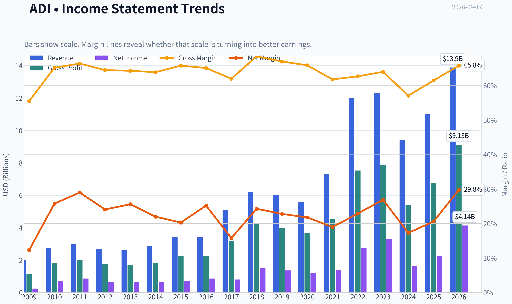

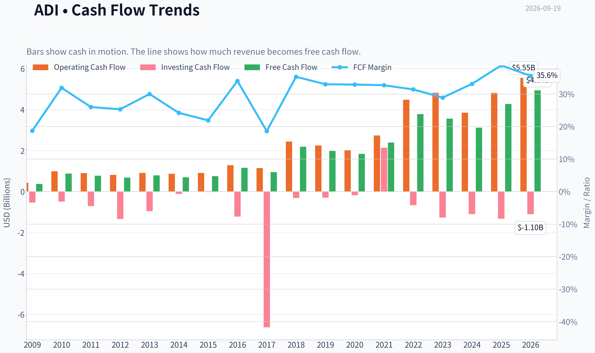

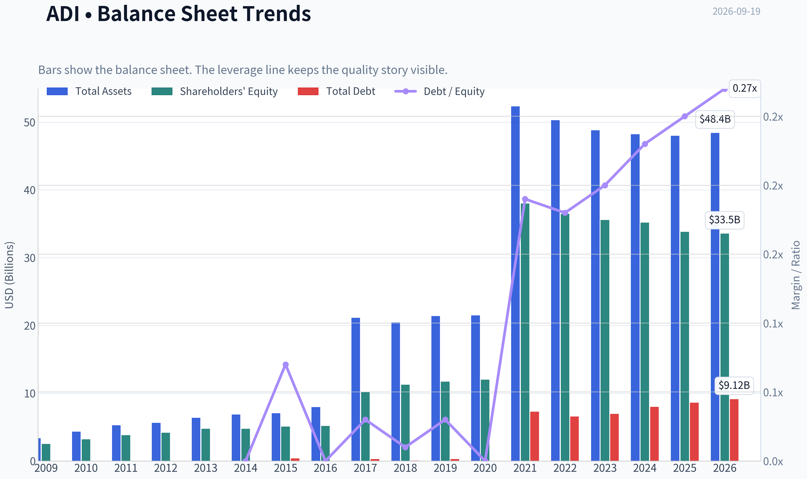

This graph tracks the profitability and return metrics (ROE, ROIC, Margins) of **ADI** over the past decade, highlighting capital efficiency trends.

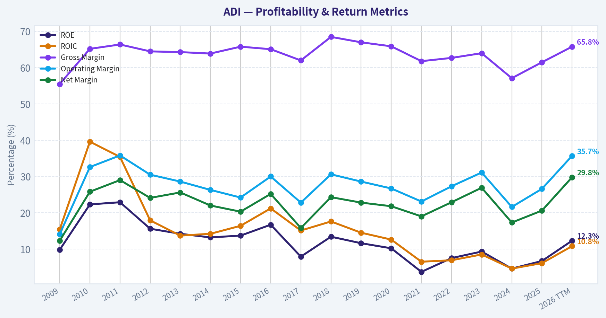

This chart illustrates the financial health of **ADI** over the last 10 years, mapping cash equivalents and free cash flow against total obligations (Debt).

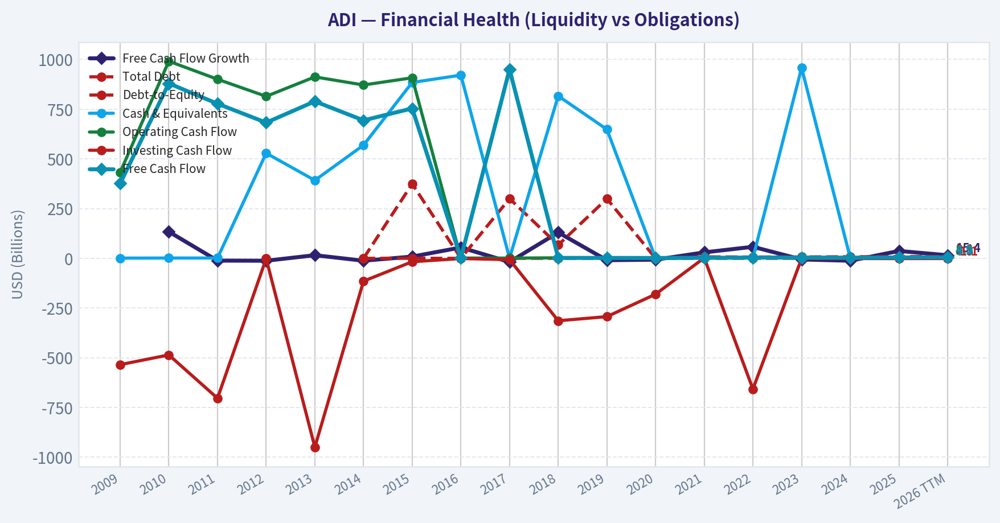

This comparison chart from *Profitability* stacks current figures against historical benchmarks for **ADI**, making it easy to see where the company trades relative to its own averages.

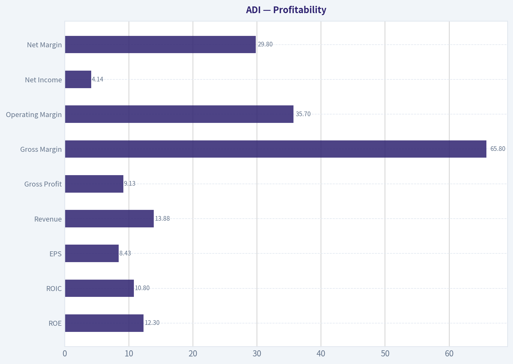

This breakdown chart from <em>Cash Flow and Capital Allocation</em> shows the proportional composition for **ADI** - useful for understanding what drives or risks the business.

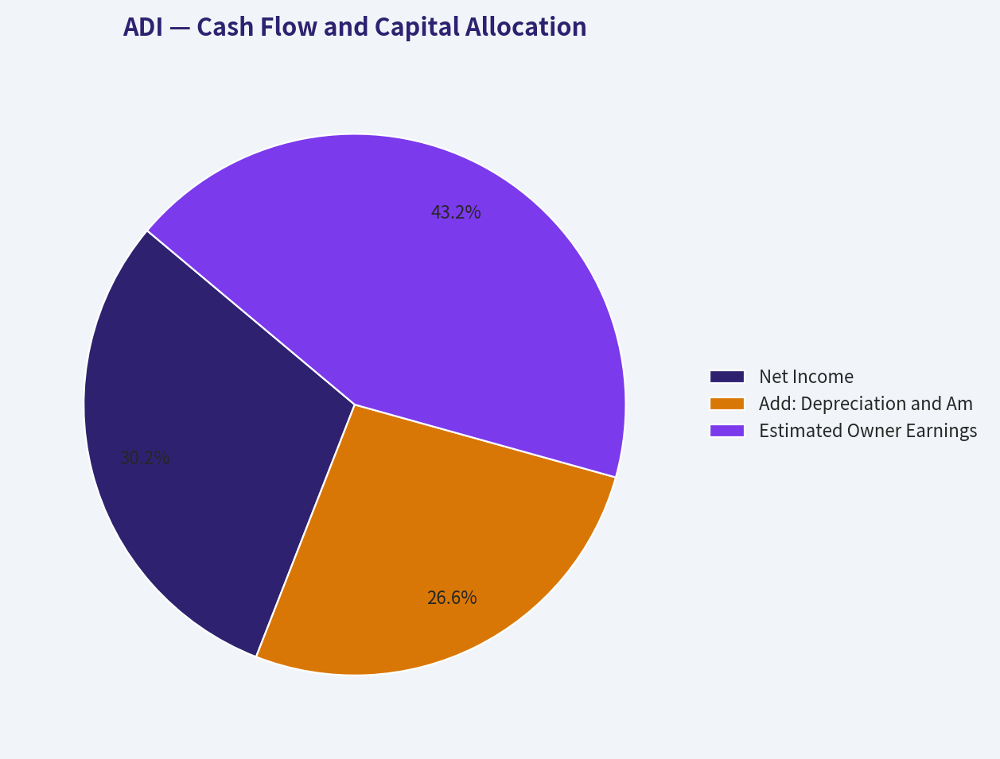

This breakdown chart from <em>Revenue Breakdown</em> shows the proportional composition for **ADI** - useful for understanding what drives or risks the business.

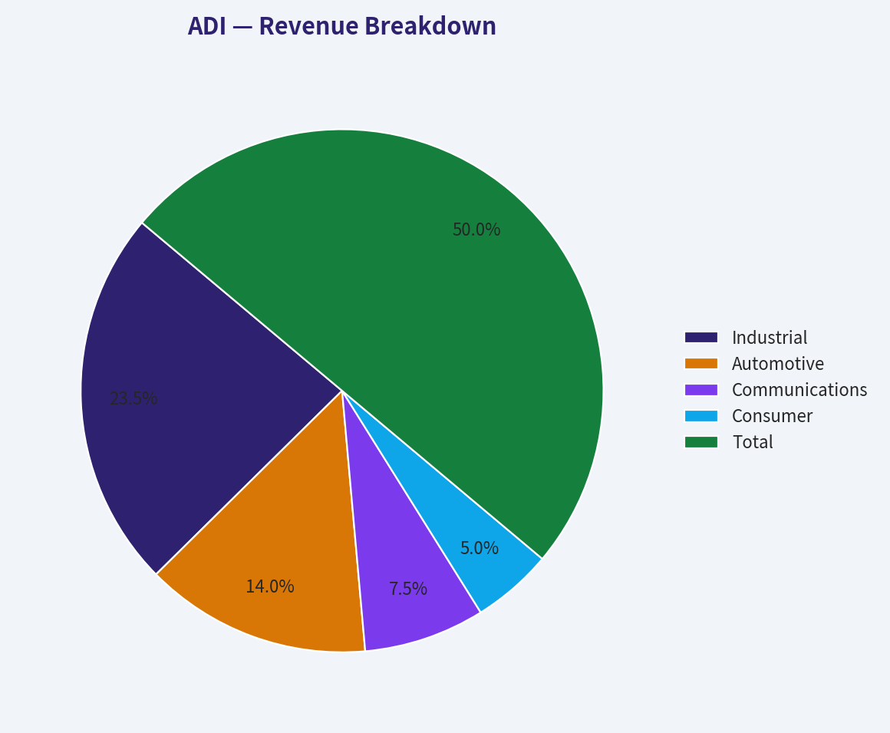

---

### Intrinsic Value Analysis (Buffett)

> *Following Warren Buffett's value investing philosophy: Circle of Competence, Economic Moat, Management Quality, and Margin of Safety.*

#### Intrinsic Value Snapshot

Price is what you pay. Intrinsic value is what the business may be worth based on the cash it can create for owners over time. We show a range, not one magic number.

- Current Price: $375.72
- Value Range (conservative to optimistic across both DCF methods): $62.25 to $305.81

##### Owner Earnings (Buffett Method)
- Net Income: $2,267,342,000.00
- Depreciation & Amortization: $1,998,845,000.00
- Capital Expenditures: $-533,552,000.00
- Working Capital Changes: $481,009,000.00
- Owner Earnings: $3,251,626,000.00

##### Intrinsic Value
###### Buffett Method
Uses owner earnings. Stricter, and usually more conservative.
- Conservative: $62.25
- Average: $290.02
- Optimistic: $290.02
- Discount Rate: 10.0%

###### Cash Flow Method
Uses free cash flow. Better for companies spending heavily today to grow tomorrow.
- Conservative: $65.84
- Average: $213.54
- Optimistic: $305.81
- Discount Rate: 10.0%

ANALYST STANCE: **AVOID**

#### Executive Conclusion

Analog Devices is an excellent semiconductor franchise with substantial intangible assets, high gross margins, customer switching costs, and attractive long-term exposure to industrial automation, automotive electronics, and data-center infrastructure. However, at approximately **$376 per share**, the valuation is substantially above conservative intrinsic-value estimates.

The stock price implies approximately **26.6% annual growth for the next 10 years**, while recent growth has been uneven: trailing three-year growth was negative, despite a strong five-year historical growth rate. This is a high-quality company, but not an attractive purchase at the current price. **Conviction: High on valuation; medium-high on business quality.**

#### Factor Scorecard

| Factor | Score | Assessment |
|---|---:|---|
| Circle of competence and simplicity | 4/5 | ADI designs and sells analog and mixed-signal chips that connect real-world signals to digital systems. The model is understandable, though semiconductor cycles and product complexity reduce predictability. |
| Moat | 4/5 | Strong engineering know-how, long product lives, customer qualification requirements, switching costs, and broad product breadth. |
| Management and capital allocation | 3/5 | The company has a strong operating history and strategic positioning, but the current return profile and acquisition-related complexity warrant a middle score. |
| Industry structure | 4/5 | Specialized analog semiconductors have attractive oligopolistic characteristics, high design-in barriers, and relatively long product cycles. |

**Gate 5 status: Not tripped.** There is no evidence here of both sharply deteriorating cash flow and a solvency red line such as sub-1x interest coverage or distress-level solvency. The investment problem is valuation, not financial distress.

Key Takeaways: ADI scores well on business quality, moat, and industry structure. Its principal weakness is not the franchise but the price paid for it, combined with a modest current ROE and cyclical earnings history.

#### Moat Analysis

| Moat source | Evidence | Quality assessment |
|---|---|---|
| Intangible assets | Proprietary analog design expertise, extensive intellectual property, and customer trust built over decades | Strong |
| Switching costs | Products are designed into industrial, automotive, communications, and instrumentation systems; redesign and requalification can be expensive and time-consuming | Strong |
| Cost advantages | Scale in research, manufacturing, distribution, and product breadth supports attractive economics | Moderate to strong |
| Network effects | Limited traditional network effects, but a broad product ecosystem and engineering relationships reinforce customer retention | Moderate |

ADI reported a **61.5% gross margin**, strong evidence of differentiated products and pricing power. Analog chips often remain in production for many years, creating recurring demand and making customer relationships more durable than those of many commodity semiconductor suppliers.

The moat is best characterized as **wide and stable**, rather than clearly wide and widening. Competition remains meaningful, semiconductor technology changes quickly, and industrial demand is cyclical.

#### Management Quality Assessment

ADI's management challenge is to convert its strong technology position into consistently high per-share returns across the semiconductor cycle. The company's strategic emphasis on industrial and automotive markets is sensible because these markets generally offer longer product lives and deeper customer integration than short-cycle consumer electronics.

The main concerns are:

- Current **ROE of 6.7%** is well below Buffett's preferred level.
- Acquisition integration and amortization can obscure underlying economics.
- A high share price creates pressure to maintain aggressive growth expectations.
- Capital allocation should be judged by per-share free-cash-flow growth, not revenue growth alone.

Overall management receives **3/5**: credible and strategically competent, but the present financial returns do not justify a top score.

#### Financial Summary

| Metric | Latest available figure | Interpretation |
|---|---:|---|
| Share price | $376 | Very demanding valuation |
| Market capitalization | $182.06 billion | Large-scale global franchise |
| P/E ratio | 43.1x | Expensive relative to normal industrial-semiconductor economics |
| Revenue growth, year over year | 16.9% | Strong recent recovery/growth |
| Gross margin | 61.5% | Significant differentiation and pricing power |
| ROE | 6.7% | Below a high-quality compounder benchmark |
| Free-cash-flow yield | 2.4% | Implies approximately $4.37 billion of current annual FCF |
| Current ratio | 2.19x | Healthy conventional liquidity |
| Historical growth, trailing 3 years | -14.7% | Shows meaningful cyclicality or earnings normalization |
| Historical growth, trailing 5 years | 25.2% | Strong longer-term growth, partly influenced by cycle and acquisitions |

Key Takeaways: ADI combines excellent gross margins with weak current ROE and a very low 2.4% free-cash-flow yield. The contrast is important: the business is good, but the market price assumes that recent growth will persist at an unusually high rate despite a history of cyclical fluctuations.

#### Owner Earnings Calculation

Buffett-style owner earnings are calculated as:

> Net income
> plus depreciation and amortization
> minus maintenance capital expenditures
> minus increases in working capital

The available cash-flow data indicate approximately **$4.37 billion of annual free cash flow**, using the 2.4% FCF yield applied to the $182.06 billion market capitalization.

For ADI, reported FCF is a reasonable starting point for owner earnings because the company is asset-light relative to many industrial businesses. However, maintenance capital expenditures should be separated from expansionary investment, and acquisition-related cash costs should not be ignored.

| Owner-earnings component | Assessment |
|---|---|
| Net income | Positive, but affected by semiconductor cyclicality and acquisition amortization |
| Depreciation and amortization | Adds back non-cash charges, though amortization from acquisitions may represent real economic costs |
| Maintenance capital expenditure | Requires normalization across the semiconductor cycle |
| Working capital | Can fluctuate materially during inventory corrections and demand recoveries |
| Approximate current FCF base | $4.37 billion |
| Owner-earnings quality | Good, but cyclical rather than perfectly stable |

Key Takeaways: ADI generates substantial cash, but owner earnings should be normalized rather than extrapolated directly from a single strong year. The cash-flow base supports a valuable business, yet it does not support the current market capitalization under conservative assumptions.

#### Three-Scenario DCF Valuation

| Valuation approach | Implied value per share |
|---|---:|
| Owner-earnings DCF | $290.02 |
| FCF-based DCF | $213.54 |
| Damodaran FCFF model | $97.00 |
| Headline blended intrinsic value | $163.16 |
| Current price | $376.00 |

The three-model spread is unusually wide. That spread reflects the sensitivity of ADI's valuation to assumptions about normalized cash flow, growth, margins, and the appropriate discount rate.

A conservative interpretation is:

- **No-growth scenario:** the value should be anchored near the company's normalized owner-earnings power, with little credit for future expansion.
- **GDP-growth scenario:** a 3% perpetual growth assumption produces a materially higher value, but still well below the current price when paired with a 10% discount rate.
- **Historical-growth scenario:** using a portion of historical growth can produce values near the higher end of the range, but it requires confidence that ADI can sustain exceptional growth despite semiconductor cyclicality.

Key Takeaways: Every major valuation method shown is below the current share price. Even the most favorable owner-earnings estimate of $290.02 is approximately 23% below the market price, while the blended estimate is far lower.

#### Margin of Safety Analysis

| Measure | Result |
|---|---:|
| Headline intrinsic value | $163.16 |
| Current price | $376.00 |
| Price premium to headline intrinsic value | Approximately 131% |
| Conventional downside to headline intrinsic value | Approximately 56.6% |
| Owner-earnings DCF discount to price | Approximately 23% |
| FCF DCF discount to price | Approximately 43% |
| Price-implied 10-year growth | Approximately 26.6% annually |

For a wide-moat, high-ROIC compounder, a 10% to 15% margin of safety can be sufficient. ADI does not currently meet that standard because:

1. Its ROE is only 6.7%.
2. Its price implies exceptionally high long-term growth.
3. Its three-year historical growth rate is negative.
4. The headline intrinsic-value estimate is less than half the current share price.

The reverse DCF is particularly concerning. A 26.6% annual growth requirement is heroic for a mature, large-cap semiconductor company, even one with strong competitive advantages.

#### Buffett Scorecard

| Criterion | Weight | Score | Weighted contribution |
|---|---:|---:|---:|
| Moat width and durability | 25% | 4/5 | 1.00 |
| Valuation and margin of safety | 20% | 1/5 | 0.20 |
| Capital returns versus WACC | 15% | 3/5 | 0.45 |
| Business understanding and predictability | 12% | 4/5 | 0.48 |
| Management quality and capital allocation | 12% | 3/5 | 0.36 |
| Reinvestment runway | 8% | 4/5 | 0.32 |
| Balance-sheet strength | 4% | 4/5 | 0.16 |
| Industry structure | 4% | 4/5 | 0.16 |
| **Total** | **100%** |  | **3.13/5** |

Key Takeaways: ADI's quality score is held back almost entirely by valuation and only moderate current returns on equity. The 3.13 score places it in the "Watch" range on a purely mechanical framework, but the magnitude of the valuation premium warrants a more cautious investment stance.

#### Investment Stance

**Stance: AVOID at $376.**

ADI is a business worth monitoring and potentially owning at a substantially lower valuation. A reasonable watch-list price would require either:

- A significant decline toward the upper end of the owner-earnings valuation range, around **$240 to $290**, or
- Several years of demonstrated cash-flow growth that brings the valuation down without a corresponding collapse in fundamentals.

At the current price, investors are paying in advance for a decade of extraordinary growth. That is not an adequate margin of safety under Buffett's discipline. The company is attractive; the stock is not.
#### Valuation Bridge

This bridge places the current market price beside each intrinsic value lens so readers can see whether upside depends on one method or shows up across several methods.

| Scenario | Intrinsic Value / Share |
| --- | ---: |
| Buffett Method | $290.02 |
| Cash Flow Method | $213.54 |
| Damodaran Method | $97.00 |
| Current Price | $375.72 |

#### Key Takeaways

If one method is far above the others, the upside case depends on a specific modelling assumption. When several methods cluster together, the valuation story is more robust.

#### Valuation Visuals

This comparison chart from *Latest Earnings Snapshot* stacks current figures against historical benchmarks for **ADI**, making it easy to see where the company trades relative to its own averages.

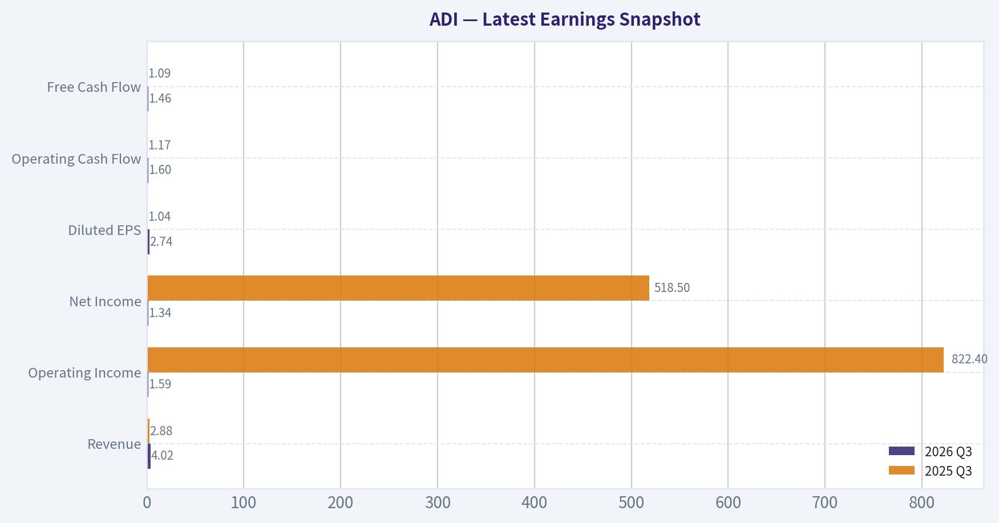

This comparison chart from *Current Metrics Compared With Historical Averages* stacks current figures against historical benchmarks for **ADI**, making it easy to see where the company trades relative to its own averages.

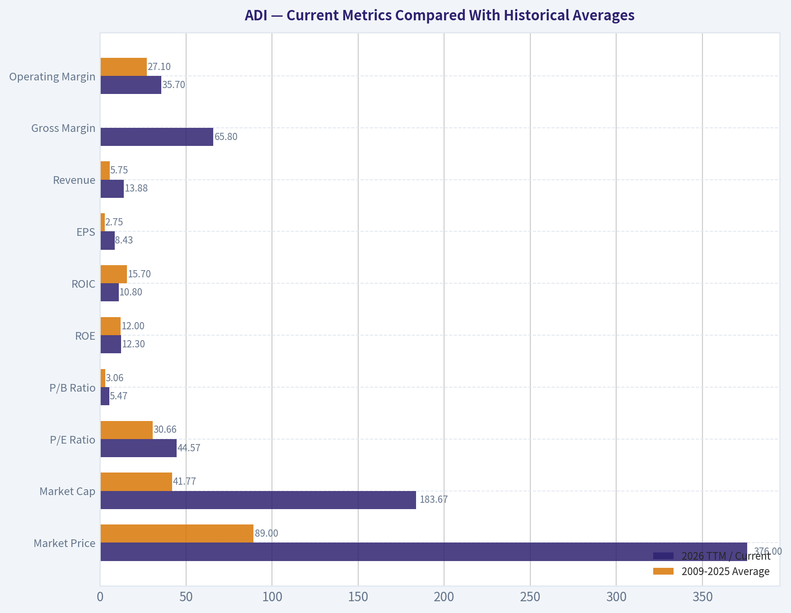

This comparison chart from *Balance Sheet and Financial Strength* stacks current figures against historical benchmarks for **ADI**, making it easy to see where the company trades relative to its own averages.

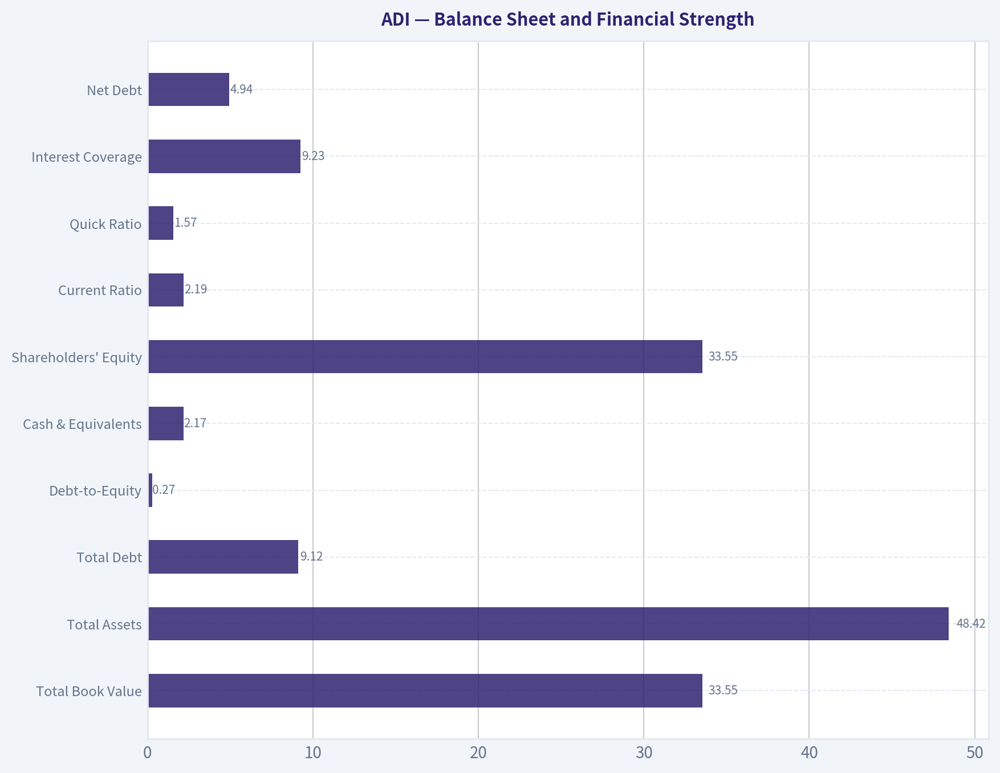

---

### Trend & Growth Analysis (Lynch/Druckenmiller/Fisher)

> *Following Peter Lynch's GARP, Stanley Druckenmiller's macro-aware approach, and Philip Fisher's scuttlebutt methodology.*

ANALYST STANCE: **WATCH**

#### 1. Lynch Classification

**Stalwart transitioning into a cyclical recovery**, rather than a classic fast grower. ADI has a high-quality analog semiconductor franchise and is benefiting from an industrial recovery, but its current scale, valuation, and end-market cyclicality limit ten-bagger potential.

#### 2. The Story

- ADI supplies highly specialized analog and mixed-signal chips that connect the physical world to digital systems across industrial, automotive, communications, and healthcare markets.
- Industrial demand appears to be inflecting sharply, with the latest coverage indicating **industrial revenue growth of approximately 53% year over year**.
- The company has durable advantages-long product cycles, high switching costs, customer qualification requirements, and a broad product portfolio-but the stock already discounts substantial future growth.

#### 3. Key Financial Snapshot

| Metric | ADI |
|---|---:|
| Share price | $376 |
| Market capitalization | $182.1B |
| P/E ratio | 43.1x |
| Revenue growth, YoY | 16.9% |
| Gross margin | 61.5% |
| ROE | 6.7% |
| FCF yield | 2.4% |
| Current ratio | 2.19 |
| Headline intrinsic value | $163.16 |

**Key Takeaways:** ADI combines excellent gross margins and financial liquidity with a very demanding valuation. Revenue growth is improving, but the 43x P/E and 2.4% free-cash-flow yield leave limited room for execution mistakes. The headline intrinsic value is substantially below the current price.

#### 4. TAM and the 10x Test

ADI participates in several large markets: industrial automation, electrification, automotive electronics, communications infrastructure, healthcare instrumentation, and data-center power management.

| Test | Assessment |
|---|---|
| Current business scale | Approximately $10B-plus annual revenue class |
| 10x revenue requirement | Roughly $100B-plus annual revenue |
| Analog semiconductor TAM | Large, but materially below the revenue needed for a 10x outcome at current scale |
| TAM expansion | Positive through electrification, automation, AI infrastructure, and energy management |
| 10x test | **Fails on a conventional analog-chip TAM basis** |
| Practical upside | Strong compounder potential, but not an obvious ten-bagger |

**Key Takeaways:** ADI's markets are expanding, particularly in industrial automation, electrification, and AI-related power management. However, a tenfold increase from its current revenue base would likely require ADI to dominate a very large portion of the analog semiconductor ecosystem or expand into adjacent markets. The runway is attractive for compounding, but not obviously large enough for a classic ten-bagger.

#### 5. Revenue Growth Trend

| Indicator | Interpretation |
|---|---|
| Overall revenue growth | 16.9% year over year |
| Industrial segment | Approximately 53% year-over-year growth reported in recent coverage |
| Historical cyclicality | Significant exposure to inventory and industrial demand cycles |
| Current pattern | Recovery and reacceleration in selected markets |
| Classification | **Inflecting, but not yet proven as a durable acceleration** |

**Key Takeaways:** The industrial segment is the most important positive signal and may represent a genuine earnings inflection. The concern is that ADI's overall growth remains much lower than the strongest segment growth, suggesting that other end markets are still recovering. Confirmation requires several quarters of broad-based growth rather than one strong segment.

#### 6. Unit Economics and Profitability

Traditional SaaS metrics such as LTV/CAC, NRR, and Rule of 40 are not applicable to ADI. The relevant indicators are gross margin, product longevity, pricing power, free-cash-flow conversion, and return on invested capital.

| Metric | Assessment |
|---|---|
| Gross margin | 61.5%, strong for a semiconductor manufacturer |
| FCF yield | 2.4%, modest at the current share price |
| ROE | 6.7%, below what the valuation would normally justify |
| Customer switching costs | High due to qualification and design-in processes |
| Product life cycles | Generally long and supportive of recurring demand |
| Operating leverage | Potential upside as utilization and industrial volumes recover |

**Key Takeaways:** ADI's gross margin and design-in model are attractive, but current returns on equity and free-cash-flow yield do not support an unquestioned premium valuation. The earnings case depends on volume recovery and operating leverage. If growth normalizes near 10% to 15%, the current price looks particularly vulnerable to multiple compression.

#### 7. Inflection Point Assessment

| Inflection Area | Rating | Evidence |
|---|---:|---|
| Product cycle | 3/5 | AI infrastructure, power management, and industrial products provide new demand |
| Market share | 3/5 | Strong franchise, but no quantified accelerating share data |
| Margin inflection | 3/5 | Recovery could improve utilization and profitability |
| TAM expansion | 4/5 | Electrification, automation, and AI expand applications |
| Competitive position | 4/5 | Broad portfolio, design-in relationships, and high switching costs |
| Earnings surprise potential | 3/5 | Industrial recovery is encouraging, but valuation already anticipates strong execution |

**Key Takeaways:** ADI has a credible cyclical recovery inflection, particularly in industrial markets. The most compelling evidence is demand acceleration rather than a revolutionary new product cycle. The market may still underestimate normalized earnings, but the stock price already embeds a high level of optimism.

#### 8. Macro Setup

The macro backdrop is mixed but improving for ADI:

- **Positive:** Industrial destocking appears to be reversing.
- **Positive:** Electrification, automation, AI infrastructure, and power efficiency are secular tailwinds.
- **Positive:** A lower-rate environment would support long-duration growth and capital spending.
- **Negative:** ADI remains exposed to industrial cycles, inventory swings, global manufacturing, and China demand.
- **Negative:** Semiconductor stocks can re-rate quickly when rates rise or end-market expectations weaken.

Overall macro assessment: **Constructive for earnings, less attractive for valuation.**

#### 9. Fisher's 15-Point Assessment

| Fisher Category | Score |
|---|---:|
| Market potential | 4/5 |
| New-product development | 4/5 |
| R&D effectiveness | 4/5 |
| Sales organization | 4/5 |
| Profit margins | 4/5 |
| Margin improvement | 3/5 |
| Labor relations | 3/5 |
| Executive relations | 4/5 |
| Management depth | 4/5 |
| Cost accounting | 4/5 |
| Outstanding competitive aspects | 5/5 |
| Long-term profit outlook | 4/5 |
| Dilution risk | 3/5 |
| Management candor | 4/5 |
| Management integrity | 4/5 |
| **Total** | **56/75** |

**Key Takeaways:** ADI scores as a good, high-quality company rather than an exceptional high-growth opportunity at today's price. Its strongest Fisher attributes are competitive positioning, product breadth, R&D, and customer relationships. The main deductions reflect cyclical exposure, moderate current returns, and valuation-related execution risk.

#### 10. Valuation Analysis

| Method | Result |
|---|---:|
| Current P/E | 43.1x |
| PEG using 16.9% revenue growth as a rough proxy | Approximately 2.5x |
| FCF yield | 2.4% |
| Headline intrinsic value | $163.16 |
| Owner-earnings model | $290.02 |
| FCF model | $213.54 |
| Damodaran FCFF model | $97.00 |
| Reverse DCF implication | Approximately 26.6% annual growth for 10 years |

**Key Takeaways:** ADI is expensive under nearly every conventional valuation measure. The rough PEG is well above Lynch's preferred range, and the reverse DCF requires approximately 26.6% annual growth for a decade-far above the company's current overall growth rate. Even the most favorable listed valuation model remains below the current share price.

##### Scenario Analysis

| Scenario | Assumption | Implied View |
|---|---|---|
| Bear | Industrial recovery fades; normalized growth near 8%-10%; multiple compresses | Significant downside |
| Base | Growth settles around 12%-15%; margins improve modestly; premium multiple retained | Returns may be limited |
| Bull | Multi-year industrial acceleration plus AI/power growth; earnings compound near 20% | Upside possible, but much is already priced in |

**Key Takeaways:** The bull case requires sustained growth well above ADI's normal mature-company profile. The base case supports a good business but not necessarily a good investment from $376. The risk-reward would improve materially after a valuation reset or several quarters of upside earnings revisions.

#### 11. Growth Investor Scorecard

| Criterion | Weight | Score |
|---|---:|---:|
| Lynch story | 10% | 3.8/5 |
| TAM and runway | 20% | 3.4/5 |
| Revenue growth | 20% | 3.5/5 |
| Unit economics | 15% | 3.8/5 |
| Competitive position | 10% | 4.4/5 |
| Management quality | 10% | 4.0/5 |
| Macro setup | 5% | 3.7/5 |
| Profitability path | 5% | 4.0/5 |
| Valuation | 5% | 1.8/5 |
| **Weighted score** | **100%** | **3.5/5** |

**Key Takeaways:** ADI passes the quality and business-model tests but fails the valuation test at the current price. Its weighted score places it at the low end of an "Advocate" setup under the mechanical framework, but the large valuation gap argues for a practical **WATCH** stance rather than a new purchase.

#### 12. Position Size Stance

- **New position:** Avoid initiating a full position at $376.
- **Existing holders:** Hold a smaller-than-normal position if the thesis is based on long-term analog semiconductor quality.
- **Preferred approach:** Wait for either a meaningful price correction or evidence that earnings estimates are being revised materially upward.
- **Indicative size after confirmation:** 1%-3% starter position, increasing only after valuation and earnings momentum improve.

#### 13. Key Catalysts and Risks

| Catalysts | Risks |
|---|---|
| Continued industrial revenue acceleration | Industrial recovery proves temporary |
| Broad-based inventory normalization | China or communications weakness |
| Margin expansion from higher utilization | Semiconductor cycle turns down again |
| AI infrastructure and power-management growth | Premium multiple compression |
| Positive earnings revisions | Current price implies unrealistic long-term growth |
| Strong free-cash-flow conversion | Acquisition or integration risk |

**Key Takeaways:** The central catalyst is a sustained industrial recovery that drives both revenue acceleration and operating leverage. The central risk is not business deterioration but paying too much for a good business. ADI becomes more compelling if growth remains above 20%, margins expand, and the valuation falls toward a PEG near 1.5x or below.

#### Bottom Line

ADI is a **high-quality analog semiconductor compounder with a credible cyclical recovery**, but it is not currently a compelling ten-bagger candidate. The industrial inflection is worth monitoring, yet the stock price appears to discount unusually strong growth for many years. For a growth investor, the correct action is **WATCH**, not chase.

---

### Market Technical Analysis

ANALYST STANCE: **WATCH**

#### ADI technical market report

ADI's latest available session is September 18, 2026, because September 19 was a Saturday. The stock closed at **$375.72**, gaining sharply from the early-September low near **$354.52**. However, the recovery is occurring within a broader period of elevated volatility: ADI remains well below its June high near **$444**, and the July-to-August decline created substantial overhead resistance.

The indicator-report tool returned blank numerical fields for this ticker, so the assessment below uses the retrieved daily OHLCV data directly and treats indicator levels as approximate rather than exact.

#### Trend structure

ADI's long-term trend remains constructive. The stock is substantially above its approximate 200-day average, which appears to be in the low-to-mid **$300s** based on the retrieved price history. That positioning indicates that the major trend has not broken down despite the roughly 15% to 20% correction from the June peak.

The medium-term picture is less decisive. ADI spent much of July and August making lower highs and lower lows, falling from the upper $390s toward the low $350s. The September rebound has repaired some of that damage, but the stock must reclaim the approximate **$378 to $385** region to demonstrate that the medium-term downtrend has been decisively reversed. This area corresponds broadly to the recent September high, the declining sequence of August support levels, and the likely neighborhood of the 50-day moving average.

Short-term momentum improved materially on September 18. The close at $375.72 was accompanied by volume of approximately **7.7 million shares**, well above the recent typical volume of roughly 2.5 million to 4 million shares. A high-volume advance is more constructive than a low-volume bounce because it suggests stronger participation. Nevertheless, the stock's recent history also contains several high-volume reversals, so one strong session should not yet be treated as confirmation of a durable breakout.

#### Moving averages and price location

The approximate 10-day exponential moving average is likely near **$365 to $367**, placing the latest close roughly $9 to $11 above that short-term trend line. This is a bullish near-term configuration, but the distance from the average also means that the stock has become somewhat extended after the September 18 surge. A pullback toward the 10-day average that holds would be healthier than an immediate continuation followed by a sharp reversal.

The approximate 50-day simple moving average is likely near **$378 to $382**. ADI is therefore close to, but probably still just below or around, this important medium-term reference point. A sustained close above that zone, especially on volume above the recent average, would improve the technical outlook and could open a path toward **$390 to $400**. Failure near this area would leave the stock vulnerable to a retreat toward **$362 to $365**, followed by the more important **$352 to $355** support zone.

The 200-day average is considerably lower than the current price. This provides structural support for longer-horizon investors, but it is too distant to offer a practical stop level for a short-term trade. It mainly confirms that the recent weakness is currently a correction within a still-positive long-term trend rather than a confirmed secular breakdown.

#### Momentum: MACD and RSI interpretation

The MACD structure is improving as the September rebound lifts the shorter-term averages relative to the longer-term averages. The likely interpretation is that MACD has turned upward from a weak or negative configuration, while the histogram is expanding toward positive territory. That supports additional near-term upside, but the signal is not yet equivalent to a confirmed medium-term trend reversal. Traders should look for the MACD line to remain above its signal line while price holds above the 10-day average.

Momentum is also recovering but does not appear to be at an extreme overbought reading based on the recent price sequence. A 14-day RSI estimate would likely be in the **upper-50s to low-60s** after the September rebound. That is bullish-neutral rather than excessively overbought. An RSI move above 65 or 70 while price approaches $390 to $400 would indicate stronger momentum, but it would also increase the probability of consolidation. Conversely, an RSI failure back below 50 alongside a loss of $362 would weaken the recovery thesis.

#### Volatility and risk management

ADI remains a high-volatility semiconductor stock. Recent daily ranges have frequently been around **$7 to $15**, with much larger moves during June and July. A reasonable recent ATR estimate is approximately **$9 to $12 per share**, though the precise value could vary depending on the calculation window.

This volatility argues against placing stops too close to the entry price. For a bullish swing setup, a close below the **$362 to $365** area would be an early warning that the short-term rebound is failing. A break below **$352 to $355** would be more significant because it would undermine the September base and restore the pattern of lower lows. Position sizing should be adjusted so that a normal ATR-sized move does not force an early exit.

#### Volume and VWMA

The September 18 volume surge is an important positive feature. Price advanced from the mid-$360s to above $375 while volume more than doubled relative to several recent sessions. This suggests accumulation or at least strong short-covering and renewed buyer interest.

The likely volume-weighted average price over a recent multiweek window is in the approximate **$375 to $380** area, because the latest high-volume session occurred near $376 and several earlier high-volume sessions occurred between the mid-$360s and high-$370s. ADI holding above this volume-weighted region would support the view that buyers have gained near-term control. A return below it on expanding volume would signal that the September 18 move may have been a temporary reversal rather than the start of a sustained advance.

#### Trading scenarios

The most constructive scenario is a close above approximately **$382 to $385**, followed by continued volume support. That would represent a cleaner break above the medium-term moving-average resistance and could target **$390 to $400** initially. Above $400, the stock would begin challenging the broader supply zone created during the June and July breakdown.

The neutral scenario is consolidation between roughly **$362 and $385**. This would allow the short-term averages and momentum indicators to normalize without invalidating the longer-term uptrend. Such a range could offer a better risk-reward entry than chasing the September 18 surge.

The bearish scenario is a failure at $378 to $385 followed by a close below $362. That would imply that the rebound lacks follow-through. A break below $352 to $355 would be more consequential and could expose the stock to a retest of the mid-$340s or lower.

#### Selected indicators

The most useful complementary set for ADI is:

- **close_10_ema** - measures whether the short-term rebound is holding.
- **close_50_sma** - identifies the key medium-term trend-reversal area.
- **close_200_sma** - confirms the long-term trend regime.
- **macd** - evaluates the broader momentum turn.
- **macdh** - detects whether momentum is accelerating or fading.
- **rsi** - distinguishes healthy recovery from overextended buying.
- **atr** - supports volatility-adjusted stops and position sizing.
- **vwma** - tests whether the advance is supported by meaningful trading volume.

These indicators are complementary: moving averages define trend, MACD and its histogram measure momentum, RSI measures momentum intensity, ATR measures risk, and VWMA adds volume confirmation. Bollinger bands were not prioritized because the combination of ATR, VWMA, and the trend indicators provides more actionable information for the current rebound-and-resistance setup without adding excessive redundancy.

| Area | Current interpretation | Important levels or signals | Trading implication |
|---|---|---|---|
| Latest price | ADI closed at $375.72 on September 18 | Strong rebound from approximately $354.52 | Near-term bias has improved, but price is approaching resistance |
| Short-term trend | Price is above the approximate 10-day EMA near $365-$367 | Holding above this average would preserve short-term momentum | Pullbacks toward the EMA may be constructive if volume contracts |
| Medium-term trend | Price is near the likely 50-day SMA around $378-$382 | A sustained break above $382-$385 would improve the setup | Confirmation requires follow-through, not just one strong session |
| Long-term trend | Price remains well above the approximate 200-day SMA in the low-to-mid $300s | Long-term trend remains positive | Recent weakness still resembles a correction within a larger uptrend |
| MACD and histogram | Momentum appears to be recovering and turning upward | Continued positive histogram expansion would support the rebound | Watch for a rollover if price fails near $380 |
| RSI | Estimated in the upper-50s to low-60s | Bullish-neutral rather than clearly overbought | Some upside remains, but momentum should be monitored near $390-$400 |
| Volatility | Recent ATR-like daily movement is approximately $9-$12 | Normal fluctuations are large | Use ATR-aware stops and avoid excessive position sizing |
| Volume and VWMA | September 18 volume was approximately 7.7 million shares | High-volume close near $376 is constructive | Holding above the recent volume-weighted region supports accumulation |
| Support | First support near $362-$365; stronger support near $352-$355 | Break below $352-$355 would materially weaken the setup | Defensive action becomes more appropriate below the lower support |
| Resistance | Initial resistance around $378-$385; next zone around $390-$400 | Breakout must be sustained with volume | A failed breakout could produce a range-bound or corrective move |

**Key Takeaways:** ADI's long-term trend remains bullish, but the medium-term trend is still in the process of repairing damage from the July and August decline. The September 18 rally was supported by unusually high volume, which is encouraging, yet the stock is now testing a significant resistance zone around $378 to $385. A sustained, high-volume break above that area would strengthen the bullish case; failure followed by a move below $362 would favor consolidation or renewed downside.

---

### Options Market Analysis

> *Reading options flow - put/call ratios, IV skew, and unusual activity - to gauge institutional positioning and event-driven risk.*

ANALYST STANCE: **BEARISH**

#### ADI Options Market Overview

Data is available for the near-term expirations from September 25 through October 9, 2026. ADI's options positioning is split: call open interest is substantially larger than put open interest, but current trading volume is heavily concentrated in puts, particularly short-dated contracts.

| Expiration | Call OI | Put OI | Call Volume | Put Volume | Put/Call OI Ratio | ATM Call IV | ATM Put IV |
|---|---:|---:|---:|---:|---:|---:|---:|
| Sep. 25, 2026 | 3,371 | 509 | 1,047 | 2,615 | 0.15 | 44.7% | 40.5% |
| Oct. 2, 2026 | 2,013 | 235 | 135 | 41 | 0.12 | 42.8% | 40.1% |
| Oct. 9, 2026 | 311 | 100 | 64 | 42 | 0.32 | 40.3% | 39.5% |
| **Total / Overall** | **5,695** | **844** | **1,246** | **2,698** | **0.15 OI** | - | - |

**Key Takeaways:** ADI has a very low put/call open-interest ratio of 0.15 versus the approximately 0.70 neutral baseline, indicating that existing positioning is call-heavy. However, the put/call volume ratio is 2.17, meaning puts are dominating current trading activity. This sharp divergence suggests fresh downside hedging or bearish positioning despite a bullish-looking existing open-interest structure.

#### Put/Call Ratio Analysis

The open-interest ratio is unusually low across all three expirations, especially in the September 25 and October 2 contracts. This may reflect substantial call accumulation, covered-call activity, or limited existing put protection. By contrast, the near-term volume ratio is strongly elevated.

| Measure | ADI | Neutral Reference | Interpretation |
|---|---:|---:|---|
| Near-term put/call OI ratio | 0.15 | ~0.70 | Strongly call-heavy existing positioning |
| Near-term put/call volume ratio | 2.17 | ~0.70 | Strongly put-heavy current activity |
| Sep. 25 put/call volume ratio | 2.50 | ~0.70 | Concentrated short-dated put demand |
| Oct. 2 put/call volume ratio | 0.30 | ~0.70 | Call activity dominates this expiry |
| Oct. 9 put/call volume ratio | 0.66 | ~0.70 | Approximately neutral |

**Key Takeaways:** The major signal is the sudden shift toward put trading in the nearest expiry. Since the put-heavy activity is concentrated in September 25 options, it likely represents short-term protection or a tactical bearish bet rather than a broad, long-dated bearish repositioning.

#### Implied Volatility Assessment

Near-term ATM implied volatility is elevated relative to what would typically be considered a low-volatility options environment, with the September 25 expiration carrying the highest levels. The supplied data does not include separate out-of-the-money put and call IV by strike, so a precise OTM skew calculation is unavailable.

| Expiration | ATM Call IV | ATM Put IV | IV Observation |
|---|---:|---:|---|
| Sep. 25, 2026 | 44.7% | 40.5% | Highest near-term IV; calls carry higher ATM IV |
| Oct. 2, 2026 | 42.8% | 40.1% | Moderately elevated |
| Oct. 9, 2026 | 40.3% | 39.5% | IV declines with additional time |
| **Observed ATM spread** | **Calls higher by 1.8-4.2 points** | - | No evidence of ATM put premium |

**Key Takeaways:** ATM call IV is higher than ATM put IV in every reported expiration, which does not indicate a conventional downside volatility skew at the money. Nevertheless, the aggressive put volume may still reflect demand for specific far-OTM protection that is not captured by the ATM figures. A known catalyst cannot be confirmed from the supplied data, so the elevated IV should be treated as event-risk pricing rather than automatically as an earnings signal.

#### Unusual Options Activity

The tool identifies two unusually active contracts, both puts expiring September 25. Volume is many times existing open interest, which strongly suggests that these trades represent newly opened positions or significant position transfers rather than routine activity.

| Expiration | Type | Strike | Volume | Open Interest | Volume/OI | IV | Directional Read |
|---|---|---:|---:|---:|---:|---:|---|
| Sep. 25, 2026 | Put | $350 | 1,585 | 27 | 58.7x | 43.2% | Strong short-term downside hedge or bearish bet |
| Sep. 25, 2026 | Put | $365 | 803 | 29 | 27.7x | 38.2% | Short-term downside protection or bearish speculation |

The current ADI share price was not included in the data output. Therefore, the $350 and $365 strikes cannot be definitively classified as in-the-money, at-the-money, or out-of-the-money. Based on the strike levels and the ATM IV range, the $365 contract may be closer to the underlying price than the $350 contract, but this remains unconfirmed.

**Key Takeaways:** The unusual activity is decisively put-oriented and concentrated in the nearest expiry. The extremely high volume-to-open-interest ratios make these contracts more informative than the static call-heavy OI totals. Without execution details such as bid/ask, sweep direction, or premium, it is not possible to prove whether the activity represents bought puts, sold puts, or spreads, but the most conservative interpretation is increased short-term downside protection.

#### Open Interest Concentration and Gamma Levels

Call open interest is concentrated in the September 25 and October 2 expirations, while put open interest is comparatively small. Strike-level open-interest data was not supplied, so exact gamma walls, maximum-pain levels, and price-pinning strikes cannot be calculated.

| Expiration | Total Call OI | Total Put OI | Concentration Assessment |
|---|---:|---:|---|
| Sep. 25, 2026 | 3,371 | 509 | Largest near-term call concentration; potential upside pinning or resistance |
| Oct. 2, 2026 | 2,013 | 235 | Second-largest call concentration |
| Oct. 9, 2026 | 311 | 100 | Minimal concentration |
| **Total** | **5,695** | **844** | Positioning is heavily concentrated in calls |

**Key Takeaways:** The large call OI concentration could dampen price movement or create a pinning effect near heavily populated strikes as expiration approaches. However, without strike-level OI and gamma data, the exact support, resistance, or maximum-pain level cannot be identified. The fresh put activity may temporarily counteract the stabilizing effect of the call-heavy structure.

#### Overall Options Sentiment

| Factor | Assessment | Signal |
|---|---|---|
| Existing positioning | Very low 0.15 put/call OI ratio | Bullish-leaning |
| Current flow | 2.17 put/call volume ratio | Bearish |
| Implied volatility | Elevated near term, highest in Sep. 25 expiry | Event-risk / caution |
| IV skew | ATM calls priced above ATM puts; OTM skew unavailable | Not a clear downside skew |
| Unusual activity | Two major fresh-looking short-dated put trades | Bearish |
| OI concentration | Heavy call OI in Sep. 25 and Oct. 2 | Potential pinning or resistance |
| **Overall signal** | **Fresh short-term put demand outweighs static call-heavy OI** | **BEARISH** |

**Key Takeaways:** The overall read is bearish for ADI over the immediate expiration window, primarily because put volume is more than twice call volume and the two largest unusual trades are short-dated puts with very high volume-to-open-interest ratios. Confidence is moderate rather than high because the data does not provide execution side, current share price, strike-level OI, or confirmed catalyst information. The signal could represent hedging against an event rather than an outright expectation of a sustained decline.

#### Summary

| Category | Conclusion |
|---|---|
| Put/Call Ratio | OI ratio is extremely low at 0.15, but volume ratio is elevated at 2.17 |
| IV Level | Near-term ATM IV is moderately to highly elevated, ranging from roughly 39.5% to 44.7% |
| Skew Direction | ATM calls have higher IV than puts; reliable OTM skew data is unavailable |
| Unusual Activity | Heavy September 25 put activity at $350 and $365, with volume/OI ratios of 58.7x and 27.7x |
| Overall Signal | **BEARISH**, driven by fresh short-term put demand and downside hedging |

**Key Takeaways:** ADI's existing options book looks call-heavy, but the newest and most aggressive activity is concentrated in short-dated puts. That makes the near-term signal bearish, with the important caveat that the trades may be protective hedges rather than pure bearish speculation.

---

## Research Team Commentary

> *The Research Manager synthesizes the Bull vs Bear debate into action-free commentary. This is a pre-risk view, not the final stance.*

Core takeaway: ADI is a genuinely high-quality analog semiconductor franchise, but $376 does not provide a sufficient margin of safety against the demanding growth and return-on-capital improvement already embedded in the price. The bull is strongest on moat and the likelihood that trough GAAP figures understate normalized economics; the bear is stronger on valuation because even generous normalization assumptions only bring intrinsic value close to the current quotation. My stance is AVOID for new long-term capital, while keeping ADI high on the watchlist for a better price or clearer evidence.

The bullish case is credible. ADI's chips occupy difficult, mission-critical niches across industrial, automotive, communications, and healthcare systems. Long qualification cycles, redesign costs, applications expertise, and lengthy product lives create sticky design wins. The 61.5% gross margin is powerful evidence of differentiation and pricing power. Rising sensor content, automation, electrification, and power-management requirements should remain favorable over a decade. The roughly 53% industrial revenue rebound also suggests recent earnings may have been measured near a cyclical trough rather than at normal earning power.

The reported 6.3% ROIC and 6.7% ROE should therefore not be interpreted mechanically. Acquired goodwill increases the invested-capital denominator, while intangible amortization depresses GAAP profit. Better utilization and fixed-cost absorption could materially improve earnings as industrial demand normalizes. This is not a structurally poor business simply because current accounting returns are low.

However, those accounting complications do not eliminate the cost of acquisitions. Shareholders contributed real capital for acquired technology and customer relationships. Adding back amortization without demonstrating the corresponding sustainable free cash flow risks overstating owner earnings. Gross margin proves product quality, but it does not establish an adequate return on all the capital management has deployed. Management's acquisition record remains an unresolved capital-allocation issue until consolidated and incremental returns improve.

Valuation is decisive. At $376 and 43.1 times trailing earnings, reported EPS is approximately $8.73. The debate's DCF estimates indicate values near $220 with 8% ten-year growth, $316 with 12% growth, and $405 with 15% growth, using a 9% discount rate and 3% terminal growth. In reverse-DCF terms, the price implies roughly 14% annual owner-earnings growth for a decade from reported earnings. That would require earnings to reach approximately $32 per share by year ten.

The bull sensibly argues that normalized owner earnings may be 15-20% above GAAP EPS. Yet this does not create obvious undervaluation. Starting at approximately $10.48 and assuming 12% annual growth produces value around $379-roughly the current price. In other words, the investor must accept a favorable normalization adjustment and a decade of low-double-digit compounding merely to justify the quotation. The proposed $415-430 bullish value range requires still stronger normalized earnings and 12.5-13% growth, leaving only a 9-13% discount to an optimistic scenario rather than to a conservative base case.

That is the central asymmetry: if ADI delivers an excellent decade, upside may be modest; if normalized growth is merely good, closer to 8-10%, valuation downside is material. A wide-moat, predictable compounder can merit purchase at only a 10-15% discount, but that discount should be measured from a balanced intrinsic-value estimate. Here, the current price is above the $316 reported-earnings value and approximately equal to the normalized 12% case. The quality-scaled margin of safety is therefore not yet present.

The 53% industrial increase is encouraging but should not be mistaken for sustainable growth. The next question is whether revenue exceeds the prior cycle's peak through genuine end demand, rather than restocking and easy comparisons. Industrial recovery can produce several quarters of exceptional operating leverage without supporting 12-14% owner-earnings growth for ten years.

Near-term options positioning reinforces caution but is not the thesis. Heavy short-dated put volume indicates hedging or bearish tactical demand, while the very low 0.15 put/call open-interest ratio shows that the installed positioning remains call-heavy. This split suggests uncertainty and potential volatility, not a reliable long-term signal. Likewise, the 10-day EMA, 50-day SMA, and 200-day SMA should guide entry timing rather than override intrinsic value.

The lesson from the previous ADI calls is to avoid both errors: do not reject an expensive but strong business merely because trailing metrics look elevated, but do not allow a strong trend or cyclical rebound to substitute for a margin of safety. ADI previously demonstrated that expensive, high-quality semiconductors can rally before valuation becomes comfortable. Therefore, AVOID here does not mean "short," "broken business," or "imminent decline." It means the expected long-term return at $376 is not compelling enough for fresh value-oriented capital. A decisive breakout could still offer a tactical trade, but it would not by itself improve the ten-year underwriting.

Over the next one to four quarters, I would monitor four areas. First, reconcile GAAP earnings to free cash flow and quantify acquisition-related add-backs; the bull case strengthens if sustainable per-share owner earnings are demonstrably at least 15-20% above the $8.73 GAAP base. Second, watch ROIC and operating margin through the industrial recovery. A clear progression toward double-digit ROIC would support the claim that current returns are cyclically and accounting-depressed; continued returns near 6% would materially weaken the thesis. Third, distinguish true end-demand growth from inventory replenishment by tracking industrial orders, cancellations, lead times, channel inventories, and revenue relative to the previous cycle peak. Fourth, assess capital allocation: debt management, per-share free-cash-flow growth, repurchase discipline, and avoidance of another major acquisition before existing assets earn acceptable returns.

For price discipline, the low-to-mid $300s would be a more credible reconsideration range under the debate's assumptions, with the exact threshold depending on updated owner earnings. Alternatively, evidence that normalized owner earnings are materially above $10.50 per share, accompanied by improving ROIC and durable organic demand, could raise conservative intrinsic value enough to justify a higher entry. Technical strength above key moving averages would then improve timing, but it should confirm-not create-the investment case.

ADI is a wonderful franchise, but the current quote asks investors to fund the normalization before management has fully demonstrated it. The moat deserves respect; the implied growth hurdle deserves greater respect.

Final stance: AVOID

---

## Value Investing Team Commentary

> *The Investor translates the research view into an investment thesis before risk review. This is still not the final stance.*

### Investment Commentary

ADI is a high-quality analog semiconductor franchise, but the current valuation appears to capitalize much of the anticipated cyclical recovery before management has demonstrated that recovery will translate into sustainably higher returns on capital and per-share owner earnings.

### Business quality and moat

The underlying business is attractive. ADI's analog and mixed-signal chips perform mission-critical functions across industrial, automotive, communications, and healthcare systems. Its competitive advantages include:

- Long product lives and customer qualification cycles
- High redesign and switching costs
- Deep applications expertise
- A broad portfolio embedded across many customer platforms
- Attractive pricing power, reflected in a 61.5% gross margin

These characteristics make ADI more durable than a typical cyclical semiconductor manufacturer. Automation, electrification, sensing, connectivity, and power-management complexity should increase semiconductor content over the coming decade.

The roughly 53% industrial revenue increase is therefore meaningful evidence that demand is recovering. However, such growth likely reflects some combination of easy comparisons, inventory replenishment, improved utilization, and genuine end-demand recovery. It should not be extrapolated into a decade-long growth rate.

### The accounting debate

Reported ROIC of 6.3% and ROE of 6.7% probably understate ADI's operating quality. Acquisition-related goodwill inflates invested capital, while intangible amortization depresses GAAP earnings. Higher factory utilization could also produce substantial operating leverage as industrial demand normalizes.

The contrarian bullish interpretation is that investors relying mechanically on current GAAP returns may be undervaluing the normalized franchise.

That argument is credible but incomplete. Acquisition capital was genuinely spent, and the acquired assets must ultimately earn acceptable returns. Amortization can be added back when estimating cash earnings, but it should not erase the economic cost of acquisitions. Management still needs to demonstrate that the combined enterprise can generate:

- Sustained double-digit ROIC
- Consistent per-share free-cash-flow growth
- Organic revenue above the previous cycle peak
- Attractive incremental returns without another major acquisition

ADI's gross margin establishes product differentiation. It does not, by itself, prove that management has earned an adequate return on all shareholder capital deployed.

### Valuation and reverse DCF

At $376 and 43.1 times trailing earnings, reported EPS is approximately $8.73. The supplied valuation scenarios show:

| Scenario | Estimated value | Upside/(downside) from $376 |
|---|---:|---:|
| 8% ten-year growth | $220 | (41%) |
| 12% ten-year growth | $316 | (16%) |
| 15% ten-year growth | $405 | 8% |

The reverse DCF indicates that the market is effectively asking ADI to compound reported owner earnings by approximately 14% annually for ten years, reaching roughly $32 per share. That is a demanding hurdle for a large semiconductor company exposed to industrial and automotive cycles.

A more favorable normalization helps but does not create a compelling bargain. If sustainable owner earnings are 20% above GAAP EPS-approximately $10.48 per share-and grow at 12% annually, estimated value is about $379. That is essentially the current quotation.

Thus, an investor buying today must accept both:

1. A substantial normalization adjustment to reported earnings; and
2. Low-double-digit growth for a decade.

That combination may occur, but it is not a conservative underwriting case. Under the quality-scaled margin-of-safety framework, a franchise of ADI's caliber could justify purchase at a 10-15% discount to balanced intrinsic value. Applying that discount to the normalized $379 estimate suggests approximately $322-$341 as a more attractive entry range. The low-to-mid $300s would therefore provide materially better downside protection.

### What sentiment may be missing

There are two legitimate contrarian interpretations.

The bullish contrarian view is that investors are focusing too heavily on depressed GAAP returns and failing to recognize the earnings leverage available from industrial normalization. If sustainable owner earnings prove materially higher than $10.50 per share and ROIC rises toward double digits, intrinsic value could increase enough to make today's price reasonable.

The bearish contrarian view is more persuasive at $376: enthusiasm surrounding a 53% industrial rebound may be confusing cyclical recovery with sustainable structural growth. Easy comparisons and customer restocking can produce spectacular year-over-year growth without supporting 12-14% annual owner-earnings growth for the next decade.

Options positioning reinforces uncertainty rather than providing a durable signal. Heavy short-dated put volume suggests active hedging or tactical concern, while the 0.15 put/call open-interest ratio shows that established positioning remains heavily tilted toward calls. The market may therefore still contain substantial optimism despite recent defensive activity. Neither condition changes intrinsic value, but call-heavy positioning could amplify disappointment if the recovery falls short of expectations.

### What would change the assessment

The investment case should be reconsidered if either price or fundamentals improve sufficiently.

**Price-based reconsideration:**

- Low-to-mid $300s, subject to updated earnings and balance-sheet information
- A lower price that offers at least a 10-15% discount to normalized intrinsic value

**Fundamental reconsideration:**

- Sustainable owner earnings materially above $10.50 per share
- ROIC progressing convincingly toward double digits
- Industrial revenue exceeding the previous cycle peak through end demand rather than restocking
- Consistent per-share free-cash-flow growth
- Disciplined repurchases and no value-destructive acquisition activity

Moving-average strength or a technical breakout could improve entry timing, but it would not lower the embedded growth hurdle. Conversely, short-term put activity is not a reason to sell or short a durable franchise.

ADI is a wonderful business, but the current price asks shareholders to pay in advance for normalized margins, improved capital efficiency, and an unusually strong decade of compounding. The company may deliver, yet the asymmetry remains unattractive: merely good execution could produce meaningful valuation compression, while excellent execution appears to offer only modest undervaluation.

ANALYST STANCE: **AVOID**

ADI should be avoided for new long-term purchases at $376-not because the franchise is impaired, but because the quotation provides insufficient margin of safety. Existing owners with low costs need not react to short-term sentiment, while prospective investors should wait for either a low-to-mid-$300s price or convincing evidence that normalized owner earnings and ROIC are materially stronger than currently demonstrated.

---

## Deep Values Commentary

> *The Risk Management Team debates and the Risk Judge provides the final action-free verdict. This section determines the final ADVOCATE / WATCH / AVOID stance.*

#### Final Stance Scorecard

This scorecard converts the final research view into a weighted decision frame. It does not replace the narrative judgement, but it makes the main drivers of the verdict easier to scan.

| Criterion | Score | Weight | Commentary |
| --- | ---: | ---: | --- |
| Business Quality | 3.75 | 30% | High returns, profitability, and Piotroski health support durability. |
| Valuation Support | 1.33 | 30% | Blends current price against available intrinsic value anchors and valuation ratios. |
| Financial Strength | 5.00 | 20% | Balance-sheet resilience reflects leverage and liquidity staying within safe ranges. |
| Growth Durability | 4.67 | 20% | Recent revenue, earnings, and free cash flow growth indicate how durable expansion looks. |
| TOTAL / FINAL STANCE | 3.46 | 100% | AVOID |

#### Key Takeaways

The weighted score lands at **3.46 / 5.0**, while the final stance remains **AVOID**. This is useful as a quick calibration aid rather than a mechanical signal.

#### Risk Summary

Higher scores indicate more risk pressure. The watch threshold is a simple guardrail: above it, the position needs tighter monitoring or a wider margin of safety.

| Dimension | Current Score | Watch Threshold | Commentary |
| --- | ---: | ---: | --- |
| Business Quality | 2.25 | 3.00 | High returns, profitability, and Piotroski health support durability. |
| Valuation Support | 4.67 | 3.00 | Blends current price against available intrinsic value anchors and valuation ratios. |
| Financial Strength | 1.00 | 3.00 | Balance-sheet resilience reflects leverage and liquidity staying within safe ranges. |
| Growth Durability | 1.33 | 3.00 | Recent revenue, earnings, and free cash flow growth indicate how durable expansion looks. |

#### Key Takeaways

This view helps readers separate *where* the risk sits: valuation, business quality, balance sheet, or growth durability. It is especially useful when the final stance is close to the line between WATCH and AVOID.
