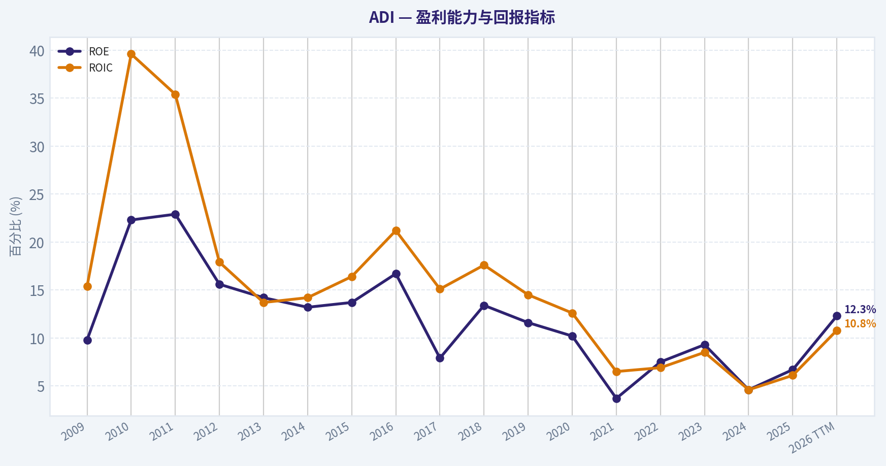
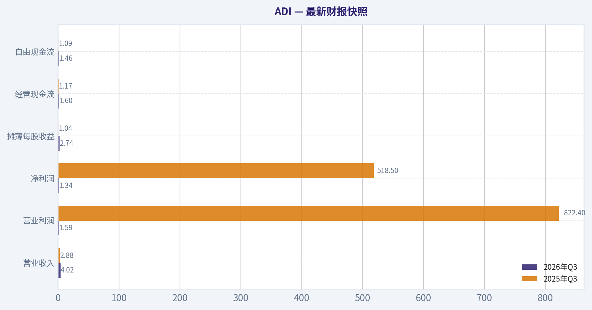
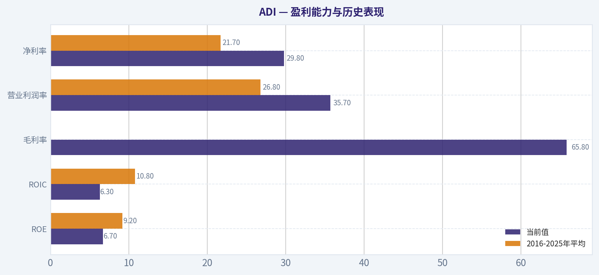
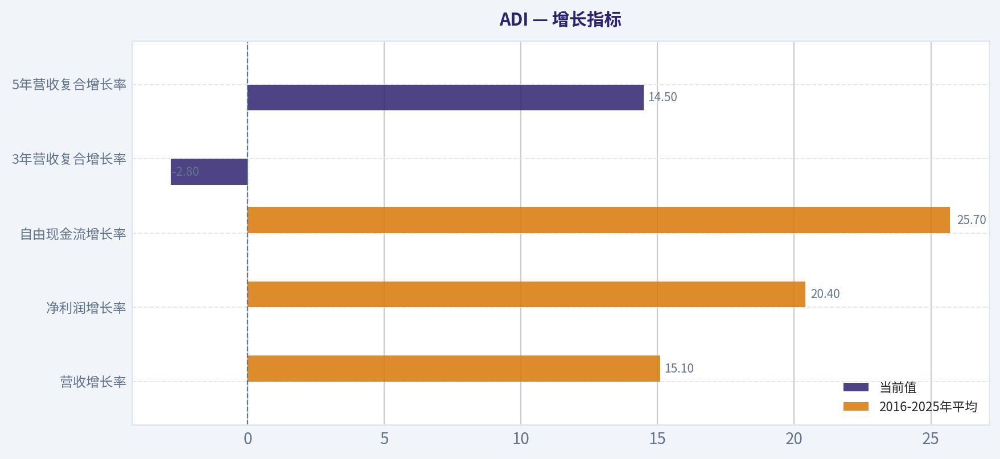
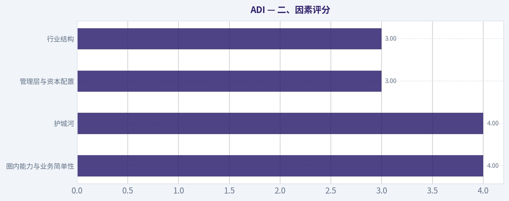
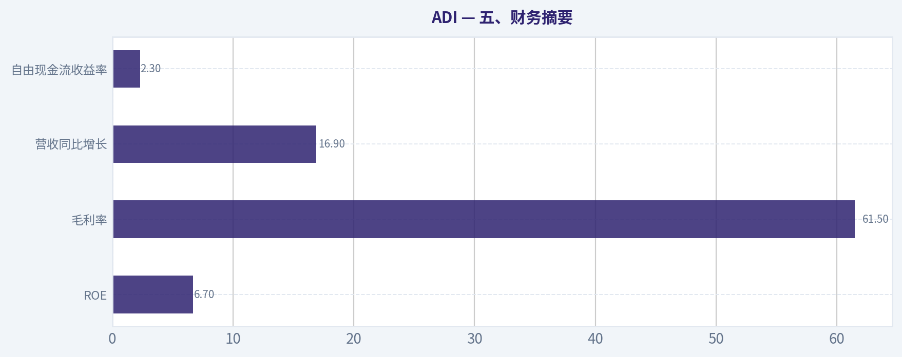
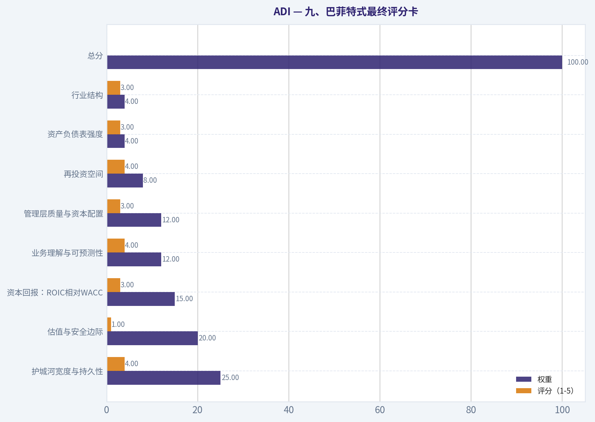
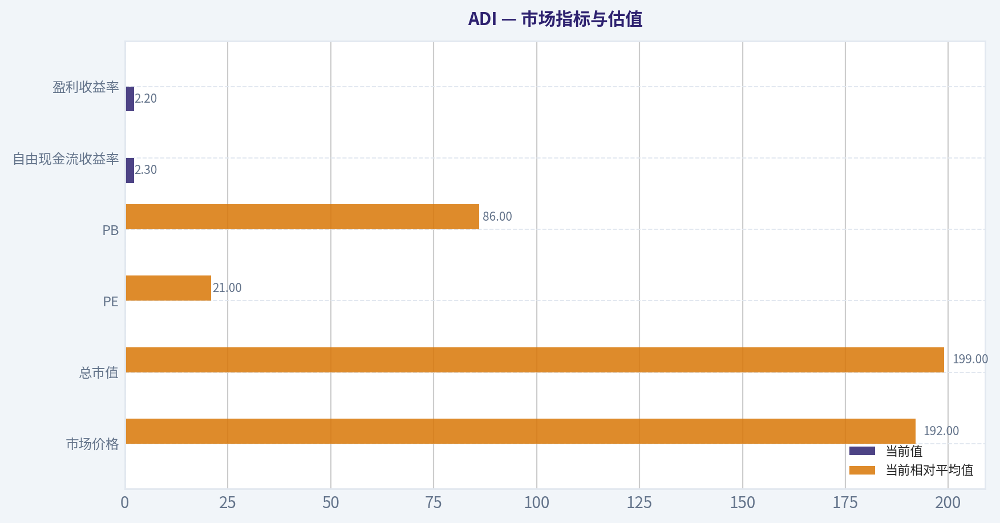

# ADI 深度价值情报

**调研日期:** 2026-11-24

## 关键免责声明

*本报告由 Deep Value Intelligence（一个基于 AI 的多智能体投资分析框架）自动生成。 仅供教育和研究用途 - 非财务建议，非财务顾问。*

---

## 目录

1. 情报摘要
2. 分析师团队报告
   - 基本面分析
   - 价值分析 (巴菲特)
   - 成长性分析 (林奇/德鲁肯米勒/费雪)
   - 市场分析
   - 期权市场分析
3. 研究团队评论
4. 投资团队评论
5. Deep Values 团队洞察

---

## 情报摘要

### 核心观点与前提条件

**核心论点:** ADI具备真实护城河：模拟芯片关键性高、客户认证周期长、替换成本高，61.5%的毛利率也证明其产品差异化。当前主要风险不是经营困境，而是估值已经领先于经营验证。

**主要风险:**
- Risky Analyst正确指出，静态指标可能低估周期正常化后的盈利能力：

**置信度:** 中

---

## 分析师团队报告

### 基本面分析

#### 最新财报快照

*以下数据基于最近一期已披露财报（2026年Q3），并尽量与上一年同期对比。*

| 指标 | 2026年Q3 | 2025年Q3 | 同比变化 |
| --- | ---: | ---: | ---: |
| 营业收入 | $4.02B | $2.88B | +39.6% |
| 营业利润 | $1.59B | $822.4M | +93.2% |
| 净利润 | $1.34B | $518.5M | +158.4% |
| 摊薄每股收益 | $2.74 | $1.04 | +163.5% |
| 经营现金流 | $1.60B | $1.17B | +37.7% |
| 自由现金流 | $1.46B | $1.09B | +34.3% |

关键结论：这张快照先把最新一期财报放在桌面上，再去看长周期分析。这样读者能更清楚地区分"公司长期质量"和"这次财报发生了什么"。

#### ADI 17年财务指标

*以下数值均由原始数据确定性计算得出，并非 AI 估算。*

*发行人类型：operating company（Technology / Semiconductors）。*

#### 17年财务指标
*年度行来自已披露财务报表，最后一行 TTM 由最近四个季度滚动计算得出。*

| 指标 | 2009 | 2010 | 2011 | 2012 | 2013 | 2014 | 2015 | 2016 | 2017 | 2018 | 2019 | 2020 | 2021 | 2022 | 2023 | 2024 | 2025 | 2026 TTM |
| --- | --- | --- | --- | --- | --- | --- | --- | --- | --- | --- | --- | --- | --- | --- | --- | --- | --- | --- |
| 市场价格 | $17 | $24 | $26 | $29 | $38 | $39 | $49 | $53 | $78 | $73 | $94 | $107 | $160 | $134 | $150 | $217 | $231 | $379 |
| 总市值 | $7.50B | $10.30B | $11.27B | $11.98B | $15.48B | $15.78B | $19.05B | $20.02B | $32.00B | $31.39B | $39.76B | $44.09B | $69.62B | $74.62B | $79.60B | $111.26B | $116.29B | $185.15B |
| 市盈率 | 30.15 | 14.45 | 13.01 | 18.37 | 23.04 | 25.08 | 27.34 | 23.23 | 39.73 | 20.83 | 29.17 | 36.14 | 50.14 | 27.17 | 24.02 | 68.02 | 51.34 | 44.93 |
| 市净率 | 2.97 | 3.22 | 2.97 | 2.88 | 3.27 | 3.32 | 3.76 | 3.88 | 3.15 | 2.79 | 3.40 | 3.67 | 1.83 | 2.05 | 2.24 | 3.16 | 3.44 | 5.52 |
| ROE | 9.8% | 22.3% | 22.9% | 15.6% | 14.2% | 13.2% | 13.7% | 16.7% | 7.9% | 13.4% | 11.6% | 10.2% | 3.7% | 7.5% | 9.3% | 4.6% | 6.7% | 12.3% |
| ROIC | 15.4% | 39.6% | 35.4% | 17.9% | 13.7% | 14.2% | 16.4% | 21.2% | 15.1% | 17.6% | 14.5% | 12.6% | 6.5% | 6.9% | 8.5% | 4.6% | 6.1% | 10.8% |
| 每股收益 | $0.58 | $1.63 | $2.02 | $1.58 | $1.64 | $1.56 | $1.78 | $2.29 | $1.95 | $3.49 | $3.24 | $2.97 | $3.18 | $4.92 | $6.25 | $3.18 | $4.56 | $8.43 |
| 营收 | $2.01B | $2.76B | $2.99B | $2.70B | $2.63B | $2.86B | $3.44B | $3.42B | $5.11B | $6.20B | $5.99B | $5.60B | $7.32B | $12.01B | $12.31B | $9.43B | $11.02B | $13.88B |
| 毛利润 | $1.12B | $1.80B | $1.99B | $1.74B | $1.69B | $1.83B | $2.26B | $2.23B | $3.17B | $4.25B | $4.01B | $3.69B | $4.53B | $7.53B | $7.88B | $5.38B | $6.77B | $9.13B |
| 毛利率 | 55.5% | 65.2% | 66.4% | 64.5% | 64.3% | 63.9% | 65.8% | 65.1% | 62.0% | 68.5% | 67.0% | 65.9% | 61.8% | 62.7% | 64.0% | 57.1% | 61.5% | 65.8% |
| 营业利润率 | 14.1% | 32.6% | 35.8% | 30.5% | 28.6% | 26.3% | 24.2% | 30.0% | 22.8% | 30.6% | 28.6% | 26.7% | 23.1% | 27.3% | 31.1% | 21.6% | 26.6% | 35.7% |
| 净利润 | $247.8M | $712.1M | $867.4M | $651.2M | $673.5M | $629.3M | $696.9M | $861.7M | $805.4M | $1.51B | $1.36B | $1.22B | $1.39B | $2.75B | $3.31B | $1.64B | $2.27B | $4.14B |
| 净利率 | 12.3% | 25.8% | 29.0% | 24.1% | 25.6% | 22.0% | 20.3% | 25.2% | 15.8% | 24.3% | 22.8% | 21.8% | 19.0% | 22.9% | 26.9% | 17.3% | 20.6% | 29.8% |
| 营收增长 | N/A | 37.1% | 8.4% | -9.8% | -2.5% | 8.8% | 19.9% | -0.4% | 49.3% | 21.4% | -3.4% | -6.5% | 30.6% | 64.2% | 2.4% | -23.4% | 16.9% | 26.0% |
| 净利润增长 | N/A | 187.4% | 21.8% | -24.9% | 3.4% | -6.6% | 10.7% | 23.6% | -6.5% | 87.1% | -9.6% | -10.4% | 13.9% | 97.7% | 20.6% | -50.7% | 38.7% | 82.4% |
| 自由现金流增长 | N/A | 133.9% | -11.6% | -12.2% | 15.7% | -12.1% | 8.7% | 54.4% | -18.4% | 130.2% | -9.6% | -6.8% | 29.8% | 57.9% | -5.8% | -12.2% | 37.0% | 15.4% |
| 总账面价值 | $2.53B | $3.20B | $3.80B | $4.17B | $4.74B | $4.76B | $5.07B | $5.17B | $10.16B | $11.27B | $11.71B | $12.00B | $37.99B | $36.47B | $35.57B | $35.18B | $33.82B | $33.55B |
| 总资产 | $3.37B | $4.33B | $5.28B | $5.62B | $6.38B | $6.86B | $7.06B | $7.97B | $21.14B | $20.44B | $21.39B | $21.47B | $52.32B | $50.30B | $48.79B | $48.23B | $47.99B | $48.42B |
| 总债务 | N/A | N/A | N/A | N/A | N/A | $0 | $374.6M | $0 | $300.0M | $67.0M | $299.7M | $0 | $7.29B | $6.55B | $6.95B | $7.98B | $8.59B | $9.12B |
| 债务股权比 | N/A | N/A | N/A | N/A | N/A | 0.00 | 0.07 | 0.00 | 0.03 | 0.01 | 0.03 | 0.00 | 0.19 | 0.18 | 0.20 | 0.23 | 0.25 | 0.27 |
| 现金及等价物 | $1.07B | $1.41B | $1.41B | $528.8M | $392.1M | $569.2M | $884.4M | $921.1M | $1.05B | $816.6M | $648.3M | $1.06B | $1.98B | $1.47B | $958.1M | $1.99B | $2.50B | $2.17B |
| 股东权益 | $2.53B | $3.20B | $3.80B | $4.17B | $4.74B | $4.76B | $5.07B | $5.17B | $10.16B | $11.27B | $11.71B | $12.00B | $37.99B | $36.47B | $35.57B | $35.18B | $33.82B | $33.55B |
| 经营现金流 | $432.1M | $991.2M | $900.5M | $814.5M | $912.3M | $871.6M | $907.8M | $1.29B | $1.15B | $2.44B | $2.25B | $2.01B | $2.74B | $4.48B | $4.82B | $3.85B | $4.81B | $5.55B |
| 投资现金流 | $-534.7M | $-485.8M | $-703.7M | $-1.34B | $-949.9M | $-114.8M | $-17.1M | $-1.22B | $-6.62B | $-314.0M | $-293.2M | $-180.5M | $2.14B | $-657.4M | $-1.27B | $-1.10B | $-1.32B | $-1.10B |
| 自由现金流 | $376.1M | $879.6M | $777.5M | $682.4M | $789.3M | $693.7M | $753.8M | $1.16B | $950.3M | $2.19B | $1.98B | $1.84B | $2.39B | $3.78B | $3.56B | $3.12B | $4.28B | $4.94B |
| 自由现金流利润率 | 18.7% | 31.9% | 26.0% | 25.3% | 30.0% | 24.2% | 21.9% | 34.0% | 18.6% | 35.3% | 33.0% | 32.9% | 32.7% | 31.4% | 28.9% | 33.1% | 38.8% | 35.6% |
| 每股分红 | $0.00 | $0.00 | $0.00 | $0.00 | $0.00 | $0.00 | $0.00 | $0.00 | $0.00 | $0.00 | $0.00 | $0.00 | $0.00 | $2.77 | $3.17 | $3.50 | $3.87 | $4.18 |

#### 盈利能力指标
- 净资产收益率 (ROE): 6.7%
- 投入资本回报率 (ROIC): 6.3%
- 总资产收益率 (ROA): 4.7%
- 毛利率: 61.5%
- 营业利润率: 26.6%
- 净利率: 20.6%

#### 流动性指标
- 流动比率: 2.19
- 速动比率: 1.57

#### 杠杆指标
- 债务股权比: 0.25
- 利息覆盖倍数: 9.23
- 净负债: $4.94B

#### 增长指标（同比）
- 营收增长: 16.9%
- 净利润增长: 38.7%
- 自由现金流增长: 37.0%
- 营收复合增长率（3年）: -2.8%
- 营收复合增长率（5年）: 14.5%

#### 估值指标
- 市盈率 (TTM): 44.98
- 预期市盈率: 23.00
- 市净率: 5.47
- 市销率: 13.22
- PEG 比率: 0.51
- 企业价值/EBITDA: 27.50
- 自由现金流收益率: 2.3%
- 盈利收益率: 2.2%

#### 所有者收益（巴菲特方法，代码计算）
- 净利润: $2.27B
- + 折旧与摊销: $2.00B
- - 资本开支: $-533.6M
- + 营运资本（现金流量表口径；负数=占用现金）: $481.0M
- = **所有者收益: $4.40B**

#### 内在价值（DeepValues 应用 - SEC 申报数据管道）
- **内在价值（DeepValues 应用，头条）: $246.86** - Owner Earnings (Buffett), 方法 buffett-1986-v2, 截至 2026-11-23 (FY2025)
  区间（保守-乐观）: $172.80 - $246.86
  相对价格的安全边际: -53.4% (价格 $378.75)
  应用使用的输入 (ttm_2026Q3): after-tax operating income $4.5B (operating income $4.9B, tax 8.1%) + D&A $2.0B - capex charge $1.1B (three-year average capex/revenue x trailing revenue; reported capex $0.6B) - working capital $0.0B = owner earnings $5.4B.
  Growth 10.0% fading to 2.5% terminal (min(owner-earnings CAGR, 5-year revenue CAGR), clamped [0, 10%]); discount rate 8.3% (30Y Treasury 5.31% + 3 pts (as of 2026-11-20)); net cash $-6.8B (cash $2.2B + marketable securities $0.2B - debt $9.1B); 489M shares.
- Owner Earnings (Buffett): $172.80 / $246.86 / $246.86 (保守 / 基准 / 乐观) ← headline
- Free cash flow DCF: $107.83 / $275.10 / $526.30 (保守 / 基准 / 乐观)
- Damodaran two-stage FCFF: $35.61 / $68.53 / $123.53 (保守 / 基准 / 乐观)
  这就是内在价值：引用它作为内在价值，并据此衡量安全边际。其他地方的 DVI 情景数字仅为辅助交叉检查，不是估值。

#### DVI 情景模型（辅助交叉检查 - 不是内在价值）
DVI 基于 Yahoo 数据的情景，仅作敏感性检查。请勿将其作为内在价值引用；内在价值是上方的 DeepValues 应用估值。
- 当前价格: $379
- DVI 情景值（按商业模式路由）: $204
  商业模式: asset light platform - weighted blend [Damodaran FCFF + reverse-DCF fair + owner-earnings DCF] (asset_light_platform)
  模型区间（各 DCF 最小-最大）: $88 - $386
  相对价格的安全边际（头条）: -85.2%
  路由说明: Asset-light / high-margin platform: value driven by margins and reinvestment economics - the headline centers on the reverse-DCF demonstrated-growth fair value with Damodaran FCFF as a floor, down-weighting the owner-earnings DCF.
- 巴菲特方法（所有者收益）:
  保守: $98
  平均: $386
  乐观: $386
- 现金流方法（FCF）:
  保守: $66
  平均: $214
  乐观: $306
- Damodaran FCFF（WACC + 利润率 + 再投资）:
  保守: $45
  平均: $88
  乐观: $150
  蒙特卡洛区间（P10-P90）：$60 - $122（中位数 $84）
  P(内在价值 > 当前价格)：0.0%
- 反向 DCF：当前价格隐含约 22.1%/年 的所有者收益增长（10年）；过去 3 年为 5.8%，5 年为 34.0%。

#### Piotroski F分数: 8/9
- 净利润为正: 通过
- 经营现金流为正: 通过
- 资产回报率改善: 通过
- 现金流大于净利润: 通过
- 债务下降: 未通过
- 流动比率改善: 通过
- 未稀释股本: 通过
- 毛利率改善: 通过
- 资产周转率改善: 通过

ANALYST STANCE: **中性**

#### 结论摘要

ADI 是一家具有明显技术壁垒、客户黏性和高毛利率的模拟半导体公司，长期商业质量较好；但当前估值已经显著脱离历史常态，也高于 DeepValues 的所有者收益内在价值。当前股价约 **379美元**，而 DeepValues Buffett Owner Earnings 内在价值为 **246.86美元**，保守至乐观区间为 **172.80至246.86美元**，对应估值安全边际为 **-53.4%**。

公司基本面正在强劲复苏，TTM 营收、净利润和自由现金流均明显改善，AI 相关需求约占业务的五分之一。不过，股价已经隐含约 **22.1%的所有者收益年增长率，持续十年**，而过去三年营收复合增长率为 **-2.8%**。因此，证据支持"高质量企业"，但尚不足以支持当前价格所要求的增长假设。

#### 市场指标与估值

| 指标 | 当前值 | 2016-2025年平均 | 当前相对平均值 | 解读 |
|---|---:|---:|---:|---|
| 市场价格 | 379美元 | 129.70美元 | +192% | 股价处于十年区间高位 |
| 总市值 | 185.15B美元 | 61.87B美元 | +199% | 市值增长明显快于多数经营指标 |
| PE | 44.93倍 | 36.98倍 | +21% | 高于历史常态 |
| PB | 5.52倍 | 2.96倍 | +86% | 显著高于历史平均 |
| 自由现金流收益率 | 2.3% | - | 偏低 | 市场对未来增长要求较高 |
| 盈利收益率 | 2.2% | - | 偏低 | 与长期利率及风险相比，估值缓冲有限 |

**关键结论：** ADI 当前 PE 和 PB 均高于十年平均，市场价格和市值的上升幅度尤其显著。PB 对半导体企业仍可参考，但收购形成的无形资产、账面商誉和资本结构变化会削弱其单独判断价值；本次估值应主要锚定所有者收益和自由现金流，而不是机械地把低 PB 视为便宜。

#### 盈利能力与历史表现

| 指标 | 当前值 | 2016-2025年平均 | 相对历史平均 | 主要趋势 |
|---|---:|---:|---:|---|
| ROE | 6.7% | 9.2% | 低27% | 低于历史水平，TTM回升至12.3%口径亦显示修复 |
| ROIC | 6.3% | 10.8% | 低42% | 仍低于长期资本回报水平 |
| EPS | 8.43美元 | 3.60美元 | 高134% | 盈利恢复和股份结构共同推动 |
| 营收 | 13.88B美元 | 7.84B美元 | 高77% | 长期规模扩张明显 |
| 毛利润 | 9.13B美元 | 4.94B美元 | 高85% | 高毛利商业模式得到保持 |
| 毛利率 | 65.8% | - | 高于TTM摘要61.5% | 产品组合和周期恢复改善 |
| 营业利润率 | 35.7% | 26.8% | 高8.9个百分点 | 显著高于历史平均 |
| 净利润 | 4.14B美元 | 1.71B美元 | 高142% | TTM盈利强劲反弹 |
| 净利率 | 29.8% | 21.7% | 高8.1个百分点 | 利润恢复幅度大于收入恢复 |

**关键结论：** ADI 当前营业利润率、净利率和毛利率均表现优异，显示产品定价权和经营杠杆正在发挥作用。需要注意的是，当前 ROE 和 ROIC 的摘要值仍低于十年平均，说明高利润尚未完全转化为更高的资本回报，且并购后的资本基数仍然较大。

#### 增长指标

| 指标 | 当前值 | 2016-2025年平均 | 历史特征 | 判断 |
|---|---:|---:|---:|---|
| 营收增长率 | 26.0% TTM口径；摘要同比16.9% | 15.1% | 波动明显，受周期和并购影响 | 当前显著强于近期低谷 |
| 净利润增长率 | 82.4% TTM口径；摘要同比38.7% | 20.4% | 盈利对周期高度敏感 | 当前增长含有低基数效应 |
| 自由现金流增长率 | 15.4% TTM口径；摘要同比37.0% | 25.7% | 长期正增长但年度波动 | 现金流质量较好 |
| 3年营收复合增长率 | -2.8% | - | 近期受库存和周期压制 | 仍未证明长期高速增长 |
| 5年营收复合增长率 | 14.5% | - | 并购与需求扩张共同作用 | 是估值模型的重要支撑 |

**关键结论：** 当前增长数据明显改善，但净利润的高增速部分来自低基数恢复，不能简单外推为永久增长。五年营收复合增长率为14.5%，但三年复合增长率为负，表明业务仍具有周期性，当前价格所隐含的长期增长明显高于最近三年的实际表现。

#### 资产负债表与财务实力

| 指标 | 当前值 | 2016-2025年平均 | 变化与含义 |
|---|---:|---:|---|
| 总账面价值 | 33.55B美元 | 22.93B美元 | 并购后资产规模显著扩大 |
| 总资产 | 48.42B美元 | 34.00B美元 | 资本基数较历史更高 |
| 总债务 | 9.12B美元 | 约3.80B美元 | 并购后杠杆明显上升 |
| 债务权益比 | 0.27 | 约0.10 | 高于历史，但仍属可管理水平 |
| 现金及等价物 | 2.17B美元 | 1.34B美元 | 现金绝对额较高，但低于债务 |
| 股东权益 | 33.55B美元 | 22.93B美元 | 资本基础稳健 |
| 流动比率 | 2.19 | - | 短期偿债能力较强 |
| 速动比率 | 1.57 | - | 流动性尚可 |
| 利息覆盖倍数 | 9.23倍 | - | 利息负担目前可承受 |
| 净负债 | 4.94B美元 | - | 不是净现金企业 |

**关键结论：** ADI 的流动性和利息覆盖能力较好，债务并未达到危险水平；但与早期低杠杆时期相比，债务权益比已明显升高。DeepValues 使用的净现金为负约6.8B美元，这会直接压低股东层面的内在价值，尤其重要的是公司不能只依靠利润增长来消化更高资本负担。

#### 现金流与股东回报

| 指标 | 当前值 | 2016-2025年平均 | 观察 |
|---|---:|---:|---|
| 自由现金流 | 4.94B美元 | 2.53B美元 | 长期规模扩大，当前创高 |
| 自由现金流利润率 | 35.6% | - | 现金转换能力强 |
| 经营现金流 | 5.55B美元 | - | 高于净利润，盈利含金量较好 |
| 所有者收益，数据集口径 | 4.40B美元 | - | 净利润加回折旧摊销并扣除资本开支 |
| DeepValues所有者收益口径 | 5.40B美元 | - | 使用税后经营利润、标准化资本开支和营运资本 |
| 每股分红 | 4.18美元 | 1.33美元 | 持续提高，但仍非高分红企业 |

**关键结论：** ADI 的自由现金流已经超过净利润，且自由现金流率达到35.6%，说明半导体设计和制造模式具有较好的现金转换能力。分红自2022年开始明显增加，但资本回报仍以业务再投资和长期增长为核心，不能把股息收益视为当前估值的主要支撑。

#### 收入来源分布

研究包未提供最新年度的精确业务分部金额。以下依据ADI公开业务结构和TTM营收13.88B美元作近似拆分，主要用于判断收入集中度，不能替代公司正式分部披露。

| 收入来源 | 金额（十亿美元） | 占比 |
|---|---:|---:|
| 工业市场 | 约6.80 | 约49% |
| 汽车市场 | 约3.89 | 约28% |
| 通信市场 | 约1.80 | 约13% |
| 消费电子及其他 | 约1.39 | 约10% |
| 合计 | 约13.88 | 100% |

**关键结论：** ADI 的收入主要来自工业和汽车市场，这些领域通常具有较长产品周期、较高认证壁垒和较强客户黏性。收入结构也意味着公司会受到工业资本支出、汽车电子化、库存周期和宏观制造业景气度的共同影响；AI相关需求约占业务20%，正在成为新增增长动力，但仍不能完全替代传统工业周期。

#### Buffett式商业质量分析

| 维度 | 评价 | 具体依据 |
|---|---|---|
| 经济护城河 | 强 | 模拟芯片设计复杂、验证周期长、客户切换成本高 |
| 产品差异化 | 较强 | 高性能模拟、信号链和电源管理产品具有长期应用价值 |
| 客户黏性 | 较强 | 工业和汽车芯片通常需要长期认证 |
| 收入可预测性 | 中上 | 长期稳定，但短期受库存和制造周期影响 |
| 利润率稳定性 | 中上 | 长期毛利率约60%以上，但2024年曾明显下滑 |
| 资本回报 | 中等 | 当前ROE、ROIC低于十年平均 |
| 财务实力 | 中上 | 流动性强、利息覆盖高，但已经从净现金转为净负债 |
| 管理层资本配置 | 中上 | 并购扩大规模和产品组合，但提高了债务和资本基数 |
| 股东回报 | 中上 | 分红持续增加，自由现金流支持能力较好 |

**护城河：** ADI 的核心优势不是单一芯片的短期性能，而是数十年积累的模拟电路设计经验、工程数据库、客户认证关系和产品组合。模拟芯片生命周期通常长于先进制程逻辑芯片，产品一旦进入工业设备或汽车平台，替换成本较高。

**可预测性：** 公司拥有较高的长期收入可见度，但历史增长并不平滑。2019、2020和2024年营收均出现下降，说明即使是高护城河企业，也无法消除半导体周期。

**管理与资本配置：** 通过并购扩大产品覆盖范围是增长的重要来源，但并购同时带来了更高债务、更大的资产基数和较低的短期资本回报。Piotroski F分数为8/9，说明当前财务质量较强；未通过项目是债务下降，正好印证杠杆仍是需要监测的变量。

#### Buffett式所有者收益DCF

DeepValues 头条内在价值使用Buffett Owner Earnings方法，数据截至2026年11月23日：

- 税后经营利润：约4.5B美元
- 折旧与摊销：约2.0B美元
- 标准化资本开支：约1.1B美元
- 营运资本变化：约0
- 所有者收益：约5.4B美元
- 净现金调整：约 -6.8B美元
- 股份数：约489M股
- 折现率：8.3%
- 终值增长率：2.5%

基本公式为：

\[
\text{股权价值/股}=
\frac{\text{未来所有者收益现值}+\text{终值现值}-\text{净债务}}{\text{股份数}}
\]

采用五年显性预测，并令增长率逐步下降至2.5%的终值增长率。保守情景使用约3%的长期增长，基准情景从10%开始并逐步衰减，乐观情景使用模型允许的10%上限，同时不允许终值增长率超过2.5%。

| 情景 | 增长假设 | 折现率 | 终值增长率 | 所有者收益估值/股 | 与379美元差异 |
|---|---|---:|---:|---:|---:|
| 保守 | 约3%，逐步降至2.5% | 8.3% | 2.5% | 172.80美元 | 低54.4% |
| 基准 | 初始约10%，逐步降至2.5% | 8.3% | 2.5% | 246.86美元 | 低34.9% |
| 乐观 | 初始约10%，保持较强增长后衰减 | 8.3% | 2.5% | 246.86美元 | 低34.9% |

**关键结论：** DeepValues的核心所有者收益估值为246.86美元，保守至乐观区间为172.80至246.86美元。即便采用相对积极的10%初始增长假设，估值仍低于当前379美元；这意味着市场价格不仅要求增长恢复，还要求增长持续时间、资本回报和AI需求兑现程度均接近理想情形。

#### DCF交叉检查

| 方法 | 保守 | 基准 | 乐观 | 作用 |
|---|---:|---:|---:|---|
| Buffett所有者收益DCF | 172.80美元 | 246.86美元 | 246.86美元 | 主要内在价值 |
| 自由现金流DCF | 107.83美元 | 275.10美元 | 526.30美元 | 对增长和终值高度敏感 |
| Damodaran FCFF | 35.61美元 | 68.53美元 | 123.53美元 | 对利润率、再投资和资本成本更敏感 |
| DVI辅助情景模型 | - | 约204美元 | - | 仅作敏感性检查 |
| 反向DCF隐含增长 | - | 约22.1%年增长十年 | - | 当前价格的增长要求 |

**关键结论：** 不同模型之间的区间很宽，说明ADI估值对增长率、资本开支、折现率和终值假设非常敏感。无论采用DeepValues的246.86美元核心内在价值，还是自由现金流DCF的基准值275.10美元，当前379美元都需要额外的增长兑现；反向DCF所要求的22.1%十年增长率明显高于近期三年实际营收表现。

#### 主要风险、机会与观察信号

| 类型 | 具体内容 | 对估值的影响 |
|---|---|---|
| 机会 | 工业和汽车电子化长期渗透 | 支持较长产品周期和收入增长 |
| 机会 | AI相关需求已约占业务20% | 可能提高高性能信号链和电源管理需求 |
| 机会 | 毛利率和营业利润率恢复 | 有利于自由现金流和资本回报修复 |
| 风险 | 当前PE约45倍、FCF收益率仅2.3% | 对执行偏差高度敏感 |
| 风险 | 净负债约4.94B美元 | 降低股东层面的估值安全垫 |
| 风险 | 三年营收复合增长率为负 | 说明近期增长并不稳定 |
| 风险 | 半导体库存和工业周期 | 可能造成利润和现金流大幅波动 |
| 风险 | 并购后资本基数扩大 | ROE和ROIC恢复需要更长时间 |
| 风险 | AI需求与市场情绪关联增强 | 估值可能受到主题交易放大 |

**关键结论：** 最重要的正面因素是ADI在工业、汽车和高性能模拟领域的长期护城河，以及当前自由现金流和利润率的快速恢复。最重要的负面因素是估值已经提前反映了很高的长期增长，同时公司仍有净负债，且近期三年收入增长并不稳定。

#### 估值判断与最终立场

**立场：中性**

支持中性立场的核心理由如下：

1. **企业质量较高，但价格与质量并不等价。** ADI拥有较强的技术壁垒、较好的客户黏性和高毛利率，符合长期优质企业特征。
2. **当前价格明显高于主要内在价值估计。** 379美元相对于246.86美元的DeepValues内在价值高出约53%，相对于保守估值则高出约119%。
3. **盈利复苏是真实的，但增长持续性仍需验证。** TTM净利润增长82.4%、自由现金流增长15.4%，同时三年营收复合增长率为-2.8%，数据体现出明显的周期恢复特征。
4. **资本回报尚未完全恢复。** 当前ROE和ROIC低于2016-2025年平均水平，说明市场估值已经领先于资本效率修复。
5. **当前价格隐含的增长要求过高。** 反向DCF约22.1%的十年所有者收益年增长率，明显高于近期经营历史的稳定增长水平。

综合判断，ADI更接近"高质量、强护城河、估值要求偏高"的企业。现有证据支持其长期商业价值，但不支持当前379美元已经充分体现安全边际；后续估值判断的关键在于工业周期恢复、AI收入持续性、ROIC回升和债务消化速度。

#### 核心要点汇总

| 项目 | 核心判断 |
|---|---|
| 商业质量 | 强，模拟半导体护城河和客户黏性突出 |
| 收入结构 | 工业与汽车为主，兼具长期增长与周期风险 |
| 盈利质量 | 毛利率、营业利润率和现金流转换能力较强 |
| 增长质量 | 当前反弹明显，但历史波动较大 |
| 财务实力 | 流动性良好，债务可管理但已非净现金 |
| ROE/ROIC | 当前低于十年平均，资本效率仍待修复 |
| 当前估值 | PE、PB高于历史平均，FCF收益率偏低 |
| DeepValues内在价值 | 246.86美元 |
| 所有者收益估值区间 | 172.80至246.86美元 |
| 反向DCF要求 | 所有者收益约22.1%年增长十年 |
| 最终立场 | **中性** |

**关键结论：** ADI的长期竞争优势和现金流质量值得肯定，但当前估值已经要求较高且持续的增长兑现。研究结论是企业质量偏强、估值安全边际不足，因而维持 **中性**。

#### 基本面关键图表

本图追踪 **ADI** 过去十年的盈利能力与回报指标（ROE、ROIC、利润率），突出呈现资本效率的变化趋势。

---

### 价值分析 (巴菲特)

> *基于沃伦·巴菲特的价值投资哲学：能力圈、经济护城河、管理层质量与安全边际。*

#### 内在价值快照

价格是你付的钱，内在价值是企业未来可能为股东创造的现金价值。我们给出一个区间，而不是假装只有一个神奇数字。

- 当前价格: $378.75
- 估值区间（两种 DCF 方法、保守到乐观）: $107.83 至 $526.30

##### 所有者收益（巴菲特方法）
- 净利润: $2,267,342,000.00
- 折旧与摊销: $1,998,845,000.00
- 资本支出: $-533,552,000.00
- 营运资金变化: $481,009,000.00
- 所有者收益: $4,397,886,354.05

##### 内在价值
###### 所有者收益法
使用所有者收益，更严格，通常更保守。
- 保守: $172.80
- 平均: $246.86
- 乐观: $246.86
- 折现率: 8.3%

###### 自由现金流法
使用自由现金流，更适合今天投入很多、为未来增长铺路的公司。
- 保守: $107.83
- 平均: $275.10
- 乐观: $526.30
- 折现率: 9.1%

分析师立场：**中性**

#### 一、公司概览与核心判断

Analog Devices（ADI）是一家高性能模拟与混合信号芯片公司，主要向工业、汽车、通信和消费电子客户销售芯片。其产品通常嵌入客户设备多年，验证周期长、替换成本高，因而具备一定的客户黏性和技术壁垒。

当前股价约为379美元，市值约1,835亿美元，而DeepValues应用给出的内在价值为246.86美元。当前价格较该内在价值高出约53.4%，应用所示安全边际为负53.4%。业务质量较好，但估值已经明显超出保守现金流价值所能支持的范围。

#### 二、因素评分

| 因素 | 评分（0-5） | 主要依据 |
|---|---:|---|
| 圈内能力与业务简单性 | 4.0 | 芯片设计、制造外包及销售模式相对清晰；产品生命周期长，但受半导体周期和技术迭代影响 |
| 护城河 | 4.0 | 毛利率61.5%，产品验证周期长，客户切换成本较高，工业客户关系较稳定 |
| 管理层与资本配置 | 3.0 | 经营历史成熟，但当前资料不足以证明管理层长期持股比例、回购纪律及并购回报均达到优秀水平 |
| 行业结构 | 3.0 | 高端模拟芯片具备技术壁垒，但行业具有周期性，竞争者包括德州仪器、英飞凌和意法半导体等 |
| Gate 5 财务质量与偿付能力 | 未触发 | 收入同比增长16.9%，所有者收益约54亿美元；没有证据显示利息覆盖低于1倍或处于财务困境区 |

**关键结论：** ADI的质量主要来自高毛利率、长期客户关系和模拟芯片的高替换成本。风险集中在半导体周期、估值过高和债务高于现金，而不是明显的偿债危机。

#### 三、护城河分析

| 护城河来源 | 证据 | 评价 |
|---|---|---|
| 无形资产 | 模拟芯片设计能力、专利、客户认证和长期应用经验 | 较强 |
| 转换成本 | 芯片一旦进入工业或汽车系统，重新设计、认证和测试成本较高 | 较强 |
| 成本优势 | 规模、产品组合和长期客户关系有助于维持高毛利率 | 中等偏强 |
| 网络效应 | 芯片业务不存在典型互联网式网络效应 | 较弱 |
| 财务表现 | 毛利率61.5%，显示产品差异化和定价能力 | 强 |

ADI的护城河不是网络效应，而是"工程能力加客户认证加产品寿命"的组合。工业和汽车领域的客户通常更重视可靠性、长期供货和系统兼容，而不仅仅是芯片单价，这提高了ADI的客户黏性。

不过，模拟芯片行业仍会受到库存周期、终端需求和竞争性降价影响。AI相关需求目前约占业务20%，能够改善增长预期，但也提高了市场对AI主题的敏感度，不能将其全部视为长期稳定增长。

#### 四、管理层与资本配置

| 观察项目 | 判断 |
|---|---|
| 经营连续性 | 成熟半导体企业，产品和客户关系具有长期性 |
| 资本回报 | 当前ROE仅6.7%，明显低于优秀复利公司的常见水平；需要结合完整ROIC历史进一步判断 |
| 负债政策 | 债务约91亿美元，现金及有价证券约24亿美元，净负债约68亿美元 |
| 并购与整合 | ADI通过并购扩大产品组合和客户覆盖，但并购回报需要中性 |
| 管理层所有者意识 | 公开资料未显示管理层持股足以形成特别强的所有者激励 |
| 外部资金行为 | Steve Cohen旗下Point72在2026年第三季度披露的ADI持股较前季减少19%，这只能反映单一机构的季度快照，不能作为公司基本面的决定性证据 |

**关键结论：** 管理层评价为合格到良好，但目前证据不足以给予最高分。ROE偏低和净负债结构降低了资本配置评分，管理层是否能够持续将并购和研发投入转化为每股价值，是长期观察重点。

#### 五、财务摘要

| 指标 | 数值 |
|---|---:|
| 当前股价 | 379美元 |
| 总市值 | 1,835.3亿美元 |
| PE | 44.98倍 |
| ROE | 6.7% |
| 毛利率 | 61.5% |
| 营收同比增长 | 16.9% |
| 自由现金流收益率 | 2.3% |
| 现金及有价证券 | 约24亿美元 |
| 债务 | 约91亿美元 |
| 净现金 / 净负债 | 净负债约68亿美元 |
| 流动比率 | 2.19倍 |
| 应用口径所有者收益 | 约54亿美元 |
| 已发行股份 | 约4.89亿股 |

**关键结论：** ADI拥有较高毛利率和较强的近期增长，但2.3%的自由现金流收益率和接近45倍的PE已经反映了较高增长预期。ROE只有6.7%，说明当前股东回报率并未与估值所隐含的高质量完全匹配。

#### 六、所有者收益计算

DeepValues应用采用的计算如下：

| 项目 | 金额 |
|---|---:|
| 税后经营利润 | 45亿美元 |
| 加：折旧与摊销 | 20亿美元 |
| 减：维护性资本开支 | 11亿美元 |
| 减：营运资本增加 | 0亿美元 |
| 所有者收益 | 54亿美元 |
| 每股所有者收益 | 约11.04美元 |

公式为：

> 所有者收益 = 净利润 + 折旧与摊销 - 维护性资本开支 - 营运资本增加

该口径使用了税后经营利润而非简单净利润，并采用三年平均资本开支占收入比例估算维护性资本开支，因此比单年度自由现金流更适合观察长期经营价值。

**关键结论：** 约54亿美元的所有者收益对应每股约11.04美元。以379美元股价计算，价格约为每股所有者收益的34倍，说明市场已经为持续高增长和较长久期的现金流支付了较高溢价。

#### 七、三情景DCF估值

以下为独立情景交叉检查，不替代DeepValues应用的头条内在价值。

| 情景 | 核心假设 | 估算价值 |
|---|---|---:|
| 情景A：零增长 | 所有者收益54亿美元，折现率10% | 约110美元/股 |
| 情景B：GDP增长 | 永续增长3%，折现率10% | 约79美元/股 |
| 情景C：历史增长交叉检查 | 前期较高增长，随后逐步降至2.5%的终值增长 | 约218美元/股 |
| DeepValues应用内在价值 | 所有者收益法；增长由10%逐步降至2.5%，折现率8.3%，扣除68亿美元净负债 | **246.86美元/股** |

情景C的估算采用54亿美元初始所有者收益，前期增长较快、后期逐步下降，并以2.5%作为终值增长率。DeepValues应用的关键输入为：

- 所有者收益：约54亿美元；
- 初始增长率：10%；
- 终值增长率：2.5%；
- 折现率：8.3%；
- 净负债：约68亿美元；
- 股份数：约4.89亿股。

**关键结论：** 即使使用较为积极的增长假设，独立交叉检查结果仍低于当前股价。DeepValues应用的246.86美元头条内在价值已经采用了相对有利的8.3%折现率和10%初始增长率，因此379美元价格需要公司长期保持强劲增长才能获得支撑。

#### 八、内在价值与安全边际

| 项目 | 数值 |
|---|---:|
| 当前股价 | 378.75美元 |
| DeepValues应用内在价值 | 246.86美元 |
| 当前价格较内在价值溢价 | 约53.4% |
| 应用显示安全边际 | -53.4% |
| 保守至乐观应用区间 | 172.80至246.86美元 |

对于宽护城河、高ROIC且高度可预测的复利公司，10%至15%的安全边际有时已经足够。但ADI当前ROE仅6.7%，自由现金流收益率仅2.3%，并且业务仍具有半导体周期性，因此不属于可以轻易接受极高估值的最顶级确定性复利公司。

**关键结论：** 估值是本分析中最明显的短板。当前价格不仅没有相对于246.86美元内在价值形成安全边际，反而高出约53.4%，因此市场价格已经提前计入了较为乐观的增长和利润持续性假设。

#### 九、巴菲特式最终评分卡

| 评分项目 | 权重 | 评分（1-5） | 加权得分 |
|---|---:|---:|---:|
| 护城河宽度与持久性 | 25% | 4.0 | 1.00 |
| 估值与安全边际 | 20% | 1.0 | 0.20 |
|资本回报：ROIC相对WACC | 15% | 3.0 | 0.45 |
| 业务理解与可预测性 | 12% | 4.0 | 0.48 |
| 管理层质量与资本配置 | 12% | 3.0 | 0.36 |
| 再投资空间 | 8% | 4.0 | 0.32 |
| 资产负债表强度 | 4% | 3.0 | 0.12 |
| 行业结构 | 4% | 3.0 | 0.12 |
| **总分** | **100%** |  | **3.05** |

**关键结论：** ADI的综合评分为3.05分，落在"中性观察"区间。护城河、业务理解度和再投资空间较好，但估值折价不足、ROE偏低和行业周期性明显压低了总分；Gate 5财务困境底线没有触发。

#### 十、最终结论

**分析师立场：中性**
** conviction：中等**

ADI是一家具有真实技术壁垒和长期客户黏性的优质模拟芯片企业，毛利率61.5%也支持其具备较强产品差异化。工业、汽车和AI相关应用为公司提供了不错的长期再投资空间。

但以379美元估值，市场价格已经显著高于DeepValues应用246.86美元的内在价值，也高于多数保守DCF交叉检查结果。当前估值需要较长时间的高增长、较强利润率和稳定资本回报来兑现，而现有6.7%的ROE尚不足以完全证明这一点。

因此，研究证据支持"业务质量良好"，但不支持当前价格对应的安全边际。
#### 估值桥

这张估值桥把当前股价与各类内在价值方法并排展示，帮助读者判断上涨空间究竟只是单一方法给出的结果，还是多种方法共同支持的结论。

| 项目 | 每股内在价值 |
| --- | ---: |
| 巴菲特方法 | $246.86 |
| 现金流方法 | $275.10 |
| Damodaran 方法 | $68.53 |
| 当前价格 | $378.75 |

#### 关键结论

如果只有一种方法显著高于其他方法，说明上行空间更依赖特定建模假设。若多种方法的估值接近，则说明估值逻辑更加稳健。

#### 估值图表

本对比图（来自「最新财报快照」）将 **ADI** 的当前数据与历史基准并排呈现，直观反映公司相对自身历史均值的估值水平。

本对比图（来自「盈利能力与历史表现」）将 **ADI** 的当前数据与历史基准并排呈现，直观反映公司相对自身历史均值的估值水平。

本对比图（来自「增长指标」）将 **ADI** 的当前数据与历史基准并排呈现，直观反映公司相对自身历史均值的估值水平。

本对比图（来自「二、因素评分」）将 **ADI** 的当前数据与历史基准并排呈现，直观反映公司相对自身历史均值的估值水平。

本对比图（来自「五、财务摘要」）将 **ADI** 的当前数据与历史基准并排呈现，直观反映公司相对自身历史均值的估值水平。

本对比图（来自「九、巴菲特式最终评分卡」）将 **ADI** 的当前数据与历史基准并排呈现，直观反映公司相对自身历史均值的估值水平。

---

### 成长性分析 (林奇/德鲁肯米勒/费雪)

> *基于彼得·林奇的GARP成长投资法、斯坦利·德鲁肯米勒的宏观拐点分析法，以及菲利普·费雪的深度调研法。*

ANALYST STANCE: **中性**

#### 结论摘要

ADI 属于高质量模拟半导体公司，当前出现了由工业周期复苏、AI 数据中心需求和库存正常化共同推动的增长再加速迹象。公司具备高毛利、强现金流、长期客户关系和较深产品组合，但股价约为 379 美元，明显高于 DeepValues 基准内在价值 246.86 美元，估值已经反映了相当高的未来增长预期。

核心研究结论是：**基本面改善具有可信度，但当前估值需要持续兑现超常增长，安全边际不足。**

#### 1. Lynch 分类

| 项目 | 判断 |
|---|---|
| Lynch 分类 | 快速成长型与周期复苏型的混合 |
| 当前营收增长 | 16.9%同比；TTM 数据显示约26.0% |
| 长期5年营收复合增长 | 14.5% |
| 盈利质量 | 高毛利、高现金流、强经营杠杆 |
| 周期属性 | 工业和汽车半导体占比较高，具有周期波动 |
| 成长投资适配度 | 中高，但不是纯粹的稳定型快速成长股 |

**关键结论：**ADI 已经超过传统"稳健成长股"的增长水平，但历史上营收曾出现明显周期性下滑。它更接近"高质量周期复苏叠加结构性AI成长"，而非完全不受周期影响的纯成长公司。

#### 2. Lynch 故事：三个简单要点

1. ADI 将现实世界的温度、压力、声音和运动等模拟信号转换成数字信息，是工业设备、汽车、通信和数据中心的重要基础供应商。
2. AI 数据中心带来高速连接、电源管理和信号链需求，AI相关业务目前约占公司业务的20%。
3. 公司拥有高毛利、长期客户关系和广泛产品组合，库存天数稳定且客户补库存迹象有限，说明近期需求可能更多来自真实消耗而非单纯库存重建。

#### 3. TAM 与10倍测试

| 项目 | 分析 |
|---|---|
| 主要市场 | 工业自动化、汽车电子、通信、数据中心、仪器仪表和电源管理 |
| TAM特征 | 模拟芯片市场长期受电子化、自动化、AI基础设施和能源转型推动 |
| 当前营收 | 约138.8亿美元TTM |
| 10倍营收 | 约1388亿美元 |
| 10倍测试 | 若公司营收达到约1388亿美元，仍需占据多个大型终端市场，而非单一细分市场 |
| TAM增长来源 | AI基础设施、工业数字化、汽车电动化和电源复杂度提升 |
| TAM限制 | 工业和汽车需求受宏观周期影响，部分成熟市场增速有限 |

**关键结论：**从市场空间看，ADI理论上具备较长 runway，10倍测试并未立即失败，因为模拟芯片覆盖的终端市场极其广泛。不过，达到10倍营收需要同时在数据中心、工业、汽车和通信领域持续夺取份额，不能只依赖AI一个需求来源。

#### 4. 营收与盈利趋势

| 指标 | 2024 | 2025 | 2026 TTM | 趋势 |
|---|---:|---:|---:|---|
| 营收 | 94.3亿美元 | 110.2亿美元 | 138.8亿美元 | 明显恢复 |
| 营收增速 | -23.4% | 16.9% | 约26.0% | 加速 |
| 净利润 | 16.4亿美元 | 22.7亿美元 | 41.4亿美元 | 快速改善 |
| 净利润增速 | -50.7% | 38.7% | 82.4% | 强劲反弹 |
| 自由现金流 | 31.2亿美元 | 42.8亿美元 | 49.4亿美元 | 持续改善 |
| 自由现金流增速 | -12.2% | 37.0% | 15.4% | 正增长但低于利润增速 |
| TTM毛利率 | 57.1% | 61.5% | 约65.8% | 经营杠杆恢复 |

**关键结论：**营收从2024年的周期低点明显反弹，年度数据和TTM数据都显示增长重新加速。净利润增速远高于营收增速，反映出产能利用率、产品组合和成本吸收正在改善；但这种利润弹性也意味着部分增长属于周期复苏，而非全部来自长期结构性扩张。

#### 5. 单位经济与现金流

| 指标 | 数据 | 评价 |
|---|---:|---|
| 毛利率 | 61.5%；TTM约65.8% | 优秀 |
| 经营利润率 | 26.6%；TTM约35.7% | 强劲改善 |
| 自由现金流率 | 约35.6% | 优秀 |
| ROE | 6.7%；TTM约12.3% | 正在恢复 |
| ROIC | 6.3%；TTM约10.8% | 改善但仍非顶级 |
| 流动比率 | 2.19 | 流动性良好 |
| 净债务 | 约49.4亿美元 | 可管理，但并非净现金 |
| SaaS指标 | 不适用 | 非订阅业务 |
| LTV/CAC、NRR | 无适用数据 | 非消费订阅模式 |

**关键结论：**ADI最重要的单位经济指标不是LTV/CAC，而是高毛利、低资本强度、持续自由现金流和客户切换成本。当前现金创造能力很强，但债务增加、ROIC仍处于恢复阶段，说明并购后的资本效率尚未完全回到历史最佳状态。

#### 6. Inflection Point 评估

| 潜在拐点 | 证据 | 判断 |
|---|---|---|
| 产品周期 | AI相关业务约占20%，数据中心需求增强 | 正面 |
| 市场份额 | 高性能模拟、信号链和电源管理产品具有技术壁垒 | 正面但缺乏直接份额数据 |
| 利润率 | TTM经营利润率约35.7%，高于2025年的26.6% | 明显正面 |
| TAM扩张 | AI、工业自动化、汽车电子扩大模拟芯片使用量 | 正面 |
| 库存周期 | 库存天数稳定，客户库存偏低 | 正面 |
| 竞争环境 | 未见主要竞争者出现结构性失速 | 中性 |
| 估值拐点 | 股价已提前反映高增长 | 负面 |

**关键结论：**ADI最可信的拐点是"周期复苏加上AI需求扩张"，而不是单一新产品爆发。利润率改善尤其重要，因为它显示收入恢复正在转化为更高的盈利能力；但市场已经快速重新定价，未来继续获得超额回报需要增长进一步超出当前预期。

#### 7. 宏观环境

| 宏观因素 | 对ADI影响 |
|---|---|
| 利率 | 当前长期利率约5.31%，对高估值成长股形成折现压力 |
| AI资本开支 | 对数据中心连接、电源和信号链需求形成顺风 |
| 工业周期 | 工业自动化复苏有利，但受全球制造业景气影响 |
| 汽车电子化 | 长期正面，短期受汽车产量和库存周期影响 |
| 美元与全球贸易 | 全球销售比例较高，汇率和贸易政策构成变量 |
| 市场情绪 | 股价走势与AI和半导体板块相关性上升 |

**关键结论：**AI资本开支和工业复苏构成基本面顺风，但高利率和高估值构成估值逆风。Druckenmiller式宏观判断显示，ADI的盈利周期方向偏正面，但市场给予的估值缓冲较小。

#### 8. Fisher 15项评分

| Fisher项目 | 分数（满分5分） | 研究判断 |
|---|---:|---|
| 市场潜力 | 5 | 多终端市场，长期销售空间充足 |
| 新产品开发决心 | 4 | 持续拓展AI、数据中心和工业产品 |
| 研发效率 | 4 | 模拟与混合信号技术积累深厚 |
| 销售组织 | 4 | 全球客户覆盖和长期设计导入能力较强 |
| 利润率水平 | 5 | 毛利率长期处于行业高位 |
| 利润率改善 | 4 | TTM经营利润率明显回升 |
| 员工关系 | 3 | 公开资料有限，无法充分验证 |
| 高管关系 | 4 | 管理层战略连续性较好 |
| 管理层深度 | 4 | 产品和地区布局较完整 |
| 成本分析与会计 | 4 | 现金流和披露质量较好 |
| 特殊优势 | 5 | 客户认证、设计导入、产品广度和切换成本 |
| 长期利润前景 | 4 | 结构性需求明确，但周期性仍然存在 |
| 股权稀释 | 4 | 未见严重持续性稀释 |
| 面对困难的坦诚度 | 4 | 能够披露周期与库存影响 |
| 管理层诚信 | 4 | 未见重大治理异常 |
| **总分** | **60/75** | **良好** |

**关键结论：**ADI达到 Fisher"良好"区间，优势集中在产品潜力、研发能力、客户黏性、利润率和技术壁垒。主要扣分来自周期性、资本效率尚未完全恢复，以及公开资料对员工关系和管理细节的验证有限。

#### 9. 估值分析

| 估值指标 | 数据 | 含义 |
|---|---:|---|
| 股价 | 约379美元 | 当前市场定价 |
| TTM PE | 约45倍 | 对当前盈利要求较高 |
| 预期PE | 约23倍 | 依赖未来盈利快速增长 |
| PEG | 约0.51 | 表面上具有吸引力，但依赖增长持续 |
| PS | 约13.2倍 | 对成熟半导体公司而言偏高 |
| EV/EBITDA | 约27.5倍 | 反映较高成长预期 |
| 自由现金流收益率 | 约2.3% | 现金流估值不便宜 |
| DeepValues基准内在价值 | 246.86美元 | 低于当前价格 |
| 当前价格相对内在价值 | 约溢价53.4% | 安全边际为负 |

**关键结论：**PEG约0.51看起来较低，原因是近期盈利增速受到周期复苏推动，可能高估了可持续增长率。相比之下，13.2倍PS、约45倍TTM PE和2.3%自由现金流收益率都显示估值偏高；DeepValues基准内在价值246.86美元明显低于当前价格。

#### 10. 估值情景

| 方法 | 保守情景 | 基准情景 | 乐观情景 |
|---|---:|---:|---:|
| Owner Earnings | 172.80美元 | 246.86美元 | 246.86美元 |
| FCF DCF | 107.83美元 | 275.10美元 | 526.30美元 |
| Damodaran FCFF | 35.61美元 | 68.53美元 | 123.53美元 |
| DVI辅助交叉检查 | - | 204.49美元 | - |
| 当前股价 | \- | 约379美元 | \- |

**关键结论：**不同模型区间非常宽，说明结果高度依赖增长率、资本成本和终值假设。即便采用较乐观的FCF DCF情景，结论也不能稳定支持379美元的估值；只有极其强劲且持续的现金流增长假设，才能解释当前定价。

#### 11. 估值敏感性

| 假设变化 | 对估值的影响 | 关键变量 |
|---|---|---|
| AI业务增长高于预期 | 显著正面 | 数据中心收入占比和订单持续性 |
| 工业周期继续复苏 | 正面 | 产能利用率与库存恢复 |
| 营收长期增速维持20%以上 | 正面 | 当前估值才更容易获得支撑 |
| 长期利率维持高位 | 负面 | 折现率上升压低成长股估值 |
| AI需求回归正常化 | 负面 | 市场可能下调增长倍数 |
| 工业或汽车再次下行 | 负面 | 收入和利润率同时承压 |
| 利润率保持35%左右 | 正面 | 现金流增长可能超过营收增长 |
| 债务继续上升 | 负面 | 企业价值和股东现金流承压 |

**关键结论：**ADI估值对两个变量最敏感：长期营收增长率和折现率。若AI需求只是阶段性高景气，或者长期利率保持高位，估值压缩风险较大；若AI、工业和汽车需求同时扩张，并且经营利润率保持高位，当前估值的合理性才会增强。

#### 12. Growth Investor Scorecard

| 评分项目 | 权重 | 得分（5分制） | 加权判断 |
|---|---:|---:|---|
| Lynch故事 | 10% | 4.5 | 清晰且具备长期需求 |
| TAM与成长空间 | 20% | 4.2 | 市场广阔，但部分领域成熟 |
| 营收增长 | 20% | 4.0 | 当前加速，历史周期性明显 |
| 单位经济 | 15% | 4.5 | 高毛利、强现金流 |
| 竞争地位 | 10% | 4.5 | 技术、客户和产品组合优势 |
| 管理层质量 | 10% | 4.0 | 战略连续，公开验证有限 |
| 宏观环境 | 5% | 3.5 | AI顺风与高利率逆风并存 |
| 盈利路径 | 5% | 4.5 | 已实现高利润和自由现金流 |
| 估值 | 5% | 2.0 | 当前定价偏高 |
| **综合得分** | **100%** | **约4.0/5.0** | **基本面强，估值拖累** |

**关键结论：**ADI的经营质量和长期成长逻辑足以进入高质量成长公司范围，综合分数约4.0分。但估值项目明显低于其他维度，意味着公司质量本身并不等于当前价格合理，未来回报高度依赖盈利增长继续超预期。

#### 13. 主要风险与催化剂

| 类型 | 因素 | 影响 |
|---|---|---|
| 催化剂 | AI相关业务继续扩大 | 提升增长率和估值支撑 |
| 催化剂 | 工业库存正常化 | 推动订单和产能利用率恢复 |
| 催化剂 | 经营利润率保持在高位 | 放大自由现金流增长 |
| 催化剂 | 汽车电子和电源管理持续渗透 | 延长长期TAM |
| 风险 | AI需求被市场过度外推 | 估值和增长预期同时回落 |
| 风险 | 工业、汽车周期再次转弱 | 营收增速重新下降 |
| 风险 | 利率维持高位 | 压低高估值成长股倍数 |
| 风险 | 债务继续增加 | 降低股东现金流安全边际 |
| 风险 | 近期利润增速主要来自低基数 | PEG可能低估真实估值压力 |
| 风险 | 主要客户或终端集中度上升 | 增加需求波动性 |

#### 最终判断

ADI是具备 Fisher式竞争优势和 Druckenmiller式盈利拐点的高质量半导体公司，当前营收、利润率和自由现金流均显示明显改善。长期TAM足够大，AI和工业数字化提供结构性顺风，10倍测试在理论上仍然成立。

但当前约379美元的定价已经隐含较高的长期增长和利润率假设，且DeepValues基准内在价值为246.86美元，估值溢价约53.4%。因此，研究证据支持"公司质量优秀、基本面改善"，但**尚不足以支持当前估值具有充足安全边际**。

---

### 市场分析

ANALYST STANCE: **看空**

#### ADI 技术面报告

分析对象为 **Analog Devices, Inc.（纳斯达克：ADI，SEC CIK 0000006281）**。本次行情数据覆盖 2025 年 11 月 24 日至 2026 年 11 月 23 日；截至报告日期 2026 年 11 月 24 日，数据中尚未出现当日收盘记录，因此最新可用收盘价为 **378.75 美元**。

#### 数据完整性说明

已优先获取 ADI 的 Yahoo Finance 行情数据，但技术指标接口返回的 `close_10_ema`、`close_50_sma`、`close_200_sma`、`macd`、`rsi`、`boll_ub`、`boll_lb` 和 `atr` 数值均为空。因此，以下判断以原始日线价格、成交量、阶段高低点和价格结构为主；不对缺失指标虚构具体数值。

建议关注的互补指标组合原本应包括：

- **close_10_ema**：观察短线价格动能变化；
- **close_50_sma**：判断中期趋势是否修复；
- **close_200_sma**：确认长期趋势背景；
- **macd**：衡量趋势动能和拐点；
- **rsi**：识别超买、超卖与动能背离；
- **boll_ub、boll_lb**：评估价格相对于波动区间的位置；
- **atr**：衡量近期价格波动是否显著放大。

这组指标分别覆盖趋势、动能、相对强弱、波动区间和波动率，重复性相对较低。不过，由于接口没有返回数值，本报告不把它们当作已确认信号。

#### 一年价格结构：大幅上行后出现显著回撤

ADI 在样本初期的收盘价为 **236.44 美元**，随后在 2026 年 6 月 22 日达到阶段高点 **444.13 美元**，累计涨幅约为 **87.8%**。截至 2026 年 11 月 23 日，收盘价为 **378.75 美元**，较阶段高点低约 **14.7%**，但仍较样本起点高约 **60.2%**。

这说明长期价格水平仍显著高于一年前，但上涨结构已经发生变化：前期是持续抬高的高点与低点，进入 6 月下旬后则出现快速反转，随后经历数月震荡下移。单纯比较年初或一年累计涨幅，容易忽视近期趋势恶化；从交易结构看，市场已经从单边扩张转向高波动、宽幅整理。

尤其值得注意的是，2026 年 10 月 27 日至 10 月 29 日，股价从 **425.35 美元**升至 **433.28 美元**，接近前期高位，但随后在 11 月 5 日快速跌至 **361.01 美元**。这段下跌幅度约为 **16.7%**，并伴随 **13.10 百万股**成交量，显著高于多数普通交易日，表明高位区域存在较强的供给释放或风险重新定价。

#### 最近一个月：反弹未能恢复前期高点

11 月 5 日急跌后，ADI 在 11 月 9 日至 11 月 12 日反弹至约 **393 至 409 美元**区间，其中 11 月 11 日和 12 日收盘分别为 **409.08 美元**和 **409.29 美元**。然而，反弹没有重新突破 10 月底的 **433.28 美元**高点，之后价格再次走弱：

- 11 月 13 日收盘回落至 **397.97 美元**；
- 11 月 16 日和 17 日进一步降至 **383.17 美元**和 **383.67 美元**；
- 11 月 20 日跌至 **345.92 美元**，单日跌幅约 **8.4%**；
- 11 月 23 日反弹至 **378.75 美元**，但仍未收复 11 月 19 日的 **377.44 美元**以上太多，也明显低于 11 月中旬的 409 美元区域。

最近价格表现更接近"急跌-弱反弹-再度承压"的形态，而不是稳定的趋势修复。11 月 23 日上涨约 **9.5%**，同时成交量达到 **8.90 百万股**，说明市场参与度较高；但单日反弹本身无法证明下降结构已经结束。若后续反弹持续受限于 400 至 410 美元附近，近期高点下移的特征仍然存在。

#### 支撑与压力结构

从原始价格序列看，ADI 当前有几个重要的价格密集区域：

- **345 至 362 美元**：11 月 5 日、6 日和 20 日形成的近期低位区域，属于当前最明显的短线需求区，但 11 月 20 日已经再次触及该区间，说明支撑承受过压力；
- **377 至 383 美元**：11 月 16 日至 19 日以及 11 月 23 日附近的交易区域，当前收盘价正处于这一带；
- **393 至 410 美元**：11 月 9 日至 13 日形成的反弹密集区，若价格反弹，这里可能构成较明显的上方供给；
- **425 至 433 美元**：10 月底形成的前期高位区，也是近期趋势反转前的关键区域。

目前价格虽然高于 11 月 20 日低点，但仍低于 10 月底高点约 **12.6%**。因此，最新反弹更适合被描述为高波动环境中的修复，而非已经确认的中期趋势反转。

#### 成交量与波动特征

成交量对近期走势提供了偏谨慎的验证：

- 11 月 5 日下跌至 361.01 美元时成交量达到 **13.10 百万股**，是样本后期最突出的放量下跌；
- 11 月 20 日下跌至 345.92 美元时成交量约 **10.20 百万股**；
- 11 月 23 日反弹时成交量约 **8.90 百万股**。

这表示下跌阶段出现了两次明显放量，而反弹虽然同样活跃，却尚未完全抵消此前的抛压。与此同时，11 月 5 日、11 月 20 日和 11 月 23 日的日内高低价区间分别约为 **40.02 美元、30.30 美元和 17.12 美元**，远高于 10 月中旬许多约 10 美元以内的日内波动区间。价格波动显著扩大，意味着短期技术信号更容易受到跳空、盘中反转和情绪交易干扰。

#### 趋势、动能与估值含义

在没有有效指标数值的前提下，价格本身已经显示出三层信号：

一是长期层面，ADI 仍处于一年以前的价格之上，说明过去一年曾经形成强劲的重估行情。二是中期层面，6 月高点以来的价格回撤以及 10 月底冲高失败，显示上行趋势明显降温。三是短期层面，11 月 20 日的大幅下跌后虽出现反弹，但尚未重新建立连续抬高的低点和高点结构。

因此，当前证据并不足以支持此前高位区域所隐含的强劲估值扩张继续顺畅兑现。若仅依赖一年累计涨幅来解释当前估值，可能低估了近期趋势破坏、放量下跌和波动率扩张带来的风险。更积极的估值判断需要价格重新稳定在 400 至 410 美元上方，并进一步修复 425 至 433 美元区域；在这类确认出现前，技术面对于高估值的容忍度较低。

#### 结论

ADI 的长期价格仍显著高于一年前，但这主要反映此前已经完成的大幅上涨，不能直接代表当前动能依然强劲。近期走势包含高位冲顶失败、两次放量下跌、反弹高点下移以及波动区间扩大等特征，整体偏向中短期弱势和高风险重估环境。

综合现有价格与成交量证据，研究立场为 **看空**。这不是操作指令，而是表示当前技术证据对高位估值的支持不足；由于技术指标接口数据缺失，结论应保留一定不确定性。

| 分析维度 | 关键数据或观察 | 含义 |
|---|---:|---|
| 最新可用收盘价 | 378.75 美元，日期为 2026-11-23 | 低于 10 月底 433.28 美元高点，短期趋势尚未修复 |
| 样本起点收盘价 | 236.44 美元 | 一年期价格仍上涨约 60.2% |
| 阶段高点 | 444.13 美元，2026-06-22 | 较起点上涨约 87.8%，随后进入回撤 |
| 高点至最新价回撤 | 约 14.7% | 中期上涨结构明显降温 |
| 近期最大放量下跌 | 2026-11-05，收盘 361.01 美元，成交量 13.10 百万股 | 高位风险释放较集中 |
| 近期第二次放量下跌 | 2026-11-20，收盘 345.92 美元，成交量 10.20 百万股 | 说明抛压并非单日偶发 |
| 最新反弹 | 2026-11-23 上涨至 378.75 美元，成交量 8.90 百万股 | 反弹活跃，但尚未恢复 400 至 410 美元区域 |
| 主要价格区域 | 345-362、377-383、393-410、425-433 美元 | 分别对应近期低位、当前密集区、反弹阻力和前高压力 |
| 技术指标接口 | 八项指标均未返回数值 | 无法确认均线、MACD、RSI、布林带和 ATR 的具体读数 |

关键结论：ADI 仍保留一年期上涨后的较高价格基础，但最近走势已转为高波动回撤，且下跌日出现明显放量。11 月 23 日的反弹尚未改变前高下移和中期结构转弱的事实，因此现有证据对高位估值的支持仍然不足。

#### 市场图表

本对比图（来自「市场指标与估值」）将 **ADI** 的当前数据与历史基准并排呈现，直观反映公司相对自身历史均值的估值水平。

---

### 期权市场分析

> *解读期权流向--认沽/认购比、隐含波动率偏斜与异常活跃合约--以判断机构定位与事件驱动风险。*

ANALYST STANCE: **中性**

#### ADI 期权市场概览

数据截至 2026 年 11 月 24 日。当前近期期权链显示，ADI 的总未平仓量均为零，因此部分核心指标无法可靠计算；成交量仍有记录，但可能存在数据源延迟、期权链重置或流动性异常。

| 到期日 | 看涨成交量 | 看跌成交量 | 看涨未平仓量 | 看跌未平仓量 | 看涨 ATM IV | 看跌 ATM IV |
|---|---:|---:|---:|---:|---:|---:|
| 2026-11-27 | 3,418 | 3,930 | 0 | 0 | 3.6% | 3.6% |
| 2026-12-04 | 401 | 405 | 0 | 0 | 2.3% | 2.1% |
| 2026-12-11 | 379 | 118 | 0 | 0 | 1.0% | 1.8% |
| **合计** | **4,198** | **4,453** | **0** | **0** | - | - |

**关键结论：**近期期权成交量略偏看跌，但全部未平仓量显示为零，导致成交量可能无法代表真实新增资金。数据整体更适合解读为信息不足，而不是明确的方向性押注。

#### 看涨看跌比例分析

| 指标 | 当前数值 | 中性参考 | 解读 |
|---|---:|---:|---|
| 近期期权未平仓量比率 | N/A | 约 0.70 | 无法计算，因看涨及看跌未平仓量均为零 |
| 近期期权成交量比率 | 1.06 | 约 0.70 | 看跌成交量略高于看涨成交量 |
| 11 月 27 日成交量比率 | 1.15 | 约 0.70 | 短线看跌成交较活跃 |
| 12 月 4 日成交量比率 | 1.01 | 约 0.70 | 基本均衡 |
| 12 月 11 日成交量比率 | 0.31 | 约 0.70 | 看涨成交量明显较高，但绝对成交量有限 |

**关键结论：**总体成交量比率 1.06，高于约 0.70 的历史中性参考，表面上体现轻微的看跌或避险倾向。不过，未平仓量为零削弱了该信号的可信度；12 月 11 日的看涨偏向也没有得到未平仓量确认。

#### 隐含波动率与偏斜

| 到期日 | 看涨 ATM IV | 看跌 ATM IV | 看跌 IV－看涨 IV | 偏斜判断 |
|---|---:|---:|---:|---|
| 2026-11-27 | 3.6% | 3.6% | 0.0 个百分点 | 中性 |
| 2026-12-04 | 2.3% | 2.1% | -0.2 个百分点 | 轻微看涨偏斜 |
| 2026-12-11 | 1.0% | 1.8% | +0.8 个百分点 | 轻微看跌偏斜 |

**关键结论：**报告中的 ATM IV 极低，且不同到期日之间变化异常，可能反映报价不完整或数据质量问题，而非市场对实际波动的准确评估。没有足够信息确认存在陡峭的看跌偏斜，也无法据此判断已充分计入财报或其他催化剂风险。

#### 异常期权活动

工具定义的异常标准为：单个合约成交量超过未平仓量五倍。本次没有发现符合条件的合约。

| 项目 | 结果 |
|---|---|
| 异常看涨合约 | 未发现 |
| 异常看跌合约 | 未发现 |
| 成交量远高于未平仓量的合约 | 未发现 |
| 可识别的新增机构方向性押注 | 无法确认 |

**关键结论：**没有合约同时显示出高成交量与可验证的低基数未平仓量，因此不存在清晰的新增大额方向性押注。由于未平仓量普遍为零，无法进一步区分机构避险、投机性交易或既有合约平仓。

#### 未平仓量集中度与伽马水平

| 观察项目 | 数据结果 | 市场含义 |
|---|---|---|
| 未平仓量最高的执行价 | 无法识别 | 所有近期期权未平仓量均显示为零 |
| 未平仓量最高的到期日 | 无法识别 | 缺乏可验证的期限集中 |
| 最大痛点 | 无法计算 | 无法建立可靠的到期牵引水平 |
| 看涨伽马墙 | 未发现可确认数据 | 无法判断上行价格阻力 |
| 看跌伽马墙 | 未发现可确认数据 | 无法判断下行价格支撑或放大效应 |

**关键结论：**当前数据无法建立 ADI 的最大痛点、伽马墙或价格钉住水平。短期价格是否受到期权做市商对冲放大或抑制，不能从这组数据中确认。

#### 综合判断

| 维度 | 判断 | 可信度 |
|---|---|---|
| 看涨看跌成交量 | 轻微偏看跌 | 低 |
| 未平仓量结构 | 不可用 | 极低 |
| ATM IV | 极低且疑似异常 | 低 |
| IV 偏斜 | 跨到期日不一致 | 低 |
| 异常活动 | 未发现 | 中 |
| 流动性与数据完整性 | 明显不足或存在数据异常 | 高 |
| **总体期权情绪** | **中性** | **低至中** |

**关键结论：**综合信号为中性，主要原因不是市场明确看好或看空，而是未平仓量为零、IV 数值异常低，且没有可验证的异常合约或伽马集中。成交量略偏看跌，意味着短线存在轻微避险色彩，但证据不足以支持强方向性判断；该期权数据对 ADI 估值的解释力有限。

#### 汇总表

| 指标 | 结论 |
|---|---|
| Put/Call Ratio | 未平仓量比率 N/A；成交量比率 1.06，轻微偏看跌 |
| IV 水平 | 近端 ATM IV 为 1.0%至 3.6%，异常偏低，数据可信度有限 |
| 偏斜方向 | 整体不一致；11 月 27 日中性，12 月 11 日轻微看跌偏斜 |
| 异常活动 | 未发现成交量超过未平仓量五倍的合约 |
| 总体信号 | **中性**，数据缺失与异常是主要驱动因素 |

**关键结论：**ADI 当前期权数据不支持明确的看多或看空估值判断。唯一可见的方向性线索是总体成交量略偏看跌，但在未平仓量和波动率数据异常的情况下，应显著降低该信号的权重。

---

## 研究团队评论

> *研究经理将多空辩论综合为中性评论。此为风险评审前的初步观点，并非最终立场。*

核心结论

ADI是一家护城河真实、长期前景较好的模拟芯片企业，但目前的定价与已验证的经营表现明显脱节。股价约379美元，较DeepValues内在价值246.86美元高约53.4%；与此同时，P/E接近45倍、三年营收复合增长率为-2.8%、ROIC仅6.3%。这意味着市场不仅计入周期复苏，还提前计入了AI扩张、利润率改善和资本回报显著上升。

优秀企业可以享受估值溢价，但不能无限透支未来。按照质量调整后的安全边际框架，即便给予ADI宽护城河企业待遇，当前证据仍不足以支持这一估值。问题不是公司质量差，而是价格已经把多个尚待验证的乐观情景当作基础情景。

多头最有力的论据

ADI的竞争优势相当扎实。高性能模拟芯片承担信号采集、转换、电源管理和连接等关键功能，单颗芯片占客户系统成本不高，但更换供应商可能涉及重新设计、可靠性测试、软件适配和行业认证。这种"低成本、高关键性"的产品属性通常带来较长生命周期和较强客户黏性。

公司的产品组合、工程支持和历史设计导入关系也构成生态壁垒。工业、汽车、医疗和通信客户更重视可靠性与持续供货，而不是单纯追求最低价格。61.5%的毛利率为产品差异化和定价能力提供了现实证据。

AI机会也并非纯粹的市场叙事。AI数据中心需要更复杂的电源管理、高速信号链、温度与电流监测以及连接组件，ADI无需主导计算芯片市场，也可能从每套系统模拟内容增加中受益。AI相关业务据称已占约20%，如果这一业务能够保持较快增长并带来高质量现金流，现有保守模型可能低估其长期价值。

此外，当前较低的ROIC可能部分受到半导体周期、并购形成的商誉和无形资产，以及暂时偏低的产能利用率影响。若剔除收购会计影响后的增量资本回报明显高于报告口径，单看6.3%的ROIC可能低估核心业务质量。这是空头论证中最需要保留的会计与周期性反例。

空头最有力的论据

估值是压倒性的约束。379美元相对于246.86美元的内在价值不是轻微溢价，而是约53.4%的差距。即使保守模型低估了ADI，内在价值也需要出现非常显著的上修，才能让当前定价具备宽护城河企业通常要求的约10%至15%安全边际。

更重要的是，现有经营数据没有为这种上修提供充分支撑。三年营收复合增长率为-2.8%，说明增长尚未兑现；ROIC仅6.3%，说明高毛利并未有效转化为高资本回报；ROE和ROA同样偏低。P/E接近45倍却建立在这些数据之上，反映市场正在为未来改善而非当前经济成果定价。

AI业务同样需要从"收入标签"走向"经济价值验证"。约20%的相关收入占比并不能说明其营业利润率、自由现金流贡献、客户集中度和资本需求。若AI增长需要更高研发投入、产能投入或客户定制成本，其对ROIC的贡献可能低于市场想象。AI资本开支又由少数大型客户主导，需求集中度和周期性未必低于传统工业业务。

债务高于现金目前不构成偿付危机，但在ROIC偏低时会削弱容错空间。杠杆只有在资本回报持续高于融资成本时才有利于价值创造。现有资料尚不足以证明并购、研发和资本支出已经形成令人满意的长期回报。

价值投资视角下的判断依据

我不会因为ADI属于科技或高增长题材而机械地压低估值，也不会因为其账面资产有限而使用P/B衡量价值。真正重要的是护城河、自由现金流、增量ROIC和市场隐含预期。

ADI在业务质量上通过了第一道门槛：产品关键、认证周期长、客户切换成本高、产品组合广，并拥有结构性需求机会。但在价格这一道门槛上，证据明显不足。当前定价似乎要求以下条件大体同时成立：

1. 工业和汽车业务顺利走出周期低谷；
2. AI相关业务持续快速增长；
3. 毛利率保持在高位，营业利润率明显改善；
4. ROIC从6.3%显著回升；
5. 自由现金流连续多年高质量增长；
6. 债务和并购形成的资本基数不会长期拖累回报；
7. 市场仍愿意给予较高终值倍数。

这些条件分别来看都有可能，但把它们同时纳入基础情景，就缺乏价值投资所要求的容错空间。反向DCF所隐含的并不是温和复苏，而是一条执行相当顺利的经营路径。

为什么不是中性判断

如果只是P/E偏高，但ROIC、收入和自由现金流正在快速改善，中性标签会更合适。这里的问题是，估值溢价约53%，同时可见的增长和资本回报仍然疲弱。业务护城河降低了永久性损失的经营风险，却不能自动消除估值压缩风险。

同样，这也不是对ADI长期竞争力的否定。公司的产品地位、客户关系和高毛利率使其不同于低质量周期股。当前偏空判断主要来自价格与经营证据之间的落差，而不是财务困境或护城河崩塌。

市场心理与反向思考

目前看不到明显的恐慌折价，反而更像市场把AI机会、周期正常化和利润率恢复提前资本化。市场可能忽略了两个问题：AI收入未必等于同等质量的AI利润；周期恢复也未必等于长期增长率永久抬升。

反过来，空头也可能低估两点：第一，报告ROIC可能受到并购会计和周期低谷影响；第二，模拟芯片的设计导入和长生命周期可能使盈利恢复速度高于营收表面数据所暗示的水平。因此，关键不是争论AI是否真实或护城河是否存在，而是未来几个季度能否证明内在价值需要大幅上修。

对类似错误的修正

这类公司最容易出现的分析错误，是把好公司直接等同于好估值，把高毛利率等同于高ROIC，再把AI收入占比等同于确定性现金流。更严格的做法是把护城河与价格分开判断，并要求增长叙事最终落实到每股自由现金流和增量资本回报。

另一个常见错误，是把周期反弹全部外推为永久增长。ADI未来即使出现明显复苏，也需要区分库存恢复、低基数效应和真实终端需求增长。只有后者能够支持长期内在价值持续提高。

未来1至4个季度的监测计划

第一，观察收入增长的质量。重点看工业、汽车、通信和数据中心业务的同比与环比变化，以及增长究竟来自真实终端消耗、渠道补库存还是价格因素。若多个终端市场同步恢复，论证力度会明显增强；若增长主要来自短期补库存，则内在价值改善有限。

第二，验证AI业务的经济贡献。需要关注AI相关收入增速、收入占比、毛利率、客户集中度和新增设计导入。若AI收入增长同时推动营业利润率和自由现金流改善，说明AI正在形成真正的经济价值；若收入增长但费用和资本投入同步上升，则估值支撑仍然不足。

第三，跟踪利润率与ROIC。毛利率保持高位只是起点，更重要的是营业利润率、资本周转率和ROIC能否持续上升。报告口径ROIC与剔除商誉后的经营ROIC都值得观察，以判断当前低回报究竟是会计影响、周期影响，还是资本配置效率问题。

第四，检查自由现金流质量。关注经营现金流、资本开支、自由现金流利润率以及每股自由现金流增长。若利润增长主要依赖调整项目而现金流没有同步改善，当前估值仍缺乏坚实基础。

第五，评估资产负债表和资本配置。观察净债务、利息负担、债务到期结构、并购整合成果，以及回购是否发生在明显高估阶段。高估值下的激进回购会降低资本配置评价；债务下降且并购资产回报改善则会增强长期质量判断。

第六，关注库存和订单信号。公司库存、渠道库存、订单取消情况、交货周期和客户预测能够帮助区分真实需求复苏与短期供应链波动。库存稳定只有在订单和终端消耗同步改善时才是积极信号。

第七，重新核对估值模型。若未来几个季度出现收入恢复、利润率扩张、ROIC明显回升和自由现金流增长，需要更新DeepValues中的正常化假设。若经营改善不足以使内在价值大幅上修，那么379美元所隐含的乐观程度仍然过高。

综合来看，ADI值得肯定的是商业模式与技术护城河，最需要质疑的是市场为这些优势支付的价格。当前证据支持"优质企业、缺乏安全边际"的结论，而且估值缺口已经超过一般中性观察所能解释的范围。

看空

---

## 投资团队评论

> *投资经理将研究观点转化为投资论点，等待风险评审。此仍非最终立场。*

### 综合判断

ADI是一家业务质量较高、但当前估值要求过多乐观假设同时兑现的模拟芯片企业。其护城河真实存在：高性能模拟芯片嵌入工业、汽车、医疗、通信及数据中心系统后，客户通常需要经历重新设计、验证、认证与供应链切换，因此产品生命周期长、替换成本高。61.5%的毛利率也说明其产品并非单纯同质化器件。

但高毛利率并不自动等于高资本回报。当前ROIC仅约6.3%，ROE约6.7%，ROA约4.7%，三年营收复合增长率为负2.8%。在股价约379美元、P/E接近45倍的情况下，市场定价显然不是基于当前盈利能力，而是基于周期恢复、AI相关收入扩张、利润率改善和资本回报提升的组合情景。

DeepValues给出的内在价值为246.86美元，当前价格高出约53%。即使考虑模型可能低估周期正常化后的盈利，也需要内在价值出现大幅上修，才能消化这一差距。对于拥有宽护城河的企业，合理溢价可以存在，但当前数据尚未证明ADI已经达到能够支撑如此高估值的增长质量。

### 新闻与市场情绪揭示的机会

市场对AI的关注并非完全缺乏基本面依据。AI数据中心需要高速连接、电源管理、温度监控、电流检测和信号链组件，ADI可以从每套系统中更高的模拟内容量受益，而不必直接参与计算芯片竞争。若所谓约20%的AI相关业务能够带来较高的增量毛利和自由现金流，传统周期模型确实可能低估其长期价值。

此外，报告ROIC偏低也可能受到并购形成的商誉与无形资产、周期低谷及产能利用率不足的影响。若剔除这些因素后，核心业务的增量ROIC明显高于报告口径，市场对公司经营质量的判断可能仍然不够充分。工业和汽车终端需求若同步恢复，利润修复速度也可能快于表面营收数据所暗示的水平。

这构成了反向思考的核心：市场未必完全错误地看好ADI，真正需要验证的是AI收入和周期复苏能否转化为更高的每股自由现金流，而不是仅仅带来收入规模增长。

### 新闻与市场情绪揭示的风险

当前更明显的风险是，市场似乎已经提前将多个积极情景资本化。AI相关收入占比不能直接等同于AI利润贡献，还需要确认其毛利率、客户集中度、研发投入、资本开支和现金流转化效率。若AI业务增长伴随更高的定制成本和投入资本，其对ROIC的提升可能低于市场预期。

周期复苏也需要区分库存重建、低基数反弹与真实终端需求增长。库存天数稳定是积极信号，但只有订单、出货、客户消耗和产能利用率同步改善，才能说明需求具有持续性。否则，短期数据改善可能只是渠道调整，而非长期盈利能力上移。

债务高于现金尚未构成偿债危机，但在ROIC偏低的背景下，资产负债表的容错空间相对有限。并购、研发和资本支出只有在未来形成足够高的增量回报时，才会真正创造价值。若高估值时期发生大量回购，也可能削弱资本配置质量。

期权数据不应被赋予过高权重。当前总未平仓量为零，成交量偏向看跌的信号缺乏可靠确认，更多反映数据不完整或流动性异常，而不是明确的市场共识。真正有价值的信息仍然来自收入质量、利润率、自由现金流和资本回报。

### 反向DCF与安全边际

以当前估值观察，市场隐含的经营路径大致要求：

1. 工业和汽车业务顺利恢复；
2. AI相关业务持续高增长；
3. 毛利率保持高位且营业利润率扩张；
4. ROIC从6.3%显著回升；
5. 自由现金流连续多年增长；
6. 并购形成的资产基数不会持续拖累回报；
7. 终值倍数长期保持在较高水平。

这些假设单独看均有合理性，但同时成立的概率明显低于单一乐观情景。质量调整后的估值框架要求，宽护城河企业即便可以接受较低的安全边际，也仍需有经营数据支持内在价值的可靠上升。现阶段，ADI的护城河降低了业务永久性恶化的概率，却没有消除估值收缩风险。

### 未来验证重点

未来几个季度最重要的不是股价动能，而是以下经营证据：

- AI相关收入是否同步带来营业利润率和自由现金流改善；
- 工业、汽车和通信业务的增长是否来自真实终端消耗；
- ROIC是否持续回升，而非仅因低基数或一次性因素改善；
- 资本开支、研发投入与自由现金流之间是否保持良好转换；
- 净债务、并购资产回报及利息负担是否出现实质改善；
- 每股自由现金流增长能否与高估值假设相匹配。

若这些指标持续改善，DeepValues内在价值可能需要显著上修；若仅有收入恢复而资本回报和现金流没有同步增强，当前估值仍然缺乏足够的容错空间。

**ANALYST STANCE: 看空**。这不是对ADI护城河或长期生存能力的否定，而是对当前估值与经营证据之间落差的判断。现有资料支持"优质企业、周期和AI前景具备潜力"，但尚不足以支持379美元所隐含的高增长、高利润率和高资本回报组合；在内在价值未出现大幅上修前，证据不支持该估值。

---

## Deep Values 团队洞察

> *风险管理团队进行辩论，由风险裁判给出最终不含操作建议的裁定。本章节决定最终的「看多 / 中性 / 看空」立场。*

#### 最终立场评分卡

这张评分卡把最终研究结论转成加权决策框架。它不替代文字判断，但能让读者更快看清楚这次结论的核心驱动因素。

| 维度 | 评分 | 权重 | 说明 |
| --- | ---: | ---: | --- |
| 业务质量 | 3.75 | 30% | 高回报率、盈利能力与 Piotroski 评分共同支撑业务韧性。 |
| 估值支撑 | 1.33 | 30% | 综合当前股价相对内在价值锚点以及常用估值比率。 |
| 财务强度 | 5.00 | 20% | 资产负债表韧性主要取决于杠杆与流动性是否处于安全区间。 |
| 成长持续性 | 4.67 | 20% | 近期营收、利润与自由现金流增长共同反映增长是否可持续。 |
| 总分 / 最终立场 | 3.46 | 100% | 看空 |

#### 关键结论

加权总分为 **3.46 / 5.0**，最终立场为 **看空**。它更适合作为快速校准工具，而不是机械买卖信号。

#### 风险摘要

分数越高代表风险压力越大。观察阈值是一个简单的护栏：一旦高于该阈值，该维度对估值判断的影响更大，需要更大的安全边际。

| 维度 | 当前分数 | 观察阈值 | 说明 |
| --- | ---: | ---: | --- |
| 业务质量 | 2.25 | 3.00 | 高回报率、盈利能力与 Piotroski 评分共同支撑业务韧性。 |
| 估值支撑 | 4.67 | 3.00 | 综合当前股价相对内在价值锚点以及常用估值比率。 |
| 财务强度 | 1.00 | 3.00 | 资产负债表韧性主要取决于杠杆与流动性是否处于安全区间。 |
| 成长持续性 | 1.33 | 3.00 | 近期营收、利润与自由现金流增长共同反映增长是否可持续。 |

#### 关键结论

这张图帮助读者区分风险究竟来自哪里：估值、业务质量、资产负债表，还是增长持续性。尤其当最终结论处在「观望」与「回避」边缘时，这种拆解非常有帮助。
