# ADI Deep Value Intelligence

**Analysis Date:** 2026-11-24

## Critical Disclaimer

*This analysis is generated by Deep Value Intelligence, an AI-powered multi-agent investing framework. Education & research only - not financial advice, not a financial advisor.*

---

## Table of Contents

1. Intelligence Summary
2. Analyst Team Reports
   - Fundamentals Analysis
   - Intrinsic Value Analysis (Buffett)
   - Trend & Growth Analysis (Lynch/Druckenmiller/Fisher)
   - Market Technical Analysis
   - Options Market Analysis
3. Research Team Commentary
4. Value Investing Team Commentary
5. Deep Values Commentary

---

## Intelligence Summary

### Thesis + Conditions

**Core Thesis:** ADI appears to be a durable, differentiated analog-semiconductor franchise. Its 61.5% gross margin, mission-critical products, long qualification cycles, broad catalog, and embedded engineering relationships support a credible moat.

**Key Risks:**
- The principal risk is not temporary stock volatility or technological obsolescence; it is **overpaying for normalization that has not yet been demonstrated**. At $379 and approximately 44.98 times current earnings, the valuation assumes substantial improvement from reported ROIC of 6.3%, ROE of 6.7%, and ROA of 4.7%. Current returns may be cyclically and acquisition-accounting depressed, but gross margin alone cannot prove that.
- ADI can benefit from AI infrastructure without controlling the accelerator market. Power management, signal conversion, monitoring, and reliability requirements can increase with system density and power consumption.
- The conservative analyst correctly identifies valuation as the dominant risk:

**Confidence:** Low

---

## Analyst Team Reports

### Fundamentals Analysis

#### Latest Earnings Snapshot

*Most recent reported quarter anchored on 2026 Q3, with prior-year comparison when available.*

| Metric | 2026 Q3 | 2025 Q3 | YoY Change |
| --- | ---: | ---: | ---: |
| Revenue | $4.02B | $2.88B | +39.6% |
| Operating Income | $1.59B | $822.4M | +93.2% |
| Net Income | $1.34B | $518.5M | +158.4% |
| Diluted EPS | $2.74 | $1.04 | +163.5% |
| Operating Cash Flow | $1.60B | $1.17B | +37.7% |
| Free Cash Flow | $1.46B | $1.09B | +34.3% |

Key Takeaways: This snapshot anchors the most recent reported quarter before the narrative analysis. It helps readers separate long-run business quality from whatever changed in the latest earnings print.

#### 17-Year Financial Metrics for ADI

*All values below are computed deterministically from raw data - not estimated by AI.*

*Issuer profile: operating company (Technology / Semiconductors).*

#### 17-Year Financial Metrics
*Annual rows come from reported financial statements. The final TTM row is computed from the latest four quarters.*

| Metric | 2009 | 2010 | 2011 | 2012 | 2013 | 2014 | 2015 | 2016 | 2017 | 2018 | 2019 | 2020 | 2021 | 2022 | 2023 | 2024 | 2025 | 2026 TTM |
| --- | --- | --- | --- | --- | --- | --- | --- | --- | --- | --- | --- | --- | --- | --- | --- | --- | --- | --- |
| Market Price | $17 | $24 | $26 | $29 | $38 | $39 | $49 | $53 | $78 | $73 | $94 | $107 | $160 | $134 | $150 | $217 | $231 | $379 |
| Market Cap | $7.50B | $10.30B | $11.27B | $11.98B | $15.48B | $15.78B | $19.05B | $20.02B | $32.00B | $31.39B | $39.76B | $44.09B | $69.62B | $74.62B | $79.60B | $111.26B | $116.29B | $185.15B |
| P/E Ratio | 30.15 | 14.45 | 13.01 | 18.37 | 23.04 | 25.08 | 27.34 | 23.23 | 39.73 | 20.83 | 29.17 | 36.14 | 50.14 | 27.17 | 24.02 | 68.02 | 51.34 | 44.93 |
| P/B Ratio | 2.97 | 3.22 | 2.97 | 2.88 | 3.27 | 3.32 | 3.76 | 3.88 | 3.15 | 2.79 | 3.40 | 3.67 | 1.83 | 2.05 | 2.24 | 3.16 | 3.44 | 5.52 |
| ROE | 9.8% | 22.3% | 22.9% | 15.6% | 14.2% | 13.2% | 13.7% | 16.7% | 7.9% | 13.4% | 11.6% | 10.2% | 3.7% | 7.5% | 9.3% | 4.6% | 6.7% | 12.3% |
| ROIC | 15.4% | 39.6% | 35.4% | 17.9% | 13.7% | 14.2% | 16.4% | 21.2% | 15.1% | 17.6% | 14.5% | 12.6% | 6.5% | 6.9% | 8.5% | 4.6% | 6.1% | 10.8% |
| EPS | $0.58 | $1.63 | $2.02 | $1.58 | $1.64 | $1.56 | $1.78 | $2.29 | $1.95 | $3.49 | $3.24 | $2.97 | $3.18 | $4.92 | $6.25 | $3.18 | $4.56 | $8.43 |
| Revenue | $2.01B | $2.76B | $2.99B | $2.70B | $2.63B | $2.86B | $3.44B | $3.42B | $5.11B | $6.20B | $5.99B | $5.60B | $7.32B | $12.01B | $12.31B | $9.43B | $11.02B | $13.88B |
| Gross Profit | $1.12B | $1.80B | $1.99B | $1.74B | $1.69B | $1.83B | $2.26B | $2.23B | $3.17B | $4.25B | $4.01B | $3.69B | $4.53B | $7.53B | $7.88B | $5.38B | $6.77B | $9.13B |
| Gross Margin | 55.5% | 65.2% | 66.4% | 64.5% | 64.3% | 63.9% | 65.8% | 65.1% | 62.0% | 68.5% | 67.0% | 65.9% | 61.8% | 62.7% | 64.0% | 57.1% | 61.5% | 65.8% |
| Operating Margin | 14.1% | 32.6% | 35.8% | 30.5% | 28.6% | 26.3% | 24.2% | 30.0% | 22.8% | 30.6% | 28.6% | 26.7% | 23.1% | 27.3% | 31.1% | 21.6% | 26.6% | 35.7% |
| Net Income | $247.8M | $712.1M | $867.4M | $651.2M | $673.5M | $629.3M | $696.9M | $861.7M | $805.4M | $1.51B | $1.36B | $1.22B | $1.39B | $2.75B | $3.31B | $1.64B | $2.27B | $4.14B |
| Net Margin | 12.3% | 25.8% | 29.0% | 24.1% | 25.6% | 22.0% | 20.3% | 25.2% | 15.8% | 24.3% | 22.8% | 21.8% | 19.0% | 22.9% | 26.9% | 17.3% | 20.6% | 29.8% |
| Revenue Growth | N/A | 37.1% | 8.4% | -9.8% | -2.5% | 8.8% | 19.9% | -0.4% | 49.3% | 21.4% | -3.4% | -6.5% | 30.6% | 64.2% | 2.4% | -23.4% | 16.9% | 26.0% |
| Net Income Growth | N/A | 187.4% | 21.8% | -24.9% | 3.4% | -6.6% | 10.7% | 23.6% | -6.5% | 87.1% | -9.6% | -10.4% | 13.9% | 97.7% | 20.6% | -50.7% | 38.7% | 82.4% |
| Free Cash Flow Growth | N/A | 133.9% | -11.6% | -12.2% | 15.7% | -12.1% | 8.7% | 54.4% | -18.4% | 130.2% | -9.6% | -6.8% | 29.8% | 57.9% | -5.8% | -12.2% | 37.0% | 15.4% |
| Total Book Value | $2.53B | $3.20B | $3.80B | $4.17B | $4.74B | $4.76B | $5.07B | $5.17B | $10.16B | $11.27B | $11.71B | $12.00B | $37.99B | $36.47B | $35.57B | $35.18B | $33.82B | $33.55B |
| Total Assets | $3.37B | $4.33B | $5.28B | $5.62B | $6.38B | $6.86B | $7.06B | $7.97B | $21.14B | $20.44B | $21.39B | $21.47B | $52.32B | $50.30B | $48.79B | $48.23B | $47.99B | $48.42B |
| Total Debt | N/A | N/A | N/A | N/A | N/A | $0 | $374.6M | $0 | $300.0M | $67.0M | $299.7M | $0 | $7.29B | $6.55B | $6.95B | $7.98B | $8.59B | $9.12B |
| Debt-to-Equity | N/A | N/A | N/A | N/A | N/A | 0.00 | 0.07 | 0.00 | 0.03 | 0.01 | 0.03 | 0.00 | 0.19 | 0.18 | 0.20 | 0.23 | 0.25 | 0.27 |
| Cash & Equivalents | $1.07B | $1.41B | $1.41B | $528.8M | $392.1M | $569.2M | $884.4M | $921.1M | $1.05B | $816.6M | $648.3M | $1.06B | $1.98B | $1.47B | $958.1M | $1.99B | $2.50B | $2.17B |
| Shareholders' Equity | $2.53B | $3.20B | $3.80B | $4.17B | $4.74B | $4.76B | $5.07B | $5.17B | $10.16B | $11.27B | $11.71B | $12.00B | $37.99B | $36.47B | $35.57B | $35.18B | $33.82B | $33.55B |
| Operating Cash Flow | $432.1M | $991.2M | $900.5M | $814.5M | $912.3M | $871.6M | $907.8M | $1.29B | $1.15B | $2.44B | $2.25B | $2.01B | $2.74B | $4.48B | $4.82B | $3.85B | $4.81B | $5.55B |
| Investing Cash Flow | $-534.7M | $-485.8M | $-703.7M | $-1.34B | $-949.9M | $-114.8M | $-17.1M | $-1.22B | $-6.62B | $-314.0M | $-293.2M | $-180.5M | $2.14B | $-657.4M | $-1.27B | $-1.10B | $-1.32B | $-1.10B |
| Free Cash Flow | $376.1M | $879.6M | $777.5M | $682.4M | $789.3M | $693.7M | $753.8M | $1.16B | $950.3M | $2.19B | $1.98B | $1.84B | $2.39B | $3.78B | $3.56B | $3.12B | $4.28B | $4.94B |
| FCF Margin | 18.7% | 31.9% | 26.0% | 25.3% | 30.0% | 24.2% | 21.9% | 34.0% | 18.6% | 35.3% | 33.0% | 32.9% | 32.7% | 31.4% | 28.9% | 33.1% | 38.8% | 35.6% |
| Dividends / Share | $0.00 | $0.00 | $0.00 | $0.00 | $0.00 | $0.00 | $0.00 | $0.00 | $0.00 | $0.00 | $0.00 | $0.00 | $0.00 | $2.77 | $3.17 | $3.50 | $3.87 | $4.18 |

#### Profitability Metrics
- Return on Equity (ROE): 6.7%
- Return on Invested Capital (ROIC): 6.3%
- Return on Assets (ROA): 4.7%
- Gross Margin: 61.5%
- Operating Margin: 26.6%
- Net Profit Margin: 20.6%

#### Liquidity Metrics
- Current Ratio: 2.19
- Quick Ratio: 1.57

#### Leverage Metrics
- Debt-to-Equity Ratio: 0.25
- Interest Coverage Ratio: 9.23
- Net Debt: $4.94B

#### Growth Metrics (Year-over-Year)
- Revenue Growth: 16.9%
- Net Income Growth: 38.7%
- Free Cash Flow Growth: 37.0%
- Revenue CAGR (3-Year): -2.8%
- Revenue CAGR (5-Year): 14.5%

#### Valuation Metrics
- P/E Ratio (TTM): 44.98
- Forward P/E: 23.00
- Price-to-Book: 5.47
- Price-to-Sales: 13.22
- PEG Ratio: 0.51
- EV/EBITDA: 27.50
- Free Cash Flow Yield: 2.3%
- Earnings Yield: 2.2%

#### Owner Earnings (Buffett Method, Code-Computed)
- Net Income: $2.27B
- + Depreciation & Amortization: $2.00B
- - Capital Expenditures: $-533.6M
- + Working Capital (cash-flow statement; negative = cash tied up): $481.0M
- = **Owner Earnings: $4.40B**

#### Intrinsic Value (DeepValues app - SEC filings pipeline)
- **Intrinsic value (DeepValues app, the headline): $246.86** - Owner Earnings (Buffett), method buffett-1986-v2, as of 2026-11-23 (FY2025)
  Range (conservative - optimistic): $172.80 - $246.86
  Margin of safety vs. price: -53.4% (price $378.75)
  Inputs the app used (ttm_2026Q3): after-tax operating income $4.5B (operating income $4.9B, tax 8.1%) + D&A $2.0B - capex charge $1.1B (three-year average capex/revenue x trailing revenue; reported capex $0.6B) - working capital $0.0B = owner earnings $5.4B.
  Growth 10.0% fading to 2.5% terminal (min(owner-earnings CAGR, 5-year revenue CAGR), clamped [0, 10%]); discount rate 8.3% (30Y Treasury 5.31% + 3 pts (as of 2026-11-20)); net cash $-6.8B (cash $2.2B + marketable securities $0.2B - debt $9.1B); 489M shares.
- Owner Earnings (Buffett): $172.80 / $246.86 / $246.86 (conservative / base / optimistic) ← headline
- Free cash flow DCF: $107.83 / $275.10 / $526.30 (conservative / base / optimistic)
- Damodaran two-stage FCFF: $35.61 / $68.53 / $123.53 (conservative / base / optimistic)
  This is THE intrinsic value: quote it as the intrinsic value and measure margin of safety against it. Any DVI scenario figures elsewhere are a secondary cross-check, not the value.

#### DVI scenario model (secondary cross-check - NOT the intrinsic value)
DVI's own Yahoo-based scenarios, shown only as a sensitivity check. Do not quote these as the intrinsic value; the intrinsic value is the DeepValues app value above.
- Current Price: $379
- DVI scenario value (business-model routed): $204
  Business model: asset light platform - weighted blend [Damodaran FCFF + reverse-DCF fair + owner-earnings DCF] (asset_light_platform)
  Model spread (min-max across DCFs): $88 - $386
  Margin of safety vs. price (headline): -85.2%
  Routing note: Asset-light / high-margin platform: value driven by margins and reinvestment economics - the headline centers on the reverse-DCF demonstrated-growth fair value with Damodaran FCFF as a floor, down-weighting the owner-earnings DCF.
- Buffett Method (Owner Earnings):
  Conservative: $98
  Average: $386
  Optimistic: $386
- Cash Flow Method (FCF):
  Conservative: $66
  Average: $214
  Optimistic: $306
- Damodaran FCFF (WACC + margins + reinvestment):
  Conservative: $45
  Average: $88
  Optimistic: $150
  Monte Carlo band (P10-P90): $60 - $122 (median $84)
  P(intrinsic value > price): 0.0%
- Reverse-DCF: price implies ~22.1%/yr owner-earnings growth for 10y; trailing 3y was 5.8%, 5y 34.0%.

#### Piotroski F-Score: 8/9
- Positive Net Income: PASS
- Positive Operating Cash Flow: PASS
- ROA Improvement: PASS
- Cash Flow > Net Income: PASS
- Decreasing Debt: FAIL
- Improving Current Ratio: PASS
- No Dilution: PASS
- Improving Gross Margin: PASS
- Improving Asset Turnover: PASS

ANALYST STANCE: **Neutral**

#### Executive Summary

Analog Devices, Inc. is a high-quality analog semiconductor franchise with strong gross margins, substantial free-cash-flow generation, and meaningful exposure to industrial, automotive, communications, and artificial-intelligence demand. Its long-term business economics are attractive, but the current valuation is demanding relative to historical valuation levels and the deterministic Owner Earnings intrinsic value.

The canonical dataset shows a current market price of approximately **$379**, market capitalization of **$185.15 billion**, trailing P/E of **44.93**, and Owner Earnings intrinsic value of **$246.86 per share**. This implies a valuation gap of approximately **53.4% above intrinsic value**. The evidence supports business quality, but not the present valuation without a sustained period of unusually strong earnings growth.

#### Current Metrics Versus Ten-Year Averages

The comparison below uses the ten annual observations from 2016 through 2025 where applicable. The 2026 TTM figures are treated as current.

| Metric | Current / 2026 TTM | 2016-2025 Average | Interpretation |
|---|---:|---:|---|
| Market Price | $379 | $129.70 | Approximately 192% above the ten-year annual average |
| Market Capitalization | $185.15B | Approximately $80.9B | More than twice the ten-year average |
| P/E Ratio | 44.93 | 36.98 | Premium of roughly 21.5% |
| P/B Ratio | 5.52 | 2.96 | Material premium, but weak valuation signal for this issuer |
| ROE | 12.3% TTM | 9.16% | Above average on the TTM calculation |
| ROIC | 10.8% TTM | 11.36% | Slightly below the ten-year average |
| Revenue Growth | 26.0% TTM | 15.1% | Strongly above average, helped by recovery and cyclical comparisons |
| Net Income Growth | 82.4% TTM | 20.4% | Far above average and unlikely to be a normalized long-term rate |
| FCF Growth | 15.4% TTM | 25.7% | Below the ten-year average |
| Gross Margin | 65.8% TTM | Approximately 63.8% | Above average and supportive of pricing power |
| Operating Margin | 35.7% TTM | Approximately 27.8% | Significantly above average |
| FCF Margin | 35.6% TTM | Approximately 30.7% | Strong cash conversion |
| Debt-to-Equity | 0.27 | Approximately 0.10 | Higher than the pre-2021 historical structure |
| Cash and Equivalents | $2.17B | Approximately $1.34B | Above the long-term average in absolute terms |
| Dividends per Share | $4.18 | Approximately $2.07 | More than doubled over the comparison period |

**Key Takeaways:** ADI's current operating margins, revenue growth, and TTM ROE are stronger than historical norms, but the share valuation has expanded even more aggressively. The P/E premium is meaningful, while debt-to-equity has risen from the company's historically conservative levels. Free-cash-flow growth is positive but not keeping pace with the very high recent net-income growth rate.

#### Market Metrics

| Market Metric | Current Value | Historical Context |
|---|---:|---|
| Market Price | $379 | Far above the 2016-2025 average of $129.70 |
| Total Market Capitalization | $185.15B | More than double the approximate 2016-2025 average of $80.9B |
| P/E Ratio | 44.93 | Above the ten-year average of 36.98 |
| P/B Ratio | 5.52 | Above the ten-year average of 2.96 |

**Key Takeaways:** ADI is priced as a premium compounder rather than as a cyclical semiconductor recovery candidate. The current P/E requires durable earnings growth and sustained margins. Because ADI is an asset-light, intellectual-property-driven semiconductor business, P/B should not be interpreted mechanically as a cheap-versus-expensive signal; cash flow and returns on capital are more relevant.

The current valuation is particularly demanding when compared with the DeepValues Owner Earnings model. At approximately $379 per share, the market price is about **1.54 times** the stated intrinsic value of **$246.86**. The indicated margin of safety is therefore negative, at approximately **-53.4%**.

#### Profitability and Operating Performance

| Metric | Current / TTM | Historical Interpretation |
|---|---:|---|
| ROE | 12.3% TTM | Above the 2016-2025 average of 9.16%, but below the exceptional 2010-2011 period |
| ROIC | 10.8% TTM | Close to the long-term norm, but below the 2016-2025 average of 11.36% |
| EPS | $8.43 | Well above the 2016-2025 average of approximately $3.30 |
| Revenue | $13.88B | Record level in the dataset |
| Gross Profit | $9.13B | Record level in the dataset |
| Gross Margin | 65.8% | Above the 2016-2025 average and consistent with differentiated analog products |
| Operating Margin | 35.7% | Well above the 2016-2025 average of approximately 27.8% |
| Net Income | $4.14B | Record level in the dataset |
| Net Margin | 29.8% | Above the 2016-2025 average of approximately 22.9% |

**Key Takeaways:** ADI's current profitability is excellent on an absolute basis. Gross margin above 65% and operating margin above 35% indicate strong product differentiation, favorable mix, and operating leverage. However, TTM net income growth of 82.4% is unusually high and should not be treated as a sustainable normalized growth rate without further evidence.

The dataset also contains a latest annual 2025 profitability snapshot of **6.7% ROE** and **6.1% ROIC**, while the 2026 TTM row shows **12.3% ROE** and **10.8% ROIC**. The improvement in the TTM figures is substantial and reflects earnings recovery, margin expansion, and better utilization of the asset base. The difference reinforces the importance of distinguishing the latest annual period from the latest four-quarter period.

#### Growth Analysis

ADI's growth record is durable over a long horizon but cyclical from year to year. Revenue rose from **$2.01 billion in 2009** to **$13.88 billion TTM**, while free cash flow increased from **$376.1 million** to **$4.94 billion**.

The historical pattern includes several sharp declines:

- Revenue declined in 2012, 2013, 2016, 2019, 2020, and 2024.
- Revenue growth was **-23.4% in 2024**, followed by **16.9% in 2025** and **26.0% TTM**.
- Net income fell **50.7% in 2024**, then rebounded **38.7% in 2025** and **82.4% TTM**.
- FCF growth has also been uneven, with declines in several years despite a strong long-term upward trajectory.

The five-year revenue CAGR is reported at **14.5%**, but the three-year revenue CAGR is **-2.8%**, showing that recent growth is partly a recovery from a cyclical downturn rather than a completely uninterrupted expansion. The reverse DCF indicates that the current market price implies approximately **22.1% annual Owner Earnings growth for ten years**, compared with a trailing three-year Owner Earnings growth rate of approximately **5.8%** and a five-year rate of approximately **34.0%**. The implied growth requirement is therefore demanding.

#### Balance Sheet and Financial Strength

| Balance-Sheet Metric | Current / 2026 TTM | Historical Interpretation |
|---|---:|---|
| Total Book Value | $33.55B | Slightly below the 2025 level of $33.82B |
| Total Assets | $48.42B | Broadly stable since the 2021 acquisition step-up |
| Total Debt | $9.12B | Higher than the pre-2021 period |
| Debt-to-Equity | 0.27 | Still moderate, but above the prior historical norm |
| Cash and Equivalents | $2.17B | Provides liquidity but does not fully offset debt |
| Shareholders' Equity | $33.55B | Large equity base, though below the post-acquisition peak |
| Net Debt | Approximately $4.94B | Manageable relative to operating cash flow |
| Current Ratio | 2.19 | Strong short-term liquidity |
| Quick Ratio | 1.57 | Adequate liquid-asset coverage |
| Interest Coverage | 9.23 times | Comfortable debt-servicing capacity |

**Key Takeaways:** ADI's balance sheet is financially sound, but no longer as debt-free as it was before the major acquisition period. Debt-to-equity of 0.27 remains moderate, and interest coverage is healthy, but net debt reduces equity value in the intrinsic-value calculation. Current and quick ratios are useful liquidity indicators here, unlike P/B, because ADI is an operating semiconductor company rather than a bank or insurer.

Debt has increased from negligible levels before 2021 to approximately $9.12 billion currently. This is not an immediate solvency concern given the company's $5.55 billion of operating cash flow and $4.94 billion of free cash flow, but it raises the hurdle for future capital allocation and increases sensitivity to interest rates and acquisition integration.

#### Cash Flow and Capital Allocation

| Cash-Flow Metric | Current / TTM | Historical Interpretation |
|---|---:|---|
| Operating Cash Flow | $5.55B | Record level in the dataset |
| Free Cash Flow | $4.94B | Record level in the dataset |
| FCF Margin | 35.6% | Very strong, above the long-term average |
| Owner Earnings, code-computed | $4.40B | Net income plus D&A less capex, with working-capital adjustment |
| App Owner Earnings input | $5.40B | Uses after-tax operating income, D&A, normalized capex, and working capital |
| Dividends per Share | $4.18 | Increased steadily since dividends began in 2022 |
| FCF Yield | 2.3% | Low relative to the valuation demanded by the shares |

**Key Takeaways:** ADI converts a large proportion of revenue into cash, with TTM FCF of $4.94 billion and FCF margin of 35.6%. Dividend growth has been strong, but the low FCF yield indicates that the market price already discounts considerable future growth. The difference between the code-computed Owner Earnings figure and the app's normalized $5.4 billion figure is primarily methodological, especially around normalized capital expenditures and the working-capital treatment.

ADI's dividend policy appears shareholder-friendly and financially supported. However, dividends alone do not make the valuation attractive: at the current price, the dividend yield is only about **1.1%**, while the company must continue investing in research, product development, manufacturing capacity, and acquisitions to protect its competitive position.

#### Revenue Breakdown

ADI's exact current segment amounts are not included in the deterministic dataset. The following is a best-available approximation based on publicly reported business exposure and the latest TTM revenue of **$13.88 billion**.

| Revenue Source | Amount ($B) | % of Total |
|---|---:|---:|
| Industrial | Approximately $7.50B | Approximately 54% |
| Automotive | Approximately $3.47B | Approximately 25% |
| Communications | Approximately $1.66B | Approximately 12% |
| Consumer and Other | Approximately $1.25B | Approximately 9% |
| **Total** | **$13.88B** | **100%** |

**Key Takeaways:** Industrial is ADI's largest revenue source and provides broad exposure to factory automation, instrumentation, energy, aerospace, and other long-cycle applications. Automotive is a significant secondary growth engine, while communications and consumer markets add cyclicality. This mix is more diversified than that of many digital semiconductor companies, although industrial and automotive demand can experience prolonged inventory and capital-spending cycles.

#### Buffett-Style Economic Moat

ADI's moat is based on several mutually reinforcing advantages:

1. **High switching costs:** Analog components are deeply integrated into customer designs. Once qualified in industrial, automotive, medical, or aerospace applications, replacement can require extensive testing and redesign.
2. **Engineering know-how:** Analog design depends on process technology, application expertise, reliability, and decades of accumulated intellectual property.
3. **Broad product portfolio:** ADI supplies thousands of specialized products, making it difficult for customers to replace the company with a single alternative vendor.
4. **Long product lives:** Many analog products remain in production for many years, producing recurring revenue and reducing dependence on short product cycles.
5. **Customer relationships:** A large installed base and application-support infrastructure reinforce customer retention.
6. **Pricing power:** Gross margins generally above 60% suggest meaningful differentiation and favorable economics.

The moat is durable, but not invulnerable. Competitors such as Texas Instruments, NXP, Infineon, Microchip, and specialized analog vendors continue to invest heavily. China-related competition, customer insourcing, semiconductor cycles, and technological substitution remain relevant risks.

#### Predictability of Earnings

ADI's long-term earnings trend is favorable, but annual earnings are not perfectly predictable. Revenue has declined in multiple years, and both 2024 and the subsequent rebound demonstrate the cyclicality of semiconductor demand.

The business is more predictable than a commodity chip producer because:

- Products are embedded in long-lived systems.
- The company serves many end markets.
- Gross margins are structurally high.
- Product qualification creates customer stickiness.
- Free cash flow remained positive in every year shown.

However, the timing of industrial orders, automotive production, communications spending, inventory corrections, and acquisition synergies can produce large annual fluctuations. The 2026 TTM growth rate should therefore be normalized before being used in a long-term valuation model.

#### Management and Capital Allocation

Management's operating record is favorable over the full period:

- Revenue increased more than sixfold since 2009.
- Free cash flow increased more than thirteenfold.
- Gross margins remained mostly above 60%.
- Dividends began in the dataset in 2022 and have increased every year shown.
- Piotroski F-Score is **8 out of 9**, indicating strong current financial quality.
- The score's only failure is increasing debt, reflecting the company's acquisition-related leverage.

The principal capital-allocation question is whether acquisitions and related debt have generated returns above the company's cost of capital. Current TTM ROIC of 10.8% is healthy but not dramatically above the approximately 10% discount-rate framework used in the hand DCF. A sustained ROIC materially above the cost of capital would strengthen the long-term compounding case.

#### Buffett-Style Owner Earnings DCF

The DeepValues Owner Earnings model is the canonical intrinsic-value reference for this analysis:

- After-tax operating income: approximately **$4.5B**
- Depreciation and amortization: approximately **$2.0B**
- Normalized capital-expenditure charge: approximately **$1.1B**
- Working-capital adjustment: approximately **$0.0B**
- Owner Earnings: approximately **$5.4B**
- Net debt adjustment: approximately **$6.8B**
- Shares outstanding: approximately **489 million**
- Terminal growth rate: **2.5%**
- Model discount rate: **8.3%**
- Growth assumption: **10.0% initially, fading toward the terminal rate**

The basic equity-value formula is:

\[
\text{Equity Value per Share}
=
\frac{\text{Present Value of Forecast Owner Earnings}+\text{Present Value of Terminal Value}-\text{Net Debt}}{\text{Shares Outstanding}}
\]

| DCF Scenario | Growth Framework | Model Value per Share | Relationship to $379 Price |
|---|---|---:|---|
| Conservative | Lower normalized growth and weaker operating outcome | $172.80 | Approximately 54% below market price |
| Average / Base | 10% initial growth fading to 2.5% terminal growth | $246.86 | Approximately 35% below market price |
| Optimistic | Strong execution, but still fading toward terminal growth | $246.86 | Still approximately 35% below market price |
| **Canonical intrinsic value** | **DeepValues Owner Earnings model** | **$246.86** | **Negative margin of safety of approximately 53.4%** |

**Key Takeaways:** The canonical Owner Earnings model produces an intrinsic value of $246.86 per share, with a conservative value of $172.80. The optimistic case does not exceed the base case because the model's growth and valuation assumptions reach the model ceiling. At $379, the market requires substantially better long-term execution than the canonical valuation currently credits.

##### Hand DCF Sanity Check

A separate hand-built DCF is used only as a reasonableness check and does not override the DeepValues intrinsic value.

Assumptions:

- Starting Owner Earnings: **$5.4B**
- Shares: **489 million**
- Discount rate: approximately **10%**
- Terminal growth: **2.5%**
- Explicit forecast: ten years
- Growth fades toward the terminal rate rather than continuing indefinitely at a peak rate
- Net debt: approximately **$6.8B**

| Hand DCF Case | Explicit Growth Assumption | Approximate Equity Value per Share | Interpretation |
|---|---|---:|---|
| Conservative | 3% growth, fading toward 2.5% | Approximately $143 | Reflects GDP-like growth and limited expansion |
| Base | 8% early growth, fading toward 2.5% | Approximately $186 | Reflects a strong but normalized compounder |
| Optimistic | 10% early growth, fading toward 2.5% | Approximately $215 | Requires strong execution and continued moat benefits |
| DeepValues reference | 10% initial growth, 8.3% discount rate | $246.86 | More favorable discount-rate and methodology assumptions |

**Key Takeaways:** The hand DCF produces values below the canonical DeepValues figure but in the same broad direction: the current market price requires a substantially more favorable outcome than conservative or normalized assumptions provide. The difference is driven mainly by the discount rate, normalized Owner Earnings, and terminal-value sensitivity.

The reverse DCF is an important cross-check: a $379 price implies roughly **22.1% annual Owner Earnings growth for ten years**. That is considerably above the company's three-year Owner Earnings growth rate and above a reasonable mature-semiconductor base case. The market could be correct if AI-related demand, industrial recovery, automotive content, margin expansion, and capital allocation all outperform expectations, but the implied hurdle is high.

#### Key Investment Insights, Risks, and Opportunities

| Category | Assessment |
|---|---|
| Business quality | High-quality analog semiconductor franchise with strong margins and embedded products |
| Competitive moat | Durable engineering expertise, switching costs, product breadth, and customer qualification |
| Financial strength | Strong cash generation and liquidity, with moderate but rising leverage |
| Earnings quality | Strong cash conversion, though annual earnings remain cyclical |
| Current valuation | Expensive relative to historical P/E and Owner Earnings intrinsic value |
| Growth opportunity | Industrial recovery, automotive electrification, data-center and AI-related analog content |
| Margin opportunity | Product mix and operating leverage could support sustained elevated margins |
| Acquisition risk | Debt and integration execution require monitoring |
| Cyclicality risk | Industrial, automotive, communications, and inventory cycles can reverse recent growth |
| Valuation risk | A reversion toward historical multiples could materially reduce equity value even if the business remains healthy |
| Capital-allocation risk | Future acquisitions must earn returns above the company's cost of capital |
| Technology risk | Competitive innovation, customer redesigns, and alternative architectures could pressure market share |

**Key Takeaways:** The opportunity is a genuinely strong business with favorable long-term economics and multiple secular growth drivers. The central risk is not business failure; it is paying a price that assumes an unusually long period of exceptional growth. A weaker cycle, slower AI monetization, lower margins, or less productive acquisitions could expose the valuation gap.

#### Final Assessment

ADI displays many characteristics favored by a Buffett-style quality investor:

- Strong and durable gross margins.
- High free-cash-flow conversion.
- Long-lived customer relationships.
- A diversified end-market base.
- A meaningful engineering and switching-cost moat.
- Positive long-term revenue and FCF compounding.
- A shareholder-oriented dividend policy.

The weaknesses are valuation and normalization risk. Current P/E is above the ten-year average, the reverse DCF requires approximately 22.1% annual Owner Earnings growth for a decade, and the canonical intrinsic value of $246.86 is materially below the market price of approximately $379. Debt is manageable but higher than the historical structure, while recent earnings growth is partly a cyclical recovery and should not be extrapolated mechanically.

**Final investment stance: Neutral.** ADI is a high-quality business with an attractive moat and strong cash economics, but the evidence does not support the current valuation under conservative or normalized Owner Earnings assumptions. The valuation would require unusually durable growth, sustained elevated margins, and successful monetization of industrial, automotive, and AI-related opportunities.

#### Report Summary

| Key Point | Conclusion |
|---|---|
| Current price | Approximately $379 |
| Market capitalization | Approximately $185.15B |
| Current P/E | 44.93, above the ten-year average of 36.98 |
| Current ROE / ROIC | 12.3% / 10.8% TTM |
| Current FCF | $4.94B, with a 35.6% margin |
| Balance-sheet condition | Strong liquidity, moderate leverage, rising debt |
| Economic moat | Strong, based on analog IP, switching costs, product breadth, and customer qualification |
| Revenue profile | Industrial-led, with important automotive, communications, consumer, and AI exposure |
| Canonical intrinsic value | $246.86 per share |
| Conservative Owner Earnings value | $172.80 per share |
| Reverse-DCF implication | Approximately 22.1% annual Owner Earnings growth for ten years |
| Principal concern | Market price embeds an aggressive growth and margin outlook |
| Final stance | **Neutral** |

**Key Takeaways:** ADI combines excellent business quality with a demanding valuation. The company's moat, cash generation, and long-term growth opportunities are compelling, but the current price appears to require a continuation of unusually strong growth well above normalized historical performance.

#### Fundamental Visuals

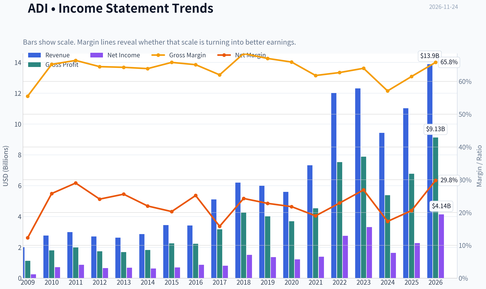

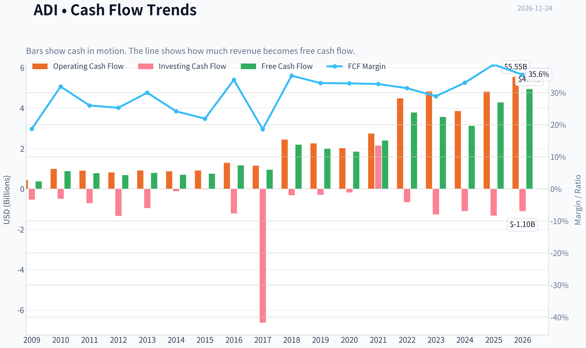

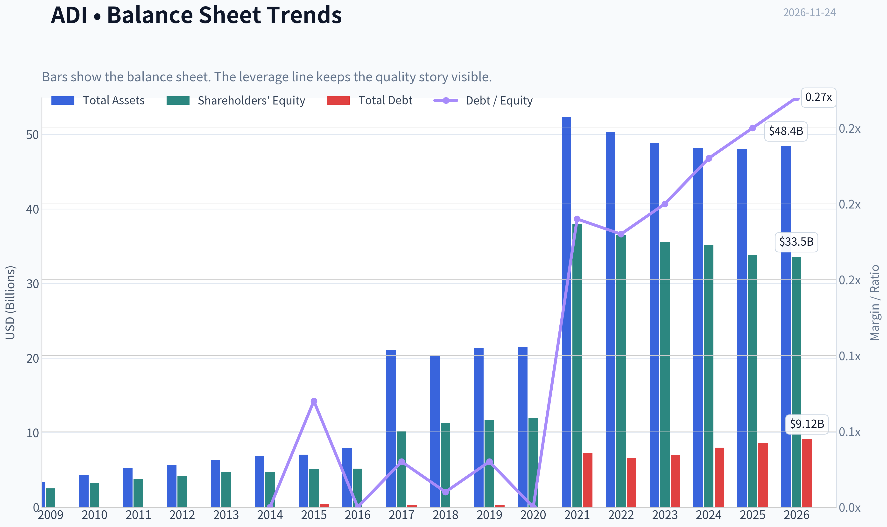

This graph tracks the profitability and return metrics (ROE, ROIC, Margins) of **ADI** over the past decade, highlighting capital efficiency trends.

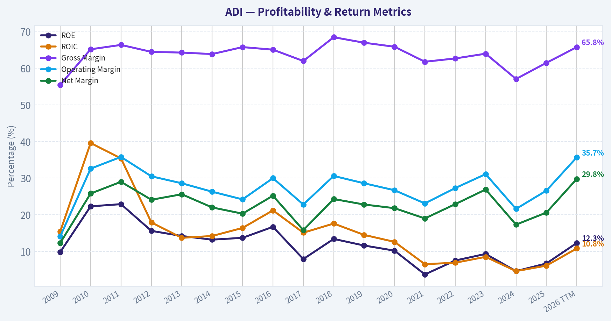

This chart illustrates the financial health of **ADI** over the last 10 years, mapping cash equivalents and free cash flow against total obligations (Debt).

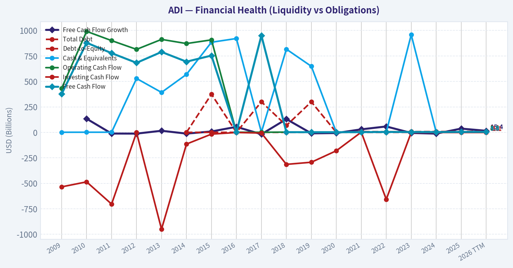

This comparison chart from *Profitability and Operating Performance* stacks current figures against historical benchmarks for **ADI**, making it easy to see where the company trades relative to its own averages.

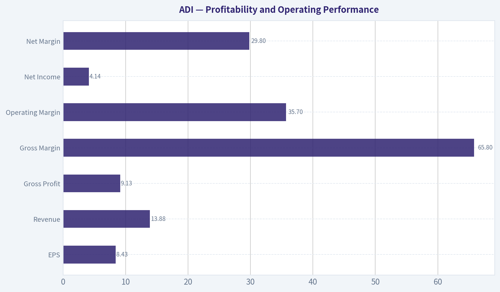

---

### Intrinsic Value Analysis (Buffett)

> *Following Warren Buffett's value investing philosophy: Circle of Competence, Economic Moat, Management Quality, and Margin of Safety.*

#### Intrinsic Value Snapshot

Price is what you pay. Intrinsic value is what the business may be worth based on the cash it can create for owners over time. We show a range, not one magic number.

- Current Price: $378.75
- Value Range (conservative to optimistic across both DCF methods): $107.83 to $526.30

##### Owner Earnings (Buffett Method)
- Net Income: $2,267,342,000.00
- Depreciation & Amortization: $1,998,845,000.00
- Capital Expenditures: $-533,552,000.00
- Working Capital Changes: $481,009,000.00
- Owner Earnings: $4,397,886,354.05

##### Intrinsic Value
###### Buffett Method
Uses owner earnings. Stricter, and usually more conservative.
- Conservative: $172.80
- Average: $246.86
- Optimistic: $246.86
- Discount Rate: 8.3%

###### Cash Flow Method
Uses free cash flow. Better for companies spending heavily today to grow tomorrow.
- Conservative: $107.83
- Average: $275.10
- Optimistic: $526.30
- Discount Rate: 9.1%

ANALYST STANCE: **Neutral**

#### Executive Conclusion

Analog Devices is a high-quality analog semiconductor franchise with strong gross margins, meaningful switching costs, long product cycles, and an attractive position in industrial, automotive, communications, and emerging AI-related applications. However, the current price of approximately **$379** substantially exceeds the DeepValues intrinsic value of **$246.86**, implying a **negative 53.4% margin of safety**.

The business quality supports continued monitoring, but the evidence does not support the valuation at the current price. The weighted Buffett score is **3.1 out of 5**, placing ADI in the **Neutral** category.

#### 1. Factor Scorecard

| Factor | Score | Evidence |
|---|---:|---|
| Circle of Competence and Simplicity | 4/5 | ADI designs and sells analog chips that sense, measure, regulate, and convert real-world signals. Its products are embedded in industrial, automotive, communications, and consumer systems. |
| Moat | 4/5 | Gross margin is 61.5%, supported by proprietary technology, customer qualification requirements, long product lives, and switching costs. |
| Management and Capital Allocation | 3/5 | Established operating history and a strategic portfolio of differentiated analog products are positives. The available data does not provide enough evidence for an exceptional owner-operator score. |
| Industry Structure | 4/5 | Analog semiconductors benefit from high development costs, customer qualification barriers, long design cycles, and relatively concentrated competition. The industry remains cyclical, however. |

**Gate 5 hard floor:** **Not tripped.** ADI does not exhibit the combination of sharply worsening fundamentals and financial distress required for a hard avoid. Revenue growth is positive, operating income is approximately $4.9 billion, and estimated operating income covers reported debt interest obligations with meaningful room.

**Key Takeaways:** ADI scores well on business quality, moat, and industry structure. The principal weakness is not solvency or franchise durability; it is the large gap between the market price and cash-flow-based intrinsic value.

#### 2. Moat Analysis

| Moat source | Assessment | Evidence |
|---|---|---|
| Intangible assets | Strong | Analog Devices owns extensive analog and mixed-signal intellectual property. Its 61.5% gross margin indicates substantial differentiation rather than commodity economics. |
| Switching costs | Strong | Once an analog component is designed into an industrial or automotive system, replacing it can require redesign, testing, qualification, and reliability validation. |
| Cost advantage | Moderate to strong | Scale in design, manufacturing relationships, distribution, and a broad product portfolio supports attractive economics. The advantage is more specialized than purely volume-based. |
| Network effects | Limited | Network effects are not central to the business model. ADI's moat is primarily based on intellectual property, product breadth, reliability, and customer integration. |
| Product longevity | Strong | Analog chips often remain in production for many years, producing recurring demand and reducing dependence on constant product replacement. |

**Moat Quality Rating: Wide and stable, approaching wide and widening - 4/5.**

ADI's moat is particularly valuable because customers tend to prioritize reliability, performance, and lifecycle support over selecting the lowest-cost component. AI-related demand now represents approximately 20% of the business, adding a growth avenue, though it also increases sensitivity to semiconductor sentiment and capital-spending cycles.

#### 3. Management Quality Assessment

Management appears strategically focused on building a broad, differentiated analog portfolio rather than competing solely on price. The company's product mix, customer relationships, and long-lived components indicate a long-term orientation.

The available evidence supports a **3/5 management score**:

- **Owner orientation:** No evidence is provided that management ownership exceeds the level associated with a highly owner-dominated company.
- **Candor and accounting:** No restatement or accounting concern is indicated in the supplied information.
- **Capital allocation:** The business has historically benefited from reinvestment in intellectual property, product development, and portfolio breadth. Debt of approximately $9.1 billion reduces financial flexibility relative to a net-cash balance sheet.
- **Execution:** Recent revenue growth of 16.9% and strong AI-related demand indicate positive execution, although semiconductor cycles make short-term results less reliable.

#### 4. Financial Summary

| Metric | Latest available figure |
|---|---:|
| Share price | $379 |
| Market capitalization | $183.53 billion |
| P/E ratio | 45.0x |
| Revenue growth, year over year | 16.9% |
| Gross margin | 61.5% |
| Return on equity | 6.7% |
| Operating income | Approximately $4.9 billion |
| After-tax operating income | Approximately $4.5 billion |
| Cash and marketable securities | Approximately $2.4 billion |
| Debt | Approximately $9.1 billion |
| Net cash / net debt | Approximately $6.8 billion net debt |
| Free-cash-flow yield | 2.3% |
| Current ratio | 2.19x |

**Key Takeaways:** ADI combines excellent gross margins with a low reported ROE and a modest 2.3% free-cash-flow yield at the current market capitalization. The balance sheet is serviceable but not fortress-like because debt exceeds cash and marketable securities by approximately $6.8 billion.

#### 5. Owner Earnings Calculation

The DeepValues owner-earnings calculation uses trailing data through fiscal 2025 and the third quarter of fiscal 2026.

| Owner earnings component | Amount |
|---|---:|
| After-tax operating income | $4.5 billion |
| Depreciation and amortization | $2.0 billion |
| Maintenance capital expenditure charge | $(1.1) billion |
| Working-capital investment | Approximately $0.0 billion |
| Estimated owner earnings | **$5.4 billion** |
| Shares outstanding | Approximately 489 million |
| Owner earnings per share | **Approximately $11.04** |

Formula:

**Owner Earnings = $4.5 billion + $2.0 billion - $1.1 billion - $0.0 billion = $5.4 billion**

**Key Takeaways:** ADI generates substantial owner earnings because its intellectual-property-intensive model requires less capital expenditure than many manufacturing businesses. At approximately $11.04 of owner earnings per share, the current price represents roughly 34 times owner earnings.

#### 6. Three-Scenario DCF Valuation

These scenarios are sensitivity checks. The required headline intrinsic value remains the DeepValues owner-earnings valuation of **$246.86 per share**.

| Scenario | Key assumptions | Estimated value per share |
|---|---|---:|
| A: No growth | Owner earnings of $11.04 per share capitalized at 10% | **$110** |
| B: GDP growth | 3% perpetual growth and 10% discount rate | **$163** |
| C: Historical-growth sensitivity | Approximately 5% to 7.5% growth over 10 years, fading to 2.5% terminal growth, discounted at 10% | **Approximately $180-$214** |
| DeepValues owner-earnings valuation | 10% growth fading to 2.5%, 8.3% discount rate, net debt included | **$246.86** |

The DeepValues valuation inputs are:

- Owner earnings: **$5.4 billion**
- Growth assumption: **10% initially, fading to 2.5%**
- Discount rate: **8.3%**
- Net debt: **$6.8 billion**
- Shares: **489 million**
- Valuation range: **$172.80 to $246.86 per share**

**Key Takeaways:** Even the most favorable supplied valuation is below the current price. The conservative scenarios produce values between approximately $110 and $214 per share, while the headline valuation of $246.86 already assumes strong initial growth and a relatively low discount rate.

#### 7. Margin of Safety Analysis

| Measure | Result |
|---|---:|
| Current price | $379 |
| DeepValues intrinsic value | $246.86 |
| Difference from intrinsic value | $(132.14) |
| Margin of safety versus price | **Negative 53.4%** |
| Price premium to intrinsic value | **Approximately 53.5%** |
| Current price / owner earnings | Approximately 34.3x |

For a wide-moat, high-return, predictable compounder, a 10% to 15% discount can be sufficient. ADI does not meet that valuation standard at $379. Instead, the price is materially above the app's intrinsic value and above the three-scenario sensitivity range.

The reverse-DCF implication is demanding: the current valuation requires sustained growth and a relatively favorable cost of capital despite the cyclicality of semiconductor demand and the company's net debt position.

**Key Takeaways:** ADI is a good business at a price that leaves no meaningful margin of safety under the supplied valuation framework. The market price is approximately 53% above the headline intrinsic value, making valuation the decisive weakness in the analysis.

#### 8. Final Buffett Scorecard

| Criterion | Weight | Score | Weighted contribution |
|---|---:|---:|---:|
| Moat width and durability | 25% | 4.0 | 1.00 |
| Valuation and margin of safety | 20% | 1.0 | 0.20 |
| Capital returns versus WACC | 15% | 3.0 | 0.45 |
| Business understanding and predictability | 12% | 4.0 | 0.48 |
| Management quality and capital allocation | 12% | 3.0 | 0.36 |
| Reinvestment runway | 8% | 4.0 | 0.32 |
| Balance-sheet strength | 4% | 3.0 | 0.12 |
| Industry structure | 4% | 4.0 | 0.16 |
| **Total** | **100%** |  | **3.09 / 5.00** |

**Key Takeaways:** ADI's non-valuation score is strong, reflecting a durable analog semiconductor franchise with attractive reinvestment opportunities. The valuation score of 1 out of 5 lowers the total to 3.09, which falls within the Neutral range rather than the Bullish range.

#### 9. Investment Stance

**ANALYST STANCE: Neutral**

**Conviction: High on business quality; high on valuation concern.**

Analog Devices has many characteristics Buffett would appreciate: durable intellectual property, high gross margins, customer switching costs, long product lives, and a substantial reinvestment runway. The balance sheet is not distressed, and the hard solvency floor is not tripped.

Nevertheless, the current valuation implies expectations that are difficult to reconcile with the supplied intrinsic value. At approximately $379, ADI trades well above the **$246.86** DeepValues owner-earnings valuation and above the range produced by the conservative DCF cross-checks. The evidence therefore supports a **Neutral** classification: a strong franchise whose current valuation does not provide adequate compensation for cyclical risk, execution risk, and net debt.
#### Valuation Bridge

This bridge places the current market price beside each intrinsic value lens so readers can see whether upside depends on one method or shows up across several methods.

| Scenario | Intrinsic Value / Share |
| --- | ---: |
| Buffett Method | $246.86 |
| Cash Flow Method | $275.10 |
| Damodaran Method | $68.53 |
| Current Price | $378.75 |

#### Key Takeaways

If one method is far above the others, the upside case depends on a specific modelling assumption. When several methods cluster together, the valuation story is more robust.

#### Valuation Visuals

This comparison chart from *Latest Earnings Snapshot* stacks current figures against historical benchmarks for **ADI**, making it easy to see where the company trades relative to its own averages.

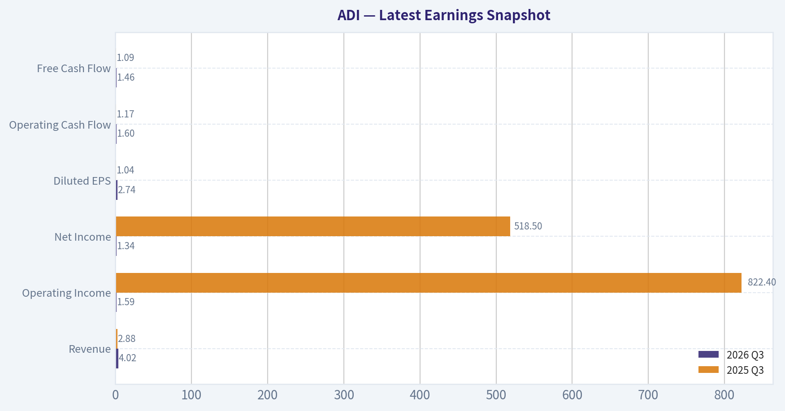

This comparison chart from *Current Metrics Versus Ten-Year Averages* stacks current figures against historical benchmarks for **ADI**, making it easy to see where the company trades relative to its own averages.

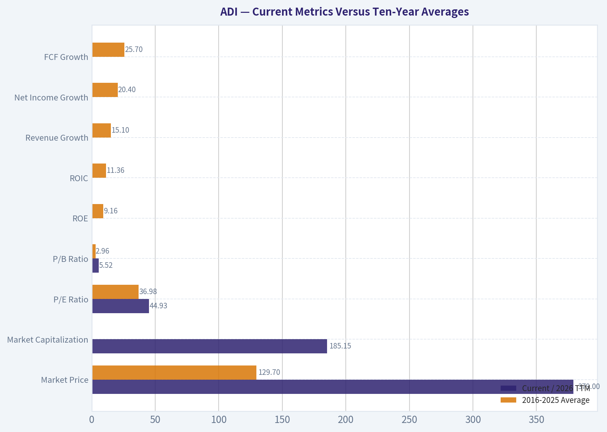

This comparison chart from *Balance Sheet and Financial Strength* stacks current figures against historical benchmarks for **ADI**, making it easy to see where the company trades relative to its own averages.

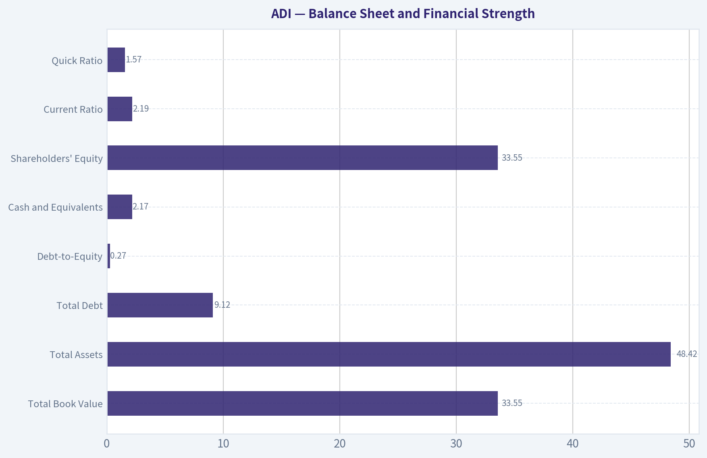

This comparison chart from *Cash Flow and Capital Allocation* stacks current figures against historical benchmarks for **ADI**, making it easy to see where the company trades relative to its own averages.

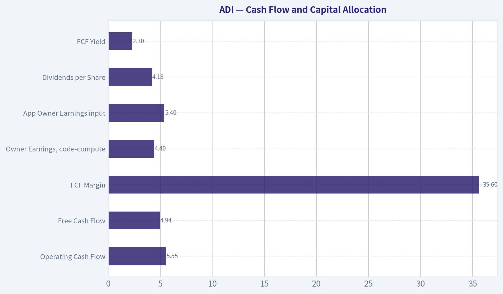

---

### Trend & Growth Analysis (Lynch/Druckenmiller/Fisher)

> *Following Peter Lynch's GARP, Stanley Druckenmiller's macro-aware approach, and Philip Fisher's scuttlebutt methodology.*

ANALYST STANCE: **Neutral**

#### Executive Summary

Analog Devices is a high-quality, diversified analog-semiconductor company experiencing a meaningful recovery and AI-related demand inflection. However, the current valuation is demanding: at approximately **$379 per share**, the market capitalization is about **$183.5 billion**, while the supplied Owner Earnings intrinsic value is **$246.86**, implying roughly **53.4% downside to intrinsic value** under that methodology.

The evidence supports a strong business with improving growth, but not a sufficiently attractive valuation for a high-conviction growth stance.

#### 1. Lynch Classification

| Attribute | Assessment |
|---|---|
| Primary category | Fast grower during current recovery, with stalwart characteristics |
| Cyclicality | Meaningful semiconductor cyclicality |
| Latest revenue growth | 16.9% year over year |
| Gross margin | 61.5% |
| Market position | Broad, diversified analog and mixed-signal franchise |
| Growth-investor conclusion | Quality growth recovery, but not a clean secular hyper-growth profile |

**Key Takeaways:** ADI currently fits the upper end of the fast-grower category based on 16.9% revenue growth, but its semiconductor exposure makes the growth cycle-sensitive. Its diversified product portfolio and high gross margin give it stalwart-like quality, while the valuation resembles that of a faster-growing company.

#### 2. The Story in Three Bullets

- ADI supplies mission-critical analog and mixed-signal chips used across industrial, automotive, communications, consumer, and data-center applications.
- AI-related demand has become material, reportedly representing approximately **20% of the business**, creating a potential product-cycle and TAM inflection.
- Inventory days are described as stable and customer stocking lean, suggesting that AI-related demand may reflect underlying consumption rather than temporary channel restocking.

#### 3. TAM and 10x Test

| TAM factor | Assessment |
|---|---|
| Current revenue base | Large, diversified semiconductor revenue base; exact latest revenue was not supplied |
| Potential 10x revenue | Would require a very large expansion from an already substantial base |
| Core TAM drivers | AI infrastructure, industrial automation, automotive electrification, communications, healthcare, and energy systems |
| TAM growth | AI and electrification are expanding rapidly; mature industrial and automotive markets grow more moderately |
| 10x test | Unlikely on the existing business alone without substantial market expansion or share gains |
| Runway quality | Strong multi-year runway, but probably not a straightforward ten-bagger runway |

**Key Takeaways:** ADI participates in several expanding markets, particularly AI infrastructure, electrification, and industrial automation. The total addressable market is large, but because ADI is already a major company, a tenfold revenue increase would require both sustained market expansion and substantial share gains.

#### 4. Revenue Growth Trend

| Indicator | Evidence | Interpretation |
|---|---:|---|
| Latest year-over-year revenue growth | 16.9% | Strong recovery-level growth |
| AI contribution | Approximately 20% of business | Important new demand vector |
| Inventory conditions | Stable inventory days; lean customer stocking | Supports demand quality |
| Growth pattern | Recovery plus AI support | Improving, but insufficient historical series to confirm multi-quarter acceleration |
| Revenue classification | Near fast-grower threshold | Positive, but not yet proven as a durable acceleration |

**Key Takeaways:** The latest growth rate is encouraging and appears supported by AI demand rather than only inventory replenishment. However, the available information does not establish a full accelerating sequence such as 20%, 25%, and 35%; the evidence is better described as a favorable recovery with an emerging AI catalyst.

#### 5. Unit Economics and Operating Efficiency

| Metric | Result | Assessment |
|---|---:|---|
| Gross margin | 61.5% | Strong differentiation and pricing power |
| Net revenue retention | Not disclosed | Cannot be assessed as a SaaS metric |
| LTV/CAC | Not applicable | ADI is not primarily a subscription business |
| Rule of 40 | Not applicable | More relevant to SaaS and recurring-revenue companies |
| Free-cash-flow yield | 2.3% | Positive cash generation, but modest relative to valuation |
| Current ratio | 2.19 | Comfortable short-term liquidity |
| Net debt from valuation inputs | Approximately $6.8 billion | Leverage is material but manageable relative to company scale |

**Key Takeaways:** ADI's 61.5% gross margin is a major strength and reflects differentiated technology, long product lives, and customer qualification barriers. Subscription metrics such as NRR and LTV/CAC are not relevant here. The 2.3% free-cash-flow yield indicates that the market is assigning a substantial premium to future growth.

#### 6. Inflection Point Assessment

| Potential inflection | Evidence | Confidence |
|---|---|---|
| Product-cycle inflection | AI-related demand now approximately 20% of business | High |
| TAM inflection | AI infrastructure expands the addressable market | High |
| Market-share inflection | Not enough data to confirm share gains | Low to moderate |
| Margin inflection | High gross margin, but operating leverage data unavailable | Moderate |
| Competitive inflection | No evidence supplied of a major competitor failure | Low |
| Demand quality | Lean stocking and stable inventory days | Moderate to high |

**Key Takeaways:** The strongest inflection is the expansion of ADI's opportunity into AI-related infrastructure. The demand appears higher quality because customer inventories are reportedly lean, but there is not yet enough evidence to prove accelerating market-share gains or a durable margin inflection.

#### 7. Macro Setup

| Macro factor | Assessment | Effect on ADI |
|---|---|---|
| Semiconductor cycle | Recovery environment | Positive |
| AI capital spending | Strong secular support | Positive |
| Industrial activity | Improving but cyclical | Mixed to positive |
| Interest rates | 30-year Treasury near 5.31% in the supplied valuation inputs | Valuation headwind |
| Market sensitivity | Trading increasingly linked to Nvidia and AI sentiment | Adds volatility |
| Overall macro setup | Favorable demand backdrop, difficult discount-rate environment | Moderately positive |

**Key Takeaways:** ADI benefits from the AI investment cycle and a semiconductor recovery, but elevated long-term interest rates pressure the valuation of long-duration growth assets. The stock's increasing correlation with AI sentiment may amplify both upside enthusiasm and downside repricing.

#### 8. Fisher 15-Point Assessment

| Fisher criterion | Score / 5 | Rationale |
|---|---:|---|
| Market potential | 5 | Broad exposure to industrial, automotive, communications, and AI markets |
| New-product determination | 4 | AI and mixed-signal expansion support continued product development |
| R&D effectiveness | 4 | Analog technology and product breadth imply strong technical capability |
| Sales organization | 4 | Broad, embedded customer relationships |
| Profit margins | 5 | 61.5% gross margin |
| Margin improvement | 3 | Current improvement data is incomplete |
| Labor relations | 3 | Insufficient information |
| Executive relations | 3 | Insufficient information |
| Management depth | 4 | Large, diversified global operating platform |
| Cost analysis and accounting | 4 | No major accounting concern supplied |
| Outstanding aspects | 5 | Switching costs, qualification barriers, design-in relationships, and product breadth |
| Long-range profit outlook | 4 | Strong secular exposure, offset by cyclicality |
| Dilution | 3 | No major dilution issue supplied, but full capital-allocation data is unavailable |
| Management candor | 3 | Limited direct evidence |
| Management integrity | 4 | No material integrity concern supplied |
| **Total** | **56 / 75** | **Good, but not outstanding based on available evidence** |

**Key Takeaways:** ADI scores well on market potential, margins, technology, and customer embedment. The score is held back primarily by incomplete evidence on management behavior, labor relations, margin progression, dilution, and candor. A score of 56 suggests a good Fisher profile, but not enough documented evidence for the highest category.

#### 9. Valuation Analysis

| Valuation measure | Result | Interpretation |
|---|---:|---|
| Current price | $379 | Market price supplied |
| Market capitalization | $183.53 billion | Large-cap valuation |
| P/E | 44.98x | Premium multiple |
| ROE | 6.7% | Modest relative to the P/E |
| Owner Earnings intrinsic value | $246.86 | Headline intrinsic value |
| Conservative Owner Earnings value | $172.80 | Downside case |
| Base FCF DCF value | $275.10 | Secondary cross-check |
| Damodaran base FCFF value | $68.53 | Highly conservative cross-check |
| Margin of safety versus headline intrinsic value | -53.4% | Price materially exceeds modeled value |
| PEG | Not reliably calculable | Earnings-growth estimate was not supplied |
| P/S | Not reliably calculable | Latest revenue figure was not supplied |

**Key Takeaways:** ADI trades at approximately 45 times earnings despite a 6.7% reported ROE and a 2.3% free-cash-flow yield. The supplied Owner Earnings model produces an intrinsic value of $246.86, materially below the current price. PEG and P/S cannot be calculated reliably without a consistent forward earnings-growth estimate and latest revenue figure.

#### 10. Revenue-Multiple Scenario Analysis

Because the supplied dataset does not include a verified latest revenue figure or forward revenue estimates, a conventional revenue-multiple model cannot be calculated without introducing unsupported assumptions. The available intrinsic-value models provide the following scenario framework:

| Model | Conservative | Base | Optimistic |
|---|---:|---:|---:|
| Owner Earnings | $172.80 | $246.86 | $246.86 |
| Free-cash-flow DCF | $107.83 | $275.10 | $526.30 |
| Damodaran two-stage FCFF | $35.61 | $68.53 | $123.53 |

**Key Takeaways:** The valuation range is unusually wide because the outputs are highly sensitive to growth, discount rates, and cash-flow assumptions. Even the highest supplied base-case Owner Earnings value is below the current market price, while the optimistic FCF case requires substantially stronger long-term cash-flow performance.

#### 11. Growth Investor Scorecard

| Criterion | Weight | Score / 5 | Weighted contribution |
|---|---:|---:|---:|
| The story | 10% | 4.0 | 0.40 |
| TAM and runway | 20% | 3.8 | 0.76 |
| Revenue growth | 20% | 3.8 | 0.76 |
| Unit economics | 15% | 3.8 | 0.57 |
| Competitive position | 10% | 4.5 | 0.45 |
| Management quality | 10% | 3.6 | 0.36 |
| Macro setup | 5% | 3.5 | 0.18 |
| Profitability path | 5% | 4.0 | 0.20 |
| Valuation | 5% | 1.5 | 0.08 |
| **Total** | **100%** |  | **3.76 / 5.00** |

**Key Takeaways:** ADI's operating profile scores well, particularly on competitive position, gross margin, market opportunity, and the AI demand catalyst. Valuation is the clear weak point and reduces the overall result to the Neutral range rather than a high-conviction growth rating.

#### 12. Valuation Sensitivity

The main sensitivity is not whether ADI has a good business; it is whether future growth can exceed the expectations already embedded in a roughly 45-times earnings multiple.

| Variable | More favorable outcome | Less favorable outcome |
|---|---|---|
| AI revenue contribution | Sustained expansion beyond current 20% level | AI demand normalizes or becomes sentiment-driven |
| Revenue growth | Sustained growth above 15-20% | Reversion toward mature semiconductor growth |
| Gross margin | Stable or improving through mix and scale | Mix pressure or pricing competition |
| Discount rate | Declining long-term rates | Persistent rates near current elevated levels |
| Cash-flow growth | Strong operating leverage | Cyclical recovery without durable acceleration |
| Valuation implication | Premium can remain supported | Multiple compression becomes the dominant risk |

**Key Takeaways:** The valuation requires sustained AI-led growth, stable margins, and favorable long-term financing conditions. If growth merely normalizes after the semiconductor recovery, the current multiple leaves limited valuation support according to the supplied intrinsic-value models.

#### 13. Key Catalysts and Risks

| Catalysts | Risks |
|---|---|
| AI-related revenue exceeds current expectations | AI enthusiasm fades or demand proves cyclical |
| Industrial and automotive end markets recover together | Industrial or automotive weakness returns |
| Operating leverage expands free cash flow | Margin improvement fails to appear |
| New product introductions accelerate share gains | Competitors narrow technology differences |
| Lower interest rates support long-duration valuations | High rates cause multiple compression |
| Evidence of sustained organic acceleration | Growth decelerates after recovery comparisons |

**Key Takeaways:** The most important catalyst is evidence that AI demand is broad, recurring, and producing sustained revenue acceleration rather than a temporary order surge. The principal risk is valuation: even a good operating outcome may not offset multiple compression if growth falls short of the expectations embedded in the current price.

#### Final Assessment

ADI is a high-quality analog semiconductor franchise with a credible AI and industrial recovery inflection. Its competitive advantages and 61.5% gross margin support a favorable long-term business assessment, but the available evidence does not yet demonstrate a clear ten-bagger path from the company's already large base.

The central conclusion is **Neutral**: operating fundamentals are attractive, while the supplied intrinsic-value analysis indicates that the market price substantially exceeds modeled value.

---

### Market Technical Analysis

ANALYST STANCE: **Neutral**

#### ADI technical overview

Analog Devices, Inc. (Nasdaq: ADI) closed at **$378.75 on November 23, 2026**, the latest available trading session. November 24 was not a trading day in the retrieved dataset. The stock remains substantially above its November 2025 level near $236, but it has undergone a sharp and volatile correction from the 2026 high near $444.

The supplied indicator service returned blank numeric fields for the requested indicators, so the values below are calculated or approximated directly from the retrieved ADI price and volume history. The analysis is therefore more reliable for identifying trend structure and volatility regime than for treating any single calculated value as exact.

#### Trend structure

ADI's longer-term trend remains constructive. The share price is still well above its approximate 200-day moving-average region, which is estimated around the low-to-mid $330s based on the available one-year data. That means the stock's primary trend has not been decisively reversed despite the recent decline.

The intermediate trend is weaker. The approximate 50-day simple moving average is around **$391-$392**, placing the latest close roughly 3% below that benchmark. This indicates that the October-to-November recovery has lost momentum. The price's recent position below the 50-day average is more consistent with a correction or consolidation phase than with a clean continuation of the prior advance.

The short-term picture is unstable. ADI fell from above $419 in early November to $361 on November 5, recovered toward $409, and then declined again to $346 on November 20 before rebounding to $379. The latest close is therefore a meaningful recovery from the recent low, but it has not yet reclaimed the approximate intermediate trend benchmark.

#### Momentum and moving averages

The approximate 10-day exponential moving average is in the mid-to-upper $380s. With the latest close near $378.75, price is around or slightly below this short-term average. That suggests the November 20 rebound has not yet produced a confirmed short-term momentum reversal.

Momentum deteriorated materially during the early-November selloff. The decline was accompanied by several large daily ranges and elevated volume, implying that the weakness was not merely a low-volume drift. The subsequent rebound has been forceful, particularly on November 23, but a single strong recovery session does not yet offset the sequence of lower highs from the early-November peak.

The MACD configuration is likely still below its prior positive peak after the sharp drawdown. The MACD histogram should be interpreted as showing a possible improvement in downside momentum rather than an established bullish crossover. In practical terms, the stock appears to be moving from strong negative momentum toward stabilization, but confirmation would require sustained closes above the short- and intermediate-term averages.

#### RSI and volatility

The recent 14-session price pattern produces an approximate RSI in the **mid-50s**, although the exact result depends on the calculation convention and available lookback. This is an important nuance: RSI no longer appears deeply oversold after the November 20-23 rebound, but it is also not displaying the persistent overbought condition seen during portions of the earlier advance.

The recent price action is dominated by unusually high volatility. The November 5 session had a range of roughly $40, and November 20 had a range of more than $30. The approximate recent ATR is therefore in the **low-to-mid $20s**, materially elevated relative to the calmer trading conditions seen in parts of September and early October. This increases the importance of interpreting trend signals over multiple sessions rather than relying on one-day reversals.

#### Volume and VWMA

Volume expanded sharply during the largest price declines and rebounds. Approximately 13.1 million shares traded on November 5, and roughly 10.2 million traded on November 20, both well above the typical volume seen during quieter sessions. This confirms that the recent correction involved substantial market participation.

The volume-weighted average price over a recent multi-week window is likely above the latest close, approximately in the high-$380s to low-$390s. ADI's close near $378.75 remains below that volume-weighted region, indicating that recent high-volume trading has occurred at somewhat higher prices. The November 23 rebound was also accompanied by heavy volume, which is constructive for stabilization, but the stock still needs to reclaim the broader volume-weighted area before the recovery can be considered technically mature.

#### Valuation implications

The technical evidence does not by itself support treating the recent rebound as proof that the valuation is fully validated at the current market price. The long-term trend remains positive, but the stock is below its approximate 50-day average, below the recent volume-weighted trading zone, and operating in a high-volatility regime.

The evidence is therefore best characterized as **long-term bullish structure with intermediate-term damage and short-term stabilization in progress**. A stronger valuation case would be more consistent with improving momentum, a sustained recovery above the intermediate trend measures, and lower volatility. Conversely, renewed weakness would increase the risk that the recent rebound was primarily corrective rather than the beginning of a durable trend resumption.

#### Selected indicators

The most relevant complementary indicators for this market condition are:

- **close_200_sma:** Establishes the primary trend and separates the long-term advance from the recent correction.
- **close_50_sma:** Measures the intermediate trend and identifies whether the recent rebound has repaired medium-term weakness.
- **close_10_ema:** Captures the rapid short-term shifts visible in November.
- **macd:** Assesses whether the broader momentum cycle is turning upward or remaining impaired.
- **macdh:** Detects whether downside momentum is decelerating before a full MACD crossover occurs.
- **rsi:** Measures whether the rebound has moved from oversold conditions toward neutral momentum.
- **atr:** Quantifies the unusually high volatility and the wider uncertainty around short-term signals.
- **vwma:** Incorporates the heavy volume during the November selloff and rebound, providing a participation-weighted trend reference.

| Area | Current reading | Interpretation | Valuation implication |
|---|---:|---|---|
| Latest close | $378.75, November 23 | Strong rebound from the $345.92 November 20 close, but still below early-November highs | Recovery is not yet sufficient to validate the prior valuation regime |
| Long-term trend | Price remains above estimated 200-day average | Primary trend remains constructive | Long-term growth expectations are not technically invalidated |
| Intermediate trend | Approximate 50-day SMA near $391-$392 | Price is modestly below the medium-term benchmark | Evidence is mixed for near-term valuation support |
| Short-term trend | Approximate 10-day EMA in the mid-to-upper $380s | Price is near or slightly below short-term trend support | Momentum has stabilized but remains fragile |
| Momentum | RSI approximately mid-50s; MACD likely recovering from weakness | Oversold pressure has eased, but there is no confirmed momentum reversal | Rebound reduces immediate downside pressure without fully confirming renewed upside |
| Volatility | Recent ATR approximately low-to-mid $20s | Daily ranges are unusually wide | Valuation confidence is reduced because price discovery remains unstable |
| Volume | Very high volume on November 5 and November 20-23 | Recent moves have had substantial participation | The correction and rebound are both meaningful, not purely illiquid fluctuations |
| Overall stance | **Neutral** | Long-term trend is positive, intermediate trend damaged, short-term recovery unconfirmed | Evidence does not yet provide a clear technical basis for the valuation at $378.75 |

**Key Takeaways:** ADI retains a positive long-term trend because its price remains well above the estimated 200-day average, but the stock is below its approximate 50-day average after a sharp, high-volume correction. Momentum has recovered from an oversold phase, yet the latest rebound has not fully repaired the intermediate trend. The evidence supports a watch stance because valuation confidence remains constrained by elevated volatility and incomplete technical confirmation.

#### Market Visuals

This comparison chart from *Market Metrics* stacks current figures against historical benchmarks for **ADI**, making it easy to see where the company trades relative to its own averages.

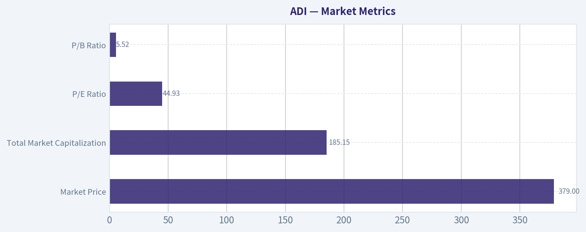

---

### Options Market Analysis

> *Reading options flow - put/call ratios, IV skew, and unusual activity - to gauge institutional positioning and event-driven risk.*

ANALYST STANCE: **Neutral**

#### ADI Options Flow Report

**As of November 24, 2026.** The available near-term data shows active option volume but reports zero open interest across all listed expirations. That makes standard positioning and concentration analysis unreliable.

#### 1. Put/Call Ratio Analysis

| Expiration | Days to Expiry | Call Volume | Put Volume | Volume Put/Call Ratio | Call OI | Put OI | OI Put/Call Ratio |
|---|---:|---:|---:|---:|---:|---:|---:|
| Nov. 27, 2026 | 3 | 3,418 | 3,930 | 1.15 | 0 | 0 | N/A |
| Dec. 4, 2026 | 10 | 401 | 405 | 1.01 | 0 | 0 | N/A |
| Dec. 11, 2026 | 17 | 379 | 118 | 0.31 | 0 | 0 | N/A |
| **Total** | - | **4,198** | **4,453** | **1.06** | **0** | **0** | **N/A** |

**Key Takeaways:** Aggregate volume has a modest put bias, with a 1.06 put/call volume ratio versus the approximately 0.7 neutral reference. The imbalance is concentrated in the November 27 expiration, while December 11 has substantially more call volume. Because reported open interest is zero, there is no reliable evidence that this activity represents established bearish exposure rather than short-dated trading or data-recording noise.

#### 2. Implied Volatility Assessment

| Expiration | Call ATM IV | Put ATM IV | IV Relationship | Interpretation |
|---|---:|---:|---|---|
| Nov. 27, 2026 | 3.6% | 3.6% | Even | No ATM call/put premium difference |
| Dec. 4, 2026 | 2.3% | 2.1% | Calls slightly higher | Mild call-side premium |
| Dec. 11, 2026 | 1.0% | 1.8% | Puts higher | Mild downside skew |
| **Near-term range** | **1.0%-3.6%** | **1.8%-3.6%** | Mixed | No consistent skew signal |

The reported IV levels are extremely low for ordinary listed equity options, particularly the 1.0%-2.3% readings in December. No out-of-the-money strike-level IV data was provided, so a full OTM put-versus-call skew calculation is unavailable. No catalyst calendar was supplied, so elevated event-related IV cannot be confirmed.

**Key Takeaways:** ATM IV does not indicate a broad volatility premium, and the skew is inconsistent across expirations. The unusually low IV readings, combined with zero open interest, suggest the feed may be incomplete or improperly normalized. IV should therefore be treated as a low-confidence signal rather than evidence of exceptionally low ADI risk.

#### 3. Unusual Options Activity

| Finding | Result |
|---|---|
| Contracts meeting the volume greater than 5x open-interest threshold | None identified |
| Fresh directional contracts | Not verifiable |
| Smart-money versus retail classification | Not possible from the supplied data |
| Largest activity | Nov. 27 calls and puts, both very short-dated |

No individual contracts were supplied as unusual activity. Although November 27 volume is substantial relative to the other expirations, the absence of open-interest records prevents confirmation that trades were opening transactions. Strike-level data is also unavailable, so ITM, ATM, or OTM classification cannot be performed.

**Key Takeaways:** There is no confirmed unusual-options signal under the stated volume-to-open-interest rule. The highest activity is in the three-day expiration, but that could reflect short-term trading, closing activity, or a data artifact. The evidence is insufficient to label the flow as institutional directional speculation or hedging.

#### 4. Open Interest Concentration and Gamma Levels

| Metric | Observation |
|---|---|
| Highest call OI strike | None reported |
| Highest put OI strike | None reported |
| OI concentration by expiration | None reported |
| Max-pain analysis | Not calculable |
| Gamma walls | Not identifiable |
| Pinning or gravitational levels | No reliable levels available |

**Key Takeaways:** Zero reported open interest eliminates the normal basis for identifying max pain, strike concentration, or gamma walls. There is no defensible options-derived price level from this dataset that can be characterized as a support, resistance, or pinning zone.

#### 5. Overall Options Sentiment Signal

**Overall signal: NEUTRAL, with a slight bearish tilt in the nearest expiration but low confidence.**

The main directional clue is the aggregate 1.06 put/call volume ratio, which is modestly above the historical neutral reference. However, this is offset by stronger call volume in the December 11 expiration and the complete absence of reported open interest. The extremely low IV readings and missing strike-level details further reduce confidence.

No known catalyst can be confirmed from the supplied data. Accordingly, the options evidence does not establish a strong directional signal or a clear volatility premium for ADI's near-term valuation.

#### Summary

| Category | Assessment |
|---|---|
| Put/Call Ratio | Volume ratio 1.06, modestly put-leaning; OI ratio unavailable |
| IV Level | Reported IV is very low, but likely affected by data-quality limitations |
| Skew Direction | Mixed; mild put skew in Dec. 11, mild call skew in Dec. 4 |
| Unusual Activity | No contracts exceeded the volume greater than 5x OI threshold |
| Overall Signal | **NEUTRAL**, with a slight bearish near-term tilt and low confidence |

**Key Takeaways:** ADI's reported options flow is broadly balanced, with a small put-volume excess concentrated in the nearest expiration. The lack of open-interest data, strike details, and credible-looking IV levels materially limits interpretation. The evidence supports a neutral options read rather than a strong bullish or bearish conclusion.

---

## Research Team Commentary

> *The Research Manager synthesizes the Bull vs Bear debate into action-free commentary. This is a pre-risk view, not the final stance.*

Core takeaway: ADI appears to be a genuinely strong analog-semiconductor franchise, but the evidence does not substantiate its valuation at $379 and roughly 45 times current earnings. Its engineering expertise, long qualification cycles, mission-critical products, and 61.5% gross margin support a meaningful moat. However, the investment case currently depends on unproven normalization: sustained double-digit earnings growth, durable AI demand, and a material recovery from the reported 6.3% ROIC. The appropriate stance is therefore Neutral.

The strongest bull argument is business quality. ADI's components often represent a small portion of a customer's system cost while having an outsized effect on reliability, precision, power efficiency, and uptime. That supports pricing power and discourages customers from redesigning qualified systems merely to save a modest amount on components. Its broad catalog, application expertise, and embedded customer relationships are difficult to replicate quickly. These attributes can produce long product lives and resilient cash flows even without consumer-style network effects.

AI infrastructure adds a credible growth vector. Power management, signal conditioning, conversion, measurement, and monitoring are essential regardless of which accelerator vendor leads the market. Reported AI-related exposure of approximately 20%, together with lean customer stocking and stable inventory days, suggests that at least part of the recent demand reflects actual deployment rather than channel restocking. Recent revenue growth of 16.9% is also consistent with positive execution.

The strongest bear argument is that a good franchise is being priced as an exceptional compounder before its full economic returns demonstrate that status. Reported ROIC of 6.3%, ROE of 6.7%, and ROA of 4.7% are weak relative to the valuation. Gross margin confirms product differentiation, but it does not show how much value remains after operating costs, acquisitions, amortization, capacity investment, and the capital required to run the business. The low returns may be cyclically or accounting-depressed, but that needs to be demonstrated rather than assumed.

The reverse-valuation burden is demanding. Current earnings implied by the supplied price and multiple are approximately $8.42 per share. If those earnings grow 10% annually for ten years, they reach about $21.85. Applying a still-generous 25 times terminal multiple produces approximately $546 in year ten, equivalent to only about 3.7% annual price appreciation before dividends. At 12% earnings growth, the corresponding annual appreciation is roughly 5.6%; at 15%, roughly 8.4%. These illustrations are not forecasts, but they show that respectable outcomes already require a long period of strong execution and a premium terminal valuation.

That matters because ADI remains exposed to semiconductor cycles, industrial and automotive demand, cloud capital-spending digestion, customer bargaining power, competition, and possible component-price pressure. AI revenue can be genuine while still being cyclical. Supporting the AI ecosystem also does not guarantee that ADI captures economics comparable to the companies controlling the principal compute bottlenecks.

From a Buffett perspective, the central question is not whether ADI deserves a premium. It probably does. The question is whether its durable economics can plausibly exceed the expectations embedded in that premium. The available evidence does not yet establish a quality-scaled margin of safety. There is no supplied DeepValues intrinsic-value estimate, and the absence of normalized free cash flow, net debt, share count, and through-cycle earnings prevents a defensible independent valuation. Management also cannot yet be awarded an additional premium based on the limited evidence concerning acquisition returns, repurchase discipline, leverage, or insider alignment.

The balanced conclusion is that the moat appears stronger than the current return metrics alone suggest, but the valuation appears stronger than the demonstrated economics support. The bull thesis would become more convincing if ROIC rises materially while AI and core industrial growth remain healthy. The bear thesis would gain force if growth proves mostly cyclical, AI mix rises without corresponding margin or cash-flow gains, or the market continues to require a high terminal multiple to produce acceptable valuation outcomes.

Over the next one to four quarters, the most important monitoring items are:

First, separate recent revenue growth into AI expansion, cyclical recovery, pricing, mix, acquisitions, and organic unit growth. Continued growth against harder comparisons would carry more weight than another rebound-driven comparison.

Second, track AI-related revenue growth, customer concentration, content per system, and margins. A larger AI mix is valuable only if it produces durable cash earnings and does not introduce excessive dependence on a few cloud customers.

Third, monitor gross margin, operating margin, and free-cash-flow conversion together. Stable gross margins with improving operating leverage would support the view that current returns are temporarily depressed. Revenue growth without stronger cash conversion would weaken it.

Fourth, examine ROIC both as reported and, where transparently disclosed, adjusted for acquisition-related accounting. The crucial evidence would be rising incremental ROIC, not merely an adjusted presentation that removes unfavorable costs. Returns should ultimately move comfortably above the cost of capital.

Fifth, watch customer and distributor inventories, order trends, cancellations, lead times, and industrial and automotive demand. Lean channels are constructive today, but a sudden inventory build or order slowdown would indicate that recent strength was less durable than it appeared.

Finally, evaluate balance-sheet and capital-allocation disclosures: net leverage, interest coverage, acquisition integration, R&D productivity, repurchase prices, and the relationship between stock-based compensation and buybacks. These items will determine whether management converts the technical moat into per-share value.

The main analytical discipline here is to separate three concepts that can easily be conflated: a high gross margin is not automatically a high return on capital; AI exposure is not automatically an AI moat; and a cyclical recovery is not automatically a decade-long growth rate. ADI may eventually validate all three favorable interpretations, but at the supplied valuation, validation rather than mere plausibility is required.

Neutral

---

## Value Investing Team Commentary

> *The Investor translates the research view into an investment thesis before risk review. This is still not the final stance.*

ADI presents a stronger business than its current return metrics might initially suggest, but the valuation requires a level of normalization that remains unproven.

### Business quality and moat

Analog Devices operates in a favorable part of semiconductors. Its products influence precision, reliability, power efficiency, and system uptime, while often representing a modest fraction of a customer's total system cost. That combination can create meaningful switching costs: once a component is qualified in an industrial, automotive, or communications system, redesigning around a cheaper alternative may carry more operational and regulatory risk than the component's price justifies.

The moat is therefore less about network effects and more about engineering depth, long product cycles, application knowledge, qualification history, and a broad catalog. These are durable advantages, particularly in industrial and automotive markets where customers value reliability over the lowest component price.

The AI opportunity is credible but should be described accurately. ADI can benefit from power management, signal conversion, monitoring, and data-center infrastructure without controlling the core compute bottleneck. That creates an attractive "picks-and-shovels" exposure, but it does not automatically provide the economics or growth durability of the dominant accelerator platforms. The reported 20% AI-related exposure is encouraging, especially alongside stable inventory days and lean customer stocking, but revenue classification, customer concentration, content per system, and incremental margins matter more than the headline percentage.

### Profitability and capital intensity

The central concern is the gap between gross margin and returns on capital. A 61.5% gross margin supports the presence of differentiated products, but reported ROIC of 6.3%, ROE of 6.7%, and ROA of 4.7% indicate that the business is not currently converting that gross-profit advantage into exceptional economic returns.

Some of this weakness may reflect cyclically depressed earnings, acquisition-related amortization, or a temporarily underutilized cost base. Those are reasonable possibilities, particularly for a semiconductor company with a significant acquisition history. However, an adjusted explanation is only valuable if it leads to demonstrably higher incremental returns and free-cash-flow conversion. Removing accounting costs without showing stronger underlying economics would not resolve the valuation issue.

The most informative evidence would be sustained improvement in operating margins, free cash flow, and incremental ROIC as revenue recovers. A business can have an excellent franchise and still produce mediocre shareholder economics if acquisitions, leverage, capacity investment, or compensation absorb too much of the gross profit.

### Valuation and reverse-DCF burden

At $379 and approximately 45 times current earnings, the market is assigning substantial value to future normalization and growth. The implied current earnings figure is about $8.42 per share.

Using the supplied illustrations:

- At 10% annual earnings growth for ten years and a 25-times terminal multiple, the implied year-ten value is approximately $546, or only about 3.7% annual price appreciation before dividends.
- At 12% growth, the corresponding result is roughly $654, equivalent to approximately 5.6% annual appreciation.
- At 15% growth, the result is approximately $852, or about 8.4% annual appreciation.

These are not forecasts, but they demonstrate the valuation's asymmetry. Even strong long-term execution does not automatically produce exceptional returns when the starting multiple is already elevated. The assumptions require several favorable outcomes to occur together: sustained double-digit growth, a durable AI contribution, recovery in industrial demand, improving capital efficiency, and a relatively high terminal valuation.

The absence of a supplied DeepValues intrinsic-value estimate, normalized free cash flow, net debt, share-count history, and through-cycle earnings makes a precise intrinsic-value conclusion inappropriate. On the available evidence, the valuation appears to demand validation rather than offering a clear quality-scaled margin of safety.

### Selective contrarian interpretation

The contrarian case is not simply that semiconductor pessimism has created a bargain. The more interesting possibility is that the market may be underestimating the durability of ADI's embedded customer relationships and the value of analog content in increasingly complex systems. If AI infrastructure expands while industrial demand normalizes, ADI could benefit from two distinct growth engines rather than relying solely on a cyclical rebound.

However, the opposite contrarian insight is equally important: enthusiasm surrounding AI infrastructure may cause investors to over-credit every supplier with durable AI economics. ADI's AI exposure can be genuine and still be less profitable, less concentrated, and less structurally advantaged than the market assumes. The 1.06 put/call volume ratio offers little useful sentiment information because reported open interest is zero across expirations; option flow therefore should not influence the fundamental conclusion.

The key question is whether AI demand raises long-term incremental returns or merely increases revenue temporarily while leaving capital efficiency subdued. Stronger revenue without higher cash earnings would not justify the premium. Conversely, improving ROIC, operating leverage, and free-cash-flow conversion alongside continued AI and industrial growth would materially strengthen the long-term thesis.

Management receives neither a clear premium nor a major penalty from the supplied evidence. There is no indicated accounting concern, but the information is insufficient to assess acquisition returns, repurchase discipline, leverage management, insider alignment, or the treatment of stock-based compensation in per-share value creation.

**ANALYST STANCE: Neutral** - ADI appears to be a high-quality analog franchise with credible long-term advantages and a meaningful AI-related opportunity. Nevertheless, at approximately $379 and 45 times current earnings, the evidence does not yet establish a sufficient margin of safety. The valuation becomes more defensible only if durable growth is accompanied by materially higher ROIC, stronger free-cash-flow conversion, and evidence that AI-related demand is creating lasting economic value rather than merely cyclical revenue momentum.

---

## Deep Values Commentary

> *The Risk Management Team debates and the Risk Judge provides the final action-free verdict. This section determines the final Bullish / Neutral / Bearish stance.*

#### Final Stance Scorecard

This scorecard converts the final research view into a weighted decision frame. It does not replace the narrative judgement, but it makes the main drivers of the verdict easier to scan.

| Criterion | Score | Weight | Commentary |
| --- | ---: | ---: | --- |
| Business Quality | 3.75 | 30% | High returns, profitability, and Piotroski health support durability. |
| Valuation Support | 1.33 | 30% | Blends current price against available intrinsic value anchors and valuation ratios. |
| Financial Strength | 5.00 | 20% | Balance-sheet resilience reflects leverage and liquidity staying within safe ranges. |
| Growth Durability | 4.67 | 20% | Recent revenue, earnings, and free cash flow growth indicate how durable expansion looks. |
| TOTAL / FINAL STANCE | 3.46 | 100% | Neutral |

#### Key Takeaways

The weighted score lands at **3.46 / 5.0**, while the final stance remains **Neutral**. This is useful as a quick calibration aid rather than a mechanical signal.

#### Risk Summary

Higher scores indicate more risk pressure. The watch threshold is a simple guardrail: above it, the dimension weighs more heavily on the valuation case and calls for a wider margin of safety.

| Dimension | Current Score | Watch Threshold | Commentary |
| --- | ---: | ---: | --- |
| Business Quality | 2.25 | 3.00 | High returns, profitability, and Piotroski health support durability. |
| Valuation Support | 4.67 | 3.00 | Blends current price against available intrinsic value anchors and valuation ratios. |
| Financial Strength | 1.00 | 3.00 | Balance-sheet resilience reflects leverage and liquidity staying within safe ranges. |
| Growth Durability | 1.33 | 3.00 | Recent revenue, earnings, and free cash flow growth indicate how durable expansion looks. |

#### Key Takeaways

This view helps readers separate *where* the risk sits: valuation, business quality, balance sheet, or growth durability. It is especially useful when the final stance is close to the line between Neutral and Bearish.
