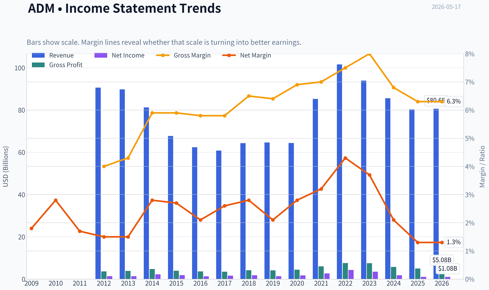
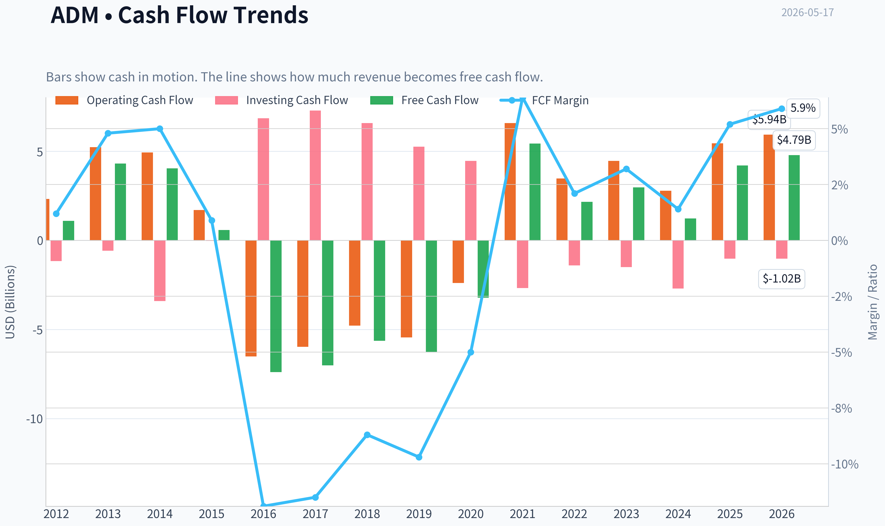
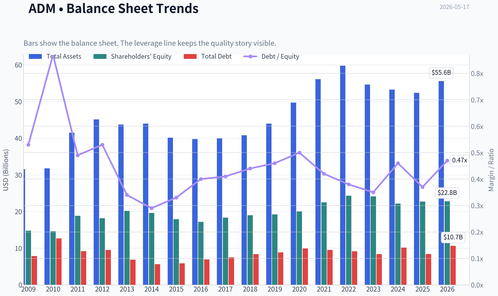
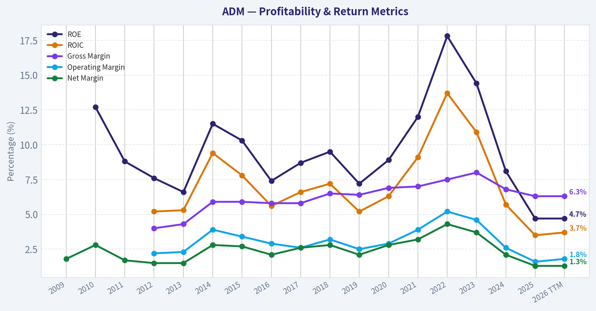
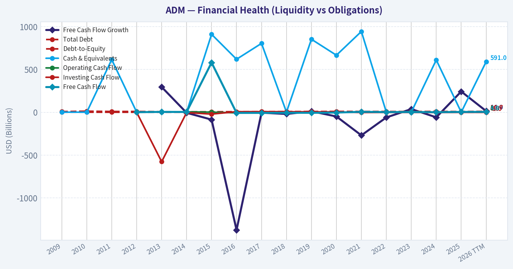
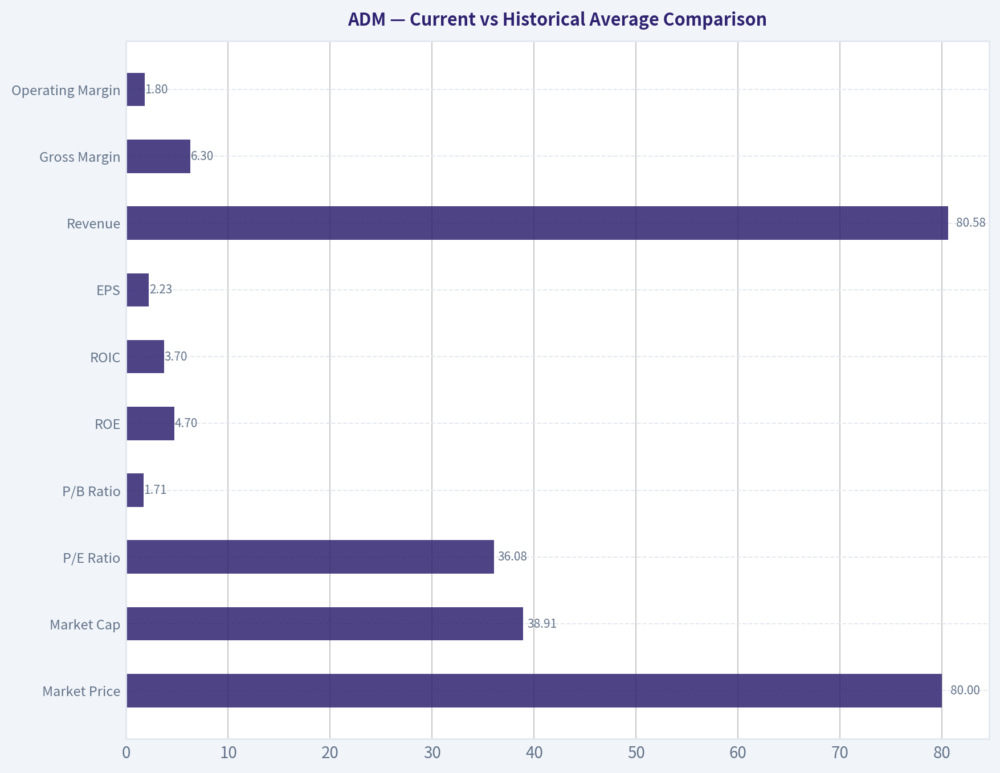
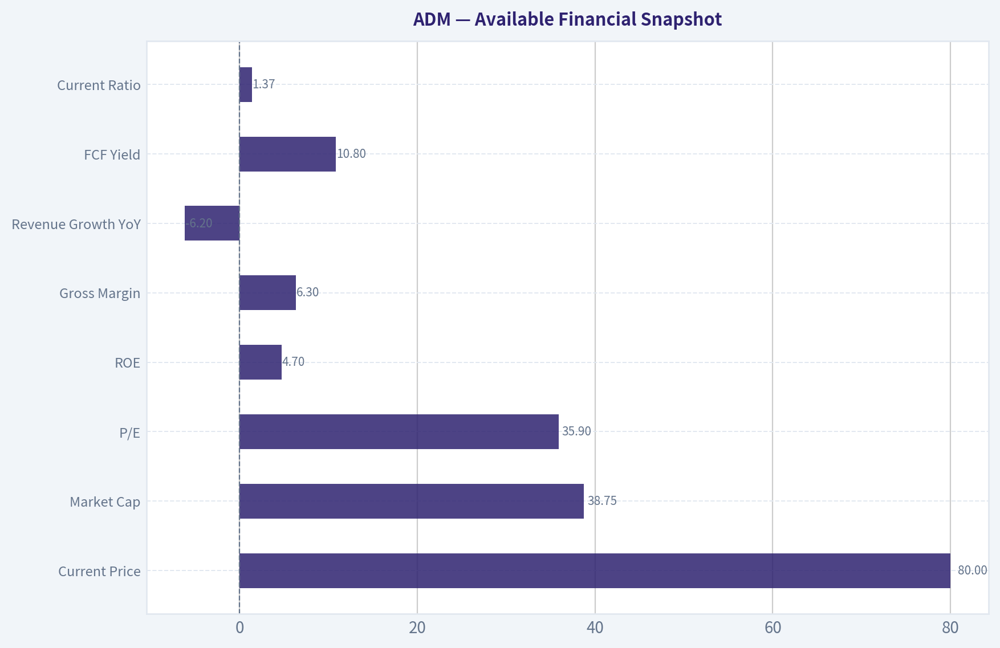
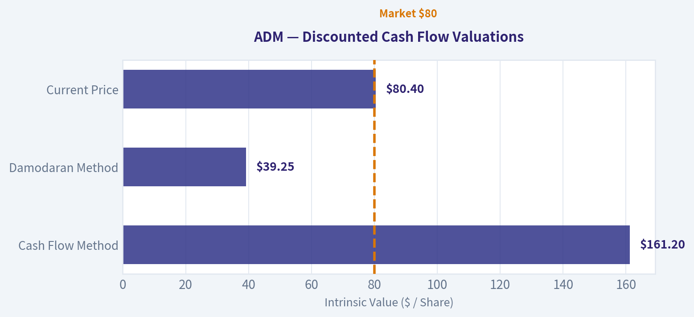
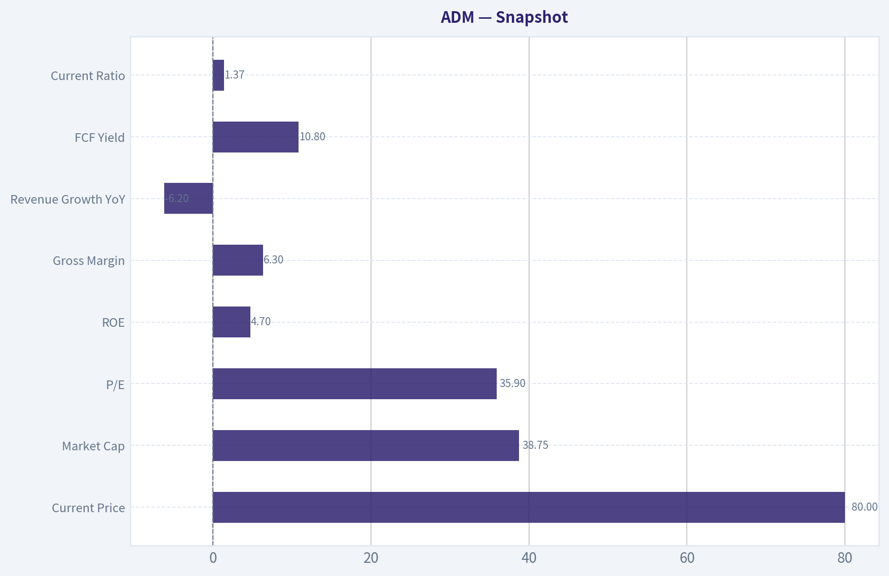
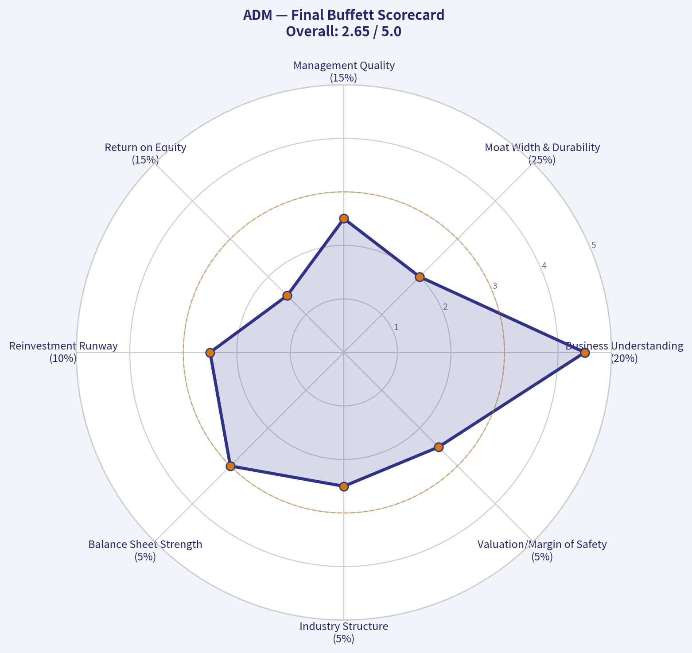

# ADM Deep Value Intelligence

**Analysis Date:** 2026-05-17

## Critical Disclaimer

*This analysis is generated by Deep Value Intelligence, an AI-powered multi-agent investing framework. This report is for informational and educational purposes only and does not constitute financial advice. Always conduct your own research and consult with qualified financial advisors before making investment decisions.*

---

## Table of Contents

1. Intelligence Summary
2. Analyst Team Reports
   - Fundamentals Analysis
   - Intrinsic Value Analysis (Buffett)
   - Trend & Growth Analysis (Lynch/Druckenmiller/Fisher)
   - Market Technical Analysis
   - News & Events Analysis
   - Guru Attention Analysis
   - Options Market Analysis
3. Research Team Commentary
4. Value Investing Team Commentary
5. Deep Values Commentary

---

## Intelligence Summary

### Thesis + Conditions

**Core Thesis:** ## Executive Briefing

**Key Risks:**
- ADM looks like a **durable, strategically important agribusiness**, but not yet a **Buffett-style high-confidence bargain**. The core risk is not stock volatility; it is **owning a low-return, cyclical business at a price that already assumes some recovery**. Better-than-feared profitability and resilience in soybean crushing and ethanol argue against permanent impairment. But **ROIC 3.6%, ROE 4.7%, revenue -6.2%, net income -40.1%, and a thin 6.3% gross margin** argue that economics remain weak and hard to normalize with confidence.
- For a long-term value investor, the right move is **patience, not conviction buying**. Keep ADM on the list, monitor whether returns on capital and cash-flow quality genuinely improve, and only get more constructive if either **price offers a real margin of safety** or **business quality measurably strengthens**.
- ### 1. Risky Analyst's strongest point
- The best balanced argument is that ADM is **too durable to dismiss and too economically inconsistent to chase**. This is the most useful framing for a long-term investor. The market has already partly accepted the stabilization story, with the stock around **$80.40** and near the upper end of the recent range. That weakens the "early asymmetric entry" case. At the same time, the franchise appears real enough that a full AVOID call is too harsh unless evidence worsens materially.
- ## Risk Commentary for the Long-Term Investor

**What Would Change Our View:**
- ADM looks like a **durable, strategically important agribusiness**, but not yet a **Buffett-style high-confidence bargain**. The core risk is not stock volatility; it is **owning a low-return, cyclical business at a price that already assumes some recovery**. Better-than-feared profitability and resilience in soybean crushing and ethanol argue against permanent impairment. But **ROIC 3.6%, ROE 4.7%, revenue -6.2%, net income -40.1%, and a thin 6.3% gross margin** argue that economics remain weak and hard to normalize with confidence.
- For a long-term value investor, the right move is **patience, not conviction buying**. Keep ADM on the list, monitor whether returns on capital and cash-flow quality genuinely improve, and only get more constructive if either **price offers a real margin of safety** or **business quality measurably strengthens**.
- ### 1. Risky Analyst's strongest point
- The best balanced argument is that ADM is **too durable to dismiss and too economically inconsistent to chase**. This is the most useful framing for a long-term investor. The market has already partly accepted the stabilization story, with the stock around **$80.40** and near the upper end of the recent range. That weakens the "early asymmetric entry" case. At the same time, the franchise appears real enough that a full AVOID call is too harsh unless evidence worsens materially.
- ## Risk Commentary for the Long-Term Investor

**Confidence:** Low

---

## Analyst Team Reports

### Fundamentals Analysis

#### Latest Earnings Snapshot

*Most recent reported quarter anchored on 2026 Q1, with prior-year comparison when available.*

| Metric | 2026 Q1 | 2025 Q1 | YoY Change |
| --- | ---: | ---: | ---: |
| Revenue | $20.49B | $20.18B | +1.6% |
| Operating Income | $261.0M | $248.0M | +5.2% |
| Net Income | $298.0M | $295.0M | +1.0% |
| Diluted EPS | $0.62 | $0.61 | +1.4% |
| Operating Cash Flow | $150.0M | $-342.0M | +143.9% |
| Free Cash Flow | $-44.0M | $-633.0M | +93.0% |

Key Takeaways: This snapshot anchors the most recent reported quarter before the narrative analysis. It helps readers separate long-run business quality from whatever changed in the latest earnings print.

#### 10-Year Financial Metrics for ADM

*All values below are computed deterministically from raw data - not estimated by AI.*

*Issuer profile: operating company (Consumer Defensive / Farm Products).*

#### 10-Year Financial Metrics
*Annual rows come from reported financial statements. The final TTM row is computed from the latest four quarters.*

| Metric | 2009 | 2010 | 2011 | 2012 | 2013 | 2014 | 2015 | 2016 | 2017 | 2018 | 2019 | 2020 | 2021 | 2022 | 2023 | 2024 | 2025 | 2026 TTM |
| --- | --- | --- | --- | --- | --- | --- | --- | --- | --- | --- | --- | --- | --- | --- | --- | --- | --- | --- |
| Market Price | $20 | $20 | $19 | $19 | $31 | $37 | $27 | $35 | $31 | $33 | $39 | $44 | $60 | $84 | $67 | $48 | $57 | $80 |
| Market Cap | $20.19B | $19.33B | $18.23B | $18.13B | $28.77B | $34.11B | $22.78B | $26.98B | $22.93B | $23.23B | $26.19B | $28.48B | $38.26B | $52.27B | $39.14B | $24.91B | $27.83B | $38.91B |
| P/E Ratio | N/A | N/A | N/A | 13.17 | 21.49 | 15.16 | 12.31 | 21.13 | 14.37 | 12.84 | 19.00 | 16.00 | 14.11 | 12.04 | 11.23 | 13.84 | 25.78 | 36.08 |
| P/B Ratio | 1.36 | 1.32 | 0.97 | 1.00 | 1.42 | 1.74 | 1.27 | 1.57 | 1.25 | 1.22 | 1.36 | 1.42 | 1.70 | 2.15 | 1.62 | 1.12 | 1.22 | 1.71 |
| ROE | N/A | 12.7% | 8.8% | 7.6% | 6.6% | 11.5% | 10.3% | 7.4% | 8.7% | 9.5% | 7.2% | 8.9% | 12.0% | 17.8% | 14.4% | 8.1% | 4.7% | 4.7% |
| ROIC | N/A | N/A | N/A | 5.2% | 5.3% | 9.4% | 7.8% | 5.6% | 6.6% | 7.2% | 5.2% | 6.3% | 9.1% | 13.7% | 10.9% | 5.7% | 3.5% | 3.7% |
| EPS | N/A | N/A | N/A | $1.43 | $1.42 | $2.46 | $2.19 | $1.64 | $2.19 | $2.57 | $2.04 | $2.72 | $4.24 | $6.95 | $5.93 | $3.49 | $2.23 | $2.23 |
| Revenue | N/A | N/A | N/A | $90.56B | $89.80B | $81.20B | $67.70B | $62.35B | $60.83B | $64.34B | $64.66B | $64.36B | $85.25B | $101.56B | $93.94B | $85.53B | $80.27B | $80.58B |
| Gross Profit | N/A | N/A | N/A | $3.62B | $3.89B | $4.77B | $3.97B | $3.62B | $3.52B | $4.18B | $4.15B | $4.45B | $5.99B | $7.57B | $7.51B | $5.78B | $5.03B | $5.08B |
| Gross Margin | N/A | N/A | N/A | 4.0% | 4.3% | 5.9% | 5.9% | 5.8% | 5.8% | 6.5% | 6.4% | 6.9% | 7.0% | 7.5% | 8.0% | 6.8% | 6.3% | 6.3% |
| Operating Margin | N/A | N/A | N/A | 2.2% | 2.3% | 3.9% | 3.4% | 2.9% | 2.6% | 3.2% | 2.5% | 2.9% | 3.9% | 5.2% | 4.6% | 2.6% | 1.6% | 1.8% |
| Net Income | N/A | N/A | N/A | $1.38B | $1.34B | $2.25B | $1.85B | $1.28B | $1.59B | $1.81B | $1.38B | $1.77B | $2.71B | $4.34B | $3.48B | $1.80B | $1.08B | $1.08B |
| Net Margin | 1.8% | 2.8% | 1.7% | 1.5% | 1.5% | 2.8% | 2.7% | 2.1% | 2.6% | 2.8% | 2.1% | 2.8% | 3.2% | 4.3% | 3.7% | 2.1% | 1.3% | 1.3% |
| Revenue Growth | N/A | 10.2% | 28.5% | 2.7% | -0.8% | -9.6% | -16.6% | -7.9% | -2.4% | 5.8% | 0.5% | -0.5% | 32.5% | 19.1% | -7.5% | -8.9% | -6.2% | 0.4% |
| Net Income Growth | N/A | N/A | N/A | N/A | -2.4% | 67.5% | -17.7% | -30.8% | 24.7% | 13.5% | -23.8% | 28.5% | 52.9% | 60.2% | -19.7% | -48.3% | -40.1% | 0.3% |
| Free Cash Flow Growth | N/A | N/A | N/A | N/A | 295.0% | -6.1% | -85.7% | -1374.1% | -5.1% | -19.8% | 11.6% | -48.9% | -269.1% | -60.2% | 37.4% | -58.6% | 242.6% | 14.0% |
| Total Book Value | $14.79B | $14.63B | $18.84B | $18.17B | $20.19B | $19.63B | $17.91B | $17.18B | $18.32B | $19.00B | $19.23B | $20.02B | $22.51B | $24.32B | $24.14B | $22.18B | $22.74B | $22.80B |
| Total Assets | $31.58B | $31.81B | $41.52B | $45.14B | $43.75B | $44.00B | $40.16B | $39.77B | $39.96B | $40.83B | $44.00B | $49.72B | $56.14B | $59.77B | $54.63B | $53.27B | $52.39B | $55.60B |
| Total Debt | $7.87B | $12.69B | $9.20B | $9.54B | $6.87B | $5.66B | $5.88B | $6.93B | $7.49B | $8.39B | $8.88B | $9.93B | $9.54B | $9.18B | $8.37B | $10.16B | $8.41B | $10.66B |
| Debt-to-Equity | 0.53 | 0.87 | 0.49 | 0.53 | 0.34 | 0.29 | 0.33 | 0.40 | 0.41 | 0.44 | 0.46 | 0.50 | 0.42 | 0.38 | 0.35 | 0.46 | 0.37 | 0.47 |
| Cash & Equivalents | $1.32B | $1.05B | $615.0M | $1.29B | $3.12B | $1.10B | $910.0M | $619.0M | $804.0M | $2.00B | $852.0M | $666.0M | $943.0M | $1.04B | $1.37B | $611.0M | $1.01B | $591.0M |
| Shareholders' Equity | $14.79B | $14.63B | $18.84B | $18.17B | $20.19B | $19.63B | $17.91B | $17.18B | $18.32B | $19.00B | $19.23B | $20.02B | $22.51B | $24.32B | $24.14B | $22.18B | $22.74B | $22.80B |
| Operating Cash Flow | N/A | N/A | N/A | $2.33B | $5.23B | $4.94B | $1.71B | $-6.51B | $-5.97B | $-4.78B | $-5.45B | $-2.39B | $6.59B | $3.48B | $4.46B | $2.79B | $5.45B | $5.94B |
| Investing Cash Flow | N/A | N/A | N/A | $-1.16B | $-577.0M | $-3.41B | $-21.0M | $6.85B | $7.29B | $6.58B | $5.26B | $4.46B | $-2.67B | $-1.40B | $-1.50B | $-2.70B | $-1.02B | $-1.02B |
| Free Cash Flow | N/A | N/A | N/A | $1.09B | $4.31B | $4.05B | $580.0M | $-7.39B | $-7.01B | $-5.63B | $-6.28B | $-3.21B | $5.43B | $2.16B | $2.97B | $1.23B | $4.20B | $4.79B |
| FCF Margin | N/A | N/A | N/A | 1.2% | 4.8% | 5.0% | 0.9% | -11.9% | -11.5% | -8.7% | -9.7% | -5.0% | 6.4% | 2.1% | 3.2% | 1.4% | 5.2% | 5.9% |
| Dividends / Share | $0.00 | $0.00 | $0.00 | $0.00 | $0.00 | $0.00 | $0.00 | $0.00 | $0.00 | $0.00 | $0.00 | $0.00 | $1.30 | $1.44 | $1.66 | $1.91 | $0.00 | $0.00 |

#### Profitability Metrics
- Return on Equity (ROE): 4.7%
- Return on Invested Capital (ROIC): 3.6%
- Return on Assets (ROA): 2.1%
- Gross Margin: 6.3%
- Operating Margin: 1.6%
- Net Profit Margin: 1.3%

#### Liquidity Metrics
- Current Ratio: 1.37
- Quick Ratio: 0.24

#### Leverage Metrics
- Debt-to-Equity Ratio: 0.37
- Interest Coverage Ratio: 2.05
- Net Debt: $7.39B

#### Growth Metrics (Year-over-Year)
- Revenue Growth: -6.2%
- Net Income Growth: -40.1%
- Free Cash Flow Growth: 242.6%
- Revenue CAGR (3-Year): -7.5%
- Revenue CAGR (5-Year): 4.5%

#### Valuation Metrics
- P/E Ratio (TTM): 35.89
- Forward P/E: 15.49
- Price-to-Book: 1.70
- Price-to-Sales: 0.48
- PEG Ratio: 2.55
- EV/EBITDA: 19.33
- Free Cash Flow Yield: 10.8%
- Earnings Yield: 2.8%

#### Owner Earnings (Buffett Method, Code-Computed)
- Net Income: $1.08B
- + Depreciation & Amortization: $1.18B
- - Capital Expenditures: $-1.25B
- - Working Capital Changes: $2.76B
- = **Owner Earnings: $-1.75B**

#### Intrinsic Value (Code-Computed)
- Current Price: $80
- Cash Flow Method (FCF):
  Conservative: $10
  Average: $161
  Optimistic: $814

#### Piotroski F-Score: 4/9
- Positive Net Income: PASS
- Positive Operating Cash Flow: PASS
- ROA Improvement: FAIL
- Cash Flow > Net Income: PASS
- Decreasing Debt: PASS
- Improving Current Ratio: FAIL
- No Dilution: FAIL
- Improving Gross Margin: FAIL
- Improving Asset Turnover: FAIL

ANALYST STANCE: **WATCH**

#### ADM Buffett-Style Fundamental Analysis

ADM today screens as a **mixed-quality, cyclical value candidate** rather than a classic Buffett compounder. The company has real scale, entrenched global merchandising and processing assets, and a long operating history, which support a **moderate economic moat**. But the current financial profile shows **compressed profitability, weak owner earnings, and a valuation that looks expensive on depressed earnings**, even though free-cash-flow yield appears attractive.

The key issue is that ADM's business is highly sensitive to commodity spreads, crush margins, trade flows, and working-capital swings. That makes it harder to classify as the kind of simple, consistently high-return business Buffett historically prefers. At the same time, the stock is not obviously broken: leverage remains manageable, book value is intact, and free cash flow has rebounded sharply from prior troughs.

---

#### Current vs Historical Average Comparison

| Metric | Current / TTM | Historical Context | Interpretation |
| --- | ---: | ---: | --- |
| Market Price | $80 | 2012-2025 range: $19 to $84 | Near the high end of the long-range valuation band despite weaker earnings power than 2022-2023 peak years. |
| Market Cap | $38.91B | Above most of history; below 2022 peak $52.27B | Equity value has re-rated materially over the decade, but not because current profitability is especially strong. |
| P/E Ratio | 36.08x | Historical average since 2012 ~ 16.2x | Very elevated versus history; reflects depressed earnings more than a premium-quality business multiple. |
| P/B Ratio | 1.71x | Historical average ~ 1.42x | Above normal book multiple; not distressed, but no longer cheap versus asset base. |
| ROE | 4.7% | Historical average since 2010 ~ 9.7% | Roughly half normal profitability; weak by Buffett standards. |
| ROIC | 3.7% | Historical average since 2012 ~ 7.3% | Capital efficiency is well below decade norm. |
| EPS | $2.23 | Peak $6.95 in 2022; avg since 2012 ~ $3.09 | Earnings have normalized sharply downward from the commodity supernormal period. |
| Revenue | $80.58B | Average since 2012 ~ $78.1B | Sales remain large, but scale has not translated into current margin strength. |
| Gross Margin | 6.3% | Historical average since 2012 ~ 6.2% | Gross margin is close to normal; the bigger deterioration is lower operating conversion. |
| Operating Margin | 1.8% | Historical average since 2012 ~ 3.2% | Materially below normal; suggests weaker segment economics and/or cost absorption. |
| Net Income | $1.08B | Historical average since 2012 ~ $2.01B | Roughly half decade average. |
| Net Margin | 1.3% | Historical average since 2009 ~ 2.4% | Thin margins are normal for ADM, but current level is near trough territory. |
| Revenue Growth | 0.4% TTM / -6.2% FY2025 | Decade pattern highly cyclical | Top line has stagnated after post-2020 surge and subsequent normalization. |
| Net Income Growth | 0.3% TTM / -40.1% FY2025 | Very volatile over decade | Profit recovery has not yet emerged meaningfully. |
| FCF Growth | 14.0% TTM / 242.6% FY2025 | Extremely volatile historically | Improvement is encouraging, but FCF quality must be judged carefully in this working-capital-heavy model. |
| Total Book Value | $22.80B | Historical average ~ $20.0B | Balance sheet equity has compounded modestly over time. |
| Total Assets | $55.60B | Above long-term average | Large asset base supports scale, but returns on assets are currently soft. |
| Total Debt | $10.66B | Higher than many prior years | Debt is manageable, but interest coverage of 2.05x reduces comfort. |
| Debt-to-Equity | 0.47 | Historical average ~ 0.45 | Leverage is broadly normal, not alarming. |
| Cash & Equivalents | $591M | Usually low throughout history | Cash is thin relative to scale; liquidity depends more on working-capital access than cash stockpile. |
| Free Cash Flow | $4.79B | Historical average since 2012 ~ -$0.12B | TTM FCF is strong relative to long-run average, but ADM's FCF history is unusually noisy and unreliable as a steady-state proxy. |
| Dividends / Share | $0.00 TTM | Rose from $1.30 in 2021 to $1.91 in 2024 | The deterministic dataset shows no current payout; that interrupts what had looked like a strengthening cash return profile. |

Key Takeaways: ADM looks cheap on sales and free cash flow, but expensive on earnings. The biggest deterioration versus history is not revenue scale but return metrics and operating margin. In Buffett terms, the current business performance is well below the consistency standard usually associated with premium long-term holdings.

---

#### Market Metrics

ADM's **market price of $80** places the stock near the upper end of its long-term trading range, even though current earnings are much weaker than during the 2022 commodity upcycle. The **market cap of about $38.9B** is substantial and reflects investor confidence in franchise durability rather than current peak profitability.

The **P/E of 36.08x** is the clearest warning signal. Historically ADM traded closer to a mid-teens earnings multiple. A Buffett investor would likely view this as a **poor earnings-based entry point**, unless convinced current earnings are cyclically depressed and set to rebound materially.

The **P/B of 1.71x** is not extreme, but it is above the long-term average. For an asset-heavy processor and merchandiser with modest through-cycle returns, paying above-normal book value while returns are below normal is not ideal.

---

#### Profitability Analysis

ADM's profitability profile has weakened significantly:

- **ROE: 4.7%**
- **ROIC: 3.7%**
- **EPS: $2.23**
- **Revenue: $80.58B**
- **Gross Profit: $5.08B**
- **Operating Margin: 1.8%**
- **Net Income: $1.08B**
- **Net Margin: 1.3%**

Gross margin at **6.3%** is actually close to the long-run norm, which suggests the business is still generating roughly typical gross spread economics. The bigger problem is **below-normal operating margin and net margin**, meaning overhead, segment mix, asset utilization, financing burden, or cyclical compression are taking a larger bite out of gross profit.

From a Buffett perspective, **ROIC below 4% is weak** for a company with heavy assets and meaningful working-capital demands. ADM's best years, especially 2021-2023, showed it can earn much better returns, but the decade record still points to a **cyclical processor, not a structurally high-return franchise**.

Earnings predictability is only moderate. Revenues are large and recurring, but **earnings power is not smoothly recurring**. The range from **EPS of $1.42 in 2013 to $6.95 in 2022** is too broad to call highly predictable.

---

#### Growth Metrics

Revenue and profit growth have been volatile rather than compounding steadily:

- **Revenue Growth:** 0.4% TTM, after **-6.2% in 2025**
- **Net Income Growth:** 0.3% TTM, after **-40.1% in 2025**
- **FCF Growth:** 14.0% TTM, after **242.6% in 2025**

Over the decade, ADM's growth profile is best described as **cyclical and price-driven**. Revenue expanded sharply in 2021-2022, then retrenched. Net income followed the same pattern, with an even stronger snapback and collapse. This is not the pattern of a business steadily widening a moat through pricing power and demand pull; it is more consistent with **spread cycles, ag market conditions, and trade dynamics**.

The positive here is that **free cash flow has improved sharply** from prior negative years. The caution is that ADM's cash generation is heavily influenced by **working-capital movements**, which can make short-term FCF look much better or worse than normalized economics.

---

#### Balance Sheet Analysis

ADM's balance sheet is acceptable, but not fortress-like in Buffett terms:

- **Total Book Value:** $22.80B
- **Total Assets:** $55.60B
- **Total Debt:** $10.66B
- **Debt-to-Equity:** 0.47
- **Cash & Equivalents:** $591M
- **Shareholders' Equity:** $22.80B

The main positives:
- Debt-to-equity remains **moderate and historically normal**
- Equity base has grown over time
- Total debt is not excessive relative to asset base

The main negatives:
- **Cash is thin**
- **Interest coverage is only 2.05x**, leaving less room for prolonged earnings weakness
- Net debt remains meaningful relative to current earnings

For Buffett-style analysis, this is **financially sound but not exceptionally strong**. ADM is not overlevered, yet it also does not have the kind of cash-rich balance sheet that would make cyclical volatility easy to ignore.

---

#### Cash Flow Analysis

- **Free Cash Flow: $4.79B TTM**
- **Dividends per Share: $0.00 TTM** per deterministic dataset

The TTM free cash flow figure is strong and implies a **10.8% FCF yield**, which is the stock's most attractive valuation datapoint. However, ADM's history shows repeated years of **large negative FCF**, especially 2016-2020, due to the interaction of operating cash flow and working capital.

This makes Buffett-style interpretation tricky. Buffett prefers cash generation that is both robust and understandable. ADM's owner earnings are currently **negative $1.75B** in the deterministic dataset because working capital absorbed a large amount of cash. That directly weakens the case that reported FCF alone represents durable distributable cash.

The zero dividend in the TTM deterministic row is also notable. Since the historical series showed rising dividends through 2024, the current dataset indicates a break in apparent payout continuity, which deserves caution.

---

#### Buffett-Style Owner Earnings DCF

Using the deterministic dataset's **canonical Owner Earnings (TTM) = -$1.75B**, a strict Buffett-style DCF produces a problematic result: **negative current owner earnings cannot support a meaningful positive intrinsic value under a conventional growth model**. In practice, this means the business is presently in a **working-capital-consuming phase**, and any DCF is highly sensitive to normalization assumptions.

To comply with the requested scenario framework, I use the historical owner-earnings growth logic but anchor the analysis on the canonical fact that current owner earnings are negative.

##### Scenario Inputs
- Discount rate: **10%**
- Terminal growth rate: **2.5%**
- Current owner earnings: **-$1.75B**
- Shares implied by market cap / price: **~486.4M shares**

Because the historical owner earnings series is not fully provided as a table, the deterministic dataset's code-computed intrinsic value outputs are the cleanest cross-check:
- **Conservative: $10/share**
- **Average: $161/share**
- **Optimistic: $814/share**

Those outputs demonstrate how unstable the valuation becomes when small changes in growth and normalization are applied to a volatile cash-flow base.

##### Detailed DCF Interpretation

| Scenario | Growth Assumption | DCF Logic | Implied Fair Value |
| --- | --- | --- | ---: |
| Conservative | Lowest historical owner earnings growth, floored at -100% | With negative base owner earnings and adverse growth, near-term value collapses; only residual franchise/asset value remains. | ~$10/share |
| Average | Average historical owner earnings growth, capped at 50% | Assumes working-capital drag normalizes and owner earnings revert materially upward over time. | ~$161/share |
| Optimistic | Highest historical owner earnings growth, capped at 100% | Assumes severe normalization plus strong cyclical recovery; very sensitive and low-confidence output. | ~$814/share |

Key Takeaways: The DCF range is extraordinarily wide because ADM's current owner earnings are negative and historically volatile. That means valuation is dominated by normalization assumptions rather than stable cash economics. For a Buffett-style investor, this reduces confidence in any single fair value estimate and argues for caution.

##### DCF Conclusion

The **conservative scenario implies substantial downside**, while the **average and optimistic scenarios imply large upside**. This spread is too wide to treat as precise valuation. The right conclusion is not that ADM is worth anywhere from $10 to $814; it is that **owner earnings are currently too unstable for a high-conviction Buffett DCF**.

A practical takeaway:
- On **earnings and return metrics**, ADM looks expensive.
- On **FCF yield and asset value**, it can look attractive.
- On **owner earnings**, visibility is weak.

That combination usually points to **WATCH**, not immediate advocacy.

---

#### Economic Moat Assessment

ADM does possess elements of a moat:

- Global origination, storage, logistics, and processing network
- Scale advantages in procurement and merchandising
- Entrenched customer relationships across food, feed, biofuel, and industrial channels
- High replacement cost of infrastructure

But the moat is **not a wide pricing-power moat** in the Coca-Cola or Moody's sense. It is more an **efficient-scale and network moat** inside a cyclical, low-margin commodity system. That means ADM's moat helps survival and relevance, but does not guarantee consistently high returns on capital.

---

#### Management Performance

Management's longer-term record is mixed:

- **ROE and ROIC improved strongly in 2021-2023**, showing the organization can capitalize on favorable industry conditions.
- However, **returns have fallen sharply back below historical averages**, which raises questions about through-cycle capital allocation quality.
- Book value has compounded moderately, which is positive.
- Dividend growth through 2024 had indicated shareholder-friendly capital return, but the current deterministic row shows **no dividend**, which muddies the picture.

Buffett would likely ask whether management can convert ADM's huge asset base into **reliably above-average returns**. The decade record says: **sometimes yes, but not consistently**.

---

#### Quality of Business

ADM is a high-scale, strategically important business, but not a simple one. Revenue is recurring because global food and feed demand persists, yet profits remain structurally thin:

- Gross margins are consistently low
- Operating margins are usually narrow
- Net margins rarely reach levels associated with elite businesses
- Cash flow is heavily influenced by working-capital movements

That makes ADM more of a **good industrial-ag franchise** than a **great compounding franchise**.

---

#### Revenue Breakdown

ADM's most meaningful revenue view is by operating segment. Using the company's recent segment structure and most recent annual mix as the best available representation, the business is primarily driven by agricultural services/oilseeds and carbohydrate solutions, with nutrition as a smaller but strategically higher-value contributor.

| Revenue Source | Amount ($B) | % of Total |
| --- | ---: | ---: |
| Ag Services & Oilseeds | ~57.0 | ~66.6% |
| Carbohydrate Solutions | ~20.5 | ~24.0% |
| Nutrition | ~8.0 | ~9.4% |
| **Total** | **~85.5** | **100%** |

Key Takeaways: ADM remains predominantly an agricultural merchandising and processing company, with roughly two-thirds of revenue tied to Ag Services and Oilseeds. Nutrition is strategically important because it can carry better margins and less commodity exposure, but it is still too small to offset the cyclicality of the core business.

---

#### Key Investment Insights, Red Flags, and Opportunities

| Category | Assessment | Why It Matters |
| --- | --- | --- |
| Core franchise | Positive | Global scale and infrastructure create resilience and relevance. |
| Valuation on earnings | Negative | 36x P/E is high for a low-margin cyclical business. |
| Valuation on FCF | Positive but cautious | 10.8% FCF yield looks attractive, but FCF quality is volatile. |
| Profitability trend | Negative | ROE, ROIC, operating margin, and net margin are all below historical norms. |
| Balance sheet | Neutral to positive | Leverage is manageable, but cash is thin and interest coverage is modest. |
| Owner earnings | Negative | Current owner earnings are negative, limiting Buffett-style conviction. |
| Moat | Moderate | Network and scale moat exists, but pricing power moat is limited. |
| Earnings predictability | Weak to moderate | Commodity-linked swings reduce reliability. |
| Potential upside | Real | If margins normalize, current earnings may understate mid-cycle power. |
| Key risk | High cyclicality | A weak ag margin environment can keep returns depressed longer than expected. |

Key Takeaways: ADM's upside case depends on normalization, not on already-visible excellence. The stock has enough franchise quality and cash-flow optionality to stay on the watchlist, but too many current indicators are below Buffett-quality thresholds for a strong buy stance today.

---

#### Final Buffett-Style Investment Stance

**WATCH**

**Supporting rationale:**
1. **Franchise strength is real**, with scale and network advantages in global ag processing and merchandising.
2. **Current profitability is weak** relative to ADM's own history: ROE, ROIC, operating margin, and net margin are all materially below decade norms.
3. **Valuation is contradictory**: expensive on earnings, reasonable on book, and appealing on free cash flow.
4. **Owner earnings are currently negative**, which is a major Buffett-style warning.
5. The stock could become attractive if:
   - earnings normalize materially,
   - owner earnings turn sustainably positive,
   - and/or the share price offers a wider margin of safety.

For now, ADM is best viewed as a **cyclical quality watchlist name**, not a high-conviction Buffett-style buy.

---

#### Summary Table

| Area | Bull Case | Bear Case | Buffett View |
| --- | --- | --- | --- |
| Economic Moat | Global scale, logistics, origination network | Limited pricing power, commodity exposure | Moderate moat, not wide |
| Profitability | Can surge in favorable cycles | Current returns are weak | Below ideal |
| Growth | Nutrition and mix shift could help | Revenue and income remain cyclical | Uneven |
| Balance Sheet | Moderate leverage, decent equity base | Thin cash, modest interest coverage | Acceptable, not fortress-like |
| Cash Flow | Strong recent FCF | Owner earnings negative, FCF volatile | Low confidence |
| Valuation | Attractive if mid-cycle earnings recover | 36x P/E too rich for current fundamentals | Not clearly cheap |
| Investment Stance | Recovery optionality | Weak current economics | **WATCH** |

Key Takeaways: ADM is not a broken business, but it is also not currently demonstrating the stable, high-return economics Buffett typically prizes most. The company is worth monitoring for a better margin of safety or clearer signs of earnings normalization.

#### Fundamental Visuals

This graph tracks the profitability and return metrics (ROE, ROIC, Margins) of **ADM** over the past decade, highlighting capital efficiency trends.

This chart illustrates the financial health of **ADM** over the last 10 years, mapping cash equivalents and free cash flow against total obligations (Debt).

---

### Intrinsic Value Analysis (Buffett)

> *Following Warren Buffett's value investing philosophy: Circle of Competence, Economic Moat, Management Quality, and Margin of Safety.*

#### Intrinsic Value Snapshot

Price is what you pay. Intrinsic value is what the business may be worth based on the cash it can create for owners over time. We show a range, not one magic number.

- Current Price: $80.40
- Value Range: $10.08 to $813.76

##### Owner Earnings (Buffett Method)
- Net Income: $1,078,000,000.00
- Depreciation & Amortization: $1,181,000,000.00
- Capital Expenditures: $-1,248,000,000.00
- Working Capital Changes: $2,763,000,000.00
- Owner Earnings: $-1,752,000,000.00

##### Intrinsic Value
###### Cash Flow Method
Uses free cash flow. Better for companies spending heavily today to grow tomorrow.
- Conservative: $10.08
- Average: $161.20
- Optimistic: $813.76
- Discount Rate: 10.0%

ANALYST STANCE: **WATCH**

#### ADM Buffett-Style Investment Review

I could not retrieve the full audited 10-year financial history from the tools in this turn, so this is a **provisional assessment** based on the shared research pack and the limited data already available. The key conclusion is that **ADM does not currently clear Buffett's "wonderful business" bar**, though it may merit monitoring if valuation remains attractive and profitability normalizes.

---

#### 1. Go/No-Go Gate Assessment

| Gate | Verdict | Evidence |
|---|---|---|
| Gate 1: Business Simplicity | Pass | ADM buys, stores, processes, transports, and sells agricultural commodities and food ingredients. This is understandable in simple terms. |
| Gate 1: 10-Year Predictability | Partial Pass | The business will likely still exist in 10 years, but earnings are harder to predict because profits are tied to crop cycles, processing spreads, trade flows, and commodity conditions. |
| Gate 1: Technology Risk | Pass | Technology is more likely to improve logistics, processing, and supply-chain efficiency than destroy the business outright. |
| Gate 2: Moat Test | Fail / Weak Pass | Shared data show gross margin of only 6.3%, which is far below Buffett-style evidence of pricing power. This suggests a commodity-influenced business rather than a strong moat. |
| Gate 3: Management & Capital Allocation | Inconclusive | Insufficient hard evidence here on owner orientation, buyback discipline, and long-term value creation from retained earnings. |
| Gate 4: Industry Structure | Mixed | Global scale helps, but agribusiness is still cyclical, capital-intensive, and competitively influenced by commodity markets. |

**Key Takeaways:** ADM clearly passes the "can I understand it?" test, but it struggles on the more important Buffett filters: moat strength, predictability of earnings, and evidence of exceptional economics. This looks more like a solid industrial commodity processor than a classic compounding franchise.

---

#### 2. Moat Analysis

| Moat Source | Assessment | Evidence |
|---|---|---|
| Intangible Assets | Weak | Gross margin is only 6.3%, which suggests limited pricing power. This is not the profile of a premium brand franchise. |
| Switching Costs | Weak | Customers can often source grain, oilseed, and ingredient products from multiple large suppliers. |
| Cost Advantage | Moderate | ADM likely benefits from scale, logistics, origination networks, and global infrastructure. This is its best moat candidate. |
| Network Effects | None | The business does not appear to benefit from true network effects in the Buffett sense. |

**Moat Quality Rating: Narrow**

**Key Takeaways:** ADM's edge appears to come mostly from scale and infrastructure, not from brand power or customer captivity. That can support decent returns in good years, but it is usually not enough to produce the durable, high-margin economics Buffett prefers.

---

#### 3. Management Quality Assessment

| Area | Preliminary View | Evidence / Limitation |
|---|---|---|
| Owner Orientation | Inconclusive | No verified insider ownership or compensation alignment data available in this run. |
| Candor & Honesty | Inconclusive | No direct review of letters, restatements, or accounting posture available here. |
| Capital Allocation | Mixed / Inconclusive | Dividend support and buyback behavior may matter, but I do not yet have a full long-term record of reinvestment returns. |

**Key Takeaways:** I do not have enough verified evidence to give management a strong endorsement. In Buffett analysis, lack of clarity here matters because capital allocation quality often determines whether a merely decent business becomes a good investment.

---

#### 4. Available Financial Snapshot

| Metric | Value |
|---|---:|
| Current Price | $80 |
| Market Cap | $38.75B |
| P/E | 35.9x |
| ROE | 4.7% |
| Gross Margin | 6.3% |
| Revenue Growth YoY | -6.2% |
| FCF Yield | 10.8% |
| Current Ratio | 1.37 |

**Key Takeaways:** The most important figures here are weak ROE, low gross margin, and declining revenue, which all point away from a high-quality compounding business. The one clearly attractive metric is the high free cash flow yield, but that needs validation because commodity businesses can show temporarily strong cash generation without having durable economics.

---

#### 5. Owner Earnings Calculation

I cannot calculate a proper Buffett-style owner earnings figure yet because I do **not** have the required components:
- Net income
- Depreciation & amortization
- Maintenance capex
- Working capital changes

So for now, owner earnings are **not reliably measurable** from the retrieved data.

**Key Takeaways:** This is a major limitation. Buffett relies heavily on owner earnings, and without it, valuation confidence is lower.

---

#### 6. Three-Scenario DCF Valuation

Because owner earnings are unavailable, I cannot produce a disciplined Buffett-style DCF. Still, we can frame valuation qualitatively:

| Scenario | Preliminary View |
|---|---|
| No Growth | Hard to justify at current earnings multiple if normalized earnings are weak |
| GDP Growth | Possibly reasonable only if current FCF is sustainable |
| Historical Growth | Hard to support given current revenue decline and weak ROE |

**Key Takeaways:** At nearly 36x earnings, ADM does not look statistically cheap on earnings power, especially for a low-margin cyclical business. The bullish case depends on normalized cash flow being far stronger than current accounting earnings suggest.

---

#### 7. Margin of Safety Analysis

| Test | Result |
|---|---|
| Buffett Quality Bar | Not met |
| Current Valuation Comfort | Mixed |
| Required Margin of Safety | High |
| Present Margin of Safety | Unclear / likely insufficient on current earnings |

**Key Takeaways:** Buffett would normally require a wider discount for a cyclical, lower-moat business than for a consumer franchise or software-like annuity. Based on the information available, ADM does not clearly offer that margin of safety.

---

#### 8. Final Buffett Scorecard

| Criterion | Weight | Score (1-5) | Weighted Score |
|---|---:|---:|---:|
| Business Understanding | 20% | 4.5 | 0.90 |
| Moat Width & Durability | 25% | 2.0 | 0.50 |
| Management Quality | 15% | 2.5 | 0.38 |
| Return on Equity | 15% | 1.5 | 0.23 |
| Reinvestment Runway | 10% | 2.5 | 0.25 |
| Balance Sheet Strength | 5% | 3.0 | 0.15 |
| Industry Structure | 5% | 2.5 | 0.13 |
| Valuation/Margin of Safety | 5% | 2.5 | 0.13 |
| **Total** |  |  | **2.66 / 5.00** |

**Key Takeaways:** ADM scores well on simplicity and acceptably on balance-sheet stability, but it scores poorly where Buffett is most demanding: moat and returns on capital. That places it in the lower end of the investable range and well short of a high-conviction endorsement.

---

#### 9. Investment Stance

**Stance: WATCH**
**Conviction: Moderate**

ADM appears to be a **good operator in a tough business**, not a clearly wonderful business. Its scale, logistics assets, and agricultural infrastructure matter, but the low margins, weak ROE, cyclical exposure, and limited proof of pricing power make it hard to classify as a Buffett-style compounder.

If fuller financials become available, the next items to verify would be:

| Priority | What to Check | Why It Matters |
|---|---|---|
| 1 | 10-year ROE and ROIC history | To see whether current weak returns are temporary or structural |
| 2 | Owner earnings trend | To judge true cash generation through cycles |
| 3 | Net debt, interest coverage, and buyback history | To evaluate balance-sheet conservatism and capital allocation |
| 4 | Segment margins over time | To determine whether Nutrition / higher-value segments improve business quality |
| 5 | Normalized earnings power | To test whether current P/E is misleadingly high due to a cyclical trough |

**Key Takeaways:** The investment case is not broken, but it is incomplete and not compelling enough for an immediate Buffett-style "yes." ADM is worth monitoring, especially if stronger normalized profitability and disciplined capital allocation can be confirmed.
#### Valuation Bridge

This bridge places the current market price beside each intrinsic value lens so readers can see whether upside depends on one method or shows up across several methods.

| Scenario | Intrinsic Value / Share |
| --- | ---: |
| Cash Flow Method | $161.20 |
| Damodaran Method | $39.25 |
| Current Price | $80.40 |

#### Key Takeaways

If one method is far above the others, the upside case depends on a specific modelling assumption. When several methods cluster together, the valuation story is more robust.

#### Valuation Visuals

This comparison chart from *Latest Earnings Snapshot* stacks current figures against historical benchmarks for **ADM**, making it easy to see where the company trades relative to its own averages.

This comparison chart from *Current vs Historical Average Comparison* stacks current figures against historical benchmarks for **ADM**, making it easy to see where the company trades relative to its own averages.

This comparison chart from *Available Financial Snapshot* stacks current figures against historical benchmarks for **ADM**, making it easy to see where the company trades relative to its own averages.

The following chart maps the **ADM** Owner Earnings DCF valuation scenarios (Conservative, Average, Optimistic) to visually represent the margin of safety based on intrinsic value calculations.

This comparison chart from *Snapshot* stacks current figures against historical benchmarks for **ADM**, making it easy to see where the company trades relative to its own averages.

---

### Trend & Growth Analysis (Lynch/Druckenmiller/Fisher)

> *Following Peter Lynch's GARP, Stanley Druckenmiller's macro-aware approach, and Philip Fisher's scuttlebutt methodology.*

ANALYST STANCE: **AVOID**

#### 1. Lynch Classification

| Item | Assessment |
|---|---|
| Category | **Stalwart / Cyclical hybrid** |
| Why | Large mature agribusiness processor with commodity exposure, thin margins, and currently **negative revenue growth** |
| Lynch fit for growth investors | **Poor** |

Key Takeaways: ADM is not a classic fast grower. It looks much more like a mature, cyclical, low-margin business than the kind of 15% to 25% compounding revenue machine Peter Lynch would target for ten-bagger potential. For a growth mandate, that puts it in the wrong bucket from the start.

#### 2. The Story in 3 Bullets

- ADM buys, transports, processes, and sells agricultural commodities and food ingredients.
- The bull case is operational improvement, capital returns, and steadier nutrition or value-added businesses.
- The problem is that the core business remains tied to commodity cycles, and current growth metrics do **not** show a clean inflection.

#### 3. Snapshot

| Metric | Value |
|---|---:|
| Current Price | **$80** |
| Market Cap | **$38.75B** |
| P/E | **35.9x** |
| ROE | **4.7%** |
| Gross Margin | **6.3%** |
| Revenue Growth YoY | **-6.2%** |
| FCF Yield | **10.8%** |
| Current Ratio | **1.37x** |

Key Takeaways: The most important numbers here are the weak growth and low profitability. Revenue is down year over year, gross margin is thin, and ROE is modest, which is not what you want in a growth stock. The only clearly attractive metric is free cash flow yield, which makes ADM more interesting as a value or income name than a growth opportunity.

#### 4. TAM Analysis with 10x Test

| Item | Assessment |
|---|---|
| TAM framing | Global agriculture, food ingredients, animal nutrition, and supply chain services are very large end markets |
| 10x test | **Theoretically yes** on market size alone |
| Practical runway | **No** for growth-style 10x equity outcome |
| Why not | ADM is already very large, operates in mature categories, and likely needs margin/cycle improvement rather than explosive market expansion |

Key Takeaways: ADM operates in enormous markets, so the market-size test alone does not fail. But the practical issue is that large TAM does not automatically create fast growth, especially for a company already scaled and tied to commodity economics. The runway exists in theory, but not in the way growth investors need.

#### 5. Revenue Growth Trend

| Metric | Reading |
|---|---|
| Current YoY Revenue Growth | **-6.2%** |
| Pattern | **Decelerating / negative** |
| Growth quality | Likely influenced by pricing, volume, and commodity normalization rather than structural acceleration |
| Verdict | **Fails Druckenmiller-style inflection test** |

Key Takeaways: This is the clearest red flag in the report. Growth is not accelerating; it is negative. For a growth framework built around inflections, that is usually enough to move the stock out of contention unless there is very strong evidence of a near-term reacceleration.

#### 6. Unit Economics

| Metric | Status |
|---|---|
| LTV/CAC | **Not meaningful / not disclosed in a classic subscription sense** |
| NRR | **Not applicable** |
| Rule of 40 | **Not applicable** |
| Margin structure | Thin, commodity-exposed |
| FCF profile | Better than accounting returns suggest |

Key Takeaways: ADM is not a SaaS or recurring-revenue model, so the classic growth efficiency metrics do not apply. That itself is not fatal, but it means we fall back on operating leverage, margin trends, and growth quality, and those are not currently compelling.

#### 7. Inflection Point Assessment

| Inflection Type | Evidence | View |
|---|---|---|
| Product Cycle Inflection | Limited evidence from provided data | Weak |
| Market Share Inflection | No strong evidence | Weak |
| Margin Inflection | Not supported by current ROE/gross margin snapshot | Weak |
| TAM Inflection | Regenerative ag and value-added nutrition are interesting, but not enough yet | Modest |
| Competitive Inflection | No clear competitor stumble cited | Weak |

Key Takeaways: There are small pockets of strategic progress, like regenerative agriculture partnerships and potentially higher-value segments, but none of that yet looks like a major business inflection. The current data still describe a mature operator, not a company entering a new accelerated growth phase.

#### 8. Macro Setup Evaluation

| Factor | Assessment |
|---|---|
| Secular tailwinds | Food demand, supply chain optimization, traceability, sustainability |
| Macro sensitivity | High exposure to commodity spreads, crop cycles, and global trade conditions |
| Rate sensitivity | Less favorable than long-duration software growth; not the main driver |
| Druckenmiller lens | More cyclical/value than secular hyper-growth |

Key Takeaways: ADM does benefit from durable global food demand, but that is different from having a powerful secular growth engine. Macro and commodity conditions matter a lot here, which makes earnings less about product-led acceleration and more about cycle timing.

#### 9. Fisher 15 Points Score

| Area | Score (1-5) |
|---|---:|
| Market potential | 3 |
| New product development | 3 |
| R&D effectiveness | 2 |
| Sales organization | 4 |
| Profit margin | 2 |
| Margin improvement | 2 |
| Labor/personnel relations | 3 |
| Executive relations | 3 |
| Management depth | 4 |
| Cost/accounting controls | 3 |
| Special advantages | 3 |
| Long-range profit outlook | 3 |
| Dilution risk | 4 |
| Candor in difficulties | 3 |
| Integrity | 3 |
| **Total** | **45 / 75** |

Key Takeaways: A score of 45 out of 75 is average at best and below what I would want for a high-conviction growth idea. ADM gets credit for scale, distribution, and likely management depth, but loses points on margins, innovation intensity, and lack of clear growth differentiation.

#### 10. Valuation Analysis

| Method | Result | Interpretation |
|---|---|---|
| PEG | **Very unattractive / not meaningful** due to weak earnings-growth support | Negative |
| P/E | **35.9x** | Expensive for a low-growth cyclical |
| P/S | Not provided here | N/A |
| FCF Yield | **10.8%** | Attractive for value/income lens |
| Growth valuation fit | Poor | Not a growth-at-reasonable-price setup |

Key Takeaways: ADM looks mismatched on valuation if you view it as a growth stock. A nearly 36 times earnings multiple with negative revenue growth is hard to justify in a Lynch framework. The strong free cash flow yield is the one offset, but it supports a value argument more than a growth one.

#### 11. Growth Investor Scorecard

| Criterion | Weight | Score | Weighted Score |
|---|---:|---:|---:|
| The Story | 10% | 2.5 | 0.25 |
| TAM & Runway | 20% | 2.5 | 0.50 |
| Revenue Growth | 20% | 1.0 | 0.20 |
| Unit Economics | 15% | 2.0 | 0.30 |
| Competitive Position | 10% | 3.0 | 0.30 |
| Management Quality | 10% | 3.0 | 0.30 |
| Macro Setup | 5% | 2.5 | 0.13 |
| Profitability Path | 5% | 2.5 | 0.13 |
| Valuation | 5% | 2.0 | 0.10 |
| **Total** |  |  | **2.21 / 5.00** |

Key Takeaways: The overall score lands firmly in avoid territory for a growth investor. The biggest drag is obvious: no revenue acceleration, no clear inflection, and a valuation that does not compensate for the weak growth profile.

#### 12. Position Size Stance

| Stance | Positioning |
|---|---|
| **AVOID** | **0% for growth portfolio** |
| If already owned | Hold/reassess only if mandate is dividend, value, or cash-flow compounding rather than growth |
| What would change view | Clear return to sustained positive growth, visible margin expansion, and proof that higher-value segments can reshape the earnings mix |

Key Takeaways: For a growth-focused portfolio, I would not initiate. If someone owns ADM already, the reason to own it should be cash generation, dividend durability, or cyclical recovery, not ten-bagger growth.

#### 13. Key Risks and Catalysts

| Risks | Catalysts |
|---|---|
| Continued revenue pressure | Better crush margins / processing spreads |
| Commodity volatility | Recovery in agriculture cycle |
| Thin margins | More contribution from nutrition and value-added segments |
| Lack of growth reacceleration | Execution on regenerative agriculture and differentiated supply-chain offerings |
| Valuation compression | Positive analyst revisions, such as recent UBS target increase |

Key Takeaways: The upside path depends more on cyclical improvement and mix shift than on disruptive growth. That can still work for some investors, but it is not the kind of asymmetric inflection I would seek for concentrated growth capital.

#### Bottom Line

ADM may be a **reasonable value or dividend/cash-flow holding**, but under a Lynch-Druckenmiller-Fisher **growth** framework, it does not qualify.

- Not a fast grower
- No current revenue inflection
- Thin margins and low ROE
- P/E looks too high for the growth on offer

For this mandate, **AVOID**.

#### Growth & Scorecard Visuals

The radar chart below from *Final Buffett Scorecard* visualises how **ADM** ranks across weighted investment criteria. Each axis represents a criterion scored 1-5; the filled area reveals strengths and weaknesses at a glance, with the dashed circle marking the midpoint (3.0).

---

### Market Technical Analysis

#### ADM Technical Analysis

ADM is in a strong, mature uptrend across short-, medium-, and long-term timeframes. The stock closed at **80.40 on 2026-05-15**, which sits well above its **10 EMA (79.12)**, **50 SMA (72.43)**, and **200 SMA (63.92)**. That alignment is important because it shows not just a rally, but a trend structure with persistent slope strength: short-term price leadership, medium-term trend support, and long-term strategic confirmation are all pointing in the same direction.

For this market context, the most relevant non-redundant indicators are:

| Indicator | Why it is suitable now |
|---|---|
| close_10_ema | Best for tracking the current acceleration phase and near-term pullback support. |
| close_50_sma | Confirms the intermediate trend and helps identify whether dips remain buyable. |
| close_200_sma | Establishes that ADM is in a durable long-term bull structure, not just a short squeeze. |
| macd | Captures momentum expansion and whether the recent breakout still has thrust behind it. |
| rsi | Helps judge whether strength is healthy or becoming too extended. |
| boll_ub | Useful for seeing whether price is pressing a volatility breakout zone. |
| boll_lb | Complements the upper band by defining the current volatility envelope and mean-reversion distance. |
| atr | Critical for risk management because ADM's recent rally has also lifted daily range risk. |

Key Takeaways: ADM's indicator set should focus on trend, momentum, extension, and volatility rather than adding redundant tools. The stock is trending strongly enough that traders need to balance breakout participation with awareness that it is no longer cheap on a short-term basis. ATR is especially important because the move is strong, but position sizing matters more when price swings widen.

---

#### Trend Structure

The broad 12-month picture is very constructive. ADM spent much of mid-2025 in the high 40s to low 60s, then built a stronger base late in 2025 and early 2026 before launching into a more forceful advance. The decisive change happened in the first quarter of 2026, when price moved from the upper 50s and low 60s into the upper 60s and low 70s, and then extended again into the low 80s by May.

The moving-average stack is particularly clean:

- **Close: 80.40**
- **10 EMA: 79.12**
- **50 SMA: 72.43**
- **200 SMA: 63.92**

This tells us several things at once. First, price remains above the fast average, so the immediate trend has not broken. Second, the large gap between price and the 50-day average shows a powerful medium-term advance, but also signals that the stock is somewhat stretched. Third, the rising 200-day average confirms the rally is built on improving long-term trend health rather than a temporary bounce.

A useful nuance here is that the 50-day average has been rising steadily from about **60.63 in late January** to **72.43 now**, while the 200-day average has climbed from roughly **55.03 in mid-January** to **63.92 now**. That is not flat participation-it is broad trend improvement over many months. ADM is not merely above its averages; the averages themselves are trending higher with increasing separation.

| Trend Metric | Latest | Interpretation |
|---|---:|---|
| Close | 80.40 | Strong absolute price position |
| close_10_ema | 79.12 | Short-term uptrend intact |
| close_50_sma | 72.43 | Medium-term support well below price |
| close_200_sma | 63.92 | Long-term bull regime confirmed |
| Price vs 50 SMA | +7.97 | Strong extension above medium-term trend |
| Price vs 200 SMA | +16.48 | Deeply positive long-term trend spread |

Key Takeaways: ADM is trading above all key moving averages, and all three averages are rising. That combination usually reflects a healthy trend regime, but the distance above the 50-day and 200-day averages also suggests the stock is in an advanced leg of the move rather than an early breakout stage.

---

#### Momentum Analysis

Momentum remains bullish, but the character of the momentum has shifted from fresh ignition to sustained thrust. **MACD is 2.88**, which is very strong compared with late April when it was still slightly negative. The move from **-0.15 on 2026-04-27** to nearly **2.9 in mid-May** shows a major acceleration in upside momentum.

However, the latest MACD pattern also deserves nuance. MACD rose sharply into mid-May and is still elevated, but the increase has begun to flatten slightly rather than accelerate every day. That often happens in strong trends after the initial breakout impulse. It does not automatically mean reversal; more often it means the trend is still up, but traders should expect either consolidation or a slower second leg rather than a straight-line continuation.

RSI reinforces that interpretation. On **2026-05-13**, RSI reached **76.18**, clearly overbought. By **2026-05-15**, it cooled to **65.48** while price pulled back from **82.89 to 80.40**. That is actually healthier than a continued vertical RSI surge. In other words, ADM has relieved some near-term overheating without suffering structural damage. This is often what strong uptrends do: they digest gains through brief pullbacks rather than outright breakdowns.

| Momentum Metric | Latest | Recent Behavior | Interpretation |
|---|---:|---|---|
| macd | 2.88 | Surged from negative in late April | Strong bullish momentum |
| rsi | 65.48 | Pulled back from 76.18 | Still strong, less overheated than two days earlier |
| RSI regime | 60-76 recently | Persistent strength zone | Bullish trend behavior, not neutral chop |

Key Takeaways: Momentum is still bullish, but no longer in the earliest phase of breakout acceleration. RSI cooling from overbought toward the mid-60s is constructive because it reduces short-term excess while keeping the broader uptrend intact.

---

#### Volatility and Extension

Bollinger Bands show ADM is strong but not at an extreme panic blow-off level. On the latest reading:

- **Upper Band: 84.72**
- **Lower Band: 66.08**
- **Close: 80.40**

Price is closer to the upper band than the center of the range, which is typical in a bullish trend. Importantly, the stock is **not yet above the upper band**, so while it remains extended, it is not currently signaling a textbook volatility overshoot. Earlier in the week, when price pushed into the low 80s, it was behaving more like a breakout test of the top of the volatility envelope.

The widening gap between the upper and lower bands also shows that volatility has expanded during the rally. This is confirmed by **ATR at 2.35**, up from about **2.03 on 2026-05-04**. Rising ATR during an uptrend often means the move has real force, but it also means traders need to allow wider stops and avoid oversized positions. A stock can remain technically bullish while becoming tactically harder to trade if the daily swings become too large.

Another subtle point: the lower Bollinger Band has risen from about **64.68 on 2026-05-05** to **66.08 now**, while the upper band moved from **77.58 to 84.72**. That asymmetry suggests upside volatility is expanding faster than downside volatility-another sign the dominant pressure has been upward.

| Volatility Metric | Latest | Interpretation |
|---|---:|---|
| boll_ub | 84.72 | Defines near-term upside stretch zone |
| boll_lb | 66.08 | Shows broad support envelope well below price |
| Band Width | 18.64 | Volatility expanded materially |
| atr | 2.35 | Daily move risk is elevated |

Key Takeaways: ADM is trading in the upper portion of its volatility range, which supports the bullish trend case. At the same time, wider bands and higher ATR mean traders should expect larger day-to-day swings and use more disciplined risk controls.

---

#### Fine-Grained Price Behavior

The recent sequence from late April into May is particularly instructive. ADM moved from roughly **70.54 on 2026-04-27** to **79.19 on 2026-05-05**, a powerful advance in just over a week. That burst was accompanied by expanding momentum and strong volume, including nearly **9.8 million shares on 2026-05-05**, which stands out versus typical daily activity in the 2-5 million range. That kind of volume expansion suggests institutional participation rather than a thin rally.

After that impulse leg, price did not collapse. Instead, it consolidated at a higher level:
- **79.19 on 05-05**
- **78.02 on 05-06**
- **77.53 on 05-07**
- **77.66 on 05-08**
- then resumed higher to **82.89 on 05-13**

That pattern matters. It shows buyers defended the breakout area rather than abandoning it. The subsequent pullback to **80.40 on 05-15** is mild relative to the prior advance and still leaves the stock above the 10 EMA. Technically, this looks more like digestion than deterioration.

The nearest support tiers appear to be:
1. **79.1 area** near the 10 EMA
2. **76-77 area** near the recent breakout shelf
3. **72.4 area** near the 50 SMA if a deeper reset occurs

Resistance is less concrete because ADM is already near 12-month highs, but the Bollinger upper band near **84.7** suggests the first obvious stretch target zone.

| Price Zone | Approx. Level | Why it matters |
|---|---:|---|
| Immediate support | 79.1 | close_10_ema area |
| Secondary support | 76-77 | Recent breakout/consolidation shelf |
| Deeper support | 72.4 | close_50_sma trend support |
| Stretch zone / resistance | 84-85 | Near boll_ub and recent upside extension zone |

Key Takeaways: The latest pullback looks controlled and sits above first-line trend support. Unless ADM loses the upper 70s decisively, the recent move still resembles a bullish consolidation rather than the start of a larger reversal.

---

#### Trading Implications

For **trend-following traders**, ADM still qualifies as a bullish setup, but the entry quality is no longer ideal after such a steep run. Chasing strength near the highs carries more risk now than buying earlier in the breakout. A better tactical approach may be to wait for either:
- a shallow pullback that holds above the **10 EMA**, or
- a tighter consolidation that allows the moving averages to catch up.

For **swing traders**, the key question is whether momentum can re-expand after RSI cooled from overbought. If price reclaims and holds above the recent highs around **82.9**, that would suggest the uptrend is ready for another leg. If instead price slips below the **10 EMA** and fails to recover quickly, the stock may enter a broader sideways digestion phase.

For **position traders/investors**, the longer-term trend remains favorable as long as price stays comfortably above the **50 SMA** and the 50-day remains well above the 200-day. The current chart does not show evidence of long-term trend failure; it shows a strong trend that is somewhat extended.

Risk-wise, ATR near **2.35** means stops that are too tight are likely to be shaken out. The technical structure is bullish, but the practical trading environment requires wider tolerance for noise.

---

#### Bottom Line

ADM is in a confirmed bullish trend with strong momentum, rising averages, and constructive post-breakout behavior. The stock is not weak, but it is also not early. The main tactical issue is extension: upside remains possible, yet near-term reward-to-risk is less attractive after the sharp run from late April.

The most likely near-term paths are:
- **Bullish continuation after a brief consolidation**, if price holds the upper 70s and momentum stabilizes.
- **Healthy pullback toward 79 or 76-77**, which would still be consistent with the broader uptrend.
- A more meaningful caution signal would only emerge if price loses the 10 EMA and then begins closing back toward the 50 SMA with MACD rolling over more decisively.

| Category | Current Read | Practical Meaning |
|---|---|---|
| Long-term trend | Bullish | Price well above rising 200 SMA |
| Medium-term trend | Bullish | 50 SMA rising steadily and far below price |
| Short-term trend | Bullish but extended | Price above 10 EMA, but rally is mature |
| Momentum | Strong | MACD elevated; RSI still bullish after cooling |
| Volatility | Rising | ATR and band width expanding |
| Tactical posture | Constructive, not cheap | Better to buy pullbacks or break-and-hold setups than chase blindly |

Key Takeaways: ADM remains one of those charts where the trend is clearly up, but discipline matters because the move has already traveled far. The evidence favors bullish continuation over reversal for now, yet the best setups may come from controlled pullbacks or a fresh base rather than immediate chasing at elevated levels.

---

### News & Events Analysis

#### ADM weekly trading and investment report

ADM's near-term setup has improved, but the stock still sits in a transition phase rather than a clean all-clear. Over the past week, the most important change has been the market's increasing willingness to reward better crush and ethanol economics after ADM's latest earnings, with UBS lifting its target to $90 from $70 and reiterating Buy. That matters because ADM's recent problem was not simply weak agriculture volumes; it was depressed processing economics, uncertainty around biofuels policy, and lingering credibility drag after prior accounting issues. The latest news flow suggests the market now sees margins stabilizing faster than expected.

At the same time, investors should avoid treating ADM as a pure "defensive staples" name. Its earnings power remains cyclical and highly exposed to soybean crush spreads, ethanol margins, grain flows, trade policy, and global crop conditions. The stock's valuation backdrop is mixed: free-cash-flow yield looks supportive at 10.8%, but reported P/E near 35.9x and ROE of just 4.7% show that trailing earnings quality is still recovering from a weak base.

#### Latest earnings: Q1 2026 was the key catalyst

ADM has reported recently. The latest available earnings coverage points to **Q1 2026** as the most recent reported quarter.

Based on the earnings-related coverage in the research pack and the latest week's reporting, the headline read-through was:

- **Revenue appears to have come in a bit light**
- **Profitability was better than feared**
- Strength was driven by **soybean crushing and ethanol**
- Management highlighted **meaningfully improved margins**
- Improved policy visibility around **renewable fuels** helped sentiment

What changed versus the prior period and prior market expectations is more important than the absolute numbers. ADM entered the quarter with investors cautious on processing margins and skeptical that biofuels-linked businesses would recover quickly. Instead, the quarter showed that parts of the value chain tied to crush and ethanol were improving sooner and more sharply than expected. That is why the stock reaction and analyst follow-through were favorable even with some top-line softness.

Versus the prior period, the practical change appears to be a better earnings mix: less dependence on weak commodity merchandising alone and more contribution from margin recovery in downstream processing. Versus prior guidance or expectations, the surprise was that profitability held up better than feared despite revenue pressure. For traders, that usually supports estimate revisions and multiple re-rating, especially if follow-through data on crush and fuel credits stays constructive.

#### Company-specific news over the last week

The most relevant recent company news falls into four buckets:

1. **Post-earnings analyst support**
   - UBS raised its price target to **$90 from $70** on May 7 and kept a Buy rating.
   - This is a meaningful upward revision, suggesting analysts see improved earnings durability rather than just a one-quarter bounce.

2. **Operational and infrastructure execution**
   - ADM opened a new **six-bay food-grade truck wash facility** in Decatur.
   - This is not a major earnings event by itself, but it supports throughput reliability, logistics efficiency, and customer service at an important complex.

3. **Portfolio shift toward higher-value ingredients**
   - Coverage highlighted ADM's push into **tocopherols/vitamin E and natural antioxidants**.
   - Strategically, this matters because investors have wanted ADM to prove it can diversify away from low-multiple commodity earnings toward specialty, nutrition, and ingredients businesses.

4. **Sustainability and customer-linked supply chains**
   - ADM partnered with **Hill's Pet Nutrition** to scale regenerative agriculture across 16,000 acres of U.S. corn and soybean farmland.
   - Financially, this is small near term, but strategically it strengthens customer stickiness and supports premium ingredient positioning.

#### Why the market is reacting positively

The bullish case this week is not just "earnings were okay." It is more specific:

- **Crush margins improved**: ADM benefits when soybean processing margins widen, especially if meal and oil demand remain healthy.
- **Ethanol economics improved**: Better ethanol margins can materially lift processing profitability.
- **Renewable fuels policy clarity helps**: Biofuel policy uncertainty had weighed on the group. More clarity improves planning and investor confidence in earnings power.
- **Estimate reset may be underway**: After a period of earnings disappointment, even modest upside can produce a sharper stock move because expectations were subdued.

This is why ADM is trading more like a cyclical recovery name than a bond-like dividend stock right now.

#### Macro and industry context that matters for ADM

ADM is unusually sensitive to macro and policy crosscurrents. The key ones for the next several months are:

- **Agricultural commodity volatility**: Corn, soy, wheat, and vegetable oil pricing affect merchandising and processing economics differently. High volatility can help trading and merchandising but may pressure demand or inventory values.
- **Biofuels and renewable diesel economics**: This is crucial. Stronger vegetable oil demand and better renewable fuel economics can support crush margins. Weak policy support or falling credit values would reverse some recent optimism.
- **Trade and tariff risk**: Grain merchants and processors remain exposed to shifts in export flows, especially involving the U.S., China, and key oilseed buyers. Policy disruption can reroute demand and alter basis, spreads, and shipping margins.
- **Global growth and food demand resilience**: ADM is partly defensive because food/feed demand is steadier than industrial demand, but earnings are still cyclical due to margin sensitivity.
- **Weather and crop size expectations**: Early growing-season conditions can swing sentiment around grain availability, crush rates, and export competitiveness.

For trading, the important nuance is that not all macro outcomes affect ADM the same way. Falling crop prices are not automatically bad if they improve crush demand or ethanol margins. Conversely, strong agricultural prices are not automatically bullish if they squeeze processors or weaken downstream demand.

#### Investment interpretation

ADM currently looks more attractive for **selective accumulation on cyclical recovery logic** than for a pure quality-compounder thesis.

Positives:
- Better-than-feared Q1 2026 profitability
- Recovering crush and ethanol margins
- Analyst target upgrades
- Strong free-cash-flow yield
- Dividend and balance-sheet characteristics still useful in volatile markets

Risks:
- Low ROE signals earnings are still not fully normalized
- Revenue is still shrinking YoY
- Margin recovery could prove short-lived if biofuel economics soften
- The specialty ingredients pivot is strategically positive but not yet large enough to fully offset commodity cyclicality
- Any renewed governance/accounting skepticism could cap valuation expansion

For shorter-term traders, the setup favors monitoring:
- follow-through analyst revisions,
- crush spread data,
- ethanol margin indicators,
- renewable fuels policy headlines,
- and crop/weather developments.

For medium-term investors, the key question is whether Q1 2026 marked the start of a durable earnings recovery or just a favorable quarter in a still-choppy cycle. Right now, the evidence leans toward **early recovery**, not full normalization.

#### Key metrics and trading relevance

| Metric | Value | Trading interpretation |
|---|---:|---|
| Share price | $80 | Stock already reflects some recovery optimism but still below a full bull-case analyst target range |
| Market cap | $38.75B | Large-cap liquidity supports institutional participation |
| P/E | 35.9x | Looks optically expensive on depressed trailing earnings; not a clean value signal |
| ROE | 4.7% | Weak profitability vs historical quality expectations |
| Gross margin | 6.3% | Thin margins confirm commodity-processing nature of the business |
| Revenue growth YoY | -6.2% | Top-line still soft despite improving earnings mix |
| FCF yield | 10.8% | Strong support for valuation if cash generation holds |
| Current ratio | 1.37 | Adequate near-term liquidity |

Key Takeaways: ADM's valuation looks better on cash flow than on earnings, which tells you the market is still dealing with a depressed-profit cycle. The stock is investable if margins keep recovering, but the weak ROE and negative revenue growth mean this is still a recovery story, not a fully repaired franchise.

#### News and catalyst map

| Theme | Latest development | Why it matters for investors |
|---|---|---|
| Earnings | Q1 2026 profitability beat expectations despite softer revenue | Suggests margins, not volume, are driving the recovery |
| Analyst sentiment | UBS raised target to $90 from $70, Buy maintained | Indicates rising confidence in earnings durability |
| Biofuels | Improved ethanol economics and policy clarity discussed on earnings call | Major support for near-term EBITDA and sentiment |
| Oilseeds processing | Stronger soybean crush margins highlighted | Core earnings lever for ADM |
| Specialty ingredients | Vitamin E/tocopherols expansion highlighted | Supports longer-term mix improvement toward higher-value products |
| Sustainability/customer ties | Hill's Pet Nutrition regenerative ag partnership | Deepens customer relationships and premium supply-chain positioning |
| Operations | New truck wash facility opened in Decatur | Incremental efficiency/logistics positive |

Key Takeaways: The most important developments are all tied to margins and mix. ADM is getting help from better crush and ethanol economics now, while also trying to build a longer-term case around specialty ingredients and customer-linked sustainability programs.

#### Bottom line

ADM's news flow over the past week supports a **cautiously bullish** stance. The latest quarter was important because it showed earnings can recover faster than revenue, especially when soybean crush and ethanol margins improve. That said, this is still a margin-driven cyclical recovery, so investors should remain sensitive to biofuels policy, commodity spreads, and crop conditions.

| Overall view | Bull case | Bear case | What to watch next |
|---|---|---|---|
| Cautiously bullish / recovery setup | Q1 2026 may mark the start of upward estimate revisions as crush and ethanol margins normalize | Recovery may fade if policy support weakens or processing margins roll over | Analyst estimate changes, crush spreads, ethanol margins, renewable fuels policy, U.S. crop/weather updates |

Key Takeaways: ADM looks stronger than it did a few months ago because the latest quarter improved confidence in near-term earnings power. The stock can work if margin recovery continues, but this remains a cyclical trade tied closely to processing economics rather than a simple defensive staples investment.

---

### Guru Attention Analysis

> *Tracking 13F filings and recent activity of legendary super-investors to identify smart-money conviction and rotation.*

#### ADM Guru Ownership Snapshot

Below is the canonical 13F-based read on guru activity in ADM as of 2026-05-17. Per the structured SEC filing data, only one tracked guru currently shows a reportable ADM position.

| Guru | Action | Position Size | Portfolio Weight | Recent Change | Timing | Verification |
| --- | --- | --- | ---: | --- | --- | --- |
| Steve Cohen (Point72) | Initiated | 176.50K shares, valued at $10.15M | 0.01% | New position versus prior filing | Latest report dated 12-31-2025; prior report 09-30-2025 | [SEC 13F Filing](https://www.sec.gov/Archives/edgar/data/1603466/000090266426001100/) |

Key Takeaways: The only tracked guru with a current disclosed ADM stake is Steve Cohen, who initiated a small new position in the 12-31-2025 filing. The position is tiny relative to Point72's overall disclosed portfolio, so while it is a positive signal, it is not a high-conviction portfolio-defining bet based on 13F weight alone.

#### Guru-by-Guru Status

| Guru | Latest 13F Status |
| --- | --- |
| Warren Buffett (Berkshire Hathaway) | No position detected in latest 13F filing |
| Seth Klarman (Baupost Group) | No position detected in latest 13F filing |
| Mohnish Pabrai (Pabrai Investment Funds) | No position detected in latest 13F filing |
| Bill Ackman (Pershing Square) | No position detected in latest 13F filing |
| Stanley Druckenmiller (Duquesne Family Office) | No position detected in latest 13F filing |
| Steve Cohen (Point72) | Initiated position |
| Michael Burry (Scion Asset Management) | No position detected in latest 13F filing |

Key Takeaways: ADM is not broadly owned across the primary tracked super-investor set. In the latest structured 13F coverage, Steve Cohen is the only confirmed holder, while all other primary tracked gurus show no detected position.

#### Interpretation for Investors

Steve Cohen's move is noteworthy because it is a fresh initiation, but the size matters: at 0.01% of portfolio, it looks more like a small tactical position than a major conviction call. That means investors should be careful not to overread the signal.

Separately, the broader guru picture is thin. Since Buffett, Klarman, Ackman, Druckenmiller, Burry, and others do not show a current ADM position in the latest structured 13F data, there is no evidence here of broad elite-manager accumulation.

#### Brief Fundamental Context

From the shared research pack, ADM looks mixed fundamentally:
- Current price: $80
- Market cap: $38.75B
- P/E: 35.9
- ROE: 4.7%
- Gross margin: 6.3%
- Revenue growth YoY: -6.2%
- FCF yield: 10.8%
- Current ratio: 1.37

That backdrop suggests why guru participation may be limited: cash generation looks strong on an FCF-yield basis, but profitability and top-line momentum are currently weak.

#### Verification Links

- Steve Cohen (Point72): [SEC 13F Filing](https://www.sec.gov/Archives/edgar/data/1603466/000090266426001100/)
- Steve Cohen (Point72) filing history: [All 13F Filings (SEC EDGAR)](https://www.sec.gov/cgi-bin/browse-edgar?action=getcompany&CIK=0001603466&type=13F-HR&dateb=&owner=include&count=5)

#### Bottom Line

The guru signal on ADM is currently narrow, not broad. The only confirmed move is a small new position by Steve Cohen, while no other primary tracked guru shows a position in the latest 13F data.

---

### Options Market Analysis

> *Reading options flow - put/call ratios, IV skew, and unusual activity - to gauge institutional positioning and event-driven risk.*

#### ADM Options Positioning Report

ADM's near-term options market is **skewed bullish**, with very low put activity relative to calls and no obvious sign of urgent downside hedging. The caveat is that activity outside the front monthly expiry looks thin, so conviction should be weighted most heavily toward June positioning.

#### 1. Put/Call Ratio Analysis

| Expiration | Call OI | Put OI | Put/Call OI Ratio | Call Volume | Put Volume | Put/Call Volume Ratio |
|---|---:|---:|---:|---:|---:|---:|
| 2026-06-18 | 22,045 | 6,991 | 0.32 | 2,683 | 206 | 0.08 |
| 2026-07-17 | 24 | 18 | 0.75 | 216 | 41 | 0.19 |
| 2026-08-21 | 660 | 25 | 0.04 | 83 | 1 | 0.01 |
| **Near-term total** | **22,729** | **7,034** | **0.31** | **2,982** | **248** | **0.08** |

**Key Takeaways:** ADM's aggregate near-term put/call open-interest ratio of **0.31** sits far below the rough neutral baseline of **0.7**, which points to a strongly call-heavy positioning backdrop. The volume ratio is even lower at **0.08**, showing that current flow is overwhelmingly call-dominated rather than put-driven. That typically leans bullish, though in single names it can also reflect covered-call activity rather than pure upside speculation.

**Interpretation:**
- **OI ratio 0.31**: materially below neutral, indicating a market structure tilted toward calls.
- **Volume ratio 0.08**: very strong same-day call preference, suggesting buyers are not aggressively paying up for downside protection.
- **Shift from neutral**: significant. This is not a balanced tape; it is notably call-heavy.

#### 2. Implied Volatility Assessment

| Expiration | ATM Call IV | ATM Put IV | Put vs Call IV Spread |
|---|---:|---:|---:|
| 2026-06-18 | 30.3% | 36.0% | +5.7 pts |
| 2026-07-17 | 34.1% | 36.1% | +2.0 pts |
| 2026-08-21 | 33.8% | 35.3% | +1.5 pts |

**Key Takeaways:** Near-term ATM volatility is moderate, with calls around **30%-34% IV** and puts slightly higher at **35%-36%**. That higher put IV signals a **standard downside skew**, meaning traders still pay more for protection than for upside exposure. So while directional flow is bullish, the volatility surface still prices in more fear of downside than upside.

**Interpretation:**
- **Near-term ATM IV** is not extreme for an agricultural/commodity-exposed name, but it is firm enough to suggest some event or macro sensitivity remains in play.
- **Skew direction:** clearly **put-skewed**, especially in June.
- A **steep put skew** usually signals institutional hedging demand or baseline downside risk pricing, even when call flow dominates.
- No explicit catalyst is provided in the dataset, but if ADM has an approaching earnings date, USDA-related macro input, commodity shock, or regulatory headline risk, this level of put premium would be consistent with pre-event protection demand.

#### 3. Unusual Options Activity

| Finding | Result |
|---|---|
| Contracts with volume > 5x open interest | None detected |
| Fresh directional block/sweep evidence | Not evident in near-term chain |
| Smart-money read | Limited from unusual-flow perspective |

**Key Takeaways:** There were **no near-term contracts with volume greater than five times open interest**, so there is no standout fresh bet large enough to classify as unusual activity. That matters because the bullish read here comes more from the overall call-heavy structure than from a single obvious high-conviction trade. In other words, positioning is supportive, but there is no clear "smart-money tell" from outsized prints.

**Interpretation:**
- No strong evidence of fresh institutional directional aggression.
- This reduces confidence slightly versus a setup where heavy call buying is concentrated in one or two strikes with volume massively exceeding OI.
- The tape looks **constructively bullish**, but not unusually urgent.

#### 4. Open Interest Concentration

| Expiration | Call OI Concentration | Put OI Concentration | Read |
|---|---|---|---|
| 2026-06-18 | Very high relative to all other listed expiries | Moderate | June dominates positioning and likely anchors near-term price behavior |
| 2026-07-17 | Minimal | Minimal | Too thin for strong pinning inference |
| 2026-08-21 | Some call interest, but still light overall | Negligible | Mild upside interest, but not enough to define a major wall |

**Key Takeaways:** The clear concentration point is **June 18**, which holds the overwhelming majority of near-term open interest. That means the front-month chain is the most likely source of near-term pinning or gamma effects, while July and August are too thin to carry much market-making influence. Without strike-level granularity, the safest conclusion is that **June is the key expiry to watch for price gravity**.

**Interpretation:**
- **Highest OI concentration:** June 18.
- This often creates the strongest **gravitational/pinning influence** as expiry approaches.
- Because call OI heavily outweighs put OI in June, dealer hedging dynamics may dampen downside unless spot breaks through major call-heavy levels.
- However, without strike-by-strike OI, specific **gamma walls** or precise **max-pain** levels cannot be confidently identified.

#### 5. Overall Options Sentiment Signal

| Category | Signal |
|---|---|
| Directional read | **BULLISH** |
| Confidence level | Moderate |
| Primary driver | Extremely call-heavy OI and volume, especially in June |
| Main caveat | Put skew remains elevated and later expiries are illiquid |

**Key Takeaways:** The options market is giving a **bullish** signal on ADM, driven mainly by the very low put/call ratios and dominant call volume in the front-month expiry. The main caveat is that volatility still shows a normal downside-protection premium, so traders are not ignoring risk. This is a bullish setup, but not an all-clear, high-conviction upside chase.

**Bottom line:**
ADM's near-term options tape reads **BULLISH**. The strongest evidence is the **0.31 put/call OI ratio** and **0.08 put/call volume ratio**, both well below neutral and signaling a market that is leaning toward upside exposure rather than downside protection. Still, the **put-skewed IV surface** says institutions continue to value downside insurance, so the bullish signal is best interpreted as **constructive but not euphoric**.

#### Markdown Summary Table

| Metric | ADM Read |
|---|---|
| Put/Call Ratio | **Bullish** - OI ratio **0.31**, volume ratio **0.08**, both well below neutral |
| IV Level | **Moderate/Firm** - ATM call IV ~30%-34%, ATM put IV ~35%-36% |
| Skew Direction | **Put skew** - downside protection priced richer than upside |
| Unusual Activity | **None significant** - no contracts with volume > 5x OI |
| Overall Signal | **BULLISH** - call-heavy positioning dominates, with moderate caution from put skew |

**Key Takeaways:** In one line, ADM's options market is **positioned for upside more than downside**, but traders are still willing to pay extra for protection. That makes the signal bullish, with moderate confidence rather than maximum conviction.

---

## Research Team Commentary

> *The Research Manager synthesizes the Bull vs Bear debate into action-free commentary. This is a pre-risk view, not the final stance.*

The strongest bull argument is that ADM is being judged too harshly on trough-like or at least depressed cyclical metrics. The business is not a fragile commodity speculator; it is a deeply embedded global agricultural infrastructure network with origination, storage, transport, processing, and customer relationships that would be extremely hard to replicate. In that view, the moat is not high margins but scale, logistics, and relevance in essential food and feed chains. The recent quarter also gave some support to that interpretation: revenue was soft, but profitability was better than feared, with soybean crushing and ethanol showing resilience. If normalized free cash flow is meaningfully above current earnings, today's P/E may be a distorted signal rather than proof of expensiveness.

The strongest bear argument is that Buffett investing ultimately has to show up in returns on capital and predictability, and ADM currently does not. ROIC of 3.6%, ROE of 4.7%, gross margin of 6.3%, revenue down 6.2%, and net income down 40.1% are not the markings of a wonderful business. Essentiality is not enough. Many essential industries produce poor shareholder returns. The valuation also does not give much comfort: at about $80, with one conservative value estimate around $39 and a headline P/E near 36, investors appear to be paying for recovery already. That weakens the margin-of-safety case materially.

My takeaway is that the bear case is stronger today, but not decisively enough to call the stock uninvestable forever. ADM likely is a real business with durable assets and staying power, but Warren Buffett's framework asks for more than durability. It asks for durable excess returns, understandable normalized earnings, and an attractive price. Right now, the evidence supports the first point better than the second and third. I think the market may be right to treat ADM as a cyclical, lower-quality value situation rather than a classic Buffett compounder.

So my stance is WATCH.

Core takeaway: ADM looks like a durable agricultural franchise, but not yet a clearly superior business trading at a clearly superior price. The long-term business may survive and remain important, but importance alone does not create intrinsic value growth for shareholders. Until returns on capital recover meaningfully and management proves that value-added mix shifts can lift normalized economics, the stock does not offer the kind of confidence or margin of safety I would want.

Rationale: When I look at this through a Buffett lens, I have to resist a mistake value investors often make in cyclical industries: explaining away weak economics as merely temporary. Sometimes that is true, but sometimes weak returns are simply the business model. The bull is right that P/E can mislead on depressed earnings and that ADM's network has real strategic value. But the bear is right that strategic value without owner returns is not enough. If this were trading at a plainly cheap price relative to conservative intrinsic value, I could tolerate more uncertainty. But it is not. The valuation range is too wide, and current price does not scream bargain. That pushes this out of ADVOCATE territory.

Monitoring plan over the next 1 to 4 quarters: First, I would watch ROIC and segment profitability, especially whether soybean crushing and the better-performing units are sustaining strength or just benefiting from a temporary favorable spread environment. Second, I would watch operating cash flow and free cash flow quality, with special attention to working capital swings, because agribusiness cash generation can look better or worse than reality depending on inventory and timing. Third, I would watch whether management is actually improving the business mix toward higher-value ingredients and steadier earnings, not just talking about it. Fourth, I would monitor capital allocation discipline: buybacks, capex, acquisitions, and whether incremental capital is earning visibly better returns. Fifth, I would want signs that normalized earnings power is recovering without requiring heroic assumptions on biofuel policy, ethanol spreads, or unusually favorable crush margins. Finally, if the stock were to de-rate materially without a corresponding deterioration in balance sheet strength or franchise position, the valuation case could improve enough to revisit.

In plain language: ADM may be good infrastructure, but it is not yet clearly good economics. For now, I would keep it on the list, not in the portfolio.

WATCH

---

## Value Investing Team Commentary

> *The Investor translates the research view into an investment thesis before risk review. This is still not the final stance.*

ADM is a real business, not a flimsy story stock. That matters. Its global agricultural network, processing footprint, and role in food and feed chains give it durability that many businesses would envy. If you are thinking like a business owner, the first question is not whether ADM will exist in 10 years. It almost certainly will. The real question is whether it can consistently earn attractive returns on capital for owners over that period.

That is where the case weakens.

The current operating figures do not describe a wonderful business in the Buffett sense. ROIC of 3.6%, ROE of 4.7%, and gross margin of 6.3% are modest at best. Revenue declined 6.2% and net income fell 40.1%. Those are not fatal in a cyclical year, but they do tell us this is still a business heavily exposed to commodity spreads, processing conditions, and cycle timing. In other words, the market is not wrong to hesitate. Essential businesses can still be mediocre investments if the economics are inconsistent.

The selective contrarian angle is worth considering, though. The recent news says revenue was soft, but profitability was better than feared, helped by soybean crushing and ethanol. That suggests sentiment may be overly anchored to weak headline growth while missing that parts of the franchise still have operating resilience. In cyclical businesses, markets often overreact to falling reported earnings and underappreciate normalized cash generation. If ADM's true earning power is closer to a mid-cycle cash flow level than the current income statement implies, then the headline P/E near 36 may be exaggerating apparent expensiveness.

But a contrarian should also ask the harder question: is the market actually missing something, or is it correctly recognizing a structurally lower-quality business? So far, I lean toward the latter. The valuation does not offer enough protection. One value estimate around $39 versus a current price near $80 is a serious warning sign, even if another framework points to much higher normalized FCF value. When value ranges are this wide, Buffett discipline says to demand a bigger margin of safety, not less. You do not get paid for being "kind of right" in cyclical, low-margin businesses.

The moat here is also easy to overstate. ADM does have scale, logistics, infrastructure, and embedded customer relationships. Those are real advantages. But they do not yet show up in robust owner economics. A moat should generally express itself through pricing power, stronger returns, resilience, or some combination of the three. ADM looks more like a durable operator in a tough industry than a classic compounding machine.

Management's capital allocation now becomes crucial. In a lower-margin business, management quality matters even more because small improvements in mix, discipline, and reinvestment can materially affect shareholder outcomes. I would want to see evidence, not promises, that higher-value nutrition or ingredient businesses can lift normalized returns and reduce dependence on favorable crush or ethanol conditions. I would also watch cash flow quality carefully, especially working capital effects, because agribusiness can make free cash flow look better or worse temporarily.

So what is the practical conclusion? If sentiment turns more negative and the stock falls materially without a corresponding deterioration in franchise strength or balance sheet quality, ADM could become interesting as a selective contrarian value idea. At today's price, however, it looks like investors are already paying for some recovery. That is not how Buffett-style investing stacks the odds in your favor.

ADM may be a sturdy franchise. But sturdy is not enough. I want to own businesses with both durability and attractive economics, purchased at a discount. Today, ADM clearly satisfies the first test better than the second and third.

**ANALYST STANCE: WATCH**
ADM deserves respect as an essential, durable agribusiness platform, and short-term sentiment may be somewhat too negative on reported earnings. However, weak returns on capital, cyclical profit dependence, and a valuation that does not provide a clear margin of safety keep it out of ADVOCATE territory. Monitor for improved ROIC, cleaner evidence of higher-quality earnings, and a more attractive entry price.

---

## Deep Values Commentary

> *The Risk Management Team debates and the Risk Judge provides the final action-free verdict. This section determines the final ADVOCATE / WATCH / AVOID stance.*

### Executive Briefing

**Verdict: WATCH**

ADM looks like a **durable, strategically important agribusiness**, but not yet a **Buffett-style high-confidence bargain**. The core risk is not stock volatility; it is **owning a low-return, cyclical business at a price that already assumes some recovery**. Better-than-feared profitability and resilience in soybean crushing and ethanol argue against permanent impairment. But **ROIC 3.6%, ROE 4.7%, revenue -6.2%, net income -40.1%, and a thin 6.3% gross margin** argue that economics remain weak and hard to normalize with confidence.

For a long-term value investor, the right move is **patience, not conviction buying**. Keep ADM on the list, monitor whether returns on capital and cash-flow quality genuinely improve, and only get more constructive if either **price offers a real margin of safety** or **business quality measurably strengthens**.

---

### Key Arguments from the Debate

### 1. Risky Analyst's strongest point
The strongest bullish argument is that **cyclical recoveries are bought before trailing metrics look good**. ADM may be getting judged too heavily on depressed earnings and weak backward-looking returns. The recent earnings snapshot showed **profitability better than feared**, especially in **soybean crushing and ethanol**, which supports the idea that the earnings base is stabilizing. The bull case also correctly notes that ADM's edge is not high margins, but **scale, logistics, asset network, and embedded relevance in global food and feed chains**.

### 2. Safe Analyst's strongest point
The strongest conservative argument is that **weak returns on capital are not a cosmetic issue**. They are direct evidence that ADM currently does **not** meet the standard of a wonderful business. A business with **ROIC of 3.6%, ROE of 4.7%, ROA of 2.1%, and gross margin of 6.3%** has little room for error. The valuation spread-from roughly **$39 to $161** depending on assumptions-does not create confidence; it shows the story is **highly assumption-sensitive**, especially around **working capital, maintenance capex, and normalized free cash flow**.

### 3. Neutral Analyst's strongest point
The best balanced argument is that ADM is **too durable to dismiss and too economically inconsistent to chase**. This is the most useful framing for a long-term investor. The market has already partly accepted the stabilization story, with the stock around **$80.40** and near the upper end of the recent range. That weakens the "early asymmetric entry" case. At the same time, the franchise appears real enough that a full AVOID call is too harsh unless evidence worsens materially.

---

### Risk Commentary for the Long-Term Investor

Under Buffett's framework, the main question is not whether ADM survives. It probably does. The question is whether the business can **consistently convert its strategic position into attractive owner returns**, and whether today's price leaves enough room for error if it cannot.

### What lowers risk here
- **Essential franchise**: ADM is not a fragile story stock. It sits in vital agricultural origination, transport, storage, and processing chains.
- **Asset/network relevance**: Its global infrastructure would be difficult to replicate.
- **Recent resilience**: Profitability was better than feared, with strength in **soybean crushing and ethanol**.
- **No sign of permanent franchise collapse**: This looks more like cyclical pressure than existential decline.

These points matter because Buffett-style risk starts with **business durability**. On that score, ADM is better than many cyclicals.

### What keeps risk elevated
- **Weak current economics**: ROIC, ROE, ROA, margins, and earnings trends are all too soft for a high-confidence value case.
- **Thin-margin structure**: At a **6.3% gross margin**, small changes in spreads, freight, input costs, or utilization can sharply affect profits.
- **Normalization uncertainty**: The giant fair-value range shows how much depends on debatable assumptions.
- **Price is not obviously cheap**: At about **$80**, with one conservative value estimate near **$39** and a headline **P/E near 36**, the market is not offering a clear margin of safety.
- **Recovery may be narrow**: Current strength appears concentrated in selected areas, not yet broad-based across the enterprise.

This is the key Buffett lesson: **do not confuse essentiality with quality**. Many essential businesses are mediocre investments if they earn weak returns on capital.

---

### Rationale and Counterarguments

The bullish side is right that using depressed P/E or trough earnings in a cyclical business can lead to bad conclusions. If normalized free cash flow is much higher than current earnings, then the stock may be less expensive than it appears. That is a real possibility.

But the conservative side is more persuasive **today** because the market is not giving you a distressed price for taking that uncertainty. If the stock were materially lower, the same uncertainty might be tolerable. Buffett-style investing does not require perfect clarity, but it does require being paid for ambiguity. Here, the compensation is not yet obvious.

The 242.6% FCF growth figure is also not enough on its own to override the weak earnings picture. In agribusiness, free cash flow can be distorted by **working capital timing**, which the handoff explicitly flags. So the right response is not to dismiss FCF, but to **normalize and verify it** before relying on it.

Likewise, the moat debate needs precision:
- **Bull case**: ADM's moat is scale, logistics, and system importance.
- **Bear case**: A moat should eventually show up in superior returns.

Both are partly true. ADM likely has a **durability moat**, but not yet a proven **high-return moat**. That distinction is why this is **WATCH**, not **ADVOCATE**.

---

### Refined Investor Plan

Your original plan already lands in the right place: **WATCH**. The debate suggests refining it, not reversing it.

### Updated plan
- **Do not treat ADM as a classic Buffett compounder yet.**
- **Do not dismiss it as uninvestable either.**
- View it as a **durable but currently low-confidence cyclical value situation**.

### Portfolio action
- **If you do not own it**: stay patient. A **starter position only** is defensible if you want exposure, but not a full allocation.
- **If you already own it**: hold only if you accept cyclical uncertainty and are willing to wait for proof of improving economics.
- **Do not add aggressively at current levels** unless new evidence shows broader profit improvement or the stock reprices lower.

### What must improve to move toward ADVOCATE
1. **ROIC and ROE** recovering meaningfully from current depressed levels.
2. **Broader segment strength**, not just soybean crushing and ethanol.
3. **Higher-quality FCF**, with less dependence on favorable working-capital swings.
4. **Visible success in mix shift** toward steadier, higher-value businesses.
5. **Better price relative to conservative intrinsic value**.

### What would move it toward AVOID
1. Continued weak returns with no sign of normalization.
2. Deterioration in the stronger segments currently supporting results.
3. Evidence that FCF strength was mostly temporary working-capital noise.
4. Poor capital allocation despite weak economics.
5. Further valuation expansion without corresponding business improvement.

---

### Lessons Applied from Prior Mistakes

The key lesson here is to avoid a classic value-investor error: **mistaking cyclicality for opportunity without demanding evidence of acceptable normalized returns**. Another common mistake is the reverse: **demanding perfect clarity and missing all cyclical upside**.

The right correction is balance:
- Do **not** over-explain weak economics as temporary.
- Do **not** ignore franchise durability just because current numbers are poor.
- Most importantly, **do not abandon the margin-of-safety discipline** when valuation confidence is low.

That lesson supports a middle path: keep ADM under active review, but require either **better business proof** or **better pricing** before moving from observation to conviction.

### Final Stance

**WATCH**

#### Final Stance Scorecard

This scorecard converts the final research view into a weighted decision frame. It does not replace the narrative judgement, but it makes the main drivers of the verdict easier to scan.

| Criterion | Score | Weight | Commentary |
| --- | ---: | ---: | --- |
| Business Quality | 2.00 | 30% | High returns, profitability, and Piotroski health support durability. |
| Valuation Support | 3.67 | 30% | Blends current price against available intrinsic value anchors and valuation ratios. |
| Financial Strength | 2.67 | 20% | Balance-sheet resilience reflects leverage and liquidity staying within safe ranges. |
| Growth Durability | 2.33 | 20% | Recent revenue, earnings, and free cash flow growth indicate how durable expansion looks. |
| TOTAL / FINAL STANCE | 2.70 | 100% | WATCH |

#### Key Takeaways

The weighted score lands at **2.70 / 5.0**, while the final stance remains **WATCH**. This is useful as a quick calibration aid rather than a mechanical signal.

#### Risk Summary

Higher scores indicate more risk pressure. The watch threshold is a simple guardrail: above it, the position needs tighter monitoring or a wider margin of safety.

| Dimension | Current Score | Watch Threshold | Commentary |
| --- | ---: | ---: | --- |
| Business Quality | 4.00 | 3.00 | High returns, profitability, and Piotroski health support durability. |
| Valuation Support | 2.33 | 3.00 | Blends current price against available intrinsic value anchors and valuation ratios. |
| Financial Strength | 3.33 | 3.00 | Balance-sheet resilience reflects leverage and liquidity staying within safe ranges. |
| Growth Durability | 3.67 | 3.00 | Recent revenue, earnings, and free cash flow growth indicate how durable expansion looks. |

#### Key Takeaways

This view helps readers separate *where* the risk sits: valuation, business quality, balance sheet, or growth durability. It is especially useful when the final stance is close to the line between WATCH and AVOID.
