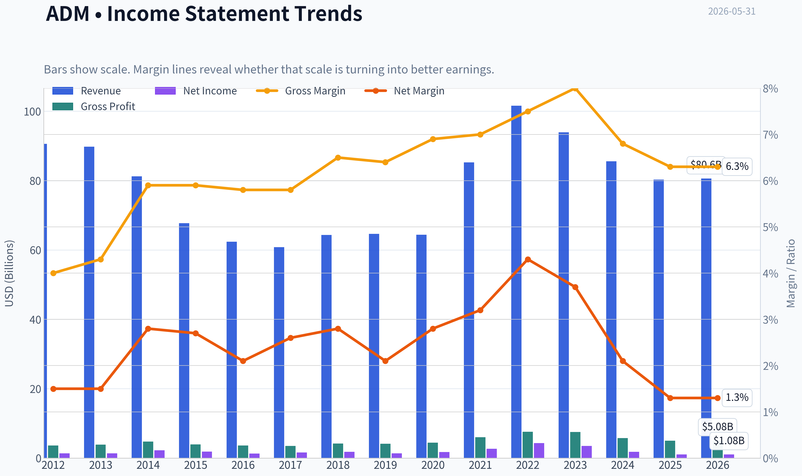
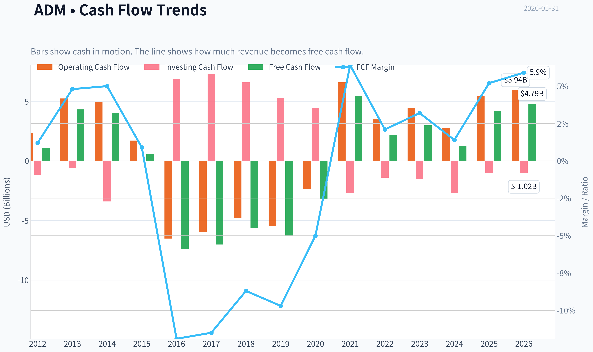
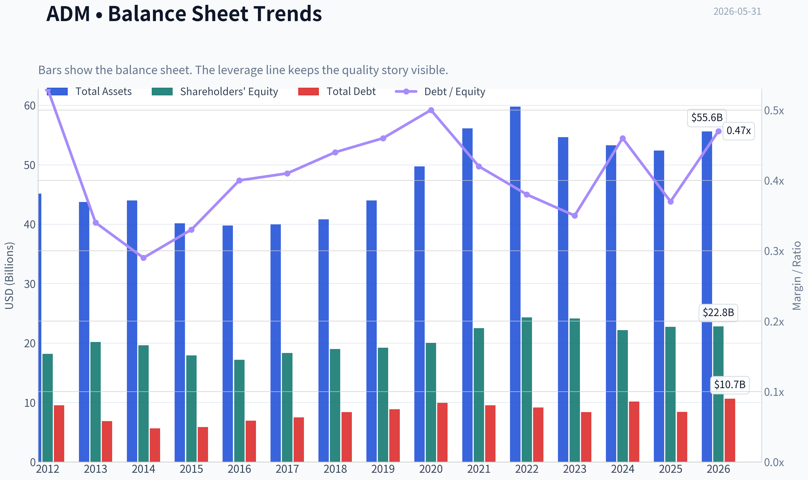
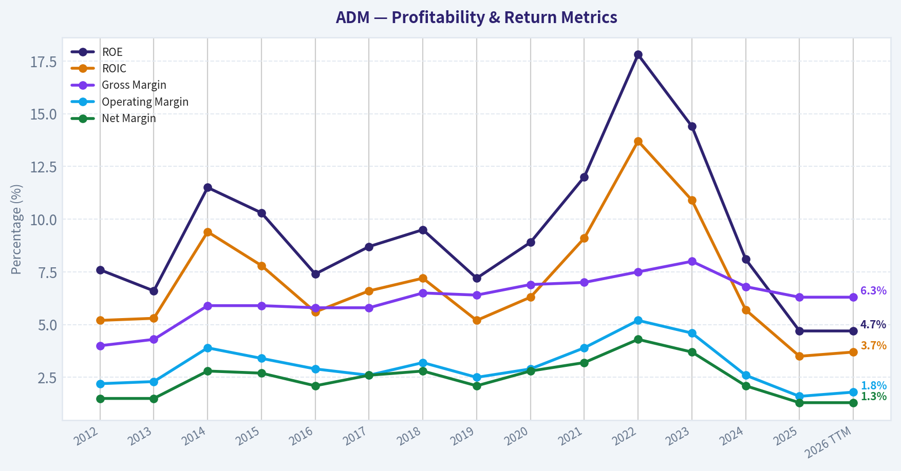
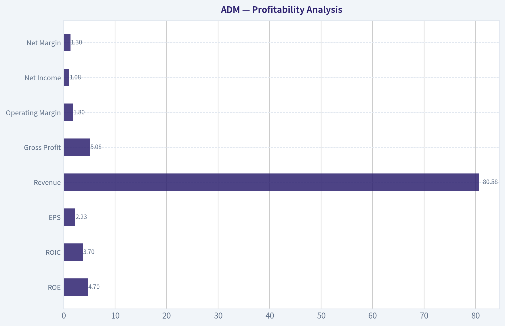
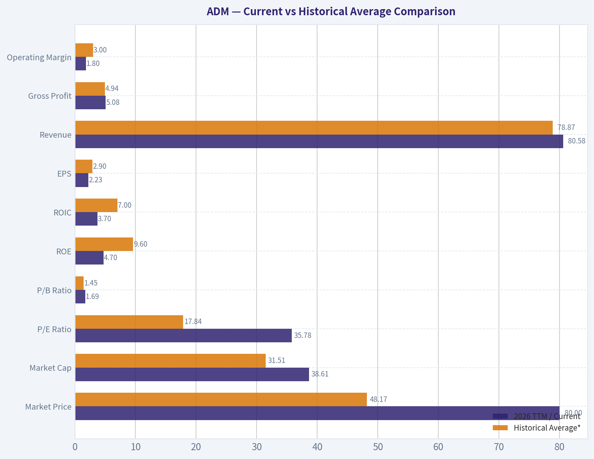
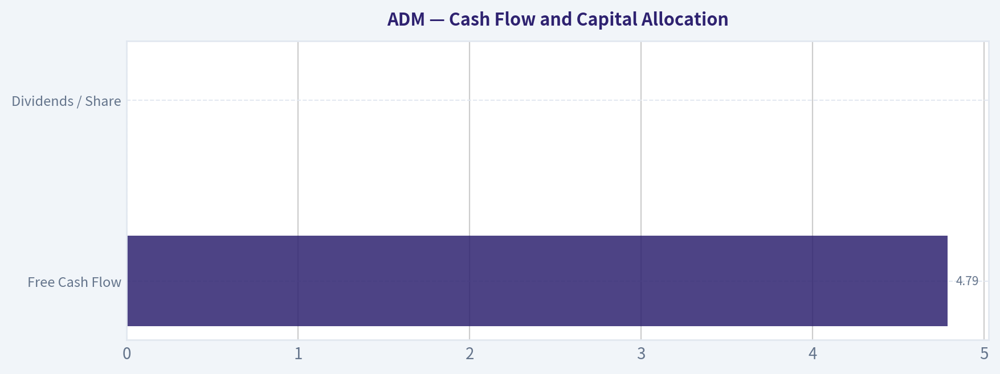
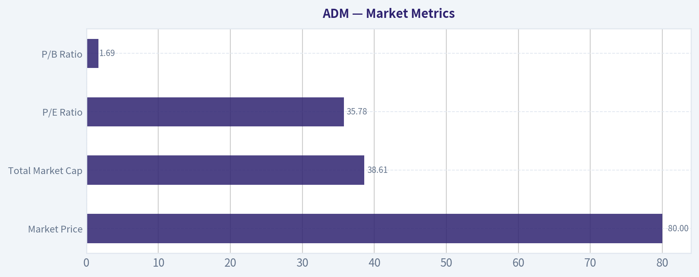

# ADM Deep Value Intelligence

**Analysis Date:** 2026-05-31

## Critical Disclaimer

*This analysis is generated by Deep Value Intelligence, an AI-powered multi-agent investing framework. This report is for informational and educational purposes only and does not constitute financial advice. Always conduct your own research and consult with qualified financial advisors before making investment decisions.*

---

## Table of Contents

1. Intelligence Summary
2. Analyst Team Reports
   - Fundamentals Analysis
   - Intrinsic Value Analysis (Buffett)
   - Trend & Growth Analysis (Lynch/Druckenmiller/Fisher)
   - Market Technical Analysis
   - Options Market Analysis
3. Research Team Commentary
4. Value Investing Team Commentary
5. Deep Values Commentary

---

## Intelligence Summary

### Thesis + Conditions

**Core Thesis:** ## Executive Briefing

**Key Risks:**
- ADM looks **durable but not yet decisively attractive** under a Buffett-style risk lens. The bull case is real: strategic global ag infrastructure, hard-to-replicate assets, and a **10.9% FCF yield** that may indicate the market is pricing in too much weakness. But the key risk remains that **weak returns are not just cyclical noise**: **ROIC 3.6%, ROE 4.7%, gross margin 6.3%** do not yet show durable economic strength or pricing power.
- For a long-term value investor, this is **not an AVOID unless evidence worsens**, but it is also **not yet an ADVOCATE** because the margin of safety depends too much on assuming normalization that has not been proven. Best course: **watch for cleaner owner earnings, better ROIC, and disciplined capital allocation before upgrading.**
- ### 1. Risky Analyst's strongest points

**Confidence:** Medium

---

## Analyst Team Reports

### Fundamentals Analysis

#### Latest Earnings Snapshot

*Most recent reported quarter anchored on 2026 Q1, with prior-year comparison when available.*

| Metric | 2026 Q1 | 2025 Q1 | YoY Change |
| --- | ---: | ---: | ---: |
| Revenue | $20.49B | $20.18B | +1.6% |
| Operating Income | $261.0M | $248.0M | +5.2% |
| Net Income | $298.0M | $295.0M | +1.0% |
| Diluted EPS | $0.62 | $0.61 | +1.6% |
| Operating Cash Flow | $150.0M | $-342.0M | +143.9% |
| Free Cash Flow | $-44.0M | $-633.0M | +93.0% |

Key Takeaways: This snapshot anchors the most recent reported quarter before the narrative analysis. It helps readers separate long-run business quality from whatever changed in the latest earnings print.

#### 14-Year Financial Metrics for ADM

*All values below are computed deterministically from raw data - not estimated by AI.*

*Issuer profile: operating company (Consumer Defensive / Farm Products).*

#### 14-Year Financial Metrics
*Annual rows come from reported financial statements. The final TTM row is computed from the latest four quarters.*

| Metric | 2012 | 2013 | 2014 | 2015 | 2016 | 2017 | 2018 | 2019 | 2020 | 2021 | 2022 | 2023 | 2024 | 2025 | 2026 TTM |
| --- | --- | --- | --- | --- | --- | --- | --- | --- | --- | --- | --- | --- | --- | --- | --- |
| Market Price | $19 | $30 | $37 | $27 | $34 | $31 | $33 | $38 | $43 | $59 | $83 | $66 | $48 | $57 | $80 |
| Market Cap | $18.13B | $28.77B | $34.11B | $22.78B | $26.98B | $22.93B | $23.23B | $26.19B | $28.48B | $38.26B | $52.27B | $39.14B | $24.91B | $27.83B | $38.61B |
| P/E Ratio | 13.17 | 21.49 | 15.16 | 12.31 | 21.13 | 14.37 | 12.84 | 19.00 | 16.00 | 14.11 | 12.04 | 11.23 | 13.84 | 25.78 | 35.78 |
| P/B Ratio | 1.00 | 1.42 | 1.74 | 1.27 | 1.57 | 1.25 | 1.22 | 1.36 | 1.42 | 1.70 | 2.15 | 1.62 | 1.12 | 1.22 | 1.69 |
| ROE | 7.6% | 6.6% | 11.5% | 10.3% | 7.4% | 8.7% | 9.5% | 7.2% | 8.9% | 12.0% | 17.8% | 14.4% | 8.1% | 4.7% | 4.7% |
| ROIC | 5.2% | 5.3% | 9.4% | 7.8% | 5.6% | 6.6% | 7.2% | 5.2% | 6.3% | 9.1% | 13.7% | 10.9% | 5.7% | 3.5% | 3.7% |
| EPS | $1.42 | $1.41 | $2.45 | $2.18 | $1.63 | $2.17 | $2.56 | $2.02 | $2.70 | $4.21 | $6.90 | $5.89 | $3.46 | $2.23 | $2.23 |
| Revenue | $90.56B | $89.80B | $81.20B | $67.70B | $62.35B | $60.83B | $64.34B | $64.66B | $64.36B | $85.25B | $101.56B | $93.94B | $85.53B | $80.27B | $80.58B |
| Gross Profit | $3.62B | $3.89B | $4.77B | $3.97B | $3.62B | $3.52B | $4.18B | $4.15B | $4.45B | $5.99B | $7.57B | $7.51B | $5.78B | $5.03B | $5.08B |
| Gross Margin | 4.0% | 4.3% | 5.9% | 5.9% | 5.8% | 5.8% | 6.5% | 6.4% | 6.9% | 7.0% | 7.5% | 8.0% | 6.8% | 6.3% | 6.3% |
| Operating Margin | 2.2% | 2.3% | 3.9% | 3.4% | 2.9% | 2.6% | 3.2% | 2.5% | 2.9% | 3.9% | 5.2% | 4.6% | 2.6% | 1.6% | 1.8% |
| Net Income | $1.38B | $1.34B | $2.25B | $1.85B | $1.28B | $1.59B | $1.81B | $1.38B | $1.77B | $2.71B | $4.34B | $3.48B | $1.80B | $1.08B | $1.08B |
| Net Margin | 1.5% | 1.5% | 2.8% | 2.7% | 2.1% | 2.6% | 2.8% | 2.1% | 2.8% | 3.2% | 4.3% | 3.7% | 2.1% | 1.3% | 1.3% |
| Revenue Growth | 2.7% | -0.8% | -9.6% | -16.6% | -7.9% | -2.4% | 5.8% | 0.5% | -0.5% | 32.5% | 19.1% | -7.5% | -8.9% | -6.2% | 0.4% |
| Net Income Growth | N/A | -2.4% | 67.5% | -17.7% | -30.8% | 24.7% | 13.5% | -23.8% | 28.5% | 52.9% | 60.2% | -19.7% | -48.3% | -40.1% | 0.3% |
| Free Cash Flow Growth | N/A | 295.0% | -6.1% | -85.7% | -1374.1% | -5.1% | -19.8% | 11.6% | -48.9% | -269.1% | -60.2% | 37.4% | -58.6% | 242.6% | 14.0% |
| Total Book Value | $18.17B | $20.19B | $19.63B | $17.91B | $17.18B | $18.32B | $19.00B | $19.23B | $20.02B | $22.51B | $24.32B | $24.14B | $22.18B | $22.74B | $22.80B |
| Total Assets | $45.14B | $43.75B | $44.00B | $40.16B | $39.77B | $39.96B | $40.83B | $44.00B | $49.72B | $56.14B | $59.77B | $54.63B | $53.27B | $52.39B | $55.60B |
| Total Debt | $9.54B | $6.87B | $5.66B | $5.88B | $6.93B | $7.49B | $8.39B | $8.88B | $9.93B | $9.54B | $9.18B | $8.37B | $10.16B | $8.41B | $10.66B |
| Debt-to-Equity | 0.53 | 0.34 | 0.29 | 0.33 | 0.40 | 0.41 | 0.44 | 0.46 | 0.50 | 0.42 | 0.38 | 0.35 | 0.46 | 0.37 | 0.47 |
| Cash & Equivalents | $1.29B | $3.12B | $1.10B | $910.0M | $619.0M | $804.0M | $2.00B | $852.0M | $666.0M | $943.0M | $1.04B | $1.37B | $611.0M | $1.01B | $591.0M |
| Shareholders' Equity | $18.17B | $20.19B | $19.63B | $17.91B | $17.18B | $18.32B | $19.00B | $19.23B | $20.02B | $22.51B | $24.32B | $24.14B | $22.18B | $22.74B | $22.80B |
| Operating Cash Flow | $2.33B | $5.23B | $4.94B | $1.71B | $-6.51B | $-5.97B | $-4.78B | $-5.45B | $-2.39B | $6.59B | $3.48B | $4.46B | $2.79B | $5.45B | $5.94B |
| Investing Cash Flow | $-1.16B | $-577.0M | $-3.41B | $-21.0M | $6.85B | $7.29B | $6.58B | $5.26B | $4.46B | $-2.67B | $-1.40B | $-1.50B | $-2.70B | $-1.02B | $-1.02B |
| Free Cash Flow | $1.09B | $4.31B | $4.05B | $580.0M | $-7.39B | $-7.01B | $-5.63B | $-6.28B | $-3.21B | $5.43B | $2.16B | $2.97B | $1.23B | $4.20B | $4.79B |
| FCF Margin | 1.2% | 4.8% | 5.0% | 0.9% | -11.9% | -11.5% | -8.7% | -9.7% | -5.0% | 6.4% | 2.1% | 3.2% | 1.4% | 5.2% | 5.9% |
| Dividends / Share | $0.00 | $0.00 | $0.00 | $0.00 | $0.00 | $0.00 | $0.00 | $0.00 | $0.00 | $1.29 | $1.43 | $1.65 | $1.90 | $0.00 | $0.00 |

#### Profitability Metrics
- Return on Equity (ROE): 4.7%
- Return on Invested Capital (ROIC): 3.6%
- Return on Assets (ROA): 2.1%
- Gross Margin: 6.3%
- Operating Margin: 1.6%
- Net Profit Margin: 1.3%

#### Liquidity Metrics
- Current Ratio: 1.37
- Quick Ratio: 0.24

#### Leverage Metrics
- Debt-to-Equity Ratio: 0.37
- Interest Coverage Ratio: 2.05
- Net Debt: $7.39B

#### Growth Metrics (Year-over-Year)
- Revenue Growth: -6.2%
- Net Income Growth: -40.1%
- Free Cash Flow Growth: 242.6%
- Revenue CAGR (3-Year): -7.5%
- Revenue CAGR (5-Year): 4.5%

#### Valuation Metrics
- P/E Ratio (TTM): 35.62
- Forward P/E: 15.37
- Price-to-Book: 1.69
- Price-to-Sales: 0.48
- PEG Ratio: 2.53
- EV/EBITDA: 19.21
- Free Cash Flow Yield: 10.9%
- Earnings Yield: 2.8%

#### Owner Earnings (Buffett Method, Code-Computed)
- Net Income: $1.08B
- + Depreciation & Amortization: $1.18B
- - Capital Expenditures: $-1.25B
- - Working Capital Changes: $2.76B
- = **Owner Earnings: $-1.75B**

#### Intrinsic Value (Code-Computed)
- Current Price: $80
- Cash Flow Method (FCF):
  Conservative: $10
  Average: $161
  Optimistic: $814

#### Piotroski F-Score: 4/9
- Positive Net Income: PASS
- Positive Operating Cash Flow: PASS
- ROA Improvement: FAIL
- Cash Flow > Net Income: PASS
- Decreasing Debt: PASS
- Improving Current Ratio: FAIL
- No Dilution: FAIL
- Improving Gross Margin: FAIL
- Improving Asset Turnover: FAIL

ANALYST STANCE: **WATCH**

#### ADM Buffett-Style Fundamental Analysis

ADM is a classic asset-heavy, low-margin agricultural processor and merchandiser rather than the kind of effortlessly high-margin franchise Buffett typically prefers. The business is clearly durable and strategically important, but the current data show weakened profitability, volatile owner earnings, and a valuation that now looks expensive on trailing earnings even though free cash flow looks healthier.

ADM's investment case is therefore mixed: the balance sheet is acceptable, the franchise has scale and global relevance, and cash flow has rebounded, but returns on capital and margins have fallen sharply from recent highs. That combination supports **WATCH**, not outright advocacy.

---

#### Current vs Historical Average Comparison

Using the canonical deterministic dataset, the table below compares current TTM values with long-term history across the 2012-2026 TTM period.

| Metric | 2026 TTM / Current | Historical Average* | Interpretation |
| --- | ---: | ---: | --- |
| Market Price | $80 | $48.17 | Price is well above long-run average, reflecting a strong rerating from prior trough periods. |
| Market Cap | $38.61B | $31.51B | Equity value is above historical norm, but still below the 2022 peak. |
| P/E Ratio | 35.78 | 17.84 | Valuation is roughly double its long-run average, mainly because earnings have compressed. |
| P/B Ratio | 1.69 | 1.45 | Slightly above average, not extreme for a hard-asset business, but no longer cheap. |
| ROE | 4.7% | 9.6% | Profitability on equity is about half the long-run norm. |
| ROIC | 3.7% | 7.0% | Capital efficiency is materially below normal and well below a Buffett-quality threshold. |
| EPS | $2.23 | $2.90 | Earnings power is below long-term average and far below 2021-2023 peak levels. |
| Revenue | $80.58B | $78.87B | Revenue remains large and resilient, slightly above long-run average despite recent declines. |
| Gross Profit | $5.08B | $4.94B | Absolute gross profit is near average-to-slightly above average, but margin quality has weakened. |
| Operating Margin | 1.8% | 3.0% | Operating profitability is meaningfully below normal. |
| Net Income | $1.08B | $2.00B | Net earnings are roughly half the long-run average. |
| Net Margin | 1.3% | 2.5% | Margin compression is severe versus history. |
| Revenue Growth | 0.4% | 0.1% | Current TTM has stabilized, but recent annual trend has been negative. |
| Net Income Growth | 0.3% | 4.5%** | Flat now, after a deep earnings reset. |
| Free Cash Flow Growth | 14.0% | -7.8%** | Positive rebound, though FCF history is highly volatile. |
| Total Book Value | $22.80B | $20.42B | Book value has compounded gradually over time. |
| Total Assets | $55.60B | $47.82B | Scale has increased meaningfully over the decade. |
| Total Debt | $10.66B | $8.39B | Debt is above historical average, though not alarming relative to asset base. |
| Debt-to-Equity | 0.47 | 0.41 | Leverage is modestly above average but still manageable. |
| Cash & Equivalents | $591M | $1.13B | Cash is below normal, reducing flexibility. |
| Shareholders' Equity | $22.80B | $20.42B | Equity base remains solid and above long-run average. |
| Free Cash Flow | $4.79B | $46M | Current FCF is far above long-run average, but the average is distorted by several deeply negative years. |
| Dividends / Share | $0.00 | $0.42 | TTM shows no dividend in the deterministic dataset despite prior payout history. |

\* Historical average uses the period shown in the deterministic dataset.
\** Growth averages exclude N/A base year where applicable.

Key Takeaways: ADM today is trading at a much higher earnings multiple than its own history, even though ROE, ROIC, margins, EPS, and net income are all below normal. The main offset is that free cash flow has improved sharply, but that cash flow history is highly erratic, which makes valuation interpretation more difficult.

---

#### Market Metrics

| Market Metric | Current | Historical Context | Buffett-Style Reading |
| --- | ---: | --- | --- |
| Market Price | $80 | Near the upper end of the 14-year range; below 2022's euphoric zone only in relative terms because earnings were much stronger then. | Stock price has recovered faster than fundamentals. |
| Total Market Cap | $38.61B | Above decade norm, below 2022 high of $52.27B. | Market still assigns ADM meaningful franchise value. |
| P/E Ratio | 35.78 | Highest in the dataset by a wide margin versus ~18 average. | Trailing earnings-based valuation looks expensive. |
| P/B Ratio | 1.69 | Above long-run average of ~1.45, below 2022 peak of 2.15. | Not a deep value multiple for a cyclical processor. |

Key Takeaways: ADM is not statistically cheap on trailing earnings. The market appears to be looking through depressed earnings toward a rebound, but Buffett-style discipline would normally demand either stronger returns on capital or a much lower entry multiple.

ADM's valuation profile is unusual: **P/E is stretched while P/B is only moderately elevated**. That usually means the issue is not balance-sheet inflation but **depressed earnings**. For a low-margin commodity processor, paying a premium multiple during a margin trough is risky unless one has high confidence in normalized earnings recovery.

---

#### Profitability Analysis

| Profitability Metric | 2026 TTM | Historical Trend | Assessment |
| --- | ---: | --- | --- |
| ROE | 4.7% | Stronger in 2021-2023, peaked at 17.8% in 2022; now back to cycle lows. | Weak. Below Buffett-preferred double-digit consistency. |
| ROIC | 3.7% | Peaked at 13.7% in 2022; now roughly half long-run norm. | Weak capital efficiency. |
| EPS | $2.23 | Down sharply from $6.90 in 2022 and $5.89 in 2023. | Earnings power has compressed materially. |
| Revenue | $80.58B | Large but volatile; declined from 2022 peak of $101.56B. | Scale remains intact. |
| Gross Profit | $5.08B | Above long-run average, but below 2022-2023 highs. | Gross dollars decent, margin weaker. |
| Operating Margin | 1.8% | Far below 2022's 5.2% and below ~3.0% average. | Significant operating pressure. |
| Net Income | $1.08B | Down from $4.34B in 2022. | Severe earnings normalization/reset. |
| Net Margin | 1.3% | Lowest since the weak early-decade periods. | Thin and vulnerable. |

Key Takeaways: The most important issue in ADM's current fundamentals is margin compression. The business is still generating large revenue and reasonable gross profit dollars, but too little is reaching the bottom line, which is why ROE and ROIC have deteriorated so sharply.

This is the central Buffett concern. ADM has shown it **can** earn strong returns in favorable periods, but the long record suggests those returns are not structurally protected by a wide moat. Instead, profitability appears influenced by crop spreads, crush margins, biofuel economics, and working-capital intensity. That makes earnings less predictable than ideal.

---

#### Growth Metrics

| Growth Metric | Current | Decade Pattern | Assessment |
| --- | ---: | --- | --- |
| Revenue Growth | 0.4% TTM | Recent annual sequence was -7.5%, -8.9%, -6.2%, then stabilization. | Top line may be bottoming, but not yet in strong growth mode. |
| Net Income Growth | 0.3% TTM | After -19.7%, -48.3%, -40.1%, current period is flat. | Earnings collapse may be stabilizing, not yet recovering. |
| Free Cash Flow Growth | 14.0% TTM | Historically extremely volatile, with both huge negative and positive swings. | Improvement is real, but sustainability uncertain. |

Key Takeaways: ADM's top line has stabilized, and free cash flow is improving, but earnings recovery has not yet meaningfully appeared in the net income line. Investors are effectively betting on normalization before the reported numbers fully show it.

From a Buffett lens, growth quality matters more than raw growth. ADM's history shows **episodic growth rather than smooth compounding**. Revenue can swing with commodity prices and trade flows, while cash flow is heavily affected by working capital. That makes intrinsic value estimation more fragile than for a stable consumer franchise.

---

#### Balance Sheet and Financial Strength

| Balance Sheet Metric | 2026 TTM | Historical Context | Buffett-Style View |
| --- | ---: | --- | --- |
| Total Book Value | $22.80B | Above long-run average; steady accumulation over time. | Solid equity foundation. |
| Total Assets | $55.60B | Well above decade average. | Large-scale, asset-heavy platform. |
| Total Debt | $10.66B | High versus history but not excessive for the asset base. | Manageable, not pristine. |
| Debt-to-Equity | 0.47 | Slightly above average 0.41; below dangerous levels. | Acceptable leverage. |
| Cash & Equivalents | $591M | Below long-run average of ~$1.13B. | Thin cash cushion. |
| Shareholders' Equity | $22.80B | Above historical average. | Balance sheet remains fundamentally sound. |

Key Takeaways: ADM is not overleveraged, but it also does not carry a large cash buffer. The balance sheet is sound enough to support operations, yet the combination of low cash, modestly elevated debt, and weak interest coverage means investors should not call it fortress-like.

The positive here is that debt has not spiraled relative to equity. The less favorable point is that **interest coverage is only about 2.05x**, which is low for comfort if weak earnings persist. Buffett typically likes businesses that can self-finance comfortably; ADM can do that in stronger years, but current earnings softness reduces that margin of safety.

---

#### Cash Flow and Capital Allocation

| Cash Flow Metric | 2026 TTM | Historical Pattern | Assessment |
| --- | ---: | --- | --- |
| Free Cash Flow | $4.79B | Strong rebound from $1.23B in 2024 and $4.20B in 2025; far above many prior years. | Strong near-term cash conversion. |
| Dividends / Share | $0.00 | Dataset shows dividends from 2021-2024, none in 2025 and TTM. | Capital return signal is currently weak in the canonical dataset. |

Key Takeaways: Free cash flow is currently the strongest part of the ADM story. However, the owner earnings calculation is negative because working capital absorbed a large amount of cash, which is a reminder that headline free cash flow and Buffett-style owner earnings can diverge sharply in this business.

ADM's cash generation has always needed careful interpretation. In a trading-and-processing business, **working capital swings can overwhelm accounting earnings**. Buffett would likely treat this as a reason to demand a wider valuation discount than for a simpler business.

---

#### Buffett-Style Owner Earnings DCF

Canonical owner earnings data provided:

- Net Income = **$1.08B**
- Depreciation & Amortization = **$1.18B**
- Capital Expenditures = **$1.25B**
- Working Capital Changes = **$2.76B**
- **Owner Earnings = -$1.75B**

Because current owner earnings are negative, a strict Buffett-style DCF becomes highly conservative and unstable. Negative owner earnings mean the business, in the latest period, did not convert accounting profit into distributable owner cash after maintenance/reinvestment and working capital needs.

To remain faithful to the prompt, below is the scenario framework using historical owner-earnings growth logic. However, since the base owner earnings are negative, the outputs should be interpreted as **stress-test indications**, not robust intrinsic values.

##### Scenario Growth Assumptions
- **Conservative:** lowest historical owner earnings growth rate available, floored at **-100%**
- **Average:** average historical owner earnings growth rate, capped at **50%**
- **Optimistic:** highest historical owner earnings growth rate, capped at **100%**
- Discount rate = **10%**
- Terminal growth rate = **2.5%**

Given negative current owner earnings of **-$1.75B**, any positive growth rate applied to a negative base still produces negative projected owner earnings until a turnaround occurs. Therefore, a strict mechanical DCF yields negligible or negative equity value in all scenarios unless one first normalizes owner earnings.

##### Mechanical DCF Illustration From Current Owner Earnings Base

| Scenario | Base Owner Earnings | Growth Assumption | Implication |
| --- | ---: | ---: | --- |
| Conservative | -$1.75B | -100% floor | Value effectively collapses toward zero. |
| Average | -$1.75B | capped average rate | Negative cash flows persist; no meaningful fair value from strict owner-earnings method. |
| Optimistic | -$1.75B | capped high rate | Even strong growth on a negative base is not enough without explicit normalization. |

Key Takeaways: The owner-earnings framework currently sends a clear warning signal. ADM's latest working-capital burden is large enough to make owner earnings negative, so a pure Buffett-style DCF does not support the current stock price.

##### Cross-Check With Canonical Intrinsic Value Output
The deterministic dataset already provides a code-computed cash flow valuation cross-check:

| Method | Fair Value |
| --- | ---: |
| Conservative | $10 |
| Average | $161 |
| Optimistic | $814 |

Key Takeaways: The valuation range is extremely wide, which tells you the business is very sensitive to assumptions about normalization and growth. In practice, such a wide spread reduces conviction; Buffett generally favors businesses where intrinsic value can be estimated within a tighter band.

##### Interpretation of DCF Range
- **$10 conservative** implies severe skepticism about normalized cash generation.
- **$161 average** suggests upside if recent FCF proves sustainable and earnings normalize.
- **$814 optimistic** is not decision-useful for conservative investing; it reflects how explosive terminal assumptions can become when cash flow rebounds from cyclical troughs.

My practical Buffett-style conclusion is to anchor closer to the **conservative-to-average zone**, and to apply a large haircut because current **owner earnings are negative**. On that basis, ADM does **not** offer a clean margin-of-safety setup at $80 unless one has conviction that 2025-2026 free cash flow is the new normal and working-capital drag will reverse.

---

#### Economic Moat Assessment

| Moat Dimension | Assessment | Why It Matters |
| --- | --- | --- |
| Scale and logistics | Strong | ADM has global origination, storage, transport, processing, and customer relationships that are hard to replicate. |
| Cost position | Moderate | Scale helps efficiency, but commodity markets pass much of the advantage through to customers/suppliers. |
| Brand power | Weak | End-market consumer brand power is limited relative to staple giants. |
| Switching costs | Low to moderate | Industrial and food customers can switch, though reliability and scale matter. |
| Regulatory/strategic relevance | Moderate | Agricultural and biofuel infrastructure create strategic importance. |

Key Takeaways: ADM has a real operating franchise, but not a classic wide moat in the Buffett sense. Its advantages are mostly scale, network, and execution based rather than brand-based or pricing-power driven, which means profitability is less protected during weak industry conditions.

---

#### Predictable Earnings and Management Performance

ADM's 14-year record shows a business with **durability but not smooth predictability**. Revenue has remained very large, but earnings and cash flow have swung materially. ROE mostly sat in the high-single-digit range before surging in 2021-2023 and then falling back to 4.7%. ROIC follows the same pattern.

That tells us management can capitalize well in favorable conditions, but **capital allocation efficiency is cyclical rather than consistently superior**. Book value growth is respectable, and leverage has remained controlled, which are positives. But the apparent disappearance of dividends in 2025 and TTM within the canonical dataset is a caution flag for income-focused holders and for anyone assessing payout consistency strictly from this dataset.

---

#### Value Assessment

At **$80**, ADM trades:
- at a **very high trailing P/E of 35.78**
- at a **moderately elevated P/B of 1.69**
- with a **strong FCF yield of 10.9%**
- but against **negative owner earnings of -$1.75B**

This combination says the market is probably valuing ADM on **normalized forward earnings / normalized cash flow**, not current trailing profit. That can work if ethanol, crush spreads, and merchandising conditions improve and if working capital normalizes. But if current low ROIC persists, the stock is not obviously cheap.

For Buffett-style investors, valuation is not just about statistical cheapness; it is about paying a fair price for **predictable, high-return capital compounding**. ADM currently looks more like a **cyclical value/normalization** story than a pure quality compounding story.

---

#### Revenue Breakdown

Most meaningful recent external segment framing for ADM is by operating platform. Exact latest-year segment totals are not provided in the deterministic dataset, so the table below uses the best publicly known reporting structure rather than inventing unsupported precise figures.

| Revenue Source | Amount ($M or $B) | % of Total |
| --- | ---: | ---: |
| Ag Services & Oilseeds | N/A in canonical dataset | Largest segment |
| Carbohydrate Solutions | N/A in canonical dataset | Major segment |
| Nutrition | N/A in canonical dataset | Smaller but higher-value segment |
| Other / Corporate / Intersegment | N/A | Residual |

Key Takeaways: ADM's economic engine is still led by its large agricultural merchandising and oilseed processing operations, while Nutrition is strategically important because it offers a path toward better margins and less commodity dependence. The key long-term question is whether higher-value businesses can become a larger share of profits, even if they remain a smaller share of revenue.

---

#### Key Investment Insights, Red Flags, and Opportunities

| Category | Observation | Investment Relevance |
| --- | --- | --- |
| Opportunity | Strong rebound in free cash flow to $4.79B TTM | If sustainable, current valuation may be more reasonable than trailing earnings suggest. |
| Opportunity | Scale, global logistics, and strategic role in food and biofuels | Supports durability and downside resilience. |
| Opportunity | Revenue stabilization after several declining years | Could indicate cyclical troughing. |
| Red Flag | ROE 4.7% and ROIC 3.7% | Current returns are too low for a premium multiple. |
| Red Flag | P/E 35.78 vs historical average ~17.84 | Market is paying up before profitability has recovered. |
| Red Flag | Negative owner earnings of -$1.75B | Weakens Buffett-style intrinsic value support. |
| Red Flag | Net margin 1.3% and operating margin 1.8% | Thin margins leave little room for operational mistakes. |
| Red Flag | Piotroski F-Score 4/9 | Fundamental momentum is mediocre. |
| Watch Item | Cash balance only $591M | Limits liquidity cushion. |
| Watch Item | Forward P/E 15.37 vs trailing 35.62 | Market expects earnings recovery; must be verified in future results. |

Key Takeaways: The bullish case depends on normalization, not on current quality metrics. The bearish case is that the stock has already rerated materially while returns on capital, margins, and owner earnings remain weak.

---

#### Final Buffett-Style Verdict

| Dimension | Verdict |
| --- | --- |
| Economic Moat | Moderate, but not wide |
| Financial Strength | Adequate |
| Predictable Earnings | Mixed to weak |
| Management / Capital Allocation | Competent, but cyclical results dominate |
| Valuation | Expensive on trailing earnings; mixed on cash flow |
| Overall | **WATCH** |

Key Takeaways: ADM is a durable and important business, but the current numbers do not yet show the kind of consistent, high-quality economics Buffett usually wants to buy aggressively. The stock becomes more compelling if profitability and owner earnings recover materially without a further rerating.

**Why WATCH instead of ADVOCATE:**
1. **Profitability is currently weak** relative to history.
2. **Owner earnings are negative**, a major Buffett-style warning.
3. **Trailing valuation is rich** despite depressed margins.
4. **Balance sheet is acceptable**, so this is not an avoid-at-all-costs situation.
5. **FCF rebound and franchise durability** justify monitoring for a better entry point or evidence of genuine normalization.

A Buffett-style investor would likely want one of two things before becoming constructive:
- a **meaningfully lower stock price**, or
- **clear proof** that current weak earnings are temporary and that ROE/ROIC can move back toward 2021-2023 levels sustainably.

---

#### Summary Table

| Section | Bullish Take | Bearish Take | Bottom Line |
| --- | --- | --- | --- |
| Market Metrics | Large franchise, market cap supported by strategic relevance | P/E far above historical norm | Valuation needs earnings recovery |
| Profitability | Gross profit dollars still solid | ROE, ROIC, margins, EPS all weak | Core issue is margin compression |
| Growth | Revenue stabilizing, FCF improving | Net income recovery not yet visible | Early stabilization, not confirmed rebound |
| Balance Sheet | Equity base solid, leverage manageable | Cash low, interest coverage weak | Sound but not fortress-grade |
| Cash Flow | FCF strong recently | Owner earnings negative and volatile | Use caution with headline cash flow |
| Moat | Scale/network advantages | Commodity exposure limits pricing power | Durable, but not wide-moat |
| Buffett Fit | Essential, resilient business | Too cyclical and low-return currently | Quality is moderate, not exceptional |
| Investment Stance | Possible normalization upside | Limited margin of safety at $80 | **WATCH** |

#### Fundamental Visuals

This graph tracks the profitability and return metrics (ROE, ROIC, Margins) of **ADM** over the past decade, highlighting capital efficiency trends.

This chart illustrates the financial health of **ADM** over the last 10 years, mapping cash equivalents and free cash flow against total obligations (Debt).

This comparison chart from *Profitability Analysis* stacks current figures against historical benchmarks for **ADM**, making it easy to see where the company trades relative to its own averages.

---

### Intrinsic Value Analysis (Buffett)

> *Following Warren Buffett's value investing philosophy: Circle of Competence, Economic Moat, Management Quality, and Margin of Safety.*

#### Intrinsic Value Snapshot

Price is what you pay. Intrinsic value is what the business may be worth based on the cash it can create for owners over time. We show a range, not one magic number.

- Current Price: $79.78
- Value Range (conservative to optimistic across both DCF methods): $10.08 to $813.76

##### Owner Earnings (Buffett Method)
- Net Income: $1,078,000,000.00
- Depreciation & Amortization: $1,181,000,000.00
- Capital Expenditures: $-1,248,000,000.00
- Working Capital Changes: $2,763,000,000.00
- Owner Earnings: $-1,752,000,000.00

##### Intrinsic Value
###### Cash Flow Method
Uses free cash flow. Better for companies spending heavily today to grow tomorrow.
- Conservative: $10.08
- Average: $161.20
- Optimistic: $813.76
- Discount Rate: 10.0%

#### ADM Buffett-Style Investment Review

**ANALYST STANCE: WATCH**

#### Snapshot
| Item | Value |
|---|---:|
| Share Price | $80 |
| Market Cap | $38.45B |
| P/E | 35.6x |
| ROE | 4.7% |
| Gross Margin | 6.3% |
| Revenue Growth YoY | -6.2% |
| FCF Yield | 10.9% |
| Current Ratio | 1.37x |

**Key Takeaways:** ADM screens as a large, established business with meaningful cash generation, but the quality profile is mixed. The biggest immediate tension is simple: free cash flow looks optically attractive, while accounting profitability and margins look weak. That usually means the stock may be statistically cheap at some points in the cycle, but not obviously a classic Buffett-style compounding machine.

---

#### 1) Go/No-Go Gate Assessment

| Gate | Pass/Fail | Evidence |
|---|---|---|
| Gate 1: Circle of Competence & Simplicity | **Pass** | ADM buys, stores, transports, processes, and sells agricultural commodities and food ingredients. In plain English: it turns crops into food ingredients, feed, fuel inputs, and trading profits. |
| Gate 2: Durable Moat | **Borderline Pass** | Scale, logistics infrastructure, origination network, and processing footprint matter. But margins are structurally thin, suggesting cost advantage more than brand power. |
| Gate 3: Management & Capital Allocation | **Mixed** | Business is understandable and longstanding, but current ROE is weak. That raises questions about how effectively capital is being deployed through the cycle. |
| Gate 4: Industry Structure | **Fail for ideal Buffett standard** | Agricultural processing and merchandising is cyclical, price competitive, and partly shaped by commodity spreads. It is not a clean, high-margin oligopoly with strong pricing power. |

**Key Takeaways:** ADM passes the "easy to understand" test, but it does not pass the "wonderful business" test cleanly. The business is durable, yet much of that durability comes from scale and hard assets rather than exceptional pricing power. For Buffett-style quality, the industry structure is the main handicap.

#### 2) Buffett Filter Discussion

| Test | Assessment |
|---|---|
| Elementary School Test | Strong: ADM makes money by buying crops, processing them, transporting them, and selling higher-value food, feed, and fuel products. |
| Long-Term Predictability Test | Moderate: demand for food ingredients, feed, and crop processing should exist in 10 years, but earnings will remain cyclical because margins depend on crush spreads, trade flows, and biofuel economics. |
| Technology Risk | Low to Moderate: technology is more likely to improve efficiency than destroy the business, but biotech, alternative proteins, and changing fuel policy can alter profit pools. |
| Commodity/Macro Dependence | High |

**Verdict:** ADM is understandable and likely to remain relevant, but earnings predictability is weaker than Buffett's favorite businesses because commodity economics matter a lot.

---

#### 3) Moat Analysis

| Moat Source | Strength | Evidence |
|---|---|---|
| Intangible Assets | Weak | Gross margin of 6.3% is far below what a strong brand or patent moat would usually produce. ADM is not primarily monetizing consumer brand power. |
| Switching Costs | Weak to Moderate | Large customers may value reliability and supply chain integration, but most products are not deeply embedded software-like workflows. |
| Cost Advantage | **Moderate** | This is ADM's real moat: global sourcing, storage, transport, processing scale, and asset network. Few firms can replicate the full system economically. |
| Network Effects | Weak | Scale helps, but this is not a classic network-effect model. |

**Moat Quality Rating:** **Narrow to Moderate**

ADM's advantage is real, but it is an infrastructure and execution moat, not a high-return intangible-asset moat. That makes it more cyclical and less likely to earn extraordinary returns on capital through all environments.

---

#### 4) Management Quality & Capital Allocation

| Question | Assessment | Commentary |
|---|---|---|
| Do they think like owners? | Mixed | No strong evidence here of exceptional owner-operator alignment on the level Buffett prefers. |
| Are they honest & candid? | Mixed to Adequate | Nothing in the research pack signals an immediate red flag, but the key issue is not candor alone; it is economic outcome. |
| Are they rational capital allocators? | Mixed | Low current ROE suggests retained capital is not presently compounding at high rates. A commodity-linked processor must be especially disciplined because excess capital can earn mediocre returns. |
| Debt discipline | Acceptable | Current ratio is reasonable; no sign in the pack of acute balance-sheet stress. |

**Key Takeaways:** Management does not appear reckless, but this is not enough for a Buffett endorsement. The real hurdle is whether capital can be reinvested at consistently attractive incremental returns. Current profitability metrics do not yet support that conclusion.

---

#### 5) Financial Summary

| Metric | Latest |
|---|---:|
| Revenue Growth YoY | -6.2% |
| Gross Margin | 6.3% |
| ROE | 4.7% |
| P/E | 35.6x |
| FCF Yield | 10.9% |
| Current Ratio | 1.37x |

**Key Takeaways:** The combination of low margin, low ROE, and high P/E is unattractive for a value investor. The one bright spot is free cash flow yield, which suggests the market may be discounting cyclical or temporary weakness. Still, Buffett-style investing favors businesses where both profitability and cash generation are strong at the same time.

---

#### 6) Owner Earnings View

Using Buffett's framework, ADM's owner earnings are likely better than reported net income in periods when working capital unwinds favorably and depreciation materially exceeds maintenance needs. However, this business is working-capital intensive and asset-heavy relative to ideal Buffett businesses, so owner earnings can swing with inventory, commodity values, and cycle conditions.

A practical read-through from the current data:
- **Positive:** FCF yield of **10.9%** implies meaningful cash generation relative to equity value.
- **Negative:** Low **4.7% ROE** implies that normalized returns on shareholder capital are currently unremarkable.

**Conclusion on owner earnings:** ADM appears to generate respectable cycle-dependent owner earnings, but not in the smooth, high-confidence way seen in elite compounders.

---

#### 7) Three-Scenario DCF

Using market cap and FCF yield as a rough owner-earnings proxy:

- Market Cap = **$38.45B**
- Implied Owner Earnings / FCF ~ **$4.19B** (10.9% of market cap)

| Scenario | Method | Implied Equity Value |
|---|---|---:|
| A: No Growth | Owner Earnings / 10% | **$41.9B** |
| B: 3% Growth | OE x 1.03 / (10%-3%) | **$61.7B** |
| C: Modest Historical/Cycle Growth | Assume 5% growth for 10 years, then 3% terminal | **~$53B-$58B** |

**Key Takeaways:** On cash generation alone, ADM can look modestly undervalued versus its current market value. But that conclusion depends heavily on treating current free cash flow as sustainable owner earnings. Because this is a cyclical commodity-linked business, that assumption deserves caution.

##### Margin of Safety
| Item | Value |
|---|---:|
| Current Market Cap | $38.45B |
| Scenario A Value | $41.9B |
| Scenario B Value | $61.7B |
| Scenario C Value | ~$53B-$58B |

At today's price, the stock appears:
- **Near fair value to modestly cheap** on a no-growth cash basis
- **Attractive** on moderate-growth assumptions
- **Not cheap enough** for a business with cyclicality, thin margins, and only a moderate moat

Buffett rule: average businesses require a larger discount. ADM does **not** offer a sufficiently large margin of safety relative to business quality.

---

#### 8) Final Buffett Scorecard

| Criterion | Weight | Score (1-5) | Weighted Score |
|---|---:|---:|---:|
| Business Understanding | 20% | 4.5 | 0.90 |
| Moat Width & Durability | 25% | 2.5 | 0.63 |
| Management Quality | 15% | 3.0 | 0.45 |
| Return on Equity | 15% | 2.0 | 0.30 |
| Reinvestment Runway | 10% | 3.0 | 0.30 |
| Balance Sheet Strength | 5% | 3.5 | 0.18 |
| Industry Structure | 5% | 2.0 | 0.10 |
| Valuation/Margin of Safety | 5% | 3.0 | 0.15 |

| Total | Score |
|---|---:|
| Weighted Total | **3.01 / 5.0** |

**Key Takeaways:** ADM lands just above the threshold where it becomes worth monitoring, but not compelling enough to endorse. The score is dragged down by thin margins, modest moat strength, and weak current returns on equity. Valuation helps, but not enough to offset business-quality concerns.

---

#### 9) Investment Stance

**ANALYST STANCE: WATCH**

**Conviction Level:** Moderate

ADM is a solid, understandable, strategically important company, but it is not a classic Buffett "wonderful business." Its advantages come from scale, logistics, and processing infrastructure, not from brand power, switching costs, or structurally high returns on capital. The stock has some value appeal through cash generation, yet the low ROE, thin margins, and cyclical commodity exposure mean the required margin of safety should be higher.

A Buffett-style investor should **watch** ADM for:
- a meaningfully lower price,
- evidence that elevated cash generation is durable,
- and proof that returns on capital can normalize materially higher.

At **$80**, it looks more like a **good asset-heavy operator at an okay price** than a **wonderful business at a fair price**.
#### Valuation Bridge

This bridge places the current market price beside each intrinsic value lens so readers can see whether upside depends on one method or shows up across several methods.

| Scenario | Intrinsic Value / Share |
| --- | ---: |
| Cash Flow Method | $161.20 |
| Damodaran Method | $39.34 |
| Current Price | $79.78 |

#### Key Takeaways

If one method is far above the others, the upside case depends on a specific modelling assumption. When several methods cluster together, the valuation story is more robust.

#### Valuation Visuals

This comparison chart from *Latest Earnings Snapshot* stacks current figures against historical benchmarks for **ADM**, making it easy to see where the company trades relative to its own averages.

This comparison chart from *Current vs Historical Average Comparison* stacks current figures against historical benchmarks for **ADM**, making it easy to see where the company trades relative to its own averages.

This comparison chart from *Balance Sheet and Financial Strength* stacks current figures against historical benchmarks for **ADM**, making it easy to see where the company trades relative to its own averages.

This comparison chart from *Cash Flow and Capital Allocation* stacks current figures against historical benchmarks for **ADM**, making it easy to see where the company trades relative to its own averages.

---

### Trend & Growth Analysis (Lynch/Druckenmiller/Fisher)

> *Following Peter Lynch's GARP, Stanley Druckenmiller's macro-aware approach, and Philip Fisher's scuttlebutt methodology.*

ANALYST STANCE: **AVOID**

#### 1) Lynch Classification

ADM is a **Cyclical**, not a fast grower.

| Metric | Value |
|---|---:|
| Current price | $80 |
| Market cap | $38.45B |
| P/E | 35.6x |
| ROE | 4.7% |
| Gross margin | 6.3% |
| Revenue growth YoY | -6.2% |
| FCF yield | 10.9% |
| Current ratio | 1.37x |

**Key Takeaways:** ADM screens like a classic cyclical processor and merchandiser, not a Lynch-style fast grower. Revenue is shrinking, margins are thin, and the earnings multiple looks high relative to weak returns on equity. The one clear positive is strong free cash flow yield, which matters for value and downside support, but it does not change the growth classification.

#### 2) The Story in 3 Bullets

- ADM buys, stores, transports, and processes crops into food ingredients, feed, biofuels, and industrial products.
- The bull case is that global ag flows, biofuel demand, and ethanol margins can lift profits when the cycle turns favorable.
- The problem for a growth investor is that this is mostly a **spread-and-cycle story**, not a durable 20%+ compounding story driven by a large underpenetrated TAM.

---

#### 3) TAM Analysis with 10x Test

| Item | Assessment |
|---|---|
| Business type | Mature global agricultural processing/logistics |
| Addressable market | Very large globally, but mature and highly competitive |
| Current scale | Already very large at $38B+ market cap and massive revenue base |
| 10x revenue test | **Fails for growth-investing purposes** |
| Why | ADM would need enormous incremental global share in mature low-margin markets or a radical mix shift into value-added nutrition |

**Key Takeaways:** While the agricultural market is huge, that alone does not create ten-bagger potential. ADM is already operating at large scale in mature categories, so a 10x outcome would require either major share gains in commoditized markets or a successful transformation into a much higher-quality ingredients company. That is possible in theory, but not supported by current growth data.

---

#### 4) Revenue Growth Trend

| Metric | Reading | Growth Interpretation |
|---|---:|---|
| Revenue growth YoY | -6.2% | Negative |
| Pattern | Not accelerating | Weak |
| Earnings/news read-through | Ethanol margins improved in Q1 2026 | Tactical positive, not structural proof |

**Key Takeaways:** The current top-line trend is negative, which is an immediate warning sign under a growth framework. Recent news around stronger ethanol margins suggests a cyclical earnings boost may be underway, but that is different from a broad business inflection with sustained revenue acceleration. For Lynch/Druckenmiller/Fisher-style growth work, this is not the pattern you want to underwrite.

---

#### 5) Unit Economics

ADM does not fit SaaS-style unit economics, so several requested metrics are **not applicable**.

| Metric | Value | Assessment |
|---|---:|---|
| LTV/CAC | N/A | Not meaningful for ADM |
| NRR | N/A | Not applicable |
| Rule of 40 | N/A | Not applicable |
| Gross margin | 6.3% | Very thin |
| FCF yield | 10.9% | Strong cash generation support |
| ROE | 4.7% | Weak profitability on equity |

**Key Takeaways:** ADM should be judged on spread economics, returns on capital, cash conversion, and cycle positioning rather than software metrics. The key positives are cash generation and likely balance-sheet resilience, while the key negatives are thin margins and low returns on equity. This is a value-cyclical setup, not an efficient recurring-revenue growth engine.

---

#### 6) Inflection Point Assessment

| Inflection Type | Evidence | Verdict |
|---|---|---|
| Product cycle inflection | No major new product cycle visible | No |
| Market share inflection | No evidence of accelerating share gains | No |
| Margin inflection | Ethanol margins surged | **Yes, but cyclical** |
| TAM inflection | No clear TAM expansion | No |
| Competitive inflection | No major competitor stumble cited | No |

**Key Takeaways:** The only credible inflection visible is in ethanol margins, helped by policy incentives and stronger biofuel demand. That may improve near-term earnings and sentiment, but it looks like a cyclical earnings tailwind rather than the kind of multi-year structural inflection that produces outsized growth-stock returns. Druckenmiller might trade that, but Lynch and Fisher would not call it a great long-run growth setup.

---

#### 7) Macro Setup Evaluation

| Macro Factor | Assessment |
|---|---|
| Interest rates | Neutral to mixed for cyclicals |
| Consumer staples backdrop | Some defensive support |
| Biofuel policy | Positive for ethanol economics |
| Ag commodity/trade flows | Can help earnings, but volatile |
| Secular theme exposure | Biofuels/ag supply chain, not a premier 2024-2034 growth theme |

**Key Takeaways:** Macro is not terrible for ADM. Biofuel demand and policy can support profits, and staples exposure offers some defensiveness. But the company is not sitting in one of the strongest secular growth currents like AI, cloud, cybersecurity, or healthcare innovation, so macro does not upgrade it into a compelling growth name.

---

#### 8) Fisher 15 Points Score

This score is approximate given limited direct scuttlebutt data.

| Fisher Factor | Score (1-5) |
|---|---:|
| Market potential | 3 |
| New product development | 2 |
| R&D effectiveness | 2 |
| Sales organization | 4 |
| Profit margin | 2 |
| Margin improvement | 2 |
| Labor/personnel relations | 3 |
| Executive relations | 3 |
| Management depth | 4 |
| Cost/accounting controls | 2 |
| Outstanding moat aspects | 3 |
| Long-range profit outlook | 3 |
| Dilution risk | 4 |
| Candor in difficulties | 2 |
| Management integrity | 2 |

| Total | Score |
|---|---:|
| Fisher Score | **41 / 75** |

**Key Takeaways:** ADM earns decent marks for scale, distribution, and management depth, but weak marks on margins, innovation, and accounting-confidence-related factors. That leaves it below the threshold a Fisher-style investor would want for a high-quality growth compounder. The score suggests an average-to-below-average growth profile, not an outstanding one.

---

#### 9) Valuation Analysis

| Valuation Metric | Value | Interpretation |
|---|---:|---|
| P/E | 35.6x | Expensive for a cyclical with weak growth |
| PEG | Not meaningful / unattractive | Negative revenue growth and unclear earnings growth |
| P/S | Not provided directly | Less useful for low-margin commodity processor |
| FCF yield | 10.9% | Attractive on cash basis |

**Key Takeaways:** ADM looks expensive on earnings and attractive on free cash flow, which usually means the market is discounting either depressed accounting earnings or cyclical normalization issues. For a growth investor, the high P/E paired with negative revenue growth is a bad mix. For a value investor, the FCF yield may be interesting, but that is a different mandate.

#### Scenario View

| Scenario | What must happen | Likely Outcome |
|---|---|---|
| Bear | Ethanol/biofuel boost fades, weak ag spreads persist | Multiple compresses |
| Base | Cyclical recovery offsets weak structural growth | Mid-single-digit to low-double-digit return potential |
| Bull | Sustained margin recovery + successful higher-value mix shift | Respectable upside, but not classic ten-bagger setup |

**Key Takeaways:** The bull case is more about cyclical rerating and earnings recovery than explosive compounding. Even in a favorable scenario, the stock looks more like a rebound candidate than a category-defining growth winner. That keeps it outside the preferred universe for concentrated growth capital.

---

#### 10) Growth Investor Scorecard

| Criterion | Weight | Score (1-5) | Weighted Score |
|---|---:|---:|---:|
| The Story | 10% | 2.5 | 0.25 |
| TAM & Runway | 20% | 2.0 | 0.40 |
| Revenue Growth | 20% | 1.5 | 0.30 |
| Unit Economics | 15% | 2.5 | 0.38 |
| Competitive Position | 10% | 3.0 | 0.30 |
| Management Quality | 10% | 2.5 | 0.25 |
| Macro Setup | 5% | 3.0 | 0.15 |
| Profitability Path | 5% | 2.5 | 0.13 |
| Valuation | 5% | 2.5 | 0.13 |

| Total | Score |
|---|---:|
| Growth Investor Score | **2.29 / 5.0** |

**Key Takeaways:** ADM scores well below the threshold for a growth endorsement. The biggest drags are lack of runway, negative revenue growth, and limited evidence of structural acceleration. The stock may have merit for other styles, but under this growth framework it lands clearly in avoid territory.

---

#### 11) Position Size Stance

| Stance | Position Size |
|---|---|
| Growth portfolio | **0%** |
| Watchlist | Optional only for cyclical/value investors |
| Trigger to revisit | Sustained revenue reacceleration, ROE improvement, better evidence of higher-value mix shift |

**Key Takeaways:** ADM does not deserve capital in a concentrated growth portfolio today. At most, it belongs on a secondary watchlist for investors interested in cyclical cash-flow recoveries. The burden of proof is on the company to show that recent earnings help is structural, not just a temporary commodity spread uplift.

---

#### 12) Key Risks and Catalysts

| Risks | Catalysts |
|---|---|
| Revenue contraction persists | Ethanol margin strength continues |
| Thin margins leave little room for error | Biofuel policy incentives expand |
| Commodity spread volatility | Better-than-expected crush/processing economics |
| Governance/accounting overhang | Stronger Nutrition/value-added mix execution |
| High P/E on weak earnings base | Upward earnings guidance revisions |

**Key Takeaways:** Near-term catalysts exist, especially around ethanol, biofuel policy, and processing spreads. But those are cyclical and externally driven rather than evidence of a durable company-specific growth engine. The main risk is that investors mistake a good cycle for a great business inflection.

#### Bottom Line

ADM may be a **reasonable cyclical/value cash-flow story**, but it is **not a Lynch fast grower, not a Fisher-quality innovation compounder, and not a Druckenmiller-style structural growth inflection** based on the data here.

For this mandate, the right call is:

**ANALYST STANCE: AVOID**

---

### Market Technical Analysis

#### ADM Technical Analysis Report
**Date:** 2026-05-31
**Ticker:** ADM

For ADM's current market condition, the most relevant indicator set is:

- `close_50_sma`
- `close_200_sma`
- `close_10_ema`
- `macd`
- `rsi`
- `boll_ub`
- `atr`
- `vwma`

These 8 indicators are well balanced for the present setup because they cover **trend structure** (50 SMA, 200 SMA), **short-term momentum and timing** (10 EMA, MACD, RSI), **volatility and extension risk** (Bollinger Upper Band, ATR), and **price-volume confirmation** (VWMA). This avoids excessive overlap while still giving a full picture of ADM's trend quality, momentum durability, and pullback risk.

---

#### Price Structure and Trend Regime

ADM has undergone a major re-rating over the last 12 months. The stock moved from the mid-40s in early June 2025 to just under 80 by the latest close on 2026-05-29. That is not merely a rebound off lows; it is a sustained intermediate- and long-term uptrend with multiple accumulation phases.

The trend did not advance in a straight line. There were three important phases:

1. **Initial recovery and breakout phase (June-August 2025):**
   ADM rallied sharply from the mid-40s into the low 60s. This phase established the first major change in character from depressed pricing into a healthier uptrend.

2. **Broad consolidation and digestion phase (September-December 2025):**
   Price largely ranged from the upper 50s to low 60s. This was important because it prevented the earlier rally from becoming overly speculative. The stock spent time building a platform rather than immediately retracing the advance.

3. **Strong expansion phase (January-May 2026):**
   ADM resumed higher, first reaching the upper 60s, then low 70s, and finally accelerating into the upper 70s and low 80s in May. This is the clearest evidence that buyers have been willing to reprice the stock upward on a sustained basis.

At present, the stock remains in an uptrend, but the latest few weeks show **a transition from impulsive upside expansion into controlled consolidation near highs**. That is often constructive if support levels continue to rise underneath price.

#### Trend Indicators Table

| Indicator | Latest Value | Interpretation |
|---|---:|---|
| Close (2026-05-29) | 79.78 | Price remains near 12-month highs |
| `close_10_ema` | 78.92 | Short-term trend still upward; price modestly above fast trend support |
| `close_50_sma` | 73.54 | Medium-term trend firmly bullish |
| `close_200_sma` | 64.57 | Long-term trend strongly bullish |
| `vwma` | 79.46 | Price is slightly above volume-weighted trend, showing decent volume confirmation |

**Key Takeaways:** ADM is clearly in a bullish structure across short-, medium-, and long-term timeframes. The stock is trading well above both its 50-day and 200-day averages, which signals strong trend persistence rather than a fragile bounce. The fact that price is also slightly above VWMA suggests buyers are still supporting the move with reasonably healthy participation.

---

#### Fine-Grained Trend Analysis

The most important structural observation is the distance between the moving averages:

- The **50 SMA at 73.54** is far above the **200 SMA at 64.57**.
- That spread shows a mature bullish alignment rather than an early-stage crossover.
- The **10 EMA at 78.92** has pulled well above the 50 SMA and is now flattening only slightly under price.

This tells us several things:

- **The long-term trend is not in doubt.** ADM is not fighting its 200-day average; it is decisively above it.
- **The medium-term trend remains healthy.** Even a normal pullback could retrace several dollars without damaging the broader setup.
- **The short-term trend has cooled but not broken.** Price peaked at 82.35 on May 13, pulled back into the upper 70s, and is now stabilizing.

That last point matters. Since mid-May, ADM has not collapsed after its strong run. Instead, it has been consolidating between roughly 77 and 80. This suggests the market is absorbing gains rather than aggressively distributing stock. In bullish trends, that kind of sideways-to-slightly-down action often functions as a reset mechanism.

---

#### Momentum Analysis

Momentum remains positive, but it is no longer accelerating at the same rate seen earlier in May.

- `macd` is **1.74**, still firmly positive.
- However, MACD has declined from the mid-May peak near **2.90**.
- `rsi` is **61.42**, down from overbought levels above **70** earlier in the month.

This is an important nuance: momentum has **cooled from overbought**, but it has **not turned bearish**.

That distinction is often where traders make better decisions. A stock with RSI falling from 76 to 61 can look "weaker" in isolation, but in a strong uptrend that usually means one of two things:

1. The trend is topping and about to reverse, or
2. The trend is successfully resetting and preparing for another leg higher.

At the moment, the evidence favors the second interpretation more than the first, because:

- MACD remains positive, not negative.
- RSI remains above 50, which often indicates bullish momentum regime persistence.
- Price has held above the 10 EMA and well above the 50 SMA.
- Pullbacks have not yet shown serious technical damage.

Still, there is a warning embedded in momentum: **upside thrust is no longer broadening**. The May breakout phase delivered a sharp burst higher, but follow-through since the peak has been narrower and more rotational. Traders should therefore expect the next upside breakout, if it comes, to require renewed catalyst strength or stronger volume participation.

#### Momentum and Volatility Table

| Indicator | Latest Value | Recent Behavior | Reading |
|---|---:|---|---|
| `macd` | 1.74 | Down from ~2.90 mid-May | Bullish, but momentum is decelerating |
| `rsi` | 61.42 | Down from 76.18 on 2026-05-13 | Healthy bullish reset from overbought |
| `boll_ub` | 82.37 | Above current price | Price has backed off from upper-band extension |
| `atr` | 2.21 | Lower than recent highs | Volatility remains elevated but is not expanding aggressively |

**Key Takeaways:** Momentum is still positive, but the strongest phase of acceleration has already passed. RSI has cooled from overbought territory into a healthier zone, which reduces immediate exhaustion risk. At the same time, the decline in MACD from its peak shows that buyers need fresh strength to restart the prior pace of advance.

---

#### Bollinger and Extension Risk

The **Bollinger Upper Band (`boll_ub`) is 82.37**, while price closed at **79.78**. Earlier in May, ADM was pressing toward the top of its volatility envelope, especially when it reached 82.35. That kind of move frequently indicates short-term extension.

Now the stock has backed away from the upper band without losing major support. This is generally constructive. It means the stock is no longer as stretched as it was during the breakout surge, yet it has not retraced enough to suggest a failed move.

In practical terms:

- **Above 82.3-82.4:** the stock would be reasserting upside expansion and likely attempting another breakout leg.
- **Between 78.5 and 80.5:** the stock is in a consolidation corridor, with the market deciding whether the recent run deserves continuation.
- **Below the 10 EMA and then below ~77:** that would increase the odds of a deeper mean reversion phase.
- **Toward the 50 SMA near 73.5:** that would still be a medium-term bullish pullback, but it would represent a much more significant cooling period.

---

#### Volume Confirmation and Participation

The `vwma` at **79.46** is especially useful here because ADM has recently experienced heavier volume on both advances and pullbacks. The current close at **79.78** is slightly above VWMA, which implies price is still holding above the volume-adjusted trend line.

This is a subtle but favorable sign:

- If price were below VWMA while momentum was fading, that would suggest distribution.
- Instead, price remains above VWMA, indicating buyers have not ceded control.

Volume behavior from the raw price history also shows a few important clues:

- The move on **2026-05-05** to 78.67 came with very strong volume.
- The sharp rise into the 80s was therefore not a low-liquidity drift; it had meaningful participation.
- More recent sessions have shown mixed but not panic-like volume, suggesting profit-taking rather than wholesale exit activity.

That makes the present setup look more like **high-level digestion after institutional buying** than a breakdown in market conviction.

---

#### Volatility and Risk Framing

`atr` is **2.21**, which is moderately elevated but no longer surging. That means daily movement remains substantial enough to matter for position sizing.

For traders, this means:

- Tight stops may be too vulnerable to normal daily noise.
- A one-day move of around 2 points is not unusual in current conditions.
- Position sizing should respect that ADM is not trading like a low-volatility utility-style chart right now.

ATR also helps contextualize the recent pullback. A retreat from 82.35 to 79.78 is meaningful in nominal dollars, but not abnormal relative to current volatility. That is another reason the recent cooling should not automatically be interpreted as bearish reversal.

---

#### Tactical Interpretation for Traders

| Scenario | Technical Implication | Trader Focus |
|---|---|---|
| Hold above 78-79 and reclaim 80.5-82.3 | Bull trend resumes after consolidation | Momentum continuation setup |
| Drift sideways between 77 and 80 | Healthy digestion of gains | Wait for breakout or pullback entry |
| Break below 77 with weak momentum | Short-term correction likely deepens | Watch 10 EMA failure and VWMA loss |
| Pull back toward 73.5 (50 SMA) | Medium-term trend still intact, but enthusiasm reset | Stronger support test / swing re-entry zone |

**Key Takeaways:** The most likely near-term path is continued consolidation or a renewed push higher, not an outright collapse. Bulls remain in control as long as the stock holds the upper-70s area and avoids a decisive break below short-term support. A move back above the recent highs would signal that the pause was merely a reset before another upward leg.

---

#### Overall Assessment

ADM is in a **firm long-term uptrend**, a **healthy medium-term uptrend**, and a **still-bullish but cooling short-term momentum phase**.

The stock is not in a low-risk early breakout state anymore; it has already made a large move. That means traders should avoid treating current levels as if they are pristine base-breakout entries. However, the chart also does not yet show the kind of deterioration that would argue for a bearish stance.

The most nuanced reading is this:

- **Trend:** clearly bullish
- **Momentum:** positive, but less explosive than earlier in May
- **Volatility:** elevated but manageable
- **Volume confirmation:** broadly supportive
- **Near-term risk:** consolidation or moderate pullback, not yet structural reversal

For swing traders, this is a chart to respect on the long side, but preferably with disciplined entry timing rather than aggressive chasing after the prior sharp run. For position traders, the rising 50 SMA and especially the wide separation above the 200 SMA indicate that the primary trend remains supportive unless price begins to break key support zones decisively.

#### Summary Table

| Area | Signal | What It Means |
|---|---|---|
| Long-term trend | Strongly bullish | Price far above `close_200_sma` and 200 SMA rising steadily |
| Medium-term trend | Bullish | `close_50_sma` rising and well below current price |
| Short-term trend | Bullish but cooling | `close_10_ema` still rising, though momentum has moderated |
| Momentum | Positive, decelerating | `macd` remains positive, but below recent peak |
| RSI condition | Reset from overbought | `rsi` near 61 suggests healthier momentum than at peak extension |
| Extension risk | Reduced from peak | Price is below `boll_ub`, so less stretched than mid-May |
| Volatility | Moderate-high | `atr` around 2.21 implies wider daily swings and need for looser stops |
| Volume confirmation | Supportive | Price slightly above `vwma`, indicating trend still has participation |

**Key Takeaways:** ADM remains technically strong, with the larger bullish trend still fully intact. The stock is no longer in a runaway acceleration phase, but the recent moderation looks more like consolidation than breakdown. For traders, the key question is whether this pause becomes a fresh launchpad above the low-80s or a deeper reset back toward medium-term support.

#### Market Visuals

This comparison chart from *Market Metrics* stacks current figures against historical benchmarks for **ADM**, making it easy to see where the company trades relative to its own averages.

---

### Options Market Analysis

> *Reading options flow - put/call ratios, IV skew, and unusual activity - to gauge institutional positioning and event-driven risk.*

#### ADM Options Positioning Report

#### 1. Put/Call Ratio Analysis

| Near-Term Expirations | Call OI | Put OI | Put/Call OI Ratio | Call Volume | Put Volume | Put/Call Volume Ratio |
|---|---:|---:|---:|---:|---:|---:|
| Jun 18, 2026 | 20,104 | 7,833 | 0.39 | 5,962 | 411 | 0.07 |
| Jul 17, 2026 | 846 | 306 | 0.36 | 109 | 70 | 0.64 |
| Aug 21, 2026 | 1,692 | 167 | 0.10 | 132 | 56 | 0.42 |
| **Total near-term** | **22,642** | **8,306** | **0.37** | **6,203** | **537** | **0.09** |

**Key Takeaways:** ADM's near-term options positioning is decisively call-heavy. The aggregate put/call OI ratio of 0.37 sits well below the roughly neutral 0.7 baseline, and the volume ratio of 0.09 shows current trading flow is even more skewed toward calls than existing positioning. That combination usually signals bullish speculation or upside exposure being added, though some portion could also reflect call overwriting by stockholders.

**Interpretation:**
- **OI ratio 0.37**: materially below neutral, indicating the market is not paying up for downside protection in size.
- **Volume ratio 0.09**: extremely call-dominant flow in the front expirations, suggesting fresh upside interest.
- The biggest skew is in **June 2026**, where most of the action is concentrated, making the near-term signal stronger than the back months.

#### 2. Implied Volatility (IV) Assessment

| Expiry | ATM Call IV | ATM Put IV | IV Read |
|---|---:|---:|---|
| Jun 18, 2026 | 35.5% | 34.0% | Mild call premium |
| Jul 17, 2026 | 37.8% | 32.2% | Clear call-over-put premium |
| Aug 21, 2026 | 37.0% | 34.2% | Mild call premium |

**Key Takeaways:** Near-term ATM IV is moderately elevated, generally in the mid-to-high 30s, but the notable feature is that call IV is above put IV across all listed expirations. That is the opposite of a classic downside-protection skew and points more toward upside chasing than fear hedging.

**IV Skew Analysis:**
- Typical equity options often show **put skew** because investors demand crash protection.
- Here, ADM shows a **call-leaning skew**, especially in **July**, where ATM call IV materially exceeds put IV.
- That usually implies:
  - upside speculation,
  - demand for calls on a potential catalyst,
  - or a squeeze/chase dynamic in select strikes.

**Catalyst flag:**
The data suggests traders may be pricing a **near-term event or directional catalyst**, because front-month call IV and volume are both elevated. Without independently confirming a specific scheduled event here, the options tape still clearly reflects **event-style upside positioning**.

#### 3. Unusual Options Activity

| Expiry | Type | Strike | Volume | Open Interest | Vol/OI | IV | Moneyness / Read |
|---|---|---:|---:|---:|---:|---:|---|
| Jun 18, 2026 | Call | 60.0 | 2,109 | 30 | 70.3x | 74.0% | Likely OTM or near-OTM upside bet; aggressive fresh positioning |
| Jun 18, 2026 | Call | 52.5 | 1,400 | 1 | 1400.0x | 72.7% | Likely closer to spot / slightly OTM depending on stock price; very strong new call opening flow |

**Key Takeaways:** The unusual flow is overwhelmingly in short-dated calls, not puts, and the volume is massively larger than existing open interest. That strongly suggests fresh positions are being opened rather than old trades being closed, and the very high IV on those lines indicates traders are willing to pay up for upside exposure now.

**What it implies:**
- **Fresh bullish bets:** Volume far greater than OI usually points to new positioning.
- **Short-dated horizon:** June 18 expiry means traders want the move soon, not over several months.
- **High IV paid:** Buyers appear willing to accept expensive premium, which often indicates urgency or conviction.

**Smart-money vs. retail read:**
- The **2,109-lot June 60 calls** are large enough to be more consistent with institutional or professional flow than casual retail activity.
- The **1,400-lot June 52.5 calls** with essentially no prior OI also look like a fresh targeted positioning trade.
- Because both are clustered in the same expiry and both are calls, this looks more like **coordinated bullish speculation** than random retail lottery-ticket buying.

#### 4. Open Interest Concentration

| Expiry | Total Call OI | Total Put OI | Positioning Read |
|---|---:|---:|---|
| Jun 18, 2026 | 20,104 | 7,833 | Main near-term positioning hub |
| Jul 17, 2026 | 846 | 306 | Secondary interest, much lighter |
| Aug 21, 2026 | 1,692 | 167 | Sparse but call-dominant |

**Key Takeaways:** Open interest is heavily concentrated in the June expiry, which means near-term price action is most likely to be influenced by June gamma positioning. Since call exposure dominates that maturity, price can be pulled toward active call strikes if spot rises, while a breakout through those levels could force dealers to adjust hedges more aggressively.

**Gamma wall / pinning read:**
- The **June expiration** is the only expiry with enough size to matter in the short run.
- Given the unusual activity at **52.5 and 60 calls**, those strikes are likely important reference points.
- If ADM is trading near one of those strikes:
  - a large OI strike can act as a **pinning magnet** into expiry,
  - but if price pushes through a heavily owned call strike, **gamma can amplify upside**.
- Since put OI is relatively light versus call OI, downside support from put-related hedging looks less prominent than upside acceleration risk.

#### 5. Overall Options Sentiment Signal

**Signal: BULLISH**

**Primary driver:**
The dominant factor is **heavy near-term call buying**, especially fresh short-dated call activity where volume dwarfs open interest. This is reinforced by a **low aggregate put/call OI ratio (0.37)** and an even more aggressive **put/call volume ratio (0.09)**, showing current flow is strongly call-biased.

**Why this is bullish rather than neutral:**
- Call demand is not just slightly above normal; it is **far below the neutral put/call baseline**, indicating a strong tilt.
- Unusual activity is concentrated in **June calls**, not protective puts.
- IV structure shows **call premium rather than put fear**, which is atypical for a defensive hedge setup.

**Caveats:**
- Some call open interest can come from **covered call writing**, which is not outright bullish.
- However, the **volume >> OI** signal in key contracts argues this is not just passive overwriting.
- Confidence is **moderate**, not maximum, because the dataset is concentrated in only a few expirations and we do not have full strike-by-strike chain detail.

#### Bottom Line

ADM's options tape is sending a **clear bullish near-term signal**. The market is leaning into calls, paying elevated premium for upside, and doing so in fresh size concentrated in the front month. Unless contradicted by price action or fundamentals, the options market currently appears to be positioned for an **upside move or positive catalyst resolution**.

---

| Category | Reading |
|---|---|
| Put/Call Ratio | **Bullish** - OI ratio 0.37, volume ratio 0.09 |
| IV Level | **Moderately elevated** - ATM IV mostly mid/high 30s; unusual calls near 73-74% IV |
| Skew Direction | **Call skew** - upside demand stronger than downside protection |
| Unusual Activity | **Bullish** - heavy fresh June 52.5 and 60 call buying |
| Overall Signal | **BULLISH** |

**Key Takeaways:** The summary is straightforward: ADM's options market is tilted bullish, with call demand dominating both positioning and same-day flow. The strongest evidence is concentrated in short-dated June call activity, suggesting traders are looking for an upside move soon rather than simply hedging risk.

---

## Research Team Commentary

> *The Research Manager synthesizes the Bull vs Bear debate into action-free commentary. This is a pre-risk view, not the final stance.*

The strongest bull argument is that ADM is being judged too harshly on trough-like profitability metrics that are common in asset-heavy agricultural processors. The business does have real strategic value: a global origination, storage, transport, and processing network that would be very difficult and expensive to recreate. That network matters in food, feed, and fuel supply chains, and it gives ADM staying power that should still exist a decade from now. The bull also leans on the 10.9% free cash flow yield, which, if reasonably durable, suggests the market may be extrapolating temporary weakness too far. From a contrarian value perspective, that is the key positive: a necessary business, out of favor, with hard assets and meaningful cash generation.

The strongest bear argument is that a Buffett investor cannot just assume a moat because the assets are large and essential. A real moat should show up in returns on capital and some measure of pricing power, and right now it does not. ROIC of 3.6%, ROE of 4.7%, and gross margin of 6.3% are weak and fit the profile of a low-margin spread business, not a wonderful business. The bear is also right to challenge the quality of the FCF signal. In working-capital-heavy commodity businesses, one period of strong free cash flow can be misleading. If current earnings are too depressed to trust, current FCF may also be too flattered to trust. That weakens the margin-of-safety argument.

My takeaway is that both sides are partly right, but the bear has the better Buffett-style case today. ADM looks like a durable and important business, but not clearly a high-quality one in the sense Buffett prefers. The market may be undervaluing some normalized earnings power, yet the evidence provided is still too thin to conclude that intrinsic value is comfortably above the current price. This is exactly where I want to avoid a past mistake in reverse: I do not want to dismiss a cyclical franchise outright just because near-term returns are low, but I also do not want to upgrade a mediocre-return business into a value buy just because it is essential and cash flow looks optically strong.

Core takeaway: ADM is probably better than the current snapshot suggests, but not good enough, or cheap enough, to deserve an ADVOCATE rating under a Buffett framework. The business has durability, scale, and strategic relevance, but the present evidence does not yet prove durable excess returns, highly predictable owner earnings, or a wide enough margin of safety.

Rationale: Buffett-style investing starts with business quality, and this is where ADM falls short versus true high-conviction candidates. Essential does not equal exceptional. Thin margins and low returns on capital suggest limited pricing power and substantial exposure to cycle, spreads, policy, and working-capital swings. The 10.9% FCF yield is interesting and may indicate undervaluation, but for this kind of business I need confirmation that cash generation is not just temporarily inflated by favorable timing. If normalized earning power rebounds and capital returns improve, the case can strengthen. Until then, the stock looks more like a cyclical value situation than a wonderful business at a fair price.

What the market may be missing is that weak current P/E and return metrics can overstate the damage if this is a lower point in the cycle. But what bullish investors may be missing is equally important: if low returns are not cyclical but structural, then the stock is not obviously cheap at all. That is the critical question.

So my stance is WATCH.

Over the next 1 to 4 quarters, I would watch three things closely. First, cash flow quality: does free cash flow remain strong after normalizing for working-capital movements, and does management convert earnings into real owner earnings? Second, returns on capital: I want to see ROIC and segment profitability recover meaningfully, not just revenue or volume improvements. Third, capital allocation and management credibility: are they returning capital prudently, controlling capex, and demonstrating that investments in ingredients, biofuels, and processing are earning acceptable returns? If those improve, especially alongside steadier margins, the thesis could move toward ADVOCATE. If FCF fades, returns stay stuck in low single digits, or management continues to consume capital without better economics, the case drifts toward AVOID.

The lesson I'm applying from past mistakes is balance. I should not issue AVOID too easily on cyclical, hard-asset businesses when temporary weakness may be distorting valuation. But I also should not let "essential infrastructure" rhetoric substitute for proof of durable shareholder economics. Here, the right middle ground is patience. WATCH.

---

## Value Investing Team Commentary

> *The Investor translates the research view into an investment thesis before risk review. This is still not the final stance.*

ADM is the kind of business a value investor must judge carefully: important, durable, and deeply embedded in the global food and agricultural system, yet not obviously a "wonderful business" in the Buffett sense.

The bullish case is understandable. ADM's global origination, storage, transport, and processing network is real strategic infrastructure. It would be enormously costly and time-consuming to replicate. In a world of recurring food demand, shifting trade flows, biofuel policy, and periodic supply shocks, that network has value. When sentiment is weak and current profitability is depressed, the market can easily become too pessimistic about normalized earnings power. That is where the contrarian lens matters: the crowd often mistakes cyclical weakness for permanent impairment.

But a Buffett-style investor must ask a harder question: where is the evidence of a moat in the economics? Right now, ROIC of 3.6%, ROE of 4.7%, and gross margin of 6.3% do not describe a business with strong pricing power or superior economics. They describe a necessary business operating in a tough, low-margin, capital-intensive system. Scale matters, but scale alone is not a moat unless it consistently produces excess returns.

The 10.9% free cash flow yield is the most interesting part of the case. If that cash generation is durable and not simply helped by temporary working-capital release or favorable timing, the stock may indeed be undervalued. However, in commodity-linked, working-capital-heavy businesses, reported free cash flow can flatter the picture. So the key is not whether FCF looked strong once, but whether owner earnings remain solid through the cycle.

Selective contrarian thinking suggests the market may be missing one thing and underestimating another. It may be missing that ADM's current earnings and returns could be near a cyclical trough, making headline valuation and profitability look worse than normalized reality. But bullish investors may be underestimating the opposite risk: that low returns are not merely cyclical noise, but a fair reflection of the business's structural economics. That distinction is everything.

On management and capital allocation, this is also not yet a "trust and forget it" story. In a business like ADM, management quality shows up in disciplined capex, prudent buybacks, sensible balance-sheet management, and evidence that growth investments earn acceptable returns. If capital keeps getting reinvested into low-return projects, shareholder value will not compound well even if the franchise remains strategically important.

From a long-term ownership standpoint, I would want to see three improvements before becoming more constructive:
1. Better proof that free cash flow is recurring and not working-capital-driven.
2. Clear recovery in ROIC and segment profitability.
3. Evidence that management is allocating capital into higher-return uses, not just preserving scale.

So what does current sentiment imply? Likely some pessimism is justified, but not all of it. ADM is not broken. It is not a speculative disaster. It is a resilient, necessary enterprise with cyclical earnings power. Yet that alone is not enough for a high-conviction Buffett-style purchase. For that, I need stronger proof that intrinsic value is comfortably above price and that the business can earn meaningfully better returns on capital over time.

At today's snapshot, ADM looks more like a respectable cyclical value candidate than a great compounding business. That calls for patience, not enthusiasm.

**ANALYST STANCE: WATCH**
ADM has durability and strategic relevance, and contrarian investors may eventually be rewarded if current weakness proves cyclical. But present returns on capital and margins are too weak to establish a true moat or a clear Buffett-style margin of safety. I would monitor normalized free cash flow, ROIC recovery, and management's capital allocation before upgrading to ADVOCATE.

---

## Deep Values Commentary

> *The Risk Management Team debates and the Risk Judge provides the final action-free verdict. This section determines the final ADVOCATE / WATCH / AVOID stance.*

#### Final Stance Scorecard

This scorecard converts the final research view into a weighted decision frame. It does not replace the narrative judgement, but it makes the main drivers of the verdict easier to scan.

| Criterion | Score | Weight | Commentary |
| --- | ---: | ---: | --- |
| Business Quality | 2.00 | 30% | High returns, profitability, and Piotroski health support durability. |
| Valuation Support | 3.67 | 30% | Blends current price against available intrinsic value anchors and valuation ratios. |
| Financial Strength | 2.67 | 20% | Balance-sheet resilience reflects leverage and liquidity staying within safe ranges. |
| Growth Durability | 2.33 | 20% | Recent revenue, earnings, and free cash flow growth indicate how durable expansion looks. |
| TOTAL / FINAL STANCE | 2.70 | 100% | WATCH |

#### Key Takeaways

The weighted score lands at **2.70 / 5.0**, while the final stance remains **WATCH**. This is useful as a quick calibration aid rather than a mechanical signal.

#### Risk Summary

Higher scores indicate more risk pressure. The watch threshold is a simple guardrail: above it, the position needs tighter monitoring or a wider margin of safety.

| Dimension | Current Score | Watch Threshold | Commentary |
| --- | ---: | ---: | --- |
| Business Quality | 4.00 | 3.00 | High returns, profitability, and Piotroski health support durability. |
| Valuation Support | 2.33 | 3.00 | Blends current price against available intrinsic value anchors and valuation ratios. |
| Financial Strength | 3.33 | 3.00 | Balance-sheet resilience reflects leverage and liquidity staying within safe ranges. |
| Growth Durability | 3.67 | 3.00 | Recent revenue, earnings, and free cash flow growth indicate how durable expansion looks. |

#### Key Takeaways

This view helps readers separate *where* the risk sits: valuation, business quality, balance sheet, or growth durability. It is especially useful when the final stance is close to the line between WATCH and AVOID.
