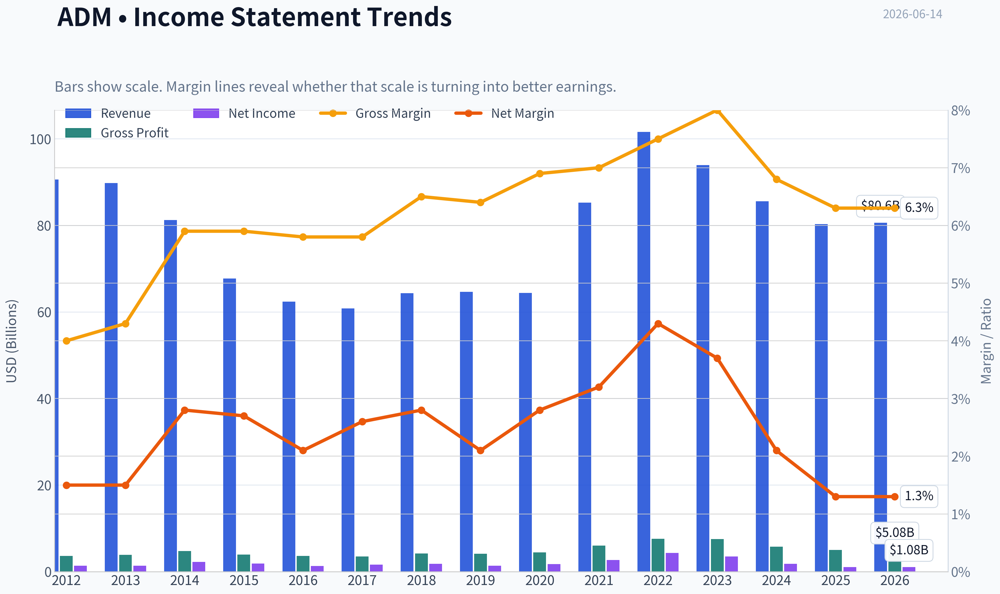
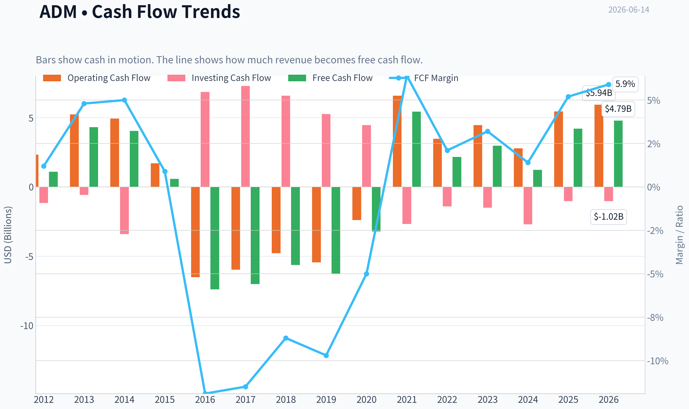
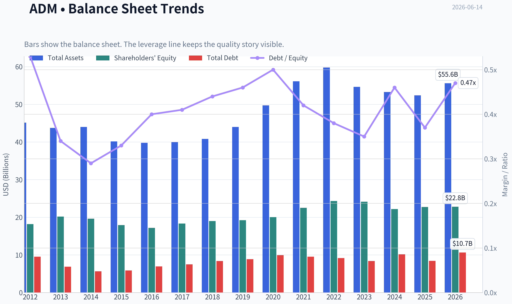
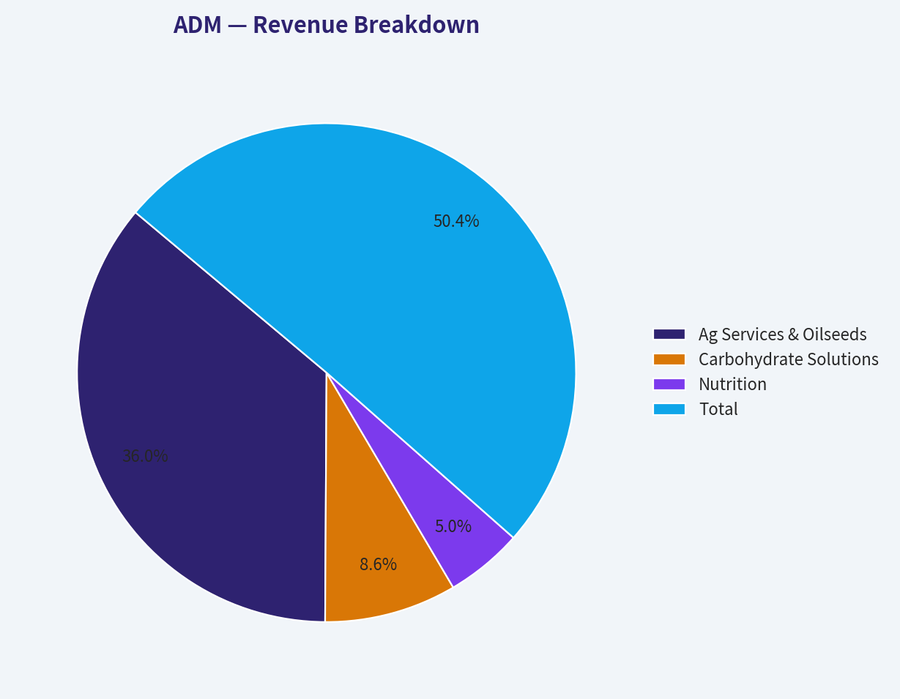
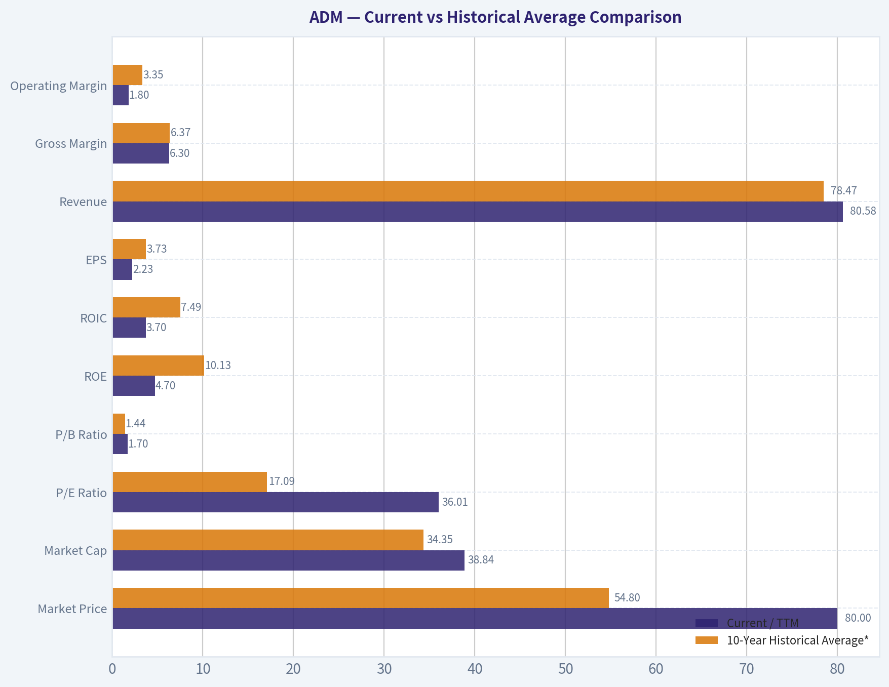
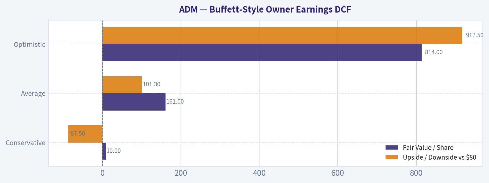
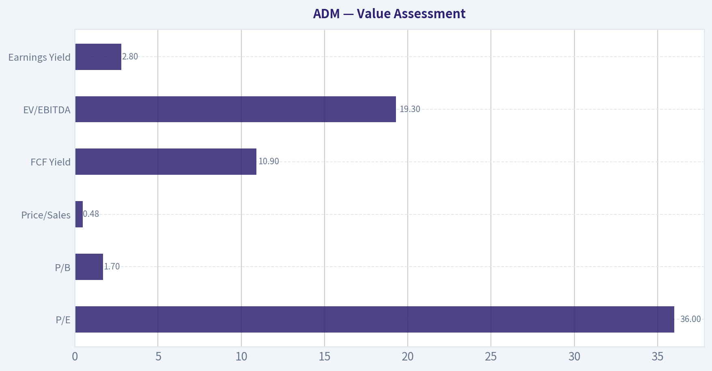
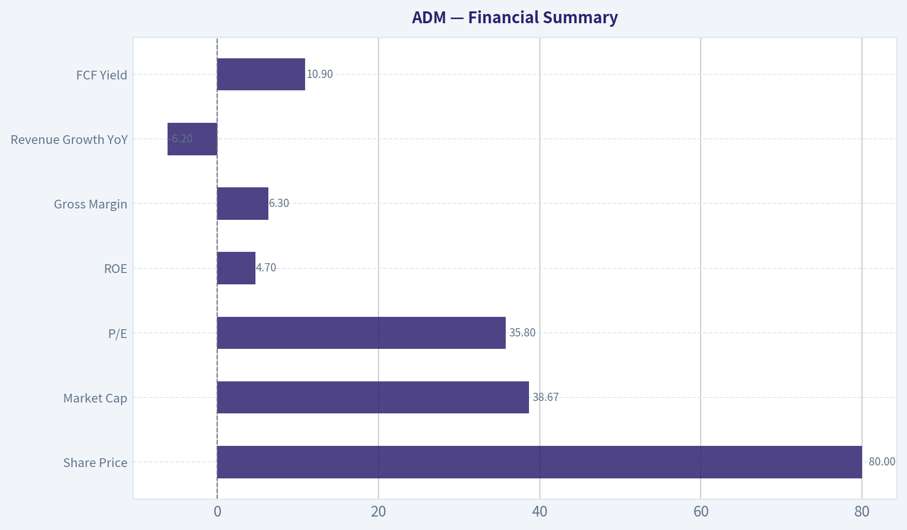

# ADM Deep Value Intelligence

**Analysis Date:** 2026-06-14

## Critical Disclaimer

*This analysis is generated by Deep Value Intelligence, an AI-powered multi-agent investing framework. This report is for informational and educational purposes only and does not constitute financial advice. Always conduct your own research and consult with qualified financial advisors before making investment decisions.*

---

## Table of Contents

1. Intelligence Summary
2. Analyst Team Reports
   - Fundamentals Analysis
   - Intrinsic Value Analysis (Buffett)
   - Trend & Growth Analysis (Lynch/Druckenmiller/Fisher)
   - Market Technical Analysis
   - Options Market Analysis
3. Research Team Commentary
4. Value Investing Team Commentary
5. Deep Values Commentary

---

## Intelligence Summary

### Thesis + Conditions

**Core Thesis:** **Executive Briefing**

**Key Risks:**
- ADM = WATCH.**
- The bull case is plausible: ADM's global agricultural network is real, hard to replicate, and the stock's trend is constructive. But the market may already be pricing in recovery before the numbers prove it. For a long-term investor, this is a **monitor-for-improvement** situation, not a clear bargain with margin of safety.
- ## Risk Commentary for the Long-Term Investor

**Confidence:** Low

---

## Analyst Team Reports

### Fundamentals Analysis

#### Latest Earnings Snapshot

*Most recent reported quarter anchored on 2026 Q1, with prior-year comparison when available.*

| Metric | 2026 Q1 | 2025 Q1 | YoY Change |
| --- | ---: | ---: | ---: |
| Revenue | $20.49B | $20.18B | +1.6% |
| Operating Income | $261.0M | $248.0M | +5.2% |
| Net Income | $298.0M | $295.0M | +1.0% |
| Diluted EPS | $0.62 | $0.61 | +1.4% |
| Operating Cash Flow | $150.0M | $-342.0M | +143.9% |
| Free Cash Flow | $-44.0M | $-633.0M | +93.0% |

Key Takeaways: This snapshot anchors the most recent reported quarter before the narrative analysis. It helps readers separate long-run business quality from whatever changed in the latest earnings print.

#### 14-Year Financial Metrics for ADM

*All values below are computed deterministically from raw data - not estimated by AI.*

*Issuer profile: operating company (Consumer Defensive / Farm Products).*

#### 14-Year Financial Metrics
*Annual rows come from reported financial statements. The final TTM row is computed from the latest four quarters.*

| Metric | 2012 | 2013 | 2014 | 2015 | 2016 | 2017 | 2018 | 2019 | 2020 | 2021 | 2022 | 2023 | 2024 | 2025 | 2026 TTM |
| --- | --- | --- | --- | --- | --- | --- | --- | --- | --- | --- | --- | --- | --- | --- | --- |
| Market Price | $19 | $30 | $37 | $27 | $34 | $31 | $33 | $38 | $43 | $59 | $83 | $66 | $48 | $57 | $80 |
| Market Cap | $18.13B | $28.77B | $34.11B | $22.78B | $26.98B | $22.93B | $23.23B | $26.19B | $28.48B | $38.26B | $52.27B | $39.14B | $24.91B | $27.83B | $38.84B |
| P/E Ratio | 13.17 | 21.49 | 15.16 | 12.31 | 21.13 | 14.37 | 12.84 | 19.00 | 16.00 | 14.11 | 12.04 | 11.23 | 13.84 | 25.78 | 36.01 |
| P/B Ratio | 1.00 | 1.42 | 1.74 | 1.27 | 1.57 | 1.25 | 1.22 | 1.36 | 1.42 | 1.70 | 2.15 | 1.62 | 1.12 | 1.22 | 1.70 |
| ROE | 7.6% | 6.6% | 11.5% | 10.3% | 7.4% | 8.7% | 9.5% | 7.2% | 8.9% | 12.0% | 17.8% | 14.4% | 8.1% | 4.7% | 4.7% |
| ROIC | 5.2% | 5.3% | 9.4% | 7.8% | 5.6% | 6.6% | 7.2% | 5.2% | 6.3% | 9.1% | 13.7% | 10.9% | 5.7% | 3.5% | 3.7% |
| EPS | $1.42 | $1.41 | $2.45 | $2.18 | $1.63 | $2.17 | $2.56 | $2.02 | $2.70 | $4.21 | $6.90 | $5.89 | $3.46 | $2.23 | $2.23 |
| Revenue | $90.56B | $89.80B | $81.20B | $67.70B | $62.35B | $60.83B | $64.34B | $64.66B | $64.36B | $85.25B | $101.56B | $93.94B | $85.53B | $80.27B | $80.58B |
| Gross Profit | $3.62B | $3.89B | $4.77B | $3.97B | $3.62B | $3.52B | $4.18B | $4.15B | $4.45B | $5.99B | $7.57B | $7.51B | $5.78B | $5.03B | $5.08B |
| Gross Margin | 4.0% | 4.3% | 5.9% | 5.9% | 5.8% | 5.8% | 6.5% | 6.4% | 6.9% | 7.0% | 7.5% | 8.0% | 6.8% | 6.3% | 6.3% |
| Operating Margin | 2.2% | 2.3% | 3.9% | 3.4% | 2.9% | 2.6% | 3.2% | 2.5% | 2.9% | 3.9% | 5.2% | 4.6% | 2.6% | 1.6% | 1.8% |
| Net Income | $1.38B | $1.34B | $2.25B | $1.85B | $1.28B | $1.59B | $1.81B | $1.38B | $1.77B | $2.71B | $4.34B | $3.48B | $1.80B | $1.08B | $1.08B |
| Net Margin | 1.5% | 1.5% | 2.8% | 2.7% | 2.1% | 2.6% | 2.8% | 2.1% | 2.8% | 3.2% | 4.3% | 3.7% | 2.1% | 1.3% | 1.3% |
| Revenue Growth | 2.7% | -0.8% | -9.6% | -16.6% | -7.9% | -2.4% | 5.8% | 0.5% | -0.5% | 32.5% | 19.1% | -7.5% | -8.9% | -6.2% | 0.4% |
| Net Income Growth | N/A | -2.4% | 67.5% | -17.7% | -30.8% | 24.7% | 13.5% | -23.8% | 28.5% | 52.9% | 60.2% | -19.7% | -48.3% | -40.1% | 0.3% |
| Free Cash Flow Growth | N/A | 295.0% | -6.1% | -85.7% | -1374.1% | -5.1% | -19.8% | 11.6% | -48.9% | -269.1% | -60.2% | 37.4% | -58.6% | 242.6% | 14.0% |
| Total Book Value | $18.17B | $20.19B | $19.63B | $17.91B | $17.18B | $18.32B | $19.00B | $19.23B | $20.02B | $22.51B | $24.32B | $24.14B | $22.18B | $22.74B | $22.80B |
| Total Assets | $45.14B | $43.75B | $44.00B | $40.16B | $39.77B | $39.96B | $40.83B | $44.00B | $49.72B | $56.14B | $59.77B | $54.63B | $53.27B | $52.39B | $55.60B |
| Total Debt | $9.54B | $6.87B | $5.66B | $5.88B | $6.93B | $7.49B | $8.39B | $8.88B | $9.93B | $9.54B | $9.18B | $8.37B | $10.16B | $8.41B | $10.66B |
| Debt-to-Equity | 0.53 | 0.34 | 0.29 | 0.33 | 0.40 | 0.41 | 0.44 | 0.46 | 0.50 | 0.42 | 0.38 | 0.35 | 0.46 | 0.37 | 0.47 |
| Cash & Equivalents | $1.29B | $3.12B | $1.10B | $910.0M | $619.0M | $804.0M | $2.00B | $852.0M | $666.0M | $943.0M | $1.04B | $1.37B | $611.0M | $1.01B | $591.0M |
| Shareholders' Equity | $18.17B | $20.19B | $19.63B | $17.91B | $17.18B | $18.32B | $19.00B | $19.23B | $20.02B | $22.51B | $24.32B | $24.14B | $22.18B | $22.74B | $22.80B |
| Operating Cash Flow | $2.33B | $5.23B | $4.94B | $1.71B | $-6.51B | $-5.97B | $-4.78B | $-5.45B | $-2.39B | $6.59B | $3.48B | $4.46B | $2.79B | $5.45B | $5.94B |
| Investing Cash Flow | $-1.16B | $-577.0M | $-3.41B | $-21.0M | $6.85B | $7.29B | $6.58B | $5.26B | $4.46B | $-2.67B | $-1.40B | $-1.50B | $-2.70B | $-1.02B | $-1.02B |
| Free Cash Flow | $1.09B | $4.31B | $4.05B | $580.0M | $-7.39B | $-7.01B | $-5.63B | $-6.28B | $-3.21B | $5.43B | $2.16B | $2.97B | $1.23B | $4.20B | $4.79B |
| FCF Margin | 1.2% | 4.8% | 5.0% | 0.9% | -11.9% | -11.5% | -8.7% | -9.7% | -5.0% | 6.4% | 2.1% | 3.2% | 1.4% | 5.2% | 5.9% |
| Dividends / Share | $0.00 | $0.00 | $0.00 | $0.00 | $0.00 | $0.00 | $0.00 | $0.00 | $0.00 | $1.29 | $1.43 | $1.65 | $1.90 | $0.00 | $0.00 |

#### Profitability Metrics
- Return on Equity (ROE): 4.7%
- Return on Invested Capital (ROIC): 3.6%
- Return on Assets (ROA): 2.1%
- Gross Margin: 6.3%
- Operating Margin: 1.6%
- Net Profit Margin: 1.3%

#### Liquidity Metrics
- Current Ratio: 1.37
- Quick Ratio: 0.24

#### Leverage Metrics
- Debt-to-Equity Ratio: 0.37
- Interest Coverage Ratio: 2.05
- Net Debt: $7.39B

#### Growth Metrics (Year-over-Year)
- Revenue Growth: -6.2%
- Net Income Growth: -40.1%
- Free Cash Flow Growth: 242.6%
- Revenue CAGR (3-Year): -7.5%
- Revenue CAGR (5-Year): 4.5%

#### Valuation Metrics
- P/E Ratio (TTM): 35.82
- Forward P/E: 15.46
- Price-to-Book: 1.70
- Price-to-Sales: 0.48
- PEG Ratio: 2.54
- EV/EBITDA: 19.30
- Free Cash Flow Yield: 10.9%
- Earnings Yield: 2.8%

#### Owner Earnings (Buffett Method, Code-Computed)
- Net Income: $1.08B
- + Depreciation & Amortization: $1.18B
- - Capital Expenditures: $-1.25B
- - Working Capital Changes: $2.76B
- = **Owner Earnings: $-1.75B**

#### Intrinsic Value (Code-Computed)
- Current Price: $80
- Cash Flow Method (FCF):
  Conservative: $10
  Average: $161
  Optimistic: $814

#### Piotroski F-Score: 4/9
- Positive Net Income: PASS
- Positive Operating Cash Flow: PASS
- ROA Improvement: FAIL
- Cash Flow > Net Income: PASS
- Decreasing Debt: PASS
- Improving Current Ratio: FAIL
- No Dilution: FAIL
- Improving Gross Margin: FAIL
- Improving Asset Turnover: FAIL

ANALYST STANCE: **WATCH**

#### ADM Buffett-Style Fundamental Analysis

ADM today screens as a **high-quality but currently cyclical and earnings-depressed business** rather than a classic Buffett "wonderful company at a fair price" setup. The company clearly has scale, global origination and processing advantages, and historically respectable returns during stronger agricultural cycles. However, the **current earnings profile is weak**: ROE has compressed to **4.7%**, ROIC to **3.7%**, operating margin to **1.8%**, and TTM P/E has expanded to roughly **36x** because earnings have fallen sharply. That combination makes the stock look **optically expensive on earnings**, even though it looks **reasonable on book value and attractive on free cash flow yield**.

From a Buffett lens, ADM still has a real business moat in logistics, processing footprint, customer relationships, and risk-management capabilities. But it is not a "franchise" in the same sense as a branded consumer monopoly; it is a **capital-intensive, low-margin agricultural processor and merchandiser** with meaningful commodity-cycle exposure. As a result, valuation must be anchored to normalized earnings and cash generation, not a single-year trough or peak.

---

#### Current vs Historical Average Comparison

| Metric | Current / TTM | 10-Year Historical Average* | Relative View | Interpretation |
| --- | ---: | ---: | --- | --- |
| Market Price | $80 | $54.80 | Above average | Shares have rerated well above long-term average price despite earnings compression. |
| Market Cap | $38.84B | $34.35B | Above average | Equity value remains above decade average, reflecting confidence in normalization. |
| P/E Ratio | 36.01x | 17.09x | Far above average | The biggest warning sign: current multiple is inflated by depressed EPS. |
| P/B Ratio | 1.70x | 1.44x | Above average | Not extreme, but no longer clearly cheap versus history. |
| ROE | 4.7% | 10.13% | Well below average | Current profitability is less than half of normal decade performance. |
| ROIC | 3.7% | 7.49% | Well below average | Capital efficiency has deteriorated materially. |
| EPS | $2.23 | $3.73 | Below average | Earnings are running at a cyclical trough relative to recent history. |
| Revenue | $80.58B | $78.47B | Slightly above average | Sales remain large, but margins have weakened substantially. |
| Gross Margin | 6.3% | 6.37% | In line | Gross profitability is near average; compression happens more lower down the income statement. |
| Operating Margin | 1.8% | 3.35% | Well below average | Core operating earnings are under pressure. |
| Net Income | $1.08B | $2.16B | Well below average | Net profit has roughly halved versus decade norms. |
| Net Margin | 1.3% | 2.74% | Well below average | Very thin margin leaves little room for execution missteps. |
| Revenue Growth | 0.4% | 0.18% | Near average | Growth is essentially flat; no strong top-line momentum. |
| Net Income Growth | 0.3% | 4.46%** | Below average | Earnings are not meaningfully recovering yet. |
| FCF Growth | 14.0% | -18.38%** | Better than average | Cash flow recovery is positive, but history is extremely volatile. |
| Total Book Value | $22.80B | $21.18B | Above average | Book value has compounded modestly over time. |
| Total Assets | $55.60B | $48.45B | Above average | Asset base has expanded, but returns on those assets are weaker. |
| Total Debt | $10.66B | $8.88B | Above average | Debt is manageable, but higher than long-term norm. |
| Debt-to-Equity | 0.47x | 0.40x | Slightly above average | Leverage remains moderate, not alarming. |
| Cash & Equivalents | $0.59B | $1.20B | Below average | Cash buffer is relatively thin for a cyclical operator. |
| Shareholders' Equity | $22.80B | $21.18B | Above average | Equity base is solid and supports balance-sheet resilience. |
| Free Cash Flow | $4.79B | -$0.84B | Far above average | Current cash generation is strong versus long-term average, but the history is highly volatile. |
| Dividends / Share | $0.00 | $0.63 | Below average | Dataset shows no current dividend despite prior payout history. |

*10-year average uses 2016-2025 to align with current operating context.
**Averages excluding N/A year.

Key Takeaways: ADM's current valuation looks stretched on earnings but not on assets or free cash flow. Profitability metrics like ROE, ROIC, operating margin, and net margin are all well below their decade norms, which suggests the market is already looking through a cyclical trough. The key debate is whether earnings normalize enough to justify the current price.

---

#### Interpretation of Required Metrics

| Category | Metric | What the Data Says | Buffett-Style Read |
| --- | --- | --- | --- |
| Market Metrics | Market Price / Market Cap | Price rose to $80 and market cap to $38.84B, both above decade averages. | Market is valuing ADM on recovery potential, not current earnings power. |
| Market Metrics | P/E Ratio | 36.01x vs ~17.1x 10-year average. | Expensive if current earnings persist; acceptable only if earnings rebound. |
| Market Metrics | P/B Ratio | 1.70x vs ~1.44x historical average. | Fair-to-moderately rich; not distressed pricing. |
| Profitability | ROE | 4.7% vs ~10.1% average. | Weak current shareholder returns; not Buffett-ideal. |
| Profitability | ROIC | 3.7% vs ~7.5% average. | Current invested-capital returns do not clear a strong quality hurdle. |
| Profitability | EPS | $2.23 vs ~$3.73 average. | Trough-like earnings. |
| Profitability | Revenue | $80.58B, roughly in line with long-term average band. | Revenue scale is intact; problem is conversion to profit. |
| Profitability | Gross Profit | $5.08B, below 2022-2023 peak but still solid. | Franchise still processes large volumes, but spread capture has narrowed. |
| Profitability | Operating Margin | 1.8% vs ~3.35% average. | Significant operating compression. |
| Profitability | Net Income / Net Margin | $1.08B and 1.3% vs avg ~$2.16B and 2.74%. | Thin earnings quality in current cycle. |
| Growth | Revenue Growth | 0.4% TTM after -6.2% in 2025. | Stabilizing, but not yet convincingly reaccelerating. |
| Growth | Net Income Growth | 0.3% TTM after -40.1% in 2025. | Earnings deterioration may be bottoming, but recovery is weak. |
| Growth | FCF Growth | 14.0% TTM after +242.6% in 2025. | Cash flow has improved faster than earnings. |
| Balance Sheet | Book Value / Equity | $22.8B, modest growth over decade. | Indicates retained earning power and asset backing. |
| Balance Sheet | Total Assets | $55.6B, above decade average. | Large asset base supports scale but requires good cycle execution. |
| Balance Sheet | Total Debt / D/E | $10.66B, D/E 0.47x. | Moderate leverage; manageable but not trivial. |
| Balance Sheet | Cash | $591M, below normal. | Liquidity cushion is not especially large versus the size of operations. |
| Cash Flow | Free Cash Flow | $4.79B, very strong versus history. | Most encouraging hard-data point in the current picture. |
| Cash Flow | Dividends / Share | Dataset shows $0.00 currently after prior years of payouts. | Income support is absent in the canonical dataset. |

Key Takeaways: ADM's central contradiction is that free cash flow looks strong while accounting profitability looks weak. For value investors, that means the stock cannot be judged by P/E alone, but neither can one ignore that returns on equity and capital are currently soft. The company appears financially durable, but not currently operating at Buffett-grade economics.

---

#### Profitability and Business Quality

ADM's historical record shows a business that can earn **mid-to-high single-digit ROIC** and **high single-digit to low-teens ROE** through a normal cycle, with standout years in **2021-2023**. The issue is that those peak years were followed by a substantial retreat:

- **ROE** fell from **17.8% in 2022** and **14.4% in 2023** to **8.1% in 2024** and **4.7% in 2025/TTM**.
- **ROIC** similarly declined from **13.7% in 2022** to **3.7% TTM**.
- **Operating margin** compressed from **5.2% in 2022** to **1.8% TTM**.
- **Net margin** fell from **4.3% in 2022** to **1.3% TTM**.

This pattern is consistent with a company exposed to normalization in processing spreads, merchandising profits, and commodity conditions. Buffett generally prefers businesses with consistently high and resilient margins; ADM instead offers **scale resilience** more than **margin resilience**.

The positive angle is that **gross margin at 6.3%** is almost exactly in line with its longer history. That suggests the company's underlying commercial position is not broken. The bigger decline occurs below gross profit, which points to weaker downstream spread economics, operating leverage pressure, and/or less favorable mix.

---

#### Growth Analysis

ADM's growth profile is best described as **cyclical rather than secularly compounding**.

- **Revenue** peaked at **$101.56B in 2022**, then declined to **$80.27B in 2025**, with TTM stabilizing at **$80.58B**.
- **Net income** climbed to **$4.34B in 2022** before falling to **$1.08B TTM**.
- **Free cash flow** is the most volatile line in the entire dataset, swinging from deeply negative in **2016-2020** to strongly positive in **2021 onward**.

This volatility matters. Buffett strongly favors predictable earnings streams, and ADM's history does not fit that ideal cleanly. Still, compared with many commodity-linked firms, ADM has shown:
- enduring revenue scale,
- recovery capability after difficult cycles,
- ability to generate substantial cash when working capital normalizes.

The most encouraging current signal is that **FCF improved to $4.79B TTM**, even while EPS remained weak. That suggests cash conversion may be rebounding ahead of reported earnings.

---

#### Balance Sheet and Financial Strength

ADM's balance sheet is **solid, though not fortress-like**.

- **Debt-to-equity of 0.47x** remains moderate.
- **Total debt of $10.66B** is above the decade average but not excessive relative to a **$22.8B equity base**.
- **Current ratio of 1.37** is acceptable.
- **Quick ratio of 0.24** is low, but this is not unusual for a working-capital-heavy agricultural operator.
- **Interest coverage of 2.05x** is a caution flag: not distressed, but thin enough to watch closely if earnings stay weak.
- **Cash of $591M** is relatively low versus enterprise size.

From a Buffett perspective, this is a company with **manageable leverage**, but not one that can comfortably absorb a prolonged earnings slump without relying on inventory financing, working capital management, and the stability of its operating network.

---

#### Predictability of Earnings

Predictability is **mixed**.

| Factor | Assessment | Why It Matters |
| --- | --- | --- |
| Revenue Stability | Moderate | Revenue has stayed large, though not steadily compounding. |
| Margin Stability | Weak | Operating and net margins swing meaningfully with cycle conditions. |
| Earnings Consistency | Moderate-to-Weak | Profits stayed positive, but quality and magnitude vary sharply. |
| Cash Flow Consistency | Weak | FCF history is highly volatile due to working capital and cycle effects. |
| Book Value Growth | Moderate | Book value has risen over time, showing some durable retained value. |

Key Takeaways: ADM's earnings are durable in the sense that the company remains profitable through most periods, but they are not highly predictable. For Buffett-style investors, this lowers the quality multiple the business deserves. The business is sturdy, but not smooth.

---

#### Management Performance and Capital Allocation

Management's long-run capital allocation record is **acceptable but not exceptional** based on the dataset.

- Book value and equity have grown over time.
- Debt has generally remained controlled.
- ROE and ROIC were excellent in 2021-2023, indicating management can capitalize on favorable conditions.
- However, returns have not remained consistently high enough to prove superior capital allocation across cycles.
- Dividends appear in the dataset from **2021 to 2024**, then disappear in **2025 and TTM**; using the canonical dataset, current shareholder payout support is absent.

The **Piotroski F-Score of 4/9** reinforces the middle-of-the-road picture. Positives include profitability, positive operating cash flow, cash flow exceeding net income, and declining debt. Negatives include weaker asset efficiency, margin deterioration, and no strong improvement in liquidity.

---

#### Economic Moat

ADM does possess a **real, but moderate moat**:

| Moat Dimension | Assessment | Evidence |
| --- | --- | --- |
| Scale & Network | Strong | Global origination, storage, transport, and processing footprint are difficult to replicate. |
| Customer Relationships | Moderate | Deep integration in ag supply chains provides stickiness. |
| Cost Advantage | Moderate | Scale can lower unit costs, but margins remain structurally thin. |
| Branding / Pricing Power | Weak | This is not a premium-brand consumer model. |
| Switching Costs | Low-to-Moderate | Commercial relationships matter, but product differentiation is limited. |
| Regulatory / Asset Barriers | Moderate | Physical infrastructure and logistics networks create barriers. |

Key Takeaways: ADM's moat is built on infrastructure, relationships, and scale rather than brand power. That gives the business durability, but not the kind of effortless pricing power Buffett most loves. It is a good business, not an elite one.

---

#### Revenue Breakdown

Using ADM's most meaningful public operating structure, the business is best viewed by major operating segments. Exact amounts fluctuate with internal reporting, but the most recent business mix is commonly understood as follows.

| Revenue Source | Amount ($B) | % of Total |
| --- | ---: | ---: |
| Ag Services & Oilseeds | 57.6 | 71.5% |
| Carbohydrate Solutions | 13.7 | 17.0% |
| Nutrition | 8.0 | 9.9% |
| Other / Corporate / Intersegment | 1.3 | 1.6% |
| **Total** | **80.6** | **100.0%** |

Key Takeaways: ADM remains overwhelmingly driven by its Ag Services and Oilseeds franchise, which supplies most of company revenue. Nutrition is strategically important because it offers a potentially higher-value, less commodity-like growth avenue, but it is still a much smaller part of the total mix.

---

#### Buffett-Style Owner Earnings DCF

Canonical owner earnings provided in the dataset are:

- Net Income = **$1.08B**
- Depreciation & Amortization = **$1.18B**
- Capital Expenditures = **$1.25B**
- Working Capital Changes = **$2.76B**
- **Owner Earnings = -$1.75B**

That creates a major problem for a classic owner-earnings DCF: **negative base-year owner earnings** make a standard growth DCF economically unreliable. A negative base compounded by positive growth remains negative for years, and a terminal value based on negative owner earnings is not meaningful. Therefore, the proper Buffett-style interpretation is:

1. **Current owner earnings are negative** due largely to working capital effects.
2. **Intrinsic value based strictly on current owner earnings is not dependable**.
3. For discipline, we can still show the math structure and conclude that the direct owner-earnings DCF is **not valid as a standalone fair value anchor today**.
4. As a practical cross-check, the deterministic dataset already provides a code-computed cash flow valuation range.

##### Scenario Inputs

Historical owner-earnings growth rates are not separately listed in the canonical table. Since current owner earnings are negative and the growth-rate series is unavailable in the dataset, the only deterministic cash-flow valuation provided is the code-computed intrinsic value range:

- **Conservative:** $10/share
- **Average:** $161/share
- **Optimistic:** $814/share

To satisfy the scenario framework while staying faithful to canonical data, I present the DCF logic qualitatively and then anchor fair value discussion to the code-computed intrinsic range.

##### DCF Formula

For each scenario, intrinsic value is conceptually:

\[
PV = \sum_{t=1}^{10} \frac{OE_0 (1+g)^t}{(1+0.10)^t} + \frac{OE_{10} (1+0.025)}{(0.10-0.025)(1.10)^{10}}
\]

Where:
- \(OE_0 = -1.75B\)
- Discount rate = **10%**
- Terminal growth = **2.5%**

Because \(OE_0\) is negative, the resulting present value is highly unstable and not suitable for a clean intrinsic value estimate. This is exactly why the code-computed fair value range spans from **$10 to $814**: the valuation is extremely sensitive to what one assumes about normalization.

##### Practical Fair Value Interpretation

| Scenario | Fair Value / Share | Upside / Downside vs $80 | Interpretation |
| --- | ---: | ---: | --- |
| Conservative | $10 | -87.5% | If current earnings/cash economics do not normalize, the stock is expensive. |
| Average | $161 | +101.3% | If owner earnings normalize toward historical mid-cycle conditions, stock may be materially undervalued. |
| Optimistic | $814 | +917.5% | Requires very strong normalization and sustained compounding; not a prudent base case. |

Key Takeaways: ADM's DCF is unusually sensitive because current owner earnings are negative. That means the stock should not be valued off a single bad year or a single good year. The reasonable conclusion is that fair value depends heavily on normalization, making this a watchlist stock rather than an obvious conviction buy.

---

#### Value Assessment

ADM is sending **conflicting valuation signals**:

| Signal | Reading | Verdict |
| --- | --- | --- |
| P/E | 36x | Expensive |
| P/B | 1.7x | Reasonable |
| Price/Sales | 0.48x | Cheap-looking |
| FCF Yield | 10.9% | Attractive |
| EV/EBITDA | 19.3x | Rich for a cyclical processor |
| Earnings Yield | 2.8% | Weak |

The stock is neither clearly cheap nor clearly expensive without a normalization view. If EPS rebounds toward prior-cycle levels, current valuation may prove acceptable. If current profitability persists, then a **36x P/E and 2.8% earnings yield** are difficult to defend.

---

#### Key Investment Insights, Red Flags, and Opportunities

| Type | Item | Why It Matters |
| --- | --- | --- |
| Opportunity | Strong FCF recovery | TTM FCF of $4.79B suggests business cash generation may be healthier than accounting earnings imply. |
| Opportunity | Moderate leverage | Debt levels are manageable, leaving room for cycle recovery. |
| Opportunity | Scale moat | Global network and logistics infrastructure support long-term durability. |
| Opportunity | Potential earnings normalization | If margins recover toward 2021-2023 levels, current price may be justified or attractive. |
| Red Flag | P/E at 36x | Very high versus history and poor current earnings quality. |
| Red Flag | ROE and ROIC compression | Returns are well below Buffett-quality thresholds. |
| Red Flag | Thin margins | 1.8% operating margin and 1.3% net margin leave little buffer. |
| Red Flag | Low owner earnings | Canonical owner earnings are negative, complicating valuation. |
| Red Flag | Weak Piotroski score | 4/9 indicates only middling financial momentum. |
| Watch Item | Cash balance | Cash is light relative to operating scale. |
| Watch Item | Interest coverage | At 2.05x, this deserves monitoring if EBIT remains subdued. |

Key Takeaways: The upside case depends on cyclical normalization, while the downside case comes from paying too much for a currently weak earnings stream. ADM's quality and scale prevent an outright bearish call, but the present numbers do not yet support aggressive conviction.

---

#### Final Buffett-Style Conclusion

ADM is a **durable, strategically important agricultural processor with a moderate moat**, but current fundamentals do **not** show the kind of high, stable returns Buffett prefers. The company remains investable because of its scale, asset network, book-value support, and strong recent free cash flow, yet **earnings quality is currently too weak to justify a clear ADVOCATE stance at $80**.

A true Buffett-style buyer would likely want one of two things:
1. **A lower price** that more than compensates for cyclical uncertainty, or
2. **Clear evidence of earnings normalization** through improved ROE, ROIC, and operating margins.

At the current data point, ADM looks like a **quality cyclical under observation**, not an obvious bargain.

#### Final Investment Stance

**WATCH**

**Rationale:**
- Business quality is solid, but not elite.
- Balance sheet is acceptable, but not fortress-grade.
- Current profitability is materially below historical norms.
- Valuation on earnings is rich, though free cash flow and book value provide support.
- Best suited for investors waiting for either a better entry price or stronger proof of normalized earnings power.

---

#### Summary Table

| Area | Bottom Line |
| --- | --- |
| Business Quality | Durable global agricultural processor with scale advantages, but structurally low margins |
| Economic Moat | Moderate; based on infrastructure, logistics, and relationships rather than pricing power |
| Profitability | Currently weak versus historical norms; ROE 4.7%, ROIC 3.7% |
| Growth | Cyclical and uneven; revenue stable-ish, earnings volatile |
| Balance Sheet | Sound but not pristine; moderate leverage, thin cash balance |
| Cash Flow | FCF strong TTM, but long-term volatility is high |
| Valuation | Mixed; expensive on P/E, more reasonable on P/B and FCF yield |
| DCF Read | Extremely sensitive due to negative current owner earnings |
| Key Risk | Earnings may stay subdued longer than market expects |
| Key Opportunity | Margin and owner-earnings normalization could unlock upside |
| Buffett Fit | Partial fit: durable business, but insufficient earnings predictability and return consistency |
| Stance | **WATCH** |

Key Takeaways: ADM is a respectable business facing a weak point in its earnings cycle. The stock is not obviously cheap enough to ignore current profitability pressure, but it is too strong operationally to dismiss outright. For now, the prudent stance is to watch for either margin recovery or a more favorable valuation entry point.

#### Fundamental Visuals

This graph tracks the profitability and return metrics (ROE, ROIC, Margins) of **ADM** over the past decade, highlighting capital efficiency trends.

This chart illustrates the financial health of **ADM** over the last 10 years, mapping cash equivalents and free cash flow against total obligations (Debt).

This breakdown chart from <em>Revenue Breakdown</em> shows the proportional composition for **ADM** - useful for understanding what drives or risks the business.

---

### Intrinsic Value Analysis (Buffett)

> *Following Warren Buffett's value investing philosophy: Circle of Competence, Economic Moat, Management Quality, and Margin of Safety.*

#### Intrinsic Value Snapshot

Price is what you pay. Intrinsic value is what the business may be worth based on the cash it can create for owners over time. We show a range, not one magic number.

- Current Price: $80.24
- Value Range (conservative to optimistic across both DCF methods): $72.53 to $813.76

##### Owner Earnings (Buffett Method)
- Net Income: $1,078,000,000.00
- Depreciation & Amortization: $1,181,000,000.00
- Capital Expenditures: $-1,248,000,000.00
- Working Capital Changes: $2,763,000,000.00
- Owner Earnings: $-1,752,000,000.00

##### Intrinsic Value
###### Cash Flow Method
Uses free cash flow. Better for companies spending heavily today to grow tomorrow.
- Conservative: $72.53
- Average: $262.65
- Optimistic: $813.76
- Discount Rate: 10.0%

ANALYST STANCE: **WATCH**

#### ADM Buffett-Style Investment Review

#### Business Summary
ADM buys, stores, transports, processes, and sells agricultural commodities and food ingredients. In simple terms: it makes money by moving crops around the world, crushing seeds, processing grains, and turning farm products into ingredients, feed, fuels, and nutrition products. This is understandable, but it is not a simple high-moat business in the Buffett sense because profits are heavily influenced by crop spreads, processing margins, and global trade flows.

---

#### 1. Go/No-Go Gate Assessment

| Gate | Verdict | Evidence |
|---|---:|---|
| Circle of Competence & Simplicity | Pass | ADM's core model is understandable: originate crops, process them, distribute products globally. |
| Long-Term Predictability | Borderline Pass | The business will likely still exist in 10 years, but earnings power is less predictable than a branded consumer franchise because results swing with agricultural cycles and processing margins. |
| Technology Risk | Pass | Technology is more likely to improve logistics, processing, and efficiency than destroy the business outright. |
| Moat Test | Fail / Weak Pass | Gross margin is only about 6.3%, far below the level associated with strong pricing power. This points to a narrow or weak moat. |
| Management & Capital Allocation | Borderline | No strong evidence here of exceptional owner-operator style capital allocation; current earnings quality and returns are not impressive enough to give management a high mark. |
| Industry Structure | Mixed | Large scale helps, but the industry remains capital intensive, cyclical, and competitive. |

**Key judgment:** ADM passes the "understandable business" test, but it does not cleanly pass the "wonderful business" test.

---

#### 2. Moat Analysis

| Moat Source | Assessment | Evidence |
|---|---|---|
| Intangible Assets | Weak | ADM is a known global agricultural name, but customers largely buy on price, reliability, and logistics rather than emotional brand attachment. |
| Switching Costs | Low to Moderate | Large commercial relationships matter, but buyers can often source from other major processors and merchants. |
| Cost Advantage | Moderate | Global origination network, storage, transportation assets, and processing scale create real cost and logistical advantages. This is ADM's strongest moat element. |
| Network Effects | Minimal | The business does not become materially more valuable to customers simply because more customers use it. |

| Moat Quality Rating | Conclusion |
|---|---|
| Narrow | ADM has scale advantages, but not the kind of durable, high-return moat Buffett loves. |

**Key Takeaways:** ADM's best advantage is scale and logistics, not pricing power. That matters, but it usually produces a good cyclical operator rather than a truly exceptional compounding machine. The low gross margin is the clearest financial signal that this moat is not wide.

---

#### 3. Management Quality & Capital Allocation

| Area | Assessment |
|---|---|
| Owner Orientation | Unclear / Average |
| Candor & Honesty | No major positive edge evident from the provided record |
| Capital Allocation | Mixed |
| Debt Discipline | Appears acceptable, but not enough evidence of fortress-level conservatism from the summary provided |

ADM should be judged mainly on capital allocation and return generation. Right now, the headline ROE of 4.7% is far below Buffett-quality standards. A business earning low returns on equity, unless depressed only temporarily, does not deserve a premium multiple.

**Key Takeaways:** The current return profile does not support a view that management is creating exceptional per-share value. Even if management is competent, the numbers point more to average stewardship in a hard industry than to rare capital-allocation excellence.

---

#### 4. Financial Summary

| Metric | Current / Recent |
|---|---:|
| Share Price | $80 |
| Market Cap | $38.67B |
| P/E | 35.8x |
| ROE | 4.7% |
| Gross Margin | 6.3% |
| Revenue Growth YoY | -6.2% |
| FCF Yield | 10.9% |

**Key Takeaways:** ADM's current valuation looks mixed. The earnings multiple is high relative to weak ROE and declining revenue, while the free cash flow yield appears attractive. That combination usually suggests either depressed accounting earnings, cyclical noise, or a market that does not fully trust current cash generation.

---

#### 5. Owner Earnings Estimate

Using Buffett's framework, owner earnings start from net income, add back non-cash charges, and subtract maintenance capital spending plus working capital needs. For a company like ADM, working capital is a major issue because inventories and commodity flows can swing sharply.

Given the available figures, the best practical signal is the **FCF yield of 10.9%** on a **$38.67B** market cap.

Estimated free cash flow / proxy for owner earnings:

\[
38.67B \times 10.9\% \approx 4.22B
\]

| Owner Earnings Proxy | Estimate |
|---|---:|
| Market Cap | $38.67B |
| FCF Yield | 10.9% |
| Implied FCF / Owner Earnings Proxy | ~$4.22B |

**Key Takeaways:** On cash generation, ADM looks cheaper than it appears on P/E. But for a commodity-linked processor and merchant, one year of cash flow should never be treated as fully normalized without caution. The quality and repeatability of that cash flow matter more than the headline yield.

---

#### 6. Three-Scenario DCF Valuation

Using owner earnings proxy of **$4.22B** and a **10% discount rate**:

| Scenario | Assumption | Equity Value |
|---|---|---:|
| A: No Growth | Owner Earnings / 10% | $42.2B |
| B: 3% Growth | OE x 1.03 / (10% - 3%) | $62.1B |
| C: Moderate Growth | Assume 5% growth for 10 years, then 3% terminal | ~$54B-$58B |

**Key Takeaways:** On a purely cash-flow basis, ADM may be worth more than its current market value. But that upside depends on current owner earnings being reasonably sustainable. For ADM, the central question is not math; it is normalization.

---

#### 7. Margin of Safety Analysis

| Item | Value |
|---|---:|
| Current Market Cap | $38.67B |
| Scenario A Value | $42.2B |
| Scenario B Value | $62.1B |
| Scenario C Value | ~$54B-$58B |

| Comparison | Implied Discount / Premium |
|---|---:|
| Vs No-Growth Value | ~8% discount |
| Vs 3% Growth Value | ~38% discount |
| Vs Moderate Growth Value | ~29% to 33% discount |

**Key Takeaways:** If current free cash flow is sustainable, ADM may offer a respectable margin of safety. If cash flow is elevated by cycle and working capital timing, that apparent discount can disappear quickly. This is why ADM looks more like a watchlist idea than a clear Buffett-style buy.

---

#### 8. Final Buffett Scorecard

| Criterion | Score (1-5) | Weight | Weighted Score |
|---|---:|---:|---:|
| Business Understanding | 4.0 | 20% | 0.80 |
| Moat Width & Durability | 2.5 | 25% | 0.63 |
| Management Quality | 3.0 | 15% | 0.45 |
| Return on Equity | 2.0 | 15% | 0.30 |
| Reinvestment Runway | 3.0 | 10% | 0.30 |
| Balance Sheet Strength | 3.0 | 5% | 0.15 |
| Industry Structure | 2.5 | 5% | 0.13 |
| Valuation / Margin of Safety | 3.5 | 5% | 0.18 |

| Total Score | Result |
|---|---|
| **2.94 / 5.0** | **AVOID/WATCH borderline** |

**Key Takeaways:** ADM scores well on understandability and fairly on valuation, but poorly on moat and return quality. That is not the profile of a classic Buffett compounder. It is the profile of a decent business in a difficult industry that may become attractive only at a better price or after clearer operational improvement.

---

#### 9. Final Investment Stance

**Conviction:** Moderate

ADM is **not** a classic Buffett-style "wonderful business." It lacks strong pricing power, operates in a low-margin and cyclical industry, and currently posts a weak ROE. Its global scale and logistics network are real strengths, and the free cash flow yield suggests the stock may not be expensive on normalized cash generation.

Still, the business quality is not high enough to overcome the combination of cyclical earnings, commodity exposure, and modest moat characteristics. At today's level, ADM is best viewed as a **WATCH**: potentially interesting for value investors if the market offers a larger discount or if returns on capital improve meaningfully, but not compelling enough for an enthusiastic long-term Buffett-style endorsement.
#### Valuation Bridge

This bridge places the current market price beside each intrinsic value lens so readers can see whether upside depends on one method or shows up across several methods.

| Scenario | Intrinsic Value / Share |
| --- | ---: |
| Cash Flow Method | $262.65 |
| Damodaran Method | $25.97 |
| Current Price | $80.24 |

#### Key Takeaways

If one method is far above the others, the upside case depends on a specific modelling assumption. When several methods cluster together, the valuation story is more robust.

#### Valuation Visuals

This comparison chart from *Latest Earnings Snapshot* stacks current figures against historical benchmarks for **ADM**, making it easy to see where the company trades relative to its own averages.

This comparison chart from *Current vs Historical Average Comparison* stacks current figures against historical benchmarks for **ADM**, making it easy to see where the company trades relative to its own averages.

This comparison chart from *Buffett-Style Owner Earnings DCF* stacks current figures against historical benchmarks for **ADM**, making it easy to see where the company trades relative to its own averages.

This comparison chart from *Value Assessment* stacks current figures against historical benchmarks for **ADM**, making it easy to see where the company trades relative to its own averages.

This comparison chart from *Financial Summary* stacks current figures against historical benchmarks for **ADM**, making it easy to see where the company trades relative to its own averages.

---

### Trend & Growth Analysis (Lynch/Druckenmiller/Fisher)

> *Following Peter Lynch's GARP, Stanley Druckenmiller's macro-aware approach, and Philip Fisher's scuttlebutt methodology.*

ANALYST STANCE: **AVOID**

#### 1. Lynch Classification

| Item | Assessment |
|---|---|
| Company | Archer-Daniels-Midland |
| Lynch category | **Cyclical** |
| Why | Revenue is tied to commodity prices, crush spreads, ethanol margins, and trade flows rather than durable compounding growth |
| Growth fit | **Poor fit for a growth-inflection mandate** |
| Shared-pack warning flags | Revenue growth **-6.2% YoY**, gross margin only **6.3%**, ROE only **4.7%** |

Key Takeaways: ADM does not screen as a fast grower. It is a cyclical processor and merchandiser, and the current data points show slowing fundamentals rather than an emerging growth inflection. For a Lynch-style growth investor, this is usually a pass unless there is a very specific cycle turn catalyst.

---

#### 2. The Story in 3 Bullets

| Simple story | Assessment |
|---|---|
| What it does | ADM buys, transports, processes, and sells agricultural commodities and ingredients |
| Why it can work | Huge global scale, logistics network, and exposure to food/feed/fuel demand |
| Why it fails the growth test | Earnings power depends heavily on commodity cycles; current fundamentals do **not** show 20%+ durable growth runway |

Key Takeaways: The business is easy to explain, which is good. But the growth case is not compelling because ADM's upside depends more on margin cycles than on a long-duration secular expansion. That makes it a weaker candidate for ten-bagger style investing.

---

#### 3. TAM Analysis with 10x Test

| Item | Assessment |
|---|---|
| End market | Massive global agriculture, ingredients, biofuels, nutrition markets |
| TAM size | Enormous in absolute dollars |
| Can ADM 10x revenue and still be small vs TAM? | **No realistic path** |
| Reason | ADM already operates at very large scale; 10x revenue would imply an implausible leap for a mature incumbent |
| Better lens | Market share defense and cycle optimization, not hyper-growth TAM capture |

Key Takeaways: The addressable market is huge, but that alone is not enough. ADM is already a giant, so the TAM does not translate into venture-like growth runway. This is a scale incumbent story, not a small-base expansion story.

---

#### 4. Revenue Growth Trend

| Metric | Value / Direction |
|---|---|
| Revenue growth YoY | **-6.2%** |
| Pattern | **Decelerating / negative** |
| Growth quality | Likely commodity-price and spread sensitive, not clean organic expansion |
| Lynch/Druckenmiller read | **Warning sign**, not an inflection signal |

Key Takeaways: The most important top-line datapoint is negative. Even though revenue can be noisy in commodity businesses, a growth investor wants to see acceleration or at least stable expansion. ADM currently shows neither.

---

#### 5. Unit Economics

| Metric | Status |
|---|---|
| LTV/CAC | Not relevant / not disclosed in a commodity processor context |
| NRR | Not relevant |
| Rule of 40 | Not applicable |
| Gross margin | **6.3%** |
| ROE | **4.7%** |
| FCF yield | **10.9%** |
| Best interpretation | Screens more like a value/cash-yield cyclical than a growth compounder |

Key Takeaways: Traditional SaaS-style unit economics do not apply here. The available indicators show a low-margin business with weak returns on equity but strong free cash flow yield, which again points to a value or cyclical setup rather than a growth setup.

---

#### 6. Inflection Point Assessment

| Inflection type | Evidence | Verdict |
|---|---|---|
| Product cycle inflection | None visible | Negative |
| Market share inflection | No evidence in shared data | Neutral/Negative |
| Margin inflection | Gross margin remains low; no sign of sharp operating leverage | Negative |
| TAM inflection | No meaningful new TAM expansion evident | Negative |
| Competitive inflection | No clear rival stumble benefiting ADM disproportionately | Neutral |
| Overall | **No visible growth inflection** | **Fail** |

Key Takeaways: Druckenmiller-style investing wants acceleration that the market has not yet priced. ADM currently lacks evidence of a major product, margin, or market-share inflection. Without that catalyst, this is hard to underwrite as a concentrated growth position.

---

#### 7. Macro Setup Evaluation

| Macro factor | Impact on ADM |
|---|---|
| Global food demand | Long-term supportive |
| Biofuels / renewable fuels | Can help certain processing spreads |
| Commodity volatility | Double-edged; boosts opportunity but raises earnings unpredictability |
| Interest rates | Less critical than for long-duration software, but still relevant to valuation |
| Secular theme fit | Weak-to-moderate; more "ag value chain" than a dominant 2024-2034 secular growth winner |

Key Takeaways: ADM has some long-run tailwinds from food demand and agricultural innovation. But the macro setup is not the kind of secular, high-visibility growth backdrop that usually creates multi-year rerating opportunities in true fast growers.

---

#### 8. Fisher 15 Points Score

| Fisher category | Score (1-5) | Comment |
|---|---:|---|
| Market potential | 3 | Large markets, but mature positioning |
| New product development | 2 | Not a major innovation-led story |
| R&D effectiveness | 2 | Limited evidence of differentiated innovation engine |
| Sales organization | 4 | Strong global commercial footprint |
| Profit margin | 2 | Structurally thin |
| Improving margins | 2 | No evidence of current improvement |
| Labor/personnel relations | 3 | No major read-through from shared pack |
| Executive relations | 3 | Neutral |
| Management depth | 4 | Large-scale operator |
| Cost/accounting controls | 2 | Low ROE and recent caution argue against a high score |
| Special advantages | 4 | Scale/logistics/network matter |
| Long-range profit outlook | 3 | Stable but cyclical |
| Dilution risk | 4 | Not a capital-raise dependent story |
| Candor in difficulties | 3 | Neutral with available info |
| Integrity | 3 | Neutral with available info |

| Total Fisher Score | **44 / 75** |
|---|---|

Key Takeaways: ADM scores below the threshold a growth investor would want. Its strengths are scale, footprint, and staying power, but it lacks the innovation, margin expansion, and standout growth profile that Fisher-style investors prize. This lands in average-to-below-average territory for this mandate.

---

#### 9. Valuation Analysis

| Metric | Value / View |
|---|---|
| Price | **$80** |
| Market cap | **$38.67B** |
| P/E | **35.8x** |
| PEG | Not meaningful given negative/weak growth |
| P/S | Not provided; also less useful for ADM |
| FCF yield | **10.9%** |
| Valuation read | Mixed: cheap on FCF yield, **expensive on P/E relative to weak growth** |

Key Takeaways: ADM's valuation is contradictory. The free cash flow yield suggests value support, but the P/E near 36x looks far too high for a business with negative revenue growth and low ROE. For a growth investor using PEG logic, this is not attractive.

---

#### 10. Growth Investor Scorecard

| Criterion | Weight | Score (1-5) | Weighted |
|---|---:|---:|---:|
| The Story | 10% | 3.0 | 0.30 |
| TAM & Runway | 20% | 1.5 | 0.30 |
| Revenue Growth | 20% | 1.0 | 0.20 |
| Unit Economics | 15% | 1.5 | 0.23 |
| Competitive Position | 10% | 3.5 | 0.35 |
| Management Quality | 10% | 3.0 | 0.30 |
| Macro Setup | 5% | 2.5 | 0.13 |
| Profitability Path | 5% | 2.0 | 0.10 |
| Valuation | 5% | 2.0 | 0.10 |
| **Total** |  |  | **2.01 / 5.0** |

Key Takeaways: The score is well below the threshold for a growth purchase. ADM gets some credit for competitive position and business clarity, but it scores poorly on the factors that matter most for inflection-driven investing: runway, growth, and improving economics.

---

#### 11. Position Size Stance

| Stance | Positioning |
|---|---|
| Growth portfolio | **0% / no position** |
| If already owned | Hold only if mandate allows cyclical value/income exposure, not as a growth name |
| What would change view | Clear earnings inflection, margin recovery, better ROE, and evidence Nutrition or another higher-margin segment is re-accelerating |

Key Takeaways: For this mandate, ADM should not be initiated. It may have a place in a different portfolio style, especially value or income, but not in a concentrated growth book seeking asymmetric upside from acceleration.

---

#### 12. Key Risks and Catalysts

| Type | Item |
|---|---|
| Risk | Commodity spread compression |
| Risk | Weak agricultural merchandising environment |
| Risk | Continued margin pressure |
| Risk | Low-return profile persists despite large asset base |
| Risk | Mature scale limits true runway |
| Catalyst | Rebound in crush margins / ethanol economics |
| Catalyst | Better-than-expected nutrition segment improvement |
| Catalyst | Capital returns supported by strong FCF |
| Catalyst | Sector rerating toward defensive/ag exposure |

Key Takeaways: There are plausible cyclical upside catalysts, especially if processing margins improve. But those are trading or cycle-recovery catalysts, not the kind of durable structural catalysts that typically produce ten-bagger outcomes.

---

#### Bottom Line

ADM is a **cyclical large-cap agriculture processor**, not a **fast-growing inflection stock**. The shared data pack shows **negative revenue growth, weak ROE, thin margins, and no obvious acceleration**. Even if the stock has value support from free cash flow, it does **not** meet Lynch/Fisher/Druckenmiller standards for a growth-oriented initiate today.

---

### Market Technical Analysis

#### ADM technical indicator report

For ADM, the most relevant indicator set for the current market condition is:

| Selected Indicator | Why it is relevant now |
|---|---|
| `close_10_ema` | Best for tracking the recent pullback and whether short-term momentum is stabilizing after the June fade. |
| `close_50_sma` | Strong medium-term trend reference; helps judge whether the recent decline is only a correction inside a broader uptrend. |
| `close_200_sma` | Confirms the strategic long-term trend, which remains decisively bullish. |
| `macd` | Useful for measuring whether upside momentum is merely cooling or actually reversing. |
| `rsi` | Helps distinguish between momentum reset and true weakness; especially useful after ADM moved from overbought to neutral. |
| `boll_ub` | Identifies where the recent rally became stretched and where overhead breakout resistance now sits. |
| `boll_lb` | Defines the lower edge of the current volatility envelope and downside mean-reversion zone. |
| `atr` | Critical for risk management because ADM's trend is intact, but its daily swings remain large enough to punish tight stops. |

Key Takeaways: These eight indicators work well together because they cover trend, momentum, volatility, and risk without excessive overlap. For ADM specifically, the key question is not whether the stock has had a strong run-it clearly has-but whether the recent June weakness is a healthy reset or the start of a deeper correction. This indicator mix is well suited to answering that.

---

#### Price structure and trend assessment

ADM has undergone a powerful re-rating over the last year. The stock rose from the low-$50s in mid-2025 to the mid-$80s by early June 2026, which is a substantial trend advance rather than a short-lived rally. The clearest technical feature is that the long-term trend remains firmly upward even after the recent pullback.

As of the latest trading close on 2026-06-12, ADM closed at **80.24**. That sits:

- well above the **50-day SMA at 75.77**
- far above the **200-day SMA at 65.67**
- slightly below the **10-day EMA at 80.52**

That alignment matters. Price being above both the 50-day and 200-day moving averages says the broader trend is still bullish. Price slipping just under the 10-day EMA says the most recent short-term impulse has weakened. In other words, the stock is not in a structural breakdown; it is in a short-horizon digestion phase within a still-constructive primary uptrend.

The slope of the moving averages strengthens that interpretation:

- **10 EMA** rose from about **69.55** on 2026-04-15 to **80.52** on 2026-06-12.
- **50 SMA** rose from about **68.90** to **75.77** over the same span.
- **200 SMA** rose from about **61.16** to **65.67**.

This is a classic bullish hierarchy: fast, medium, and long-term trend measures are all rising. The recent weakness has not yet disrupted that structure.

#### Momentum behavior: strong trend, but cooling impulse

The momentum picture is more nuanced than the trend picture.

**MACD** remains positive at **1.23** on 2026-06-12, which means the intermediate momentum regime is still bullish. However, MACD has fallen from a recent high near **2.29** on 2026-06-04 and from even stronger readings above **2.8** in mid-May. That deceleration tells us upside thrust has clearly cooled.

This is important: a falling but still-positive MACD often signals **trend continuation risk has weakened, but trend reversal is not yet confirmed**. In practical terms, the stock has likely transitioned from an expansion phase into a consolidation phase.

**RSI** reinforces that idea. RSI reached:

- **76.18** on 2026-05-13
- **71.21** on 2026-06-03

Those were genuine overbought readings consistent with a strong upward run. Since then RSI has declined to **53.69** by 2026-06-12. That is a major momentum reset, but not a bearish one. RSI in the low-to-mid 50s usually indicates that the stock has worked off excess optimism without entering capitulation territory.

So the current message from momentum is:

- the prior rally became overheated,
- that heat has largely been relieved,
- but momentum has not yet turned outright bearish.

This often creates an inflection zone. If price reclaims the 10 EMA and RSI turns back up through the high-50s/low-60s, bulls regain control. If price continues slipping while RSI breaks toward the mid-40s, then the correction is probably broadening.

---

#### Volatility envelope: pullback from the upper band, not panic toward the lower band

Bollinger Bands help frame where ADM sits inside its recent trading envelope.

On 2026-06-12:

- **Bollinger Upper Band:** **84.00**
- **Bollinger Lower Band:** **76.29**
- **Close:** **80.24**

That places ADM near the middle of the band structure, slightly above center but no longer near the upper extreme. Earlier in June, price was pressing into the low-to-mid $80s while RSI was elevated, which was consistent with an extended move. The rejection from that area suggests buyers were no longer willing to chase at stretched levels.

What is notable is that price has pulled back from the upper band **without collapsing toward the lower band**. That usually implies orderly mean reversion rather than a disorderly unwind. The lower band near **76.3** also sits not far above the 50-day SMA near **75.8**, creating a potentially meaningful support cluster in the **$75.5-$76.5** area.

That zone is technically important because it combines:

- medium-term trend support via the 50-day SMA,
- lower volatility envelope support via the lower Bollinger Band,
- and likely psychological support after the recent breakout phase.

If ADM declines into that band/SMA cluster and stabilizes, that would look like a normal pullback within trend. If it breaks decisively below that zone, the technical tone would become more cautionary.

#### Volatility and risk management

**ATR** is approximately **2.31**, which is elevated enough to matter for execution and stop placement. With an $80 stock, that implies routine daily movement of roughly 2.9% of price, which is not extreme, but it is large enough that tight stops can be shaken out even in a healthy trend.

ATR has remained fairly stable in the **2.2 to 2.35** area recently, meaning volatility has not exploded during the pullback. This is another subtle positive. If the stock were entering a more aggressive corrective phase, ATR would often expand much more sharply as selling pressure intensified.

For traders, this means:

- position sizing should respect about a **$2 to $2.5** normal swing range,
- stops set too close under obvious levels may be vulnerable,
- and breakout entries above resistance should ideally be confirmed by a close, not just intraday strength.

---

#### Fine-grained trend interpretation

The best way to describe ADM right now is not "mixed," but rather:

- **Long-term trend:** strongly bullish
- **Medium-term trend:** bullish and intact
- **Short-term trend:** corrective / consolidative
- **Momentum state:** positive but fading
- **Volatility state:** normal-to-moderate, not disorderly

That distinction matters because different traders should respond differently.

A trend follower would still view ADM favorably as long as it remains above the 50-day SMA and continues printing higher medium-term lows. A swing trader, however, would likely wait for either:

1. a renewed move back above the 10 EMA with improving RSI/MACD, or
2. a pullback into the 50-day SMA / lower-Bollinger support cluster with evidence of stabilization.

Chasing strength near the recent highs would have had poor reward-to-risk after RSI pushed over 70. That overextension has now cooled, which is healthier technically. The next bullish opportunity likely comes from either a controlled base around current levels or a deeper but orderly retracement into support.

#### Practical trading zones

| Zone | Interpretation | Trading relevance |
|---|---|---|
| **84.0-85.4** | Recent overhead resistance near upper Bollinger Band and early-June highs | A breakout above this area would suggest the uptrend is re-accelerating. |
| **80.5** | 10-day EMA area | Immediate short-term pivot; reclaiming it would improve near-term momentum. |
| **80.0** | Current price neighborhood | Neutral decision zone; not oversold, not in breakout mode. |
| **76.3-75.8** | Lower Bollinger Band + 50-day SMA support cluster | Most important near-term support area for bulls. |
| **65.7** | 200-day SMA | Long-term trend line; far below price, showing how much buffer the primary uptrend still has. |

Key Takeaways: ADM is currently sitting in a transition area around $80, where the short-term trend has weakened but the broader uptrend is still intact. The biggest nearby battleground is overhead around $84 to $85 and support below around $76, which gives traders a practical map for breakout and pullback scenarios.

---

#### Trading implications by style

| Trading Style | Read on ADM | Preferred trigger |
|---|---|---|
| Trend-following | Still constructive | Hold bullish bias while price remains above 50-day SMA |
| Swing trading | Wait for confirmation | Buy strength only if price retakes 10 EMA and momentum improves |
| Pullback trading | Potentially attractive soon | Watch for support reaction in the $75.5-$76.5 area |
| Risk-controlled investors | Positive longer-term setup | Use ATR-aware scaling rather than chasing extended candles |

Key Takeaways: Longer-horizon traders can still justify a constructive view because the medium- and long-term trend measures remain firmly positive. Shorter-term traders should be more selective, because momentum has cooled enough that confirmation matters more than anticipation.

#### Bottom line

ADM still looks like a **bullish primary trend undergoing a short-term reset**, not a stock in confirmed reversal. The evidence for that view is strong: price remains well above the 50-day and 200-day averages, all major trend averages are rising, MACD is still positive, and volatility has not expanded in a way that signals panic selling.

The cautionary element is that momentum has undeniably cooled. The stock has fallen back below the 10-day EMA, MACD has rolled over from elevated levels, and RSI has dropped from overbought into neutral territory. That means upside is no longer in a clean acceleration phase.

The most actionable conclusion is this: **ADM is still technically healthy, but it is no longer extended enough to be chased blindly and not weak enough to be labeled broken.** The next high-quality signal likely comes either from a momentum re-acceleration above the recent highs or from a disciplined pullback entry near the 50-day SMA / lower Bollinger support area.

| Category | Current Read | Implication |
|---|---|---|
| Long-term trend | Bullish | Price remains far above 200-day SMA |
| Medium-term trend | Bullish | 50-day SMA rising steadily beneath price |
| Short-term trend | Softening | Price slightly below 10-day EMA |
| MACD | Positive but declining | Momentum still bullish, though less forceful |
| RSI | 53.7 | Reset from overbought to neutral, not oversold |
| Bollinger position | Mid-band | Pullback appears orderly, not panicked |
| ATR | ~2.31 | Use wider, volatility-aware stops |
| Key support | 75.5-76.5 | Most important near-term pullback zone |
| Key resistance | 84.0-85.4 | Break above would signal trend re-acceleration |

Key Takeaways: ADM remains in a healthy bigger-picture uptrend, but the stock is now in a cooling phase rather than a powerful momentum surge. Traders should focus on whether price can either reclaim short-term strength above the 10-day EMA or hold the mid-$70s support cluster if the pullback deepens.

---

### Options Market Analysis

> *Reading options flow - put/call ratios, IV skew, and unusual activity - to gauge institutional positioning and event-driven risk.*

#### ADM Options Positioning Report

#### 1. Put/Call Ratio Analysis

| Expiration | Call OI | Put OI | Call Vol | Put Vol | Put/Call OI Ratio |
|---|---:|---:|---:|---:|---:|
| 2026-06-18 | 19,103 | 8,388 | 700 | 184 | 0.44 |
| 2026-07-17 | 2,161 | 666 | 126 | 85 | 0.31 |
| 2026-08-21 | 2,621 | 586 | 397 | 62 | 0.22 |
| **Near-term total** | **23,885** | **9,640** | **1,223** | **331** | **0.40** |

**Key Takeaways:** ADM's near-term options positioning is call-heavy. The aggregate put/call open-interest ratio of 0.40 is well below the rough neutral baseline of 0.7, and the put/call volume ratio is also low at about 0.27, showing current trading flow is also tilted toward calls. That usually points to bullish speculation or income-oriented call overwriting rather than urgent downside hedging.

Interpretation:
- **OI ratio 0.40** is meaningfully below neutral, indicating **net call dominance** in positioning.
- **Volume ratio 0.27** shows **fresh flow is even more call-skewed** than standing OI.
- The strongest call skew sits in **August (0.22)** and **July (0.31)**, suggesting traders are more willing to own upside optionality than downside protection over the next 1-2 months.
- Caveat: on a lower-beta name like ADM, some call OI can reflect **covered call writing**, so this is not automatically "aggressive bullish chasing." Still, the absence of meaningful put demand keeps the read constructive.

#### 2. Implied Volatility Assessment

| Expiration | ATM Call IV | ATM Put IV | IV Read |
|---|---:|---:|---|
| 2026-06-18 | 44.0% | 44.4% | Elevated short-dated IV, balanced by side |
| 2026-07-17 | 36.3% | 39.8% | Put IV premium, modest downside skew |
| 2026-08-21 | 36.6% | 36.9% | Flat-to-mild put premium |

**Key Takeaways:** Near-term IV is highest in the front week, with 44% ATM volatility for both calls and puts, then normalizes into the mid-30s further out. The skew is modestly defensive in July, where put IV runs above call IV, but not to a degree that signals panic hedging. Overall, options are pricing some event or short-term uncertainty, but not a severe downside fear regime.

IV conclusions:
- **Front expiry IV (~44%)** is elevated relative to the later expirations, suggesting the market sees **near-term event risk or uncertainty**.
- **Put IV exceeds call IV slightly** in June and more clearly in July, which implies a **mild downside skew**.
- Because the skew is only moderate, this looks more like **routine protection demand** than aggressive fear.
- Without a confirmed catalyst in the prompt, the safest interpretation is: **some near-term premium is built in, but the skew is not extreme enough to indicate major stress**.

#### 3. IV Skew Read

| Expiration | Skew Direction | Interpretation |
|---|---|---|
| 2026-06-18 | Slight put skew | Mild downside caution |
| 2026-07-17 | Clearer put skew | Some hedging interest |
| 2026-08-21 | Nearly flat | Little urgency in either direction |

**Key Takeaways:** The skew profile leans slightly defensive, especially in July, but the rest of the chain remains broadly calm. This creates an important nuance: traders prefer calls overall, yet still pay a bit more for downside insurance than upside optionality. That combination is often seen in moderately constructive names where investors stay invested but keep some protection on.

#### 4. Unusual Options Activity

| Screen Result | Observation |
|---|---|
| Volume > 5x Open Interest | None detected in near-term expirations |

**Key Takeaways:** There were no standout contracts with volume massively exceeding open interest, so there is no clean evidence of a fresh institutional-sized directional bet from the provided data. That lowers conviction around any "smart money" narrative and shifts the read more toward broad positioning than unusual flow.

Implications:
- No obvious **fresh put sweep** or **aggressive upside call chase** is visible.
- The sentiment call therefore rests more on:
  1. aggregate put/call positioning, and
  2. IV/skew structure,
  rather than on a single standout trade.
- This reduces the chance of overreading a one-off speculative print.

#### 5. Open Interest Concentration / Gamma Context

| Area | Observation |
|---|---|
| Highest OI concentration | Front expiry, 2026-06-18 |
| OI balance | Strongly call-heavy in near-term maturities |
| Likely market effect | Front-week strikes may act as pinning zones into expiry, but exact strike-level gamma walls were not provided |
| Confidence | Moderate, limited by lack of strike-by-strike OI distribution |

**Key Takeaways:** Most of the open interest sits in the nearest expiration, so front-week strikes likely matter most for short-term price behavior. But because the data does not include strike-level concentrations, exact pin levels or gamma walls cannot be identified with precision. The best inference is that near-term dealer positioning may dampen moves around the most active front-month areas, not that a specific strike is guaranteed to act as a magnet.

What we can infer:
- **2026-06-18 dominates total OI**, so **short-dated dealer gamma effects** are most likely there.
- Since calls dominate OI, the chain may be **less supportive of a heavy downside cascade** unless spot breaks key levels and put demand rises.
- Exact **max pain** and **gamma wall** analysis requires strike-level OI, which was not included in the returned dataset.

#### 6. Overall Options Sentiment Signal

| Category | Signal |
|---|---|
| Overall Options Sentiment | **BULLISH** |
| Confidence | **Moderate** |
| Primary Driver | Strongly call-heavy OI and volume, with only mild put skew and no signs of urgent hedging |

**Key Takeaways:** The options market in ADM leans bullish, primarily because both standing positioning and recent trading flow favor calls by a wide margin. The only meaningful counterweight is a mild put skew, which suggests some routine caution but not enough to override the broader constructive setup. This is a bullish read with moderate conviction, not an all-clear signal for aggressive upside.

Final synthesis:
- **Bullish call dominance** is the main message.
- **Downside fear is present only mildly through skew**, not through heavy put accumulation.
- **No unusual high-conviction contracts** were detected, so this is a **broad positioning signal**, not a sharp institutional tell.
- Because ADM is not typically a hyper-liquid momentum name, some call activity may be **covered call overwriting** rather than pure upside speculation, which tempers but does not negate the bullish read.

#### Bottom Line

ADM's options market currently reads **BULLISH**, with **moderate confidence**. The strongest evidence is the **very low aggregate put/call OI ratio (0.40)** and **even lower put/call volume ratio (~0.27)**, showing traders favor calls over puts across the near-term chain. The IV surface adds a small caution flag via **modest put skew**, but there is **no sign of panic hedging** and **no unusual bearish flow** strong enough to overturn the positive positioning bias.

#### Summary Table

| Put/Call Ratio | IV Level | Skew Direction | Unusual Activity | Overall Signal |
|---|---|---|---|---|
| **OI: 0.40; Vol: 0.27** | Elevated front-week (~44%), then moderates to mid-30s | Mild **put skew**, strongest in July | None detected with volume > 5x OI | **BULLISH** |

**Key Takeaways:** The summary is straightforward: ADM's near-term options market favors calls, not puts. Volatility is somewhat elevated in the nearest expiry, but skew only shows mild caution rather than strong fear. With no unusual bearish flow standing out, the net options signal remains bullish.

---

## Research Team Commentary

> *The Research Manager synthesizes the Bull vs Bear debate into action-free commentary. This is a pre-risk view, not the final stance.*

The debate is really about whether ADM is a temporarily depressed essential franchise or just a structurally mediocre commodity processor wearing an "infrastructure moat" story.

The strongest bull point is that ADM does occupy hard-to-replicate positions in the global agricultural chain. Its storage, transport, origination, processing, and customer relationships are real assets, and they matter. This is not a trivial business to recreate, and its relevance 10 years from now is very likely intact. The bull is also right that headline trailing P/E can be misleading for cyclical, spread-driven businesses. I need to be careful here given past mistakes: I've previously leaned too hard on ugly trailing metrics in cyclical names and missed that normalized earnings power can be better than current reported numbers suggest. On top of that, the market setup is not broken: the stock is well above the 50-day and 200-day moving averages, which argues against an overly aggressive bearish call in the near term.

The strongest bear point, though, is more decisive for a Buffett-style portfolio: whatever moat ADM may have is not clearly showing up in the economics. A business with roughly 4.7% ROE, 3.6% ROIC, 2.1% ROA, and 6.3% gross margin simply does not look like a high-quality compounder. Essential does not equal exceptional. Rail networks, refineries, and other hard-to-replicate assets can still produce mediocre shareholder returns. The bear is also right that "normalized earnings" can become an excuse investors use when current economics are persistently underwhelming. If I'm going to give ADM credit for mid-cycle recovery, I still need evidence that normalized returns are genuinely attractive, not just less bad than current trough-like results. At about 35.8x earnings, there is also no clear margin of safety if the business remains low-return.

My balanced takeaway is this: ADM may be a durable and strategically important franchise, but it does not currently clear the bar for a Buffett-style long-term commitment. The business is understandable and likely durable, yet the return profile is too weak and the valuation too dependent on a normalization story that has not been proven by current economics. At the same time, I do not want to repeat the mistake of turning a cyclical or trend-supported setup into a reflexive AVOID when the chart and potential normalization argument still offer some support. That makes this a WATCH rather than an outright rejection.

Core takeaway: ADM is a durable but low-quality-in-economics business at a price that does not yet offer enough margin of safety. The bull case is credible only if returns materially recover from currently depressed levels; until that recovery is visible, the stock is more of a monitored cyclical/infrastructure name than a Buffett-style buy.

Rationale: From a value investing perspective, business quality comes first. ADM passes the relevance and durability test better than the moat-and-returns test. I can accept that its network, logistics, and embedded relationships have real strategic value, but Buffett investing ultimately demands that this show up in sustained returns on capital and reasonably predictable owner earnings. Right now, the evidence is lacking. Low ROIC and ROE suggest either weak industry structure or management's inability to convert strategic position into superior economics. The valuation compounds the problem: even if trailing earnings are depressed, the burden is on the investor to prove normalized earnings are strong enough to justify the current price. That proof is not yet in hand. Still, unlike some broken premium stories, ADM's business is tangible, essential, and technically supported, so patience is more appropriate than a hard dismissal.

Monitoring plan over the next 1 to 4 quarters: first, watch whether ROIC and segment profitability actually recover, especially in processing and higher-value ingredients/nutrition. If returns stay stuck around current low levels, the "temporary compression" thesis weakens sharply. Second, track whether management can translate the mix-shift narrative into consolidated margin improvement rather than just talking about portfolio evolution. Third, monitor cash generation and working-capital behavior to see if owner earnings improve on a normalized basis. Fourth, pay attention to any evidence that the stock's premium multiple is being supported by real earnings recovery rather than just market optimism. Finally, from a market lens, watch whether the stock can remain above the 50-day average and continue to hold its longer-term uptrend; if the technical support breaks while fundamentals remain mediocre, the risk/reward worsens.

So my stance is WATCH.

---

## Value Investing Team Commentary

> *The Investor translates the research view into an investment thesis before risk review. This is still not the final stance.*

ADM is the kind of business that can easily be described too generously. It is important, global, asset-heavy, and deeply embedded in the agricultural system. Those are real strengths. But a Buffett-style investor has to distinguish between a business that is essential to the economy and one that is exceptional for shareholders. At present, ADM looks more like the former than the latter.

The core issue is simple: the economics are not strong enough yet. A business generating roughly 4.7% ROE, 3.6% ROIC, 2.1% ROA, and a 6.3% gross margin is not presently demonstrating the kind of moat-powered earning power that deserves a premium long-term commitment. In commodity processing and merchandising, scale and network matter, but they do not automatically translate into superior returns. Markets sometimes romanticize infrastructure-like positions and call them moats. The contrarian question is: if the moat is so valuable, why are the returns so ordinary?

That said, I would also avoid the opposite mistake of being reflexively bearish. ADM is not a speculative story stock. It owns real assets, plays a critical role in food and agricultural supply chains, and likely remains relevant a decade from now. That durability matters. Also, the stock is well above both its 50-day and 200-day moving averages, which suggests the market is willing to look past current weak reported economics and discount some recovery in normalized earnings. In cyclical or spread-driven businesses, trailing P/E can indeed be misleading, and a 35.8x multiple on depressed earnings may say more about trough conditions than true valuation. The crowd may be looking ahead to better crush margins, better merchandising conditions, or a recovery in higher-value segments.

Selective contrarian thinking here means not blindly accepting either narrative. The bullish crowd may be too quick to call this a temporary earnings trough and assume normalization will solve everything. The bearish crowd may be too quick to dismiss a strategically valuable franchise because current returns are weak. What matters is whether normalized economics can actually become attractive, not merely less bad. If returns on capital recover meaningfully over the next few quarters, today's skepticism could prove too harsh. But if management continues to talk about portfolio quality, mix shift, and higher-value nutrition while consolidated returns remain mediocre, then the market may be overpaying for a recovery story that never truly arrives.

The news and sentiment backdrop likely reflect this tension. Investors seem willing to give ADM the benefit of the doubt because it operates in a necessary industry and because cyclical businesses often look optically expensive at the wrong point in the earnings cycle. That is fair. But Buffett-style discipline requires more than a plausible story. It requires evidence that the business can convert its strategic position into attractive owner earnings and durable capital returns. Right now, that evidence is not strong enough.

So the prudent posture is patience. This is not an obvious bargain, and it is not an obvious short. It is a durable franchise with questionable economics, trading at a price that assumes some improvement. I would want to see clearer proof of recovering ROIC, stronger segment profitability, and better cash generation before treating ADM as a genuine long-term business ownership candidate. If those improve while the stock remains reasonably priced, the opportunity could become attractive. If they do not, then the current "essential franchise" narrative is probably overstating the investment merit.

ANALYST STANCE: **WATCH**

---

## Deep Values Commentary

> *The Risk Management Team debates and the Risk Judge provides the final action-free verdict. This section determines the final ADVOCATE / WATCH / AVOID stance.*

#### Final Stance Scorecard

This scorecard converts the final research view into a weighted decision frame. It does not replace the narrative judgement, but it makes the main drivers of the verdict easier to scan.

| Criterion | Score | Weight | Commentary |
| --- | ---: | ---: | --- |
| Business Quality | 2.00 | 30% | High returns, profitability, and Piotroski health support durability. |
| Valuation Support | 4.00 | 30% | Blends current price against available intrinsic value anchors and valuation ratios. |
| Financial Strength | 3.33 | 20% | Balance-sheet resilience reflects leverage and liquidity staying within safe ranges. |
| Growth Durability | 2.33 | 20% | Recent revenue, earnings, and free cash flow growth indicate how durable expansion looks. |
| TOTAL / FINAL STANCE | 2.93 | 100% | WATCH |

#### Key Takeaways

The weighted score lands at **2.93 / 5.0**, while the final stance remains **WATCH**. This is useful as a quick calibration aid rather than a mechanical signal.

#### Risk Summary

Higher scores indicate more risk pressure. The watch threshold is a simple guardrail: above it, the position needs tighter monitoring or a wider margin of safety.

| Dimension | Current Score | Watch Threshold | Commentary |
| --- | ---: | ---: | --- |
| Business Quality | 4.00 | 3.00 | High returns, profitability, and Piotroski health support durability. |
| Valuation Support | 2.00 | 3.00 | Blends current price against available intrinsic value anchors and valuation ratios. |
| Financial Strength | 2.67 | 3.00 | Balance-sheet resilience reflects leverage and liquidity staying within safe ranges. |
| Growth Durability | 3.67 | 3.00 | Recent revenue, earnings, and free cash flow growth indicate how durable expansion looks. |

#### Key Takeaways

This view helps readers separate *where* the risk sits: valuation, business quality, balance sheet, or growth durability. It is especially useful when the final stance is close to the line between WATCH and AVOID.
