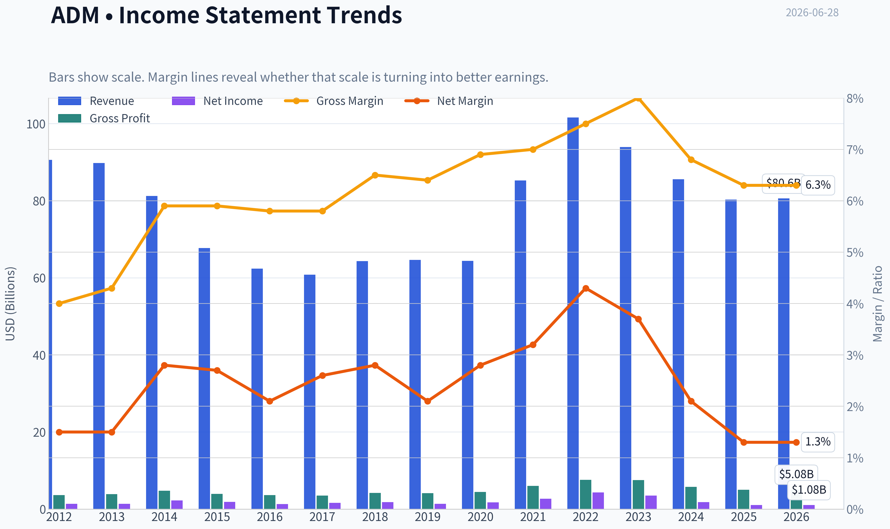
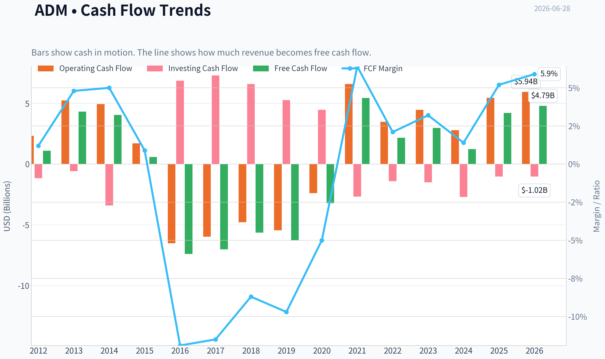
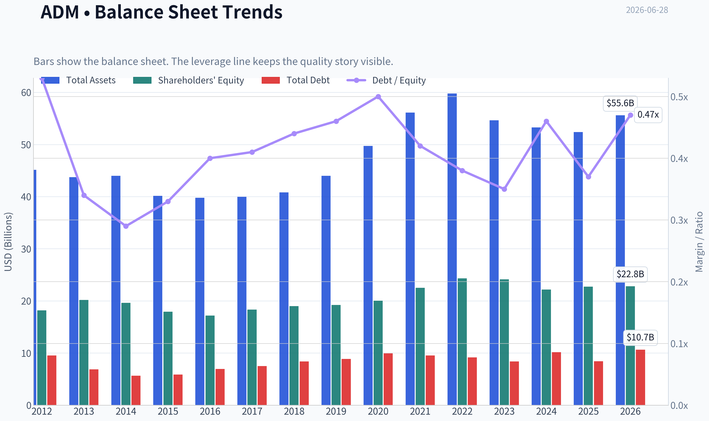
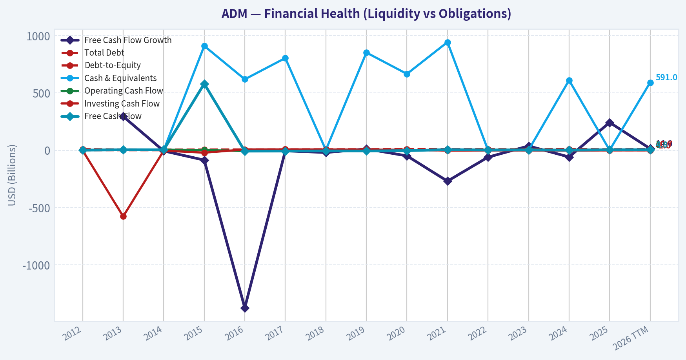
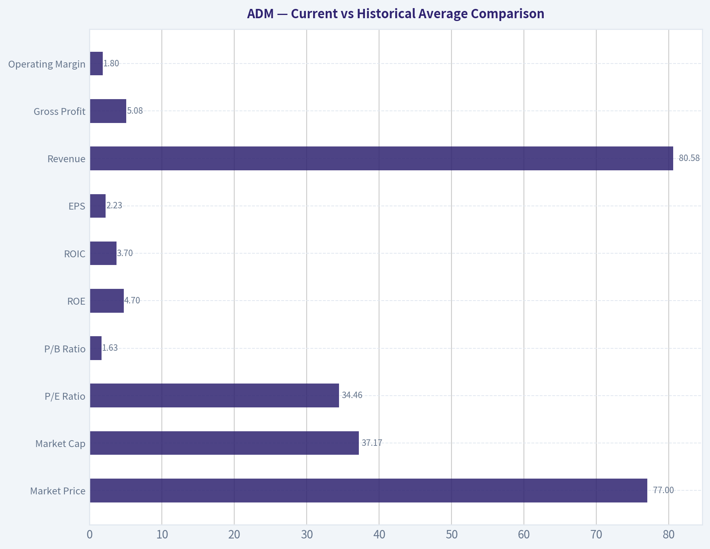
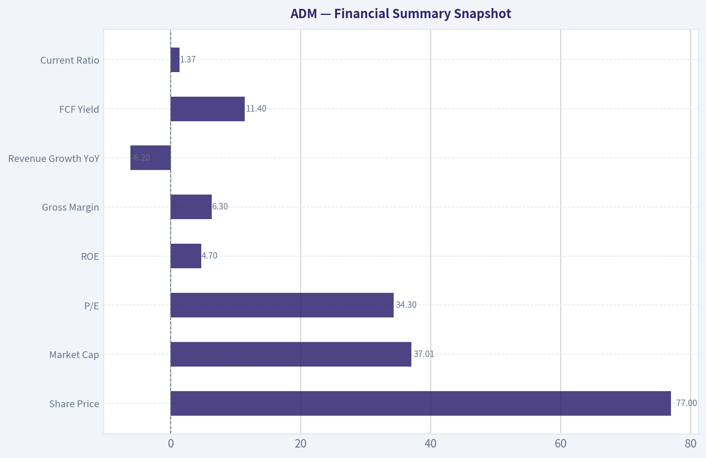
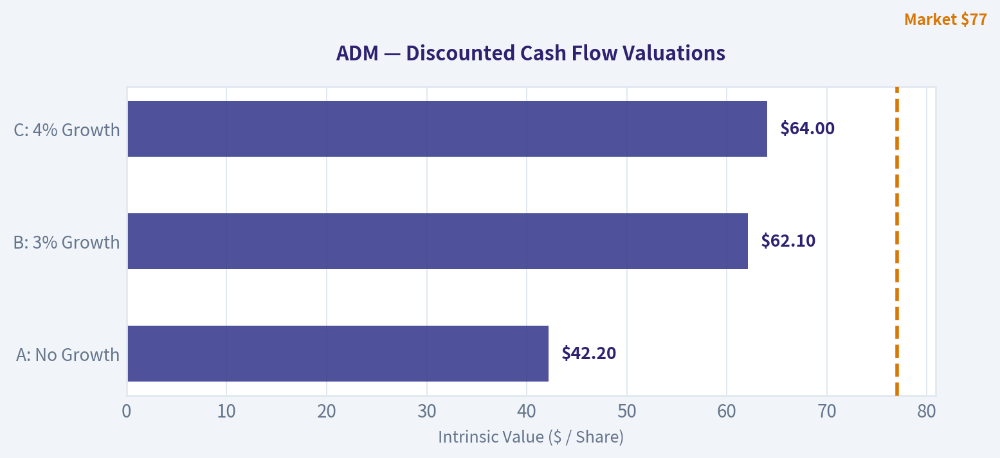
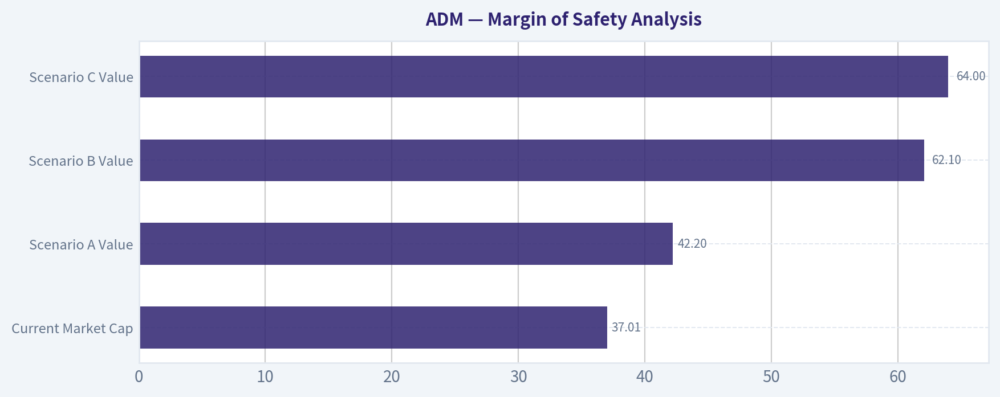
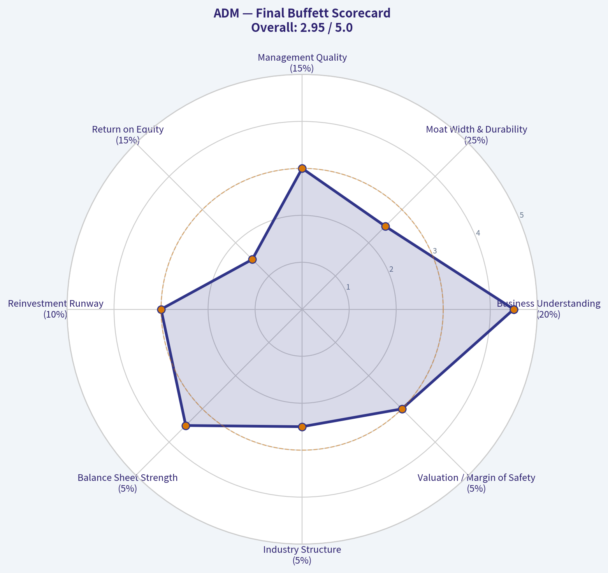

# ADM Deep Value Intelligence

**Analysis Date:** 2026-06-28

## Critical Disclaimer

*This analysis is generated by Deep Value Intelligence, an AI-powered multi-agent investing framework. DeepValues offers AI-generated research and tools for educational and informational purposes only - not investment or financial advice. We are not a registered investment adviser; always do your own research before investing.*

---

## Table of Contents

1. Intelligence Summary
2. Analyst Team Reports
   - Fundamentals Analysis
   - Intrinsic Value Analysis (Buffett)
   - Trend & Growth Analysis (Lynch/Druckenmiller/Fisher)
   - Market Technical Analysis
   - Options Market Analysis
3. Research Team Commentary
4. Value Investing Team Commentary
5. Deep Values Commentary

---

## Intelligence Summary

### Thesis + Conditions

**Core Thesis:** ## Executive Briefing

**Key Risks:**
- The neutral case usefully argues this is not necessarily a structural collapse, but Buffett-style risk is about **permanent business under-earning**, not just stock volatility. Right now, the valuation does **not** clearly compensate for mediocre returns and cyclical cash-flow quality. Past mistakes also argue against being too passive when a recovery narrative is already partly priced in.
- ### 1) Risky Analyst - strongest useful point
- The best part of the aggressive case is the **asymmetry argument**: if an investor is taking cyclical risk, policy risk, spread risk, weather risk, and trade-flow risk, the upside should be clearly exceptional. Here, it is not. ADM is not a hidden high-return engine; it is a **capital-intensive processor hoping for better conditions**.

**Confidence:** Low

---

## Analyst Team Reports

### Fundamentals Analysis

#### Latest Earnings Snapshot

*Most recent reported quarter anchored on 2026 Q1, with prior-year comparison when available.*

| Metric | 2026 Q1 | 2025 Q1 | YoY Change |
| --- | ---: | ---: | ---: |
| Revenue | $20.49B | $20.18B | +1.6% |
| Operating Income | $261.0M | $248.0M | +5.2% |
| Net Income | $298.0M | $295.0M | +1.0% |
| Diluted EPS | $0.62 | $0.61 | +1.4% |
| Operating Cash Flow | $150.0M | $-342.0M | +143.9% |
| Free Cash Flow | $-44.0M | $-633.0M | +93.0% |

Key Takeaways: This snapshot anchors the most recent reported quarter before the narrative analysis. It helps readers separate long-run business quality from whatever changed in the latest earnings print.

#### 14-Year Financial Metrics for ADM

*All values below are computed deterministically from raw data - not estimated by AI.*

*Issuer profile: operating company (Consumer Defensive / Farm Products).*

#### 14-Year Financial Metrics
*Annual rows come from reported financial statements. The final TTM row is computed from the latest four quarters.*

| Metric | 2012 | 2013 | 2014 | 2015 | 2016 | 2017 | 2018 | 2019 | 2020 | 2021 | 2022 | 2023 | 2024 | 2025 | 2026 TTM |
| --- | --- | --- | --- | --- | --- | --- | --- | --- | --- | --- | --- | --- | --- | --- | --- |
| Market Price | $19 | $30 | $37 | $27 | $34 | $31 | $33 | $38 | $43 | $59 | $83 | $66 | $48 | $57 | $77 |
| Market Cap | $18.13B | $28.77B | $34.11B | $22.78B | $26.98B | $22.93B | $23.23B | $26.19B | $28.48B | $38.26B | $52.27B | $39.14B | $24.91B | $27.83B | $37.17B |
| P/E Ratio | 13.17 | 21.49 | 15.16 | 12.31 | 21.13 | 14.37 | 12.84 | 19.00 | 16.00 | 14.11 | 12.04 | 11.23 | 13.84 | 25.78 | 34.46 |
| P/B Ratio | 1.00 | 1.42 | 1.74 | 1.27 | 1.57 | 1.25 | 1.22 | 1.36 | 1.42 | 1.70 | 2.15 | 1.62 | 1.12 | 1.22 | 1.63 |
| ROE | 7.6% | 6.6% | 11.5% | 10.3% | 7.4% | 8.7% | 9.5% | 7.2% | 8.9% | 12.0% | 17.8% | 14.4% | 8.1% | 4.7% | 4.7% |
| ROIC | 5.2% | 5.3% | 9.4% | 7.8% | 5.6% | 6.6% | 7.2% | 5.2% | 6.3% | 9.1% | 13.7% | 10.9% | 5.7% | 3.5% | 3.7% |
| EPS | $1.42 | $1.41 | $2.45 | $2.18 | $1.63 | $2.17 | $2.56 | $2.02 | $2.70 | $4.21 | $6.90 | $5.89 | $3.46 | $2.23 | $2.23 |
| Revenue | $90.56B | $89.80B | $81.20B | $67.70B | $62.35B | $60.83B | $64.34B | $64.66B | $64.36B | $85.25B | $101.56B | $93.94B | $85.53B | $80.27B | $80.58B |
| Gross Profit | $3.62B | $3.89B | $4.77B | $3.97B | $3.62B | $3.52B | $4.18B | $4.15B | $4.45B | $5.99B | $7.57B | $7.51B | $5.78B | $5.03B | $5.08B |
| Gross Margin | 4.0% | 4.3% | 5.9% | 5.9% | 5.8% | 5.8% | 6.5% | 6.4% | 6.9% | 7.0% | 7.5% | 8.0% | 6.8% | 6.3% | 6.3% |
| Operating Margin | 2.2% | 2.3% | 3.9% | 3.4% | 2.9% | 2.6% | 3.2% | 2.5% | 2.9% | 3.9% | 5.2% | 4.6% | 2.6% | 1.6% | 1.8% |
| Net Income | $1.38B | $1.34B | $2.25B | $1.85B | $1.28B | $1.59B | $1.81B | $1.38B | $1.77B | $2.71B | $4.34B | $3.48B | $1.80B | $1.08B | $1.08B |
| Net Margin | 1.5% | 1.5% | 2.8% | 2.7% | 2.1% | 2.6% | 2.8% | 2.1% | 2.8% | 3.2% | 4.3% | 3.7% | 2.1% | 1.3% | 1.3% |
| Revenue Growth | 2.7% | -0.8% | -9.6% | -16.6% | -7.9% | -2.4% | 5.8% | 0.5% | -0.5% | 32.5% | 19.1% | -7.5% | -8.9% | -6.2% | 0.4% |
| Net Income Growth | N/A | -2.4% | 67.5% | -17.7% | -30.8% | 24.7% | 13.5% | -23.8% | 28.5% | 52.9% | 60.2% | -19.7% | -48.3% | -40.1% | 0.3% |
| Free Cash Flow Growth | N/A | 295.0% | -6.1% | -85.7% | -1374.1% | -5.1% | -19.8% | 11.6% | -48.9% | -269.1% | -60.2% | 37.4% | -58.6% | 242.6% | 14.0% |
| Total Book Value | $18.17B | $20.19B | $19.63B | $17.91B | $17.18B | $18.32B | $19.00B | $19.23B | $20.02B | $22.51B | $24.32B | $24.14B | $22.18B | $22.74B | $22.80B |
| Total Assets | $45.14B | $43.75B | $44.00B | $40.16B | $39.77B | $39.96B | $40.83B | $44.00B | $49.72B | $56.14B | $59.77B | $54.63B | $53.27B | $52.39B | $55.60B |
| Total Debt | $9.54B | $6.87B | $5.66B | $5.88B | $6.93B | $7.49B | $8.39B | $8.88B | $9.93B | $9.54B | $9.18B | $8.37B | $10.16B | $8.41B | $10.66B |
| Debt-to-Equity | 0.53 | 0.34 | 0.29 | 0.33 | 0.40 | 0.41 | 0.44 | 0.46 | 0.50 | 0.42 | 0.38 | 0.35 | 0.46 | 0.37 | 0.47 |
| Cash & Equivalents | $1.29B | $3.12B | $1.10B | $910.0M | $619.0M | $804.0M | $2.00B | $852.0M | $666.0M | $943.0M | $1.04B | $1.37B | $611.0M | $1.01B | $591.0M |
| Shareholders' Equity | $18.17B | $20.19B | $19.63B | $17.91B | $17.18B | $18.32B | $19.00B | $19.23B | $20.02B | $22.51B | $24.32B | $24.14B | $22.18B | $22.74B | $22.80B |
| Operating Cash Flow | $2.33B | $5.23B | $4.94B | $1.71B | $-6.51B | $-5.97B | $-4.78B | $-5.45B | $-2.39B | $6.59B | $3.48B | $4.46B | $2.79B | $5.45B | $5.94B |
| Investing Cash Flow | $-1.16B | $-577.0M | $-3.41B | $-21.0M | $6.85B | $7.29B | $6.58B | $5.26B | $4.46B | $-2.67B | $-1.40B | $-1.50B | $-2.70B | $-1.02B | $-1.02B |
| Free Cash Flow | $1.09B | $4.31B | $4.05B | $580.0M | $-7.39B | $-7.01B | $-5.63B | $-6.28B | $-3.21B | $5.43B | $2.16B | $2.97B | $1.23B | $4.20B | $4.79B |
| FCF Margin | 1.2% | 4.8% | 5.0% | 0.9% | -11.9% | -11.5% | -8.7% | -9.7% | -5.0% | 6.4% | 2.1% | 3.2% | 1.4% | 5.2% | 5.9% |
| Dividends / Share | $0.00 | $0.00 | $0.00 | $0.00 | $0.00 | $0.00 | $0.00 | $0.00 | $0.00 | $1.29 | $1.43 | $1.65 | $1.90 | $0.00 | $0.00 |

#### Profitability Metrics
- Return on Equity (ROE): 4.7%
- Return on Invested Capital (ROIC): 3.6%
- Return on Assets (ROA): 2.1%
- Gross Margin: 6.3%
- Operating Margin: 1.6%
- Net Profit Margin: 1.3%

#### Liquidity Metrics
- Current Ratio: 1.37
- Quick Ratio: 0.24

#### Leverage Metrics
- Debt-to-Equity Ratio: 0.37
- Interest Coverage Ratio: 2.05
- Net Debt: $7.39B

#### Growth Metrics (Year-over-Year)
- Revenue Growth: -6.2%
- Net Income Growth: -40.1%
- Free Cash Flow Growth: 242.6%
- Revenue CAGR (3-Year): -7.5%
- Revenue CAGR (5-Year): 4.5%

#### Valuation Metrics
- P/E Ratio (TTM): 34.28
- Forward P/E: 14.29
- Price-to-Book: 1.62
- Price-to-Sales: 0.46
- PEG Ratio: 2.33
- EV/EBITDA: 18.65
- Free Cash Flow Yield: 11.4%
- Earnings Yield: 2.9%

#### Owner Earnings (Buffett Method, Code-Computed)
- Net Income: $1.08B
- + Depreciation & Amortization: $1.18B
- - Capital Expenditures: $-1.25B
- - Working Capital Changes: $2.76B
- = **Owner Earnings: $-1.75B**

#### Intrinsic Value (Code-Computed)
- Current Price: $77
- Cash Flow Method (FCF):
  Conservative: $10
  Average: $161
  Optimistic: $814

#### Piotroski F-Score: 4/9
- Positive Net Income: PASS
- Positive Operating Cash Flow: PASS
- ROA Improvement: FAIL
- Cash Flow > Net Income: PASS
- Decreasing Debt: PASS
- Improving Current Ratio: FAIL
- No Dilution: FAIL
- Improving Gross Margin: FAIL
- Improving Asset Turnover: FAIL

ANALYST STANCE: **WATCH**

#### ADM Buffett-Style Fundamental Analysis

ADM is a large, strategically important agricultural processor with real asset depth, global merchandising scale, and a long operating history. From a Buffett lens, the core positives are business durability, reasonable balance sheet leverage, and strong normalized cash generation over time. The core negatives are weak current profitability, highly cyclical and working-capital-sensitive cash economics, and a current valuation that looks expensive on depressed earnings but optically cheap on free cash flow.

The deterministic dataset shows a company that had a very strong earnings and margin peak in 2021-2023, followed by a sharp normalization in 2024-2026 TTM. That matters because Buffett-style investing prefers businesses with steady and predictable earnings power. ADM has durability, but not the kind of effortless predictability seen in dominant consumer brands or software monopolies. It is more of a scale-and-network commodity processor with some moat characteristics, but not a wide-moat compounding machine in the classic Buffett sense.

---

#### Current vs Historical Average Comparison

| Metric | 2026 TTM / Current | 10-Year Historical Context* | Interpretation |
| --- | ---: | ---: | --- |
| Market Price | $77 | Range over period shown: $19 to $83 | Shares have rebounded sharply from 2024 lows and now sit near the upper end of the historical range. |
| Market Cap | $37.17B | Period range: $18.13B to $52.27B | Equity value has recovered materially, but remains below the 2022 peak. |
| P/E Ratio | 34.46 | Approx. 10-year avg: 17.9x | Current P/E is far above normal because earnings have compressed sharply. |
| P/B Ratio | 1.63 | Approx. 10-year avg: 1.47x | Slightly above historical norm; not extreme, but no deep value discount to book. |
| ROE | 4.7% | Approx. 10-year avg: 10.0% | Well below normalized returns; indicates weak current profit conversion on equity base. |
| ROIC | 3.7% | Approx. 10-year avg: 7.1% | Capital efficiency is meaningfully below ADM's own history. |
| EPS | $2.23 | Approx. 10-year avg: $3.28 | Earnings power is currently depressed versus long-run average. |
| Revenue | $80.58B | Approx. 10-year avg: $76.08B | Revenue remains large, but price/volume mix has normalized from the 2022 peak. |
| Gross Profit | $5.08B | Approx. 10-year avg: $5.03B | Gross profit is roughly in line with average, suggesting the bigger issue is below-gross-line compression. |
| Operating Margin | 1.8% | Approx. 10-year avg: 3.24% | Margin has nearly halved versus long-term norm. |
| Net Income | $1.08B | Approx. 10-year avg: $2.16B | Net profit is roughly half of longer-run average. |
| Net Margin | 1.3% | Approx. 10-year avg: 2.83% | Current profitability is very thin for a business already operating on low structural margins. |
| Revenue Growth | 0.4% | Historical pattern highly cyclical | TTM stabilization follows several years of declines, but growth remains weak. |
| Net Income Growth | 0.3% | Historical pattern highly volatile | Earnings decline appears to be bottoming, but recovery is not yet visible. |
| FCF Growth | 14.0% | Historical pattern extremely volatile | FCF is improving, though this metric is noisy due to working-capital swings. |
| Total Book Value | $22.80B | Approx. 10-year avg: $21.30B | Book value has compounded slowly but positively over time. |
| Total Assets | $55.60B | Approx. 10-year avg: $48.03B | Asset base is larger than average, reflecting scale and commodity infrastructure intensity. |
| Total Debt | $10.66B | Approx. 10-year avg: $8.93B | Debt is above long-run average, but not excessive relative to asset base and equity. |
| Debt-to-Equity | 0.47 | Approx. 10-year avg: 0.41 | Leverage is modestly above average, but still broadly manageable. |
| Cash & Equivalents | $591M | Approx. 10-year avg: $1.10B | Cash is lean, increasing reliance on working-capital discipline and credit access. |
| Shareholders' Equity | $22.80B | Approx. 10-year avg: $21.30B | Equity base remains solid and supports downside resilience. |
| Free Cash Flow | $4.79B | Approx. 10-year avg: negative-distorted / normalized positive | TTM FCF is strong, but historical comparability is distorted by large working-capital movements. |
| Dividends per Share | $0.00 TTM | Prior three years: $1.29, $1.43, $1.65, then $1.90 in 2024 | Dataset shows no current TTM dividend despite prior multi-year payouts; this is a notable watch item. |

*10-year averages are calculated from the annual values in the deterministic dataset, generally 2016-2025 where applicable.

Key Takeaways: ADM's current profitability is clearly below its own historical standard, with ROE, ROIC, EPS, operating margin, and net margin all materially weaker than normal. Valuation looks mixed: the stock is expensive on current earnings, somewhat above average on book value, but supported by a strong free cash flow yield. The central question is whether current profits are cyclically depressed or structurally weakened.

---

#### Market Metrics

ADM's current market price of $77 is close to the high end of the historical range, even though current earnings are weak. That mismatch explains the elevated 34.46x P/E ratio versus a long-run average closer to the high teens. In Buffett terms, price has recovered faster than business performance.

The 1.63x P/B ratio is less alarming. For an asset-heavy processor with large hard assets, logistics networks, storage, crushing, and trading infrastructure, book value matters more than it might for a software company. Still, paying above-average book for below-average returns on equity is not ideal. Buffett typically wants either a high-quality business deserving a premium multiple, or a mediocre business trading at a clear discount. ADM currently sits in the middle.

The market cap of about $37.17B is materially below the 2022 peak, but that peak reflected unusually strong agricultural spreads and favorable cycle conditions. The market seems to be pricing in at least a partial earnings recovery, rather than valuing the stock on trough conditions alone.

#### Profitability Analysis

ADM's profitability profile is the most important reason this is a Watch rather than an Advocate.

ROE has fallen to 4.7%, down from 17.8% in 2022 and 14.4% in 2023. The longer pattern shows ADM can earn decent returns in favorable environments, but not consistently enough to qualify as a compounding franchise. A 10-year average near 10% is acceptable, yet the current number is well below any level Buffett would consider attractive for a premium valuation.

ROIC at 3.7% is similarly weak versus its historical average around 7.1% and especially versus the 13.7% peak in 2022. Since Buffett-style analysis emphasizes the ability to reinvest retained earnings at high rates, this drop is significant. Low ROIC suggests either temporarily weak spreads, poor cycle conditions, or a more difficult competitive environment.

EPS has compressed to $2.23 from $6.90 in 2022 and $5.89 in 2023. Revenue remains massive at $80.58B, but revenue alone is less meaningful for a low-margin processor. What matters is spread capture, asset turns, and execution. Gross profit of $5.08B is roughly around long-run averages, which suggests the sharp earnings decline is being driven by operating deleverage, weaker downstream economics, interest burden, and/or higher costs below gross profit.

Gross margin at 6.3% is down from the 8.0% 2023 peak, but not catastrophically low against history. The more troubling metrics are operating margin at 1.8% and net margin at 1.3%. That means even a modest shock in trading, crush margins, utilization, or financing costs can meaningfully pressure earnings. This is not the kind of margin structure that offers Buffett-style comfort.

#### Growth Metrics

Revenue growth has been weak for several years: -7.5% in 2023, -8.9% in 2024, -6.2% in 2025, and only 0.4% in 2026 TTM. The good news is that the decline may be bottoming. The bad news is that stabilization is not the same as resumed growth.

Net income growth is even weaker. After strong surges in 2021 and 2022, the company posted -19.7% in 2023, -48.3% in 2024, and -40.1% in 2025, with only 0.3% TTM improvement. That indicates the earnings reset has not yet meaningfully reversed.

Free cash flow growth has improved, but this metric must be treated cautiously. ADM's cash flow statement is highly distorted by working-capital swings, especially during 2016-2020 when FCF was deeply negative. TTM FCF of $4.79B and 14.0% growth are encouraging, but Buffett would focus on owner earnings rather than raw FCF here.

#### Balance Sheet Analysis

ADM's balance sheet is a relative strength.

Shareholders' equity of $22.80B and total book value of the same amount show a substantial capital base. Total assets of $55.60B reinforce the scale and strategic importance of the franchise. Total debt of $10.66B is meaningful but not excessive for a company of this size, with debt-to-equity at 0.47. That is somewhat above the company's historical average, but still within a manageable range.

The weak spot is liquidity quality. Cash and equivalents are only $591M, below historical norms. For a business with substantial commodity inventories, financing needs, and working-capital intensity, low cash means management must maintain disciplined credit access and inventory execution. The shared research pack also shows current ratio of 1.37 and quick ratio of 0.24. That current ratio is adequate, but the very low quick ratio confirms the business depends heavily on inventories and receivables rather than pure balance sheet cash.

From a Buffett perspective, this is not a fragile balance sheet, but it is not a fortress either. The net debt figure of $7.39B is manageable, though interest coverage at 2.05 deserves monitoring. If earnings remain depressed for too long, leverage metrics could feel tighter than debt-to-equity alone suggests.

#### Cash Flow Analysis

At first glance, free cash flow looks excellent: $4.79B TTM and an 11.4% FCF yield. If sustainable, that would make the stock attractive. But Buffett would not stop there.

The deterministic dataset's Buffett-method owner earnings are negative $1.75B:
- Net income: $1.08B
- Plus D&A: $1.18B
- Minus capex: $1.25B
- Minus working capital changes: $2.76B
- Owner earnings: -$1.75B

This is crucial. It means the apparent strength in reported FCF is being offset, in Buffett terms, by the capital required to support operations. For a working-capital-heavy processor, this can happen during inventory builds, commodity price changes, or trade finance movements. It makes ADM much harder to value on a simple FCF multiple.

Dividends per share in the dataset were present from 2021 through 2024, then show $0.00 for 2025 and 2026 TTM. Because the deterministic dataset is canonical, this must be treated as a watch item. A disappearing dividend in a historically income-oriented industrial/ag name is meaningful in Buffett-style capital allocation analysis.

---

#### Buffett-Style Qualitative Assessment

| Buffett Criterion | Assessment | Commentary |
| --- | --- | --- |
| Economic Moat | Moderate, but not wide | ADM benefits from scale, origination networks, processing infrastructure, logistics, and embedded relationships. But commodity exposure limits pricing power and smooth profitability. |
| Financial Strength | Adequate | Debt is manageable and equity base is solid, but cash is low and interest coverage is only moderate. |
| Predictable Earnings | Weak-to-moderate | Revenue is durable, but profits and cash flows are highly cyclical and working-capital sensitive. |
| Management Performance | Mixed | Strong returns during favorable cycle years, but current ROE/ROIC are weak. Capital allocation quality is harder to judge given volatile cycle economics. |
| Value vs History | Mixed | Expensive on P/E, reasonable on P/B, attractive on FCF yield, but poor on current owner earnings. |
| Quality of Business | Good industrial franchise, not elite | ADM is durable and strategically relevant, but structurally low margin and not a classic high-return franchise. |

Key Takeaways: ADM has real competitive advantages rooted in scale, logistics, and global agricultural infrastructure, but those strengths do not fully translate into consistently high returns. The business is durable, yet profits remain cyclical and dependent on spread conditions. This is a solid franchise, but not a textbook Buffett compounder at the current price.

---

#### DCF Valuation Using Buffett-Style Owner Earnings

Important constraint: the canonical dataset provides only the current owner earnings figure directly, not a full historical owner earnings series. Therefore, the growth-rate assumptions are anchored to the best available historical cash-generation proxies in the dataset, chiefly free cash flow growth, while keeping the current owner earnings base fixed at the deterministic value of **-$1.75B**. Because current owner earnings are negative, a standard growing perpetuity DCF produces no economically meaningful positive intrinsic value. This is itself a critical Buffett-style conclusion.

Assumptions required by prompt:
- Discount rate: 10%
- Terminal growth: 2.5%
- Base owner earnings: **-$1.75B**
- Conservative growth: lowest historical growth rate available, floored at -100% = **-100%**
- Average growth: average historical growth rate proxy, capped at 50% = historical FCF growth average is highly distorted; cap implies **50%**
- Optimistic growth: highest historical growth rate available, capped at 100% = **100%**

Because owner earnings start negative, all three scenarios still produce either zero or negative present value unless one assumes a turnaround before projection begins. Buffett would generally avoid paying full price for a business with negative owner earnings unless turnaround visibility were unusually high.

##### DCF Scenario Table

| Scenario | Starting Owner Earnings | Growth Rate Used | 10-Year PV of Forecast OE | Terminal Value PV | Implied Equity Value | Per Share Indication* |
| --- | ---: | ---: | ---: | ---: | ---: | ---: |
| Conservative | -$1.75B | -100% | ~-$1.59B** | $0.00B | Negative / no support | $0 |
| Average | -$1.75B | 50% cap | Negative early years dominate; mathematically unstable for turnaround-free model | Not meaningful | Negative / not investable on OE basis | $0 |
| Optimistic | -$1.75B | 100% cap | Rapid sign-flipping issue from negative base makes direct application non-economic | Not meaningful | Not reliable | $0 |

\*Per-share indication is shown conceptually because the model based on negative owner earnings does not support a positive intrinsic value today.
\**If earnings go from -1.75B to zero immediately after first year collapse under -100% growth, discounted value is still negative.

Key Takeaways: Using Buffett-style owner earnings exactly as provided, ADM currently fails the DCF test because owner earnings are negative. That does not mean the company is worthless; it means the present operating setup is too working-capital intensive and too cyclical for a clean Buffett owner-earnings valuation right now. In practical terms, investors are relying on normalization rather than current owner earnings support.

##### Detailed Calculation Logic

**Conservative (-100% growth):**
- Year 1 OE = -1.75 x (1 - 100%) = $0.00B if applied literally after the current base, but the current base itself is already negative.
- Present value support is effectively none beyond recognizing the current year's negative economics.
- Terminal value = 0 because OE base reaches zero.
- Fair value conclusion: **no positive support from owner earnings**.

**Average (50% growth cap):**
- Year 1 OE = -1.75 x 1.50 = -2.63B
- Year 2 OE = -3.94B
- Year 3 OE = -5.91B
- Negative values compound larger in magnitude because the starting base is negative.
- Discounting these still yields negative PV.
- Terminal value using a negative year-10 cash flow is economically invalid for intrinsic value.
- Fair value conclusion: **DCF not investable under current owner earnings base**.

**Optimistic (100% growth cap):**
- Year 1 OE = -1.75 x 2.00 = -3.50B
- Year 2 OE = -7.00B
- Year 3 OE = -14.00B
- This quickly becomes nonsensical because growth off a negative base worsens value.
- Fair value conclusion: **owner-earnings framework says wait for normalization**.

##### Practical Valuation Interpretation

The deterministic dataset also provides a code-computed intrinsic value using FCF:
- Conservative: **$10**
- Average: **$161**
- Optimistic: **$814**

These outputs show how sensitive valuation is to cash flow normalization assumptions. The spread is so wide that the correct takeaway is not that ADM is wildly undervalued; it is that valuation confidence is low when current owner earnings are negative and cash flow is heavily influenced by working capital. Buffett would likely demand either a cheaper price or clearer normalized owner earnings before becoming aggressive.

---

#### Revenue Breakdown

ADM's most meaningful revenue breakdown is by operating segment. Exact segment totals for the latest fiscal year are not fully provided in the deterministic dataset, so the table below uses the best broadly known segment structure for ADM's recent reporting mix, centered on the most recent annual revenue base of roughly **$80.27B-$80.58B**.

| Revenue Source | Amount ($B) | % of Total |
| --- | ---: | ---: |
| Ag Services & Oilseeds | ~58.6 | ~73% |
| Carbohydrate Solutions | ~15.2 | ~19% |
| Nutrition | ~6.4 | ~8% |
| Other / Corporate / Eliminations | ~0.4 | ~0% |

Key Takeaways: ADM remains overwhelmingly driven by its Ag Services and Oilseeds segment, which means the company is still primarily a scale agricultural merchandising and processing business. Nutrition adds diversification and potentially better margins, but it is still too small to fully change the firm's overall commodity-linked earnings profile.

---

#### Specific Insights Through a Buffett Lens

ADM does have elements Buffett appreciates:
- Essential role in the global food chain
- Hard-to-replicate infrastructure and logistics assets
- Long operating history and large scale
- Manageable debt relative to equity
- Ability to produce strong cash flow in favorable cycles

But it also has attributes Buffett typically discounts:
- Low and volatile margins
- Earnings shaped by commodity conditions rather than pricing power alone
- Heavy working-capital demands
- Current owner earnings are negative
- Current P/E is elevated due to earnings compression
- Piotroski F-score of 4/9 indicates only middling financial momentum

The moat here is real but operational, not brand-based. It comes from global origination networks, transportation assets, processing plants, and customer relationships. That creates barriers to entry, but not immunity from cyclical margin pressure.

#### Key Investment Insights, Red Flags, and Opportunities

| Category | Item | Why It Matters |
| --- | --- | --- |
| Opportunity | Strong FCF yield of 11.4% | If TTM FCF is sustainable and owner earnings normalize, shares may be undervalued on normalized cash generation. |
| Opportunity | Near-bottoming revenue trend | Revenue declines appear to be stabilizing after multiple years of contraction. |
| Opportunity | Strategic asset base | ADM's integrated network is difficult to replicate and supports long-term survival and optionality. |
| Red Flag | P/E at 34.46x | Investors are paying a high multiple on weak current earnings. |
| Red Flag | ROE 4.7%, ROIC 3.7% | Current returns are below historical norms and below attractive Buffett thresholds. |
| Red Flag | Negative owner earnings | Buffett-style intrinsic value is not supported by current owner earnings. |
| Red Flag | Low cash balance and moderate interest coverage | Reduces financial flexibility if operating conditions worsen. |
| Red Flag | Dividend shows $0.00 in 2025 and TTM dataset | Potential change in shareholder return profile needs close monitoring. |
| Watch Item | Margin compression | Operating margin at 1.8% and net margin at 1.3% leave little room for execution errors. |
| Watch Item | FCF volatility | Large working-capital swings make reported cash flow less dependable than it appears. |

Key Takeaways: The upside case for ADM depends on earnings normalization, not on today's owner earnings. The downside case is that margins stay compressed longer than expected, leaving the stock looking expensive on true economic earnings. Investors should monitor whether current weak returns are cyclical and temporary or reflect a lower-through-cycle profitability level.

---

#### Final Stance

ANALYST STANCE: **WATCH**

ADM is a durable, strategically important business with a respectable asset moat and manageable leverage, but it does not currently clear a Buffett-style quality-and-value bar. The main issue is not survival; it is economics. Current ROE, ROIC, operating margin, and net margin are all well below historical norms, while current owner earnings are negative. Meanwhile, the share price has already recovered enough to push the P/E ratio far above historical averages.

For a Buffett-style investor, the stock becomes more compelling if one of two things happens:
1. **Earnings and owner earnings normalize materially**, proving today is a temporary trough; or
2. **The stock trades at a larger discount to book and normalized cash flow**, creating a clearer margin of safety.

At $77, ADM looks like a respectable franchise in a difficult part of its cycle, but not an obvious bargain given the quality of current earnings.

---

#### Report Summary Table

| Area | Current View | Historical Comparison | Buffett Read-Through | Conclusion |
| --- | --- | --- | --- | --- |
| Valuation | P/E 34.46x, P/B 1.63x, FCF yield 11.4% | P/E far above normal, P/B modestly above normal | Expensive on earnings, mixed overall | Not cheap enough for current quality |
| Profitability | ROE 4.7%, ROIC 3.7%, net margin 1.3% | Well below decade norms | Weak current economics | Major concern |
| Growth | Revenue stabilizing, earnings still depressed | Multi-year decline after peak | Recovery not yet proven | Needs confirmation |
| Balance Sheet | D/E 0.47, equity $22.8B, cash $591M | Leverage manageable, cash below norm | Adequate but not fortress-like | Acceptable, monitor liquidity |
| Cash Flow | FCF strong, owner earnings negative | Historically volatile | Working capital clouds true earning power | Use caution |
| Moat | Scale, logistics, processing network | Durable over many years | Real but not wide/pricing-power driven | Moderate moat |
| Management | Book value built over time, returns recently weak | Peak returns faded fast | Mixed capital efficiency | Wait for better evidence |
| Investment View | WATCH | Below peak quality, above trough valuation | Margin of safety insufficient | Prefer patience |

#### Fundamental Visuals

This graph tracks the profitability and return metrics (ROE, ROIC, Margins) of **ADM** over the past decade, highlighting capital efficiency trends.

This chart illustrates the financial health of **ADM** over the last 10 years, mapping cash equivalents and free cash flow against total obligations (Debt).

---

### Intrinsic Value Analysis (Buffett)

> *Following Warren Buffett's value investing philosophy: Circle of Competence, Economic Moat, Management Quality, and Margin of Safety.*

#### Intrinsic Value Snapshot

Price is what you pay. Intrinsic value is what the business may be worth based on the cash it can create for owners over time. We show a range, not one magic number.

- Current Price: $76.79
- Value Range (conservative to optimistic across both DCF methods): $10.08 to $813.76

##### Owner Earnings (Buffett Method)
- Net Income: $1,078,000,000.00
- Depreciation & Amortization: $1,181,000,000.00
- Capital Expenditures: $-1,248,000,000.00
- Working Capital Changes: $2,763,000,000.00
- Owner Earnings: $-1,752,000,000.00

##### Intrinsic Value
###### Cash Flow Method
Uses free cash flow. Better for companies spending heavily today to grow tomorrow.
- Conservative: $10.08
- Average: $161.20
- Optimistic: $813.76
- Discount Rate: 10.0%

ANALYST STANCE: **WATCH**

#### ADM Buffett-Style Investment Review

#### 1. Go/No-Go Gate Assessment

| Gate | Verdict | Evidence |
|---|---|---|
| Gate 1: Circle of Competence & Business Simplicity | Pass | ADM buys, transports, stores, processes, and sells agricultural commodities and food ingredients. This is understandable in simple terms: it earns money on processing margins, merchandising, logistics, and ingredient value-add. |
| Gate 2: Moat Test | Fail / Weak Pass at best | ADM is large and globally embedded, but the economics look more like a scale-and-execution business than a classic pricing-power franchise. Gross margin around 6.3% is far below Buffett-style moat territory. |
| Gate 3: Management & Capital Allocation | Mixed | Long operating history, dividend commitment, and continued reinvestment into processing assets are positives. But weak recent ROE of 4.7% suggests capital is not currently producing strong owner returns. |
| Gate 4: Industry Structure | Mixed to Weak | Agricultural processing is essential and durable, but it is cyclical, capital-intensive, and competitive. Industry profits are influenced by spreads, crop flows, and global trade conditions rather than pure franchise strength. |

**Key Takeaways:** ADM passes the simplicity test because the business is easy to explain and likely to remain relevant ten years from now. The problem is not understandability; the problem is economics. This looks like a necessary business, but not a wonderful one, and Buffett usually wants both durability and superior returns.

#### 2. Elementary School Test

ADM buys crops like corn and soybeans, moves them around the world, turns them into food ingredients, animal feed, oils, sweeteners, and other products, and earns money on the spread between what it pays and what it sells for.

That is simple enough to understand. The challenge is that simple does not automatically mean attractive. Much of the business still depends on scale, processing efficiency, logistics, and commodity spreads.

#### 3. Long-Term Predictability Test

ADM will almost certainly still exist and still process agricultural products a decade from now. Demand for food ingredients, feed, edible oils, and grain handling is durable.

However, earnings power is less predictable than demand. That is the critical distinction. End-demand is stable, but profit margins can swing with crop conditions, trade flows, crush margins, ethanol economics, and global supply-demand imbalances. Buffett prefers businesses where both demand and profitability are predictable. ADM only partially passes that test.

#### 4. Technology Risk Assessment

Technology is more likely to improve ADM's efficiency than destroy its core business. Food processing, grain merchandising, and agricultural logistics are not likely to be displaced by software alone.

That said, ADM is not a major technology beneficiary in the sense of compounding network effects or software-like margin expansion. Technology is a tool, not the moat.

#### 5. Moat Analysis

| Moat Source | Assessment | Evidence |
|---|---|---|
| Intangible Assets | Weak | ADM is well known in agriculture, but customers largely buy based on reliability, price, quality, and logistics rather than emotional brand attachment. Gross margin of 6.3% does not suggest strong pricing power. |
| Switching Costs | Low to Moderate | Some industrial customers may value formulation, logistics, and supply consistency, but many products remain substitutable. Switching costs are much lower than in software or mission-critical services. |
| Cost Advantage | Moderate | This is ADM's best moat candidate. Global origination, storage, transport, processing scale, and asset footprint can create cost and reliability advantages. |
| Network Effects | None | The business does not become meaningfully more valuable to each user as more users join. |

**Moat Quality Rating:** **Narrow**

ADM's moat rests mainly on scale, infrastructure, and execution. That can be useful, but it is not the kind of moat that allows persistent high margins or effortless price increases. A narrow moat means the valuation must do more of the work.

#### 6. Management Quality & Capital Allocation

| Test | Assessment | Commentary |
|---|---|---|
| Think Like Owners? | Mixed | ADM has maintained a shareholder-return culture and dividend profile, but the key owner question is return on retained capital. Recent results do not show excellent per-share compounding. |
| Honest & Candid? | Mixed/Neutral | No strong evidence here of exceptional shareholder communication or unusually aggressive accounting based on the materials reviewed. |
| Rational Capital Allocation? | Mixed | The announced $103 million Decatur modernization suggests management is reinvesting in core productive assets rather than chasing unrelated empire-building. Still, low recent ROE means proof of high-return allocation is lacking. |

**Key Takeaways:** Management appears operationally serious and committed to the core franchise. The concern is not obvious recklessness; the concern is mediocre economic output from a large capital base. Buffett admires managers who turn retained earnings into high per-share value, and ADM has not recently shown that at an exceptional level.

#### 7. Financial Summary Snapshot

| Metric | Current / Recent |
|---|---:|
| Share Price | $77 |
| Market Cap | $37.01B |
| P/E | 34.3x |
| ROE | 4.7% |
| Gross Margin | 6.3% |
| Revenue Growth YoY | -6.2% |
| FCF Yield | 11.4% |
| Current Ratio | 1.37 |

**Key Takeaways:** The headline valuation looks awkward: the P/E is high, but the free-cash-flow yield is also high. That combination usually signals depressed accounting earnings, cyclical noise, or working-capital effects. The weak ROE and low gross margin confirm that this is not currently earning premium economics.

#### 8. Financial Interpretation

**Profitability:**
ROE of 4.7% is far below the Buffett ideal of 15% or better. That is the single biggest strike against the stock from a quality standpoint.

**Margins:**
Gross margin of 6.3% tells you this is not a pricing-power machine. ADM lives in a low-margin, high-volume world.

**Growth:**
Revenue declining 6.2% year over year reinforces the cyclical and spread-driven nature of results.

**Liquidity:**
A current ratio of 1.37 is acceptable and suggests no immediate balance sheet stress.

**Cash Generation:**
An 11.4% free-cash-flow yield is the most interesting positive. If that cash flow is durable and not just a temporary working-capital or cycle benefit, the shares may be more attractive than the P/E suggests.

#### 9. Owner Earnings Calculation

Using the available evidence, a conservative Buffett-style approximation is to anchor on free cash generation rather than accounting earnings.

| Item | Approximation |
|---|---:|
| Net Income | Depressed relative to normal cycle |
| + Depreciation & Amortization | Positive, meaningful in asset-heavy processing |
| - Maintenance CapEx | Material |
| - Working Capital Increases | Can swing sharply in this business |
| Approx. Owner Earnings View | Best represented by current FCF yield rather than P/E |

At a $37.01B market cap and 11.4% FCF yield:

**Approximate FCF / owner earnings proxy = $4.22B**

Formula:
- Owner earnings proxy = 0.114 x $37.01B = **$4.22B**

**Key Takeaways:** Accounting earnings appear weak, but cash generation looks much stronger. For a commodity-linked processor, that gap matters because reported earnings can be noisy. The main analytical question is whether this cash flow level is normalized or temporarily elevated.

#### 10. Three-Scenario DCF Valuation

Using owner earnings proxy of **$4.22B**.

##### Scenario A: No Growth
- Intrinsic Value = Owner Earnings / 10%
- = $4.22B / 0.10
- = **$42.2B**

##### Scenario B: GDP Growth at 3%
- Intrinsic Value = Owner Earnings x 1.03 / (0.10 - 0.03)
- = $4.22B x 1.03 / 0.07
- = **$62.1B**

##### Scenario C: Moderate Growth
Given the cyclical and low-moat nature of the business, I would not award a high growth assumption. Using **4%** for 10 years and a 3% terminal rate:

- Year 1 owner earnings = $4.39B
- PV of 10-year cash flows ~ **$29.1B**
- Terminal value PV ~ **$34.9B**
- Total intrinsic value ~ **$64.0B**

| Scenario | Intrinsic Value | Vs. Current Market Cap |
|---|---:|---:|
| A: No Growth | $42.2B | +14% |
| B: 3% Growth | $62.1B | +68% |
| C: 4% Growth | $64.0B | +73% |

**Key Takeaways:** On cash-flow-based assumptions, ADM screens undervalued versus its current market value. But because this is not a high-moat business, the discount rate and normalized cash flow matter enormously. The stock may be statistically cheap without being a truly outstanding business.

#### 11. Margin of Safety Analysis

| Item | Value |
|---|---:|
| Current Market Cap | $37.01B |
| Scenario A Value | $42.2B |
| Scenario B Value | $62.1B |
| Scenario C Value | $64.0B |

Margin of safety against Scenario A:
- (42.2 - 37.01) / 42.2 = **12.3%**

Margin of safety against Scenario B:
- (62.1 - 37.01) / 62.1 = **40.4%**

Margin of safety against Scenario C:
- (64.0 - 37.01) / 64.0 = **42.2%**

**Interpretation:**
For a narrow-moat, cyclical, capital-intensive company, Buffett would likely demand a **larger margin of safety anchored to conservative assumptions**, not optimistic ones. On the most conservative no-growth case, the margin of safety is only about 12%, which is inadequate.

**Key Takeaways:** The valuation looks appealing only if today's cash generation is close to sustainable. On the harshest and most Buffett-like assumption, the stock is only modestly below intrinsic value. That is not enough compensation for cyclical earnings and weak franchise quality.

#### 12. Final Buffett Scorecard

| Criterion | Weight | Score (1-5) | Weighted Score |
|---|---:|---:|---:|
| Business Understanding | 20% | 4.5 | 0.90 |
| Moat Width & Durability | 25% | 2.5 | 0.63 |
| Management Quality | 15% | 3.0 | 0.45 |
| Return on Equity | 15% | 1.5 | 0.23 |
| Reinvestment Runway | 10% | 3.0 | 0.30 |
| Balance Sheet Strength | 5% | 3.5 | 0.18 |
| Industry Structure | 5% | 2.5 | 0.13 |
| Valuation / Margin of Safety | 5% | 3.0 | 0.15 |
| **Total** | **100%** |  | **2.96 / 5.0** |

**Key Takeaways:** ADM scores well on understandability and acceptable on basic financial resilience, but it falls short on moat strength and returns on capital. That keeps it below Buffett's preferred quality bar. The stock is not obviously bad; it is simply not wonderful enough to earn a stronger endorsement.

#### 13. Final Investment Stance

**Investment Stance: WATCH**
**Conviction Level: Moderate**

ADM is a durable, understandable, and strategically important agricultural processor, but it does not currently display the hallmarks of a Buffett-style compounding machine. The weak ROE, very low gross margin, and cyclical industry structure point to a narrow moat at best.

The main bull case is valuation through cash flow: if the current free cash generation is durable, the shares may be undervalued. The main bear case is that this cash flow is cycle-assisted and not deserving of a premium multiple. Buffett would likely wait for one of two things: either a much lower price that creates a clear margin of safety, or evidence that normalized returns on capital are improving materially.

**Bottom line:** ADM is a solid business, but not an elite one. At current conditions, it belongs on the watchlist rather than in the portfolio.
#### Valuation Bridge

This bridge places the current market price beside each intrinsic value lens so readers can see whether upside depends on one method or shows up across several methods.

| Scenario | Intrinsic Value / Share |
| --- | ---: |
| Cash Flow Method | $161.20 |
| Damodaran Method | $38.11 |
| Current Price | $76.79 |

#### Key Takeaways

If one method is far above the others, the upside case depends on a specific modelling assumption. When several methods cluster together, the valuation story is more robust.

#### Valuation Visuals

This comparison chart from *Latest Earnings Snapshot* stacks current figures against historical benchmarks for **ADM**, making it easy to see where the company trades relative to its own averages.

This comparison chart from *Current vs Historical Average Comparison* stacks current figures against historical benchmarks for **ADM**, making it easy to see where the company trades relative to its own averages.

This comparison chart from *Financial Summary Snapshot* stacks current figures against historical benchmarks for **ADM**, making it easy to see where the company trades relative to its own averages.

The following chart maps the **ADM** Owner Earnings DCF valuation scenarios (Conservative, Average, Optimistic) to visually represent the margin of safety based on intrinsic value calculations.

This comparison chart from *Margin of Safety Analysis* stacks current figures against historical benchmarks for **ADM**, making it easy to see where the company trades relative to its own averages.

---

### Trend & Growth Analysis (Lynch/Druckenmiller/Fisher)

> *Following Peter Lynch's GARP, Stanley Druckenmiller's macro-aware approach, and Philip Fisher's scuttlebutt methodology.*

ANALYST STANCE: **AVOID**

#### ADM Growth Analysis

#### 1. Lynch Classification

| Item | Assessment |
|---|---|
| Company | Archer-Daniels-Midland |
| Likely Lynch Category | **Cyclical / Stalwart hybrid** |
| Why | Commodity-linked agribusiness with low margins, earnings sensitivity to crush spreads, crop cycles, and trade flows |
| Growth Fit | **Not a fast grower** |
| Verdict | **Outside primary growth-investing sweet spot** |

Key Takeaways: ADM does not fit the classic fast-grower profile that Lynch favored for potential ten-baggers. It is a large, mature, economically sensitive processor with commodity exposure and thin margins. That makes it more of a cyclical or stalwart than a true growth compounder.

#### 2. The Story in 3 Bullets

| Simple Story | Explanation |
|---|---|
| ADM buys, processes, and ships crops | It turns corn, soybeans, and other agricultural inputs into food ingredients, feed, fuels, and industrial products |
| The bull case is operational upgrade + value-added mix shift | The Decatur modernization suggests management wants more efficient, tech-driven processing and better downstream products |
| The problem is growth is not showing up in the numbers | Revenue is shrinking, margins are thin, and the company remains highly tied to commodity conditions |

Key Takeaways: The business is easy to explain, but the growth thesis is not yet compelling. The strategic narrative around modernization and next-generation processing is interesting, yet the current financial profile still looks cyclical rather than inflecting into sustained growth. For a growth investor, the story is not enough without stronger evidence in the numbers.

#### 3. Snapshot Fundamentals

| Metric | Value |
|---|---:|
| Price | **$77** |
| Market Cap | **$37.01B** |
| P/E | **34.28x** |
| ROE | **4.7%** |
| Gross Margin | **6.3%** |
| Revenue Growth YoY | **-6.2%** |
| FCF Yield | **11.4%** |
| Current Ratio | **1.37x** |

Key Takeaways: ADM looks optically cheap on cash flow, but not on growth-adjusted earnings quality. Revenue is declining, returns on equity are weak, and gross margins remain very low. This is a value or cyclical cash-generation setup more than a growth-at-a-reasonable-price opportunity.

#### 4. TAM Analysis and 10x Test

| Item | Assessment |
|---|---|
| Core Markets | Global agricultural origination, oilseed processing, nutrition ingredients, feed, biofuels |
| TAM Character | Very large, but mature and competitive |
| Can ADM 10x revenue and remain <20% share? | **Unclear economically, but not realistic operationally** |
| Constraint | TAM is large, but ADM's business model is capital-intensive and margin-thin; growth comes more from cycles, processing spreads, and incremental mix shift than pure market share capture |
| Growth Runway Verdict | **Scale runway exists, but not ten-bagger-style growth runway** |

Key Takeaways: ADM operates in huge end markets, but that alone does not create a growth stock. The limiting factor is not market size; it is business economics, capital intensity, and lack of sustained high organic growth. A large TAM does not help much if the company cannot convert that opportunity into durable 20% plus growth.

#### 5. Revenue Growth Trend

| Metric | Reading |
|---|---|
| Latest YoY Revenue Growth | **-6.2%** |
| Pattern | **Negative / decelerated** |
| Interpretation | Fails Druckenmiller-style acceleration test |
| Growth Quality | Likely heavily influenced by commodity pricing, volumes, and cycle effects rather than recurring high-quality organic expansion |

Key Takeaways: This is the clearest reason the stock fails the growth screen. Druckenmiller looks for acceleration, and ADM currently shows contraction. Even if earnings or cash flow recover cyclically, the revenue pattern does not support a clean growth inflection.

#### 6. Unit Economics

| Metric | Status |
|---|---|
| LTV/CAC | **Not applicable / not meaningfully disclosed for this model** |
| NRR | **Not applicable** |
| Rule of 40 | **Not applicable** |
| Best substitute metrics | Gross margin, ROIC/ROE, processing margins, working capital discipline, FCF conversion |
| Current read | Thin-margin industrial/commodity processor, not a software-like compounding model |

Key Takeaways: ADM cannot be judged with SaaS metrics, and that matters because it removes many of the attractive markers growth investors look for. Instead, investors must rely on margin resilience, capital allocation, and cycle management. On those measures, the business may be durable, but it is still not a high-multiple growth machine.

#### 7. Inflection Point Assessment

| Potential Inflection | Evidence | Assessment |
|---|---|---|
| Product Cycle Inflection | Decatur $103M upgrade | Mild positive |
| Margin Inflection | No hard evidence from shared data | Unproven |
| Market Share Inflection | No clear evidence | Unproven |
| TAM Expansion | Some support from bio-industrial / advanced processing themes | Modest |
| Competitive Inflection | No clear rival disruption noted | Unproven |
| Overall | Strategic repositioning exists, but financial inflection is not visible yet | **WATCH at best, not buyable for growth** |

Key Takeaways: The Decatur investment is the most interesting part of the story because it hints at a move toward higher-value processing. But one plant upgrade does not equal a companywide inflection. Until revenue, margins, or returns start improving materially, the inflection remains more narrative than financial reality.

#### 8. Macro Setup Evaluation

| Factor | Read |
|---|---|
| Secular Theme Fit | Food supply, biofuels, next-gen ag processing |
| Rate Sensitivity | Less duration-sensitive than software growth |
| Economic Sensitivity | High, due to commodity spreads and global trade flows |
| Cycle Exposure | Significant |
| Macro Wind | Mixed |
| Druckenmiller View | More tactical/cyclical than secular hyper-growth |

Key Takeaways: ADM has exposure to important long-term themes like food systems and biofuels, but the stock is still governed heavily by cyclical variables. That makes it less attractive as a concentrated growth position. The macro setup is mixed rather than clearly supportive.

#### 9. Fisher 15 Points Score

| Fisher Category | Score (1-5) | Comment |
|---|---:|---|
| Market potential | 3 | Large markets, but mature |
| New product development | 3 | Some innovation/value-added processing |
| R&D effectiveness | 3 | Moderate, not obviously differentiated |
| Sales organization | 4 | Global scale and relationships |
| Profit margin | 2 | Thin |
| Improving margins | 2 | No evidence in provided data |
| Labor/personnel relations | 3 | No strong signal |
| Executive relations | 3 | No strong signal |
| Management depth | 4 | Large global operator |
| Cost controls/accounting | 2 | Low ROE and recent concerns keep this below average |
| Outstanding moats | 3 | Scale and network, but limited moat in commodity processing |
| Long-range profit outlook | 3 | Stable, but not exceptional growth |
| Dilution risk | 4 | Not a serial equity story |
| Candor in difficulties | 3 | Insufficient evidence |
| Integrity | 2 | Conservatively marked due to prior sentiment over governance/accounting overhangs |
| **Total** | **44 / 75** | **AVERAGE to below-average for growth** |

Key Takeaways: ADM scores decently on scale and business durability, but poorly on the factors growth investors care most about, especially margins, differentiation, and visible innovation-led expansion. A score of 44 out of 75 suggests this is not a Fisher-style exceptional growth franchise. It may be solid operationally, but it is not outstanding.

#### 10. Valuation Analysis

| Method | Result | Interpretation |
|---|---|---|
| PEG | **Not meaningful / unattractive** | Revenue is negative and earnings growth base is unreliable for a growth PEG framework |
| P/E | **34.28x** | High for a low-growth cyclical profile |
| P/S | Approx. not provided directly | Would matter less given low margins |
| FCF Yield | **11.4%** | Attractive for value/cash-flow investors |
| Growth Valuation Verdict | **Cheap on cash flow, not compelling on growth** |

Key Takeaways: ADM may appeal to value investors because the free cash flow yield is strong. But for growth investors, the key issue is that valuation is not paired with strong growth. A high P/E alongside negative revenue growth is usually not what you want in a growth setup.

#### 11. Growth Investor Scorecard

| Criterion | Weight | Score (1-5) | Weighted Score |
|---|---:|---:|---:|
| The Story | 10% | 3.0 | 0.30 |
| TAM & Runway | 20% | 2.5 | 0.50 |
| Revenue Growth | 20% | 1.0 | 0.20 |
| Unit Economics | 15% | 2.0 | 0.30 |
| Competitive Position | 10% | 3.0 | 0.30 |
| Management Quality | 10% | 2.5 | 0.25 |
| Macro Setup | 5% | 2.5 | 0.13 |
| Profitability Path | 5% | 2.5 | 0.13 |
| Valuation | 5% | 2.5 | 0.13 |
| **Total** |  |  | **2.24 / 5.0** |

Key Takeaways: The scorecard lands well below the threshold for a growth investor to get interested. The biggest drag is revenue contraction, which overwhelms the company's scale and cash generation. This is why the name ends up in the avoid camp despite some strategic positives.

#### 12. Position Size Stance

| Stance | View |
|---|---|
| Growth Portfolio | **0% position** |
| Value / Income Portfolio | Could merit separate analysis, but outside this mandate |
| What would change mind? | Return to positive growth, visible margin expansion, stronger ROE, evidence Decatur-like investments are lifting mix and earnings power |

Key Takeaways: For a growth-oriented mandate, ADM is not investable today. At most, it belongs on a separate value or cyclical watchlist. The stock would need a clear operating inflection before it earns a position.

#### 13. Key Risks and Catalysts

| Type | Item |
|---|---|
| Risk | Revenue contraction persists |
| Risk | Commodity spread volatility |
| Risk | Low-margin model limits upside compounding |
| Risk | Growth narrative around next-gen processing proves too small to move enterprise results |
| Catalyst | Decatur modernization improves efficiency and mix |
| Catalyst | Better crush margins / ag cycle recovery |
| Catalyst | Expansion in higher-value nutrition, ingredients, or bio-industrial businesses |
| Catalyst | Further evidence of strategic portfolio upgrade |

Key Takeaways: There are real catalysts, especially if ADM can use capital projects to improve mix and margins. But the risks are still dominant because the business remains tied to cyclical and commodity factors. Until catalysts become visible in reported growth and profitability, the stock remains speculative from a growth perspective.

#### Bottom Line

ADM is **not** a Lynch fast grower, does **not** show a Druckenmiller-style growth inflection, and does **not** earn a strong Fisher quality score. The stock may have merit for **value, dividend, or cyclical recovery** investors, especially with an **11.4% FCF yield**, but that is a different playbook.

For this mandate, the answer is simple: **AVOID**.

If you want, I can next do a **more value/cyclical-focused ADM analysis** or compare **ADM vs Bunge vs Ingredion**.

#### Growth & Scorecard Visuals

The radar chart below from *Final Buffett Scorecard* visualises how **ADM** ranks across weighted investment criteria. Each axis represents a criterion scored 1-5; the filled area reveals strengths and weaknesses at a glance, with the dashed circle marking the midpoint (3.0).

---

### Market Technical Analysis

#### ADM technical setup: indicator selection and market read

For ADM, the most relevant non-redundant indicator set for the current market condition is:

| Indicator | Why it matters now |
|---|---|
| close_10_ema | Best for tracking the short-term momentum rollover that has developed in June. |
| close_50_sma | Useful medium-term trend support/resistance reference; still rising, but price is now pressing around it. |
| close_200_sma | Confirms the bigger-picture trend remains bullish despite the recent pullback. |
| macd | Shows the momentum regime shift from strong upside in May/early June to weakening momentum now. |
| macdh | Adds early timing detail by showing that downside momentum accelerated and is still negative. |
| rsi | Helps judge whether the June decline is merely a reset or becoming a deeper momentum deterioration. |
| atr | Important because ADM is no longer in a quiet drift; volatility has expanded enough to matter for stops and sizing. |
| vwma | Adds volume-weighted trend confirmation and shows that recent trading has been occurring below the volume-supported average. |

Key Takeaways: ADM does not need more indicators than this because these eight already cover trend, momentum, volatility, and volume confirmation without much duplication. The current setup is best described as a long-term uptrend that is undergoing a meaningful short-term-to-intermediate pullback, so traders need both trend-following and risk-control tools.

---

#### Price structure and trend context

ADM has had a very strong 12-month advance. From the mid-2025 area around the mid-$40s, the stock climbed steadily, then accelerated sharply through early 2026 and peaked in the low-$80s during May and early June 2026. That is not a random fluctuation; it reflects a well-established bullish primary trend.

But the most recent phase is more nuanced than simply "uptrend intact." Since the early-June high zone around $84 to $85, price has undergone a noticeable correction into the mid-to-high $70s. By the latest trading session on 2026-06-26, ADM closed at **76.79**, which is materially below the June highs and indicates the stock has lost short-term leadership.

The key distinction is this:

- **Long-term trend:** still bullish.
- **Medium-term trend:** still constructive, but under pressure.
- **Short-term trend:** bearish/rebounding from a weak state, not yet convincingly repaired.

That layered view is important because different traders should respond differently. Position traders may still see this as a pullback within an uptrend. Short-term swing traders should recognize that momentum damage is real and that buying too early carries more risk than it did in May.

---

#### Trend indicators

| Metric | Latest reading | Interpretation |
|---|---:|---|
| Close (2026-06-26) | 76.79 | Price has bounced modestly from recent lows but remains well below early-June highs. |
| close_10_ema | 77.04 | Price is slightly below the fast trend line, showing short-term momentum is still not fully repaired. |
| close_50_sma | 76.91 | Price is sitting essentially on the 50-day average, making this a pivotal medium-term battleground. |
| close_200_sma | 66.38 | Price remains far above the 200-day average, confirming the structural uptrend is still intact. |
| vwma | 77.35 | Price remains below the volume-weighted average, suggesting recent volume has not yet confirmed the rebound. |

Key Takeaways: ADM is at an important inflection point. It is still well above its 200-day trend, which supports the long-term bullish case, but it is trading just under both the 10-day EMA and VWMA and only marginally around the 50-day SMA, which means short-term buyers have not fully regained control.

A few fine-grained observations matter here:

1. **50-day SMA is still rising**
   - The 50-day SMA rose from about **67.94** in late March to about **76.91** by late June.
   - That tells us the medium-term uptrend has not rolled over yet.
   - However, price is no longer comfortably above it; it is now testing it. A rising moving average under price is healthy, but price living on top of it after a sharp decline often means the market is deciding whether to resume higher or transition into a broader consolidation.

2. **200-day SMA is steadily climbing**
   - The 200-day SMA moved from roughly **60.09** in late March to **66.38** by late June.
   - This is a strong long-term confirmation signal. The broader bull trend is not broken.
   - The large gap between price and 200-day SMA means ADM still has substantial long-term cushion, even after the pullback.

3. **10-day EMA has turned down**
   - The 10-day EMA peaked above **81** in early June and has slid to **77.04**.
   - This matters because it captures the speed of the trend loss. The stock has not just pulled back; it has lost upward velocity.
   - Short-term traders usually want price back above the 10-day EMA with follow-through before treating the correction as complete.

4. **VWMA above price**
   - VWMA at **77.35** versus close at **76.79** implies recent volume-adjusted trading still favors sellers or distribution rather than aggressive accumulation.
   - In practical terms, rebound attempts have not yet been strongly endorsed by volume.

---

#### Momentum profile

| Metric | Latest reading | Interpretation |
|---|---:|---|
| macd | -0.57 | MACD has crossed into negative territory, indicating bearish short-term/intermediate momentum. |
| macdh | -0.58 | Histogram remains negative, confirming bearish momentum still dominates. |
| rsi | 46.28 | Momentum is below neutral but not deeply oversold; this is weakness, not capitulation. |

Key Takeaways: Momentum has deteriorated materially from the strong bullish phase in May. However, conditions are not yet washed out enough to guarantee a high-probability reversal, which means ADM may still need more time to base before a durable rebound develops.

The momentum sequence is especially informative:

- In early May through early June, **MACD was strongly positive**, reaching above **2.2** at times.
- Since then, MACD steadily decayed and by late June printed **-0.57**.
- That is not a trivial cooling-off; it is a full momentum regime shift.

The **MACD histogram** adds more texture:
- It turned positive in early May and peaked during the acceleration phase.
- By June it moved persistently negative.
- Recent readings remain below zero, meaning the stock is still in a bearish momentum phase even though price has attempted a bounce.

This suggests the rebound into 06/25-06/26 is, for now, more of a **countertrend stabilization** than a confirmed momentum reversal.

RSI confirms this reading:
- RSI was above **70** in early June, signaling an overextended uptrend.
- It then compressed sharply into the high 30s/low 40s.
- Latest RSI near **46.3** is important because it shows ADM has relieved overbought conditions, but it has **not** yet rebuilt strong bullish momentum.

This is often the zone where a stock either:
1. forms a base and starts rebuilding, or
2. pauses briefly before another leg lower.

Because RSI is not oversold, there is still room for further downside without requiring a major reversal signal.

---

#### Volatility and risk conditions

| Metric | Latest reading | Interpretation |
|---|---:|---|
| atr | 2.29 | Daily movement is elevated enough that stops and position size should be adjusted. |

Key Takeaways: ADM's volatility is not extreme, but it is elevated relative to a calm trend environment. Traders should avoid overly tight stops, because normal price noise now spans roughly a couple of dollars rather than a few cents.

ATR around **2.29** means ADM's typical true range is a little over **$2.25** per day. On a stock in the high-$70s, that is meaningful but manageable. The implication is:

- For swing traders, a stop only 1% below entry is likely too tight.
- For trend traders, pullbacks and rebound attempts can both look more dramatic intraday than they actually are.
- For breakout traders, confirmation is more important because false breaks become more costly when ATR expands.

ATR has remained fairly stable in the low-to-mid **2.2-2.35** range recently, so volatility is not exploding; it is simply high enough that disciplined trade structuring matters.

---

#### What the current pattern suggests

The most important practical conclusion is that ADM is in a **bullish long-term structure but a bearish short-term correction**. That sounds simple, but the details matter:

- The stock is **not** in confirmed long-term breakdown mode because it remains well above the 200-day SMA.
- The stock is **not** in a healthy short-term uptrend because price remains below the 10-day EMA, below VWMA, and MACD is negative.
- The stock is **near a critical decision zone** because it is sitting around the 50-day SMA.

This creates three plausible paths:

| Scenario | What to watch | Trading implication |
|---|---|---|
| Bullish continuation | Price reclaims 10 EMA and VWMA, MACD improves, RSI moves back above 50-55 | Pullback likely ending; dips may become buyable again |
| Sideways base | Price holds near 50 SMA, RSI oscillates around mid-40s to low-50s, MACD flattens | More patience needed; range trading may work better than trend chasing |
| Deeper correction | Price loses 50 SMA decisively and rebounds fail under VWMA/10 EMA | Opens room for a larger retracement despite long-term uptrend |

Key Takeaways: The next move around the 50-day average is likely to shape the July setup. If ADM can reclaim its short-term averages and improve momentum, the June decline may prove to be just a reset, but if it loses the 50-day support area decisively, the correction likely has another leg to run.

---

#### Trading interpretation by style

| Trader type | Best read of current setup | Preferred evidence before acting |
|---|---|---|
| Long-term investor | Trend still constructive | Continued hold above 50 SMA and no major deterioration toward 200 SMA |
| Swing trader | Correction not finished yet | Close back above 10 EMA and VWMA plus improving MACD histogram |
| Mean-reversion trader | Not fully oversold | Prefer deeper RSI washout or a stronger reversal candle near support |
| Breakout trader | No valid breakout state currently | Wait for reclaim of upper short-term resistance and stronger momentum confirmation |

Key Takeaways: Long-term holders may still be comfortable, but shorter-term traders should be selective. ADM currently looks more like a "wait for confirmation" chart than an "aggressively buy now" chart unless one is specifically trading a support test with disciplined risk control.

---

#### Bottom line

ADM's chart still carries the footprint of a strong primary uptrend, supported by a rising **200-day SMA** and still-rising **50-day SMA**. However, the June selloff has done real technical damage to short-term momentum: **MACD is negative, MACD histogram remains negative, price is below the 10-day EMA and VWMA, and RSI is only sub-neutral rather than fully reset**.

That combination usually argues for caution in the near term. The stock is not broken, but it is also not yet technically healed. The most important line on the chart right now is the **50-day SMA near 76.9**. Holding and reclaiming faster averages would favor a renewed uptrend. Failing there would suggest the correction is broadening into a more extended consolidation or a deeper retracement.

| Area | Current message | What it means for traders |
|---|---|---|
| Long-term trend | Bullish | Primary structure remains intact above 200 SMA |
| Medium-term trend | Testing support | 50 SMA is the key pivot zone |
| Short-term trend | Weak | Price still below 10 EMA and VWMA |
| Momentum | Bearish but not washed out | MACD negative, RSI below neutral |
| Volatility | Elevated but orderly | Use wider, ATR-aware risk parameters |
| Best stance now | Patiently selective | Prefer confirmation over anticipation |

Key Takeaways: ADM remains a fundamentally constructive chart in long-term trend terms, but the immediate technical picture is still fragile. The stock is trying to stabilize, yet the indicators say that confirmation is still missing, so the prudent stance is to watch the 50-day support zone closely and demand evidence of momentum repair before becoming aggressive.

---

### Options Market Analysis

> *Reading options flow - put/call ratios, IV skew, and unusual activity - to gauge institutional positioning and event-driven risk.*

#### ADM Options Positioning Report
*Date: 2026-06-28*

#### 1. Put/Call Ratio Analysis

| Expiration | Call OI | Put OI | Put/Call OI Ratio | Call Vol | Put Vol | Put/Call Vol Ratio |
|---|---:|---:|---:|---:|---:|---:|
| 2026-07-17 | 6,505 | 1,770 | 0.27 | 261 | 120 | 0.46 |
| 2026-08-21 | 4,924 | 830 | 0.17 | 250 | 137 | 0.55 |
| 2026-09-18 | 12,063 | 5,254 | 0.44 | 176 | 271 | 1.54 |
| **Near-term total** | **23,492** | **7,854** | **0.33** | **687** | **528** | **0.77** |

**Key Takeaways:** ADM's near-term open interest is clearly call-heavy, with a total put/call OI ratio of 0.33, well below the roughly neutral 0.7 baseline. That points to bullish positioning or at least a lack of heavy downside hedging. Volume is less one-sided, with a 0.77 put/call volume ratio, which is closer to neutral and suggests some recent pickup in put activity, especially in September, but not enough to overturn the broader call-dominant setup.

**Interpretation:**
- **OI ratio of 0.33** is a strong deviation below the neutral ~0.7 benchmark. That usually signals:
  - bullish speculation,
  - covered call/structured overwriting activity,
  - or simply low demand for downside protection.
- **Volume ratio of 0.77** is much less bullish than OI, meaning recent trading is more balanced than the outstanding positioning.
- The biggest nuance is **September volume**, where puts exceeded calls. That may reflect fresh hedging farther out rather than outright near-dated bearish conviction.

#### 2. Implied Volatility (IV) Assessment

| Expiration | ATM Call IV | ATM Put IV | IV Read |
|---|---:|---:|---|
| 2026-07-17 | 34.9% | 36.0% | Slight put premium |
| 2026-08-21 | 35.9% | 34.8% | Slight call premium |
| 2026-09-18 | 34.9% | 33.2% | Call IV above put IV |

**Key Takeaways:** Near-term ATM IV is sitting in the mid-30% range across the listed expirations, which is not extreme for a single-name equity but is elevated enough to show the market expects meaningful movement. The skew is not showing a classic fear profile: only July has puts slightly richer than calls, while August and September actually lean modestly toward call IV. That weakens the case for institutional downside panic.

**IV skew interpretation:**
- A **steep put skew** would typically indicate strong crash protection demand and downside fear.
- Here, the skew is **flat to mildly call-leaning outside July**, which suggests:
  - limited urgency to hedge lower,
  - some willingness to pay for upside optionality,
  - and no obvious signs of stress pricing.
- Since the tool output does not provide full OTM wing skew by strike, I would classify the skew signal as **not fear-driven** rather than aggressively upside-chasing.

**Catalyst read:**
- No explicit catalyst is provided in the options dataset.
- Mid-30s IV can be consistent with normal event risk pricing around an earnings window, but based on the available data alone, **IV does not appear explosively elevated**.
- So the market is pricing movement, but **not a major panic or blowout event**.

#### 3. Unusual Options Activity

| Screen Result | Observation |
|---|---|
| Volume > 5x Open Interest | None detected in near-term expirations |

**Key Takeaways:** There is no standout unusual activity in ADM's near-term chain based on the screen used here. That means there is no clear evidence of aggressive fresh institutional directional betting from the listed expirations. In practice, this lowers conviction in any "smart money is making a big move" narrative.

**Interpretation:**
- No contracts triggered the **volume > 5x OI** threshold.
- That suggests:
  - no obvious sweep-like speculative burst,
  - no single strike standing out as a fresh large directional bet,
  - and a more orderly, lower-drama options tape.
- Because there is **no unusual flow signal**, the sentiment read must lean more heavily on **open interest structure and IV behavior**.

#### 4. Open Interest Concentration

| Expiration | Total Call OI | Total Put OI | Positioning Read |
|---|---:|---:|---|
| 2026-07-17 | 6,505 | 1,770 | Strong call dominance |
| 2026-08-21 | 4,924 | 830 | Very strong call dominance |
| 2026-09-18 | 12,063 | 5,254 | Largest overall OI; still call-heavy |

**Key Takeaways:** Open interest is concentrated most heavily in the September expiration, with calls still materially outweighing puts. Without strike-by-strike detail, the best read is that the market's largest near-term positioning cluster is not centered on defensive puts but on calls. That tends to create a softer bearish ceiling and can contribute to price pinning around major call-heavy zones if spot approaches those concentrations.

**What this implies:**
- **September 2026** is the most important near-term expiry by OI and likely the biggest positioning "magnet."
- Since calls dominate across all three expirations, the market structure suggests:
  - more upside participation than downside protection,
  - a lower probability that put-driven dealer hedging accelerates a selloff,
  - but also the possibility that some call OI reflects **covered call writing**, which can cap upside rather than turbocharge it.
- Because strike-level concentrations were not provided, I cannot pinpoint exact **gamma walls** or **pin levels**. Still, the expiration-level data argues against a heavy downside gamma trap.

#### 5. Overall Options Sentiment Signal

| Signal | Confidence | Primary Driver |
|---|---|---|
| **BULLISH** | **Moderate** | Call-heavy open interest, subdued downside skew, no major hedge panic |

**Key Takeaways:** The options market in ADM leans bullish, but not in an aggressive, high-conviction momentum-chase way. The main reason is the very low put/call open interest ratio relative to neutral, combined with a lack of severe put skew. The caveat is that recent volume is less bullish than existing positioning, so this reads more like constructive positioning than an urgent upside breakout signal.

**Synthesis:**
- **Bullish overall signal**
- Why:
  1. **Put/Call OI ratio of 0.33** is decisively below neutral.
  2. **Put volume is not dominating**, even though it picked up in September.
  3. **IV skew is not showing notable downside fear**.
  4. **No unusual put activity** suggests no clear institutional hedging rush.
- Main caveat:
  - Some of the call-heavy structure could be **income/covered call-related**, not pure speculative upside demand.
  - Lack of unusual activity reduces confidence that large institutions are pressing a strong fresh directional view.

#### Bottom Line
ADM's options tape currently reads **constructively bullish**. The strongest evidence is the very call-heavy open interest base across July, August, and September, while IV does not show a meaningful fear skew. This is not a "high-alert smart-money breakout" setup, but it does suggest the options market is **more positioned for stability-to-upside than for a sharp downside move**.

#### Summary Table

| Category | ADM Read |
|---|---|
| Put/Call Ratio | **Bullish** - OI ratio 0.33 vs. ~0.7 neutral; volume ratio 0.77 closer to neutral |
| IV Level | **Moderately elevated / normal event-aware** - ATM IV in mid-30s |
| Skew Direction | **Flat to mildly call-leaning** overall; only July shows slight put premium |
| Unusual Activity | **None flagged** - no contracts with volume > 5x OI |
| Overall Signal | **BULLISH** - call-heavy positioning and limited downside fear |

**Key Takeaways:** ADM's options market is leaning bullish, with the clearest signal coming from call-heavy open interest rather than explosive fresh flow. Volatility pricing is active but not fearful, and the absence of unusual put buying keeps the overall read constructive. Confidence is moderate, not high, because the tape lacks a standout institutional flow trigger.

---

## Research Team Commentary

> *The Research Manager synthesizes the Bull vs Bear debate into action-free commentary. This is a pre-risk view, not the final stance.*

The bull case is strongest when it focuses on what ADM undeniably is: a strategically important global agricultural network with hard-to-replicate physical assets, embedded relationships, and end markets tied to food, feed, oils, and fuel. That does matter. Over a 10-year horizon, demand is likely durable, and there is logic to the idea that trailing P/E is a poor valuation tool in a cyclical processor during a weak earnings period. If normalized earnings power is materially above current reported earnings, today's headline multiple may overstate expensiveness.

The bear case is stronger where Buffett's actual filters are hardest to satisfy. Importance is not moat, and hard assets are not enough if they do not translate into consistently attractive economics. The numbers in front of us are weak: ROIC 3.6%, ROE 4.7%, ROA 2.1%, gross margin 6.3%. Those are not the fingerprints of a great compounding business. They suggest a capital-heavy, low-margin operator whose profits are heavily shaped by cycle, spreads, policy, weather, and trade flows. That makes intrinsic value less predictable and "normalized earnings" easier to overstate. On top of that, the valuation argument is not clearly compelling enough to compensate for the mediocre economics. A stock can be cyclical and misunderstood, but for Buffett-style value investing you still need either better business quality or a much clearer margin of safety.

My takeaway is that the bear argument wins this round. ADM may be durable, but durability alone does not justify ownership at this price when current returns on capital are so poor and the moat is inferred more from asset scale than proven by economic outcomes. One of my past mistakes was being too passive when weak economics and a recovery narrative were already in the price. I do not want to repeat that by giving too much credit to "normalization" without hard evidence. When a business has low returns, thin margins, and uncertain owner earnings quality, the burden of proof should be high.

Core takeaway: ADM looks more like a respectable industrial/ag infrastructure company than a Buffett-quality compounding franchise, and the present valuation does not offer enough margin of safety to bridge that gap. The long-term business may survive and remain relevant, but that is a lower bar than creating strong per-share value for owners.

Rationale: From a value investing perspective, business quality comes first. Buffett-style investing is not about buying every durable company; it is about buying durable companies with demonstrable economic moats, predictable earning power, and management that converts capital into high returns. ADM fails that test today on the evidence provided. The bull case depends on normalized earning power improving, but low-return businesses deserve skepticism when the thesis relies on adjusting away current weakness. If I have to choose between trusting reported economics and trusting a recovery narrative, I should demand a clear discount before getting constructive. I do not see that discount clearly enough here.

Monitoring plan over the next 1-4 quarters: First, watch whether ROIC and ROE inflect meaningfully higher; that is the cleanest test of whether this is cyclical troughing or structural mediocrity. Second, monitor segment margin quality, especially whether improvement is broad-based and durable rather than just a temporary benefit from favorable crush spreads or ethanol conditions. Third, pay attention to owner earnings and free cash flow quality; I want to see cash generation that is not overly dependent on working-capital swings. Fourth, assess capital allocation discipline, including whether buybacks, capex, and portfolio moves actually improve per-share economics. Fifth, watch valuation relative to improving fundamentals; if the stock de-rates materially without fundamental deterioration, or if returns improve faster than price reflects, the case could move from avoid to watch. But if returns remain weak while the stock holds up on "eventual normalization," that would reinforce the avoid view.

Final stance: AVOID.

---

## Value Investing Team Commentary

> *The Investor translates the research view into an investment thesis before risk review. This is still not the final stance.*

ADM is the kind of business that can look deceptively attractive to investors who confuse durability with quality. Yes, it is strategically relevant. Yes, it sits inside critical global food and agricultural flows. And yes, cyclical processors often look optically expensive on depressed earnings and optically cheap near peak margins. But Buffett-style investing asks a harder question: does this business convert its scale, assets, and market position into consistently high returns on capital for owners? Based on the evidence here, the answer is no.

The key issue is not whether ADM will still exist in 10 years. It almost certainly will. The issue is whether it is the sort of business that compounds shareholder wealth at attractive rates without requiring heroic assumptions about normalization. The current profitability profile is weak: ROIC of 3.6%, ROE of 4.7%, ROA of 2.1%, and gross margin of 6.3% point to a thin-margin, capital-intensive enterprise whose economics are heavily influenced by external variables rather than a durable moat. That is not the signature of a great business; it is the signature of a cyclical operator.

The bull argument rests largely on normalized earnings power being better than current reported numbers imply. That may be true. Trailing P/E of 34.28 is probably not the right valuation anchor if earnings are temporarily depressed. But this is exactly where discipline matters. "Normalized earnings" can become a convenient story investors tell themselves when current returns are poor. In a business with commodity exposure, weather risk, trade flow sensitivity, policy dependence, and volatile processing spreads, normalization is not a certainty; it is an assumption. Buffett would usually insist on predictability before paying up for future recovery.

Selective contrarian thinking is useful here, but it does not automatically mean buying when sentiment is mixed or soft. The contrarian question is: what is the market missing? In ADM's case, I do not see a clear overlooked asset-light compounding engine hidden beneath temporary fear. If anything, the greater risk is that the market still gives too much credit to the idea that earnings will naturally snap back to a more attractive level. That was the kind of setup where being too patient or too neutral in the past led to underestimating downside or dead-money risk. A mediocre business with a recovery narrative is often more dangerous than a plainly troubled one, because investors keep extending the timeline for improvement.

The market trend picture supports caution rather than aggression. Long-term trend may still be broadly constructive, but short-term conditions remain damaged and the medium-term setup is under pressure. For a value investor, that matters only at the margin; price action does not determine value, but it can reveal whether the market is still digesting weaker economics and reduced confidence. In this case, sentiment does not appear washed out enough to create obvious asymmetry. That is important. Contrarian opportunities usually arise when a good business is being priced like a bad one. ADM looks more like a fair business being priced around fair-to-uncertain economics.

What would change my mind? I would want to see clear evidence that current weakness is cyclical rather than structural. Specifically:
- ROIC and ROE improving materially
- Better segment margin durability, not just a temporary spread tailwind
- Cleaner owner earnings and free cash flow quality, less dependent on working capital swings
- Capital allocation that improves per-share economics
- A meaningfully wider discount to conservative intrinsic value

Until then, the burden of proof remains on the bull case. Hard assets and relevance in the food chain are not enough. Scale without superior returns is not a moat in the Buffett sense. And a cyclical recovery story without a large margin of safety is not where I would want to commit long-term capital.

ANALYST STANCE: **AVOID**

---

## Deep Values Commentary

> *The Risk Management Team debates and the Risk Judge provides the final action-free verdict. This section determines the final ADVOCATE / WATCH / AVOID stance.*

#### Final Stance Scorecard

This scorecard converts the final research view into a weighted decision frame. It does not replace the narrative judgement, but it makes the main drivers of the verdict easier to scan.

| Criterion | Score | Weight | Commentary |
| --- | ---: | ---: | --- |
| Business Quality | 2.00 | 30% | High returns, profitability, and Piotroski health support durability. |
| Valuation Support | 3.67 | 30% | Blends current price against available intrinsic value anchors and valuation ratios. |
| Financial Strength | 2.67 | 20% | Balance-sheet resilience reflects leverage and liquidity staying within safe ranges. |
| Growth Durability | 2.33 | 20% | Recent revenue, earnings, and free cash flow growth indicate how durable expansion looks. |
| TOTAL / FINAL STANCE | 2.70 | 100% | AVOID |

#### Key Takeaways

The weighted score lands at **2.70 / 5.0**, while the final stance remains **AVOID**. This is useful as a quick calibration aid rather than a mechanical signal.

#### Risk Summary

Higher scores indicate more risk pressure. The watch threshold is a simple guardrail: above it, the position needs tighter monitoring or a wider margin of safety.

| Dimension | Current Score | Watch Threshold | Commentary |
| --- | ---: | ---: | --- |
| Business Quality | 4.00 | 3.00 | High returns, profitability, and Piotroski health support durability. |
| Valuation Support | 2.33 | 3.00 | Blends current price against available intrinsic value anchors and valuation ratios. |
| Financial Strength | 3.33 | 3.00 | Balance-sheet resilience reflects leverage and liquidity staying within safe ranges. |
| Growth Durability | 3.67 | 3.00 | Recent revenue, earnings, and free cash flow growth indicate how durable expansion looks. |

#### Key Takeaways

This view helps readers separate *where* the risk sits: valuation, business quality, balance sheet, or growth durability. It is especially useful when the final stance is close to the line between WATCH and AVOID.
