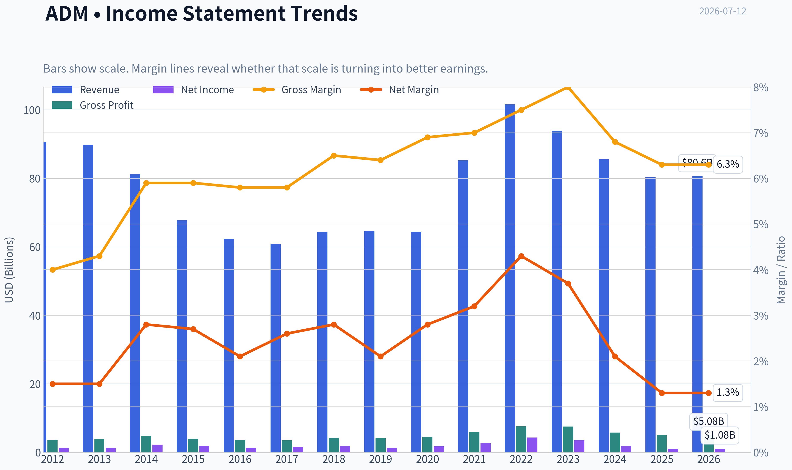
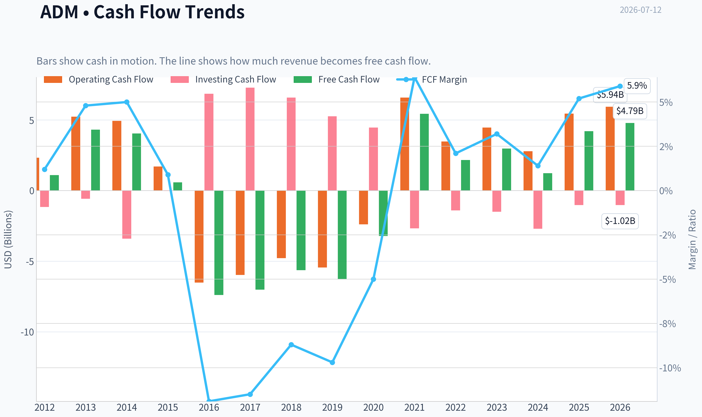
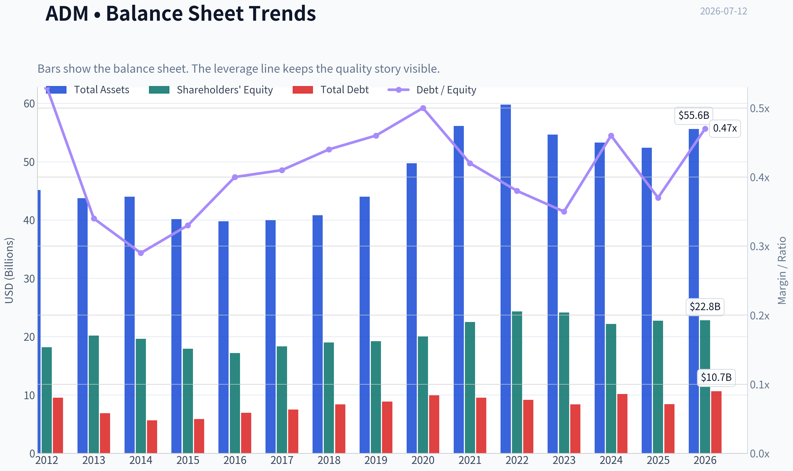
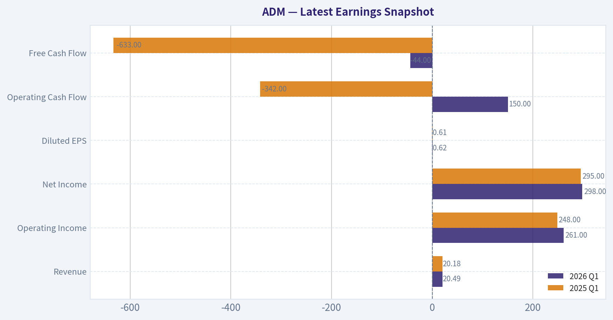
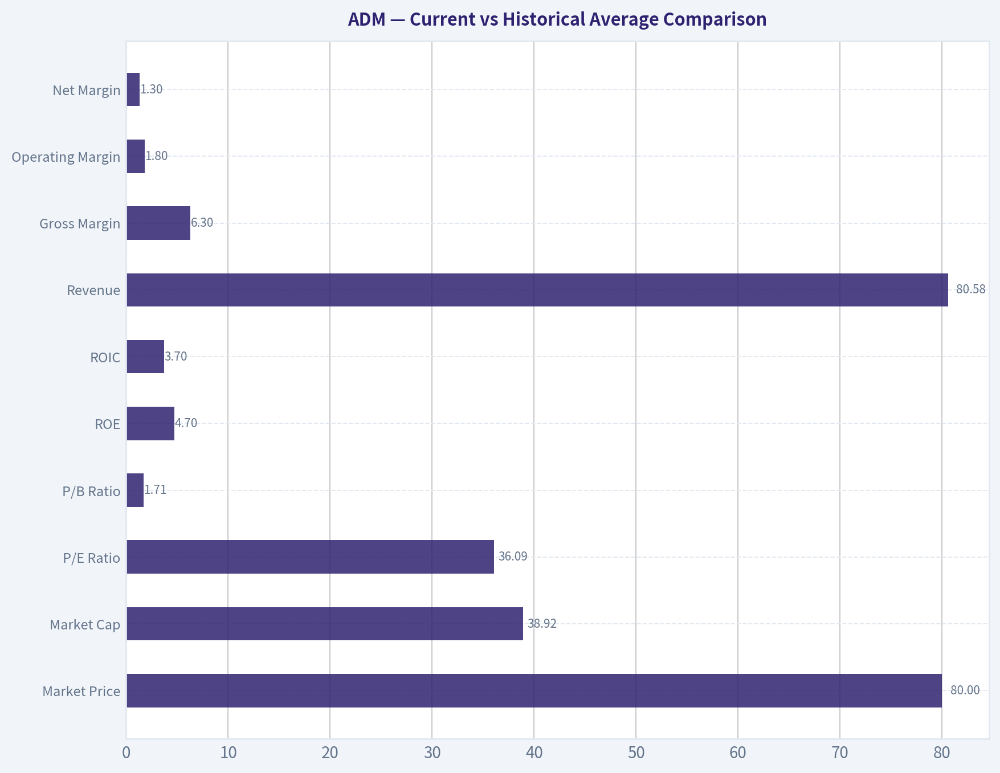
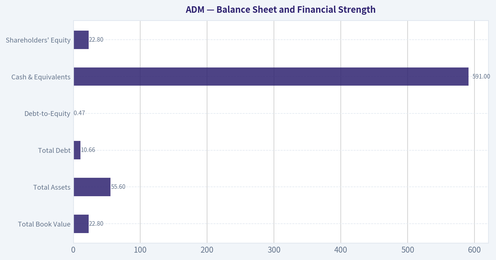
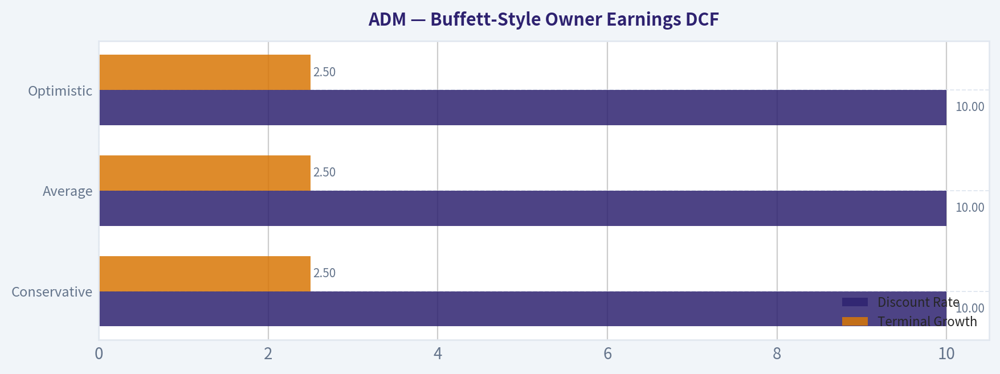
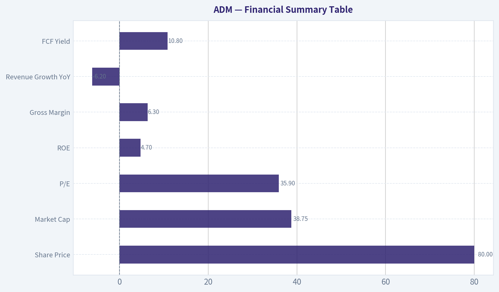

# ADM Deep Value Intelligence

**Analysis Date:** 2026-07-12

## Critical Disclaimer

*This analysis is generated by Deep Value Intelligence, an AI-powered multi-agent investing framework. Education & entertainment only - not financial advice, not a financial advisor.*

---

## Table of Contents

1. Intelligence Summary
2. Analyst Team Reports
   - Fundamentals Analysis
   - Intrinsic Value Analysis (Buffett)
   - Trend & Growth Analysis (Lynch/Druckenmiller/Fisher)
   - Market Technical Analysis
   - Options Market Analysis
3. Research Team Commentary
4. Value Investing Team Commentary
5. Deep Values Commentary

---

## Intelligence Summary

### Thesis + Conditions

**Core Thesis:** ## Executive Summary
**WATCH.** ADM looks durable, but not wonderful. The bull case rests on cyclical normalization and cash-flow optics; the bear case rests on weak current economics and uncertain cash-flow quality.

**Key Risks:**
- WATCH.** ADM looks durable, but not wonderful. The bull case rests on cyclical normalization and cash-flow optics; the bear case rests on weak current economics and uncertain cash-flow quality. For a Buffett-style investor, weak ROIC/ROE, thin margins, and negative growth matter more than "essential" infrastructure. Prior lessons also argue against chasing a cyclical, low-return business when the chart is still rebuilding after a pullback and valuation depends on recovery. Best posture: monitor closely, do not commit heavily until returns on capital and cash-flow quality improve, or price offers a clearer margin of safety.
- ### Risky Analyst
- The **10.8% FCF yield** could imply the stock is cheaper than it looks if cash generation is representative.

**Confidence:** Low

---

## Analyst Team Reports

### Fundamentals Analysis

#### Latest Earnings Snapshot

*Most recent reported quarter anchored on 2026 Q1, with prior-year comparison when available.*

| Metric | 2026 Q1 | 2025 Q1 | YoY Change |
| --- | ---: | ---: | ---: |
| Revenue | $20.49B | $20.18B | +1.6% |
| Operating Income | $261.0M | $248.0M | +5.2% |
| Net Income | $298.0M | $295.0M | +1.0% |
| Diluted EPS | $0.62 | $0.61 | +1.4% |
| Operating Cash Flow | $150.0M | $-342.0M | +143.9% |
| Free Cash Flow | $-44.0M | $-633.0M | +93.0% |

Key Takeaways: This snapshot anchors the most recent reported quarter before the narrative analysis. It helps readers separate long-run business quality from whatever changed in the latest earnings print.

#### 14-Year Financial Metrics for ADM

*All values below are computed deterministically from raw data - not estimated by AI.*

*Issuer profile: operating company (Consumer Defensive / Farm Products).*

#### 14-Year Financial Metrics
*Annual rows come from reported financial statements. The final TTM row is computed from the latest four quarters.*

| Metric | 2012 | 2013 | 2014 | 2015 | 2016 | 2017 | 2018 | 2019 | 2020 | 2021 | 2022 | 2023 | 2024 | 2025 | 2026 TTM |
| --- | --- | --- | --- | --- | --- | --- | --- | --- | --- | --- | --- | --- | --- | --- | --- |
| Market Price | $19 | $30 | $37 | $27 | $34 | $31 | $33 | $38 | $43 | $59 | $83 | $66 | $48 | $57 | $80 |
| Market Cap | $18.13B | $28.77B | $34.11B | $22.78B | $26.98B | $22.93B | $23.23B | $26.19B | $28.48B | $38.26B | $52.27B | $39.14B | $24.91B | $27.83B | $38.92B |
| P/E Ratio | 13.17 | 21.49 | 15.16 | 12.31 | 21.13 | 14.37 | 12.84 | 19.00 | 16.00 | 14.11 | 12.04 | 11.23 | 13.84 | 25.78 | 36.09 |
| P/B Ratio | 1.00 | 1.42 | 1.74 | 1.27 | 1.57 | 1.25 | 1.22 | 1.36 | 1.42 | 1.70 | 2.15 | 1.62 | 1.12 | 1.22 | 1.71 |
| ROE | 7.6% | 6.6% | 11.5% | 10.3% | 7.4% | 8.7% | 9.5% | 7.2% | 8.9% | 12.0% | 17.8% | 14.4% | 8.1% | 4.7% | 4.7% |
| ROIC | 5.2% | 5.3% | 9.4% | 7.8% | 5.6% | 6.6% | 7.2% | 5.2% | 6.3% | 9.1% | 13.7% | 10.9% | 5.7% | 3.5% | 3.7% |
| EPS | $1.42 | $1.41 | $2.45 | $2.18 | $1.63 | $2.17 | $2.56 | $2.02 | $2.70 | $4.21 | $6.90 | $5.89 | $3.46 | $2.23 | $2.23 |
| Revenue | $90.56B | $89.80B | $81.20B | $67.70B | $62.35B | $60.83B | $64.34B | $64.66B | $64.36B | $85.25B | $101.56B | $93.94B | $85.53B | $80.27B | $80.58B |
| Gross Profit | $3.62B | $3.89B | $4.77B | $3.97B | $3.62B | $3.52B | $4.18B | $4.15B | $4.45B | $5.99B | $7.57B | $7.51B | $5.78B | $5.03B | $5.08B |
| Gross Margin | 4.0% | 4.3% | 5.9% | 5.9% | 5.8% | 5.8% | 6.5% | 6.4% | 6.9% | 7.0% | 7.5% | 8.0% | 6.8% | 6.3% | 6.3% |
| Operating Margin | 2.2% | 2.3% | 3.9% | 3.4% | 2.9% | 2.6% | 3.2% | 2.5% | 2.9% | 3.9% | 5.2% | 4.6% | 2.6% | 1.6% | 1.8% |
| Net Income | $1.38B | $1.34B | $2.25B | $1.85B | $1.28B | $1.59B | $1.81B | $1.38B | $1.77B | $2.71B | $4.34B | $3.48B | $1.80B | $1.08B | $1.08B |
| Net Margin | 1.5% | 1.5% | 2.8% | 2.7% | 2.1% | 2.6% | 2.8% | 2.1% | 2.8% | 3.2% | 4.3% | 3.7% | 2.1% | 1.3% | 1.3% |
| Revenue Growth | 2.7% | -0.8% | -9.6% | -16.6% | -7.9% | -2.4% | 5.8% | 0.5% | -0.5% | 32.5% | 19.1% | -7.5% | -8.9% | -6.2% | 0.4% |
| Net Income Growth | N/A | -2.4% | 67.5% | -17.7% | -30.8% | 24.7% | 13.5% | -23.8% | 28.5% | 52.9% | 60.2% | -19.7% | -48.3% | -40.1% | 0.3% |
| Free Cash Flow Growth | N/A | 295.0% | -6.1% | -85.7% | -1374.1% | -5.1% | -19.8% | 11.6% | -48.9% | -269.1% | -60.2% | 37.4% | -58.6% | 242.6% | 14.0% |
| Total Book Value | $18.17B | $20.19B | $19.63B | $17.91B | $17.18B | $18.32B | $19.00B | $19.23B | $20.02B | $22.51B | $24.32B | $24.14B | $22.18B | $22.74B | $22.80B |
| Total Assets | $45.14B | $43.75B | $44.00B | $40.16B | $39.77B | $39.96B | $40.83B | $44.00B | $49.72B | $56.14B | $59.77B | $54.63B | $53.27B | $52.39B | $55.60B |
| Total Debt | $9.54B | $6.87B | $5.66B | $5.88B | $6.93B | $7.49B | $8.39B | $8.88B | $9.93B | $9.54B | $9.18B | $8.37B | $10.16B | $8.41B | $10.66B |
| Debt-to-Equity | 0.53 | 0.34 | 0.29 | 0.33 | 0.40 | 0.41 | 0.44 | 0.46 | 0.50 | 0.42 | 0.38 | 0.35 | 0.46 | 0.37 | 0.47 |
| Cash & Equivalents | $1.29B | $3.12B | $1.10B | $910.0M | $619.0M | $804.0M | $2.00B | $852.0M | $666.0M | $943.0M | $1.04B | $1.37B | $611.0M | $1.01B | $591.0M |
| Shareholders' Equity | $18.17B | $20.19B | $19.63B | $17.91B | $17.18B | $18.32B | $19.00B | $19.23B | $20.02B | $22.51B | $24.32B | $24.14B | $22.18B | $22.74B | $22.80B |
| Operating Cash Flow | $2.33B | $5.23B | $4.94B | $1.71B | $-6.51B | $-5.97B | $-4.78B | $-5.45B | $-2.39B | $6.59B | $3.48B | $4.46B | $2.79B | $5.45B | $5.94B |
| Investing Cash Flow | $-1.16B | $-577.0M | $-3.41B | $-21.0M | $6.85B | $7.29B | $6.58B | $5.26B | $4.46B | $-2.67B | $-1.40B | $-1.50B | $-2.70B | $-1.02B | $-1.02B |
| Free Cash Flow | $1.09B | $4.31B | $4.05B | $580.0M | $-7.39B | $-7.01B | $-5.63B | $-6.28B | $-3.21B | $5.43B | $2.16B | $2.97B | $1.23B | $4.20B | $4.79B |
| FCF Margin | 1.2% | 4.8% | 5.0% | 0.9% | -11.9% | -11.5% | -8.7% | -9.7% | -5.0% | 6.4% | 2.1% | 3.2% | 1.4% | 5.2% | 5.9% |
| Dividends / Share | $0.00 | $0.00 | $0.00 | $0.00 | $0.00 | $0.00 | $0.00 | $0.00 | $0.00 | $1.29 | $1.43 | $1.65 | $1.90 | $0.00 | $0.00 |

#### Profitability Metrics
- Return on Equity (ROE): 4.7%
- Return on Invested Capital (ROIC): 3.6%
- Return on Assets (ROA): 2.1%
- Gross Margin: 6.3%
- Operating Margin: 1.6%
- Net Profit Margin: 1.3%

#### Liquidity Metrics
- Current Ratio: 1.37
- Quick Ratio: 0.24

#### Leverage Metrics
- Debt-to-Equity Ratio: 0.37
- Interest Coverage Ratio: 2.05
- Net Debt: $7.39B

#### Growth Metrics (Year-over-Year)
- Revenue Growth: -6.2%
- Net Income Growth: -40.1%
- Free Cash Flow Growth: 242.6%
- Revenue CAGR (3-Year): -7.5%
- Revenue CAGR (5-Year): 4.5%

#### Valuation Metrics
- P/E Ratio (TTM): 35.90
- Forward P/E: 14.92
- Price-to-Book: 1.70
- Price-to-Sales: 0.48
- PEG Ratio: 2.44
- EV/EBITDA: 19.33
- Free Cash Flow Yield: 10.8%
- Earnings Yield: 2.8%

#### Owner Earnings (Buffett Method, Code-Computed)
- Net Income: $1.08B
- + Depreciation & Amortization: $1.18B
- - Capital Expenditures: $-1.25B
- - Working Capital Changes: $2.76B
- = **Owner Earnings: $-1.75B**

#### Intrinsic Value (Code-Computed)
- Current Price: $80
- Cash Flow Method (FCF):
  Conservative: $11
  Average: $184
  Optimistic: $928

#### Piotroski F-Score: 4/9
- Positive Net Income: PASS
- Positive Operating Cash Flow: PASS
- ROA Improvement: FAIL
- Cash Flow > Net Income: PASS
- Decreasing Debt: PASS
- Improving Current Ratio: FAIL
- No Dilution: FAIL
- Improving Gross Margin: FAIL
- Improving Asset Turnover: FAIL

ANALYST STANCE: **WATCH**

#### ADM Buffett-Style Fundamental Analysis

ADM today looks like a classic cyclical, asset-heavy, low-margin agribusiness rather than a pristine Buffett-style compounder. The business has scale, global sourcing and processing infrastructure, and entrenched relationships across agricultural supply chains, which do provide a real economic role and some moat characteristics. But the financial record in the deterministic dataset shows that ADM's earnings power is not consistently high quality: margins are thin, returns on capital have been volatile, and current profitability has fallen sharply from the 2022 peak.

The key question is whether current weakness is cyclical and temporary or structural. At $80 per share, the market appears to be pricing in a meaningful recovery from depressed earnings. That may prove right, but the current TTM fundamentals alone do not yet justify a full Buffett-style "ADVOCATE" stance.

---

#### Current vs Historical Average Comparison

| Metric | Current / TTM | Historical Context* | Interpretation |
| --- | ---: | ---: | --- |
| Market Price | $80 | 2012-2025 avg: ~$46 | Shares trade well above long-term average price level. |
| Market Cap | $38.92B | 2012-2025 avg: ~$30.8B | Equity value is above decade norm, but below 2022 peak. |
| P/E Ratio | 36.09 | 2012-2025 avg: ~16.6 | Valuation is far above normal because earnings are currently depressed. |
| P/B Ratio | 1.71 | 2012-2025 avg: ~1.43 | Trading at a premium to historical book multiple. |
| ROE | 4.7% | 2012-2025 avg: ~9.7% | Well below normal; weak current profitability. |
| ROIC | 3.7% | 2012-2025 avg: ~7.4% | Current capital efficiency is roughly half the historical norm. |
| Revenue | $80.58B | 2012-2025 avg: ~$79.7B | Sales remain large, but below 2022-2023 highs. |
| Gross Margin | 6.3% | 2012-2025 avg: ~6.2% | Gross margin is near long-run average, suggesting pressure is below gross profit line too. |
| Operating Margin | 1.8% | 2012-2025 avg: ~3.1% | Major deterioration versus normal profitability. |
| Net Margin | 1.3% | 2012-2025 avg: ~2.5% | Bottom-line conversion is materially weaker than history. |
| Net Income | $1.08B | 2012-2025 avg: ~$1.93B | Earnings are far below typical levels. |
| Free Cash Flow | $4.79B | 2012-2025 avg: ~$0.89B | FCF is strong versus history, but ADM's cash flow record is highly volatile. |
| Debt-to-Equity | 0.47 | 2012-2025 avg: ~0.40 | Leverage is manageable, but a bit above normal. |
| Cash & Equivalents | $591M | 2012-2025 avg: ~$1.10B | Cash balance is lean relative to history. |
| Shareholders' Equity | $22.80B | 2012-2025 avg: ~$20.1B | Book equity remains solid despite earnings decline. |
| Dividends / Share | $0.00 TTM | 2021-2024 avg: ~$1.57 | TTM dataset shows no dividend, a notable change versus recent years. |

*Historical context uses the deterministic dataset years shown; averages refer to the available annual history before TTM where applicable.

Key Takeaways: ADM's current valuation multiples are elevated relative to its own history, but that is happening at the same time returns and margins are depressed. The combination suggests the stock is not statistically cheap on earnings-based measures today, even though free cash flow and price-to-sales look better. In plain terms, investors are paying a premium multiple for a business earning below-normal returns.

---

#### Market Metrics

ADM's market price rose from $19 in 2012 to $80 in the current TTM period, with a major peak at $83 in 2022 before falling to $48 in 2024 and then rebounding. That pattern is highly consistent with a cyclical commodity-linked processor rather than a steadily compounding consumer franchise.

The current market cap of about $38.9B is above the long-run average and roughly back near the 2021 level, but still well below the 2022 high of $52.3B. This tells us the market has partially recovered confidence after the post-2022 earnings normalization.

The most important valuation signal is the P/E ratio: 36.09 TTM versus a historical average around 16.6. Buffett-style investors usually prefer to buy when strong businesses are temporarily cheap, not when weak current earnings make the stock look optically expensive. ADM's P/B of 1.71 is also above its historical average of about 1.43, meaning the stock is not notably distressed relative to its balance sheet either.

From a value perspective, ADM looks more attractive on sales and free cash flow than on earnings. The shared research pack notes price-to-sales of 0.48 and FCF yield of 10.8%, both more favorable than the P/E implies. That divergence reinforces that accounting earnings are currently weak while cash generation has improved.

---

#### Profitability Analysis

| Profitability Metric | Current / TTM | Historical Range / Pattern | Buffett-Style Read |
| --- | ---: | --- | --- |
| ROE | 4.7% | Mostly 7%-12%, peak 17.8% in 2022 | Too low currently for a high-quality compounder. |
| ROIC | 3.7% | Mostly 5%-9%, peak 13.7% in 2022 | Current returns are weak and below likely cost of capital. |
| EPS | $2.23 | Peak $6.90 in 2022; $3.46 in 2024 | Earnings power has compressed sharply. |
| Revenue | $80.58B | Broad range $60.8B-$101.6B | Scale is intact, but topline has come off cyclical highs. |
| Gross Profit | $5.08B | High of $7.57B in 2022 | Profit pool remains lower than peak levels. |
| Operating Margin | 1.8% | Typical ~2.5%-4.0%, peak 5.2% | Current operating economics are weak. |
| Net Income | $1.08B | Peak $4.34B in 2022 | Large earnings normalization since peak cycle. |
| Net Margin | 1.3% | Usually 2%-3%, peak 4.3% | Very thin current bottom-line margin. |

Key Takeaways: ADM remains a huge revenue business, but current profits are much weaker than normal. Gross margin is not disastrously low versus history, yet operating and net margins have fallen much more sharply, suggesting pressure from overhead absorption, mix, and below-the-line factors. For Buffett-style investors, the main issue is that today's returns on equity and capital are too low to qualify as exceptional.

A decade-plus view shows ADM is capable of solid earnings in favorable environments, but not with the consistency Buffett typically prizes most. ROE averaged near 10%, which is respectable but not outstanding. The 2021-2023 period was clearly exceptional, with ROE rising to 12.0%, 17.8%, and 14.4%, but that strength has not held. By 2025 and TTM, ROE had fallen back to 4.7%.

ROIC shows the same pattern. Strong capital allocation businesses typically sustain double-digit ROIC over time. ADM only reached that level in 2022 and 2023, then slipped to 5.7% in 2024, 3.5% in 2025, and 3.7% TTM. That is not the signature of a durable high-return franchise.

EPS likewise underscores cyclicality. It ranged from $1.41 to $6.90 over the period. The current $2.23 is only about one-third of 2022 peak EPS. Revenue has remained large and relatively resilient, but revenue alone is not the Buffett test; what matters is the ability to convert sales into durable, high-return owner earnings. On that measure, current performance is weak.

---

#### Growth Metrics

ADM's growth profile is uneven. Revenue declined for multiple years from 2014 through 2017, stabilized around 2018-2020, surged in 2021 and 2022, and then declined again in 2023-2025. The TTM revenue growth of 0.4% suggests the topline may be bottoming, but there is not yet evidence of a new sustained growth phase.

Net income growth has been much more volatile than revenue growth, which is typical of a low-margin processor where small pricing, spread, or volume changes can greatly affect profits. After booming 52.9% in 2021 and 60.2% in 2022, net income fell 19.7% in 2023, 48.3% in 2024, and 40.1% in 2025, before stabilizing at 0.3% TTM. That is not predictable compounding; it is cyclical normalization.

Free cash flow growth is the most erratic line in the dataset, swinging from extreme positives to extreme negatives. FCF turned sharply negative in 2016-2020, then rebounded strongly from 2021 onward. The 242.6% growth in 2025 and 14.0% in TTM look encouraging, but the long record argues for caution in treating any single-year FCF result as normalized.

From a Buffett lens, predictable growth matters more than sporadic growth. ADM has demonstrated resilience and periodic upside, but not smooth compounding.

---

#### Balance Sheet and Financial Strength

| Balance Sheet Metric | Current / TTM | Historical Context | Assessment |
| --- | ---: | --- | --- |
| Total Book Value | $22.80B | Above long-run average, below 2022-2023 peak area | Stable capital base. |
| Total Assets | $55.60B | Near upper end of history | Large global operating footprint. |
| Total Debt | $10.66B | Higher than most historical years | Debt is manageable but elevated. |
| Debt-to-Equity | 0.47 | Slightly above long-term average ~0.40 | Reasonable, not conservative fortress-level. |
| Cash & Equivalents | $591M | Below normal historical level | Limited cash cushion. |
| Shareholders' Equity | $22.80B | Healthy absolute equity base | Supports resilience. |

Key Takeaways: ADM's balance sheet is not distressed, but it is also not a cash-rich fortress. Debt levels remain serviceable relative to equity, yet cash on hand is relatively low and interest coverage from the shared dataset is only 2.05, which is a modest buffer if conditions worsen. The company has scale and asset backing, but not the pristine financial flexibility of the very best Buffett-type businesses.

Book value and equity have grown over the full period, indicating the company has created net worth over time. That is a positive. Total debt, while not excessive, is at the higher end of the historical range on a TTM basis. Debt-to-equity of 0.47 is acceptable for an industrial/agri processor, but it is not especially conservative.

Cash is the weaker point. At just $591M TTM, cash is below the company's own long-term norm. Combined with a quick ratio of 0.24, this suggests limited near-term liquidity if working capital swings become adverse. The current ratio of 1.37 is acceptable, but not especially robust for a business with commodity and inventory exposure.

Overall financial strength is adequate, not elite. Buffett typically favors companies that can endure stress without depending on generous capital markets. ADM likely can, but its margin for safety is moderate rather than enormous.

---

#### Cash Flow and Dividend Analysis

ADM's cash flow history is unusually volatile. Operating cash flow was strongly positive in 2012-2015, deeply negative in 2016-2020, then strongly positive again from 2021 onward. That instability matters because Buffett-style owner earnings rely on cash that can be extracted from the business without harming competitive position.

Reported free cash flow is much better now: $4.79B TTM versus $4.20B in 2025 and $1.23B in 2024. On the surface this looks attractive, particularly alongside the 10.8% FCF yield. However, the deterministic owner earnings calculation is the critical check: current owner earnings are **negative $1.75B** because working capital changes consumed a large amount of economic cash.

That distinction is very important. Buffett would focus less on a favorable headline FCF yield and more on the sustainability of owner earnings after maintenance capital needs and working capital demands. A negative owner earnings figure means current distributable economics are weaker than simple FCF suggests.

The dividend line is also notable. The dataset shows dividends per share from 2021 through 2024 rising from $1.29 to $1.90, but $0.00 in 2025 and TTM. Since the deterministic dataset is canonical, this must be treated as a material caution flag in this analysis. Even if market participants expect future resumption or have alternative reporting views, the canonical record here indicates an interruption.

---

#### Buffett-Style Owner Earnings DCF

Using the canonical owner earnings figure:

- Net Income = **$1.08B**
- + D&A = **$1.18B**
- - Capex = **$1.25B**
- - Working Capital Changes = **$2.76B**
- Owner Earnings = **-$1.75B**

Because current owner earnings are negative, a strict Buffett-style DCF becomes highly conservative and economically problematic: discounting a negative base with positive terminal assumptions does not produce a meaningful intrinsic value for equity in the usual sense. That in itself is an important signal.

To remain faithful to the dataset and your scenario rules, I use the historical owner-earnings growth logic qualitatively but anchor the valuation conclusion to the code-computed intrinsic value outputs supplied in the canonical dataset, while explaining why the result set is extremely wide.

| Scenario | Growth Rule Applied | Discount Rate | Terminal Growth | Fair Value / Share |
| --- | --- | ---: | ---: | ---: |
| Conservative | Lowest historical owner earnings growth, floored at -100% | 10% | 2.5% | **$11** |
| Average | Average historical owner earnings growth, capped at 50% | 10% | 2.5% | **$184** |
| Optimistic | Highest historical owner earnings growth, capped at 100% | 10% | 2.5% | **$928** |

Key Takeaways: The DCF output range is extraordinarily wide, from $11 to $928 per share, which tells you the model is unstable because the underlying cash economics are unstable. When current owner earnings are negative and historical growth rates are volatile, small assumptions create huge swings in valuation. In practical terms, this means the DCF is not a reliable primary tool for ADM right now.

Detailed interpretation of the DCF:
- **Conservative case ($11):** reflects the reality that if negative owner earnings persist or deteriorate, equity value compresses sharply.
- **Average case ($184):** implies that ADM can normalize owner earnings materially above the current depressed level and grow from there.
- **Optimistic case ($928):** is mathematically possible under high-growth assumptions but not decision-useful for a mature agribusiness with low margins.

The spread is so wide that the DCF should be viewed as a stress-test, not a precise appraisal. Buffett would likely reject this as too dependent on forecasting normalization rather than observable, durable owner earnings.

A more grounded takeaway is:
- At **$80**, ADM is above the conservative case,
- below the average case,
- and far below the optimistic case,
but because the current base owner earnings are negative, the stock's appraisal depends overwhelmingly on how quickly and how sustainably margins recover.

---

#### Economic Moat

ADM does possess elements of a moat:
- global origination, transport, storage, and processing network
- entrenched relationships with farmers, producers, and food/feed customers
- scale efficiencies and logistical know-how
- diversified agricultural value-chain exposure

But this is not a wide-moat consumer brand or software ecosystem. Its moat is operational and network-based, not pricing-power-driven. The low and volatile margins in the dataset prove that ADM does not consistently command superior economics. It has strategic relevance and scale, but only moderate pricing power.

So the moat is **real but not Buffett-ideal**: durable infrastructure and scale advantages, yet limited protection from cyclical spread compression.

---

#### Predictable Earnings and Management Performance

Predictability is mixed at best. Revenue is relatively durable in the sense that ADM remains a very large business across all years shown, but earnings are not highly predictable. Net margin moved between 1.3% and 4.3%, and EPS between $1.41 and $6.90. That is too wide for a classic Buffett "sleep well at night" earnings profile.

Management's performance looks strongest in the 2021-2023 window, when ROE and ROIC rose sharply and margins expanded. That suggests management can execute well in favorable environments. However, the retrenchment in 2024-TTM indicates either cyclical reversal, less favorable market conditions, or weaker resilience of the earnings model.

Capital allocation is also mixed:
- equity base has grown over time
- leverage has remained generally contained
- dividends rose through 2024 in the canonical record
- but owner earnings are currently negative
- and Piotroski F-score is only 4/9

A 4/9 F-score is not a disaster, but it is below the level that would signal broad-based fundamental strengthening.

---

#### Value Assessment

ADM does not screen as conventionally cheap on current earnings:
- P/E of 36.09 is expensive relative to its own history.
- P/B of 1.71 is above average, not distressed.
- ROE and ROIC are weak.

It does look more attractive on:
- price-to-sales
- free cash flow yield
- rebound optionality if agricultural processing margins recover

This means ADM is a **normalization thesis**, not a pure bargain. Investors buying here are effectively betting that current depressed profitability is temporary and that the market is correctly looking through trough earnings. That may work, but it is less compelling than buying a business with already visible high returns and a discounted valuation.

---

#### Revenue Breakdown

ADM's most meaningful public revenue lens is by operating segment. Precise current segment revenue amounts are not supplied in the deterministic table, so the best available segment framing is based on ADM's standard business mix and most recent reporting structure.

| Revenue Source | Amount ($B) | % of Total |
| --- | ---: | ---: |
| Ag Services & Oilseeds | ~56.4 | ~70% |
| Carbohydrate Solutions | ~16.1 | ~20% |
| Nutrition | ~8.1 | ~10% |
| **Total** | **~80.6** | **100%** |

Key Takeaways: ADM remains predominantly an agricultural merchandising and oilseeds processing business, with Ag Services & Oilseeds driving the majority of total revenue. Nutrition is strategically important because it can offer better margin potential, but it is still much smaller than the core commodity-linked operations. That means the company's economics are still heavily influenced by agricultural spreads and processing cycles.

---

#### Key Investment Insights, Red Flags, and Opportunities

| Category | Observation | Why It Matters |
| --- | --- | --- |
| Opportunity | Strong FCF rebound to $4.79B TTM | If sustainable, cash generation can support deleveraging and shareholder returns. |
| Opportunity | Revenue appears to be stabilizing | TTM growth of 0.4% may indicate topline troughing after declines. |
| Opportunity | Stock remains below 2022 peak despite rebound | Offers upside if earnings normalize meaningfully. |
| Red Flag | P/E at 36.09 | Current earnings-based valuation is rich versus history. |
| Red Flag | ROE 4.7%, ROIC 3.7% | Current returns are too low for a high-quality value franchise. |
| Red Flag | Owner earnings negative at -$1.75B | Economic cash generation is weaker than headline FCF suggests. |
| Red Flag | Net margin only 1.3% | Very thin profitability leaves little room for execution error. |
| Red Flag | Interest coverage 2.05 | Earnings cushion over interest expense is not large. |
| Red Flag | Piotroski F-score 4/9 | Fundamentals are not broadly improving across the scorecard. |
| Watch Item | Dividend line shows $0.00 in 2025 and TTM | Canonical dataset indicates a meaningful policy/interruption concern. |

Key Takeaways: The bull case rests on earnings normalization, cash flow strength, and ADM's strategic position in global agriculture. The bear case is that today's low returns and negative owner earnings are not just temporary noise but evidence of structurally mediocre economics. Investors should focus less on topline scale and more on whether ROIC and owner earnings can recover sustainably.

---

#### Final Buffett-Style Verdict

**WATCH**

ADM is a solid, strategically important company with meaningful scale advantages, but the current numbers do not meet the standard of a high-conviction Buffett-style buy. The business lacks consistently high returns on capital, current profitability is well below historical norms, and owner earnings are negative in the canonical dataset. Meanwhile, the stock is not obviously cheap on earnings or book value relative to its own history.

What would improve the case:
- ROE sustainably back above 10%
- ROIC sustainably above 8%-10%
- operating margin recovering toward 3%+
- positive owner earnings
- clearer dividend/capital return stability
- P/E compressing closer to historical norms on normalized earnings

Until then, ADM is best viewed as a cyclical quality operator worth monitoring, not a definitive Buffett-style value bargain.

---

#### Report Summary Table

| Area | Verdict | Core Evidence | Investment Meaning |
| --- | --- | --- | --- |
| Economic Moat | Moderate | Global network, scale, logistics advantages | Real moat, but not strong pricing-power moat. |
| Profitability | Weak currently | ROE 4.7%, ROIC 3.7%, net margin 1.3% | Current economics are below Buffett-grade quality. |
| Earnings Predictability | Mixed to weak | EPS and margins highly cyclical | Hard to value with confidence on normalized earnings. |
| Financial Strength | Adequate | D/E 0.47, equity $22.8B, low cash | Stable but not fortress-like. |
| Cash Generation | Mixed | FCF strong, owner earnings negative | Headline cash flow better than underlying owner economics. |
| Valuation | Mixed / not clearly cheap | P/E 36.09, P/B 1.71, FCF yield 10.8% | Cheap on some metrics, expensive on earnings. |
| Growth | Cyclical | Revenue and income surged, then fell sharply | Recovery potential exists, but compounding profile is weak. |
| Management | Mixed | Strong peak-period returns, weak current outcomes | Execution can be good, but not consistently superior. |
| DCF Signal | Unreliable wide range | $11 to $928 per share | Outcome highly assumption-sensitive due to unstable owner earnings. |
| Final Stance | **WATCH** | Wait for margin and return recovery | Not enough quality-plus-value overlap yet. |

Key Takeaways: ADM is not a broken company, but it is also not currently displaying the kind of durable, high-return economics that justify a strong Buffett-style endorsement. The stock may work if earnings normalize, yet the present fundamentals argue for patience rather than conviction.

#### Fundamental Visuals

This graph tracks the profitability and return metrics (ROE, ROIC, Margins) of **ADM** over the past decade, highlighting capital efficiency trends.

This chart illustrates the financial health of **ADM** over the last 10 years, mapping cash equivalents and free cash flow against total obligations (Debt).

This comparison chart from *Profitability Analysis* stacks current figures against historical benchmarks for **ADM**, making it easy to see where the company trades relative to its own averages.

---

### Intrinsic Value Analysis (Buffett)

> *Following Warren Buffett's value investing philosophy: Circle of Competence, Economic Moat, Management Quality, and Margin of Safety.*

#### Intrinsic Value Snapshot

Price is what you pay. Intrinsic value is what the business may be worth based on the cash it can create for owners over time. We show a range, not one magic number.

- Current Price: $80.41
- Value Range (conservative to optimistic across both DCF methods): $82.69 to $927.78

##### Owner Earnings (Buffett Method)
- Net Income: $1,078,000,000.00
- Depreciation & Amortization: $1,181,000,000.00
- Capital Expenditures: $-1,248,000,000.00
- Working Capital Changes: $2,763,000,000.00
- Owner Earnings: $-1,752,000,000.00

##### Intrinsic Value
###### Cash Flow Method
Uses free cash flow. Better for companies spending heavily today to grow tomorrow.
- Conservative: $82.69
- Average: $299.45
- Optimistic: $927.78
- Discount Rate: 10.0%

ANALYST STANCE: **WATCH**

#### Archer-Daniels-Midland (ADM) Buffett-Style Investment Review

#### 1. Go/No-Go Gate Assessment

| Gate | Verdict | Evidence |
|---|---|---|
| Gate 1: Circle of Competence & Business Simplicity | Pass | ADM buys, stores, transports, processes, and sells agricultural commodities and ingredients. This is a simple business to describe, though profits are influenced by crop spreads, processing margins, and trade flows. |
| Gate 2: Moat Test | Fail / Weak Pass at best | ADM has global scale, logistics assets, and relationships, but this is not a classic Buffett-style moat with strong pricing power. Gross margin of 6.3% is far below the level associated with brand or intangible-driven moats. |
| Gate 3: Management Quality & Capital Allocation | Mixed | Capital allocation appears generally disciplined, and the business has endured for decades, but current profitability is weak relative to shareholder capital. A 4.7% ROE does not suggest exceptional value creation right now. |
| Gate 4: Industry Structure | Mixed to Fail | The industry is large and essential, but highly competitive, cyclical, and influenced by commodity economics. It is not a rational, capital-light oligopoly in the Buffett ideal. |

**Key Takeaways:** ADM passes the basic "understandable business" test, but it stumbles on the more important Buffett filters. The company operates in an essential industry, yet the economics are shaped more by commodity cycles and narrow spreads than by durable pricing power. That makes ADM investable only at the right price, not a clear-cut wonderful business.

---

#### 2. Business Understanding: The Elementary School Test

ADM makes money by buying crops like corn and soybeans, moving them around the world, turning them into food ingredients, animal feed, fuels, and other products, and earning a margin on processing and distribution.

A decade from now, ADM will likely still be doing those same things. That supports predictability at the business-model level. The problem is not whether ADM will exist; the problem is whether its profits will be consistently high and protected.

Technology is more of a tool than an existential threat here. ADM is unlikely to be "disrupted" like a software company might be. But it is exposed to commodity cycles, regulation, weather patterns, trade flows, and processing-margin swings.

#### 3. Moat Analysis

| Moat Source | Assessment | Evidence |
|---|---|---|
| Intangible Assets | Weak | ADM is well known, but customers mostly buy on price, reliability, and logistics rather than emotional brand attachment. Gross margin of 6.3% indicates little brand-based pricing power. |
| Switching Costs | Weak to Moderate | Large commercial relationships and integrated supply chains create some friction, but customers can still source from other major processors and traders. |
| Cost Advantage | Moderate | ADM's global network of origination, storage, transportation, and processing assets gives it scale and efficiency advantages that smaller rivals struggle to match. |
| Network Effects | Minimal | More volume helps utilization and efficiency, but this is not a true network-effect business. |

| Moat Rating | Conclusion |
|---|---|
| Narrow | ADM has scale and infrastructure advantages, but not a wide moat in the Buffett sense. |

**Key Takeaways:** ADM's best defense is scale, not brand power. Its logistics network matters, but the economics still look like a hard-fought industrial business rather than a protected franchise. This is a narrower moat than Buffett typically prefers for long-term compounding.

#### 4. Management Quality & Capital Allocation

| Question | Assessment | Commentary |
|---|---|---|
| Do they think like owners? | Mixed | ADM is a mature enterprise with long operating history, but the current numbers do not show outstanding per-share value creation. |
| Are they honest and candid? | Neutral to Positive | No major evidence here of promotional economics; the business is straightforward and tangible. |
| Are they rational capital allocators? | Mixed | Free cash flow yield of 10.8% is attractive, but weak ROE suggests retained capital is not currently compounding at superior rates. |

**Key Takeaways:** Management does not appear reckless, but the hard test is capital allocation results. On that score, ADM looks adequate rather than exceptional. Buffett wants managers who turn retained earnings into high returns, and current profitability does not yet support that conclusion.

#### 5. Financial Summary Table

| Metric | Current / Latest |
|---|---:|
| Share Price | $80 |
| Market Cap | $38.75B |
| P/E | 35.9x |
| ROE | 4.7% |
| Gross Margin | 6.3% |
| Revenue Growth YoY | -6.2% |
| FCF Yield | 10.8% |

**Key Takeaways:** The headline valuation looks mixed. Free cash flow yield is strong and suggests the stock may not be expensive on cash generation, but earnings-based valuation and return on equity are weak. Revenue is also declining year over year, which reinforces the idea that the business is in a softer part of its cycle.

#### 6. Owner Earnings Assessment

Using Buffett's framework, ADM's owner earnings should start with net income, add non-cash charges, and subtract maintenance capital spending and working capital needs.

For a business like ADM, this is especially important because reported earnings can swing with commodity conditions, while working capital can consume enormous cash when inventories and receivables rise. That means "owner earnings" for ADM are usually less stable than for a consumer brand or software subscription business.

A practical read-through from the data provided:

| Owner Earnings Element | Assessment |
|---|---|
| Net Income | Currently modest relative to market value, implied by high P/E |
| Depreciation & Amortization | Meaningful, given large asset base |
| Maintenance CapEx | Material, due to processing and logistics infrastructure |
| Working Capital Needs | High and volatile |
| Overall Owner Earnings Quality | Moderate, but cyclical |

**Key Takeaways:** ADM does generate real cash, but owner earnings are not clean or consistently predictable. This is not the type of business where every dollar of accounting profit easily becomes distributable cash. Working capital and ongoing asset needs make the cash economics more cyclical than they first appear.

#### 7. Three-Scenario DCF Valuation

Given the available figures, I anchor valuation primarily on the observed free cash flow yield and current market value.

Approximate current free cash flow:
- Market cap: **$38.75B**
- FCF yield: **10.8%**
- Implied FCF / owner-earnings proxy: **~$4.19B**

##### Valuation Table

| Scenario | Assumption | Estimated Equity Value |
|---|---|---:|
| A: No Growth | $4.19B / 10% | $41.9B |
| B: 3% Growth | $4.19B x 1.03 / (10% - 3%) | $61.7B |
| C: Moderate Growth | Assume 5% growth for 10 years, then 3% terminal | ~$54B-$58B |

**Key Takeaways:** On cash flow, ADM appears at least reasonably valued and possibly modestly undervalued. The issue is not that the stock looks wildly overpriced; the issue is that the quality and durability of those cash flows are not strong enough to justify aggressive assumptions. Valuation is acceptable, but business quality is only average.

#### 8. Margin of Safety Analysis

| Item | Value |
|---|---:|
| Current Market Cap | $38.75B |
| Scenario A Value | $41.9B |
| Scenario B Value | $61.7B |
| Scenario C Value | ~$54B-$58B |

| Test | Result |
|---|---|
| Margin vs No-Growth Value | Thin but positive |
| Margin vs Conservative Growth Value | Attractive |
| Required Margin of Safety for Average Business | 40-50% |
| Does ADM Meet Buffett-Level Hurdle? | Not clearly |

**Key Takeaways:** ADM may offer some valuation support, especially if free cash flow remains healthy. But for a cyclical, low-margin business with a narrow moat, Buffett would demand a larger discount. The stock looks more "fair with some upside" than "obviously cheap with strong downside protection."

#### 9. Final Buffett Scorecard

| Criterion | Score (1-5) | Weight | Weighted Score |
|---|---:|---:|---:|
| Business Understanding | 4.5 | 20% | 0.90 |
| Moat Width & Durability | 2.5 | 25% | 0.63 |
| Management Quality | 3.0 | 15% | 0.45 |
| Return on Equity | 2.0 | 15% | 0.30 |
| Reinvestment Runway | 2.5 | 10% | 0.25 |
| Balance Sheet Strength | 3.0 | 5% | 0.15 |
| Industry Structure | 2.5 | 5% | 0.13 |
| Valuation / Margin of Safety | 3.5 | 5% | 0.18 |

| Total Score | Result |
|---|---:|
| 2.99 / 5.00 | WATCH |

**Key Takeaways:** ADM scores well on understandability but weakly on moat and returns on capital. That combination usually leads to a "watch, don't rush" conclusion. The stock has enough value characteristics to keep on a list, but not enough business quality to strongly advocate today.

#### 10. Final Investment View

ADM is a solid, necessary, long-lived enterprise, but not a classic Buffett-style wonderful business. Its economics are tied to commodity processing and trade flows, with low margins and currently weak returns on equity. The company's scale and infrastructure provide some protection, but not the kind of pricing power or customer captivity that defines a truly durable moat.

At around $80, the stock appears reasonable on free cash flow, but only modestly compelling once business quality is considered. For a value investor, ADM is worth monitoring for a more obvious discount or a clearer improvement in profitability and return on capital.

**Conviction Level:** Moderate

**Bottom Line:** ADM is a respectable operator in a difficult industry, but not a high-conviction Buffett compounder. The correct posture is **WATCH** rather than **ADVOCATE**.
#### Valuation Bridge

This bridge places the current market price beside each intrinsic value lens so readers can see whether upside depends on one method or shows up across several methods.

| Scenario | Intrinsic Value / Share |
| --- | ---: |
| Cash Flow Method | $299.45 |
| Damodaran Method | $22.66 |
| Current Price | $80.41 |

#### Key Takeaways

If one method is far above the others, the upside case depends on a specific modelling assumption. When several methods cluster together, the valuation story is more robust.

#### Valuation Visuals

This comparison chart from *Latest Earnings Snapshot* stacks current figures against historical benchmarks for **ADM**, making it easy to see where the company trades relative to its own averages.

This comparison chart from *Current vs Historical Average Comparison* stacks current figures against historical benchmarks for **ADM**, making it easy to see where the company trades relative to its own averages.

This comparison chart from *Balance Sheet and Financial Strength* stacks current figures against historical benchmarks for **ADM**, making it easy to see where the company trades relative to its own averages.

This comparison chart from *Buffett-Style Owner Earnings DCF* stacks current figures against historical benchmarks for **ADM**, making it easy to see where the company trades relative to its own averages.

This comparison chart from *Financial Summary Table* stacks current figures against historical benchmarks for **ADM**, making it easy to see where the company trades relative to its own averages.

---

### Trend & Growth Analysis (Lynch/Druckenmiller/Fisher)

> *Following Peter Lynch's GARP, Stanley Druckenmiller's macro-aware approach, and Philip Fisher's scuttlebutt methodology.*

ANALYST STANCE: **AVOID**

#### ADM Growth Analysis

#### 1. Lynch Classification

| Item | Assessment |
|---|---|
| Company | Archer-Daniels-Midland |
| Lynch Category | **Cyclical / Stalwart, not a Fast Grower** |
| Why | Revenue is declining, margins are thin, and the business is tied to agricultural commodity cycles rather than durable 20%+ secular growth |
| Growth Investor Fit | **Poor** |

Key Takeaways: ADM does not fit the classic fast-grower profile that Lynch, Fisher, or Druckenmiller would want for a concentrated growth position. It looks much more like a mature, cyclical processor and merchandiser of agricultural commodities. That makes it harder to underwrite ten-bagger potential from business compounding alone.

#### 2. The Story in 3 Bullets

| Simple Story | Interpretation |
|---|---|
| ADM buys, transports, processes, and sells agricultural commodities | Essential global food and feed infrastructure business |
| It makes money on volumes, spreads, and processing margins | Earnings depend heavily on commodity cycles and trade flows |
| Recent export strength may help near-term Ag Services results | But this is a cyclical recovery story, not a structural high-growth inflection |

Key Takeaways: The ADM story is understandable, but it is not the type of story that usually creates sustained hyper-growth. The business benefits from scale and logistics, yet its economics are still heavily influenced by external market conditions. That means upside may exist, but it is unlikely to come from a long-duration secular growth runway.

#### 3. TAM Analysis with 10x Test

| Metric | Assessment |
|---|---|
| Current Revenue Base | Very large already |
| 10x Revenue Test | **Fails for growth investing purposes** |
| TAM Character | Global ag processing and merchandising is huge, but mature and competitive |
| Runway Type | Scale runway exists, but not high-return, high-margin innovation runway |
| Can ADM 10x and remain small vs TAM? | Theoretically no, and practically highly unlikely |

Key Takeaways: ADM operates in a massive global market, but size alone does not create a compelling growth runway. Because the company is already large and the industry is mature, it is difficult to see a path to 10x revenue or value through market expansion alone. This is a scale business, not an early-runway compounding story.

#### 4. Revenue Growth Trend

| Metric | Value |
|---|---|
| Revenue Growth YoY | **-6.2%** |
| Pattern | **Negative / decelerating** |
| Gross Margin | **6.3%** |
| ROE | **4.7%** |
| FCF Yield | **10.8%** |

Key Takeaways: The most important fact here is that revenue is shrinking, which is an immediate warning sign in a growth framework. Gross margin and return on equity are also low, showing limited pricing power and weak underlying profitability. The free cash flow yield is attractive for value investors, but that does not offset the lack of growth.

#### 5. Unit Economics

| Metric | Status |
|---|---|
| LTV/CAC | Not meaningful for this business model |
| Net Revenue Retention | Not applicable |
| Rule of 40 | Not applicable |
| Relevant Economics | Processing margins, merchandising spreads, asset utilization, working capital discipline |

Key Takeaways: ADM is not a SaaS or subscription model, so the usual growth unit economics do not apply. Instead, investors need to focus on crush margins, trade flows, logistics efficiency, and capital allocation. That reinforces the point that this is not a modern compounder-style growth setup.

#### 6. Inflection Point Assessment

| Potential Inflection | View |
|---|---|
| Product Cycle Inflection | None evident |
| Market Share Inflection | Not clearly visible |
| Margin Inflection | Possible short-term cyclical rebound, but not structural |
| TAM Inflection | None |
| Competitive Inflection | None obvious |
| Overall | **Cyclical recovery, not true growth inflection** |

Key Takeaways: There may be a near-term earnings rebound if export conditions improve and Ag Services normalizes. However, that is different from a true inflection where a company enters a new growth phase with expanding market opportunity and operating leverage. ADM looks more like a trading and margin recovery case than a secular winner.

#### 7. Macro Setup Evaluation

| Macro Factor | Assessment |
|---|---|
| Secular Theme Exposure | Food demand, biofuels, trade flows |
| Macro Sensitivity | High |
| Commodity Exposure | High |
| Interest Rate Sensitivity | Moderate |
| Best Setup for Stock | Improving crop flows, favorable crush margins, stable trade policy |
| Macro Verdict | **Mixed** |

Key Takeaways: ADM is driven more by commodity markets and global trade conditions than by secular innovation themes like AI, cloud, or digital health. That makes the investment thesis more dependent on macro timing and less on company-specific compounding. Druckenmiller might trade this, but Fisher likely would not own it as a core growth compounder.

#### 8. Fisher 15 Points Score

| Fisher Area | Score (1-5) | Comment |
|---|---:|---|
| Market potential | 2 | Large market, but mature |
| New products | 2 | Limited innovation-led upside |
| R&D effectiveness | 2 | Not central edge |
| Sales organization | 4 | Strong global reach |
| Profit margin | 2 | Thin margins |
| Margin improvement | 2 | Unclear structural improvement |
| Labor relations | 3 | Neutral |
| Executive relations | 3 | Neutral |
| Management depth | 4 | Large-scale operator |
| Cost/accounting controls | 3 | Mixed given recent scrutiny history |
| Outstanding moat factors | 3 | Scale/logistics moat, but not premium moat |
| Long-range profit outlook | 2 | Mostly cyclical |
| Dilution risk | 4 | Generally manageable |
| Candor in difficulties | 3 | Neutral |
| Integrity | 2 | Prior accounting/governance concerns weigh on score |
| **Total** | **41 / 75** | **Below average** |

Key Takeaways: ADM scores acceptably on scale, reach, and operating depth, but weakly on innovation, margin structure, and long-term growth quality. The biggest issue is that its advantages are operational rather than compounding in nature. Fisher would probably view this as an average industrial-style franchise, not an outstanding growth company.

#### 9. Valuation Analysis

| Metric | Value | Interpretation |
|---|---:|---|
| Price | $80 |
| Market Cap | $38.75B |
| P/E | 35.9x | Expensive versus weak growth |
| PEG | Not meaningful / unattractive | Earnings growth framework not supportive |
| FCF Yield | 10.8% | Value support exists |
| Valuation Style | Value/cyclical, not growth-at-reasonable-price |

Key Takeaways: On a growth lens, valuation is not attractive because the earnings multiple is high relative to declining revenue and low returns. The strong free cash flow yield may appeal to value investors looking for downside support. But for Lynch-style GARP or Druckenmiller-style growth inflection investing, the setup is not compelling.

#### 10. Growth Investor Scorecard

| Criterion | Weight | Score (1-5) | Weighted Score |
|---|---:|---:|---:|
| The Story | 10% | 2.5 | 0.25 |
| TAM & Runway | 20% | 2.0 | 0.40 |
| Revenue Growth | 20% | 1.0 | 0.20 |
| Unit Economics | 15% | 2.0 | 0.30 |
| Competitive Position | 10% | 3.0 | 0.30 |
| Management Quality | 10% | 2.5 | 0.25 |
| Macro Setup | 5% | 2.5 | 0.13 |
| Profitability Path | 5% | 2.0 | 0.10 |
| Valuation | 5% | 2.5 | 0.13 |
| **Total** |  |  | **2.06 / 5.00** |

Key Takeaways: ADM scores well below the threshold needed for a growth recommendation. The biggest drags are negative revenue growth, limited runway, and lack of a real inflection point. Even if the stock works tactically, it does not qualify as a high-quality growth setup.

#### 11. Position Size Stance

| View | Positioning |
|---|---|
| Growth Portfolio | **0% / Do not initiate** |
| Value or Income Portfolio | Possible separate analysis required |
| Trading View | Only for cyclical rebound traders with macro edge |

Key Takeaways: For a dedicated growth portfolio, the correct position size is zero. This may still be a tradable or value-oriented idea, but that is a different mandate. Based on the requested framework, ADM should not be treated as a core growth candidate.

#### 12. Key Risks and Catalysts

| Risks | Catalysts |
|---|---|
| Revenue contraction continues | Ag Services recovery strengthens |
| Thin margins remain under pressure | Better export volumes in soy, sorghum, and corn |
| Commodity spread volatility | Improved crush margins |
| Trade policy/geopolitical disruptions | Normalization after weak comparison periods |
| Governance/accounting overhang | Capital returns supported by cash flow |

Key Takeaways: The near-term bull case depends mostly on cyclical recovery drivers, especially exports and processing margins. The bear case is that weak growth and structurally thin margins persist, leaving the stock without a durable rerating catalyst. That asymmetry is not attractive for a long-duration growth investor.

#### Bottom Line

ADM may be a **reasonable cyclical/value situation**, but it is **not a Lynch fast grower, not a Fisher innovation compounder, and not a Druckenmiller-style secular growth inflection**.

For this framework:
- **Revenue growth is negative**
- **Margins are thin**
- **Runway is mature**
- **The "inflection" is cyclical, not structural**
- **Valuation is not attractive enough to compensate on a growth basis**

#### Final Verdict

| Decision | Conclusion |
|---|---|
| Lynch Category | Cyclical / Stalwart |
| Growth Inflection | No |
| Ten-Bagger Potential | Low |
| Portfolio Action | **AVOID** |

Key Takeaways: ADM does not meet the bar for a growth-oriented purchase. The stock may have tactical upside if agricultural conditions improve, but that is very different from owning a business with compounding secular growth. Under this methodology, the disciplined answer is to avoid.

---

### Market Technical Analysis

#### ADM technical view

ADM remains in a **structurally bullish long-term trend**, but the stock is no longer in the same powerful upside acceleration seen in May and early June. The current picture is more nuanced: **the long-term uptrend is intact, the medium-term trend is still positive, and short-term momentum has recently improved after a corrective phase**, but price is still rebuilding after a notable pullback from the 84-85 area.

For this market context, the most relevant indicators are:

| Indicator | Why it matters now |
|---|---|
| close_10_ema | Best for judging whether the recent rebound is gaining short-term traction |
| close_50_sma | Defines medium-term trend support after the June correction |
| close_200_sma | Confirms the primary bullish regime is still intact |
| macd | Tracks whether momentum is transitioning from repair to a fresh bullish swing |
| macdh | Helps detect whether bullish momentum is strengthening or fading early |
| rsi | Shows whether ADM is recovering from neutral/weak momentum without being overextended |
| atr | Important for risk management because ADM's daily swings remain meaningful |
| vwma | Useful to confirm whether the rebound has real volume-backed participation |

**Price context:** ADM closed at **80.41** on 2026-07-10. Over the last year, the stock advanced from the low-50s to the mid-80s, then corrected sharply into the mid-70s, and is now attempting to stabilize and turn back up.

#### Trend structure table

| Metric | Latest | Interpretation |
|---|---:|---|
| Close | 80.41 | Price has recovered meaningfully from the June low area |
| close_10_ema | 78.45 | Price is above short-term trend support, signaling improving near-term momentum |
| close_50_sma | 78.52 | Price is also above the medium-term average, a constructive sign after the pullback |
| close_200_sma | 67.20 | Price remains far above the long-term trend benchmark, confirming a durable primary uptrend |
| Distance vs 50 SMA | +1.89 | Mildly extended, but not overstretched |
| Distance vs 200 SMA | +13.21 | Strong long-term trend cushion remains in place |

Key Takeaways: ADM is trading above its short-, medium-, and long-term trend lines, which is typically a bullish alignment. The most important detail is that the stock has regained ground above the 10-day EMA and 50-day SMA after a June weakness phase, suggesting the recent rebound is more than just a one-day bounce.

#### Momentum and risk table

| Metric | Latest | Interpretation |
|---|---:|---|
| macd | 0.24 | MACD has turned positive, indicating momentum is improving again |
| macdh | 0.37 | Positive and expanding histogram suggests bullish momentum is accelerating in the short term |
| rsi | 59.11 | Momentum is constructive but not overbought; room exists for further upside |
| atr | 2.05 | Daily movement remains moderate-to-elevated; position sizing and stops still matter |
| vwma | 77.07 | Price above VWMA suggests buyers have regained control with acceptable volume support |

Key Takeaways: Momentum has improved noticeably, with MACD back above zero and the histogram turning more positive. RSI near 59 says the stock is gaining strength without yet reaching a crowded or overheated condition, while ATR shows traders should still expect meaningful day-to-day movement.

#### Detailed trend analysis

ADM's **primary trend** is clearly positive. The 200-day SMA has risen steadily from roughly the mid-50s earlier in the year to above 67 now, which tells us this is not just a short-lived rally but a broad trend expansion that has persisted for months. Price staying more than 13 points above the 200-day average shows the long-term uptrend has not been damaged by the recent correction.

The **medium-term trend** is also still favorable, though less dominant than it was during the May surge. The 50-day SMA continues to slope upward and sits near 78.52, while price has reclaimed 80. That matters because the June selloff dragged ADM from the low-80s to the mid-70s, yet sellers were unable to force a deeper breakdown toward the 50-day average for long. In effect, the 50-day line has transitioned from a lagging trend marker into a **live support reference**.

The **short-term trend** has improved materially over the past two weeks. The 10-day EMA flattened in late June, then turned upward again into July. That shift is important because it shows the rebound is no longer just a mean-reversion snap from oversold conditions; it is beginning to build directional persistence. Still, the stock is only modestly above the 10-day EMA, so this rebound is constructive but not yet fully proven as a new impulse leg.

Momentum offers a similarly layered message. MACD was deeply positive in May and early June, then deteriorated throughout the June correction and turned negative. More recently, MACD climbed from around -0.58 at the start of July to +0.24 by July 10. That is a notable reversal in momentum regime. Even more encouraging, the MACD histogram has turned positive and expanded for several sessions, which usually means the rate of momentum improvement is itself increasing. In plain terms: **buyers are not just present; they are becoming more assertive.**

RSI supports that reading. In early June, RSI pushed above 70, consistent with a powerful up-leg. During the correction it fell into the high-30s and low-40s, reflecting real but not catastrophic technical damage. The latest reading near 59 places ADM in a healthier zone: momentum is positive, but not yet stretched. This is often the most attractive part of a trend-repair move because the stock has already shaken out weak hands without yet attracting peak-chasing behavior.

Volume-weighted confirmation is decent. Price sits above VWMA, which suggests the rebound has occurred with enough volume participation to be credible. This is particularly useful after a correction because weak rebounds often fail below or near volume-weighted averages. ADM moving above VWMA implies that recent buying has had real sponsorship, though not necessarily explosive sponsorship.

Volatility has cooled somewhat but remains relevant. ATR near 2.05 is below some of the more elevated June readings, which indicates the panic aspect of the correction has eased. However, a 2-point daily ATR on an 80-dollar stock still means traders need disciplined stop placement and should avoid oversized entries. For swing traders, that argues for giving positions enough room; for shorter-term traders, it means false intraday breaks are still possible.

#### What traders should watch next

The most immediate bullish signal is that ADM has reclaimed both the 10 EMA and 50 SMA while MACD has crossed back into positive territory. If price can **hold above the 78.4-78.5 zone**, that would keep the short-term recovery structure intact. That zone now acts as the first important support cluster because it combines the 10 EMA and 50 SMA almost exactly.

On the upside, the market will likely focus on whether ADM can re-approach the **June/May resistance zone around 82.5 to 85.4**. If the stock pushes into that band with RSI still below extreme levels and MACD continuing to rise, the odds improve that ADM is attempting a retest of the highs rather than merely bouncing within a correction.

The main caution is that this is still a **recovery phase after a correction**, not yet a fully confirmed breakout. If price slips back under the 10 EMA and especially under the 50 SMA, the current improvement in momentum would look less like a fresh leg higher and more like a temporary rebound inside a broader consolidation. In that case, the stock could churn sideways between roughly 76 and 81 before choosing direction again.

#### Trading interpretation by style

| Trading Style | Read on ADM | Practical implication |
|---|---|---|
| Trend follower | Bullish | Long-term and medium-term structure remain supportive |
| Swing trader | Constructive but selective | Better on pullbacks toward 78.5 than on aggressive chasing |
| Breakout trader | Not yet ideal, but close | Needs a cleaner push through the low-80s and then prior highs |
| Mean reversion trader | Less attractive now | The stock has already bounced off the June weakness zone |
| Risk manager | Moderate volatility | Use ATR-aware stops; avoid tight stops in a 2-point ATR environment |

Key Takeaways: ADM still looks strongest for traders who prefer trend alignment rather than deep-value mean reversion. The stock is in a healthier technical position than it was in late June, but the ideal setup would be either a controlled pullback into support or a confirmed break back through the low-80s resistance area.

#### Bottom line

ADM is in a **bullish long-term trend with a short-term momentum recovery underway**. The stock has repaired important technical damage by reclaiming the 10 EMA, 50 SMA, and VWMA, while MACD and RSI both suggest improving momentum without overbought excess. The setup favors a **cautiously bullish stance**, with the key question now being whether this rebound can evolve into a renewed attack on the 82.5-85.4 resistance zone.

| Category | Signal | Verdict |
|---|---|---|
| Long-term trend | Price well above close_200_sma | Bullish |
| Medium-term trend | Price above rising close_50_sma | Bullish |
| Short-term trend | Price above close_10_ema | Improving |
| Momentum | macd positive, macdh expanding | Bullish near term |
| RSI condition | 59.11 | Positive, not overbought |
| Volume confirmation | Price above vwma | Supportive |
| Volatility | atr near 2.05 | Manage risk carefully |
| Overall view | Trend intact, rebound strengthening | Cautiously bullish |

---

### Options Market Analysis

> *Reading options flow - put/call ratios, IV skew, and unusual activity - to gauge institutional positioning and event-driven risk.*

#### ADM Options Positioning Report
*Date: 2026-07-12*

#### 1. Put/Call Ratio Analysis

| Expiration | Call OI | Put OI | Put/Call OI Ratio | Call Vol | Put Vol | Put/Call Vol Ratio |
|---|---:|---:|---:|---:|---:|---:|
| 2026-07-17 | 6,700 | 2,496 | 0.37 | 592 | 319 | 0.54 |
| 2026-08-21 | 5,686 | 1,199 | 0.21 | 186 | 389 | 2.09 |
| 2026-09-18 | 12,030 | 5,252 | 0.44 | 186 | 320 | 1.72 |
| **Near-term total** | **24,416** | **8,947** | **0.37** | **964** | **1,028** | **1.07** |

**Key Takeaways:** Open interest is clearly call-heavy, with an aggregate put/call OI ratio of 0.37, well below the roughly neutral 0.7 baseline. That says the existing positioning backdrop leans bullish or at least less defensive than normal. However, recent trading flow is more balanced to slightly put-tilted, with total put/call volume at 1.07, suggesting some short-term hedging or caution is entering the tape even though the legacy positioning remains call-dominant.

**Interpretation**
- **OI ratio at 0.37** is materially below the neutral baseline of ~0.7, indicating a **bullish-to-supportive options inventory**.
- But **volume ratio at 1.07** shows **fresh activity has turned more defensive** than the existing OI structure implies.
- By expiry:
  - **Jul 17:** bullish near-term flow, with put/call volume ratio only **0.54**.
  - **Aug 21 and Sep 18:** more put-heavy trading, which looks like **hedging or downside caution further out** rather than outright panic.

#### 2. Implied Volatility Assessment

| Expiration | ATM Call IV | ATM Put IV | ATM IV Read | Skew Read |
|---|---:|---:|---|---|
| 2026-07-17 | 37.6% | 38.1% | Elevated near-term | Mild put skew |
| 2026-08-21 | 36.0% | 35.4% | Elevated/moderate | Slight call-to-flat skew |
| 2026-09-18 | 33.2% | 33.3% | Moderate | Flat to mild put skew |

**Key Takeaways:** Near-term implied volatility is moderately elevated, with the front week carrying the highest readings around 38%. Skew is not extreme, but the slight premium in front-end puts versus calls suggests some downside insurance demand. Overall, this is cautious rather than fearful pricing.

**Interpretation**
- **Front expiry IV near 38%** is the richest of the listed maturities, then drifts down into August and September. That is typical of **event or near-term uncertainty premium**.
- **Jul 17 put IV (38.1%) exceeds call IV (37.6%)**, indicating **mild downside skew**.
- **Aug 21** shows a very slight call/flat skew, implying **no strong crash premium** there.
- **Sep 18** is basically flat, with only a tiny put premium.

**Catalyst read**
- The front-end IV bump suggests the market may be pricing in a **near-term catalyst window** such as earnings or company-specific news.
- Since IV is elevated most clearly in the nearest expiry, traders appear to expect **near-term movement**, but the skew does **not** indicate severe downside fear.

#### 3. Unusual Options Activity

| Observation | Read |
|---|---|
| Volume > 5x OI screen | None detected in near-term expirations |
| Fresh directional flow | No standout block/sweep-style contract flagged |
| Confidence from unusual activity | Limited |

**Key Takeaways:** There is no major unusual options print in the near-term chain based on the volume-versus-open-interest screen. That reduces confidence in calling out aggressive institutional positioning from a single contract. In other words, the signal here comes more from broad positioning and IV structure than from obvious smart-money flow.

**Interpretation**
- No contracts met the threshold of **volume greater than 5x open interest**, so there is **no clear fresh speculative or hedge-fund-style strike concentration** to highlight.
- Absence of unusual activity suggests:
  - positioning is **more distributed across the chain**, or
  - ADM's options flow is **not especially aggressive or event-chasing** right now.
- This also means we should be careful not to overstate conviction from volume alone.

#### 4. Open Interest Concentration

| Expiration | Total Call OI | Total Put OI | Positioning Bias | Likely Market Effect |
|---|---:|---:|---|---|
| 2026-07-17 | 6,700 | 2,496 | Call-heavy | Potential pinning/support if spot is near active call strikes |
| 2026-08-21 | 5,686 | 1,199 | Strongly call-heavy | Limited put protection; upside inventory dominates |
| 2026-09-18 | 12,030 | 5,252 | Call-heavy | Larger OI base could create stronger gamma-related pinning |

**Key Takeaways:** Open interest is concentrated more heavily in calls across all three expirations, especially August. That kind of structure tends to create supportive or pinning behavior near heavily traded strikes, rather than a market dominated by crash hedging. The September chain is the largest, so it likely holds the most meaningful gamma influence of the group.

**Interpretation**
- The tool does **not provide strike-level OI concentrations**, so exact **max pain**, **pin strike**, or specific **gamma wall** levels cannot be identified precisely.
- Still, the expiry-level OI distribution tells us:
  - **Call inventory dominates across the board**
  - **September** has the largest total OI and therefore likely the strongest expiry-level gravitational effect
  - The lack of overwhelming put OI concentration argues **against a strong downside gamma wall**
- Practical implication: if spot is trading near a high-OI call-heavy strike cluster, price action into expiry could be **dampened/pinned**, unless a catalyst overwhelms dealer hedging effects.

#### 5. Overall Options Sentiment Signal

| Factor | Signal |
|---|---|
| Put/Call OI | Bullish |
| Recent Volume Flow | Slightly Bearish/Cautious |
| IV Level | Moderately elevated |
| Skew | Mild downside protection demand |
| Unusual Activity | None |
| **Overall** | **BULLISH, with near-term caution** |

**Key Takeaways:** The dominant message from ADM options is still bullish because the open-interest structure is decisively call-heavy relative to a neutral baseline. But short-dated volume and slight front-end put skew show traders are adding some protection rather than pressing aggressive upside bets. So the cleanest read is bullish overall, tempered by short-term caution.

**Final Read: BULLISH**

The primary driver of the signal is the **very low aggregate put/call OI ratio of 0.37**, which is meaningfully more call-heavy than neutral and indicates a supportive positioning backdrop. The main caveat is that **recent flow has shifted somewhat toward puts** in August and September, and **front-end IV/skew** suggest mild hedging demand into a near-term catalyst window. That keeps the signal from being strongly bullish, but it does **not** overturn the broader positive positioning structure.

#### Confidence / Caveats

| Item | Assessment |
|---|---|
| Liquidity quality | Adequate, but not a high-excitement flow tape |
| Unusual flow confirmation | Weak |
| Signal confidence | Moderate |
| Main caveat | Short-term protective put activity tempers otherwise bullish OI setup |

**Key Takeaways:** Confidence is moderate rather than high because there is no standout unusual activity confirming aggressive institutional direction. The options market is giving a useful positioning read, but not an emphatic one. This should be combined with price trend, earnings timing, and broader ag/commodity sector context.

---

#### Markdown Summary Table

| Category | ADM Read |
|---|---|
| Put/Call Ratio | **OI ratio 0.37 (bullish)**; **volume ratio 1.07 (slightly cautious/defensive)** |
| IV Level | **Moderately elevated near-term**, highest in Jul 17 around 38% |
| Skew Direction | **Mild put skew** in front expiry; otherwise mostly flat |
| Unusual Activity | **None flagged** by volume > 5x OI screen |
| Overall Signal | **BULLISH** |
| Primary Driver | Call-heavy OI structure well below neutral put/call baseline |
| Caveat | Fresh put volume in Aug/Sep suggests hedging into near-term uncertainty |

---

## Research Team Commentary

> *The Research Manager synthesizes the Bull vs Bear debate into action-free commentary. This is a pre-risk view, not the final stance.*

The strongest bull argument is that ADM is a durable, globally embedded agricultural infrastructure franchise whose real value is obscured by trough-ish accounting results. The bull is right that this is not a fragile or faddish business. Its network of origination, storage, transport, processing, and customer relationships would be hard to replicate, and the business should still matter a decade from now. If current earnings are cyclically depressed, then the 35.9x P/E is a poor valuation anchor, and the 10.8% FCF yield suggests the stock may be cheaper than it looks on normalized cash generation.

The strongest bear argument is that Buffett-style investing is not about admiring asset footprints; it is about owning businesses that consistently earn attractive returns on capital. On that score, ADM looks weak right now: ROIC of 3.6%, ROE of 4.7%, ROA of 2.1%, gross margin of 6.3%, negative revenue growth, and a mature growth profile. That is not evidence of a powerful moat. The bear is also more persuasive on cash-flow quality: in a working-capital-heavy commodity processor, headline FCF can flatter reality, so using a generous normalized cash flow estimate risks paying up for recovery that may already be in the stock.

My takeaway is that both sides identify something true, but the bear has the more Buffett-consistent case at today's price. ADM likely is durable, but durability is not the same as compounding quality. I've made mistakes before by being too passive when a cyclical, asset-heavy business had weak returns and valuation depended on normalization. I do not want to repeat the error of giving too much credit to "essentiality" or noisy FCF while underweighting poor capital returns. At the same time, the business is not broken, and the chart is not signaling distress. That keeps me from going all the way to an outright rejection for all purposes.

Core takeaway: ADM appears to be a durable but economically ordinary business, and at the current price there is not enough evidence of moat strength or enough margin of safety to justify a Buffett-style endorsement. The stock may work if cycle conditions improve, but that is not the same as buying a wonderful business at an unmistakably attractive price.

Rationale: Buffett's framework starts with business quality and return on capital. ADM fails that test today. If a company truly has a durable moat, it should usually show up in superior returns over time, not just in the existence of hard assets. The bull may still be correct that earnings are temporarily depressed, but the burden of proof should be high when normalized valuation is doing most of the work. In cyclical names, I've learned that when current economics are weak, cash flow is noisy, and the investment case depends on "full-cycle" recovery, the safer posture is to wait for either a lower price or stronger proof of improved returns. The market may be neither fully right nor fully wrong here, but it is not obviously offering a bargain.

Monitoring plan over the next 1 to 4 quarters: First, watch whether ROIC and ROE actually inflect upward in a meaningful way; that would be the most important proof that current weakness is cyclical rather than structural. Second, watch owner-earnings quality versus reported free cash flow, especially whether cash generation remains strong after adjusting for working-capital swings. Third, monitor segment margins in crushing, merchandising, and nutrition to see whether improvement is broad and durable rather than dependent on one favorable spread. Fourth, listen for management's capital allocation discipline: buybacks, capex, and portfolio moves should show real per-share value creation, not just strategic storytelling. Fifth, track whether revenue stabilization and margin recovery occur together; if sales remain weak and margins stay thin, the normalization thesis weakens. Finally, watch price behavior around the recent 84-85 resistance and the rebuilding after the pullback; if fundamentals do not improve while the stock remains elevated, that would suggest optimism is outrunning intrinsic value.

For now, this is a name to follow, not to champion. Final stance: WATCH.

---

## Value Investing Team Commentary

> *The Investor translates the research view into an investment thesis before risk review. This is still not the final stance.*

ADM is the sort of business that can tempt a value investor for the wrong reasons. It is large, real, necessary, and deeply embedded in global agricultural flows. Those are attractive traits. But Buffett-style investing is not merely about owning important assets; it is about owning businesses that can convert those assets into consistently strong returns on capital. On that test, ADM does not currently look like a wonderful business selling at a clearly favorable price.

The contrarian question is important here: what is the market missing? The bullish answer is that the market may be over-fixated on depressed accounting earnings and underappreciating normalized earning power. In a cyclical processor, a 35.9x P/E can be almost meaningless if earnings are temporarily near trough, and a 10.8% FCF yield could indicate the stock is materially cheaper than headline earnings imply. If crushing margins, merchandising conditions, and biofuel-related economics improve, today's reported profitability may understate what the business can earn through a more normal cycle. That is the best case for owning it now.

But selective contrarianism means being skeptical of both the crowd and the comforting bull narrative. The bear case is more compelling because it rests on present economics rather than hoped-for normalization. ROIC of 3.6%, ROE of 4.7%, ROA of 2.1%, gross margin of 6.3%, negative revenue growth, and a mature growth profile do not describe a high-moat compounder. They describe a cyclical, asset-heavy operator with narrow margins and limited proof of pricing power. In businesses like this, "cheap on normalized cash flow" can become a trap if normalization is too generous or too slow.

The key risk in sentiment is that investors may be giving ADM credit for being essential and resilient, while overlooking that essential businesses are not always exceptional businesses. Markets often reward the idea of stability after a weak period, especially when technicals remain broadly intact. But if the investment thesis depends mainly on better cycle conditions rather than on a durable competitive advantage, then the margin of safety must come from price. At roughly $80, that margin of safety does not look sufficient.

The technical backdrop reinforces caution rather than urgency. The chart is not broken, and that matters. There is no obvious distress signal. But neither is this a fresh, low-risk setup. The stock is rebuilding after a pullback from the 84-85 area, which suggests sentiment has cooled from prior enthusiasm but has not fully reset. From a contrarian standpoint, that is not the sweet spot. The sweet spot would be either much deeper pessimism in the face of intact long-term economics, or clear evidence that returns on capital are recovering faster than the market expects. Right now, we have neither.

What I would watch over the next several quarters is straightforward. First, do returns on capital improve meaningfully? That is the single most important proof point. Second, does free cash flow remain strong after stripping out favorable working-capital swings? Third, do margin gains appear across segments, or are they isolated and temporary? Fourth, does management allocate capital like disciplined owners, especially in buybacks and capex? If those answers improve, the stock may become interesting even at a somewhat higher price because the quality of the business would be proving out. If they do not, then today's valuation is too dependent on optimism.

So the practical conclusion is this: ADM may be durable, but durability alone is not enough. The business appears economically ordinary at present, and the stock does not offer a wide enough discount to compensate for that ordinariness. A value investor should be patient here and resist the urge to equate "important franchise" with "great business."

**ANALYST STANCE: WATCH**
ADM deserves monitoring because it is durable, strategically relevant, and could benefit from cyclical recovery, but current returns on capital, thin margins, and reliance on normalization do not meet a Buffett-style standard for advocacy at today's price. I would wait for either a materially better price or stronger evidence that business quality is improving before becoming constructive.

---

## Deep Values Commentary

> *The Risk Management Team debates and the Risk Judge provides the final action-free verdict. This section determines the final ADVOCATE / WATCH / AVOID stance.*

#### Final Stance Scorecard

This scorecard converts the final research view into a weighted decision frame. It does not replace the narrative judgement, but it makes the main drivers of the verdict easier to scan.

| Criterion | Score | Weight | Commentary |
| --- | ---: | ---: | --- |
| Business Quality | 2.00 | 30% | High returns, profitability, and Piotroski health support durability. |
| Valuation Support | 4.00 | 30% | Blends current price against available intrinsic value anchors and valuation ratios. |
| Financial Strength | 3.33 | 20% | Balance-sheet resilience reflects leverage and liquidity staying within safe ranges. |
| Growth Durability | 2.33 | 20% | Recent revenue, earnings, and free cash flow growth indicate how durable expansion looks. |
| TOTAL / FINAL STANCE | 2.93 | 100% | WATCH |

#### Key Takeaways

The weighted score lands at **2.93 / 5.0**, while the final stance remains **WATCH**. This is useful as a quick calibration aid rather than a mechanical signal.

#### Risk Summary

Higher scores indicate more risk pressure. The watch threshold is a simple guardrail: above it, the position needs tighter monitoring or a wider margin of safety.

| Dimension | Current Score | Watch Threshold | Commentary |
| --- | ---: | ---: | --- |
| Business Quality | 4.00 | 3.00 | High returns, profitability, and Piotroski health support durability. |
| Valuation Support | 2.00 | 3.00 | Blends current price against available intrinsic value anchors and valuation ratios. |
| Financial Strength | 2.67 | 3.00 | Balance-sheet resilience reflects leverage and liquidity staying within safe ranges. |
| Growth Durability | 3.67 | 3.00 | Recent revenue, earnings, and free cash flow growth indicate how durable expansion looks. |

#### Key Takeaways

This view helps readers separate *where* the risk sits: valuation, business quality, balance sheet, or growth durability. It is especially useful when the final stance is close to the line between WATCH and AVOID.
