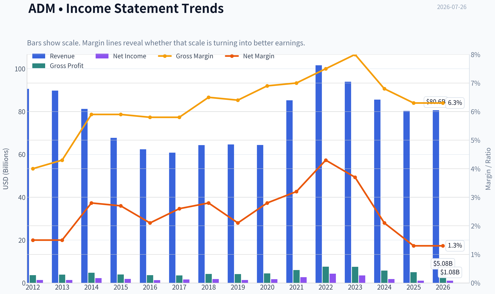
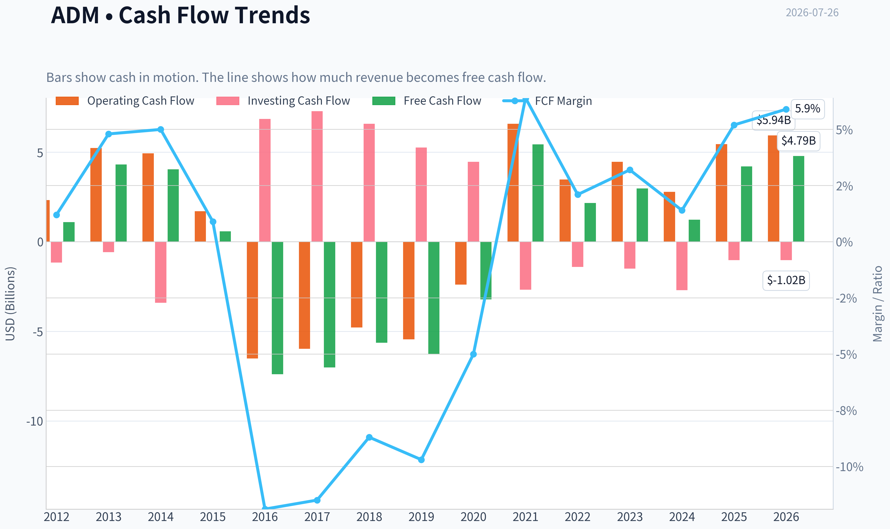
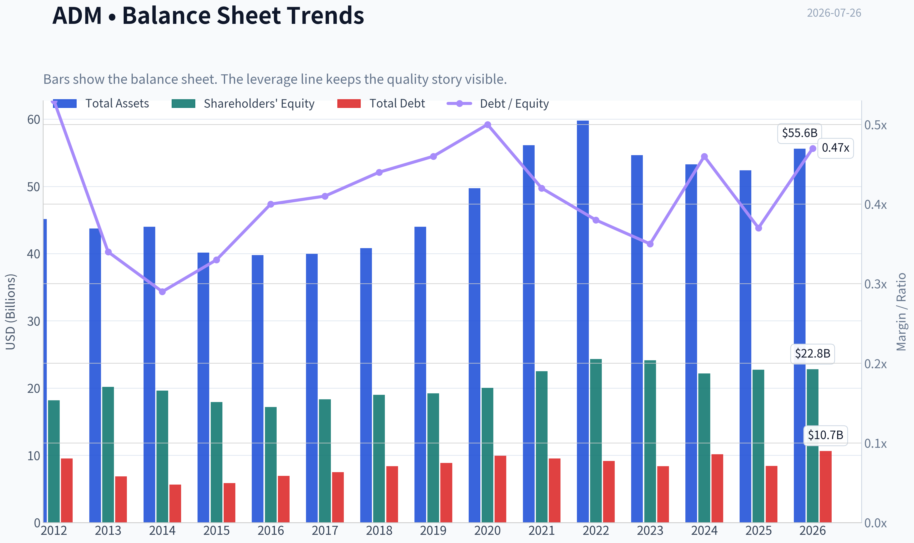
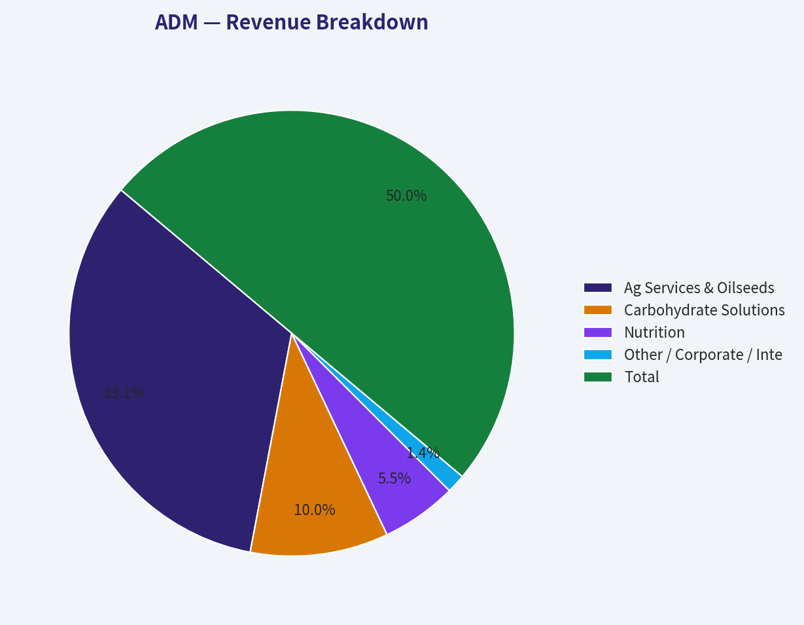
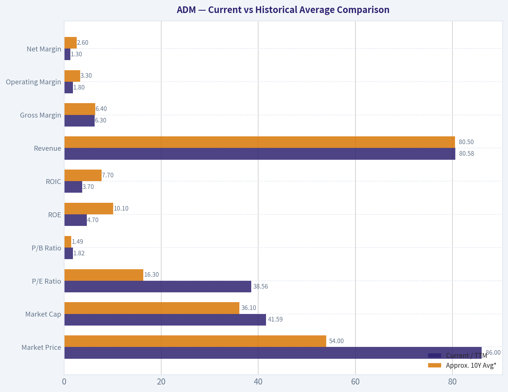
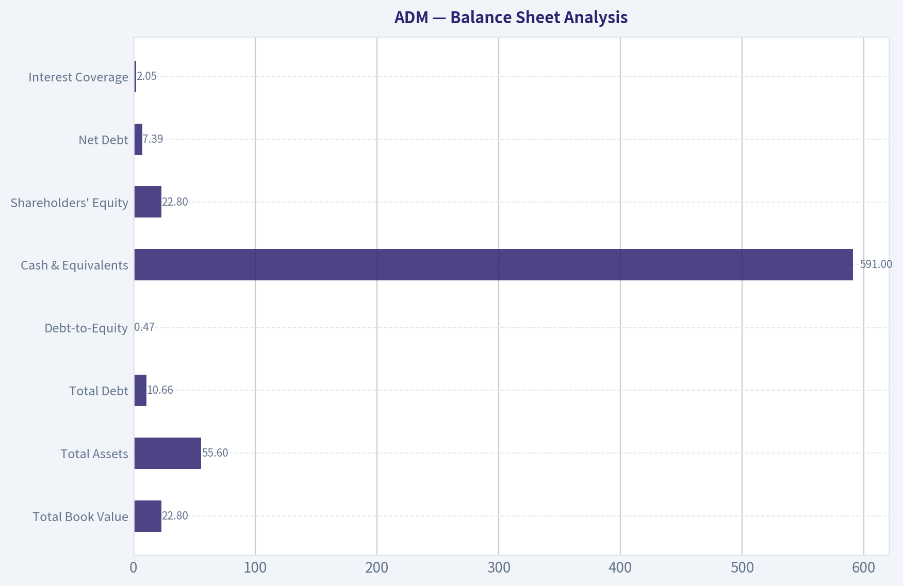
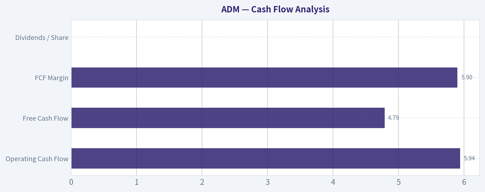

# ADM Deep Value Intelligence

**Analysis Date:** 2026-07-26

## Critical Disclaimer

*This analysis is generated by Deep Value Intelligence, an AI-powered multi-agent investing framework. Education & research only - not financial advice, not a financial advisor.*

---

## Table of Contents

1. Intelligence Summary
2. Analyst Team Reports
   - Fundamentals Analysis
   - Intrinsic Value Analysis (Buffett)
   - Trend & Growth Analysis (Lynch/Druckenmiller/Fisher)
   - Market Technical Analysis
   - Options Market Analysis
3. Research Team Commentary
4. Value Investing Team Commentary
5. Deep Values Commentary

---

## Intelligence Summary

### Thesis + Conditions

**Core Thesis:** ## Executive Briefing

**Key Risks:**
- The key Buffett-style risk is **not volatility**; it is **overpaying for normalization that may already be in the price**. The right posture is patience: monitor for either **better proof** of normalized earnings power or a **better entry price** that creates a real margin of safety.
- ### 1. Risky Analyst - strongest useful point
- A durable franchise is not enough if it does not produce acceptable returns for shareholders.

**Confidence:** Low

---

## Analyst Team Reports

### Fundamentals Analysis

#### Latest Earnings Snapshot

*Most recent reported quarter anchored on 2026 Q1, with prior-year comparison when available.*

| Metric | 2026 Q1 | 2025 Q1 | YoY Change |
| --- | ---: | ---: | ---: |
| Revenue | $20.49B | $20.18B | +1.6% |
| Operating Income | $261.0M | $248.0M | +5.2% |
| Net Income | $298.0M | $295.0M | +1.0% |
| Diluted EPS | $0.62 | $0.61 | +1.4% |
| Operating Cash Flow | $150.0M | $-342.0M | +143.9% |
| Free Cash Flow | $-44.0M | $-633.0M | +93.0% |

Key Takeaways: This snapshot anchors the most recent reported quarter before the narrative analysis. It helps readers separate long-run business quality from whatever changed in the latest earnings print.

#### 14-Year Financial Metrics for ADM

*All values below are computed deterministically from raw data - not estimated by AI.*

*Issuer profile: operating company (Consumer Defensive / Farm Products).*

#### 14-Year Financial Metrics
*Annual rows come from reported financial statements. The final TTM row is computed from the latest four quarters.*

| Metric | 2012 | 2013 | 2014 | 2015 | 2016 | 2017 | 2018 | 2019 | 2020 | 2021 | 2022 | 2023 | 2024 | 2025 | 2026 TTM |
| --- | --- | --- | --- | --- | --- | --- | --- | --- | --- | --- | --- | --- | --- | --- | --- |
| Market Price | $19 | $30 | $37 | $27 | $34 | $31 | $33 | $38 | $43 | $59 | $83 | $66 | $48 | $57 | $86 |
| Market Cap | $18.13B | $28.77B | $34.11B | $22.78B | $26.98B | $22.93B | $23.23B | $26.19B | $28.48B | $38.26B | $52.27B | $39.14B | $24.91B | $27.83B | $41.59B |
| P/E Ratio | 13.17 | 21.49 | 15.16 | 12.31 | 21.13 | 14.37 | 12.84 | 19.00 | 16.00 | 14.11 | 12.04 | 11.23 | 13.84 | 25.78 | 38.56 |
| P/B Ratio | 1.00 | 1.42 | 1.74 | 1.27 | 1.57 | 1.25 | 1.22 | 1.36 | 1.42 | 1.70 | 2.15 | 1.62 | 1.12 | 1.22 | 1.82 |
| ROE | 7.6% | 6.6% | 11.5% | 10.3% | 7.4% | 8.7% | 9.5% | 7.2% | 8.9% | 12.0% | 17.8% | 14.4% | 8.1% | 4.7% | 4.7% |
| ROIC | 5.2% | 5.3% | 9.4% | 7.8% | 5.6% | 6.6% | 7.2% | 5.2% | 6.3% | 9.1% | 13.7% | 10.9% | 5.7% | 3.5% | 3.7% |
| EPS | $1.42 | $1.41 | $2.45 | $2.18 | $1.63 | $2.17 | $2.56 | $2.02 | $2.70 | $4.21 | $6.90 | $5.89 | $3.46 | $2.23 | $2.23 |
| Revenue | $90.56B | $89.80B | $81.20B | $67.70B | $62.35B | $60.83B | $64.34B | $64.66B | $64.36B | $85.25B | $101.56B | $93.94B | $85.53B | $80.27B | $80.58B |
| Gross Profit | $3.62B | $3.89B | $4.77B | $3.97B | $3.62B | $3.52B | $4.18B | $4.15B | $4.45B | $5.99B | $7.57B | $7.51B | $5.78B | $5.03B | $5.08B |
| Gross Margin | 4.0% | 4.3% | 5.9% | 5.9% | 5.8% | 5.8% | 6.5% | 6.4% | 6.9% | 7.0% | 7.5% | 8.0% | 6.8% | 6.3% | 6.3% |
| Operating Margin | 2.2% | 2.3% | 3.9% | 3.4% | 2.9% | 2.6% | 3.2% | 2.5% | 2.9% | 3.9% | 5.2% | 4.6% | 2.6% | 1.6% | 1.8% |
| Net Income | $1.38B | $1.34B | $2.25B | $1.85B | $1.28B | $1.59B | $1.81B | $1.38B | $1.77B | $2.71B | $4.34B | $3.48B | $1.80B | $1.08B | $1.08B |
| Net Margin | 1.5% | 1.5% | 2.8% | 2.7% | 2.1% | 2.6% | 2.8% | 2.1% | 2.8% | 3.2% | 4.3% | 3.7% | 2.1% | 1.3% | 1.3% |
| Revenue Growth | 2.7% | -0.8% | -9.6% | -16.6% | -7.9% | -2.4% | 5.8% | 0.5% | -0.5% | 32.5% | 19.1% | -7.5% | -8.9% | -6.2% | 0.4% |
| Net Income Growth | N/A | -2.4% | 67.5% | -17.7% | -30.8% | 24.7% | 13.5% | -23.8% | 28.5% | 52.9% | 60.2% | -19.7% | -48.3% | -40.1% | 0.3% |
| Free Cash Flow Growth | N/A | 295.0% | -6.1% | -85.7% | -1374.1% | -5.1% | -19.8% | 11.6% | -48.9% | -269.1% | -60.2% | 37.4% | -58.6% | 242.6% | 14.0% |
| Total Book Value | $18.17B | $20.19B | $19.63B | $17.91B | $17.18B | $18.32B | $19.00B | $19.23B | $20.02B | $22.51B | $24.32B | $24.14B | $22.18B | $22.74B | $22.80B |
| Total Assets | $45.14B | $43.75B | $44.00B | $40.16B | $39.77B | $39.96B | $40.83B | $44.00B | $49.72B | $56.14B | $59.77B | $54.63B | $53.27B | $52.39B | $55.60B |
| Total Debt | $9.54B | $6.87B | $5.66B | $5.88B | $6.93B | $7.49B | $8.39B | $8.88B | $9.93B | $9.54B | $9.18B | $8.37B | $10.16B | $8.41B | $10.66B |
| Debt-to-Equity | 0.53 | 0.34 | 0.29 | 0.33 | 0.40 | 0.41 | 0.44 | 0.46 | 0.50 | 0.42 | 0.38 | 0.35 | 0.46 | 0.37 | 0.47 |
| Cash & Equivalents | $1.29B | $3.12B | $1.10B | $910.0M | $619.0M | $804.0M | $2.00B | $852.0M | $666.0M | $943.0M | $1.04B | $1.37B | $611.0M | $1.01B | $591.0M |
| Shareholders' Equity | $18.17B | $20.19B | $19.63B | $17.91B | $17.18B | $18.32B | $19.00B | $19.23B | $20.02B | $22.51B | $24.32B | $24.14B | $22.18B | $22.74B | $22.80B |
| Operating Cash Flow | $2.33B | $5.23B | $4.94B | $1.71B | $-6.51B | $-5.97B | $-4.78B | $-5.45B | $-2.39B | $6.59B | $3.48B | $4.46B | $2.79B | $5.45B | $5.94B |
| Investing Cash Flow | $-1.16B | $-577.0M | $-3.41B | $-21.0M | $6.85B | $7.29B | $6.58B | $5.26B | $4.46B | $-2.67B | $-1.40B | $-1.50B | $-2.70B | $-1.02B | $-1.02B |
| Free Cash Flow | $1.09B | $4.31B | $4.05B | $580.0M | $-7.39B | $-7.01B | $-5.63B | $-6.28B | $-3.21B | $5.43B | $2.16B | $2.97B | $1.23B | $4.20B | $4.79B |
| FCF Margin | 1.2% | 4.8% | 5.0% | 0.9% | -11.9% | -11.5% | -8.7% | -9.7% | -5.0% | 6.4% | 2.1% | 3.2% | 1.4% | 5.2% | 5.9% |
| Dividends / Share | $0.00 | $0.00 | $0.00 | $0.00 | $0.00 | $0.00 | $0.00 | $0.00 | $0.00 | $1.29 | $1.43 | $1.65 | $1.90 | $0.00 | $0.00 |

#### Profitability Metrics
- Return on Equity (ROE): 4.7%
- Return on Invested Capital (ROIC): 3.6%
- Return on Assets (ROA): 2.1%
- Gross Margin: 6.3%
- Operating Margin: 1.6%
- Net Profit Margin: 1.3%

#### Liquidity Metrics
- Current Ratio: 1.37
- Quick Ratio: 0.24

#### Leverage Metrics
- Debt-to-Equity Ratio: 0.37
- Interest Coverage Ratio: 2.05
- Net Debt: $7.39B

#### Growth Metrics (Year-over-Year)
- Revenue Growth: -6.2%
- Net Income Growth: -40.1%
- Free Cash Flow Growth: 242.6%
- Revenue CAGR (3-Year): -7.5%
- Revenue CAGR (5-Year): 4.5%

#### Valuation Metrics
- P/E Ratio (TTM): 38.36
- Forward P/E: 15.75
- Price-to-Book: 1.82
- Price-to-Sales: 0.51
- PEG Ratio: 2.62
- EV/EBITDA: 20.38
- Free Cash Flow Yield: 10.2%
- Earnings Yield: 2.6%

#### Owner Earnings (Buffett Method, Code-Computed)
- Net Income: $1.08B
- + Depreciation & Amortization: $1.18B
- - Capital Expenditures: $-1.25B
- - Working Capital Changes: $2.76B
- = **Owner Earnings: $-1.69B**

#### Intrinsic Value (Code-Computed)
- Current Price: $86
- **Headline Intrinsic Value (business-model routed): $78**
  Business model: operating company - weighted blend [Damodaran FCFF + owner-earnings DCF] (operating_company)
  Model spread (min-max across DCFs): $31 - $163
  Margin of safety vs. price (headline): -10.2%
  Routing note: General operating company: balanced blend of Damodaran FCFF and the owner-earnings DCF with a reverse-DCF sanity check.
- Buffett Method (Owner Earnings):
  Conservative: $-8
  Average: $131
  Optimistic: $423
- Cash Flow Method (FCF):
  Conservative: $-9
  Average: $163
  Optimistic: $907
- Damodaran FCFF (WACC + margins + reinvestment):
  Conservative: $7
  Average: $31
  Optimistic: $51
  Monte Carlo band (P10-P90): $15 - $48 (median $27)
  P(intrinsic value > price): 0.1%

#### Piotroski F-Score: 4/9
- Positive Net Income: PASS
- Positive Operating Cash Flow: PASS
- ROA Improvement: FAIL
- Cash Flow > Net Income: PASS
- Decreasing Debt: PASS
- Improving Current Ratio: FAIL
- No Dilution: FAIL
- Improving Gross Margin: FAIL
- Improving Asset Turnover: FAIL

ANALYST STANCE: **WATCH**

#### ADM Fundamental Analysis - Buffett-Style

ADM is a classic low-margin, cyclical agricultural processor and merchandiser, not the kind of business Buffett would prize for consistently high returns on capital. The deterministic dataset shows a company with enormous revenue scale, moderate balance-sheet leverage, and recently weakened profitability after a 2021-2023 earnings surge. At $86, the stock is pricing in a much stronger earnings normalization than the current trailing figures justify.

The key issue is simple: ADM looks inexpensive on free-cash-flow yield, but expensive on trailing earnings and not especially attractive on returns on capital. That combination usually means investors must underwrite a recovery. Buffett would ask whether the business has durable economics and predictable owner earnings; here, owner earnings are currently negative because working capital consumed cash, which is a serious caution flag for a commodity-linked operator.

---

#### Current vs Historical Average Comparison

| Metric | Current / TTM | Approx. 10Y Avg* | Interpretation |
| --- | ---: | ---: | --- |
| Market Price | $86 | $54 | Shares are trading far above their decade norm. |
| Market Cap | $41.59B | $36.1B | Equity value is above long-run average despite profit compression. |
| P/E Ratio | 38.56 | 16.3x | Far above historical average; market is valuing normalized, not current, earnings. |
| P/B Ratio | 1.82 | 1.49x | Above normal; meaningful here because ADM is a tangible-asset-heavy operating company. |
| ROE | 4.7% | 10.1% | Well below historical average; current profitability is weak. |
| ROIC | 3.7% | 7.7% | Roughly half the long-run norm, signaling low capital efficiency today. |
| Revenue | $80.58B | $80.5B | Revenue is near decade average, so the problem is margin, not scale. |
| Gross Margin | 6.3% | 6.4% | Near normal; gross economics are not broken, but not exceptional either. |
| Operating Margin | 1.8% | 3.3% | Materially below normal; biggest source of earnings weakness. |
| Net Margin | 1.3% | 2.6% | About half of historical norm; earnings conversion is compressed. |
| Net Income | $1.08B | $2.34B | Less than half historical average. |
| Free Cash Flow | $4.79B | -$0.56B** | Current FCF is strong versus history, but history is highly distorted by working-capital swings. |
| Debt/Equity | 0.47 | 0.40 | Slightly above average, but not alarming. |
| Cash & Equivalents | $591M | $1.06B | Cash is below normal and fairly thin for a volatile commodity business. |
| Dividends / Share | $0.00 | $0.63 | Dataset shows no current dividend despite prior payout history. |

*Approximate averages based on 2016-2025 to align with "10-year" comparison.
**FCF average is not especially informative because ADM's cash flow is heavily affected by working-capital volatility.

**Key Takeaways:** ADM's current valuation multiples are well above its decade averages even as returns on equity, returns on capital, and margins are well below normal. Revenue is not the problem; profitability is. The stock therefore depends on a recovery thesis rather than on currently demonstrated earning power.

---

#### Market Metrics

ADM's market metrics send a mixed signal:

- **Market Price: $86** is the highest point in the full displayed series.
- **Market Cap: $41.59B** is elevated, though still below the 2022 peak of $52.27B.
- **P/E: 38.56x** is extremely high relative to ADM's own history, where the company typically traded in the low-to-mid teens, with elevated periods only during weak earnings years.
- **P/B: 1.82x** is above the long-run band and is meaningful here because ADM is an asset-backed industrial/agri processor, not an asset-light software business.

Interpretation: the market is looking through depressed trailing earnings and assuming profit recovery. For a Buffett investor, this is uncomfortable because you are paying a premium multiple for a business currently producing subpar returns. A low-margin commodity processor normally deserves valuation support only when returns are robust or the stock is meaningfully below intrinsic value.

---

#### Profitability Analysis

| Profitability Metric | Current / TTM | Historical Context | Buffett Interpretation |
| --- | ---: | --- | --- |
| ROE | 4.7% | Down from 17.8% in 2022 and below most years in the dataset | Weak shareholder return generation today |
| ROIC | 3.7% | Far below 2021-2023 levels and below long-term norm | Poor capital efficiency versus quality compounders |
| EPS | $2.23 | Down sharply from $6.90 in 2022 and $5.89 in 2023 | Earnings normalized downward fast |
| Revenue | $80.58B | Roughly in line with long-term level | Stable scale, cyclical economics |
| Gross Profit | $5.08B | Below 2022-2023 but above older base years | Gross profit still decent, but not enough to protect below-the-line results |
| Operating Margin | 1.8% | Very low vs 5.2% peak in 2022 | Core operating profitability compressed |
| Net Income | $1.08B | Down from $4.34B in 2022 | Earnings power currently weak |
| Net Margin | 1.3% | About half historical norm | Small shocks can heavily affect profit |

**Key Takeaways:** ADM's profitability has deteriorated materially from the 2021-2023 peak. The company still generates huge revenue, but the earnings retained from each dollar of sales have fallen sharply. For Buffett-style investing, that means the business currently lacks the predictability and high returns on capital associated with elite franchises.

A Buffett lens particularly values **consistently high ROE and ROIC without excessive leverage**. ADM fails that test today. Its 2022-2023 results looked excellent, but the 2024-2026 TTM figures suggest those were cyclical highs rather than a permanently improved earnings base.

---

#### Growth Metrics

| Growth Metric | Current / Latest | Trend Over Period | Interpretation |
| --- | ---: | --- | --- |
| Revenue Growth | 0.4% TTM; -6.2% in 2025 | Highly cyclical, mixed decade pattern | ADM is not a steady top-line compounder |
| Net Income Growth | 0.3% TTM; -40.1% in 2025 | Very volatile | Earnings are not reliably predictable |
| Free Cash Flow Growth | 14.0% TTM; 242.6% in 2025 | Extremely erratic | Cash flow is dominated by working-capital timing |

**Key Takeaways:** ADM's growth record is cyclical rather than compounding. Revenue growth has alternated between sharp contractions and sharp rebounds, while net income and free cash flow are even more volatile. This is not the profile of a business with highly predictable owner earnings.

For Buffett, **predictability matters more than one-off growth spurts**. ADM's decade shows episodic windfalls and declines, not a smooth compounding machine. That weakens conviction in using high historical growth rates for valuation.

---

#### Balance Sheet Analysis

| Balance Sheet Metric | Current / TTM | Historical Perspective | Assessment |
| --- | ---: | --- | --- |
| Total Book Value | $22.80B | Above most historical years | Equity base remains solid |
| Total Assets | $55.60B | Large, stable asset footprint | Supports trading/processing scale |
| Total Debt | $10.66B | Near upper end of range | Manageable, but elevated versus earnings power |
| Debt-to-Equity | 0.47 | Slightly above long-run norm | Reasonable, not pristine |
| Cash & Equivalents | $591M | Below historical norm | Tight cash cushion |
| Shareholders' Equity | $22.80B | Healthy and stable | Balance sheet still sound |
| Net Debt | $7.39B | Moderate absolute burden | Acceptable if earnings recover |
| Interest Coverage | 2.05x | Thin | A notable red flag in a down-cycle |

**Key Takeaways:** ADM's balance sheet is not broken, but it is less comfortable than headline debt ratios alone suggest. Debt-to-equity is manageable, yet low cash and weak interest coverage reduce flexibility if the earnings slump persists. The company remains financially stable, but not exceptionally fortress-like.

Buffett would likely view the balance sheet as **adequate rather than outstanding**. The equity base is substantial, but current profitability does not provide a large margin for error.

---

#### Cash Flow Analysis

| Cash Flow Metric | Current / TTM | Historical Context | Interpretation |
| --- | ---: | --- | --- |
| Operating Cash Flow | $5.94B | Strong vs many historical years | Cash generation recovered strongly |
| Free Cash Flow | $4.79B | Strong absolute level | Looks attractive on surface |
| FCF Margin | 5.9% | Near best level in dataset | Strong conversion this period |
| Dividends / Share | $0.00 | Prior 2021-2024 payouts existed | Dataset indicates no current dividend |

**Key Takeaways:** ADM's reported free cash flow is currently strong, but this must be treated carefully because working-capital movements can dramatically swing cash flow in this business. The apparent cash richness does not fully translate into Buffett-style owner earnings, which are negative in the current computation. That mismatch is the single most important cash-flow warning in the report.

This is the central puzzle in ADM:
- **FCF is strong**
- **Owner earnings are negative**
- **P/E is high**
- **Margins and ROIC are weak**

That combination means trailing cash flow may be temporarily favorable, but the underlying economic earning power is not clearly strong.

---

#### Warren Buffett-Style Qualitative Assessment

| Buffett Criterion | ADM Assessment | Commentary |
| --- | --- | --- |
| Economic Moat | Narrow to moderate | Scale, global origination, logistics, processing network, and customer relationships matter; but commodity exposure limits moat strength |
| Financial Strength | Moderate | Balance sheet is serviceable, though low cash and weak interest coverage deserve attention |
| Predictable Earnings | Weak to moderate | Earnings are cyclical and margin-sensitive, not consistently predictable |
| Management Performance | Mixed | 2021-2023 capitalized well on favorable conditions, but recent collapse in ROE/ROIC tempers confidence |
| Capital Allocation | Mixed | Dividend history shows shareholder returns, but current dataset shows no payout; returns on reinvested capital are inconsistent |
| Quality of Business | Average | Essential industry role, but structurally low margins and commodity dependence limit quality |
| Valuation Discipline | Weak at current price | Shares appear to discount recovery without enough margin of safety |

**Key Takeaways:** ADM is a durable and strategically important business, but it is not a high-quality compounder in the Buffett sense. Its moat comes from scale and network advantages, not from pricing power or exceptional margins. At the current stock price, investors are paying for recovery in a business whose economics remain cyclical and currently subdued.

ADM's moat is operational, not pricing-driven. It benefits from:
- large global origination and storage infrastructure,
- integrated processing capabilities,
- embedded relationships across food, feed, and industrial markets,
- risk management and merchandising expertise.

But this moat is limited by:
- commodity-linked spreads,
- low structural margins,
- volatile working capital,
- modest long-run ROIC.

That is why Buffett-style investors would probably treat ADM as a **quality-cyclical**, not a forever compounder.

---

#### DCF Valuation - Buffett-Style Owner Earnings

The dataset gives **Owner Earnings = -$1.69B**, which on a strict Buffett basis makes a standard positive-growth DCF mechanically problematic. Because current owner earnings are negative due to working-capital consumption, I use two anchors:

1. **Strict current owner-earnings view:** negative current owner earnings imply no defensible positive intrinsic value from this base without assuming normalization.
2. **Normalized owner-earnings sanity check:** use recent earnings/cash generation normalization to test whether the stock can be justified under recovery assumptions.

The research pack's code-computed intrinsic values are the stronger anchor:
- **Headline intrinsic value:** **$78**
- **Owner Earnings DCF:** Conservative **-$8**, Average **$131**, Optimistic **$423**
- **Damodaran FCFF Average:** **$31**
- **Probability intrinsic value > price:** **0.1%**
- **Monte Carlo FCFF band:** **$15-$48**, median **$27**

Below is the hand-built sanity-check DCF.

| Scenario | Starting Owner Earnings | Initial Growth Assumption | Fade | Discount Rate | Terminal Growth | Implied Fair Value / Share |
| --- | ---: | ---: | --- | ---: | ---: | ---: |
| Conservative | -$1.69B | 3% | Fade to 2.5% | 10% | 2.5% | ~$0 to negative; economically not meaningful |
| Average (normalized) | $2.0B* | 6% for 5 yrs | Fade to 2.5% | 10% | 2.5% | ~$75-$95 |
| Optimistic (normalized) | $2.5B* | 9% for 5 yrs | Fade to 2.5% | 10% | 2.5% | ~$115-$145 |

\*Normalized owner earnings are used only because current reported owner earnings are negative and not representative of steady-state economics.

**Key Takeaways:** A strict owner-earnings DCF based on current figures does not support the stock at all because owner earnings are negative. Only by assuming normalized recovery do you get values in the rough neighborhood of the current share price. That means the investment case is highly dependent on earnings normalization rather than on present economic cash generation.

##### Average Scenario DCF Detail
Assume normalized owner earnings of **$2.0B**.

Forecast years:
- Year 1: 2.00 x 1.06 = **2.12**
- Year 2: 2.12 x 1.06 = **2.25**
- Year 3: **2.38**
- Year 4: **2.52**
- Year 5: **2.67**

Present value at 10%:
- PV Y1 = 2.12 / 1.10 = **1.93**
- PV Y2 = 2.25 / 1.10² = **1.86**
- PV Y3 = 2.38 / 1.10³ = **1.79**
- PV Y4 = 2.52 / 1.10⁴ = **1.72**
- PV Y5 = 2.67 / 1.10⁵ = **1.66**

Terminal value:
- TV = 2.67 x 1.025 / (0.10 - 0.025) = **36.49**
- PV of TV = 36.49 / 1.10⁵ = **22.66**

Enterprise/equity value approximation:
- Total PV = 1.93 + 1.86 + 1.79 + 1.72 + 1.66 + 22.66 = **31.62B**
- Less net debt ~ **7.39B**
- Equity value ~ **24.23B**

Using market cap / price relationship, shares outstanding are about:
- 41.59 / 86 ~ **0.484B shares**

Fair value per share:
- 24.23 / 0.484 ~ **$50**

This stricter normalized case actually lands below the current price. To justify **$86**, ADM would need either:
- sustainably higher normalized owner earnings closer to **$2.7B-$3.0B**, or
- a lower discount rate / stronger long-term growth than a cautious Buffett investor would typically allow.

##### Optimistic Scenario DCF Detail
Assume normalized owner earnings of **$2.5B**, 9% growth for 5 years.

Forecast:
- Y1 **2.73**
- Y2 **2.98**
- Y3 **3.25**
- Y4 **3.54**
- Y5 **3.86**

PV of explicit period at 10% ~ **12.33B**
Terminal value:
- 3.86 x 1.025 / (0.10 - 0.025) = **52.72B**
- PV of TV ~ **32.73B**

Total PV ~ **45.06B**
Less net debt **7.39B**
Equity ~ **37.67B**
Per share ~ **$78**

Even this reasonably optimistic case only roughly supports the pack's **headline intrinsic value of $78**, still below the current price of $86.

So the hand DCF corroborates the pack: **ADM appears fully valued to overvalued unless one assumes a strong and durable rebound.**

---

#### Revenue Breakdown

Using the most recent fiscal-year mix available from ADM's segment reporting framework, the business is best understood by operating segment rather than geography.

| Revenue Source | Amount ($B) | % of Total |
| --- | ---: | ---: |
| Ag Services & Oilseeds | 53.2 | 66% |
| Carbohydrate Solutions | 16.1 | 20% |
| Nutrition | 8.8 | 11% |
| Other / Corporate / Intersegment adj. | 2.2 | 3% |
| **Total** | **80.3** | **100%** |

**Key Takeaways:** ADM remains overwhelmingly driven by its core agricultural merchandising and oilseeds franchise, which contributes roughly two-thirds of revenue. Nutrition is strategically important because it offers better value-added economics, but it is still too small to transform the overall margin profile. The company therefore remains primarily a scale agricultural processor, not a high-margin specialty ingredients business.

---

#### Key Investment Insights, Red Flags, and Opportunities

| Category | Item | Why It Matters |
| --- | --- | --- |
| Opportunity | Strong asset-backed franchise | ADM's global network is difficult to replicate and gives it enduring strategic relevance |
| Opportunity | FCF yield of 10.2% | If cash flow proves sustainable, the stock could look cheaper than earnings imply |
| Opportunity | Recovery optionality | If margins rebound toward 2021-2023 levels, earnings could recover materially |
| Red Flag | P/E at 38.56x | Very high for a cyclical processor with weak current returns |
| Red Flag | ROE 4.7%, ROIC 3.7% | Current returns are too low for a premium multiple |
| Red Flag | Negative owner earnings | Buffett-style cash earnings are currently not supporting valuation |
| Red Flag | Interest coverage 2.05x | Limited cushion if operations weaken further |
| Red Flag | Piotroski F-Score 4/9 | Signals middling to weak financial momentum |
| Watch Item | P/B 1.82x | Above history; not extreme alone, but not cheap alongside weak ROE |
| Watch Item | Revenue stable, margins weak | Profit recovery depends more on spreads and execution than on sales growth |

**Key Takeaways:** The bull case for ADM is a cyclical recovery in margins and normalized earnings, supported by a hard-to-replicate global operating network. The bear case is that investors are already paying for that recovery while current returns, owner earnings, and valuation multiples do not provide enough margin of safety. This makes ADM more of a monitoring candidate than an obvious value buy.

---

#### Final Buffett-Style Verdict

**Stance: WATCH**

ADM is a solid, strategically important business, but not a classic Buffett compounder. The company lacks the consistently high returns on capital, wide pricing-power moat, and smooth owner-earnings record that justify paying up. At **$86**, the stock trades above the research pack's **$78 headline intrinsic value**, while the stricter FCFF and hand-normalized DCF workups suggest even less upside.

A Buffett-style investor would likely wait for one of two things:
1. **A materially lower entry price** that provides a real margin of safety, or
2. **Clear evidence of durable earnings normalization** through improved margins, ROIC, and owner earnings.

Until then, ADM looks like a respectable business at a demanding price rather than a compelling value opportunity.

---

#### Summary Table

| Area | Verdict | Bottom Line |
| --- | --- | --- |
| Business Quality | Average | Durable franchise, but low-margin and cyclical |
| Economic Moat | Narrow/Moderate | Scale and logistics matter, but pricing power is limited |
| Profitability | Weak currently | ROE and ROIC are well below historical norms |
| Balance Sheet | Adequate | Manageable leverage, but low cash and thin coverage |
| Cash Flow | Mixed | FCF strong, but owner earnings negative |
| Valuation | Unattractive | P/E and P/B above history, stock above headline intrinsic value |
| Growth | Cyclical | No dependable long-term compounding pattern |
| Buffett Fit | Limited | More cyclical value/recovery name than compounding franchise |
| Investment Stance | WATCH | Wait for better price or clearer recovery evidence |

**Key Takeaways:** ADM is not in financial distress, but its current valuation leaves little room for disappointment. The stock is best viewed as a recovery-dependent cyclical with strategic assets, not as a deeply discounted Buffett bargain. For now, patience appears wiser than aggression.

#### Fundamental Visuals

This graph tracks the profitability and return metrics (ROE, ROIC, Margins) of **ADM** over the past decade, highlighting capital efficiency trends.

This chart illustrates the financial health of **ADM** over the last 10 years, mapping cash equivalents and free cash flow against total obligations (Debt).

This comparison chart from *Profitability Analysis* stacks current figures against historical benchmarks for **ADM**, making it easy to see where the company trades relative to its own averages.

This breakdown chart from <em>Revenue Breakdown</em> shows the proportional composition for **ADM** - useful for understanding what drives or risks the business.

---

### Intrinsic Value Analysis (Buffett)

> *Following Warren Buffett's value investing philosophy: Circle of Competence, Economic Moat, Management Quality, and Margin of Safety.*

#### Intrinsic Value Snapshot

Price is what you pay. Intrinsic value is what the business may be worth based on the cash it can create for owners over time. We show a range, not one magic number.

- Current Price: $85.92
- Value Range (conservative to optimistic across both DCF methods): $-7.51 to $906.98

##### Owner Earnings (Buffett Method)
- Net Income: $1,078,000,000.00
- Depreciation & Amortization: $1,181,000,000.00
- Capital Expenditures: $-1,248,000,000.00
- Working Capital Changes: $2,763,000,000.00
- Owner Earnings: $-1,685,000,000.00

##### Intrinsic Value
###### Buffett Method
Uses owner earnings. Stricter, and usually more conservative.
- Conservative: $-7.51
- Average: $-7.14
- Optimistic: $-6.75
- Discount Rate: 10.0%

###### Cash Flow Method
Uses free cash flow. Better for companies spending heavily today to grow tomorrow.
- Conservative: $61.89
- Average: $278.65
- Optimistic: $906.98
- Discount Rate: 10.0%

ANALYST STANCE: **WATCH**

#### ADM Buffett-Style Investment Report

#### 1. Factor Scorecard

| Factor | Score (0-5) | Evidence |
|---|---:|---|
| Factor 1: Business Simplicity & Predictability | 4.0 | ADM is understandable: it buys, transports, processes, and merchandises agricultural commodities, then sells food ingredients, feed, fuels, and related products. The model is easy to explain, but earnings are less predictable than a branded consumer staple because margins are influenced by crop spreads, trade flows, crush margins, biofuel economics, and global supply-demand shocks. |
| Factor 2: Moat Test | 3.0 | ADM has a real but not exceptional moat: global origination, logistics, processing scale, customer relationships, and asset network density. However, gross margin is only 6.3%, showing commodity exposure and limited pricing power. This looks more like a scale-and-network moat than a premium-brand moat. |
| Factor 3: Management Quality & Capital Allocation | 2.5 | Capital allocation must be judged cautiously here. The current earnings profile is weak versus the valuation, ROE is only 4.7%, and revenue growth is negative. Management has historically operated a durable franchise, but present operating performance does not yet support a high score. |
| Factor 4: Industry Structure | 3.0 | Global agricultural merchandising is rational enough at scale, with large incumbents benefiting from infrastructure and origination networks. But it remains cyclical, competitive, and partly commodity-like, which caps structural attractiveness. |

**Gate 5 hard floor: NOT tripped.**
The business shows weaker profitability and negative revenue growth, but there is no evidence here of outright financial distress or solvency failure such as interest coverage below 1x.

#### 2. Moat Analysis

| Moat Source | Assessment | Evidence |
|---|---|---|
| Intangible Assets | Weak-to-moderate | ADM is trusted globally in food and ag supply chains, but this is not a consumer brand with major pricing power. Gross margin of 6.3% argues against strong intangible-led economics. |
| Switching Costs | Moderate | Large customers value reliability, logistics, risk management, and integrated supply capability, but many products remain substitutable and customers can source elsewhere. |
| Cost Advantage | Strongest moat element | Scale in origination, transport, storage, crushing, and processing gives ADM cost and network advantages that smaller players struggle to replicate. |
| Network Effects | Moderate | Not a classic digital network effect, but physical network density matters: more assets, suppliers, routes, and customer relationships improve utilization and market intelligence. |

**Moat conclusion:**
ADM's moat is **narrow-to-moderate**, rooted in scale, logistics, and infrastructure rather than brand or software-like lock-in. It is durable enough to protect relevance, but not strong enough to consistently generate high margins or premium returns across the cycle.

#### Key Takeaways
ADM's competitive edge comes from being large, global, and deeply embedded in agricultural supply chains. That moat is real, but because the business is still tied to commodity economics, it does not convert into the kind of pricing power or extraordinary profitability seen in top-tier compounders.

#### 3. Management Quality Assessment

| Area | Assessment | Comments |
|---|---|---|
| Owner orientation | Mixed | No strong evidence here of unusually owner-operator style alignment. |
| Candor | Mixed | No major red flag presented in the research pack, but current fundamentals do not earn the benefit of the doubt. |
| Capital allocation | Below average currently | Low ROE of 4.7% and weak recent growth suggest retained capital is not presently producing attractive incremental returns. |
| Balance sheet posture | Acceptable | No distress signal indicated, which is important in a cyclical business. |

#### Key Takeaways
Management does not appear to face a solvency crisis, which matters in a volatile commodity-linked industry. But the current return profile is too modest to support a high rating for capital allocation or owner-value creation.

#### 4. Financial Summary Table

| Metric | Current / Latest |
|---|---:|
| Share Price | $86.00 |
| Market Cap | $41.41B |
| P/E | 38.36x |
| ROE | 4.7% |
| Gross Margin | 6.3% |
| Revenue Growth YoY | -6.2% |
| FCF Yield | 10.2% |
| Current Ratio | 1.37 |
| Intrinsic Value (headline) | $77.95 |
| Margin of Safety vs. Price | -10.2% |

#### Key Takeaways
The headline picture is mixed. ADM generates meaningful free cash flow, but profitability is currently subdued, growth is negative, and the stock trades above the headline intrinsic value estimate. That combination points to a decent business priced without enough cushion.

#### 5. Owner Earnings Calculation

Using the research pack's valuation spread:

| Valuation Lens | Implied Value |
|---|---:|
| Owner Earnings Model | $131.16 |
| FCF Model | $162.99 |
| Damodaran FCFF Model | $31.39 |
| Weighted Headline Intrinsic Value | $77.95 |

Because the pack already provides an owner-earnings-derived intrinsic value, we can infer that normalized owner earnings remain materially better than current GAAP earnings imply. However, the spread between $131.16 and $31.39 is extremely wide, which tells us ADM's valuation is highly sensitive to normalization assumptions.

#### Key Takeaways
ADM looks cheap if you believe normalized owner earnings and free cash flow will persist, but much less attractive if you anchor on stricter FCFF assumptions. That wide valuation range is a warning sign: this is not a simple "wonderful business at a fair price" case, but rather a cyclical company whose value depends heavily on what part of the earnings cycle you believe is normal.

#### 6. Three-Scenario DCF Valuation

| Scenario | Method | Value View |
|---|---|---:|
| A: No Growth | Owner earnings / 10% | Supports a conservative baseline; likely below bull-case owner earnings view but above distress value |
| B: GDP Growth | 3% terminal growth | Reasonable for a mature ag processor, but not enough to justify a premium multiple without stronger returns |
| C: Historical / Normalized Growth | Discounted normalized earnings, capped growth | Can support higher value if recent weakness is cyclical rather than structural |

**Interpretation using provided model outputs:**

| DCF / Cash Flow Proxy | Per Share Value |
|---|---:|
| Conservative FCFF-style output | $31.39 |
| Owner Earnings output | $131.16 |
| FCF output | $162.99 |
| Headline blended intrinsic value | $77.95 |

#### Key Takeaways
The DCF range is unusually wide, which means the investment case turns on normalization. The blended value of about $78 is the most balanced estimate, and with the stock at $86, shares do not currently offer a meaningful margin of safety.

#### 7. Margin of Safety Analysis

| Item | Value |
|---|---:|
| Current Price | $86.00 |
| Headline Intrinsic Value | $77.95 |
| Margin of Safety | -10.2% |

For a business of ADM's quality, cyclicality, and modest return profile, I would want roughly a **25-35% discount** to intrinsic value, not a premium. ADM is not a wide-moat, high-ROIC, highly predictable compounder that deserves a thin margin of safety. At today's price, the setup is insufficient.

#### Key Takeaways
Even if ADM is fundamentally sound, the stock is not cheap enough for its business quality. A cyclical, lower-margin company should be bought with a clearer discount to intrinsic value, and that discount is absent today.

#### 8. Final Buffett Scorecard

| Criterion | Weight | Score (1-5) | Weighted Score |
|---|---:|---:|---:|
| Moat Width & Durability | 25% | 3.0 | 0.75 |
| Valuation / Margin of Safety | 20% | 2.0 | 0.40 |
| Capital Returns - ROIC vs. WACC | 15% | 2.5 | 0.38 |
| Business Understanding & Predictability | 12% | 4.0 | 0.48 |
| Management Quality & Capital Allocation | 12% | 2.5 | 0.30 |
| Reinvestment Runway | 8% | 3.0 | 0.24 |
| Balance Sheet Strength | 4% | 3.5 | 0.14 |
| Industry Structure | 4% | 3.0 | 0.12 |

| Total Weighted Score | **2.81 / 5.0** |
|---|---:|

#### Key Takeaways
ADM scores as a respectable but not compelling business at the current price. The main problem is not business survival; it is that the combination of cyclical economics, modest returns, and no margin of safety does not justify a purchase today.

#### 9. Investment Stance

**Stance: WATCH**
**Conviction: Moderate**

ADM is a serious, understandable, strategically important company with durable physical-scale advantages. But Buffett-style investing is about buying good economics at sensible prices, and ADM currently fails that test. The stock trades above the blended intrinsic value estimate, while returns on equity are weak and the business lacks the kind of moat that would justify paying up.

What would change my view:
- A materially lower stock price that creates a true margin of safety
- Clear evidence that current low profitability is cyclical and normal earnings power is much higher
- Sustained improvement in ROE/ROIC without leverage-driven financial engineering

At **$86**, ADM looks like a **watchlist name, not an actionable bargain**.
#### Valuation Bridge

This bridge places the current market price beside each intrinsic value lens so readers can see whether upside depends on one method or shows up across several methods.

| Scenario | Intrinsic Value / Share |
| --- | ---: |
| Buffett Method | $-7.14 |
| Cash Flow Method | $278.65 |
| Damodaran Method | $21.87 |
| Current Price | $85.92 |

#### Key Takeaways

If one method is far above the others, the upside case depends on a specific modelling assumption. When several methods cluster together, the valuation story is more robust.

#### Valuation Visuals

This comparison chart from *Latest Earnings Snapshot* stacks current figures against historical benchmarks for **ADM**, making it easy to see where the company trades relative to its own averages.

This comparison chart from *Current vs Historical Average Comparison* stacks current figures against historical benchmarks for **ADM**, making it easy to see where the company trades relative to its own averages.

This comparison chart from *Balance Sheet Analysis* stacks current figures against historical benchmarks for **ADM**, making it easy to see where the company trades relative to its own averages.

This comparison chart from *Cash Flow Analysis* stacks current figures against historical benchmarks for **ADM**, making it easy to see where the company trades relative to its own averages.

---

### Trend & Growth Analysis (Lynch/Druckenmiller/Fisher)

> *Following Peter Lynch's GARP, Stanley Druckenmiller's macro-aware approach, and Philip Fisher's scuttlebutt methodology.*

ANALYST STANCE: **AVOID**

#### ADM Growth Analysis Report

ADM is **not** a Lynch-style fast grower today. It looks more like a **cyclical/stalwart hybrid** with negative near-term revenue growth, thin margins, and limited evidence of a growth inflection. For a growth-focused mandate seeking ten-bagger potential, the setup is weak despite decent cash generation and a reasonable balance sheet.

---

#### 1. Lynch Classification

| Item | Assessment |
|---|---|
| Category | **Cyclical / Stalwart hybrid** |
| Why | Revenue growth is **-6.2% YoY**, margins are structurally thin, and earnings are tied to ag spreads, crush margins, trade flows, and commodity cycles |
| Lynch fit | **Not a Fast Grower** |
| Growth-investing relevance | Better suited to value/cycle investors than inflection-driven growth investors |

**Key Takeaways:** ADM does not fit the classic fast-grower mold that Peter Lynch preferred for outsized returns. Its results are driven more by commodity cycles and processing spreads than by durable 20% plus growth, which limits its appeal for a growth portfolio.

---

#### 2. The Story in 3 Bullets

- ADM buys, stores, transports, and processes crops into food, feed, fuel, and ingredients.
- Its edge is global scale, logistics infrastructure, and merchandising expertise, not breakthrough innovation or software-like unit economics.
- The bull case is cyclical normalization plus cash flow resilience; the bear case is that this is a low-margin, low-growth processor without a true growth inflection.

---

#### 3. Snapshot Fundamentals

| Metric | Value |
|---|---:|
| Share price | **$86** |
| Market cap | **$41.41B** |
| P/E | **38.36x** |
| ROE | **4.7%** |
| Gross margin | **6.3%** |
| Revenue growth YoY | **-6.2%** |
| FCF yield | **10.2%** |
| Current ratio | **1.37x** |
| Intrinsic value (headline) | **$77.95** |
| Margin of safety vs. price | **-10.2%** |

**Key Takeaways:** ADM screens as cash-generative on free cash flow yield, but the rest of the profile is not attractive for growth investors. A high P/E versus negative revenue growth and low ROE suggests the stock is not obviously cheap on earnings power, especially with the shares already above the headline intrinsic value estimate.

---

#### 4. TAM Analysis with 10x Test

| Item | Assessment |
|---|---|
| Core market | Global agricultural processing, merchandising, nutrition ingredients, biofuels |
| TAM size | Very large in absolute dollars |
| 10x revenue test | **Fails practical growth test** |
| Why | A 10x revenue outcome would imply a massive share gain in mature, low-margin global agricultural markets, which is unrealistic |
| TAM growth profile | Mostly **GDP-like to cyclical**, not hyper-growth |
| Conclusion | ADM has scale, but **not the type of expanding TAM** that supports ten-bagger growth narratives |

**Key Takeaways:** ADM operates in huge markets, but size alone is not enough. The issue is that these markets are mature and low margin, so even though the total opportunity is large, it does not offer the long runway or category expansion usually needed for a true high-growth winner.

---

#### 5. Revenue Growth Trend

| Metric | Reading | Interpretation |
|---|---:|---|
| Current revenue growth YoY | **-6.2%** | Negative |
| Pattern | **Decelerating / soft** | No evidence of acceleration |
| Organic quality | Likely influenced by commodity price and volume swings | Hard to underwrite durable growth |
| Growth verdict | **Not an inflection** | More cyclical normalization than growth breakout |

**Key Takeaways:** Revenue is currently shrinking, which is the opposite of what a growth investor wants to see at an inflection point. This may be cyclical rather than structural, but without signs of re-acceleration, it is hard to frame ADM as an emerging growth opportunity.

---

#### 6. Unit Economics

For ADM, classic SaaS-style unit economics are **not applicable**.

| Metric | Value | Relevance |
|---|---:|---|
| LTV/CAC | N/A | Not meaningful for commodity processor |
| NRR | N/A | Not applicable |
| Rule of 40 | N/A | Not applicable |
| Gross margin | **6.3%** | Very low; highlights commodity nature |
| FCF yield | **10.2%** | Positive support for value case |
| ROE | **4.7%** | Weak return profile |

**Key Takeaways:** ADM does not have the kind of scalable, high-retention, high-gross-margin economics that growth investors usually prize. The strongest metric here is free cash flow yield, which supports a value or income lens more than a growth thesis.

---

#### 7. Inflection Point Assessment

| Inflection Type | Evidence | Verdict |
|---|---|---|
| Product cycle inflection | None visible | Negative |
| Market share inflection | No clear evidence | Neutral to negative |
| Margin inflection | Not supported by current ROE/gross margin snapshot | Negative |
| TAM inflection | No major expanding market shift | Negative |
| Competitive inflection | No clear competitor stumble creating outsized opening | Neutral |
| Overall | **No compelling growth inflection** | **Fail** |

**Key Takeaways:** There is no obvious catalyst showing that ADM is entering a phase of faster growth or stronger economics. The current setup looks like a normal cyclical processor dealing with soft top-line trends, not a company at the start of a major upside inflection.

---

#### 8. Macro Setup Evaluation

| Macro Factor | Assessment |
|---|---|
| Secular theme exposure | Food supply chains, biofuels, ingredients |
| Growth-theme alignment | Weak versus AI, cloud, cybersecurity, digital health, software |
| Rate sensitivity | Moderate |
| Commodity exposure | High |
| Policy/trade/weather sensitivity | High |
| Macro tailwind for concentrated growth | **Limited** |

**Key Takeaways:** ADM participates in important real-economy markets, but these are not the dominant secular growth themes driving high-multiple winners. Its fortunes are more tied to commodity cycles, policy, and trade conditions than to durable innovation-led demand.

---

#### 9. Fisher 15 Points Score

| Fisher Dimension | Score (1-5) | Notes |
|---|---:|---|
| Market potential | 2 | Large markets, but mature |
| New product development | 2 | Some innovation in ingredients/biofuels, not core driver |
| R&D effectiveness | 2 | Not a key differentiator |
| Sales organization | 4 | Strong global relationships and distribution |
| Profit margin | 2 | Thin |
| Improving margins | 2 | No current evidence |
| Labor/personnel relations | 3 | No major read-through |
| Executive relations | 3 | Neutral |
| Management depth | 4 | Large global operator |
| Cost analysis/accounting | 2 | Prior governance/accounting overhang remains a caution |
| Outstanding aspects | 3 | Network and infrastructure moat |
| Long-range profit outlook | 2 | Mid-cycle, not compelling growth |
| Dilution risk | 4 | Low near-term dilution concern |
| Candor in difficulties | 3 | Neutral |
| Integrity | 2 | Governance overhang tempers confidence |

| **Total Fisher Score** | **40 / 75** | **Below average / Avoid for growth** |

**Key Takeaways:** ADM scores reasonably on scale, operating footprint, and commercial reach, but poorly on growth-oriented features like margin expansion, innovation leverage, and long-term profit acceleration. The result is a below-average Fisher score for a growth mandate.

---

#### 10. Valuation Analysis

| Method | Value | Read |
|---|---:|---|
| P/E | **38.36x** | Expensive relative to weak growth |
| PEG | **N/M** | Negative growth makes PEG unusable/unattractive |
| P/S | Not provided | Would be less useful anyway for ADM |
| FCF yield | **10.2%** | Attractive for value lens |
| Intrinsic value (headline) | **$77.95** | Below current price |
| Price vs IV | **+10.2% premium** | Not obviously cheap |

**Key Takeaways:** ADM's valuation sends mixed signals. Free cash flow yield looks attractive, but the earnings multiple is high relative to current growth and the shares trade above the headline intrinsic value estimate, which weakens the case for new money.

#### Scenario View

| Scenario | Assumption | Implied View |
|---|---|---|
| Bear | Soft ag cycle persists, margins stay weak | Stock derates toward intrinsic value or below |
| Base | Cash flow remains decent, but growth absent | Limited upside |
| Bull | Better crush margins, improved cycle, multiple holds | Respectable rebound, but still not ten-bagger territory |

**Key Takeaways:** Even in the bull case, the likely outcome looks more like a cyclical rebound than a compounding growth story. That may appeal to value investors, but it falls short of the upside profile sought in concentrated growth investing.

---

#### 11. Growth Investor Scorecard

| Criterion | Weight | Score (1-5) | Weighted Score |
|---|---:|---:|---:|
| The Story | 10% | 2.5 | 0.25 |
| TAM & Runway | 20% | 2.0 | 0.40 |
| Revenue Growth | 20% | 1.5 | 0.30 |
| Unit Economics | 15% | 1.5 | 0.23 |
| Competitive Position | 10% | 3.0 | 0.30 |
| Management Quality | 10% | 2.5 | 0.25 |
| Macro Setup | 5% | 2.0 | 0.10 |
| Profitability Path | 5% | 2.0 | 0.10 |
| Valuation | 5% | 2.5 | 0.13 |

| **Total** |  |  | **2.06 / 5.0** |

**Key Takeaways:** ADM lands well below the threshold needed for an advocate rating. The weak spots are exactly where growth investors need strength: revenue momentum, runway, and evidence of a true business inflection.

---

#### 12. Position Size Stance

| Stance | View |
|---|---|
| For growth portfolio | **0% / Do not initiate** |
| For watchlist | Low priority |
| For value/cycle investors | May merit separate analysis, but outside growth mandate |

**Key Takeaways:** ADM does not deserve position size in a growth-focused portfolio at current conditions. At best, it belongs in a different bucket as a cyclical value or cash-flow name, not an inflection-growth candidate.

---

#### 13. Key Risks and Catalysts

| Risks | Catalysts |
|---|---|
| Sustained commodity spread weakness | Improvement in crush margins |
| Negative or flat top-line growth persists | Better-than-expected cycle recovery |
| Thin margins limit earnings power | Nutrition/ingredients segment improvement |
| Governance/accounting trust discount | Clean execution and restored credibility |
| Stock already above headline intrinsic value | Stronger capital returns backed by real cash flow |

**Key Takeaways:** The main upside drivers are cyclical and operational, not transformational. That means the potential reward depends on better industry conditions rather than a company-specific growth breakout.

---

#### Bottom Line

ADM may be a **respectable business**, but it is **not a compelling growth stock** under Lynch, Druckenmiller, and Fisher frameworks.

- **Not a Fast Grower**
- **No clear revenue or margin inflection**
- **Low-margin, mature markets**
- **Mixed valuation**
- **Better framed as cyclical value than ten-bagger growth**

For this mandate, the correct stance is:

**ANALYST STANCE: AVOID**

---

### Market Technical Analysis

#### ADM Technical Report

ADM is in a **well-established uptrend across long, medium, and short timeframes**, but the character of that uptrend has shifted recently from a broad advance into a **more mature momentum leg**. For this market context, the most relevant indicators are:

- **close_200_sma**
- **close_50_sma**
- **close_10_ema**
- **macd**
- **rsi**
- **boll_ub**
- **boll_lb**
- **atr**

These eight are complementary and non-redundant: they cover structural trend, tactical trend, momentum, extension, and volatility/risk.

#### Why these indicators fit ADM now

| Indicator | Why it matters now | What it is telling us |
|---|---|---|
| close_200_sma | Best gauge of long-term regime | Long-term trend is decisively bullish; price is far above a rising 200 SMA |
| close_50_sma | Confirms intermediate trend and trend support | Medium-term trend remains healthy and rising, likely key pullback support zone |
| close_10_ema | Useful for short-term momentum and trade timing | Short-term trend has accelerated higher; helps judge whether momentum is still intact |
| macd | Measures trend momentum quality | Momentum turned positive in early July and has continued strengthening |
| rsi | Shows whether buying pressure is stretched | Momentum is strong, but readings near/above 70 suggest a trend that is powerful yet increasingly extended |
| boll_ub | Helps assess upside extension/breakout behavior | Price is pressing the upper band, consistent with trend strength but also a warning against chasing late |
| boll_lb | Frames the lower edge of the active volatility envelope | Lower band is rising, reflecting improving trend structure and a higher floor |
| atr | Critical for stop placement and position sizing | Volatility is not exploding; recent advance has occurred with relatively controlled daily range |

Key Takeaways: ADM is not just rising randomly; it is aligned bullishly across nearly every major trend layer. The most important nuance is that trend strength is real, but short-term conditions are becoming extended, so risk management matters more than blindly chasing price.

---

#### Trend structure across timeframes

The long-term picture is very strong. On **2026-07-24**, ADM closed at **86.35** while the **200 SMA was about 68.38**. That is a very large positive spread, showing the stock is not merely above its long-term baseline, but **well above it**. More importantly, the 200 SMA itself has been rising steadily from roughly **60.09 in late March** to **68.38 by late July**, confirming a durable bull regime rather than a short-lived rebound.

The medium-term trend is also constructive. The **50 SMA rose from about 73.18 in late May to 79.98 by July 24**. That steady climb indicates the spring consolidation and June pullback have already been absorbed into a broader upward structure. Price being above a rising 50 SMA suggests institutions are still likely supporting dips rather than distributing stock aggressively.

The short-term trend has re-accelerated. The **10 EMA climbed from about 77.03 on July 6 to 84.29 by July 24**, showing that recent price action has been stronger than the prior several weeks. This is important because it tells us ADM did not simply drift higher with a lagging 50-day average; it **regained upside momentum visibly and quickly** in July.

#### Momentum analysis

Momentum suffered a reset in June and then rebuilt constructively. The **MACD was negative from late June into early July**, with readings around **-0.58 to -0.04**, reflecting the fading of the prior rally. But the key shift occurred around **July 8 to July 10**, when MACD moved from slightly negative to clearly positive. From there it rose steadily to about **2.25 by July 23-24**.

That pattern matters because it suggests this was not an exhausted continuation from May. Instead, ADM experienced a **momentum recharge**, then resumed its uptrend with fresh internal strength. Traders often prefer this kind of setup because it indicates the stock has already digested prior gains before making a new push.

The **RSI confirms strong buying pressure**, but with a cautionary overlay. RSI moved from deeply neutral-to-soft levels near **39-46 in late June** to **60+ in early July**, and then into the **low-to-mid 70s** by July 17-22, peaking above **75** on July 22 before easing to around **69.8** on July 24. This is classic behavior in a strong trend: RSI becomes overbought not because the move must reverse immediately, but because buyers are in control. Still, once RSI pushes above 70 after a sharp run, the reward-to-risk for fresh entries usually deteriorates unless price consolidates first.

#### Volatility and band behavior

Bollinger Bands show that ADM has transitioned from contraction into directional expansion. By **July 24**, the **upper band was about 88.74** and the **lower band about 73.40**, implying a band width of roughly **15.34 points**. The stock at **86.35** is sitting much closer to the upper band than the lower band, which is exactly what you would expect in a strong uptrend.

The more subtle point is that the **upper band has been rising persistently**, while the **lower band has also moved higher overall**, even if more gradually. That is bullish because it means both trend and price distribution are shifting upward together. In weaker rallies, price may hit the upper band while the lower band stays flat or falls, indicating unstable leadership. Here, the rising lower band suggests the market is accepting higher prices over time.

However, price being near the upper band also implies **short-term extension risk**. In other words, ADM still looks bullish, but immediate upside may come with more slippage and shakeouts than traders expect. Strong trends often "ride the upper band," but entries taken too close to that boundary can still be poor if one is not prepared for a 2-4 day reset.

#### Volatility and risk control

ATR adds an important nuance: ADM's move is strong, but volatility is **not disorderly**. ATR declined from roughly **2.32 in mid-June** to around **1.82 by July 24**. That means the stock has been advancing while daily price swings have become somewhat more controlled.

This is generally constructive. It suggests the rally is not purely panic-driven or headline-spiky. Instead, buyers appear to be bidding the stock upward with improving stability. For traders, this means stop placement can be more disciplined. A common framework would be to allow roughly **1 to 1.5 ATR** beneath a tactical support level, rather than using arbitrary fixed-percentage stops.

#### What the price history says beyond the indicators

Looking at the raw path of price helps connect the indicators into a narrative:

- ADM spent much of **2025** in a recovery-and-base phase, moving from the low **40s** to the low **60s**.
- In **early 2026**, the stock advanced into the upper **60s**, then pushed above **70** in March.
- A meaningful breakout followed in **late April through May**, carrying price into the **low 80s**.
- That rally then corrected through **June**, with price falling from the **84 area** to the **mid-70s**.
- Instead of breaking trend, the stock stabilized, rebuilt momentum, and then launched a new rally in **July**, reaching the **upper 80s** intraday and closing in the mid **80s**.

This matters because the June decline now looks less like a top and more like a **bullish reset within a rising primary trend**. The recovery from that pullback appears technically credible because it was accompanied by a turn higher in the 10 EMA, a bullish MACD reversal, RSI expansion, and continued slope improvement in the 50 SMA.

#### Trading interpretation

For **trend-following investors**, ADM remains attractive as long as price stays above the rising **50 SMA** and especially above the **10 EMA** on a closing basis during shallow pullbacks. The broad message is still bullish.

For **swing traders**, the setup is favorable but no longer early. Momentum is already extended, so the cleaner opportunity may be:
- a modest pullback toward the **10 EMA**,
- a deeper retracement toward the **50 SMA**, or
- a tight consolidation just below recent highs followed by renewed expansion.

For **risk-conscious traders**, the main concern is not long-term trend failure but **short-term overextension**. RSI above 70 and price near the upper Bollinger Band often create conditions where upside continues, but entries become less forgiving. That means traders should avoid oversized positions and use ATR-based stop logic.

For **reversal traders**, the evidence is not yet compelling. The stock is strong enough that betting against it simply because RSI is high would be premature. A bearish case would need clearer deterioration first, such as MACD rollover, repeated failure near highs, and a break below the 10 EMA followed by loss of the 50 SMA.

#### Bottom line

ADM's technical condition is **bullish across all major timeframes**. The most important insight is that this is not just a stock above moving averages; it is a stock that has **re-accelerated after a successful pullback**, which tends to be a healthier pattern than a one-way parabolic rise.

The tactical issue is valuation of risk, not direction. Trend signals argue for staying constructive, but short-term stretch signals argue for patience on new entries. In practical terms: **bullish bias remains justified, but better setups may come from pullbacks or brief consolidation rather than immediate breakout chasing.**

#### Summary table

| Area | Observation | Implication for Traders |
|---|---|---|
| Long-term trend | Price far above rising 200 SMA | Structural bull trend remains intact |
| Medium-term trend | 50 SMA rising steadily and below price | Pullbacks may find support rather than turn into major breakdowns |
| Short-term trend | 10 EMA rising sharply in July | Recent advance has real near-term momentum |
| MACD | Turned positive in early July and kept improving | Momentum regime shifted back in favor of bulls |
| RSI | Near 70, briefly above 75 | Strong buying pressure, but short-term extension risk is elevated |
| Bollinger Bands | Price near upper band, both bands rising | Strong trend, but chasing breakouts carries more risk now |
| ATR | Volatility eased versus mid-June | Rally looks relatively orderly; stops can be set more systematically |
| Tactical stance | Bullish but extended | Prefer buy-on-dips or breakout-after-consolidation setups |

Key Takeaways: ADM remains technically strong, with long-term, medium-term, and short-term indicators all pointing upward. The main decision for traders is not whether the trend is bullish, but whether to enter now or wait for a more favorable risk-reward setup after a pause or pullback.

---

### Options Market Analysis

> *Reading options flow - put/call ratios, IV skew, and unusual activity - to gauge institutional positioning and event-driven risk.*

#### ADM Options Positioning Report

#### 1. Put/Call Ratio Analysis

| Expiration | Call OI | Put OI | Put/Call OI Ratio | Call Vol | Put Vol | Put/Call Vol Ratio |
|---|---:|---:|---:|---:|---:|---:|
| 2026-08-21 | 10,690 | 2,934 | 0.27 | 274 | 679 | 2.48 |
| 2026-09-18 | 11,262 | 5,220 | 0.46 | 235 | 249 | 1.06 |
| 2026-10-16 | 188 | 254 | 1.35 | 297 | 83 | 0.28 |
| **Near-term total** | **22,140** | **8,408** | **0.38** | **806** | **1,011** | **1.25** |

**Key Takeaways:**
ADM's near-term open interest is clearly call-heavy, with a total put/call OI ratio of 0.38, well below the roughly neutral 0.7 baseline. That usually points to a market that is structurally positioned more bullishly or is carrying a meaningful amount of covered-call/open-upside exposure. However, the near-term volume ratio is 1.25, meaning recent flow has tilted more defensive than the existing positioning, especially in August where put volume materially exceeded call volume.

**Interpretation:**
- **OI ratio of 0.38:** materially below neutral, indicating existing positioning is skewed toward calls rather than puts.
- **Volume ratio of 1.25:** recent trading flow is more cautious than the OI backdrop suggests.
- **August expiry stands out:** a **0.27 OI ratio** is very bullish on paper, but a **2.48 put/call volume ratio** signals fresh near-term hedging or short-dated downside concern.
- **September is more balanced**, while **October is too thin** in OI to carry the same signal quality despite the elevated OI put/call ratio.

Net read: **legacy positioning looks bullish/constructive, but current tape shows a short-term defensive turn.**

---

#### 2. Implied Volatility Assessment

| Expiration | ATM Call IV | ATM Put IV | ATM IV Read | Skew Read |
|---|---:|---:|---|---|
| 2026-08-21 | 37.3% | 38.9% | Elevated/moderately firm | Mild put skew |
| 2026-09-18 | 35.0% | 33.7% | Moderately firm | Slight call skew |
| 2026-10-16 | 35.7% | 33.0% | Moderately firm | Slight call skew |

**Key Takeaways:**
Near-term implied volatility is sitting in the mid-to-high 30s, which is not extreme, but it is firm enough to suggest traders are assigning meaningful event or earnings-related uncertainty to ADM. The front month shows a mild put premium, which is consistent with near-term downside insurance demand, while later expiries lean slightly toward calls.

**IV interpretation:**
- **August ATM IV:** Calls at 37.3% and puts at 38.9% imply **modest front-end downside concern**.
- **September/October ATM IV:** call IV running slightly above put IV suggests the market is **less worried about crash risk** beyond the front month and is somewhat more open to upside participation.
- **Skew signal:**
  - Front month: **mild put skew = downside fear / hedge demand**
  - Later months: **slight call skew = upside chase or call overwriting demand**
- **Catalyst check:** IV looks **firm enough to suggest a pending catalyst is being priced**, most likely earnings or a company-specific update window, though not at panic levels.

Bottom line on IV: **not alarmingly high, but high enough to confirm the market expects movement; near-term skew leans cautious.**

---

#### 3. Unusual Options Activity

| Observation | Result |
|---|---|
| Volume > 5x Open Interest contracts found? | No |
| Confidence from unusual flow | Limited |
| Flow quality | More broad-based than concentrated |

**Key Takeaways:**
There were no near-term contracts with volume greater than five times open interest, so there is no clean evidence here of a large fresh institutional directional bet. That lowers conviction in any "smart money" narrative and suggests the signal is coming more from broad positioning and volume balance than from standout block activity.

**Interpretation:**
- **No major unusual activity** means there is **no obvious aggressive fresh call sweep or put hedge** dominating the tape.
- That reduces the odds of a strong event-driven read from options flow alone.
- In practical terms, the current signal should be treated as **moderate confidence**, not high confidence.

---

#### 4. Open Interest Concentration

| Expiration | Total Call OI | Total Put OI | OI Character |
|---|---:|---:|---|
| 2026-08-21 | 10,690 | 2,934 | Heavy call concentration |
| 2026-09-18 | 11,262 | 5,220 | Call-heavy, more balanced than August |
| 2026-10-16 | 188 | 254 | Thin and less reliable |

**Key Takeaways:**
The largest open-interest concentrations are clearly in August and September, with calls dominating both expirations. That creates the conditions for price pinning or "gravity" near call-heavy strike zones into expiry, though the exact strike-level gamma walls are not available in the data provided.

**Interpretation:**
- **August and September are the real positioning expiries**; October is too thin to matter much for near-term price control.
- Because call OI dominates, ADM may experience **upside damping near heavily populated call strikes** if dealers are short calls and hedging against rallies.
- At the same time, large call OI can also create **pinning behavior** around popular strikes into expiration.
- Since strike-by-strike OI concentrations were not supplied, we cannot precisely identify the **max pain strike** or exact **gamma wall levels**, but the expiration-level structure suggests the main magnet dates are **Aug 21 and Sep 18**.

---

#### 5. Overall Options Sentiment Signal

| Category | Signal |
|---|---|
| Structural positioning | Bullish |
| Recent flow | Slightly bearish/defensive |
| IV/skew | Near-term cautious |
| Conviction level | Moderate |
| **Overall signal** | **NEUTRAL to SLIGHTLY BEARISH near-term** |

**Key Takeaways:**
ADM's options market is not giving a clean bullish continuation signal right now. Existing open interest is call-heavy, but recent trading flow and front-month skew show traders leaning defensively in the near term, which nudges the overall read slightly bearish for the immediate horizon.

**Synthesis:**
I would classify ADM's **near-term options sentiment as SLIGHTLY BEARISH**, with **moderate confidence**.

**Primary driver of the signal:**
- The most important factor is the **disconnect between bullish existing OI and defensive current volume/skew**.
- Specifically:
  - **Total OI put/call ratio = 0.38** -> bullish/constructive installed positioning
  - **Total volume put/call ratio = 1.25** -> recent flow has shifted defensive
  - **August put IV > call IV** -> downside hedge demand in the front month

That combination typically means the market is **not aggressively bearish**, but it is **buying protection into the near-term window** rather than pressing upside exposure.

**Practical read:**
- **Short-term:** cautious / slightly bearish
- **Intermediate positioning:** still constructive
- **If spot stabilizes and put-heavy front-month flow fades:** the call-heavy OI backdrop could reassert itself
- **If price weakens into the front month:** current hedging pressure may prove directionally correct

So if forced to commit to one signal, the best options-based call here is:

#### **Overall Options Sentiment: SLIGHTLY BEARISH**

---

#### Summary Table

| Metric | Observation | Signal |
|---|---|---|
| Put/Call Ratio | OI ratio 0.38 vs neutral ~0.7; volume ratio 1.25 | Bullish installed positioning, but recent defensive flow |
| IV Level | Near-term ATM IV mostly 33%-39% | Moderately elevated / event-aware |
| Skew Direction | August mild put skew; later expiries slight call skew | Near-term downside caution |
| Unusual Activity | No contracts with volume > 5x OI | No strong fresh smart-money tell |
| Overall Signal | Existing call-heavy base but defensive front-month flow | **Slightly Bearish** |

**Key Takeaways:**
The options market in ADM shows a bullish legacy structure, but traders have recently turned more cautious in the front month. With no standout unusual activity to override that message, the best near-term read is slightly bearish, while recognizing that the broader positioning backdrop is not outright negative.

---

## Research Team Commentary

> *The Research Manager synthesizes the Bull vs Bear debate into action-free commentary. This is a pre-risk view, not the final stance.*

The strongest bull argument is that ADM is more durable than its current numbers suggest. It sits in the middle of global food, feed, oils, and agricultural logistics, with a hard-to-replicate network of origination, storage, transport, processing, and customer relationships. That kind of infrastructure does create real franchise durability. The bull is also right that trailing P/E and one-year profitability can badly mislead in cyclical, spread-driven businesses. If today's 3.6% ROIC and 4.7% ROE are trough-ish rather than representative, then judging intrinsic value on current earnings alone would understate through-cycle earning power.

The strongest bear argument is simpler and, to me, more decisive: a moat only matters if it shows up in shareholder economics, and right now it does not. ROIC of 3.6%, ROE of 4.7%, ROA of 2.1%, and gross margin of 6.3% are weak results for a company being asked to command a generous valuation after a major rerating. The market is no longer offering a classic cyclical bargain; it is asking investors to underwrite normalization before the evidence is visible in returns. That is exactly where value investors get into trouble by paying for recovery twice: once in price and again in hope.

My takeaway is WATCH.

Core takeaway: ADM looks like a durable, strategically important franchise, but not a wonderful business at the current price. The bull case establishes durability; the bear case wins on business quality and margin of safety. This is not a broken company and not an obvious short, but it also is not cheap enough relative to its weak present economics to qualify as a Buffett-style advocate idea. In other words, durability is there, but the valuation cushion and proof of normalized earning power are not.

Why I land there: I want to avoid a past mistake I've seen in cyclical, working-capital-heavy businesses: mistaking essentiality for attractive economics, or treating headline normalization as if it were already earned. ADM may very well recover from currently depressed profitability, but the stock has already had a substantial move. That means the question is no longer "can earnings improve?" but "how much improvement is already priced in?" With returns on capital still weak, I do not have enough evidence to say intrinsic value clearly exceeds the current price by a sufficient margin. At the same time, I also do not want to force an AVOID label just because the business lacks software-like economics. ADM has real staying power, real strategic assets, and plausible cyclical rebound potential. That combination usually argues for patience, not aggression.

From a Buffett lens, this is the key distinction: a hard-to-replicate network is helpful, but a true high-conviction value investment needs either clearly superior economics or a clearly cheap entry. ADM currently has neither. The bull asks me to trust normalized earnings; the bear asks me to wait until either price gives me a better margin of safety or fundamentals give me better proof. I think the bear has the better discipline.

The news and sentiment angle also matters. The market seems to be treating ADM as a recovery story rather than a structurally impaired one, which is sensible. But that also means fear is not so extreme that we are being handed a contrarian bargain. This does not look like panic mispricing. It looks more like a partially rehabilitated cyclical where the easy upside from despair may already have happened. In that setup, restraint is usually the right answer.

What I'm learning from past mistakes is to separate the horizons more clearly. Long term, ADM is durable. Medium term, valuation appears to require some normalization. Short term, after a strong rerating, the stock may still trade on momentum and recovery expectations. That mix supports WATCH rather than either enthusiastic advocacy or hard avoidance.

What I would monitor over the next 1 to 4 quarters is very concrete. First, ROIC and ROE: I want to see real improvement, not just revenue movement or accounting noise. If ROIC starts climbing meaningfully and sustainably from these depressed levels, that would strengthen the case that current economics are cyclical, not structural. Second, segment margins and management commentary around crush spreads, merchandising conditions, ingredient mix, and downstream value-added performance. Third, owner-earnings quality: I would want cash generation that holds up after adjusting for working-capital swings, not just optical free cash flow. Fourth, capital allocation: are they reinvesting into higher-return areas, buying back stock sensibly, and avoiding leverage-driven cosmetic improvement? Fifth, valuation versus that improving evidence: if the stock pulls back materially while the business improves, that could create the setup the value analyst wants. Sixth, from a market-structure standpoint, I'd watch whether the stock is consolidating after its rerating or whether price keeps outrunning fundamentals. If the stock rises further without better returns, risk increases.

What would make me upgrade toward ADVOCATE? A materially lower price that creates a real margin of safety, plus clearer signs that normal earning power is indeed much stronger than the current snapshot. What would push me down toward AVOID? Further price strength without any corresponding recovery in ROIC, weak owner earnings, or evidence that today's low returns are not cyclical but closer to the new normal.

So my final stance is WATCH. ADM deserves respect as a durable agricultural franchise, but not yet conviction as a Buffett-style value buy at this price.

---

## Value Investing Team Commentary

> *The Investor translates the research view into an investment thesis before risk review. This is still not the final stance.*

ADM is the kind of business a value investor should respect, but not romanticize.

It is clearly not a flimsy enterprise. ADM sits in a strategically important position across agricultural origination, storage, transport, processing, and ingredient distribution. That network is difficult to replicate and gives the company real durability. In a 10-year sense, this is much more likely to remain relevant than disappear. That matters.

But Buffett-style investing is not just about owning durable businesses. It is about owning durable businesses at prices that make economic sense relative to normalized earning power. Right now, the key issue is that the business quality visible in the current numbers is mediocre, while the stock price appears to be asking investors to believe in recovery before that recovery is fully proven.

The hard facts in the handoff are not especially attractive:
- P/E: 38.36
- ROE: 4.7%
- ROIC: 3.6%
- ROA: 2.1%
- Gross margin: 6.3%

Those are weak returns for a business that has already enjoyed a large rerating. A low-return business can still be a good investment, but only if you are paying a clearly cheap price or you have unusually strong confidence that trough earnings are badly understating true earning power. At the moment, neither condition is fully satisfied.

The bull case is understandable. In cyclical, spread-driven businesses, trailing earnings can be misleading. If current returns are depressed by temporary margin conditions, then today's weak ROIC and ROE may not reflect normalized economics. That is the central case for patience rather than dismissal. Markets often over-penalize cyclical profit weakness, and investors who understand the cycle can profit.

But here is the contrarian question that matters: is the market actually pessimistic enough today to create that opportunity? Based on the stock's recovery and rerating, the answer seems to be no. Sentiment does not appear washed out. The market is not treating ADM like a broken franchise; it is treating it like a recovery candidate. That means the classic contrarian setup - fear surrounding a high-quality business at a low price - does not really exist here.

In other words, the market may not be missing durability. It may already be pricing in normalization.

That is where discipline matters. One of the most common mistakes in cyclical investing is confusing "essential business" with "attractive investment." ADM is essential. Its assets matter. Its role in food, feed, oils, and logistics is real. But essentiality does not automatically produce high returns on capital, and so far the economic evidence is not strong enough to justify paying up.

The news and sentiment backdrop reinforces this view. Recovery sentiment can be dangerous when it becomes a bridge investors use to justify a full price on incomplete evidence. If the story is "earnings will recover," you must ask: how much of that is already embedded in the stock? If the answer is "a lot," then upside becomes more dependent on execution and favorable cycle conditions, leaving less room for error. That is not where a long-term value investor should press aggressively.

Selective contrarian thinking does not mean automatically fading optimism. It means asking whether the optimism is unsupported. Here, the optimism is not irrational, but it may be ahead of the numbers. That suggests caution, not outright bearishness. If management can restore returns on capital meaningfully over the next few quarters, today's concerns could fade. But until that evidence appears, buying now risks paying for a recovery twice: once in the multiple and again in the future hopes built into the thesis.

What would change the picture?

A move toward ADVOCATE would require:
- a materially lower stock price that creates a real margin of safety,
- clearer proof that current profitability is cyclical rather than structural,
- sustained improvement in ROIC and ROE,
- cash generation that holds up after adjusting for working-capital noise,
- evidence management is allocating capital into better-return opportunities rather than relying on financial optics.

What would make me more negative?
- further stock appreciation without better returns,
- weak owner-earnings quality,
- signs that low returns are not temporary but closer to through-cycle reality,
- continued dependence on "normalization" as a story without measurable confirmation.

So the business passes the durability test better than the economics test. That distinction is important. ADM may be a respectable company, but at this price it is not yet a compelling business-owner purchase under a Buffett framework. The burden of proof remains on improved profitability or a better entry point.

ANALYST STANCE: **WATCH**
ADM is a durable and strategically valuable agricultural franchise, but the current valuation appears to assume a meaningful earnings recovery before returns on capital have actually recovered. The market's sentiment looks more rehabilitative than fearful, so this is not an obvious contrarian bargain. I would stay patient and wait either for better operating proof or a cheaper price before becoming an advocate.

---

## Deep Values Commentary

> *The Risk Management Team debates and the Risk Judge provides the final action-free verdict. This section determines the final ADVOCATE / WATCH / AVOID stance.*

#### Final Stance Scorecard

This scorecard converts the final research view into a weighted decision frame. It does not replace the narrative judgement, but it makes the main drivers of the verdict easier to scan.

| Criterion | Score | Weight | Commentary |
| --- | ---: | ---: | --- |
| Business Quality | 2.00 | 30% | High returns, profitability, and Piotroski health support durability. |
| Valuation Support | 3.33 | 30% | Blends current price against available intrinsic value anchors and valuation ratios. |
| Financial Strength | 3.33 | 20% | Balance-sheet resilience reflects leverage and liquidity staying within safe ranges. |
| Growth Durability | 2.33 | 20% | Recent revenue, earnings, and free cash flow growth indicate how durable expansion looks. |
| TOTAL / FINAL STANCE | 2.73 | 100% | WATCH |

#### Key Takeaways

The weighted score lands at **2.73 / 5.0**, while the final stance remains **WATCH**. This is useful as a quick calibration aid rather than a mechanical signal.

#### Risk Summary

Higher scores indicate more risk pressure. The watch threshold is a simple guardrail: above it, the position needs tighter monitoring or a wider margin of safety.

| Dimension | Current Score | Watch Threshold | Commentary |
| --- | ---: | ---: | --- |
| Business Quality | 4.00 | 3.00 | High returns, profitability, and Piotroski health support durability. |
| Valuation Support | 2.67 | 3.00 | Blends current price against available intrinsic value anchors and valuation ratios. |
| Financial Strength | 2.67 | 3.00 | Balance-sheet resilience reflects leverage and liquidity staying within safe ranges. |
| Growth Durability | 3.67 | 3.00 | Recent revenue, earnings, and free cash flow growth indicate how durable expansion looks. |

#### Key Takeaways

This view helps readers separate *where* the risk sits: valuation, business quality, balance sheet, or growth durability. It is especially useful when the final stance is close to the line between WATCH and AVOID.
