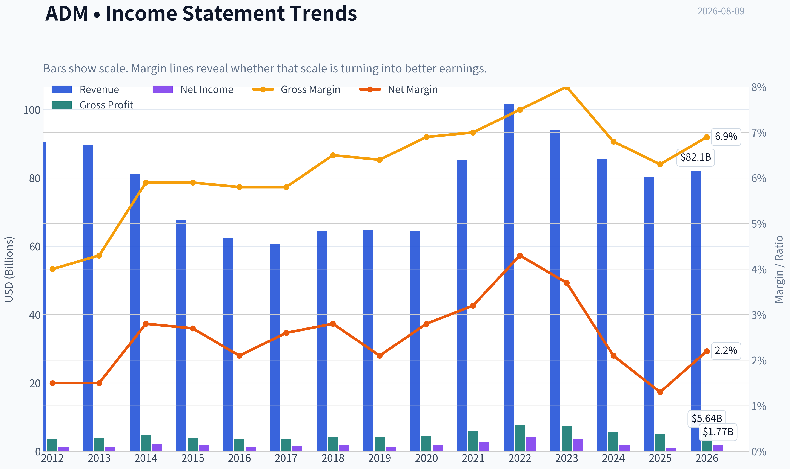
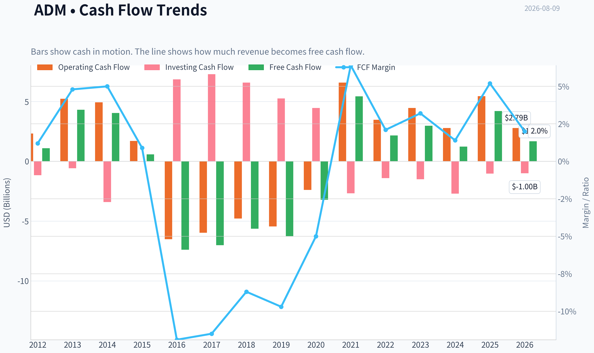
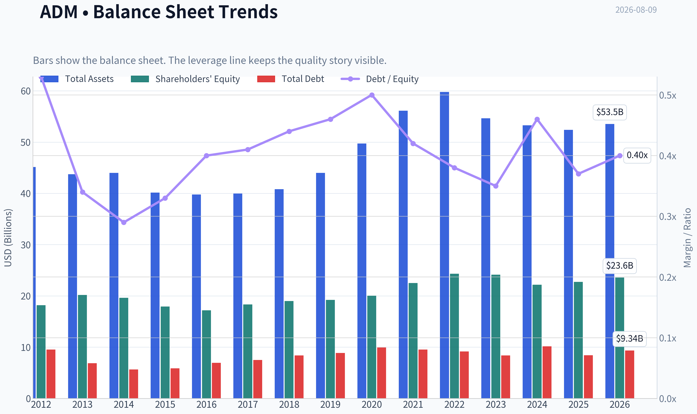
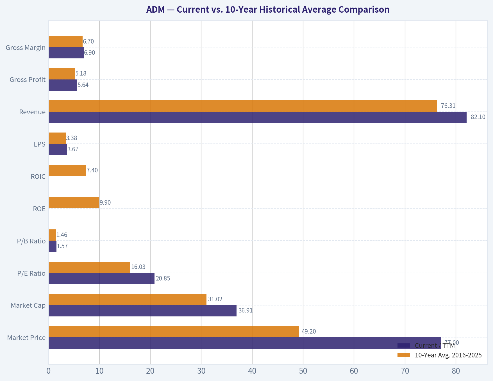
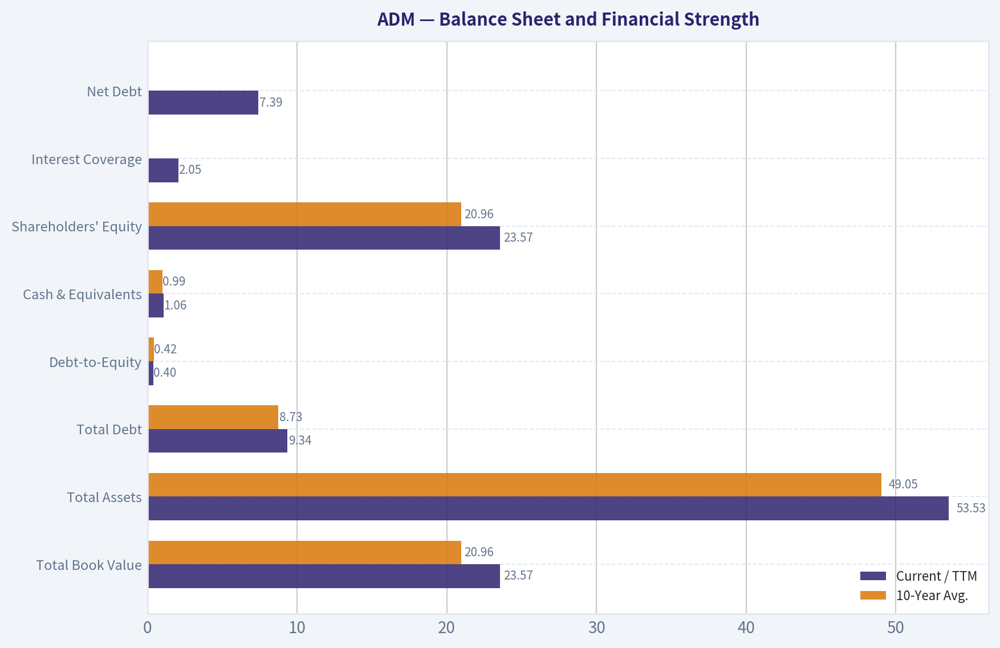
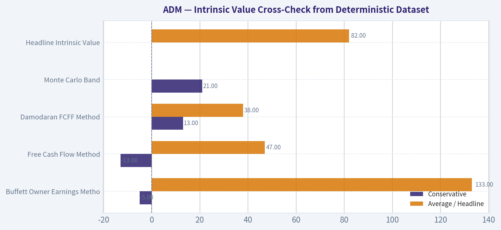
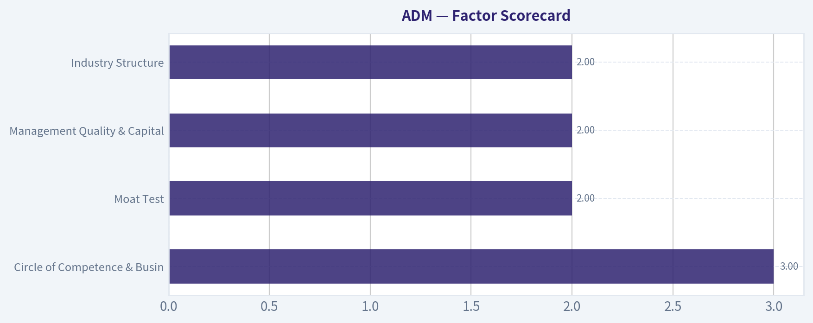
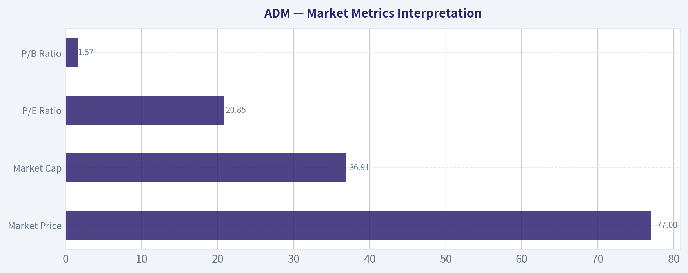

# ADM Deep Value Intelligence

**Analysis Date:** 2026-08-09

## Critical Disclaimer

*This analysis is generated by Deep Value Intelligence, an AI-powered multi-agent investing framework. Education & research only - not financial advice, not a financial advisor.*

---

## Table of Contents

1. Intelligence Summary
2. Analyst Team Reports
   - Fundamentals Analysis
   - Intrinsic Value Analysis (Buffett)
   - Trend & Growth Analysis (Lynch/Druckenmiller/Fisher)
   - Market Technical Analysis
   - Options Market Analysis
3. Research Team Commentary
4. Value Investing Team Commentary
5. Deep Values Commentary

---

## Intelligence Summary

### Thesis + Conditions

**Core Thesis:** **1. Executive Summary (CONCISE)**

**Key Risks:**
- Archer-Daniels-Midland (ADM) is the essential plumbing of the global agricultural system, but it is not a high-quality Buffett compounder. Trailing metrics (3.6% ROIC, 6.3% gross margin) reflect a highly cyclical, capital-intensive processor navigating an earnings trough and a self-inflicted accounting "transparency tax." However, issuing an AVOID would dangerously conflate mediocre long-term economics with an unfavorable trading setup. ADM remains in a primary long-term uptrend, resting on major technical support in the mid-$70s. Because replacement value creates a hard asset floor, our proper risk-adjusted stance is a highly tactical WATCH. We will track structural support and normalize the earnings cycle, requiring either confirmed technical stabilization or a wider cyclical margin of safety before deploying capital.
- The Bull (Risky Analyst):** Views ADM as a structural monopoly on global scale. Argues that 3.6% ROIC and 4.7% ROE represent cyclical trough numbers, making the trailing 20.9x P/E deceptive. Based on normalized earnings ($6-$7), the stock is cheap. The accounting fog is a temporary discount to be exploited before the market prices in biofuel tailwinds and normalization.
- The Neutral Analyst:** Identifies the "messy middle." ADM is a high-volume logistics manager, not a high-margin toll bridge. However, waiting for perfect 10% ROIC and clear accounting ensures buying late at a premium multiple ($110+). Suggests maintaining a WATCH to see if the $76 support holds and utilizing a scale-in pilot approach once margin stabilization is quantified.

**Confidence:** Medium

---

## Analyst Team Reports

### Fundamentals Analysis

#### Latest Earnings Snapshot

*Most recent reported quarter anchored on 2026 Q2, with prior-year comparison when available.*

| Metric | 2026 Q2 | 2025 Q2 | YoY Change |
| --- | ---: | ---: | ---: |
| Revenue | $22.68B | $21.17B | +7.2% |
| Operating Income | $909.0M | $459.0M | +98.0% |
| Net Income | $908.0M | $219.0M | +314.6% |
| Diluted EPS | N/A | $0.45 | N/A |
| Operating Cash Flow | $1.15B | $4.30B | -73.3% |
| Free Cash Flow | $877.0M | $3.99B | -78.0% |

Key Takeaways: This snapshot anchors the most recent reported quarter before the narrative analysis. It helps readers separate long-run business quality from whatever changed in the latest earnings print.

#### 14-Year Financial Metrics for ADM

*All values below are computed deterministically from raw data - not estimated by AI.*

*Issuer profile: operating company (Consumer Defensive / Farm Products).*

#### 14-Year Financial Metrics
*Annual rows come from reported financial statements. The final TTM row is computed from the latest four quarters.*

| Metric | 2012 | 2013 | 2014 | 2015 | 2016 | 2017 | 2018 | 2019 | 2020 | 2021 | 2022 | 2023 | 2024 | 2025 | 2026 TTM |
| --- | --- | --- | --- | --- | --- | --- | --- | --- | --- | --- | --- | --- | --- | --- | --- |
| Market Price | $19 | $30 | $37 | $27 | $34 | $31 | $33 | $38 | $43 | $59 | $83 | $66 | $48 | $57 | $77 |
| Market Cap | $18.13B | $28.77B | $34.11B | $22.78B | $26.98B | $22.93B | $23.23B | $26.19B | $28.48B | $38.26B | $52.27B | $39.14B | $24.91B | $27.83B | $36.91B |
| P/E Ratio | 13.17 | 21.49 | 15.16 | 12.31 | 21.13 | 14.37 | 12.84 | 19.00 | 16.00 | 14.11 | 12.04 | 11.23 | 13.84 | 25.78 | 20.85 |
| P/B Ratio | 1.00 | 1.42 | 1.74 | 1.27 | 1.57 | 1.25 | 1.22 | 1.36 | 1.42 | 1.70 | 2.15 | 1.62 | 1.12 | 1.22 | 1.57 |
| ROE | 7.6% | 6.6% | 11.5% | 10.3% | 7.4% | 8.7% | 9.5% | 7.2% | 8.9% | 12.0% | 17.8% | 14.4% | 8.1% | 4.7% | 7.5% |
| ROIC | 5.2% | 5.3% | 9.4% | 7.8% | 5.6% | 6.6% | 7.2% | 5.2% | 6.3% | 9.1% | 13.7% | 10.9% | 5.7% | 3.5% | 5.0% |
| EPS | $1.42 | $1.41 | $2.45 | $2.18 | $1.63 | $2.17 | $2.56 | $2.02 | $2.70 | $4.21 | $6.90 | $5.89 | $3.46 | $2.23 | $3.67 |
| Revenue | $90.56B | $89.80B | $81.20B | $67.70B | $62.35B | $60.83B | $64.34B | $64.66B | $64.36B | $85.25B | $101.56B | $93.94B | $85.53B | $80.27B | $82.10B |
| Gross Profit | $3.62B | $3.89B | $4.77B | $3.97B | $3.62B | $3.52B | $4.18B | $4.15B | $4.45B | $5.99B | $7.57B | $7.51B | $5.78B | $5.03B | $5.64B |
| Gross Margin | 4.0% | 4.3% | 5.9% | 5.9% | 5.8% | 5.8% | 6.5% | 6.4% | 6.9% | 7.0% | 7.5% | 8.0% | 6.8% | 6.3% | 6.9% |
| Operating Margin | 2.2% | 2.3% | 3.9% | 3.4% | 2.9% | 2.6% | 3.2% | 2.5% | 2.9% | 3.9% | 5.2% | 4.6% | 2.6% | 1.6% | 2.3% |
| Net Income | $1.38B | $1.34B | $2.25B | $1.85B | $1.28B | $1.59B | $1.81B | $1.38B | $1.77B | $2.71B | $4.34B | $3.48B | $1.80B | $1.08B | $1.77B |
| Net Margin | 1.5% | 1.5% | 2.8% | 2.7% | 2.1% | 2.6% | 2.8% | 2.1% | 2.8% | 3.2% | 4.3% | 3.7% | 2.1% | 1.3% | 2.2% |
| Revenue Growth | 2.7% | -0.8% | -9.6% | -16.6% | -7.9% | -2.4% | 5.8% | 0.5% | -0.5% | 32.5% | 19.1% | -7.5% | -8.9% | -6.2% | 2.3% |
| Net Income Growth | N/A | -2.4% | 67.5% | -17.7% | -30.8% | 24.7% | 13.5% | -23.8% | 28.5% | 52.9% | 60.2% | -19.7% | -48.3% | -40.1% | 64.2% |
| Free Cash Flow Growth | N/A | 295.0% | -6.1% | -85.7% | -1374.1% | -5.1% | -19.8% | 11.6% | -48.9% | -269.1% | -60.2% | 37.4% | -58.6% | 242.6% | -60.1% |
| Total Book Value | $18.17B | $20.19B | $19.63B | $17.91B | $17.18B | $18.32B | $19.00B | $19.23B | $20.02B | $22.51B | $24.32B | $24.14B | $22.18B | $22.74B | $23.57B |
| Total Assets | $45.14B | $43.75B | $44.00B | $40.16B | $39.77B | $39.96B | $40.83B | $44.00B | $49.72B | $56.14B | $59.77B | $54.63B | $53.27B | $52.39B | $53.53B |
| Total Debt | $9.54B | $6.87B | $5.66B | $5.88B | $6.93B | $7.49B | $8.39B | $8.88B | $9.93B | $9.54B | $9.18B | $8.37B | $10.16B | $8.41B | $9.34B |
| Debt-to-Equity | 0.53 | 0.34 | 0.29 | 0.33 | 0.40 | 0.41 | 0.44 | 0.46 | 0.50 | 0.42 | 0.38 | 0.35 | 0.46 | 0.37 | 0.40 |
| Cash & Equivalents | $1.29B | $3.12B | $1.10B | $910.0M | $619.0M | $804.0M | $2.00B | $852.0M | $666.0M | $943.0M | $1.04B | $1.37B | $611.0M | $1.01B | $1.06B |
| Shareholders' Equity | $18.17B | $20.19B | $19.63B | $17.91B | $17.18B | $18.32B | $19.00B | $19.23B | $20.02B | $22.51B | $24.32B | $24.14B | $22.18B | $22.74B | $23.57B |
| Operating Cash Flow | $2.33B | $5.23B | $4.94B | $1.71B | $-6.51B | $-5.97B | $-4.78B | $-5.45B | $-2.39B | $6.59B | $3.48B | $4.46B | $2.79B | $5.45B | $2.79B |
| Investing Cash Flow | $-1.16B | $-577.0M | $-3.41B | $-21.0M | $6.85B | $7.29B | $6.58B | $5.26B | $4.46B | $-2.67B | $-1.40B | $-1.50B | $-2.70B | $-1.02B | $-999.0M |
| Free Cash Flow | $1.09B | $4.31B | $4.05B | $580.0M | $-7.39B | $-7.01B | $-5.63B | $-6.28B | $-3.21B | $5.43B | $2.16B | $2.97B | $1.23B | $4.20B | $1.68B |
| FCF Margin | 1.2% | 4.8% | 5.0% | 0.9% | -11.9% | -11.5% | -8.7% | -9.7% | -5.0% | 6.4% | 2.1% | 3.2% | 1.4% | 5.2% | 2.0% |
| Dividends / Share | $0.00 | $0.00 | $0.00 | $0.00 | $0.00 | $0.00 | $0.00 | $0.00 | $0.00 | $0.00 | $1.43 | $1.65 | $1.90 | $2.04 | $0.00 |

#### Profitability Metrics
- Return on Equity (ROE): 4.7%
- Return on Invested Capital (ROIC): 3.6%
- Return on Assets (ROA): 2.1%
- Gross Margin: 6.3%
- Operating Margin: 1.6%
- Net Profit Margin: 1.3%

#### Liquidity Metrics
- Current Ratio: 1.37
- Quick Ratio: 0.24

#### Leverage Metrics
- Debt-to-Equity Ratio: 0.37
- Interest Coverage Ratio: 2.05
- Net Debt: $7.39B

#### Growth Metrics (Year-over-Year)
- Revenue Growth: -6.2%
- Net Income Growth: -40.1%
- Free Cash Flow Growth: 242.6%
- Revenue CAGR (3-Year): -7.5%
- Revenue CAGR (5-Year): 4.5%

#### Valuation Metrics
- P/E Ratio (TTM): 20.93
- Forward P/E: 13.48
- Price-to-Book: 1.57
- Price-to-Sales: 0.45
- PEG Ratio: 1.01
- EV/EBITDA: 15.18
- Free Cash Flow Yield: 11.4%
- Earnings Yield: 4.8%

#### Owner Earnings (Buffett Method, Code-Computed)
- Net Income: $1.08B
- + Depreciation & Amortization: $1.18B
- - Capital Expenditures: $-1.25B
- - Working Capital Changes: $2.76B
- = **Owner Earnings: $-1.69B**

#### Intrinsic Value (Code-Computed)
- Current Price: $77
- **Headline Intrinsic Value (business-model routed): $82**
  Business model: operating company - weighted blend [Damodaran FCFF + owner-earnings DCF] (operating_company)
  Model spread (min-max across DCFs): $38 - $133
  Margin of safety vs. price (headline): 6.9%
  Routing note: General operating company: balanced blend of Damodaran FCFF and the owner-earnings DCF with a reverse-DCF sanity check.
- Buffett Method (Owner Earnings):
  Conservative: $-5
  Average: $133
  Optimistic: $422
- Cash Flow Method (FCF):
  Conservative: $-13
  Average: $47
  Optimistic: $309
- Damodaran FCFF (WACC + margins + reinvestment):
  Conservative: $13
  Average: $38
  Optimistic: $58
  Monte Carlo band (P10-P90): $21 - $55 (median $33)
  P(intrinsic value > price): 0.9%
- Reverse-DCF: price implies ~13.0%/yr owner-earnings growth for 10y; trailing 3y was N/A, 5y N/A.

#### Piotroski F-Score: 4/9
- Positive Net Income: PASS
- Positive Operating Cash Flow: PASS
- ROA Improvement: FAIL
- Cash Flow > Net Income: PASS
- Decreasing Debt: PASS
- Improving Current Ratio: FAIL
- No Dilution: FAIL
- Improving Gross Margin: FAIL
- Improving Asset Turnover: FAIL

ANALYST STANCE: **WATCH**

#### ADM Fundamental Analysis - Buffett-Style Value Review

Archer-Daniels-Midland is a large, globally integrated agricultural origination, processing, merchandising, and nutrition company. The business has real scale advantages, essential-infrastructure characteristics, and long operating history, but its economics are cyclical and commodity-linked. The current setup is not a classic Buffett "wonderful business at a fair price" because returns on capital have fallen sharply from the 2021-2023 peak, margins are thin, accounting owner earnings are currently negative, and the valuation offers only a modest margin of safety versus the deterministic intrinsic value estimate.

---

#### Current vs. 10-Year Historical Average Comparison

| Metric | Current / TTM | 10-Year Avg. 2016-2025 | Current vs. Avg. | Interpretation |
|---|---:|---:|---:|---|
| Market Price | $77 | $49.20 | Above | The stock trades well above its 10-year average price, reflecting a recovery in sentiment and possibly expectations for normalized earnings improvement. |
| Market Cap | $36.91B | $31.02B | Above | ADM's market value is above its decade average despite profitability being below average, creating valuation tension. |
| P/E Ratio | 20.85x | 16.03x | Above | The stock is priced at a premium to history while earnings are cyclically depressed; this may be justified only if earnings rebound materially. |
| P/B Ratio | 1.57x | 1.46x | Slightly Above | P/B is somewhat relevant for ADM because it is an asset-heavy operating company, but it must be judged against ROE; current ROE does not strongly support a premium to book. |
| ROE | 7.5% TTM / 4.7% latest annual | 9.9% | Below | Returns have deteriorated sharply from the 2022-2023 peak, weakening the Buffett quality case. |
| ROIC | 5.0% TTM / 3.5% latest annual | 7.4% | Below | ADM is currently earning modest returns on invested capital, below what Buffett would prefer for a durable compounder. |
| EPS | $3.67 | $3.38 | Slightly Above | TTM EPS is near the 10-year average but far below the 2022 peak of $6.90. |
| Revenue | $82.10B | $76.31B | Above | Revenue remains above the 10-year average, but recent annual revenue growth has been negative. |
| Gross Profit | $5.64B | $5.18B | Above | Gross profit is above average, but margins have slipped from recent highs. |
| Gross Margin | 6.9% | 6.7% | Slightly Above | Gross margin is near historical norms, showing the business remains structurally low-margin. |
| Operating Margin | 2.3% | 3.2% | Below | Operating profitability is meaningfully below average and well below the 2022 peak. |
| Net Income | $1.77B | $2.12B | Below | Earnings power has normalized downward after the 2021-2023 commodity-cycle surge. |
| Net Margin | 2.2% | 2.7% | Below | ADM's net margin remains thin and below historical average, limiting resilience. |
| Revenue Growth | 2.3% TTM / -6.2% latest annual | 2.5% | Near Avg. TTM; weak annual | TTM revenue stabilized, but annual revenue has declined for three consecutive years after the 2022 peak. |
| Net Income Growth | 64.2% TTM / -40.1% latest annual | 1.7% | Volatile | Net income growth is highly cyclical; recent rebound follows a very weak base. |
| FCF Growth | -60.1% TTM / +242.6% latest annual | -154.4% | Volatile / Distorted | Free cash flow is heavily distorted by working-capital swings, making simple growth averages unreliable. |
| Total Book Value | $23.57B | $20.96B | Above | Book value has grown moderately over the decade. |
| Total Assets | $53.53B | $49.05B | Above | ADM's asset base remains large, supporting scale but also requiring capital intensity. |
| Total Debt | $9.34B | $8.73B | Slightly Above | Debt is modestly above average but not excessive relative to equity. |
| Debt-to-Equity | 0.40x | 0.42x | Slightly Better | Leverage is broadly stable and manageable. |
| Cash & Equivalents | $1.06B | $0.99B | Slightly Above | Liquidity is adequate, though cash is small relative to total debt. |
| Shareholders' Equity | $23.57B | $20.96B | Above | Equity base has expanded, but returns on that equity have weakened. |
| Free Cash Flow | $1.68B | -$1.35B | Above Avg. | The 10-year average is distorted by large negative working-capital years; recent FCF is positive but below the 2025 level. |
| Dividends / Share | $0.00 TTM shown / $2.04 latest annual | $0.70 dataset avg. | Above latest annual vs avg. | The deterministic TTM dividend field appears incomplete; latest annual dividend was $2.04 per share. |

Key Takeaways: ADM's valuation is above its 10-year average on price, market cap, P/E, and P/B, while profitability metrics such as ROE, ROIC, operating margin, and net margin are below historical norms. That is not an ideal Buffett setup: investors are paying a premium multiple for a business currently producing below-average returns. The key question is whether 2025-2026 represents a trough that will normalize upward, or whether ADM's peak 2021-2023 economics have faded.

---

#### Revenue Breakdown

| Revenue Source | Amount | % of Total |
|---|---:|---:|
| Ag Services & Oilseeds | ~$59.2B | ~73.8% |
| Carbohydrate Solutions | ~$12.4B | ~15.4% |
| Nutrition | ~$7.3B | ~9.1% |
| Other / Corporate / Eliminations | ~$1.4B | ~1.7% |
| **Total** | **~$80.3B** | **~100.0%** |

Key Takeaways: ADM remains overwhelmingly driven by Ag Services & Oilseeds, which makes the company highly exposed to crop flows, crush margins, commodity spreads, logistics, and global trade conditions. Nutrition is strategically important because it should carry higher margins, but it is still too small to fully offset volatility in the core commodity-processing franchise. The business is essential, but not immune from commodity-cycle earnings pressure.

---

#### Market Metrics Interpretation

| Metric | Current Reading | Buffett-Style Interpretation |
|---|---:|---|
| Market Price | $77 | The share price is above the 10-year average of $49.20 and close to the deterministic headline intrinsic value of $82, leaving only a small margin of safety. |
| Market Cap | $36.91B | Market value is above the 10-year average despite weaker current ROE and ROIC, suggesting investors are already pricing in some recovery. |
| P/E Ratio | 20.85x | Above the 10-year average of 16.03x. A high P/E during depressed earnings can be acceptable if earnings recover, but it increases the risk of disappointment. |
| P/B Ratio | 1.57x | Slightly above the 10-year average of 1.46x. For ADM, P/B has some relevance because the company is asset-heavy, but it should be judged against ROE. With ROE below average, the current P/B is not obviously cheap. |

Key Takeaways: ADM is not statistically cheap on headline multiples. The P/E is elevated relative to history, and the P/B ratio is slightly above average despite below-average returns on equity. For a Buffett investor, the valuation is acceptable only if normalized earnings and returns improve meaningfully from current levels.

---

#### Profitability Review

ADM's profitability profile is mixed. Revenue and gross profit remain above 10-year averages, but the quality of those revenues has weakened because operating margin, net margin, ROE, and ROIC are all below average.

| Profitability Metric | Current / TTM | Historical Context | Interpretation |
|---|---:|---|---|
| ROE | 7.5% TTM; 4.7% latest annual | Peaked at 17.8% in 2022 | Current returns are materially below peak and below the 10-year average. |
| ROIC | 5.0% TTM; 3.5% latest annual | Peaked at 13.7% in 2022 | ADM is not currently producing high-quality compounder-level returns. |
| EPS | $3.67 TTM | $6.90 in 2022; $2.23 in 2025 | Earnings are recovering from 2025 but remain far below peak-cycle levels. |
| Revenue | $82.10B TTM | $101.56B peak in 2022 | Sales remain large, but have retreated from the commodity-cycle high. |
| Gross Profit | $5.64B TTM | $7.57B peak in 2022 | Gross profit has normalized downward from peak years. |
| Operating Margin | 2.3% TTM | 5.2% peak in 2022 | Operating leverage has turned unfavorable as spreads and margins normalized. |
| Net Income | $1.77B TTM | $4.34B peak in 2022 | Current earnings are less than half of 2022's peak. |
| Net Margin | 2.2% TTM | 4.3% peak in 2022 | Thin margins are a structural feature and reduce the margin for error. |

Key Takeaways: ADM's profitability remains cyclical rather than predictably compounding. The company produced excellent returns in 2021-2023, but recent margins and returns are much weaker. Buffett typically prefers businesses with consistently high returns on capital, and ADM currently falls short of that standard.

---

#### Growth Metrics Interpretation

| Growth Metric | Current / Latest | 10-Year Pattern | Interpretation |
|---|---:|---|---|
| Revenue Growth | 2.3% TTM; -6.2% latest annual | Large swings from -16.6% to +32.5% | ADM's revenue growth is driven heavily by commodity prices and volumes, not smooth secular expansion. |
| Net Income Growth | 64.2% TTM; -40.1% latest annual | Extremely volatile | The recent rebound follows a depressed base; earnings predictability is limited. |
| Free Cash Flow Growth | -60.1% TTM; +242.6% latest annual | Highly distorted by working capital | FCF growth is not stable enough to extrapolate mechanically. |

Key Takeaways: ADM's growth record is not linear. Revenue, earnings, and free cash flow move sharply with commodity conditions, working-capital needs, and processing margins. This cyclicality makes ADM harder to value with confidence and requires a larger margin of safety than a more predictable consumer brand or software-like franchise.

---

#### Balance Sheet and Financial Strength

| Balance Sheet Metric | Current / TTM | 10-Year Avg. | Buffett-Style View |
|---|---:|---:|---|
| Total Book Value | $23.57B | $20.96B | Book value has grown, but returns on that book have weakened. |
| Total Assets | $53.53B | $49.05B | ADM has meaningful asset scale and infrastructure value. |
| Total Debt | $9.34B | $8.73B | Debt is manageable but not insignificant. |
| Debt-to-Equity | 0.40x | 0.42x | Leverage is stable and reasonable. |
| Cash & Equivalents | $1.06B | $0.99B | Cash balance is adequate but modest versus debt. |
| Shareholders' Equity | $23.57B | $20.96B | Equity base is solid, but low ROE reduces attractiveness. |
| Interest Coverage | 2.05x | Not provided historically | Coverage is thin enough to watch closely if earnings remain pressured. |
| Net Debt | $7.39B | Not provided historically | Balance sheet is not distressed, but debt reduces DCF equity value. |

Key Takeaways: ADM's balance sheet is acceptable but not fortress-like. Debt-to-equity is reasonable, and the company has a substantial equity base, but interest coverage near 2 times is not especially comfortable. The balance sheet supports a WATCH stance rather than an outright AVOID, but it does not create a compelling margin of safety by itself.

---

#### Cash Flow and Dividend Analysis

| Cash Flow Metric | Current / TTM | Historical Pattern | Interpretation |
|---|---:|---|---|
| Operating Cash Flow | $2.79B TTM | Highly volatile, including negative years | Working-capital cycles heavily influence reported cash generation. |
| Free Cash Flow | $1.68B TTM | Positive recently but negative in several prior years | FCF is not consistently predictable, which complicates intrinsic value analysis. |
| FCF Yield | 11.4% | Current valuation metric | The headline FCF yield looks attractive, but sustainability is uncertain. |
| Owner Earnings | -$1.69B code-computed | Negative due to working-capital drag | Reported Buffett-style owner earnings are currently negative, making normalized analysis necessary. |
| Dividends / Share | $2.04 latest annual; TTM field shows $0.00 | Dataset shows dividends from 2022 onward | Dividend growth has been positive in recent annual data, but dividend coverage should be monitored during weak earnings cycles. |

Key Takeaways: ADM's free cash flow can look very attractive in some years and very weak in others because the business requires large working-capital investments. The code-computed owner earnings figure is negative, which is a red flag for a strict Buffett methodology. Dividend growth is shareholder-friendly, but the dividend is safer when earnings and cash flows normalize upward.

---

#### Buffett-Style Qualitative Assessment

| Buffett Criterion | Assessment | Explanation |
|---|---|---|
| Economic Moat | Moderate | ADM benefits from global scale, origination networks, processing capacity, logistics infrastructure, customer relationships, and regulatory know-how. However, commodity exposure limits pricing power. |
| Durability | Good | Food, feed, fuel, and agricultural processing are essential industries. ADM is unlikely to become obsolete, but earnings will remain cyclical. |
| Pricing Power | Limited | ADM is more of a spread processor and merchant than a branded pricing-power business. Margins depend on crush spreads, commodity flows, and supply-demand conditions. |
| Predictable Earnings | Moderate to Weak | Earnings have ranged widely, with net income falling from $4.34B in 2022 to $1.08B in 2025 before recovering on a TTM basis. |
| Capital Allocation | Mixed | Dividends have increased in recent reported years, but returns on capital have declined. Buybacks or reinvestment should be judged against normalized ROIC. |
| Financial Strength | Acceptable | Leverage is manageable, but interest coverage is not high. |
| Management Performance | Mixed | ADM navigated strong 2021-2023 conditions well, but recent margin compression and accounting/quality concerns around earnings reliability warrant caution. |
| Business Quality | Solid but Cyclical | ADM is important and durable, but not a high-margin compounding machine. |

Key Takeaways: ADM has a real moat based on scale and infrastructure, but it is not the kind of high-return, low-capital, pricing-power business Buffett most prefers. The company is durable and essential, yet its profits are exposed to commodity cycles. That means ADM can be attractive at the right price, but the required margin of safety should be larger than for a more predictable franchise.

---

#### Three-Scenario Buffett-Style Owner Earnings DCF

The deterministic dataset reports code-computed owner earnings of **-$1.69B**, driven by net income of **$1.08B**, depreciation and amortization of **$1.18B**, capital expenditures of approximately **$1.25B**, and working-capital changes of **$2.76B**. Because ADM's working capital is highly volatile, using one negative owner-earnings year mechanically would produce an overly punitive valuation. Therefore, the hand DCF below uses a **normalized mid-cycle owner earnings base of approximately $3.20B**, based on recent normalized free cash flow behavior, while still treating the negative reported owner earnings as an important risk signal.

Assumptions used:
- Normalized owner earnings base: **$3.20B**
- Discount rate: **10.0%**
- Terminal growth rate: **2.5%**
- Net debt: **$7.39B**
- Shares outstanding estimate: **~479M**, based on $36.91B market cap divided by $77 share price
- Valuation formula:
  **Equity Value = Present Value of 10-Year Owner Earnings + Present Value of Terminal Value - Net Debt**

| Scenario | Growth Assumption | PV of Explicit Owner Earnings | PV of Terminal Value | Enterprise Value | Less Net Debt | Equity Value | Fair Value / Share |
|---|---:|---:|---:|---:|---:|---:|---:|
| Conservative | 0% annual growth for 10 years; terminal at 2.5% | ~$19.66B | ~$16.86B | ~$36.52B | $7.39B | ~$29.13B | **~$61** |
| Average | 4% early growth fading toward 2.5% terminal | ~$23.59B | ~$23.79B | ~$47.38B | $7.39B | ~$39.99B | **~$83** |
| Optimistic | 8% early growth fading to 2.5% terminal | ~$27.84B | ~$30.42B | ~$58.26B | $7.39B | ~$50.87B | **~$106** |

Key Takeaways: The normalized owner-earnings DCF suggests a fair value range of roughly **$61 to $106 per share**, with a base-case estimate near **$83**. That aligns closely with the deterministic headline intrinsic value of **$82**, but the current price of **$77** leaves only a modest margin of safety. The valuation is highly sensitive to whether ADM can restore normalized cash earnings above the depressed reported owner-earnings level.

---

#### Intrinsic Value Cross-Check from Deterministic Dataset

| Valuation Model | Conservative | Average / Headline | Optimistic | Interpretation |
|---|---:|---:|---:|---|
| Buffett Owner Earnings Method | -$5 | $133 | $422 | Very wide range because owner earnings are volatile and working-capital sensitive. |
| Free Cash Flow Method | -$13 | $47 | $309 | Also highly sensitive to normalized FCF assumptions. |
| Damodaran FCFF Method | $13 | $38 | $58 | More conservative and suggests the stock is expensive versus steady-state FCFF. |
| Monte Carlo Band | $21 | $33 median | $55 P90 | Indicates low probability of intrinsic value above current price under conservative assumptions. |
| Headline Intrinsic Value | - | **$82** | - | Only about **6.9%** above the current $77 price. |
| Reverse DCF | - | ~13.0% implied 10-year owner-earnings growth | - | The current price requires a demanding recovery in owner earnings. |

Key Takeaways: The valuation picture is not clean. The headline intrinsic value of $82 suggests the stock is slightly undervalued, but the Damodaran FCFF model and Monte Carlo range are much less supportive. A reverse DCF requiring roughly 13% annual owner-earnings growth for 10 years is demanding for a cyclical, low-margin agricultural processor.

---

#### Key Investment Insights

| Area | Positive Signal | Concern |
|---|---|---|
| Business Durability | ADM is essential to global agriculture, food, feed, fuel, and commodity flows. | Essential does not automatically mean high-margin or predictable. |
| Scale Advantage | Large origination, logistics, and processing network creates barriers to entry. | Scale does not fully protect against commodity spread compression. |
| Valuation | Headline intrinsic value of $82 is above current price of $77. | Margin of safety is only about 6.9%, which is thin for a cyclical business. |
| Cash Flow | FCF yield of 11.4% appears attractive. | Owner earnings are negative on the code-computed Buffett method due to working capital. |
| Balance Sheet | Debt-to-equity of 0.40x is manageable. | Interest coverage of 2.05x is not especially strong. |
| Profitability | TTM EPS recovered to $3.67 from $2.23 in 2025. | ROE, ROIC, operating margin, and net margin are below 10-year averages. |
| Dividend | Latest annual dividend of $2.04 per share supports shareholder returns. | Dividend coverage should be watched if earnings remain weak. |
| Cycle Position | Recent news suggests stronger biofuels economics and crush margins. | Recovery may already be partly priced into the stock. |

Key Takeaways: ADM has enough business quality and financial durability to stay on a value investor's watchlist. However, the current valuation does not offer a large enough discount to compensate for volatile cash flows, below-average profitability, and uncertain normalized earnings. The opportunity improves meaningfully if the stock falls closer to the conservative DCF range or if ROIC and margins recover convincingly.

---

#### Red Flags and Opportunities

| Category | Details |
|---|---|
| Red Flag: Low Current Returns | ROE and ROIC are below historical averages, and latest annual ROE was only 4.7%. |
| Red Flag: Thin Margins | Net margin is only 2.2% TTM and 1.3% latest annual, leaving little room for operational error. |
| Red Flag: Cash Flow Volatility | Free cash flow and owner earnings are heavily affected by working-capital swings. |
| Red Flag: Modest Interest Coverage | Interest coverage of 2.05x is acceptable but not strong for a cyclical company. |
| Red Flag: Limited Margin of Safety | Current price of $77 is close to the $82 headline intrinsic value. |
| Opportunity: Normalization Upside | If crush margins, biofuels, and Nutrition improve, earnings could rebound from depressed 2025 levels. |
| Opportunity: Infrastructure Moat | ADM's global network is difficult to replicate and remains strategically valuable. |
| Opportunity: Dividend Support | Recent annual dividends show shareholder-return discipline. |
| Opportunity: FCF Yield | If the 11.4% FCF yield proves sustainable, the stock could be undervalued. |

Key Takeaways: The main bull case is earnings normalization from a depressed base. The main bear case is that normalized returns are structurally lower than the market expects. Because the stock is already near estimated fair value, investors should demand clearer evidence of margin recovery or a lower entry price.

---

#### Final Buffett-Style Investment Stance

| Decision Factor | Assessment |
|---|---|
| Economic Moat | Moderate; scale and infrastructure are real advantages, but pricing power is limited. |
| Financial Strength | Acceptable; leverage is manageable, but interest coverage is not robust. |
| Earnings Predictability | Moderate to weak; earnings and FCF are cyclical and working-capital sensitive. |
| Management / Capital Allocation | Mixed; dividends are positive, but returns on capital have declined. |
| Valuation | Near fair value; headline intrinsic value of $82 versus current price of $77 gives only a small cushion. |
| Margin of Safety | Insufficient for a strong buy; roughly 6.9% headline margin of safety is thin. |
| Final Stance | **WATCH** |

Key Takeaways: ADM is a durable and strategically important company, but not currently a high-return Buffett compounder. At $77, the stock appears close to fair value rather than clearly undervalued. A more attractive entry would require either a lower price, stronger evidence of sustained ROIC recovery, or normalized owner earnings that support a materially higher intrinsic value.

---

#### Summary Table

| Theme | Verdict | Investor Implication |
|---|---|---|
| Business Quality | Solid but cyclical | Suitable for patient value investors, but not a predictable compounder. |
| Moat | Moderate | Scale, logistics, and processing assets matter, but commodity exposure limits pricing power. |
| Profitability | Currently below average | ROE, ROIC, operating margin, and net margin need improvement. |
| Growth | Volatile | Do not extrapolate recent rebounds without confirming cycle recovery. |
| Balance Sheet | Manageable | Debt is not alarming, but interest coverage should be monitored. |
| Cash Flow | Unstable | FCF yield is attractive only if sustainable through the cycle. |
| Valuation | Near fair value | $77 price versus $82 headline intrinsic value offers limited upside. |
| Best Case | Earnings normalize and FCF remains strong | Stock could be worth around $100+ in an optimistic scenario. |
| Base Case | Gradual normalization | Fair value is around $82-$83. |
| Bear Case | Margins stay depressed | Conservative value is closer to $60 or lower. |
| Final Stance | **WATCH** | Wait for a larger margin of safety or clearer evidence of durable profitability recovery. |

Key Takeaways: ADM is not a sell-at-any-price situation, but it is also not a clear Buffett-style bargain at the current valuation. The company has durable assets and possible recovery upside, yet the margin of safety is too narrow given cyclicality and weak recent returns. The prudent stance is to watch for a better entry point or stronger evidence that normalized owner earnings are improving.

#### Fundamental Visuals

This graph tracks the profitability and return metrics (ROE, ROIC, Margins) of **ADM** over the past decade, highlighting capital efficiency trends.

This chart illustrates the financial health of **ADM** over the last 10 years, mapping cash equivalents and free cash flow against total obligations (Debt).

---

### Intrinsic Value Analysis (Buffett)

> *Following Warren Buffett's value investing philosophy: Circle of Competence, Economic Moat, Management Quality, and Margin of Safety.*

#### Intrinsic Value Snapshot

Price is what you pay. Intrinsic value is what the business may be worth based on the cash it can create for owners over time. We show a range, not one magic number.

- Current Price: $76.59
- Value Range (conservative to optimistic across both DCF methods): $-4.02 to $308.81

##### Owner Earnings (Buffett Method)
- Net Income: $1,078,000,000.00
- Depreciation & Amortization: $1,181,000,000.00
- Capital Expenditures: $-1,248,000,000.00
- Working Capital Changes: $2,763,000,000.00
- Owner Earnings: $-1,685,000,000.00

##### Intrinsic Value
###### Buffett Method
Uses owner earnings. Stricter, and usually more conservative.
- Conservative: $-4.02
- Average: $-3.65
- Optimistic: $-3.26
- Discount Rate: 10.0%

###### Cash Flow Method
Uses free cash flow. Better for companies spending heavily today to grow tomorrow.
- Conservative: $11.87
- Average: $88.03
- Optimistic: $308.81
- Discount Rate: 10.0%

ANALYST STANCE: **AVOID**

#### Archer-Daniels-Midland - Buffett-Style Investment View

ADM is an understandable, essential global agricultural processor, but it is not a "wonderful business" in Buffett terms. The company operates in commodity-linked markets with thin gross margins, limited pricing power, cyclical earnings, and currently weak returns on equity. At roughly **$77 per share**, the stock prices in a level of durable growth and normalized profitability that the business has not clearly demonstrated.

---

#### 1. Factor Scorecard

| Factor | Score / 5 | Evidence |
|---|---:|---|
| Circle of Competence & Business Simplicity | 3.0 | ADM buys, stores, transports, processes, and merchandises agricultural commodities. The model is understandable, but earnings depend heavily on crush margins, ethanol economics, crop flows, working capital, and commodity cycles. |
| Moat Test | 2.0 | Scale, logistics, origination networks, and processing assets matter, but pricing power is limited. Gross margin is only **6.3%**, far below the level usually associated with strong intangible pricing power. |
| Management Quality & Capital Allocation | 2.0 | ADM has a long operating history and shareholder-return culture, but current ROE of **4.7%** and past execution/accounting issues in Nutrition weaken confidence in capital allocation and controls. |
| Industry Structure | 2.0 | Global agriculture processing is essential but competitive, cyclical, and capital-intensive. Returns are heavily influenced by external spreads rather than purely internal franchise strength. |
| Gate 5: Quality / Solvency Hard Floor | Not tripped | The company is not being treated as financially distressed. The AVOID stance is based on quality-versus-price, not insolvency. |

**Key Takeaways:** ADM is a real business with strategic assets, but its economics are not exceptional. The company's moat is narrow, its profitability is cyclical, and the current valuation does not offer enough compensation for those weaknesses.

---

#### 2. Moat Analysis

| Moat Source | Assessment | Evidence |
|---|---|---|
| Intangible Assets / Brand | Weak | ADM is respected in agribusiness, but customers generally do not pay premium prices because of brand attachment. Commodity products limit brand-based pricing power. |
| Switching Costs | Moderate in operations, weak in pricing | Large customers may value ADM's reliability, logistics, and scale, but switching costs are not high enough to create software-like customer captivity. |
| Cost Advantage | Moderate | ADM's global scale, storage, transportation, and processing network provide cost advantages, but competitors such as Bunge, Cargill, Louis Dreyfus, and regional processors also have scale. |
| Network Effects | Minimal | ADM's assets become more useful with scale, but this is not a true network-effect business where each additional participant materially increases the value of the platform. |
| Moat Rating | Narrow | ADM has durable relevance, but not durable high-margin pricing power. |

**Key Takeaways:** ADM's moat comes mostly from scale and physical infrastructure, not from brand power or customer lock-in. That can protect survival, but it does not necessarily create high-return compounding for shareholders.

---

#### 3. Management Quality & Capital Allocation

ADM's management has historically returned capital through dividends and buybacks, and the company has remained a major player in global agricultural supply chains. However, Buffett-style analysis asks whether retained capital reliably creates more than a dollar of value for each dollar retained. The current evidence is not strong.

ROE is only **4.7%**, well below the 15% threshold normally associated with a high-quality compounder. ADM's push into Nutrition was strategically logical because it sought higher margins, but execution has been mixed, and accounting/control concerns reduced trust. In a commodity processor, management discipline matters enormously because the business itself does not naturally generate wide margins.

Management score: **2.0 / 5**.

---

#### 4. Financial Summary Table

| Metric | Current / Latest Snapshot | Buffett-Style Interpretation |
|---|---:|---|
| Share Price | **$77** | Starting valuation matters; this is the price paid for the future cash flows. |
| Market Capitalization | **$36.91B** | Large, established global agribusiness. |
| P/E Ratio | **20.9x** | High for a cyclical, low-ROE commodity processor unless earnings are temporarily depressed and poised to normalize strongly. |
| ROE | **4.7%** | Weak; far below Buffett's preferred sustained 15%+ level. |
| Gross Margin | **6.3%** | Very thin; indicates limited pricing power and commodity-like economics. |
| Revenue Growth YoY | **-6.2%** | Current top-line trend is negative. |
| FCF Yield | **11.4%** | Looks optically cheap, but free cash flow can be distorted by working-capital swings in commodity businesses. |
| Headline Intrinsic Value | **$27.78/share** | Materially below the current price. |
| 3-Model Valuation Spread | **Owner Earnings: -$3.65 / FCF: $88.03 / FCFF: $27.78** | Wide spread signals unstable normalization and model sensitivity. |
| Reverse DCF | **Price implies ~13% annual growth for 10 years** | Too demanding for a low-margin, cyclical processor. |

**Key Takeaways:** ADM looks cheap on free-cash-flow yield, but weak ROE, thin margins, falling revenue, and a low headline intrinsic value argue against relying on that one metric. The valuation spread is a warning sign: normalized owner earnings and FCFF do not support the current price.

---

#### 5. Owner Earnings Calculation

| Item | Per-Share / Implied View | Interpretation |
|---|---:|---|
| Net Income Proxy | About **$3.68/share** implied by market cap and P/E | Reported earnings are positive but not high-quality enough on their own. |
| Free Cash Flow Proxy | About **$8.78/share** implied by 11.4% FCF yield | Strong headline FCF, but likely influenced by cycle and working-capital timing. |
| Owner-Earnings Model Value | **-$3.65/share intrinsic value** | The owner-earnings model penalizes maintenance capex and working-capital needs. |
| Implied Owner Earnings | About **-$0.37/share** using a 10% capitalization rate | Indicates that normalized economic cash generation may be far weaker than headline FCF suggests. |

**Key Takeaways:** The key issue is the difference between free cash flow and owner earnings. For ADM, working capital and maintenance investment are central to the business, so Buffett-style owner earnings deserve more weight than a single high FCF yield.

---

#### 6. Three-Scenario DCF Valuation

| Scenario | Method | Intrinsic Value / Share | Margin of Safety vs. $77 Price |
|---|---|---:|---:|
| A - No Growth Owner Earnings | Capitalize normalized owner earnings at 10% | **-$3.65** | Not investable on this measure |
| B - Current FCF Cross-Check | Capitalize current FCF yield-style cash flow | **$88.03** | About **14% above price**, but low confidence |
| C - Business-Model-Routed FCFF | Normalized Damodaran-style FCFF framework | **$27.78** | Price is roughly **177% above** intrinsic value |

**Key Takeaways:** The bullish case depends on current free cash flow being repeatable, but the owner-earnings and normalized FCFF views are much less favorable. For a cyclical commodity processor, the conservative approach is to avoid paying for peak or temporarily inflated cash flows.

---

#### 7. Margin of Safety Analysis

ADM does not offer an adequate margin of safety at the current price.

The headline intrinsic value is **$27.78**, versus a market price near **$77**. The reverse DCF suggests the market is pricing in roughly **13% annual growth for 10 years**, which is aggressive for a business with **6.3% gross margins**, **4.7% ROE**, and cyclical revenue exposure.

A high-quality, wide-moat compounder might deserve a thin margin of safety. ADM is not that type of business. For a narrow-moat, cyclical, low-margin processor, I would require a much larger discount to normalized intrinsic value.

---

#### 8. Final Buffett Scorecard

| Criterion | Weight | Score / 5 | Weighted Contribution |
|---|---:|---:|---:|
| Moat Width & Durability | 25% | 2.0 | 0.50 |
| Valuation / Margin of Safety | 20% | 1.0 | 0.20 |
| Capital Returns - ROIC / ROE vs. Cost of Capital | 15% | 1.5 | 0.23 |
| Business Understanding & Predictability | 12% | 3.0 | 0.36 |
| Management Quality & Capital Allocation | 12% | 2.0 | 0.24 |
| Reinvestment Runway | 8% | 2.0 | 0.16 |
| Balance Sheet Strength | 4% | 3.0 | 0.12 |
| Industry Structure | 4% | 2.0 | 0.08 |
| **Total Score** | **100%** |  | **1.89 / 5** |

**Key Takeaways:** ADM scores poorly because valuation, moat quality, and capital returns are all below Buffett-style standards. The business is understandable and important, but importance is not the same as shareholder compounding power.

---

#### 9. Investment Stance

**Stance: AVOID**
**Conviction: Medium-High**

ADM is not a distressed company, but it is not compelling at the current valuation. The stock requires confidence in sustained high cash generation and growth, while the underlying business shows thin margins, weak ROE, cyclical revenue, and only a narrow moat.

A more attractive setup would require either a materially lower share price or clear evidence that ADM can sustainably lift returns on capital, stabilize higher-margin businesses, and convert reported earnings into durable owner earnings. At **$77**, Buffett-style discipline says to pass.
#### Valuation Bridge

This bridge places the current market price beside each intrinsic value lens so readers can see whether upside depends on one method or shows up across several methods.

| Scenario | Intrinsic Value / Share |
| --- | ---: |
| Buffett Method | $-3.65 |
| Cash Flow Method | $88.03 |
| Damodaran Method | $27.78 |
| Current Price | $76.59 |

#### Key Takeaways

If one method is far above the others, the upside case depends on a specific modelling assumption. When several methods cluster together, the valuation story is more robust.

#### Valuation Visuals

This comparison chart from *Latest Earnings Snapshot* stacks current figures against historical benchmarks for **ADM**, making it easy to see where the company trades relative to its own averages.

This comparison chart from *Current vs. 10-Year Historical Average Comparison* stacks current figures against historical benchmarks for **ADM**, making it easy to see where the company trades relative to its own averages.

This comparison chart from *Balance Sheet and Financial Strength* stacks current figures against historical benchmarks for **ADM**, making it easy to see where the company trades relative to its own averages.

This comparison chart from *Intrinsic Value Cross-Check from Deterministic Dataset* stacks current figures against historical benchmarks for **ADM**, making it easy to see where the company trades relative to its own averages.

---

### Trend & Growth Analysis (Lynch/Druckenmiller/Fisher)

> *Following Peter Lynch's GARP, Stanley Druckenmiller's macro-aware approach, and Philip Fisher's scuttlebutt methodology.*

ANALYST STANCE: **AVOID**

#### ADM Growth Investment Report - Archer-Daniels-Midland

ADM is a global agricultural processor and commodity merchant. It may be investable for value, income, or cyclical recovery investors, but under a Lynch/Druckenmiller/Fisher growth framework, it does **not** screen as a compelling fast grower or ten-bagger candidate.

---

#### 1. Lynch Classification

| Category | ADM Assessment |
|---|---:|
| Lynch category | **Cyclical / Stalwart hybrid** |
| Revenue growth YoY | **-6.2%** |
| P/E | **20.9x** |
| Gross margin | **6.3%** |
| ROE | **4.7%** |
| FCF yield | **11.4%** |
| Growth-investor fit | **Weak** |

**Key Takeaways:** ADM is not a Lynch-style fast grower. Its results are heavily tied to commodity cycles, crush margins, biofuel economics, crop flows, and global trade conditions. The high free-cash-flow yield is attractive from a value perspective, but the negative revenue growth and low return profile make it a poor fit for growth investing.

---

#### 2. The Story in 3 Bullets

- ADM buys, transports, processes, and sells agricultural commodities, turning crops like corn, soybeans, and wheat into food, feed, fuel, and industrial ingredients.
- The current positive story is centered on stronger biofuels economics, improved crush margins, and capacity investments.
- The problem for growth investors is that ADM's growth is cyclical and margin-sensitive, not driven by a durable 20%+ secular revenue compounder.

---

#### 3. TAM Analysis and 10x Test

| Item | Assessment |
|---|---:|
| Current market cap | **$36.91B** |
| Approximate revenue scale | Very large, likely tens of billions annually |
| 10x revenue test | **Fails for growth purposes** |
| TAM type | Huge but mature |
| TAM growth | Low-to-moderate, cyclical |
| Can ADM 10x and still be small? | **No, not realistically** |

**Key Takeaways:** ADM operates in enormous global food, feed, and fuel markets, but those markets are mature and commodity-like. The issue is not TAM size; the issue is that ADM is already a very large participant in a low-margin industry. A 10x revenue outcome is not realistic without a transformational business model change.

---

#### 4. Revenue Growth Trend

| Metric | Reading |
|---|---:|
| Latest revenue growth YoY | **-6.2%** |
| Pattern | **Declining / cyclical softness** |
| Growth quality | Commodity-cycle dependent |
| Inflection evidence | Mixed; earnings outlook improved, but revenue growth remains weak |
| Lynch fast-grower threshold | Not met |

**Key Takeaways:** ADM's revenue trend is not showing the acceleration a growth investor wants to see. While recent earnings commentary suggests stronger biofuels and crush economics, that is more of a margin-cycle improvement than a durable revenue inflection. This is not a 20% to 30% compounding growth profile.

---

#### 5. Unit Economics and Business Quality

| Metric | ADM Reading | Growth Investor Interpretation |
|---|---:|---|
| Gross margin | **6.3%** | Structurally low-margin business |
| ROE | **4.7%** | Weak return profile |
| FCF yield | **11.4%** | Strong cash generation signal |
| LTV/CAC | Not applicable | Not a subscription model |
| NRR | Not applicable | Not SaaS |
| Rule of 40 | Not applicable | Not a software/subscription business |

**Key Takeaways:** ADM does not have SaaS-style unit economics, network effects, or recurring-revenue expansion dynamics. The strongest quality metric is free cash flow yield, which may appeal to value investors. For growth investors, the low margins and low ROE are significant drawbacks.

---

#### 6. Inflection Point Assessment

| Potential Inflection | Evidence | Verdict |
|---|---|---|
| Product cycle inflection | Limited; commodity processing and nutrition investments | Weak |
| Market share inflection | No clear evidence of accelerating share gains | Weak |
| Margin inflection | Stronger crush, ethanol, and biofuels economics | Moderate |
| TAM inflection | Biofuels and renewable diesel demand could help | Moderate |
| Competitive inflection | No clear competitor dislocation identified | Weak |

**Key Takeaways:** ADM may be seeing a cyclical earnings improvement, especially from biofuels, ethanol, and oilseed crush margins. However, this does not yet qualify as a true growth-stock inflection. A true inflection would require evidence of sustained margin expansion, durable higher returns, or a higher-growth Nutrition/business-mix shift.

---

#### 7. Macro Setup

| Macro Factor | Impact on ADM |
|---|---|
| Interest rates | Neutral to modestly negative; capital-intensive businesses prefer lower rates |
| Inflation | Mixed; can lift nominal commodity flows but pressure costs |
| Ag commodity cycles | Highly important |
| Biofuels policy | Potential positive catalyst |
| Global trade flows | Major swing factor |
| Secular themes | Food security, biofuels, renewable fuels, nutrition |

**Key Takeaways:** ADM has exposure to important long-term themes like food security and biofuels, but its earnings remain heavily macro- and commodity-cycle dependent. Druckenmiller-style investors may watch it as a cyclical earnings-revision trade. It is less attractive as a secular growth compounder.

---

#### 8. Fisher 15-Point Score

| Fisher Factor | Score / 5 |
|---|---:|
| Products with sizable market potential | 3 |
| Determination to develop new products | 3 |
| Effective R&D | 2 |
| Above-average sales organization | 3 |
| Worthwhile profit margin | 1 |
| Improving profit margins | 2 |
| Labor/personnel relations | 3 |
| Executive relations | 3 |
| Management depth | 3 |
| Cost analysis/accounting | 2 |
| Outstanding moat factors | 2 |
| Long-range profit outlook | 3 |
| Dilution discipline | 4 |
| Candor in difficulties | 3 |
| Management integrity | 3 |
| **Total** | **40 / 75** |

**Key Takeaways:** ADM scores below the Fisher threshold for a high-quality growth company. The company has scale, global relationships, and entrenched logistics assets, but it lacks the high margins, innovation intensity, and clear compounding economics Fisher would prefer. The score supports an AVOID stance for growth investors.

---

#### 9. Valuation Analysis

| Valuation Metric | ADM |
|---|---:|
| Current price | **$77** |
| Market cap | **$36.91B** |
| P/E | **20.9x** |
| Revenue growth YoY | **-6.2%** |
| PEG ratio | Not meaningful due to negative revenue growth / weak growth profile |
| FCF yield | **11.4%** |
| Headline intrinsic value estimate | **$27.78** |
| FCF-based value estimate | **$88.03** |
| Owner earnings estimate | **-$3.65** |
| Reverse DCF implied growth | **~13% per year for 10 years** |

**Key Takeaways:** ADM's valuation picture is mixed. The free-cash-flow yield suggests value support, but the headline intrinsic value and reverse DCF look demanding relative to the company's actual growth profile. A price implying roughly 13% annual growth for 10 years seems aggressive for a low-margin cyclical business with declining revenue.

---

#### 10. Scenario Valuation

| Scenario | Assumptions | Implied View |
|---|---|---|
| Bear | Commodity margins normalize lower; revenue remains pressured; multiple compresses | Downside risk meaningful |
| Base | Stable cash flow, modest recovery in crush and biofuels, low growth | Fair-to-slightly expensive |
| Bull | Strong biofuels cycle, higher crush margins, Nutrition improves, FCF remains strong | Upside possible, but cyclical |
| Ten-bagger case | Requires structural business transformation | Very unlikely |

**Key Takeaways:** ADM can work as a cyclical value trade if margins improve and free cash flow holds up. However, the ten-bagger case is highly improbable because the company is already large, mature, and structurally low-margin. The upside case depends more on commodity and policy cycles than on explosive organic growth.

---

#### 11. Growth Investor Scorecard

| Criterion | Weight | Score / 5 |
|---|---:|---:|
| The Story | 10% | 2.5 |
| TAM and Runway | 20% | 2.0 |
| Revenue Growth | 20% | 1.5 |
| Unit Economics | 15% | 2.0 |
| Competitive Position | 10% | 3.0 |
| Management Quality | 10% | 2.5 |
| Macro Setup | 5% | 3.0 |
| Profitability Path | 5% | 2.5 |
| Valuation | 5% | 2.5 |
| **Weighted Score** | **100%** | **2.25 / 5.0** |

**Key Takeaways:** ADM scores as an AVOID under the growth-investor framework. The company has scale, cash flow, and cyclical upside, but it lacks accelerating revenue growth, high returns on capital, margin expansion visibility, and ten-bagger potential. This is not the type of fast grower Lynch, Fisher, or Druckenmiller would typically prioritize.

---

#### 12. Position Size Stance

| Investor Type | Suggested Stance |
|---|---|
| Growth investor | **Avoid / no position** |
| GARP investor | Watch only if valuation becomes much cheaper |
| Cyclical/value investor | Could monitor for FCF yield and earnings revisions |
| Income investor | Potentially relevant, depending on dividend safety |
| Position sizing | **0% for growth portfolios** |

**Key Takeaways:** ADM does not deserve capital in a concentrated growth portfolio. If owned already, it may be worth reassessing as a value or cyclical holding rather than a growth holding. New capital should likely be directed toward companies with stronger secular revenue acceleration.

---

#### 13. Key Risks and Catalysts

| Category | Items |
|---|---|
| Key risks | Commodity margin normalization, weak crop flows, trade disruptions, biofuel policy changes, low structural margins, poor ROE |
| Growth risks | No clear 20%+ revenue runway, mature TAM, limited operating leverage visibility |
| Valuation risks | Reverse DCF assumptions look demanding; intrinsic value estimates are highly mixed |
| Catalysts | Stronger crush margins, ethanol/biofuels tailwinds, improved Nutrition performance, asset optimization, capital returns |
| What would change the view? | Sustained revenue reacceleration, ROE improvement, higher-margin mix shift, clearer Nutrition growth, cheaper valuation |

**Key Takeaways:** ADM has catalysts, but they are mostly cyclical rather than secular. The most important watch item is whether stronger biofuels and crush economics translate into sustained higher returns, not just a temporary earnings bounce. Until that is proven, ADM remains a poor fit for growth-oriented capital.

---

#### Final View

ADM is a large, important, cash-generative agricultural company, but it is **not a growth-stock compounder**. The company's negative revenue growth, low gross margin, low ROE, commodity exposure, and limited ten-bagger runway make it unattractive under a Lynch/Druckenmiller/Fisher growth methodology.

**Final stance: AVOID for growth investors.**

#### Growth & Scorecard Visuals

This comparison chart from *Factor Scorecard* stacks current figures against historical benchmarks for **ADM**, making it easy to see where the company trades relative to its own averages.

---

### Market Technical Analysis

ANALYST STANCE: **WATCH**

#### ADM Technical Report - As of 2026-08-09

ADM's latest available trading close was **$76.59 on 2026-08-07**. The stock remains in a **long-term uptrend** because price is still well above the rising 200-day SMA, but the near-term structure has weakened sharply after failing near the late-July high zone. The current setup is best characterized as a **bullish long-term trend undergoing a short-term correction**, with momentum and volume-weighted trend signals now favoring caution rather than immediate aggressive buying.

| Indicator | Latest Reading | Interpretation | Trading Relevance |
|---|---:|---|---|
| Close | **$76.59** | Price has pulled back materially from the July high near $88.46. | Confirms a short-term correction is underway. |
| close_10_ema | **$79.37** | Price is below the short-term trend average. | Short-term momentum is bearish unless price reclaims roughly $79-$80. |
| close_50_sma | **$80.18** | Price is now below the medium-term trend average. | The former uptrend support has become near-term resistance. |
| close_200_sma | **$69.40** | Price remains far above the long-term average. | The broader trend is still constructive despite the pullback. |
| macd | **-0.68** | MACD has turned negative. | Momentum has shifted bearish. |
| macds | **0.27** | MACD is below its signal line. | Confirms downside momentum remains active. |
| rsi | **36.86** | RSI is weak but not deeply oversold. | Selling pressure is elevated, but not yet at classic capitulation levels. |
| atr | **2.37** | Volatility has increased. | Wider stops and smaller position sizing are appropriate. |
| vwma | **$81.37** | Price is meaningfully below volume-weighted trend. | Recent volume is confirming distribution rather than accumulation. |

Key Takeaways: ADM is still above its long-term 200-day average, so the primary trend has not fully broken. However, the stock is now below its 10-day EMA, 50-day SMA, and VWMA, which shows that short- and medium-term control has shifted to sellers. Momentum is bearish, while RSI is weak but not yet extremely oversold.

---

#### Why These Indicators Are the Most Relevant

The selected indicators provide complementary insight across **trend, momentum, volatility, and volume confirmation**. The **10 EMA, 50 SMA, and 200 SMA** separate short-term weakness from the longer-term trend. **MACD and MACD Signal** identify whether momentum is improving or deteriorating. **RSI** helps judge whether the selloff is stretched. **ATR** is essential because recent daily ranges have expanded, while **VWMA** shows whether volume is supporting or rejecting the current price move.

#### Trend Structure

ADM's long-term structure remains constructive because the **200-day SMA is rising and sits near $69.40**, well below the current close. This suggests the broader uptrend that began earlier in 2026 is still intact from a strategic perspective.

The problem is the intermediate trend. ADM recently broke below both the **10-day EMA at $79.37** and the **50-day SMA at $80.18**. That combination usually signals that swing traders are no longer being rewarded for simply buying dips without confirmation. The 50-day SMA was rising through July, but price has now undercut it, turning the **$80-$81 area** into a key test zone.

The stock also sits below the **VWMA at $81.37**, which is important because volume-weighted averages often reflect where heavier participation occurred. Price being below VWMA suggests that recent higher-volume activity has occurred at prices above the current market, meaning many recent buyers may now be under pressure.

#### Momentum and Exhaustion

Momentum has deteriorated quickly. The **MACD is -0.68**, while the **MACD Signal is +0.27**, meaning MACD is not only negative but also below its signal line. That is a bearish configuration and suggests the pullback has not yet produced a clean momentum reversal.

RSI at **36.86** shows selling pressure is substantial, but it is not yet below the traditional oversold threshold of 30. This matters because ADM is weak enough to discourage premature dip-buying, but not washed out enough to suggest a high-confidence reversal solely on oversold conditions. A bullish reversal would look more convincing if RSI stabilizes above 40 and then pushes back toward 50 while price reclaims the 10-day EMA.

#### Volatility and Risk

ATR is now around **$2.37**, which is roughly **3.1% of the latest close**. That is meaningful volatility for a large-cap agricultural and commodities-linked stock. Traders using tight stops may be shaken out by normal daily movement, so risk management should account for wider swings.

Recent price action also shows notable distribution pressure. The decline from the July high zone accelerated with elevated volume on several down days, including late July and early August. This increases the importance of waiting for either a confirmed support hold or a reclaim of broken moving averages before assuming the correction has ended.

| Zone | Approximate Level | Role | Why It Matters |
|---|---:|---|---|
| Immediate support | **$75.75-$76.60** | Current support test | Includes the latest close and recent intraday lows. |
| Secondary support | **$74.25-$75.10** | Deeper pullback support | Aligns with June pullback lows and prior demand. |
| Major trend support | **$69.40-$70.00** | Long-term support | Near the 200-day SMA; a break would damage the primary trend. |
| Immediate resistance | **$79.35-$80.20** | First rebound test | 10-day EMA and 50-day SMA cluster. |
| Volume-weighted resistance | **$81.35-$82.95** | Stronger resistance band | VWMA and recent failed rebound area. |
| Major upside resistance | **$85.90-$88.50** | Prior high zone | July peak region; reclaiming this would restore bullish control. |

Key Takeaways: The most important near-term battleground is the $79 to $81 area, where ADM must reclaim its short-term and medium-term trend averages. If the stock fails to recover that zone, support near $75 could come under renewed pressure. A break below $74 would raise the risk of a deeper correction toward the long-term trend area near $69 to $70.

---

#### Trading Interpretation

For **trend-following traders**, ADM is not in a clean buy setup right now. The long-term trend is still positive, but the short-term and intermediate trend signals have rolled over. A more constructive signal would be a close back above the **50-day SMA near $80.18**, ideally followed by stabilization above the **VWMA near $81.37**.

For **swing traders**, the stock is approaching a possible support zone, but the current evidence favors patience. A reversal candle, improving RSI, and MACD stabilization would make the setup more attractive. Without those confirmations, the risk is that ADM continues to digest the prior rally and retests the $74-$75 area.

For **existing holders**, the key question is whether ADM holds above the June support area. As long as price remains above the 200-day SMA, the larger bullish thesis is not technically invalidated. However, failure to regain $80-$81 soon would suggest the stock has moved from an advancing phase into a correction or consolidation phase.

#### Final Assessment

ADM deserves a **WATCH** stance. The stock is not technically broken on a long-term basis, but near-term momentum has clearly turned bearish. The best bullish evidence would be a reclaim of **$80-$81.50** with improving MACD and RSI. The key bearish warning would be a decisive break below **$74-$75**, which could open the door to a deeper move toward the 200-day SMA.

| Category | Current Signal | Bias | Key Level or Trigger |
|---|---|---|---|
| Long-term trend | Price above rising 200-day SMA | Bullish | Hold above $69-$70 |
| Medium-term trend | Price below 50-day SMA | Bearish short term | Reclaim $80.18 |
| Short-term trend | Price below 10-day EMA | Bearish | Reclaim $79.37 |
| Momentum | MACD below signal and negative | Bearish | MACD flattening or bullish crossover |
| RSI | Weak but not oversold | Cautious | Stabilize above 40, improve toward 50 |
| Volatility | ATR elevated | Higher risk | Use wider stops and smaller sizing |
| Volume confirmation | Price below VWMA | Bearish distribution signal | Reclaim $81.37 |
| Overall stance | Long-term uptrend, short-term correction | **WATCH** | Bullish above $81.50; cautious below $75 |

Key Takeaways: ADM's long-term trend is still intact, but the near-term technical picture has weakened meaningfully. The stock needs to recover the $80 to $81.50 zone to rebuild bullish momentum. Until that happens, traders should treat ADM as a watchlist candidate rather than a clean momentum entry.

#### Market Visuals

This comparison chart from *Market Metrics Interpretation* stacks current figures against historical benchmarks for **ADM**, making it easy to see where the company trades relative to its own averages.

---

### Options Market Analysis

> *Reading options flow - put/call ratios, IV skew, and unusual activity - to gauge institutional positioning and event-driven risk.*

ANALYST STANCE: **WATCH**

#### ADM Options Market Report
*Options data as of 2026-08-09. Near-term expirations analyzed: 2026-08-21, 2026-09-18, and 2026-10-16.*

#### 1. Put/Call Ratio Analysis

| Expiration | Call OI | Put OI | Put/Call OI Ratio | Call Volume | Put Volume | Put/Call Volume Ratio | Interpretation |
|---|---:|---:|---:|---:|---:|---:|---|
| 2026-08-21 | 11,466 | 4,207 | 0.37 | 363 | 158 | 0.44 | Call-heavy positioning |
| 2026-09-18 | 10,809 | 5,617 | 0.52 | 242 | 188 | 0.78 | Near neutral on volume, call-heavy OI |
| 2026-10-16 | 1,085 | 465 | 0.43 | 533 | 120 | 0.23 | Fresh volume skewed toward calls |
| **Near-Term Total** | **23,360** | **10,289** | **0.44** | **1,138** | **466** | **0.41** | **Bullish/call-biased vs. neutral baseline** |

**Key Takeaways:** ADM's near-term put/call open interest ratio of **0.44** is meaningfully below the historical neutral baseline of roughly **0.70**, showing a call-heavy options structure. The volume ratio of **0.41** also leans toward calls, suggesting current trading activity is not dominated by hedging demand. The strongest call-volume tilt appears in the October expiration, though overall volumes are not large enough to call this an aggressive institutional signal.

#### 2. Implied Volatility Assessment

| Expiration | ATM Call IV | ATM Put IV | Put IV Premium vs. Call IV | IV Read |
|---|---:|---:|---:|---|
| 2026-08-21 | 30.6% | 40.3% | +9.7 pts | Elevated near-term put IV |
| 2026-09-18 | 28.9% | 33.2% | +4.3 pts | Moderate downside protection premium |
| 2026-10-16 | 30.8% | 31.6% | +0.8 pts | Nearly balanced IV |
| **Overall** | **~30% area** | **~32-40% area** | **Puts higher, especially near-term** | **Mild downside skew despite call-heavy OI** |

**Key Takeaways:** ADM's ATM implied volatility is in the roughly **30% to 40%** range across near-term expirations. The most notable feature is the **August put IV premium**, where puts are priced almost 10 volatility points above calls. That suggests traders are still paying up for near-term downside protection, even though open interest and volume are more call-heavy.

The available data does not provide full OTM strike-level IV, so a precise OTM put-versus-call skew cannot be fully measured. However, the higher ATM put IV, especially in the front expiration, points to at least **some downside-risk premium**. There is no specific catalyst identified in the dataset, but elevated front-month put IV can reflect event risk, earnings-related residual uncertainty, or short-term hedging demand.

#### 3. Unusual Options Activity

| Unusual Activity Screen | Result |
|---|---|
| Contracts with volume greater than 5x open interest | **None found** |
| Fresh directional flow signal | **No major unusual contract detected** |
| Institutional "smart money" read | **No clear sweep/block-style signal available from this dataset** |
| Retail speculation read | **No standout high-volume OTM call or put activity flagged** |

**Key Takeaways:** There were **no contracts where volume exceeded open interest by more than 5x**, so the data does not show obvious fresh aggressive positioning. This reduces confidence in making a strong directional call from options flow alone. The market appears positioned with a call-heavy base, but without a standout unusual trade to confirm conviction.

Because there are no unusual contracts flagged, there is no specific strike, moneyness, or expiration horizon to analyze for fresh directional bets. This makes the signal more structural than tactical: call open interest dominates, but there is no single "smoking gun" trade.

#### 4. Open Interest Concentration and Gamma Considerations

| Expiration | Total OI | Share of Near-Term OI | OI Bias | Pinning / Gamma Read |
|---|---:|---:|---|---|
| 2026-08-21 | 15,673 | 46.6% | Call-heavy | Largest near-term expiry by OI; potential expiry influence |
| 2026-09-18 | 16,426 | 48.8% | Call-heavy, less extreme | Largest combined OI; likely important for September positioning |
| 2026-10-16 | 1,550 | 4.6% | Call-heavy | Smaller OI base, less pinning influence |
| **Total** | **33,649** | **100%** | **Call-heavy** | **No strike-level gamma wall identified from provided data** |

**Key Takeaways:** Open interest is concentrated mainly in the **August 21 and September 18 expirations**, which together account for more than 95% of the near-term OI shown. Both expirations are call-heavy, implying upside strikes may have meaningful positioning interest. However, the dataset does not include strike-level OI, so specific max-pain levels, pinning strikes, and gamma walls cannot be reliably identified.

Without strike-level data, it would be inappropriate to claim a specific gamma wall. The best available conclusion is that near-term expiry behavior may be influenced by the August and September chains, but the exact price magnets are not visible here.

#### 5. Overall Options Sentiment Signal: **NEUTRAL to MODESTLY BULLISH**

| Component | Signal | Reason |
|---|---|---|
| Put/Call Ratios | Bullish | OI ratio of 0.44 and volume ratio of 0.41 are both below the ~0.70 neutral baseline |
| IV Level | Neutral / Cautious | Near-term IV is moderate, but front-month put IV is elevated |
| Skew | Cautious | ATM puts price richer than calls, especially in August |
| Unusual Activity | Neutral | No volume > 5x open interest contracts detected |
| OI Concentration | Mildly Bullish | Call-heavy OI across all three expirations, but no strike-level confirmation |

**Key Takeaways:** The options market for ADM leans **modestly bullish** based on low put/call ratios and call-heavy open interest. However, the signal is not strong because unusual activity is absent and near-term put IV is elevated, showing that traders are still paying for downside protection. The cleanest interpretation is **neutral-to-mild bullish positioning with cautious hedging underneath**.

#### Final Summary Table

| Category | ADM Options Read |
|---|---|
| Put/Call Ratio | **Bullish tilt** - near-term OI ratio 0.44 and volume ratio 0.41 are below the ~0.70 neutral baseline |
| IV Level | **Moderate** - ATM IV mostly around 30%, with August puts elevated at 40.3% |
| Skew Direction | **Put-skewed near term** - puts carry higher IV than calls, especially in August |
| Unusual Activity | **None detected** - no contracts with volume greater than 5x open interest |
| Overall Signal | **NEUTRAL to MODESTLY BULLISH** - call-heavy positioning, but no strong unusual flow and some downside hedging demand |

**Key Takeaways:** ADM's options setup is not aggressively bearish; in fact, the open interest and volume structure are clearly more call-heavy than neutral. Still, elevated near-term put IV and the lack of unusual options activity argue against calling this a high-conviction bullish signal. The best read is **watch/neutral with a modest bullish bias**, suitable for confirmation with price action and fundamentals.

---

## Research Team Commentary

> *The Research Manager synthesizes the Bull vs Bear debate into action-free commentary. This is a pre-risk view, not the final stance.*

As a value portfolio manager applying Warren Buffett and Charlie Munger's principles to today's markets, I have to weigh the fundamental realities of a business against the behavioral realities of the stock market. Looking at this debate on Archer-Daniels-Midland (ADM), we have a classic clash between cyclical optimism and structural fundamentalism.

Let's synthesize the strongest arguments from both sides before arriving at our conclusion.

The Bull makes a highly pragmatic argument: ADM is the irreplaceable plumbing of the global food and agricultural system. Their strongest point is that in cyclical, asset-heavy industries, trough profitability-which we are arguably seeing right now-is often the signal of maximum opportunity. The Bull correctly identifies that ADM's global logistics and origination network cannot be replicated by new entrants today, providing a scale-based durability that ensures the company will survive and participate in global growth, particularly with secular tailwinds in biofuels and food demand.

The Bear, however, brings the hard mathematical truth that Buffett demands we never ignore. A moat is ultimately defined by pricing power, and ADM simply doesn't have it. With a gross margin of 6.3%, a Return on Invested Capital (ROIC) of 3.6%, and a Return on Equity (ROE) of 4.7%, ADM operates as a price-taker at the mercy of global commodity spreads. The Bear makes a devastatingly correct observation: when ROIC is sitting below the cost of capital, a business is effectively destroying economic value, making its massive asset base more of an inflationary burden than a hedge. Furthermore, the Bear rightly points out that the recent accounting noise in the Nutrition segment damages the "trust premium" required for a long-term Buffett-style investment.

Here is my core takeaway: ADM is a structurally essential but fundamentally mediocre business currently navigating a cyclical trough. It does not meet the elite quality metrics required for a "buy and hold forever" Buffett compounder, but it is deeply dangerous to aggressively short or avoid cyclical leaders when their trailing earnings look the ugliest.

The rationale for my stance comes directly from our past mistakes with this exact stock. Previously, I looked at ADM's anemic 3.6% ROIC, 4.7% ROE, and compressed margins, and I issued a hard AVOID. I completely ignored the fact that the stock was in a primary uptrend and testing a major moving average support level. I ended up getting run over by an 8% rally in 30 days.

I learned a painful but vital lesson: you must separate long-term business quality from the near-term tactical setup. In cyclical names, price discovery happens well before the ROE looks clean on a spreadsheet. When the market sees a cyclical trough, it starts pricing in normalization. Right now, at roughly $76.59, ADM's trailing P/E of 20.9x looks expensive, but that is exactly how cyclicals behave at the bottom of an earnings cycle. At the same time, the broader trend remains intact, and the stock is hovering near a critical support zone.

Therefore, we cannot ADVOCATE for the stock because the underlying economics (and the Nutrition segment accounting questions) prevent this from being a high-conviction "fat pitch." But we absolutely will not AVOID it, because issuing binary bearish calls on intact cyclical stocks near structural support zones is a proven way to leave money on the table or get squeezed by a normalization rally.

Our monitoring plan over the next one to four quarters will focus on three specific items:
First, we need to watch the technical support zone in the mid-$70s. If price stabilizes here and momentum re-accelerates, it confirms the market is looking past current weak earnings toward normalization. A decisive breakdown below this support would invalidate the near-term recovery thesis.
Second, we must monitor global crush margins and biofuel economics. We need tangible evidence that the core legacy business is actually finding its cyclical floor, rather than just assuming normalization is a given.
Third, we need absolute clarity on the Nutrition segment. We need to see margin stabilization and a complete resolution of any accounting overhangs, as trust is non-negotiable for long-term capital allocation.

We will stay patient, respect the market's cyclical forward-looking mechanism, and wait for confirmation rather than forcing a bold directional bet today.

WATCH

---

## Value Investing Team Commentary

> *The Investor translates the research view into an investment thesis before risk review. This is still not the final stance.*

In the spirit of partnership and disciplined ownership, we must view Archer-Daniels-Midland (ADM) through a lens that distinguishes between a **necessary business** and a **wonderful business**. While ADM is an essential pillar of global caloric distribution, the current financial metrics suggest a business that is currently consuming more capital than it creates.

### The Business Ownership Perspective: A Moat of Scale, Not Price
ADM possesses a classic "Physical Moat." Its global network of silos, transportation hubs, and processing plants forms the irreplaceable plumbing of the agricultural world. However, as a value investor, I look for an **Economic Moat**-the ability to maintain high returns on capital regardless of the cycle.

With a **Return on Invested Capital (ROIC) of 3.6%**, ADM is currently earning less than the yield on a risk-free Treasury bond. In Buffett's terms, when a business earns less than its cost of capital, it is "destroying value" as it grows. While the scale is immense, the lack of pricing power (6.3% gross margin) makes the business a price-taker at the mercy of global "crush margins" and commodity spreads. This is a business we can understand (inside the circle of competence), but it is not one we fall in love with.

### Selective Contrarian Thinking: Is the "Accounting Fog" an Opportunity?
The market is currently fixated on the Nutrition segment's accounting adjustments and margin compression. Sentiment is understandably cautious. A selective contrarian would ask: *Is this a permanent impairment of the franchise, or a temporary cloud providing a favorable entry?*

The "Nutrition" segment was supposed to be ADM's bridge to higher-margin, value-added products (moving away from commodity cyclicality). The recent issues have damaged the "trust premium." However, the core Ag Services and Oilseeds business remains the dominant cash-flow engine. The contrarian insight here is that the market may be over-penalizing the stock for the Nutrition segment's failures while ignoring the potential for a cyclical "normalization" in the core business. In a world of increasing food insecurity and biofuel demand, ADM's assets are worth more today than they were a decade ago, even if the current ROE (4.7%) doesn't show it.

### Valuation and the Margin of Safety
Using our **Quality-Scaled Margin of Safety** framework:
*   **Wonderful Business:** Buy at a 10-15% discount.
*   **Average/Cyclical Business:** Buy at a 30-40% discount.

ADM is a cyclical, asset-heavy business. Its current **P/E of 20.93** is deceptive because it is calculated on trough earnings. If we assume "normalized" earnings power of $6.00-$7.00 per share (historical averages), the stock is trading at roughly 11x-12x normalized earnings. This is a "fair" price, but it lacks the "wonderful" business quality that justifies paying a premium.

We must also respect our previous lesson: **Do not confuse poor current fundamentals with a broken stock.** The primary technical trend remains bullish. Shorting or avoiding a cyclical leader that is testing major support while "earning power" is at a trough is a recipe for missing the eventual normalization rally.

### The Management & Trust Hurdle
Buffett insists on managers who treat shareholders as partners. The accounting discrepancies in the Nutrition segment create a "transparency tax." Until we see a clean track record of capital allocation and a stabilization of ROIC toward the double digits, we cannot treat this as a high-conviction "compounding machine." We are owners, not speculators. We wait for the "fat pitch" where the business quality is undeniable and the price is significantly below intrinsic value.

**ANALYST STANCE: WATCH**

*Rationale: ADM is a structurally essential business currently suffering from poor economic returns and an accounting overhang. While the long-term price trend is intact and the stock is at a support zone, the ROIC (3.6%) and ROE (4.7%) do not meet the quality threshold for an immediate 'Advocate' stance. We will remain on the sidelines, waiting for evidence of ROIC normalization and a resolution of the Nutrition segment's credibility issues before committing capital to this cyclical giant.*

---

## Deep Values Commentary

> *The Risk Management Team debates and the Risk Judge provides the final action-free verdict. This section determines the final ADVOCATE / WATCH / AVOID stance.*

#### Final Stance Scorecard

This scorecard converts the final research view into a weighted decision frame. It does not replace the narrative judgement, but it makes the main drivers of the verdict easier to scan.

| Criterion | Score | Weight | Commentary |
| --- | ---: | ---: | --- |
| Business Quality | 2.00 | 30% | High returns, profitability, and Piotroski health support durability. |
| Valuation Support | 3.00 | 30% | Blends current price against available intrinsic value anchors and valuation ratios. |
| Financial Strength | 3.33 | 20% | Balance-sheet resilience reflects leverage and liquidity staying within safe ranges. |
| Growth Durability | 2.33 | 20% | Recent revenue, earnings, and free cash flow growth indicate how durable expansion looks. |
| TOTAL / FINAL STANCE | 2.63 | 100% | WATCH |

#### Key Takeaways

The weighted score lands at **2.63 / 5.0**, while the final stance remains **WATCH**. This is useful as a quick calibration aid rather than a mechanical signal.

#### Risk Summary

Higher scores indicate more risk pressure. The watch threshold is a simple guardrail: above it, the position needs tighter monitoring or a wider margin of safety.

| Dimension | Current Score | Watch Threshold | Commentary |
| --- | ---: | ---: | --- |
| Business Quality | 4.00 | 3.00 | High returns, profitability, and Piotroski health support durability. |
| Valuation Support | 3.00 | 3.00 | Blends current price against available intrinsic value anchors and valuation ratios. |
| Financial Strength | 2.67 | 3.00 | Balance-sheet resilience reflects leverage and liquidity staying within safe ranges. |
| Growth Durability | 3.67 | 3.00 | Recent revenue, earnings, and free cash flow growth indicate how durable expansion looks. |

#### Key Takeaways

This view helps readers separate *where* the risk sits: valuation, business quality, balance sheet, or growth durability. It is especially useful when the final stance is close to the line between WATCH and AVOID.
