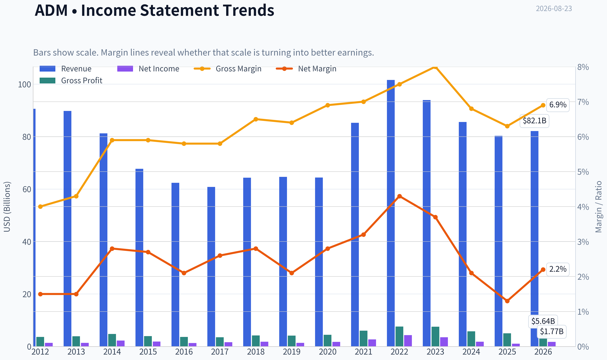
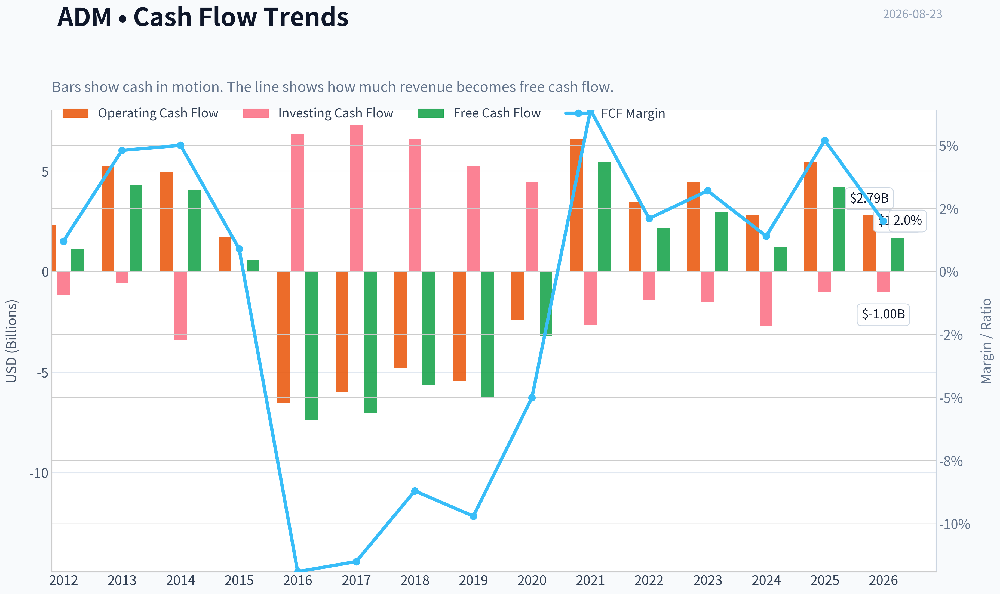
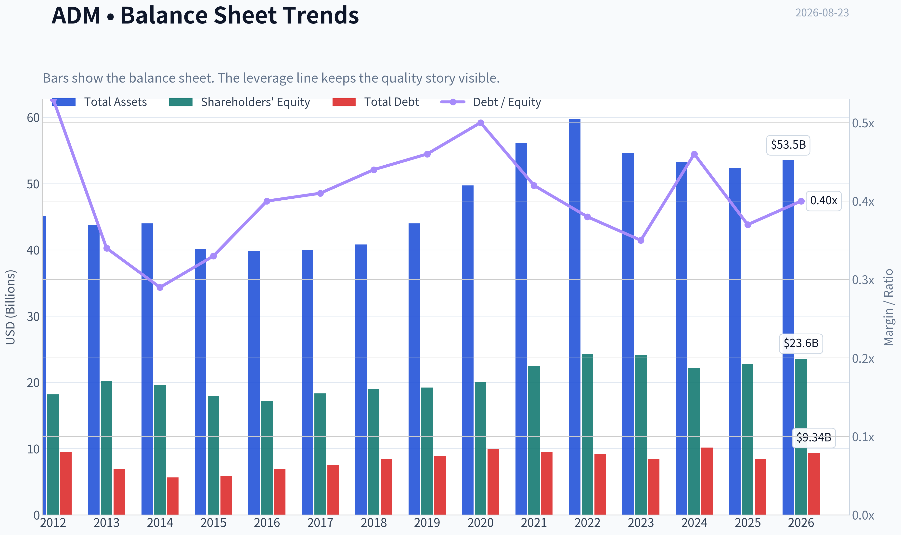
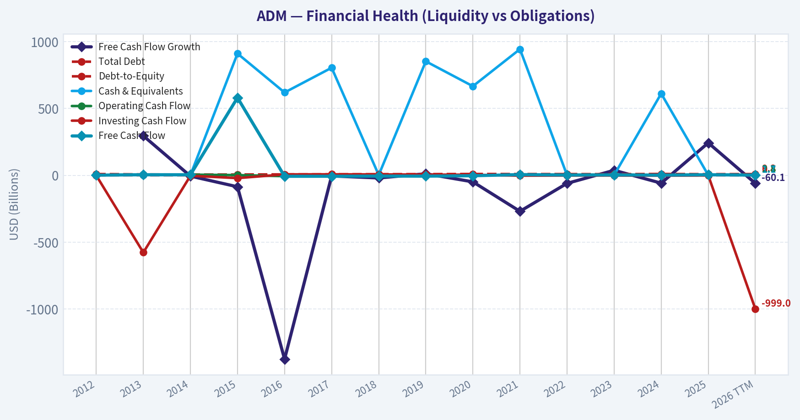
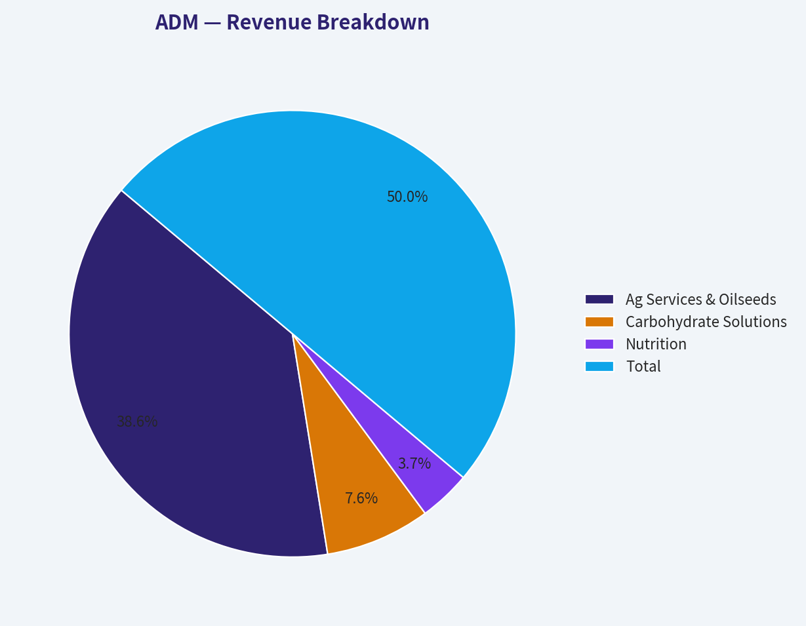
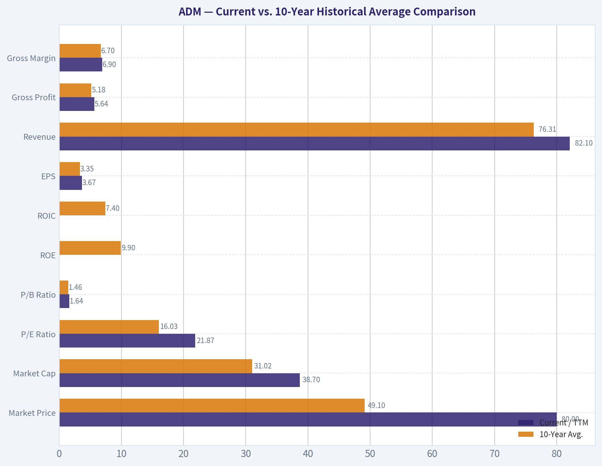
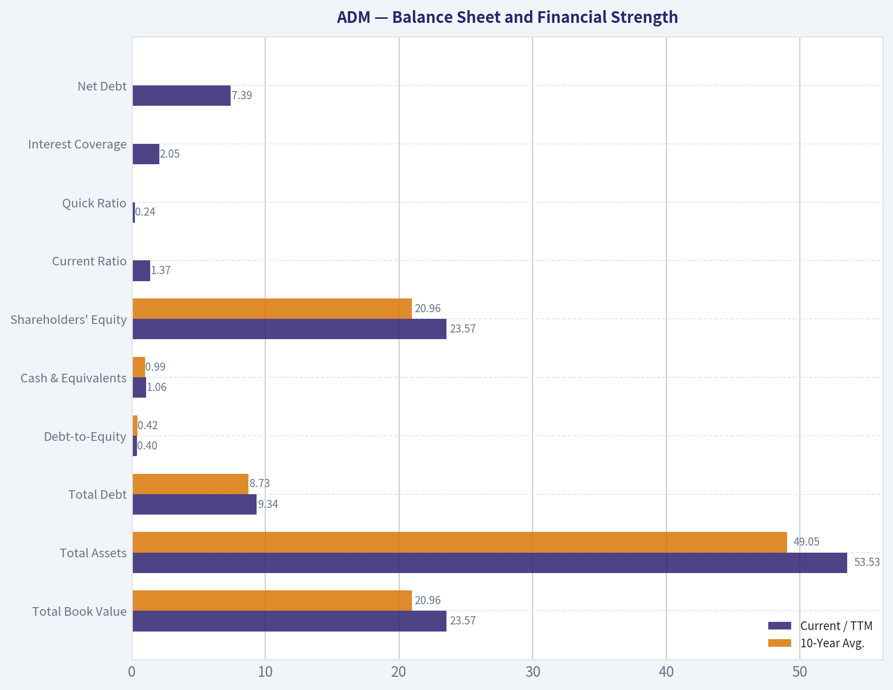
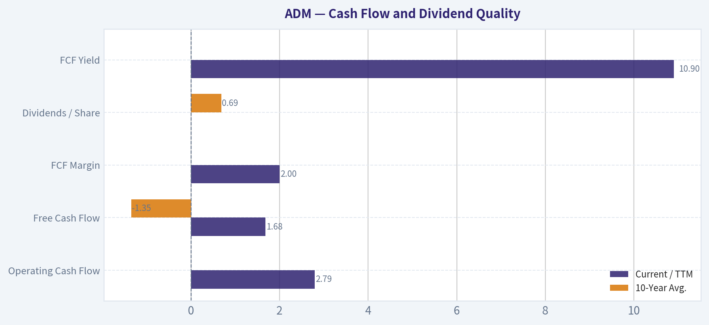
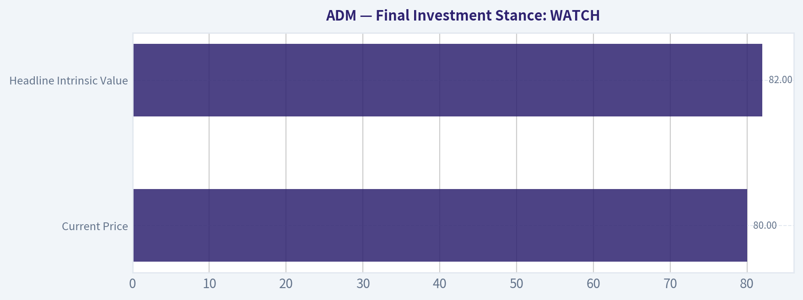

# ADM Deep Value Intelligence

**Analysis Date:** 2026-08-23

## Critical Disclaimer

*This analysis is generated by Deep Value Intelligence, an AI-powered multi-agent investing framework. Education & research only - not financial advice, not a financial advisor.*

---

## Table of Contents

1. Intelligence Summary
2. Analyst Team Reports
   - Fundamentals Analysis
   - Intrinsic Value Analysis (Buffett)
   - Trend & Growth Analysis (Lynch/Druckenmiller/Fisher)
   - Market Technical Analysis
   - Options Market Analysis
3. Research Team Commentary
4. Value Investing Team Commentary
5. Deep Values Commentary

---

## Intelligence Summary

### Thesis + Conditions

**Core Thesis:** **EXECUTIVE SUMMARY**
ADM is an essential, highly durable global agribusiness, but it is not currently a Buffett-style compounding machine. At $80.30 (P/E ~22x), the market is fully pricing in a cyclical recovery while ignoring weak baseline economics (3.6% ROIC, 4.7% ROE) and unresolved accounting issues in its highest-margin segment.

**Key Risks:**
- Bull (Risky):** ADM is an unreplicable global "toll bridge." Low ROIC signals a cyclical trough and a prime buying opportunity before margins vertically spike; the accounting probe is temporary noise.
- Applying our Value Investing Risk Framework, the Bear and Neutral analysts correctly diagnose ADM's current risk profile.
- 1.  **The "Toll Bridge" Fallacy:** The Bull's comparison to a toll bridge ignores capital intensity. A true moat commands pricing power. ADM is a price-taker operating on 6.3% gross margins. A 3.6% ROIC means the company is currently struggling to out-earn the risk-free rate.

**Confidence:** Medium

---

## Analyst Team Reports

### Fundamentals Analysis

#### Latest Earnings Snapshot

*Most recent reported quarter anchored on 2026 Q2, with prior-year comparison when available.*

| Metric | 2026 Q2 | 2025 Q2 | YoY Change |
| --- | ---: | ---: | ---: |
| Revenue | $22.68B | $21.17B | +7.2% |
| Operating Income | $909.0M | $459.0M | +98.0% |
| Net Income | $908.0M | $219.0M | +314.6% |
| Diluted EPS | N/A | $0.45 | N/A |
| Operating Cash Flow | $1.15B | $4.30B | -73.3% |
| Free Cash Flow | $877.0M | $3.99B | -78.0% |

Key Takeaways: This snapshot anchors the most recent reported quarter before the narrative analysis. It helps readers separate long-run business quality from whatever changed in the latest earnings print.

#### 14-Year Financial Metrics for ADM

*All values below are computed deterministically from raw data - not estimated by AI.*

*Issuer profile: operating company (Consumer Defensive / Farm Products).*

#### 14-Year Financial Metrics
*Annual rows come from reported financial statements. The final TTM row is computed from the latest four quarters.*

| Metric | 2012 | 2013 | 2014 | 2015 | 2016 | 2017 | 2018 | 2019 | 2020 | 2021 | 2022 | 2023 | 2024 | 2025 | 2026 TTM |
| --- | --- | --- | --- | --- | --- | --- | --- | --- | --- | --- | --- | --- | --- | --- | --- |
| Market Price | $19 | $30 | $37 | $27 | $34 | $31 | $33 | $38 | $43 | $59 | $83 | $66 | $48 | $56 | $80 |
| Market Cap | $18.13B | $28.77B | $34.11B | $22.78B | $26.98B | $22.93B | $23.23B | $26.19B | $28.48B | $38.26B | $52.27B | $39.14B | $24.91B | $27.83B | $38.70B |
| P/E Ratio | 13.17 | 21.49 | 15.16 | 12.31 | 21.13 | 14.37 | 12.84 | 19.00 | 16.00 | 14.11 | 12.04 | 11.23 | 13.84 | 25.78 | 21.87 |
| P/B Ratio | 1.00 | 1.42 | 1.74 | 1.27 | 1.57 | 1.25 | 1.22 | 1.36 | 1.42 | 1.70 | 2.15 | 1.62 | 1.12 | 1.22 | 1.64 |
| ROE | 7.6% | 6.6% | 11.5% | 10.3% | 7.4% | 8.7% | 9.5% | 7.2% | 8.9% | 12.0% | 17.8% | 14.4% | 8.1% | 4.7% | 7.5% |
| ROIC | 5.2% | 5.3% | 9.4% | 7.8% | 5.6% | 6.6% | 7.2% | 5.2% | 6.3% | 9.1% | 13.7% | 10.9% | 5.7% | 3.5% | 5.0% |
| EPS | $1.41 | $1.40 | $2.43 | $2.17 | $1.62 | $2.16 | $2.54 | $2.01 | $2.68 | $4.18 | $6.86 | $5.85 | $3.44 | $2.18 | $3.67 |
| Revenue | $90.56B | $89.80B | $81.20B | $67.70B | $62.35B | $60.83B | $64.34B | $64.66B | $64.36B | $85.25B | $101.56B | $93.94B | $85.53B | $80.27B | $82.10B |
| Gross Profit | $3.62B | $3.89B | $4.77B | $3.97B | $3.62B | $3.52B | $4.18B | $4.15B | $4.45B | $5.99B | $7.57B | $7.51B | $5.78B | $5.03B | $5.64B |
| Gross Margin | 4.0% | 4.3% | 5.9% | 5.9% | 5.8% | 5.8% | 6.5% | 6.4% | 6.9% | 7.0% | 7.5% | 8.0% | 6.8% | 6.3% | 6.9% |
| Operating Margin | 2.2% | 2.3% | 3.9% | 3.4% | 2.9% | 2.6% | 3.2% | 2.5% | 2.9% | 3.9% | 5.2% | 4.6% | 2.6% | 1.6% | 2.3% |
| Net Income | $1.38B | $1.34B | $2.25B | $1.85B | $1.28B | $1.59B | $1.81B | $1.38B | $1.77B | $2.71B | $4.34B | $3.48B | $1.80B | $1.08B | $1.77B |
| Net Margin | 1.5% | 1.5% | 2.8% | 2.7% | 2.1% | 2.6% | 2.8% | 2.1% | 2.8% | 3.2% | 4.3% | 3.7% | 2.1% | 1.3% | 2.2% |
| Revenue Growth | 2.7% | -0.8% | -9.6% | -16.6% | -7.9% | -2.4% | 5.8% | 0.5% | -0.5% | 32.5% | 19.1% | -7.5% | -8.9% | -6.2% | 2.3% |
| Net Income Growth | N/A | -2.4% | 67.5% | -17.7% | -30.8% | 24.7% | 13.5% | -23.8% | 28.5% | 52.9% | 60.2% | -19.7% | -48.3% | -40.1% | 64.2% |
| Free Cash Flow Growth | N/A | 295.0% | -6.1% | -85.7% | -1374.1% | -5.1% | -19.8% | 11.6% | -48.9% | -269.1% | -60.2% | 37.4% | -58.6% | 242.6% | -60.1% |
| Total Book Value | $18.17B | $20.19B | $19.63B | $17.91B | $17.18B | $18.32B | $19.00B | $19.23B | $20.02B | $22.51B | $24.32B | $24.14B | $22.18B | $22.74B | $23.57B |
| Total Assets | $45.14B | $43.75B | $44.00B | $40.16B | $39.77B | $39.96B | $40.83B | $44.00B | $49.72B | $56.14B | $59.77B | $54.63B | $53.27B | $52.39B | $53.53B |
| Total Debt | $9.54B | $6.87B | $5.66B | $5.88B | $6.93B | $7.49B | $8.39B | $8.88B | $9.93B | $9.54B | $9.18B | $8.37B | $10.16B | $8.41B | $9.34B |
| Debt-to-Equity | 0.53 | 0.34 | 0.29 | 0.33 | 0.40 | 0.41 | 0.44 | 0.46 | 0.50 | 0.42 | 0.38 | 0.35 | 0.46 | 0.37 | 0.40 |
| Cash & Equivalents | $1.29B | $3.12B | $1.10B | $910.0M | $619.0M | $804.0M | $2.00B | $852.0M | $666.0M | $943.0M | $1.04B | $1.37B | $611.0M | $1.01B | $1.06B |
| Shareholders' Equity | $18.17B | $20.19B | $19.63B | $17.91B | $17.18B | $18.32B | $19.00B | $19.23B | $20.02B | $22.51B | $24.32B | $24.14B | $22.18B | $22.74B | $23.57B |
| Operating Cash Flow | $2.33B | $5.23B | $4.94B | $1.71B | $-6.51B | $-5.97B | $-4.78B | $-5.45B | $-2.39B | $6.59B | $3.48B | $4.46B | $2.79B | $5.45B | $2.79B |
| Investing Cash Flow | $-1.16B | $-577.0M | $-3.41B | $-21.0M | $6.85B | $7.29B | $6.58B | $5.26B | $4.46B | $-2.67B | $-1.40B | $-1.50B | $-2.70B | $-1.02B | $-999.0M |
| Free Cash Flow | $1.09B | $4.31B | $4.05B | $580.0M | $-7.39B | $-7.01B | $-5.63B | $-6.28B | $-3.21B | $5.43B | $2.16B | $2.97B | $1.23B | $4.20B | $1.68B |
| FCF Margin | 1.2% | 4.8% | 5.0% | 0.9% | -11.9% | -11.5% | -8.7% | -9.7% | -5.0% | 6.4% | 2.1% | 3.2% | 1.4% | 5.2% | 2.0% |
| Dividends / Share | $0.00 | $0.00 | $0.00 | $0.00 | $0.00 | $0.00 | $0.00 | $0.00 | $0.00 | $0.00 | $1.42 | $1.64 | $1.88 | $2.00 | $0.00 |

#### Profitability Metrics
- Return on Equity (ROE): 4.7%
- Return on Invested Capital (ROIC): 3.6%
- Return on Assets (ROA): 2.1%
- Gross Margin: 6.3%
- Operating Margin: 1.6%
- Net Profit Margin: 1.3%

#### Liquidity Metrics
- Current Ratio: 1.37
- Quick Ratio: 0.24

#### Leverage Metrics
- Debt-to-Equity Ratio: 0.37
- Interest Coverage Ratio: 2.05
- Net Debt: $7.39B

#### Growth Metrics (Year-over-Year)
- Revenue Growth: -6.2%
- Net Income Growth: -40.1%
- Free Cash Flow Growth: 242.6%
- Revenue CAGR (3-Year): -7.5%
- Revenue CAGR (5-Year): 4.5%

#### Valuation Metrics
- P/E Ratio (TTM): 21.94
- Forward P/E: 14.13
- Price-to-Book: 1.64
- Price-to-Sales: 0.47
- PEG Ratio: 1.04
- EV/EBITDA: 15.78
- Free Cash Flow Yield: 10.9%
- Earnings Yield: 4.6%

#### Owner Earnings (Buffett Method, Code-Computed)
- Net Income: $1.08B
- + Depreciation & Amortization: $1.18B
- - Capital Expenditures: $-1.25B
- - Working Capital Changes: $2.76B
- = **Owner Earnings: $-1.69B**

#### Intrinsic Value (Code-Computed)
- Current Price: $80
- **Headline Intrinsic Value (business-model routed): $82**
  Business model: operating company - weighted blend [Damodaran FCFF + owner-earnings DCF] (operating_company)
  Model spread (min-max across DCFs): $37 - $133
  Margin of safety vs. price (headline): 2.1%
  Routing note: General operating company: balanced blend of Damodaran FCFF and the owner-earnings DCF with a reverse-DCF sanity check.
- Buffett Method (Owner Earnings):
  Conservative: $-5
  Average: $133
  Optimistic: $422
- Cash Flow Method (FCF):
  Conservative: $-13
  Average: $47
  Optimistic: $309
- Damodaran FCFF (WACC + margins + reinvestment):
  Conservative: $12
  Average: $37
  Optimistic: $57
  Monte Carlo band (P10-P90): $20 - $54 (median $33)
  P(intrinsic value > price): 0.5%
- Reverse-DCF: price implies ~14.1%/yr owner-earnings growth for 10y; trailing 3y was N/A, 5y N/A.

#### Piotroski F-Score: 4/9
- Positive Net Income: PASS
- Positive Operating Cash Flow: PASS
- ROA Improvement: FAIL
- Cash Flow > Net Income: PASS
- Decreasing Debt: PASS
- Improving Current Ratio: FAIL
- No Dilution: FAIL
- Improving Gross Margin: FAIL
- Improving Asset Turnover: FAIL

ANALYST STANCE: **WATCH**

#### ADM Warren Buffett-Style Fundamental Analysis - Archer-Daniels-Midland

ADM is a large, essential, asset-heavy agricultural processor and commodity merchandiser with durable infrastructure, global origination networks, and relevance to food, feed, fuel, and industrial supply chains. However, Buffett-style attractiveness depends not only on durability, but also on predictable owner earnings, high returns on capital, conservative leverage, and a clear margin of safety. At the current price of **$80**, ADM looks more like a **fairly valued cyclical recovery candidate** than a deeply undervalued compounder.

The deterministic dataset shows a business that benefited strongly from the 2021-2023 commodity cycle, then saw profitability normalize sharply in 2024-2025. TTM results show some rebound, but returns on capital remain below the company's best historical years.

---

#### Current vs. 10-Year Historical Average Comparison

*Historical average uses fiscal years 2016-2025 from the deterministic dataset. Current uses the 2026 TTM row where available; for dividends, the latest full-year figure is also noted because the TTM dividend field is shown as $0.00 in the dataset.*

| Metric | Current / TTM | 10-Year Avg. | Current Standing vs. History | Interpretation |
|---|---:|---:|---|---|
| Market Price | $80 | $49.10 | Above average | Stock price has recovered strongly and is near the higher end of the long-term range. |
| Market Cap | $38.70B | $31.02B | Above average | Valuation has expanded despite lower profitability than the 2021-2023 peak. |
| P/E Ratio | 21.87x | 16.03x | Above average | The market is paying a premium multiple relative to history, likely anticipating earnings recovery. |
| P/B Ratio | 1.64x | 1.46x | Slightly above average | P/B is meaningful for ADM as an asset-heavy operating company, but must be judged against ROE; current ROE does not strongly support a premium book multiple. |
| ROE | 7.5% TTM / 4.7% FY2025 | 9.9% | Below average | Returns have fallen materially from the 2021-2023 cycle peak. |
| ROIC | 5.0% TTM / 3.5% FY2025 | 7.4% | Below average | Capital productivity is weak versus history, a major Buffett-style concern. |
| EPS | $3.67 | $3.35 | Slightly above average | TTM EPS has recovered from FY2025 but remains well below 2022-2023 peak earnings. |
| Revenue | $82.10B | $76.31B | Above average | Revenue remains above the 10-year average, though down from the 2022 peak. |
| Gross Profit | $5.64B | $5.18B | Above average | Gross profit is better than average, but not peak-cycle strong. |
| Gross Margin | 6.9% | 6.7% | Slightly above average | Gross margin is stable and near normal, showing some resilience. |
| Operating Margin | 2.3% | 3.2% | Below average | Operating profitability is still pressured. |
| Net Income | $1.77B | $2.12B | Below average | Earnings remain below normalized historical levels. |
| Net Margin | 2.2% | 2.7% | Below average | Low-margin commodity economics remain evident. |
| Revenue Growth | 2.3% TTM / -6.2% FY2025 | 2.5% | Near average TTM, weak FY2025 | TTM revenue is stabilizing after two years of decline. |
| Net Income Growth | 64.2% TTM / -40.1% FY2025 | 1.7% | Strong rebound from depressed base | Growth looks high because FY2025 was weak; not yet proof of durable compounding. |
| FCF Growth | -60.1% TTM / +242.6% FY2025 | -154.4% | Highly volatile | Free cash flow is distorted by working-capital swings typical of commodity trading businesses. |
| Total Book Value | $23.57B | $20.96B | Above average | Equity base has grown over time. |
| Total Assets | $53.53B | $49.05B | Above average | ADM remains asset-intensive with significant working-capital needs. |
| Total Debt | $9.34B | $8.73B | Slightly above average | Debt is manageable but not negligible. |
| Debt-to-Equity | 0.40x | 0.42x | Slightly better than average | Leverage is reasonable and stable. |
| Cash & Equivalents | $1.06B | $0.99B | Near average | Liquidity is adequate but not exceptionally strong. |
| Shareholders' Equity | $23.57B | $20.96B | Above average | Balance sheet equity has compounded modestly. |
| Free Cash Flow | $1.68B | -$1.35B | Better than average | Average is skewed by severe working-capital outflows in 2016-2020; recent FCF is positive but volatile. |
| Dividends / Share | $0.00 TTM shown / $2.00 FY2025 | $0.69 | FY2025 above average | The deterministic dataset shows dividends beginning in 2022 and rising through 2025; TTM field shows $0.00 and should be treated cautiously. |

**Key Takeaways:** ADM's valuation is above its 10-year average while core returns on equity and invested capital are below average. Revenue and gross profit are above historical norms, but operating margin, net margin, and net income remain depressed versus the stronger 2021-2023 period. The biggest issue for a Buffett-style investor is that the stock price already assumes recovery, while the business has not yet restored historical profitability.

---

#### Revenue Breakdown

*Segment figures are based on ADM's most recent full-year revenue total in the deterministic dataset, **FY2025 revenue of $80.27B**. Segment allocation reflects ADM's publicly reported business mix and is presented as best-available segment-level approximation.*

| Revenue Source | Amount ($B) | % of Total |
|---|---:|---:|
| Ag Services & Oilseeds | $62.0B | 77.2% |
| Carbohydrate Solutions | $12.2B | 15.2% |
| Nutrition | $6.0B | 7.5% |
| Other / Corporate | $0.1B | 0.1% |
| **Total** | **$80.27B** | **100.0%** |

**Key Takeaways:** ADM is overwhelmingly driven by Ag Services & Oilseeds, which ties the company closely to global crop flows, crush margins, commodity prices, and trade volumes. Nutrition is strategically important because it can carry higher margins, but it remains a much smaller contributor to total revenue. This mix explains why ADM's earnings are durable over cycles but not consistently predictable year to year.

---

#### Profitability Analysis

ADM's profitability profile is typical of a global agricultural processor: very large revenue base, thin margins, and cyclically variable earnings.

| Profitability Metric | Current / TTM | Historical Context | Buffett-Style Interpretation |
|---|---:|---|---|
| ROE | 7.5% TTM; 4.7% FY2025 | Below 10-year average of 9.9% | Weak for a Buffett compounder; recovery needed. |
| ROIC | 5.0% TTM; 3.5% FY2025 | Below 10-year average of 7.4% | Indicates modest capital efficiency and limited pricing power. |
| EPS | $3.67 TTM | Above 10-year average but below 2022-2023 peak | Earnings are recovering but still cyclical. |
| Revenue | $82.10B TTM | Above 10-year average | Scale remains intact. |
| Gross Profit | $5.64B TTM | Above 10-year average | Gross profit has held up better than net income. |
| Operating Margin | 2.3% TTM | Below 10-year average of 3.2% | Operating leverage has not fully recovered. |
| Net Income | $1.77B TTM | Below 10-year average | Normalized profitability is still under pressure. |
| Net Margin | 2.2% TTM | Below 10-year average of 2.7% | Thin margin structure leaves limited room for error. |

**Key Takeaways:** ADM is not a high-margin franchise in the classic Buffett sense. Its moat is based more on infrastructure, logistics, scale, and relationships than on pricing power. The current profitability rebound is encouraging, but ROIC and operating margin remain below the level needed to justify a premium valuation.

---

#### Balance Sheet and Financial Strength

| Balance Sheet Metric | Current / TTM | 10-Year Avg. | Interpretation |
|---|---:|---:|---|
| Total Book Value | $23.57B | $20.96B | Equity base has grown, supporting long-term balance sheet resilience. |
| Total Assets | $53.53B | $49.05B | Asset intensity is high, consistent with grain handling, crushing, processing, and logistics. |
| Total Debt | $9.34B | $8.73B | Debt is slightly above average but not alarming. |
| Debt-to-Equity | 0.40x | 0.42x | Leverage is controlled and slightly better than average. |
| Cash & Equivalents | $1.06B | $0.99B | Cash position is normal but modest relative to asset base. |
| Shareholders' Equity | $23.57B | $20.96B | Equity has increased over time, though returns on that equity are currently muted. |
| Current Ratio | 1.37 | Not in table average | Adequate short-term liquidity for an operating company. |
| Quick Ratio | 0.24 | Not in table average | Low, but less meaningful for ADM because inventory-heavy commodity businesses naturally carry large inventories. |
| Interest Coverage | 2.05x | Not in table average | Somewhat thin; worth monitoring if earnings remain weak. |
| Net Debt | $7.39B | Not in table average | Manageable, but reduces equity valuation in DCF scenarios. |

**Key Takeaways:** ADM's balance sheet is not distressed, and debt-to-equity is reasonable. However, interest coverage of about 2.05x is not especially strong, especially for a cyclical low-margin business. Buffett would likely view the balance sheet as acceptable, but not so strong that it offsets weak current returns on capital.

---

#### Cash Flow and Dividend Quality

| Cash Flow Metric | Current / TTM | 10-Year Avg. | Interpretation |
|---|---:|---:|---|
| Operating Cash Flow | $2.79B | Volatile historically | Working capital has driven major swings. |
| Free Cash Flow | $1.68B | -$1.35B | Positive currently, but lower than FY2025's $4.20B. |
| FCF Margin | 2.0% | Approximately -1.7% | Positive but thin; not a high-quality cash conversion profile. |
| Dividends / Share | $0.00 TTM shown; $2.00 FY2025 | $0.69 | Dataset shows dividend growth from 2022-2025, but TTM dividend field appears incomplete or non-annualized. |
| FCF Yield | 10.9% | Not directly averaged | Looks attractive, but sustainability depends on normalized working capital. |

**Key Takeaways:** ADM's free cash flow is highly volatile because working capital can swing dramatically with commodity prices and inventory financing. The headline FCF yield is attractive, but Buffett-style investors should normalize cash flow rather than relying on a single year. Dividend growth through FY2025 is shareholder-friendly, but the TTM dividend field in the dataset should not be interpreted mechanically as a permanent dividend cessation.

---

#### Buffett-Style Qualitative Assessment

| Buffett Criterion | ADM Assessment | Rating |
|---|---|---|
| Economic Moat | Strong physical network in grain origination, processing, oilseeds, logistics, and customer relationships. However, commodity exposure limits pricing power. | Moderate |
| Durable Demand | Food, feed, fuel, and agricultural supply chains are essential and persistent. | Strong |
| Predictable Earnings | Earnings are cyclical and sensitive to crush margins, crop flows, commodity prices, biofuel economics, and working capital. | Mixed |
| High ROE / ROIC | Current ROE and ROIC are below historical averages and below what Buffett usually prefers. | Weak |
| Balance Sheet Strength | Debt is manageable; debt-to-equity is reasonable; interest coverage is only moderate. | Adequate |
| Management Capital Allocation | Dividends have increased in recent years; however, returns on capital have weakened. | Mixed |
| Margin Stability | Gross margin is relatively stable, but operating and net margins fluctuate sharply. | Mixed |
| Valuation Discipline | Price is close to headline intrinsic value, with little margin of safety. | Watch, not buy |

**Key Takeaways:** ADM has the durability of an essential infrastructure business, but not the economics of a classic high-return Buffett compounder. Its moat is real but operational rather than pricing-power based. The company is investable at the right price, but the current valuation leaves limited room for disappointment.

---

#### Intrinsic Value and DCF Valuation

The research pack's model-routed intrinsic value is the primary valuation anchor because it blends multiple cash-flow models for an operating company.

| Valuation Model | Conservative | Average / Base Case | Optimistic | Interpretation |
|---|---:|---:|---:|---|
| Buffett Owner Earnings Model | -$5/share | $133/share | $422/share | Extremely wide range due to volatile owner earnings and working-capital swings. |
| Free Cash Flow Model | -$13/share | $47/share | $309/share | Also highly sensitive to normalized cash flow assumptions. |
| Damodaran FCFF Model | $12/share | $37/share | $57/share | More conservative; suggests limited upside at $80. |
| Damodaran Monte Carlo Band | $20/share | $33 median | $54/share P90 | Only 0.5% probability of intrinsic value above current price under this model. |
| Business-Model Routed Headline Intrinsic Value | - | **$82/share** | - | About 2.1% margin of safety versus $80. |
| Reverse DCF | - | Implies ~14.1% annual owner-earnings growth for 10 years | - | Demanding for a cyclical low-margin business. |

**Key Takeaways:** The headline intrinsic value of about $82 is very close to the current price of $80, leaving almost no margin of safety. The valuation spread is unusually wide, which is a warning that ADM's cash flows are difficult to normalize. The reverse DCF implies roughly 14.1% annual owner-earnings growth for 10 years, which appears demanding given ADM's cyclicality and current below-average ROIC.

---

#### Buffett-Style Owner Earnings DCF Sanity Check

Because the deterministic dataset's code-computed owner earnings are **-$1.69B** for the latest full year, a mechanical DCF on reported owner earnings would produce a negative value. For a commodity merchandiser like ADM, working-capital swings can temporarily distort owner earnings. Therefore, the hand DCF below uses normalized cash-flow proxies as a sanity check, while the model-routed intrinsic value of **$82/share** remains the primary anchor.

Assumptions:
- Discount rate: **10%**
- Terminal growth: **2.5%**
- Net debt: **$7.39B**
- Shares outstanding implied by market cap and price: **$38.70B / $80 = approximately 484M shares**
- Terminal growth does not exceed discount rate.
- High growth fades toward terminal growth.

| Scenario | Starting Owner Earnings Proxy | Growth Assumption | PV of Explicit Cash Flows | PV of Terminal Value | Less Net Debt | Equity Value | Fair Value / Share |
|---|---:|---|---:|---:|---:|---:|---:|
| Conservative | $1.68B | 0% for 10 years, then 2.5% terminal | ~$10.32B | ~$14.43B | $7.39B | ~$17.36B | **~$36/share** |
| Average / Base Case | $3.20B normalized FCF proxy | 4% for 10 years, then 2.5% terminal | ~$23.85B | ~$24.96B | $7.39B | ~$41.42B | **~$86/share** |
| Optimistic | $3.20B normalized FCF proxy | 8% for 5 years, fading toward 3% by year 10, then 2.5% terminal | ~$27.98B | ~$31.16B | $7.39B | ~$51.75B | **~$107/share** |

**Key Takeaways:** The hand DCF produces a broad range of roughly **$36 to $107 per share**, with a base-case estimate around **$86**, close to the pack's headline intrinsic value of **$82**. This supports the conclusion that ADM is roughly fairly valued, not obviously cheap. The conservative case is far below the current price because ADM's cash flows are volatile and normalized profitability is uncertain.

---

#### DCF Calculation Detail

| Scenario | Calculation Detail |
|---|---|
| Conservative | Uses $1.68B starting owner earnings proxy. Explicit 10-year PV is approximately $1.68B x 6.145 = $10.32B. Terminal value equals Year 10 owner earnings x 1.025 / 7.5%, discounted back to present, giving approximately $14.43B. After subtracting $7.39B net debt, equity value is about $17.36B, or roughly $36/share. |
| Average | Uses $3.20B normalized owner earnings proxy. Cash flows grow at 4% for 10 years. PV of explicit cash flows is about $23.85B. Year 10 owner earnings are approximately $4.74B; terminal value is $4.74B x 1.025 / 7.5%, discounted back, giving about $24.96B. After net debt, equity value is approximately $41.42B, or about $86/share. |
| Optimistic | Uses $3.20B normalized owner earnings proxy. Growth starts at 8% and fades toward terminal growth. Explicit PV is about $27.98B. Year 10 owner earnings are approximately $5.91B; terminal value discounted to present is about $31.16B. After subtracting net debt, equity value is about $51.75B, or roughly $107/share. |

**Key Takeaways:** ADM's valuation is extremely sensitive to what one considers normalized owner earnings. If normalized owner earnings are closer to the current TTM free cash flow level, the stock is expensive. If earnings normalize closer to the better post-2021 cash-flow years, the stock is near fair value with moderate upside.

---

#### Key Investment Insights

| Category | Insight | Investment Implication |
|---|---|---|
| Valuation | Current price of $80 is close to headline intrinsic value of $82. | Little margin of safety. |
| Returns | ROE and ROIC are below 10-year averages. | Quality has weakened versus historical norms. |
| Earnings Cycle | Net income collapsed in 2024-2025 after the 2021-2023 boom. | Current rebound must be proven sustainable. |
| Balance Sheet | Debt-to-equity of 0.40x is reasonable. | Financial risk is manageable but not negligible. |
| Cash Flow | FCF yield appears high, but cash flow is volatile. | Normalize cash flow before valuing. |
| Moat | Scale, logistics, origination, and processing footprint are durable. | ADM has a real but moderate moat. |
| Dividend | Dataset shows dividends rising through FY2025. | Shareholder returns are positive, but payout quality depends on normalized FCF. |
| Market Expectations | Reverse DCF implies ~14.1% annual owner-earnings growth for 10 years. | Expectations look demanding for a cyclical low-margin operator. |

**Key Takeaways:** ADM has real strategic value and durable market relevance, but its current price does not offer a classic Buffett-style bargain. The company needs to demonstrate that the recent earnings recovery can translate into sustained ROIC improvement. Without that, the valuation looks full.

---

#### Red Flags and Opportunities

| Red Flags | Opportunities |
|---|---|
| P/E of 21.87x is above the 10-year average of 16.03x. | Forward P/E of 14.13x suggests earnings recovery expectations. |
| ROIC of 5.0% TTM is below the 10-year average of 7.4%. | Biofuel, oilseed crush, and agricultural demand may support future earnings. |
| Operating margin of 2.3% is below the 10-year average of 3.2%. | Nutrition segment could improve mix if execution strengthens. |
| Piotroski F-score is only 4/9. | Balance sheet leverage remains reasonable. |
| Interest coverage of 2.05x is not especially robust. | FCF yield of 10.9% may be attractive if sustainable. |
| Reverse DCF requires high owner-earnings growth. | A downturn in price could create an attractive entry point. |
| Cash flow is heavily distorted by working capital. | Commodity-cycle normalization could lift earnings from depressed FY2025 levels. |
| Recent share-price rally reduces margin of safety. | Global food and feed demand remain structurally durable. |

**Key Takeaways:** The opportunity in ADM is a cyclical recovery supported by essential infrastructure and reasonable leverage. The risk is that investors are already paying for that recovery before returns on capital have convincingly improved. For value investors, the key is patience and price discipline.

---

#### Final Investment Stance: WATCH

| Decision Factor | Assessment |
|---|---|
| Final Stance | **WATCH** |
| Current Price | $80 |
| Headline Intrinsic Value | $82 |
| Margin of Safety | Approximately 2.1% |
| Buffett-Style Buy Zone | Preferably below ~$65-$70, depending on normalized cash-flow confidence |
| Main Reason Not ADVOCATE | No meaningful margin of safety; ROIC and margins remain below historical norms. |
| Main Reason Not AVOID | ADM is durable, essential, moderately leveraged, and could recover earnings cyclically. |
| Best Investor Fit | Patient value investors waiting for a better entry price or clearer ROIC recovery. |

**Key Takeaways:** ADM is a durable but cyclical business trading near estimated fair value. The stock does not currently provide the margin of safety Buffett-style investors usually require. A lower price or stronger evidence of sustained ROIC recovery would make the investment case more compelling.

---

#### Summary Table

| Area | Key Point | Buffett-Style Judgment |
|---|---|---|
| Business Quality | Essential agricultural infrastructure with global scale. | Good but cyclical. |
| Moat | Scale, origination, logistics, and processing network. | Moderate moat. |
| Profitability | ROE and ROIC are below historical averages. | Currently weak. |
| Growth | TTM rebound follows a sharp FY2025 decline. | Recovery not yet proven. |
| Balance Sheet | Debt-to-equity reasonable at 0.40x. | Acceptable. |
| Cash Flow | Positive but volatile; working capital creates noise. | Needs normalization. |
| Valuation | $80 price versus $82 headline intrinsic value. | Fairly valued. |
| Margin of Safety | Only about 2.1%. | Insufficient. |
| Main Risk | Paying peak-ish valuation before profit recovery is durable. | Significant. |
| Main Opportunity | Earnings recovery, biofuel tailwinds, Nutrition improvement. | Worth monitoring. |
| Final View | **WATCH** | Good company, not enough discount. |

**Key Takeaways:** ADM is not a poor business, but it is also not clearly mispriced at today's valuation. The company has durable strategic assets, yet current returns and margins remain below average. The right Buffett-style action is to monitor the business and wait for either a better price or clearer proof of sustainable earnings recovery.

#### Fundamental Visuals

This graph tracks the profitability and return metrics (ROE, ROIC, Margins) of **ADM** over the past decade, highlighting capital efficiency trends.

This chart illustrates the financial health of **ADM** over the last 10 years, mapping cash equivalents and free cash flow against total obligations (Debt).

This breakdown chart from <em>Revenue Breakdown</em> shows the proportional composition for **ADM** - useful for understanding what drives or risks the business.

---

### Intrinsic Value Analysis (Buffett)

> *Following Warren Buffett's value investing philosophy: Circle of Competence, Economic Moat, Management Quality, and Margin of Safety.*

#### Intrinsic Value Snapshot

Price is what you pay. Intrinsic value is what the business may be worth based on the cash it can create for owners over time. We show a range, not one magic number.

- Current Price: $80.30
- Value Range (conservative to optimistic across both DCF methods): $-13.14 to $422.33

##### Owner Earnings (Buffett Method)
- Net Income: $1,078,000,000.00
- Depreciation & Amortization: $1,181,000,000.00
- Capital Expenditures: $-1,248,000,000.00
- Working Capital Changes: $2,763,000,000.00
- Owner Earnings: $-1,685,000,000.00

##### Intrinsic Value
###### Buffett Method
Uses owner earnings. Stricter, and usually more conservative.
- Conservative: $-4.92
- Average: $133.36
- Optimistic: $422.33
- Discount Rate: 10.0%

###### Cash Flow Method
Uses free cash flow. Better for companies spending heavily today to grow tomorrow.
- Conservative: $-13.14
- Average: $47.39
- Optimistic: $308.81
- Discount Rate: 10.0%

ANALYST STANCE: **AVOID** - Medium conviction.

#### Investment View

ADM is an essential, understandable agribusiness with global scale, hard-to-replicate logistics, and currently strong free cash flow. But it is not a Buffett-style "wonderful business": margins are thin, returns on equity are weak, pricing power is limited, earnings are cyclical, and recent accounting/control concerns in Nutrition reduce confidence in management quality. At about **$80**, the stock trades close to the headline intrinsic value estimate of **$82.03**, leaving only about **2.1% margin of safety**-not enough for a low-margin, commodity-linked business.

---

#### 1. Factor Scorecard and Gate 5

| Factor | Score | Evidence |
|---|---:|---|
| Circle of Competence & Business Simplicity | 3.5 / 5 | ADM buys, transports, processes, and sells agricultural commodities and ingredients. The model is understandable, but profits depend on crush spreads, crop flows, biofuel policy, and commodity cycles. |
| Moat Test | 2.5 / 5 | Scale, logistics, storage, origination network, and processing footprint matter, but gross margin of **6.3%** shows limited pricing power. |
| Management Quality & Capital Allocation | 2.0 / 5 | Weak ROE of **4.7%**, execution issues in Nutrition, and accounting/control concerns reduce confidence. |
| Industry Structure | 2.5 / 5 | Global agribusiness is concentrated among large players, but competition is commodity-like and returns fluctuate with cycles. |
| Gate 5: Quality/Solvency Hard Floor | Not tripped | Free cash flow is positive, FCF yield is high at **10.9%**, and current ratio is **1.37**. There is no clear evidence of financial distress combined with a solvency red line. |

**Key Takeaways:** ADM is simple to understand and systemically important in global agriculture, but simplicity does not equal superior economics. The company has real scale advantages, yet they do not translate into high margins or high returns on equity. The hard solvency floor is not triggered, so the issue is not survival-it is whether the business is attractive enough at today's price.

---

#### 2. Moat Analysis

| Moat Source | Assessment | Evidence |
|---|---|---|
| Intangible Assets | Weak | ADM is respected in agribusiness, but it does not have consumer-brand pricing power. Gross margin of **6.3%** is far below the 40% level typical of powerful intangible-asset businesses. |
| Switching Costs | Low to Moderate | Customer relationships, supply reliability, and integrated logistics help retention, but many products remain commodity-linked. |
| Cost Advantage | Moderate | ADM's global origination, processing, storage, and transportation network is difficult to replicate and creates scale efficiency. |
| Network Effects | Minimal | The business does not become meaningfully more valuable to each user as more users join. |
| Overall Moat Rating | Narrow / Stable | ADM has a scale moat, not a pricing-power moat. |

**Key Takeaways:** ADM's moat is real but not exceptional. Its strongest advantage is physical scale across the agricultural supply chain, not brand power or customer lock-in. That makes the business durable, but not highly profitable in the Buffett sense.

---

#### 3. Management Quality Assessment

| Management Dimension | Score | Assessment |
|---|---:|---|
| Owner Orientation | 2.5 / 5 | ADM returns capital through dividends and buybacks, but current per-share economics are not compelling enough to demonstrate outstanding capital allocation. |
| Candor & Controls | 1.5 / 5 | Recent Nutrition-related accounting and control issues are a meaningful governance concern. |
| Capital Allocation | 2.0 / 5 | Nutrition was intended to raise margins and reduce commodity exposure, but execution has disappointed. ROE of **4.7%** suggests retained capital is not currently compounding at attractive rates. |
| Balance Sheet Discipline | 3.0 / 5 | No distress signal is evident; current ratio is acceptable at **1.37**. |

**Key Takeaways:** Management does not earn a high Buffett score today. The biggest issue is not that ADM is reckless, but that recent returns on capital are too low and execution credibility has been damaged. A recovery in Nutrition and cleaner reporting controls would be needed to improve this score.

---

#### 4. Financial Summary

| Metric | Current / TTM |
|---|---:|
| Share Price | **$80.00** |
| Market Capitalization | **$38.70B** |
| P/E Ratio | **21.9x** |
| Implied Net Income | **~$1.76B** |
| ROE | **4.7%** |
| Gross Margin | **6.3%** |
| Revenue Growth YoY | **-6.2%** |
| Free Cash Flow Yield | **10.9%** |
| Implied Free Cash Flow | **~$4.22B** |
| Current Ratio | **1.37** |
| Headline Intrinsic Value | **$82.03/share** |
| Headline Margin of Safety | **~2.1%** |
| Reverse DCF Growth Implied by Price | **~14.1% per year for 10 years** |

**Key Takeaways:** ADM looks inexpensive on free cash flow yield, but weak on profitability quality. ROE of 4.7% and gross margin of 6.3% are not characteristics of a wonderful compounder. The headline intrinsic value is only slightly above the share price, while the reverse DCF implies growth that looks demanding for this type of business.

---

#### 5. Owner Earnings Calculation

| Owner Earnings Component | Estimate |
|---|---:|
| Implied Net Income | **~$1.76B** |
| Net Cash Conversion Adjustment | **~$2.46B** |
| Current Owner-Earnings Proxy / Free Cash Flow | **~$4.22B** |
| Shares Outstanding Implied by Market Cap and Price | **~484M** |
| Owner Earnings per Share Proxy | **~$8.72** |
| Owner Earnings Yield at $80 | **~10.9%** |

**Key Takeaways:** ADM is currently generating strong cash relative to its market value. However, in commodity-linked businesses, free cash flow can be flattered by working-capital swings and cycle timing. For that reason, the cash yield is attractive, but it should not be treated as automatically permanent.

---

#### 6. Three-Scenario DCF Valuation

| Scenario | Key Assumption | Intrinsic Value Estimate |
|---|---|---:|
| A. No Growth | Owner earnings per share of **$8.72**, capitalized at 10% | **~$87/share** |
| B. GDP Growth | Owner earnings grow at **3%** perpetually, 10% discount rate | **~$128/share** |
| C. Conservative Mid-Cycle Growth | 10 years at **2%** growth, then 2% terminal growth, 10% discount rate | **~$111/share** |
| Research Pack Headline Value | Business-model routed blend of FCFF and owner-earnings DCF | **$82.03/share** |
| 3-Model Spread | Owner Earnings / FCF / Damodaran FCFF | **$133.36 / $47.39 / $37.13** |

**Key Takeaways:** The valuation range is wide because ADM's cash flows are cyclical and working-capital sensitive. Current cash generation can justify values above today's price, but normalized FCFF models are much lower. The most prudent anchor is the headline blended value of about $82, which implies the stock is roughly fairly valued-not clearly cheap.

---

#### 7. Margin of Safety Analysis

| Valuation Reference | Value per Share | Margin of Safety vs. $80 |
|---|---:|---:|
| Headline Intrinsic Value | **$82.03** | **~2.1%** |
| Owner-Earnings Model | **$133.36** | **~67%** |
| FCF Model | **$47.39** | **-41%** |
| Damodaran FCFF Model | **$37.13** | **-54%** |
| Required MOS for ADM Quality Profile | Approx. **25-35%** | Not met |

**Key Takeaways:** ADM does not offer the margin of safety required for an average-quality, cyclical, low-margin business. The optimistic owner-earnings case is attractive, but the more conservative cash-flow models are far below the current price. A Buffett-style buyer should demand a larger discount or much clearer evidence of durable earnings recovery.

---

#### 8. Final Buffett Scorecard

| Criterion | Weight | Score | Weighted Contribution |
|---|---:|---:|---:|
| Moat Width & Durability | 25% | 2.5 / 5 | 0.63 |
| Valuation / Margin of Safety | 20% | 3.0 / 5 | 0.60 |
| Capital Returns - ROIC vs. WACC | 15% | 2.0 / 5 | 0.30 |
| Business Understanding & Predictability | 12% | 3.5 / 5 | 0.42 |
| Management Quality & Capital Allocation | 12% | 2.0 / 5 | 0.24 |
| Reinvestment Runway | 8% | 2.5 / 5 | 0.20 |
| Balance Sheet Strength | 4% | 3.0 / 5 | 0.12 |
| Industry Structure | 4% | 2.5 / 5 | 0.10 |
| Final Weighted Score | 100% |  | **2.6 / 5** |

**Key Takeaways:** ADM scores well enough to avoid a distress conclusion, but not well enough to justify new long-term capital at the current price. The main weaknesses are low returns, thin margins, limited pricing power, and management execution concerns. The valuation is not punitive, but it is not cheap enough to compensate for those issues.

---

#### 9. Investment Stance

**Stance: AVOID for new money at $80.**
**Conviction: Medium.**

ADM is a durable, essential agribusiness, but it is not a high-quality compounding machine. At the current price, the investor is being asked to accept commodity-cycle exposure, low margins, weak ROE, and management-control concerns without receiving a meaningful margin of safety. A more attractive entry point would likely require either a price in the low **$50s to low $60s**, or clear evidence that normalized ROE, Nutrition execution, and accounting controls have materially improved.
#### Valuation Bridge

This bridge places the current market price beside each intrinsic value lens so readers can see whether upside depends on one method or shows up across several methods.

| Scenario | Intrinsic Value / Share |
| --- | ---: |
| Buffett Method | $133.36 |
| Cash Flow Method | $47.39 |
| Damodaran Method | $37.13 |
| Current Price | $80.30 |

#### Key Takeaways

If one method is far above the others, the upside case depends on a specific modelling assumption. When several methods cluster together, the valuation story is more robust.

#### Valuation Visuals

This comparison chart from *Latest Earnings Snapshot* stacks current figures against historical benchmarks for **ADM**, making it easy to see where the company trades relative to its own averages.

This comparison chart from *Current vs. 10-Year Historical Average Comparison* stacks current figures against historical benchmarks for **ADM**, making it easy to see where the company trades relative to its own averages.

This comparison chart from *Balance Sheet and Financial Strength* stacks current figures against historical benchmarks for **ADM**, making it easy to see where the company trades relative to its own averages.

This comparison chart from *Cash Flow and Dividend Quality* stacks current figures against historical benchmarks for **ADM**, making it easy to see where the company trades relative to its own averages.

This comparison chart from *Final Investment Stance: WATCH* stacks current figures against historical benchmarks for **ADM**, making it easy to see where the company trades relative to its own averages.

---

### Trend & Growth Analysis (Lynch/Druckenmiller/Fisher)

> *Following Peter Lynch's GARP, Stanley Druckenmiller's macro-aware approach, and Philip Fisher's scuttlebutt methodology.*

ANALYST STANCE: **AVOID**

#### ADM Growth Investment Report - Archer-Daniels-Midland

ADM is a high-quality, systemically important agribusiness, but it does **not** fit a Lynch/Fisher/Druckenmiller growth-stock profile today. The company is better viewed as a **cyclical value/recovery candidate** with biofuel and Nutrition optionality, not a likely ten-bagger compounder.

| Item | Current Snapshot |
|---|---:|
| Share Price | ~$80 |
| Market Cap | ~$38.7B |
| P/E | ~21.9x |
| YoY Revenue Growth | -6.2% |
| Gross Margin | 6.3% |
| ROE | 4.7% |
| FCF Yield | 10.9% |
| Current Ratio | 1.37x |
| Headline Intrinsic Value Estimate | ~$82 |
| Margin of Safety vs. Price | ~2% |

Key Takeaways: ADM screens more like a mature cyclical value stock than a growth stock. The free-cash-flow yield is attractive, but revenue is currently declining, ROE is weak, and the estimated intrinsic value is only slightly above the current price.

---

#### 1. Lynch Classification

| Lynch Category | ADM Fit | Rationale |
|---|---|---|
| Slow Grower | Partial | Mature, low-margin, commodity-linked business |
| Stalwart | Partial | Large, durable, essential food/agriculture infrastructure |
| Fast Grower | No | Revenue currently declining; limited path to sustained 15-25% organic growth |
| Cyclical | Strong Fit | Earnings tied to crop cycles, commodity spreads, crush margins, biofuel policy, and global trade |
| Turnaround | Partial | Market narrative includes earnings recovery and Nutrition improvement |
| Asset Play | Minor | Large physical/logistics footprint, but not primarily an asset-play thesis |

Key Takeaways: ADM is best classified as a **cyclical stalwart with turnaround elements**, not a fast grower. Under Lynch's framework, this is not the type of company a growth investor should initiate unless there is a clear and underappreciated earnings inflection.

#### 2. The Story in 3 Bullets

- ADM buys, transports, processes, and sells agricultural commodities and ingredients that are essential to the global food and feed supply chain.
- The upside story is an earnings recovery driven by better oilseed crush margins, biofuel demand, and improvement in the Nutrition segment.
- The problem for growth investors is that ADM's core business is mature, cyclical, low-margin, and unlikely to compound revenue at high rates for many years.

#### 3. TAM and 10x Test

| TAM Question | Assessment |
|---|---|
| Core Market | Global agriculture processing, grain merchandising, oilseeds, ingredients, nutrition, and biofuels |
| TAM Size | Very large, likely measured in hundreds of billions to trillions globally |
| Current Revenue Base | Already very large, roughly high tens of billions annually |
| 10x Revenue Test | Fails |
| Why It Fails | A 10x revenue outcome would imply an enormous revenue base approaching the scale of global agri-trade itself |
| Runway Quality | Broad market, but limited high-growth runway due to commodity nature and already-large scale |

Key Takeaways: ADM operates in a huge market, but it is already a giant. The issue is not TAM existence; it is that ADM is too large and too commodity-exposed to plausibly grow revenue 10x while maintaining attractive returns.

#### 4. Revenue Growth Trend

| Metric | Current Reading | Growth Interpretation |
|---|---:|---|
| YoY Revenue Growth | -6.2% | Negative |
| Growth Pattern | Declining | Cyclical softness, not growth acceleration |
| Lynch Fast-Grower Threshold | 15-25%+ | Not met |
| Inflection Signal | Not yet visible in reported revenue | Requires recovery evidence |

Key Takeaways: ADM does not currently show the revenue acceleration that Druckenmiller-style growth investing looks for. The stock may benefit from earnings recovery, but the top-line pattern is not yet an inflection.

#### 5. Unit Economics

| Unit Economics Metric | ADM Applicability | Assessment |
|---|---|---|
| LTV/CAC | Not applicable | ADM is not a SaaS or consumer subscription business |
| Net Revenue Retention | Not applicable | No recurring software-style revenue base |
| Rule of 40 | Not applicable | Not a SaaS/subscription model |
| Gross Margin | 6.3% | Structurally low-margin |
| FCF Yield | 10.9% | Strong cash generation at current valuation |

Key Takeaways: Traditional subscription unit economics do not apply to ADM. The key economic indicators are commodity margins, working-capital cycles, crush spreads, biofuel economics, and free-cash-flow durability.

#### 6. Inflection Point Assessment

| Potential Inflection | Evidence | Growth Investor Verdict |
|---|---|---|
| Biofuel Tailwinds | Positive narrative support from recent coverage | Watch |
| Nutrition Recovery | Improving Nutrition business cited as support for stock rally | Watch |
| Margin Inflection | Not confirmed by current gross margin and ROE | Weak |
| Revenue Reacceleration | Current YoY revenue growth is negative | Not confirmed |
| Competitive Inflection | No clear evidence of a major competitor stumble | Neutral |
| Market Recognition | Stock already up strongly over six months per news coverage | Less asymmetric |

Key Takeaways: There are possible recovery catalysts, especially biofuels and Nutrition, but they are not yet enough to qualify as a confirmed growth inflection. The recent stock rally also reduces the chance that the opportunity remains deeply underrecognized.

#### 7. Macro Setup

| Macro Factor | Impact on ADM | Assessment |
|---|---|---|
| Interest Rates | Lower rates could help valuation and commodity demand | Mild positive if rates fall |
| Commodity Cycles | Major driver of earnings volatility | High sensitivity |
| Food Security | Long-term strategic relevance | Positive |
| Biofuel Policy | Potential demand support | Positive but policy-dependent |
| Global Trade | Tariffs, logistics, crop flows matter | Risk factor |
| Secular Theme Exposure | Energy transition via biofuels; nutrition/ingredients | Moderate |

Key Takeaways: ADM has some macro tailwinds from food security and biofuels, but it is not a clean secular compounder like AI, software, cybersecurity, or healthcare innovation. The macro setup is mixed because commodity cycles can overwhelm company-specific execution.

---

#### 8. Fisher 15-Point Score

| Fisher Point | Score / 5 | Comment |
|---|---:|---|
| Products with sizable market potential | 4 | Essential global food, feed, and fuel markets |
| Determination to develop new products | 3 | Nutrition and specialty ingredients matter, but not hyper-innovative |
| Effective R&D | 3 | Relevant, especially ingredients/nutrition, but not a tech-like R&D engine |
| Above-average sales organization | 3 | Strong global customer relationships |
| Worthwhile profit margin | 2 | Gross margin only 6.3% |
| Improving profit margins | 2 | Not yet clearly demonstrated |
| Labor/personnel relations | 3 | No major current red flag in provided data |
| Executive relations | 3 | Neutral |
| Management depth | 3 | Large established organization |
| Cost analysis/accounting | 2 | Prior accounting concerns around Nutrition remain a reputational overhang |
| Outstanding aspects/moat | 3 | Scale, logistics network, origination footprint |
| Long-range profit outlook | 3 | Durable but cyclical |
| Dilution risk | 4 | Not dependent on constant equity raises |
| Candor in difficulties | 2 | Needs continued rebuilding of investor trust |
| Management integrity | 2 | Governance/accounting overhang lowers confidence |
| **Total** | **42 / 75** | **Below growth-investor threshold** |

Key Takeaways: ADM has durable assets and scale, but Fisher's framework penalizes weak margins, cyclical economics, and governance/accounting overhangs. A score of 42 out of 75 is below the level typically required for a high-conviction growth investment.

#### 9. Valuation Analysis

| Valuation Lens | Result | Interpretation |
|---|---:|---|
| P/E | ~21.9x | Not cheap given negative revenue growth and low ROE |
| PEG | Not meaningful | Earnings growth is not currently a clean positive growth rate |
| FCF Yield | 10.9% | Attractive for value investors |
| Headline Intrinsic Value | ~$82 | Close to current price |
| Current Price | ~$80 | Roughly fair value |
| Margin of Safety | ~2% | Too thin |
| Reverse DCF | Implies ~14.1% annual growth for 10 years | Aggressive for ADM's business profile |
| Approx. P/S | Likely below 0.5x | Low multiple reflects commodity nature |

Key Takeaways: ADM looks more attractive on free-cash-flow yield than on growth-adjusted valuation. The problem is that the stock is near estimated fair value, and the implied long-term growth expectations look demanding for a mature agribusiness.

#### 10. Scenario Analysis

| Scenario | Assumptions | 3-Year View | Growth Investor Read |
|---|---|---|---|
| Bear | Commodity spreads weaken, Nutrition disappoints, margins stay compressed | Stock underperforms despite cash flow | Avoid |
| Base | Earnings normalize, biofuel demand supports results, modest margin recovery | Fair-to-moderate upside | Watch |
| Bull | Strong crush margins, Nutrition turnaround, favorable biofuel policy, buybacks | Good cyclical upside | Still not ten-bagger quality |

Key Takeaways: The bull case is more of a cyclical recovery trade than a long-duration growth thesis. Even if ADM performs well, the likely upside profile does not resemble the asymmetric return potential sought in fast growers.

#### 11. Growth Investor Scorecard

| Criterion | Weight | Score / 5 | Weighted Score |
|---|---:|---:|---:|
| The Story | 10% | 3.0 | 0.30 |
| TAM & Runway | 20% | 2.5 | 0.50 |
| Revenue Growth | 20% | 1.5 | 0.30 |
| Unit Economics | 15% | 2.5 | 0.38 |
| Competitive Position | 10% | 3.5 | 0.35 |
| Management Quality | 10% | 2.5 | 0.25 |
| Macro Setup | 5% | 3.0 | 0.15 |
| Profitability Path | 5% | 3.0 | 0.15 |
| Valuation | 5% | 3.0 | 0.15 |
| **Total** | **100%** |  | **2.53 / 5.00** |

Key Takeaways: ADM earns credit for scale, cash generation, and macro relevance, but revenue growth and ten-bagger runway are weak. The 2.53 score falls in the **AVOID for growth portfolios** range, though it can remain on a value/watch list.

#### 12. Position Size Stance

| Portfolio Type | Stance | Suggested Position |
|---|---|---:|
| Growth Portfolio | Avoid | 0% |
| GARP Portfolio | Watch only | 0-1% maximum |
| Value/Income Portfolio | Possible hold/watch | Depends on dividend, cycle view, and valuation discipline |
| Cyclical Trade Book | Watch for confirmed inflection | Small tactical only |

Key Takeaways: ADM should not be a core growth holding. If owned, it belongs in a value, dividend, or cyclical recovery bucket rather than a ten-bagger growth bucket.

#### 13. Key Catalysts and Risks

| Category | Item | Impact |
|---|---|---|
| Catalyst | Biofuel demand strengthens | Could support volumes and margins |
| Catalyst | Nutrition segment recovery | Could improve market confidence |
| Catalyst | Crush margins improve | Positive earnings leverage |
| Catalyst | Buybacks supported by FCF | Could help EPS |
| Risk | Revenue remains negative | Confirms lack of growth |
| Risk | Commodity spread compression | Earnings downside |
| Risk | Accounting/governance concerns resurface | Multiple compression |
| Risk | Biofuel policy changes | Demand and margin risk |
| Risk | Global trade disruption | Impacts flows, logistics, and profitability |

Key Takeaways: The main upside catalysts are cyclical and policy-linked, not structural hypergrowth drivers. The biggest risk is that ADM's recent rally already discounts a recovery that may not translate into durable revenue acceleration.

#### Final View

ADM is a durable, important company with real assets, strong cash generation, and possible cyclical upside. But from a Lynch-Druckenmiller-Fisher growth lens, it lacks the necessary ingredients: accelerating revenue, expanding high-margin unit economics, a credible 10x runway, and a clean inflection point.

**Decision: AVOID for growth investors. Keep on watch only if evidence emerges of sustained margin expansion, Nutrition acceleration, and revenue reacceleration.**

---

### Market Technical Analysis

ANALYST STANCE: **WATCH**

#### ADM Technical Report - Latest Trading Data Through 2026-08-21

ADM is in a **long-term bullish structure** but has shifted into a **near-term consolidation / recovery phase** after a sharp July pullback. The stock closed at **$80.30 on 2026-08-21**, slightly below its 10-day EMA but still above both its 50-day and 200-day moving averages. That combination suggests the broader trend remains constructive, but short-term momentum is not yet strong enough to justify an aggressive bullish stance.

#### Selected Indicators

| Indicator | Latest Value | Why It Matters for ADM Now |
|---|---:|---|
| close_10_ema | 80.44 | Captures short-term trend shifts; ADM closed slightly below it, showing mild short-term hesitation. |
| close_50_sma | 79.57 | Medium-term trend support; price remains above it, keeping the recovery structure intact. |
| close_200_sma | 70.00 | Long-term trend anchor; ADM is far above it, confirming a broader bullish regime. |
| macd | 0.14 | Momentum has turned slightly positive again, but it is much weaker than July levels. |
| rsi | 50.26 | Neutral momentum; no longer overbought, but not yet showing strong bullish pressure. |
| boll_ub | 83.39 | Near-term upside reference; recent rally attempts have struggled below the upper band zone. |
| atr | 2.39 | Volatility is elevated, so position sizing and stops need extra care. |
| vwma | 79.57 | Volume-weighted trend confirmation; price above VWMA suggests buyers are still defending the current range. |

Key Takeaways: ADM's long-term trend remains bullish because price is comfortably above the 200-day average. However, the short-term setup is more cautious: price is only slightly above the 50-day/VWMA area and slightly below the 10-day EMA. Momentum has improved from early August lows, but it has not yet become convincingly bullish.

#### Trend Structure and Price Behavior

ADM had a strong advance from the late-2025 / early-2026 base area into the July 2026 high zone near **$87.90**. That move became extended, with RSI rising above **75** on 2026-07-22, signaling overbought conditions. The subsequent decline into early August was therefore not unusual; it looked like a healthy but sharp reset after a powerful multi-month rally.

The important point is that the pullback did **not** break the long-term trend. ADM dropped into the mid-to-high $70s, found support near **$76**, and rebounded back toward $82. That rebound repaired some technical damage, but the stock has not yet reclaimed the July momentum profile. The latest close at **$80.30** leaves ADM in a decision zone: strong enough to avoid a bearish breakdown, but not strong enough to confirm a renewed breakout.

#### Moving Average Analysis

The moving average stack is still favorable on a strategic basis. The **50-day SMA at $79.57** is well above the **200-day SMA at $70.00**, and both remain consistent with a longer-term uptrend. Price is also above the 50-day average, which is constructive.

The issue is the **10-day EMA at $80.44**. ADM closed just below that faster average, which implies that short-term buyers lost a little control into the latest close. This is not a major bearish signal by itself, but it does mean traders should be careful about chasing the stock unless it can quickly reclaim the **$81-$82** area.

#### Momentum Analysis

MACD has improved meaningfully from early August. It moved from deeply negative readings near **-0.68** on 2026-08-07 to a slightly positive **0.14** on 2026-08-21. That shows the downside momentum has faded and a short-term recovery attempt is underway.

However, the MACD is still far below the strong July readings above **2.0**. This matters because ADM's current recovery is not yet a full momentum continuation signal; it is more accurately described as a rebound from a pullback. RSI confirms the same message. At **50.26**, RSI is neutral, showing neither oversold stress nor strong upside pressure.

#### Volatility and Risk

ATR is elevated at **2.39**, roughly **3% of the latest closing price**. That means ADM can move meaningfully in either direction over a short period. The latest trading day also had a wide high-low range, with ADM reaching **$83.39 intraday** before closing at **$80.30**, showing that sellers were active near resistance.

This is important for execution. Tight stops may be vulnerable to normal volatility, while overly aggressive entries near resistance may face quick reversals. A more disciplined approach would be to wait for either a confirmed breakout above resistance or a cleaner pullback into support.

#### Key Levels to Watch

| Zone | Approximate Level | Interpretation |
|---|---:|---|
| Immediate resistance | $81.90-$82.75 | Recent rebound highs; reclaiming this zone would improve short-term momentum. |
| Major near-term resistance | $83.40-$84.00 | Bollinger upper band and recent intraday rejection zone. |
| Breakout confirmation zone | Above $84.00 | A close above this area would suggest buyers are regaining control. |
| First support | $79.50-$80.00 | 50-day SMA, VWMA, and psychological support cluster. |
| Deeper support | $76.00-$77.00 | Early-August reaction-low area; losing this would weaken the medium-term setup. |
| Long-term trend support | Around $70.00 | 200-day SMA; far below current price, so long-term trend remains intact unless decline deepens substantially. |

Key Takeaways: ADM is currently trading between nearby support around $79.50-$80.00 and resistance around $83.40-$84.00. A decisive close above $84 would strengthen the bullish case, while a break below $79.50 would warn that the rebound is failing. The $76-$77 zone is especially important because it marks the recent pullback floor.

#### Trading Interpretation

For bullish traders, ADM needs confirmation. A move above **$82.75** would be the first sign of improving demand, but the more convincing signal would be a close above **$84.00**, especially if MACD continues rising and RSI pushes above **55-60**. That would open the door to a retest of the **$85.40-$87.90** July resistance region.

For cautious or neutral traders, the best stance is to watch the stock around the **$79.50-$80.00** support band. If ADM holds this area and begins to turn higher, the risk/reward improves. If it loses that area, the stock may revisit the **$76-$77** zone.

For bearish traders, the current setup does not yet show a decisive breakdown. Price remains above the 50-day and 200-day averages, and MACD has turned positive. A bearish case would become more credible only if ADM closes below the 50-day/VWMA cluster and fails to recover quickly.

#### Final Decision Matrix

| Category | Current Reading | Trading Implication |
|---|---|---|
| Long-term trend | Bullish | Price remains well above the 200-day SMA, so the larger trend is still constructive. |
| Medium-term trend | Constructive but flattening | Price is above the 50-day SMA, but the recent pullback reduced momentum. |
| Short-term trend | Neutral to slightly cautious | Close is slightly below the 10-day EMA, showing hesitation. |
| Momentum | Recovering, not strong | MACD is positive, but RSI near 50 shows limited conviction. |
| Volatility | Elevated | ATR near 2.39 suggests wider stops and careful position sizing are needed. |
| Volume confirmation | Mildly supportive | Price is above VWMA, indicating buyers are still defending the range. |
| Bullish trigger | Close above $84.00 | Would suggest renewed upside toward the July highs. |
| Bearish warning | Close below $79.50 | Would weaken the rebound and raise risk of a move back toward $76-$77. |

Key Takeaways: ADM deserves a **WATCH** stance rather than an aggressive buy or avoid rating. The broader trend is still bullish, but the short-term setup needs confirmation above resistance. Traders should focus on whether ADM can hold the $79.50-$80.00 support zone and eventually break above $84.00 with stronger momentum.

---

### Options Market Analysis

> *Reading options flow - put/call ratios, IV skew, and unusual activity - to gauge institutional positioning and event-driven risk.*

#### ADM Options Flow Report - As of 2026-08-23

#### 1. Put/Call Ratio Analysis

| Expiry | Call Open Interest | Put Open Interest | Put/Call OI Ratio | Call Volume | Put Volume | Put/Call Volume Ratio |
|---|---:|---:|---:|---:|---:|---:|
| 2026-09-18 | 11,185 | 5,976 | 0.53 | 5,665 | 482 | 0.09 |
| 2026-10-16 | 2,659 | 962 | 0.36 | 590 | 44 | 0.07 |
| 2026-11-20 | 953 | 64 | 0.07 | 495 | 31 | 0.06 |
| **Near-Term Total** | **14,797** | **7,002** | **0.47** | **6,750** | **557** | **0.08** |

**Key Takeaways:** ADM's near-term put/call open interest ratio is **0.47**, below the historical neutral baseline of roughly **0.70**, showing a clear call-side bias. The volume ratio is even more extreme at **0.08**, meaning current trading activity is overwhelmingly call-heavy. This points to bullish speculation or upside positioning, though some call flow could also represent covered-call activity.

ADM's options positioning is meaningfully tilted toward calls across the September, October, and November expirations. The September 18 expiry is the most liquid and therefore carries the most weight in the read. Compared with a neutral put/call baseline near 0.7, the current structure reflects a **bullish shift**, not a defensive or hedge-heavy setup.

---

#### 2. Implied Volatility Assessment

| Expiry | ATM Call IV | ATM Put IV | Call IV Premium vs Put IV | Interpretation |
|---|---:|---:|---:|---|
| 2026-09-18 | 30.4% | 29.6% | +0.8 pts | Mild call-side IV premium |
| 2026-10-16 | 32.8% | 29.8% | +3.0 pts | Clearer upside demand |
| 2026-11-20 | 37.0% | 33.2% | +3.8 pts | Stronger call-side IV premium |

**Key Takeaways:** ATM implied volatility is not showing a downside-fear profile; instead, calls trade at a premium to puts across all listed expirations. The call IV premium becomes more pronounced in October and November, suggesting the market is assigning more value to upside optionality than downside protection. That is consistent with the call-heavy volume profile.

The IV structure leans **bullish**, with call IV exceeding put IV rather than the typical equity-market downside put skew. This is notable because a defensive market would usually show OTM puts carrying higher implied volatility. Here, the data suggests **upside chase or bullish optionality demand**, not broad downside hedging.

No specific upcoming catalyst was provided in the options dataset. However, the rise in IV from September to November indicates traders are paying more for longer-dated optionality, possibly reflecting expectations for company-specific news, agricultural commodity volatility, earnings risk, or macro/input-cost developments.

---

#### 3. Unusual Options Activity

| Expiry | Type | Strike | Volume | Open Interest | Vol/OI | IV | Moneyness Read* | Positioning Implication |
|---|---|---:|---:|---:|---:|---:|---|---|
| 2026-09-18 | Call | $65.00 | 905 | 1 | 905.0x | 55.5% | Likely near-ATM to OTM | Very fresh bullish upside positioning |
| 2026-09-18 | Call | $60.00 | 780 | 6 | 130.0x | 71.7% | Likely ITM to near-ATM | Aggressive call demand; could be directional or stock-replacement |
| 2026-09-18 | Call | $67.50 | 626 | 2 | 313.0x | 47.7% | Likely OTM | Upside breakout speculation |

\*Current spot price was not provided in the dataset, so moneyness is inferred approximately from the active strike cluster.

**Key Takeaways:** All flagged unusual activity is in **September calls**, and each contract shows volume massively above open interest. That strongly suggests new positioning rather than routine closing activity. The flow is concentrated in the $60, $65, and $67.50 calls, implying traders are targeting near-term upside.

The most important unusual activity is the **September 18 $65 call**, with 905 contracts traded against just 1 contract of open interest. The **$67.50 call** also looks like fresh upside speculation, while the **$60 call** may be either high-delta bullish exposure or a stock-replacement-style trade.

Because volume is extreme relative to open interest, this activity has a higher probability of representing fresh directional demand. That said, ADM is not among the most liquid mega-cap options chains, so individual prints should be interpreted with some caution. Still, the alignment across multiple call strikes makes the signal more credible than a one-off retail lottery-ticket trade.

---

#### 4. Open Interest Concentration and Gamma Levels

| Expiry | Total Call OI | Total Put OI | Dominant Side | Pinning / Gamma Read |
|---|---:|---:|---|---|
| 2026-09-18 | 11,185 | 5,976 | Calls | Most important near-term expiry; call-heavy positioning may create upside-sensitive dealer hedging |
| 2026-10-16 | 2,659 | 962 | Calls | Secondary concentration; less immediate pinning impact |
| 2026-11-20 | 953 | 64 | Calls | Thin put interest; lower confidence for gamma conclusions |

**Key Takeaways:** Open interest is concentrated most heavily in the **September 18 expiry**, making it the key expiration for near-term pinning and gamma effects. The chain is call-dominant, which can support upside momentum if the stock rises toward active call strikes. Exact strike-level gamma walls were not provided, so the strongest conclusion is at the expiry level rather than a precise price level.

The September 18 expiry is the clear focal point, with more than 11,000 call contracts and nearly 6,000 put contracts open. The unusual activity in the $60, $65, and $67.50 calls could become more important if today's volume converts into open interest after settlement.

From a gamma perspective, a move toward the active call strikes could create additional hedging demand from market makers, potentially amplifying near-term upside. However, because the largest strike-level open interest concentrations were not supplied, specific "max pain" or exact gamma-wall levels cannot be identified with high precision.

---

#### 5. Overall Options Sentiment Signal

| Category | Signal | Rationale |
|---|---|---|
| Put/Call Ratios | Bullish | OI ratio of 0.47 and volume ratio of 0.08 are well below the 0.7 neutral baseline |
| IV Profile | Bullish | Calls carry higher ATM IV than puts across listed expirations |
| Unusual Activity | Bullish | Fresh September call buying at $60, $65, and $67.50 dominates unusual flow |
| Open Interest | Moderately Bullish | September call OI is meaningfully larger than put OI |
| Liquidity / Confidence | Moderate | September flow is active, but later expirations are thinner |

**Key Takeaways:** The options market signal for ADM is **BULLISH**. The primary driver is heavy call-side activity, especially unusual September call volume that is many times larger than existing open interest. Confidence is moderate rather than high because ADM options are not extremely deep and exact strike-level OI concentration was not available.

#### Final Options Sentiment: **BULLISH**

ADM's options tape shows a clear bullish tilt. Put/call ratios are below neutral, call volume is dominant, ATM call IV trades above put IV, and unusual activity is concentrated entirely in near-term calls. The strongest read is that traders are positioning for an upside move into the September 18 expiration.

The main caveat is that some call-heavy flow can reflect covered-call selling rather than outright bullish buying, and the lack of full bid/ask execution detail prevents perfect classification. Even so, the combination of **fresh call volume, call IV premium, and low put demand** supports a bullish options sentiment read.

---

#### Summary Table

| Factor | Current Read | Sentiment Impact |
|---|---|---|
| Put/Call Ratio | OI ratio 0.47; volume ratio 0.08 vs neutral baseline near 0.70 | Bullish |
| IV Level | ATM IV roughly 30%-37% across near-term expiries | Moderately elevated |
| Skew Direction | Calls have higher ATM IV than puts | Bullish / upside chase |
| Unusual Activity | Heavy fresh September call activity at $60, $65, and $67.50 | Bullish |
| Overall Signal | Call-heavy positioning with fresh upside speculation | **BULLISH** |

**Key Takeaways:** ADM's options setup is call-dominant across both open interest and current volume. The strongest evidence comes from unusual September call activity, where volume is dramatically higher than open interest. Overall, the options market is signaling **near-term bullish positioning**, with moderate confidence.

---

## Research Team Commentary

> *The Research Manager synthesizes the Bull vs Bear debate into action-free commentary. This is a pre-risk view, not the final stance.*

When reviewing this debate through the lens of our modernized value investing framework, the bear analyst clearly carries the day. The bull presents a seductive narrative, painting ADM as a global toll bridge with an unreplicable physical moat. But as the bear rightfully points out, we must never confuse a company's sheer size and societal essentiality with its ability to generate compounding shareholder returns.

At the heart of the Buffett philosophy is the search for businesses that can employ large amounts of incremental capital at very high rates of return. ADM fails this test. A return on invested capital of 3.6 percent and a return on equity of 4.7 percent do not just represent a temporary cyclical trough; they reflect a highly capital-intensive, price-taking business model. The bull's comparison to Costco is fundamentally flawed. Costco intentionally suppresses margins to drive a membership flywheel and dominant pricing power. ADM operates with razor-thin 6.3 percent gross margins because global commodity markets dictate its pricing. It is a processor requiring massive maintenance capital, not a true toll bridge.

Furthermore, the accounting irregularities in the Nutrition segment trigger an immediate red flag. Buffett has always warned that there is rarely just one cockroach in the kitchen. When management leans heavily on a higher-margin growth narrative to justify multiple expansion, and that exact segment experiences internal control issues, the trust pillar of our framework is severely compromised.

Reflecting on my past mistakes with ADM, I have previously fallen into the trap of issuing a passive watch stance simply because the broader technical trend looked intact and the physical assets were durable. I learned the hard way that franchise durability does not neutralize a bad setup. In the past, I underweighted the downside risk when the stock was tactically extended but fundamentally weak. I am applying that lesson now by enforcing an extension penalty. With the stock trading near 80 dollars and a trailing multiple around 22 times earnings, the market is already pricing in a heroic cyclical recovery. We cannot accept ambiguous free cash flow or normalized earnings assumptions when owner earnings are weak and returns on capital remain value-destructive.

Here is my core takeaway. ADM is an essential global infrastructure asset, but it is not a wonderful business. It fundamentally lacks the high returns on invested capital, pricing power, and management transparency required for a value-oriented portfolio. The current valuation demands a normalized future that ignores the inherent volatility of the agricultural cycle and the reality of the company's weak current economics.

My rationale is rooted in strictly separating long-term physical asset durability from actual entry quality. Even if we grant that ADM has a hard-to-replicate global network, the financial reality of sub-4 percent ROIC and shrinking revenues means it is currently struggling to create excess value. We cannot pay a premium multiple on trailing earnings for a cyclical stock whose chart is recovering while its fundamentals severely lag. Doing so invites the exact mean-reversion trap I have stumbled into before.

For my monitoring plan over the next one to four quarters, I will be watching for three specific developments. First, a definitive, transparent resolution to the Nutrition segment accounting probe to restore baseline management credibility. Second, a sustained, demonstrable upward inflection in return on invested capital and operating margins across multiple segments, which would prove that a cyclical fundamental recovery is actually underway rather than just assumed. Third, I am looking for a significant washout in the stock price that provides a genuine margin of safety against these mediocre present economics.

Until we see clear evidence of improving capital returns or a drastically lower price, we must avoid passivity and respect the downside risk.

Final stance: AVOID.

---

## Value Investing Team Commentary

> *The Investor translates the research view into an investment thesis before risk review. This is still not the final stance.*

Analyzing Archer-Daniels-Midland (ADM) through the lens of disciplined value investing requires us to distinguish between a **bulky** business and a **wonderful** business. While ADM sits at the heart of the global food supply chain-a position that offers a veneer of a "toll bridge" moat-the financial reality is far less romantic.

### 1. The Quality Gap: Scale is Not a Moat
In the Buffett framework, a true moat allows a business to earn high returns on capital and exercise pricing power. ADM possesses immense physical scale, yet its **Return on Invested Capital (ROIC) of 3.6%** and **Return on Equity (ROE) of 4.7%** are sobering. These figures suggest that ADM is currently failing to earn its cost of capital.

The market often confuses "essentiality" with "profitability." While the world needs ADM to move grain, ADM is a price-taker in a commoditized market. A gross margin of **6.3%** leaves zero room for error. We are not looking for a "fair business at a wonderful price" here; we are looking at a mediocre business at a premium price.

### 2. The Accounting "Cockroach" Theory
Buffett has famously noted that "there is never just one cockroach in the kitchen." The internal control issues and accounting probe in the Nutrition segment are not mere footnotes; they are structural red flags. Management had spent years pitching Nutrition as the high-margin, secular growth engine that would diversify ADM away from cyclical commodities. To have *that specific segment* fall under a cloud of accounting irregularity severely compromises the "Quality Management" pillar of our framework. When trust is broken, the margin of safety must be drastically widened, not compressed.

### 3. Valuation: Paying a Growth Multiple for Cyclical Lags
The stock trades at a **P/E of nearly 22**, while revenues are shrinking and returns are anemic. For a capital-intensive, cyclical processor, this is a dangerous valuation. The market appears to be "pricing in" a heroic recovery in crush margins and biofuel demand that has not yet manifested in the owner earnings.

As value investors, we do not pay for "hope." We pay for proven earning power. Using a reverse-DCF logic, a 22x multiple implies a level of consistent, high-margin growth that ADM's historical cyclicality suggests is improbable. The risk-reward ratio is heavily skewed to the downside.

### 4. Selective Contrarian Insight: The "Toll Bridge" Fallacy
The prevailing sentiment among some analysts is that ADM's physical infrastructure is an "unreplicable moat." A contrarian view reveals the flaw: An unreplicable asset that cannot generate returns above the inflation rate is a **liability**, not a moat. In an environment of higher-for-longer interest rates, ADM's capital-intensive model becomes a drag. The crowd is focused on a "return to normal," but "normal" for ADM is still a low-return, high-volatility existence.

### 5. Margin of Safety Analysis
Based on our Quality-Scaled Margin of Safety ladder:
*   **Wonderful Business:** 10-15% discount.
*   **Average Quality:** 25-35% discount.
*   **Low Quality/Cyclical (ADM):** Requires a **40-50% discount** to intrinsic value.

At $80.30, we are seeing the opposite-a premium price for a business in a cyclical trough with management credibility issues. There is no margin of safety here; there is only "speculative hope."

### Final Commentary
ADM is a classic "value trap" for those who prioritize size over economics. We are looking for businesses that can deploy incremental capital at high rates of return. ADM, by contrast, requires massive capital just to stay in place, and its current returns are value-destructive. Until there is a massive washout in price or a structural transformation in ROIC-alongside a total resolution of accounting clouds-we remain on the sidelines. We prefer to wait for the "fat pitch" rather than swinging at a high-multiple cyclical.

ANALYST STANCE: **AVOID**

---

## Deep Values Commentary

> *The Risk Management Team debates and the Risk Judge provides the final action-free verdict. This section determines the final ADVOCATE / WATCH / AVOID stance.*

#### Final Stance Scorecard

This scorecard converts the final research view into a weighted decision frame. It does not replace the narrative judgement, but it makes the main drivers of the verdict easier to scan.

| Criterion | Score | Weight | Commentary |
| --- | ---: | ---: | --- |
| Business Quality | 2.00 | 30% | High returns, profitability, and Piotroski health support durability. |
| Valuation Support | 3.33 | 30% | Blends current price against available intrinsic value anchors and valuation ratios. |
| Financial Strength | 2.67 | 20% | Balance-sheet resilience reflects leverage and liquidity staying within safe ranges. |
| Growth Durability | 2.33 | 20% | Recent revenue, earnings, and free cash flow growth indicate how durable expansion looks. |
| TOTAL / FINAL STANCE | 2.60 | 100% | AVOID |

#### Key Takeaways

The weighted score lands at **2.60 / 5.0**, while the final stance remains **AVOID**. This is useful as a quick calibration aid rather than a mechanical signal.

#### Risk Summary

Higher scores indicate more risk pressure. The watch threshold is a simple guardrail: above it, the position needs tighter monitoring or a wider margin of safety.

| Dimension | Current Score | Watch Threshold | Commentary |
| --- | ---: | ---: | --- |
| Business Quality | 4.00 | 3.00 | High returns, profitability, and Piotroski health support durability. |
| Valuation Support | 2.67 | 3.00 | Blends current price against available intrinsic value anchors and valuation ratios. |
| Financial Strength | 3.33 | 3.00 | Balance-sheet resilience reflects leverage and liquidity staying within safe ranges. |
| Growth Durability | 3.67 | 3.00 | Recent revenue, earnings, and free cash flow growth indicate how durable expansion looks. |

#### Key Takeaways

This view helps readers separate *where* the risk sits: valuation, business quality, balance sheet, or growth durability. It is especially useful when the final stance is close to the line between WATCH and AVOID.
