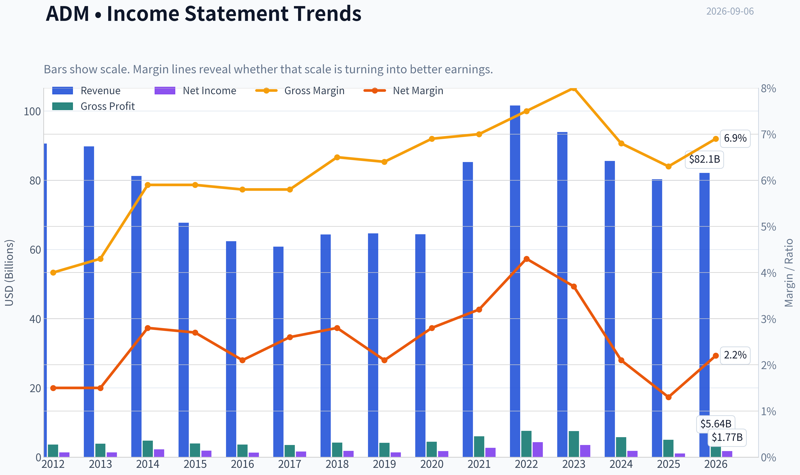
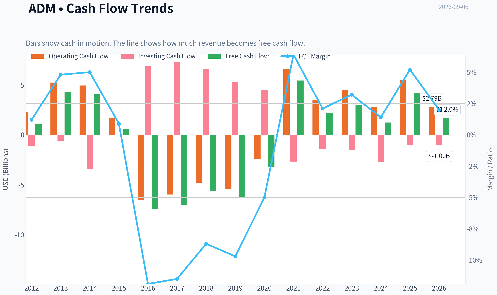
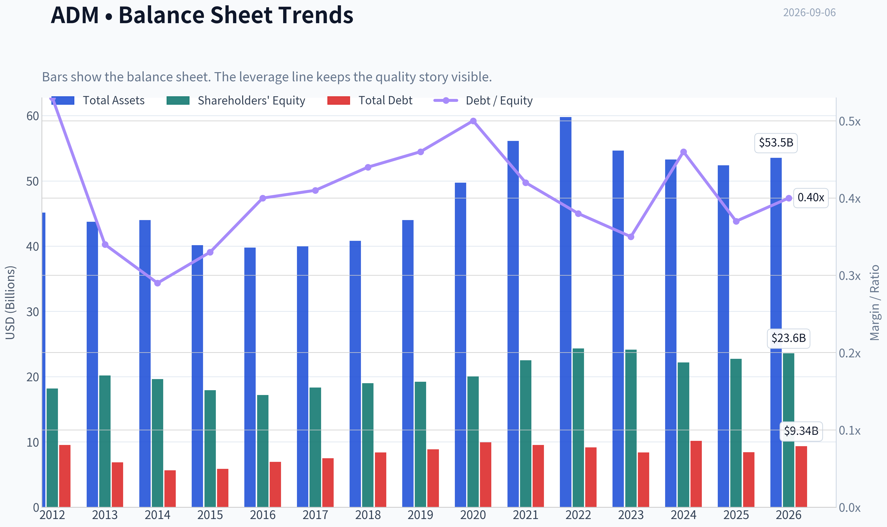
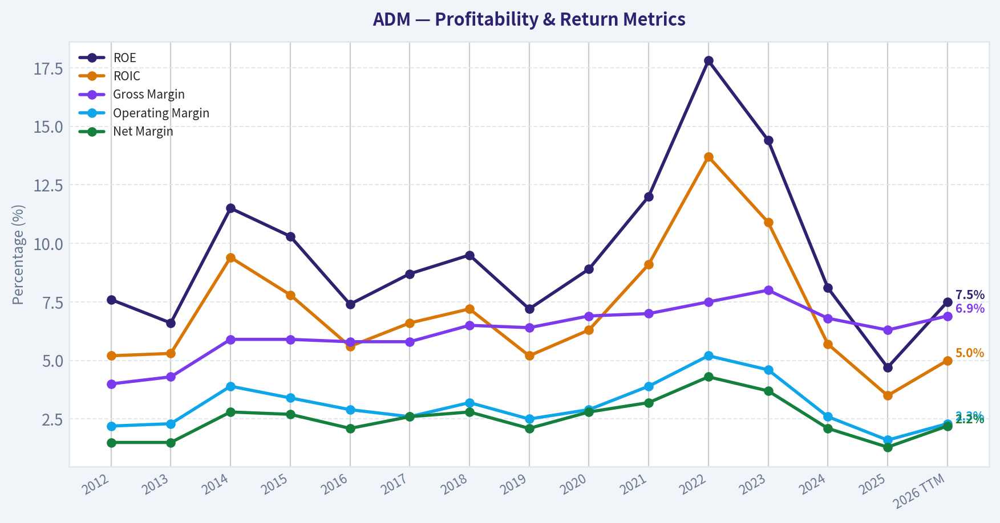
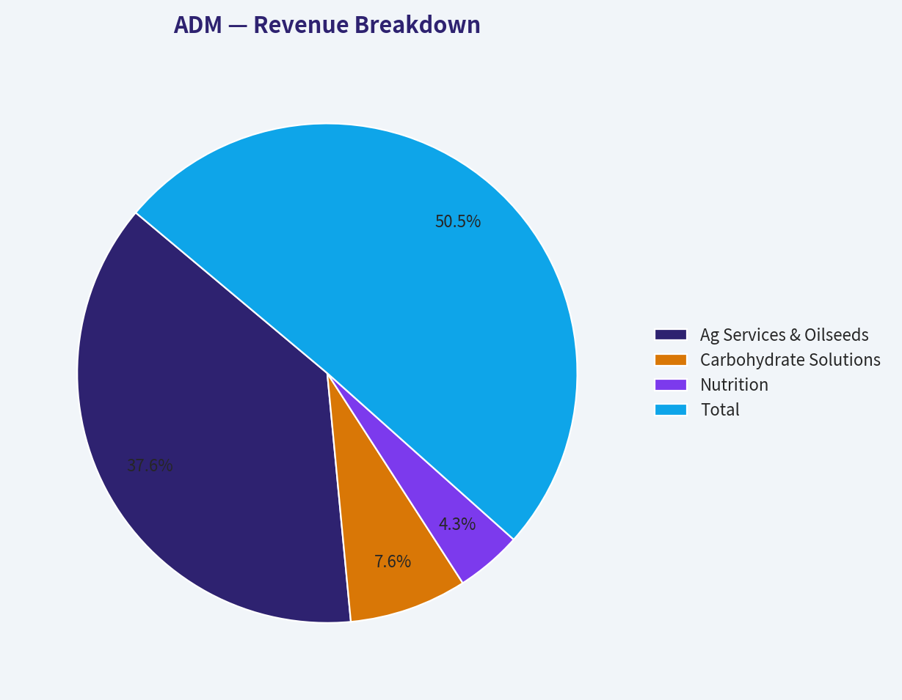
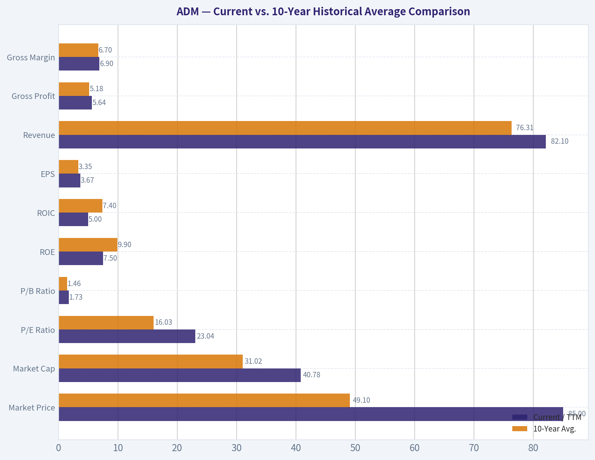
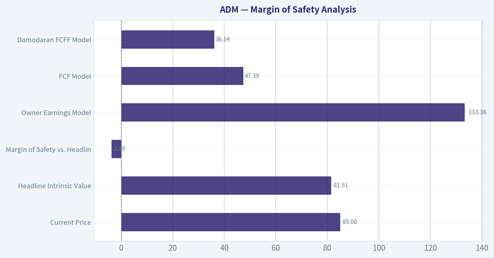
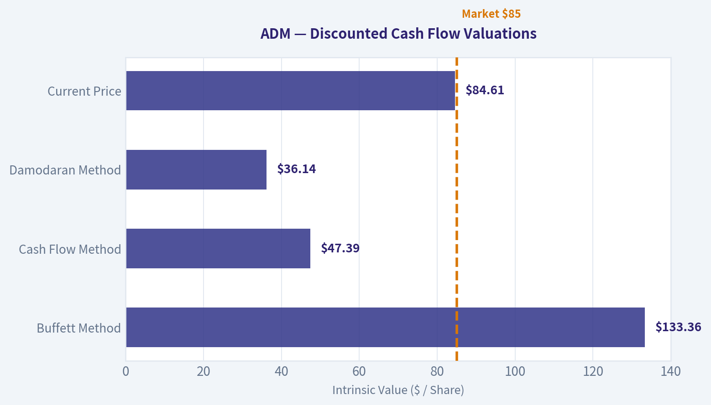
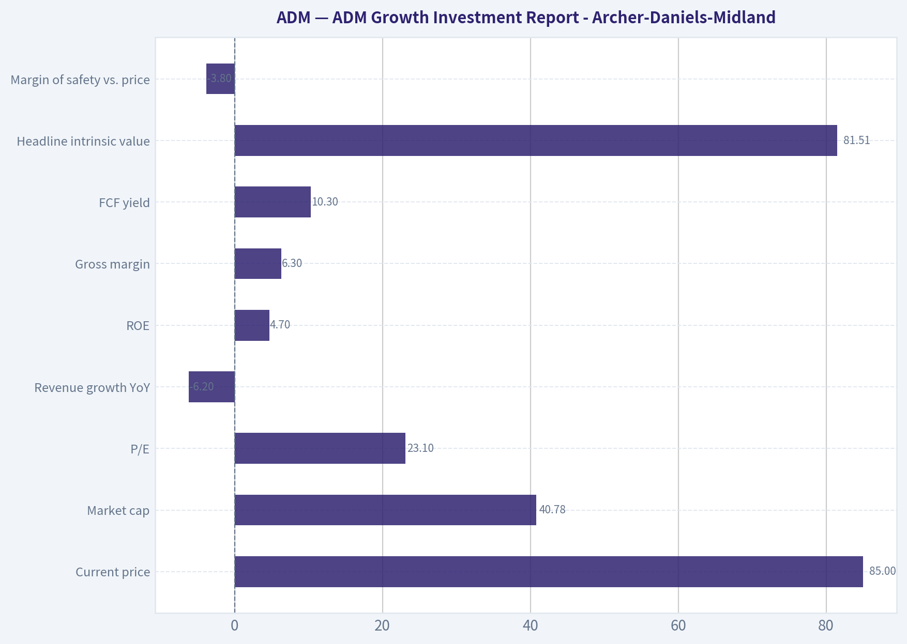

# ADM Deep Value Intelligence

**Analysis Date:** 2026-09-06

## Critical Disclaimer

*This analysis is generated by Deep Value Intelligence, an AI-powered multi-agent investing framework. Education & research only - not financial advice, not a financial advisor.*

---

## Table of Contents

1. Intelligence Summary
2. Analyst Team Reports
   - Fundamentals Analysis
   - Intrinsic Value Analysis (Buffett)
   - Trend & Growth Analysis (Lynch/Druckenmiller/Fisher)
   - Market Technical Analysis
   - Options Market Analysis
3. Research Team Commentary
4. Value Investing Team Commentary
5. Deep Values Commentary

---

## Intelligence Summary

### Thesis + Conditions

**Core Thesis:** **Executive Summary**
ADM is an essential, durable agribusiness, but it is a cyclical, low-margin price-taker-not a high-return Buffett compounder. Trailing metrics (3.6% ROIC, 23x P/E) look dismal, but this is typical of a cyclical trough.

**Key Risks:**
- ADM is an essential, durable agribusiness, but it is a cyclical, low-margin price-taker-not a high-return Buffett compounder. Trailing metrics (3.6% ROIC, 23x P/E) look dismal, but this is typical of a cyclical trough. However, an ongoing accounting probe in its high-growth Nutrition segment compromises the predictability required to justify its current $84 price tag near technical resistance. Balancing our demand for a margin of safety with ADM's intact technical momentum, the optimal path is a disciplined hold. **Verdict: WATCH.**
- The Bull (Risky Analyst):** Argues that trough fundamentals (low ROIC/margins) are a feature of cyclicals, not a bug. Believes the market is looking past the Nutrition accounting probe and pricing in a normalization of crush margins, supported by ADM's 49-year dividend streak and strong technical momentum above the 200-day SMA.
- The Bear (Safe Analyst):** Highlights that a 23x P/E is too rich for a low-margin business lacking pricing power. Flags the Nutrition segment accounting probe as a structural integrity failure (the "cockroach theory"), arguing that a lack of margin of safety risks permanent capital loss.

**Confidence:** Medium

---

## Analyst Team Reports

### Fundamentals Analysis

#### Latest Earnings Snapshot

*Most recent reported quarter anchored on 2026 Q2, with prior-year comparison when available.*

| Metric | 2026 Q2 | 2025 Q2 | YoY Change |
| --- | ---: | ---: | ---: |
| Revenue | $22.68B | $21.17B | +7.2% |
| Operating Income | $909.0M | $459.0M | +98.0% |
| Net Income | $908.0M | $219.0M | +314.6% |
| Diluted EPS | N/A | $0.45 | N/A |
| Operating Cash Flow | $1.15B | $4.30B | -73.3% |
| Free Cash Flow | $877.0M | $3.99B | -78.0% |

Key Takeaways: This snapshot anchors the most recent reported quarter before the narrative analysis. It helps readers separate long-run business quality from whatever changed in the latest earnings print.

#### 14-Year Financial Metrics for ADM

*All values below are computed deterministically from raw data - not estimated by AI.*

*Issuer profile: operating company (Consumer Defensive / Farm Products).*

#### 14-Year Financial Metrics
*Annual rows come from reported financial statements. The final TTM row is computed from the latest four quarters.*

| Metric | 2012 | 2013 | 2014 | 2015 | 2016 | 2017 | 2018 | 2019 | 2020 | 2021 | 2022 | 2023 | 2024 | 2025 | 2026 TTM |
| --- | --- | --- | --- | --- | --- | --- | --- | --- | --- | --- | --- | --- | --- | --- | --- |
| Market Price | $19 | $30 | $37 | $27 | $34 | $31 | $33 | $38 | $43 | $59 | $83 | $66 | $48 | $56 | $85 |
| Market Cap | $18.13B | $28.77B | $34.11B | $22.78B | $26.98B | $22.93B | $23.23B | $26.19B | $28.48B | $38.26B | $52.27B | $39.14B | $24.91B | $27.83B | $40.78B |
| P/E Ratio | 13.17 | 21.49 | 15.16 | 12.31 | 21.13 | 14.37 | 12.84 | 19.00 | 16.00 | 14.11 | 12.04 | 11.23 | 13.84 | 25.78 | 23.04 |
| P/B Ratio | 1.00 | 1.42 | 1.74 | 1.27 | 1.57 | 1.25 | 1.22 | 1.36 | 1.42 | 1.70 | 2.15 | 1.62 | 1.12 | 1.22 | 1.73 |
| ROE | 7.6% | 6.6% | 11.5% | 10.3% | 7.4% | 8.7% | 9.5% | 7.2% | 8.9% | 12.0% | 17.8% | 14.4% | 8.1% | 4.7% | 7.5% |
| ROIC | 5.2% | 5.3% | 9.4% | 7.8% | 5.6% | 6.6% | 7.2% | 5.2% | 6.3% | 9.1% | 13.7% | 10.9% | 5.7% | 3.5% | 5.0% |
| EPS | $1.41 | $1.40 | $2.43 | $2.17 | $1.62 | $2.16 | $2.54 | $2.01 | $2.68 | $4.18 | $6.86 | $5.85 | $3.44 | $2.18 | $3.67 |
| Revenue | $90.56B | $89.80B | $81.20B | $67.70B | $62.35B | $60.83B | $64.34B | $64.66B | $64.36B | $85.25B | $101.56B | $93.94B | $85.53B | $80.27B | $82.10B |
| Gross Profit | $3.62B | $3.89B | $4.77B | $3.97B | $3.62B | $3.52B | $4.18B | $4.15B | $4.45B | $5.99B | $7.57B | $7.51B | $5.78B | $5.03B | $5.64B |
| Gross Margin | 4.0% | 4.3% | 5.9% | 5.9% | 5.8% | 5.8% | 6.5% | 6.4% | 6.9% | 7.0% | 7.5% | 8.0% | 6.8% | 6.3% | 6.9% |
| Operating Margin | 2.2% | 2.3% | 3.9% | 3.4% | 2.9% | 2.6% | 3.2% | 2.5% | 2.9% | 3.9% | 5.2% | 4.6% | 2.6% | 1.6% | 2.3% |
| Net Income | $1.38B | $1.34B | $2.25B | $1.85B | $1.28B | $1.59B | $1.81B | $1.38B | $1.77B | $2.71B | $4.34B | $3.48B | $1.80B | $1.08B | $1.77B |
| Net Margin | 1.5% | 1.5% | 2.8% | 2.7% | 2.1% | 2.6% | 2.8% | 2.1% | 2.8% | 3.2% | 4.3% | 3.7% | 2.1% | 1.3% | 2.2% |
| Revenue Growth | 2.7% | -0.8% | -9.6% | -16.6% | -7.9% | -2.4% | 5.8% | 0.5% | -0.5% | 32.5% | 19.1% | -7.5% | -8.9% | -6.2% | 2.3% |
| Net Income Growth | N/A | -2.4% | 67.5% | -17.7% | -30.8% | 24.7% | 13.5% | -23.8% | 28.5% | 52.9% | 60.2% | -19.7% | -48.3% | -40.1% | 64.2% |
| Free Cash Flow Growth | N/A | 295.0% | -6.1% | -85.7% | -1374.1% | -5.1% | -19.8% | 11.6% | -48.9% | -269.1% | -60.2% | 37.4% | -58.6% | 242.6% | -60.1% |
| Total Book Value | $18.17B | $20.19B | $19.63B | $17.91B | $17.18B | $18.32B | $19.00B | $19.23B | $20.02B | $22.51B | $24.32B | $24.14B | $22.18B | $22.74B | $23.57B |
| Total Assets | $45.14B | $43.75B | $44.00B | $40.16B | $39.77B | $39.96B | $40.83B | $44.00B | $49.72B | $56.14B | $59.77B | $54.63B | $53.27B | $52.39B | $53.53B |
| Total Debt | $9.54B | $6.87B | $5.66B | $5.88B | $6.93B | $7.49B | $8.39B | $8.88B | $9.93B | $9.54B | $9.18B | $8.37B | $10.16B | $8.41B | $9.34B |
| Debt-to-Equity | 0.53 | 0.34 | 0.29 | 0.33 | 0.40 | 0.41 | 0.44 | 0.46 | 0.50 | 0.42 | 0.38 | 0.35 | 0.46 | 0.37 | 0.40 |
| Cash & Equivalents | $1.29B | $3.12B | $1.10B | $910.0M | $619.0M | $804.0M | $2.00B | $852.0M | $666.0M | $943.0M | $1.04B | $1.37B | $611.0M | $1.01B | $1.06B |
| Shareholders' Equity | $18.17B | $20.19B | $19.63B | $17.91B | $17.18B | $18.32B | $19.00B | $19.23B | $20.02B | $22.51B | $24.32B | $24.14B | $22.18B | $22.74B | $23.57B |
| Operating Cash Flow | $2.33B | $5.23B | $4.94B | $1.71B | $-6.51B | $-5.97B | $-4.78B | $-5.45B | $-2.39B | $6.59B | $3.48B | $4.46B | $2.79B | $5.45B | $2.79B |
| Investing Cash Flow | $-1.16B | $-577.0M | $-3.41B | $-21.0M | $6.85B | $7.29B | $6.58B | $5.26B | $4.46B | $-2.67B | $-1.40B | $-1.50B | $-2.70B | $-1.02B | $-999.0M |
| Free Cash Flow | $1.09B | $4.31B | $4.05B | $580.0M | $-7.39B | $-7.01B | $-5.63B | $-6.28B | $-3.21B | $5.43B | $2.16B | $2.97B | $1.23B | $4.20B | $1.68B |
| FCF Margin | 1.2% | 4.8% | 5.0% | 0.9% | -11.9% | -11.5% | -8.7% | -9.7% | -5.0% | 6.4% | 2.1% | 3.2% | 1.4% | 5.2% | 2.0% |
| Dividends / Share | $0.00 | $0.00 | $0.00 | $0.00 | $0.00 | $0.00 | $0.00 | $0.00 | $0.00 | $0.00 | $1.42 | $1.64 | $1.88 | $2.00 | $0.00 |

#### Profitability Metrics
- Return on Equity (ROE): 4.7%
- Return on Invested Capital (ROIC): 3.6%
- Return on Assets (ROA): 2.1%
- Gross Margin: 6.3%
- Operating Margin: 1.6%
- Net Profit Margin: 1.3%

#### Liquidity Metrics
- Current Ratio: 1.37
- Quick Ratio: 0.24

#### Leverage Metrics
- Debt-to-Equity Ratio: 0.37
- Interest Coverage Ratio: 2.05
- Net Debt: $7.39B

#### Growth Metrics (Year-over-Year)
- Revenue Growth: -6.2%
- Net Income Growth: -40.1%
- Free Cash Flow Growth: 242.6%
- Revenue CAGR (3-Year): -7.5%
- Revenue CAGR (5-Year): 4.5%

#### Valuation Metrics
- P/E Ratio (TTM): 23.12
- Forward P/E: 14.87
- Price-to-Book: 1.73
- Price-to-Sales: 0.50
- PEG Ratio: 1.04
- EV/EBITDA: 16.47
- Free Cash Flow Yield: 10.3%
- Earnings Yield: 4.3%

#### Owner Earnings (Buffett Method, Code-Computed)
- Net Income: $1.08B
- + Depreciation & Amortization: $1.18B
- - Capital Expenditures: $-1.25B
- - Working Capital Changes: $2.76B
- = **Owner Earnings: $-1.69B**

#### Intrinsic Value (Code-Computed)
- Current Price: $85
- **Headline Intrinsic Value (business-model routed): $82**
  Business model: operating company - weighted blend [Damodaran FCFF + owner-earnings DCF] (operating_company)
  Model spread (min-max across DCFs): $36 - $133
  Margin of safety vs. price (headline): -3.8%
  Routing note: General operating company: balanced blend of Damodaran FCFF and the owner-earnings DCF with a reverse-DCF sanity check.
- Buffett Method (Owner Earnings):
  Conservative: $-5
  Average: $133
  Optimistic: $422
- Cash Flow Method (FCF):
  Conservative: $-13
  Average: $47
  Optimistic: $309
- Damodaran FCFF (WACC + margins + reinvestment):
  Conservative: $12
  Average: $36
  Optimistic: $56
  Monte Carlo band (P10-P90): $20 - $53 (median $32)
  P(intrinsic value > price): 0.1%
- Reverse-DCF: price implies ~15.3%/yr owner-earnings growth for 10y; trailing 3y was N/A, 5y N/A.

#### Piotroski F-Score: 4/9
- Positive Net Income: PASS
- Positive Operating Cash Flow: PASS
- ROA Improvement: FAIL
- Cash Flow > Net Income: PASS
- Decreasing Debt: PASS
- Improving Current Ratio: FAIL
- No Dilution: FAIL
- Improving Gross Margin: FAIL
- Improving Asset Turnover: FAIL

ANALYST STANCE: **WATCH**

#### ADM Warren Buffett-Style Fundamental Analysis

Archer-Daniels-Midland is a durable, globally scaled agricultural merchant, processor, and ingredients company. It has real operating assets, global logistics infrastructure, grain origination relationships, and scale advantages, but it is not a classic high-margin Buffett compounder. ADM's economics are cyclical, commodity-linked, working-capital intensive, and currently below its best historical profitability levels.

At the current price of **$85**, ADM trades slightly above the dataset's headline intrinsic value estimate of **about $82 per share**, with a **negative margin of safety of roughly 3.8%**. The stock is not obviously overleveraged, and free cash flow yield appears attractive, but the valuation already assumes a meaningful recovery in owner earnings and margins.

---

#### Current vs. 10-Year Historical Average Comparison

| Metric | Current / TTM | 10-Year Avg. | Current Standing vs. History | Interpretation |
|---|---:|---:|---|---|
| Market Price | $85 | $49.10 | Well above average | The stock price is near the high end of the observed period despite only mid-cycle fundamentals. |
| Market Cap | $40.78B | $31.02B | Above average | Equity value has expanded faster than current profitability. |
| P/E Ratio | 23.04x | 16.03x | Expensive vs. history | ADM is trading at a premium multiple while earnings remain below the 2022-2023 peak. |
| P/B Ratio | 1.73x | 1.46x | Above average | For ADM, P/B is meaningful because it is asset-heavy, but it must be judged against ROE; current ROE does not justify a premium book multiple. |
| ROE | 7.5% | 9.9% | Below average | Returns have deteriorated materially from the 2022-2023 boom period. |
| ROIC | 5.0% | 7.4% | Below average | Capital efficiency is currently weak for a business with significant assets and working capital needs. |
| EPS | $3.67 | $3.35 | Slightly above average | EPS is above the 10-year average but far below the 2022 peak of $6.86. |
| Revenue | $82.10B | $76.31B | Above average | Revenue remains large, but growth is not translating into strong current margins. |
| Gross Profit | $5.64B | $5.18B | Above average | Gross profit is healthy versus history, though below the 2022-2023 highs. |
| Gross Margin | 6.9% | 6.7% | Slightly above average | Gross margin remains resilient, but downstream profitability has weakened. |
| Operating Margin | 2.3% | 3.2% | Below average | ADM is not currently converting gross profit into operating profit efficiently. |
| Net Income | $1.77B | $2.12B | Below average | Earnings are recovering from 2025 but remain below normal mid-cycle levels. |
| Net Margin | 2.2% | 2.7% | Below average | Net profitability is thin, consistent with commodity processing economics. |
| Revenue Growth | 2.3% | 2.5% | Near average | TTM revenue growth has stabilized after recent annual declines. |
| Net Income Growth | 64.2% | 1.7% | Above average but rebound-driven | The latest growth rate reflects recovery from a depressed base, not a clean long-term compounding pattern. |
| FCF Growth | -60.1% | Not economically meaningful | Highly volatile | ADM's free cash flow is distorted by working-capital swings and commodity cycles. |
| Total Book Value | $23.57B | $20.96B | Above average | Equity base has grown over the decade. |
| Total Assets | $53.53B | $49.05B | Above average | The business remains asset-heavy and working-capital intensive. |
| Total Debt | $9.34B | $8.73B | Slightly above average | Debt is manageable but not trivial. |
| Debt-to-Equity | 0.40x | 0.42x | Slightly better than average | Leverage is reasonable and not the core risk. |
| Cash & Equivalents | $1.06B | $0.99B | Near average | Cash position is adequate, though not unusually strong. |
| Shareholders' Equity | $23.57B | $20.96B | Above average | Balance sheet equity has compounded modestly. |
| Free Cash Flow | $1.68B | -$1.35B | Above average | Current FCF is positive, but the historical average is distorted by large working-capital outflows. |
| Dividends / Share | $0.00 TTM shown; $2.00 in 2025 | $0.69 | Annual dividend policy has increased | The TTM field appears incomplete, but the reported 2025 dividend was $2.00 per share. |

Key Takeaways: ADM's valuation metrics are above historical norms while profitability metrics are below historical norms. That is not a classic Buffett setup. The balance sheet is acceptable, but the business is earning only modest returns on capital at the current point in the cycle.

---

#### Revenue Breakdown

| Revenue Source | Amount ($B) | % of Total |
|---|---:|---:|
| Ag Services & Oilseeds | $59.80B | 74.5% |
| Carbohydrate Solutions | $12.10B | 15.1% |
| Nutrition | $6.80B | 8.5% |
| Other / Corporate / Eliminations | $1.57B | 1.9% |
| **Total** | **$80.27B** | **100.0%** |

Key Takeaways: ADM remains overwhelmingly driven by Ag Services and Oilseeds, which means its earnings power is heavily tied to crop flows, crush margins, merchandising conditions, global trade patterns, and commodity volatility. Nutrition is strategically important because it can offer higher-margin opportunities, but it is still too small to redefine the company's total economics.

---

#### Market Metrics Interpretation

ADM's **current price of $85** is well above its 10-year average price of about **$49**, while the market capitalization of **$40.78B** is also above the 10-year average of roughly **$31B**. This would be acceptable if profitability were structurally higher, but current returns are not near peak levels.

The **P/E ratio of 23.04x** is elevated compared with the 10-year average of **16.03x**. This is important because ADM is not a software-like business where high incremental margins can easily justify high multiples. Its earnings are cyclical, and the present multiple looks demanding unless earnings recover materially.

The **P/B ratio of 1.73x** is above the 10-year average of **1.46x**. Unlike asset-light companies, book value is relevant for ADM because the business relies on physical assets, inventory, processing facilities, logistics, and working capital. However, P/B should not be read mechanically as cheap or expensive; it must be evaluated against ROE. Paying an above-average P/B while ADM earns a below-average **7.5% ROE** is not especially attractive.

---

#### Profitability Analysis

ADM's profitability is currently mediocre relative to its own history. **ROE is 7.5%**, below the 10-year average of **9.9%**, and **ROIC is 5.0%**, below the 10-year average of **7.4%**. These are not poor enough to suggest distress, but they are not high enough to indicate a wonderful business at a fair price.

Revenue remains large at **$82.10B**, above the 10-year average, yet **net income of $1.77B** is below the 10-year average of **$2.12B**. That indicates that ADM's issue is not scale, but conversion of revenue into durable profit.

Margins tell the same story. Gross margin of **6.9%** is slightly above the 10-year average, but operating margin of **2.3%** and net margin of **2.2%** are both below average. ADM is maintaining gross profitability better than operating profitability, suggesting cost pressure, weaker merchandising conditions, lower processing spreads, or less favorable business mix.

---

#### Growth Metrics Interpretation

ADM's recent revenue growth is modest. TTM revenue growth of **2.3%** is close to the 10-year average of **2.5%**, but the multi-year pattern is uneven. Revenue peaked at **$101.56B in 2022**, then declined in 2023, 2024, and 2025 before stabilizing on a TTM basis.

Net income growth of **64.2% TTM** looks strong, but it follows a severe decline in 2025, when net income fell to **$1.08B**. This is a rebound from a depressed base, not proof of a predictable long-term compounding engine.

Free cash flow growth is extremely volatile, with the current TTM figure down **60.1%** after a strong 2025. ADM's free cash flow is heavily affected by working-capital movements, inventories, receivables, and commodity price cycles. For valuation, normalized cash generation is more useful than any single year's FCF.

---

#### Balance Sheet and Financial Strength

ADM's balance sheet is acceptable. Total debt of **$9.34B** is slightly above the 10-year average of **$8.73B**, while debt-to-equity of **0.40x** is slightly better than the historical average of **0.42x**. This suggests leverage is controlled.

Cash and equivalents of **$1.06B** are close to the 10-year average. Net debt is about **$7.39B**, and interest coverage is only **2.05x**, which is a caution point. The company is not overleveraged, but coverage is not generous if margins remain weak.

Book value and shareholders' equity are both **$23.57B**, above the 10-year average. ADM has maintained a solid capital base, but Buffett-style investors would want that capital base to produce higher and more consistent returns.

---

#### Cash Flow and Dividend Analysis

ADM generated **$1.68B of TTM free cash flow**, which is positive and supports a reported free cash flow yield of about **10.3%**. However, free cash flow has been highly erratic over the period, including several large negative years from 2016 through 2020 due to working-capital and commodity-cycle effects.

The deterministic dataset shows **$0.00 dividends per share for TTM**, but the latest full-year figure was **$2.00 per share in 2025**, following $1.42 in 2022, $1.64 in 2023, and $1.88 in 2024. Dividend growth is shareholder-friendly, but the payout depends on normalized cash flow, not just one strong year.

From a Buffett perspective, ADM's dividend policy is attractive only if it does not crowd out reinvestment or balance-sheet resilience during weaker commodity cycles.

---

#### Buffett-Style Owner Earnings DCF Valuation

The deterministic dataset's code-computed Buffett owner earnings are currently negative:

**Owner Earnings = Net Income + Depreciation & Amortization - Capital Expenditures - Working Capital Changes**

Using the dataset:

- Net Income: **$1.08B**
- Depreciation & Amortization: **$1.18B**
- Capital Expenditures: **$1.25B**
- Working Capital Changes: **$2.76B**
- Code-computed Owner Earnings: **-$1.69B**

Because ADM is a commodity merchant and processor, single-period owner earnings can be distorted by working-capital movements. Therefore, the DCF below uses normalized owner earnings / free-cash-flow proxies as a sanity check, while the report anchors valuation on the deterministic model pack's headline intrinsic value of **$81.51 per share**.

| Scenario | Normalized Owner Earnings Base | Growth Assumption | Discount Rate | Terminal Growth | Estimated Equity Value | Fair Value / Share | Interpretation |
|---|---:|---:|---:|---:|---:|---:|---|
| Conservative | $1.68B | 3.0% for 10 years | 10.0% | 2.5% | $23.8B | ~$50 | Uses current TTM FCF as the base; assumes modest GDP-like growth. |
| Average | $3.20B | 5.0% for 10 years | 10.0% | 2.5% | $52.4B | ~$109 | Uses 2021-2025 average FCF as a normalized mid-cycle proxy. |
| Optimistic | $4.20B | 8.0% for 10 years, then terminal fade | 10.0% | 2.5% | $85.9B | ~$179 | Uses strong 2025 FCF as the base and assumes favorable crush, merchandising, and margin recovery. |
| Deterministic Model Headline | Model blend | Owner earnings + FCFF blend | Model-based | Model-based | - | **$81.51** | Best anchor from the research pack. |
| Deterministic Model Spread | - | - | - | - | - | **$36-$133 core spread; $20-$53 Damodaran P10-P90** | Wide range reflects high cyclicality and cash-flow uncertainty. |

Key Takeaways: The DCF is highly sensitive to the starting cash-flow base because ADM's cash generation is cyclical and working-capital intensive. The conservative case suggests the stock is expensive, while the average and optimistic cases depend on a sustained recovery in normalized owner earnings. The most reliable anchor is the model-blended intrinsic value of about $82, which is slightly below the current $85 price.

##### DCF Calculation Detail

| Scenario | Explicit Forecast PV | Terminal Value | PV of Terminal Value | Total Equity Value | Shares Implied | Fair Value / Share |
|---|---:|---:|---:|---:|---:|---:|
| Conservative | ~$11.9B | ~$30.9B | ~$11.9B | ~$23.8B | ~480M | ~$50 |
| Average | ~$24.9B | ~$71.2B | ~$27.5B | ~$52.4B | ~480M | ~$109 |
| Optimistic | ~$38.1B | ~$123.9B | ~$47.8B | ~$85.9B | ~480M | ~$179 |

Key Takeaways: The conservative DCF produces a value well below the current price, meaning today's valuation is not protected if current free cash flow proves normal. The average case offers upside, but only if ADM's normalized owner earnings are closer to the stronger 2021-2025 period than the weaker 2016-2020 period. The optimistic case requires a favorable cycle and should not be treated as the base case.

---

#### Economic Moat Assessment

ADM has a real but moderate moat. Its advantages include global scale, origination networks, processing assets, commodity logistics, customer relationships, and deep experience in agricultural trading and risk management. These are difficult to replicate quickly.

However, the moat is not as strong as that of a high-return branded consumer business. ADM competes in commodity-linked markets where margins can compress, working capital can swing sharply, and pricing power is limited. The company's scale protects survival and relevance, but it does not guarantee high returns on capital.

Buffett would likely view ADM as a durable business, but not necessarily a "wonderful business" unless purchased at a sufficiently attractive price.

---

#### Management and Capital Allocation

Management has maintained a reasonable balance sheet and has returned capital through dividends. The dividend has grown meaningfully in recent reported years, rising from **$1.42 per share in 2022** to **$2.00 per share in 2025**.

The concern is return on capital. ROE and ROIC are both currently below their 10-year averages, and the Piotroski F-Score is only **4 out of 9**. That score reflects weak recent momentum in profitability, margins, liquidity, and asset turnover.

Capital allocation looks acceptable but not exceptional. A Buffett-style investor would want evidence that management can restore mid-cycle ROIC and avoid overinvesting during favorable commodity cycles.

---

#### Key Investment Insights, Red Flags, and Opportunities

| Category | Point | Buffett-Style Interpretation |
|---|---|---|
| Moat | Global scale in origination, processing, logistics, and oilseeds | Durable competitive position, but not a high-margin franchise. |
| Valuation | Current price $85 vs. headline intrinsic value ~$82 | No meaningful margin of safety. |
| Profitability | ROE 7.5% and ROIC 5.0% are below 10-year averages | Current returns do not justify a premium valuation. |
| P/B Ratio | 1.73x vs. 1.46x average | Above-average P/B is not attractive when ROE is below average. |
| Earnings Quality | Net income has been volatile | Predictability is weaker than Buffett typically prefers. |
| Free Cash Flow | FCF yield appears high at 10.3% | Attractive, but FCF is highly working-capital sensitive. |
| Balance Sheet | Debt-to-equity 0.40x | Leverage is manageable. |
| Interest Coverage | 2.05x | A caution point if margins remain weak. |
| Dividend | 2025 dividend was $2.00/share | Shareholder-friendly, but must be supported by normalized cash flow. |
| Reverse DCF | Price implies ~15.3% owner-earnings growth for 10 years | Aggressive for a cyclical agricultural processor. |
| Piotroski F-Score | 4/9 | Indicates mixed-to-weak recent fundamental momentum. |

Key Takeaways: ADM is financially durable but not currently earning returns that make the stock compelling at $85. The biggest opportunity is a recovery in margins and normalized free cash flow. The biggest risk is that investors are paying a premium multiple for what may prove to be only mid-cycle or below-mid-cycle earnings power.

---

#### Final Investment Stance: WATCH

ADM is a high-quality operator in a strategically important industry, but at the current price it lacks a Buffett-style margin of safety. The stock trades at an elevated **P/E of about 23x**, an above-average **P/B of 1.73x**, and only modest current returns on capital. The headline intrinsic value estimate of **$81.51** is slightly below the market price of **$85**, and the Damodaran FCFF model is much more cautious.

The appropriate stance is **WATCH**, not ADVOCATE. ADM would become more interesting if the price fell meaningfully below intrinsic value, if ROIC recovered toward double digits, or if normalized free cash flow stabilized above $3B annually. At today's valuation, the market appears to be pricing in a recovery that has not yet been fully proven.

---

#### Summary Table

| Area | Assessment | Investor Implication |
|---|---|---|
| Business Quality | Durable, scaled, strategically important agricultural processor | Good long-term relevance, but cyclical economics. |
| Moat | Moderate | Scale matters, but pricing power is limited. |
| Financial Strength | Acceptable | Debt is manageable, but interest coverage deserves monitoring. |
| Profitability | Below historical norms | Current ROE and ROIC do not support an aggressive valuation. |
| Growth | Uneven | Revenue and earnings are cyclical rather than predictably compounding. |
| Cash Flow | Positive but volatile | FCF yield looks attractive, but working-capital swings reduce reliability. |
| Valuation | Slightly above headline intrinsic value | No clear margin of safety at $85. |
| Main Opportunity | Margin and cash-flow recovery | Upside depends on normalized earnings improving. |
| Main Risk | Paying peak-ish valuation for mid-cycle earnings | Downside if margins remain weak or commodity conditions worsen. |
| Final Stance | **WATCH** | Attractive company to monitor, but not a Buffett-style buy at current price. |

Key Takeaways: ADM is a durable company, but the stock price already discounts a meaningful earnings recovery. The business is worth watching because of its scale, dividend history, and potential cash-flow rebound. However, without a larger discount to intrinsic value, the risk-reward is not compelling enough for a Buffett-style purchase today.

#### Fundamental Visuals

This graph tracks the profitability and return metrics (ROE, ROIC, Margins) of **ADM** over the past decade, highlighting capital efficiency trends.

This chart illustrates the financial health of **ADM** over the last 10 years, mapping cash equivalents and free cash flow against total obligations (Debt).

This breakdown chart from <em>Revenue Breakdown</em> shows the proportional composition for **ADM** - useful for understanding what drives or risks the business.

---

### Intrinsic Value Analysis (Buffett)

> *Following Warren Buffett's value investing philosophy: Circle of Competence, Economic Moat, Management Quality, and Margin of Safety.*

#### Intrinsic Value Snapshot

Price is what you pay. Intrinsic value is what the business may be worth based on the cash it can create for owners over time. We show a range, not one magic number.

- Current Price: $84.61
- Value Range (conservative to optimistic across both DCF methods): $-13.14 to $422.33

##### Owner Earnings (Buffett Method)
- Net Income: $1,078,000,000.00
- Depreciation & Amortization: $1,181,000,000.00
- Capital Expenditures: $-1,248,000,000.00
- Working Capital Changes: $2,763,000,000.00
- Owner Earnings: $-1,685,000,000.00

##### Intrinsic Value
###### Buffett Method
Uses owner earnings. Stricter, and usually more conservative.
- Conservative: $-4.92
- Average: $133.36
- Optimistic: $422.33
- Discount Rate: 10.0%

###### Cash Flow Method
Uses free cash flow. Better for companies spending heavily today to grow tomorrow.
- Conservative: $-13.14
- Average: $47.39
- Optimistic: $308.81
- Discount Rate: 10.0%

ANALYST STANCE: **AVOID** - Moderate conviction. ADM is an understandable, essential, scaled agribusiness, but it is not a Buffett-style compounder at today's price. The stock trades slightly above the headline intrinsic value estimate, while current fundamentals show low margins, weak ROE, cyclical earnings, governance concerns, and a reverse-DCF growth hurdle that looks too demanding for a commodity-linked processor.

#### Business Summary

Archer-Daniels-Midland makes money by buying, transporting, storing, processing, and merchandising agricultural commodities such as corn, soybeans, wheat, and oilseeds. Its major profit pools come from oilseed crushing, grain origination, carbohydrate solutions, nutrition ingredients, and agricultural logistics.

This is an essential business, but not a naturally high-margin business. ADM's scale, global elevator network, logistics assets, processing footprint, and customer relationships matter, yet the company remains exposed to commodity spreads, crush margins, crop cycles, trade flows, and working-capital swings.

---

#### 1. Factor Scorecard

| Factor | Score | Evidence |
|---|---:|---|
| Circle of Competence & Business Simplicity | 3.5 / 5 | The business is easy to explain: buy crops, move them, process them, and sell food, feed, fuel, and ingredient products. Predictability is moderate because volumes are durable, but margins depend heavily on commodity spreads and global trade conditions. |
| Moat Test | 2.0 / 5 | ADM has scale and logistics advantages, but gross margin is only about 6.3%, indicating limited pricing power. Customers can often switch suppliers, and much of the business is commodity-like. |
| Management Quality & Capital Allocation | 2.0 / 5 | Capital allocation has been mixed. Buybacks and dividends are shareholder-friendly, but returns on capital are not exceptional, the Nutrition strategy has disappointed, and accounting/control issues reduce confidence. |
| Industry Structure | 2.0 / 5 | Agribusiness processing is essential but cyclical, competitive, capital-intensive, and spread-driven. Industry structure is better than a fragmented commodity market because scale matters, but it is not a rational high-return oligopoly. |
| Gate 5: Quality/Solvency Hard Floor | Not tripped | Earnings have weakened, but ADM does not show clear financial distress. Liquidity is adequate, current ratio is about 1.37, and the company retains access to cash flow and capital markets. |

Key Takeaways: ADM passes the basic "understandable business" test, but it does not pass the "wonderful business" test. The company has real scale advantages, yet the economics remain cyclical and low-margin. The hard solvency floor is not triggered, so the negative stance is based on quality and valuation, not imminent distress.

---

#### 2. Moat Analysis

| Moat Source | Assessment | Evidence |
|---|---|---|
| Intangible Assets / Brand | Weak | ADM is important to global food and feed supply chains, but it does not have consumer-brand pricing power. A 10% price increase would likely lose volume in many commodity-linked product lines. |
| Switching Costs | Low to Moderate | Large customers value reliability and logistics, but many inputs are substitutable. Switching is inconvenient, not prohibitive. |
| Cost Advantage | Moderate | ADM's scale, origination network, elevators, ports, processing plants, and transportation assets create real efficiency advantages. However, these advantages are partly competed away in industry pricing. |
| Network Effects | Minimal | The business does not become materially more valuable simply because more customers join the platform. Scale helps procurement and logistics, but this is not a true network-effect business. |
| Moat Rating | Narrow | ADM has a defensible position in global agricultural infrastructure, but not the pricing power or capital-light economics of a wide-moat compounder. |

Key Takeaways: ADM's moat is based mainly on scale and infrastructure, not brand power or customer lock-in. That makes the company durable, but not especially high-return. The moat is real enough to survive cycles, but not strong enough to justify paying a premium multiple.

---

#### 3. Management Quality Assessment

| Management Area | Rating | Assessment |
|---|---:|---|
| Owner Orientation | 3 / 5 | ADM has historically returned capital through dividends and buybacks, and the business is run with a long-term infrastructure mindset. |
| Candor / Controls | 1.5 / 5 | Accounting and internal-control concerns, particularly around Nutrition, are a significant demerit. Buffett-style investing requires high trust in reported numbers. |
| Capital Allocation | 2 / 5 | Reinvestment has not consistently produced high returns. The Nutrition push was intended to improve margins and reduce cyclicality, but results have not yet validated the strategy. |
| Debt Discipline | 3 / 5 | The balance sheet is not distressed, and liquidity is adequate. However, the business requires meaningful working capital and capital investment. |
| Overall Management Score | 2 / 5 | Shareholder returns exist, but capital returns and governance confidence are not strong enough for a high Buffett score. |

Key Takeaways: ADM's management record is mixed. The company has rewarded shareholders with dividends and buybacks, but the more important Buffett question is whether retained earnings produce high incremental value. On that test, ADM has not shown enough consistency.

---

#### 4. Financial Summary

| Fiscal Year / TTM | Revenue | YoY Growth | Gross Margin | Operating Margin | Net Income | EPS Trend | Free Cash Flow | ROE / ROIC Quality |
|---|---:|---:|---:|---:|---:|---:|---:|---|
| 2020 | ~$64.4B | - | ~6.8% | ~3.2% | ~$1.8B | Moderate | ~$1.1B | Acceptable but not high-return |
| 2021 | ~$85.2B | Strong | ~6.9% | ~4.3% | ~$2.7B | Improved | Negative to weak due to working capital | Improving cycle |
| 2022 | ~$101.6B | Strong | ~7.4% | ~5.1% | ~$4.3B | Peak-like | Positive | Best recent return year |
| 2023 | ~$94.0B | Down | ~7.5% | ~4.8% | ~$3.5B | Down from peak | Strong | Normalizing |
| 2024 / TTM | ~$85B range | -6.2% YoY | 6.3% | Lower | Implied ~$1.8B by P/E | Weaker | FCF yield ~10.3% | ROE 4.7%; weak |

Key Takeaways: ADM's revenue and earnings peaked during a favorable commodity cycle and have since weakened. Free cash flow currently looks strong, but part of that strength reflects working-capital movements rather than a structurally higher-margin business. The low 4.7% ROE is the clearest warning sign: ADM is not currently earning Buffett-quality returns on shareholder capital.

---

#### 5. Owner Earnings Calculation

| Owner Earnings Component | Estimate |
|---|---:|
| Net Income | ~$1.76B |
| Plus: Depreciation & Amortization | ~$1.55B |
| Less: Maintenance CapEx | ~($1.25B) |
| Less: Normalized Working Capital Increase / Add Back for Cycle Normalization | +~$0.60B |
| Estimated Normalized Owner Earnings | ~$2.66B |
| Diluted Share Count Estimate | ~480M |
| Normalized Owner Earnings per Share | ~$5.55 |

Key Takeaways: ADM's reported free cash flow can swing sharply because the business carries large inventories and receivables. A normalized owner-earnings estimate of roughly $5.55 per share is more conservative than simply capitalizing the latest free cash flow. This is important because a commodity processor should be valued on mid-cycle earnings, not peak or working-capital-assisted cash flow.

---

#### 6. Three-Scenario DCF Valuation

Assumptions: 10% discount rate, normalized owner earnings of about $5.55 per share, and mid-cycle treatment of working capital.

| Scenario | Key Assumption | Estimated Intrinsic Value / Share |
|---|---|---:|
| A. No Growth | Owner earnings capitalized at 10% | ~$55.50 |
| B. GDP Growth | 3% perpetual growth | ~$81.70 |
| C. Historical / Mid-Cycle Growth | 4% growth for 10 years, then 2.5% terminal growth | ~$84.70 |
| Simple Average of Three Scenarios | Balanced view | ~$74.00 |
| Headline Business-Model Routed Intrinsic Value | Weighted blend of Damodaran FCFF and owner-earnings DCF | $81.51 |
| Current Price | Market price | $85.00 |

Key Takeaways: The conservative and mid-cycle valuation range clusters below or near the current share price. The headline intrinsic value estimate is $81.51, modestly below the $85 market price. ADM is not obviously expensive on free cash flow, but it is not cheap enough for a cyclical, low-return business.

---

#### 7. Margin of Safety Analysis

| Valuation Metric | Result | Interpretation |
|---|---:|---|
| Current Price | $85.00 | Starting point |
| Headline Intrinsic Value | $81.51 | Slightly below market price |
| Margin of Safety vs. Headline Value | -3.8% | No margin of safety |
| 3-Model Valuation Spread | $36.14 to $133.36 | Very wide range; cash-flow cyclicality is high |
| Owner Earnings Model | $133.36 | Bullish case depends on high sustainable cash generation |
| FCF Model | $47.39 | Bearish case reflects lower normalized cash-flow value |
| Damodaran FCFF Model | $36.14 | Suggests poor value if normalized FCFF is lower |
| Reverse DCF | Price implies ~15.3% annual growth for 10 years | Too demanding for ADM's business quality |

Key Takeaways: The valuation does not offer the margin of safety required for a cyclical agribusiness. A wide-moat compounder might deserve purchase near fair value, but ADM is not in that category. The reverse-DCF hurdle is especially problematic because 15% annual value growth is not consistent with ADM's recent ROE, margins, or industry structure.

---

#### 8. Final Buffett Scorecard

| Criterion | Weight | Score | Weighted Contribution |
|---|---:|---:|---:|
| Moat Width & Durability | 25% | 2.0 / 5 | 0.50 |
| Valuation / Margin of Safety | 20% | 2.0 / 5 | 0.40 |
| Capital Returns - ROIC vs. WACC | 15% | 1.5 / 5 | 0.23 |
| Business Understanding & Predictability | 12% | 3.5 / 5 | 0.42 |
| Management Quality & Capital Allocation | 12% | 2.0 / 5 | 0.24 |
| Reinvestment Runway | 8% | 2.5 / 5 | 0.20 |
| Balance Sheet Strength | 4% | 3.0 / 5 | 0.12 |
| Industry Structure | 4% | 2.0 / 5 | 0.08 |
| Final Weighted Score | 100% | - | **2.19 / 5** |

Key Takeaways: ADM scores well only on understandability and adequate balance-sheet strength. It scores poorly on the factors that matter most for long-term compounding: moat, capital returns, and valuation. A final score of 2.19 falls clearly in the AVOID range.

---

#### 9. Investment Stance

| Item | Judgment |
|---|---|
| Stance | **AVOID** |
| Conviction | Moderate |
| Reason | No margin of safety, weak ROE, low margins, cyclical cash flows, narrow moat, and governance/control concerns |
| What Would Change the View | Price below ~$60-$65, evidence of sustained ROIC improvement, restored confidence in accounting controls, and proof that Nutrition can earn structurally higher margins |
| Buffett-Style Summary | Essential business, but not a wonderful business at this price |

ADM is a durable and important company, but durability alone is not enough. Buffett would likely admire the scale and real-world usefulness of the assets, while questioning the absence of pricing power, the low return on equity, and the lack of a meaningful discount to intrinsic value. At $85, ADM is a pass.
#### Valuation Bridge

This bridge places the current market price beside each intrinsic value lens so readers can see whether upside depends on one method or shows up across several methods.

| Scenario | Intrinsic Value / Share |
| --- | ---: |
| Buffett Method | $133.36 |
| Cash Flow Method | $47.39 |
| Damodaran Method | $36.14 |
| Current Price | $84.61 |

#### Key Takeaways

If one method is far above the others, the upside case depends on a specific modelling assumption. When several methods cluster together, the valuation story is more robust.

#### Valuation Visuals

This comparison chart from *Latest Earnings Snapshot* stacks current figures against historical benchmarks for **ADM**, making it easy to see where the company trades relative to its own averages.

This comparison chart from *Current vs. 10-Year Historical Average Comparison* stacks current figures against historical benchmarks for **ADM**, making it easy to see where the company trades relative to its own averages.

This comparison chart from *Margin of Safety Analysis* stacks current figures against historical benchmarks for **ADM**, making it easy to see where the company trades relative to its own averages.

The following chart maps the **ADM** Owner Earnings DCF valuation scenarios (Conservative, Average, Optimistic) to visually represent the margin of safety based on intrinsic value calculations.

---

### Trend & Growth Analysis (Lynch/Druckenmiller/Fisher)

> *Following Peter Lynch's GARP, Stanley Druckenmiller's macro-aware approach, and Philip Fisher's scuttlebutt methodology.*

ANALYST STANCE: **AVOID**

#### ADM Growth Investment Report - Archer-Daniels-Midland

| Item | Assessment |
|---|---:|
| Ticker interpreted | ADM - Archer-Daniels-Midland, not LSE Admiral Group |
| Current price | $85 |
| Market cap | $40.78B |
| P/E | 23.1x |
| Revenue growth YoY | -6.2% |
| ROE | 4.7% |
| Gross margin | 6.3% |
| FCF yield | 10.3% |
| Headline intrinsic value | $81.51 |
| Margin of safety vs. price | -3.8% |
| Lynch classification | Cyclical / slow-growth stalwart |
| Growth stance | Avoid for growth mandate |

**Key Takeaways:** ADM is not a classic Lynch fast grower. It is a mature, commodity-linked agribusiness with low margins, negative recent revenue growth, and cyclical earnings exposure. The high free-cash-flow yield may interest value or income investors, but it does not meet the bar for a growth portfolio seeking inflection points or ten-bagger potential.

---

#### 1. Lynch Classification

| Lynch Category | Fit? | Rationale |
|---|---:|---|
| Slow Grower | Partial | Revenue currently down YoY; mature end markets |
| Stalwart | Partial | Large, established global agribusiness |
| Fast Grower | No | Lacks 15-25% durable revenue growth |
| Cyclical | Yes | Earnings depend on crop cycles, crush margins, commodity spreads, trade flows |
| Turnaround | Possible, but not core | Would require operational/margin catalyst |
| Asset Play | Partial | Global infrastructure, storage, processing and logistics assets have value |

**Key Takeaways:** ADM is best classified as a cyclical stalwart, not a fast grower. For a Lynch-style growth mandate, that matters because the main driver is commodity-cycle recovery rather than sustained product-led compounding. The stock may work in a value or cycle-up scenario, but it is not an obvious ten-bagger candidate.

#### 2. The Story in 3 Bullets

- ADM buys, processes, transports, and sells agricultural commodities and ingredients globally.
- The business benefits when crop flows, crush spreads, biofuel demand, and food ingredient volumes are favorable.
- The growth case depends less on explosive demand and more on cyclical margin recovery, productivity, biofuels, nutrition, and capital discipline.

#### 3. TAM and 10x Test

| TAM Question | Assessment |
|---|---|
| Current revenue scale | Already very large, likely tens of billions annually |
| 10x revenue scenario | Would imply hundreds of billions of dollars of annual revenue |
| Market share implication | A 10x would likely require unrealistic share gain or major commodity price inflation |
| TAM growth | Food, feed, fuel demand grows, but generally not at software-like rates |
| 10x test result | Fails for growth investing |

**Key Takeaways:** ADM operates in enormous markets, but it is already a major global player. The issue is not that the market is too small; it is that the company is already too large and too tied to commodity economics for a realistic 10x revenue path. ADM can compound modestly, but it does not have the runway profile of a true fast grower.

#### 4. Revenue Growth Trend

| Metric | Current Signal | Growth Interpretation |
|---|---:|---|
| Revenue growth YoY | -6.2% | Decelerating / cyclical softness |
| Gross margin | 6.3% | Structurally thin commodity margins |
| ROE | 4.7% | Weak current profitability efficiency |
| FCF yield | 10.3% | Strong cash generation, but not necessarily growth-driven |

**Key Takeaways:** ADM's recent revenue trend is negative, which is a major mismatch for a growth mandate. The strong free-cash-flow yield suggests the company may be cash-generative, but the growth engine is not accelerating. This looks more like a mature cyclical value setup than a Druckenmiller-style inflection point.

#### 5. Unit Economics

| Metric | ADM Applicability | Assessment |
|---|---|---|
| LTV/CAC | Not applicable | ADM is not a SaaS or subscription model |
| Net revenue retention | Not applicable | No recurring subscription cohort metric |
| Rule of 40 | Not applicable | Not a SaaS business |
| Operating leverage | Relevant | Could improve if crush margins, volumes, and productivity recover |
| Gross margin quality | Relevant | Low gross margin limits upside from modest revenue growth |

**Key Takeaways:** Traditional software unit economics do not apply to ADM. The key economic variables are commodity spreads, utilization, working capital, logistics, and processing margins. The low gross margin means ADM needs scale, efficiency, and favorable commodity conditions to generate attractive returns.

#### 6. Inflection Point Assessment

| Potential Inflection | Evidence Today | Verdict |
|---|---|---|
| Product cycle inflection | Limited evidence | Weak |
| Market share inflection | No clear evidence from provided data | Weak |
| Margin inflection | Possible, but not confirmed | Watch only |
| TAM inflection | Food and biofuels are durable, not explosively accelerating | Moderate |
| Competitive inflection | No clear competitor stumble identified | Weak |
| Earnings inflection | Could occur cyclically, but market may already value recovery | Unproven |

**Key Takeaways:** ADM does not currently show the type of growth acceleration that defines a high-quality inflection point. A margin recovery could help the stock, but that would be a cyclical trade rather than a durable growth thesis. Druckenmiller would likely ask for clearer evidence that future earnings are materially underestimated.

#### 7. Macro Setup

| Macro Factor | Impact on ADM |
|---|---|
| Food demand | Structurally defensive and positive |
| Commodity volatility | Can help or hurt depending on spreads and hedging |
| Biofuels / renewable diesel | Potential secular support |
| Interest rates | Lower rates help valuation but are not the main driver |
| Trade policy | Major risk due to global agriculture flows |
| Inflation | Mixed: supports nominal revenue but can pressure costs and volumes |

**Key Takeaways:** ADM has some macro tailwinds from food security, biofuels, and global agriculture demand. However, it also faces significant exposure to commodity cycles, trade policy, and margin volatility. The macro setup is mixed, not decisively favorable for concentrated growth investing.

#### 8. Fisher 15-Point Score

| Fisher Category | Score / 5 | Comment |
|---|---:|---|
| Market potential | 3 | Large but mature markets |
| New product determination | 3 | Nutrition and biofuels offer some innovation |
| R&D effectiveness | 2 | Not a major innovation-led compounder |
| Sales organization | 3 | Global reach is strong |
| Profit margin | 2 | Gross margin is low |
| Margin improvement | 2 | Not yet evident from provided data |
| Labor/personnel relations | 3 | No major data point provided |
| Executive relations | 2 | Governance/accounting history requires caution |
| Management depth | 3 | Large established organization |
| Cost analysis/accounting | 2 | Prior accounting concerns are a demerit |
| Unique advantages | 3 | Scale, logistics, procurement network |
| Long-range profit outlook | 3 | Stable but cyclical |
| Dilution risk | 4 | Not a heavy equity-raise model |
| Candor in difficulties | 2 | Needs verification from recent filings |
| Integrity | 2 | Governance risk remains a concern until fully cleared |
| **Total** | **39 / 75** | **Below growth-investor threshold** |

**Key Takeaways:** ADM scores poorly under Fisher because it is not an innovation-led, high-margin growth company. Its strengths are scale, logistics, and entrenched market position, but those are not enough for a growth mandate. Governance and accounting concerns also weigh on the qualitative score.

#### 9. Valuation Analysis

| Valuation Method | Result | Interpretation |
|---|---:|---|
| P/E | 23.1x | Not obviously cheap for negative revenue growth |
| PEG | Not meaningful | Growth rate is negative or too cyclical |
| P/S estimate | Likely low, around commodity-company levels | Low multiple reflects low margins |
| FCF yield | 10.3% | Attractive for value investors |
| Headline intrinsic value | $81.51 | Slightly below current price |
| Margin of safety | -3.8% | No clear discount |
| Reverse DCF implied growth | ~15.3% annually for 10 years | Too demanding for ADM's profile |

**Key Takeaways:** ADM's valuation is mixed. The free-cash-flow yield is attractive, but the P/E is not compelling given negative revenue growth and weak ROE. The reverse DCF is especially problematic because the current price appears to imply a growth trajectory that is far above ADM's likely long-term profile.

#### 10. Scenario Analysis

| Scenario | Assumption | Likely Outcome |
|---|---|---|
| Bear | Commodity margins stay weak; governance discount persists | Stock derates; downside risk meaningful |
| Base | Modest recovery in volumes and margins; cash flow remains solid | Low-to-mid single-digit compounding plus dividends |
| Bull | Strong crush margins, biofuel tailwinds, cost cuts, buybacks | Stock can work cyclically, but still unlikely to be a ten-bagger |

**Key Takeaways:** The bull case is a cyclical recovery, not a structural growth breakout. ADM may deliver acceptable returns if margins normalize and cash flow is returned to shareholders, but the upside profile is not asymmetric enough for a growth portfolio. The downside case remains tied to commodity spreads, execution, and governance risk.

#### 11. Growth Investor Scorecard

| Criterion | Weight | Score / 5 | Weighted Score |
|---|---:|---:|---:|
| The Story | 10% | 2.5 | 0.25 |
| TAM and Runway | 20% | 2.0 | 0.40 |
| Revenue Growth | 20% | 1.0 | 0.20 |
| Unit Economics | 15% | 2.0 | 0.30 |
| Competitive Position | 10% | 3.0 | 0.30 |
| Management Quality | 10% | 2.0 | 0.20 |
| Macro Setup | 5% | 3.0 | 0.15 |
| Profitability Path | 5% | 2.5 | 0.13 |
| Valuation | 5% | 2.5 | 0.13 |
| **Total** | **100%** |  | **2.06 / 5.00** |

**Key Takeaways:** ADM scores 2.06 out of 5, which falls in the avoid range for a growth investor. The company has scale and cash flow, but it lacks accelerating revenue growth, a clear inflection point, and a credible ten-bagger runway. This is not the kind of setup Lynch, Fisher, or Druckenmiller would likely prioritize for growth capital.

#### 12. Position Size Stance

| Portfolio Type | Stance | Suggested Position |
|---|---|---:|
| Growth portfolio | Avoid | 0% |
| GARP portfolio | Watch only | 0-1% |
| Value / income portfolio | Possible watchlist | Depends on yield, normalized FCF, and governance clarity |
| Cyclical trading book | Watch | Only with commodity-margin catalyst |

**Key Takeaways:** ADM should not be initiated in a growth-focused portfolio. A value investor might revisit it if the stock trades at a larger discount to normalized cash flow, but the growth setup is weak. For now, capital is better allocated to businesses with accelerating revenue, expanding margins, and stronger secular tailwinds.

#### 13. Key Risks and Catalysts

| Type | Item | Impact |
|---|---|---|
| Risk | Negative revenue growth | Weakens growth thesis |
| Risk | Low gross margin | Limits operating flexibility |
| Risk | Commodity spread volatility | Earnings can swing materially |
| Risk | Trade policy and geopolitics | Can disrupt global flows |
| Risk | Governance/accounting concerns | May sustain valuation discount |
| Catalyst | Margin recovery | Could improve earnings and sentiment |
| Catalyst | Biofuels demand | Potential medium-term support |
| Catalyst | Buybacks/dividends | Can support shareholder returns |
| Catalyst | Clear governance resolution | Could reduce discount rate |
| Catalyst | Cost-cutting/productivity | Could drive operating leverage |

**Key Takeaways:** ADM's upside catalysts are real, but they are mostly cyclical and operational rather than structural growth drivers. The biggest things to watch are margin recovery, cash returns, and governance clarity. Until revenue growth reaccelerates and returns improve, ADM remains outside the growth-investor buy zone.

#### Final View

ADM is a large, important, cash-generative agribusiness, but it is not a Lynch-style fast grower or a Fisher-style innovation compounder. The stock may have value appeal due to its free-cash-flow yield, but the current growth profile is weak, the valuation is not clearly discounted, and the 10x runway is not credible.

**Decision: AVOID for growth portfolios.**

#### Growth & Scorecard Visuals

This comparison chart from *ADM Growth Investment Report - Archer-Daniels-Midland* stacks current figures against historical benchmarks for **ADM**, making it easy to see where the company trades relative to its own averages.

---

### Market Technical Analysis

ANALYST STANCE: **WATCH**

#### ADM Technical Indicator Selection and Market Read

ADM is in a constructive technical position as of the latest available trading close on **2026-09-04**, with price closing at **$84.61**. The stock has recovered strongly from its August pullback and is now trading above its short-, medium-, and long-term trend measures. However, it is approaching the prior July resistance zone near the mid-to-high $80s, so the setup looks bullish but not yet clean enough to chase without confirmation.

The most relevant indicators for ADM's current market condition are:

| Indicator | Latest Value | Why It Matters Here | Current Interpretation |
|---|---:|---|---|
| close_10_ema | 82.73 | Captures short-term momentum and near-term trend shifts | Price is above the 10 EMA, showing renewed upside momentum |
| close_50_sma | 80.59 | Defines the medium-term trend and likely support zone | Price is comfortably above the 50 SMA, confirming a bullish intermediate trend |
| close_200_sma | 71.29 | Confirms the long-term trend regime | Price is far above the 200 SMA, indicating a strong long-term uptrend |
| macd | 1.06 | Measures trend momentum | MACD has turned positive and is rising, supporting bullish momentum |
| macds | 0.49 | Confirms MACD crossover quality | MACD is above signal, suggesting upside momentum remains active |
| rsi | 60.78 | Identifies momentum strength and overbought/oversold risk | RSI is bullish but not overbought, leaving room for further upside |
| atr | 2.61 | Measures volatility for risk and stop placement | Volatility has expanded, so position sizing and stops need discipline |
| vwma | 81.43 | Confirms price action using volume-weighted trend | Price is above VWMA, implying volume-supported strength |

Key Takeaways: ADM is trading above all selected trend measures, which supports a bullish bias. Momentum has improved meaningfully, with MACD above its signal line and RSI in a healthy bullish range rather than an overextended one. The main caution is that volatility has risen while price is nearing prior resistance, so traders should avoid assuming an easy breakout.

---

#### Trend Structure

ADM's broader structure is bullish. The stock is trading at **$84.61**, above the **10 EMA at $82.73**, the **50 SMA at $80.59**, and the **200 SMA at $71.29**. This alignment is important because it shows trend agreement across short-term, medium-term, and long-term timeframes.

The long-term trend is particularly strong. The 200 SMA has climbed steadily from roughly **$67.64 on 2026-07-21** to **$71.29 on 2026-09-04**, showing that the longer-term base has continued to rise. Meanwhile, the 50 SMA has also moved higher, though more slowly, rising from about **$79.14 to $80.59** over the same period. This suggests that ADM's recent price strength is not merely a short-lived bounce; it is occurring within an already rising long-term trend.

The short-term trend has improved sharply since late August. The 10 EMA bottomed around the high-$79 to low-$80 area and has climbed to **$82.73**, while price has pushed above it. That tells us buyers have regained control after the late-July and early-August correction.

#### Momentum Analysis

Momentum has shifted back in favor of buyers. MACD moved from slightly negative territory in late August to **1.06** by 2026-09-04, while the MACD signal line rose to **0.49**. The spread between MACD and its signal is positive, implying a bullish MACD histogram of roughly **0.57**.

This is a meaningful improvement from the weaker readings seen in early-to-mid August, when MACD was negative and price was struggling around the upper-$70s. The recent MACD recovery aligns with the price rebound from the August lows near **$76-$78** back into the **$84-$85** area.

RSI confirms the bullish tone but does not show exhaustion. At **60.78**, RSI is above neutral and indicates positive momentum, but it remains below the typical overbought threshold of 70. This is an attractive momentum profile: strong enough to confirm demand, but not so stretched that a reversal is automatically likely.

#### Price Levels and Risk Zones

The most important resistance area is the prior July peak zone. ADM traded as high as **$87.90 on 2026-07-23**, then sold off into late July and early August. The recent rally to **$85.38 on 2026-09-02** shows price is re-approaching that prior supply area, but it has not yet decisively broken through.

A clean move above **$86.10-$87.90** would be technically significant. It would suggest ADM is escaping the summer consolidation and attempting a continuation breakout. On the downside, the first support zone sits around the **10 EMA near $82.73**. Below that, the more important medium-term support area is near the **50 SMA and VWMA**, roughly **$80.60-$81.40**.

If ADM falls back below the VWMA and 50 SMA, the bullish setup would weaken, especially if MACD begins to roll over at the same time. Until then, pullbacks toward those averages may be viewed as normal retests rather than trend breaks.

#### Volatility and Trade Management

ATR is elevated at **2.61**, up from roughly **1.95** in late July. That means ADM's daily trading range has expanded, and traders should be careful with overly tight stops. A stop placed too close to entry may be triggered by normal volatility rather than a true breakdown.

For swing traders, this suggests using wider risk bands and smaller position sizes. A practical technical approach would be to treat the **$80.50-$81.50** region as a key support band. A decisive close below that area would be more concerning than a one-day dip, especially if accompanied by rising volume and weakening MACD.

#### Volume-Weighted Confirmation

VWMA is at **$81.43**, below the current price. This is supportive because it indicates ADM's current price is above its volume-weighted trend level. In other words, the recent move is not only above simple moving averages, but also above a price level adjusted for trading volume.

That said, VWMA is still below the 10 EMA, which means recent upside has been quick. The stock may need either a consolidation above **$82-$83** or a volume-backed breakout through **$86-$88** to confirm the next leg higher.

---

#### Trading Implication

ADM currently favors a **bullish watchlist stance**, not an outright aggressive chase. The trend structure is positive, momentum is improving, and RSI is not overbought. However, price is close to a prior resistance zone, and volatility is elevated.

A breakout trader may want confirmation above the **$86.10-$87.90** zone. A pullback trader may prefer waiting for a controlled retest near the **10 EMA or VWMA/50 SMA zone**. The technical picture would deteriorate if ADM closes below the **$80-$81** area with weakening momentum.

| Decision Area | Bullish Evidence | Caution / Risk | Practical Level to Watch |
|---|---|---|---|
| Trend | Price is above 10 EMA, 50 SMA, and 200 SMA | Price is extended above the 200 SMA | 10 EMA near $82.73 |
| Momentum | MACD is positive and above signal | Momentum has recovered quickly, so short-term cooling is possible | MACD above signal line |
| RSI | RSI near 61 supports bullish momentum | Not overbought, but nearing stronger momentum territory | RSI 55-65 bullish range |
| Resistance | Price is nearing prior highs | July resistance may attract sellers | $86.10-$87.90 |
| Support | 50 SMA and VWMA are rising beneath price | A break below them would weaken the setup | $80.60-$81.40 |
| Volatility | ATR expansion confirms active movement | Wider ranges increase stop-out risk | ATR near $2.61 |
| Preferred Bias | Bullish but selective | Avoid chasing into resistance without confirmation | Watch for breakout or pullback |
| Stance | WATCH | Needs confirmation before stronger conviction | Breakout above prior highs or orderly retest |

Key Takeaways: ADM's technical backdrop is bullish, but the stock is approaching an important resistance zone from July. The best setups are either a confirmed breakout above the high-$80s or a controlled pullback toward support near the low-$80s. Until one of those develops, ADM is best treated as a constructive watch rather than an immediate aggressive entry.

---

### Options Market Analysis

> *Reading options flow - put/call ratios, IV skew, and unusual activity - to gauge institutional positioning and event-driven risk.*

#### ADM Options Market Sentiment Report
*As of 2026-09-06*

#### 1. Put/Call Ratio Analysis

| Expiration | Call OI | Put OI | Put/Call OI Ratio | Call Volume | Put Volume | Put/Call Volume Ratio | Read |
|---|---:|---:|---:|---:|---:|---:|---|
| 2026-09-18 | 14,883 | 10,749 | 0.72 | 2,031 | 812 | 0.40 | OI near neutral, but current flow call-heavy |
| 2026-10-16 | 5,945 | 3,286 | 0.55 | 1,187 | 3,542 | 2.98 | Existing positioning call-biased, but fresh flow strongly put-heavy |
| 2026-11-20 | 2,732 | 383 | 0.14 | 49 | 68 | 1.39 | Very call-heavy OI, but thin volume limits signal value |
| **Near-Term Total** | **23,560** | **14,418** | **0.61** | **3,267** | **4,422** | **1.35** | OI leans bullish, volume leans defensive/bearish |

**Key Takeaways:** ADM's near-term open interest put/call ratio is **0.61**, below the historical neutral baseline of roughly **0.70**, suggesting positioning is still modestly call-skewed. However, the **volume put/call ratio is 1.35**, driven mainly by October put activity, indicating a recent shift toward downside protection or bearish positioning. This is not a fully bearish options setup, but the latest flow is more cautious than the OI base suggests.

The key distinction is **stock of positioning vs. flow of new activity**. Existing open interest is slightly bullish/neutral, while current trading volume shows active demand for puts, especially in the October monthly expiration.

---

#### 2. Implied Volatility Assessment

| Expiration | ATM Call IV | ATM Put IV | Call-Put IV Difference | IV Read |
|---|---:|---:|---:|---|
| 2026-09-18 | 34.9% | 34.5% | Calls +0.4 pts | Balanced, slight call premium |
| 2026-10-16 | 34.2% | 32.8% | Calls +1.4 pts | Mild call-side premium despite put volume |
| 2026-11-20 | 37.9% | 35.1% | Calls +2.8 pts | Call IV meaningfully higher, but volume is thin |

**Key Takeaways:** Near-term ATM IV sits mostly in the **low-to-mid 30% range**, with November slightly higher. Interestingly, ATM calls price at a modest premium to ATM puts across the listed expirations, which argues against a classic panic hedge profile. The heavy October put volume is notable, but it is not being accompanied by a clearly elevated put-IV skew in the data provided.

From an IV-skew perspective, there is **no obvious steep downside put skew** in the available chain summary. If anything, the ATM IV differential shows a mild **call skew**, suggesting the market is not aggressively pricing tail-risk downside. That reduces the strength of the bearish interpretation from the October put flow.

No specific upcoming catalyst is identified in the provided data. IV does not appear extreme, but the October expiration should be watched for event-driven positioning, especially given the outsized put volume.

---

#### 3. Unusual Options Activity

| Expiration | Type | Strike | Volume | Open Interest | Vol/OI | IV | Moneyness / Horizon | Positioning Implication |
|---|---|---:|---:|---:|---:|---:|---|---|
| 2026-10-16 | Put | $80 | 3,298 | 247 | 13.4x | 31.6% | Roughly ATM / near-the-money based on IV proximity; ~40 days to expiry | Fresh downside hedge or bearish directional bet |

**Key Takeaways:** The standout trade is the **October 16 $80 put**, where volume was more than **13 times open interest**, strongly suggesting fresh positioning rather than routine closing activity. Because the contract is roughly near-the-money and has about six weeks to expiry, this looks more institutional or hedging-oriented than very short-dated retail speculation. The signal is defensive: traders are paying for protection or downside exposure into mid-October.

This is the most important data point in the chain. The trade size relative to OI implies a meaningful new options position, but the IV of **31.6%** is not unusually elevated versus ATM October IV, so the buyer was not paying an obvious panic premium.

---

#### 4. Open Interest Concentration and Pinning Risk

| Expiration | Total OI | Share of Near-Term OI | Dominant Side | Pinning / Gamma Interpretation |
|---|---:|---:|---|---|
| 2026-09-18 | 25,632 | 67.5% | Calls modestly ahead | Highest near-term OI; likely most important expiry for pinning risk |
| 2026-10-16 | 9,231 | 24.3% | Calls ahead by OI, puts active by volume | October has lower OI but most important fresh downside flow |
| 2026-11-20 | 3,115 | 8.2% | Calls dominant | Low volume and low total OI reduce confidence |

**Key Takeaways:** The **September 18 expiration** has the largest total open interest and is therefore the most relevant near-term expiry for potential pinning or gamma effects. However, without strike-level OI concentration beyond the unusual $80 October put, a precise gamma wall cannot be identified. The October $80 strike should be monitored because fresh put activity there could become a meaningful downside reference level.

The strongest open-interest gravity appears to be in the front-month September chain, while the strongest fresh directional signal is in October. That creates a split: near-term pinning may be neutral-to-call-biased, but the forward-looking flow is more protective.

---

#### 5. Overall Options Sentiment Signal: **WATCH / Mildly Bearish Near-Term Flow**

ADM's options market shows a **modestly bullish/neutral open-interest backdrop** but a **bearish shift in current trading activity**. The total near-term put/call OI ratio of **0.61** is below neutral and does not indicate heavy bearish positioning. However, the total put/call volume ratio of **1.35**, combined with the unusual October $80 put trade, points to fresh downside protection or bearish positioning being added.

The primary driver of the signal is the **large October $80 put volume**, which is far above existing open interest. This suggests fresh demand for protection into mid-October. That said, the absence of a steep put IV skew and the modest call premium in ATM IV prevent this from being a high-conviction bearish read.

**Bottom line:** ADM options sentiment is **mildly bearish / defensive**, not aggressively bearish. The market is not pricing a panic move lower, but traders are clearly adding downside exposure in October. Confidence is **moderate**, because liquidity is adequate in September and October, but strike-level OI detail is limited.

---

#### Summary Table

| Category | Signal | Evidence | Interpretation |
|---|---|---|---|
| Put/Call Ratio | Mildly Bearish Flow, Neutral/Bullish OI | Total OI P/C **0.61**, volume P/C **1.35** | Existing positioning is call-heavy, but current flow has shifted toward puts |
| IV Level | Moderate | ATM IV mostly **32.8%-37.9%** | IV is not signaling panic, but risk premium is present |
| Skew Direction | Slight Call Skew | ATM call IV exceeds put IV across expiries | No obvious downside fear skew despite put buying |
| Unusual Activity | Bearish / Defensive | Oct. 16 $80 put volume **13.4x OI** | Fresh downside hedge or bearish bet into October |
| Overall Signal | **WATCH / Mildly Bearish** | Heavy October put activity versus neutral OI backdrop | Defensive flow is building, but not enough for a high-conviction bearish call |

**Key Takeaways:** The final options read for ADM is **mildly bearish with a WATCH stance**. The strongest signal is fresh October put buying, especially the $80 put, while the broader OI and IV structure remain relatively balanced. Traders should monitor whether the October put activity continues or whether it was a one-off hedge.

---

## Research Team Commentary

> *The Research Manager synthesizes the Bull vs Bear debate into action-free commentary. This is a pre-risk view, not the final stance.*

Let's break down this debate on Archer-Daniels-Midland (ADM). Looking at the arguments through our adaptive Warren Buffett value investing framework-while keeping a very close eye on the tactical lessons we've learned from our past mistakes with this exact stock-we have a fascinating tension between a durable, asset-heavy cyclical and a market that is aggressively pricing in a recovery.

Here is my synthesis of the debate, followed by our action plan.

### Synthesizing the Bull and Bear Arguments

**The Bear's Strongest Point: Infrastructure is Not Pricing Power**
The Bear absolutely nails the distinction between replacement cost and an economic moat. ADM has immense physical infrastructure, but it is fundamentally a price-taker operating in a commodity ecosystem. You cannot ignore a 3.6% ROIC and a 6.3% gross margin. Even if this is a cyclical trough, a business generating returns below its cost of capital is not a compounding machine. Furthermore, the Bear's invocation of the "cockroach theory" regarding the Nutrition segment's accounting probe is classic Buffett-style risk management. Trust in management's numbers is non-negotiable; when the very segment supposed to drive future high-margin growth is under an accounting cloud, the margin of safety shrinks dramatically.

**The Bull's Strongest Point: Cyclical Troughs and Normalization**
The Bull rightly points out that evaluating a cyclical, asset-heavy business strictly on trailing trough earnings is a great way to miss the turn. A P/E of 23 looks expensive today, but in cyclical industries, the P/E often looks highest right at the bottom of the cycle when earnings are most depressed. The Bull is also correct to highlight ADM's extreme durability-a 49-year dividend streak doesn't happen by accident. The physical network may not yield 20% ROICs, but it does create immense logistical switching costs that make ADM virtually impossible to dislodge from the global food supply chain.

### Applying Our Past Lessons

We have to be intellectually honest here and lean heavily on our past reflections regarding ADM. Previously, we looked at this exact profile-weak trailing fundamentals, low ROIC, compressed margins-and slapped a hard "AVOID" on it, only to watch the stock rally 8% over the next 30 days.

Our core mistake back then was confusing a structurally mediocre business with a bad stock setup. We let long-term Buffett-style quality screens blind us to the fact that ADM was in a primary uptrend, holding key technical support (the 50-day and 200-day SMAs), and that the market was already looking past the trough toward normalization. We must not make that binary mistake again. While ADM isn't a magical compounder, it is a highly durable cyclical experiencing a technical recovery. In these transition zones, an outright AVOID is tactically dangerous, but the lack of elite business quality prevents a conviction ADVOCATE.

### Investor Commentary

**Core Takeaway:**
ADM is a highly durable, essential agribusiness, but it is not a high-quality compounder. Current weak economics reflect a cyclical trough compounded by self-inflicted wounds in its Nutrition segment. However, because the technical uptrend remains intact and the market is clearly pricing in earnings normalization, the stock demands watchful patience rather than outright avoidance.

**Rationale:**
From a value perspective, ADM sits in a gray area. To buy a business with a 3.6% ROIC and a 6.3% gross margin, we typically demand a massive margin of safety-a deep discount to book value or normalized mid-cycle earnings. At $84.61, we aren't getting a deep discount; the reverse-DCF requires the Nutrition segment to perform flawlessly to justify the multiple, which is a tall order given the recent accounting investigations.

That said, the market is an anticipatory machine. As we learned from our past misses, cyclical stocks inflect in price well before the accounting data reflects the recovery. The stock is holding its 50-day and 200-day moving averages, meaning the market is giving management the benefit of the doubt on normalization. We shouldn't fight an intact trend in a durable franchise, but we also shouldn't pay a premium for a "turnaround" story until the accounting smoke clears and margin expansion is visible. We need a "show-me" quarter before committing capital.

**Monitoring Plan:**
Over the next 1 to 4 quarters, we need to watch three specific items to dictate whether we upgrade this to a buy or drop it entirely:
1. **The Nutrition Segment Transparency:** We need absolute clarity on the accounting review. If the margins in Nutrition were a mirage, the growth thesis breaks. We need to see segment operating margins stabilize.
2. **Crush Spread and Core Ag Margins:** We need evidence that the cyclical trough is actually in the rearview mirror. Look for quarter-over-quarter improvements in consolidated operating margins.
3. **Capital Allocation Discipline:** Are they buying back stock aggressively at $85 when ROIC is sitting at 3.6%? If they are overpaying for their own shares just to prop up EPS while core business returns are weak, that is a capital destruction red flag.

**Final Stance:** WATCH

---

## Value Investing Team Commentary

> *The Investor translates the research view into an investment thesis before risk review. This is still not the final stance.*

The investment profile of Archer-Daniels-Midland (ADM) presents a classic tension between a **durable, essential infrastructure play** and a **mediocre, price-taking business model**. As we evaluate ADM at $84.61, we must reconcile our mandate for high-quality compounding with the reality of cyclical recovery and the hard lessons learned from our previous missteps with this ticker.

### 1. The Business Quality Audit: A "Fair" Business, Not a "Wonderful" One
From a Buffett-style perspective, the numbers are sobering. A **Return on Invested Capital (ROIC) of 3.6%** and **Gross Margins of 6.3%** tell the story of a business that lacks a traditional economic moat centered on pricing power. While ADM owns the "toll bridges" of the global agricultural supply chain, it does not set the tolls; the market does.

In our framework, a business with sub-5% ROE and ROIC typically requires a **deep margin of safety (35-50% discount to intrinsic value)** to justify an entry. At a P/E of 23.12, we are currently paying a "growth" multiple for a cyclical processor at a trough. This is only rational if one believes the "E" in the P/E ratio is set to explode upward.

### 2. Selective Contrarian Insight: The "Cockroach" and the Consensus
The market sentiment is currently "constructive," as evidenced by the stock reclaiming its 50-day and 200-day SMAs. The crowd is betting on a "normalization" of crop spreads and a resolution to the Nutrition segment's accounting woes.

**Our Contrarian Skepticism:** We must be wary when the market treats accounting irregularities as a "one-time noise" event. In the Nutrition segment-the very area meant to transform ADM from a low-margin crusher into a high-margin ingredient specialist-trust has been compromised. Buffett's "cockroach theory" suggests that accounting issues are rarely isolated. While the technicals are bullish, the fundamental "integrity risk" remains uncompensated at these price levels. We are seeing a "wonderful" technical recovery in a "fair" business that is currently facing a "clouded" governance outlook.

### 3. Integrating the "Price-Time" Lessons
Our past assessment of ADM taught us that calling a "breakdown" prematurely in a structurally durable company is a mistake. ADM's 49-year dividend streak and its systemic importance to global food security provide a floor that prevents the business from "failing" in the traditional sense.

However, **price is what you pay, value is what you get.** At $84.61, the stock is approaching a resistance zone (high $80s) that has historically capped upside during periods of margin compression. Using a reverse-DCF lens, the current price implies a sustained double-digit growth rate in free cash flow over the next five years. For a company tethered to volatile commodity "crush spreads," this leaves zero room for error.

### 4. The Path Forward: Patience Over Procrastination
We are not looking for a "fair business at a wonderful price" here, because the price isn't wonderful. We are looking at a **fair business at a full price** that happens to be in a technical uptrend.

To move from WATCH to ADVOCATE, we would need:
*   **Proof of Margin Resilience:** Two consecutive quarters of expanding operating margins in the Nutrition segment.
*   **Governance De-risking:** Finality on the accounting probes without further restatements.
*   **Valuation Reset:** A price closer to the $70-$75 range, where the dividend yield and tangible asset support provide a true margin of safety.

Currently, the risk of "chasing" into a resistance zone outweighs the reward of a cyclical turnaround that is already partially priced in. We will respect the trend, but we will not compromise on quality requirements.

ANALYST STANCE: **WATCH**

---

## Deep Values Commentary

> *The Risk Management Team debates and the Risk Judge provides the final action-free verdict. This section determines the final ADVOCATE / WATCH / AVOID stance.*

#### Final Stance Scorecard

This scorecard converts the final research view into a weighted decision frame. It does not replace the narrative judgement, but it makes the main drivers of the verdict easier to scan.

| Criterion | Score | Weight | Commentary |
| --- | ---: | ---: | --- |
| Business Quality | 2.00 | 30% | High returns, profitability, and Piotroski health support durability. |
| Valuation Support | 3.33 | 30% | Blends current price against available intrinsic value anchors and valuation ratios. |
| Financial Strength | 2.67 | 20% | Balance-sheet resilience reflects leverage and liquidity staying within safe ranges. |
| Growth Durability | 2.33 | 20% | Recent revenue, earnings, and free cash flow growth indicate how durable expansion looks. |
| TOTAL / FINAL STANCE | 2.60 | 100% | WATCH |

#### Key Takeaways

The weighted score lands at **2.60 / 5.0**, while the final stance remains **WATCH**. This is useful as a quick calibration aid rather than a mechanical signal.

#### Risk Summary

Higher scores indicate more risk pressure. The watch threshold is a simple guardrail: above it, the position needs tighter monitoring or a wider margin of safety.

| Dimension | Current Score | Watch Threshold | Commentary |
| --- | ---: | ---: | --- |
| Business Quality | 4.00 | 3.00 | High returns, profitability, and Piotroski health support durability. |
| Valuation Support | 2.67 | 3.00 | Blends current price against available intrinsic value anchors and valuation ratios. |
| Financial Strength | 3.33 | 3.00 | Balance-sheet resilience reflects leverage and liquidity staying within safe ranges. |
| Growth Durability | 3.67 | 3.00 | Recent revenue, earnings, and free cash flow growth indicate how durable expansion looks. |

#### Key Takeaways

This view helps readers separate *where* the risk sits: valuation, business quality, balance sheet, or growth durability. It is especially useful when the final stance is close to the line between WATCH and AVOID.
