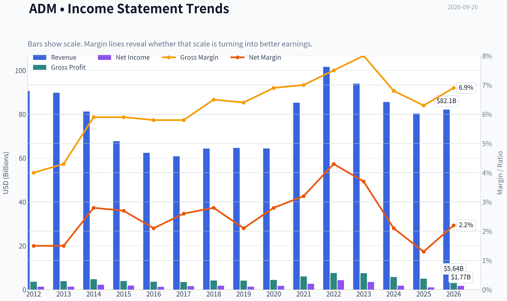
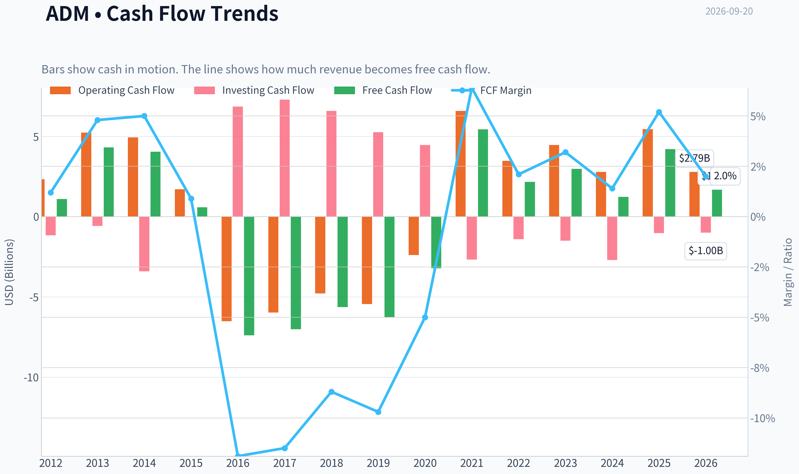
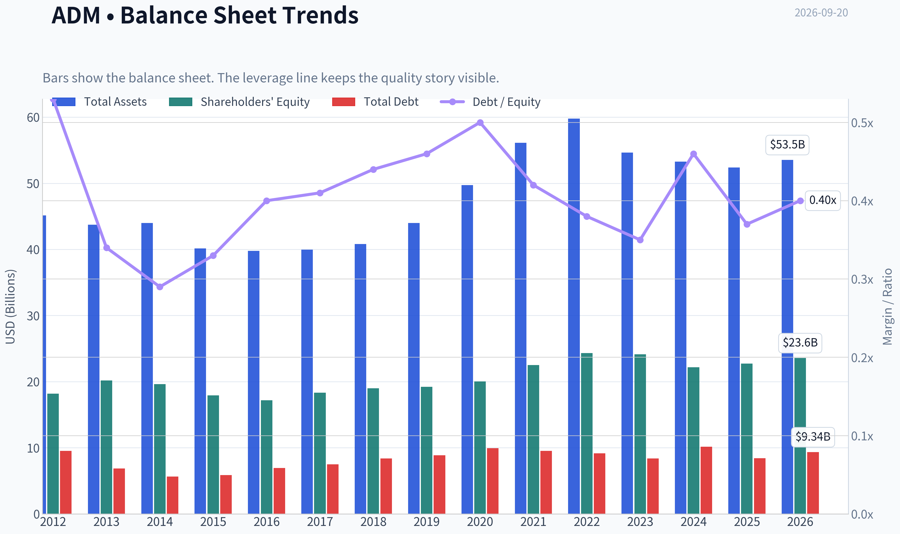
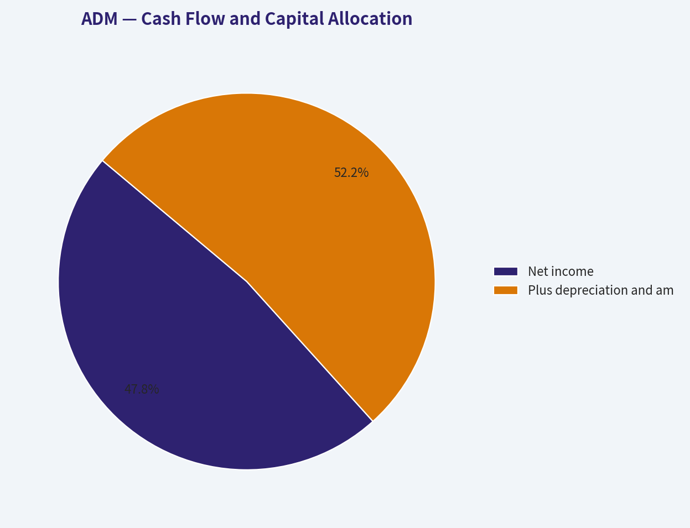
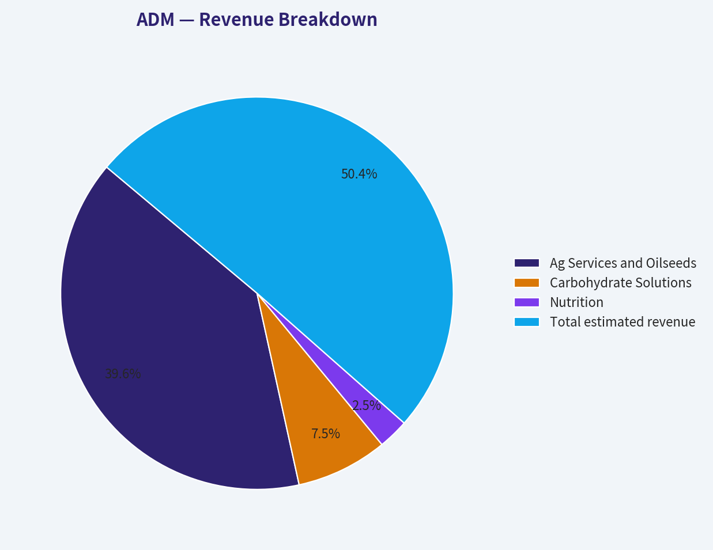
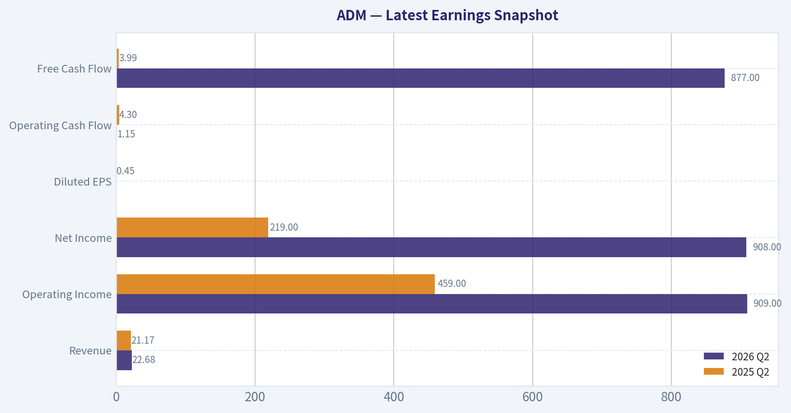
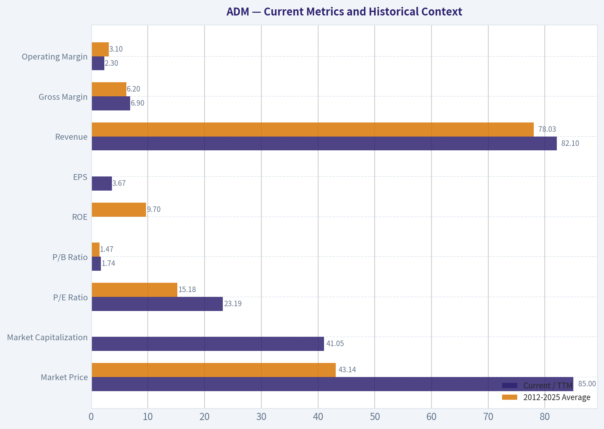
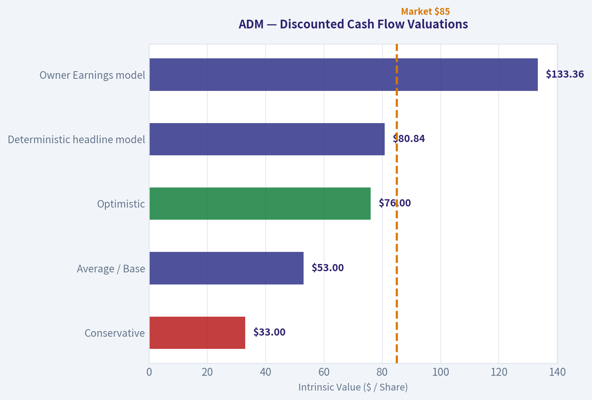
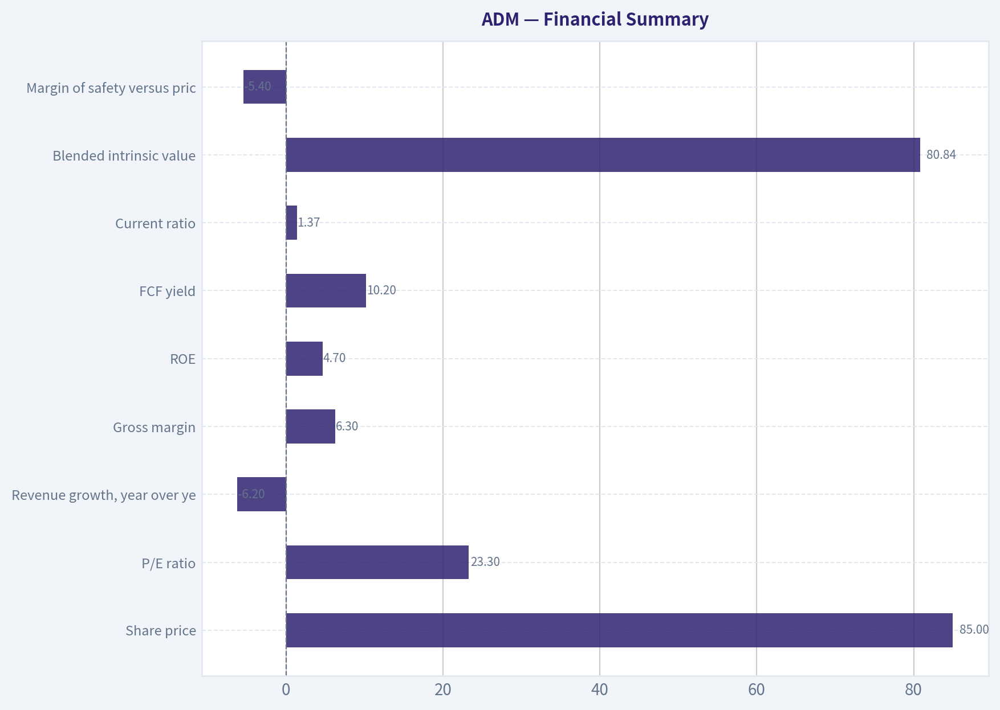

# ADM Deep Value Intelligence

**Analysis Date:** 2026-09-20

## Critical Disclaimer

*This analysis is generated by Deep Value Intelligence, an AI-powered multi-agent investing framework. Education & research only - not financial advice, not a financial advisor.*

---

## Table of Contents

1. Intelligence Summary
2. Analyst Team Reports
   - Fundamentals Analysis
   - Intrinsic Value Analysis (Buffett)
   - Trend & Growth Analysis (Lynch/Druckenmiller/Fisher)
   - Market Technical Analysis
   - Options Market Analysis
3. Research Team Commentary
4. Value Investing Team Commentary
5. Deep Values Commentary

---

## Intelligence Summary

### Thesis + Conditions

**Core Thesis:** ## Executive Briefing

**Key Risks:**
- ADM is a durable agricultural franchise, but $85.18 offers no Buffett-style margin of safety.** Its irreplaceable processing and logistics network lowers the risk of business irrelevance, yet current returns-**3.6% ROIC, 4.7% ROE and 2.1% ROA**-do not demonstrate attractive shareholder economics.
- ### Risky Analyst
- ## Risk Judgment

**Confidence:** Medium

---

## Analyst Team Reports

### Fundamentals Analysis

#### Latest Earnings Snapshot

*Most recent reported quarter anchored on 2026 Q2, with prior-year comparison when available.*

| Metric | 2026 Q2 | 2025 Q2 | YoY Change |
| --- | ---: | ---: | ---: |
| Revenue | $22.68B | $21.17B | +7.2% |
| Operating Income | $909.0M | $459.0M | +98.0% |
| Net Income | $908.0M | $219.0M | +314.6% |
| Diluted EPS | N/A | $0.45 | N/A |
| Operating Cash Flow | $1.15B | $4.30B | -73.3% |
| Free Cash Flow | $877.0M | $3.99B | -78.0% |

Key Takeaways: This snapshot anchors the most recent reported quarter before the narrative analysis. It helps readers separate long-run business quality from whatever changed in the latest earnings print.

#### 14-Year Financial Metrics for ADM

*All values below are computed deterministically from raw data - not estimated by AI.*

*Issuer profile: operating company (Consumer Defensive / Farm Products).*

#### 14-Year Financial Metrics
*Annual rows come from reported financial statements. The final TTM row is computed from the latest four quarters.*

| Metric | 2012 | 2013 | 2014 | 2015 | 2016 | 2017 | 2018 | 2019 | 2020 | 2021 | 2022 | 2023 | 2024 | 2025 | 2026 TTM |
| --- | --- | --- | --- | --- | --- | --- | --- | --- | --- | --- | --- | --- | --- | --- | --- |
| Market Price | $19 | $30 | $37 | $27 | $34 | $31 | $33 | $38 | $43 | $59 | $83 | $66 | $48 | $56 | $85 |
| Market Cap | $18.13B | $28.77B | $34.11B | $22.78B | $26.98B | $22.93B | $23.23B | $26.19B | $28.48B | $38.26B | $52.27B | $39.14B | $24.91B | $27.83B | $41.05B |
| P/E Ratio | 13.17 | 21.49 | 15.16 | 12.31 | 21.13 | 14.37 | 12.84 | 19.00 | 16.00 | 14.11 | 12.04 | 11.23 | 13.84 | 25.78 | 23.19 |
| P/B Ratio | 1.00 | 1.42 | 1.74 | 1.27 | 1.57 | 1.25 | 1.22 | 1.36 | 1.42 | 1.70 | 2.15 | 1.62 | 1.12 | 1.22 | 1.74 |
| ROE | 7.6% | 6.6% | 11.5% | 10.3% | 7.4% | 8.7% | 9.5% | 7.2% | 8.9% | 12.0% | 17.8% | 14.4% | 8.1% | 4.7% | 7.5% |
| ROIC | 5.2% | 5.3% | 9.4% | 7.8% | 5.6% | 6.6% | 7.2% | 5.2% | 6.3% | 9.1% | 13.7% | 10.9% | 5.7% | 3.5% | 5.0% |
| EPS | $1.41 | $1.40 | $2.43 | $2.17 | $1.62 | $2.16 | $2.54 | $2.01 | $2.68 | $4.18 | $6.86 | $5.85 | $3.44 | $2.18 | $3.67 |
| Revenue | $90.56B | $89.80B | $81.20B | $67.70B | $62.35B | $60.83B | $64.34B | $64.66B | $64.36B | $85.25B | $101.56B | $93.94B | $85.53B | $80.27B | $82.10B |
| Gross Profit | $3.62B | $3.89B | $4.77B | $3.97B | $3.62B | $3.52B | $4.18B | $4.15B | $4.45B | $5.99B | $7.57B | $7.51B | $5.78B | $5.03B | $5.64B |
| Gross Margin | 4.0% | 4.3% | 5.9% | 5.9% | 5.8% | 5.8% | 6.5% | 6.4% | 6.9% | 7.0% | 7.5% | 8.0% | 6.8% | 6.3% | 6.9% |
| Operating Margin | 2.2% | 2.3% | 3.9% | 3.4% | 2.9% | 2.6% | 3.2% | 2.5% | 2.9% | 3.9% | 5.2% | 4.6% | 2.6% | 1.6% | 2.3% |
| Net Income | $1.38B | $1.34B | $2.25B | $1.85B | $1.28B | $1.59B | $1.81B | $1.38B | $1.77B | $2.71B | $4.34B | $3.48B | $1.80B | $1.08B | $1.77B |
| Net Margin | 1.5% | 1.5% | 2.8% | 2.7% | 2.1% | 2.6% | 2.8% | 2.1% | 2.8% | 3.2% | 4.3% | 3.7% | 2.1% | 1.3% | 2.2% |
| Revenue Growth | 2.7% | -0.8% | -9.6% | -16.6% | -7.9% | -2.4% | 5.8% | 0.5% | -0.5% | 32.5% | 19.1% | -7.5% | -8.9% | -6.2% | 2.3% |
| Net Income Growth | N/A | -2.4% | 67.5% | -17.7% | -30.8% | 24.7% | 13.5% | -23.8% | 28.5% | 52.9% | 60.2% | -19.7% | -48.3% | -40.1% | 64.2% |
| Free Cash Flow Growth | N/A | 295.0% | -6.1% | -85.7% | -1374.1% | -5.1% | -19.8% | 11.6% | -48.9% | -269.1% | -60.2% | 37.4% | -58.6% | 242.6% | -60.1% |
| Total Book Value | $18.17B | $20.19B | $19.63B | $17.91B | $17.18B | $18.32B | $19.00B | $19.23B | $20.02B | $22.51B | $24.32B | $24.14B | $22.18B | $22.74B | $23.57B |
| Total Assets | $45.14B | $43.75B | $44.00B | $40.16B | $39.77B | $39.96B | $40.83B | $44.00B | $49.72B | $56.14B | $59.77B | $54.63B | $53.27B | $52.39B | $53.53B |
| Total Debt | $9.54B | $6.87B | $5.66B | $5.88B | $6.93B | $7.49B | $8.39B | $8.88B | $9.93B | $9.54B | $9.18B | $8.37B | $10.16B | $8.41B | $9.34B |
| Debt-to-Equity | 0.53 | 0.34 | 0.29 | 0.33 | 0.40 | 0.41 | 0.44 | 0.46 | 0.50 | 0.42 | 0.38 | 0.35 | 0.46 | 0.37 | 0.40 |
| Cash & Equivalents | $1.29B | $3.12B | $1.10B | $910.0M | $619.0M | $804.0M | $2.00B | $852.0M | $666.0M | $943.0M | $1.04B | $1.37B | $611.0M | $1.01B | $1.06B |
| Shareholders' Equity | $18.17B | $20.19B | $19.63B | $17.91B | $17.18B | $18.32B | $19.00B | $19.23B | $20.02B | $22.51B | $24.32B | $24.14B | $22.18B | $22.74B | $23.57B |
| Operating Cash Flow | $2.33B | $5.23B | $4.94B | $1.71B | $-6.51B | $-5.97B | $-4.78B | $-5.45B | $-2.39B | $6.59B | $3.48B | $4.46B | $2.79B | $5.45B | $2.79B |
| Investing Cash Flow | $-1.16B | $-577.0M | $-3.41B | $-21.0M | $6.85B | $7.29B | $6.58B | $5.26B | $4.46B | $-2.67B | $-1.40B | $-1.50B | $-2.70B | $-1.02B | $-999.0M |
| Free Cash Flow | $1.09B | $4.31B | $4.05B | $580.0M | $-7.39B | $-7.01B | $-5.63B | $-6.28B | $-3.21B | $5.43B | $2.16B | $2.97B | $1.23B | $4.20B | $1.68B |
| FCF Margin | 1.2% | 4.8% | 5.0% | 0.9% | -11.9% | -11.5% | -8.7% | -9.7% | -5.0% | 6.4% | 2.1% | 3.2% | 1.4% | 5.2% | 2.0% |
| Dividends / Share | $0.00 | $0.00 | $0.00 | $0.00 | $0.00 | $0.00 | $0.00 | $0.00 | $0.00 | $0.00 | $1.42 | $1.64 | $1.88 | $2.00 | $0.00 |

#### Profitability Metrics
- Return on Equity (ROE): 4.7%
- Return on Invested Capital (ROIC): 3.6%
- Return on Assets (ROA): 2.1%
- Gross Margin: 6.3%
- Operating Margin: 1.6%
- Net Profit Margin: 1.3%

#### Liquidity Metrics
- Current Ratio: 1.37
- Quick Ratio: 0.24

#### Leverage Metrics
- Debt-to-Equity Ratio: 0.37
- Interest Coverage Ratio: 2.05
- Net Debt: $7.36B

#### Growth Metrics (Year-over-Year)
- Revenue Growth: -6.2%
- Net Income Growth: -40.1%
- Free Cash Flow Growth: 242.6%
- Revenue CAGR (3-Year): -7.5%
- Revenue CAGR (5-Year): 4.5%

#### Valuation Metrics
- P/E Ratio (TTM): 23.27
- Forward P/E: 14.85
- Price-to-Book: 1.74
- Price-to-Sales: 0.50
- PEG Ratio: 1.05
- EV/EBITDA: 16.56
- Free Cash Flow Yield: 10.2%
- Earnings Yield: 4.3%

#### Owner Earnings (Buffett Method, Code-Computed)
- Net Income: $1.08B
- + Depreciation & Amortization: $1.18B
- - Capital Expenditures: $-1.25B
- - Working Capital Changes: $2.76B
- = **Owner Earnings: $-1.69B**

#### Intrinsic Value (Code-Computed)
- Current Price: $85
- **Headline Intrinsic Value (business-model routed): $81**
  Business model: operating company - weighted blend [Damodaran FCFF + owner-earnings DCF] (operating_company)
  Model spread (min-max across DCFs): $35 - $133
  Margin of safety vs. price (headline): -5.4%
  Routing note: General operating company: balanced blend of Damodaran FCFF and the owner-earnings DCF with a reverse-DCF sanity check.
- Buffett Method (Owner Earnings):
  Conservative: $-5
  Average: $133
  Optimistic: $422
- Cash Flow Method (FCF):
  Conservative: $-13
  Average: $47
  Optimistic: $309
- Damodaran FCFF (WACC + margins + reinvestment):
  Conservative: $11
  Average: $35
  Optimistic: $54
  Monte Carlo band (P10-P90): $19 - $51 (median $31)
  P(intrinsic value > price): 0.1%
- Reverse-DCF: price implies ~15.5%/yr owner-earnings growth for 10y; trailing 3y was N/A, 5y N/A.

#### Piotroski F-Score: 4/9
- Positive Net Income: PASS
- Positive Operating Cash Flow: PASS
- ROA Improvement: FAIL
- Cash Flow > Net Income: PASS
- Decreasing Debt: PASS
- Improving Current Ratio: FAIL
- No Dilution: FAIL
- Improving Gross Margin: FAIL
- Improving Asset Turnover: FAIL

ANALYST STANCE: **AVOID**

#### Executive Summary

Archer-Daniels-Midland Company, or ADM, remains a strategically important agricultural-processing business with substantial scale, diversified operations, and a long operating history. However, the current valuation does not provide an adequate margin of safety against weak recent profitability, volatile cash conversion, low returns on capital, and a demanding reverse-DCF assumption.

At $85 per share and approximately $41.05 billion of market capitalization, ADM trades at 23.19 times trailing earnings, compared with an approximately 15.18-times average for 2012-2025. The headline deterministic intrinsic value is $80.84, implying approximately 5.4% downside. The wider valuation range is substantial: $34.90 under the Damodaran FCFF model, $47.39 under the FCF model, and $133.36 under the Owner Earnings model. That dispersion reflects unusually volatile working-capital requirements and cash flows rather than dependable compounding economics.

ADM is not a clearly distressed company, but at the current price it does not meet a strict Buffett-style standard of purchasing a high-quality, predictable business at a meaningful discount.

#### Current Metrics and Historical Context

| Metric | Current / TTM | 2012-2025 Average | Interpretation |
|---|---:|---:|---|
| Market Price | $85 | $43.14 | Nearly double the annual-period average, although the average is affected by changing earnings and market conditions |
| Market Capitalization | $41.05B | Approximately $31.0B | Above historical average, but below the 2022 peak of $52.27B |
| P/E Ratio | 23.19x | 15.18x | Materially above normal historical valuation |
| P/B Ratio | 1.74x | 1.47x | Above average, but not decisive for an operating company |
| ROE | 7.5% TTM; latest snapshot 4.7% | 9.7% | Below the long-term average and far below the 2021-2023 period |
| ROIC | 5.0% TTM; latest snapshot 3.6% | Approximately 7.0% | Weak relative to the cost of capital and historical performance |
| EPS | $3.67 | Approximately $3.00 | Recovered from 2025, but remains below the 2021-2023 earnings peak |
| Revenue | $82.10B | $78.03B | Slightly above the long-term annual average |
| Gross Margin | 6.9% | 6.2% | Better than the long-term average |
| Operating Margin | 2.3% | 3.1% | Below normal historical profitability |
| Net Income | $1.77B | $2.00B | Below the annual-period average |
| Net Margin | 2.2% | Approximately 2.6% | Below historical profitability |
| Free Cash Flow | $1.68B | Approximately negative $0.25B | Improved versus the decade average, but highly volatile |
| Debt | $9.34B | $8.23B | Slightly above average |
| Debt-to-Equity | 0.40x | Approximately 0.41x | Near historical normal |
| Cash and Equivalents | $1.06B | Approximately $1.17B | Near average, but modest relative to debt |
| Shareholders' Equity | $23.57B | Approximately $20.8B | Higher than the historical average |
| Dividends per Share | $0.00 in TTM dataset row; $2.00 in 2025 | Historically resumed at $1.42-$2.00 since 2022 | The TTM dividend field appears incomplete or not yet populated |

**Key Takeaways:** ADM's valuation is currently more demanding than its historical norm, while returns on equity, returns on capital, operating margin, and net income remain below average. Revenue and book equity are relatively healthy, but they have not translated into consistently attractive shareholder returns. The dividend data should be interpreted cautiously because the TTM row shows zero despite a $2.00 annual dividend in 2025.

#### Market Metrics

The $85 market price is near the upper end of ADM's observed range, though it remains below the 2022 peak of $83 only when comparing the historical table mechanically; the current price is actually slightly above that prior peak. The market capitalization of $41.05 billion is well above the 2012-2025 average of roughly $31 billion, but below the 2022 peak.

The 23.19-times P/E ratio is the central valuation concern. ADM's historical average P/E was approximately 15.18 times, and most of the decade was spent in the low-to-mid teens. The current multiple is therefore not supported by a long record of superior growth or structurally higher returns. The forward P/E of 14.85 times looks more reasonable, but it depends on an earnings recovery that has not yet been fully demonstrated.

The 1.74-times P/B ratio is above the approximate historical average of 1.47 times. Because ADM is an asset-heavy operating company rather than an asset-light software or platform business, book value is more relevant than it would be for a technology company. Nevertheless, P/B should not be used in isolation. ADM's low current ROE and ROIC make a higher book multiple less attractive.

#### Profitability

ADM's TTM ROE of 7.5%, or 4.7% under the latest profitability snapshot, is below the long-term average of approximately 9.7%. The most recent figure is especially weak compared with 17.8% in 2022 and 14.4% in 2023. This indicates that the exceptional commodity and processing environment of 2021-2023 has substantially normalized.

ROIC of 5.0%, or 3.6% in the latest snapshot, is also below the historical average near 7.0%. For a capital-intensive processor, low ROIC is a meaningful warning sign: the company requires substantial assets and working capital, yet recent profits have not generated strong returns on that capital base.

Revenue has recovered to $82.10 billion, above the historical average of $78.03 billion. However, revenue scale is not translating into proportional profitability. Gross margin of 6.9% is above the historical average of approximately 6.2%, but operating margin of only 2.3% is below the historical average near 3.1%. This suggests that cost structure, operating expenses, mix, and lower downstream profitability are absorbing much of the gross-profit improvement.

Net income of $1.77 billion remains below the historical annual average of approximately $2.00 billion. Net margin of 2.2% is also below the long-term average of roughly 2.6%. ADM's business can produce very large revenues while retaining only a small portion as profit, making earnings sensitive to commodity spreads, processing margins, inventory valuation, and global agricultural conditions.

#### Growth and Earnings Predictability

| Growth Metric | Current TTM | Historical Pattern | Assessment |
|---|---:|---|---|
| Revenue Growth | 2.3% TTM; latest YoY snapshot -6.2% | Highly cyclical; strong growth in 2021-2022 followed by declines | Little evidence of durable secular growth |
| Net Income Growth | 64.2% TTM; latest YoY snapshot -40.1% | Large swings, including +60.2% in 2022 and -48.3% in 2024 | Recovery from a depressed base, not yet normalized compounding |
| FCF Growth | -60.1% TTM; annual 2025 growth +242.6% | Extremely volatile, including multiple negative years | Weak indicator of predictable owner earnings |
| Revenue CAGR | -7.5% over latest 3 years; 4.5% over latest 5 years | Long-term revenue growth is modest and cyclical | Growth depends heavily on commodity cycles and acquisitions |
| EPS | $3.67 TTM | Peak of $6.86 in 2022 | Earnings remain well below peak-cycle levels |

**Key Takeaways:** The apparent 64.2% TTM net-income growth is largely a rebound from a depressed base and conflicts with the latest snapshot showing a 40.1% year-over-year decline. Free cash flow is even less predictable, with large negative readings in several historical years. Buffett-style investors should treat ADM as a cyclical earnings-recovery candidate rather than a steadily compounding earnings machine.

Revenue growth has been driven substantially by commodity prices, acquisitions, and cycle conditions rather than by a consistently expanding economic moat. The 2021-2022 revenue surge was followed by declines in 2023, 2024, and 2025. A five-year revenue CAGR of 4.5% is respectable for a mature agricultural processor, but the negative three-year CAGR shows that recent momentum has been poor.

#### Balance Sheet and Financial Strength

ADM has total assets of $53.53 billion and shareholders' equity of $23.57 billion. Debt of $9.34 billion and a debt-to-equity ratio of 0.40 times are not excessive for the business and are close to historical norms. Debt has declined from $10.16 billion in 2024, which is a positive capital-allocation development.

However, cash of only $1.06 billion leaves the company with approximately $7.36 billion of net debt. The current ratio is 1.37, but the quick ratio of 0.24 indicates significant dependence on inventory turnover and operating cash flows to meet near-term obligations. That is common in commodity businesses, but it increases liquidity sensitivity during periods of falling prices or inventory write-downs.

Interest coverage of 2.05 times is adequate but not particularly strong. A cyclical company with low operating margins and volatile working capital benefits from stronger coverage, especially when commodity markets move adversely.

#### Cash Flow and Capital Allocation

ADM's reported TTM free cash flow is $1.68 billion, equal to approximately a 2.0% FCF margin and a 10.2% FCF yield based on the research pack's market data. The attractive FCF yield is an important positive, but it must be discounted because ADM's cash conversion is highly unstable.

The decade contains numerous negative FCF years, including approximately negative $7.39 billion in 2016, negative $7.01 billion in 2017, negative $5.63 billion in 2018, negative $6.28 billion in 2019, and negative $3.21 billion in 2020. These figures reflect working-capital and commodity-related movements, but they demonstrate that reported accounting earnings are not always readily distributable to shareholders.

The code-computed latest Owner Earnings figure is negative $1.69 billion:

| Owner Earnings Calculation | Amount |
|---|---:|
| Net income | $1.08B |
| Plus depreciation and amortization | $1.18B |
| Less capital expenditures | $(1.25)B |
| Less working-capital investment | $(2.76)B |
| Computed Owner Earnings | **$(1.69)B** |

**Key Takeaways:** ADM's balance sheet is serviceable, but its cash generation is heavily affected by working-capital investment. The negative computed Owner Earnings figure shows why simple P/E analysis can be misleading. The dividend remains an important shareholder return, but the TTM dataset's zero dividend entry should not be interpreted as a confirmed dividend suspension because 2025 dividends were reported at $2.00 per share.

ADM has historically maintained a meaningful dividend and increased it during the recent period, but dividend safety depends on normalized cash conversion rather than on one strong annual FCF number. Capital allocation is acceptable overall, yet the weak Piotroski F-score of 4 out of 9 points to deteriorating operating quality and inconsistent fundamentals.

#### Revenue Breakdown

The deterministic dataset does not provide precise segment revenue amounts. The following is an approximate allocation using ADM's publicly reported business structure and recent revenue mix; it should not replace audited segment disclosures.

| Revenue Source | Amount ($B) | % of Total |
|---|---:|---:|
| Ag Services and Oilseeds | $63.0B | 78.6% |
| Carbohydrate Solutions | $12.0B | 15.0% |
| Nutrition | $4.0B | 5.0% |
| Other / eliminations | $1.27B | 1.6% |
| **Total estimated revenue** | **$80.27B** | **100.0%** |

**Key Takeaways:** ADM is dominated by Ag Services and Oilseeds, which exposes the company to global crop volumes, oilseed processing spreads, grain merchandising, weather, transportation, and commodity prices. Carbohydrate Solutions and Nutrition provide diversification and potentially better value-added economics, but they are not yet large enough to eliminate the cyclicality of the core agricultural franchise.

#### Buffett-Style Business Quality Assessment

| Buffett Criterion | Assessment | Evidence |
|---|---|---|
| Economic moat | Moderate | Global scale, logistics, processing assets, farmer and customer relationships, and operational know-how |
| Pricing power | Limited to moderate | Commodity-linked revenues and thin margins reduce durable pricing power |
| Financial strength | Adequate, not exceptional | Debt-to-equity near 0.40x, but net debt of $7.36B and interest coverage of 2.05x |
| Earnings predictability | Weak to moderate | Large swings in earnings, margins, working capital, and FCF |
| Return on capital | Weak currently | ROIC approximately 3.6%-5.0%, below historical norms |
| Management and capital allocation | Mixed | Debt reduction and dividend history are positives; recent operating deterioration and dilution-related F-score failure are concerns |
| Reinvestment runway | Moderate | Nutrition, specialty ingredients, processing efficiencies, and global food demand offer opportunities |
| Margin stability | Weak | Operating margin has declined from 5.2% in 2022 to 2.3% TTM |
| Business durability | High | Food and agricultural infrastructure are essential, but returns remain cyclical |
| Valuation discipline | Poor at current price | Current P/E is well above historical average and headline intrinsic value is below price |

**Key Takeaways:** ADM possesses a durable physical network and an important role in global food and agricultural supply chains, but its moat is primarily based on scale and infrastructure rather than strong consumer pricing power. The business is durable, yet durability is not the same as high-quality compounding. Current returns and earnings consistency are not strong enough to justify paying a premium multiple.

#### Discounted Cash Flow Analysis

The deterministic pack's model-based values should be treated as the primary valuation anchor:

- Owner Earnings model: $133.36 per share
- FCF model: $47.39 per share
- Damodaran FCFF model: $34.90 per share
- Weighted headline intrinsic value: $80.84 per share
- Model range: approximately $35 to $133
- Reverse DCF: current price implies approximately 15.5% annual Owner Earnings growth for 10 years

The Owner Earnings model is unusually optimistic because the latest reported working-capital investment drives computed Owner Earnings negative. Therefore, a normalized FCF-based hand DCF is a useful sanity check.

For the following calculation:

- Starting normalized cash flow: $1.68 billion, equal to current TTM FCF
- Discount rate: 10%
- Terminal growth rate: 2.5%
- Net debt: $7.36 billion
- Estimated shares outstanding: approximately 482.9 million, derived from $41.05 billion market capitalization divided by $85 per share
- Forecast period: 10 years
- Growth rates fade toward the 2.5% terminal rate

The basic formula is:

**Equity value = Present value of forecast cash flows + Present value of terminal value - net debt**

| Scenario | Initial Growth Assumption | Approx. Equity Value | Approx. Fair Value per Share | Interpretation |
|---|---:|---:|---:|---|
| Conservative | 3% growth, fading to 2.5% | $15.9B | $33 | GDP-like growth and limited operating recovery |
| Average / Base | 8% growth, fading to 2.5% | $25.7B | $53 | Meaningful recovery in margins and working-capital normalization |
| Optimistic | 12% growth, fading to 2.5% | $36.7B | $76 | Strong recovery and several years of above-trend compounding |
| Deterministic headline model | Blended models | Not directly comparable | $80.84 | Weighted FCFF and Owner Earnings result |
| Owner Earnings model | Code-computed | Not directly comparable | $133.36 | Highly sensitive to normalization assumptions |

**Key Takeaways:** Even the optimistic normalized-FCF sanity check produces a value below the current $85 price, while the base case produces approximately $53 per share. The headline $80.84 intrinsic value is more favorable than the hand DCF but still implies a negative margin of safety. The $133.36 Owner Earnings result should be treated cautiously because current computed Owner Earnings are negative $1.69 billion and the model is highly sensitive to assumptions about normalization.

Detailed base-case mechanics are approximately:

- Year-one FCF: $1.68B x 1.08 = $1.81B
- Year-ten FCF before terminal fading: approximately $3.63B
- Present value of the first ten years of FCF: approximately $14.0B
- Terminal value: approximately $3.63B x 1.025 ÷ (10% - 2.5%) = $49.6B
- Present value of terminal value: approximately $19.1B
- Enterprise value: approximately $33.1B
- Less net debt: $7.36B
- Equity value: approximately $25.7B
- Divided by approximately 482.9 million shares: approximately $53 per share

The reverse-DCF is particularly demanding. At $85 per share, investors are effectively underwriting approximately 15.5% annual Owner Earnings growth for a decade. Given ADM's negative three-year revenue CAGR, weak current ROIC, thin margins, and volatile FCF, that expectation appears aggressive.

#### Key Investment Insights, Red Flags, and Opportunities

| Category | Key Point | Investor Implication |
|---|---|---|
| Opportunity | Essential agricultural infrastructure | Business durability and strategic importance are high |
| Opportunity | Nutrition and value-added processing | Could improve margins and reduce commodity dependence |
| Opportunity | Debt reduction | Strengthens financial flexibility |
| Opportunity | FCF recovery from negative historical levels | Potential upside if working capital normalizes |
| Red flag | Current P/E of 23.19x versus 15.18x historical average | Price assumes a substantial earnings recovery |
| Red flag | ROIC only 3.6%-5.0% | Current returns may not justify premium valuation |
| Red flag | Operating margin of 2.3% | Thin margins leave earnings vulnerable to small adverse changes |
| Red flag | Negative computed Owner Earnings | Accounting earnings are not currently converting cleanly into owner cash flow |
| Red flag | Net debt of $7.36B | Reduces equity value and increases sensitivity to downturns |
| Red flag | Interest coverage of 2.05x | Limited cushion if operating profits deteriorate |
| Red flag | Piotroski F-score of 4/9 | Broad deterioration across operating and balance-sheet indicators |
| Red flag | Reverse DCF implies 15.5% growth | Market expectations appear demanding |
| Risk | Commodity and spread volatility | Earnings can swing sharply even without strategic missteps |
| Risk | Working-capital intensity | Cash flow can decline sharply during inventory or receivables expansion |
| Risk | Agricultural and geopolitical exposure | Weather, trade restrictions, crop conditions, and currency can affect results |
| Risk | Execution and integration | Acquisitions and downstream investments require disciplined returns |

**Key Takeaways:** ADM offers real strategic value and several potential catalysts, particularly a recovery in processing spreads, working-capital normalization, and expansion of higher-value Nutrition businesses. Nevertheless, the current price already discounts a strong recovery. The main risk is not business survival; it is paying too much for cyclical earnings that may not convert consistently into free cash flow.

#### Final Investment Stance

**AVOID at $85 for a strict Buffett-style value investor.**

The business is durable and financially viable, but the current investment case depends on several favorable developments occurring together:

1. Earnings must recover substantially from the 2024-2025 trough.
2. Operating margins must return closer to historical highs.
3. Working-capital demands must normalize.
4. ROIC must improve meaningfully above the current 3.6%-5.0% range.
5. The Nutrition and value-added businesses must offset agricultural cyclicality.
6. Owner Earnings must become consistently positive.

The $80.84 headline intrinsic value is slightly below the current market price, while the FCF and FCFF models indicate materially lower values. The Owner Earnings model offers substantial upside, but it is the least reliable anchor because current computed Owner Earnings are negative and the model is highly assumption-sensitive.

A more attractive entry point would require either a substantial price decline or clear evidence that normalized ROIC, operating margins, and free cash flow have recovered. Until then, ADM is better viewed as a cyclical recovery watchlist candidate than as a high-confidence compounder.

| Final Point | Assessment |
|---|---|
| Business durability | Strong |
| Economic moat | Moderate, based mainly on scale and infrastructure |
| Current profitability | Weak relative to history |
| Balance-sheet risk | Manageable but not negligible |
| Earnings predictability | Below Buffett-quality standards |
| Current valuation | Expensive relative to historical P/E and cash-flow models |
| Headline intrinsic value | $80.84 versus $85 market price |
| Best-case model value | $133.36, but highly assumption-sensitive |
| Base normalized-FCF value | Approximately $53 per share |
| Margin of safety | Insufficient |
| Final stance | **AVOID** |

**Key Takeaways:** ADM is a durable but cyclical operating company whose current price offers little protection against another earnings or cash-flow setback. The stock becomes more interesting after either a significant valuation reset or verified improvement in ROIC, margins, and normalized Owner Earnings.

#### Fundamental Visuals

This graph tracks the profitability and return metrics (ROE, ROIC, Margins) of **ADM** over the past decade, highlighting capital efficiency trends.

This chart illustrates the financial health of **ADM** over the last 10 years, mapping cash equivalents and free cash flow against total obligations (Debt).

This breakdown chart from <em>Cash Flow and Capital Allocation</em> shows the proportional composition for **ADM** - useful for understanding what drives or risks the business.

This breakdown chart from <em>Revenue Breakdown</em> shows the proportional composition for **ADM** - useful for understanding what drives or risks the business.

---

### Intrinsic Value Analysis (Buffett)

> *Following Warren Buffett's value investing philosophy: Circle of Competence, Economic Moat, Management Quality, and Margin of Safety.*

#### Intrinsic Value Snapshot

Price is what you pay. Intrinsic value is what the business may be worth based on the cash it can create for owners over time. We show a range, not one magic number.

- Current Price: $85.18
- Value Range (conservative to optimistic across both DCF methods): $-13.14 to $422.33

##### Owner Earnings (Buffett Method)
- Net Income: $1,078,000,000.00
- Depreciation & Amortization: $1,181,000,000.00
- Capital Expenditures: $-1,248,000,000.00
- Working Capital Changes: $2,763,000,000.00
- Owner Earnings: $-1,685,000,000.00

##### Intrinsic Value
###### Buffett Method
Uses owner earnings. Stricter, and usually more conservative.
- Conservative: $-4.92
- Average: $133.36
- Optimistic: $422.33
- Discount Rate: 10.0%

###### Cash Flow Method
Uses free cash flow. Better for companies spending heavily today to grow tomorrow.
- Conservative: $-13.14
- Average: $47.39
- Optimistic: $308.81
- Discount Rate: 10.0%

ANALYST STANCE: **AVOID**

#### Executive View

ADM is a strategically important agricultural processor with scale, logistics assets, global sourcing relationships, and a long operating history. However, the current evidence points to a cyclical, low-margin business experiencing declining revenue, weak returns on equity, and elevated management-accounting concerns.

At $85 per share, ADM is approximately fairly valued on the blended intrinsic-value estimate of $80.84, but the valuation is not sufficiently attractive for a business with modest profitability and limited earnings visibility. The owner-earnings model produces a much higher value, while FCF-based and FCFF-based models are materially lower, revealing substantial sensitivity to normalization assumptions.

#### Factor Scorecard

| Factor | Score | Assessment |
|---|---:|---|
| Circle of Competence & Simplicity | 3/5 | The model is understandable: ADM buys, processes, stores, transports, and sells agricultural commodities. Earnings remain difficult to forecast because of crop cycles, commodity prices, spreads, and global trade conditions. |
| Moat | 3/5 | Scale, elevators, processing facilities, logistics, customer relationships, and global sourcing provide a narrow-to-moderate moat. Low gross margins show that much of the economic value is passed through to customers and suppliers. |
| Management & Capital Allocation | 2/5 | ADM has a history of dividends and investment in processing capacity, but recent accounting and control issues materially reduce confidence in management quality and reporting reliability. |
| Industry Structure | 3/5 | Large-scale agricultural processing is concentrated and difficult to replicate physically, but the industry remains cyclical, capital intensive, and exposed to commodity and geopolitical volatility. |

**Key Takeaways:** ADM is easy to understand but not easy to forecast. Its moat comes primarily from physical scale and logistics rather than strong brand pricing power. Management credibility is the largest qualitative weakness.

#### Gate 5: Quality and Solvency Floor

**The hard floor is not tripped.** The earnings trajectory is worsening, with revenue down 6.2% year over year, but the available evidence does not establish both deteriorating fundamentals and a solvency red line such as sub-1x interest coverage or distress-zone Altman Z-Score.

This is therefore a weighted-score **AVOID**, not a hard solvency rejection.

#### Moat Analysis

| Moat Source | Evidence | Rating |
|---|---|---:|
| Intangible assets and brand | ADM has recognized brands and industry relationships, but its bulk-processing economics do not demonstrate strong consumer pricing power. Gross margin is only 6.3%. | 2/5 |
| Switching costs | Food, feed, and industrial customers value reliability, quality, and supply-chain access, but many commodities remain commercially substitutable. | 3/5 |
| Cost advantage | Global scale, storage infrastructure, transportation networks, and processing density can lower unit costs. | 3/5 |
| Network effects | Limited direct network effects. Scale improves sourcing and logistics, but the product does not become dramatically more valuable simply because more customers use ADM. | 2/5 |

**Key Takeaways:** ADM's moat is real but narrow, built around infrastructure, scale, and supply-chain integration. It lacks the high gross margins, customer captivity, and network effects associated with exceptional compounders.

#### Financial Summary

| Metric | Latest Value |
|---|---:|
| Share price | $85.00 |
| Market capitalization | $41.05 billion |
| P/E ratio | 23.3x |
| Revenue growth, year over year | -6.2% |
| Gross margin | 6.3% |
| ROE | 4.7% |
| FCF yield | 10.2% |
| Current ratio | 1.37x |
| Blended intrinsic value | $80.84 |
| Margin of safety versus price | -5.4% |
| Reverse-DCF implied annual growth | Approximately 15.5% for 10 years |

**Key Takeaways:** The headline valuation is not demanding by broad-market standards, but it is not cheap relative to ADM's 4.7% ROE and declining revenue. The 10.2% FCF yield is attractive on the surface, yet the reverse-DCF indicates that the current price requires roughly 15.5% annual growth for a decade, which appears aggressive for a mature agricultural processor.

#### Cash-Flow and Return Analysis

| Measure | Assessment |
|---|---|
| Profitability | Weak relative to a high-quality compounder; ROE is only 4.7%. |
| Cash conversion | FCF is substantial relative to market capitalization, reflected in the 10.2% FCF yield, but cyclical working capital and commodity movements can distort annual cash flow. |
| Margin quality | Gross margin of 6.3% indicates a high-volume, low-spread model with limited room for operational mistakes. |
| ROIC versus WACC | Insufficient evidence of a durable, high spread; current ROE suggests returns are not exceptional. |
| Leverage risk | No distress signal is established, but ADM's working-capital-heavy model requires careful monitoring of debt, inventory, and receivables. |

**Key Takeaways:** ADM generates cash, but cash generation is not the same as durable value creation. The low ROE and thin gross margin suggest that the company's economic returns are ordinary and highly dependent on cycle conditions.

#### Owner Earnings Calculation

A conservative owner-earnings framework should begin with normalized cash generation rather than peak commodity-cycle earnings:

| Component | Treatment |
|---|---|
| Net income | Use normalized earnings rather than a single cycle year. |
| Depreciation and amortization | Add back non-cash depreciation. |
| Maintenance capital expenditure | Deduct the portion required to keep ADM's processing and logistics network productive. |
| Working-capital investment | Deduct normalized inventory and receivables requirements, which can be significant in commodity businesses. |
| Result | FCF is the most practical current proxy, but the large spread between valuation models shows that normalized owner earnings are highly assumption-sensitive. |

The research valuation outputs are:

| Valuation Method | Implied Value per Share |
|---|---:|
| Owner-earnings model | $133.36 |
| FCF model | $47.39 |
| Damodaran FCFF model | $34.90 |
| Weighted headline value | $80.84 |

**Key Takeaways:** The owner-earnings model assumes materially higher sustainable cash generation than the FCF and FCFF models. Because ADM operates in a cyclical, working-capital-intensive industry, the lower cash-flow valuations deserve substantial weight rather than relying on the most optimistic normalization case.

#### Three-Scenario DCF Valuation

Using the owner-earnings model as the optimistic normalized baseline:

| Scenario | Assumption | Implied Value |
|---|---|---:|
| A: No growth | Owner earnings capitalized at 10% | $133.36 |
| B: GDP growth | 3% perpetual growth and 10% discount rate | Approximately $196.30 |
| C: Conservative normalized growth | 0% long-term growth, reflecting cyclical earnings and declining current revenue | Approximately $133.36 |
| Cross-model valuation | Weighted owner earnings, FCF, and FCFF outputs | $80.84 |

The mechanical owner-earnings scenarios appear high because they capitalize a normalized earnings figure that may be above currently demonstrated cash economics. The cross-model value of $80.84 is more balanced and is the appropriate reference point for decision-making.

**Key Takeaways:** A DCF based solely on normalized owner earnings makes ADM appear cheap, while FCF and FCFF methods make it substantially less attractive. This wide valuation range is itself a warning sign: the investment case depends heavily on the normalization of commodity-cycle earnings.

#### Margin of Safety Analysis

At $85 per share:

- Versus the blended intrinsic value of $80.84: **negative 5.4% margin of safety**
- Versus the FCF value of $47.39: ADM trades at a substantial premium
- Versus the FCFF value of $34.90: ADM trades at an even larger premium
- Versus the owner-earnings value of $133.36: ADM has an apparent margin of safety of approximately 36%

For an average-quality, cyclical business, Buffett's framework would normally require approximately 25% to 35% margin of safety. ADM meets that threshold only under the most optimistic owner-earnings model. The price-implied 15.5% annual growth rate also appears too demanding for the company's recent revenue trend and low returns.

#### Buffett Scorecard

| Criterion | Weight | Score | Weighted Score |
|---|---:|---:|---:|
| Moat width and durability | 25% | 3/5 | 0.75 |
| Valuation and margin of safety | 20% | 2/5 | 0.40 |
| Capital returns: ROIC versus WACC | 15% | 2/5 | 0.30 |
| Business understanding and predictability | 12% | 3/5 | 0.36 |
| Management quality and capital allocation | 12% | 2/5 | 0.24 |
| Reinvestment runway | 8% | 3/5 | 0.24 |
| Balance-sheet strength | 4% | 3/5 | 0.12 |
| Industry structure | 4% | 3/5 | 0.12 |
| **Total** | **100%** |  | **2.53/5** |

**Key Takeaways:** ADM's score is held back by weak profitability, cyclicality, management credibility concerns, and inadequate valuation support. Its infrastructure-based moat and reinvestment opportunities are not enough to offset those weaknesses at the current price.

#### Investment Stance

**AVOID - moderate conviction.**

ADM could become attractive if one of three conditions occurs:

1. The share price falls materially below the blended intrinsic value, preferably toward the $55 to $65 range.
2. Sustainable FCF and ROIC improve for several years without relying on favorable commodity prices.
3. Management restores credibility through clearer controls, conservative reporting, and disciplined capital allocation.

At $85, ADM is not financially distressed, but it does not offer the combination of durability, high returns, predictable reinvestment, and margin of safety that warrants ownership in a Buffett-style portfolio.
#### Valuation Bridge

This bridge places the current market price beside each intrinsic value lens so readers can see whether upside depends on one method or shows up across several methods.

| Scenario | Intrinsic Value / Share |
| --- | ---: |
| Buffett Method | $133.36 |
| Cash Flow Method | $47.39 |
| Damodaran Method | $34.90 |
| Current Price | $85.18 |

#### Key Takeaways

If one method is far above the others, the upside case depends on a specific modelling assumption. When several methods cluster together, the valuation story is more robust.

#### Valuation Visuals

This comparison chart from *Latest Earnings Snapshot* stacks current figures against historical benchmarks for **ADM**, making it easy to see where the company trades relative to its own averages.

This comparison chart from *Current Metrics and Historical Context* stacks current figures against historical benchmarks for **ADM**, making it easy to see where the company trades relative to its own averages.

The following chart maps the **ADM** Owner Earnings DCF valuation scenarios (Conservative, Average, Optimistic) to visually represent the margin of safety based on intrinsic value calculations.

This comparison chart from *Financial Summary* stacks current figures against historical benchmarks for **ADM**, making it easy to see where the company trades relative to its own averages.

---

### Trend & Growth Analysis (Lynch/Druckenmiller/Fisher)

> *Following Peter Lynch's GARP, Stanley Druckenmiller's macro-aware approach, and Philip Fisher's scuttlebutt methodology.*

ANALYST STANCE: **AVOID**

#### Executive conclusion

ADM is primarily a **cyclical**, not a fast-growth, ten-bagger candidate. The company has valuable global agricultural infrastructure, essential food-processing exposure, and attractive cash-flow characteristics, but current data show declining revenue, very low gross margins, weak ROE, and no visible acceleration catalyst. At $85, the shares are near the headline intrinsic value estimate of $80.84, offering insufficient margin of safety for a growth investor.

#### 1. Lynch classification

| Category | Assessment |
|---|---|
| Lynch classification | Cyclical / mature stalwart hybrid |
| Revenue growth | -6.2% year over year |
| Growth-investing fit | Poor |
| Primary return drivers | Commodity cycles, spreads, cost control, dividends, buybacks |
| Ten-bagger potential | Low |

**Key Takeaways:** ADM is not currently exhibiting the 15%-25% sustained growth normally required for a Lynch fast grower. Its earnings are heavily influenced by agricultural volumes, commodity prices, processing spreads, and global crop conditions, making the stock cyclical rather than structurally high-growth.

#### 2. The story in three bullets

- ADM operates a global network that moves, processes, and adds value to agricultural commodities across food, feed, fuel, and industrial markets.
- Its competitive advantage is scale, logistics infrastructure, customer relationships, and physical assets-not a rapidly expanding software-like business model.
- The investment case depends more on cyclical earnings recovery and capital returns than on accelerating revenue, expanding TAM, or disruptive innovation.

#### 3. TAM and runway analysis

ADM participates in very large markets, including global oilseeds, grains, nutrition, biofuels, and food ingredients. However, the relevant question is not whether the markets are large; it is whether ADM can compound revenue and earnings at fast-grower rates.

| TAM test | Assessment |
|---|---|
| Current market capitalization | $41.05 billion |
| Current revenue | Not available in the shared data |
| 10x revenue test | Not verifiable from available data |
| Market growth | Generally low-to-moderate, with cyclical components |
| Ability to grow 10x while remaining below 20% share | Unlikely on a consolidated basis |
| TAM quality for growth investing | Moderate in size, weak in growth |

**Key Takeaways:** ADM's end markets are enormous, but market size alone does not create a ten-bagger. Agriculture processing is mature and competitive, and ADM would likely need substantial share gains, major acquisitions, or a transformational new platform to produce venture-like growth.

#### 4. Revenue growth trend

| Metric | Result | Interpretation |
|---|---:|---|
| Revenue growth year over year | -6.2% | Contracting |
| Acceleration pattern | Not present | No confirmed inflection |
| Organic versus acquisition growth | Insufficient data | Cannot validate |
| Customer concentration | Insufficient data | Requires filing review |
| Growth classification | Negative/ cyclical | Not fast-growing |

**Key Takeaways:** Revenue is declining rather than accelerating. A single weak period would not automatically invalidate the thesis, but the available evidence does not show a credible reacceleration path or a new product cycle capable of changing the growth profile.

#### 5. Unit economics and operating quality

| Metric | Result | Assessment |
|---|---:|---|
| Gross margin | 6.3% | Thin, consistent with commodity processing |
| ROE | 4.7% | Weak |
| Current ratio | 1.37 | Adequate liquidity |
| FCF yield | 10.2% | Attractive for a mature cyclical |
| LTV/CAC | Not applicable / unavailable | Not a subscription model |
| NRR | Not applicable | Not a SaaS model |
| Rule of 40 | Not applicable | Not a recurring-revenue business |

**Key Takeaways:** ADM's 10.2% free-cash-flow yield is a positive, but it reflects mature-company and cyclical characteristics rather than exceptional growth economics. The low gross margin and 4.7% ROE suggest that capital efficiency and operating leverage are not currently strong enough to support a premium growth classification.

#### 6. Inflection-point assessment

| Potential inflection | Current evidence | Rating |
|---|---|---|
| Product cycle | No confirmed breakthrough product | Weak |
| Market-share gain | Not demonstrated | Neutral |
| Margin inflection | No evidence supplied | Neutral/weak |
| TAM expansion | Large markets, but not rapidly expanding | Weak |
| Competitor disruption | No clear evidence | Neutral |
| Earnings reacceleration | Not established | Weak |

**Key Takeaways:** The stock lacks a confirmed Druckenmiller-style earnings inflection. A recovery in agricultural processing spreads could improve results, but that would be a cyclical rebound rather than a durable structural acceleration.

#### 7. Macro setup

ADM is sensitive to crop conditions, global trade, energy prices, biofuel policy, interest rates, currencies, and agricultural commodity spreads.

| Macro factor | Effect on ADM |
|---|---|
| Global food demand | Long-term positive |
| Commodity volatility | Mixed; creates opportunity but reduces predictability |
| Weak agricultural spreads | Negative |
| Strong biofuel demand and policy support | Positive |
| Higher interest rates | Modest valuation headwind |
| Global trade restrictions | Potentially negative |
| Economic recovery | Mixed; food demand is defensive, industrial demand is cyclical |

**Key Takeaways:** ADM has some defensive food exposure, but its earnings remain exposed to commodity and processing cycles. The macro backdrop is not sufficiently favorable or clear to compensate for the lack of company-specific growth acceleration.

#### 8. Fisher 15-point score

This is a provisional score based on the supplied data, not a full scuttlebutt investigation.

| Fisher criterion | Score / 5 | Comment |
|---|---:|---|
| Sizable market potential | 4 | Very large global food and agriculture markets |
| New-product determination | 3 | Nutrition and ingredients provide optionality |
| R&D effectiveness | 3 | Insufficient evidence of breakthrough innovation |
| Sales organization | 4 | Global scale and customer relationships |
| Profit margins | 2 | Gross margin only 6.3% |
| Improving margins | 2 | No confirmed improvement |
| Labor relations | 3 | Insufficient data |
| Executive relations | 3 | Insufficient data |
| Management depth | 4 | Large multinational organization |
| Cost analysis/accounting | 3 | Insufficient data |
| Outstanding competitive aspects | 4 | Infrastructure, logistics, scale, and relationships |
| Long-range profit outlook | 3 | Durable but cyclical |
| Dilution | 3 | No major dilution data supplied |
| Management candor | 3 | Insufficient data |
| Management integrity | 3 | Insufficient data |
| **Total** | **47 / 75** | **Average** |

**Key Takeaways:** ADM scores well on scale, market access, and infrastructure, but poorly on current margins and growth visibility. The provisional 47 out of 75 is an average Fisher result and falls well below the level normally associated with an outstanding long-term growth company.

#### 9. Valuation analysis

| Valuation measure | Result | Interpretation |
|---|---:|---|
| Share price | $85.00 | Reference price |
| Market capitalization | $41.05 billion | Large mature company |
| P/E | 23.3x | Not obviously cheap for negative revenue growth |
| PEG | Not meaningful | Earnings-growth rate is negative or unavailable |
| FCF yield | 10.2% | Attractive if cash flow is sustainable |
| Headline intrinsic value | $80.84 | Slightly below market price |
| Owner-earnings model | $133.36 | Bullish sensitivity |
| FCF model | $47.39 | Bearish sensitivity |
| Damodaran FCFF model | $34.90 | Bearish sensitivity |
| Headline margin of safety | -5.4% | No margin of safety |
| Reverse DCF implication | Approximately 15.5% annual growth for 10 years | Demanding assumption |

**Key Takeaways:** Valuation is highly model-sensitive because ADM's cash flows are cyclical. The market price is above the headline intrinsic value, while the reverse DCF appears to require roughly 15.5% annual growth for a decade-an aggressive assumption for a company currently reporting negative revenue growth. The 10.2% FCF yield is appealing, but it must be tested against normalized rather than peak-cycle cash flow.

#### 10. Growth investor scorecard

| Criterion | Weight | Score / 5 | Weighted contribution |
|---|---:|---:|---:|
| The story | 10% | 2.5 | 0.25 |
| TAM and runway | 20% | 2.5 | 0.50 |
| Revenue growth | 20% | 1.5 | 0.30 |
| Unit economics | 15% | 2.5 | 0.38 |
| Competitive position | 10% | 4.0 | 0.40 |
| Management quality | 10% | 3.0 | 0.30 |
| Macro setup | 5% | 2.5 | 0.13 |
| Profitability path | 5% | 3.0 | 0.15 |
| Valuation | 5% | 2.5 | 0.13 |
| **Total** | **100%** | **2.5 / 5.0** | **2.53** |

**Key Takeaways:** ADM's infrastructure and competitive position prevent it from being a low-quality business, but the score is held down by negative revenue growth, limited runway, thin margins, and uncertain valuation support. A 2.53 score falls in the Avoid range for a concentrated growth portfolio.

#### 11. Position-size stance

| Investor type | Suggested stance |
|---|---|
| Growth investor seeking ten-baggers | No new position |
| Existing long-term dividend investor | Hold only if comfortable with cyclicality |
| Value or income investor | Watch for a materially larger margin of safety |
| Concentrated portfolio | Avoid concentration |
| Speculative cyclical trade | Wait for earnings and margin reacceleration |

**Key Takeaways:** ADM may be suitable as a mature, cash-generative agricultural infrastructure holding, but it is not an attractive new position for a growth-focused portfolio at the supplied price. Existing holders should evaluate normalized earnings, dividend safety, and the agricultural cycle rather than rely on headline valuation alone.

#### 12. Key risks and catalysts

| Catalysts | Risks |
|---|---|
| Recovery in oilseed and grain processing spreads | Continued revenue contraction |
| Stronger biofuel demand or favorable policy | Commodity-cycle downturn |
| Nutrition and specialty ingredients growth | Persistent low margins |
| Cost reductions and operating leverage | Weak returns on capital |
| Asset sales or disciplined capital allocation | Trade restrictions and crop volatility |
| Improved cash conversion | Valuation fails to reflect normalized cyclicality |

**Key Takeaways:** The main upside catalyst is a cyclical earnings recovery supported by stronger processing spreads, biofuels, or nutrition performance. The central risk is that the apparent cash-flow cheapness reflects temporarily favorable conditions while the underlying growth rate and returns on capital remain weak. A reacceleration in revenue, margins, and ROE would be required to upgrade ADM from Avoid to Watch.

---

### Market Technical Analysis

ANALYST STANCE: **WATCH**

#### ADM technical outlook

ADM's latest available close is **$85.18 on September 18, 2026**; September 20 is a non-trading day. The broader trend remains constructive, but the sharp decline from the September 17 close of **$88.09**-combined with unusually high volume-suggests that near-term momentum has become less dependable. The most relevant indicators for this context are:

- **10-day EMA** for short-term momentum.
- **50-day SMA** for intermediate trend and dynamic support.
- **200-day SMA** for long-term trend confirmation.
- **MACD** for momentum direction and acceleration.
- **RSI** for momentum strength and overextension.
- **Bollinger upper and lower bands** for price position within the recent volatility envelope.
- **ATR** for risk sizing and stop-distance assessment.

#### Trend structure

ADM remains in a strong multi-time-frame uptrend. The latest close is approximately **$2.96 above the 50-day SMA**, or about **3.6% higher**, and roughly **$12.64 above the 200-day SMA**, or about **17.4% higher**. More importantly, both moving averages are rising: the 50-day SMA increased from about **$79.57 on August 21 to $82.22 on September 18**, while the 200-day SMA rose from approximately **$70.00 to $72.54** over the same period.

This alignment-price above both rising averages, with the 50-day average well above the 200-day average-supports a bullish strategic trend. It also means that a single weak session should not automatically be interpreted as a long-term trend reversal. However, price has traveled considerably above the 200-day average, so the stock is no longer in an early-stage recovery phase; it is in a more mature advance where pullbacks can be larger and faster.

The short-term picture is less clean. The 10-day EMA stands near **$85.67**, slightly above the latest close. ADM had been trading above this average through September 17, but the September 18 decline brought price just below it. A sustained close back above the 10-day EMA would help restore short-term momentum. Conversely, repeated closes below it would increase the probability of a test of the 50-day SMA near **$82.22**.

#### Momentum analysis

The MACD reading is approximately **1.59**, which remains positive and therefore continues to confirm that intermediate momentum favors the upside. The sequence is also informative: MACD rose from near zero on August 28 to more than **1.7 on September 17**, before easing on September 18. This indicates that the bullish momentum expansion has slowed, but it has not yet clearly reversed.

RSI provides a similar but more cautious message. RSI reached the mid-60s during much of September, including **65.28 on September 17**, but fell to **54.48 on September 18**. This is a meaningful loss of momentum, yet RSI is still above the neutral 50 area and far from the conventional oversold threshold of 30. The interpretation is therefore "momentum cooling," not "oversold reversal opportunity." If RSI stabilizes between 50 and 60 while price holds above the 50-day SMA, the longer-term advance could remain intact. A move below 50 would signal that buyers are losing short-term control.

#### Bollinger-band position and volatility

The latest Bollinger upper band is approximately **$89.88**, while the lower band is about **$77.58**. The implied middle line is near **$83.73**, placing ADM's close of **$85.18** above the recent average but still well below the upper band.

This is not an extreme overbought reading by itself. Price is roughly **$4.70 below the upper band**, so the stock has room to recover without immediately requiring a band breakout. At the same time, the retreat from the upper-$80s shows that the upper band near **$89.90** is a meaningful overhead reference. A decisive move above that area, particularly on strong volume and with RSI recovering toward the mid-60s, could signal continuation. Failure near that zone would raise the likelihood of consolidation.

ATR has risen to approximately **$2.71**, compared with about **$2.39 on August 21**. That means ADM's typical daily range has expanded. At the latest price, ATR represents roughly **3.2% of the share price**, which is substantial for a large-cap industrial and agricultural company. Traders should therefore avoid using stops that are too tight; a nominal one-dollar stop could be vulnerable to ordinary daily fluctuations. ATR-based risk controls should also account for the possibility of gap movement.

#### Volume and price action

The September 18 session deserves special attention. Volume was approximately **10.8 million shares**, more than double many recent sessions and materially above the normal recent range. The stock opened at **$87.73**, traded as high as **$87.93**, fell to **$84.32**, and closed at **$85.18**. This produced a wide-range decline after a strong prior session.

That combination can represent profit-taking, a failed short-term breakout, or distribution by holders who were selling into strength. It is not conclusive evidence of a major reversal because price remains above the 50-day SMA and the MACD is positive. Still, high-volume weakness is more significant than a low-volume pullback and argues against chasing the stock immediately.

#### Levels and scenarios

The first short-term reference is the **10-day EMA near $85.67**. Reclaiming and holding above this level would improve the short-term setup. Above that, the recent high near **$88.09** and the Bollinger upper band near **$89.88** define the next resistance region. A sustained break above approximately $90 would represent a meaningful continuation signal, provided it is not accompanied by immediate rejection.

On the downside, the implied Bollinger midpoint near **$83.73** is the first dynamic support zone, followed by the 50-day SMA near **$82.22**. The area around **$80 to $82** is especially important because it includes the rising 50-day average and the recent late-August consolidation zone. A pullback into that area that holds could be a normal trend retracement. A decisive break below the 50-day SMA, particularly with continued heavy volume and RSI below 50, would weaken the intermediate-term structure and shift the outlook toward caution.

#### Overall assessment

ADM's **strategic trend remains bullish**, supported by rising 50-day and 200-day averages, a positive MACD, and a price still substantially above long-term trend support. The **tactical picture is more vulnerable** because the stock has slipped below its 10-day EMA, RSI has fallen sharply from the mid-60s to the mid-50s, ATR is elevated, and the latest decline occurred on unusually high volume.

The most balanced interpretation is to **watch for confirmation rather than chase strength**. A recovery above the 10-day EMA followed by a move through the $88 to $90 resistance area would reestablish a stronger continuation setup. Conversely, a failure to reclaim the short-term average and a move below the $82 area would suggest that the recent advance is entering a deeper consolidation.

| Indicator / reference | Latest reading | Technical interpretation | Key level or implication |
|---|---:|---|---|
| Latest close | $85.18 | Pullback after a high-volume decline | Below the 10-day EMA, but above major trend averages |
| 10-day EMA | $85.67 | Short-term momentum has weakened slightly | Reclaiming it would improve the tactical setup |
| 50-day SMA | $82.22 | Rising intermediate trend support | Important support; breakdown would weaken the trend |
| 200-day SMA | $72.54 | Rising long-term trend benchmark | Long-term structure remains firmly bullish |
| MACD | 1.59 | Positive momentum, but recently easing | Bullish bias remains; acceleration has slowed |
| RSI | 54.48 | Momentum cooled from the mid-60s | Neutral-to-positive, not oversold |
| Bollinger bands | Upper $89.88; lower $77.58 | Price remains above the implied midpoint near $83.73 | $88-$90 is resistance; $82-$84 is initial support |
| ATR | $2.71 | Elevated daily volatility | Use wider, volatility-adjusted risk controls |
| Volume on Sept. 18 | 10.79 million | Exceptionally heavy activity during a decline | Raises the risk of further consolidation or distribution |

**Key Takeaways:** ADM's long-term and intermediate-term trends remain bullish because price is above rising 50-day and 200-day averages, and MACD is still positive. However, the latest high-volume selloff has weakened short-term momentum, with price slightly below the 10-day EMA and RSI cooling to the mid-50s. Traders should watch whether ADM reclaims $85.67 and challenges $88 to $90, or instead falls toward the $82 to $84 support zone.

---

### Options Market Analysis

> *Reading options flow - put/call ratios, IV skew, and unusual activity - to gauge institutional positioning and event-driven risk.*

#### ADM Options Market Report

**As of September 20, 2026.** The available chain covers the October 16, November 20, and December 18 expirations. Current stock price, strike-level open interest, and detailed OTM skew data were not provided, which limits precision on moneyness and gamma-wall analysis.

#### Put/Call Ratio Analysis

| Expiration | Days to Expiry | Call OI | Put OI | Put/Call OI | Call Volume | Put Volume | Put/Call Volume |
|---|---:|---:|---:|---:|---:|---:|---:|
| Oct. 16, 2026 | 26 | 9,584 | 7,891 | 0.82 | 2,112 | 231 | 0.11 |
| Nov. 20, 2026 | 61 | 3,253 | 567 | 0.17 | 233 | 80 | 0.34 |
| Dec. 18, 2026 | 89 | 7,663 | 2,622 | 0.34 | 653 | 284 | 0.44 |
| **Total** | - | **20,500** | **11,080** | **0.54** | **2,998** | **595** | **0.20** |

**Key Takeaways:** ADM's aggregate put/call OI ratio is 0.54, below the approximate 0.70 neutral baseline, while the volume ratio is particularly low at 0.20. This indicates substantially heavier call activity and call positioning than put activity, especially in the nearest October expiration. The October ratio is closer to neutral at 0.82, suggesting more downside protection or balanced positioning near-term, but the broader book remains call-biased.

#### Implied Volatility Assessment

| Expiration | Call ATM IV | Put ATM IV | Call-Put IV Difference | Assessment |
|---|---:|---:|---:|---|
| Oct. 16, 2026 | 33.8% | 33.4% | +0.4 percentage points | Essentially balanced |
| Nov. 20, 2026 | 39.0% | 36.2% | +2.8 percentage points | Noticeable call premium |
| Dec. 18, 2026 | 35.4% | 34.5% | +0.9 percentage points | Mild call premium |

The available data compares ATM call and put IV, not true OTM put-versus-OTM call skew. Therefore, a definitive downside or upside skew measurement is unavailable. Still, calls carry slightly higher ATM IV across all three expirations, most prominently in November.

**Key Takeaways:** Near-term ATM IV is moderate, ranging from roughly 33% to 39%, with November carrying the highest volatility premium. The slight call-IV premium does not show classic downside fear; instead, it is consistent with some demand for upside exposure or call-driven speculation. No confirmed earnings, product, or macro catalyst was supplied, so elevated November IV cannot be attributed to a specific event.

#### Unusual Options Activity

| Finding | Result |
|---|---|
| Contracts with volume greater than 5 times open interest | None identified |
| Fresh directional bets | No individual contract qualifies |
| Smart-money versus retail read | Cannot distinguish from the supplied aggregate data |

No contracts met the tool's threshold for unusual activity. Consequently, there is no specific strike, call or put, or expiry that can be labeled as a fresh institutional directional bet. Strike-level data and current ADM price were also unavailable, so individual contracts cannot be classified as ITM, ATM, or OTM.

**Key Takeaways:** The bullish read comes from aggregate call dominance rather than a clearly identifiable unusual-options trade. The absence of volume vastly exceeding open interest reduces conviction that a single informed participant is driving the signal. This is a positioning bias, not a confirmed smart-money sweep or block-trade signal.

#### Open Interest Concentration

| Expiration | Total Call OI | Total Put OI | Combined OI | Relative Concentration |
|---|---:|---:|---:|---|
| Oct. 16, 2026 | 9,584 | 7,891 | 17,475 | Highest near-term concentration |
| Nov. 20, 2026 | 3,253 | 567 | 3,820 | Lowest concentration |
| Dec. 18, 2026 | 7,663 | 2,622 | 10,285 | Significant longer-dated concentration |

October has the largest combined open interest and is therefore the most relevant expiration for near-term pinning or hedging effects. December has the second-largest concentration and is notably call-heavy. However, strike-by-strike open interest was not provided, so specific gravitational levels, max-pain levels, and gamma walls cannot be identified.

**Key Takeaways:** The October 16 expiration is the main near-term positioning center, with 17,475 contracts of combined open interest. December also has meaningful exposure and is much more call-skewed than October. Without strike-level data, it is not possible to determine whether these positions will dampen price movement through gamma pinning or amplify a breakout.

#### Overall Options Sentiment

**Signal: BULLISH - moderate-to-low conviction.**

The primary bullish driver is broad call dominance: total call open interest is nearly twice total put open interest, and call volume is roughly five times put volume. The November and December expirations are especially call-heavy, while ATM IV is slightly richer for calls than puts, suggesting demand for upside exposure rather than pronounced downside hedging.

Confidence is limited because:

- No unusual individual contracts were detected.
- October's put/call OI ratio of 0.82 is closer to neutral.
- True OTM IV skew was not available.
- Strike-level OI and gamma concentrations were not supplied.
- No catalyst calendar or confirmed event was provided.

Accordingly, the options market leans bullish, but the evidence reflects aggregate call positioning rather than a high-conviction institutional trade.

#### Summary

| Category | Assessment |
|---|---|
| Put/Call Ratio | Bullish: aggregate OI ratio 0.54 versus approximately 0.70 neutral; volume ratio 0.20 |
| IV Level | Moderate: ATM IV approximately 33%-39%, highest in November |
| Skew Direction | Mild call skew based on ATM IV; true OTM skew unavailable |
| Unusual Activity | None; no contract exceeded 5 times its open interest |
| Overall Signal | **BULLISH**, with moderate-to-low conviction |

**Key Takeaways:** ADM's options market shows a clear aggregate call bias, led by call-heavy November and December positioning. Volatility is moderate and does not show strong downside fear, but the lack of unusual trades and strike-level data argues against treating this as a high-confidence institutional signal.

---

## Research Team Commentary

> *The Research Manager synthesizes the Bull vs Bear debate into action-free commentary. This is a pre-risk view, not the final stance.*

The strongest bull argument is that ADM owns a strategically important agricultural processing and logistics network that would be extremely difficult and expensive to reproduce. Its scale, origination footprint, customer relationships, and ability to redirect commodities across markets provide durability. Current profitability may also be cyclically depressed: if EPS recovers from roughly $3.66 to $5.60-$5.90, the stock could support a value around $95-$100 under a 17-times multiple. Working-capital volatility can also make point-in-time free-cash-flow valuations unusually pessimistic.

The strongest bear argument is that this moat protects relevance more clearly than it protects shareholder economics. A 3.6% ROIC, 4.7% ROE, 2.1% ROA, and 6.3% gross margin indicate that ADM is not currently earning attractive returns on its large capital base. At $85.18, investors are paying 23.3 times trailing earnings and 5.4% above the blended intrinsic value of $80.84. The much lower FCF and FCFF estimates of $47.39 and $34.90 may be distorted by working capital, but their wide divergence from the blended estimate is itself a warning about cash-flow predictability and valuation confidence.

My core takeaway is that ADM is a durable cyclical franchise, but not a wonderful business at a fair price today. The stock already discounts a meaningful recovery without offering a quality-appropriate margin of safety. This does not mean ADM is distressed, structurally doomed, or likely to decline immediately. It means that a Buffett-style investor is being asked to pay in advance for operating improvement that has not yet appeared in returns on capital or normalized owner earnings.

The valuation hurdle is decisive. At a more defensible 14-15 times normalized earnings, ADM needs sustainable EPS of approximately $5.68-$6.08 merely to justify the current price. That represents roughly 55%-66% growth from implied trailing EPS. Recovery of that magnitude is possible in a cyclical business, but possibility is not margin of safety. The bull's $95-$100 valuation additionally assumes both a large earnings recovery and a relatively generous 17-times multiple. If ADM earns $5.60 but receives a 14-times multiple, the value is only about $78.40.

ADM also does not qualify for the small 10%-15% discount appropriate for a predictable, high-ROIC compounder. Given its capital intensity, cyclicality, uncertain cash conversion, and current substandard returns, it warrants a materially larger discount or much stronger evidence that normalized economics have improved. Paying above the central valuation estimate is therefore difficult to justify.

I would not dismiss the physical network, however. The assets provide resilience, access, and strategic relevance, while persistent demand for food, feed, fuel, and agricultural processing supports the company's continued importance. That keeps this from being a broken-business thesis. Management could improve the economics through better utilization, disciplined capital spending, cost reductions, and more profitable value-added products. Unfortunately, the supplied evidence is insufficient to establish exceptional capital allocation, and reinvestment at anything close to the current 3.6% ROIC would not create value.

The prior ADM mistake is important here. Weak trailing fundamentals should not be used to predict an imminent share-price decline, especially in a cyclical stock where the market anticipates recovery before accounting results turn. Accordingly, this AVOID judgment is not a tactical short call. The technical bundle is incomplete, and options positioning is broadly neutral. ADM could continue rising if investors become more confident in normalization. The lesson from the earlier error is to separate stock timing from long-term investment merit-not to abandon valuation discipline after a rally.

Over the next one to four quarters, I would first monitor whether ROIC and ROE improve materially rather than merely benefiting from temporary commodity movements. A sustained path toward high-single-digit ROIC would strengthen the thesis; remaining near 3%-4% would suggest the network's economic moat is weak.

Second, I would track operating profit, margins, and earnings by segment. The key question is whether improvement comes from higher utilization, durable spreads, and better value-added performance rather than one-time trading gains or favorable working-capital movements.

Third, cash conversion needs close attention. Operating cash flow should be assessed after normalizing inventory, receivables, payables, and commodity-price effects. Several quarters of earnings translating into credible free cash flow would reduce the concern raised by the low FCF and FCFF valuations.

Fourth, capital allocation should remain conservative. Large acquisitions, aggressive capacity expansion, or repurchases above conservative intrinsic value would weaken the case. Debt reduction, disciplined maintenance spending, and investment only where expected returns exceed the cost of capital would improve it.

Finally, I would monitor the valuation in conjunction with operating evidence. A price decline alone could create a tactical rebound opportunity, but a long-term upgrade would require either a substantially lower entry price or demonstrated improvement that raises intrinsic value. Without better fundamentals, the low $60s would provide a more credible margin of safety against the current $80.84 blended estimate. A higher price could still become investable if sustainable EPS, ROIC, and owner earnings improve enough to support a materially higher intrinsic value.

The balanced conclusion is that ADM has a real but economically limited moat, plausible cyclical upside, and no demonstrated distress. Nevertheless, the current price assumes too much normalization for a low-return, capital-intensive business. Existing shareholders may reasonably hold while monitoring recovery, but a new Buffett-style position lacks sufficient downside protection.

Final stance: AVOID.

---

## Value Investing Team Commentary

> *The Investor translates the research view into an investment thesis before risk review. This is still not the final stance.*

### Investment commentary

ADM is best understood as a strategically important but capital-intensive cyclical processor, not a high-return compounder. Its global origination, storage, processing, and transportation network would be extremely costly to reproduce. That infrastructure gives ADM durability, customer relevance, and the ability to redirect agricultural commodities across products and geographies.

However, a hard-to-replicate asset base is not automatically a strong economic moat. The decisive question is whether those assets generate attractive returns for shareholders. Current **ROIC of 3.6%, ROE of 4.7%, ROA of 2.1%, and gross margin of 6.3%** suggest that ADM's network presently protects its industry position better than it protects its profitability. Unless these returns are temporarily depressed and recover materially, reinvestment at current economics creates little value above the cost of capital.

### What the market appears to be discounting

At **$85.18**, ADM trades at approximately **23.3 times trailing earnings**, implying trailing EPS near **$3.66**. The market is unlikely to be valuing the company on those depressed earnings indefinitely; it is anticipating normalization.

That expectation is not irrational. Agricultural processing is cyclical, and share prices commonly recover before reported earnings and cash flow do. Working-capital movements tied to inventories, commodity prices, receivables, and payables can also make point-in-time free cash flow unusually volatile. Therefore, the low **$47.39 FCF value** and **$34.90 FCFF value** should not be treated as precise appraisals.

Nevertheless, their substantial divergence from the **$80.84 blended intrinsic value** is important. It signals that ADM's valuation is highly sensitive to assumptions about normalized margins, cash conversion, and working capital. When valuation confidence is low, the appropriate response is a larger-not smaller-margin of safety.

### Reverse-valuation check

At a defensible through-cycle multiple of **14-15 times earnings**, ADM would need sustainable EPS of approximately **$5.68-$6.08** merely to justify the current price. That is a **55%-66% recovery** from trailing EPS.

Such a rebound is possible, but the outcome depends heavily on both the earnings level and the multiple:

- **$5.60 EPS at 14 times:** approximately **$78**
- **$5.60 EPS at 15 times:** approximately **$84**
- **$5.60-$5.90 EPS at 17 times:** approximately **$95-$100**

The bull case therefore requires both substantial earnings normalization and continued willingness by investors to award ADM a relatively generous multiple. By contrast, if earnings recover only partially or the market applies a more conservative cyclical multiple, the current price offers little protection.

A simple scenario range illustrates the asymmetry:

| Scenario | Possible EPS | Multiple | Indicative value |
|---|---:|---:|---:|
| Weak recovery | $3.70-$4.50 | 12-14x | $44-$63 |
| Moderate normalization | $5.00-$5.60 | 14-15x | $70-$84 |
| Strong recovery | $5.60-$5.90 | 17x | $95-$100 |

These are not substitutes for a DCF, but they show that the current quotation is already around or above a reasonable moderate-recovery outcome.

### Quality-scaled margin of safety

ADM does not deserve the narrow 10%-15% discount appropriate for a predictable, high-ROIC compounder. Its cyclicality, low current returns, capital intensity, and uncertain cash conversion warrant at least an average-business discount of roughly **25%-35%** to conservative intrinsic value.

Applying that range to the **$80.84 blended estimate** produces an indicative entry zone of approximately **$53-$61**. That supports the plan's view that the low $60s would offer a more credible starting margin of safety, assuming intrinsic value has not deteriorated.

This does not mean ADM must fall to that level. It means that at $85, a new investor is paying in advance for improvement rather than receiving that improvement at a discount.

### Selective contrarian interpretation

The contrarian mistake would be to assume that weak trailing profitability must cause an imminent share-price decline. Markets anticipate cyclical recoveries, and ADM could continue appreciating if investors gain confidence in better processing spreads, utilization, cost control, or value-added earnings. The earlier experience with ADM reinforces that negative momentum or depressed accounting results are not sufficient grounds for a tactical bearish prediction.

But the opposite mistake would be to interpret a rising share price as proof that the recovery is economically durable. The current valuation and bullish normalization narrative indicate optimism rather than fear. Options positioning is broadly neutral, with no unusual contracts and an October put/call open-interest ratio of **0.82**, so there is no clear sentiment dislocation supporting a contrarian purchase. The technical information is also incomplete, which makes a short-term directional call inappropriate.

The sensible contrarian position is therefore neither to short the stock nor to chase the recovery narrative. It is to require evidence that normalized owner earnings and returns on capital are improving before paying a recovery multiple.

### What would change the conclusion

A fundamental upgrade would require several of the following:

1. **Sustained ROIC improvement:** A credible path toward high-single-digit returns, rather than remaining near 3%-4%.
2. **Higher-quality segment earnings:** Improvement driven by utilization, durable processing spreads, and value-added products-not temporary commodity movements or trading gains.
3. **Reliable cash conversion:** Several quarters in which normalized operating earnings translate into free cash flow after adjusting for commodity-related working capital.
4. **Disciplined capital allocation:** Limited acquisitions and expansion unless prospective returns clearly exceed the cost of capital; repurchases only below conservative intrinsic value.
5. **A better price-value relationship:** Either a price closer to the low $60s under current assumptions or sufficiently improved economics to raise conservative intrinsic value well above today's quotation.

Existing shareholders could reasonably continue holding if they have a low cost basis, tax considerations, and confidence in normalization. The threshold for retaining an established position is not identical to the threshold for committing new capital. For a new Buffett-style purchase, however, ADM currently lacks both exceptional business economics and an adequate valuation discount.

ANALYST STANCE: **AVOID** - ADM is a durable and strategically relevant cyclical franchise, not a distressed or broken business. Nevertheless, at $85.18 the price already anticipates substantial earnings normalization while current returns on capital and cash-flow visibility remain inadequate. This is an avoidance of new investment, not a short-term bearish or short-sale call.

---

## Deep Values Commentary

> *The Risk Management Team debates and the Risk Judge provides the final action-free verdict. This section determines the final ADVOCATE / WATCH / AVOID stance.*

#### Final Stance Scorecard

This scorecard converts the final research view into a weighted decision frame. It does not replace the narrative judgement, but it makes the main drivers of the verdict easier to scan.

| Criterion | Score | Weight | Commentary |
| --- | ---: | ---: | --- |
| Business Quality | 2.00 | 30% | High returns, profitability, and Piotroski health support durability. |
| Valuation Support | 3.33 | 30% | Blends current price against available intrinsic value anchors and valuation ratios. |
| Financial Strength | 2.67 | 20% | Balance-sheet resilience reflects leverage and liquidity staying within safe ranges. |
| Growth Durability | 2.33 | 20% | Recent revenue, earnings, and free cash flow growth indicate how durable expansion looks. |
| TOTAL / FINAL STANCE | 2.60 | 100% | AVOID |

#### Key Takeaways

The weighted score lands at **2.60 / 5.0**, while the final stance remains **AVOID**. This is useful as a quick calibration aid rather than a mechanical signal.

#### Risk Summary

Higher scores indicate more risk pressure. The watch threshold is a simple guardrail: above it, the position needs tighter monitoring or a wider margin of safety.

| Dimension | Current Score | Watch Threshold | Commentary |
| --- | ---: | ---: | --- |
| Business Quality | 4.00 | 3.00 | High returns, profitability, and Piotroski health support durability. |
| Valuation Support | 2.67 | 3.00 | Blends current price against available intrinsic value anchors and valuation ratios. |
| Financial Strength | 3.33 | 3.00 | Balance-sheet resilience reflects leverage and liquidity staying within safe ranges. |
| Growth Durability | 3.67 | 3.00 | Recent revenue, earnings, and free cash flow growth indicate how durable expansion looks. |

#### Key Takeaways

This view helps readers separate *where* the risk sits: valuation, business quality, balance sheet, or growth durability. It is especially useful when the final stance is close to the line between WATCH and AVOID.
