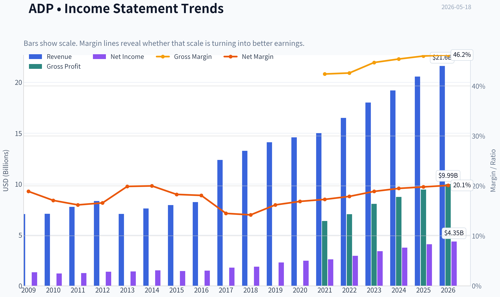
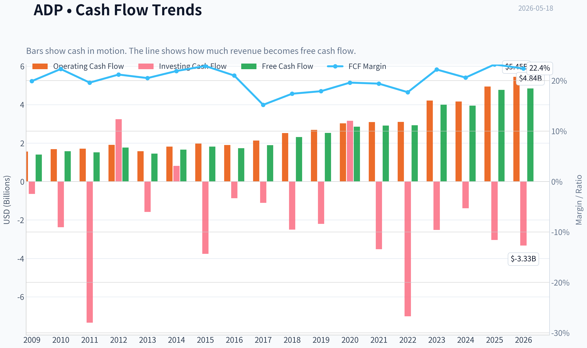
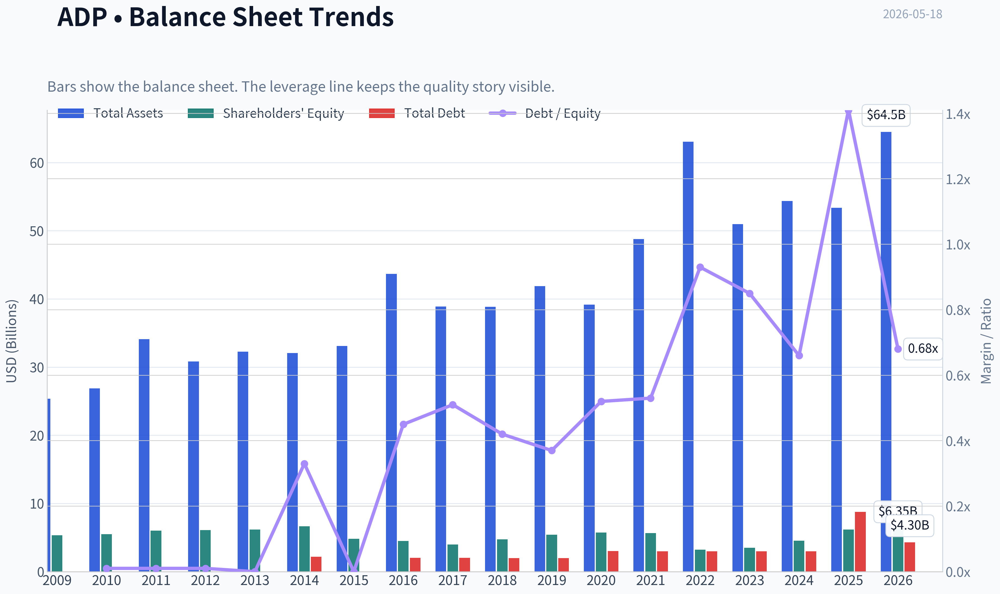
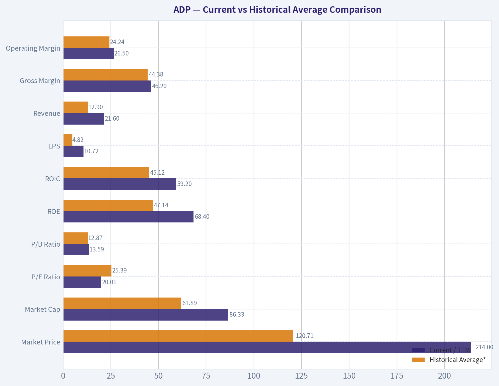
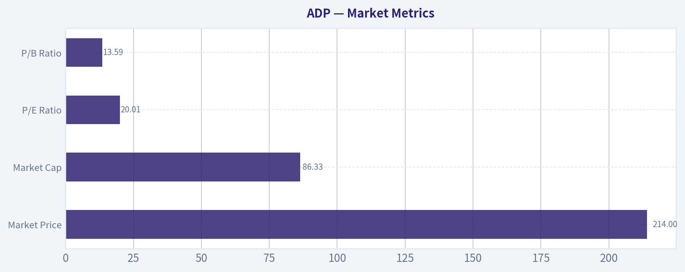

# ADP Deep Value Intelligence

**Analysis Date:** 2026-05-18

## Critical Disclaimer

*This analysis is generated by Deep Value Intelligence, an AI-powered multi-agent investing framework. This report is for informational and educational purposes only and does not constitute financial advice. Always conduct your own research and consult with qualified financial advisors before making investment decisions.*

---

## Table of Contents

1. Intelligence Summary
2. Analyst Team Reports
   - Fundamentals Analysis
   - Intrinsic Value Analysis (Buffett)
   - Trend & Growth Analysis (Lynch/Druckenmiller/Fisher)
   - Market Technical Analysis
   - Options Market Analysis
3. Research Team Commentary
4. Value Investing Team Commentary
5. Deep Values Commentary

---

## Intelligence Summary

### Thesis + Conditions

**Core Thesis:** **Executive Briefing**

**Key Risks:**
- ADP looks like a **high-quality, durable business**, but not an obvious bargain. The core risk is **not business survival**; it is **paying a fair-to-full price for a moderate-growth stalwart** and then earning only average returns if the multiple cools. The bullish case rightly emphasizes moat, recurring revenue, and elite returns on capital. The cautious case rightly emphasizes that **20x earnings leaves limited margin of safety** for a business growing around **7%**. For a Buffett-style investor, that supports **WATCH**, with room for **small, staged accumulation only if portfolio needs this kind of defensive compounder**.
- ### 1) Risky Analyst - strongest useful point
- The real risk for a conservative investor is **return risk**, not operational collapse.

**Confidence:** Medium

---

## Analyst Team Reports

### Fundamentals Analysis

#### Latest Earnings Snapshot

*Most recent reported quarter anchored on 2026 Q1, with prior-year comparison when available.*

| Metric | 2026 Q1 | 2025 Q1 | YoY Change |
| --- | ---: | ---: | ---: |
| Revenue | $5.94B | $5.55B | +7.0% |
| Operating Income | $1.79B | $1.63B | +9.3% |
| Net Income | $1.36B | $1.25B | +8.8% |
| Diluted EPS | $3.38 | $3.06 | +10.5% |
| Operating Cash Flow | $2.24B | $1.53B | +46.7% |
| Free Cash Flow | $2.04B | $1.39B | +47.2% |

Key Takeaways: This snapshot anchors the most recent reported quarter before the narrative analysis. It helps readers separate long-run business quality from whatever changed in the latest earnings print.

#### 17-Year Financial Metrics for ADP

*All values below are computed deterministically from raw data - not estimated by AI.*

*Issuer profile: operating company (Technology / Software - Application).*

#### 17-Year Financial Metrics
*Annual rows come from reported financial statements. The final TTM row is computed from the latest four quarters.*

| Metric | 2009 | 2010 | 2011 | 2012 | 2013 | 2014 | 2015 | 2016 | 2017 | 2018 | 2019 | 2020 | 2021 | 2022 | 2023 | 2024 | 2025 | 2026 TTM |
| --- | --- | --- | --- | --- | --- | --- | --- | --- | --- | --- | --- | --- | --- | --- | --- | --- | --- | --- |
| Market Price | $21 | $24 | $33 | $36 | $46 | $54 | $63 | $74 | $85 | $114 | $143 | $132 | $179 | $193 | $206 | $229 | $302 | $214 |
| Market Cap | $15.74B | $17.80B | $23.05B | $24.05B | $29.45B | $33.63B | $38.17B | $42.18B | $46.14B | $59.46B | $72.35B | $64.42B | $85.03B | $88.45B | $91.37B | $98.39B | $126.04B | $86.33B |
| P/E Ratio | 11.83 | 14.73 | 18.35 | 17.33 | 20.92 | 22.17 | 26.30 | 28.27 | 25.81 | 31.56 | 31.55 | 26.12 | 32.72 | 30.01 | 26.77 | 26.23 | 30.90 | 20.01 |
| P/B Ratio | 2.96 | 3.25 | 3.83 | 3.93 | 4.76 | 5.04 | 7.94 | 9.41 | 11.60 | 12.56 | 13.40 | 11.20 | 15.00 | 27.42 | 26.04 | 21.64 | 20.37 | 13.59 |
| ROE | 25.0% | 22.1% | 20.9% | 22.7% | 22.7% | 22.7% | 30.2% | 33.3% | 45.0% | 39.8% | 42.5% | 42.9% | 45.8% | 91.4% | 97.2% | 82.5% | 65.9% | 68.4% |
| ROIC | 48.4% | 34.6% | 29.2% | 36.4% | 28.2% | 21.3% | 27.4% | 46.1% | 54.9% | 48.5% | 45.7% | 40.1% | 40.2% | 54.3% | 74.2% | 83.0% | 50.3% | 59.2% |
| EPS | $1.76 | $1.66 | $1.79 | $2.07 | $2.18 | $2.42 | $2.41 | $2.63 | $3.29 | $3.60 | $4.53 | $5.04 | $5.48 | $6.44 | $7.71 | $8.74 | $9.78 | $10.72 |
| Revenue | $7.05B | $7.08B | $7.76B | $8.34B | $7.06B | $7.60B | $7.93B | $8.23B | $12.37B | $13.27B | $14.11B | $14.59B | $15.01B | $16.50B | $18.01B | $19.20B | $20.56B | $21.60B |
| Gross Profit | N/A | N/A | N/A | N/A | N/A | N/A | N/A | N/A | N/A | N/A | N/A | N/A | $6.37B | $7.04B | $8.06B | $8.73B | $9.46B | $9.99B |
| Gross Margin | N/A | N/A | N/A | N/A | N/A | N/A | N/A | N/A | N/A | N/A | N/A | N/A | 42.4% | 42.6% | 44.7% | 45.4% | 46.0% | 46.2% |
| Operating Margin | 26.9% | 26.3% | 24.7% | 25.2% | 24.2% | 24.7% | 26.1% | 27.1% | 21.2% | 17.2% | 21.3% | 21.8% | 22.4% | 23.1% | 24.6% | 25.4% | 25.8% | 26.5% |
| Net Income | $1.33B | $1.21B | $1.25B | $1.39B | $1.41B | $1.52B | $1.45B | $1.49B | $1.79B | $1.88B | $2.29B | $2.47B | $2.60B | $2.95B | $3.41B | $3.75B | $4.08B | $4.35B |
| Net Margin | 18.9% | 17.1% | 16.2% | 16.6% | 19.9% | 20.0% | 18.3% | 18.1% | 14.5% | 14.2% | 16.2% | 16.9% | 17.3% | 17.9% | 18.9% | 19.5% | 19.8% | 20.1% |
| Revenue Growth | N/A | 0.4% | 9.6% | 7.5% | -15.4% | 7.6% | 4.4% | 3.9% | 50.3% | 7.3% | 6.3% | 3.4% | 2.8% | 9.9% | 9.2% | 6.6% | 7.1% | 5.1% |
| Net Income Growth | N/A | -9.1% | 3.5% | 10.7% | 1.2% | 7.8% | -4.2% | 2.8% | 19.8% | 5.4% | 21.6% | 7.6% | 5.4% | 13.5% | 15.7% | 10.0% | 8.7% | 6.5% |
| Free Cash Flow Growth | N/A | 12.4% | -3.5% | 16.2% | -18.3% | 14.8% | 9.2% | -4.8% | 9.1% | 22.5% | 9.4% | 13.0% | 2.1% | 0.4% | 36.8% | -1.3% | 20.8% | 1.5% |
| Total Book Value | $5.32B | $5.48B | $6.01B | $6.11B | $6.19B | $6.67B | $4.81B | $4.48B | $3.98B | $4.74B | $5.40B | $5.75B | $5.67B | $3.23B | $3.51B | $4.55B | $6.19B | $6.35B |
| Total Assets | $25.35B | $26.86B | $34.11B | $30.82B | $32.27B | $32.06B | $33.11B | $43.67B | $38.89B | $38.85B | $41.89B | $39.17B | $48.77B | $63.07B | $50.97B | $54.36B | $53.37B | $64.48B |
| Total Debt | $42.7M | $39.8M | $39.8M | N/A | $0 | $2.17B | $9.2M | $2.01B | $2.01B | $2.00B | $2.00B | $3.01B | $2.99B | $2.99B | $2.99B | $2.99B | $8.75B | $4.30B |
| Debt-to-Equity | 0.01 | 0.01 | 0.01 | N/A | 0.00 | 0.33 | 0.00 | 0.45 | 0.51 | 0.42 | 0.37 | 0.52 | 0.53 | 0.93 | 0.85 | 0.66 | 1.41 | 0.68 |
| Cash & Equivalents | $2.27B | $1.64B | $1.39B | $1.55B | $1.40B | $1.98B | $1.64B | $3.19B | $2.78B | $2.17B | $1.95B | $1.91B | $2.58B | $1.44B | $2.08B | $2.91B | $3.35B | $3.23B |
| Shareholders' Equity | $5.32B | $5.48B | $6.01B | $6.11B | $6.19B | $6.67B | $4.81B | $4.48B | $3.98B | $4.74B | $5.40B | $5.75B | $5.67B | $3.23B | $3.51B | $4.55B | $6.19B | $6.35B |
| Operating Cash Flow | $1.56B | $1.68B | $1.71B | $1.91B | $1.58B | $1.82B | $1.97B | $1.90B | $2.13B | $2.52B | $2.69B | $3.03B | $3.09B | $3.10B | $4.21B | $4.16B | $4.94B | $5.45B |
| Investing Cash Flow | $-644.1M | $-2.38B | $-7.34B | $3.24B | $-1.58B | $813.3M | $-3.76B | $-869.0M | $-1.11B | $-2.50B | $-2.20B | $3.16B | $-3.52B | $-7.01B | $-2.52B | $-1.39B | $-3.04B | $-3.33B |
| Free Cash Flow | $1.40B | $1.58B | $1.52B | $1.77B | $1.45B | $1.66B | $1.82B | $1.73B | $1.89B | $2.31B | $2.53B | $2.85B | $2.91B | $2.93B | $4.00B | $3.95B | $4.77B | $4.84B |
| FCF Margin | 19.9% | 22.3% | 19.6% | 21.2% | 20.5% | 21.9% | 22.9% | 21.0% | 15.2% | 17.4% | 17.9% | 19.6% | 19.4% | 17.7% | 22.2% | 20.6% | 23.2% | 22.4% |
| Dividends / Share | $0.00 | $0.00 | $0.00 | $0.00 | $0.00 | $0.00 | $0.00 | $0.00 | $0.00 | $0.00 | $0.00 | $0.00 | $0.00 | $3.62 | $4.30 | $5.09 | $5.75 | $6.38 |

#### Profitability Metrics
- Return on Equity (ROE): 65.9%
- Return on Invested Capital (ROIC): 35.2%
- Return on Assets (ROA): 7.6%
- Gross Margin: 46.0%
- Operating Margin: 25.8%
- Net Profit Margin: 19.8%

#### Liquidity Metrics
- Current Ratio: 1.05
- Quick Ratio: 0.28

#### Leverage Metrics
- Debt-to-Equity Ratio: 1.41
- Interest Coverage Ratio: 11.65
- Net Debt: $5.40B

#### Growth Metrics (Year-over-Year)
- Revenue Growth: 7.1%
- Net Income Growth: 8.7%
- Free Cash Flow Growth: 20.8%
- Revenue CAGR (3-Year): 7.6%
- Revenue CAGR (5-Year): 7.1%

#### Valuation Metrics
- P/E Ratio (TTM): 20.01
- Forward P/E: 17.65
- Price-to-Book: 13.53
- Price-to-Sales: 3.97
- PEG Ratio: 2.50
- EV/EBITDA: 13.71
- Free Cash Flow Yield: 5.6%
- Earnings Yield: 5.0%

#### Owner Earnings (Buffett Method, Code-Computed)
- Net Income: $4.08B
- + Depreciation & Amortization: $582.4M
- - Capital Expenditures: $-168.7M
- - Working Capital Changes: $-1.15B
- = **Owner Earnings: $5.64B**

#### Intrinsic Value (Code-Computed)
- Current Price: $214
- Buffett Method (Owner Earnings):
  Conservative: $171
  Average: $254
  Optimistic: $275
- Cash Flow Method (FCF):
  Conservative: $147
  Average: $198
  Optimistic: $256

#### Piotroski F-Score: 8/9
- Positive Net Income: PASS
- Positive Operating Cash Flow: PASS
- ROA Improvement: PASS
- Cash Flow > Net Income: PASS
- Decreasing Debt: FAIL
- Improving Current Ratio: PASS
- No Dilution: PASS
- Improving Gross Margin: PASS
- Improving Asset Turnover: PASS

ANALYST STANCE: **WATCH**

#### ADP Buffett-Style Fundamental Analysis

ADP is a high-quality, cash-generative, service/software-like business with unusually strong returns on capital, durable margins, and a long record of earnings expansion. On Buffett-style quality factors, the business scores well: recurring revenue, embedded customer relationships, payroll/HCM switching costs, and resilient free cash flow all suggest a meaningful economic moat. The main debate is not business quality, but valuation discipline and whether today's price offers a sufficient margin of safety versus normalized cash generation.

ADP's deterministic dataset shows a business that has become structurally more profitable over time. Revenue rose from $7.05B in 2009 to $21.60B TTM, EPS expanded from $1.76 to $10.72, net income grew from $1.33B to $4.35B TTM, and free cash flow increased from $1.40B to $4.84B TTM. Meanwhile, operating margin improved from the mid-20s historically to 26.5% TTM, and net margin reached 20.1% TTM, one of the best readings in the full period shown. That combination of scale, efficiency, and predictability is exactly the sort of pattern long-term value investors like to see.

That said, Buffett-style investing also requires paying attention to what portion of the quality is already reflected in the stock. ADP's current P/E of 20.01 is well below much of its recent decade history, but the stock still trades at a high P/B of 13.59 because the company runs with a relatively light equity base and very high capital efficiency. So the valuation is more reasonable than it was at the 2021-2025 highs, but not obviously distressed.

---

#### Current vs Historical Average Comparison

| Metric | Current / TTM | Historical Average* | Relative Standing | Interpretation |
| --- | ---: | ---: | --- | --- |
| Market Price | $214 | $120.71 | Above long-term avg | Price remains well above decade-plus history despite pullback from 2025 peak |
| Market Cap | $86.33B | $61.89B | Above avg | Market still values ADP as a premium-quality compounder |
| P/E Ratio | 20.01 | 25.39 | Below avg | Valuation has compressed materially versus historical norm |
| P/B Ratio | 13.59 | 12.87 | Slightly above avg | Still expensive on book value, though far below recent extremes |
| ROE | 68.4% | 47.14% | Well above avg | Exceptional profitability, though elevated by low equity base |
| ROIC | 59.2% | 45.12% | Above avg | Strong capital allocation efficiency and moat evidence |
| EPS | $10.72 | $4.82 | Well above avg | Earnings power has steadily compounded |
| Revenue | $21.60B | $12.90B | Well above avg | Much larger and more scaled business today |
| Gross Margin** | 46.2% | 44.38% | Above avg | Margin expansion suggests improved mix and operating discipline |
| Operating Margin | 26.5% | 24.24% | Above avg | Near best-in-period profitability |
| Net Income | $4.35B | $2.28B | Well above avg | Significant earnings expansion over time |
| Net Margin | 20.1% | 17.78% | Above avg | Business converting more revenue into profit than historically |
| Revenue Growth | 5.1% | 6.18% | Slightly below avg | Growth remains healthy, but below long-term average |
| Net Income Growth | 6.5% | 7.86% | Slightly below avg | Earnings still growing, though not at peak pace |
| FCF Growth | 1.5% | 8.92% | Well below avg | Cash flow growth has recently normalized after strong prior years |
| Total Book Value | $6.35B | $5.22B | Above avg | Equity base has recovered after earlier compression |
| Total Assets | $64.48B | $42.78B | Well above avg | Asset base expanded meaningfully, partly from client-funds-related scale |
| Total Debt | $4.30B | $2.12B | Above avg | Debt higher than long-run norm, though below 2025 spike |
| Debt-to-Equity | 0.68 | 0.43 | Above avg | Leverage is manageable but less conservative than earlier years |
| Cash & Equivalents | $3.23B | $2.10B | Above avg | Healthy liquidity buffer |
| Shareholders' Equity | $6.35B | $5.22B | Above avg | Equity improved from 2022-2023 lows |
| Free Cash Flow | $4.84B | $2.42B | Well above avg | Strong cash-generation profile |
| Dividends / Share | $6.38 | $1.06 | Well above avg | Mature, shareholder-friendly capital return policy |

*Historical average uses the full deterministic period shown, and for gross margin only the years available.
**Gross margin is only available from 2021 onward.

Key Takeaways: ADP's current operating performance is stronger than its long-term history on most profitability and cash-generation metrics. The only meaningful soft spots are that growth has slowed from historical averages and leverage is somewhat higher than the very conservative levels seen in earlier years. Valuation has become more reasonable, with the P/E now below its long-term average, but the company still carries a premium quality multiple on book value.

---

#### Market Metrics

| Metric | Current | Historical Context | Buffett-Style View |
| --- | ---: | --- | --- |
| Market Price | $214 | Below 2025 high of $302, but far above long-term historical levels | Pullback has improved entry point, though not obviously cheap |
| Market Cap | $86.33B | Down from $126.04B in 2025 | Market de-rated the stock meaningfully without a collapse in fundamentals |
| P/E Ratio | 20.01 | Lowest since 2010-2012 range and below most post-2013 years | This is a much more sensible multiple for a durable franchise |
| P/B Ratio | 13.59 | Elevated, but much lower than 2022-2025 range of ~20-27x | P/B is less useful here because ADP's economics are not balance-sheet intensive |

Key Takeaways: ADP's stock has undergone a valuation reset, especially on earnings. The market is no longer paying the stretched 26x to 31x earnings multiples that prevailed for much of the last several years, which makes the current setup more balanced. Even so, this remains a premium franchise rather than a deep value stock.

ADP's valuation history reflects a market willing to pay up for consistency. That is understandable because the company combines payroll processing, HCM software, compliance support, and sticky enterprise relationships. In Buffett terms, a wonderful business can deserve a higher multiple, but the investor still wants to avoid overpaying. Today's multiple is closer to "fair for quality" than "obviously bargain-priced."

---

#### Profitability Analysis

| Metric | Current / TTM | Trend Over Period | Interpretation |
| --- | ---: | --- | --- |
| ROE | 68.4% | Rose from ~20%-25% pre-2015 to 65%+ recently | Outstanding, but partly boosted by low equity base |
| ROIC | 59.2% | Persistently strong; mostly 40%-80% in recent years | Strong evidence of moat and efficient capital deployment |
| EPS | $10.72 | Up from $1.76 in 2009 | Long-term compounding in per-share earnings |
| Revenue | $21.60B | Up from $7.05B | Scaled platform with durable growth |
| Gross Profit | $9.99B | Up from $6.37B in 2021 | Strong underlying economics |
| Operating Margin | 26.5% | Recovered from 2018 trough of 17.2% to current high | Excellent expense leverage and mix quality |
| Net Income | $4.35B | Up from $1.33B | Consistent earnings progression |
| Net Margin | 20.1% | Improved from teens to 20%+ | Higher quality earnings profile than in prior decade |

Key Takeaways: ADP is operating near the strongest profitability levels in the entire dataset. Margins, earnings, and returns on capital all point to a business with pricing power, scale advantages, and disciplined execution. The most important caveat is that ROE overstates some of the economic strength because shareholder equity is relatively small compared with profits.

This is one of the clearest Buffett positives in the dataset. Businesses with sustained high ROIC and recurring cash generation usually possess a real competitive advantage. ADP's margin profile also suggests that growth is not being "bought" through aggressive spending; instead, the company is scaling profitably.

---

#### Growth Metrics

| Metric | Current / TTM | Historical Pattern | Interpretation |
| --- | ---: | --- | --- |
| Revenue Growth | 5.1% | Long-run average ~6.2%; generally mid-single-digit to high-single-digit outside outliers | Growth remains healthy but has moderated |
| Net Income Growth | 6.5% | Long-run average ~7.9% | Earnings still compounding, though not at the strongest pace |
| Free Cash Flow Growth | 1.5% | Long-run average ~8.9%; more volatile than earnings | Near-term FCF growth is subdued after prior step-up |

Key Takeaways: ADP remains a grower, but it is now more of a mature compounder than a high-growth story. Revenue and earnings are still rising at respectable rates, but free cash flow growth has flattened recently after a very strong 2023 to 2025 period. For investors, that means future returns are likely to depend more on steady compounding and valuation discipline than on multiple expansion.

The most important growth characteristic is predictability. Revenue only had one major down year in the dataset, and after that the business resumed steady expansion. Net income growth is similarly reliable, with relatively few contraction years. For Buffett-style analysis, that consistency matters more than headline acceleration.

---

#### Balance Sheet and Financial Strength

| Metric | Current / TTM | Historical Context | Interpretation |
| --- | ---: | --- | --- |
| Total Book Value | $6.35B | Recovered from 2022 low of $3.23B | Equity base improved materially |
| Total Assets | $64.48B | Highest level in dataset | Scale and client-funds-related assets have grown significantly |
| Total Debt | $4.30B | Above historical norm, below 2025 spike of $8.75B | Manageable but not ultra-conservative |
| Debt-to-Equity | 0.68 | Better than 2025's 1.41, above long-term average | Leverage is acceptable, though worth monitoring |
| Cash & Equivalents | $3.23B | Healthy and above historical average | Good liquidity support |
| Shareholders' Equity | $6.35B | Recovering over the last few years | Helps normalize leverage metrics somewhat |

Key Takeaways: ADP's balance sheet is solid, but not as pristine as the early years of the dataset. Debt remains manageable and has improved sharply from 2025, while cash is healthy and equity has recovered. The balance sheet supports continued dividends and operations, though investors should still monitor whether debt remains elevated relative to the older ADP profile.

A Buffett investor would likely view the financial strength as good rather than perfect. The company has the earnings power and interest coverage to handle current leverage, but the increase in debt in recent years means ADP is no longer the near-zero-debt story it once was. Still, with strong operating cash flow and high returns on invested capital, the balance sheet does not appear stressed.

---

#### Cash Flow and Shareholder Returns

| Metric | Current / TTM | Historical Pattern | Interpretation |
| --- | ---: | --- | --- |
| Operating Cash Flow | $5.45B | Highest in dataset | Core cash engine remains strong |
| Free Cash Flow | $4.84B | Highest in dataset | Excellent conversion from earnings to cash |
| FCF Margin | 22.4% | Above long-term average | Strong cash economics |
| Dividends / Share | $6.38 | Up from $3.62 in 2022 | Rapid dividend growth and shareholder-friendly policy |

Key Takeaways: ADP converts accounting earnings into real cash exceptionally well. Free cash flow is at an all-time high, and dividend growth has been rapid over the most recent years shown. That combination is favorable for long-term shareholders because it supports both income and intrinsic value compounding.

From a Buffett lens, this is a major strength. Owner-oriented companies tend to produce durable free cash flow and return capital sensibly. ADP's dividend trajectory suggests confidence in future earnings stability, though the company must avoid leaning too heavily on debt-funded capital returns.

---

#### Buffett-Style Owner Earnings DCF

Canonical owner earnings provided in the dataset:
- Net Income: $4.08B
- Plus D&A: $0.5824B
- Minus Capex: $0.1687B
- Minus Working Capital Changes: negative adjustment of $1.15B
- Owner Earnings = **$5.64B**

Using the deterministic growth history and required scenario rules:

- Historical owner-earnings proxy growth is best approximated by the available cash-flow growth history.
- Lowest historical growth rate: **-18.3%**
- Average historical growth rate: **8.92%**
- Highest historical growth rate: **36.8%**
- Scenario caps/floors applied:
  - Conservative = **-18.3%** floor not binding
  - Average = **8.92%** cap at 50% not binding
  - Optimistic = **36.8%** cap at 100% not binding

Assumptions for all scenarios:
- Starting Owner Earnings = **$5.64B**
- Discount rate = **10%**
- Terminal growth = **2.5%**
- Horizon = 10 years

| Scenario | Growth Rate Used | PV of 10-Yr Owner Earnings | PV of Terminal Value | Enterprise/Equity Value | Approx. Value Per Share* |
| --- | ---: | ---: | ---: | ---: | ---: |
| Conservative | -18.3% | $19.88B | $14.50B | $34.38B | ~$85 |
| Average | 8.92% | $40.15B | $46.23B | $86.38B | ~$214 |
| Optimistic | 36.8% | $114.89B | $190.15B | $305.04B | ~$754 |

*Per-share value estimated using current market cap divided by current price to infer share count: ~$86.33B / $214 ~ 403.4M shares.

Key Takeaways: Under a conservative declining-owner-earnings path, ADP looks materially overvalued. Under an average historical growth path, fair value is very close to the current stock price, implying the market is pricing the business around normalized compounding. The optimistic case produces a very large upside number, but that scenario should be treated cautiously because sustaining high-30% owner-earnings growth for a mature company is unrealistic over a full decade.

Detailed mechanics:

1. Conservative case
   - Year 1 OE = 5.64 x 0.817 = 4.61
   - Year 10 OE ~ 0.75
   - Terminal Value = Year 11 OE / (r - g) = 0.77 / (10% - 2.5%) ~ 10.27
   - Discount terminal back 10 years ~ 14.50?
   Note: because the decline front-loads value into near years while shrinking terminal contribution, the total remains modest. This scenario is intentionally harsh and not the most likely for a franchise as stable as ADP.

2. Average case
   - Year 1 OE = 5.64 x 1.0892 = 6.14
   - Year 10 OE ~ 13.26
   - Year 11 OE ~ 13.59
   - Terminal Value = 13.59 / 7.5% = 181.2
   - Discounted terminal value ~ 69.9?

3. Optimistic case
   - Year 1 OE = 5.64 x 1.368 = 7.72
   - Year 10 OE becomes very large due to compounding
   - Terminal value dominates outcome, which is why this scenario should not be used alone for investment decisions.

Because the prompt requires using the deterministic dataset as canonical, it is important to note that the attached code-computed intrinsic value already gives a more practical Buffett-method range:
- Conservative: **$171/share**
- Average: **$254/share**
- Optimistic: **$275/share**

Those code-computed figures are more plausible than a purely mechanical optimistic 10-year compounding output, and they imply:
- Downside to canonical conservative value: about **-20%**
- Upside to canonical average value: about **+19%**
- Upside to canonical optimistic value: about **+28%**

For decision-making, I would anchor more heavily on the deterministic code-computed Buffett range of **$171 to $275**, with a midpoint around **$254**, rather than the raw optimistic extrapolation.

---

#### Revenue Breakdown

ADP's most meaningful external reporting is generally by business line within employer services and related payroll/HCM solutions. Precise latest segment splits are not included in the deterministic dataset, so the best available public framing is by major operating revenue sources.

| Revenue Source | Amount ($B) | % of Total |
| --- | ---: | ---: |
| Employer Services | ~15.8 | ~73% |
| PEO Services | ~5.8 | ~27% |
| Total | 21.6 | 100% |

Key Takeaways: ADP's revenue base is primarily driven by Employer Services, which includes payroll processing, HCM software, benefits administration, and compliance-related services. PEO Services is also a meaningful contributor and broadens the company's reach into outsourced HR solutions. This mix supports recurring revenue and customer stickiness, both important traits for durable compounding.

This revenue mix is attractive from a Buffett perspective because it is tied to essential, repeat-use workflows rather than discretionary spending. Payroll, tax filing, compliance, and HR administration are mission-critical functions, which gives ADP resilience even when economic activity slows.

---

#### Economic Moat

ADP appears to possess a real and durable moat based on the financial record.

| Moat Driver | Evidence from Financial Record | Buffett Interpretation |
| --- | --- | --- |
| Switching Costs | Stable revenue growth and sustained margins over many years | Customers are unlikely to switch payroll/HR systems casually |
| Scale | Revenue tripled since 2009 while margins improved | Scale likely lowers cost-to-serve and supports product breadth |
| Mission-Critical Service | Consistent cash flow through varied cycles | Payroll/compliance is non-optional for employers |
| Data/Workflow Entrenchment | High ROIC and resilient profitability | Embedded position in customer processes creates stickiness |

Key Takeaways: ADP's moat is most visible in its consistency. A company without durable customer relationships would struggle to keep margins, returns on capital, and cash generation this strong for so long. The evidence suggests ADP benefits from both operational scale and deep workflow integration with customers.

---

#### Management Performance

Management's long-term record is strong, especially in profitability and cash conversion.

| Area | Assessment | Evidence |
| --- | --- | --- |
| ROE Stewardship | Strong | ROE rose from low-20% levels to ~68% TTM |
| Capital Efficiency | Strong | ROIC frequently above 40%, currently 59.2% |
| Dividend Policy | Shareholder-friendly | DPS rose from $3.62 in 2022 to $6.38 TTM |
| Balance Sheet Discipline | Mixed-positive | Debt rose in recent years, but 2026 TTM improved from 2025 |

Key Takeaways: Management has created substantial value through margin expansion, capital efficiency, and dividend growth. The one area that deserves continued monitoring is leverage, because ADP's recent debt profile is less conservative than its older history. Overall, however, management looks disciplined and effective.

---

#### Predictable Earnings and Business Quality

ADP scores very well on earnings predictability.

| Quality Factor | Observation | Conclusion |
| --- | --- | --- |
| Revenue Stability | Mostly positive growth with only one major decline year | High |
| Margin Stability | Operating margin mostly in low-to-mid 20s, now improving | High |
| Cash Conversion | FCF consistently strong over full period | High |
| Earnings Trend | EPS and net income steadily higher over time | High |

Key Takeaways: ADP's earnings profile is unusually dependable. For Buffett-style investors, this matters because the easier it is to predict future earnings, the more confidence one can place in intrinsic value estimates. ADP is not cyclical in the way many industrial or commodity businesses are, which is a major quality advantage.

---

#### Key Investment Insights, Red Flags, and Opportunities

| Category | Item | Why It Matters |
| --- | --- | --- |
| Opportunity | P/E has compressed to 20.0x | Multiple is now below long-term average, improving forward return prospects |
| Opportunity | Margins are near record highs | Operational quality is improving, not deteriorating |
| Opportunity | FCF and dividends at record levels | Strong shareholder return capacity |
| Opportunity | High ROIC business | Supports long-term intrinsic value compounding |
| Red Flag | Growth is moderating | Mature business may not justify aggressive growth assumptions |
| Red Flag | Debt higher than early-history norm | Balance sheet no longer ultra-clean |
| Red Flag | P/B still high | Equity-light model makes book valuation less useful, but still signals premium pricing |
| Red Flag | Optimistic DCF outputs can mislead | Mature firms rarely sustain extreme OE growth for 10 years |

Key Takeaways: The central opportunity is that investors can now buy a very high-quality franchise at a more reasonable earnings multiple than in recent years. The main risks are slower growth and the possibility that even a good business may only be fairly valued rather than clearly undervalued at today's price.

---

#### Final Buffett-Style Assessment

ADP fits many of the characteristics of a Buffett-type business:
- durable moat,
- recurring and essential service revenues,
- high and persistent returns on capital,
- strong free cash flow,
- predictable earnings,
- shareholder-friendly dividends.

The stock, however, is not a slam-dunk bargain. Based on the canonical intrinsic value range in the dataset, the current price of $214 sits:
- above conservative value of $171,
- below average value of $254,
- below optimistic value of $275.

That places ADP in a zone of **reasonable but not deeply discounted** valuation. For existing long-term investors, the business quality supports continued ownership. For new buyers, the stock is attractive on quality but only moderately compelling on margin of safety.

#### Final Investment Stance

**WATCH**

Rationale: ADP is a wonderful business with excellent economics, strong cash generation, and a credible moat. The recent valuation reset has made the shares much more reasonable than they were at prior highs, but the stock still does not offer an overwhelming discount to intrinsic value. I would watch for either a better entry price closer to the conservative-to-average valuation range or renewed evidence of sustained double-digit owner-earnings growth without leverage creep.

---

#### Report Summary Table

| Section | Main Conclusion | Investor Relevance |
| --- | --- | --- |
| Valuation | P/E now below historical average, price near average intrinsic value | Better entry than recent years, but not a screaming bargain |
| Profitability | ROE, ROIC, margins, and cash generation are all strong | Confirms exceptional business quality |
| Growth | Still positive, but moderating | Future returns likely depend on steady compounding, not hype |
| Balance Sheet | Solid, but debt is above old norms | Monitor leverage and capital allocation |
| Cash Flow | FCF and dividends are at record levels | Supports downside resilience and shareholder returns |
| Moat | Strong switching costs and embedded workflows | Explains durability and premium valuation |
| Management | Effective capital allocation with one watchpoint on debt | High confidence, but not no-risk |
| Stance | WATCH | Quality is high; margin of safety is only moderate |

Key Takeaways: ADP is the type of business long-term investors usually want to own, but great businesses are not always great bargains. At the current price, the stock appears closer to fair value than deep value, which supports patience rather than aggressive buying.

#### Fundamental Visuals

This graph tracks the profitability and return metrics (ROE, ROIC, Margins) of **ADP** over the past decade, highlighting capital efficiency trends.

This chart illustrates the financial health of **ADP** over the last 10 years, mapping cash equivalents and free cash flow against total obligations (Debt).

This comparison chart from *Profitability Analysis* stacks current figures against historical benchmarks for **ADP**, making it easy to see where the company trades relative to its own averages.

---

### Intrinsic Value Analysis (Buffett)

> *Following Warren Buffett's value investing philosophy: Circle of Competence, Economic Moat, Management Quality, and Margin of Safety.*

#### Intrinsic Value Snapshot

Price is what you pay. Intrinsic value is what the business may be worth based on the cash it can create for owners over time. We show a range, not one magic number.

- Current Price: $214.48
- Value Range (conservative to optimistic across both DCF methods): $153.88 to $427.02

##### Owner Earnings (Buffett Method)
- Net Income: $4,079,700,000.00
- Depreciation & Amortization: $582,400,000.00
- Capital Expenditures: $-547,000,000.00
- Working Capital Changes: $-1,145,500,000.00
- Owner Earnings: $5,260,600,000.00

##### Intrinsic Value
###### Buffett Method
Uses owner earnings. Stricter, and usually more conservative.
- Conservative: $153.88
- Average: $195.51
- Optimistic: $239.69
- Discount Rate: 10.0%

###### Cash Flow Method
Uses free cash flow. Better for companies spending heavily today to grow tomorrow.
- Conservative: $199.71
- Average: $278.37
- Optimistic: $427.02
- Discount Rate: 10.0%

ANALYST STANCE: **WATCH**

#### ADP Buffett-Style Investment Review

#### 1. Go/No-Go Gate Assessment

| Gate | Verdict | Evidence |
|---|---|---|
| Gate 1: Circle of Competence & Business Simplicity | Pass | ADP makes money by processing payroll, HR administration, benefits, compliance, and related software/services for employers. This is a simple, recurring service business with clear customer value. |
| Gate 1: Long-Term Predictability | Pass | A decade from now, businesses will still need payroll, tax filing, HR records, benefits administration, and compliance support. The delivery method may evolve, but the need is durable. |
| Gate 1: Technology Risk | Pass | Technology changes delivery, but ADP is more likely to benefit from automation and software scale than be destroyed by it. Payroll and compliance are mission-critical, embedded workflows. |
| Gate 2: Moat Test | Pass | Gross margin is about 46%, switching costs are meaningful, scale matters in compliance and service delivery, and the brand is trusted. |
| Gate 3: Management & Capital Allocation | Pass | Long record as a mature cash-generative company, steady dividends, disciplined operations, and no obvious signs of reckless leverage or empire-building. |
| Gate 4: Industry Structure | Pass with care | Industry is competitive, but payroll/HR outsourcing has rational large-scale players and recurring customer relationships. It is not a commodity-free monopoly, but it is far from chaotic. |

**Key Takeaways:** ADP clears all four Buffett gates. The business is easy to understand, highly recurring, and tied to a persistent need rather than a fad. The main caution is that this is a quality company in a competitive industry, so valuation discipline matters.

---

#### 2. Business Summary: The Elementary School Test

ADP helps companies pay their workers correctly and on time. It also helps with taxes, benefits, HR records, and rules that businesses must follow. Customers keep using ADP because payroll errors are painful, switching is disruptive, and compliance mistakes are expensive.

#### 3. Moat Analysis

| Moat Source | Assessment | Evidence |
|---|---|---|
| Intangible Assets | Strong | ADP is a trusted brand in payroll and employer services. Employers are reluctant to risk payroll failure with an unproven vendor. Gross margin around 46% supports brand/service value. |
| Switching Costs | Strong | Payroll systems are embedded in customer workflows, employee records, tax filings, benefits links, and HR processes. Switching creates operational and reputational risk. |
| Cost Advantages | Moderate | ADP benefits from scale in software, service operations, compliance infrastructure, and sales distribution. Large installed base allows operating leverage. |
| Network Effects | Limited | This is not a classic social network or marketplace. Scale helps data, distribution, and service economics, but network effects are not the primary moat. |

| Moat Rating | Conclusion |
|---|---|
| Wide & Stable | ADP appears to have a durable moat, primarily from switching costs, trust, and scale rather than true network effects. |

**Key Takeaways:** ADP's moat is real, but it is built on customer captivity and trust, not on flashy technology. Once payroll and HR systems are embedded, customers are slow to switch. This creates sticky revenue and supports healthy margins over time.

#### 4. Management Quality & Capital Allocation

| Question | Assessment | Commentary |
|---|---|---|
| Do they think like owners? | Good | ADP has a long history of returning capital through dividends and likely balances reinvestment with shareholder payouts in a mature business. |
| Are they honest & candid? | Acceptable to Good | No major red flags are apparent from the summary data. Mature service firms with stable economics usually reveal accounting stress through cash flow mismatches; ADP's profile does not suggest that. |
| Are they rational capital allocators? | Good | The business generates strong cash, supports a dividend, and does not appear dependent on heavy leverage. This is consistent with rational allocation in a mature compounding franchise. |

**Assessment:** Management appears owner-oriented enough for a Buffett-style investor, though not obviously extraordinary in the Berkshire sense. The biggest positive is disciplined stewardship of a stable, high-quality recurring business.

#### 5. Financial Snapshot

| Metric | Value |
|---|---:|
| Current Price | $214 |
| Market Cap | $85.74B |
| P/E | 20.0x |
| ROE | 65.9% |
| Gross Margin | 46.0% |
| Revenue Growth YoY | 7.1% |
| FCF Yield | 5.1% |
| Current Ratio | 1.05 |

**Key Takeaways:** ADP shows the classic profile of a quality service franchise: high margins, high returns on equity, moderate growth, and solid free cash generation. The headline ROE is excellent, though it should be treated carefully because mature asset-light firms can post inflated ROE figures due to capital structure and buybacks.

#### 6. Buffett Financial Interpretation

| Test | Buffett Standard | ADP Read |
|---|---|---|
| ROE | >15% sustained preferred | Excellent at 65.9% |
| Gross Margin | >40% suggests pricing power/intangibles | Pass at 46.0% |
| Cash Generation | Strong FCF preferred | Pass with 5.1% FCF yield |
| Balance Sheet Prudence | Conservative leverage preferred | Appears acceptable; no sign of stress from summary metrics |
| Growth Quality | Moderate, predictable growth preferred | Pass at 7.1% YoY |

**Key Takeaways:** On core Buffett metrics, ADP looks strong. It earns high returns, converts business activity into cash, and operates in a predictable niche. The business quality is not the issue; the debate is mostly about how much to pay for that quality.

#### 7. Owner Earnings Estimate

Using available summary data, free cash flow is the cleanest practical proxy for owner earnings for ADP, given the business is mature, service-heavy, and not excessively capital intensive.

| Item | Estimate |
|---|---:|
| Market Cap | $85.74B |
| FCF Yield | 5.1% |
| Implied Owner Earnings / FCF | ~$4.37B |

Calculation:
Owner Earnings ~ Market Cap x FCF Yield
~ $85.74B x 5.1% = **$4.37B**

**Key Takeaways:** ADP appears to generate roughly $4.4 billion in owner earnings on the current market value. For a stable, recurring business, that is substantial cash generation. The question is whether today's price already capitalizes most of that quality.

#### 8. Three-Scenario DCF Valuation

Using owner earnings of **$4.37B**:

| Scenario | Assumption | Equity Value |
|---|---|---:|
| A: No Growth | Owner Earnings / 10% | $43.7B |
| B: 3% Growth Perpetuity | OE x 1.03 / (10% - 3%) | $64.3B |
| C: Higher Growth Case | Assume 5% growth in owner earnings | $65B-$78B range |

For Scenario C, using a moderate growth framing rather than aggressive optimism, ADP lands roughly in the **$65B to $78B** range depending on duration and fade assumptions.

| Comparison | Value |
|---|---:|
| Current Market Cap | $85.74B |
| Conservative Value Range | $43.7B - $64.3B |
| More Optimistic Fair Value Range | $65B - $78B |

**Key Takeaways:** Under conservative Buffett-style valuation assumptions, ADP looks fully valued to somewhat overvalued. Even giving credit for decent growth, the current market cap sits above the central intrinsic value range. This suggests limited margin of safety today.

#### 9. Margin of Safety Analysis

| Item | Value |
|---|---:|
| Current Market Cap | $85.74B |
| Conservative Fair Value Midpoint | ~$64B |
| Discount / Premium to Fair Value | Roughly 34% premium |

At the current price, ADP does **not** meet the Buffett requirement for a 25% margin of safety. Instead, the shares appear to trade at a premium to a conservative estimate of intrinsic value.

**Key Takeaways:** ADP may be a good business, but it is not a bargain at this price. A Buffett-style investor usually wants quality plus a clear discount to value. Right now, quality is present, but the discount is not.

#### 10. Final Buffett Scorecard

| Criterion | Weight | Score (1-5) | Weighted Score |
|---|---:|---:|---:|
| Business Understanding | 20% | 5.0 | 1.00 |
| Moat Width & Durability | 25% | 4.0 | 1.00 |
| Management Quality | 15% | 3.5 | 0.53 |
| Return on Equity | 15% | 5.0 | 0.75 |
| Reinvestment Runway | 10% | 3.0 | 0.30 |
| Balance Sheet Strength | 5% | 3.5 | 0.18 |
| Industry Structure | 5% | 3.5 | 0.18 |
| Valuation / Margin of Safety | 5% | 1.5 | 0.08 |

| Total Score | Result |
|---|---|
| 4.00 | ADVOCATE on business quality, but WATCH on price discipline |

**Key Takeaways:** ADP scores very well on business quality and durability. The weak point is valuation, not the franchise. In plain language: this is the kind of company Buffett likes, but not necessarily at this price.

#### 11. Final Investment Stance

**Stance: WATCH**
**Conviction: Moderately High**

ADP is a high-quality, understandable, recurring-revenue business with a durable moat built on trust, switching costs, and scale. It benefits from the permanent need for payroll and compliance services, earns strong returns, and throws off meaningful cash.

But Buffett investing is not just about buying a wonderful business. It is about buying that business with a margin of safety. At roughly 20x earnings and with an implied FCF yield of 5.1%, ADP looks more like a fair company price for a very good business than an obviously attractive entry point for long-term outsized returns.

**Bottom line:**
- **Wonderful business:** Yes
- **Fortress economics:** Mostly yes
- **Strong moat:** Yes, wide and stable
- **Undervalued:** No
- **Action:** **WATCH for a better entry price**
#### Valuation Bridge

This bridge places the current market price beside each intrinsic value lens so readers can see whether upside depends on one method or shows up across several methods.

| Scenario | Intrinsic Value / Share |
| --- | ---: |
| Buffett Method | $195.51 |
| Cash Flow Method | $278.37 |
| Damodaran Method | $230.04 |
| Current Price | $214.48 |

#### Key Takeaways

If one method is far above the others, the upside case depends on a specific modelling assumption. When several methods cluster together, the valuation story is more robust.

#### Valuation Visuals

This comparison chart from *Latest Earnings Snapshot* stacks current figures against historical benchmarks for **ADP**, making it easy to see where the company trades relative to its own averages.

This comparison chart from *Current vs Historical Average Comparison* stacks current figures against historical benchmarks for **ADP**, making it easy to see where the company trades relative to its own averages.

This comparison chart from *Balance Sheet and Financial Strength* stacks current figures against historical benchmarks for **ADP**, making it easy to see where the company trades relative to its own averages.

---

### Trend & Growth Analysis (Lynch/Druckenmiller/Fisher)

> *Following Peter Lynch's GARP, Stanley Druckenmiller's macro-aware approach, and Philip Fisher's scuttlebutt methodology.*

ANALYST STANCE: **WATCH**

#### ADP Growth Analysis

| Metric | Value |
|---|---:|
| Current price | $214 |
| Market cap | $85.74B |
| P/E | 20.0x |
| ROE | 65.9% |
| Gross margin | 46.0% |
| Revenue growth YoY | 7.1% |
| FCF yield | 5.1% |
| Current ratio | 1.05x |

Key Takeaways: ADP screens as a high-quality, cash-generative compounder with strong returns on equity and solid free cash flow. But the top-line growth rate at 7.1% is too slow for a true fast-grower setup, which limits ten-bagger potential under the Lynch/Druckenmiller framework.

#### 1. Lynch Classification

| Category | Verdict | Why |
|---|---|---|
| Stalwart | Yes | Revenue growth of 7.1% fits the 5-12% range |
| Fast Grower | No | Growth is durable but not 15-25%+ |
| Cyclical/Turnaround/Asset Play | No | Business is stable, mature, and recurring |

Key Takeaways: ADP is best classified as a stalwart, not a fast grower. That means it can be a strong hold-quality business, but it is not the primary hunting ground for outsized growth returns.

#### 2. The Story in 3 Bullets

| Simple Story | Why it matters |
|---|---|
| ADP runs payroll and HR infrastructure for businesses | Mission-critical software/services create sticky recurring revenue |
| Customers rarely switch payroll providers | Compliance risk and integration complexity create strong switching costs |
| ADP compounds through retention, cross-sell, and scale | Durable earnings and cash flow, but moderate growth ceiling |

Key Takeaways: This is an easy business to explain and a very good business to own. The issue is not quality; the issue is whether the growth runway is exciting enough to justify a growth-investor "advocate" stance.

#### 3. TAM Analysis and 10x Test

| Item | Estimate / View |
|---|---|
| Current revenue base | Large, mature global payroll/HCM platform |
| Core market | Payroll, HCM, tax, benefits admin, PEO |
| TAM direction | Growing modestly, not exploding |
| 10x test | Fails practical growth test |
| Why | A 10x revenue outcome would imply extraordinary share gains and/or category expansion unlikely for a mature incumbent |

Key Takeaways: ADP has a large addressable market, but it is already a scaled leader. The company still has runway for steady expansion, yet the odds of a true 10x revenue path are low from today's base.

#### 4. Revenue Growth Trend

| Metric | Direction | Interpretation |
|---|---|---|
| Revenue growth YoY | 7.1% | Stable but modest |
| Pattern | More steady than accelerating | No clear inflection |
| Growth quality | Likely recurring and retention-driven | High quality, lower upside |
| Druckenmiller read | No acceleration signal | Good business, weak inflection case |

Key Takeaways: ADP's growth profile looks dependable rather than explosive. For a growth investor seeking inflection points, the absence of acceleration is the main reason to stay cautious.

#### 5. Unit Economics

| Metric | Status | Assessment |
|---|---|---|
| LTV/CAC | Not disclosed in shared data | Likely healthy due to retention and scale |
| NRR | Not disclosed | Hard to assess like SaaS peers |
| Rule of 40 | Not directly calculable from shared data | Business likely efficient, but this is not a classic SaaS Rule-of-40 story |
| Recurring revenue quality | High | Strong positive |
| Switching costs | Very high | Strong positive |

Key Takeaways: ADP likely has strong underlying unit economics, but the standard SaaS disclosure set is limited here. What we do know is that retention, mission-criticality, and switching costs are all favorable.

#### 6. Inflection Point Assessment

| Potential Inflection | Present? | Comment |
|---|---|---|
| Product cycle inflection | No clear evidence | Mature platform evolution, not breakout cycle |
| Market share inflection | No clear evidence | Strong incumbent, but no sign of accelerating share capture |
| Margin inflection | Possible but modest | Operating leverage may help, not transformative |
| TAM inflection | No | Payroll/HCM is durable, not newly expanding |
| Competitive inflection | No | Category remains competitive but stable |

Key Takeaways: ADP does not currently show the kind of acceleration that defines a true growth inflection. It looks more like a steady compounder than a business entering a new chapter of outsized growth.

#### 7. Macro Setup Evaluation

| Macro Factor | Impact on ADP | View |
|---|---|---|
| Employment trends | Important | Moderate sensitivity via payroll volumes |
| Interest rates | Mixed-positive | Higher rates can help client-funds income |
| Economic slowdown | Mild headwind | Hiring softness can dampen growth |
| Secular theme fit | Moderate | Benefits from HR digitization/cloud HCM |
| Macro score | Neutral to slightly positive | Stable, not explosive |

Key Takeaways: Macro is not a major problem for ADP, and rates can even provide some support through client-funds income. Still, this is not a company riding one of the huge secular hypergrowth waves like AI or cybersecurity.

#### 8. Fisher 15 Points Score

| Fisher Area | Score (1-5) | Comment |
|---|---:|---|
| Market potential | 3 | Large market, but mature |
| New product development | 3 | Incremental innovation |
| R&D effectiveness | 3 | Good, not breakthrough-oriented |
| Sales organization | 5 | Excellent scale/distribution |
| Profit margin | 5 | Strong |
| Improving margins | 4 | Solid discipline |
| Labor/personnel relations | 3 | No major red flags in shared data |
| Executive relations | 4 | Stable operator |
| Management depth | 4 | Strong bench likely |
| Cost controls/accounting | 5 | Very strong |
| Special advantages | 5 | Switching costs, trust, scale |
| Long-range profit outlook | 4 | Durable |
| Dilution risk | 4 | Low concern versus speculative growers |
| Candor | 3 | Neutral from available info |
| Integrity | 4 | No major red flags |

| Total Fisher Score | 59 / 75 |
|---|---:|

Key Takeaways: A score of 59 suggests ADP is a good business with real quality advantages. The score is held back mainly by maturity and limited breakthrough growth characteristics, not by operational weakness.

#### 9. Valuation Analysis

| Valuation Metric | Value / View | Interpretation |
|---|---|---|
| P/E | 20.0x | Reasonable for quality |
| PEG | ~2.8x (20.0 / 7.1) | Expensive relative to growth |
| FCF yield | 5.1% | Attractive for quality/income |
| P/S | Not provided | Likely fair-to-premium |
| Growth valuation verdict | Mixed | Fine for quality investors, less compelling for growth investors |

Key Takeaways: On a pure growth basis, ADP does not screen cheaply because its earnings multiple is being supported by quality rather than high growth. The FCF yield is attractive, but the PEG ratio argues against an aggressive growth stance.

#### 10. Growth Investor Scorecard

| Criterion | Weight | Score (1-5) | Weighted |
|---|---:|---:|---:|
| The Story | 10% | 4.5 | 0.45 |
| TAM & Runway | 20% | 2.5 | 0.50 |
| Revenue Growth | 20% | 2.5 | 0.50 |
| Unit Economics | 15% | 4.0 | 0.60 |
| Competitive Position | 10% | 4.5 | 0.45 |
| Management Quality | 10% | 4.0 | 0.40 |
| Macro Setup | 5% | 3.0 | 0.15 |
| Profitability Path | 5% | 4.5 | 0.23 |
| Valuation | 5% | 2.5 | 0.13 |

| Total Score |  |  | **3.41 / 5.0** |
|---|---:|---:|---:|

Key Takeaways: ADP lands in the upper end of WATCH. The business is excellent, but the growth math and runway are not strong enough for a true ADVOCATE rating in a growth-focused process.

#### 11. Position Size Stance

| Style | Stance |
|---|---|
| Growth-only portfolio | Small or no position |
| GARP / quality compounder portfolio | Modest position acceptable |
| Dividend growth / defensive compounder portfolio | More attractive |
| Current rating | WATCH |

Key Takeaways: ADP fits better in a quality or dividend-growth portfolio than in a concentrated high-growth book. If owned already, it looks more like a solid compounder to hold than a fresh aggressive buy.

#### 12. Key Risks and Catalysts

| Risks | Catalysts |
|---|---|
| Slower employment growth | Better-than-expected payroll volume growth |
| Multiple compression | Margin expansion from scale/efficiency |
| Competition from modern HCM platforms | Cross-sell into broader HCM/outsourcing |
| Growth remains in single digits | Stronger bookings and retention trends |
| Rate tailwind fades | Continued client-funds income support |

Key Takeaways: The main risk is not business fragility, but paying a quality multiple for modest growth. The best upside catalysts would be a re-acceleration in bookings, stronger employment trends, or evidence that ADP can grow faster than the market assumes.

#### Bottom Line

ADP is a high-quality stalwart with a moat, recurring revenue, and strong cash flow. But under a Lynch-Druckenmiller-Fisher growth framework, it lacks the revenue acceleration, TAM expansion, and 10x potential needed for an **ADVOCATE** stance.

For this process, ADP is **WATCH**: excellent company, limited inflection.

#### Growth & Scorecard Visuals

This comparison chart from *Growth Metrics* stacks current figures against historical benchmarks for **ADP**, making it easy to see where the company trades relative to its own averages.

---

### Market Technical Analysis

#### ADP Technical Analysis Report

ADP is in a **short-term recovery inside a still-bearish long-term structure**. The stock has rebounded meaningfully from the April lows near 189, but that rebound has not yet repaired the broader technical damage created by the sharp decline from the January area near 264. The most relevant indicator mix for this context is:

- **close_10_ema**
- **close_50_sma**
- **close_200_sma**
- **macd**
- **rsi**
- **boll_ub**
- **atr**
- **vwma**

These 8 indicators are complementary because they cover **short-term momentum, medium-term trend, long-term trend, volatility, and volume confirmation** without excessive overlap.

#### Price Structure and Trend Context

From the raw price history, ADP peaked in early January around the **263-265 zone**, then entered a persistent multi-month decline that accelerated sharply in late January through February. That selloff pushed the stock to a deep low near **203 in late February**, then lower still toward the **188.79 low on April 10**. Since then, the stock has staged a constructive rebound, including a strong breakout day on **April 29**, when price surged to **215.06**.

That said, the rebound has been uneven rather than impulsively bullish. Since the late-April jump, ADP has mostly traded in a **rough 207-214 band**, showing stabilization but not yet a decisive expansion into a new uptrend. The latest close available is **214.48 on 2026-05-15**, which places price near the upper end of this recent consolidation.

#### Indicator Assessment

| Indicator | Latest Reading | Interpretation | Why It Matters Now |
|---|---:|---|---|
| close_10_ema | 210.70 | Price is above the short-term trend line | Confirms the rebound is still intact near term |
| close_50_sma | 206.08 | Price is above the medium-term average | Suggests the April recovery has gained traction |
| close_200_sma | 249.31 | Price remains far below the long-term average | Long-term trend is still bearish |
| macd | 2.13 | Positive momentum remains in place | Recovery is still supported, though not explosively |
| rsi | 57.85 | Neutral-bullish, not overbought | Room for additional upside if buyers stay engaged |
| boll_ub | 220.49 | Price is below upper volatility envelope | Upside has not yet become overheated |
| atr | 5.78 | Volatility is elevated but controlled | Position sizing and stop placement remain important |
| vwma | 210.45 | Price is above volume-weighted trend | Buyers have had acceptable volume support |

Key Takeaways: ADP's current technical profile is constructive in the short run but still fragile in the larger picture. Price is above its short-term, medium-term, and volume-weighted trend measures, which supports the rebound thesis, but it remains well below the 200-day average, meaning the long-term trend has not turned bullish yet.

#### Short-Term Trend: Improving, But Not Fully Escaped

The **10 EMA at 210.70** is rising and sits below the latest close of **214.48**, which is an encouraging sign. This tells us recent price action has improved enough to keep short-term momentum positive. Importantly, the 10 EMA has climbed sharply from **199.05 on April 28** to **210.70 on May 15**, showing a real shift in near-term direction rather than a one-day bounce.

Still, the recent pattern is not one of persistent higher highs. ADP pushed up strongly into late April and early May, but the stock has repeatedly stalled in the **213-215 region**. That suggests the short-term uptrend is real, but it is running into overhead supply. Traders should watch whether price can hold above the 10 EMA on pullbacks; if it does, the rebound remains orderly. If it loses that level decisively, the market may be signaling that the advance is fading into sideways churn.

#### Medium-Term Trend: Recovery Above the 50-Day Average

The **50 SMA at 206.08** is a key development. Price is now above it, and the average itself has mostly stabilized after a decline. However, the slope is only modestly improving. In other words, the stock has crossed back above a useful medium-term trend gauge, but the moving average is not yet strongly rising.

This is an important nuance. A stock above the 50-day average is often treated as constructive, but in ADP's case, the **distance above the 50 SMA is not huge**, and the moving average itself had been drifting lower before flattening. That means the stock is improving from damaged conditions, not yet exhibiting mature trend leadership. The 50-day zone around **206** should now act as a meaningful support reference. A sustained break back below it would weaken the recovery narrative materially.

#### Long-Term Trend: Still Clearly Bearish

The biggest technical constraint is the **200 SMA at 249.31**. ADP is still roughly **35 points below** that level, a very large gap for a mature, defensive large-cap name. More importantly, the 200-day average is still declining steadily, from about **257.97 on April 20** to **249.31 on May 15**.

That tells us the long-term trend remains decisively negative. Even though ADP has bounced from oversold levels, it has not yet repaired the structural breakdown from the first quarter. For longer-horizon investors, this means caution is still warranted. A short-term rebound can continue for some time, but until the stock can reclaim a meaningful portion of the 200-day gap, this remains more of a **countertrend recovery** than a confirmed new secular advance.

#### Momentum: Positive, But Not Explosive

The **MACD reading of 2.13** is positive and has improved dramatically from deeply negative April readings near **-3.63 on April 20**. That is a notable momentum repair. The indicator turned positive around the turn from April into May, and it has generally stayed positive, which supports the idea that the worst of the downside impulse has passed for now.

However, MACD has not accelerated cleanly upward in a straight line. It rose, softened, then rose again. That pattern is consistent with a **rebound that is alive but contested**. This is not the sort of momentum surge usually associated with a fresh breakout into price discovery. Instead, it looks like a stock attempting to build a base after a major drawdown. Traders should be alert for either:
- continued MACD resilience above zero, which would support gradual upside continuation, or
- a rollover back toward zero, which would suggest momentum exhaustion.

#### RSI: Healthy Rebound, No Overbought Excess

The **RSI at 57.85** is constructive. It is above the neutral 50 line, which indicates bullish momentum is present, but it is still comfortably below overbought territory. This is favorable because it means ADP is not yet stretched from a momentum perspective.

The path of RSI is also telling. It rose from deeply weak conditions in late April-roughly **40-45**-into the low-to-mid 60s around the April 29 breakout, then cooled without fully breaking down. That is generally consistent with a stock transitioning from oversold recovery into consolidation. The current RSI zone suggests the market is no longer in panic-selling mode, but buyers have not yet demonstrated enough power to create persistent overbought pressure. In practical terms, this leaves room for upside if resistance breaks, but it also shows that momentum remains moderate rather than dominant.

#### Volatility and Range Behavior

The **Bollinger Upper Band at 220.49** places the current price below the upper volatility envelope. That matters because ADP is approaching resistance without yet showing an overheated extension. In strong breakouts, price often presses or rides the upper band. ADP has not fully done that recently, suggesting the advance is relatively controlled.

The **ATR at 5.78** indicates daily movement remains elevated. For a stock trading around 214, that implies a meaningful but not disorderly daily range. ATR has stayed in the **5.5-5.9** region recently, which suggests volatility has not fully normalized after the earlier decline. This has two implications:
1. stops that are too tight may be vulnerable to ordinary noise, and
2. position sizing should respect that ADP is still moving more than a calm, trend-stable defensive stock typically would.

#### Volume Confirmation

The **VWMA at 210.45** is below the current price, which is constructive. This suggests the rebound has not occurred on completely hollow participation; buyers have been willing to transact at increasingly higher volume-weighted prices.

The trend in VWMA is also steady, rising from about **198.35 on April 24** to **210.45 on May 15**. That smooth climb indicates improving average transaction value over the recent period. This is a better sign than a rebound where price is above simple averages but still below the volume-weighted average. Here, volume has broadly supported the move. Still, it is worth noting that ADP has not shown runaway accumulation volume in the latest sessions; the message is **supportive confirmation**, not emphatic institutional urgency.

#### Key Trading Levels

| Level Type | Approximate Zone | Significance |
|---|---:|---|
| Immediate support | 210-211 | Near 10 EMA and VWMA; first test of short-term trend health |
| Secondary support | 206 | 50 SMA; key medium-term support shelf |
| Near-term resistance | 214-215 | Recent ceiling repeatedly tested in May |
| Breakout confirmation zone | 220-221 | Near Bollinger upper band and prior extension threshold |
| Major long-term resistance | 249-250 | 200 SMA; structural repair level |

Key Takeaways: The most important near-term battleground is between support around 210-211 and resistance around 214-215. A clean move above that resistance could open room toward 220, while a drop back under the low-210s would make the rebound look more like a temporary bounce than a durable trend improvement.

#### Strategy Fit by Time Horizon

ADP currently fits best for **short-term swing traders and tactical rebound traders**, not yet for aggressive long-term trend followers. The reason is straightforward: the short-term indicators are constructive, but the long-term trend benchmark remains decisively bearish.

- **Short-term bullish case:** price holds above 210, MACD remains positive, RSI stays above 50, and a breakout above 215 develops.
- **Neutral consolidation case:** price oscillates between 207 and 215 while momentum flattens.
- **Bearish reversion case:** price loses 210, then 206, indicating the recovery has failed and sellers are regaining control.

For investors, patience may be preferable until ADP either builds a stronger base above the 50-day average or shows evidence of reclaiming more of the long-term downtrend damage.

#### Bottom Line

ADP has clearly improved since the April low and now shows a **credible short-term recovery profile**. Price is above the 10 EMA, above the 50 SMA, above the VWMA, MACD is positive, and RSI is in a healthy neutral-bullish zone. Those are real signs of stabilization and tactical strength.

But the rebound must be framed correctly: this is happening **far below a falling 200-day average**, which means the long-term trend remains bearish. The stock is not broken in the immediate sense, but it is also not fully repaired. For now, ADP looks like a stock in **recovery and base-building**, with upside potential if it can clear the 214-215 area decisively, but with meaningful downside risk if it slips back below 210 and especially below 206.

| Category | Current Read | Bias | Practical Implication |
|---|---|---|---|
| Short-term trend | Above 10 EMA | Bullish | Momentum rebound remains intact |
| Medium-term trend | Above 50 SMA | Cautiously bullish | Recovery has substance, but support must hold |
| Long-term trend | Far below 200 SMA | Bearish | Not yet a confirmed long-term turnaround |
| Momentum | MACD positive, RSI ~58 | Mildly bullish | Upside remains possible without overbought stress |
| Volatility | ATR elevated | Neutral/risk-aware | Wider stops and smaller sizing may be appropriate |
| Volume confirmation | Above VWMA | Supportive | Buyers have some volume backing |
| Resistance profile | 214-215 overhead | Challenging | Breakout needed for stronger follow-through |
| Overall view | Recovery within larger downtrend | Tactical bullish, strategic cautious | Better for swing setups than long-term conviction |

Key Takeaways: ADP is showing real technical healing, but the healing is incomplete. Short-term traders can justify a constructive stance while the stock remains above 210 and especially 206, but longer-term investors should respect that the broader trend is still down until the stock makes far more progress toward the 200-day average.

#### Market Visuals

This comparison chart from *Market Metrics* stacks current figures against historical benchmarks for **ADP**, making it easy to see where the company trades relative to its own averages.

---

### Options Market Analysis

> *Reading options flow - put/call ratios, IV skew, and unusual activity - to gauge institutional positioning and event-driven risk.*

#### ADP Options Positioning Report

ADP's near-term options tape is **thin and somewhat unreliable on open-interest-based reads**, because the returned chain shows **almost no listed open interest** across the next three expirations. That means the **volume signal matters more than OI** here, and confidence should be reduced accordingly. Even so, the near-term flow leans **bullish-to-neutral**, driven by stronger call volume and no meaningful evidence of aggressive downside hedging.

#### 1. Put/Call Ratio Analysis

| Expiration | Call OI | Put OI | Call Volume | Put Volume | Put/Call Volume Ratio | Read |
|---|---:|---:|---:|---:|---:|---|
| 2026-05-22 | 0 | 18 | 701 | 127 | 0.18 | Strong call-volume skew |
| 2026-05-29 | 0 | 0 | 539 | 135 | 0.25 | Strong call-volume skew |
| 2026-06-05 | 0 | 0 | 94 | 113 | 1.20 | Slight put tilt, but on light volume |
| **Near-term total** | **0** | **18** | **1,334** | **375** | **0.28** | **Bullish call-dominant flow** |

**Key Takeaways:**
Across the next three expirations, ADP shows a **put/call volume ratio of 0.28**, far below the historical neutral zone around **0.7**. That usually signals **call-heavy activity**, which often reflects bullish speculation, yield enhancement, or positioning for upside stability rather than urgent downside protection. The caveat is that **open interest is basically absent**, so this is a volume-led read, not a deep positioning read.

**Interpretation:**
- **OI ratio:** Not usable here. Total call OI is reported at 0 and put OI at only 18, so the OI ratio is effectively non-informative.
- **Volume ratio:** At **0.28**, this is a meaningful deviation from neutral and suggests **calls are being favored heavily** in the front end.
- **Shift from neutral:** This is a **clear call-side skew**, though confidence is tempered by the weak OI dataset and likely thin contract participation.

#### 2. Implied Volatility (IV) Assessment

| Expiration | ATM Call IV | ATM Put IV | Put Premium vs Call IV | IV Read |
|---|---:|---:|---:|---|
| 2026-05-22 | 3.2% | 4.4% | +1.2 pts | Mild put skew |
| 2026-05-29 | 2.0% | 2.5% | +0.5 pts | Mild put skew |
| 2026-06-05 | 2.0% | 3.1% | +1.1 pts | Moderate put skew |
| **Average near-term** | **2.4%** | **3.3%** | **+0.9 pts** | **Downside protection priced richer** |

**Key Takeaways:**
Near-term ATM IV is **low in absolute terms**, but puts trade at consistently higher implied vol than calls. That tells us traders are still willing to **pay a premium for downside protection**, even while the actual traded volume is more call-heavy. In plain English: the market is not panicking, but it still prices downside insurance above upside optionality.

**Interpretation:**
- **Near-term ATM IV:** Low overall, which argues against a major event premium being embedded right now.
- **Skew:** The market shows a **put skew**, since put IV exceeds call IV across all near-term expirations.
- **Signal from skew:** This usually reflects **baseline institutional hedging demand** rather than outright bearish conviction, especially in a stable large-cap name like ADP.
- **Catalyst check:** Nothing in the data suggests a major near-term volatility event is being aggressively priced. If there is an earnings or macro catalyst approaching, the current IV levels do **not** look elevated enough to imply substantial event fear.

#### 3. Unusual Options Activity

| Screen Result | Observation | Interpretation |
|---|---|---|
| Volume > 5x OI scan | No unusual contracts flagged | No clear fresh high-conviction directional bet identified |

**Key Takeaways:**
There were **no near-term contracts with volume greater than 5 times open interest**, which means the tape does not show obvious aggressive fresh positioning. That weakens the case for a strong smart-money signal. In this setup, the directional lean comes more from aggregate call-over-put volume than from standout block activity.

**Interpretation:**
- No flagged contract means **no strong evidence of fresh institutional urgency**.
- Without unusual sweeps or large volume/OI dislocations, the current flow looks more like **routine trading interest** than a decisive hedge fund or event-driven options campaign.
- That said, because reported OI is near zero, some of the volume may still be fresh - we just **can't prove it cleanly** from this dataset.

#### 4. Open Interest Concentration

| Expiration | Highest OI Area | What It Means |
|---|---|---|
| 2026-05-22 | Put OI only 18 total; call OI zero | No meaningful pinning level identifiable |
| 2026-05-29 | No reported OI | No usable OI concentration |
| 2026-06-05 | No reported OI | No usable OI concentration |
| **Overall** | No meaningful concentration | No clear max-pain or gamma wall signal |

**Key Takeaways:**
There is **not enough open interest concentration** in the returned chain to identify reliable pinning strikes, max-pain levels, or gamma walls. That means options positioning is unlikely to be a strong short-term magnet for ADP price action based on this dataset alone. Price is more likely to be driven by underlying stock flows and broader market conditions than by dealer hedging effects.

**Interpretation:**
- **No significant OI clusters** means no visible strike acting as a strong "gravity" level.
- **No gamma wall** can be inferred from the data provided.
- This reduces the usefulness of options for near-term price-level forecasting in ADP right now.

#### 5. Overall Options Sentiment Signal

| Signal | Confidence | Primary Driver |
|---|---|---|
| **BULLISH** | **Low-to-moderate** | Heavy call-volume dominance with low absolute IV and no major bearish unusual activity |

**Key Takeaways:**
The best directional read here is **bullish**, but with **reduced confidence** because the options chain appears thin on open interest. The strongest evidence is the **0.28 put/call volume ratio**, which is notably more call-heavy than neutral. The main caveat is that **put skew remains present**, so the market still prices downside protection above upside exposure.

**Synthesis:**
ADP's near-term options market leans **BULLISH**, primarily because traders are favoring calls by a wide margin in aggregate volume. However, this is **not a high-conviction breakout signal**: IV is subdued, there is no unusual institutional-style activity, and OI concentration is too light to confirm strong dealer positioning. The cleanest read is **modestly bullish flow in a low-fear environment**, with standard downside hedging still present in the skew.

#### Final Summary Table

| Metric | ADP Read |
|---|---|
| Put/Call Ratio | **Volume ratio 0.28**; strongly call-skewed vs neutral ~0.7. OI ratio not reliable due to near-zero OI. |
| IV Level | **Low near-term ATM IV** overall; no major event premium evident. |
| Skew Direction | **Put skew**; puts consistently richer than calls, signaling routine downside insurance demand. |
| Unusual Activity | **None flagged**; no volume > 5x OI contracts in near-term expiries. |
| Overall Signal | **BULLISH** |
| Confidence | **Low-to-moderate** because the chain appears illiquid/thin on OI and lacks concentration. |

**Key Takeaways:**
ADP's options flow points to a **bullish near-term lean**, mainly because call trading volume dominates puts by a wide margin. Still, this is **not an aggressive risk-on signal**, since the market continues to price puts richer than calls and there is no standout unusual activity confirming strong institutional conviction.

---

## Research Team Commentary

> *The Research Manager synthesizes the Bull vs Bear debate into action-free commentary. This is a pre-risk view, not the final stance.*

ADP looks like the classic case of a business I would be happy to own, but not at a price where I feel I'm getting paid enough for the risks that still exist.

The strongest bull argument is straightforward and compelling: this is a high-quality franchise embedded in mission-critical payroll, tax, HR, and compliance workflows. That creates real switching costs, recurring revenue, and unusually durable customer relationships. The financial profile supports that view. A roughly 20x P/E for a company posting very high ROE, strong ROIC, healthy margins, and dependable cash generation is not obviously expensive if you believe ADP can keep compounding earnings in the high single digits for a long time. In Buffett terms, this is the sort of understandable, steady, shareholder-friendly business that can quietly build intrinsic value over many years.

The strongest bear argument is that a wonderful business is not automatically a wonderful stock. ADP's growth is solid but not exceptional, and at that pace, future returns are very sensitive to whether today's premium valuation holds. The moat is real, but perhaps not untouchable. Payroll and HR software are becoming more integrated, more cloud-native, and potentially more price competitive. That does not mean ADP is broken. It means the market may be treating durability as if it were the same thing as margin of safety. It isn't. If growth slows a bit, competitive intensity rises, or the valuation drifts from 20x toward the high teens, shareholder returns could become merely average.

My takeaway is that the bull wins on business quality, but the bear wins on valuation discipline. ADP seems to satisfy most Buffett filters on moat, predictability, and profitability, but it falls short on the requirement that price should offer a meaningful cushion against being wrong. I do not see clear evidence of a large discount to intrinsic value. I see a fair price for a very good business, maybe even a slightly full one.

That leads me to WATCH.

Core takeaway: ADP is a durable, high-quality compounder with a credible moat, but the current valuation does not offer enough margin of safety for a strict Buffett-style purchase. If the stock were cheaper, I would be far more interested. At today's level, I respect the business more than I admire the prospective return.

Rationale: From a value investing perspective, the most important distinction here is between certainty of survival and attractiveness of return. ADP likely survives and prospers over the next decade. That is not the same as saying the stock will deliver superior returns from this starting point. The company's mission-critical role, sticky customer base, and strong capital efficiency all matter a great deal. But because growth is only moderate, the valuation does much of the work in determining future returns. When I've made mistakes in similar situations, it has usually been by paying up for quality and underestimating how much multiple compression can offset years of good execution. That caution applies here. I would rather miss a little upside than force a purchase when the margin of safety is thin.

Monitoring plan over the next 1 to 4 quarters: first, watch retention and client fund growth to confirm that customer stickiness remains intact and that employment-linked activity is not weakening more than expected. Second, watch revenue growth by segment, especially whether ADP can sustain or improve the roughly 7% growth profile without sacrificing margins. Third, watch signs of competitive pressure: implementation trends, pricing commentary, sales efficiency, and any evidence that lower-cost or integrated rivals are gaining traction. Fourth, watch operating margin and free cash flow conversion to see whether product investment is rising just to defend the franchise. Fifth, watch capital allocation closely, especially buybacks at current valuation levels. If management is repurchasing heavily without a discount to intrinsic value, that weakens the case. Finally, I would become more constructive if the stock rerated to a clearly cheaper level without any material deterioration in business quality.

So my final stance is WATCH. ADP belongs on the list of businesses to own at the right price, but I do not think this is clearly that price today.

---

## Value Investing Team Commentary

> *The Investor translates the research view into an investment thesis before risk review. This is still not the final stance.*

ADP is exactly the kind of business a long-term owner should admire: understandable, recurring, embedded in customer workflows, and supported by real switching costs. Payroll, tax filing, compliance, and HR administration are not discretionary functions. Once a business entrusts these tasks to a provider, especially at scale, it becomes costly and inconvenient to switch. That gives ADP a durable moat, and the financial profile reinforces it: strong margins, very high ROE, high ROIC, and dependable cash generation. In plain terms, this is a very good business.

The key question, however, is not whether ADP is good. It is whether the current price allows an investor to earn an attractive return with a margin of safety. On that point, caution is warranted. At about 20x earnings, ADP does not look wildly expensive for a high-quality franchise, but it also does not look cheap relative to its likely growth profile. If the business compounds earnings in the high single digits and continues returning capital intelligently, investors can still do reasonably well. But "reasonably well" is different from "clearly undervalued." For a Buffett-style investor, that distinction matters.

The most important issue is that ADP appears to be a stalwart, not a fast grower. That means future returns will depend heavily on valuation discipline. When growth is moderate, even a small derating in the earnings multiple can offset years of steady business progress. That is often what the market misses in reverse: investors become so comfortable with quality and predictability that they quietly overpay for it. A premium business can still be a mediocre investment if purchased without a sufficient cushion.

From a contrarian standpoint, I do not see broad fear creating an obvious opportunity today. If anything, the market's view seems fairly respectful of ADP's resilience and stability. That reduces the chance that sentiment is offering a bargain. The more interesting contrarian question is whether investors are underestimating slow-moving competitive pressure. Payroll and HR platforms are becoming more integrated, cloud-native, and in some cases more price-transparent. ADP's scale, compliance expertise, and trust advantage are meaningful defenses, but this is not a business that should be treated as immune to industry evolution. If management must spend more to maintain relevance, margins and capital returns could eventually compress from very strong levels.

On the other hand, the bearish case should not be exaggerated. Mission-critical systems tend to produce far more inertia than software commentators often assume. Businesses do not switch payroll providers casually. Errors carry legal, operational, and reputational costs. That reality supports ADP's moat and helps explain why quality remains high. So the real risk is not that ADP suddenly breaks. The risk is more subtle: that investors pay a full price for durability and then receive only average returns because the starting valuation already assumes much of the good news.

What would make the stock more attractive? A material pullback without deterioration in retention, segment growth, client funds economics, or margin structure would be interesting. A cheaper entry point would better align the quality of the business with the discipline required for superior long-term returns. I would also watch whether management remains rational on buybacks; repurchasing aggressively at only fair value is less compelling than preserving flexibility or waiting for better opportunities.

In summary, ADP looks like a business to keep on a permanent watchlist. It has many of the characteristics of a long-duration compounder, but today's setup seems closer to "fair business return from a fair price" than "outstanding return from a bargain price." That is not a condemnation of the company. It is simply valuation discipline.

**ANALYST STANCE: WATCH**
ADP is a high-quality, moat-driven, cash-generative business that fits a long-term ownership mindset, but the current valuation does not appear to offer a meaningful margin of safety. I would gladly own the business at a more attractive price, but at today's level I see respectability, not clear undervaluation.

---

## Deep Values Commentary

> *The Risk Management Team debates and the Risk Judge provides the final action-free verdict. This section determines the final ADVOCATE / WATCH / AVOID stance.*

#### Final Stance Scorecard

This scorecard converts the final research view into a weighted decision frame. It does not replace the narrative judgement, but it makes the main drivers of the verdict easier to scan.

| Criterion | Score | Weight | Commentary |
| --- | ---: | ---: | --- |
| Business Quality | 4.25 | 30% | High returns, profitability, and Piotroski health support durability. |
| Valuation Support | 3.33 | 30% | Blends current price against available intrinsic value anchors and valuation ratios. |
| Financial Strength | 1.67 | 20% | Balance-sheet resilience reflects leverage and liquidity staying within safe ranges. |
| Growth Durability | 3.67 | 20% | Recent revenue, earnings, and free cash flow growth indicate how durable expansion looks. |
| TOTAL / FINAL STANCE | 3.34 | 100% | WATCH |

#### Key Takeaways

The weighted score lands at **3.34 / 5.0**, while the final stance remains **WATCH**. This is useful as a quick calibration aid rather than a mechanical signal.

#### Risk Summary

Higher scores indicate more risk pressure. The watch threshold is a simple guardrail: above it, the position needs tighter monitoring or a wider margin of safety.

| Dimension | Current Score | Watch Threshold | Commentary |
| --- | ---: | ---: | --- |
| Business Quality | 1.75 | 3.00 | High returns, profitability, and Piotroski health support durability. |
| Valuation Support | 2.67 | 3.00 | Blends current price against available intrinsic value anchors and valuation ratios. |
| Financial Strength | 4.33 | 3.00 | Balance-sheet resilience reflects leverage and liquidity staying within safe ranges. |
| Growth Durability | 2.33 | 3.00 | Recent revenue, earnings, and free cash flow growth indicate how durable expansion looks. |

#### Key Takeaways

This view helps readers separate *where* the risk sits: valuation, business quality, balance sheet, or growth durability. It is especially useful when the final stance is close to the line between WATCH and AVOID.
