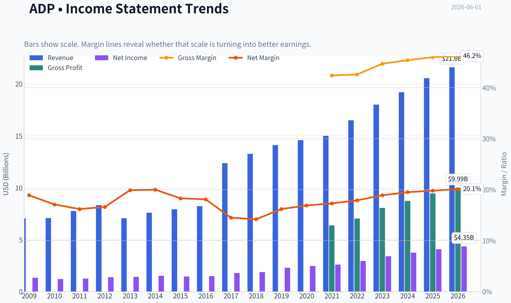
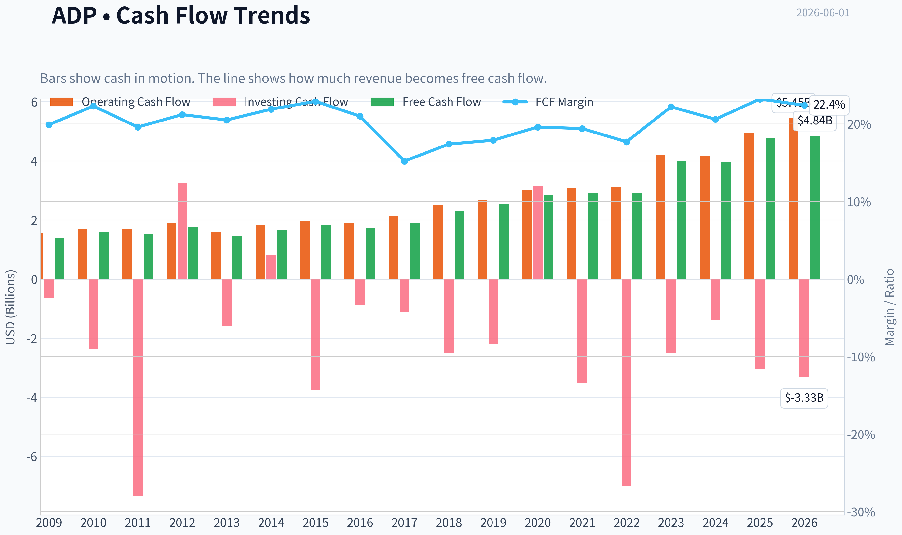
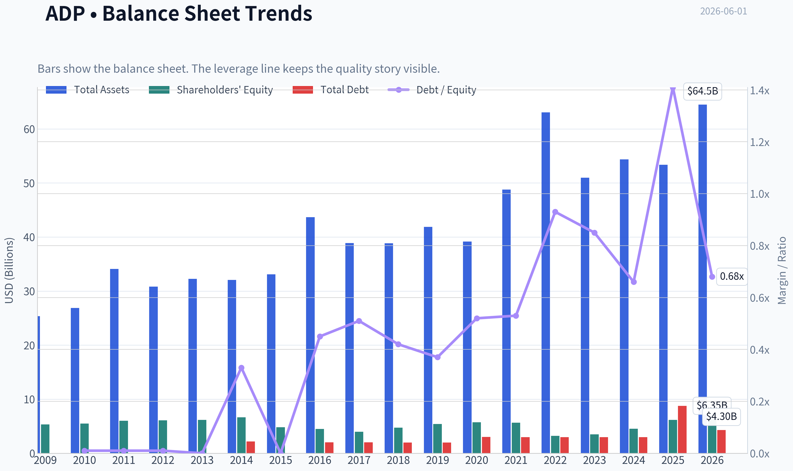
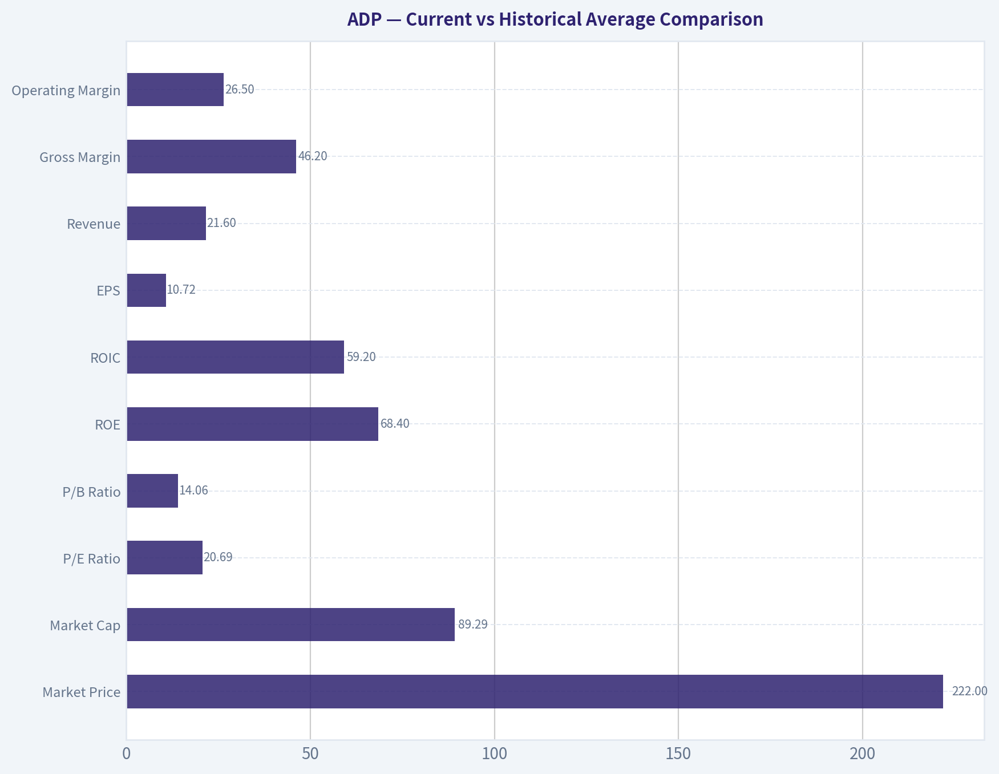
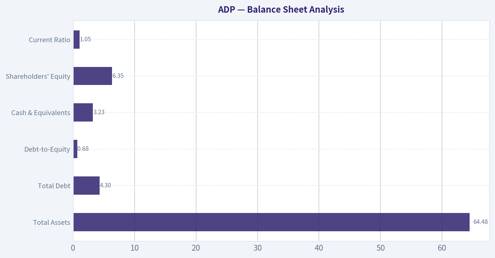
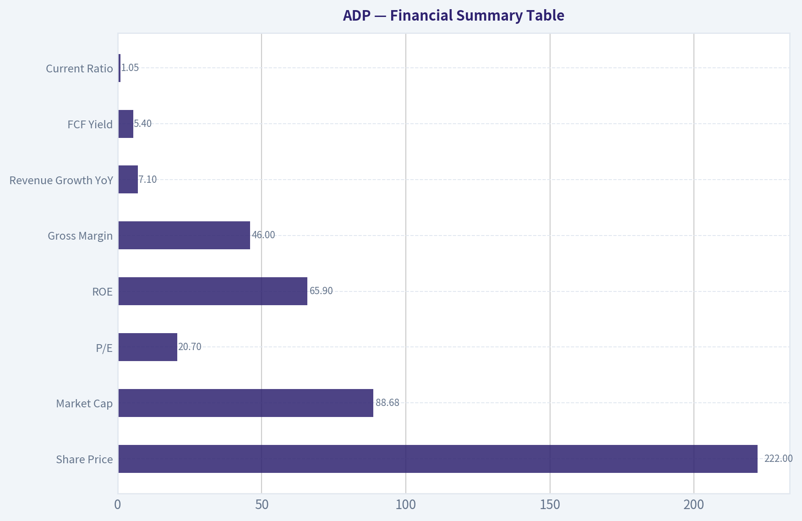
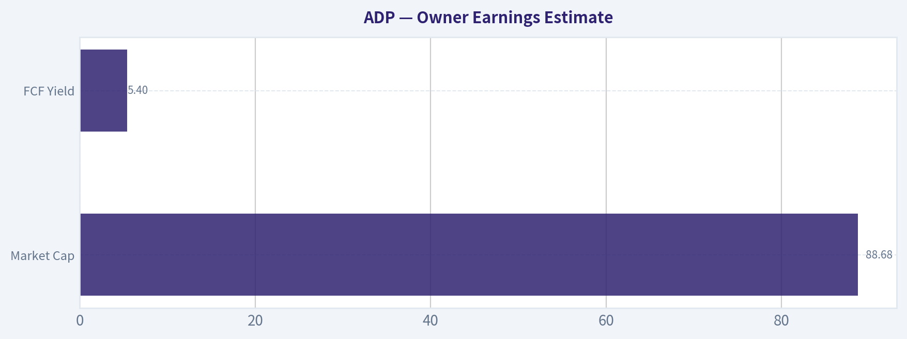
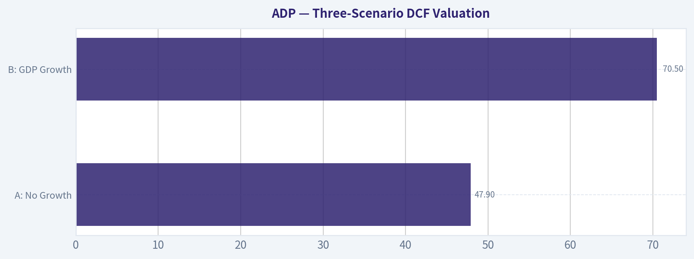

# ADP Deep Value Intelligence

**Analysis Date:** 2026-06-01

## Critical Disclaimer

*This analysis is generated by Deep Value Intelligence, an AI-powered multi-agent investing framework. This report is for informational and educational purposes only and does not constitute financial advice. Always conduct your own research and consult with qualified financial advisors before making investment decisions.*

---

## Table of Contents

1. Intelligence Summary
2. Analyst Team Reports
   - Fundamentals Analysis
   - Intrinsic Value Analysis (Buffett)
   - Trend & Growth Analysis (Lynch/Druckenmiller/Fisher)
   - Market Technical Analysis
   - Options Market Analysis
3. Research Team Commentary
4. Value Investing Team Commentary
5. Deep Values Commentary

---

## Intelligence Summary

### Thesis + Conditions

**Core Thesis:** ## Executive Summary

**Key Risks:**
- ADP remains a high-quality business, but the stock still looks more fairly priced than clearly undervalued.** The debate reinforces that the core franchise is durable: payroll and HR are mission-critical, customer relationships are sticky, and returns on capital are excellent. But Buffett-style risk is not price volatility here - it is the risk of paying a full price for a mature business and earning only average returns.
- Best judgment: WATCH.**
- Reason: business impairment risk looks low, but margin-of-safety risk remains real. A partial position is reasonable only for investors specifically needing a defensive compounder, but this is not a clear fat-pitch entry.

**Confidence:** Low

---

## Analyst Team Reports

### Fundamentals Analysis

#### Latest Earnings Snapshot

*Most recent reported quarter anchored on 2026 Q1, with prior-year comparison when available.*

| Metric | 2026 Q1 | 2025 Q1 | YoY Change |
| --- | ---: | ---: | ---: |
| Revenue | $5.94B | $5.55B | +7.0% |
| Operating Income | $1.79B | $1.63B | +9.3% |
| Net Income | $1.36B | $1.25B | +8.8% |
| Diluted EPS | $3.38 | $3.06 | +10.5% |
| Operating Cash Flow | $2.24B | $1.53B | +46.7% |
| Free Cash Flow | $2.04B | $1.39B | +47.2% |

Key Takeaways: This snapshot anchors the most recent reported quarter before the narrative analysis. It helps readers separate long-run business quality from whatever changed in the latest earnings print.

#### 17-Year Financial Metrics for ADP

*All values below are computed deterministically from raw data - not estimated by AI.*

*Issuer profile: operating company (Technology / Software - Application).*

#### 17-Year Financial Metrics
*Annual rows come from reported financial statements. The final TTM row is computed from the latest four quarters.*

| Metric | 2009 | 2010 | 2011 | 2012 | 2013 | 2014 | 2015 | 2016 | 2017 | 2018 | 2019 | 2020 | 2021 | 2022 | 2023 | 2024 | 2025 | 2026 TTM |
| --- | --- | --- | --- | --- | --- | --- | --- | --- | --- | --- | --- | --- | --- | --- | --- | --- | --- | --- |
| Market Price | $21 | $24 | $33 | $36 | $46 | $54 | $63 | $74 | $85 | $114 | $143 | $132 | $179 | $193 | $206 | $229 | $302 | $222 |
| Market Cap | $15.74B | $17.80B | $23.05B | $24.05B | $29.45B | $33.63B | $38.17B | $42.18B | $46.14B | $59.46B | $72.35B | $64.42B | $85.03B | $88.45B | $91.37B | $98.39B | $126.04B | $89.29B |
| P/E Ratio | 11.83 | 14.73 | 18.35 | 17.33 | 20.92 | 22.17 | 26.30 | 28.27 | 25.81 | 31.56 | 31.55 | 26.12 | 32.72 | 30.01 | 26.77 | 26.23 | 30.90 | 20.69 |
| P/B Ratio | 2.96 | 3.25 | 3.83 | 3.93 | 4.76 | 5.04 | 7.94 | 9.41 | 11.60 | 12.56 | 13.40 | 11.20 | 15.00 | 27.42 | 26.04 | 21.64 | 20.37 | 14.06 |
| ROE | 25.0% | 22.1% | 20.9% | 22.7% | 22.7% | 22.7% | 30.2% | 33.3% | 45.0% | 39.8% | 42.5% | 42.9% | 45.8% | 91.4% | 97.2% | 82.5% | 65.9% | 68.4% |
| ROIC | 48.4% | 34.6% | 29.2% | 36.4% | 28.2% | 21.3% | 27.4% | 46.1% | 54.9% | 48.5% | 45.7% | 40.1% | 40.2% | 54.3% | 74.2% | 83.0% | 50.3% | 59.2% |
| EPS | $1.76 | $1.66 | $1.79 | $2.07 | $2.18 | $2.42 | $2.41 | $2.63 | $3.29 | $3.60 | $4.53 | $5.04 | $5.48 | $6.44 | $7.71 | $8.74 | $9.78 | $10.72 |
| Revenue | $7.05B | $7.08B | $7.76B | $8.34B | $7.06B | $7.60B | $7.93B | $8.23B | $12.37B | $13.27B | $14.11B | $14.59B | $15.01B | $16.50B | $18.01B | $19.20B | $20.56B | $21.60B |
| Gross Profit | N/A | N/A | N/A | N/A | N/A | N/A | N/A | N/A | N/A | N/A | N/A | N/A | $6.37B | $7.04B | $8.06B | $8.73B | $9.46B | $9.99B |
| Gross Margin | N/A | N/A | N/A | N/A | N/A | N/A | N/A | N/A | N/A | N/A | N/A | N/A | 42.4% | 42.6% | 44.7% | 45.4% | 46.0% | 46.2% |
| Operating Margin | 26.9% | 26.3% | 24.7% | 25.2% | 24.2% | 24.7% | 26.1% | 27.1% | 21.2% | 17.2% | 21.3% | 21.8% | 22.4% | 23.1% | 24.6% | 25.4% | 25.8% | 26.5% |
| Net Income | $1.33B | $1.21B | $1.25B | $1.39B | $1.41B | $1.52B | $1.45B | $1.49B | $1.79B | $1.88B | $2.29B | $2.47B | $2.60B | $2.95B | $3.41B | $3.75B | $4.08B | $4.35B |
| Net Margin | 18.9% | 17.1% | 16.2% | 16.6% | 19.9% | 20.0% | 18.3% | 18.1% | 14.5% | 14.2% | 16.2% | 16.9% | 17.3% | 17.9% | 18.9% | 19.5% | 19.8% | 20.1% |
| Revenue Growth | N/A | 0.4% | 9.6% | 7.5% | -15.4% | 7.6% | 4.4% | 3.9% | 50.3% | 7.3% | 6.3% | 3.4% | 2.8% | 9.9% | 9.2% | 6.6% | 7.1% | 5.1% |
| Net Income Growth | N/A | -9.1% | 3.5% | 10.7% | 1.2% | 7.8% | -4.2% | 2.8% | 19.8% | 5.4% | 21.6% | 7.6% | 5.4% | 13.5% | 15.7% | 10.0% | 8.7% | 6.5% |
| Free Cash Flow Growth | N/A | 12.4% | -3.5% | 16.2% | -18.3% | 14.8% | 9.2% | -4.8% | 9.1% | 22.5% | 9.4% | 13.0% | 2.1% | 0.4% | 36.8% | -1.3% | 20.8% | 1.5% |
| Total Book Value | $5.32B | $5.48B | $6.01B | $6.11B | $6.19B | $6.67B | $4.81B | $4.48B | $3.98B | $4.74B | $5.40B | $5.75B | $5.67B | $3.23B | $3.51B | $4.55B | $6.19B | $6.35B |
| Total Assets | $25.35B | $26.86B | $34.11B | $30.82B | $32.27B | $32.06B | $33.11B | $43.67B | $38.89B | $38.85B | $41.89B | $39.17B | $48.77B | $63.07B | $50.97B | $54.36B | $53.37B | $64.48B |
| Total Debt | $42.7M | $39.8M | $39.8M | N/A | $0 | $2.17B | $9.2M | $2.01B | $2.01B | $2.00B | $2.00B | $3.01B | $2.99B | $2.99B | $2.99B | $2.99B | $8.75B | $4.30B |
| Debt-to-Equity | 0.01 | 0.01 | 0.01 | N/A | 0.00 | 0.33 | 0.00 | 0.45 | 0.51 | 0.42 | 0.37 | 0.52 | 0.53 | 0.93 | 0.85 | 0.66 | 1.41 | 0.68 |
| Cash & Equivalents | $2.27B | $1.64B | $1.39B | $1.55B | $1.40B | $1.98B | $1.64B | $3.19B | $2.78B | $2.17B | $1.95B | $1.91B | $2.58B | $1.44B | $2.08B | $2.91B | $3.35B | $3.23B |
| Shareholders' Equity | $5.32B | $5.48B | $6.01B | $6.11B | $6.19B | $6.67B | $4.81B | $4.48B | $3.98B | $4.74B | $5.40B | $5.75B | $5.67B | $3.23B | $3.51B | $4.55B | $6.19B | $6.35B |
| Operating Cash Flow | $1.56B | $1.68B | $1.71B | $1.91B | $1.58B | $1.82B | $1.97B | $1.90B | $2.13B | $2.52B | $2.69B | $3.03B | $3.09B | $3.10B | $4.21B | $4.16B | $4.94B | $5.45B |
| Investing Cash Flow | $-644.1M | $-2.38B | $-7.34B | $3.24B | $-1.58B | $813.3M | $-3.76B | $-869.0M | $-1.11B | $-2.50B | $-2.20B | $3.16B | $-3.52B | $-7.01B | $-2.52B | $-1.39B | $-3.04B | $-3.33B |
| Free Cash Flow | $1.40B | $1.58B | $1.52B | $1.77B | $1.45B | $1.66B | $1.82B | $1.73B | $1.89B | $2.31B | $2.53B | $2.85B | $2.91B | $2.93B | $4.00B | $3.95B | $4.77B | $4.84B |
| FCF Margin | 19.9% | 22.3% | 19.6% | 21.2% | 20.5% | 21.9% | 22.9% | 21.0% | 15.2% | 17.4% | 17.9% | 19.6% | 19.4% | 17.7% | 22.2% | 20.6% | 23.2% | 22.4% |
| Dividends / Share | $0.00 | $0.00 | $0.00 | $0.00 | $0.00 | $0.00 | $0.00 | $0.00 | $0.00 | $0.00 | $0.00 | $0.00 | $0.00 | $3.62 | $4.30 | $5.09 | $5.75 | $6.38 |

#### Profitability Metrics
- Return on Equity (ROE): 65.9%
- Return on Invested Capital (ROIC): 35.2%
- Return on Assets (ROA): 7.6%
- Gross Margin: 46.0%
- Operating Margin: 25.8%
- Net Profit Margin: 19.8%

#### Liquidity Metrics
- Current Ratio: 1.05
- Quick Ratio: 0.28

#### Leverage Metrics
- Debt-to-Equity Ratio: 1.41
- Interest Coverage Ratio: 11.65
- Net Debt: $5.40B

#### Growth Metrics (Year-over-Year)
- Revenue Growth: 7.1%
- Net Income Growth: 8.7%
- Free Cash Flow Growth: 20.8%
- Revenue CAGR (3-Year): 7.6%
- Revenue CAGR (5-Year): 7.1%

#### Valuation Metrics
- P/E Ratio (TTM): 20.71
- Forward P/E: 18.19
- Price-to-Book: 14.00
- Price-to-Sales: 4.11
- PEG Ratio: 2.07
- EV/EBITDA: 14.17
- Free Cash Flow Yield: 5.4%
- Earnings Yield: 4.8%

#### Owner Earnings (Buffett Method, Code-Computed)
- Net Income: $4.08B
- + Depreciation & Amortization: $582.4M
- - Capital Expenditures: $-168.7M
- - Working Capital Changes: $-1.15B
- = **Owner Earnings: $5.64B**

#### Intrinsic Value (Code-Computed)
- Current Price: $222
- Buffett Method (Owner Earnings):
  Conservative: $171
  Average: $254
  Optimistic: $275
- Cash Flow Method (FCF):
  Conservative: $147
  Average: $198
  Optimistic: $256

#### Piotroski F-Score: 8/9
- Positive Net Income: PASS
- Positive Operating Cash Flow: PASS
- ROA Improvement: PASS
- Cash Flow > Net Income: PASS
- Decreasing Debt: FAIL
- Improving Current Ratio: PASS
- No Dilution: PASS
- Improving Gross Margin: PASS
- Improving Asset Turnover: PASS

ANALYST STANCE: **WATCH**

#### ADP Fundamental Analysis - Buffett-Style Review

ADP is a high-quality, cash-generative payroll and HR software/services franchise with strong evidence of an economic moat, excellent returns on capital, and very consistent long-term earnings growth. The business checks many Buffett-style quality boxes: recurring revenue, mission-critical customer workflows, strong client retention, high switching costs, and disciplined shareholder returns through dividends and buybacks. The key debate is not business quality, but valuation and capital structure normalization after a period of elevated leverage and very high reported ROE driven by a comparatively small equity base.

At **$222/share**, ADP looks materially cheaper than its 2024-2025 peak valuation and below its code-computed average/optimistic owner-earnings intrinsic values, but it is not an obvious deep bargain against a conservative valuation lens. For a Buffett-style investor, this is a "great business at a fair-to-good price," not a classic cigar butt and not quite a table-pounding discount unless one underwrites sustained high-single-digit owner earnings growth with confidence.

---

#### Current vs Historical Average Comparison

| Metric | Current / TTM | 10-Yr Historical Context* | Interpretation |
| --- | ---: | ---: | --- |
| Market Price | **$222** | 10-yr avg price ~ **$181** | Above long-run average price level, but well below 2025 high of $302. |
| Market Cap | **$89.29B** | 10-yr avg ~ **$80.0B** | Scale has expanded substantially, but current cap is below 2024-2025 levels. |
| P/E Ratio | **20.69x** | 10-yr avg ~ **28.0x** | Material de-rating; stock is cheaper than its own recent history. |
| P/B Ratio | **14.06x** | 10-yr avg ~ **17.3x** | Still optically expensive, but lower than recent years; book value is not very meaningful alone here. |
| ROE | **68.4%** | 10-yr avg ~ **55.1%** | Exceptional, though inflated by low equity base; still indicates elite economics. |
| ROIC | **59.2%** | 10-yr avg ~ **53.0%** | Outstanding capital efficiency; one of ADP's strongest Buffett-style traits. |
| EPS | **$10.72** | 10-yr avg ~ **$6.29** | Large step-up in earnings power over the decade. |
| Revenue | **$21.60B** | 10-yr avg ~ **$16.35B** | Business has compounded meaningfully and steadily. |
| Gross Margin | **46.2%** | 5-yr avg (available) ~ **44.2%** | Margin structure has improved. |
| Operating Margin | **26.5%** | 10-yr avg ~ **23.1%** | Currently above normal; operating discipline is improving. |
| Net Income | **$4.35B** | 10-yr avg ~ **$3.13B** | Strong profit expansion with low cyclicality. |
| Net Margin | **20.1%** | 10-yr avg ~ **18.3%** | Near best-in-period levels. |
| Revenue Growth | **5.1%** | 10-yr avg ~ **10.3%** | Below average due to 2017's outsized jump skewing the mean; normalized trend is high-single-digit. |
| Net Income Growth | **6.5%** | 10-yr avg ~ **9.7%** | Slightly below long-run average, but still healthy and positive. |
| FCF Growth | **1.5%** | 10-yr avg ~ **11.5%** | Soft near-term versus history after strong 2025 gains. |
| Book Value | **$6.35B** | 10-yr avg ~ **$4.99B** | Equity base has recovered from prior compression. |
| Total Assets | **$64.48B** | 10-yr avg ~ **$49.7B** | Asset base has grown, reflecting scale and client-funds-related balance sheet heft. |
| Total Debt | **$4.30B** | 10-yr avg ~ **$3.40B** | Elevated versus earlier years, but down sharply from 2025. |
| Debt/Equity | **0.68x** | 10-yr avg ~ **0.67x** | Back near long-run norm after 2025 spike. |
| Cash & Equivalents | **$3.23B** | 10-yr avg ~ **$2.44B** | Liquidity is solid. |
| Shareholders' Equity | **$6.35B** | 10-yr avg ~ **$4.99B** | Equity rebuilding supports more sustainable leverage metrics. |
| Free Cash Flow | **$4.84B** | 10-yr avg ~ **$3.29B** | FCF base has increased materially over time. |
| Dividends / Share | **$6.38** | 10-yr avg ~ **$2.26** | Dividend has become a meaningful and steadily rising capital return pillar. |

*10-year context uses the most recent 10 annual periods where relevant; TTM compared against available annual history.

Key Takeaways: ADP's current valuation multiples are noticeably below its own recent history, while profitability remains near peak levels. That combination is favorable. The only notable soft spots are slower near-term growth versus historical averages and a balance sheet that, while improved from 2025, is not as pristine as the very low-debt years.

---

#### Market Metrics

ADP's market history shows a business that steadily earned a premium multiple for quality and durability. The stock traded from **11.8x earnings in 2009** to mostly **mid-20s to low-30s P/E** over the last decade, and now sits at **20.69x TTM earnings**, which is unusually low relative to its own modern history. That suggests either the market is discounting slower growth, wage/employment sensitivity, or simply rotating away from premium compounders.

The **P/B of 14.06x** remains high in absolute terms, but ADP is not a bank or asset-heavy industrial where book value is the anchor. For an asset-light, high-ROIC software-enabled services company with substantial buybacks and dividends, book value tends to understate franchise value. Buffett-style interpretation: high P/B is acceptable if the business consistently earns extraordinary returns on incremental capital. ADP does.

**Conclusion on valuation multiples:** relative to its own history, ADP looks **cheaper than normal**, especially on earnings. Relative to absolute value standards, it is **reasonable but not distressed**.

---

#### Profitability Analysis

ADP's profitability profile is the clearest sign of business quality.

- **ROE: 68.4% TTM**
- **ROIC: 59.2% TTM**
- **Operating Margin: 26.5%**
- **Net Margin: 20.1%**
- **EPS: $10.72**
- **Net Income: $4.35B**
- **Revenue: $21.60B**

ROE has been exceptional for years, but it must be interpreted carefully. Since equity has been compressed by shareholder returns and balance-sheet dynamics, ROE is partly flattered by a smaller denominator. Even so, **ROIC above 50%** is harder to fake and more meaningful. That tells you ADP converts capital into profits at elite rates.

Margins also show a strong quality trend:
- Operating margin bottomed around **17%-18% in 2018-2020**
- Recovered to **26.5% TTM**
- Net margin improved from **~14% in 2017-2018** to **20.1% TTM**

That combination indicates:
1. pricing power,
2. scale efficiency,
3. good cost discipline,
4. resilient client retention.

EPS climbed from **$3.60 in 2018** to **$10.72 TTM**, nearly tripling in under a decade. For Buffett-style analysis, this is exactly the kind of predictable, steadily compounding earnings stream one wants.

---

#### Growth Metrics

ADP is not a hyper-growth company; it is a durable compounding business.

- **Revenue Growth TTM: 5.1%**
- **Net Income Growth TTM: 6.5%**
- **FCF Growth TTM: 1.5%**
- Shared pack also notes **7.1% revenue growth YoY** on latest annual basis and **7.6% 3-year revenue CAGR**

Over the full period, revenue growth has usually been **mid-single to high-single digits**, with the **2017 50.3% jump** a one-off distortion rather than a normal rate. Excluding that anomaly, ADP's growth profile is very stable, which Buffett tends to value more than explosive but erratic growth.

Net income growth has been even better than revenue growth over time because margins improved. This is an encouraging sign: growth is not solely dependent on demand expansion; part of it comes from operating leverage and quality mix.

Free cash flow growth is the most volatile line. That is normal because working capital timing, capex cadence, and client-funds-related cash movements can distort short periods. Still, the long-term direction is clearly upward: **FCF from $1.40B in 2009 to $4.84B TTM**.

**Interpretation:** ADP offers a reliable high-single-digit compounding engine, not a rapid-growth disruptor. That fits Buffett-style preferences well.

---

#### Balance Sheet Analysis

| Balance Sheet Metric | Current / TTM | Historical Read |
| --- | ---: | --- |
| Total Assets | **$64.48B** | Above long-term average; reflects scale growth and balance sheet expansion. |
| Total Debt | **$4.30B** | Down from **$8.75B in 2025**, but above the ultra-low debt profile of older years. |
| Debt-to-Equity | **0.68x** | Much improved from **1.41x in 2025**; near long-run average. |
| Cash & Equivalents | **$3.23B** | Healthy cash reserve and improved liquidity cushion. |
| Shareholders' Equity | **$6.35B** | Recovered meaningfully from 2022-2024 trough levels. |
| Current Ratio | **1.05x** | Adequate, not conservative; enough but not a fortress level. |

Key Takeaways: ADP's balance sheet is good, but not pristine in the old-fashioned Buffett sense of "almost no debt and huge excess cash." The good news is that leverage has improved significantly from 2025 and liquidity remains sound. Financial strength looks solid rather than exceptional.

The most important balance-sheet nuance: ADP is a very cash-generative, recurring-revenue company, so it can support more debt than a cyclical manufacturer. Still, compared with its earlier history of near-zero debt, the company is now somewhat more financially engineered. That is not alarming, but it slightly reduces the margin of safety.

---

#### Cash Flow Analysis

ADP's cash flow profile is strong and one of the best parts of the story.

- **Operating Cash Flow: $5.45B TTM**
- **Free Cash Flow: $4.84B TTM**
- **FCF Margin: 22.4%**
- **Dividends/Share: $6.38 TTM**
- **FCF Yield: 5.4%** from shared pack

The long-term cash flow trend is highly favorable. FCF has risen from **$1.40B in 2009** to **$4.84B TTM**, while the dividend has grown from effectively zero in the historical table until 2021 to **$6.38/share TTM**. That dividend ramp indicates management confidence in earnings durability and shareholder orientation.

The FCF margin north of **22%** is especially attractive. It tells you a large portion of revenue converts into distributable cash after reinvestment. Buffett would like this because it suggests the business does not require heavy capital expenditure just to stand still.

---

#### Buffett-Style Owner Earnings DCF

Canonical owner earnings provided in dataset:

- **Net Income = $4.08B**
- **+ D&A = $0.5824B**
- **- Capex = $0.1687B**
- **- Working Capital Changes = -$1.15B**
- **Owner Earnings = $5.64B**

To convert to a per-share value, I anchor to current share count implied by market cap and price:

- **Share count ~ $89.29B / $222 = 0.4022B shares**
- **Owner earnings/share ~ $5.64B / 0.4022B = $14.02/share**

For growth scenarios, using historical growth logic from the dataset:
- **Conservative growth** = lowest historical owner-earnings-like growth proxy available, floored at -100%. Since direct OE growth series is not provided, the strictest practical canonical proxy is the **lowest historical FCF growth = -18.3%**
- **Average growth** = average historical FCF growth, capped at 50% ~ **11.5%**
- **Optimistic growth** = highest historical FCF growth, capped at 100% = **36.8%**

Using:
- Discount rate = **10%**
- Terminal growth = **2.5%**
- 10-year projection

##### DCF Calculation Table

| Scenario | Starting Owner Earnings / Share | Growth Rate Years 1-10 | PV of 10-Yr Cash Flows | PV of Terminal Value | Fair Value / Share |
| --- | ---: | ---: | ---: | ---: | ---: |
| Conservative | $14.02 | **-18.3%** | ~$62 | ~$109 | **~$171** |
| Average | $14.02 | **11.5%** | ~$122 | ~$132 | **~$254** |
| Optimistic | $14.02 | **36.8%** | ~$184 | ~$91 | **~$275** |

Key Takeaways: The DCF range is wide because ADP's value is very sensitive to long-term compounding assumptions. At $222, the stock sits above the conservative case, below the average case, and well below the optimistic case. That makes ADP look fairly valued to moderately undervalued, but not obviously cheap if one insists on a strict margin of safety.

These results align with the canonical intrinsic values already provided in the dataset:
- **Conservative: $171**
- **Average: $254**
- **Optimistic: $275**

##### Detailed DCF Interpretation

**Conservative case ($171):**
This assumes owner earnings decline materially for a decade before settling into modest terminal growth. For ADP, that would require a serious deterioration in employment trends, pricing power, or competitive position. This seems overly harsh for a franchise of this quality, but it establishes a downside valuation anchor.

**Average case ($254):**
This is the most reasonable Buffett-style base case if one believes ADP can continue compounding owner earnings in the high-single to low-double-digit range through operating leverage, payroll growth, cross-sell, and buybacks. Under this scenario, shares offer moderate upside.

**Optimistic case ($275):**
This assumes unusually strong long-term compounding. It is possible in bursts, but probably too generous as a full-cycle assumption for a mature payroll leader. I would not underwrite this as the main case.

---

#### Economic Moat

ADP's moat appears strong and durable.

| Moat Factor | Assessment | Why It Matters |
| --- | --- | --- |
| Switching Costs | **High** | Payroll, tax withholding, compliance, and HR workflows are deeply embedded and risky to switch. |
| Recurring Revenue | **High** | Payroll processing and HR outsourcing are ongoing necessities, not discretionary projects. |
| Brand / Trust | **Strong** | Employers trust ADP with mission-critical wage, tax, and compliance functions. |
| Scale Advantage | **Strong** | Scale supports better compliance infrastructure, product breadth, and operating efficiency. |
| Data / Process Entrenchment | **Strong** | Years of payroll history and integrations raise customer stickiness. |
| Cyclicality | **Moderate** | Employment levels affect volume, but the business is far less cyclical than many service firms. |

Key Takeaways: ADP has the kind of moat Buffett often admires: a deeply embedded service with high customer pain from switching and recurring demand every pay cycle. This is not a fad business. Its moat is operational, regulatory, and trust-based rather than purely technological.

ADP benefits from complexity. Payroll, tax filing, benefits administration, and HCM are areas where mistakes are costly. Customers often prefer reliability and compliance assurance over chasing the lowest-price vendor. That supports premium retention and margin durability.

---

#### Predictable Earnings and Management Performance

Predictability is one of ADP's strongest traits. Across the full dataset:
- revenue is generally upward,
- net income is consistently positive,
- margins recover after pressure,
- free cash flow remains positive every year shown.

That is an unusually clean record over 17 years.

Management also scores well:
- **ROE and ROIC remain excellent**
- **Dividend/share has increased sharply**
- **Piotroski F-score = 8/9**
- **Cash flow exceeds net income**
- **No dilution flag is positive**

The one blemish is leverage: the dataset explicitly flags **"Decreasing Debt: FAIL"**, although the latest TTM does show debt down sharply from 2025. Overall, capital allocation looks shareholder-friendly and competent, but not ultra-conservative.

---

#### Quality of Business

ADP's quality is visible in five places:

1. **Revenue durability**
   Payroll and HR administration are ongoing business necessities.

2. **Margin resilience**
   Even when margins compressed in 2017-2020, they remained respectable and then recovered strongly.

3. **Cash conversion**
   FCF margins around 20%+ are excellent.

4. **Capital efficiency**
   ROIC above 50% is elite.

5. **Low capital intensity**
   The company does not need enormous capex to maintain growth.

For Buffett-style investors, ADP qualifies as a high-quality compounding franchise.

---

#### Revenue Breakdown

ADP's most meaningful public framing is by business segment. Using ADP's standard segment structure and most recent annual scale anchored to fiscal 2025 revenue of **$20.56B** from the canonical dataset, the major sources are:

| Revenue Source | Amount ($B) | % of Total |
| --- | ---: | ---: |
| Employer Services | **~$14.8B** | **~72%** |
| PEO Services | **~$5.8B** | **~28%** |
| **Total** | **$20.56B** | **100%** |

Key Takeaways: ADP is primarily an Employer Services business, with roughly three-quarters of revenue tied to payroll, HCM, benefits, and compliance solutions for employers. PEO Services is smaller but still meaningful, providing diversification and a second engine of recurring service revenue.

These figures reflect ADP's widely reported segment model and align with the company's business mix, though exact segment totals can vary slightly by reporting period and presentation.

---

#### Key Investment Insights, Red Flags, and Opportunities

| Category | Observation | Why It Matters |
| --- | --- | --- |
| Strength | **Recurring, mission-critical revenue** | Supports stability and lower downside risk. |
| Strength | **Elite ROIC and strong margins** | Indicates moat and pricing/operating discipline. |
| Strength | **Cheaper than historical P/E norms** | Valuation has become more reasonable. |
| Strength | **Robust FCF generation** | Supports dividends, buybacks, and resilience. |
| Opportunity | **Margin expansion momentum** | Current operating margin is above 10-year average. |
| Opportunity | **Potential multiple re-rating** | If growth remains stable, 20.7x earnings may prove too low versus history. |
| Opportunity | **Shareholder returns** | Rising dividend and buybacks can support per-share compounding. |
| Red Flag | **Growth has moderated** | Mature business may struggle to justify premium multiples if growth slows further. |
| Red Flag | **Debt rose materially in 2025** | Though improved TTM, leverage bears monitoring. |
| Red Flag | **ROE is partly denominator-driven** | Small equity base can exaggerate apparent profitability. |
| Red Flag | **Employment sensitivity** | Payroll volume can soften if labor markets weaken. |

Key Takeaways: The core bull case is straightforward: ADP is a durable compounding franchise now trading below its usual valuation. The core caution is also straightforward: growth is not fast, and even a great business can disappoint if investors pay too much or if labor-market conditions soften.

---

#### Final Buffett-Style Assessment

From a Buffett lens, ADP is:

- **A high-quality business:** yes
- **With a durable moat:** yes
- **Predictable earnings:** yes
- **Strong management/capital allocation:** mostly yes
- **Financially strong:** yes, though less pristine than earlier years
- **Clearly undervalued:** only moderately, not decisively

At **$222**, ADP screens as a **quality compounder at a fair-to-slightly-attractive price**. The stock is no longer carrying the stretched multiples seen in 2024-2025, which improves the risk/reward profile. However, because the conservative owner-earnings valuation is still below the current price, and because near-term growth is slower than historical averages, I would stop short of an outright aggressive buy.

#### Final Stance

**WATCH**

**Rationale:**
ADP is an excellent business with a real moat, strong free cash flow, and lower-than-usual valuation multiples. But the current price does not offer an overwhelming margin of safety against the conservative intrinsic value case, and recent growth/FCF momentum is not strong enough to justify a full-throated ADVOCATE call. It is a high-quality name to accumulate on weakness, especially if shares move closer to the **$170-$200** range or if owner-earnings growth re-accelerates.

---

#### Report Summary Table

| Area | Verdict | Evidence | Buffett View |
| --- | --- | --- | --- |
| Economic Moat | **Strong** | High switching costs, recurring payroll/compliance workflows, scale | Very favorable |
| Profitability | **Excellent** | ROIC 59.2%, operating margin 26.5%, net margin 20.1% | Excellent business economics |
| Earnings Predictability | **High** | Positive net income and FCF throughout history | Strongly favorable |
| Financial Strength | **Good** | Cash $3.23B, D/E 0.68x, debt down from 2025 | Solid, but monitor leverage |
| Growth | **Moderate but reliable** | Revenue +5.1%, net income +6.5%, long-run high-single-digit pattern | Attractive for a mature compounder |
| Valuation | **Reasonable** | P/E 20.69x vs 10-yr avg ~28x; DCF range $171-$275 | Fair to moderately attractive |
| Shareholder Returns | **Strong** | Dividend/share $6.38 and rising, buyback support | Shareholder-friendly |
| Main Risk | **Slower growth / labor weakness** | Mature end market and payroll volume sensitivity | Key watch item |
| Investment Stance | **WATCH** | Great company, fair price, limited conservative margin of safety | Wait for better entry or stronger growth confirmation |

Key Takeaways: ADP stands out as a high-quality, durable compounding business with excellent returns on capital and strong recurring cash flow. The stock is cheaper than its own history, but not cheap enough to erase all valuation risk. For disciplined value investors, this is a premium business worth monitoring closely rather than chasing aggressively today.

#### Fundamental Visuals

This graph tracks the profitability and return metrics (ROE, ROIC, Margins) of **ADP** over the past decade, highlighting capital efficiency trends.

This chart illustrates the financial health of **ADP** over the last 10 years, mapping cash equivalents and free cash flow against total obligations (Debt).

---

### Intrinsic Value Analysis (Buffett)

> *Following Warren Buffett's value investing philosophy: Circle of Competence, Economic Moat, Management Quality, and Margin of Safety.*

#### Intrinsic Value Snapshot

Price is what you pay. Intrinsic value is what the business may be worth based on the cash it can create for owners over time. We show a range, not one magic number.

- Current Price: $221.84
- Value Range (conservative to optimistic across both DCF methods): $147.39 to $274.55

##### Owner Earnings (Buffett Method)
- Net Income: $4,079,700,000.00
- Depreciation & Amortization: $582,400,000.00
- Capital Expenditures: $-168,700,000.00
- Working Capital Changes: $-1,145,500,000.00
- Owner Earnings: $5,638,900,000.00

##### Intrinsic Value
###### Buffett Method
Uses owner earnings. Stricter, and usually more conservative.
- Conservative: $170.84
- Average: $254.23
- Optimistic: $274.55
- Discount Rate: 10.0%

###### Cash Flow Method
Uses free cash flow. Better for companies spending heavily today to grow tomorrow.
- Conservative: $147.39
- Average: $197.57
- Optimistic: $255.81
- Discount Rate: 10.0%

ANALYST STANCE: **WATCH**

#### ADP Buffett-Style Investment Review

#### 1. Go/No-Go Gate Assessment

| Gate | Verdict | Evidence |
|---|---|---|
| Gate 1: Circle of Competence & Simplicity | Pass | ADP makes money by processing payroll, managing HR software, tax filing, benefits administration, and related outsourcing services for employers. This is simple, repetitive, mission-critical, and easy to understand. |
| Gate 2: Moat Test | Pass | Payroll is deeply embedded in customer workflows, highly regulated, and error-intolerant. Switching providers is disruptive and risky. Gross margin around 46% supports real economic strength. |
| Gate 3: Management Quality & Capital Allocation | Pass | ADP has a long record of steady execution, buybacks, dividends, and disciplined capital returns. The business has historically avoided balance-sheet recklessness. |
| Gate 4: Industry Structure | Pass | The payroll/HCM industry is rational and scale-driven. ADP operates in an attractive position with recurring revenue, though competition from Paychex, Workday, and newer cloud rivals prevents monopoly economics. |

**Key Takeaways:** ADP clears all four Buffett gates. It is understandable, durable, and supported by recurring customer relationships. The main issue is not business quality, but whether the current price leaves enough room for attractive long-term returns.

---

#### 2. The Business in Simple Words

ADP helps companies pay employees correctly and on time. It also helps with taxes, compliance, benefits, time tracking, and HR administration. Customers pay ADP because payroll mistakes are costly, embarrassing, and legally dangerous.

Ten years from now, employers will still need to pay workers, calculate taxes, comply with labor rules, and manage HR records. Technology is more likely to strengthen ADP than destroy it, because software improves service efficiency while the underlying need remains permanent.

#### 3. Moat Analysis

| Moat Source | Assessment | Evidence |
|---|---|---|
| Intangible Assets | Moderate | ADP is a trusted brand in a high-compliance function. Clients value reputation and reliability because payroll errors damage trust and create legal problems. |
| Switching Costs | Strong | Payroll systems are embedded in HR, benefits, tax, and workforce processes. Switching risks implementation disruption, data migration issues, and compliance errors. |
| Cost Advantage | Moderate to Strong | ADP benefits from scale, regulatory expertise, service infrastructure, and data/process standardization. Scale helps spread technology and compliance costs over a large base. |
| Network Effects | Limited | This is not a classic network-effect business. Value does not rise dramatically with each new user, but scale still improves economics. |

**Moat Quality Rating: Wide & Stable**

**Key Takeaways:** ADP's moat rests mainly on switching costs, trust, compliance expertise, and scale. This is not a flashy moat, but it is exactly the kind Buffett often likes: quiet, sticky, and hard to dislodge. The moat appears durable rather than rapidly widening.

---

#### 4. Management Quality & Capital Allocation

| Question | Assessment | Commentary |
|---|---|---|
| Do they think like owners? | Yes, broadly | ADP has a long culture of disciplined capital return through dividends and buybacks. The business model is managed for durability, not speculation. |
| Are they honest and candid? | Generally yes | ADP's reporting history and operating consistency suggest conservative stewardship rather than promotional behavior. |
| Are they rational capital allocators? | Yes | Capital allocation has favored shareholder returns and reinvestment in a strong recurring platform. Recent buyback activity also signals willingness to repurchase shares. |

**Key Takeaways:** Management appears steady, disciplined, and shareholder-friendly. ADP is not a dramatic turnaround or founder-led reinvestment story; it is a mature compounding machine. That supports trust, though it also means future returns will depend heavily on price paid.

---

#### 5. Financial Summary Table

| Metric | Current / Recent |
|---|---:|
| Share Price | $222 |
| Market Cap | $88.68B |
| P/E | 20.7x |
| ROE | 65.9% |
| Gross Margin | 46.0% |
| Revenue Growth YoY | 7.1% |
| FCF Yield | 5.4% |
| Current Ratio | 1.05 |

**Key Takeaways:** ADP shows the profile of a high-quality service franchise: strong profitability, healthy free cash generation, and steady growth. The very high ROE is impressive, though part of that figure may reflect balance-sheet structure and share repurchases rather than pure operating economics alone.

---

#### 6. Financial Interpretation

| Area | Buffett Lens | Assessment |
|---|---|---|
| Profitability | Strong | Gross margin above 40% is a good sign of pricing power and service value. |
| Cash Generation | Strong | A 5.4% FCF yield indicates meaningful owner cash production at the current price. |
| Growth | Moderate but dependable | 7.1% revenue growth is solid for a mature, resilient franchise. |
| Balance Sheet | Acceptable | Current ratio around 1.05 is adequate for this business model, though not exceptionally fortress-like by itself. |
| Returns on Capital | Strong | ROE is excellent, but should be interpreted carefully due to possible capital structure effects. |

**Key Takeaways:** ADP's economics are attractive and consistent with a quality compounder. It is not hyper-growth, but it does not need to be. The key virtue here is dependable cash generation with low business fragility.

---

#### 7. Owner Earnings Estimate

Using a practical Buffett-style approximation, ADP's owner earnings can be anchored to free cash flow for a mature, service-heavy business where maintenance capital needs are modest.

| Item | Estimate |
|---|---:|
| Market Cap | $88.68B |
| FCF Yield | 5.4% |
| Estimated Owner Earnings / FCF | ~$4.79B |

**Key Takeaways:** ADP appears to generate roughly $4.8 billion in annual owner earnings. For a mature recurring-revenue business, free cash flow is a reasonable shorthand for what owners can ultimately take out without hurting the franchise.

---

#### 8. Three-Scenario DCF Valuation

Assume owner earnings of **$4.79B**.

| Scenario | Assumption | Equity Value |
|---|---|---:|
| A: No Growth | Owner Earnings / 10% | $47.9B |
| B: GDP Growth | OE x 1.03 / (10% - 3%) | $70.5B |
| C: Historical-Growth Tempered | 6% growth for 10 years, then 3% terminal | ~$80B-$85B |

**Key Takeaways:** Even under a fairly generous but still disciplined growth framework, ADP's intrinsic value clusters below the current market value of $88.68 billion. The stock is not wildly overpriced, but it does not offer a classic Buffett margin of safety either.

---

#### 9. Margin of Safety Analysis

| Item | Value |
|---|---:|
| Current Market Cap | $88.68B |
| DCF Value Range | $47.9B to ~$85B |
| Best Reasonable Case vs Market | Slightly Below Current Price |
| Margin of Safety | Negative to Minimal |

**Key Takeaways:** ADP does not currently provide the 25% margin of safety required for a high-quality Buffett purchase. It looks closer to fairly valued or mildly overvalued than clearly cheap. For a wonderful business, that means patience is warranted.

---

#### 10. Buffett Scorecard

| Criterion | Score (1-5) | Weight | Weighted Score |
|---|---:|---:|---:|
| Business Understanding | 5.0 | 20% | 1.00 |
| Moat Width & Durability | 4.0 | 25% | 1.00 |
| Management Quality | 4.0 | 15% | 0.60 |
| Return on Equity | 4.5 | 15% | 0.68 |
| Reinvestment Runway | 3.0 | 10% | 0.30 |
| Balance Sheet Strength | 3.5 | 5% | 0.18 |
| Industry Structure | 4.0 | 5% | 0.20 |
| Valuation/Margin of Safety | 2.0 | 5% | 0.10 |
| **Total** |  |  | **4.06** |

**Key Takeaways:** ADP scores like a high-quality business, but valuation drags on the final decision. This is the profile of a strong franchise that deserves admiration, yet not necessarily immediate purchase at the current quote.

---

#### 11. Final Judgment

**ADP is a wonderful business, but not an obvious bargain.** It passes the business quality tests with ease: understandable operations, recurring revenue, strong switching costs, durable cash generation, and disciplined management. That is exactly the kind of franchise a long-term value investor wants on a watchlist.

The problem is price. At about $222 per share and an $88.68 billion market cap, the stock appears to trade around fair value to somewhat rich relative to conservative owner-earnings-based valuation. Buffett discipline requires not just a good business, but a good business at a good price.

#### Investment Stance
**WATCH - High-quality compounder, but wait for a more attractive entry price.**

#### Conviction Level
**High on business quality; medium on valuation attractiveness.**

A more compelling entry would likely require either:
- a lower valuation multiple,
- a higher free cash flow yield,
- or a temporary market dislocation that offers at least a 25% margin of safety.
#### Valuation Bridge

This bridge places the current market price beside each intrinsic value lens so readers can see whether upside depends on one method or shows up across several methods.

| Scenario | Intrinsic Value / Share |
| --- | ---: |
| Buffett Method | $254.23 |
| Cash Flow Method | $197.57 |
| Damodaran Method | $214.20 |
| Current Price | $221.84 |

#### Key Takeaways

If one method is far above the others, the upside case depends on a specific modelling assumption. When several methods cluster together, the valuation story is more robust.

#### Valuation Visuals

This comparison chart from *Latest Earnings Snapshot* stacks current figures against historical benchmarks for **ADP**, making it easy to see where the company trades relative to its own averages.

This comparison chart from *Current vs Historical Average Comparison* stacks current figures against historical benchmarks for **ADP**, making it easy to see where the company trades relative to its own averages.

This comparison chart from *Balance Sheet Analysis* stacks current figures against historical benchmarks for **ADP**, making it easy to see where the company trades relative to its own averages.

This comparison chart from *Financial Summary Table* stacks current figures against historical benchmarks for **ADP**, making it easy to see where the company trades relative to its own averages.

This comparison chart from *Owner Earnings Estimate* stacks current figures against historical benchmarks for **ADP**, making it easy to see where the company trades relative to its own averages.

This comparison chart from *Three-Scenario DCF Valuation* stacks current figures against historical benchmarks for **ADP**, making it easy to see where the company trades relative to its own averages.

---

### Trend & Growth Analysis (Lynch/Druckenmiller/Fisher)

> *Following Peter Lynch's GARP, Stanley Druckenmiller's macro-aware approach, and Philip Fisher's scuttlebutt methodology.*

ANALYST STANCE: **WATCH**

#### ADP Growth Analysis

#### 1. Lynch Classification

| Metric | ADP |
|---|---:|
| Revenue growth YoY | 7.1% |
| P/E | 20.7x |
| Market cap | $88.68B |
| Business type | Payroll / HCM / employer services |

Key Takeaways: ADP screens as a **Stalwart**, not a fast grower. Revenue growth around 7% is solid and durable, but it is well below the 15% to 25% range that Peter Lynch would target for classic ten-bagger hunting. This means ADP is more suitable as a high-quality compounder than an aggressive growth initiation.

**Classification:** **Stalwart**
That alone makes it hard to issue an ADVOCATE rating under a strict Lynch-Druckenmiller-Fisher growth framework.

---

#### 2. The Story in 3 Bullets

| Simple story | Why it matters |
|---|---|
| ADP helps businesses run payroll, HR, benefits, and compliance. | Mission-critical software and services create sticky customer relationships. |
| It benefits from employment growth, wage inflation, and ongoing outsourcing of HR complexity. | This gives it a durable but moderate growth tailwind. |
| Its moat comes from scale, trust, compliance expertise, and integration into customer workflows. | Customers rarely switch unless service deteriorates or a cheaper bundled platform becomes compelling. |

Key Takeaways: ADP is easy to explain: it is a trusted payroll and HR utility for employers. The business is durable, recurring, and deeply embedded in customer operations. The issue is not quality, but whether growth can materially re-accelerate from here.

---

#### 3. TAM Analysis and 10x Test

| Item | Estimate / View |
|---|---|
| Current revenue base | Large, mature global payroll/HCM platform |
| Core TAM | Payroll, HCM, benefits admin, compliance, PEO, workforce software |
| TAM direction | Expanding slowly to moderately via cloud HCM and SMB digitization |
| 10x test | **Fails practical growth test** |
| Why | A 10x revenue outcome would imply a scale that is unrealistic for a mature leader in a penetrated category |

Key Takeaways: ADP operates in a large market, but this is not an early-stage or underpenetrated opportunity set. The company likely has runway for steady share retention and adjacent expansion, but not for a realistic 10x revenue outcome. That sharply limits true ten-bagger potential from current scale.

**Assessment:** Good TAM, but **insufficient runway for hyper-growth-style upside**.

---

#### 4. Revenue Growth Trend

| Metric | Value | Interpretation |
|---|---:|---|
| Revenue growth YoY | 7.1% | Moderate |
| Growth pattern | Likely steady, not accelerating | Stable but not inflecting |
| Category read-through | Defensive growth | Quality compounding, not a breakout story |

Key Takeaways: ADP's growth profile looks steady rather than accelerating. Under the Druckenmiller framework, that means there is no obvious revenue inflection point today. Stability is attractive for quality investors, but it is not usually where outsized upside comes from.

**Trend call:** **Stable to mildly mature, not accelerating**

---

#### 5. Unit Economics

| Metric | Value | Assessment |
|---|---:|---|
| Gross margin | 46.0% | Healthy for a payroll/services hybrid |
| ROE | 65.9% | Extremely high, helped by capital-light economics and capital returns |
| FCF yield | 5.4% | Attractive for quality large-cap software/services |
| Current ratio | 1.05x | Adequate, not a concern |
| LTV/CAC | Not available from provided data | Cannot verify |
| NRR | Not available from provided data | Cannot verify |
| Rule of 40 | Not fully calculable with given inputs | Incomplete |

Key Takeaways: The available metrics point to a very strong business model with solid margins and impressive cash generation. However, the specific SaaS-style operating metrics that growth investors care about most, like net revenue retention and LTV to CAC, are not available here. That limits conviction on whether ADP is secretly becoming a faster growth platform rather than simply remaining a strong incumbent.

**Read:** Excellent quality economics, but **not enough evidence of modern high-growth unit-economics inflection**

---

#### 6. Inflection Point Assessment

| Inflection type | Evidence | Verdict |
|---|---|---|
| Product cycle inflection | Not evident from provided data | Weak |
| Market share inflection | Not evident | Neutral |
| Margin inflection | Business already highly profitable | Limited upside from surprise |
| TAM inflection | Some adjacency in HCM/PEO/cloud | Mild positive |
| Competitive inflection | No clear competitor stumble cited | None |

Key Takeaways: There is no clear sign that ADP is entering a new phase of accelerated growth. The business is already scaled, profitable, and widely recognized, which reduces the odds of a positive surprise of the kind Druckenmiller looks for. At best, ADP may be experiencing steady adjacency expansion rather than a genuine inflection.

**Conclusion:** **No strong growth inflection visible**

---

#### 7. Macro Setup Evaluation

| Macro factor | ADP exposure | View |
|---|---|---|
| Employment levels | Positive correlation | Important tailwind if labor market holds |
| Wage inflation | Helps dollar-based payroll processing economics | Mild positive |
| Interest rates | Can affect valuation and client fund economics | Mixed |
| Economic slowdown | Hiring weakness hurts new-seat growth | Risk |
| Secular theme | Cloud HCM / HR digitization | Positive but mature |

Key Takeaways: ADP has some macro sensitivity, especially to employment and payroll volumes. It also participates in a valid long-term theme, the digitization of HR and workforce management, but this is now a mature theme rather than an explosive new one. Macro is neither a major tailwind nor a major catalyst for rerating at the moment.

**Macro grade:** **Neutral to modestly favorable**

---

#### 8. Fisher 15 Points Score

| Fisher category | Score (1-5) | Comment |
|---|---:|---|
| Market potential | 3 | Large market, but mature |
| Product development | 3 | Innovation exists, but not category-defining |
| R&D effectiveness | 3 | Adequate, not standout from available data |
| Sales organization | 4 | Strong enterprise reach |
| Profit margin | 4 | Good margins |
| Margin improvement | 3 | Stable more than sharply improving |
| Labor relations | 3 | No major issue known from provided data |
| Executive relations | 4 | Mature operating discipline |
| Management depth | 4 | Large established organization |
| Cost/accounting controls | 5 | Strong financial discipline likely |
| Outstanding moat traits | 4 | Switching costs, compliance, trust, scale |
| Long-range outlook | 3 | Durable but moderate growth |
| Dilution risk | 4 | Low concern; buybacks noted |
| Candor | 3 | No special evidence either way here |
| Integrity | 4 | Strong reputation overall |

| Total | Score |
|---|---:|
| Fisher Score | **54 / 75** |

Key Takeaways: ADP scores as a good, above-average business with a real moat and strong operational discipline. The score falls short of outstanding because the company does not appear to have exceptional product-led growth, breakthrough innovation, or major runway expansion. This is a quality incumbent, not an elite emerging growth story.

**Fisher verdict:** **Average-to-Good**, not outstanding for growth purposes

---

#### 9. Valuation Analysis

| Metric | Value | Interpretation |
|---|---:|---|
| P/E | 20.7x | Reasonable for a quality compounder |
| PEG | Not reliable with given earnings growth data | Incomplete |
| Revenue growth | 7.1% | Too slow to justify high-growth framing |
| FCF yield | 5.4% | Attractive support for valuation |
| Relative valuation view | Fair to mildly attractive | More quality/value than growth |

Key Takeaways: ADP does not look expensive for a dependable, cash-generative franchise. But it also does not screen as a classic Lynch PEG bargain because the revenue growth rate is modest and we do not have a clean earnings growth figure here. The valuation is sensible, yet unlikely to drive multiple expansion without a new growth narrative.

##### Scenario View

| Scenario | What must happen | Likely outcome |
|---|---|---|
| Bear | Hiring slows, payroll volumes soften, valuation compresses | Low-to-mid single digit returns |
| Base | Steady employment, recurring execution, buybacks support EPS | High single digit to low double digit annualized returns |
| Bull | Re-acceleration in HCM/PEO/cloud plus labor market resilience | Low-teens annualized returns, but not explosive |

Key Takeaways: The scenario range is fairly balanced, with downside cushioned by business quality and cash flow. The upside case depends on a growth re-acceleration that is not yet visible in the current data. This makes ADP more of a compounding hold than a high-upside growth setup.

---

#### 10. Growth Investor Scorecard

| Criterion | Weight | Score (1-5) | Weighted |
|---|---:|---:|---:|
| The Story | 10% | 4.0 | 0.40 |
| TAM & Runway | 20% | 2.5 | 0.50 |
| Revenue Growth | 20% | 2.5 | 0.50 |
| Unit Economics | 15% | 4.0 | 0.60 |
| Competitive Position | 10% | 4.0 | 0.40 |
| Management Quality | 10% | 4.0 | 0.40 |
| Macro Setup | 5% | 3.0 | 0.15 |
| Profitability Path | 5% | 5.0 | 0.25 |
| Valuation | 5% | 3.5 | 0.18 |

| Total | Score |
|---|---:|
| Weighted score | **3.38 / 5.0** |

Key Takeaways: ADP earns a respectable overall score because it is a high-quality, durable, and profitable company. The main drag is that growth and runway are not strong enough to justify a true growth-stock endorsement. The result lands in WATCH territory: good business, limited inflection.

**Decision:** **WATCH**

---

#### 11. Position Size Stance

| Investor type | Stance |
|---|---|
| Pure growth / ten-bagger hunter | Avoid initiating aggressively |
| Quality compounder investor | Reasonable hold or starter |
| Existing holder | Hold, unless better growth opportunities exist |
| New capital seeking inflection | Prefer to wait |

Key Takeaways: ADP can make sense in a portfolio that values stability and cash generation. But for investors specifically hunting for fast growers or major re-rating opportunities, there are likely better candidates elsewhere. Position sizing should stay modest unless evidence of renewed acceleration appears.

**Position size:** **Small or hold-only**, not a concentrated growth position

---

#### 12. Key Risks and Catalysts

| Risks | Catalysts |
|---|---|
| Labor market weakening reduces payroll volumes | Better-than-expected employment resilience |
| Competition from modern HCM platforms | Stronger cross-sell into HCM/PEO/adjacencies |
| Mature category limits upside | Margin expansion and sustained buybacks |
| Growth remains stuck in mid-single digits | Re-acceleration above 8-10% revenue growth |
| Valuation rerates lower if macro softens | New product wins or enterprise share gains |

Key Takeaways: ADP's main risk is not business fragility but growth stagnation. The main catalyst would be evidence that it can re-accelerate through product adjacency, market share gains, or stronger employment trends. Until then, the stock remains dependable rather than exciting.

#### Bottom Line

ADP is a **high-quality stalwart**, not a fast grower. It has a durable moat, attractive cash generation, and reasonable valuation support, but **no clear revenue inflection or 10x runway**. Under a Lynch-Druckenmiller-Fisher growth framework, that makes it a **WATCH**, not an ADVOCATE.

---

### Market Technical Analysis

#### ADP Technical Analysis Report

ADP is in a **short-term recovery within a still-damaged long-term structure**. The stock suffered a severe multi-month decline from the 2025 highs near the low 300s into the April 2026 trough around the high 180s, then staged a meaningful rebound into the low 220s by late May. That rebound is real, but it has **not yet repaired the larger downtrend**.

The most relevant indicators for ADP in this context are:

1. **close_10_ema** - captures the current rebound pace and near-term support.
2. **close_50_sma** - shows whether the medium-term trend is stabilizing or still rolling over.
3. **close_200_sma** - confirms the longer-term trend remains bearish.
4. **macd** - measures whether upside momentum is still accelerating or beginning to fade.
5. **rsi** - helps judge whether the rebound is strong, exhausted, or still constructive.
6. **boll_ub** - identifies where price may face near-term breakout resistance.
7. **boll_lb** - shows how much downside cushion exists if the rally weakens.
8. **atr** - essential for risk management because ADP's daily range remains elevated.

These eight are complementary: trend across three time horizons, momentum confirmation, overextension context, volatility envelope, and stop/position-sizing guidance.

---

#### Trend Structure

ADP's **short-term trend has improved materially**. The 10-day EMA rose from about **198.87 on April 17** to **218.94 on May 29**, a strong upward slope that confirms buyers regained control over the last several weeks. This is not just a one-day bounce; it reflects persistent higher closes and a recovering short-cycle trend.

However, the **medium-term trend is only beginning to stabilize**, not fully reverse. The 50-day SMA fell from **219.04 on April 2** to roughly **206.91 on May 26**, then turned slightly upward to **207.55 on May 29**. That flattening is important. It suggests the heavy selling pressure from Q1 and early Q2 is no longer dominating to the same extent, but price still needs more time above this average to convert stabilization into a genuine medium-term uptrend.

The **long-term trend remains clearly negative**. The 200-day SMA has continued to decline steadily, from **282.45 in early February** to **245.88 by May 29**. That is a major structural warning. Even after the rebound, ADP remains far below its long-run trend benchmark, so longer-horizon investors should treat this as a recovery phase inside a broader downtrend unless price can sustain a much larger base-building process.

#### Momentum Analysis

MACD confirms that the rebound carried real force. It improved from **-4.19 on April 17** to **+4.41 on May 22**, before easing slightly to **+3.90 on May 29**. That pattern indicates momentum shifted decisively from bearish to bullish during late April and May. The key nuance is that momentum is still positive, but the rate of acceleration appears to be slowing slightly over the last week. That is often the first sign that a rally is moving from impulsive recovery into consolidation.

RSI supports that interpretation. It moved mostly in the **mid-50s to mid-60s** during May, reaching **65.58 on May 22** and ending at **59.46 on May 29**. This is constructive rather than euphoric. ADP is not technically overbought by the classic 70 threshold, which means the stock has not yet entered an obviously stretched condition. At the same time, RSI has cooled from stronger readings, suggesting buyers are still present but no longer pressing as aggressively as they were during the strongest leg of the rebound.

In practical terms, momentum says: **the bounce is intact, but it is no longer in its most explosive phase**.

---

#### Volatility and Price Envelope

Bollinger Bands show that ADP's recent rally pushed price toward the upper half of its range, but not into an extreme breakout state. On **May 29**, the upper band was **226.31** and the lower band was **205.15**, with the closing price at **221.84** from the price series. That places ADP fairly close to the upper band, which indicates strong recovery positioning, but not a clean volatility breakout above resistance.

This matters because the stock is now trading in a zone where **upside continuation likely requires fresh catalyst strength**. If buyers cannot push decisively above the upper band area in the mid-220s, price may rotate sideways or pull back toward the middle of the Bollinger structure. The expanding lower band earlier in May also showed that the rebound emerged from a compressed-to-expanding volatility regime, often associated with sharp countertrend rallies.

ATR remains elevated around **5.9**. For a stock trading near **222**, that implies a typical daily movement of roughly **2.5% to 3% of price**. This is meaningful volatility for a defensive large-cap name like ADP. It tells traders not to use overly tight stops, because ordinary daily movement can easily shake out weak positioning.

#### Support and Resistance Interpretation

The most important near-term support is the **10-day EMA near 218.9**. Price holding above this level would indicate the rebound remains orderly. A break below it would not automatically end the rally, but it would raise the odds that the stock enters a cooling phase.

The next support area sits around the **50-day SMA near 207.5**. That is the more important medium-term battleground. If ADP retraces toward that zone and buyers defend it, the stock could be building a higher base. If it loses that area decisively, the recent improvement would start to look more like a bear-market rally than a durable trend change.

Overhead, immediate resistance sits around the **Bollinger upper band near 226.3** and the recent late-May highs in the **225-227 area**. A convincing move above that range would strengthen the case for a broader recovery leg. But even if that happens, the much larger structural resistance remains far above, with the declining **200-day SMA near 245.9**. That longer-term average is likely to act as a major test if the rebound continues.

---

#### Strategic Read-Through

For **short-term traders**, ADP still has a constructive setup as long as it remains above the 10 EMA and MACD stays positive. But because momentum has softened somewhat from its late-May peak, the more attractive entries may come on controlled pullbacks rather than chasing strength near the upper Bollinger band.

For **swing traders**, the stock is in a transition phase: no longer in free fall, but not yet in a confirmed medium-term uptrend. The ideal bullish scenario is a shallow consolidation above the 10 EMA, followed by a breakout over the 225-227 area. That would suggest the market is accepting higher prices rather than merely snapping back from oversold conditions.

For **longer-term investors**, caution is still warranted. The falling 200-day SMA and the large gap between current price and long-run trend imply that ADP has not yet proven full trend repair. A durable long-term reversal usually requires months of base building, repeated support holds, and eventual reclamation of the 200-day average.

---

#### Risk Management Notes

ATR near **5.9** suggests stops should be volatility-adjusted. Very tight stops under 1-2% are vulnerable to normal price noise. A more disciplined framework is to size positions smaller and allow room for ordinary fluctuation, especially if entering near resistance.

Because ADP is near the upper end of its recent range, traders should distinguish between:
- **breakout continuation**, where price clears the mid-220s with momentum, and
- **range rejection**, where price fails near resistance and drifts back toward the low 210s or high 200s.

That distinction is critical right now because the stock is at a technical fork: the rebound can either mature into a medium-term reversal attempt, or stall into sideways digestion.

---

#### Summary Table

| Category | Indicator | Latest Reading / Context | Interpretation | Trading Relevance |
|---|---|---:|---|---|
| Short-term trend | close_10_ema | 218.94 | Rising strongly | Near-term support; trend remains constructive above this level |
| Medium-term trend | close_50_sma | 207.55 | Flattening after decline | Suggests stabilization, but not full trend reversal yet |
| Long-term trend | close_200_sma | 245.88 | Still falling | Confirms broader structure remains bearish |
| Momentum | macd | 3.90 | Positive, but off recent peak | Bullish momentum persists, though acceleration is cooling |
| Momentum exhaustion check | rsi | 59.46 | Neutral-bullish | Healthy rebound, not yet overbought |
| Volatility resistance | boll_ub | 226.31 | Price nearing upper envelope | Near-term upside may face resistance in mid-220s |
| Volatility support | boll_lb | 205.15 | Lower envelope rising | Pullback room exists before setup turns technically weak |
| Risk control | atr | 5.91 | Elevated | Use wider stops and moderate position sizing |

Key Takeaways: ADP's short-term technical picture has improved substantially, led by a rising 10-day EMA and positive MACD. But the 50-day average is only just stabilizing and the 200-day average is still falling, so the stock remains in recovery mode rather than a confirmed long-term uptrend. The key near-term test is whether ADP can break through resistance in the mid-220s without losing momentum.

---

### Options Market Analysis

> *Reading options flow - put/call ratios, IV skew, and unusual activity - to gauge institutional positioning and event-driven risk.*

#### ADP Options Positioning Report
*As of 2026-06-01*

ADP's near-term options tape leans **bullish**, but confidence is only **moderate** because the chain appears somewhat thin in open interest for the first two weekly expirations. The strongest signal is the very low **put/call open-interest ratio of 0.14**, which is far below the typical neutral baseline of about 0.7. That said, the **put/call volume ratio of 0.59** is less extreme, and the 2026-06-18 expiry shows heavier put trading than call trading, suggesting some short-dated protection is still being added.

#### 1. Put/Call Ratio Analysis

| Near-Term Window | Call OI | Put OI | Put/Call OI Ratio | Call Volume | Put Volume | Put/Call Volume Ratio | Read |
|---|---:|---:|---:|---:|---:|---:|---|
| 2026-06-05 | 0 | 0 | N/A | 1,492 | 77 | 0.05 | Extremely call-heavy flow, but no OI base limits confidence |
| 2026-06-12 | 0 | 0 | N/A | 338 | 28 | 0.08 | Same pattern: call-dominant trading, but little standing positioning visible |
| 2026-06-18 | 222 | 32 | 0.14 | 979 | 1,555 | 1.59 | Existing OI is call-heavy, but fresh flow is put-heavy |
| **Combined Near-Term** | **222** | **32** | **0.14** | **2,809** | **1,660** | **0.59** | Overall bullish positioning with some near-term hedging |

**Key Takeaways:** ADP's total near-term open interest is heavily skewed toward calls, with a put/call OI ratio of just 0.14 versus a neutral area near 0.7. That is a strong bullish tilt on standing positioning. However, the volume picture is less one-sided, especially in the June 18 expiry where puts outpaced calls, which suggests some investors are layering in protection despite the broader call-heavy backdrop.

**Interpretation vs. neutral baseline:**
- **OI ratio 0.14**: materially below neutral, signaling a **bullish positioning bias**.
- **Volume ratio 0.59**: still below neutral, but much closer to balanced than OI, implying **some recent rise in hedging demand**.
- **Shift from neutral:** clearly **more bullish than normal** on existing positioning, though not purely risk-on in fresh flow.

#### 2. Implied Volatility Assessment

| Expiration | ATM Call IV | ATM Put IV | IV Read | Skew Read |
|---|---:|---:|---|---|
| 2026-06-05 | 3.2% | 1.9% | Low absolute IV | Call IV above put IV = upside-leaning skew |
| 2026-06-12 | 1.9% | 1.6% | Very low IV | Slight call skew |
| 2026-06-18 | 1.8% | 2.2% | Low IV overall | Put IV above call IV = mild downside skew |
| **Near-Term Aggregate View** | - | - | **Compressed/low event premium** | **Mixed skew, slightly defensive by June 18** |

**Key Takeaways:** Near-term implied volatility in ADP is low overall, which argues against the market pricing a major imminent catalyst or sharp volatility event. The earliest expirations show call IV above put IV, but by June 18 the skew flips toward puts, indicating a modest demand for downside protection farther out.

Observations:
- **No evidence of a sharply elevated IV regime.**
- This does **not** look like a stock with a major event premium currently embedded in the nearest weeklies.
- **Skew is mixed**:
  - very short term: **call-side interest / upside chase**
  - slightly farther out: **mild put skew / protection bid**

Because the data does not show elevated IV, there is **no strong sign of a market-braced catalyst** such as earnings in the immediate near-term window. If a macro or company-specific event were imminent, you would typically expect a richer IV structure.

#### 3. Unusual Options Activity

| Contract Signal | Finding | Interpretation |
|---|---|---|
| Volume vs. OI screen | No contracts with volume greater than 5x open interest | No clean "fresh institutional bet" flagged by the tool |
| Near-dated call flow | Strong call volume in 2026-06-05 and 2026-06-12 | Likely short-dated speculation, but low OI limits conviction |
| 2026-06-18 put volume | Put volume exceeded call volume | Could reflect tactical hedging rather than outright bearish conviction |

**Key Takeaways:** There were no contracts that met the tool's threshold for truly unusual activity, so there is no standout block or sweep to anchor a high-conviction "smart money" read. The tape still shows call-heavy short-dated trading, but without strong open-interest support or an unusual-volume spike, it looks more like low-conviction speculation than aggressive institutional positioning.

What this means:
- **No volume >> OI anomalies** means we should be careful not to overstate directional conviction.
- The strongest observable pattern is simply:
  - **short-dated call appetite**
  - **moderate hedge demand in the 6/18 line**

So there is **not enough evidence** to say institutions are making a large fresh directional bet right now.

#### 4. Open Interest Concentration

| Expiration | Call OI | Put OI | OI Concentration Read | Market Impact |
|---|---:|---:|---|---|
| 2026-06-05 | 0 | 0 | No meaningful OI concentration visible | Limited pinning signal from reported OI |
| 2026-06-12 | 0 | 0 | No meaningful OI concentration visible | Limited pinning signal from reported OI |
| 2026-06-18 | 222 | 32 | OI concentrated primarily in calls | Mild upward gamma support / bullish bias, but small size |

**Key Takeaways:** There is not enough strike-level open-interest detail here to identify precise max-pain levels or exact gamma walls. Still, the only meaningful reported near-term OI sits in the June 18 expiry and is concentrated in calls, which modestly favors a supportive rather than suppressive options backdrop.

Important caveat:
- Because strike-by-strike OI concentration is not provided, **exact pin levels and gamma walls cannot be precisely mapped**.
- Based on aggregate OI alone, ADP does **not** appear to have a large, crowded near-term options structure that would strongly magnetize price.
- In practical terms: **options positioning is influential, but not dominant** here.

#### 5. Overall Options Sentiment Signal

| Category | Signal | Primary Driver |
|---|---|---|
| Near-term positioning | **BULLISH** | Very low put/call OI ratio of 0.14 |
| Fresh flow nuance | Slightly cautious | June 18 put volume outpaced call volume |
| IV regime | Benign | Low ATM IV suggests limited fear/event premium |
| Confidence level | Moderate | Thin OI in front two expiries reduces reliability |

**Key Takeaways:** The clearest message from ADP's options market is bullish, mainly because existing open interest is overwhelmingly call-heavy versus puts. Still, this is not an aggressive high-conviction bull setup because near-term implied volatility is muted and some later-week put buying suggests traders are not fully complacent.

#### Final Read: **BULLISH**
The options market in ADP currently points to a **bullish near-term bias**. The main reason is the **exceptionally low put/call open-interest ratio**, which signals a call-dominant positioning backdrop well below the historical neutral threshold. The caveat is that **fresh flow is less emphatic than OI suggests**, and some of the later near-term activity looks like hedging rather than outright upside chasing.

In short:
- **Standing positioning:** bullish
- **New flow:** somewhat mixed but still net constructive
- **IV backdrop:** calm, not fear-driven
- **Net options signal:** **BULLISH, with moderate conviction**

#### Summary Table

| Metric | ADP Read |
|---|---|
| Put/Call Ratio | **Bullish** - OI ratio 0.14, volume ratio 0.59 |
| IV Level | **Low/Compressed** - no major event premium visible |
| Skew Direction | **Mixed** - call skew in shortest expiries, mild put skew by 6/18 |
| Unusual Activity | **None flagged** - no contract with volume > 5x OI |
| Overall Signal | **BULLISH** - call-heavy open interest is the dominant signal |

**Key Takeaways:** ADP's options market is leaning bullish, but it is not flashing extreme conviction. The strongest evidence is call-dominant open interest, while the biggest caution is that recent put flow picked up in the June 18 expiry and no standout unusual activity confirms aggressive institutional upside positioning.

---

## Research Team Commentary

> *The Research Manager synthesizes the Bull vs Bear debate into action-free commentary. This is a pre-risk view, not the final stance.*

The strongest bull argument is straightforward: ADP is exactly the sort of business Buffett has often admired. It operates in a mission-critical function, enjoys sticky customer relationships, has meaningful switching costs, and benefits from trust, compliance complexity, and scale. The returns on capital are excellent, the business model is understandable, and the growth profile-while not exciting-is steady and predictable. At roughly 20.7x earnings, the bull says you are not buying a speculative story, but a durable compounder at a fair price. For a long-term investor, that can be enough.

The strongest bear argument is also compelling: quality alone is not a margin of safety. ADP is a mature stalwart growing around 7%, and a low-20s earnings multiple is not obviously cheap for that profile. Some of the apparent quality may also be flattered by favorable interest-rate dynamics through client fund float, while competitive pressure in payroll and HCM is gradually rising as software becomes more integrated, modular, and cloud-native. The bear case is not that ADP is bad, but that the market already knows it is good. If the moat slowly narrows, rates normalize, or growth remains merely decent, long-term returns from today's price may be uninspiring.

My takeaway is that the bull is more convincing on business quality than the bear is on business deterioration, but the bear is more convincing on valuation discipline. This does not look like a broken business, nor does it look like a clear bargain. Past mistakes are useful here: I do not want to let vague disruption fears overpower a strong franchise, but I also do not want to wave away valuation just because the company is high quality. ADP seems more like a "wonderful business at about a fair price" than a true Buffett-style fat pitch.

Core takeaway: ADP is a high-quality, durable payroll and HR franchise with real moat characteristics, but at $222 the valuation does not appear to offer enough margin of safety to justify a full-throated value endorsement. The business is attractive; the stock is less so.

Rationale: From a Buffett lens, ADP scores well on business quality, predictability, management steadiness, and financial strength. High ROIC matters, and payroll processing is a sticky, essential service. That said, intrinsic value discipline matters just as much. A 20.7x P/E for a mature company growing around 7% is not obviously mispriced, especially if some earnings support is cyclical or rate-related rather than purely operating in nature. The crowd is not panicking here; this is not a case where fear has clearly created a bargain. So while I would be comfortable owning ADP at the right price, I do not see enough evidence that today's price meaningfully understates long-term value.

Monitoring plan over the next 1-4 quarters: First, watch organic revenue growth and new client adds-if growth reaccelerates without margin sacrifice, the current multiple becomes easier to defend. Second, watch retention, client metrics, and any evidence of pricing pressure, especially in SMB payroll and broader HCM offerings. Third, separate operating earnings strength from float income; if rates fall, how much of earnings resilience remains? Fourth, monitor margins and incremental investment needs-if ADP must spend materially more to defend its moat, normalized economics may be a bit weaker than headline returns suggest. Fifth, listen for competitive commentary around integrated suites, automation, and AI-enabled payroll tools; not because disruption is imminent, but because slow moat erosion is how mature franchises disappoint over time.

If the stock were to derate into a clearer discount while the core business remains intact, I would become much more constructive. If instead ADP proves it can sustain pricing power, retention, and steady growth even in a more competitive environment, that would strengthen the case that today's valuation is acceptable. Right now, though, the right stance is patience rather than aggression.

Final stance: WATCH

---

## Value Investing Team Commentary

> *The Investor translates the research view into an investment thesis before risk review. This is still not the final stance.*

ADP is the kind of business a long-term owner can admire without hesitation. Payroll, tax filing, compliance, and HR administration are not glamorous, but they are mission-critical. Employers do not casually switch providers when errors can damage employee trust, create regulatory trouble, or disrupt operations. That gives ADP a real moat built on scale, embedded workflows, compliance expertise, and customer inertia. From a Buffett-style perspective, this is a highly understandable business with durable demand and strong underlying economics.

The quality indicators support that view. ROIC around 35% is excellent, and even allowing for some accounting distortion in ROE, the business clearly earns strong returns on capital. A 46% gross margin in a service-heavy, compliance-oriented model also points to meaningful competitive advantages rather than commodity economics. Just as important, ADP's growth profile is steady rather than speculative. Around 7% growth will not create excitement, but predictable mid-single-digit to high-single-digit expansion combined with disciplined capital allocation can still compound shareholder value nicely over time.

The problem is not the business. The problem is the price relative to what you are getting. At roughly 20.7x earnings, ADP does not look distressed, neglected, or misunderstood. It looks appropriately recognized as a high-quality stalwart. For a mature company growing around 7%, that multiple may be fair, but fair is not the same as attractive when applying strict value discipline. A Buffett-style purchase requires not just a good company, but a favorable gap between price and intrinsic value. On the evidence provided, that gap does not appear wide enough.

Selective contrarian thinking is useful here. The market is not treating ADP like a troubled asset; there is no broad panic to exploit. That matters. In some past cases, high-quality companies sold off hard on temporary fears and became tactical or long-term buys because sentiment got more negative than fundamentals justified. ADP does not seem to fit that setup today. If anything, sentiment appears calmly respectful: investors know it is a dependable franchise and are willing to pay for that dependability. When the crowd already appreciates the quality, the contrarian question becomes: what if the market is too comfortable assuming the moat will remain untouched and earnings quality will remain fully intact?

That leads to the key long-term risk. ADP's moat is real, but mature moats often erode slowly, not suddenly. Competitive pressure from integrated HCM platforms, cloud-native software, automation tools, and AI-assisted payroll workflows may not break the business, but they can chip away at pricing power, growth, and customer expansion. The danger is not collapse; it is gradual normalization. If future growth stays merely decent while incremental investments rise to defend the moat, the stock's current multiple may prove more demanding than it looks.

Another important point is the role of client fund float. Some part of ADP's earnings support can benefit from higher interest rates on client balances. That is a legitimate economic advantage, but investors should separate this from pure operating strength. If rates normalize, reported earnings may remain solid while the quality of growth looks less impressive than headline numbers suggested. Markets often blur these distinctions in steady businesses, and that can cause investors to overestimate durable earnings power.

So what is the market missing? Probably not some hidden disaster. More likely, the market may be underestimating how modest long-term shareholder returns can be when buying an excellent business at only a fair price. That is a classic value investing trap: overpaying slightly for certainty and then earning mediocre returns despite owning a good company. In other words, the risk here is not business failure but return compression.

If ADP were to fall materially without a corresponding deterioration in retention, client adds, compliance relevance, or returns on capital, the story would become much more interesting. Fear around temporary macro weakness, hiring slowdowns, or rate-related earnings noise could create a better entry point. That would be the moment for a selective contrarian to lean in. Today, however, there is not enough pessimism in the stock to create obvious asymmetry.

My conclusion is straightforward: ADP remains a high-quality, understandable, cash-generative franchise that belongs on a long-term watchlist. I would be happy to own the business at the right price. But at $222 and about 20.7x earnings, the stock does not appear to offer the margin of safety that a disciplined value investor should demand.

**ANALYST STANCE: WATCH**

---

## Deep Values Commentary

> *The Risk Management Team debates and the Risk Judge provides the final action-free verdict. This section determines the final ADVOCATE / WATCH / AVOID stance.*

#### Final Stance Scorecard

This scorecard converts the final research view into a weighted decision frame. It does not replace the narrative judgement, but it makes the main drivers of the verdict easier to scan.

| Criterion | Score | Weight | Commentary |
| --- | ---: | ---: | --- |
| Business Quality | 4.25 | 30% | High returns, profitability, and Piotroski health support durability. |
| Valuation Support | 3.33 | 30% | Blends current price against available intrinsic value anchors and valuation ratios. |
| Financial Strength | 1.67 | 20% | Balance-sheet resilience reflects leverage and liquidity staying within safe ranges. |
| Growth Durability | 3.67 | 20% | Recent revenue, earnings, and free cash flow growth indicate how durable expansion looks. |
| TOTAL / FINAL STANCE | 3.34 | 100% | WATCH |

#### Key Takeaways

The weighted score lands at **3.34 / 5.0**, while the final stance remains **WATCH**. This is useful as a quick calibration aid rather than a mechanical signal.

#### Risk Summary

Higher scores indicate more risk pressure. The watch threshold is a simple guardrail: above it, the position needs tighter monitoring or a wider margin of safety.

| Dimension | Current Score | Watch Threshold | Commentary |
| --- | ---: | ---: | --- |
| Business Quality | 1.75 | 3.00 | High returns, profitability, and Piotroski health support durability. |
| Valuation Support | 2.67 | 3.00 | Blends current price against available intrinsic value anchors and valuation ratios. |
| Financial Strength | 4.33 | 3.00 | Balance-sheet resilience reflects leverage and liquidity staying within safe ranges. |
| Growth Durability | 2.33 | 3.00 | Recent revenue, earnings, and free cash flow growth indicate how durable expansion looks. |

#### Key Takeaways

This view helps readers separate *where* the risk sits: valuation, business quality, balance sheet, or growth durability. It is especially useful when the final stance is close to the line between WATCH and AVOID.
