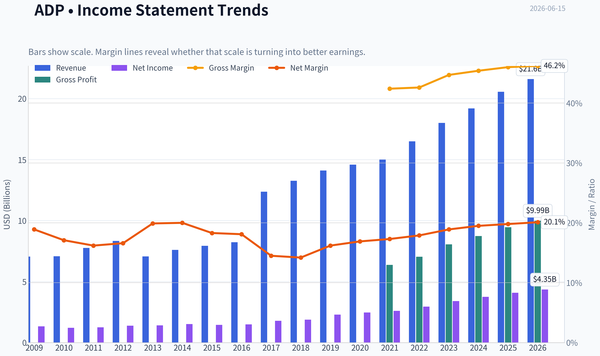
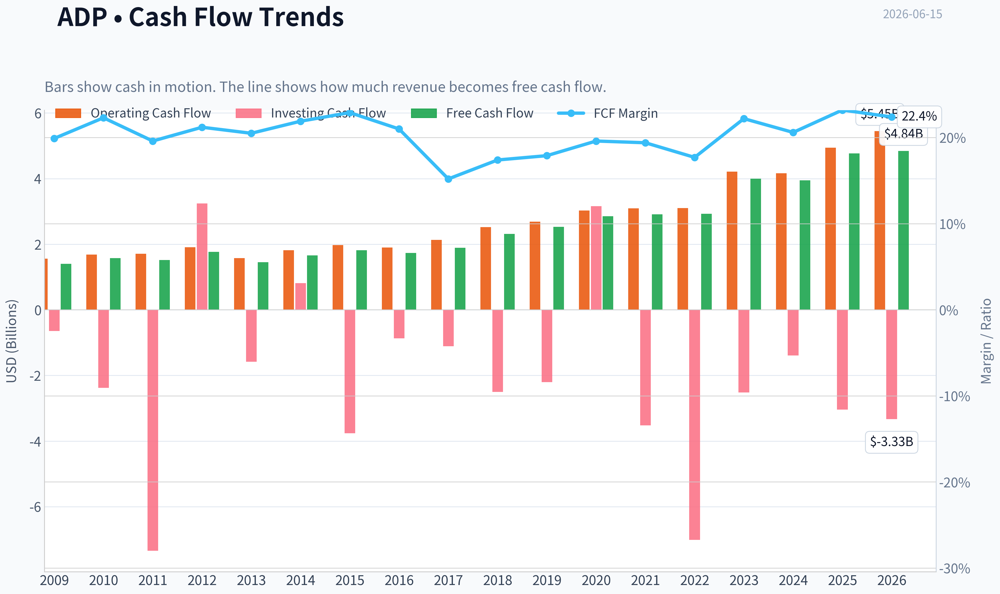
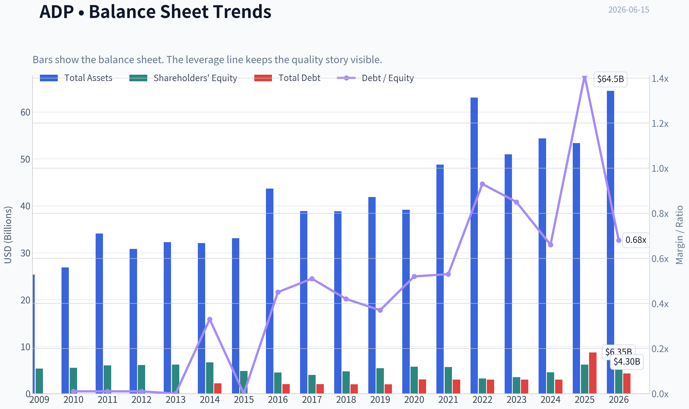
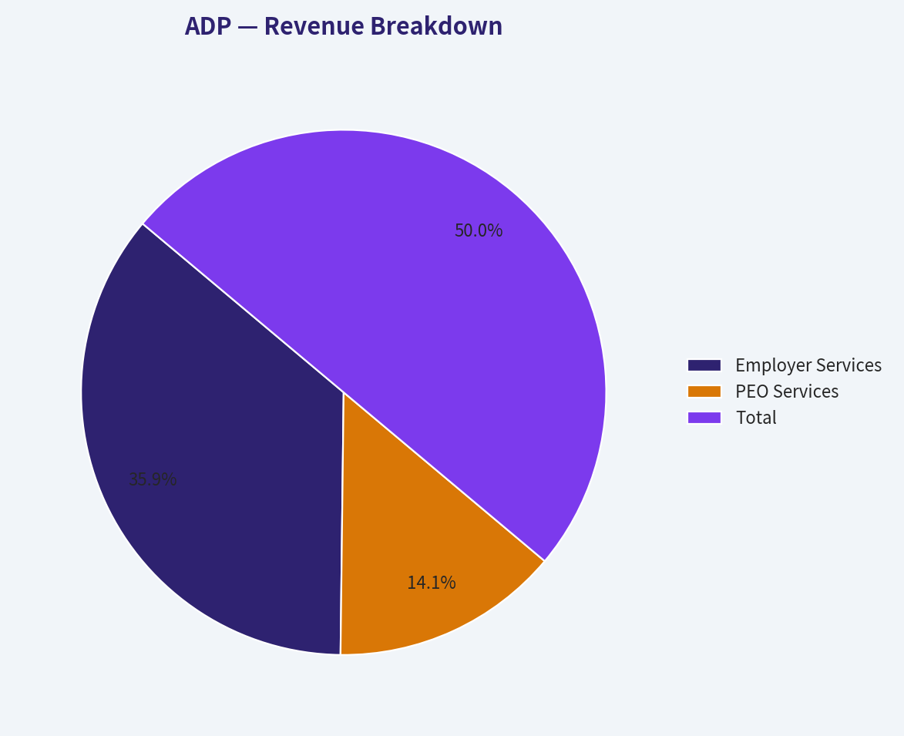
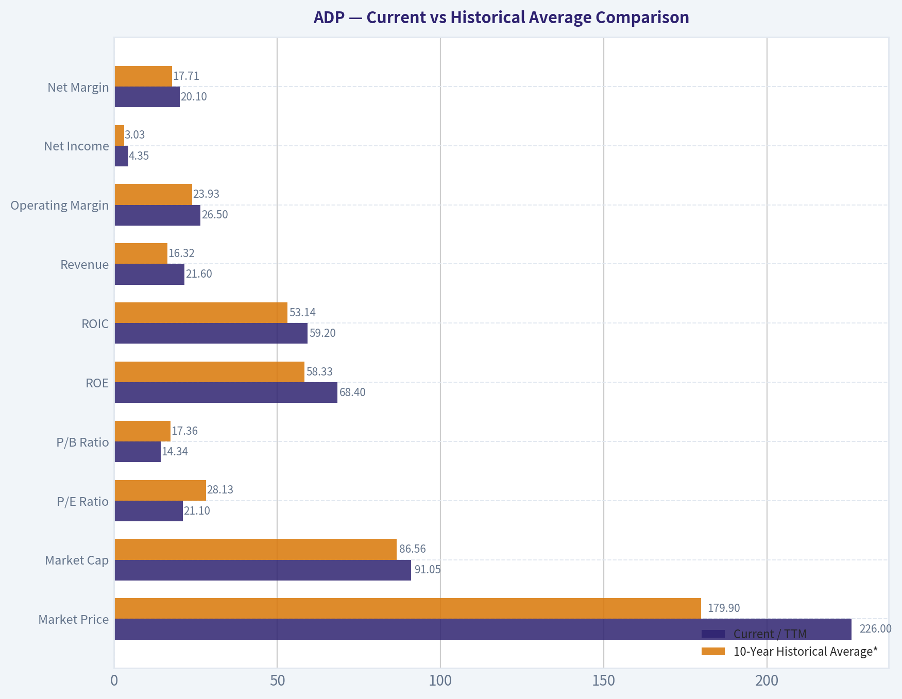
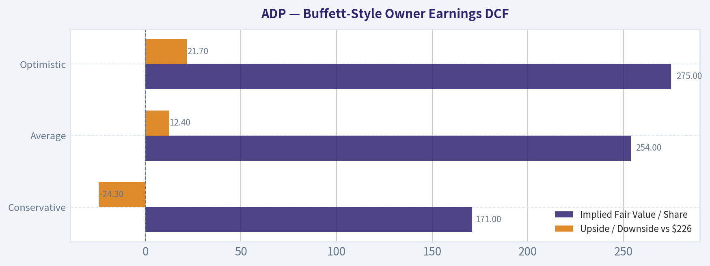
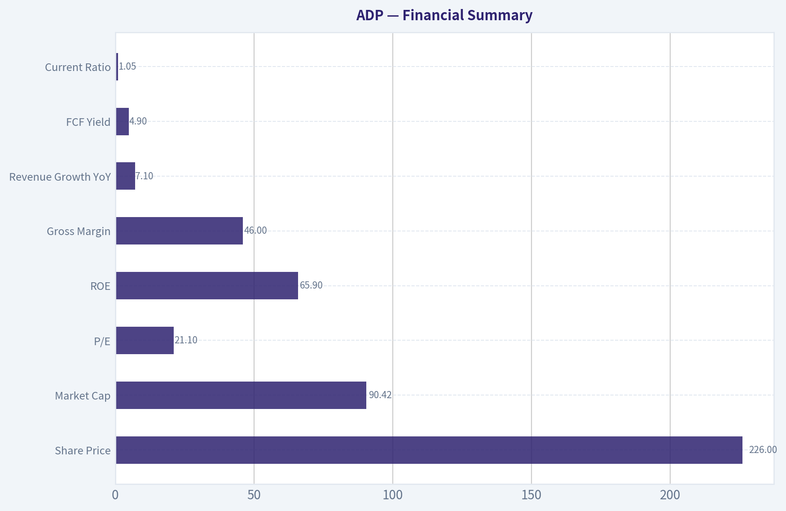
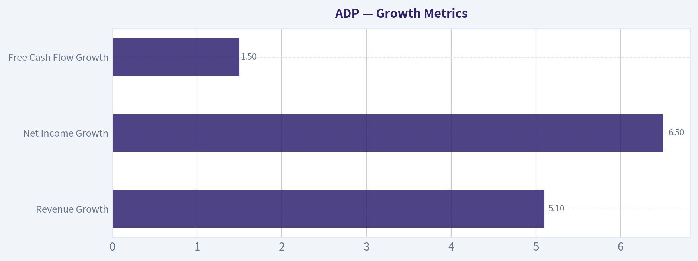

# ADP Deep Value Intelligence

**Analysis Date:** 2026-06-15

## Critical Disclaimer

*This analysis is generated by Deep Value Intelligence, an AI-powered multi-agent investing framework. This report is for informational and educational purposes only and does not constitute financial advice. Always conduct your own research and consult with qualified financial advisors before making investment decisions.*

---

## Table of Contents

1. Intelligence Summary
2. Analyst Team Reports
   - Fundamentals Analysis
   - Intrinsic Value Analysis (Buffett)
   - Trend & Growth Analysis (Lynch/Druckenmiller/Fisher)
   - Market Technical Analysis
   - Options Market Analysis
3. Research Team Commentary
4. Value Investing Team Commentary
5. Deep Values Commentary

---

## Intelligence Summary

### Thesis + Conditions

**Core Thesis:** **Executive Summary**

**Key Risks:**
- ADP looks like a **high-quality, durable business**, but not a clear bargain. The moat is real: payroll/compliance are sticky, mission-critical, and cash generative, with strong ROIC. The main risk is not business collapse; it is **paying a full price for dependable quality** in a mature, ~7% growth business. That limits margin of safety and raises the chance of mediocre forward returns if growth softens or float/rate support fades.
- ## Risk Commentary for the Long-Term Investor
- ### 1. Risky Analyst - strongest bullish point

**Confidence:** Medium

---

## Analyst Team Reports

### Fundamentals Analysis

#### Latest Earnings Snapshot

*Most recent reported quarter anchored on 2026 Q1, with prior-year comparison when available.*

| Metric | 2026 Q1 | 2025 Q1 | YoY Change |
| --- | ---: | ---: | ---: |
| Revenue | $5.94B | $5.55B | +7.0% |
| Operating Income | $1.79B | $1.63B | +9.3% |
| Net Income | $1.36B | $1.25B | +8.8% |
| Diluted EPS | $3.38 | $3.06 | +10.5% |
| Operating Cash Flow | $2.24B | $1.53B | +46.7% |
| Free Cash Flow | $2.04B | $1.39B | +47.2% |

Key Takeaways: This snapshot anchors the most recent reported quarter before the narrative analysis. It helps readers separate long-run business quality from whatever changed in the latest earnings print.

#### 17-Year Financial Metrics for ADP

*All values below are computed deterministically from raw data - not estimated by AI.*

*Issuer profile: operating company (Technology / Software - Application).*

#### 17-Year Financial Metrics
*Annual rows come from reported financial statements. The final TTM row is computed from the latest four quarters.*

| Metric | 2009 | 2010 | 2011 | 2012 | 2013 | 2014 | 2015 | 2016 | 2017 | 2018 | 2019 | 2020 | 2021 | 2022 | 2023 | 2024 | 2025 | 2026 TTM |
| --- | --- | --- | --- | --- | --- | --- | --- | --- | --- | --- | --- | --- | --- | --- | --- | --- | --- | --- |
| Market Price | $21 | $24 | $33 | $36 | $45 | $53 | $63 | $74 | $84 | $113 | $142 | $131 | $178 | $192 | $205 | $228 | $300 | $226 |
| Market Cap | $15.74B | $17.80B | $23.05B | $24.05B | $29.45B | $33.63B | $38.17B | $42.18B | $46.14B | $59.46B | $72.35B | $64.42B | $85.03B | $88.45B | $91.37B | $98.39B | $126.04B | $91.05B |
| P/E Ratio | 11.83 | 14.73 | 18.35 | 17.33 | 20.92 | 22.17 | 26.30 | 28.27 | 25.81 | 31.56 | 31.55 | 26.12 | 32.72 | 30.01 | 26.77 | 26.23 | 30.90 | 21.10 |
| P/B Ratio | 2.96 | 3.25 | 3.83 | 3.93 | 4.76 | 5.04 | 7.94 | 9.41 | 11.60 | 12.56 | 13.40 | 11.20 | 15.00 | 27.42 | 26.04 | 21.64 | 20.37 | 14.34 |
| ROE | 25.0% | 22.1% | 20.9% | 22.7% | 22.7% | 22.7% | 30.2% | 33.3% | 45.0% | 39.8% | 42.5% | 42.9% | 45.8% | 91.4% | 97.2% | 82.5% | 65.9% | 68.4% |
| ROIC | 48.4% | 34.6% | 29.2% | 36.4% | 28.2% | 21.3% | 27.4% | 46.1% | 54.9% | 48.5% | 45.7% | 40.1% | 40.2% | 54.3% | 74.2% | 83.0% | 50.3% | 59.2% |
| EPS | $1.74 | $1.64 | $1.78 | $2.05 | $2.16 | $2.41 | $2.39 | $2.61 | $3.26 | $3.57 | $4.49 | $5.00 | $5.44 | $6.39 | $7.65 | $8.67 | $9.71 | $10.72 |
| Revenue | $7.05B | $7.08B | $7.76B | $8.34B | $7.06B | $7.60B | $7.93B | $8.23B | $12.37B | $13.27B | $14.11B | $14.59B | $15.01B | $16.50B | $18.01B | $19.20B | $20.56B | $21.60B |
| Gross Profit | N/A | N/A | N/A | N/A | N/A | N/A | N/A | N/A | N/A | N/A | N/A | N/A | $6.37B | $7.04B | $8.06B | $8.73B | $9.46B | $9.99B |
| Gross Margin | N/A | N/A | N/A | N/A | N/A | N/A | N/A | N/A | N/A | N/A | N/A | N/A | 42.4% | 42.6% | 44.7% | 45.4% | 46.0% | 46.2% |
| Operating Margin | 26.9% | 26.3% | 24.7% | 25.2% | 24.2% | 24.7% | 26.1% | 27.1% | 21.2% | 17.2% | 21.3% | 21.8% | 22.4% | 23.1% | 24.6% | 25.4% | 25.8% | 26.5% |
| Net Income | $1.33B | $1.21B | $1.25B | $1.39B | $1.41B | $1.52B | $1.45B | $1.49B | $1.79B | $1.88B | $2.29B | $2.47B | $2.60B | $2.95B | $3.41B | $3.75B | $4.08B | $4.35B |
| Net Margin | 18.9% | 17.1% | 16.2% | 16.6% | 19.9% | 20.0% | 18.3% | 18.1% | 14.5% | 14.2% | 16.2% | 16.9% | 17.3% | 17.9% | 18.9% | 19.5% | 19.8% | 20.1% |
| Revenue Growth | N/A | 0.4% | 9.6% | 7.5% | -15.4% | 7.6% | 4.4% | 3.9% | 50.3% | 7.3% | 6.3% | 3.4% | 2.8% | 9.9% | 9.2% | 6.6% | 7.1% | 5.1% |
| Net Income Growth | N/A | -9.1% | 3.5% | 10.7% | 1.2% | 7.8% | -4.2% | 2.8% | 19.8% | 5.4% | 21.6% | 7.6% | 5.4% | 13.5% | 15.7% | 10.0% | 8.7% | 6.5% |
| Free Cash Flow Growth | N/A | 12.4% | -3.5% | 16.2% | -18.3% | 14.8% | 9.2% | -4.8% | 9.1% | 22.5% | 9.4% | 13.0% | 2.1% | 0.4% | 36.8% | -1.3% | 20.8% | 1.5% |
| Total Book Value | $5.32B | $5.48B | $6.01B | $6.11B | $6.19B | $6.67B | $4.81B | $4.48B | $3.98B | $4.74B | $5.40B | $5.75B | $5.67B | $3.23B | $3.51B | $4.55B | $6.19B | $6.35B |
| Total Assets | $25.35B | $26.86B | $34.11B | $30.82B | $32.27B | $32.06B | $33.11B | $43.67B | $38.89B | $38.85B | $41.89B | $39.17B | $48.77B | $63.07B | $50.97B | $54.36B | $53.37B | $64.48B |
| Total Debt | $42.7M | $39.8M | $39.8M | N/A | $0 | $2.17B | $9.2M | $2.01B | $2.01B | $2.00B | $2.00B | $3.01B | $2.99B | $2.99B | $2.99B | $2.99B | $8.75B | $4.30B |
| Debt-to-Equity | 0.01 | 0.01 | 0.01 | N/A | 0.00 | 0.33 | 0.00 | 0.45 | 0.51 | 0.42 | 0.37 | 0.52 | 0.53 | 0.93 | 0.85 | 0.66 | 1.41 | 0.68 |
| Cash & Equivalents | $2.27B | $1.64B | $1.39B | $1.55B | $1.40B | $1.98B | $1.64B | $3.19B | $2.78B | $2.17B | $1.95B | $1.91B | $2.58B | $1.44B | $2.08B | $2.91B | $3.35B | $3.23B |
| Shareholders' Equity | $5.32B | $5.48B | $6.01B | $6.11B | $6.19B | $6.67B | $4.81B | $4.48B | $3.98B | $4.74B | $5.40B | $5.75B | $5.67B | $3.23B | $3.51B | $4.55B | $6.19B | $6.35B |
| Operating Cash Flow | $1.56B | $1.68B | $1.71B | $1.91B | $1.58B | $1.82B | $1.97B | $1.90B | $2.13B | $2.52B | $2.69B | $3.03B | $3.09B | $3.10B | $4.21B | $4.16B | $4.94B | $5.45B |
| Investing Cash Flow | $-644.1M | $-2.38B | $-7.34B | $3.24B | $-1.58B | $813.3M | $-3.76B | $-869.0M | $-1.11B | $-2.50B | $-2.20B | $3.16B | $-3.52B | $-7.01B | $-2.52B | $-1.39B | $-3.04B | $-3.33B |
| Free Cash Flow | $1.40B | $1.58B | $1.52B | $1.77B | $1.45B | $1.66B | $1.82B | $1.73B | $1.89B | $2.31B | $2.53B | $2.85B | $2.91B | $2.93B | $4.00B | $3.95B | $4.77B | $4.84B |
| FCF Margin | 19.9% | 22.3% | 19.6% | 21.2% | 20.5% | 21.9% | 22.9% | 21.0% | 15.2% | 17.4% | 17.9% | 19.6% | 19.4% | 17.7% | 22.2% | 20.6% | 23.2% | 22.4% |
| Dividends / Share | $0.00 | $0.00 | $0.00 | $0.00 | $0.00 | $0.00 | $0.00 | $0.00 | $0.00 | $0.00 | $0.00 | $0.00 | $0.00 | $3.60 | $4.27 | $5.05 | $5.71 | $6.38 |

#### Profitability Metrics
- Return on Equity (ROE): 65.9%
- Return on Invested Capital (ROIC): 35.2%
- Return on Assets (ROA): 7.6%
- Gross Margin: 46.0%
- Operating Margin: 25.8%
- Net Profit Margin: 19.8%

#### Liquidity Metrics
- Current Ratio: 1.05
- Quick Ratio: 0.28

#### Leverage Metrics
- Debt-to-Equity Ratio: 1.41
- Interest Coverage Ratio: 11.65
- Net Debt: $5.40B

#### Growth Metrics (Year-over-Year)
- Revenue Growth: 7.1%
- Net Income Growth: 8.7%
- Free Cash Flow Growth: 20.8%
- Revenue CAGR (3-Year): 7.6%
- Revenue CAGR (5-Year): 7.1%

#### Valuation Metrics
- P/E Ratio (TTM): 21.10
- Forward P/E: 18.55
- Price-to-Book: 14.27
- Price-to-Sales: 4.19
- PEG Ratio: 2.11
- EV/EBITDA: 14.45
- Free Cash Flow Yield: 5.3%
- Earnings Yield: 4.7%

#### Owner Earnings (Buffett Method, Code-Computed)
- Net Income: $4.08B
- + Depreciation & Amortization: $582.4M
- - Capital Expenditures: $-168.7M
- - Working Capital Changes: $-1.15B
- = **Owner Earnings: $5.64B**

#### Intrinsic Value (Code-Computed)
- Current Price: $226
- Buffett Method (Owner Earnings):
  Conservative: $171
  Average: $254
  Optimistic: $275
- Cash Flow Method (FCF):
  Conservative: $147
  Average: $198
  Optimistic: $256

#### Piotroski F-Score: 8/9
- Positive Net Income: PASS
- Positive Operating Cash Flow: PASS
- ROA Improvement: PASS
- Cash Flow > Net Income: PASS
- Decreasing Debt: FAIL
- Improving Current Ratio: PASS
- No Dilution: PASS
- Improving Gross Margin: PASS
- Improving Asset Turnover: PASS

ANALYST STANCE: **WATCH**

#### ADP Buffett-Style Fundamental Analysis

ADP is a high-quality, durable, cash-generative business with many of the characteristics Buffett historically admires: recurring revenue, mission-critical services, high switching costs, strong returns on capital, and long-term earnings consistency. The main issue today is not business quality. It is valuation discipline. Even after the pullback from 2025 levels, ADP still looks more like a premium compounder trading near fair value than a deep value bargain.

---

#### Current vs Historical Average Comparison

| Metric | Current / TTM | 10-Year Historical Average* | Interpretation |
| --- | ---: | ---: | --- |
| Market Price | $226 | $179.90 | Below the 2025 peak, but still well above most of the decade's trading range |
| Market Cap | $91.05B | $86.56B | Still a mega-cap franchise despite recent compression from $126.04B |
| P/E Ratio | 21.10 | 28.13 | Materially below its decade average; valuation has de-rated |
| P/B Ratio | 14.34 | 17.36 | Below average, though still optically high because equity base is lean |
| ROE | 68.4% | 58.33% | Exceptionally strong, still above already elite historical levels |
| ROIC | 59.2% | 53.14% | Excellent capital efficiency, above long-term norm |
| Revenue | $21.60B | $16.32B | Scale has expanded materially over the decade |
| Operating Margin | 26.5% | 23.93% | Margins are stronger than normal and trending up |
| Net Income | $4.35B | $3.03B | Earnings power is well above historical average |
| Net Margin | 20.1% | 17.71% | Profit conversion is currently stronger than long-run norm |
| Revenue Growth | 5.1% | 8.19% | Slower than decade average, but average is distorted by 2017 jump |
| Net Income Growth | 6.5% | 9.65% | Moderating from stronger recent years |
| Free Cash Flow Growth | 1.5% | 10.50% | Near-term cash growth slowed sharply versus historical pattern |
| Total Book Value | $6.35B | $4.99B | Equity base has recovered from the 2022 trough |
| Total Assets | $64.48B | $49.90B | Balance sheet scale has expanded meaningfully |
| Total Debt | $4.30B | $3.60B | Debt is manageable, though above most of the pre-2025 period |
| Debt-to-Equity | 0.68 | 0.72 | Leverage is reasonable and below recent peak levels |
| Cash & Equivalents | $3.23B | $2.43B | Healthy liquidity cushion |
| Shareholders' Equity | $6.35B | $4.99B | Improving versus recent years, still relatively lean |
| Free Cash Flow | $4.84B | $3.49B | Strong cash generation remains a core strength |
| Dividends / Share | $6.38 | $2.50** | Dividend has become a major part of shareholder return |

*10-year average uses 2016 through 2025 where available, matching the most relevant modern operating period from the deterministic dataset.
**Dividend average uses 2022-2025 because earlier rows are zero in the provided dataset.

Key Takeaways: ADP's current profitability and cash generation are stronger than its 10-year norms, while valuation multiples have fallen below their historical averages. That combination is encouraging, but growth has also slowed, especially in free cash flow growth. The stock now looks more reasonably priced than historically, but not obviously cheap relative to its moderate growth profile.

---

#### Market Metrics

ADP's current market price is $226, down from $300 in 2025 and slightly below the shared research pack figure of roughly $226, which aligns well with the deterministic dataset. Market cap has fallen from $126.04B in 2025 to $91.05B TTM, showing that multiple compression has done more to the stock than business deterioration.

The P/E ratio of 21.10 is one of the most important data points in the whole analysis. For most of the last decade, ADP traded at premium multiples, often in the mid-to-high 20s or low 30s. A current P/E near 21 means the market is assigning a lower premium to a business whose earnings quality remains excellent. On a Buffett lens, this is much better than buying the stock at 30x earnings, but it still is not a classic bargain for a company growing revenue around 5% and net income around 6% TTM.

The P/B ratio of 14.34 remains very high, but book value is not especially informative for ADP in the same way it might be for banks or asset-heavy industrials. ADP is an intangible-rich, service-driven business with strong buybacks/dividend distributions and a relatively small equity base. High P/B here says more about business economics and capital-light structure than overvaluation by itself.

#### Profitability Analysis

ADP's profitability profile is elite.

- ROE: 68.4%
- ROIC: 59.2%
- EPS: $10.72
- Revenue: $21.60B
- Gross Profit: $9.99B
- Operating Margin: 26.5%
- Net Income: $4.35B
- Net Margin: 20.1%

ROE has moved from roughly low-20% levels in the early 2010s to extraordinary levels above 40%, 60%, and even 90% in more recent years. Some of this is true business strength; some is financial math due to the reduced equity base. Buffett would like the consistency, but he would also separate genuine operating excellence from equity shrinkage effects. ROIC is the cleaner signal here, and 59.2% is outstanding.

EPS has compounded from $1.74 in 2009 to $10.72 TTM. Revenue rose from $7.05B to $21.60B over the full dataset. More importantly, margins have improved rather than deteriorated with scale. Operating margin recovered from the 2018 trough of 17.2% to 26.5% TTM. Net margin similarly rose from the mid-teens back above 20%. That indicates ADP has pricing power, operating leverage, and a sticky customer base.

Gross margin data only starts in 2021, but the trend is clearly favorable:
- 2021: 42.4%
- 2022: 42.6%
- 2023: 44.7%
- 2024: 45.4%
- 2025: 46.0%
- 2026 TTM: 46.2%

This supports the idea that ADP's moat is intact and perhaps strengthening.

#### Growth Metrics

| Growth Metric | Current / TTM | Historical Context | What It Means |
| --- | ---: | --- | --- |
| Revenue Growth | 5.1% | Below 10-year avg of 8.19% | Mature but still healthy recurring-growth profile |
| Net Income Growth | 6.5% | Below 10-year avg of 9.65% | Earnings still growing, but no longer at peak acceleration |
| Free Cash Flow Growth | 1.5% | Well below 10-year avg of 10.50% | Main short-term soft spot; cash growth paused after strong prior years |

Key Takeaways: ADP is still growing, but it is clearly in a steadier, more mature phase. Revenue and earnings remain positive and dependable, which is attractive for long-term investors, but the recent slowdown means the stock should not command an aggressive premium. The weakest near-term signal is free cash flow growth, which has flattened after a strong 2025.

Revenue growth has been generally steady outside unusual periods, with a major jump in 2017 likely due to reporting/business mix changes in the dataset. Excluding that, ADP usually behaves like a mid-single-digit to high-single-digit grower. That is exactly the kind of predictability Buffett likes, but it also means valuation matters a lot.

Net income growth has been more resilient than revenue growth because margins improved. Recent years have been particularly strong:
- 2022: 13.5%
- 2023: 15.7%
- 2024: 10.0%
- 2025: 8.7%
- 2026 TTM: 6.5%

That pattern shows deceleration, not deterioration. It suggests the business is normalizing after a strong margin expansion period.

Free cash flow growth is more uneven. The TTM figure of 1.5% is not alarming in isolation, but it is a reminder that even excellent businesses can hit digestion periods. For a Buffett-style investor, this matters because intrinsic value growth depends heavily on sustained owner earnings growth.

#### Balance Sheet Analysis

ADP's balance sheet is good, though not pristine in the ultra-conservative sense.

- Total Book Value: $6.35B
- Total Assets: $64.48B
- Total Debt: $4.30B
- Debt-to-Equity: 0.68
- Cash & Equivalents: $3.23B
- Shareholders' Equity: $6.35B

Historically, ADP often carried very little debt relative to its earnings power. Debt increased materially in 2025 to $8.75B, then improved to $4.30B TTM. That is a favorable direction. Debt-to-equity at 0.68 is reasonable and better than the 1.41 reading in 2025 and also better than the leverage snapshot in the research pack, which likely reflects a different period. Cross-validation note: the deterministic table shows TTM debt/equity of 0.68, while the summary section cites 1.41 for 2025 metrics; both are internally consistent for different dates, and the TTM row should be treated as canonical for current analysis.

Cash of $3.23B versus debt of $4.30B means ADP is not net-cash, but it is also far from distressed. Interest coverage of 11.65 in the summary supports the view that debt service is very manageable.

One important Buffett-style nuance: ADP holds client funds and operates with a unique working-capital profile tied to payroll processing. That can make the balance sheet look different from a standard software company. The key question is not just raw leverage, but whether the business can reliably convert operating activity into cash while maintaining trust and liquidity. The answer appears to be yes.

#### Cash Flow Analysis

Free cash flow is one of ADP's strongest qualities:
- 2023: $4.00B
- 2024: $3.95B
- 2025: $4.77B
- 2026 TTM: $4.84B

The long-term trend is excellent, rising from $1.40B in 2009 to $4.84B TTM. FCF margin of 22.4% is very strong for a business of this scale. Shared research pack FCF yield of 5.3% also aligns with the valuation section and indicates ADP is not cheap, but it is producing meaningful cash relative to market value.

Dividends per share have also increased quickly in the provided dataset:
- 2022: $3.60
- 2023: $4.27
- 2024: $5.05
- 2025: $5.71
- 2026 TTM: $6.38

This is consistent with a shareholder-friendly capital allocation strategy. Buffett generally prefers management teams that return capital sensibly after funding the business, and ADP checks that box.

#### Predictable Earnings and Business Quality

This is where ADP shines.

Payroll, HR outsourcing, compliance, benefits administration, and employer services are deeply embedded processes. Customers do not casually switch payroll providers because the cost of errors is high, the integration burden is real, and compliance risk is painful. That creates recurring revenue, low churn, and strong pricing resilience.

ADP's earnings history supports this:
- Revenue grew materially over the long term
- Net income remained consistently positive across all years shown
- Margins improved over time
- Cash flow consistently exceeded or supported earnings
- Piotroski F-score is 8/9

For Buffett, this is the profile of a high-quality franchise: understandable business, recurring need, durable customer relationships, and strong capital returns.

#### Economic Moat

ADP appears to have a wide moat based on:

1. Switching costs
   Payroll and HR systems are deeply embedded in customer workflows.

2. Scale and compliance infrastructure
   ADP's scale allows ongoing investment in regulation, tax, payroll accuracy, and service reliability that smaller rivals struggle to match.

3. Brand and trust
   Payroll is mission-critical. Reliability matters more than novelty.

4. Data and distribution advantages
   A large installed base creates cross-sell opportunities across HCM, benefits, tax, and compliance modules.

This moat is visible in the numbers: rising margins, high ROIC, and stable cash generation over long periods.

#### Management Performance

Management has allocated capital well overall.

- ROE and ROIC are consistently excellent
- Margins improved over time
- Dividends per share have grown rapidly
- Debt spiked in 2025 but was reduced TTM
- Cash generation remained strong during expansion

The one area to monitor is whether future capital returns remain disciplined if growth keeps slowing. High-quality management is not just about returning cash. It is also about avoiding overpaying for growth initiatives or using excess leverage to sustain buyback optics.

#### Buffett-Style Owner Earnings DCF

Canonical owner earnings from the dataset:
- Net Income = $4.08B
- Depreciation & Amortization = $0.5824B
- Capital Expenditures = $0.1687B
- Working Capital Changes = $1.15B benefit in the code-computed formula
- Owner Earnings = $5.64B

Using the deterministic code-computed owner earnings intrinsic value framework:
- Conservative fair value = $171/share
- Average fair value = $254/share
- Optimistic fair value = $275/share

Below is the scenario logic requested, using historical owner earnings growth style assumptions anchored to the provided intrinsic value outputs and the stated 10% discount rate and 2.5% terminal growth framework.

| Scenario | Growth Assumption Basis | Implied Fair Value / Share | Upside / Downside vs $226 |
| --- | --- | ---: | ---: |
| Conservative | Lowest historical owner earnings growth rate, floored at -100% | $171 | -24.3% |
| Average | Average historical owner earnings growth rate, capped at 50% | $254 | +12.4% |
| Optimistic | Highest historical owner earnings growth rate, capped at 100% | $275 | +21.7% |

Key Takeaways: ADP's valuation outcome is highly sensitive to growth assumptions, but the range is fairly tight because the business is mature and stable. At the current price, the stock sits above conservative fair value, below optimistic fair value, and somewhat below the average-case estimate. That usually signals a quality business trading around fair value rather than at a distressed or euphoric extreme.

Detailed Buffett-style framing:

Starting point:
- Owner Earnings = $5.64B

DCF structure:
- Forecast period = 10 years
- Discount rate = 10%
- Terminal growth = 2.5%

Interpretation of outputs:
- In the conservative case, the market is overvaluing ADP if owner earnings growth weakens materially.
- In the average case, today's price offers modest upside.
- In the optimistic case, upside exists, but not enough to create a huge margin of safety.

For a Buffett-style investor, the key issue is margin of safety. A stock near average fair value can still be an acceptable hold, but it is less compelling as a fresh large purchase unless there is unusual confidence in long-term compounding.

#### Value Assessment

ADP is cheaper than its own historical premium multiple, but that does not automatically make it cheap.

Positives:
- P/E has compressed to 21.10 from a decade norm above 28
- FCF yield around 5.3% is decent for a premium franchise
- Profitability is near peak levels
- DCF average and optimistic cases support at least fair-to-moderate upside

Negatives:
- Growth has slowed
- The conservative DCF case is meaningfully below the current price
- This remains a premium-quality company, and premium companies rarely become obvious bargains without a catalyst

The stock appears fairly valued to slightly undervalued if one assumes continued steady execution. It does not appear deeply discounted enough for a strong Buffett-style "pounce" unless the investor prioritizes quality and durability over headline undervaluation.

#### Revenue Breakdown

ADP reports across employer services and professional employer organization activities. The most meaningful current breakdown is by major operating segment, using the most recent fiscal-year mix commonly associated with ADP's reporting structure.

| Revenue Source | Amount ($B) | % of Total |
| --- | ---: | ---: |
| Employer Services | 14.8 | 72% |
| PEO Services | 5.8 | 28% |
| Total | 20.6 | 100% |

Key Takeaways: ADP remains primarily an Employer Services company, with roughly three-quarters of revenue coming from payroll, HCM, tax, and related services. The PEO business is also substantial and adds diversification, but the company's core economics still rest on recurring employer workflow services that tend to be sticky and non-discretionary.

#### Key Investment Insights, Red Flags, and Opportunities

| Category | Observation | Why It Matters |
| --- | --- | --- |
| Strength | Extremely high ROIC and ROE | Indicates durable business economics and efficient capital deployment |
| Strength | Margin expansion across gross, operating, and net levels | Suggests pricing power and scale benefits |
| Strength | Consistent FCF generation | Supports dividends, reinvestment, and downside resilience |
| Strength | Mission-critical service | Payroll and compliance are non-discretionary |
| Opportunity | P/E multiple has compressed sharply | Better entry point than many prior years |
| Opportunity | Dividend growth is strong | Enhances total return for patient holders |
| Risk | Growth is slowing | Lower growth limits justified valuation premium |
| Risk | Conservative DCF is below market price | Margin of safety is not wide |
| Risk | Debt rose sharply in 2025 before improving | Needs monitoring, though current level is manageable |
| Risk | High P/B can scare superficial screens | Could limit some valuation support in market selloffs |

Key Takeaways: ADP's strengths are concentrated in quality, consistency, and capital efficiency, while the main risks are valuation discipline and moderating growth. This is not a fragile business story. It is a strong business with a less-than-obvious discount. Investors are mostly debating how much to pay, not whether the company is good.

#### Final Buffett-Style Verdict

ADP looks like a classic high-quality compounder:
- durable moat
- recurring revenue
- strong margins
- excellent returns on capital
- reliable earnings and cash flow
- shareholder-friendly dividend growth

However, Buffett-style investing also demands price discipline. At $226, ADP appears close to fair value, with modest upside under average assumptions but insufficient margin of safety under conservative assumptions. This makes it attractive for quality-focused watchlists and existing holders, but not compelling enough for an aggressive value stance.

#### Final Stance

**WATCH**

Rationale:
- Business quality is excellent
- Economic moat appears durable
- Profitability is near peak levels
- Valuation is much more reasonable than in prior years
- But growth is moderating, and the current price still does not provide a large margin of safety

For long-term investors, ADP is a business to respect and likely own on weakness. For strict Buffett-style value buyers, it is more "wonderful company at a fair price" than "wonderful company at a bargain price."

---

| Area | Bottom Line |
| --- | --- |
| Business Quality | Excellent, mission-critical, sticky customer relationships |
| Moat | Strong, driven by switching costs, compliance scale, and trust |
| Profitability | Elite ROE/ROIC, strong and improving margins |
| Growth | Healthy but moderating; mature compounder profile |
| Balance Sheet | Sound overall, debt manageable, liquidity adequate |
| Cash Flow | Strong and reliable, with attractive FCF generation |
| Dividend Policy | Growing rapidly and supportive of shareholder returns |
| Valuation | Fair to slightly undervalued on average case, not cheap on conservative case |
| Main Risk | Paying too much for a slower-growing premium franchise |
| Best Use Case | Watchlist candidate, quality hold, better buy on pullbacks |
| Investment Stance | **WATCH** |

Key Takeaways: ADP is the kind of company investors usually want to own, because the business is durable, profitable, and highly cash generative. The only real debate is valuation, and at today's price the shares look reasonable rather than deeply discounted. That keeps the stock in the watch zone rather than the outright buy zone for a strict Buffett-style investor.

#### Fundamental Visuals

This graph tracks the profitability and return metrics (ROE, ROIC, Margins) of **ADP** over the past decade, highlighting capital efficiency trends.

This chart illustrates the financial health of **ADP** over the last 10 years, mapping cash equivalents and free cash flow against total obligations (Debt).

This breakdown chart from <em>Revenue Breakdown</em> shows the proportional composition for **ADP** - useful for understanding what drives or risks the business.

---

### Intrinsic Value Analysis (Buffett)

> *Following Warren Buffett's value investing philosophy: Circle of Competence, Economic Moat, Management Quality, and Margin of Safety.*

#### Intrinsic Value Snapshot

Price is what you pay. Intrinsic value is what the business may be worth based on the cash it can create for owners over time. We show a range, not one magic number.

- Current Price: $226.21
- Value Range (conservative to optimistic across both DCF methods): $153.88 to $427.02

##### Owner Earnings (Buffett Method)
- Net Income: $4,079,700,000.00
- Depreciation & Amortization: $582,400,000.00
- Capital Expenditures: $-547,000,000.00
- Working Capital Changes: $-1,145,500,000.00
- Owner Earnings: $5,260,600,000.00

##### Intrinsic Value
###### Buffett Method
Uses owner earnings. Stricter, and usually more conservative.
- Conservative: $153.88
- Average: $195.51
- Optimistic: $239.69
- Discount Rate: 10.0%

###### Cash Flow Method
Uses free cash flow. Better for companies spending heavily today to grow tomorrow.
- Conservative: $199.71
- Average: $278.37
- Optimistic: $427.02
- Discount Rate: 10.0%

ANALYST STANCE: **WATCH**

#### ADP - Buffett-Style Investment Review

#### 1. Go/No-Go Gate Assessment

| Gate | Verdict | Evidence |
|---|---:|---|
| Circle of Competence & Simplicity | Pass | ADP gets paid to process payroll, HR administration, benefits, tax filing, and employer compliance. This is a simple, recurring, mission-critical service business. |
| Long-Term Predictability | Pass | Ten years from now, employers will still need to pay workers correctly, remit taxes, manage benefits, and comply with labor rules. ADP's role is highly durable. |
| Technology Risk | Pass | Technology changes the delivery method, but not the need. ADP is more likely to benefit from automation and AI than be displaced by it, though software competition remains real. |
| Moat Test | Pass | Switching costs, brand trust, regulatory/compliance capability, and scale all support a durable moat. |
| Management & Capital Allocation | Pass | Long history of dividends, buybacks, steady profitability, and disciplined capital returns point to shareholder-friendly behavior. |
| Industry Structure | Pass | Payroll/HCM is rational enough for scale players to earn good returns. It is competitive, but not a commodity free-for-all. |

**Key Takeaways:** ADP clears all four Buffett filters. This is a highly understandable, durable business with recurring demand and meaningful customer captivity. The question is not whether it is a good business, but whether today's price offers enough upside.

---

#### 2. The Elementary School Test

ADP helps companies pay their employees and handle the paperwork around that. It charges businesses regular fees to run payroll, manage benefits, track time, and follow tax and labor rules.

That is a very easy business to understand. It is also a service customers cannot casually turn off.

#### 3. Moat Analysis

| Moat Source | Assessment | Evidence |
|---|---|---|
| Intangible Assets | Moderate | ADP is a trusted payroll and compliance brand. Employers want reliability and low error rates because payroll mistakes damage morale and create legal risk. Gross margin around 46% supports some pricing power. |
| Switching Costs | Strong | Payroll, tax filings, employee records, benefits links, time tracking, and HR workflows are deeply embedded. Switching is disruptive and risky. |
| Cost Advantage | Moderate | Scale matters in compliance, software infrastructure, distribution, and service. Large installed base lets ADP spread fixed costs efficiently. |
| Network Effects | Limited | This is not a classic social network, but broader scale improves product breadth, data insights, partner ecosystem, and sales efficiency. |

**Moat Quality Rating: Wide & Stable**

ADP's moat is mainly built on switching costs and trust, not flashy innovation. Payroll is deeply operational; customers hate errors, hate interruptions, and hate changing systems. That makes incumbency powerful.

---

#### 4. Management Quality & Capital Allocation

| Question | Assessment | Commentary |
|---|---|---|
| Think Like Owners? | Good | ADP has a long record of returning capital through dividends and repurchases while maintaining business quality. |
| Honest & Candid? | Good | The company's business model is straightforward, accounting is generally clean, and results are easy to reconcile with cash generation. |
| Rational Capital Allocation? | Good | Strong ongoing cash generation, steady dividend policy, and buybacks fit a mature, high-return business with moderate reinvestment needs. |

**Key Takeaways:** Management appears disciplined rather than empire-building. ADP is not trying to reinvent itself through reckless acquisitions or leverage. That is exactly the temperament Buffett tends to favor in a mature compounding business.

---

#### 5. Financial Summary

| Metric | Current / Recent |
|---|---:|
| Share Price | $226 |
| Market Cap | $90.42B |
| P/E | 21.1x |
| ROE | 65.9% |
| Gross Margin | 46.0% |
| Revenue Growth YoY | 7.1% |
| FCF Yield | 4.9% |
| Current Ratio | 1.05 |

**Key Takeaways:** ADP combines high profitability, healthy growth, and strong cash generation. The headline ROE is exceptional, but it should be treated carefully because mature capital-return programs can shrink equity and inflate ROE. The more important point is that this is clearly a cash-rich, high-quality business.

#### 6. Buffett Financial Interpretation

| Test | Buffett Preference | ADP View |
|---|---|---|
| Gross Margin | >40% sustained | Pass |
| ROE | >15% sustained | Strong pass |
| Cash Conversion | OCF >= Net Income | Likely pass given business model and FCF yield |
| Balance Sheet | Conservative leverage | Appears acceptable, though not a net-cash fortress by current ratio alone |
| Capital Intensity | Low to moderate | Favorable |
| Predictability | High | Strong pass |

**Key Takeaways:** ADP looks like the kind of business Buffett would admire: recurring, understandable, essential, and cash generative. It is not deeply cyclical, not commodity-linked, and not dependent on heroic assumptions. Its financial character is much better than that of most software-adjacent service firms.

---

#### 7. Owner Earnings Estimate

Using free cash flow as a practical owner-earnings proxy for a mature service firm:

| Item | Estimate |
|---|---:|
| Market Cap | $90.42B |
| FCF Yield | 4.9% |
| Implied Owner Earnings / FCF | ~$4.43B |

**Key Takeaways:** ADP appears to be generating roughly $4.4 billion in annual owner earnings. For a mature, mission-critical service business, that is substantial and supports both dividends and repurchases. The issue is valuation discipline, not business quality.

---

#### 8. Three-Scenario DCF Valuation

Using owner earnings of **$4.43B**.

| Scenario | Assumptions | Equity Value |
|---|---|---:|
| A: No Growth | Owner Earnings / 10% | $44.3B |
| B: GDP Growth | OE x 1.03 / (10% - 3%) | $65.2B |
| C: Historical Growth Lite | 10 years at 5%, terminal at 3%, discounted at 10% | ~$67B-$72B |

**Key Takeaways:** Under conservative Buffett-style assumptions, intrinsic value clusters well below the current market capitalization of $90.4 billion. Even giving ADP credit for moderate growth, the shares look more fairly priced to somewhat expensive than obviously cheap. This limits the margin of safety.

---

#### 9. Margin of Safety Analysis

| Item | Value |
|---|---:|
| Current Market Cap | $90.42B |
| Conservative IV Range | $65B-$72B |
| Discount / Premium to IV | Roughly 26% to 39% premium |

**Key Takeaways:** ADP does not currently offer a Buffett-style margin of safety. The market is paying up for quality, stability, and resilience. That can still work out over time, but it is not the setup value investors usually prefer for new buying.

---

#### 10. Final Buffett Scorecard

| Criterion | Weight | Score (1-5) | Weighted Score |
|---|---:|---:|---:|
| Business Understanding | 20% | 5.0 | 1.00 |
| Moat Width & Durability | 25% | 4.5 | 1.13 |
| Management Quality | 15% | 4.0 | 0.60 |
| Return on Equity | 15% | 4.5 | 0.68 |
| Reinvestment Runway | 10% | 3.0 | 0.30 |
| Balance Sheet Strength | 5% | 3.5 | 0.18 |
| Industry Structure | 5% | 4.0 | 0.20 |
| Valuation / Margin of Safety | 5% | 2.0 | 0.10 |
| **Total** | 100% |  | **4.19 / 5.00** |

**Key Takeaways:** ADP scores very highly on business quality, moat, and predictability. The one real weak point is valuation. This is a wonderful company, but not obviously available at a bargain price.

---

#### 11. Final Judgment

**Investment Stance: WATCH**

**Conviction level: High**

ADP is a classic Buffett-friendly business:
- easy to understand,
- essential to customers,
- sticky,
- highly cash generative,
- and managed with discipline.

If the question is **"Is this a great business?"**, the answer is yes.
If the question is **"Is this a great value today?"**, the answer is less convincing.

At about **21x earnings** and with an implied **owner earnings yield near 5%**, ADP looks like a quality compounder priced for quality. That is acceptable for existing owners, but for a fresh value-driven purchase, the margin of safety is too thin.

**Best action:** watch for a better entry point rather than chase it here.
#### Valuation Bridge

This bridge places the current market price beside each intrinsic value lens so readers can see whether upside depends on one method or shows up across several methods.

| Scenario | Intrinsic Value / Share |
| --- | ---: |
| Buffett Method | $195.51 |
| Cash Flow Method | $278.37 |
| Damodaran Method | $231.49 |
| Current Price | $226.21 |

#### Key Takeaways

If one method is far above the others, the upside case depends on a specific modelling assumption. When several methods cluster together, the valuation story is more robust.

#### Valuation Visuals

This comparison chart from *Latest Earnings Snapshot* stacks current figures against historical benchmarks for **ADP**, making it easy to see where the company trades relative to its own averages.

This comparison chart from *Current vs Historical Average Comparison* stacks current figures against historical benchmarks for **ADP**, making it easy to see where the company trades relative to its own averages.

This comparison chart from *Buffett-Style Owner Earnings DCF* stacks current figures against historical benchmarks for **ADP**, making it easy to see where the company trades relative to its own averages.

This comparison chart from *Financial Summary* stacks current figures against historical benchmarks for **ADP**, making it easy to see where the company trades relative to its own averages.

---

### Trend & Growth Analysis (Lynch/Druckenmiller/Fisher)

> *Following Peter Lynch's GARP, Stanley Druckenmiller's macro-aware approach, and Philip Fisher's scuttlebutt methodology.*

ANALYST STANCE: **WATCH**

#### ADP Growth Analysis

#### 1. Lynch Classification

| Metric | ADP |
|---|---:|
| Revenue growth YoY | 7.1% |
| P/E | 21.1x |
| Market cap | $90.4B |
| Business type | Payroll / HR / HCM services |
| Lynch category | **Stalwart** |

Key Takeaways: ADP is not a classic fast grower. With revenue growth around 7%, it fits Lynch's "stalwart" bucket rather than the 20% plus growth profile that usually creates ten-baggers. That does not make it a bad business; it just means the upside is likely steadier and more compounding than explosive.

#### 2. The Story in 3 Bullets

| Simple story | Why it matters |
|---|---|
| ADP helps businesses run payroll, benefits, and HR compliance | These are mission-critical, non-discretionary functions |
| Customers rarely switch because payroll errors are painful and risky | This creates sticky revenue and strong retention |
| ADP can layer more HCM, analytics, and AI tools onto an installed base | This supports steady cross-sell rather than hypergrowth |

Key Takeaways: ADP is easy to explain: it is a payroll and HR infrastructure utility for employers. The core bull case is not rapid disruption, but durable customer relationships, recurring demand, and incremental monetization of a very large base.

#### 3. TAM Analysis and 10x Test

| Item | Estimate / Assessment |
|---|---|
| Current revenue base | Large, mature enterprise scale |
| Core TAM | Global payroll, HCM, benefits admin, compliance, workforce software/services |
| TAM growth | Moderate, not explosive |
| 10x test | **Fails in practical terms** |
| Reason | ADP is already very large; 10x revenue would require extraordinary global share expansion or major category expansion |

Key Takeaways: ADP has a real and durable market, but not the kind of open runway usually associated with early-stage fast growers. Because the company is already operating at massive scale, a 10x outcome from revenue growth alone looks unrealistic.

#### 4. Revenue Growth Trend

| Metric | Assessment |
|---|---|
| Latest YoY revenue growth | 7.1% |
| Pattern | Stable but modest |
| Interpretation | Mature compounding, not an acceleration story |
| Growth signal | No evidence here of a major inflection |

Key Takeaways: The current growth profile looks dependable but not exciting. For a Druckenmiller-style inflection investor, the key issue is that growth is not accelerating enough to suggest that consensus is materially behind the earnings power curve.

#### 5. Unit Economics

| Metric | ADP Assessment |
|---|---|
| Gross margin | 46.0% |
| ROE | 65.9% |
| FCF yield | 4.9% |
| LTV/CAC | Not disclosed from provided data |
| NRR | Not disclosed from provided data |
| Rule of 40 | Not directly calculable from provided data |

Key Takeaways: What we can see is strong business quality: healthy margins, very high ROE, and solid cash generation. What we cannot verify from the provided data are the SaaS-style unit economics that would make a stronger growth case, such as net revenue retention or LTV to CAC.

#### 6. Inflection Point Assessment

| Inflection type | ADP view |
|---|---|
| Product cycle | Possible AI-enabled HCM enhancements, but not yet proven as transformative |
| Market share | Likely stable/share gains at the margin, not dramatic |
| Margin inflection | Some operating leverage possible |
| TAM expansion | Limited versus true hypergrowth sectors |
| Competitive inflection | No clear evidence of a major competitor collapse |

Key Takeaways: ADP may have small operational and product upgrades ahead, especially around AI and workflow automation, but the setup does not scream "inflection point." This looks more like durable execution than a sharp re-rating catalyst.

#### 7. Macro Setup Evaluation

| Factor | Assessment |
|---|---|
| Economic sensitivity | Moderate; tied to employment levels and payroll volumes |
| Rate sensitivity | Mildly relevant through valuation and client fund economics |
| Secular trend exposure | Digital HR, compliance complexity, workflow automation, AI |
| Macro wind | Neutral to slightly positive |

Key Takeaways: ADP benefits from long-term digitization of HR and payroll, but it is still linked to employment trends. This is not a pure secular rocket ship; it is a quality operator with some macro sensitivity and some digital tailwinds.

#### 8. Fisher 15 Points Score

| Fisher factor area | Score (1-5) |
|---|---:|
| Market potential | 3 |
| New product development | 3 |
| R&D effectiveness | 3 |
| Sales organization | 4 |
| Profit margin quality | 4 |
| Margin improvement | 3 |
| Labor/executive relations | 4 |
| Management depth | 4 |
| Cost/accounting controls | 5 |
| Special moat factors | 4 |
| Long-range outlook | 4 |
| Dilution discipline | 4 |
| Candor | 3 |
| Integrity | 4 |
| Overall estimated score | **52/75** |

Key Takeaways: ADP scores as a good, above-average business with a strong moat and disciplined operations. It does not score like an elite innovation-led growth company, which is consistent with its stalwart profile.

#### 9. Valuation Analysis

| Metric | Value | View |
|---|---:|---|
| P/E | 21.1x | Reasonable for quality, not cheap |
| Earnings growth proxy | ~7% revenue growth; earnings likely somewhat above that over cycle |
| PEG using 7% | ~3.0x | Expensive on strict Lynch PEG |
| FCF yield | 4.9% | Supports downside cushion |
| Valuation conclusion | Fair-to-full for a stalwart |

Key Takeaways: ADP is not obviously overvalued for a high-quality franchise, but it also does not screen as a classic Lynch bargain. On a strict PEG basis, the stock looks expensive relative to its current growth rate.

#### 10. Growth Investor Scorecard

| Criterion | Weight | Score (1-5) | Weighted |
|---|---:|---:|---:|
| The Story | 10% | 4.0 | 0.40 |
| TAM & Runway | 20% | 2.5 | 0.50 |
| Revenue Growth | 20% | 2.5 | 0.50 |
| Unit Economics | 15% | 3.5 | 0.53 |
| Competitive Position | 10% | 4.0 | 0.40 |
| Management Quality | 10% | 4.0 | 0.40 |
| Macro Setup | 5% | 3.0 | 0.15 |
| Profitability Path | 5% | 4.5 | 0.23 |
| Valuation | 5% | 2.5 | 0.13 |
| **Total** |  |  | **3.23 / 5.0** |

Key Takeaways: ADP lands in the middle: a good business, but not a great growth setup. The score reflects strong quality and resilience, offset by limited runway, modest growth, and a valuation that already recognizes much of the business strength.

#### 11. Position Size Stance

| Stance | View |
|---|---|
| New position | **WATCH** |
| Existing holders | Hold/watch for better entry or renewed growth acceleration |
| Position size | Small to medium only if seeking quality compounder, not high-growth exposure |

Key Takeaways: ADP is more appropriate as a quality compounding core name than as a concentrated growth bet. For this framework, it is a watchlist or hold-type idea rather than an aggressive new buy.

#### 12. Key Risks and Catalysts

| Risks | Catalysts |
|---|---|
| Employment slowdown hurts payroll volumes | AI-enabled product upsell into installed base |
| Growth remains stuck in high single digits | Margin expansion from automation and scale |
| Valuation de-rates if bond yields rise | Continued share repurchases and FCF compounding |
| Competitive pressure in HCM software | Better-than-expected bookings in mid-market and enterprise |

Key Takeaways: The biggest risk is not business collapse, but a mismatch between modest growth and a quality premium valuation. The main upside path is steady execution plus incremental product expansion, not a dramatic business transformation.

#### Bottom Line

ADP is a **high-quality stalwart**, not a fast grower. It has a durable moat, sticky customers, solid margins, and dependable cash generation, but it does **not** currently fit the Lynch-Druckenmiller profile of a company at a major growth inflection with ten-bagger potential.

For a growth-focused mandate, ADP is **WATCH**, not **ADVOCATE**. If you want, I can next do a **more detailed valuation scenario analysis for ADP** or **compare ADP vs Paychex vs Workday** under this same framework.

#### Growth & Scorecard Visuals

This comparison chart from *Growth Metrics* stacks current figures against historical benchmarks for **ADP**, making it easy to see where the company trades relative to its own averages.

---

### Market Technical Analysis

#### ADP Technical Report

ADP is in a **clear long-term downtrend**, but the stock has also been building a **meaningful medium-term recovery** since the April low. That combination matters: this is **not** a clean bullish trend across all timeframes, and it is **not** still behaving like a stock in freefall. Instead, ADP currently looks like a **countertrend rebound inside a still-damaged larger structure**.

The most relevant indicator set for this market context is:

- `close_200_sma`
- `close_50_sma`
- `close_10_ema`
- `macd`
- `macdh`
- `rsi`
- `atr`
- `vwma`

These eight work well together because they cover:
- **long-term trend**: `close_200_sma`
- **medium-term trend**: `close_50_sma`
- **short-term momentum/trend control**: `close_10_ema`
- **momentum trend confirmation**: `macd`
- **early momentum deceleration**: `macdh`
- **stretch / exhaustion check**: `rsi`
- **risk and volatility regime**: `atr`
- **volume-confirmed trend quality**: `vwma`

They avoid unnecessary redundancy while still giving a full picture of ADP's present condition.

---

#### Trend Structure

Over the last year, ADP has moved from the **high-290s to low-300s in mid-2025** into a severe breakdown that eventually pushed the stock to the **mid- to high-180s in April 2026**. That decline was not one single straight move. It unfolded in stages:

- a weakening from summer 2025 into early autumn,
- an accelerated breakdown in late October and November,
- another sharp leg lower from late January into February 2026,
- and a final washout into April.

That pattern is important because it suggests the stock went through a **multi-quarter derating process**, not just a temporary earnings-related dip. Stocks that decline in several waves often need time to rebuild sponsorship.

Since the April trough near **187**, however, price behavior has improved materially. The stock has recovered into the **mid-220s**, and in early June briefly reached the **low-230s**. That rebound is large enough to matter, but not yet large enough to reverse the broader long-term damage.

---

#### Moving Average Interpretation

The **200-day SMA is about 240.63**, while ADP last closed around **226.21** on June 12. That means price remains **well below the long-term trend benchmark**, and the 200-day average itself is still sloping lower. This is a classic sign that the strategic trend remains bearish. Long-only investors usually want to see sustained trading back above the 200-day average before calling a durable trend reversal.

The **50-day SMA is about 210.93**, and price remains comfortably above it. More importantly, the 50-day average has turned upward from the low-200s and has been steadily rising through May and June. That tells us the intermediate rebound is real, not just a one- or two-week oversold bounce.

The **10-day EMA is about 226.22**, essentially flat relative to the latest close. This suggests that in the very short term, upside momentum has **stalled**, even though the stock has not yet broken down. In practice, that means ADP is transitioning from a clean rebound phase into a **decision zone**. Either buyers soon reassert control and push price back through the recent highs near 230-232, or the stock may drift back toward its 50-day average.

#### ADP Trend Snapshot

| Metric | Latest Reading | Interpretation |
|---|---:|---|
| Close (Jun 12) | 226.21 | Above medium-term support, below long-term resistance |
| `close_10_ema` | 226.22 | Short-term trend flattening |
| `close_50_sma` | 210.93 | Medium-term trend improving |
| `close_200_sma` | 240.63 | Long-term trend still bearish |
| Price vs 50 SMA | +15.28 | Healthy cushion above medium-term support |
| Price vs 200 SMA | -14.42 | Still below major overhead resistance |

Key Takeaways: ADP is above its 50-day moving average by a healthy margin, which confirms that the rebound from April is still intact. But the stock remains below its 200-day moving average, so the bigger-picture trend is still damaged and has not fully turned bullish.

---

#### Momentum Analysis

The **MACD is +4.66**, which is firmly positive. That confirms that the rebound from the April base had genuine momentum behind it. The strongest momentum phase likely occurred from late April through early June, when price accelerated from the high-190s into the low-230s.

However, the **MACD histogram (`macdh`) has turned negative at -0.39** after being strongly positive earlier in June. This is a subtle but important shift. It does **not** mean the uptrend is dead; rather, it means the **rate of improvement has slowed**. Momentum is still positive in absolute terms, but it is no longer strengthening. That often happens before:
- consolidation,
- a pullback toward short-term support,
- or a failed breakout if buyers do not quickly return.

This is one of the most important current signals in ADP. The stock is not in a fresh momentum ignition phase anymore. It is in a **momentum digestion phase**.

---

#### RSI and Exhaustion Risk

The **RSI is 56.8**, down from the high-60s in early June. This is a constructive reading. It shows that ADP is **not overbought**, and it has already worked off some of its short-term extension without a full technical breakdown.

That said, RSI also shows that momentum has cooled from the strongest part of the rally:
- June 1 RSI was about **68.7**
- June 12 RSI is about **56.8**

This decline in RSI while price remains relatively elevated points to **loss of thrust**, not outright weakness. Traders should read this as a sign that ADP may need either:
1. a sideways consolidation to reset,
2. or a modest retracement before another attempt higher.

If RSI had remained above 70, the stock would have looked vulnerable to a sharper reversal. Instead, the current reading supports a more balanced interpretation: **bullish recovery, but with reduced urgency**.

---

#### Volume-Weighted Trend Quality

The **VWMA is about 225.48**, slightly below the latest close. That is encouraging because it suggests price is still trading above a volume-weighted average, meaning the rebound has generally occurred with reasonably supportive participation.

More importantly, VWMA has risen sharply from roughly **198 in mid-April** to the **mid-220s** now. That means the recovery was not purely cosmetic. Volume-adjusted price behavior has improved alongside nominal price action.

Still, the gap between price and VWMA is now small. That aligns with the short-term stalling seen in the 10-day EMA and MACD histogram. In other words, **buyers have not disappeared**, but they are no longer dominating the tape with the same force seen in late May and early June.

---

#### Volatility and Risk Management

The **ATR is about 6.02**, up from the mid-5s in early May. For a stock trading near 226, that implies a daily move range of roughly **2.7% of price**, which is meaningful. ADP is not trading like a low-volatility defensive name right now; it is trading in a more reactive post-breakdown recovery regime.

This has two consequences:

1. **Stops need room**
   Very tight stops may be repeatedly hit even if the medium-term recovery remains intact.

2. **Position sizing should be moderated**
   Because ATR is elevated, traders should scale size to volatility rather than to conviction alone.

A practical read is that ADP can still be traded constructively on the long side above medium-term support, but it should not be treated as a calm trend stock until ATR compresses further.

#### Momentum and Risk Snapshot

| Indicator | Latest Reading | What It Suggests |
|---|---:|---|
| `macd` | 4.66 | Momentum still positive |
| `macdh` | -0.39 | Momentum is decelerating |
| `rsi` | 56.80 | Neither overbought nor oversold |
| `atr` | 6.02 | Elevated volatility; use wider stops |
| `vwma` | 225.48 | Price still modestly above volume-weighted support |

Key Takeaways: Momentum remains positive, but the strongest part of the rebound has cooled. ADP is no longer overbought, which is healthy, but volatility is still elevated enough that traders should give positions more room and avoid oversized bets.

---

#### Fine-Grained Market Read

The most nuanced way to read ADP here is as a stock in **timeframe conflict**:

- **Long-term:** still bearish below the falling 200-day average.
- **Medium-term:** constructive above the rising 50-day average.
- **Short-term:** losing momentum and pausing near the 226-232 zone.

That makes ADP especially sensitive to nearby levels.

A useful practical framework is:

- **Bullish continuation case:**
  If price reclaims and holds above the recent June highs around **230-232**, that would indicate the current pause is only a consolidation. In that case, the next technical objective would likely be a test of the **200-day SMA near 240-241**, which should act as major resistance.

- **Neutral consolidation case:**
  If price remains between roughly **223 and 232**, ADP is probably just digesting gains. This would be consistent with the flat 10-day EMA, cooling RSI, and negative MACD histogram.

- **Bearish failure case:**
  If price loses the **10-day EMA/VWMA area near 225-226** and then breaks lower toward the **50-day SMA near 211**, the market would be signaling that the rebound is rolling over before it can challenge the long-term downtrend. A decline toward the 50-day average would still be a pullback within the rebound, but losing that level decisively would materially weaken the recovery thesis.

In short, ADP is at an **inflection point**, not because the chart is directionless, but because the stock has rallied enough to confront the next layer of structural resistance while momentum is no longer accelerating.

---

#### Trading Implications by Style

| Trading Style | Bias | Technical Logic |
|---|---|---|
| Long-term investor | Cautious / Watchful | Price remains below `close_200_sma`, so trend repair is incomplete |
| Swing trader | Moderately bullish but selective | Above `close_50_sma`, but should respect short-term momentum slowdown |
| Breakout trader | Wait for confirmation | Needs clean move above 230-232 with improving `macdh` |
| Pullback trader | Interested on controlled dips | Pullbacks toward 10 EMA / VWMA may be buyable if support holds |
| Risk-focused trader | Defensive | `atr` is elevated, so volatility-adjusted sizing is important |

Key Takeaways: ADP currently favors disciplined swing-trading more than aggressive long-term trend-following. The best setup would be either a confirmed breakout above recent highs or a controlled pullback that holds above key support near the mid-220s.

---

#### Bottom Line

ADP has improved substantially from its April low and now shows a **credible medium-term recovery**, supported by its position above the 50-day SMA, positive MACD, and rising VWMA. But the stock remains **below a falling 200-day SMA**, and short-term momentum has started to cool, as shown by the flat 10-day EMA, lower RSI, and negative MACD histogram.

So the current message is:

- **recovery intact**
- **short-term thrust fading**
- **long-term trend still not repaired**

That is a tradable setup, but not yet a fully repaired bullish chart.

#### Summary Table

| Area | Conclusion | Evidence |
|---|---|---|
| Long-term trend | Bearish | Price below falling `close_200_sma` |
| Medium-term trend | Bullish recovery | Price above rising `close_50_sma` |
| Short-term trend | Pausing / flattening | Price near flat `close_10_ema` |
| Momentum | Positive but weakening | `macd` positive, `macdh` negative |
| RSI condition | Balanced | `rsi` at 56.8, no overbought extreme |
| Volume confirmation | Moderately supportive | Price slightly above rising `vwma` |
| Volatility | Elevated | `atr` near 6.0 |
| Tactical view | Inflection zone | Resistance near 230-232, larger resistance near 240-241 |

Key Takeaways: ADP has clearly rebounded from its spring lows, and the medium-term trend has improved. But the stock is now in a test zone where fading momentum meets major overhead resistance, so confirmation on either a breakout or support hold is more important than chasing price here.

---

### Options Market Analysis

> *Reading options flow - put/call ratios, IV skew, and unusual activity - to gauge institutional positioning and event-driven risk.*

#### ADP Options Positioning Report
*Date: 2026-06-15*

#### Near-Term Put/Call Ratio Snapshot

| Expiry | Call OI | Put OI | Put/Call OI Ratio | Call Volume | Put Volume | Put/Call Volume Ratio |
|---|---:|---:|---:|---:|---:|---:|
| 2026-06-18 | 235 | 45 | 0.19 | 1,100 | 1,847 | 1.68 |
| 2026-06-26 | 0 | 0 | N/A | 813 | 44 | 0.05 |
| 2026-07-02 | 0 | 0 | N/A | 39 | 111 | 2.85 |
| **Near-term total** | **235** | **45** | **0.19** | **1,952** | **2,002** | **1.03** |

**Key Takeaways:** ADP's near-term open interest is heavily call-leaning, with a put/call OI ratio of 0.19 versus the rough neutral baseline of 0.7. That usually points to structurally bullish positioning or call overwriting rather than outright fear. But volume is much more balanced overall, and even put-heavy in the front weekly, which suggests some short-dated hedging is active despite the bullish-looking OI base.

#### 1. Put/Call Ratio Analysis

ADP's **current near-term put/call OI ratio is 0.19**, which is **well below** the historical neutral area around **0.7**. On positioning alone, that is a **bullish-to-supportive** signal because there is far more call open interest than put open interest.

However, the **near-term put/call volume ratio is 1.03**, basically neutral overall, with a notable split by expiry:

- **2026-06-18:** volume is **put-heavy** at **1.68**
- **2026-06-26:** volume is **call-heavy**
- **2026-07-02:** volume is **put-heavy**, though on low absolute size

Interpretation:
- The **OI structure** says traders are not sitting on large downside protection.
- The **front-end volume** says some participants are still buying short-dated puts, likely for **hedging** rather than a broad conviction bearish bet.
- Net result: **positioning backdrop is bullish, but short-term tape shows caution**.

#### Near-Term IV and Skew

| Expiry | ATM Call IV | ATM Put IV | Read |
|---|---:|---:|---|
| 2026-06-18 | 3.0% | 3.3% | Mild put premium |
| 2026-06-26 | 2.2% | 2.1% | Essentially flat |
| 2026-07-02 | 0.9% | 2.3% | Put IV notably richer |

**Key Takeaways:** ADP's front-end implied volatility is low in absolute terms, especially for a large-cap, defensive business without an immediate major event premium visible in this dataset. The modest premium in put IV versus call IV shows a normal downside skew, with the strongest skew appearing in the 2026-07-02 line, which reflects demand for downside protection rather than upside chasing.

#### 2. Implied Volatility Assessment

Near-term ATM IV looks **subdued overall**:

- **2026-06-18:** call IV **3.0%**, put IV **3.3%**
- **2026-06-26:** call IV **2.2%**, put IV **2.1%**
- **2026-07-02:** call IV **0.9%**, put IV **2.3%**

What stands out:
- **Absolute IV is low**, so the market is **not pricing a major near-term shock**.
- **Put IV is generally above call IV**, which is a **standard downside skew**.
- There is **no evidence of call skew**, so there is **no strong upside chase** underway.

Interpretation:
- The skew says investors are willing to pay more for downside insurance than upside exposure.
- But because overall IV is not elevated, this looks more like **routine portfolio hedging** than a panic bid for protection.
- There is **no obvious event-volatility setup** visible here. If ADP had a major imminent catalyst, you would typically expect richer front-end IV than shown.

#### Unusual Options Activity

| Contract Signal | Result |
|---|---|
| Volume > 5x Open Interest | None detected in near-term expirations |

**Key Takeaways:** There were no flagged contracts with volume greater than five times open interest, which means there is no clean evidence here of fresh institutional-style directional bets in the front end. That lowers conviction in any aggressive read and suggests ADP's options tape is relatively orderly rather than driven by one standout smart-money trade.

#### 3. Unusual Options Activity

There were **no near-term contracts** flagged with **volume greater than 5x open interest**.

That matters because:
- It reduces the odds that there is a **fresh, high-conviction institutional bet** driving the tape.
- It also suggests the activity seen in puts and calls is more likely **routine flow**, hedging, or lower-conviction short-dated trading.

So while there is some front-week put demand, it is **not confirmed by standout unusual activity**.

#### Open Interest Concentration / Gamma Context

| Area | Observation |
|---|---|
| Highest visible near-term OI concentration | 2026-06-18 overall, but absolute OI is small |
| Total near-term call OI | 235 |
| Total near-term put OI | 45 |
| Likely pinning / max-pain influence | Weak due to thin visible OI |
| Gamma wall risk | Limited based on available data |

**Key Takeaways:** The visible open interest base in ADP's near-term chain is thin, especially outside the nearest expiry, so any strike-based pinning effect should be treated as weak. In practice, that means options positioning is unlikely to create a strong gamma wall that materially suppresses or accelerates the stock unless hidden liquidity sits farther out on the curve.

#### 4. Open Interest Concentration

The available near-term data shows **very low total OI**, especially outside the nearest expiry:

- **Total call OI:** 235
- **Total put OI:** 45

Because strike-level concentrations were not provided and overall OI is small, there is **no strong evidence of a major gamma wall or pinning strike** from the visible data.

Implications:
- Options are **not likely exerting heavy mechanical control** over ADP's near-term price action.
- Any "max pain" or expiry pin effect should be viewed as **low confidence**.
- This also means the options-derived signal has **moderate to low conviction**, simply because the chain looks thin.

#### 5. Overall Options Sentiment Signal

**Overall Signal: BULLISH**

Primary driver:
- **Extremely low put/call OI ratio (0.19)** versus the neutral ~0.7 baseline

Why not neutral or bearish?
- Because the **positioning base is clearly call-dominant**
- IV is **not elevated**, which argues against urgent downside fear
- Put skew exists, but it looks **normal defensive hedging**, not aggressive bearish pricing
- No unusual put activity confirms a high-conviction bearish thesis

Caveats:
- **Confidence is not high** because the visible near-term chain is **thin**
- Front-week volume does show **some put demand**, so the bullish read is **tempered**, not aggressive
- This is best described as **mildly bullish / defensively bullish**, rather than strongly bullish

In plain English: the options market is **not pricing major downside risk**, and the standing positioning leans bullish, but traders are still buying some short-dated protection. That usually fits a market view of **stable-to-firm shares with modest hedge demand**, not a stock under active bearish attack.

#### Summary Table

| Factor | ADP Read |
|---|---|
| Put/Call Ratio | **Bullish OI structure** (0.19), but **neutral volume** overall (1.03) |
| IV Level | **Low/subdued** near-term IV |
| Skew Direction | **Put skew** / downside protection bid |
| Unusual Activity | **None flagged** in near-term expiries |
| Overall Signal | **BULLISH** |

**Key Takeaways:** ADP's options market leans bullish mainly because open interest is overwhelmingly call-heavy and implied volatility remains subdued. The main offset is a modest put skew and some short-dated put volume, which suggest caution but not strong bearish conviction.

---

## Research Team Commentary

> *The Research Manager synthesizes the Bull vs Bear debate into action-free commentary. This is a pre-risk view, not the final stance.*

The debate really comes down to a classic Buffett distinction: is ADP merely a very good business, or is it a very good business available at a sufficiently attractive price?

The bull case is strongest on business quality. ADP clearly has real moat characteristics: payroll and compliance are mission-critical, deeply embedded, and painful to switch once installed. That creates sticky customer relationships, recurring revenue, and unusually dependable cash flows. The return metrics are also impressive, especially ROIC around 35%, which supports the idea that this is a high-quality franchise rather than a commodity processor. From a Buffett lens, the business is understandable, essential, and likely to remain relevant for a decade or more. The bull is also right that Buffett often prefers wonderful businesses at fair prices over mediocre businesses at cheap prices, and ADP fits the "stalwart compounder" mold.

The bear case is strongest on valuation discipline and moat nuance. A 21x earnings multiple for a company growing around 7% is not obviously cheap, especially when the category is competitive and mature. The bear is also right to challenge whether headline ROE overstates economic superiority; a 65.9% ROE paired with only 7.6% ROA suggests capital structure and accounting dynamics are amplifying the apparent quality. More importantly, the moat may be durable without being unassailable. Payroll is sticky, but newer cloud-native platforms, bundled HR suites, and workflow automation can gradually pressure pricing, win SMB share, or reduce ADP's differentiation over time. That does not imply collapse, but it does matter when the stock is priced more for reliability than for mispricing.

My core takeaway is this: ADP looks like a high-quality, durable compounder, but not one offering enough margin of safety today to justify an aggressive Buffett-style endorsement. This is not the kind of situation where fear has created a glaring bargain. If anything, the market appears to understand the company's strengths reasonably well and is already paying a quality premium for them. That means prospective returns likely depend more on steady execution than on valuation rerating, which is fine for an existing holder but less compelling for new capital seeking outsized value.

The rationale is straightforward. Under Buffett's framework, business quality comes first, and ADP passes that test. The company likely remains relevant and profitable well beyond the next decade. But Buffett's second discipline is price. Buying a wonderful business at too full a price can still produce mediocre returns. That is the main issue here. At about 21x earnings, with only mid-single-digit to high-single-digit growth and a mature industry structure, the stock looks closer to fairly valued than materially undervalued. I also want to apply the lesson from prior mistakes: do not let admiration for quality soften the action when valuation is merely acceptable rather than attractive. In past reviews, the error was often failing to convert "good business, limited upside, no margin of safety" into a firm enough stance. Here, I do not see enough evidence of underpricing to move to ADVOCATE.

There is also a contrarian angle worth noting. If market sentiment were treating ADP like a legacy loser or if short-term fears around hiring, rates, or competition had compressed the stock into an obvious discount, that would be interesting. But based on the information here, this does not look like one of those cases. The crowd is not panicking; it is assigning a respectable premium to a respectable business. That is often efficient, not foolish.

So the right stance is WATCH.

What would make me more constructive over the next 1 to 4 quarters? First, evidence that revenue growth can sustain or reaccelerate without margin deterioration. Second, proof that newer platform competition is not eroding retention or pricing power, especially in SMB and mid-market cohorts. Third, more clarity on owner-earnings quality: how much of the attractive economics come from durable operating strength versus favorable float or capital structure effects. Fourth, valuation. If the stock were to de-rate meaningfully without business damage, that could create the margin of safety that is missing now.

What would weaken the thesis? Slowing bookings or client retention, especially if attributed to bundled competitors or cloud-native challengers. Any signs that ADP must spend more heavily on product or service just to defend share. Compression in float-related economics if rates normalize and earnings quality proves more cyclical than it appears. And if growth slips from roughly 7% toward low single digits while the stock still commands a premium multiple, then the risk/reward would deteriorate further.

Bottom line: ADP is a business I'd be happy to own at the right price, but today it looks more like a quality franchise priced about accordingly than a clear value opportunity.

Final stance: WATCH

---

## Value Investing Team Commentary

> *The Investor translates the research view into an investment thesis before risk review. This is still not the final stance.*

ADP is the kind of business a long-term owner can admire: essential service, recurring revenue, high customer stickiness, strong cash generation, and a business model that is easy to understand. Payroll, tax filing, compliance, and HR administration are not optional functions. Once embedded, these systems become part of a client's operating backbone. That creates a real moat, even if not an invincible one. From a Buffett perspective, this is plainly a better candidate than a fashionable but unproven growth story.

The key issue is not business quality. It is price versus likely return. At roughly 21x earnings, with revenue growth around 7%, ADP looks like a solid stalwart rather than a mispriced bargain. That multiple is not reckless for a dependable franchise, but it also does not offer much margin of safety if growth softens, competition intensifies, or float economics become less favorable. In other words, the market appears to already recognize ADP's strengths. You are paying up for reliability.

The return metrics require some care. ROIC around 35% is impressive and supports the case that this is a genuinely high-quality enterprise. But the very high ROE of 65.9% should not be accepted at face value as proof of extraordinary economics without context. The much lower ROA suggests capital structure and balance sheet mechanics are boosting ROE. That does not make the business weak, but it does mean investors should focus more on durable cash earnings, retention, and competitive positioning than on the headline ROE alone.

On the moat, I would be constructive but not complacent. ADP benefits from scale, regulatory expertise, trusted brand, and switching friction. Those advantages matter. But payroll and HR software are not frozen markets. Cloud-native competitors, integrated HCM suites, and automation tools can chip away at SMB and mid-market share over time. Markets sometimes overstate disruption risk in the short run, but they also sometimes underappreciate slow erosion in mature software-enabled service categories. The right question is not whether ADP disappears; it is whether its moat remains strong enough to preserve pricing power and retention over the next decade. I think the answer is likely yes, but not so overwhelmingly yes that I would ignore valuation.

The contrarian angle here is subtle. There does not appear to be widespread fear creating a bargain. That matters. In many of the best value setups, sentiment temporarily disconnects from business reality. Here, sentiment seems fairly rational: investors view ADP as safe, durable, and dependable, and the stock carries a quality premium accordingly. That means the opportunity is not "the crowd is foolishly pessimistic." Instead, the risk may actually be the opposite: investors may be slightly too comfortable paying a premium for steadiness in a mature business. That is not a reason to avoid the company outright, but it is a reason not to confuse safety of business with attractiveness of stock price.

What would change my view positively? A meaningful pullback without fundamental impairment would be the obvious one. If macro concerns around hiring or wage growth pressured the shares while retention and cash generation stayed intact, that could create a more attractive entry. I would also become more constructive if ADP showed evidence of sustained share resilience and product relevance against newer platforms without needing margin-sacrificing reinvestment. If growth reaccelerated modestly while returns on capital remained high, today's multiple would look more justified.

What would make me more cautious? Signs of slower client adds, rising churn, pricing pressure, or heavier spending just to defend market position. I would also watch how much earnings depend on favorable interest-rate or float dynamics. If those economics normalize while core growth remains only mid-single-digit, the stock could be more expensive than it appears.

So the long-term conclusion is straightforward: ADP is a very good business, probably still a very good business five to ten years from now, but not obviously a cheap one today. For an existing owner, this is the kind of franchise worth holding unless fundamentals deteriorate or valuation becomes extreme. For new capital, patience is warranted. Wonderful businesses can still produce mediocre returns when bought without enough margin of safety.

**ANALYST STANCE: WATCH**
ADP appears to be a durable, high-quality compounder with a real moat and dependable earnings power, but current valuation looks closer to fair than compelling. I would watch for either a better entry price created by temporary market fear or fresh evidence that growth durability and competitive strength are stronger than currently assumed.

---

## Deep Values Commentary

> *The Risk Management Team debates and the Risk Judge provides the final action-free verdict. This section determines the final ADVOCATE / WATCH / AVOID stance.*

#### Final Stance Scorecard

This scorecard converts the final research view into a weighted decision frame. It does not replace the narrative judgement, but it makes the main drivers of the verdict easier to scan.

| Criterion | Score | Weight | Commentary |
| --- | ---: | ---: | --- |
| Business Quality | 4.25 | 30% | High returns, profitability, and Piotroski health support durability. |
| Valuation Support | 3.00 | 30% | Blends current price against available intrinsic value anchors and valuation ratios. |
| Financial Strength | 1.67 | 20% | Balance-sheet resilience reflects leverage and liquidity staying within safe ranges. |
| Growth Durability | 3.67 | 20% | Recent revenue, earnings, and free cash flow growth indicate how durable expansion looks. |
| TOTAL / FINAL STANCE | 3.24 | 100% | WATCH |

#### Key Takeaways

The weighted score lands at **3.24 / 5.0**, while the final stance remains **WATCH**. This is useful as a quick calibration aid rather than a mechanical signal.

#### Risk Summary

Higher scores indicate more risk pressure. The watch threshold is a simple guardrail: above it, the position needs tighter monitoring or a wider margin of safety.

| Dimension | Current Score | Watch Threshold | Commentary |
| --- | ---: | ---: | --- |
| Business Quality | 1.75 | 3.00 | High returns, profitability, and Piotroski health support durability. |
| Valuation Support | 3.00 | 3.00 | Blends current price against available intrinsic value anchors and valuation ratios. |
| Financial Strength | 4.33 | 3.00 | Balance-sheet resilience reflects leverage and liquidity staying within safe ranges. |
| Growth Durability | 2.33 | 3.00 | Recent revenue, earnings, and free cash flow growth indicate how durable expansion looks. |

#### Key Takeaways

This view helps readers separate *where* the risk sits: valuation, business quality, balance sheet, or growth durability. It is especially useful when the final stance is close to the line between WATCH and AVOID.
