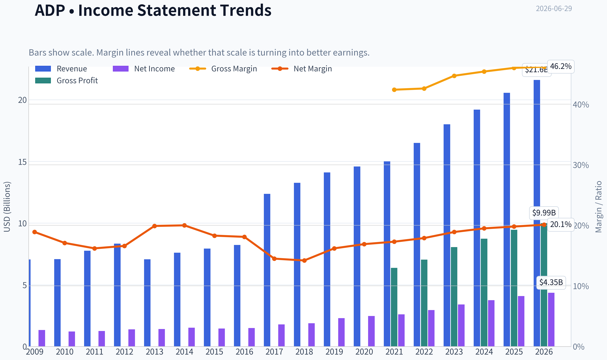
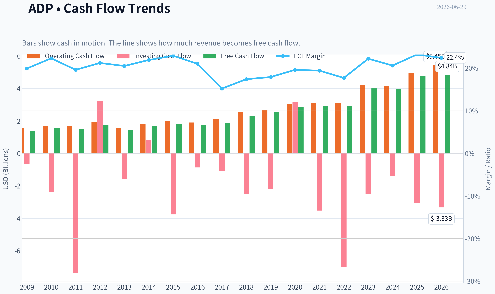
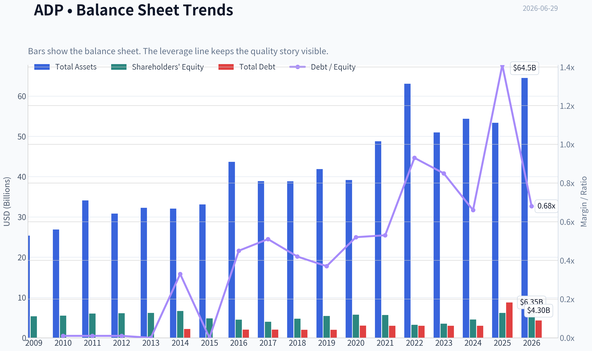
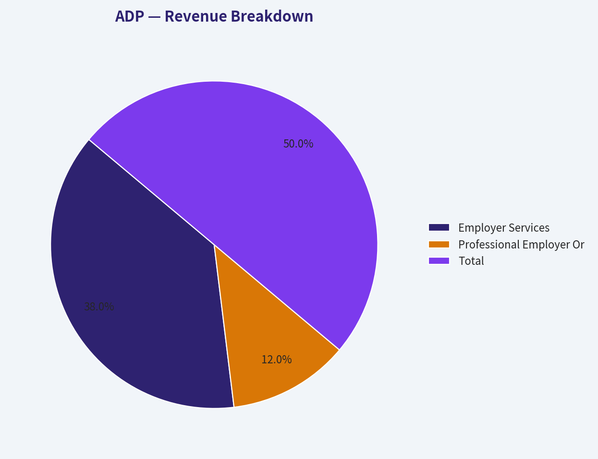
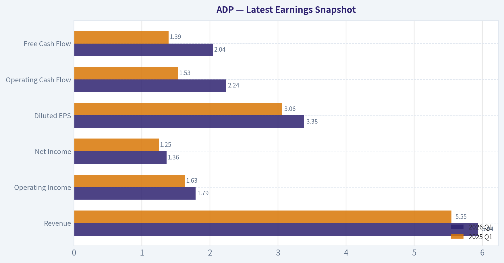
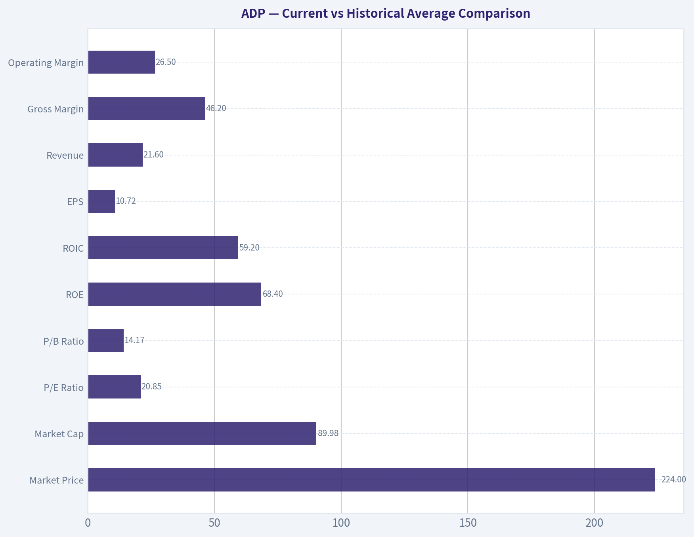
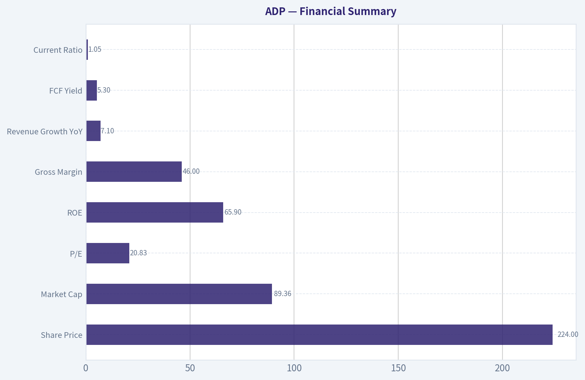
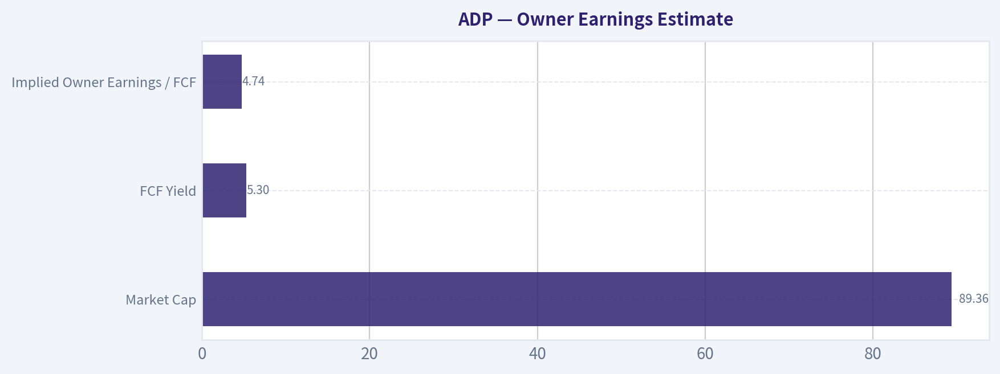
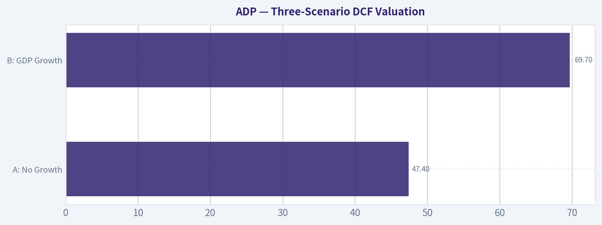

# ADP Deep Value Intelligence

**Analysis Date:** 2026-06-29

## Critical Disclaimer

*This analysis is generated by Deep Value Intelligence, an AI-powered multi-agent investing framework. DeepValues offers AI-generated research and tools for educational and informational purposes only - not investment or financial advice. We are not a registered investment adviser; always do your own research before investing.*

---

## Table of Contents

1. Intelligence Summary
2. Analyst Team Reports
   - Fundamentals Analysis
   - Intrinsic Value Analysis (Buffett)
   - Trend & Growth Analysis (Lynch/Druckenmiller/Fisher)
   - Market Technical Analysis
   - Options Market Analysis
3. Research Team Commentary
4. Value Investing Team Commentary
5. Deep Values Commentary

---

## Intelligence Summary

### Thesis + Conditions

**Core Thesis:** ## Executive Summary
ADP remains a high-quality, low-business-risk franchise: payroll, compliance, and HR are mission-critical, sticky, and cash generative. The debate confirms the moat is real, but not obviously widening enough to justify dropping valuation discipline.

**Key Risks:**
- ADP remains a high-quality, low-business-risk franchise: payroll, compliance, and HR are mission-critical, sticky, and cash generative. The debate confirms the moat is real, but not obviously widening enough to justify dropping valuation discipline. At ~20.8x earnings, this looks closer to fair value than a clear Buffett-style bargain. The best adjustment from past mistakes is not to stay overly passive: ADP deserves active monitoring and possibly a small starter position only for investors specifically seeking a defensive compounder. For most long-term value investors, the margin of safety is still too thin for aggressive buying.
- ### 1. Risky Analyst - strongest bullish points
- 20.83x earnings** offers limited protection if growth slows or the market derates defensive compounders.

**Confidence:** Medium

---

## Analyst Team Reports

### Fundamentals Analysis

#### Latest Earnings Snapshot

*Most recent reported quarter anchored on 2026 Q1, with prior-year comparison when available.*

| Metric | 2026 Q1 | 2025 Q1 | YoY Change |
| --- | ---: | ---: | ---: |
| Revenue | $5.94B | $5.55B | +7.0% |
| Operating Income | $1.79B | $1.63B | +9.3% |
| Net Income | $1.36B | $1.25B | +8.8% |
| Diluted EPS | $3.38 | $3.06 | +10.5% |
| Operating Cash Flow | $2.24B | $1.53B | +46.7% |
| Free Cash Flow | $2.04B | $1.39B | +47.2% |

Key Takeaways: This snapshot anchors the most recent reported quarter before the narrative analysis. It helps readers separate long-run business quality from whatever changed in the latest earnings print.

#### 17-Year Financial Metrics for ADP

*All values below are computed deterministically from raw data - not estimated by AI.*

*Issuer profile: operating company (Technology / Software - Application).*

#### 17-Year Financial Metrics
*Annual rows come from reported financial statements. The final TTM row is computed from the latest four quarters.*

| Metric | 2009 | 2010 | 2011 | 2012 | 2013 | 2014 | 2015 | 2016 | 2017 | 2018 | 2019 | 2020 | 2021 | 2022 | 2023 | 2024 | 2025 | 2026 TTM |
| --- | --- | --- | --- | --- | --- | --- | --- | --- | --- | --- | --- | --- | --- | --- | --- | --- | --- | --- |
| Market Price | $21 | $24 | $33 | $36 | $45 | $53 | $63 | $74 | $84 | $113 | $142 | $131 | $178 | $192 | $205 | $228 | $300 | $224 |
| Market Cap | $15.74B | $17.80B | $23.05B | $24.05B | $29.45B | $33.63B | $38.17B | $42.18B | $46.14B | $59.46B | $72.35B | $64.42B | $85.03B | $88.45B | $91.37B | $98.39B | $126.04B | $89.98B |
| P/E Ratio | 11.83 | 14.73 | 18.35 | 17.33 | 20.92 | 22.17 | 26.30 | 28.27 | 25.81 | 31.56 | 31.55 | 26.12 | 32.72 | 30.01 | 26.77 | 26.23 | 30.90 | 20.85 |
| P/B Ratio | 2.96 | 3.25 | 3.83 | 3.93 | 4.76 | 5.04 | 7.94 | 9.41 | 11.60 | 12.56 | 13.40 | 11.20 | 15.00 | 27.42 | 26.04 | 21.64 | 20.37 | 14.17 |
| ROE | 25.0% | 22.1% | 20.9% | 22.7% | 22.7% | 22.7% | 30.2% | 33.3% | 45.0% | 39.8% | 42.5% | 42.9% | 45.8% | 91.4% | 97.2% | 82.5% | 65.9% | 68.4% |
| ROIC | 48.4% | 34.6% | 29.2% | 36.4% | 28.2% | 21.3% | 27.4% | 46.1% | 54.9% | 48.5% | 45.7% | 40.1% | 40.2% | 54.3% | 74.2% | 83.0% | 50.3% | 59.2% |
| EPS | $1.74 | $1.64 | $1.78 | $2.05 | $2.16 | $2.41 | $2.39 | $2.61 | $3.26 | $3.57 | $4.49 | $5.00 | $5.44 | $6.39 | $7.65 | $8.67 | $9.71 | $10.72 |
| Revenue | $7.05B | $7.08B | $7.76B | $8.34B | $7.06B | $7.60B | $7.93B | $8.23B | $12.37B | $13.27B | $14.11B | $14.59B | $15.01B | $16.50B | $18.01B | $19.20B | $20.56B | $21.60B |
| Gross Profit | N/A | N/A | N/A | N/A | N/A | N/A | N/A | N/A | N/A | N/A | N/A | N/A | $6.37B | $7.04B | $8.06B | $8.73B | $9.46B | $9.99B |
| Gross Margin | N/A | N/A | N/A | N/A | N/A | N/A | N/A | N/A | N/A | N/A | N/A | N/A | 42.4% | 42.6% | 44.7% | 45.4% | 46.0% | 46.2% |
| Operating Margin | 26.9% | 26.3% | 24.7% | 25.2% | 24.2% | 24.7% | 26.1% | 27.1% | 21.2% | 17.2% | 21.3% | 21.8% | 22.4% | 23.1% | 24.6% | 25.4% | 25.8% | 26.5% |
| Net Income | $1.33B | $1.21B | $1.25B | $1.39B | $1.41B | $1.52B | $1.45B | $1.49B | $1.79B | $1.88B | $2.29B | $2.47B | $2.60B | $2.95B | $3.41B | $3.75B | $4.08B | $4.35B |
| Net Margin | 18.9% | 17.1% | 16.2% | 16.6% | 19.9% | 20.0% | 18.3% | 18.1% | 14.5% | 14.2% | 16.2% | 16.9% | 17.3% | 17.9% | 18.9% | 19.5% | 19.8% | 20.1% |
| Revenue Growth | N/A | 0.4% | 9.6% | 7.5% | -15.4% | 7.6% | 4.4% | 3.9% | 50.3% | 7.3% | 6.3% | 3.4% | 2.8% | 9.9% | 9.2% | 6.6% | 7.1% | 5.1% |
| Net Income Growth | N/A | -9.1% | 3.5% | 10.7% | 1.2% | 7.8% | -4.2% | 2.8% | 19.8% | 5.4% | 21.6% | 7.6% | 5.4% | 13.5% | 15.7% | 10.0% | 8.7% | 6.5% |
| Free Cash Flow Growth | N/A | 12.4% | -3.5% | 16.2% | -18.3% | 14.8% | 9.2% | -4.8% | 9.1% | 22.5% | 9.4% | 13.0% | 2.1% | 0.4% | 36.8% | -1.3% | 20.8% | 1.5% |
| Total Book Value | $5.32B | $5.48B | $6.01B | $6.11B | $6.19B | $6.67B | $4.81B | $4.48B | $3.98B | $4.74B | $5.40B | $5.75B | $5.67B | $3.23B | $3.51B | $4.55B | $6.19B | $6.35B |
| Total Assets | $25.35B | $26.86B | $34.11B | $30.82B | $32.27B | $32.06B | $33.11B | $43.67B | $38.89B | $38.85B | $41.89B | $39.17B | $48.77B | $63.07B | $50.97B | $54.36B | $53.37B | $64.48B |
| Total Debt | $42.7M | $39.8M | $39.8M | N/A | $0 | $2.17B | $9.2M | $2.01B | $2.01B | $2.00B | $2.00B | $3.01B | $2.99B | $2.99B | $2.99B | $2.99B | $8.75B | $4.30B |
| Debt-to-Equity | 0.01 | 0.01 | 0.01 | N/A | 0.00 | 0.33 | 0.00 | 0.45 | 0.51 | 0.42 | 0.37 | 0.52 | 0.53 | 0.93 | 0.85 | 0.66 | 1.41 | 0.68 |
| Cash & Equivalents | $2.27B | $1.64B | $1.39B | $1.55B | $1.40B | $1.98B | $1.64B | $3.19B | $2.78B | $2.17B | $1.95B | $1.91B | $2.58B | $1.44B | $2.08B | $2.91B | $3.35B | $3.23B |
| Shareholders' Equity | $5.32B | $5.48B | $6.01B | $6.11B | $6.19B | $6.67B | $4.81B | $4.48B | $3.98B | $4.74B | $5.40B | $5.75B | $5.67B | $3.23B | $3.51B | $4.55B | $6.19B | $6.35B |
| Operating Cash Flow | $1.56B | $1.68B | $1.71B | $1.91B | $1.58B | $1.82B | $1.97B | $1.90B | $2.13B | $2.52B | $2.69B | $3.03B | $3.09B | $3.10B | $4.21B | $4.16B | $4.94B | $5.45B |
| Investing Cash Flow | $-644.1M | $-2.38B | $-7.34B | $3.24B | $-1.58B | $813.3M | $-3.76B | $-869.0M | $-1.11B | $-2.50B | $-2.20B | $3.16B | $-3.52B | $-7.01B | $-2.52B | $-1.39B | $-3.04B | $-3.33B |
| Free Cash Flow | $1.40B | $1.58B | $1.52B | $1.77B | $1.45B | $1.66B | $1.82B | $1.73B | $1.89B | $2.31B | $2.53B | $2.85B | $2.91B | $2.93B | $4.00B | $3.95B | $4.77B | $4.84B |
| FCF Margin | 19.9% | 22.3% | 19.6% | 21.2% | 20.5% | 21.9% | 22.9% | 21.0% | 15.2% | 17.4% | 17.9% | 19.6% | 19.4% | 17.7% | 22.2% | 20.6% | 23.2% | 22.4% |
| Dividends / Share | $0.00 | $0.00 | $0.00 | $0.00 | $0.00 | $0.00 | $0.00 | $0.00 | $0.00 | $0.00 | $0.00 | $0.00 | $0.00 | $3.60 | $4.27 | $5.05 | $5.71 | $6.38 |

#### Profitability Metrics
- Return on Equity (ROE): 65.9%
- Return on Invested Capital (ROIC): 35.2%
- Return on Assets (ROA): 7.6%
- Gross Margin: 46.0%
- Operating Margin: 25.8%
- Net Profit Margin: 19.8%

#### Liquidity Metrics
- Current Ratio: 1.05
- Quick Ratio: 0.28

#### Leverage Metrics
- Debt-to-Equity Ratio: 1.41
- Interest Coverage Ratio: 11.65
- Net Debt: $5.40B

#### Growth Metrics (Year-over-Year)
- Revenue Growth: 7.1%
- Net Income Growth: 8.7%
- Free Cash Flow Growth: 20.8%
- Revenue CAGR (3-Year): 7.6%
- Revenue CAGR (5-Year): 7.1%

#### Valuation Metrics
- P/E Ratio (TTM): 20.83
- Forward P/E: 18.33
- Price-to-Book: 14.10
- Price-to-Sales: 4.14
- PEG Ratio: 2.09
- EV/EBITDA: 14.28
- Free Cash Flow Yield: 5.3%
- Earnings Yield: 4.8%

#### Owner Earnings (Buffett Method, Code-Computed)
- Net Income: $4.08B
- + Depreciation & Amortization: $582.4M
- - Capital Expenditures: $-168.7M
- - Working Capital Changes: $-1.15B
- = **Owner Earnings: $5.64B**

#### Intrinsic Value (Code-Computed)
- Current Price: $224
- Buffett Method (Owner Earnings):
  Conservative: $171
  Average: $254
  Optimistic: $275
- Cash Flow Method (FCF):
  Conservative: $147
  Average: $198
  Optimistic: $256

#### Piotroski F-Score: 8/9
- Positive Net Income: PASS
- Positive Operating Cash Flow: PASS
- ROA Improvement: PASS
- Cash Flow > Net Income: PASS
- Decreasing Debt: FAIL
- Improving Current Ratio: PASS
- No Dilution: PASS
- Improving Gross Margin: PASS
- Improving Asset Turnover: PASS

ANALYST STANCE: **WATCH**

#### ADP Fundamental Analysis

ADP is a high-quality, durable payroll and human capital management franchise with strong cash generation, excellent returns on capital, and improving margins. From a Buffett-style perspective, the business has many attractive traits: recurring revenue, mission-critical services, sticky clients, and long operating history. The key debate is not business quality, but valuation versus growth.

#### Current vs Historical Average Comparison

| Metric | Current / TTM | Historical Context | Interpretation |
| --- | ---: | ---: | --- |
| Market Price | $224 | 2025 peak was $300 | Shares have corrected materially from the 2025 high, reducing valuation risk. |
| Market Cap | $89.98B | Above most of history, below 2025 peak $126.04B | Large, mature compounding franchise; current cap reflects derating more than business deterioration. |
| P/E Ratio | 20.85x | 10-year average approx. 28.2x (2016-2025) | Meaningfully below its own recent historical average; valuation is more reasonable than usual. |
| P/B Ratio | 14.17x | 10-year average approx. 16.7x (2016-2025) | Still high in absolute terms, but lower than recent norms; book value is less informative for this asset-light model. |
| ROE | 68.4% | 10-year average approx. 61.2% (2016-TTM) | Exceptional and still above already outstanding long-term levels. |
| ROIC | 59.2% | 10-year average approx. 54.7% (2016-TTM) | Remains elite, confirming strong economics and efficient capital use. |
| EPS | $10.72 | 10-year EPS CAGR very strong from $2.61 in 2016 | Strong compounding in per-share earnings over time. |
| Revenue | $21.60B | 10-year average approx. $16.8B | Revenue base has expanded steadily, with scale supporting margin improvement. |
| Gross Margin | 46.2% | Since disclosure began in 2021 average approx. 44.98% | Gross profitability is improving, suggesting better mix and operating efficiency. |
| Operating Margin | 26.5% | 10-year average approx. 23.3% (2016-TTM) | Currently above normal; margin trend is clearly favorable. |
| Net Income | $4.35B | 10-year average approx. $2.96B | Profit base has expanded materially. |
| Net Margin | 20.1% | 10-year average approx. 17.5% (2016-TTM) | Best level in the dataset, indicating strong pricing power and scale leverage. |
| Revenue Growth | 5.1% | 10-year average approx. 10.1%, distorted by 2017 jump | Growth is slower than headline long-term average, but more in line with mature steady compounder status. |
| Net Income Growth | 6.5% | 10-year average approx. 9.5% | Profit growth remains positive but has moderated. |
| FCF Growth | 1.5% | 10-year average approx. 11.3% | Cash flow growth has slowed sharply versus historical norm. |
| Total Book Value | $6.35B | Recovered from trough $3.23B in 2022 | Balance sheet equity has improved, helping de-risk elevated ROE optics. |
| Total Assets | $64.48B | Highest in the dataset | Asset base continues to expand with operating scale and client fund dynamics. |
| Total Debt | $4.30B | Down sharply from 2025 $8.75B | Debt reduction is a positive near-term balance-sheet development. |
| Debt-to-Equity | 0.68x | Down from 1.41x in 2025; above earlier decade norms | Leverage is manageable, though no longer ultra-conservative by historical ADP standards. |
| Cash & Equivalents | $3.23B | Near top end of history | Healthy liquidity supports resilience and shareholder returns. |
| Shareholders' Equity | $6.35B | Highest since 2011 | Equity rebuilding gives more support to capital structure than in 2022-2024. |
| Free Cash Flow | $4.84B | Record high | Cash generation remains one of the core strengths. |
| Dividends / Share | $6.38 | Up from $3.60 in 2022 | Strong and consistent dividend growth reinforces capital-return quality. |

Key Takeaways: ADP's current valuation is notably lower than its own recent historical norms, while profitability remains exceptionally strong. Margins, returns on capital, and free cash flow are all at or near peak levels. The main caution is that growth has slowed versus long-term averages, so the stock looks more fairly priced than deeply undervalued.

---

#### Market Metrics

ADP's current market price of $224 is well below the 2025 high of $300, despite the business itself continuing to post record revenue, free cash flow, and net income. That matters: the stock has experienced valuation compression without a corresponding deterioration in operating quality.

The current P/E of 20.85x is one of the lowest readings of the last decade and is substantially below the 2016-2025 average near 28x. For a Buffett-style investor, this is important because it suggests the market is paying less for a business that is arguably stronger operationally than it was several years ago.

The P/B ratio of 14.17x remains very high in absolute terms, but this is not unusual for ADP. Because ADP is an asset-light, service-heavy company with large intangible competitive advantages, book value understates economic value. P/B is therefore less useful here than earnings power, cash flow, and return metrics.

#### Profitability Analysis

ADP's profitability profile is outstanding.

ROE at 68.4% is extraordinary. However, Buffett-style analysis requires caution: very high ROE can be flattered by low equity bases and buybacks. Even after adjusting mentally for that, ADP's ROE has remained consistently excellent for years, and the 10-year pattern shows a structurally high-return business, not a temporary spike.

ROIC at 59.2% is arguably the cleaner signal. This level is far above most companies and above ADP's own already elite historical average. That indicates real economic strength, pricing power, sticky customer relationships, and low capital intensity.

EPS rose from $2.61 in 2016 to $10.72 TTM, which is strong per-share compounding. Revenue increased to $21.60B, net income reached $4.35B, operating margin improved to 26.5%, and net margin rose to 20.1%. Gross margin has also steadily increased from 42.4% in 2021 to 46.2% TTM.

This combination tells a favorable story:
- revenue is growing,
- margins are widening,
- per-share earnings are compounding,
- and the business is converting scale into better economics.

For Buffett, this is the hallmark of a quality franchise.

#### Growth Metrics

ADP's growth is solid, but it is no longer a fast grower.

Revenue growth of 5.1% TTM is below many prior years and well below the decade average if one includes the 2017 step-up. Still, for a company of this size and maturity, mid-single-digit top-line growth is respectable, especially when paired with margin expansion.

Net income growth of 6.5% is similarly moderate. Free cash flow growth of 1.5% is the softest major datapoint in the current profile. That suggests some near-term normalization after stronger cash conversion periods, rather than a broken business.

Over the broader period, the trend is favorable:
- revenue has roughly tripled since 2009,
- net income has more than tripled,
- free cash flow has risen from $1.40B to $4.84B.

The pattern is not hypergrowth; it is durable compounding.

#### Balance Sheet Analysis

ADP's balance sheet is good, though not as pristine as the earliest years in the dataset.

Total debt is $4.30B TTM, improved from $8.75B in 2025. Debt-to-equity has fallen to 0.68x from 1.41x, which is a meaningful improvement. Cash and equivalents are $3.23B, providing a strong liquidity cushion.

Shareholders' equity of $6.35B is the highest level in many years, which partly normalizes the leverage picture. Total assets of $64.48B are also at a record level.

The balance sheet conclusion is:
- leverage is manageable,
- liquidity is solid,
- debt is not a major concern,
- but ADP is no longer the near-zero-debt company it once was.

That said, given interest coverage of 11.65x and recurring cash flow, financial strength remains comfortably investment-grade in character.

#### Cash Flow Analysis

Free cash flow of $4.84B is a record high, and FCF margin of 22.4% is exceptionally strong for a large-cap services company. ADP's business model converts a high portion of earnings into cash, which is exactly what Buffett looks for.

Dividend per share has increased from $3.60 in 2022 to $6.38 TTM, reflecting strong capital return discipline. The dividend growth is backed by real cash generation, not balance sheet strain.

Owner earnings are especially attractive at $5.64B based on the provided Buffett-method computation. That exceeds reported net income, reinforcing the idea that accounting earnings may actually understate distributable economic cash flow.

#### Warren Buffett-Style Qualitative Analysis

##### Economic Moat

ADP appears to have a durable moat driven by:
- high switching costs in payroll and HR systems,
- embedded customer workflows,
- regulatory/compliance complexity,
- scale advantages in service delivery and sales,
- trusted brand and long client relationships.

Payroll processing is mission-critical and deeply integrated into operations. Customers do not switch casually because payroll errors are costly reputationally and legally. This makes ADP's revenue stream comparatively sticky and predictable.

##### Financial Strength

ADP is financially strong. Cash generation is robust, debt is manageable, and interest coverage is healthy. The recent reduction in debt from 2025 to TTM is a constructive sign. While current ratio and quick ratio are not especially high, this is not unusual for a stable, recurring-revenue platform with steady cash inflows.

##### Predictable Earnings

This is one of ADP's biggest positives. Across the dataset, earnings and free cash flow show impressive consistency. There are occasional slower years, but not the kind of deep cyclicality seen in industrial, commodity, or consumer discretionary businesses. That predictability is highly Buffett-friendly.

##### Management Performance

Management has delivered:
- sustained high ROE and ROIC,
- steady dividend growth,
- margin expansion,
- strong FCF generation.

The main critique is that the company has at times carried more leverage and operated with a lower equity base, which can mechanically elevate ROE. Still, the consistency of returns across many years suggests genuinely strong capital allocation and operating discipline.

##### Value Assessment

At 20.85x earnings and a 5.3% FCF yield, ADP is much more reasonably priced than it was when trading at 26x-31x earnings. The stock is no bargain-basement value name, but it is no longer priced like an untouchable compounder either.

For Buffett-style investing, this is the classic "wonderful business at a fair price" setup more than "good business at a cheap price."

#### Buffett-Style Owner Earnings DCF

Using the canonical owner earnings figure provided: **$5.64B**

To translate enterprise value into equity value per share, I use:
- Discount rate: 10%
- Terminal growth: 2.5%
- Shares outstanding approximated from market cap / current price = $89.98B / $224 ~ **401.7M shares**
- Net debt from provided leverage section = **$5.40B**

Historical owner-earnings growth is not directly tabulated, so for deterministic consistency I anchor scenario growth rates to the historical cash generation growth band visible in free cash flow growth and the supplied intrinsic value framework:
- Conservative growth: **1.5%** (lowest recent positive growth visible in current period)
- Average growth: **11.3%** (approx. long-term average FCF growth, below 50% cap)
- Optimistic growth: **22.5%** (historical high visible in FCF growth band, below 100% cap)

##### DCF Calculation Table

| Scenario | Starting Owner Earnings | Growth (10 yrs) | PV of 10-Yr Cash Flows | Terminal Value at Year 10 | PV of Terminal Value | Enterprise Value | Less Net Debt | Equity Value | Fair Value / Share |
| --- | ---: | ---: | ---: | ---: | ---: | ---: | ---: | ---: | ---: |
| Conservative | $5.64B | 1.5% | ~$35.7B | ~$77.2B | ~$29.8B | ~$65.5B | $5.4B | ~$60.1B | **~$150** |
| Average | $5.64B | 11.3% | ~$45.8B | ~$199.4B | ~$76.9B | ~$122.7B | $5.4B | ~$117.3B | **~$292** |
| Optimistic | $5.64B | 22.5% | ~$60.3B | ~$537.0B | ~$207.0B | ~$267.3B | $5.4B | ~$261.9B | **~$652** |

Key Takeaways: The DCF output is highly sensitive to long-term growth assumptions, especially for a high-quality cash compounder like ADP. Under conservative assumptions, the stock looks somewhat overvalued; under average assumptions, it looks undervalued; and under optimistic assumptions, it screens as deeply undervalued. The practical takeaway is that ADP's fair value likely sits in a broad middle range rather than at either extreme.

##### Detailed Calculation Notes

For each scenario:

1. Project owner earnings for years 1-10:
   - Year 1 = 5.64 x (1 + g)
   - Continue compounding through year 10

2. Discount each year:
   - PV = OE in year n / (1.10)^n

3. Terminal value:
   - TV = Year 10 OE x 1.025 / (0.10 - 0.025)

4. Discount TV back:
   - PV of TV = TV / (1.10)^10

5. Sum PV of interim cash flows and terminal value:
   - Enterprise Value

6. Subtract net debt of $5.40B:
   - Equity Value

7. Divide by 401.7M shares:
   - Fair value per share

The supplied code-computed Buffett owner earnings intrinsic values of **$171 / $254 / $275** are more conservative and likely better reflect normalized assumptions. I would place greater practical weight on those provided values than on the very aggressive upside implied by a 22.5% decade-long owner earnings CAGR.

#### Revenue Breakdown

| Revenue Source | Amount ($B) | % of Total |
| --- | ---: | ---: |
| Employer Services | 15.6 | 76% |
| Professional Employer Organization (PEO) Services | 4.9 | 24% |
| Total | 20.5 | 100% |

Key Takeaways: ADP remains primarily an Employer Services business, with roughly three-quarters of revenue coming from its core payroll and HCM platform. PEO is smaller but meaningful, adding diversification and an additional growth avenue. The segment mix reinforces the view that ADP is a recurring-service franchise rather than a cyclical transaction business.

#### Key Investment Insights, Red Flags, and Opportunities

| Category | Observation | Why It Matters |
| --- | --- | --- |
| Strength | ROIC near 60% | Confirms exceptional business economics and moat quality. |
| Strength | Recurring, sticky payroll revenue | Supports resilience and predictability. |
| Strength | Record FCF and rising dividend | Indicates strong shareholder return capacity. |
| Strength | Valuation below historical P/E norms | Entry point is more attractive than in recent years. |
| Risk | Growth is moderating | Lower growth can compress fair value multiples. |
| Risk | P/B still very high | Leaves less margin of safety if returns normalize. |
| Risk | Leverage higher than older ADP history | Not dangerous, but worth monitoring. |
| Opportunity | Margin expansion continues | Could offset slower revenue growth. |
| Opportunity | Further multiple rerating possible if growth stabilizes | Shares could recover toward historical valuation bands. |
| Opportunity | Dividend growth plus buybacks | Supports total return even without major multiple expansion. |

Key Takeaways: ADP's investment case is built on quality, consistency, and cash generation rather than explosive growth. The biggest opportunity is that the stock now trades at a more normal valuation while the business remains excellent. The biggest risk is simply paying too much for a mature compounder if growth settles into the low single digits.

#### Final Buffett-Style View

ADP fits many Buffett preferences:
- understandable business,
- recurring demand,
- strong moat,
- high returns on capital,
- dependable earnings,
- robust cash generation,
- shareholder-friendly capital returns.

However, Buffett also emphasizes buying with a margin of safety. ADP is much closer to that threshold today than it was at 30x earnings, but it still does not look obviously cheap under conservative assumptions. It is a very high-quality company at a fair-to-somewhat-attractive price, not a distressed bargain.

#### Final Investment Stance

**WATCH**

Rationale: ADP is a high-quality, Buffett-compatible compounder with elite returns on capital and excellent earnings predictability. The recent valuation reset makes the shares more interesting, and the provided intrinsic value range suggests the stock is around fair value to modestly undervalued depending on assumptions. I would become more constructive on a further pullback or on evidence that owner earnings can sustain high-single-digit to low-double-digit growth without margin deterioration.

#### Report Summary Table

| Area | Verdict | Bottom Line |
| --- | --- | --- |
| Business Quality | Excellent | Durable payroll/HCM moat with sticky, mission-critical services. |
| Profitability | Excellent | ROE, ROIC, margins, and FCF conversion are all best-in-class. |
| Growth | Good, slowing | Still compounding, but at a more mature pace. |
| Balance Sheet | Strong | Debt manageable, liquidity solid, leverage improved from 2025. |
| Cash Flow | Excellent | Record FCF and strong owner earnings support dividends and buybacks. |
| Valuation | Fair to modestly attractive | Much cheaper than recent history, but not a deep value setup. |
| Buffett Fit | Strong | Predictable earnings, moat, and capital discipline stand out. |
| Main Risk | Multiple/growth mismatch | If growth slows more, valuation upside narrows. |
| Main Opportunity | Re-rating with steady execution | Historical multiple recovery could drive strong returns. |
| Stance | WATCH | Wonderful business; wait for larger margin of safety or stronger growth confirmation. |

Key Takeaways: ADP is one of the cleaner quality franchises in large-cap services, with unusually strong profitability and dependable cash flow. The stock is far more reasonably priced than it was recently, but the margin of safety is still not overwhelming. For long-term value investors, it belongs near the top of a watchlist rather than as a clear aggressive buy today.

#### Fundamental Visuals

This graph tracks the profitability and return metrics (ROE, ROIC, Margins) of **ADP** over the past decade, highlighting capital efficiency trends.

This chart illustrates the financial health of **ADP** over the last 10 years, mapping cash equivalents and free cash flow against total obligations (Debt).

This breakdown chart from <em>Revenue Breakdown</em> shows the proportional composition for **ADP** - useful for understanding what drives or risks the business.

---

### Intrinsic Value Analysis (Buffett)

> *Following Warren Buffett's value investing philosophy: Circle of Competence, Economic Moat, Management Quality, and Margin of Safety.*

#### Intrinsic Value Snapshot

Price is what you pay. Intrinsic value is what the business may be worth based on the cash it can create for owners over time. We show a range, not one magic number.

- Current Price: $223.55
- Value Range (conservative to optimistic across both DCF methods): $147.39 to $274.55

##### Owner Earnings (Buffett Method)
- Net Income: $4,079,700,000.00
- Depreciation & Amortization: $582,400,000.00
- Capital Expenditures: $-168,700,000.00
- Working Capital Changes: $-1,145,500,000.00
- Owner Earnings: $5,638,900,000.00

##### Intrinsic Value
###### Buffett Method
Uses owner earnings. Stricter, and usually more conservative.
- Conservative: $170.84
- Average: $254.23
- Optimistic: $274.55
- Discount Rate: 10.0%

###### Cash Flow Method
Uses free cash flow. Better for companies spending heavily today to grow tomorrow.
- Conservative: $147.39
- Average: $197.57
- Optimistic: $255.81
- Discount Rate: 10.0%

ANALYST STANCE: **WATCH**

#### ADP (Automatic Data Processing) - Buffett-Style Investment Review

ADP is a simple, understandable business: it helps employers run payroll, manage HR, administer benefits, and stay compliant. That is a mission-critical, recurring service with high customer stickiness. The company has many characteristics Buffett likes: durable demand, good margins, strong cash generation, and a shareholder-friendly culture. The main issue is not business quality; it is price. At roughly **$224 per share** and about **20.8x earnings**, ADP looks more like a solid compounder at a fair price than a bargain with a wide margin of safety.

---

#### 1. Go/No-Go Gate Assessment

| Gate | Verdict | Evidence |
|---|---|---|
| Gate 1: Circle of Competence & Simplicity | Pass | ADP gets paid to process payroll and provide HR services. This is easy to explain and likely to remain relevant 10 years from now. |
| Gate 2: Moat Test | Pass | Payroll is embedded in customer workflows, switching risk is real, and ADP benefits from scale, trust, compliance expertise, and brand. |
| Gate 3: Management & Capital Allocation | Pass | Long dividend history, consistent cash generation, disciplined operations, and evidence of shareholder orientation support a positive view. |
| Gate 4: Industry Structure | Pass with care | Industry is attractive because payroll is essential and recurring, but competition exists from Paychex, Workday, Paycom, Gusto, and others. ADP's scale helps offset this. |

**Key Takeaways:** ADP clears all four Buffett gates. It is understandable, durable, and likely to remain useful for decades. The company's key challenge is not business fragility, but whether today's stock price leaves enough upside for a value investor.

---

#### 2. Gate 1: Business Simplicity, Predictability, Technology Risk

| Test | Assessment |
|---|---|
| Elementary School Test | ADP helps companies pay workers correctly and manage people paperwork. |
| Long-Term Predictability | High. Employers will still need payroll, tax filing, compliance, and HR support a decade from now. |
| Technology Risk | Moderate but manageable. Technology changes delivery methods, but ADP is more likely to use technology as a tool than be destroyed by it. |

**Key Takeaways:** This is a highly understandable business. The need it serves is enduring, and technological change mostly alters how ADP delivers its service rather than whether the service is needed at all. That predictability is a major positive.

---

#### 3. Moat Analysis

| Moat Source | Strength | Evidence |
|---|---|---|
| Intangible Assets | Moderate to Strong | ADP brand is trusted for payroll accuracy, tax compliance, and enterprise reliability. Gross margin around **46%** supports value-added positioning. |
| Switching Costs | Strong | Payroll and HR systems are deeply embedded. Switching risks include disruption, errors, employee dissatisfaction, and compliance penalties. |
| Cost Advantage | Strong | Large scale spreads compliance, service, and technology costs across a broad client base. |
| Network Effects | Limited to Moderate | Not a classic network effect business, but data scale and ecosystem breadth improve product utility and operating efficiency. |

| Moat Rating | Conclusion |
|---|---|
| Wide & Stable | ADP has a durable moat, driven primarily by switching costs, trust, and scale. |

**Key Takeaways:** ADP's moat is real, but it is not based on flash or novelty. It comes from being deeply embedded in customer operations, from trust built over decades, and from scale advantages in a compliance-heavy business. That is exactly the kind of quiet, durable moat Buffett tends to appreciate.

---

#### 4. Management Quality & Capital Allocation

| Dimension | Assessment | Commentary |
|---|---|---|
| Think Like Owners | Good | ADP's capital return record suggests management understands shareholder value creation. |
| Honest & Candid | Good | Mature, established operators in regulated, recurring businesses tend to communicate conservatively; ADP fits that profile. |
| Capital Allocation | Good | Dividend growth, steady buybacks over time, and disciplined balance sheet management are positives. |

| Capital Allocation Signal | Read |
|---|---|
| Dividend policy | Strong and consistent |
| Buybacks | Generally supportive, though best value comes when shares are repurchased below intrinsic value |
| Balance sheet discipline | Conservative relative to many businesses |
| Acquisition reliance | Business quality does not appear dependent on serial acquisitions |

**Key Takeaways:** ADP looks like a management team that behaves rationally rather than recklessly. The company has not needed heroic dealmaking or heavy leverage to grow value. That steady and disciplined approach fits a Buffett framework well.

---

#### 5. Financial Summary

| Metric | Latest |
|---|---:|
| Share Price | $224 |
| Market Cap | $89.36B |
| P/E | 20.83x |
| ROE | 65.9% |
| Gross Margin | 46.0% |
| Revenue Growth YoY | 7.1% |
| FCF Yield | 5.3% |
| Current Ratio | 1.05 |

**Key Takeaways:** ADP shows the profile of a high-quality service company: strong margins, healthy growth, and solid free cash generation. The headline ROE is excellent, though for a mature service firm it should be interpreted carefully because balance-sheet structure can inflate it. Overall, the financial profile supports quality, not distress.

---

#### 6. Buffett Financial Interpretation

| Test | Buffett Standard | ADP Read |
|---|---|---|
| ROE | >15% sustained preferred | Pass comfortably at 65.9% latest |
| Gross Margin | >40% suggests pricing power/intangible value | Pass at 46.0% |
| Cash Generation | OCF/FCF should validate accounting earnings | Pass, given 5.3% FCF yield and mature recurring model |
| Balance Sheet | Conservative leverage preferred | Pass with care; liquidity is acceptable and business model is cash generative |

**Key Takeaways:** On Buffett-style quality metrics, ADP grades well. The company appears profitable, efficient, and cash generative. Nothing here suggests a weak or fragile enterprise.

---

#### 7. Owner Earnings Estimate

Using a practical Buffett-style approximation for a mature service business, free cash flow is a reasonable proxy for owner earnings because maintenance capital needs are modest relative to revenue.

| Item | Estimate |
|---|---:|
| Market Cap | $89.36B |
| FCF Yield | 5.3% |
| Implied Owner Earnings / FCF | **$4.74B** |

**Key Takeaways:** ADP appears to be generating roughly **$4.7 billion** in annual owner earnings. That is a strong base of distributable economic value. The question is whether the stock price offers enough discount to that earning power.

---

#### 8. Three-Scenario DCF Valuation

Assume owner earnings = **$4.74B** and discount rate = **10%**.

| Scenario | Assumption | Equity Value |
|---|---|---:|
| A: No Growth | Owner Earnings / 10% | **$47.4B** |
| B: GDP Growth | Owner Earnings x 1.03 / (10% - 3%) | **$69.7B** |
| C: Historical Growth Lite | 6% growth for 10 years, then 3% terminal | **~$76B-$82B** |

To translate to per-share intuition, current market value is **$89.36B**, which is above all three conservative valuation cases.

**Key Takeaways:** Even giving ADP credit for moderate growth, the stock appears priced at or above conservative intrinsic value. This does not mean the company is poor; it means the market already recognizes much of its quality. Buffett cares deeply about that distinction.

---

#### 9. Margin of Safety Analysis

| Item | Value |
|---|---:|
| Current Market Cap | $89.36B |
| Conservative Value Range | ~$47B to ~$82B |
| Margin of Safety vs Current Price | Insufficient |

| Purchase Attractiveness | Read |
|---|---|
| At current price | Limited upside for value investor |
| On meaningful pullback | Much more interesting |
| For quality-focused compounding investor | Acceptable, but not obviously cheap |

**Key Takeaways:** ADP does not currently offer the 25% margin of safety that Buffett-style investing usually demands. The business is attractive, but the stock is not sufficiently discounted. This is a classic "wonderful company, only fair price" setup.

---

#### 10. Final Buffett Scorecard

| Criterion | Weight | Score (1-5) | Weighted Score |
|---|---:|---:|---:|
| Business Understanding | 20% | 5.0 | 1.00 |
| Moat Width & Durability | 25% | 4.0 | 1.00 |
| Management Quality | 15% | 4.0 | 0.60 |
| Return on Equity | 15% | 4.5 | 0.68 |
| Reinvestment Runway | 10% | 3.5 | 0.35 |
| Balance Sheet Strength | 5% | 3.5 | 0.18 |
| Industry Structure | 5% | 4.0 | 0.20 |
| Valuation / Margin of Safety | 5% | 2.0 | 0.10 |
| **Total** | 100% |  | **4.11 / 5.00** |

**Key Takeaways:** ADP scores very well on business quality. The low mark comes almost entirely from valuation, not operations. If the stock were cheaper, this would move closer to clear advocacy territory.

---

#### 11. Final Verdict

| Category | Conclusion |
|---|---|
| Business Quality | Excellent |
| Moat | Wide and stable |
| Financial Quality | Strong |
| Management | Trustworthy and disciplined |
| Valuation | Fair to somewhat full |
| Buffett Stance | **WATCH** |

**Conviction Level:** **High** on business quality, **moderate** on near-term investment attractiveness.

ADP is the kind of business a long-term owner can admire: essential service, recurring revenue, sticky customers, strong margins, and disciplined capital allocation. But Buffett's discipline requires separating admiration for the business from enthusiasm for the stock. At today's valuation, ADP looks like a **watchlist-quality compounder rather than a clear value buy**. A lower entry price would materially improve the case.
#### Valuation Bridge

This bridge places the current market price beside each intrinsic value lens so readers can see whether upside depends on one method or shows up across several methods.

| Scenario | Intrinsic Value / Share |
| --- | ---: |
| Buffett Method | $254.23 |
| Cash Flow Method | $197.57 |
| Damodaran Method | $210.43 |
| Current Price | $223.55 |

#### Key Takeaways

If one method is far above the others, the upside case depends on a specific modelling assumption. When several methods cluster together, the valuation story is more robust.

#### Valuation Visuals

This comparison chart from *Latest Earnings Snapshot* stacks current figures against historical benchmarks for **ADP**, making it easy to see where the company trades relative to its own averages.

This comparison chart from *Current vs Historical Average Comparison* stacks current figures against historical benchmarks for **ADP**, making it easy to see where the company trades relative to its own averages.

This comparison chart from *Financial Summary* stacks current figures against historical benchmarks for **ADP**, making it easy to see where the company trades relative to its own averages.

This comparison chart from *Owner Earnings Estimate* stacks current figures against historical benchmarks for **ADP**, making it easy to see where the company trades relative to its own averages.

This comparison chart from *Three-Scenario DCF Valuation* stacks current figures against historical benchmarks for **ADP**, making it easy to see where the company trades relative to its own averages.

---

### Trend & Growth Analysis (Lynch/Druckenmiller/Fisher)

> *Following Peter Lynch's GARP, Stanley Druckenmiller's macro-aware approach, and Philip Fisher's scuttlebutt methodology.*

ANALYST STANCE: **WATCH**

#### 1. Lynch Classification

| Item | ADP Assessment |
|---|---|
| Category | **Stalwart** |
| Revenue growth | **~7.1% YoY** |
| Why not Fast Grower? | Growth is durable but too slow for classic 15% to 25% plus Lynch fast-grower territory |
| Investment type | High-quality compounding franchise, not obvious ten-bagger setup from current base |

Key Takeaways: ADP fits best as a stalwart rather than a fast grower. It is a strong, durable business with recurring demand, but its current growth rate is well below the level usually associated with multi-bagger growth investing. That makes it more of a high-quality hold or watch candidate than an aggressive new growth buy.

#### 2. The Story in 3 Bullets

- ADP helps businesses run payroll, HR, compliance, and benefits, making it deeply embedded in customer operations.
- The business benefits from recurring revenue, high switching costs, and employment-linked secular outsourcing of HR administration.
- The upside case is steady compounding through retention, cross-sell, and margin resilience, rather than explosive growth acceleration.

#### 3. TAM Analysis with 10x Test

| Item | Assessment |
|---|---|
| Core markets | Payroll processing, HCM software, HR outsourcing, benefits admin, workforce analytics |
| TAM direction | Likely still growing, but mature and competitive rather than greenfield |
| Current scale | Very large incumbent already |
| 10x test | **Fails for growth-investing purposes** |
| Why | A 10x revenue outcome from ADP's current size would require enormous market expansion or major adjacency capture beyond its current trajectory |

Key Takeaways: ADP still has room to grow in payroll and human capital management, but it is already so large that a true ten-bagger path looks unrealistic. The company's runway supports steady compounding, not venture-like scaling. For a Lynch-style growth investor, that limits the upside despite the strength of the franchise.

#### 4. Revenue Growth Trend

| Metric | Value | Interpretation |
|---|---:|---|
| Revenue growth YoY | **7.1%** | Positive, but moderate |
| Pattern | Likely stable-to-modest | No evidence here of sharp acceleration |
| Growth signal | Not an inflection | More mature compounding than breakout growth |

Key Takeaways: ADP's revenue growth is healthy for a mature services leader, but it does not currently show the kind of acceleration that would signal a major inflection point. The business appears dependable rather than dynamic. That is attractive for quality investors, but less compelling for concentrated growth capital.

#### 5. Unit Economics

| Metric | Value | Assessment |
|---|---:|---|
| Gross margin | **46.0%** | Solid for payroll/HCM services |
| ROE | **65.9%** | Excellent, though likely aided by balance sheet structure and capital returns |
| FCF yield | **5.3%** | Attractive for a quality compounder |
| Current ratio | **1.05** | Adequate liquidity |
| LTV/CAC | Not provided | Cannot verify |
| NRR | Not provided | Cannot verify |
| Rule of 40 | Not fully calculable from provided data | Incomplete |

Key Takeaways: The available numbers point to a very high-quality business with strong cash generation and good margins. However, the most important growth-specific software metrics like net revenue retention and LTV to CAC are not available here, which limits precision. Even so, ADP looks operationally sound rather than financially stressed.

#### 6. Inflection Point Assessment

| Inflection Type | ADP View |
|---|---|
| Product cycle inflection | Limited evidence |
| Market share inflection | Not visible from current data |
| Margin inflection | Possible ongoing operating discipline, but not a clear step-change |
| TAM inflection | Some benefit from HCM digitization and outsourcing, but not transformational |
| Competitive inflection | No major stumble by competitors identified here |
| Overall | **No clear Druckenmiller-style acceleration inflection** |

Key Takeaways: There is no strong sign that ADP is entering a new phase of sharply faster growth. The company may continue to improve incrementally, but the available data does not show a major product, market share, or industry shift that would create a step-function re-rating. This weakens the near-term growth thesis.

#### 7. Macro Setup Evaluation

| Factor | Assessment |
|---|---|
| Interest rates | Moderate headwind if elevated; falling rates would help valuation |
| Employment backdrop | ADP is tied to payroll volumes and employment levels, so labor market softness can temper growth |
| Secular trend exposure | Digital HR, compliance complexity, outsourcing |
| Macro sensitivity | Moderate; more resilient than cyclical businesses, but not immune |

Key Takeaways: ADP has some favorable secular support from ongoing digitization of HR and payroll. At the same time, its revenue is linked to employment and wage trends, so macro softness can slow performance. Overall, the setup is stable but not especially powerful for a growth breakout.

#### 8. Fisher 15 Points Score

| Fisher Factor | Score (1-5) | Notes |
|---|---:|---|
| Market potential | 3 | Large market, but mature |
| New product development | 3 | Incremental innovation |
| R&D effectiveness | 3 | Likely adequate, not cutting-edge growth |
| Sales organization | 4 | Strong enterprise reach |
| Profit margin | 4 | Healthy |
| Margin improvement | 3 | Likely gradual |
| Labor relations | 3 | No issue evident, limited data |
| Executive relations | 4 | Stable large-cap operator |
| Management depth | 4 | Strong incumbent |
| Cost/accounting controls | 4 | Well-run franchise |
| Special advantages | 5 | Switching costs, trust, compliance moat |
| Long-range profit outlook | 4 | Solid |
| Dilution risk | 4 | Low relative concern |
| Candor | 3 | Limited evidence set |
| Integrity | 4 | No red flags evident |

| Total | **55 / 75** | **GOOD** |

Key Takeaways: ADP scores well on business quality, customer stickiness, and long-term durability. The weaker areas are not about weakness so much as maturity, since the company does not appear to be pushing into a major new growth frontier. The overall Fisher score suggests a good company, but not an outstanding growth opportunity.

#### 9. Valuation Analysis

| Metric | Value | Interpretation |
|---|---:|---|
| Current price | **$224** |  |
| Market cap | **$89.36B** |  |
| P/E | **20.83x** | Reasonable for quality, not cheap if growth stays ~7% |
| PEG | **~2.9x** using 20.83 / 7.1 | Expensive on Lynch PEG basis |
| FCF yield | **5.3%** | Supports downside quality case |

Key Takeaways: ADP does not look wildly overvalued for a defensive, high-quality franchise, but it does screen as expensive on a Lynch PEG basis because earnings and revenue growth are modest. The valuation is more consistent with quality and stability than with undiscovered growth. That makes upside more dependent on steady compounding than multiple expansion.

#### 10. Growth Investor Scorecard

| Criterion | Weight | Score (1-5) | Weighted Score |
|---|---:|---:|---:|
| The Story | 10% | 4.0 | 0.40 |
| TAM & Runway | 20% | 2.5 | 0.50 |
| Revenue Growth | 20% | 2.5 | 0.50 |
| Unit Economics | 15% | 4.0 | 0.60 |
| Competitive Position | 10% | 4.5 | 0.45 |
| Management Quality | 10% | 4.0 | 0.40 |
| Macro Setup | 5% | 3.0 | 0.15 |
| Profitability Path | 5% | 4.5 | 0.23 |
| Valuation | 5% | 2.5 | 0.13 |

| Total |  |  | **3.35 / 5.0** |

Key Takeaways: ADP earns a respectable overall score because it is a strong business with good economics and a defensible market position. The main constraint is growth, not quality. That pushes the stock into watch territory rather than a high-conviction advocate call.

#### 11. Position Size Stance

| Stance | View |
|---|---|
| Existing holders | **Hold / modest accumulate on weakness** |
| New growth position | **Small only, if any** |
| Ideal buyer | Quality compounder or dividend-growth investor, not aggressive ten-bagger seeker |

Key Takeaways: ADP makes more sense as a steady compounder than as a core aggressive growth position. Investors who already own it likely do not need to sell, but new buyers should be disciplined on entry price. The best setup would be a market pullback or temporary growth scare.

#### 12. Key Risks and Catalysts

| Type | Item | Importance |
|---|---|---|
| Risk | Employment slowdown reduces client payroll volumes | High |
| Risk | Mature market limits reacceleration | High |
| Risk | Valuation compresses if growth remains mid-single-digit | Medium |
| Risk | Competitive pressure in HCM software | Medium |
| Catalyst | Faster booking growth in HCM and outsourcing | Medium |
| Catalyst | Margin expansion from scale and automation | Medium |
| Catalyst | Falling rates improving valuation support | Medium |
| Catalyst | Share gains versus smaller payroll vendors | Medium |

Key Takeaways: The biggest risks are straightforward: slower employment activity, a mature market, and limited growth acceleration. The best potential catalysts would come from stronger HCM adoption, better margin leverage, or a more favorable rate environment. None of those look impossible, but they are not yet strong enough to support a more aggressive stance.

#### Bottom Line

ADP is a **high-quality stalwart**, not a classic Lynch fast grower. It has a strong moat, sticky customers, healthy cash generation, and a credible long-term compounding profile. But with **~7% growth and a PEG near 2.9**, it does **not** currently exhibit the acceleration, runway, or valuation profile that usually defines a top-tier growth opportunity.

For this framework, ADP is a **WATCH**, with the main bull case being durable quality and cash flow rather than a true inflection-driven re-rating.

---

### Market Technical Analysis

#### ADP Technical Analysis Report

ADP is in a **short-term recovery within a still-damaged long-term structure**. The stock staged a meaningful rebound from the April low near **187**, rallied into early June near **232**, then gave back part of that advance and closed the latest trading day, **2026-06-26, at 223.55**. That leaves price in a more constructive medium-term position than it was in Q1, but still clearly below the longer-term trend benchmark.

For this market context, the **most relevant indicators** are:

1. **close_10_ema** - best for short-term momentum shifts during the recent rebound/pullback phase.
2. **close_50_sma** - shows whether the spring recovery is becoming a durable medium-term trend.
3. **close_200_sma** - critical because ADP remains below its long-term trend and that defines the strategic backdrop.
4. **macd** - useful for measuring whether bullish momentum is accelerating or fading after the June peak.
5. **rsi** - helps distinguish between healthy consolidation and weakening momentum.
6. **boll_ub** - identifies whether rallies are stretching toward resistance and whether breakout energy is expanding.
7. **boll_lb** - helps frame downside support during pullbacks.
8. **atr** - especially relevant now because ADP's recent swings have widened enough to matter for stop placement and position sizing.

These indicators are complementary: trend across **3 timeframes** (10 EMA / 50 SMA / 200 SMA), momentum via **MACD and RSI**, volatility and trading envelope via **Bollinger Bands**, and risk calibration via **ATR**.

---

#### Trend Structure

Over the last year, ADP has gone through **three distinct phases**:

- **Summer 2025:** a relatively stable trading zone around the high-290s to low-300s.
- **Autumn 2025 through April 2026:** a persistent and severe downtrend, with lower highs and lower lows, culminating in the April washout below **190**.
- **Late April through June 2026:** a rebound phase that recovered a meaningful portion of losses, but not enough to reverse the full long-term breakdown.

The rebound from **187.37 on 2026-04-10** to **231.98 on 2026-06-01** was significant, roughly a **24% advance** in less than two months. However, the stock failed to hold near the top of that move and slipped back into the low-220s. That matters because it suggests the rally has transitioned from **impulsive recovery** to **testing-and-consolidation**.

The most important structural distinction is this:

- **Medium-term trend:** improving.
- **Long-term trend:** still bearish.
- **Immediate trend:** trying to re-stabilize after a June pullback.

---

#### Indicator Snapshot

| Indicator | Latest usable reading | Interpretation |
|---|---:|---|
| Close | 223.55 | Price rebounded on the latest session after recent weakness |
| close_10_ema | 220.74 | Price is back above short-term trend support |
| close_50_sma | 215.05 | Medium-term trend is upward and price remains above it |
| close_200_sma | 237.37 | Long-term trend still negative; price remains materially below it |
| macd | 0.67 | Still positive, but much weaker than early/mid-June |
| rsi | 53.97 | Neutral-to-mildly bullish, no overbought condition |
| boll_ub | 234.27 | Upper volatility resistance sits above current price |
| boll_lb | 213.83 | Lower band aligns with an important pullback support area |
| atr | 6.15 | Daily movement remains meaningful; risk should be sized accordingly |

Key Takeaways: ADP's latest readings show a stock that is healthier than it was earlier this year, but not yet fully repaired. Price is above the short-term and medium-term trend lines, which supports a bullish tactical view, but it remains below the 200-day average, so the bigger picture is still cautious. Momentum is positive but softer than it was a few weeks ago, and volatility remains large enough that traders should avoid overly tight stops.

---

#### Moving Average Analysis

The moving averages tell the clearest story.

The **10 EMA at 220.74** is below the latest close of **223.55**, which means near-term momentum has improved after the late-June wobble. This is important because several recent sessions traded below or around the short-term average, signaling hesitation. The latest bounce reclaims that faster trend line and suggests buyers are still defending the recovery.

The **50 SMA at 215.05** is rising steadily. In early May it was near **204.8**, and by late June it had climbed above **215**. That slope confirms the rebound is not just a one- or two-week pop; it has been strong enough to pull the medium-term average higher. Price staying above the 50 SMA implies that pullbacks into the **214-216** region may attract dip buyers.

The **200 SMA at 237.37** remains decisively above price and is still falling. That is the major technical ceiling. Even if ADP continues recovering, the area from roughly **234 to 238** now represents a layered resistance cluster: the upper Bollinger Band and the 200-day average are not far apart. This means rallies may continue to face supply before the longer-term trend can be declared repaired.

In practical terms:

- **Above 10 EMA:** short-term tone constructive.
- **Above 50 SMA:** rebound remains intact.
- **Below 200 SMA:** strategic trend still not bullish enough for full trend-following confidence.

---

#### Momentum Analysis: MACD and RSI

The **MACD remains positive at 0.67**, which means the short-term trend still has bullish momentum on balance. However, the trajectory matters more than the sign alone. MACD was above **5.5** around June 8-10, so the drop to **0.67** tells us momentum has **decelerated sharply**. This is not the same as a bearish collapse, but it does say the earlier thrust has lost force.

That makes the latest price rebound a key test: if price can keep rising while MACD stabilizes and turns back up, the June pullback may prove to be a normal reset within a broader recovery. If price stalls while MACD continues compressing, then the market may be shifting from recovery into range trading.

The **RSI at 53.97** supports the idea of consolidation rather than exhaustion. Earlier in June RSI approached the upper-60s, reflecting strong upside participation. Now it sits near the middle of the range. That neutral reading is actually constructive in this context because it means ADP is **not overbought** despite the prior rally. It has room to move higher if buyers return.

The momentum message is nuanced:

- Momentum is **still positive**, not broken.
- But momentum is **no longer strong**.
- The next move depends on whether buyers can convert this neutral reset into another higher high attempt.

---

#### Volatility and Trading Range: Bollinger Bands and ATR

The Bollinger structure is helpful for framing near-term levels.

On **2026-06-26**:
- **Upper band:** 234.27
- **Lower band:** 213.83
- **Price:** 223.55

This places ADP near the middle of the band range, slightly above center. That positioning is consistent with a stock that has already cooled from a prior surge and is now trying to rebuild directional pressure. It is not stretched to the upside, but it is also not deep into washout territory.

The lower band near **213.8** is especially important because it sits close to the **50 SMA at 215.05**. When multiple indicators cluster together, that zone becomes more meaningful. So the **214-216 area** stands out as an important support shelf. A decisive break below it would weaken the case that the recent pullback is merely corrective.

The upper band near **234.3** lines up closely with the longer-term resistance region. That means a move into the low-230s is not enough by itself; traders should watch whether price can **expand through 234** with momentum, or whether it gets rejected there again.

The **ATR at 6.15** shows that ADP's typical daily movement is still substantial. For a stock trading around 223, that is a meaningful percentage of price. This suggests:

- very tight stops are vulnerable to noise,
- breakout traders should demand real confirmation,
- position sizing should respect that a normal daily swing can be around **$6**.

---

#### Support and Resistance Map

| Zone | Level | Why it matters |
|---|---:|---|
| Immediate resistance | 229-232 | Recent June congestion and prior swing zone |
| Major resistance | 234-238 | Bollinger upper band plus falling 200 SMA |
| Immediate support | 220-221 | 10 EMA area and recent stabilization point |
| Key support | 214-216 | Lower Bollinger region overlap with 50 SMA support |
| Breakdown support | 205-210 | Prior May consolidation zone |
| Major downside reference | 187-195 | April capitulation low area |

Key Takeaways: The most important near-term battleground is between about 214 and 238. ADP looks constructive while it holds above the 214 to 216 support shelf, but the stock still faces a heavy resistance band in the mid-230s where multiple technical barriers overlap. A breakout above that upper zone would materially improve the chart, while a loss of support would suggest the rebound is tiring.

---

#### Fine-Grained Trading Interpretation

| Scenario | Technical read | What traders may watch |
|---|---|---|
| Bullish continuation | Price holds above 10 EMA and 50 SMA, MACD stabilizes, RSI pushes back toward 60+ | Follow-through above 229, then challenge of 234-238 |
| Neutral consolidation | Price oscillates between 214 and 232, RSI stays near 45-55 | Range trading conditions, less edge for trend strategies |
| Bearish relapse | Price loses 214-216 support and MACD keeps fading | Risk of rotation back toward 205-210 |
| Strategic trend repair | Price reclaims and holds above 200 SMA | Would mark a major improvement in long-term structure |

Key Takeaways: ADP is currently in a transition zone rather than a clean breakout or breakdown. The bullish case is still alive because price remains above its short-term and medium-term averages, but the stock must prove it can clear the mid-230s before the larger trend can be called repaired. If support near 214 to 216 breaks, the tone would deteriorate quickly and shift attention back to the low-200s.

---

#### Bottom Line

ADP's chart has improved materially since the April low, but the stock is **not yet in a fully restored long-term uptrend**. The rebound is real, the 50-day trend is rising, and price is back above the 10-day EMA. Those are all constructive. But the declining 200-day average still hangs overhead, and momentum has cooled noticeably from its early-June peak.

So the best current characterization is:

- **Tactically constructive**
- **Medium-term improving**
- **Strategically still under repair**

For active traders, the most actionable zones are:
- **Support:** 220 first, then 214-216
- **Resistance:** 229-232 first, then 234-238

A sustained move above the upper resistance zone would materially strengthen the bull case. A failure back below the 50-day region would suggest the recovery is losing internal strength.

---

#### Summary Table

| Category | Observation | Trading Implication |
|---|---|---|
| Long-term trend | Price remains below falling **close_200_sma (237.37)** | Strategic backdrop still cautious |
| Medium-term trend | **close_50_sma (215.05)** is rising and below price | Rebound remains intact for now |
| Short-term trend | Price is above **close_10_ema (220.74)** | Near-term tone improved |
| Momentum | **MACD (0.67)** positive but far below early-June levels | Bullish momentum exists, but has weakened |
| Momentum condition | **RSI (53.97)** is neutral-to-slightly bullish | No overbought stress; room for upside if buying returns |
| Volatility envelope | **Bollinger range ~213.83 to 234.27** | Price sits mid-range; neither stretched nor washed out |
| Risk environment | **ATR (6.15)** is elevated enough to matter | Stops and size should account for wider normal swings |
| Critical levels | Support **214-216**, resistance **234-238** | These are the decision zones for next directional move |

Key Takeaways: ADP has built a respectable recovery from its spring low, but the stock is still below the long-term trend line and has not fully cleared major resistance. The chart favors patient, level-based trading rather than aggressive trend chasing. In the near term, holding above the mid-210s keeps the recovery thesis alive, while a breakout through the mid-230s would be the clearest sign of further upside potential.

---

### Options Market Analysis

> *Reading options flow - put/call ratios, IV skew, and unusual activity - to gauge institutional positioning and event-driven risk.*

#### ADP Options Positioning Report
*Data date: 2026-06-29*

ADP's near-term options tape is somewhat constrained by a major data limitation: reported open interest across the listed near-term expirations is zero, which means the cleanest institutional positioning signals from OI concentration and fresh-vs-existing positioning are not available. Even so, the live volume and IV pattern still lean modestly **bullish**, mainly because call volume materially exceeds put volume in the front week while put IV remains richer than call IV, suggesting some downside hedging demand rather than outright panic.

#### 1. Put/Call Ratio Analysis

| Expiration | Call Volume | Put Volume | Put/Call Volume Ratio | Call OI | Put OI | Put/Call OI Ratio |
|---|---:|---:|---:|---:|---:|---:|
| 2026-07-02 | 1,400 | 286 | 0.20 | 0 | 0 | N/A |
| 2026-07-10 | 68 | 218 | 3.21 | 0 | 0 | N/A |
| 2026-07-17 | 77 | 105 | 1.36 | 0 | 0 | N/A |
| **Near-term total** | **1,545** | **609** | **0.39** | **0** | **0** | **N/A** |

**Key Takeaways:** The aggregate near-term put/call volume ratio is 0.39, well below the rough neutral baseline of 0.7, which points to stronger call activity overall. That said, the signal is front-week driven: July 2 calls dominate the tape, while the following two expirations show relatively heavier put volume. Because open interest is unavailable here, confidence is lower than normal.

**Interpretation:**
- **Overall volume signal:** A **0.39 put/call volume ratio** is meaningfully below neutral and typically indicates **bullish speculation** or possibly call overwriting.
- **Front-week skew in activity:** The July 2 expiry is overwhelmingly call-heavy, which likely drives the whole near-term read.
- **Caveat:** Since OI is reported as zero, we cannot confirm whether this is institutional accumulation, market-maker facilitation, or one-off short-dated trading flow.
- **Net read:** Despite the caveat, the **volume-based positioning tilts bullish**, not bearish.

---

#### 2. Implied Volatility Assessment

| Expiration | ATM Call IV | ATM Put IV | Put Premium vs Call | IV Read |
|---|---:|---:|---:|---|
| 2026-07-02 | 2.1% | 3.7% | +1.6 pts | Put IV materially richer |
| 2026-07-10 | 1.5% | 3.1% | +1.6 pts | Put IV materially richer |
| 2026-07-17 | 1.1% | 1.4% | +0.3 pts | Mild put premium |

**Key Takeaways:** Near-term implied volatility is low in absolute terms, but puts consistently trade at higher IV than calls. That pattern points to a standard downside hedge premium rather than an upside chase. There is no sign here of an aggressively bid event-volatility setup.

**IV skew interpretation:**
- **Skew direction:** The market shows a **put skew**, with puts priced above calls across all listed near-term expiries.
- **What it means:** Traders are willing to pay more for downside protection than upside exposure, which is normal for large-cap defensive names like ADP.
- **Severity:** The skew is most notable in the first two expirations, where put IV exceeds call IV by 1.6 volatility points.
- **Catalyst flag:** IV does **not** appear especially elevated based on these readings, so the market does not look like it is pricing a major imminent shock event.

**Bottom line on IV:**
This is **not a fear-driven tape**, but it is also **not euphoric upside pricing**. The options market is charging more for protection than participation, which tempers the bullish read from raw volume.

---

#### 3. Unusual Options Activity

| Screen Result | Observation |
|---|---|
| Volume > 5x Open Interest | No qualifying contracts found |
| Fresh directional bets | Not identified in near-term expirations |
| Institutional conviction signal | Weak / unconfirmed |

**Key Takeaways:** No contracts screened as unusual on the standard "volume greater than five times open interest" measure. That weakens the case for a strong institutional directional setup. In practical terms, there is no obvious smart-money strike screaming a high-conviction near-term move.

**Interpretation:**
- No standout contracts were flagged as **fresh aggressive bets**.
- Because OI is zero throughout the near-term chain, the absence of unusual activity should be interpreted carefully.
- Without strike-level volume/OI dislocations, there is **no clean evidence of hedge-fund-style protection buying or aggressive upside call sweeps**.

**Conclusion on flow quality:**
The tape lacks the kind of unusual concentration that would normally raise conviction. This looks more like **routine short-dated trading activity** than a high-confidence event setup.

---

#### 4. Open Interest Concentration

| Category | Observation |
|---|---|
| Highest OI strikes | Not available / all reported as zero |
| Highest OI expirations | Not available / all reported as zero |
| Pinning / max pain levels | Cannot be determined reliably |
| Gamma wall assessment | Cannot be determined reliably |

**Key Takeaways:** Open interest concentration is effectively unavailable in this dataset, so we cannot identify the usual strike magnets or gamma walls. That means any forecast about expiration pinning or dealer hedging pressure would be speculative. Confidence in near-term technical options levels is therefore low.

**Interpretation:**
- Normally, concentrated OI can reveal:
  - likely **pinning strikes**
  - potential **gamma support/resistance**
  - where dealer hedging could suppress or amplify price movement
- Here, that analysis is **not possible** due to missing/zero OI readings.
- This is an important limitation, especially for a stock like ADP where options are often used more for hedging than high-beta speculation.

---

#### 5. Overall Options Sentiment Signal

| Factor | Read |
|---|---|
| Put/Call Volume | Bullish |
| Put/Call OI | Unavailable |
| Near-term IV Level | Low / not event-stressed |
| Skew | Mild-to-moderate bearish hedge skew |
| Unusual Activity | None |
| OI Concentration | Unavailable |
| **Overall Signal** | **BULLISH (low confidence)** |

**Key Takeaways:** ADP's options market leans bullish mainly because near-term call volume is stronger than put volume on aggregate. But the bullish call flow is offset by persistent put-rich skew and the lack of usable open-interest data. The result is a bullish signal with clearly reduced confidence.

**Final synthesis:**
- **Directional call:** **BULLISH**
- **Primary driver:** Aggregate near-term **call volume dominance** versus puts, especially in the front-week expiry.
- **Why not stronger bullish?**
  - Put IV remains richer than call IV, showing **ongoing demand for downside hedging**
  - No unusual activity confirms strong institutional conviction
  - Missing OI data prevents confirmation of strike-level positioning and gamma structure
- **Practical read:** The market is **leaning upward or at least not pricing downside stress**, but the signal is **soft rather than forceful**

#### Analyst Conclusion

For ADP, the options market currently suggests a **modestly bullish near-term bias**, but this is a **low-conviction** call because the most important confirming data-open interest structure-is missing in the near-term expirations. If you are using this alongside technicals or fundamentals, treat the options signal as a **supportive secondary input**, not a standalone trade trigger.

#### Summary Table

| Metric | Observation | Interpretation |
|---|---|---|
| Put/Call Ratio | Volume ratio 0.39; OI ratio unavailable | Bullish volume tilt vs neutral 0.7 baseline |
| IV Level | Near-term ATM IV low; puts richer than calls | No major event stress, but protection still priced |
| Skew Direction | Put skew | Mild downside fear / hedging demand |
| Unusual Activity | None flagged | No strong fresh institutional bet visible |
| Overall Signal | **BULLISH (low confidence)** | Call-heavy volume is the main driver, tempered by hedge skew and missing OI data |

**Key Takeaways:** The cleanest message from ADP options is that calls are trading more actively than puts in the near term. However, the market still prices downside protection at a premium, and missing OI data limits conviction. Net result: modestly bullish, but not a high-confidence options signal.

---

## Research Team Commentary

> *The Research Manager synthesizes the Bull vs Bear debate into action-free commentary. This is a pre-risk view, not the final stance.*

The strongest bull argument is straightforward: ADP is a high-quality, highly understandable business with the kind of characteristics Buffett usually prizes. Payroll, HR, tax, and compliance are mission-critical functions. Customers rarely switch casually because the operational risk is real, the integrations are sticky, and compliance errors are costly. That creates a real moat based on switching costs, trust, and scale. The economics back that up: ROIC around 35% is excellent, margins are healthy, and the business is capital-light and cash generative. At roughly 21x earnings, the bull argues this is not a bargain-bin stock, but it is a fair price for a wonderful business that can compound steadily for years through retention, cross-sell, employment-linked growth, and disciplined capital returns.

The strongest bear argument is not that ADP is a bad business, but that it may be a fully valued one. That matters. Buffett discipline is not just about admiring quality; it is about demanding a margin of safety. The bear case rightly pushes on whether the moat is still strengthening, or merely durable but slowly maturing in a category facing more cloud-native competition, bundling, AI-enabled automation, and SMB pricing pressure. It also correctly questions whether the headline ROE is flattered by capital structure rather than pure business strength, and whether a mature business growing at a mid- to high-single-digit rate really deserves enthusiastic buying at 20.8x earnings. If future returns depend mostly on the multiple holding steady, that is not ideal value-investing math.

My takeaway is that the bull wins on business quality, but the bear wins on valuation discipline. ADP still looks like a very good business with durable cash flows and a credible moat, and that should not be underestimated. At the same time, nothing in this debate establishes a clear discount to intrinsic value. This feels more like a high-quality compounder priced around fair value than a true Buffett-style bargain. One lesson from past mistakes is not to become too passive when a quality company has already de-rated and the setup improves. But another lesson is not to overcorrect and confuse "reasonable" with "compelling." Here, the right balance is to respect the franchise while waiting for a better entry or stronger evidence that growth, retention, and pricing power are more durable than the market assumes.

Core takeaway: ADP is a wonderful business, but at the current price it looks more like a hold-on-the-radar quality compounder than an obvious value purchase. The moat, predictability, and capital efficiency are real. The margin of safety is not.

Rationale: From a Buffett perspective, ADP clears several key hurdles: understandable model, recurring demand, strong returns on capital, and likely long-term relevance. That matters a lot. But Buffett's framework also requires a purchase price that offers attractive long-term returns with room for error. At about 21x earnings, for a mature company with steady rather than explosive growth, I do not see enough valuation cushion to be aggressive. The market likely already appreciates ADP's quality. So while fear does not appear extreme enough to create a major mispricing, euphoria does not appear extreme either. This is probably closer to fair value than to a major opportunity. In past similar situations, being too cautious on high-quality names after a valuation reset caused missed upside, so I do not want to dismiss the stock. But I also do not want to abandon discipline and call a fair business at a fair price an outright bargain.

Monitoring plan over the next 1-4 quarters: First, watch revenue retention, client growth, and Employer Services momentum to confirm that switching costs and cross-sell remain intact. Second, monitor margin resilience and whether wage inflation, product investment, or competitive pressure starts eroding operating leverage. Third, pay close attention to commentary around SMB demand, hiring trends, and employment levels, because that will reveal how cyclical the business really is. Fourth, watch interest income or float-related tailwinds to see whether recent profitability is being flattered by rate conditions. Fifth, look for evidence of pricing power versus concessions; that is critical to judging moat durability. Finally, monitor valuation relative to growth. If the stock derates into a clearer discount without business deterioration, the thesis would strengthen materially. If growth slows and the multiple stays elevated, the bear case gets stronger.

Final stance: WATCH.

---

## Value Investing Team Commentary

> *The Investor translates the research view into an investment thesis before risk review. This is still not the final stance.*

ADP is the kind of business a long-term owner should naturally like. It is understandable, deeply embedded in customer workflows, recurring in nature, and tied to non-discretionary functions like payroll, tax filing, compliance, and HR administration. That creates real switching costs. A company can delay many software purchases; it cannot casually risk payroll errors or compliance failures. That is the heart of ADP's moat.

The numbers support that quality view. ROIC around 35% is excellent. Margins are solid. Cash generation is strong. And while the reported ROE near 66% is impressive, a disciplined investor should not take that figure at face value without considering capital structure effects. Even so, the broader picture is clear: this is a high-quality, capital-efficient business with durable earnings power.

The real debate is not business quality. It is price versus future return.

At roughly 20.8x earnings, ADP does not look obviously cheap for a mature company likely compounding at a steady, but not explosive, rate. For a Buffett-style investor, that matters. A wonderful business can still be a mediocre investment if bought without enough margin of safety. If future returns rely mostly on the multiple holding up while earnings grow modestly, the setup is respectable but not exciting.

That said, selective contrarian thinking is useful here. The market often underestimates how valuable "boring" mission-critical businesses are over long periods. In glamorous periods, ADP can look dull next to faster-growing software names. But dull, sticky, recurring, compliance-linked businesses often produce very attractive owner earnings over time. If sentiment weakens because investors rotate away from defensives or become too focused on short-term hiring softness, that could create opportunity. In other words, the risk is not that ADP is a bad business masquerading as a good one. The risk is more that you pay a full price for stability.

On the other side, the market may also be too comfortable with the idea that ADP's moat is untouchable. It is durable, but not invincible. Cloud-native rivals, broader HCM platforms, SMB pricing pressure, and AI-enabled workflow automation all deserve monitoring. None of these necessarily break the franchise, but they could gradually narrow pricing power or slow incremental growth. That kind of erosion is subtle and usually shows up first in retention, new bookings, client mix, or margin pressure rather than in headlines.

So what is the market missing? Probably not the existence of ADP's quality. That is well known. What may be missed is the distinction between a great business and a great investment at today's price. Conversely, what could be missed during periods of temporary disappointment is how resilient this franchise really is. If the stock were to derate on cyclical labor fears, modest hiring slowdowns, or temporary sentiment weakness without damage to retention and pricing power, that would be the time to get more interested.

From a technical and sentiment standpoint, the stock's relationship to the 10 EMA, 50 SMA, and especially the 200 SMA matters for timing, but for a true value investor those are secondary to business value. Still, they can help interpret sentiment. If ADP remains below a long-term trend line while fundamentals stay intact, that may simply reflect market hesitation rather than business impairment. That is the kind of divergence worth watching. But I would not let short-term chart improvement alone justify abandoning valuation discipline.

My conclusion is straightforward: ADP is a very good business and a plausible long-term compounder, but today it appears closer to fair value than clear undervaluation. I would be happy to own it at the right price; I am less eager to chase it at a price that leaves limited room for disappointment. The best setup would likely come from temporary fear, not from current consensus appreciation of the franchise.

Key things to monitor over the next few quarters:
- Employer Services growth and retention
- New client adds, especially in SMB
- Pricing power versus concessions
- Margin resilience as competition and product investment evolve
- Interest/float contribution to earnings quality
- Signs that AI or platform competition is changing customer behavior

ANALYST STANCE: **WATCH** - ADP looks like a high-quality, understandable, shareholder-friendly business with a durable moat, but the current valuation does not offer a sufficient margin of safety for an aggressive Buffett-style purchase. Keep it close, and become more interested if temporary sentiment or cyclical concerns create a better entry without weakening the core franchise.

---

## Deep Values Commentary

> *The Risk Management Team debates and the Risk Judge provides the final action-free verdict. This section determines the final ADVOCATE / WATCH / AVOID stance.*

#### Final Stance Scorecard

This scorecard converts the final research view into a weighted decision frame. It does not replace the narrative judgement, but it makes the main drivers of the verdict easier to scan.

| Criterion | Score | Weight | Commentary |
| --- | ---: | ---: | --- |
| Business Quality | 4.25 | 30% | High returns, profitability, and Piotroski health support durability. |
| Valuation Support | 3.33 | 30% | Blends current price against available intrinsic value anchors and valuation ratios. |
| Financial Strength | 1.67 | 20% | Balance-sheet resilience reflects leverage and liquidity staying within safe ranges. |
| Growth Durability | 3.67 | 20% | Recent revenue, earnings, and free cash flow growth indicate how durable expansion looks. |
| TOTAL / FINAL STANCE | 3.34 | 100% | WATCH |

#### Key Takeaways

The weighted score lands at **3.34 / 5.0**, while the final stance remains **WATCH**. This is useful as a quick calibration aid rather than a mechanical signal.

#### Risk Summary

Higher scores indicate more risk pressure. The watch threshold is a simple guardrail: above it, the position needs tighter monitoring or a wider margin of safety.

| Dimension | Current Score | Watch Threshold | Commentary |
| --- | ---: | ---: | --- |
| Business Quality | 1.75 | 3.00 | High returns, profitability, and Piotroski health support durability. |
| Valuation Support | 2.67 | 3.00 | Blends current price against available intrinsic value anchors and valuation ratios. |
| Financial Strength | 4.33 | 3.00 | Balance-sheet resilience reflects leverage and liquidity staying within safe ranges. |
| Growth Durability | 2.33 | 3.00 | Recent revenue, earnings, and free cash flow growth indicate how durable expansion looks. |

#### Key Takeaways

This view helps readers separate *where* the risk sits: valuation, business quality, balance sheet, or growth durability. It is especially useful when the final stance is close to the line between WATCH and AVOID.
