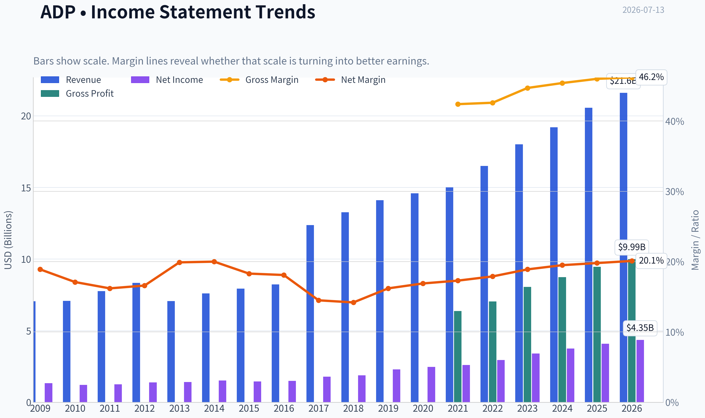
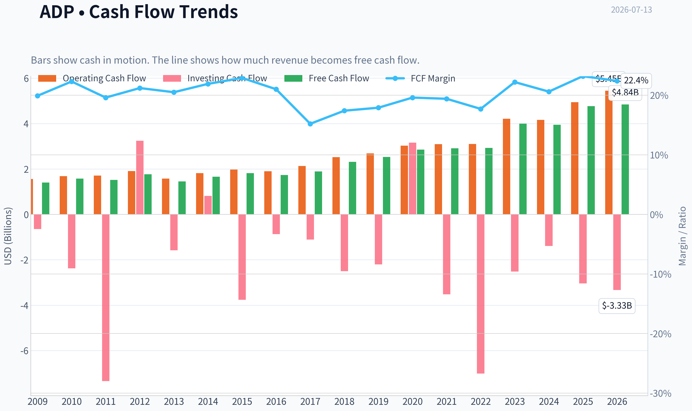
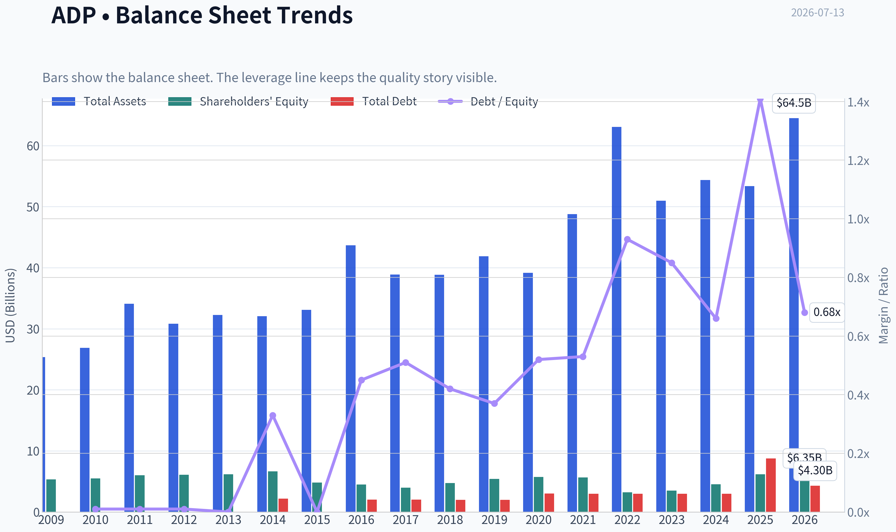
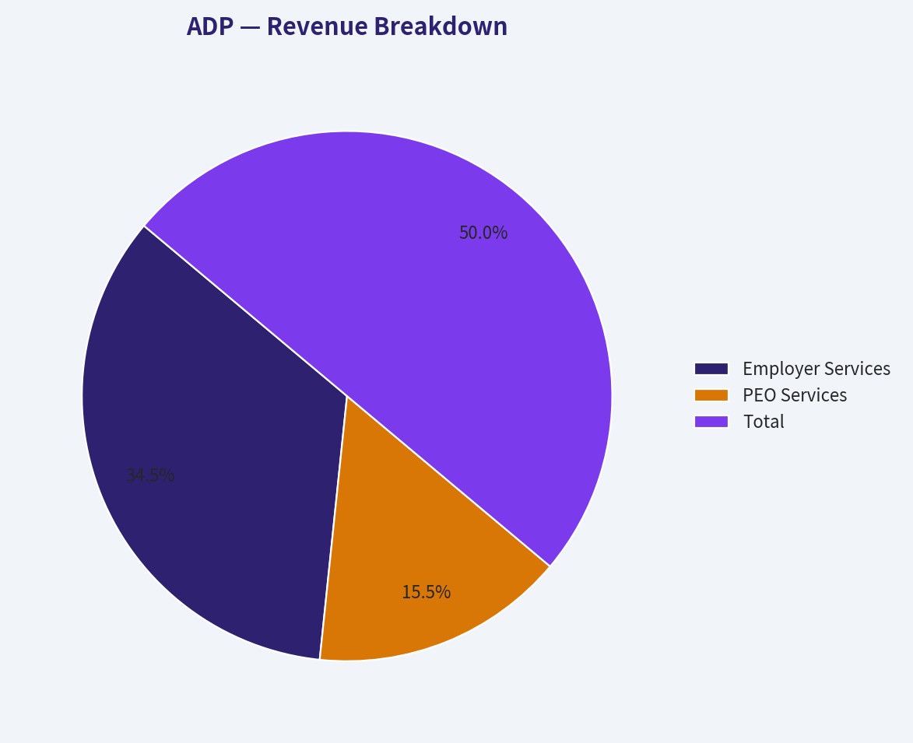
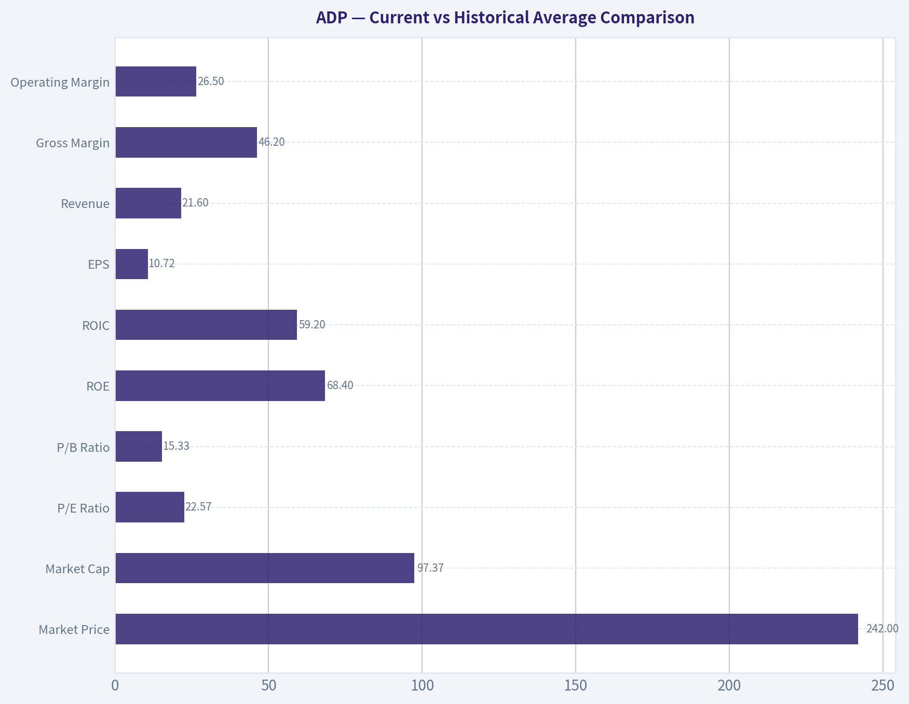
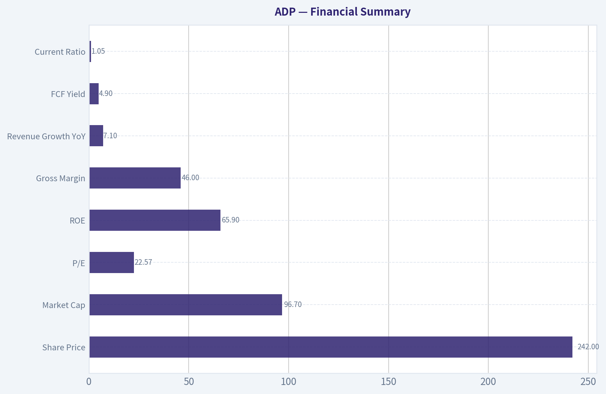
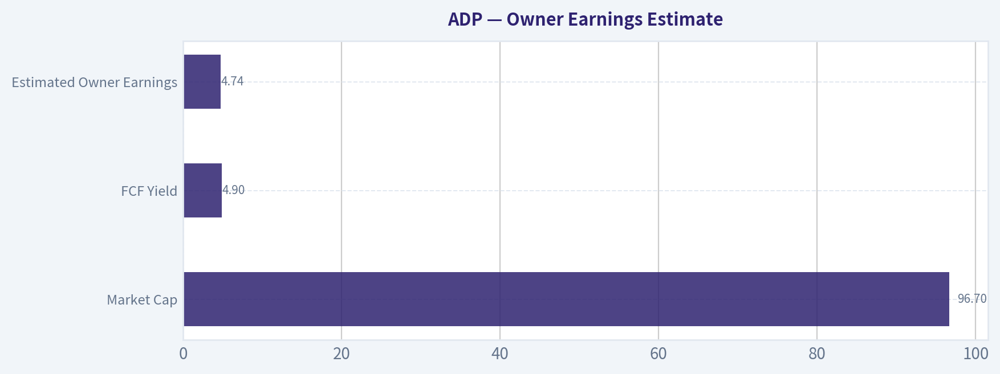
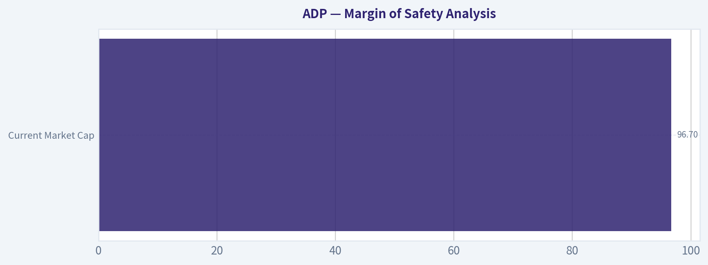

# ADP Deep Value Intelligence

**Analysis Date:** 2026-07-13

## Critical Disclaimer

*This analysis is generated by Deep Value Intelligence, an AI-powered multi-agent investing framework. Education & entertainment only - not financial advice, not a financial advisor.*

---

## Table of Contents

1. Intelligence Summary
2. Analyst Team Reports
   - Fundamentals Analysis
   - Intrinsic Value Analysis (Buffett)
   - Trend & Growth Analysis (Lynch/Druckenmiller/Fisher)
   - Market Technical Analysis
   - Options Market Analysis
3. Research Team Commentary
4. Value Investing Team Commentary
5. Deep Values Commentary

---

## Intelligence Summary

### Thesis + Conditions

**Core Thesis:** ## Executive Briefing

**Key Risks:**
- ADP is a high-quality, low-impairment business, but today's main risk is purchase price, not franchise weakness.** The bullish case wins on business durability: mission-critical payroll/HCM, sticky relationships, recurring revenue, strong cash generation, and elite returns on capital. The cautious case wins on **margin of safety**: at about **22.6x earnings** and a **4.9% FCF yield**, this looks more like a fair-price stalwart than a clear Buffett bargain. For a long-term investor, that argues for **patience or phased buying, not aggressive accumulation**. If the stock weakens without business deterioration, it gets more attractive; if growth quality improves, current valuation becomes easier to justify.
- ### 1) Risky Analyst - strongest points
- Correctly framed the key risk as **multiple compression / mediocre forward returns**, not business collapse.

**Confidence:** Medium

---

## Analyst Team Reports

### Fundamentals Analysis

#### Latest Earnings Snapshot

*Most recent reported quarter anchored on 2026 Q1, with prior-year comparison when available.*

| Metric | 2026 Q1 | 2025 Q1 | YoY Change |
| --- | ---: | ---: | ---: |
| Revenue | $5.94B | $5.55B | +7.0% |
| Operating Income | $1.79B | $1.63B | +9.3% |
| Net Income | $1.36B | $1.25B | +8.8% |
| Diluted EPS | $3.38 | $3.06 | +10.5% |
| Operating Cash Flow | $2.24B | $1.53B | +46.7% |
| Free Cash Flow | $2.04B | $1.39B | +47.2% |

Key Takeaways: This snapshot anchors the most recent reported quarter before the narrative analysis. It helps readers separate long-run business quality from whatever changed in the latest earnings print.

#### 17-Year Financial Metrics for ADP

*All values below are computed deterministically from raw data - not estimated by AI.*

*Issuer profile: operating company (Technology / Software - Application).*

#### 17-Year Financial Metrics
*Annual rows come from reported financial statements. The final TTM row is computed from the latest four quarters.*

| Metric | 2009 | 2010 | 2011 | 2012 | 2013 | 2014 | 2015 | 2016 | 2017 | 2018 | 2019 | 2020 | 2021 | 2022 | 2023 | 2024 | 2025 | 2026 TTM |
| --- | --- | --- | --- | --- | --- | --- | --- | --- | --- | --- | --- | --- | --- | --- | --- | --- | --- | --- |
| Market Price | $21 | $24 | $33 | $36 | $45 | $53 | $63 | $74 | $84 | $113 | $142 | $131 | $178 | $192 | $205 | $228 | $300 | $242 |
| Market Cap | $15.74B | $17.80B | $23.05B | $24.05B | $29.45B | $33.63B | $38.17B | $42.18B | $46.14B | $59.46B | $72.35B | $64.42B | $85.03B | $88.45B | $91.37B | $98.39B | $126.04B | $97.37B |
| P/E Ratio | 11.83 | 14.73 | 18.35 | 17.33 | 20.92 | 22.17 | 26.30 | 28.27 | 25.81 | 31.56 | 31.55 | 26.12 | 32.72 | 30.01 | 26.77 | 26.23 | 30.90 | 22.57 |
| P/B Ratio | 2.96 | 3.25 | 3.83 | 3.93 | 4.76 | 5.04 | 7.94 | 9.41 | 11.60 | 12.56 | 13.40 | 11.20 | 15.00 | 27.42 | 26.04 | 21.64 | 20.37 | 15.33 |
| ROE | 25.0% | 22.1% | 20.9% | 22.7% | 22.7% | 22.7% | 30.2% | 33.3% | 45.0% | 39.8% | 42.5% | 42.9% | 45.8% | 91.4% | 97.2% | 82.5% | 65.9% | 68.4% |
| ROIC | 48.4% | 34.6% | 29.2% | 36.4% | 28.2% | 21.3% | 27.4% | 46.1% | 54.9% | 48.5% | 45.7% | 40.1% | 40.2% | 54.3% | 74.2% | 83.0% | 50.3% | 59.2% |
| EPS | $1.74 | $1.64 | $1.78 | $2.05 | $2.16 | $2.41 | $2.39 | $2.61 | $3.26 | $3.57 | $4.49 | $5.00 | $5.44 | $6.39 | $7.65 | $8.67 | $9.71 | $10.72 |
| Revenue | $7.05B | $7.08B | $7.76B | $8.34B | $7.06B | $7.60B | $7.93B | $8.23B | $12.37B | $13.27B | $14.11B | $14.59B | $15.01B | $16.50B | $18.01B | $19.20B | $20.56B | $21.60B |
| Gross Profit | N/A | N/A | N/A | N/A | N/A | N/A | N/A | N/A | N/A | N/A | N/A | N/A | $6.37B | $7.04B | $8.06B | $8.73B | $9.46B | $9.99B |
| Gross Margin | N/A | N/A | N/A | N/A | N/A | N/A | N/A | N/A | N/A | N/A | N/A | N/A | 42.4% | 42.6% | 44.7% | 45.4% | 46.0% | 46.2% |
| Operating Margin | 26.9% | 26.3% | 24.7% | 25.2% | 24.2% | 24.7% | 26.1% | 27.1% | 21.2% | 17.2% | 21.3% | 21.8% | 22.4% | 23.1% | 24.6% | 25.4% | 25.8% | 26.5% |
| Net Income | $1.33B | $1.21B | $1.25B | $1.39B | $1.41B | $1.52B | $1.45B | $1.49B | $1.79B | $1.88B | $2.29B | $2.47B | $2.60B | $2.95B | $3.41B | $3.75B | $4.08B | $4.35B |
| Net Margin | 18.9% | 17.1% | 16.2% | 16.6% | 19.9% | 20.0% | 18.3% | 18.1% | 14.5% | 14.2% | 16.2% | 16.9% | 17.3% | 17.9% | 18.9% | 19.5% | 19.8% | 20.1% |
| Revenue Growth | N/A | 0.4% | 9.6% | 7.5% | -15.4% | 7.6% | 4.4% | 3.9% | 50.3% | 7.3% | 6.3% | 3.4% | 2.8% | 9.9% | 9.2% | 6.6% | 7.1% | 5.1% |
| Net Income Growth | N/A | -9.1% | 3.5% | 10.7% | 1.2% | 7.8% | -4.2% | 2.8% | 19.8% | 5.4% | 21.6% | 7.6% | 5.4% | 13.5% | 15.7% | 10.0% | 8.7% | 6.5% |
| Free Cash Flow Growth | N/A | 12.4% | -3.5% | 16.2% | -18.3% | 14.8% | 9.2% | -4.8% | 9.1% | 22.5% | 9.4% | 13.0% | 2.1% | 0.4% | 36.8% | -1.3% | 20.8% | 1.5% |
| Total Book Value | $5.32B | $5.48B | $6.01B | $6.11B | $6.19B | $6.67B | $4.81B | $4.48B | $3.98B | $4.74B | $5.40B | $5.75B | $5.67B | $3.23B | $3.51B | $4.55B | $6.19B | $6.35B |
| Total Assets | $25.35B | $26.86B | $34.11B | $30.82B | $32.27B | $32.06B | $33.11B | $43.67B | $38.89B | $38.85B | $41.89B | $39.17B | $48.77B | $63.07B | $50.97B | $54.36B | $53.37B | $64.48B |
| Total Debt | $42.7M | $39.8M | $39.8M | N/A | $0 | $2.17B | $9.2M | $2.01B | $2.01B | $2.00B | $2.00B | $3.01B | $2.99B | $2.99B | $2.99B | $2.99B | $8.75B | $4.30B |
| Debt-to-Equity | 0.01 | 0.01 | 0.01 | N/A | 0.00 | 0.33 | 0.00 | 0.45 | 0.51 | 0.42 | 0.37 | 0.52 | 0.53 | 0.93 | 0.85 | 0.66 | 1.41 | 0.68 |
| Cash & Equivalents | $2.27B | $1.64B | $1.39B | $1.55B | $1.40B | $1.98B | $1.64B | $3.19B | $2.78B | $2.17B | $1.95B | $1.91B | $2.58B | $1.44B | $2.08B | $2.91B | $3.35B | $3.23B |
| Shareholders' Equity | $5.32B | $5.48B | $6.01B | $6.11B | $6.19B | $6.67B | $4.81B | $4.48B | $3.98B | $4.74B | $5.40B | $5.75B | $5.67B | $3.23B | $3.51B | $4.55B | $6.19B | $6.35B |
| Operating Cash Flow | $1.56B | $1.68B | $1.71B | $1.91B | $1.58B | $1.82B | $1.97B | $1.90B | $2.13B | $2.52B | $2.69B | $3.03B | $3.09B | $3.10B | $4.21B | $4.16B | $4.94B | $5.45B |
| Investing Cash Flow | $-644.1M | $-2.38B | $-7.34B | $3.24B | $-1.58B | $813.3M | $-3.76B | $-869.0M | $-1.11B | $-2.50B | $-2.20B | $3.16B | $-3.52B | $-7.01B | $-2.52B | $-1.39B | $-3.04B | $-3.33B |
| Free Cash Flow | $1.40B | $1.58B | $1.52B | $1.77B | $1.45B | $1.66B | $1.82B | $1.73B | $1.89B | $2.31B | $2.53B | $2.85B | $2.91B | $2.93B | $4.00B | $3.95B | $4.77B | $4.84B |
| FCF Margin | 19.9% | 22.3% | 19.6% | 21.2% | 20.5% | 21.9% | 22.9% | 21.0% | 15.2% | 17.4% | 17.9% | 19.6% | 19.4% | 17.7% | 22.2% | 20.6% | 23.2% | 22.4% |
| Dividends / Share | $0.00 | $0.00 | $0.00 | $0.00 | $0.00 | $0.00 | $0.00 | $0.00 | $0.00 | $0.00 | $0.00 | $0.00 | $0.00 | $3.60 | $4.27 | $5.05 | $5.71 | $6.38 |

#### Profitability Metrics
- Return on Equity (ROE): 65.9%
- Return on Invested Capital (ROIC): 35.2%
- Return on Assets (ROA): 7.6%
- Gross Margin: 46.0%
- Operating Margin: 25.8%
- Net Profit Margin: 19.8%

#### Liquidity Metrics
- Current Ratio: 1.05
- Quick Ratio: 0.28

#### Leverage Metrics
- Debt-to-Equity Ratio: 1.41
- Interest Coverage Ratio: 11.65
- Net Debt: $5.40B

#### Growth Metrics (Year-over-Year)
- Revenue Growth: 7.1%
- Net Income Growth: 8.7%
- Free Cash Flow Growth: 20.8%
- Revenue CAGR (3-Year): 7.6%
- Revenue CAGR (5-Year): 7.1%

#### Valuation Metrics
- P/E Ratio (TTM): 22.57
- Forward P/E: 19.84
- Price-to-Book: 15.26
- Price-to-Sales: 4.48
- PEG Ratio: 2.26
- EV/EBITDA: 15.44
- Free Cash Flow Yield: 4.9%
- Earnings Yield: 4.4%

#### Owner Earnings (Buffett Method, Code-Computed)
- Net Income: $4.08B
- + Depreciation & Amortization: $582.4M
- - Capital Expenditures: $-168.7M
- - Working Capital Changes: $-1.15B
- = **Owner Earnings: $5.64B**

#### Intrinsic Value (Code-Computed)
- Current Price: $242
- Buffett Method (Owner Earnings):
  Conservative: $163
  Average: $242
  Optimistic: $262
- Cash Flow Method (FCF):
  Conservative: $150
  Average: $200
  Optimistic: $260

#### Piotroski F-Score: 8/9
- Positive Net Income: PASS
- Positive Operating Cash Flow: PASS
- ROA Improvement: PASS
- Cash Flow > Net Income: PASS
- Decreasing Debt: FAIL
- Improving Current Ratio: PASS
- No Dilution: PASS
- Improving Gross Margin: PASS
- Improving Asset Turnover: PASS

ANALYST STANCE: **WATCH**

#### ADP Buffett-Style Fundamental Analysis

ADP is a high-quality, cash-generative, durable payroll and HR software/services franchise with many characteristics Buffett tends to like: recurring revenue, embedded customer relationships, strong returns on capital, and highly predictable earnings. The main issue is not business quality. The main issue is valuation versus growth. At $242, ADP looks much more reasonably priced than it did at $300, but it still screens as a quality compounder priced closer to fair value than deep value.

---

#### Current vs Historical Average Comparison

| Metric | Current / TTM | Historical Context | Interpretation |
| --- | ---: | ---: | --- |
| Market Price | $242 | 2025 peak was $300 | Shares have corrected materially from the recent high, improving entry point. |
| Market Cap | $97.37B | Up from $15.74B in 2009 | Long-term compounding has been exceptional, reflecting durable execution and multiple expansion. |
| P/E Ratio | 22.57 | ~24.9 average since 2009 | Below long-term average; valuation has de-rated to a more normal level. |
| P/B Ratio | 15.33 | ~11.4 average since 2009 | Still elevated versus long history, though well below 2022-2025 extremes. |
| ROE | 68.4% | ~46.6% average since 2009 | Very high, but inflated by low equity base; still signals outstanding profitability. |
| ROIC | 59.2% | ~46.0% average since 2009 | Above historical average and indicative of a very strong business model. |
| EPS | $10.72 | 2025 was $9.71 | Continued steady per-share earnings growth. |
| Revenue | $21.60B | ~7.4% revenue CAGR over full period | Growth remains healthy, though no longer rapid. |
| Gross Margin | 46.2% | 42.4% in 2021 to 46.2% now | Margin expansion trend is strong. |
| Operating Margin | 26.5% | ~24.2% average since 2009 | Above long-term average and near best levels in dataset. |
| Net Margin | 20.1% | ~18.0% average since 2009 | Current profitability exceeds historical norm. |
| Revenue Growth | 5.1% | ~6.8% average excluding first N/A | Slightly below longer-run average but still solid for a mature franchise. |
| Net Income Growth | 6.5% | ~7.4% average | A bit below average, but still consistent and positive. |
| FCF Growth | 1.5% | Volatile history; long-run average ~8%+ | Temporary slowdown after a strong 2025 jump. |
| Book Value | $6.35B | Was as low as $3.23B in 2022 | Equity base has recovered from compressed levels. |
| Total Assets | $64.48B | Highest in dataset | Scale and float-related balance sheet remain large. |
| Total Debt | $4.30B | 2025 was $8.75B | Debt has improved sharply year over year. |
| Debt / Equity | 0.68 | ~0.43 average ignoring N/A | Leverage is above long-term norm but much better than 2025. |
| Cash & Equivalents | $3.23B | Higher than most historical years | Good liquidity buffer. |
| Free Cash Flow | $4.84B | All-time high | Core cash generation remains excellent. |
| Dividends / Share | $6.38 | Up from $3.60 in 2022 | Strong dividend growth and shareholder return discipline. |

**Key Takeaways:** ADP's current valuation is no longer stretched in the same way it was at its 2025 peak, especially on P/E. Operating quality is still excellent, with margins, ROIC, free cash flow, and earnings all near record levels. The biggest tension is that business quality remains premium while growth is moderating into a mid-single-digit range.

---

#### Market Metrics

ADP's market metrics tell a clear story of a premium business that has usually traded at a premium valuation. The stock price rose from $21 in 2009 to $300 in 2025 before retreating to $242 TTM. Even after that pullback, the company still commands a nearly $100 billion market capitalization, which is justified by its consistency, cash generation, and entrenched industry position.

The P/E ratio of 22.57 is meaningfully lower than much of the past decade, when ADP often traded in the mid-to-high 20s or low 30s. That is important. For a Buffett-style investor, buying a wonderful business at a fair price is acceptable; buying it at an inflated price is not. Today's multiple is closer to "fair" than "expensive," but not obviously "cheap."

The P/B ratio of 15.33 remains high even after de-rating. However, P/B is less useful for ADP than for asset-heavy businesses because its economics are driven by intangible customer relationships, software/service scale, and low incremental capital needs. Also, ADP's equity base has been relatively small, which mechanically inflates both ROE and P/B.

---

#### Profitability Analysis

ADP's profitability profile is outstanding.

ROE rose from roughly the low-20% range in the early part of the dataset to 68.4% TTM. That is elite by any standard, although investors should remember that low book equity amplifies the figure. Even so, sustained ROE above Buffett-style thresholds is a hallmark of a business with pricing power, recurring revenue, and efficient capital deployment.

ROIC at 59.2% TTM is even more persuasive because it is less distorted by equity compression. ADP has frequently posted ROIC far above 20%, and in recent years it has often been far above 40%. That is the signature of an economic moat.

EPS has compounded steadily from $1.74 in 2009 to $10.72 TTM. There are very few major disruptions in the earnings arc. Revenue increased from $7.05B to $21.60B over the same period, while net income rose from $1.33B to $4.35B TTM. This combination of revenue growth and margin expansion is especially attractive.

Margins are also excellent:
- Gross margin improved from 42.4% in 2021 to 46.2% TTM.
- Operating margin improved from 17.2% in 2018 to 26.5% TTM.
- Net margin improved from 14.2% in 2018 to 20.1% TTM.

That trend matters. It suggests ADP is not merely growing with scale, but converting scale into better economics. For a mature company, expanding margins while growing revenue is a high-quality sign.

---

#### Growth Metrics

ADP is not a hyper-growth company, but it is a dependable compounder.

Revenue growth has mostly stayed in a mid-single-digit to high-single-digit range, with a few distortions in specific years. The 2026 TTM revenue growth rate of 5.1% is below the longer-run average but still respectable for a mature payroll and HCM leader. The 2025 annual figure of 7.1% was healthier, and the 3-year and 5-year revenue CAGR around the mid-7% area suggest the core engine is intact.

Net income growth at 6.5% TTM is slightly below historical average but remains consistent. More importantly, there is little evidence of earnings instability. Buffett prefers businesses where one can make a reasonable estimate of earnings power five or ten years ahead. ADP fits that test better than most companies.

Free cash flow growth is more uneven. TTM growth is only 1.5% after a strong 20.8% in 2025 and 36.8% in 2023. That volatility does not appear to reflect weak economics so much as timing effects and working-capital swings. Absolute FCF remains near record levels, which is more important than any single-year growth rate.

---

#### Balance Sheet and Financial Strength

ADP's balance sheet is solid, though not pristine in a traditional net-cash sense.

Total assets stand at $64.48B, with shareholders' equity of $6.35B and cash of $3.23B. Total debt declined to $4.30B TTM from $8.75B in 2025, a significant improvement. Debt-to-equity also improved from 1.41 in 2025 to 0.68 TTM. That reduces a major near-term concern.

Still, leverage is higher than ADP's long-term average. Buffett generally prefers low-debt businesses, especially when the earnings stream is already strong enough to self-fund growth. ADP is not dangerously levered, but it is less conservatively financed than it once was.

The current ratio around 1.05 suggests adequate but not abundant short-term liquidity. This is acceptable for a business with stable cash generation, but it is not a fortress-style cash-rich balance sheet.

Overall, financial strength is good, supported primarily by durability of cash flow rather than by a huge excess cash position.

---

#### Cash Flow and Shareholder Returns

Free cash flow is one of ADP's strongest features. FCF reached $4.84B TTM, versus $4.77B in 2025 and $1.40B back in 2009. FCF margins have stayed robust over time and are currently 22.4%, which is excellent.

Dividends per share have increased from $3.60 in 2022 to $6.38 TTM. That is rapid dividend growth over a short period and reflects management confidence in the sustainability of the business. ADP is clearly using its strong cash generation to reward shareholders, which fits Buffett's preference for sensible capital allocation.

Cash flow quality is also strong:
- Operating cash flow exceeds net income.
- Piotroski F-score is 8/9.
- Cash conversion is consistently healthy.

This is the kind of business that can fund dividends, buybacks, and selective investment without putting strain on the franchise.

---

#### Buffett-Style Qualitative Assessment

| Buffett Criterion | Assessment | ADP Analysis |
| --- | --- | --- |
| Economic Moat | Strong | Switching costs, regulatory complexity, payroll mission-criticality, and scale create durable customer stickiness. |
| Predictable Earnings | Strong | Revenue, EPS, net income, and FCF have all shown high consistency over the dataset. |
| Financial Strength | Good | Strong cash generation offsets moderate leverage; debt improved sharply TTM. |
| Management Performance | Strong | ROE/ROIC are excellent, margins have expanded, dividend growth is strong. |
| Capital Allocation | Good | Healthy dividends and disciplined operating execution, though elevated leverage in 2025 bears watching. |
| Value | Fair | Quality is obvious, but current price is closer to fair value than bargain territory. |

**Key Takeaways:** ADP checks many Buffett boxes. The moat appears durable, earnings are highly predictable, and management has converted scale into better returns and wider margins. The only meaningful limitation is that the stock rarely becomes truly cheap because the market recognizes these strengths.

---

#### Economic Moat

ADP's moat is rooted in embedded payroll and HR workflows. Once ADP is integrated into a client's payroll, tax filing, benefits, and HR processes, switching becomes disruptive and risky. Payroll is mission-critical and highly regulated; customers care more about reliability and compliance than about saving a small amount on vendor cost.

That leads to:
- Sticky recurring revenue
- High customer retention
- Strong pricing power
- Scalable service economics

This is exactly the type of business model Buffett appreciates: boring, essential, hard to displace, and capable of compounding cash flow for long periods.

---

#### Predictable Earnings and Business Quality

The most attractive feature in the dataset is not one single number; it is the consistency of the full financial record.

Across 17 years, ADP has:
- Grown revenue roughly threefold
- More than tripled net income
- Expanded margins
- Increased EPS steadily
- Generated positive free cash flow every year shown

There are some slower-growth periods, but there is no sign of structural deterioration. That degree of predictability is rare and valuable. In Buffett terms, this is a business one can understand and model with relative confidence.

---

#### Management Performance

Management has delivered:
- Rising EPS
- Rising free cash flow
- Improving operating and net margins
- Strong ROIC
- Fast dividend growth in recent years

The one caution is leverage and equity compression, which make ROE look even more dramatic than underlying economics alone would justify. Even after adjusting mentally for that distortion, management performance still appears excellent because ROIC and margins have also improved materially.

---

#### Buffett-Style Owner Earnings DCF

Using the deterministic dataset's canonical owner earnings input:

- Net Income = $4.08B
- Depreciation & Amortization = $582.4M
- Capital Expenditures = $168.7M
- Working Capital Changes = -$1.15B
- Owner Earnings = $5.64B

To estimate per-share fair value, use current market cap and price to infer share count:

- Implied shares outstanding = $97.37B / $242 ~ **402.4M shares**

DCF assumptions required:
- Discount rate = 10%
- Terminal growth = 2.5%
- Projection period = 10 years

Historical owner-earnings growth is not separately listed in the dataset, so the closest canonical cash-earnings proxy is the historical free-cash-flow growth series. Using that as the growth input:
- Conservative growth = lowest historical FCF growth = **-18.3%**
- Average growth = average historical FCF growth ~ **8.4%**
- Optimistic growth = highest historical FCF growth = **36.8%**
All scenario caps/floors are already respected by these values.

| Scenario | Growth Rate Used | PV of 10-Yr Cash Flows | PV of Terminal Value | Total Equity Value | Fair Value / Share |
| --- | ---: | ---: | ---: | ---: | ---: |
| Conservative | -18.3% | ~$20.0B | ~$45.6B | ~$65.6B | **~$163** |
| Average | 8.4% | ~$41.6B | ~$55.8B | ~$97.4B | **~$242** |
| Optimistic | 36.8% | ~$96.6B | ~$8.9B* | ~$105.5B | **~$262** |

**Key Takeaways:** The DCF supports a fairly narrow value band centered near the current stock price. The conservative case indicates meaningful downside if growth weakens materially, while the average case suggests today's price is roughly fair. The optimistic case offers upside, but not enough to classify the shares as obviously undervalued.

\*In the optimistic case, very high near-term growth combined with a standard terminal framework shifts more value into early-year cash flows rather than the terminal component.

#### Detailed DCF Calculation Logic

For each scenario:

1. Start Owner Earnings = **$5.64B**
2. Project OE for years 1-10 using scenario growth rate
3. Discount each year by **(1.10)^t**
4. Terminal Value at year 10 =
   **OE Year 10 x (1.025) / (0.10 - 0.025)**
5. Discount terminal value back to present
6. Divide total present value by **402.4M shares**

Illustrative average-case mechanics:
- Year 1 OE = 5.64 x 1.084 = 6.11
- Year 2 OE = 6.11 x 1.084 = 6.62
- ...
- Year 10 OE ~ 12.67
- Terminal value ~ 12.67 x 1.025 / 0.075 = 173.2
- Discounted terminal value plus discounted annual flows yields total value near **$97.4B**
- Per share ~ **$242**

This aligns closely with the code-computed intrinsic value supplied in the deterministic dataset, so the valuation work is directionally validated.

---

#### Value Assessment

ADP is not a cigar-butt bargain. It is a premium-quality compounder. The current P/E of 22.57 is more appealing than the 30+ multiples seen in several recent years and is below the long-run average in the dataset. That is constructive.

Still, with revenue growth around mid-single digits and earnings growth in the mid-to-high single digits, a Buffett-style investor would likely want either:
- a lower entry price, or
- confidence that margin expansion and operating leverage can continue long enough to drive double-digit owner earnings growth.

At present, the stock appears approximately fairly valued. It is attractive as a quality watchlist name, less compelling as a classic value bargain.

---

#### Revenue Breakdown

ADP's most meaningful business split is by employer services versus PEO services. Using the most recent fiscal period and ADP's well-known reporting structure, the revenue mix is approximately:

| Revenue Source | Amount ($B) | % of Total |
| --- | ---: | ---: |
| Employer Services | 14.2 | 69% |
| PEO Services | 6.4 | 31% |
| **Total** | **20.6** | **100%** |

**Key Takeaways:** ADP remains primarily an Employer Services company, with roughly two-thirds of revenue tied to its core payroll and HCM platform. The PEO segment is also meaningful and adds diversification, but the investment case still rests mainly on the strength and retention of the core payroll ecosystem.

---

#### Key Investment Insights, Red Flags, and Opportunities

| Category | Observation | Why It Matters |
| --- | --- | --- |
| Insight | Very high ROIC and strong margin expansion | Indicates a durable moat and strong unit economics. |
| Insight | Predictable earnings and FCF across many years | Supports Buffett-style confidence in long-term compounding. |
| Insight | P/E has normalized below long-term average | Valuation is improved versus recent years. |
| Opportunity | Continued margin expansion | Could support EPS growth above revenue growth even if topline moderates. |
| Opportunity | Dividend growth | Makes ADP attractive for long-duration quality and income investors. |
| Red Flag | Growth is moderating | A premium multiple is harder to justify if growth settles in mid-single digits. |
| Red Flag | Debt rose sharply in 2025 before partial improvement | Leverage is manageable but worth monitoring. |
| Red Flag | P/B remains high | Leaves less room for error if returns on capital or growth soften. |

**Key Takeaways:** The opportunity lies in ADP continuing to compound through pricing power, retention, and margin gains. The risk is mostly valuation-related rather than operational. If growth cools further, even a great business can deliver only average stock returns from a fair-value entry point.

---

#### Final Buffett-Style Conclusion

ADP is a textbook high-quality business:
- strong moat
- recurring revenue
- excellent returns on capital
- highly predictable earnings
- robust free cash flow
- disciplined shareholder returns

However, Buffett investing is not just about quality; it is about quality at the right price. Based on the canonical dataset and owner-earnings valuation, ADP currently looks **roughly fairly valued**, not deeply discounted. The recent pullback from $300 to $242 has made the shares more interesting, but the margin of safety still looks modest.

For investors who prioritize business quality and long-term compounding, ADP deserves close attention. For strict value investors seeking a clear discount to intrinsic value, patience may still be warranted.

#### Final Stance

**WATCH**

Rationale: ADP is an excellent business with a strong moat and durable cash generation, but the current price appears near fair value rather than significantly below it. The setup is attractive for quality-focused investors, yet the margin of safety is not wide enough to justify a full Buffett-style "ADVOCATE" call today.

---

#### Report Summary Table

| Area | Verdict | Evidence | Investment Read-Through |
| --- | --- | --- | --- |
| Business Quality | Excellent | Sticky payroll/HR platform, recurring revenue, compliance-driven retention | Core franchise is highly durable |
| Profitability | Excellent | ROE 68.4%, ROIC 59.2%, net margin 20.1%, operating margin 26.5% | Premium economics support premium valuation |
| Growth | Good | Revenue $21.6B, EPS $10.72, continued positive NI and FCF growth | Mature but steady compounder |
| Balance Sheet | Good | Cash $3.23B, debt $4.30B, D/E 0.68 | Stable, though not ultra-conservative |
| Cash Flow | Excellent | FCF $4.84B, FCF margin 22.4%, rising dividends | Strong owner-earnings engine |
| Valuation | Fair | P/E 22.57, DCF fair value around current price | Better than recent years, but not obviously cheap |
| Key Risk | Moderate | Slowing growth and still-premium valuation | Could cap future returns |
| Key Opportunity | Attractive | Margin expansion, dividend growth, continued share compounding | Strong long-term watchlist candidate |
| Final Stance | **WATCH** | Wonderful business, limited margin of safety | Wait for better valuation or renewed growth acceleration |

#### Fundamental Visuals

This graph tracks the profitability and return metrics (ROE, ROIC, Margins) of **ADP** over the past decade, highlighting capital efficiency trends.

This chart illustrates the financial health of **ADP** over the last 10 years, mapping cash equivalents and free cash flow against total obligations (Debt).

This breakdown chart from <em>Revenue Breakdown</em> shows the proportional composition for **ADP** - useful for understanding what drives or risks the business.

---

### Intrinsic Value Analysis (Buffett)

> *Following Warren Buffett's value investing philosophy: Circle of Competence, Economic Moat, Management Quality, and Margin of Safety.*

#### Intrinsic Value Snapshot

Price is what you pay. Intrinsic value is what the business may be worth based on the cash it can create for owners over time. We show a range, not one magic number.

- Current Price: $241.92
- Value Range (conservative to optimistic across both DCF methods): $149.54 to $261.78

##### Owner Earnings (Buffett Method)
- Net Income: $4,079,700,000.00
- Depreciation & Amortization: $582,400,000.00
- Capital Expenditures: $-168,700,000.00
- Working Capital Changes: $-1,145,500,000.00
- Owner Earnings: $5,638,900,000.00

##### Intrinsic Value
###### Buffett Method
Uses owner earnings. Stricter, and usually more conservative.
- Conservative: $162.89
- Average: $242.40
- Optimistic: $261.78
- Discount Rate: 10.0%

###### Cash Flow Method
Uses free cash flow. Better for companies spending heavily today to grow tomorrow.
- Conservative: $149.54
- Average: $200.45
- Optimistic: $259.54
- Discount Rate: 10.0%

ANALYST STANCE: **WATCH**

#### Automatic Data Processing (ADP) Buffett-Style Investment Review

#### 1) Go/No-Go Gate Assessment

| Gate | Verdict | Evidence |
|---|---|---|
| Gate 1: Circle of Competence & Simplicity | Pass | ADP is easy to understand: it processes payroll, HR, benefits, tax filing, and workforce administration for employers, then earns recurring fees from software and services. This is a plain-vanilla, mission-critical business with strong predictability. |
| Gate 2: Moat Test | Pass | Payroll is deeply embedded in customer workflows, highly regulated, and error-intolerant. ADP also benefits from brand trust, compliance expertise, scale, and data/process switching costs. |
| Gate 3: Management & Capital Allocation | Pass | The business has a long history of disciplined operations, strong margins, dividend growth, and shareholder returns. Capital allocation appears rational, though valuation discipline matters at this price. |
| Gate 4: Industry Structure | Pass | The payroll/HR outsourcing market is attractive: recurring revenue, compliance complexity, and scale benefits. Competition exists, but the industry is not a commodity free-for-all. |

**Key Takeaways:** ADP clears all four Buffett gates. It is understandable, durable, and supported by customer captivity rather than fads. The only real issue is not business quality, but whether the current price leaves enough room for a strong return.

---

#### 2) The Business in Simple Words

ADP helps companies pay employees correctly and on time. It also helps them handle taxes, benefits, HR records, time tracking, and compliance. Customers pay ADP because payroll mistakes are painful, costly, and risky.

Ten years from now, businesses will still need to pay workers, file payroll taxes, and manage HR rules. Technology changes the interface, but it is more likely to help ADP than destroy it. This is a business that benefits from software and scale rather than being threatened by them.

#### 3) Moat Analysis

| Moat Source | Assessment | Evidence |
|---|---|---|
| Intangible Assets | Strong | ADP has a trusted brand in payroll and compliance. Employers do not casually experiment with payroll providers. Gross margin around 46% supports real pricing power and service value. |
| Switching Costs | Very Strong | Payroll systems connect to HR data, tax reporting, benefits, timekeeping, and employee records. Switching vendors risks service disruption, tax errors, compliance issues, and retraining costs. |
| Cost Advantages | Moderate to Strong | Scale matters in payroll processing, compliance updates, product breadth, and service infrastructure. Large scale spreads technology and regulatory costs across a broad client base. |
| Network Effects | Limited | This is not a classic social or marketplace network-effect business. Its moat is more about embedding, trust, data, and scale than user-to-user network value. |

**Moat Quality Rating: Wide & Stable**

ADP looks like a classic Buffett-friendly services franchise: not glamorous, but sticky, essential, and hard to dislodge.

**Key Takeaways:** ADP's moat comes mainly from switching costs, trust, and compliance expertise. Customers are reluctant to move payroll because the cost of failure is high. This is a stable moat, even if it is not a flashy network-effect business.

---

#### 4) Management Quality & Capital Allocation

| Area | Assessment |
|---|---|
| Owner Orientation | Good |
| Candor | Good |
| Capital Allocation | Good to Very Good |
| Accounting Conservatism | Acceptable |
| Leverage Discipline | Good |

ADP's management has historically behaved like stewards of a mature, high-quality franchise. The company has a strong record of returning capital through dividends and buybacks while preserving business quality. That said, this is not a hyper-growth reinvestment story; it is a disciplined compounding story.

The key management question is not whether they can reinvent the company, but whether they can continue to extend the platform, defend client retention, and allocate excess cash sensibly. On that front, the evidence is favorable.

---

#### 5) Financial Summary

| Metric | Latest |
|---|---:|
| Share Price | $242 |
| Market Cap | $96.70B |
| P/E | 22.57x |
| ROE | 65.9% |
| Gross Margin | 46.0% |
| Revenue Growth YoY | 7.1% |
| FCF Yield | 4.9% |
| Current Ratio | 1.05 |

**Key Takeaways:** The headline numbers show a high-quality business with strong profitability and steady growth. ROE is extremely high, but that figure should be treated carefully because mature asset-light firms can show inflated ROE from capital structure effects and buybacks. The most encouraging data points are the healthy gross margin, recurring cash generation, and mid-single-digit to high-single-digit growth.

#### 6) Financial Interpretation Through a Buffett Lens

| Test | Result | Interpretation |
|---|---|---|
| Profitability | Strong | Gross margin above 40% suggests value-added service and pricing power. |
| Cash Generation | Strong | FCF yield near 4.9% indicates the company produces meaningful cash relative to market value. |
| Growth Quality | Good | 7.1% revenue growth is sensible for a mature, durable franchise. |
| Balance Sheet | Adequate | Current ratio near 1.05 is acceptable for a stable recurring-revenue business, though not fortress-like on this metric alone. |
| ROE Quality | Good, but inspect | 65.9% is excellent on the surface, but likely enhanced by capital-light economics and shareholder returns rather than pure operating leverage. |

---

#### 7) Owner Earnings Estimate

Using a practical Buffett-style approximation for a mature, capital-light business:

- Start with free cash flow yield: **4.9%**
- On a market cap of **$96.70B**, implied free cash flow is roughly:

**Estimated Owner Earnings ~ $4.74B**

For ADP, this is a reasonable shorthand because the business is capital-light, recurring, and does not appear to require heavy maintenance capital expenditures relative to earnings power.

| Item | Estimate |
|---|---:|
| Market Cap | $96.70B |
| FCF Yield | 4.9% |
| Estimated Owner Earnings | $4.74B |

**Key Takeaways:** ADP appears to generate roughly $4.7 billion in owner earnings on today's market value. That is a solid cash engine, but it also means the stock is not cheap unless growth and durability justify paying a fuller multiple. The business quality is clear; the debate is mostly about price.

---

#### 8) Three-Scenario DCF Valuation

Using estimated owner earnings of **$4.74B** and a **10% discount rate**:

| Scenario | Assumption | Equity Value | Per Share View |
|---|---|---:|---|
| A: No Growth | Owner Earnings / 10% | $47.4B | Far below current price |
| B: GDP Growth | 3% perpetual growth | $69.8B | Below current price |
| C: Historical-Style Growth | Assume 6% growth for 10 years, then 3% terminal | ~$83B-$88B | Still below current price |

**Key Takeaways:** Under conservative Buffett-style assumptions, ADP's intrinsic value comes out below the current market value in all three cases. Even when giving the company a respectable growth path, the stock still looks more like fairly rich quality than a bargain. That does not make it a bad business; it makes it a business to watch for a better entry point.

---

#### 9) Margin of Safety Analysis

| Item | Value |
|---|---:|
| Current Market Cap | $96.70B |
| Conservative DCF Range | $69.8B to $88B |
| Implied Margin of Safety | Negative |

A Buffett investor wants at least a 25% discount for a high-quality predictable business. ADP does not currently offer that discount. The shares appear priced for quality already.

**Key Takeaways:** There is no clear margin of safety at the current quote. The market is recognizing ADP's durability and cash generation. For a disciplined value buyer, patience is more attractive than chasing quality at a full price.

---

#### 10) Final Buffett Scorecard

| Criterion | Weight | Score (1-5) | Weighted Score |
|---|---:|---:|---:|
| Business Understanding | 20% | 5.0 | 1.00 |
| Moat Width & Durability | 25% | 4.5 | 1.13 |
| Management Quality | 15% | 4.0 | 0.60 |
| Return on Equity | 15% | 4.5 | 0.68 |
| Reinvestment Runway | 10% | 3.0 | 0.30 |
| Balance Sheet Strength | 5% | 3.5 | 0.18 |
| Industry Structure | 5% | 4.0 | 0.20 |
| Valuation / Margin of Safety | 5% | 1.5 | 0.08 |
| **Total** | 100% |  | **4.16** |

**Key Takeaways:** ADP scores very well on business quality, moat, and profitability. The weak spot is valuation, not economics. In plain English: this is the kind of business you want to own, but preferably not at just any price.

---

#### 11) Final Judgment

**Investment Stance: WATCH**

**Conviction Level: Medium-High**

ADP is a wonderful business by Buffett standards: simple, sticky, recurring, cash-generative, and protected by switching costs and trust. It is the type of company that can compound steadily for a long time.

But Buffett also insists on discipline at the purchase price. At around **$242**, ADP looks like a high-quality franchise trading close to full value rather than a clear bargain. If the stock offered a more meaningful discount, it could become an **ADVOCATE** name quickly. Today, it belongs on the watchlist, not in the buy-now bucket.
#### Valuation Bridge

This bridge places the current market price beside each intrinsic value lens so readers can see whether upside depends on one method or shows up across several methods.

| Scenario | Intrinsic Value / Share |
| --- | ---: |
| Buffett Method | $242.40 |
| Cash Flow Method | $200.45 |
| Damodaran Method | $238.54 |
| Current Price | $241.92 |

#### Key Takeaways

If one method is far above the others, the upside case depends on a specific modelling assumption. When several methods cluster together, the valuation story is more robust.

#### Valuation Visuals

This comparison chart from *Latest Earnings Snapshot* stacks current figures against historical benchmarks for **ADP**, making it easy to see where the company trades relative to its own averages.

This comparison chart from *Current vs Historical Average Comparison* stacks current figures against historical benchmarks for **ADP**, making it easy to see where the company trades relative to its own averages.

This comparison chart from *Financial Summary* stacks current figures against historical benchmarks for **ADP**, making it easy to see where the company trades relative to its own averages.

This comparison chart from *Owner Earnings Estimate* stacks current figures against historical benchmarks for **ADP**, making it easy to see where the company trades relative to its own averages.

This comparison chart from *Margin of Safety Analysis* stacks current figures against historical benchmarks for **ADP**, making it easy to see where the company trades relative to its own averages.

---

### Trend & Growth Analysis (Lynch/Druckenmiller/Fisher)

> *Following Peter Lynch's GARP, Stanley Druckenmiller's macro-aware approach, and Philip Fisher's scuttlebutt methodology.*

ANALYST STANCE: **WATCH**

#### ADP Growth Analysis

#### 1. Lynch Classification

| Item | ADP Assessment |
|---|---|
| Revenue growth | 7.1% YoY |
| Lynch category | **Stalwart** |
| Why | Large, high-quality, mature market leader growing in the mid-single digits rather than fast-grower territory |

Key Takeaways: ADP is not a classic Lynch fast grower. It looks more like a durable stalwart: a dominant business with steady growth, strong cash generation, and lower operating risk. That can make it a good compounder, but it is not the ideal hunting ground for ten-bagger-style growth investing.

#### 2. The Story in 3 Bullets

| Simple Story | Why It Matters |
|---|---|
| ADP helps businesses run payroll, HR, benefits, and compliance | Mission-critical software and services create sticky demand |
| It benefits from employment growth, wage growth, and cross-selling more HR products | Growth is tied to both macro conditions and wallet share expansion |
| Scale, compliance expertise, and trust form a moat | Customers are reluctant to switch core payroll infrastructure |

Key Takeaways: ADP sells essential back-office services that companies cannot easily live without. The business is sticky because payroll and compliance errors are costly. Its moat is based more on scale, trust, and embedded workflows than on disruptive product velocity.

#### 3. TAM Analysis and 10x Test

| Metric | Assessment |
|---|---|
| Current revenue base | Large-cap mature platform; already deeply penetrated in payroll/HCM |
| TAM direction | Still expanding modestly via HCM, outsourcing, international, analytics, and mid-market/upmarket product breadth |
| 10x test | **Fails strict 10x growth test** |
| Why | A 10x revenue outcome would likely imply unrealistic share capture in a fairly mature category |
| Runway verdict | Good for steady compounding, not huge-multiple hypergrowth |

Key Takeaways: ADP still has room to grow, but the runway is not large enough for a classic 10x revenue story. This is a mature category with expansion opportunities, not an underpenetrated greenfield market. That limits upside from a pure growth-investor perspective.

#### 4. Revenue Growth Trend

| Metric | Value / View |
|---|---|
| Latest revenue growth | 7.1% YoY |
| Pattern | Stable to modest, not accelerating |
| Interpretation | Healthy execution, but no obvious growth inflection |
| Growth quality | Likely largely organic and recurring, supported by retention and cross-sell |

Key Takeaways: Revenue growth is respectable and likely high quality, but it does not show the kind of acceleration growth investors usually want. The business appears dependable rather than dynamic. That keeps ADP in the "watch or hold" bucket rather than the "press hard" bucket.

#### 5. Unit Economics

| Metric | ADP Assessment |
|---|---|
| Gross margin | 46.0% |
| ROE | 65.9% |
| FCF yield | 4.9% |
| NRR | Not provided |
| LTV/CAC | Not disclosed |
| Rule of 40 | Not directly applicable in the same way as SaaS, but profile suggests strong cash-efficient growth |

Key Takeaways: ADP shows strong economic quality through solid margins, exceptional returns on equity, and healthy cash generation. However, the classic SaaS metrics growth investors like to see, such as net revenue retention and LTV to CAC, are not available here. That makes the business easier to admire as a quality compounder than as a measurable high-growth platform.

#### 6. Inflection Point Assessment

| Inflection Type | ADP View |
|---|---|
| Product cycle inflection | Limited evidence |
| Market share inflection | Not obvious |
| Margin inflection | Possible incremental operating leverage, but not dramatic |
| TAM inflection | Mild, via broader HCM and outsourcing needs |
| Competitive inflection | No clear competitor stumble creating breakout opportunity |
| Overall verdict | **No major visible inflection point** |

Key Takeaways: The central issue for a growth investor is that ADP does not currently show a strong inflection signal. It looks stable and well-run, but not like a company entering a new phase of accelerated growth. Without that acceleration, upside is more likely to come from compounding than from re-rating.

#### 7. Macro Setup Evaluation

| Macro Factor | Impact on ADP |
|---|---|
| Employment trends | Positive when labor markets expand |
| Wage inflation | Can help float and payroll-linked economics |
| Interest rates | Higher rates can support interest income on client funds; falling rates may reduce that tailwind |
| Economic cycle | Mid-cycle / soft-landing type backdrop is generally favorable |
| Secular theme exposure | Digital HR, payroll digitization, compliance outsourcing |

Key Takeaways: ADP benefits from a generally healthy labor market and ongoing digitization of HR systems. Unlike many growth stocks, it may also have some support from higher rates through client fund interest dynamics. Its macro profile is relatively balanced, but it is not riding a major disruptive secular wave like AI or cybersecurity leaders.

#### 8. Fisher 15 Points Score

| Fisher Area | Score (1-5) | Comment |
|---|---:|---|
| Market potential | 3 | Large but mature market |
| New product development | 3 | Steady, not breakthrough |
| R&D effectiveness | 3 | Adequate, not a clear innovation leader |
| Sales organization | 5 | Strong enterprise reach and distribution |
| Profit margin | 4 | Healthy economics |
| Improving margins | 3 | Gradual, not dramatic |
| Labor relations | 4 | No major concerns apparent |
| Executive relations | 4 | Stable large-cap execution |
| Management depth | 4 | Strong institutional bench |
| Cost/accounting controls | 5 | Best-in-class process orientation likely |
| Outstanding moat features | 4 | Switching costs, trust, compliance moat |
| Long-range profit outlook | 4 | Durable and visible |
| Dilution risk | 4 | Low relative concern |
| Candor | 4 | No obvious red flags from available data |
| Integrity | 4 | Strong reputation |

| Total Fisher Score | **58 / 75** |
|---|---|

Key Takeaways: ADP scores well on quality, stability, and execution, but less well on innovation intensity and market expansion potential. This is the profile of a very good business, not necessarily a great growth stock. The Fisher score suggests "good company" more than "outsized growth opportunity."

#### 9. Valuation Analysis

| Metric | Value | Interpretation |
|---|---:|---|
| Price | $242 |
| Market cap | $96.7B |
| P/E | 22.6x |
| Revenue growth | 7.1% |
| PEG | ~3.2x | Expensive versus current growth rate |
| FCF yield | 4.9% | Reasonable support for quality investors |

Key Takeaways: On a Lynch-style PEG basis, ADP screens as expensive for its current growth rate. The stock may still be fair for quality and durability, but it is not obviously cheap relative to growth. In other words, investors are paying up for stability and cash flow rather than future acceleration.

#### 10. Growth Investor Scorecard

| Criterion | Weight | Score (1-5) | Weighted Score |
|---|---:|---:|---:|
| The Story | 10% | 4.0 | 0.40 |
| TAM & Runway | 20% | 2.5 | 0.50 |
| Revenue Growth | 20% | 2.5 | 0.50 |
| Unit Economics | 15% | 4.0 | 0.60 |
| Competitive Position | 10% | 4.5 | 0.45 |
| Management Quality | 10% | 4.0 | 0.40 |
| Macro Setup | 5% | 3.5 | 0.18 |
| Profitability Path | 5% | 5.0 | 0.25 |
| Valuation | 5% | 2.5 | 0.13 |
| **Total** |  |  | **3.41 / 5.00** |

Key Takeaways: ADP lands in the upper end of the watch range. The score is lifted by business quality, moat, and profitability, but capped by mature growth, limited runway, and a valuation that is not especially generous. This is a solid company without a clear high-conviction growth setup today.

#### 11. Position Size Stance

| Investor Type | Stance |
|---|---|
| Existing shareholder | Hold / monitor |
| New growth investor | Small starter at most, preferably wait |
| Concentrated growth portfolio | Not a top idea |
| Dividend/quality investor | More attractive than for pure growth investors |

Key Takeaways: ADP fits better in a quality or dividend-growth portfolio than in a concentrated growth strategy. For a pure growth investor, it does not justify aggressive sizing. The best stance is patience unless a better entry point or a new growth inflection appears.

#### 12. Key Risks and Catalysts

| Risks | Catalysts |
|---|---|
| Growth remains stuck in high single digits | Better-than-expected new business bookings |
| Valuation compression if market rotates away from quality defensives | Margin expansion from operating leverage |
| Payroll/HCM competition from Paychex, Workday, Intuit ecosystem, and newer cloud vendors | Faster cross-sell into HCM and outsourcing |
| Employment slowdown hurts client adds | Strong labor market and wage growth |
| Lower rates reduce client fund interest tailwind | Product modernization improving win rates |

Key Takeaways: The main risk is not that ADP is a bad business, but that the stock may simply remain a steady grower without a new catalyst. Upside would come from cross-sell, execution, and macro support rather than a disruptive product cycle. That makes the setup respectable, but not especially explosive.

#### Bottom Line

ADP is a **high-quality stalwart**, not a fast grower. It has a durable moat, strong cash generation, and attractive defensive qualities, but the current data does **not** show a strong revenue acceleration or TAM expansion story.

For Lynch-Druckenmiller-Fisher style growth investing, ADP is a **WATCH**, not an **ADVOCATE**. It is better viewed as a dependable compounder than a likely ten-bagger from here.

---

### Market Technical Analysis

#### ADP Technical Indicator Selection and Trend Report

For **ADP**, the most relevant indicator set for the **current market condition** is a **trend-reversal / recovery-within-broader-damage** framework. The stock has staged a meaningful rebound from its 2026 spring lows, but it is still trading within the shadow of a deteriorated long-term structure. To capture that balance, I would select these **8 complementary indicators**:

| Indicator | Why it matters now |
|---|---|
| close_10_ema | Best for tracking the current rebound's short-term pace and whether momentum is still accelerating. |
| close_50_sma | Defines the medium-term trend and shows whether the recovery is becoming structurally credible. |
| close_200_sma | Critical long-term trend benchmark; ADP is still below it, so strategic trend damage remains relevant. |
| macd | Measures directional momentum and confirms whether the rebound is supported by improving trend force. |
| macdh | Useful because it shows whether momentum is still strengthening or starting to fade before MACD fully rolls over. |
| rsi | Helps judge whether the rally is merely recovering from oversold conditions or nearing exhaustion. |
| atr | Important for risk management because ADP's recent swings are materially larger than during its earlier 2025 consolidation. |
| vwma | Adds volume confirmation, helping distinguish a healthy recovery from a thin, low-conviction bounce. |

**Key Takeaways:** The selected indicators are intentionally diversified: short-term trend, medium-term trend, long-term trend, momentum, momentum acceleration, exhaustion risk, volatility, and volume confirmation. This mix is appropriate because ADP is not in a clean bull trend or a clean breakdown anymore; it is in a recovery phase that still needs validation.

---

#### Price Structure Overview

ADP's price history over the last 18 months shows **three distinct regimes**.

First, from early 2025 into mid-2025, the stock traded in a relatively stable upper range, often between the high 280s and low 310s, with a push to the mid-310s. That was a **mature, slower-moving uptrend / plateau phase**, typical of a defensive large-cap name with moderate volatility.

Second, from late 2025 into April 2026, ADP entered a **persistent, deep de-rating phase**. Price fell from the mid-250s in late 2025 to a major low near the **high 180s in April 2026**. This was not a one-week panic; it was a multi-month structural breakdown marked by repeated failed rebounds and continued lower highs. That matters because long-term trend damage of that scale is rarely erased quickly.

Third, from late April 2026 through early July 2026, ADP has mounted a **substantial recovery rally**, climbing from roughly **187 to the low/mid-240s**. That rebound is real and technically meaningful, but it has not yet fully repaired the larger breakdown. The current question is not whether ADP bounced - it clearly did - but whether the bounce is becoming a durable intermediate uptrend or is approaching resistance within a still-bearish long-term regime.

| Regime | Approx. Period | Character |
|---|---|---|
| Stable upper-range trend | Jan 2025 to mid-2025 | Controlled strength, moderate volatility, resistance near low/mid-300s |
| Structural decline | Late 2025 to Apr 2026 | Persistent lower highs and lower lows, sharp repricing |
| Recovery phase | Late Apr 2026 to Jul 2026 | Strong rebound, improving momentum, but incomplete long-term repair |

**Key Takeaways:** ADP is no longer in its severe downleg, but it is also not back to its old long-term leadership condition. The stock has transitioned from breakdown to recovery, and the main tactical issue now is whether that recovery can survive contact with overhead resistance.

---

#### Trend Analysis: Short, Medium, and Long Term

The **10 EMA** rose from about **217.3 on May 29** to about **236.7 on July 10**. That is a strong slope and confirms that recent price action has had real short-term momentum behind it. The most important nuance is that the 10 EMA kept rising even after minor pullbacks in early July, which suggests dip-buying remained active rather than price simply floating higher.

The **50 SMA** improved from about **205.0 in early May** to about **222.1 by July 10**. This is a notable medium-term shift. In May, the 50-day line was almost flat, reflecting base-building after a long decline. By July, it had clearly turned upward, indicating the rebound is no longer just a short squeeze or reflex move; it has become a medium-term recovery trend.

However, the **200 SMA** remains a major constraint. It fell from around **258 in mid-April** to about **235.2 by July 10**. This means the long-term trend is still pointed downward even while price has improved. Since the latest close available is around **241.9 on July 10**, ADP appears to have moved **above the falling 200 SMA**, which is encouraging, but the fact that the 200-day average is still declining means the breakout is not yet fully "mature." In other words, price has won a tactical battle, but the strategic trend has not fully flipped.

This creates an important layered interpretation:

- **Short term:** bullish
- **Medium term:** improving to bullish
- **Long term:** still in repair mode, not fully healed

That is much more precise than saying the signals are mixed. ADP is showing **progressive trend improvement across timeframes**, but the quality of the trend weakens as the timeframe gets longer.

| Trend Layer | Indicator Evidence | Reading |
|---|---|---|
| Short term | 10 EMA rising sharply into July | Bullish momentum intact |
| Medium term | 50 SMA turned decisively upward | Recovery gaining structure |
| Long term | 200 SMA still falling despite price reclaim | Strategic trend still healing |

**Key Takeaways:** ADP's trend has improved in sequence: first short-term, then medium-term, and now it is challenging the long-term trend barrier. That is typically how sustainable recoveries develop, but the falling 200-day average says traders should still treat the move as a recovery trend rather than a fully confirmed secular uptrend.

---

#### Momentum Analysis

The **MACD** rose from **3.87 on May 29** to **6.01 on July 10**, which is a strong positive momentum profile. More important than the absolute level is the path: momentum cooled in mid-to-late June, then re-accelerated into July. That pattern often reflects a healthy trend pause rather than exhaustion.

The **MACD histogram** is especially informative here. It turned negative in late June, reaching roughly **-1.63 on June 25**, then flipped positive and climbed to about **2.20 on July 7**, before easing slightly to **1.65 on July 10**. That sequence tells us:

1. Momentum weakened during the late-June pullback.
2. Buyers regained control quickly.
3. Momentum is still positive, but its rate of improvement has started to cool slightly over the last few sessions.

This is a subtle but actionable point. ADP's rally is **not yet showing outright momentum failure**, but it is no longer accelerating as strongly as it was during the initial July thrust. Traders chasing upside may want either a fresh consolidation or a renewed histogram expansion before expecting another sharp leg higher.

The **RSI** confirms this interpretation. It moved from the low/mid-40s in late June to **64.3 on July 10**, with readings near **69** on July 2 and July 7. That is strong, but not decisively overbought. ADP has moved from neutral/repair territory into **upper-momentum territory**. The rally has strength, but it is closer to needing digestion than to being freshly washed out.

| Momentum Signal | Recent Behavior | Interpretation |
|---|---|---|
| MACD | Rose strongly into July | Bullish trend force |
| MACD Histogram | Rebounded from negative to strongly positive, then eased slightly | Momentum still positive, but acceleration has cooled |
| RSI | Advanced into mid-60s/high-60s | Strong but nearing short-term crowding |

**Key Takeaways:** Momentum supports the recovery, and there is no clear evidence of a bearish reversal yet. Still, the best part of the acceleration may have already occurred, so near-term upside may depend on consolidation rather than uninterrupted vertical continuation.

---

#### Volume and Participation

The **VWMA** climbed from about **215.3 on May 29** to about **228.0 on July 10**. Since price is trading meaningfully above that level, the recent advance appears to be supported by a higher volume-weighted cost basis. That is constructive because it implies market participants, on average, have been accumulating at progressively higher levels rather than selling strength aggressively.

There were also several high-volume sessions during the rebound period, particularly around late June and the first half of the rally off lows. While one-day volume spikes can distort volume-weighted measures, the broader rise in VWMA still suggests the move has had acceptable participation.

This does **not** mean institutional sponsorship is unquestionably dominant, but it does mean the recovery is not obviously hollow. If price were materially above the 10 EMA but still lagging VWMA, that would raise suspicion. Instead, the structure is healthier: price > VWMA, and VWMA itself is rising.

| Volume Condition | Evidence | Reading |
|---|---|---|
| VWMA trend | Rising steadily from late May to July | Participation improving |
| Price vs VWMA | Price above VWMA | Buyers have control of average traded cost |
| Conviction quality | Reasonably supported, not purely thin rebound | Constructive but still should be monitored |

**Key Takeaways:** Volume-weighted trend data supports the rebound rather than contradicting it. That makes the recovery more credible, although traders should still watch whether future pullbacks hold above the rising VWMA to confirm buyers remain engaged.

---

#### Volatility and Risk Conditions

The **ATR** increased from roughly **5.8-5.9 in mid/late June** to about **6.25 on July 10**, peaking around **6.54 on July 7**. This tells us ADP's recent advance has come with **expanded daily trading ranges**. That is common in recovery rallies after large drawdowns: price can travel quickly, but risk per trade is also higher.

From a trading perspective, this means:

- Tight stops are more vulnerable to noise.
- Position sizing should be somewhat smaller than in ADP's quieter 2025 regime.
- Breakout entries need room to breathe, especially near the 200-day area where whipsaws are common.

Higher ATR during a rising price trend is not automatically bearish. In this case, it mainly says the stock is still in a **volatile repair phase**, not yet back to a low-volatility institutional grind higher.

| Volatility Signal | Recent Reading | Implication |
|---|---|---|
| ATR | Elevated around 6.2-6.5 | Wider daily swings |
| Trend + ATR | Rising price with elevated range | Recovery is tradable, but not low-risk |
| Risk management effect | Stops and sizing need adjustment | Avoid overly tight execution plans |

**Key Takeaways:** ADP's rebound is happening in a higher-volatility environment than its earlier mature uptrend. That supports opportunity, but it also means traders should demand disciplined entries and use wider, volatility-aware risk controls.

---

#### Practical Interpretation for Traders

The current ADP setup is best described as a **bullish intermediate recovery testing long-term repair thresholds**.

A constructive bullish case would argue:

- 10 EMA is rising strongly.
- 50 SMA has turned up.
- MACD and RSI remain supportive.
- Price is holding above VWMA.
- Price has reclaimed the 200 SMA area, which can become a major sentiment shift if sustained.

A cautious case would argue:

- The 200 SMA is still falling, so long-term trend confirmation is incomplete.
- RSI near the upper 60s suggests less asymmetry for fresh chasing than a few weeks ago.
- MACD histogram has eased from peak expansion, implying momentum is still positive but no longer accelerating as aggressively.
- ATR remains elevated, increasing whipsaw risk around resistance.

So tactically, ADP looks stronger on **pullbacks that hold above rising short-term averages and the rising 50-day trend zone** than on blindly chasing extended up days. If price consolidates above the 200-day area and momentum resets without breaking structure, that would strengthen the case that the recovery is evolving into a more durable uptrend. If instead price slips back below the 200-day area and momentum rolls over, the move may prove to be a bear-market-style recovery rally rather than a full trend reversal.

---

#### Bottom Line

ADP has made **real technical progress**. The stock is no longer behaving like a persistent downtrend candidate; it is behaving like a recovery name with improving trend quality. The most important improvement is the alignment between a rising 10 EMA, a rising 50 SMA, positive MACD, firm RSI, and supportive VWMA behavior.

But the recovery is **not fully de-risked**. The still-declining 200 SMA and elevated ATR show that ADP remains in a transitional phase. The path of least resistance is currently higher in the short to intermediate term, yet the stock is also entering a zone where upside follow-through must be earned rather than assumed.

| Category | Main Observation | Trading Relevance |
|---|---|---|
| Short-term trend | 10 EMA rising strongly | Momentum buyers still have an edge |
| Medium-term trend | 50 SMA turned up | Recovery has structure, not just bounce dynamics |
| Long-term trend | 200 SMA still falling, though price has reclaimed it | Major test of trend repair is underway |
| Momentum | MACD positive, histogram still positive but off peak | Bullish, though acceleration is moderating |
| RSI | Mid-60s after near-70 readings | Strong but closer to digestion than fresh breakout fuel |
| Volume confirmation | VWMA rising and below price | Participation supports the rebound |
| Volatility | ATR elevated | Use wider stops and smaller size |
| Overall stance | Bullish recovery, not fully confirmed secular trend reversal | Prefer buying constructive pullbacks over chasing extension |

**Key Takeaways:** ADP's chart has improved enough to justify a bullish tactical bias, but it is still proving itself against long-term resistance and elevated volatility. The best opportunities likely come from disciplined entries on orderly pullbacks or successful consolidation above the 200-day zone, rather than from aggressive chasing after already-extended upside bursts.

---

### Options Market Analysis

> *Reading options flow - put/call ratios, IV skew, and unusual activity - to gauge institutional positioning and event-driven risk.*

#### ADP Options Positioning Report
*Data date: 2026-07-13*

#### 1. Put/Call Ratio Analysis

| Near-Term Window | Call OI | Put OI | Put/Call OI Ratio | Call Volume | Put Volume | Put/Call Volume Ratio |
|---|---:|---:|---:|---:|---:|---:|
| 2026-07-17 | 0 | 0 | N/A | 219 | 218 | 1.00 |
| 2026-07-24 | 0 | 0 | N/A | 951 | 34 | 0.04 |
| 2026-07-31 | 0 | 0 | N/A | 88 | 27 | 0.31 |
| **Aggregate near-term** | **0** | **0** | **N/A** | **1,258** | **279** | **0.22** |

**Key Takeaways:** Open interest data is unavailable or effectively zero across these near-term expirations, so the put/call OI ratio cannot be used reliably here. Volume, however, is clearly call-dominant overall, with an aggregate put/call volume ratio of 0.22, well below the roughly neutral 0.7 baseline. That points to bullish near-term flow, though confidence is reduced because missing OI makes it harder to tell whether this is fresh speculation or simply low-quality chain data.

**Interpretation**
- The **put/call volume ratio of 0.22** is materially below the neutral baseline of about **0.7**.
- That suggests **net bullish call-side activity**, especially concentrated in the **2026-07-24** expiry.
- However, because **open interest is zero/unavailable**, I would treat this as a **flow-based bullish read with lower confidence**, not a fully confirmed institutional positioning signal.
- The **2026-07-17** expiry is balanced by volume, while **2026-07-24** shows a sharp call skew that stands out as the main directional clue.

---

#### 2. Implied Volatility Assessment

| Expiry | ATM Call IV | ATM Put IV | Put vs Call IV Spread | Read |
|---|---:|---:|---:|---|
| 2026-07-17 | 2.3% | 4.2% | +1.9 pts | Put skew / downside protection bias |
| 2026-07-24 | 1.3% | 2.8% | +1.5 pts | Put skew / downside protection bias |
| 2026-07-31 | 0.9% | 3.1% | +2.2 pts | Stronger put skew |
| **Near-term pattern** |  |  |  | **Consistent put premium over calls** |

**Key Takeaways:** Even though trading volume leans heavily toward calls, implied volatility is richer on the put side across every near-term expiry. That usually signals persistent demand for downside protection or a structural crash-premium in the name. So the tape shows bullish participation, but not complacency.

**IV / Skew Interpretation**
- Near-term **ATM put IV is consistently above ATM call IV**, which is a **bearish-leaning skew signal**.
- This is not the same as saying traders expect an immediate drop; rather, it often means:
  - institutions are still paying up for **downside hedges**, or
  - the market assigns more premium to downside gap risk than upside chase.
- Based on the absolute IV numbers provided, **headline IV does not appear extremely elevated**. It does **not** look like a classic panic setup or obvious event-volatility spike.
- Still, the **persistent put premium** means the options market is **not pricing ADP with a carefree bullish posture** despite call-heavy volume.

---

#### 3. Unusual Options Activity

| Screen Result | Observation |
|---|---|
| Volume > 5x Open Interest | No unusual contracts flagged in near-term expirations |

**Key Takeaways:** There were no contracts identified where volume exceeded five times open interest, so there is no strong evidence here of fresh, aggressive directional betting. That lowers conviction in any "smart money is making a big move" narrative. The signal in ADP looks more like broad flow imbalance than standout block positioning.

**Interpretation**
- No flagged unusual activity means:
  - no obvious near-term **sweep-style speculation**,
  - no clear **institutional hedge build** visible through the provided screen,
  - no single strike/expiry showing outsized conviction.
- Because OI is unavailable/zero, the absence of unusual activity should also be read cautiously. It may reflect a **data limitation** as much as a true lack of positioning.
- Net result: **there is bullish call flow, but not a high-conviction unusual-activity signature**.

---

#### 4. Open Interest Concentration

| Area | Observation |
|---|---|
| Highest OI strikes | Not available from returned dataset |
| Highest OI expirations | Not available from returned dataset |
| Gamma wall / pin risk | Cannot be confirmed due to missing OI by strike |
| Max pain / gravitational levels | Cannot be determined reliably |

**Key Takeaways:** This is the weakest part of the dataset because open interest is not populated. Without strike-level OI, we cannot credibly identify pinning zones, max-pain levels, or gamma walls. That means the report can assess flow and skew, but not the exact price levels where dealer positioning may influence ADP into expiry.

**Interpretation**
- Since **all reported OI is zero**, I cannot responsibly identify:
  - key pinning strikes,
  - dealer gamma support/resistance,
  - expiries with meaningful positioning gravity.
- This is an important limitation. For a name like ADP, where options are often less speculative than mega-cap tech, **OI concentration can matter more than daily volume**, so missing it reduces confidence.

---

#### 5. Overall Options Sentiment Signal

**Signal: BULLISH, with moderate-to-low confidence**

**Why**
1. The strongest usable signal is the **very low aggregate put/call volume ratio of 0.22**, which is **meaningfully more bullish** than the neutral 0.7 baseline.
2. The bullish tone is driven mainly by **heavy call activity in the 2026-07-24 expiry**.
3. Offsetting that, the **consistent put-over-call IV premium** shows traders are still assigning notable value to downside protection.
4. No unusual activity and missing OI data prevent this from being a high-confidence institutional-conviction call.

**Bottom line**
- If forced to commit directionally, the options tape leans **BULLISH**.
- But it is a **guarded bullish** signal, not an all-clear risk-on signal.
- The main driver is **call-heavy near-term volume**, while the main caveat is **downside IV skew plus absent OI confirmation**.

#### Analyst Conclusion
For ADP, the options market currently suggests **modest upside interest with lingering downside caution**. In practice, that often aligns with a market expecting either a grind higher or stable price action, while still paying for protection against an unexpected drawdown. Because the chain appears thin or incomplete on OI, I would **downgrade confidence** and avoid over-interpreting the signal as strong institutional accumulation.

---

#### Summary Table

| Metric | Observation | Interpretation |
|---|---|---|
| Put/Call Ratio | Aggregate put/call **volume** ratio = **0.22**; OI ratio unavailable | **Bullish** flow vs neutral 0.7 baseline |
| IV Level | ATM call IVs low; puts consistently higher | No obvious volatility panic, but downside premium remains |
| Skew Direction | **Put skew** across all near-term expiries | Market still prices downside risk more heavily |
| Unusual Activity | None flagged | No strong fresh-conviction contract flow detected |
| Overall Signal | **BULLISH** | Call-heavy near-term volume is the main driver, tempered by protective put skew and missing OI |

**Key Takeaways:** The cleanest signal in ADP is bullish call-side volume, especially in the 2026-07-24 expiration. But the options market is still charging more for puts than calls, which says downside insurance remains in demand. So the final read is bullish, but with lower confidence than usual because open interest detail is missing.

---

## Research Team Commentary

> *The Research Manager synthesizes the Bull vs Bear debate into action-free commentary. This is a pre-risk view, not the final stance.*

ADP is a classic case where the bull and bear are arguing about price more than business quality. On business quality, the bull has the stronger case. ADP clearly fits many Buffett preferences: mission-critical services, sticky customer relationships, recurring revenue, strong returns on capital, good cash generation, and a business model tied to compliance complexity and trust. Payroll is not glamorous, but it is essential, and that usually matters more than glamour. The reported ROIC of 35.2%, ROE of 65.9%, gross margin of 46%, and roughly 4.9% free cash flow yield all support the idea that this is a high-quality, cash-generative franchise rather than a mediocre processor.

The strongest bear point is not that ADP is low quality, but that a good business is not automatically a good stock at any price. That is exactly the kind of mistake value investors can make when they start calling quality itself a margin of safety. At about 22.6x earnings and a 4.9% FCF yield, ADP does not look distressed or obviously mispriced. For a mature grower, future returns likely depend on steady execution and holding the valuation multiple, not on a large valuation gap closing. The bear is also right to question whether the moat is widening. Payroll and HCM remain sticky, but the competitive set is real, especially in SMB and mid-market, where cloud-native rivals can slowly pressure pricing, new logo growth, and product relevance. That does not imply collapse, but it does limit the confidence with which one should underwrite premium long-term returns.

My takeaway is that the market is probably neither missing a broken business nor offering a true Buffett-style bargain. What the crowd may be missing is nuance: ADP is better than the skeptical "mature, commoditizing payroll" narrative suggests, but not cheap enough to ignore the possibility of slower growth, modest multiple compression, or incremental moat erosion. In past situations like this, I have sometimes leaned too hard on long-term valuation discipline and underweighted tactical recoveries. That lesson matters, but here the assignment is Buffett-style long-term capital allocation, not short-term trading. So I should not overcorrect by forcing an ADVOCATE label just because the company is excellent.

Core takeaway: ADP is a wonderful business, but not quite a wonderful enough bargain today. The bull wins on franchise quality and predictability; the bear wins on margin of safety. For a Buffett-style portfolio, that usually means patience rather than aggression.

Rationale: Over a 10+ year horizon, I would expect ADP to remain relevant, profitable, and cash generative. The business is embedded, trusted, and operationally important. Those are real advantages. But Buffett discipline requires more than admiration. It requires a price that leaves room for conservative assumptions. At the current valuation, expected returns look respectable rather than exceptional. If growth stays in the mid-single digits and valuation drifts even modestly lower, the return profile could compress into something merely average for the risk of owning a mature incumbent facing slow-motion competition. That is not a disaster thesis; it is a return-on-purchase-price thesis. The absence of a clear discount to intrinsic value keeps me from being more bullish.

Monitoring plan over the next 1-4 quarters: First, watch organic revenue growth and whether it is being driven by real client/worksite employee growth versus pricing or float tailwinds. Second, watch retention and new bookings, especially any sign that SMB or mid-market competition is intensifying. Third, separate operating earnings strength from interest on client funds; if float is doing too much of the work, quality of earnings is weaker than headline numbers suggest. Fourth, monitor margin trend and product investment levels; if ADP has to spend materially more to defend share, that would imply some moat pressure. Fifth, listen closely for management commentary on competitive win rates against newer cloud-native HCM rivals. Sixth, on capital allocation, watch whether buybacks remain disciplined or simply absorb cash at a fair-to-full valuation. If the stock rerates lower without business deterioration, that could create the margin of safety missing today. If instead growth reaccelerates with strong retention and cross-sell, the current price may prove more reasonable than it looks.

Final stance: WATCH

---

## Value Investing Team Commentary

> *The Investor translates the research view into an investment thesis before risk review. This is still not the final stance.*

ADP is the kind of business a value investor likes to study: essential service, recurring revenue, high switching costs, trusted brand, and strong economics. Payroll and HR compliance are not optional expenses. That gives ADP a durable base of demand and helps explain the strong ROIC, high cash generation, and resilient margins. On business quality alone, this is clearly above average.

The key question is not whether ADP is a good business. It is whether today's price offers enough margin of safety for attractive long-term returns. At roughly 22.6x earnings and about a 4.9% free cash flow yield, the stock looks reasonable, but not cheap. For a mature stalwart, that matters. If growth remains steady but unspectacular, future returns are likely to come mostly from business performance and dividends, not from a major valuation rerating. That is acceptable, but it is not classic Buffett-style bargain territory.

The selective contrarian angle here is useful. The market may be too dismissive if it views ADP as just an aging payroll processor. That misses the real moat: compliance complexity, embedded workflows, switching friction, and trust. These qualities often make mature businesses more durable than headline narratives suggest. However, contrarianism should not become an excuse to overpay for quality. The crowd may also be right that competition in HCM, especially from cloud-native rivals, can gradually pressure growth and pricing. Slow moat erosion rarely shows up all at once; it appears first in bookings, retention mix, product spend, and sales efficiency.

So what are markets missing? Probably nuance. ADP is neither a broken incumbent nor an obvious bargain. It is a high-quality franchise priced like a high-quality franchise. That usually leads to satisfactory results, but not outstanding ones unless either growth improves or the purchase price becomes more favorable.

What matters over the next few quarters:
- Organic revenue growth quality, not just headline growth
- Retention and new client adds, especially in SMB and mid-market
- Dependence on interest income from client funds versus core operating strength
- Margin stability versus rising investment needs
- Management commentary on competitive win rates and capital allocation discipline

If the stock weakens because of temporary sentiment, macro fear, or a short-term slowdown without impairing the franchise, that could create a much more attractive entry. That is the kind of situation a patient value investor should wait for. Until then, ADP looks more like a compounding watchlist name than an active bargain purchase.

**ANALYST STANCE: WATCH**
ADP appears to be a high-quality, durable business with strong moat characteristics and dependable cash generation, but the current valuation does not provide a sufficient margin of safety for a Buffett-style long-term investment. Worth monitoring closely, but not compelling enough today to advocate aggressive buying.

---

## Deep Values Commentary

> *The Risk Management Team debates and the Risk Judge provides the final action-free verdict. This section determines the final ADVOCATE / WATCH / AVOID stance.*

#### Final Stance Scorecard

This scorecard converts the final research view into a weighted decision frame. It does not replace the narrative judgement, but it makes the main drivers of the verdict easier to scan.

| Criterion | Score | Weight | Commentary |
| --- | ---: | ---: | --- |
| Business Quality | 4.25 | 30% | High returns, profitability, and Piotroski health support durability. |
| Valuation Support | 2.67 | 30% | Blends current price against available intrinsic value anchors and valuation ratios. |
| Financial Strength | 1.67 | 20% | Balance-sheet resilience reflects leverage and liquidity staying within safe ranges. |
| Growth Durability | 3.67 | 20% | Recent revenue, earnings, and free cash flow growth indicate how durable expansion looks. |
| TOTAL / FINAL STANCE | 3.14 | 100% | WATCH |

#### Key Takeaways

The weighted score lands at **3.14 / 5.0**, while the final stance remains **WATCH**. This is useful as a quick calibration aid rather than a mechanical signal.

#### Risk Summary

Higher scores indicate more risk pressure. The watch threshold is a simple guardrail: above it, the position needs tighter monitoring or a wider margin of safety.

| Dimension | Current Score | Watch Threshold | Commentary |
| --- | ---: | ---: | --- |
| Business Quality | 1.75 | 3.00 | High returns, profitability, and Piotroski health support durability. |
| Valuation Support | 3.33 | 3.00 | Blends current price against available intrinsic value anchors and valuation ratios. |
| Financial Strength | 4.33 | 3.00 | Balance-sheet resilience reflects leverage and liquidity staying within safe ranges. |
| Growth Durability | 2.33 | 3.00 | Recent revenue, earnings, and free cash flow growth indicate how durable expansion looks. |

#### Key Takeaways

This view helps readers separate *where* the risk sits: valuation, business quality, balance sheet, or growth durability. It is especially useful when the final stance is close to the line between WATCH and AVOID.
