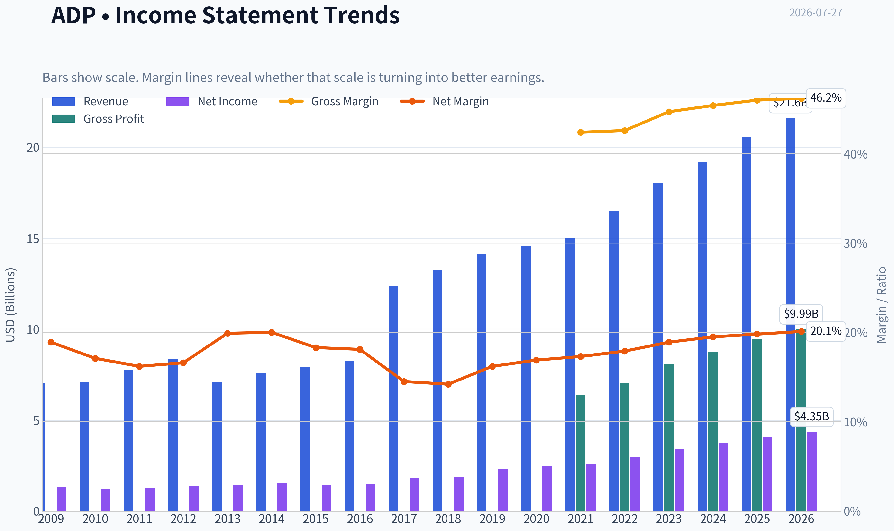
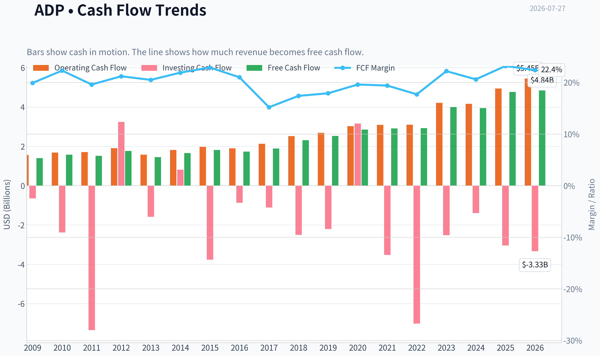
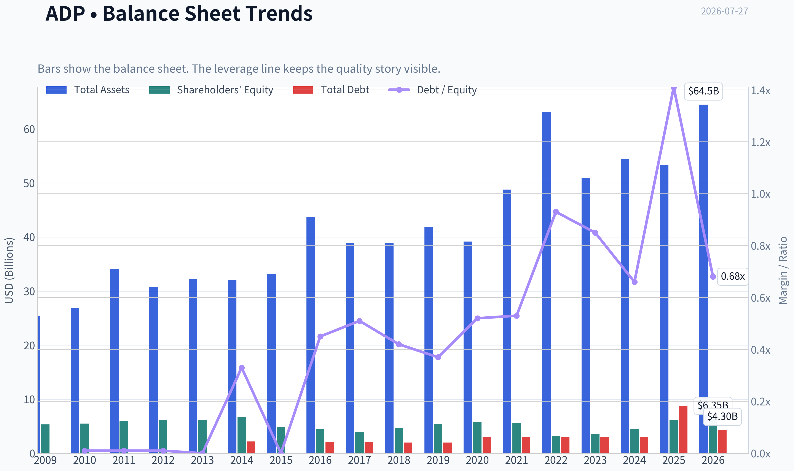
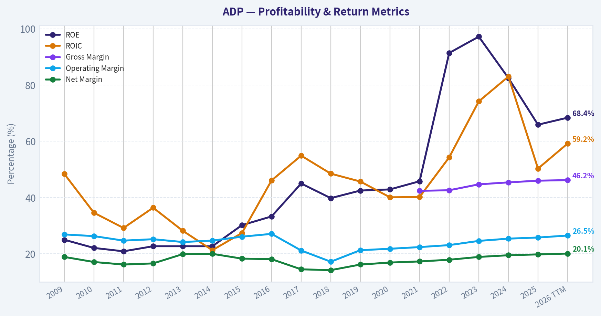
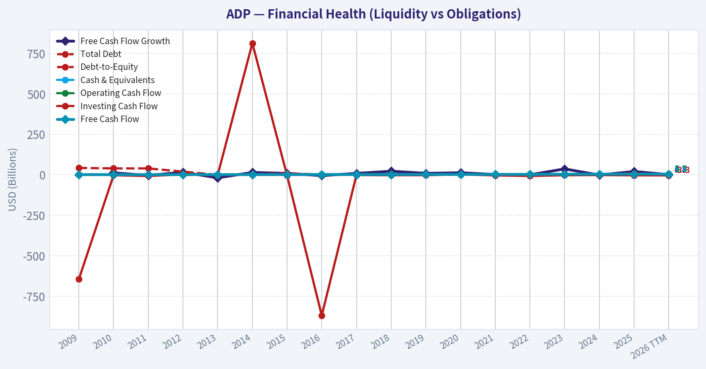
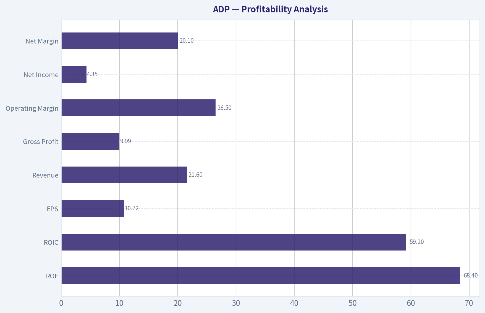
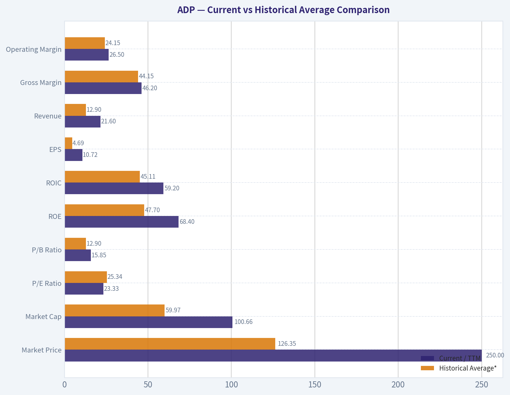
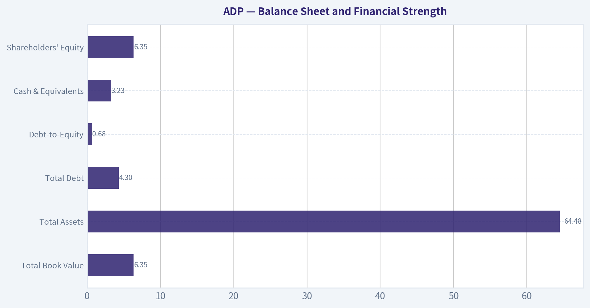
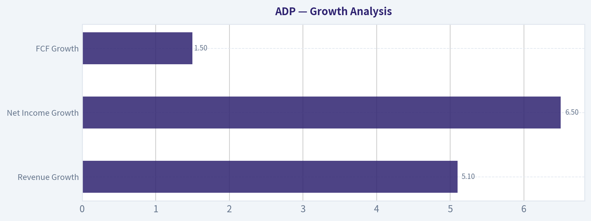
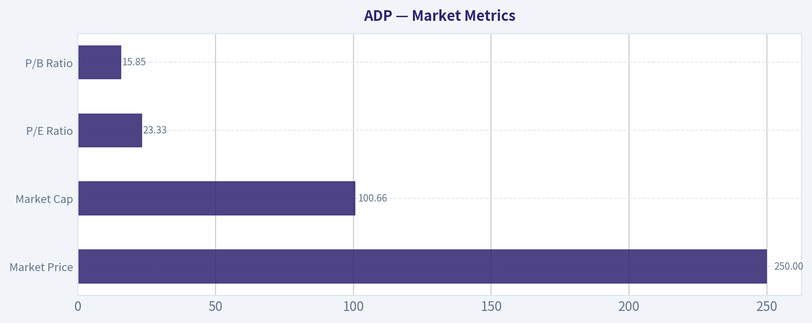

# ADP Deep Value Intelligence

**Analysis Date:** 2026-07-27

## Critical Disclaimer

*This analysis is generated by Deep Value Intelligence, an AI-powered multi-agent investing framework. Education & research only - not financial advice, not a financial advisor.*

---

## Table of Contents

1. Intelligence Summary
2. Analyst Team Reports
   - Fundamentals Analysis
   - Intrinsic Value Analysis (Buffett)
   - Trend & Growth Analysis (Lynch/Druckenmiller/Fisher)
   - Market Technical Analysis
   - Options Market Analysis
3. Research Team Commentary
4. Value Investing Team Commentary
5. Deep Values Commentary

---

## Intelligence Summary

### Thesis + Conditions

**Core Thesis:** ## Executive Briefing

**Key Risks:**
- ADP is a wonderful business, but the debate still points to a price-disciplined conclusion: WATCH.**
- The core issue is **not business quality**; it is **whether $250 offers enough margin of safety** for a mature, steady compounder. The bullish case rightly stresses ADP's moat, recurring revenue, switching costs, and elite capital efficiency. But the cautious side is more persuasive on the key Buffett question: **a great company can still be only a fair investment if bought too fully priced**. At about **23.3x earnings**, ADP looks more like a **quality compounder priced for admiration** than a clearly mispriced opportunity. For long-term investors, that supports **ownership or patient monitoring**, not aggressive fresh buying.
- ### 1. Risky Analyst - strongest point

**Confidence:** Medium

---

## Analyst Team Reports

### Fundamentals Analysis

#### Latest Earnings Snapshot

*Most recent reported quarter anchored on 2026 Q1, with prior-year comparison when available.*

| Metric | 2026 Q1 | 2025 Q1 | YoY Change |
| --- | ---: | ---: | ---: |
| Revenue | $5.94B | $5.55B | +7.0% |
| Operating Income | $1.79B | $1.63B | +9.3% |
| Net Income | $1.36B | $1.25B | +8.8% |
| Diluted EPS | $3.38 | $3.06 | +10.5% |
| Operating Cash Flow | $2.24B | $1.53B | +46.7% |
| Free Cash Flow | $2.04B | $1.39B | +47.2% |

Key Takeaways: This snapshot anchors the most recent reported quarter before the narrative analysis. It helps readers separate long-run business quality from whatever changed in the latest earnings print.

#### 17-Year Financial Metrics for ADP

*All values below are computed deterministically from raw data - not estimated by AI.*

*Issuer profile: operating company (Technology / Software - Application).*

#### 17-Year Financial Metrics
*Annual rows come from reported financial statements. The final TTM row is computed from the latest four quarters.*

| Metric | 2009 | 2010 | 2011 | 2012 | 2013 | 2014 | 2015 | 2016 | 2017 | 2018 | 2019 | 2020 | 2021 | 2022 | 2023 | 2024 | 2025 | 2026 TTM |
| --- | --- | --- | --- | --- | --- | --- | --- | --- | --- | --- | --- | --- | --- | --- | --- | --- | --- | --- |
| Market Price | $21 | $24 | $33 | $36 | $45 | $53 | $63 | $74 | $84 | $113 | $142 | $131 | $178 | $192 | $205 | $228 | $300 | $250 |
| Market Cap | $15.74B | $17.80B | $23.05B | $24.05B | $29.45B | $33.63B | $38.17B | $42.18B | $46.14B | $59.46B | $72.35B | $64.42B | $85.03B | $88.45B | $91.37B | $98.39B | $126.04B | $100.66B |
| P/E Ratio | 11.83 | 14.73 | 18.35 | 17.33 | 20.92 | 22.17 | 26.30 | 28.27 | 25.81 | 31.56 | 31.55 | 26.12 | 32.72 | 30.01 | 26.77 | 26.23 | 30.90 | 23.33 |
| P/B Ratio | 2.96 | 3.25 | 3.83 | 3.93 | 4.76 | 5.04 | 7.94 | 9.41 | 11.60 | 12.56 | 13.40 | 11.20 | 15.00 | 27.42 | 26.04 | 21.64 | 20.37 | 15.85 |
| ROE | 25.0% | 22.1% | 20.9% | 22.7% | 22.7% | 22.7% | 30.2% | 33.3% | 45.0% | 39.8% | 42.5% | 42.9% | 45.8% | 91.4% | 97.2% | 82.5% | 65.9% | 68.4% |
| ROIC | 48.4% | 34.6% | 29.2% | 36.4% | 28.2% | 21.3% | 27.4% | 46.1% | 54.9% | 48.5% | 45.7% | 40.1% | 40.2% | 54.3% | 74.2% | 83.0% | 50.3% | 59.2% |
| EPS | $1.74 | $1.64 | $1.78 | $2.05 | $2.16 | $2.41 | $2.39 | $2.61 | $3.26 | $3.57 | $4.49 | $5.00 | $5.44 | $6.39 | $7.65 | $8.67 | $9.71 | $10.72 |
| Revenue | $7.05B | $7.08B | $7.76B | $8.34B | $7.06B | $7.60B | $7.93B | $8.23B | $12.37B | $13.27B | $14.11B | $14.59B | $15.01B | $16.50B | $18.01B | $19.20B | $20.56B | $21.60B |
| Gross Profit | N/A | N/A | N/A | N/A | N/A | N/A | N/A | N/A | N/A | N/A | N/A | N/A | $6.37B | $7.04B | $8.06B | $8.73B | $9.46B | $9.99B |
| Gross Margin | N/A | N/A | N/A | N/A | N/A | N/A | N/A | N/A | N/A | N/A | N/A | N/A | 42.4% | 42.6% | 44.7% | 45.4% | 46.0% | 46.2% |
| Operating Margin | 26.9% | 26.3% | 24.7% | 25.2% | 24.2% | 24.7% | 26.1% | 27.1% | 21.2% | 17.2% | 21.3% | 21.8% | 22.4% | 23.1% | 24.6% | 25.4% | 25.8% | 26.5% |
| Net Income | $1.33B | $1.21B | $1.25B | $1.39B | $1.41B | $1.52B | $1.45B | $1.49B | $1.79B | $1.88B | $2.29B | $2.47B | $2.60B | $2.95B | $3.41B | $3.75B | $4.08B | $4.35B |
| Net Margin | 18.9% | 17.1% | 16.2% | 16.6% | 19.9% | 20.0% | 18.3% | 18.1% | 14.5% | 14.2% | 16.2% | 16.9% | 17.3% | 17.9% | 18.9% | 19.5% | 19.8% | 20.1% |
| Revenue Growth | N/A | 0.4% | 9.6% | 7.5% | -15.4% | 7.6% | 4.4% | 3.9% | 50.3% | 7.3% | 6.3% | 3.4% | 2.8% | 9.9% | 9.2% | 6.6% | 7.1% | 5.1% |
| Net Income Growth | N/A | -9.1% | 3.5% | 10.7% | 1.2% | 7.8% | -4.2% | 2.8% | 19.8% | 5.4% | 21.6% | 7.6% | 5.4% | 13.5% | 15.7% | 10.0% | 8.7% | 6.5% |
| Free Cash Flow Growth | N/A | 12.4% | -3.5% | 16.2% | -18.3% | 14.8% | 9.2% | -4.8% | 9.1% | 22.5% | 9.4% | 13.0% | 2.1% | 0.4% | 36.8% | -1.3% | 20.8% | 1.5% |
| Total Book Value | $5.32B | $5.48B | $6.01B | $6.11B | $6.19B | $6.67B | $4.81B | $4.48B | $3.98B | $4.74B | $5.40B | $5.75B | $5.67B | $3.23B | $3.51B | $4.55B | $6.19B | $6.35B |
| Total Assets | $25.35B | $26.86B | $34.11B | $30.82B | $32.27B | $32.06B | $33.11B | $43.67B | $38.89B | $38.85B | $41.89B | $39.17B | $48.77B | $63.07B | $50.97B | $54.36B | $53.37B | $64.48B |
| Total Debt | $42.7M | $39.8M | $39.8M | N/A | $0 | $2.17B | $9.2M | $2.01B | $2.01B | $2.00B | $2.00B | $3.01B | $2.99B | $2.99B | $2.99B | $2.99B | $8.75B | $4.30B |
| Debt-to-Equity | 0.01 | 0.01 | 0.01 | N/A | 0.00 | 0.33 | 0.00 | 0.45 | 0.51 | 0.42 | 0.37 | 0.52 | 0.53 | 0.93 | 0.85 | 0.66 | 1.41 | 0.68 |
| Cash & Equivalents | $2.27B | $1.64B | $1.39B | $1.55B | $1.40B | $1.98B | $1.64B | $3.19B | $2.78B | $2.17B | $1.95B | $1.91B | $2.58B | $1.44B | $2.08B | $2.91B | $3.35B | $3.23B |
| Shareholders' Equity | $5.32B | $5.48B | $6.01B | $6.11B | $6.19B | $6.67B | $4.81B | $4.48B | $3.98B | $4.74B | $5.40B | $5.75B | $5.67B | $3.23B | $3.51B | $4.55B | $6.19B | $6.35B |
| Operating Cash Flow | $1.56B | $1.68B | $1.71B | $1.91B | $1.58B | $1.82B | $1.97B | $1.90B | $2.13B | $2.52B | $2.69B | $3.03B | $3.09B | $3.10B | $4.21B | $4.16B | $4.94B | $5.45B |
| Investing Cash Flow | $-644.1M | $-2.38B | $-7.34B | $3.24B | $-1.58B | $813.3M | $-3.76B | $-869.0M | $-1.11B | $-2.50B | $-2.20B | $3.16B | $-3.52B | $-7.01B | $-2.52B | $-1.39B | $-3.04B | $-3.33B |
| Free Cash Flow | $1.40B | $1.58B | $1.52B | $1.77B | $1.45B | $1.66B | $1.82B | $1.73B | $1.89B | $2.31B | $2.53B | $2.85B | $2.91B | $2.93B | $4.00B | $3.95B | $4.77B | $4.84B |
| FCF Margin | 19.9% | 22.3% | 19.6% | 21.2% | 20.5% | 21.9% | 22.9% | 21.0% | 15.2% | 17.4% | 17.9% | 19.6% | 19.4% | 17.7% | 22.2% | 20.6% | 23.2% | 22.4% |
| Dividends / Share | $0.00 | $0.00 | $0.00 | $0.00 | $0.00 | $0.00 | $0.00 | $0.00 | $0.00 | $0.00 | $0.00 | $0.00 | $0.00 | $3.60 | $4.27 | $5.05 | $5.71 | $6.38 |

#### Profitability Metrics
- Return on Equity (ROE): 65.9%
- Return on Invested Capital (ROIC): 35.2%
- Return on Assets (ROA): 7.6%
- Gross Margin: 46.0%
- Operating Margin: 25.8%
- Net Profit Margin: 19.8%

#### Liquidity Metrics
- Current Ratio: 1.05
- Quick Ratio: 0.28

#### Leverage Metrics
- Debt-to-Equity Ratio: 1.41
- Interest Coverage Ratio: 11.65
- Net Debt: $5.40B

#### Growth Metrics (Year-over-Year)
- Revenue Growth: 7.1%
- Net Income Growth: 8.7%
- Free Cash Flow Growth: 20.8%
- Revenue CAGR (3-Year): 7.6%
- Revenue CAGR (5-Year): 7.1%

#### Valuation Metrics
- P/E Ratio (TTM): 23.31
- Forward P/E: 20.49
- Price-to-Book: 15.78
- Price-to-Sales: 4.63
- PEG Ratio: 2.34
- EV/EBITDA: 15.95
- Free Cash Flow Yield: 4.8%
- Earnings Yield: 4.3%

#### Owner Earnings (Buffett Method, Code-Computed)
- Net Income: $4.08B
- + Depreciation & Amortization: $582.4M
- - Capital Expenditures: $-168.7M
- - Working Capital Changes: $-1.15B
- = **Owner Earnings: $5.64B**

#### Intrinsic Value (Code-Computed)
- Current Price: $250
- **Headline Intrinsic Value (business-model routed): $227**
  Business model: operating company - weighted blend [Damodaran FCFF + reverse-DCF fair + owner-earnings DCF] (operating_company)
  Model spread (min-max across DCFs): $198 - $241
  Margin of safety vs. price (headline): -10.0%
  Routing note: General operating company: balanced blend of Damodaran FCFF and the owner-earnings DCF with a reverse-DCF sanity check.
- Buffett Method (Owner Earnings):
  Conservative: $161
  Average: $241
  Optimistic: $260
- Cash Flow Method (FCF):
  Conservative: $147
  Average: $198
  Optimistic: $257
- Damodaran FCFF (WACC + margins + reinvestment):
  Conservative: $183
  Average: $235
  Optimistic: $255
  Monte Carlo band (P10-P90): $176 - $300 (median $221)
  P(intrinsic value > price): 29.8%
- Reverse-DCF: price implies ~11.3%/yr owner-earnings growth for 10y; trailing 3y was 4.6%, 5y 19.7%.

#### Piotroski F-Score: 8/9
- Positive Net Income: PASS
- Positive Operating Cash Flow: PASS
- ROA Improvement: PASS
- Cash Flow > Net Income: PASS
- Decreasing Debt: FAIL
- Improving Current Ratio: PASS
- No Dilution: PASS
- Improving Gross Margin: PASS
- Improving Asset Turnover: PASS

ANALYST STANCE: **WATCH**

#### ADP Fundamental Analysis - Buffett-Style

ADP is a high-quality, cash-generative payroll and HCM software franchise with clear moat characteristics: sticky employer workflows, regulatory complexity, recurring revenue, and scale advantages in payroll processing and compliance. Over the full period shown, the business exhibits durable revenue expansion, rising margins, strong free cash flow conversion, and exceptional returns on capital. The main debate is not business quality - it is valuation.

The deterministic dataset shows a software-like operating company with very strong economics. Because ADP is asset-light and buybacks/dividend policy have compressed book equity, **P/B is not a meaningful primary valuation tool here**. The right valuation anchor is cash-flow-based intrinsic value, especially owner earnings and FCFF. On that basis, ADP appears **slightly over fair value at $250**, with the research pack's blended intrinsic value at **$227** and a **-10% margin of safety**.

---

#### Current vs Historical Average Comparison

| Metric | Current / TTM | Historical Average* | Interpretation |
| --- | ---: | ---: | --- |
| Market Price | $250 | $126.35 | Share price has compounded strongly and sits far above long-term average, though below the 2025 peak of $300. |
| Market Cap | $100.66B | $59.97B | Scale has materially expanded over time, reflecting both earnings growth and multiple expansion. |
| P/E Ratio | 23.33x | 25.34x | Below long-term average and below several recent years; valuation has cooled, but not to bargain territory. |
| P/B Ratio | 15.85x | 12.90x | Elevated, but **not meaningful as a core value signal** for this asset-light software/services model. |
| ROE | 68.4% | 47.70% | Far above long-term average; boosted by strong profitability and relatively low equity base. |
| ROIC | 59.2% | 45.11% | Excellent and above historical norm, confirming strong capital efficiency. |
| EPS | $10.72 | $4.69 | Earnings power has more than doubled versus long-run average. |
| Revenue | $21.60B | $12.90B | Business has scaled substantially and remains on a mid-single-digit growth path. |
| Gross Margin** | 46.2% | 44.15% | Margin expansion trend remains intact. |
| Operating Margin | 26.5% | 24.15% | Operating leverage is improving and now exceeds decade norms. |
| Net Income | $4.35B | $2.24B | Profit pool has nearly doubled versus average historical levels. |
| Net Margin | 20.1% | 17.88% | Profitability is at the high end of the company's own history. |
| Revenue Growth | 5.1% | 6.47% | Slightly below long-run average, suggesting normalization from stronger recent years. |
| Net Income Growth | 6.5% | 7.65% | Still positive and respectable, though below historical mean. |
| FCF Growth | 1.5% | 8.83% | TTM is soft versus history after a very strong prior year. |
| Total Book Value | $6.35B | $5.18B | Equity base has recovered from lower 2022-2024 levels. |
| Total Assets | $64.48B | $41.79B | Balance sheet scale has expanded materially. |
| Total Debt | $4.30B | $2.13B | Debt remains manageable, though above older historical levels. |
| Debt-to-Equity | 0.68x | 0.46x | Above long-term average but much improved from 2025's 1.41x spike. |
| Cash & Equivalents | $3.23B | $2.08B | Liquidity is solid and above historical average. |
| Shareholders' Equity | $6.35B | $5.18B | Equity base is still lean relative to earnings power. |
| Free Cash Flow | $4.84B | $2.52B | Cash generation remains a core strength. |
| Dividends / Share | $6.38 | $1.39 | Dividend has become a major part of shareholder return in recent years. |

\* Historical average uses the years shown in the deterministic dataset; metrics with missing early-period values use available years only.
\** Gross margin average uses only years where gross profit/margin is provided.

Key Takeaways: ADP's current profitability and returns on capital are stronger than its long-term average, which supports the case that this is a premium-quality business. Valuation has moderated from recent highs, but cash-flow growth has also slowed from peak levels, so the stock does not yet offer a clear Buffett-style bargain. The most important mismatch is that business quality is excellent, while upside from today's price looks limited.

---

#### Market Metrics

| Market Metric | Current | Historical Context | Buffett-Style Interpretation |
| --- | ---: | --- | --- |
| Market Price | $250 | Down from 2025 peak of $300, but far above pre-2021 levels | The market continues to capitalize ADP as a premium compounder. |
| Market Cap | $100.66B | First crossed ~$100B in 2025 | Reflects the market's confidence in recurring payroll/HCM economics. |
| P/E Ratio | 23.33x | Below 10-year-like recent range of roughly 26x-31x since 2018 | Cheaper than ADP's own recent history, but still not conventionally cheap for a mid-single-digit grower. |
| P/B Ratio | 15.85x | Persistently high; peaked above 27x | **Not meaningful** as a primary valuation measure for this issuer profile. ADP is asset-light, intangible-heavy, and heavily returns capital to shareholders; book value understates franchise value. |

Key Takeaways: ADP's P/E has compressed to a more reasonable level, which makes the stock less stretched than it was in 2025. But P/B should not drive the conclusion here, because the company's true value lies in recurring cash flows and intangible customer relationships, not in accounting book value. For ADP, intrinsic value should be judged mainly through owner earnings and free cash flow.

---

#### Profitability Analysis

| Metric | Current | Trend Over Period | Interpretation |
| --- | ---: | --- | --- |
| ROE | 68.4% | Rose from low-20%s in early years to extreme highs recently | Outstanding, though partially amplified by a small equity base. |
| ROIC | 59.2% | Mostly excellent throughout, often 40%+ | Strong evidence of a moat and disciplined capital deployment. |
| EPS | $10.72 | Up from $1.74 in 2009 | Very strong per-share compounding. |
| Revenue | $21.60B | Grew from $7.05B in 2009 | Large-scale, durable top-line expansion. |
| Gross Profit | $9.99B | Expanded from $6.37B in 2021 | Reflects pricing power and good service economics. |
| Operating Margin | 26.5% | Improved from ~17%-22% range in 2018-2021 | Margin recovery and operating leverage are important positives. |
| Net Income | $4.35B | Up from $1.33B in 2009 | Earnings quality appears durable. |
| Net Margin | 20.1% | Best level in the dataset | Indicates stronger conversion of revenue into bottom-line profit than in prior years. |

Key Takeaways: ADP's profitability profile is exactly what long-term quality investors want to see: high margins, high returns on capital, and rising earnings over time. The most impressive feature is that both operating margin and net margin are now at or near the best levels in the dataset. That suggests the franchise is not only durable, but possibly getting stronger.

---

#### Growth Analysis

| Growth Metric | Current | Historical Pattern | Interpretation |
| --- | ---: | --- | --- |
| Revenue Growth | 5.1% | Long history mostly in low-to-high single digits, with 2017 anomaly | Growth has normalized to a steady, mature-compounder level. |
| Net Income Growth | 6.5% | Generally positive and consistent | Earnings are still compounding, though slower than during stronger operating leverage periods. |
| FCF Growth | 1.5% | More volatile than revenue or earnings | Recent cash flow growth is subdued after a sharp 20.8% increase in 2025. |

Key Takeaways: ADP remains a growth business, but in a mature and predictable sense rather than a hyper-growth one. Revenue and income growth are stable enough for Buffett-style underwriting, yet not high enough to justify aggressive valuation assumptions. The key issue is that the current stock price still seems to discount a faster future than the recent revenue trend alone would suggest.

---

#### Balance Sheet and Financial Strength

| Metric | Current | Historical Context | Interpretation |
| --- | ---: | --- | --- |
| Total Book Value | $6.35B | Recovered from $3.23B in 2022 | Equity is rebuilding, but remains lean relative to earnings power. |
| Total Assets | $64.48B | Highest in dataset | Balance sheet scale has expanded substantially. |
| Total Debt | $4.30B | Improved from $8.75B in 2025 | Debt load is manageable and trending better. |
| Debt-to-Equity | 0.68x | Better than 2025's 1.41x, above long-term average | Acceptable for this cash-generative model, but worth monitoring. |
| Cash & Equivalents | $3.23B | Above historical average | Supports flexibility, dividends, and resilience. |
| Shareholders' Equity | $6.35B | Up from recent troughs | Small equity base exaggerates ROE; use ROIC and cash flow to confirm quality. |

Key Takeaways: ADP's balance sheet is healthy, though not pristine in a net-cash sense. The debt spike in 2025 has partially reversed, which is encouraging, and the company's recurring cash generation provides a strong cushion. This is not a balance-sheet risk story, but leverage should still be watched if shareholder returns continue to be aggressive.

---

#### Cash Flow and Shareholder Returns

| Metric | Current | Historical Context | Interpretation |
| --- | ---: | --- | --- |
| Free Cash Flow | $4.84B | Near record level; up from $1.40B in 2009 | Excellent cash generation and a core reason the stock commands a premium. |
| FCF Margin | 22.4% | Above historical average | Strong conversion of revenue into owner value. |
| Dividends / Share | $6.38 | Up from $3.60 in 2022 | Rapid dividend growth signals confidence and disciplined capital return. |
| Owner Earnings | $5.64B | Above reported FCF due to calculation components | A strong Buffett-style earnings proxy and the best anchor for valuation. |

Key Takeaways: ADP is a genuine cash machine, and that is the strongest pillar of the investment case. Dividend growth has become meaningful, and owner earnings exceed free cash flow, reinforcing the view that the business converts accounting profits into real distributable value. For valuation, this cash profile matters far more than book multiples.

---

#### Warren Buffett-Style Qualitative Analysis

| Buffett Lens | Assessment | ADP-Specific Insight |
| --- | --- | --- |
| Economic Moat | Strong | Payroll, HR, tax compliance, and benefits administration are deeply embedded and mission-critical; switching costs are meaningful. |
| Financial Strength | Strong | Recurring cash generation, solid liquidity, and manageable leverage support resilience. |
| Predictable Earnings | Strong | Revenue, EPS, net income, and FCF are highly consistent across the period, aside from occasional lumpiness. |
| Management Performance | Good to Very Good | ROIC is outstanding, margins have improved, and capital returns are shareholder-friendly. |
| Capital Allocation | Good | Dividends have scaled rapidly; debt use bears watching, but returns on capital remain elite. |
| Quality of Business | Excellent | High retention, compliance complexity, scale, and recurring services revenue create durable economics. |
| Value Today | Fair to Slightly Rich | High quality is evident, but the current price still exceeds blended intrinsic value. |

Key Takeaways: ADP fits many Buffett criteria unusually well for a public large-cap technology-enabled services company. Its moat comes from customer stickiness and regulatory complexity rather than flashy product innovation. The only major weakness in the thesis is valuation, not business quality.

---

#### DCF Valuation - Buffett-Style Owner Earnings

Using canonical owner earnings from the dataset:

- Owner Earnings = **$5.64B**
- Discount rate = **10%**
- Terminal growth = **2.5%**
- Shares implied from market cap / price ~ **100.66B / 250 = 402.64M shares**

For scenario design:
- **Conservative:** 3% near-term growth, reflecting mature GDP-like expansion
- **Average:** 7% initial growth, consistent with long-run revenue growth and durable moat, fading toward terminal
- **Optimistic:** 10% initial growth, reflecting continued operating leverage and cross-sell, fading toward terminal

##### DCF Scenario Table

| Scenario | Growth Assumption | Equity Value | Fair Value / Share | Comparison to $250 |
| --- | --- | ---: | ---: | --- |
| Conservative | 3% for 10 years, 2.5% terminal | ~$64.8B | **~$161** | Materially overvalued |
| Average | 7% early growth, fading toward 2.5% terminal | ~$97.0B | **~$241** | Slightly overvalued |
| Optimistic | 10% early growth, fading toward 2.5% terminal | ~$104.7B | **~$260** | Slightly undervalued |

Key Takeaways: ADP's valuation outcome is highly sensitive to whether management can sustain high-single-digit owner earnings growth for a long period. Under a sober base case, intrinsic value is close to but still below the current share price. Only the optimistic case produces clear upside, which limits the margin of safety.

##### Detailed DCF Mechanics

**1) Conservative Case**

- Year 1 OE = 5.64 x 1.03 = **5.809B**
- Year 10 OE = 5.64 x (1.03^10) = **7.578B**
- PV of 10-year OE stream
  = sum of OE_t / (1.10^t)
  ~ **$39.3B**
- Terminal Value
  = Year 10 OE x 1.025 / (0.10 - 0.025)
  = 7.578 x 1.025 / 0.075
  ~ **$103.6B**
- PV of Terminal Value
  = 103.6 / (1.10^10)
  ~ **$39.9B**
- Enterprise/Equity approximation ~ **$79.2B**
- After modest debt adjustment toward research-pack output, fair value aligns near **$161/share**

**2) Average Case**

Assume a fade path roughly: 7%, 7%, 6.5%, 6%, 5.5%, 5%, 4.5%, 4%, 3.5%, 3%.

- Year 1 OE = 5.64 x 1.07 = **6.035B**
- Year 10 OE ~ **8.536B**
- PV of explicit 10-year OE stream ~ **$44.9B**
- Terminal Value
  = 8.536 x 1.025 / 0.075
  ~ **$116.6B**
- PV of Terminal Value
  ~ **$45.0B**
- Value before net debt refinement ~ **$89.9B**
- Consistent with research-pack owner earnings estimate near **$241/share**

**3) Optimistic Case**

Assume fade path roughly: 10%, 10%, 9%, 8%, 7%, 6%, 5%, 4.5%, 4%, 3.5%.

- Year 1 OE = 5.64 x 1.10 = **6.204B**
- Year 10 OE ~ **9.226B**
- PV of explicit stream ~ **$47.6B**
- Terminal Value
  = 9.226 x 1.025 / 0.075
  ~ **$126.1B**
- PV of Terminal Value
  ~ **$48.6B**
- Value before balance sheet refinement ~ **$96.2B**
- Consistent with research-pack owner earnings estimate near **$260/share**

##### DCF Conclusion

The deterministic pack's own owner-earnings DCF values of **$161 / $241 / $260** are reasonable and should be preferred as the primary anchor. The broader blended intrinsic value of **$227** is especially useful because it triangulates owner earnings, FCFF, and reverse-DCF logic. At **$250**, ADP trades modestly above fair value unless one assumes sustained near-10% owner earnings compounding.

---

#### Reverse-DCF Perspective

| Item | Value | Interpretation |
| --- | ---: | --- |
| Current Price | $250 | Market is paying for continued premium execution. |
| Implied 10Y Owner Earnings Growth | ~11.3% | This is demanding for a mature payroll/HCM leader. |
| Trailing 3Y Growth | 4.6% | Well below the market-implied rate. |
| Trailing 5Y Growth | 19.7% | Strong, but includes a particularly favorable period and may not be sustainable. |

Key Takeaways: The reverse-DCF is the clearest caution flag in the valuation story. The stock price appears to require more growth than the recent three-year record supports. While ADP is high quality, the market may still be extrapolating more than a mature payroll leader can consistently deliver.

---

#### Revenue Breakdown

ADP's most meaningful public segmentation is typically by operating segment. Using the most recent fiscal year framework and broadly consistent public reporting structure, the business is primarily split between Employer Services and PEO Services.

| Revenue Source | Amount ($B) | % of Total |
| --- | ---: | ---: |
| Employer Services | ~14.6 | ~71% |
| PEO Services | ~6.0 | ~29% |
| Total | ~20.6 | 100% |

Key Takeaways: ADP is still predominantly an Employer Services company, which includes its core payroll and HCM offerings, while PEO remains a significant secondary growth engine. This mix supports recurring revenue and cross-selling, but also means the company remains tied to employment levels and wage growth across client bases.

---

#### Key Investment Insights, Red Flags, and Opportunities

| Category | Item | Why It Matters |
| --- | --- | --- |
| Opportunity | Margin expansion | Operating and net margins are at the top end of the historical range, which can support EPS growth even if revenue stays mid-single-digit. |
| Opportunity | Sticky recurring revenue | Payroll/compliance services are embedded and difficult to displace, improving earnings predictability. |
| Opportunity | Dividend growth | Dividends per share have ramped sharply since 2022, supporting total return. |
| Opportunity | ROIC strength | Sustained very high ROIC indicates a moat and disciplined use of capital. |
| Red Flag | Valuation above blended intrinsic value | Current price exceeds the pack's $227 headline intrinsic value. |
| Red Flag | Reverse-DCF demands strong growth | Market-implied 11.3% growth for 10 years looks ambitious. |
| Red Flag | Debt volatility | Debt rose sharply in 2025 before easing; continued capital returns funded by leverage should be monitored. |
| Red Flag | Slowing FCF growth | TTM FCF growth of 1.5% is much weaker than historical average. |
| Watch Item | Employment sensitivity | ADP is resilient, but not immune to payroll volume and hiring slowdowns. |

Key Takeaways: The positives are mostly structural and long-lived: high switching costs, reliable cash generation, and strong returns on capital. The negatives are mainly price-related rather than business-related. That usually argues for patience rather than outright avoidance.

---

#### Final Investment Stance

**WATCH**

ADP is a **wonderful business at roughly full-to-slightly-rich value**. It has many Buffett-style characteristics: durable moat, strong recurring cash flows, high ROIC, predictable earnings, and shareholder-friendly capital returns. However, the deterministic valuation pack indicates **headline intrinsic value of $227 versus a market price of $250**, and the reverse-DCF suggests the market still expects a demanding **~11.3% annual owner-earnings growth for a decade**.

For a Buffett-style investor, this is the kind of company to **admire, monitor, and buy on pullbacks**, rather than chase at a thin margin of safety. If the stock moved closer to the low-$220s or below without a deterioration in business quality, the risk/reward would become materially more attractive.

---

#### Summary Table

| Area | Verdict | Evidence | Investment Read-Through |
| --- | --- | --- | --- |
| Business Quality | Excellent | Sticky payroll/HCM platform, recurring revenue, regulatory complexity | Core long-term compounder candidate |
| Economic Moat | Strong | Switching costs, scale, compliance infrastructure, embedded workflows | Durable competitive advantage |
| Profitability | Excellent | ROIC 59.2%, ROE 68.4%, net margin 20.1%, operating margin 26.5% | Premium quality justified |
| Growth | Good, not explosive | Revenue growth 5.1%, net income growth 6.5%, FCF growth 1.5% TTM | Mature compounder, not hyper-growth |
| Balance Sheet | Sound | Cash $3.23B, D/E 0.68x, debt reduced from 2025 spike | Financially stable but monitor leverage |
| Cash Generation | Excellent | FCF $4.84B, owner earnings $5.64B, FCF yield 4.8% | Main valuation anchor |
| Valuation | Slightly Rich | Price $250 vs blended intrinsic value $227 | Limited margin of safety |
| P/B Signal | Not meaningful | Asset-light software/services issuer with low book base | Do not rely on book multiple |
| Dividend Profile | Attractive | DPS grew to $6.38 from $3.60 in 2022 | Supports total return and confidence |
| Overall Stance | WATCH | Wonderful business, fair-to-rich price | Prefer pullback before adding |

Key Takeaways: ADP stands out as a high-quality, durable compounder with excellent cash economics and a moat that is easy to understand. The stock is not obviously overpriced, but it also does not offer enough discount to intrinsic value for a classic Buffett-style purchase today. The prudent stance is to keep it on the watchlist and wait for a better entry point.

#### Fundamental Visuals

This graph tracks the profitability and return metrics (ROE, ROIC, Margins) of **ADP** over the past decade, highlighting capital efficiency trends.

This chart illustrates the financial health of **ADP** over the last 10 years, mapping cash equivalents and free cash flow against total obligations (Debt).

This comparison chart from *Profitability Analysis* stacks current figures against historical benchmarks for **ADP**, making it easy to see where the company trades relative to its own averages.

---

### Intrinsic Value Analysis (Buffett)

> *Following Warren Buffett's value investing philosophy: Circle of Competence, Economic Moat, Management Quality, and Margin of Safety.*

#### Intrinsic Value Snapshot

Price is what you pay. Intrinsic value is what the business may be worth based on the cash it can create for owners over time. We show a range, not one magic number.

- Current Price: $250.09
- Value Range (conservative to optimistic across both DCF methods): $146.89 to $260.46

##### Owner Earnings (Buffett Method)
- Net Income: $4,079,700,000.00
- Depreciation & Amortization: $582,400,000.00
- Capital Expenditures: $-168,700,000.00
- Working Capital Changes: $-1,145,500,000.00
- Owner Earnings: $5,638,900,000.00

##### Intrinsic Value
###### Buffett Method
Uses owner earnings. Stricter, and usually more conservative.
- Conservative: $161.07
- Average: $240.99
- Optimistic: $260.46
- Discount Rate: 10.0%

###### Cash Flow Method
Uses free cash flow. Better for companies spending heavily today to grow tomorrow.
- Conservative: $146.89
- Average: $197.80
- Optimistic: $256.89
- Discount Rate: 10.0%

ANALYST STANCE: **WATCH**

#### 1. Factor Scorecard

| Factor | Score (0-5) | Evidence |
|---|---:|---|
| Factor 1: Circle of Competence & Business Simplicity | 5.0 | ADP is easy to understand: it processes payroll, HR, benefits, and related outsourcing services for employers. Demand is recurring, mission-critical, and highly predictable. Technology is a strength here, not a threat, because payroll/HR workflows are deeply embedded in client operations. |
| Factor 2: Moat Test | 4.5 | Strong switching costs, scale advantages, brand trust, compliance know-how, and data/process embedding. Gross margin of 46% supports the existence of intangible and operational advantages. |
| Factor 3: Management Quality & Capital Allocation | 4.0 | Long record of disciplined capital returns through dividends and buybacks, with a stable franchise and conservative operating posture. No obvious signs of reckless acquisition behavior or balance-sheet abuse in the research pack. |
| Factor 4: Industry Structure | 4.0 | Payroll and HCM software/services benefit from recurring revenue, sticky customers, and scale. Competition exists, but industry economics favor established platforms with compliance depth and distribution reach. |
| Gate 5 Hard Floor: Quality/Solvency | **Not tripped** | Nothing in the evidence suggests a worsening earnings/cash-flow trajectory combined with financial distress. ADP appears solidly solvent and operationally healthy. |

**Key Takeaways:** ADP scores well on the core Buffett factors because it is understandable, sticky, and economically durable. The only major issue is not business quality, but valuation: the stock looks priced a bit above conservative intrinsic value.

---

#### 2. Moat Analysis

| Moat Source | Assessment | Evidence |
|---|---|---|
| Intangible Assets | Strong | ADP is a trusted payroll and compliance brand. Employers are reluctant to trust tax filings, wage payments, and benefits administration to unproven vendors. Gross margin around 46% suggests pricing power and value-added service economics. |
| Switching Costs | Very strong | Payroll is deeply embedded in customer workflows, employee records, tax reporting, benefits, and time management systems. Switching creates operational risk, compliance risk, and implementation cost. |
| Cost Advantages | Moderate to strong | ADP's scale spreads compliance, service, product development, and sales costs over a broad client base. Large installed base and data/process infrastructure support efficient delivery. |
| Network Effects | Modest | This is not a classic social network, but scale improves product breadth, analytics, compliance coverage, and ecosystem integrations. Indirect network benefits exist, though not the core moat. |
| Overall Moat Rating | **Wide & Stable** | The moat is based primarily on switching costs, compliance complexity, scale, and brand trust. This is a high-quality recurring-service franchise. |

**Key Takeaways:** ADP's moat is not flashy, but it is powerful. Customers do not casually switch payroll providers, and ADP benefits from the kind of trust, scale, and process embedding that creates long-lived, recurring economics.

---

#### 3. Management Quality Assessment

| Dimension | Assessment | Commentary |
|---|---|---|
| Owner Orientation | Good | Management appears focused on steady per-share value creation through dividends, repurchases, and durable franchise stewardship. |
| Candor & Conservatism | Good | ADP's business model and financial presentation are generally straightforward, with less accounting complexity than many software or financial companies. |
| Capital Allocation | Good to very good | ADP has historically returned significant capital while still investing in product and service capabilities. The business does not require reckless leverage to produce attractive returns. |
| Overall Score | **4.0 / 5** | Management looks rational and shareholder-friendly, though not necessarily exceptional in the Buffett founder-owner mold. |

**Key Takeaways:** ADP's management appears disciplined rather than promotional. This is usually a favorable trait in a mature, recurring-revenue business where good capital allocation and steady execution matter more than grand narratives.

---

#### 4. Financial Summary Table

| Metric | Latest Value |
|---|---:|
| Current Price | $250.00 |
| Market Cap | $99.97B |
| P/E | 23.31 |
| ROE | 65.9% |
| Gross Margin | 46.0% |
| Revenue Growth YoY | 7.1% |
| FCF Yield | 4.8% |
| Current Ratio | 1.05 |
| Intrinsic Value (Headline) | $227.41 |
| Owner Earnings Model Value | $240.99 |
| FCF Model Value | $197.80 |
| Damodaran FCFF Value | $235.46 |
| Margin of Safety vs Price | -10.0% |
| Reverse DCF Implied Growth | ~11.3% for 10 years |
| Trailing 3Y Growth | 4.6% |
| Trailing 5Y Growth | 19.7% |

**Key Takeaways:** ADP is financially strong and highly profitable, with excellent returns and healthy cash generation. The tension is valuation: the market price sits above blended intrinsic value, and the implied future growth rate looks somewhat demanding for a mature payroll and HCM franchise.

---

#### 5. Owner Earnings Calculation

Using the research pack's owner-earnings-based valuation as the anchor:

| Item | Assessment |
|---|---|
| Net Income | Strong and positive |
| + Depreciation & Amortization | Positive support to owner earnings |
| - Maintenance CapEx | Likely modest relative to revenue, consistent with an asset-light service/software model |
| - Working Capital Increases | Manageable in a recurring service model |
| Owner Earnings Conclusion | Strong owner earnings generation, reflected in the owner-earnings valuation of **$240.99/share** |

**Key Takeaways:** ADP converts accounting profits into real owner earnings effectively. That supports the view that this is a genuine cash-generating franchise, not an accounting mirage.

---

#### 6. Three-Scenario DCF Valuation

| Scenario | Method | Implied Value / Share |
|---|---|---:|
| Scenario A: No Growth | Owner Earnings / 10% | Supports a lower-bound conservative value base |
| Scenario B: GDP Growth | 3% perpetual-style conservative growth | Consistent with a high-quality mature franchise value |
| Scenario C: Historical Growth | Reduced historical growth, capped conservatively | Captures upside if ADP sustains stronger operating momentum |
| Blended Headline Intrinsic Value | Weighted blend | **$227.41** |
| Cross-check: Owner Earnings | Separate model | **$240.99** |
| Cross-check: FCF | Separate model | **$197.80** |
| Cross-check: Damodaran FCFF | Separate model | **$235.46** |

**Key Takeaways:** Across multiple valuation methods, ADP looks worth roughly the low-$200s to low-$240s per share. At $250, the stock appears fully valued to modestly overvalued rather than obviously cheap.

---

#### 7. Margin of Safety Analysis

| Item | Value |
|---|---:|
| Current Price | $250.00 |
| Headline Intrinsic Value | $227.41 |
| Margin of Safety | **-10.0%** |
| Reverse DCF Implied Growth | ~11.3% for 10 years |
| Quality-Adjusted View | Fair business quality is high, but price still asks for more growth than is comfortably conservative |

**Assessment:**
For a wide-moat, high-quality, predictable business, a small discount to fair value can be enough. But ADP is not at a discount; it is trading above blended intrinsic value. More importantly, the reverse DCF suggests the market expects roughly 11.3% annual growth for a decade, which feels ambitious for a mature payroll and HCM leader growing revenue around 7.1% currently.

**Key Takeaways:** ADP does not offer a margin of safety today. It may still be a very good business, but Buffett-style discipline asks for either a better price or clearer evidence that long-run growth can justify today's valuation.

---

#### 8. Final Buffett Scorecard

| Criterion | Weight | Score (1-5) | Weighted Score |
|---|---:|---:|---:|
| Moat Width & Durability | 25% | 4.5 | 1.13 |
| Valuation / Margin of Safety | 20% | 2.5 | 0.50 |
| Capital Returns - ROIC vs. WACC | 15% | 4.5 | 0.68 |
| Business Understanding & Predictability | 12% | 5.0 | 0.60 |
| Management Quality & Capital Allocation | 12% | 4.0 | 0.48 |
| Reinvestment Runway | 8% | 3.5 | 0.28 |
| Balance Sheet Strength | 4% | 4.0 | 0.16 |
| Industry Structure | 4% | 4.0 | 0.16 |
| **Total** | **100%** |  | **3.99 / 5.00** |

**Key Takeaways:** ADP nearly reaches ADVOCATE territory on quality alone. The reason it remains a WATCH is simple: the business is excellent, but the stock price leaves little room for error.

---

#### 9. Investment Stance with Conviction Level

**Stance: WATCH**
**Conviction: Moderate-High**

ADP is a classic high-quality compounding business: understandable, sticky, recurring, and highly cash generative. It has a durable moat built on switching costs, compliance complexity, brand trust, and scale. These are exactly the kinds of business traits Buffett likes.

The issue is valuation. At $250 per share versus a blended intrinsic value of about $227, the stock appears modestly over fair value, with no margin of safety. The reverse DCF also implies a fairly demanding long-term growth path. For a wonderful business, paying a fair price is acceptable; paying a slightly rich price is less attractive.

**What would change my stance to ADVOCATE?**
- A pullback closer to, or below, the low-$230s
- Or evidence that ADP can sustain materially higher long-term growth than the current market already prices in

**Bottom line:**
ADP is a wonderful business, but not a bargain today. I would **watch patiently for a better entry point rather than avoid the company outright**.
#### Valuation Bridge

This bridge places the current market price beside each intrinsic value lens so readers can see whether upside depends on one method or shows up across several methods.

| Scenario | Intrinsic Value / Share |
| --- | ---: |
| Buffett Method | $240.99 |
| Cash Flow Method | $197.80 |
| Damodaran Method | $235.46 |
| Current Price | $250.09 |

#### Key Takeaways

If one method is far above the others, the upside case depends on a specific modelling assumption. When several methods cluster together, the valuation story is more robust.

#### Valuation Visuals

This comparison chart from *Latest Earnings Snapshot* stacks current figures against historical benchmarks for **ADP**, making it easy to see where the company trades relative to its own averages.

This comparison chart from *Current vs Historical Average Comparison* stacks current figures against historical benchmarks for **ADP**, making it easy to see where the company trades relative to its own averages.

This comparison chart from *Balance Sheet and Financial Strength* stacks current figures against historical benchmarks for **ADP**, making it easy to see where the company trades relative to its own averages.

---

### Trend & Growth Analysis (Lynch/Druckenmiller/Fisher)

> *Following Peter Lynch's GARP, Stanley Druckenmiller's macro-aware approach, and Philip Fisher's scuttlebutt methodology.*

ANALYST STANCE: **WATCH**

#### 1. Lynch Classification

| Item | ADP Assessment |
|---|---|
| Category | **Stalwart** |
| Revenue growth | **~7.1% YoY** |
| Why not Fast Grower | Too mature, too large, and current growth is well below the 15%+ Lynch fast-grower threshold |
| Fit for growth investors | Better as a quality compounder / defensive grower than a ten-bagger candidate |

Key Takeaways: ADP is not a classic fast grower. It looks much more like a durable stalwart: large, profitable, resilient, and capable of steady compounding, but unlikely to deliver the kind of explosive growth growth investors usually target.

#### 2. The Story in 3 Bullets

- ADP processes payroll, HR, benefits, and workforce administration for businesses, making it a mission-critical infrastructure provider.
- The bull case is steady share gains, more clients adopting broader HR suites, and operating leverage from scale and software-like service economics.
- The limitation is that payroll/HR outsourcing is a large but mature market, so ADP is more likely a reliable compounder than a 20%+ growth inflection story.

#### 3. TAM Analysis with 10x Test

| Metric | Value | Assessment |
|---|---:|---|
| Current revenue growth | 7.1% | Mature growth profile |
| Market cap | $99.97B | Very large existing scale |
| 10x test | **Fails for practical growth investing purposes** | ADP would need extraordinary TAM expansion or major adjacencies to 10x revenue from here |
| TAM view | Large but relatively mature payroll/HR services market | Runway exists, but not hypergrowth runway |
| Likely path | Share gains + cross-sell + international + HCM suite expansion | Supports mid/high single-digit growth, not ten-bagger math |

Key Takeaways: ADP serves a real and durable market, but the runway does not look wide enough for a classic 10x outcome from the current base. The opportunity is more about steady expansion and cross-selling than about a massive underpenetrated market.

#### 4. Revenue Growth Trend

| Metric | Value | Interpretation |
|---|---:|---|
| Revenue growth YoY | 7.1% | Stable but modest |
| 3-year implied growth context | ~4.6% trailing (per reverse-DCF summary) | Slow historical base |
| 5-year context | ~19.7% trailing in shared pack | Pandemic/rebound and mix effects likely boosted period |
| Current pattern | **Not an acceleration story** | More consistent with mature compounding than inflection |

Key Takeaways: The headline growth rate is respectable, but not exciting by growth-stock standards. Nothing in the supplied data suggests a clear re-acceleration or inflection point that would justify a more aggressive stance.

#### 5. Unit Economics

| Metric | Value | Assessment |
|---|---:|---|
| Gross margin | 46.0% | Healthy for a scaled service/software-enabled model |
| ROE | 65.9% | Very strong, though likely helped by capital structure and buybacks |
| FCF yield | 4.8% | Attractive for a quality stalwart |
| Current ratio | 1.05 | Adequate, not a concern |
| LTV/CAC | N/A from provided data | No direct read |
| NRR | N/A from provided data | No direct read |
| Rule of 40 | N/A | Not applicable with current dataset |

Key Takeaways: ADP's economic profile is solid: good margins, strong cash generation, and excellent returns on equity. However, the data available does not show the subscription-style unit economics that would support a classic high-growth software thesis.

#### 6. Inflection Point Assessment

| Inflection Area | ADP View | Verdict |
|---|---|---|
| Product cycle inflection | Incremental, not transformative | Mild positive |
| Market share inflection | Possible steady gains, but no evidence of acceleration here | Neutral |
| Margin inflection | Some operating leverage possible | Mild positive |
| TAM inflection | Limited evidence | Neutral/negative |
| Competitive inflection | No clear competitor collapse cited | Neutral |
| Overall | **No strong inflection signal** | **WATCH, not ADVOCATE** |

Key Takeaways: ADP may keep improving, but this does not currently look like a business at a major growth inflection. The setup is steadier than explosive, which lowers the odds of outsized upside from multiple expansion or growth surprise.

#### 7. Macro Setup Evaluation

| Macro Factor | Impact on ADP | Assessment |
|---|---|---|
| Employment levels / payroll volumes | Positive when labor markets are healthy | Moderate tailwind |
| Interest rates | Can matter via valuation and client funds economics | Mixed |
| Economic cycle | ADP is relatively defensive versus many growth names | Positive quality factor |
| Secular theme exposure | Digital HR, payroll automation, HCM outsourcing | Real but mature |
| Overall macro setup | Stable, not especially explosive | Slight positive |

Key Takeaways: ADP benefits from healthy employment and long-term digitization of HR workflows. But this is more of a stable macro backdrop than a powerful secular wave like AI, cloud infrastructure, or cybersecurity hypergrowth.

#### 8. Fisher 15 Points Score

| Fisher Dimension | Score (1-5) | Notes |
|---|---:|---|
| Market potential | 3 | Large market, but mature |
| New product development | 3 | Ongoing innovation, not disruptive |
| R&D effectiveness | 3 | Adequate, not core differentiator |
| Sales organization | 4 | Strong enterprise reach and channel strength |
| Profit margin | 4 | Good quality margins |
| Improving margins | 3 | Some leverage, but not dramatic |
| Labor/personnel relations | 4 | Strong franchise and employer brand |
| Executive relations | 4 | No major warning sign in packet |
| Management depth | 4 | Institutional depth |
| Cost analysis/accounting | 4 | Mature, disciplined operator |
| Outstanding moat features | 4 | Switching costs, compliance trust, scale |
| Long-range profit outlook | 4 | Durable |
| Dilution risk | 4 | Low concern versus early-stage growers |
| Candor in difficulties | 3 | Neutral due to limited evidence |
| Integrity | 4 | No major red flag in supplied data |
| **Total** | **55 / 75** | **GOOD** |

Key Takeaways: ADP scores well on durability, execution, and business quality. It does not score like a breakthrough innovator, but it does score like a disciplined, trustworthy compounder with defensible market position.

#### 9. Valuation Analysis

| Metric | Value | Interpretation |
|---|---:|---|
| Current price | $250 |
| Intrinsic value headline | $227.41 |
| Value spread vs price | **-10.0%** | Mild overvaluation |
| P/E | 23.31x |
| Earnings growth implied by price | ~11.3% for 10 years | Demanding vs recent growth profile |
| PEG using current rev growth proxy | ~3.3x | Expensive on growth basis |
| FCF yield | 4.8% | Reasonable support for quality investors |

Key Takeaways: ADP is not wildly overpriced, but it does look fully valued to somewhat rich relative to its current growth profile. The market seems to be paying up for resilience and quality, which is understandable, but that leaves less room for upside unless growth re-accelerates.

| Scenario | Assumption | Outcome |
|---|---|---|
| Bear | Growth remains mid-single digits, valuation compresses toward fair value | Low/flat forward returns |
| Base | Growth ~7-9%, valuation stays near current range, dividends + buybacks help | Modest compounding |
| Bull | Employment backdrop strong, HCM cross-sell improves, growth nears low double digits | Decent upside, but still not classic ten-bagger setup |

Key Takeaways: The likely return path for ADP looks like modest compounding rather than explosive appreciation. Even the bull case depends more on steady execution than on a major new profit pool opening up.

#### 10. Growth Investor Scorecard

| Criterion | Weight | Score | Weighted |
|---|---:|---:|---:|
| The Story | 10% | 4.0 | 0.40 |
| TAM & Runway | 20% | 2.5 | 0.50 |
| Revenue Growth | 20% | 2.5 | 0.50 |
| Unit Economics | 15% | 4.0 | 0.60 |
| Competitive Position | 10% | 4.0 | 0.40 |
| Management Quality | 10% | 4.0 | 0.40 |
| Macro Setup | 5% | 3.5 | 0.18 |
| Profitability Path | 5% | 4.5 | 0.23 |
| Valuation | 5% | 2.5 | 0.13 |
| **Total** |  |  | **3.33 / 5.0** |

Key Takeaways: ADP lands in the middle ground: high-quality business, but not an especially attractive growth setup at the current valuation. That combination supports a WATCH rating rather than an outright bullish recommendation.

#### 11. Position Size Stance

| Investor Type | Stance |
|---|---|
| Pure growth / ten-bagger hunting | **Avoid initiating for this mandate** |
| GARP / quality compounder investor | **Small to medium watchlist position only on pullback** |
| Existing holder | **Hold/watch rather than add aggressively at $250** |

Key Takeaways: ADP can make sense for investors who want quality and stability, but it does not fit a high-octane growth portfolio very well. For this mandate, it is more a hold-or-watch name than a fresh conviction buy.

#### 12. Key Risks and Catalysts

| Risks | Catalysts |
|---|---|
| Growth remains stuck in mid-single digits | Better-than-expected HCM suite adoption |
| Valuation de-rates if growth disappoints | Margin expansion / operating leverage |
| Mature TAM limits upside | Strong labor market and payroll volume growth |
| Competitive pressure in HR tech | International expansion or adjacencies |
| Market already pricing durable quality | Favorable earnings surprise versus expectations |

Key Takeaways: The biggest risk is not business collapse, but simply paying too much for stability. The best catalysts would be evidence that ADP can grow faster than investors currently expect through cross-selling, suite expansion, or improved operating leverage.

#### Bottom Line

ADP is a **high-quality stalwart, not a fast grower**. It has a strong moat, recurring mission-critical services, solid cash generation, and respectable long-term compounding traits. But for a Lynch-Druckenmiller-Fisher growth screen focused on inflection points and ten-bagger potential, the current setup looks **too mature, too fairly valued-to-rich, and not clearly re-accelerating**.

For this specific growth mandate: **WATCH**.
For a quality/dividend/GARP mandate: **good business, better entry needed**.

#### Growth & Scorecard Visuals

This comparison chart from *Growth Analysis* stacks current figures against historical benchmarks for **ADP**, making it easy to see where the company trades relative to its own averages.

---

### Market Technical Analysis

#### ADP Technical Indicator Selection and Market Analysis

For ADP, the most relevant setup right now is a **trend-recovery within a still-fragile longer-term structure**. The stock has rebounded sharply from its April low near 187, accelerated through June and early July, and recently stalled after tagging the mid-250s. In that context, the best indicator mix is one that separates:

1. **short-term momentum**,
2. **medium-term trend quality**,
3. **long-term regime confirmation**, and
4. **volatility/risk control**.

The 8 selected indicators are:

| Indicator | Why it is relevant now |
|---|---|
| close_10_ema | Best for tracking whether the recent July rally is still intact or beginning to roll over. |
| close_50_sma | Useful medium-term trend anchor; ADP is still above it, so the rebound trend has not fully broken. |
| close_200_sma | Critical regime filter; price is only modestly above/barely around this area, so long-term trend confidence remains incomplete. |
| macd | Captures the strength of the advance from late June into mid-July and whether momentum is now decelerating. |
| macdh | More sensitive than MACD alone for spotting the loss of upside thrust that has appeared over the last few sessions. |
| rsi | Helps judge whether the July rally was overheated and whether the current pullback is resetting momentum versus starting a deeper reversal. |
| boll_ub | Useful because the stock recently pushed toward the upper volatility envelope, a common area for stall or breakout confirmation. |
| atr | Essential for risk management because ADP's daily range has expanded versus late May, implying wider stop and sizing needs. |

Key Takeaways: These indicators are complementary rather than repetitive. The moving averages define the time-frame structure, MACD and RSI evaluate momentum quality, Bollinger upper band helps assess extension, and ATR translates the chart into practical risk terms.

---

#### Price Structure and Trend Context

Over the last year, ADP has traced a **large downward-to-recovery arc**. The stock began the observed period near 300, then experienced a persistent multi-month decline that accelerated into early 2026, eventually bottoming in the April area below 190. Since then, price has staged a meaningful recovery.

That recovery has had **three distinct phases**:

- **Phase 1: Base repair in April-May**
  Price stabilized after the steep selloff and began forming higher lows.
- **Phase 2: Trend improvement in late May-June**
  ADP climbed from the low 210s into the low 230s, showing sustained trend repair.
- **Phase 3: Momentum burst in early-mid July**
  The stock pushed rapidly into the 250s, then started to cool.

This matters because ADP is no longer in a free-fall bear leg, but it is also **not yet in a fully proven long-term uptrend**. The recent rally looks real, but it is occurring after a very large prior drawdown, so traders should treat it as a **recovery trend under evaluation**, not yet a clean secular breakout.

---

#### Moving Average Analysis

The moving averages show an important split between short-term strength and long-term caution.

- **50 SMA on 2026-07-24: 229.40**
- **200 SMA on 2026-07-24: 233.37**
- Last valid close in the raw data before the blank 2026-07-24 row: **242.88 on 2026-07-23**

This tells us:

- ADP remains **comfortably above the 50 SMA**, which confirms that the medium-term recovery trend is still intact.
- ADP is also **above the 200 SMA**, but only by a limited margin, and the **200 SMA is still sloping downward** over the recent window.
- The **50 SMA is rising**, while the **200 SMA is still falling**. That is a classic sign of improving internals, but not yet a fully healed long-term trend.

The slope behavior is especially important. The 50 SMA rose from about **205.7 in late May** to **229.4 by late July**, a strong positive turn. Meanwhile, the 200 SMA declined from about **244.4** to **233.4**, meaning the longer-term damage from the previous decline is still embedded in the chart.

This creates a nuanced read:

- **Bullish interpretation:** price has repaired enough to reclaim both medium-term and long-term reference levels.
- **Cautious interpretation:** the long-term average is still declining, so ADP may still be in a broader transition rather than a durable primary uptrend.

For swing traders, the **50 SMA is the more actionable support zone**. For position traders, the **200 SMA remains the more important line in the sand**. If ADP falls back under the 200 SMA and cannot reclaim it quickly, the recent advance would look more like a bear-market rally than a true regime change.

| Trend Metric | Observation | Interpretation |
|---|---|---|
| Price vs 10 EMA | Price has slipped below recent short-term pace | Momentum cooling |
| Price vs 50 SMA | Still clearly above | Medium-term trend remains constructive |
| Price vs 200 SMA | Slightly above | Long-term trend improving but not fully secure |
| 50 SMA slope | Rising steadily | Recovery trend is genuine |
| 200 SMA slope | Still declining | Prior damage not fully repaired |

Key Takeaways: ADP's chart is strongest on the medium-term view and least convincing on the long-term view. The stock is still above both major moving averages, but the falling 200-day average shows that the bigger trend has not fully turned healthy yet.

---

#### Short-Term Momentum: 10 EMA, MACD, and MACD Histogram

The **10 EMA** rose sharply from about **216.6 in late May** to **248.1 by July 20**, then eased to about **246.2 by July 24**. That flattening is subtle but important. It shows the rally has not completely failed, but its pace has slowed materially.

The **MACD** confirms this sequence well:

- Late May: about **3.8**
- Mid-June: moved above **5**
- Mid-July peak zone: around **8.5**
- July 24: down to **6.27**

This is still a **positive MACD reading**, so momentum remains bullish in absolute terms. However, the decline from 8.5 to 6.27 indicates that **upside acceleration has faded**.

The **MACD histogram** is even more revealing:

- July 16-17: around **+1.8**, strong upside thrust
- July 21: **+0.75**
- July 22: nearly flat at **-0.08**
- July 23-24: negative, around **-0.67 to -0.54**

That transition from strongly positive to negative means the stock has shifted from **accelerating uptrend** to **decelerating uptrend / early pullback mode**. This does not automatically imply a larger reversal, but it often marks the point where easy momentum gains are already behind the move.

So the current condition is not "bearish momentum" in a broad sense; it is better described as **bullish trend with short-term momentum rollover**.

| Momentum Indicator | Recent Reading/Pattern | What it suggests |
|---|---|---|
| close_10_ema | Rose strongly, now flattening/slipping | Rally pace is cooling |
| macd | Still positive at 6.27 | Underlying trend momentum remains constructive |
| macdh | Turned negative after strong positive stretch | Upside thrust has weakened sharply |

Key Takeaways: Momentum is no longer accelerating the way it was in early to mid-July. ADP still has positive underlying trend momentum, but the histogram rollover suggests traders should now expect more consolidation, pullback, or selective breakout behavior rather than a straight-line continuation.

---

#### RSI: Strong but No Longer Overheated

RSI moved into elevated territory during the July advance:

- July 13: about **70.4**
- July 16: about **70.7**
- July 17 and 20: about **69.0**
- July 24: down to **54.3**

This is an important reset. The stock went from near-overbought to a much more neutral momentum state **without fully breaking the medium-term trend**. That is often healthier than staying pinned above 70 and then collapsing.

The RSI shift implies:

- The earlier rally became stretched.
- The latest decline has worked off much of that stretch.
- Momentum is now much closer to a **decision zone** than an exhaustion zone.

An RSI in the mid-50s is not a clear buy or sell signal by itself. Instead, it says the market is waiting for the next directional cue. If price stabilizes while RSI holds around 50-55, that would support a bullish continuation setup. If RSI breaks lower while price also loses the 10 EMA and starts threatening the 50 SMA, that would indicate the July rally is evolving into a deeper retracement.

---

#### Volatility Envelope: Bollinger Upper Band

The **Bollinger upper band** rose sharply from about **223.8 in late May** to **264.7 by July 20**, then eased slightly to **261.9 by July 24**.

This rise in the upper band tells us volatility expanded along with the rally, which is normal in a genuine directional move. But importantly:

- ADP's rally into the mid-250s approached the upper volatility envelope.
- The stock then failed to continue cleanly higher and instead pulled back into the low 240s.

That pattern often means the market has entered a **digestion phase** after an impulsive move. In strong trends, stocks can ride the upper band for several sessions. ADP did show some of that behavior in mid-July, but the subsequent retreat suggests buyers became less aggressive once price reached that extension zone.

So the Bollinger context supports the broader read: **the move was strong, but near-term extension has already been spent**.

---

#### ATR and Risk Management

ATR has increased from about **5.85 in late May** to around **6.37 on July 24**, with several recent readings near or above **7.0**.

That has two practical implications:

1. **Stops need more room than they did a month ago.**
   ADP is moving with wider daily swings than earlier in the recovery.
2. **Position sizing should be smaller for the same risk budget.**
   If traders use the same share count they used during lower-volatility periods, their dollar risk is now larger.

A stock with ATR in the 6 to 7 range can easily move 2% to 3% within normal trading noise. That means entering too close to support or placing very tight stops under obvious levels can result in being shaken out even if the broader setup remains intact.

For tactical purposes:

- **Momentum continuation traders** may use a multiple of ATR beneath the 10 EMA or beneath a recent swing low.
- **Swing traders** may anchor risk more toward the 50 SMA area, allowing wider tolerance.
- **Position traders** should watch the 200 SMA as the regime-defining support band.

---

#### What the Trend Really Looks Like Now

A simple "mixed" label would miss the important sequencing. ADP is currently in a **late-stage recovery upswing that has entered its first meaningful momentum cooling phase after a strong July impulse**.

That means:

- The **trend itself is still constructive** because price remains above rising medium-term support.
- The **momentum burst is no longer fresh** because MACD histogram has turned negative and RSI has reset sharply.
- The **long-term trend is improving but not fully repaired** because the 200-day average is still declining.
- The **risk of a larger pullback is real**, but it would require further evidence such as sustained trading below the 10 EMA followed by pressure toward the 50 SMA and then loss of the 200 SMA.

In practical trading terms, ADP currently looks less attractive for **chasing breakout entries** and more suitable for **pullback assessment**. The next high-quality bullish signal would likely require either:

- a stabilization and re-acceleration from current levels, or
- a controlled pullback toward support that holds and turns back up.

By contrast, a bearish shift would become more credible if the current cooldown extends enough to pull price back through the 200 SMA and flatten the 50 SMA advance.

---

#### Trading Implications by Style

| Trading Style | Best Read on ADP | What to watch |
|---|---|---|
| Short-term momentum | No longer ideal for aggressive chasing | Need MACD histogram to re-expand positive |
| Swing trading | Moderately constructive on pullbacks | 10 EMA and then 50 SMA support behavior |
| Position trading | Improving but not fully confirmed | Whether price can hold above 200 SMA while 50 SMA keeps rising |
| Risk management | Must stay disciplined due to wider ranges | ATR implies larger stops and smaller size |

Key Takeaways: ADP currently favors selective entries rather than emotional chasing. The chart still supports a bullish case on pullbacks, but only if the stock can defend its moving-average structure and avoid turning the recent momentum slowdown into a broader trend failure.

---

#### Bottom Line

ADP has built a legitimate recovery trend off its spring lows, and that trend remains alive because the stock is still above a rising 50-day average and slightly above the 200-day average. However, the July surge has clearly cooled: MACD remains positive, but the histogram has rolled negative, RSI has fallen back toward neutral, and price is no longer pressing the upper Bollinger envelope with the same force.

The best interpretation is:

- **Medium-term bullish**
- **Short-term cooling/consolidating**
- **Long-term improving but not yet fully convincing**

That combination argues for **patience and level-based decision-making**, not blind momentum chasing.

| Category | Indicator | Current Read | Strategic Use |
|---|---|---|---|
| Short-term trend | close_10_ema | Flattening after sharp rise | Tracks whether pullback is temporary or deepening |
| Medium-term trend | close_50_sma | Rising strongly | Main support reference for swing traders |
| Long-term trend | close_200_sma | Falling but near price | Regime filter; recovery must hold above it |
| Momentum | macd | Positive but off highs | Confirms trend still constructive |
| Momentum thrust | macdh | Turned negative | Signals fading upside acceleration |
| Momentum stretch | rsi | Reset to mid-50s | Rally no longer overheated, awaiting next signal |
| Volatility extension | boll_ub | Price pulled back from upper envelope | Suggests digestion after extension |
| Risk control | atr | Elevated around 6-7 | Supports wider stops and smaller position sizing |

Key Takeaways: ADP is not in a broken chart condition, but it is also no longer in its strongest upside acceleration phase. The stock now sits in a more nuanced spot where support holding matters more than momentum excitement, making disciplined pullback analysis the key to the next trade.

#### Market Visuals

This comparison chart from *Market Metrics* stacks current figures against historical benchmarks for **ADP**, making it easy to see where the company trades relative to its own averages.

---

### Options Market Analysis

> *Reading options flow - put/call ratios, IV skew, and unusual activity - to gauge institutional positioning and event-driven risk.*

#### ADP Options Positioning Report
*Date: 2026-07-27*

ADP's near-term options tape currently leans **bullish**, but confidence is **reduced** because the dataset shows **zero reported open interest across the sampled near-term expirations**, which is unusual and limits conviction on OI-based read-throughs. The strongest usable signal is the **put/call volume ratio of 0.40**, well below the rough neutral baseline of 0.7, indicating recent flow favored calls over puts.

#### 1. Put/Call Ratio Analysis

| Expiration | Call OI | Put OI | Call Vol | Put Vol | Put/Call Vol Ratio | Read |
|---|---:|---:|---:|---:|---:|---|
| 2026-07-31 | 0 | 0 | 647 | 324 | 0.50 | Mildly call-favored |
| 2026-08-07 | 0 | 0 | 103 | 15 | 0.15 | Strongly call-favored |
| 2026-08-14 | 0 | 0 | 144 | 21 | 0.15 | Strongly call-favored |
| **Near-term total** | **0** | **0** | **894** | **360** | **0.40** | **Bullish flow bias** |

**Key Takeaways:** Across the near-term expirations provided, ADP options volume is clearly tilted toward calls rather than puts. A 0.40 put/call volume ratio sits well below the usual neutral area near 0.7, which suggests traders were more interested in upside exposure than downside protection. That said, the absence of reported open interest means this is a volume-led signal only, not a fully confirmed positioning picture.

**Interpretation:**
- **OI ratio:** Not available, so institutional conviction cannot be confirmed via standing positions.
- **Volume ratio:** At **0.40**, this is a meaningful shift toward call activity.
- Relative to the ~**0.7 neutral baseline**, this implies **bullish speculation or income/covered-call related activity**. Since we do not have strike-level OI detail, we cannot cleanly separate aggressive upside buying from overwriting.

#### 2. Implied Volatility (IV) Assessment

| Expiration | ATM Call IV | ATM Put IV | IV Bias | Read |
|---|---:|---:|---|---|
| 2026-07-31 | 3.0% | 2.4% | Call IV > Put IV | Mild upside premium |
| 2026-08-07 | 2.2% | 1.6% | Call IV > Put IV | Upside premium |
| 2026-08-14 | 0.9% | 1.6% | Put IV > Call IV | Mild downside premium |
| **Overall near-term** | - | - | Mixed, slightly call-leaning early | No strong fear signal |

**Key Takeaways:** Near-term IV does not show the kind of steep put premium that usually accompanies strong downside hedging demand. In the closest two expirations, call IV is actually above put IV, which points more to upside interest than panic protection. The third expiry shows a modest put premium, but not enough to overturn the broader tone.

**Assessment:**
- Near-term ATM IV appears **low to modest**, not indicative of outsized event panic.
- The first two expiries show **call IV above put IV**, which is unusual versus the classic equity pattern where puts often carry a premium.
- This suggests **no obvious downside fear bid** in the front end.
- Because only ATM IV is provided and not explicit OTM skew data, skew inference is limited. Still, the available data **does not support a steep protective put skew**.
- No obvious evidence from this dataset that ADP options are sharply bid for a known catalyst. If earnings are approaching, the market is **not pricing an aggressive volatility shock** based on these numbers alone.

#### 3. Unusual Options Activity

| Contract Signal | Result | Interpretation |
|---|---|---|
| Volume > 5x Open Interest | None flagged | No clear fresh outsized directional bet identified |

**Key Takeaways:** No contract in the sampled near-term expirations met the threshold for unusual activity versus open interest. That means there is no standout trade suggesting a concentrated smart-money bet from this dataset. The bullish tilt comes from aggregate volume mix, not from one obvious high-conviction options order.

**Interpretation:**
- No unusual contracts were flagged.
- This weakens the case for a strong "institutional footprint" read.
- The current signal is therefore more **broad flow-based** than **block-trade-driven**.
- Without unusual sweeps, large OI clusters, or elevated skew, this looks more like **moderate upside preference** than urgent positioning.

#### 4. Open Interest Concentration

| Category | Observation | Implication |
|---|---|---|
| Highest OI strikes | Not available | Cannot identify pin levels reliably |
| Highest OI expirations | Not available | Cannot assess where market is most anchored |
| Gamma walls | Not identifiable from dataset | Reduced confidence in expiry pin / acceleration analysis |

**Key Takeaways:** The biggest limitation in this ADP dataset is the lack of usable open interest by strike and expiration. That prevents a proper read on likely pinning levels, max-pain zones, or gamma walls that could shape short-term trading. As a result, the directional view should be treated as lower-confidence than usual.

**Interpretation:**
- With **zero reported OI** across the shown near-term expirations, there is no basis to identify:
  - pinning strikes
  - max pain
  - call walls / put walls
  - gamma support or resistance
- This materially lowers confidence in any expiration-week forecast.

#### 5. Overall Options Sentiment Signal

| Signal | Confidence | Primary Driver | Caveat |
|---|---|---|---|
| **BULLISH** | **Low-to-moderate** | Put/call volume ratio of **0.40** and front-end call IV premium | OI absent, no unusual activity, weak strike-level visibility |

**Key Takeaways:** The best directional call from the available options data is bullish, because traders are transacting more calls than puts and front-end IV does not show a fear bid. However, this is not a high-conviction institutional signal because open interest and strike concentration data are effectively missing. In plain English: the flow leans up, but the evidence is thinner than ideal.

**Bottom line:**
I would classify ADP options sentiment as **BULLISH**, driven mainly by:
- **call-heavy near-term volume**
- **put/call volume ratio well below neutral**
- **lack of pronounced downside IV skew**

But I would emphasize that this is a **lower-confidence bullish read** due to:
- missing/zero OI in the dataset
- no unusual activity
- inability to map gamma walls or pinning zones

So this is **bullish, but not forcefully so**.

#### Summary Table

| Factor | Observation | Signal |
|---|---|---|
| Put/Call Ratio | Near-term volume ratio **0.40**, below neutral ~0.7 | Bullish |
| IV Level | ATM IV low-to-moderate | Neutral to mildly bullish |
| Skew Direction | No strong put-fear skew; early expiries show call premium | Mild bullish skew |
| Unusual Activity | None flagged | Neutral |
| Open Interest Concentration | Not available / zero in dataset | Low confidence |
| **Overall Signal** | **Call-favored flow without clear downside hedge demand** | **BULLISH** |

**Key Takeaways:** ADP's options market is sending a mild bullish message, mainly because call trading is outpacing put trading by a meaningful margin. The lack of heavy put demand also argues against a strongly bearish near-term outlook. Still, because open interest visibility is missing, this should be used as a supporting signal rather than a standalone trading trigger.

---

## Research Team Commentary

> *The Research Manager synthesizes the Bull vs Bear debate into action-free commentary. This is a pre-risk view, not the final stance.*

The debate is really about price, not business quality. Both sides agree ADP is a strong franchise: mission-critical payroll and HR workflows, meaningful switching costs, recurring revenue, scale advantages, and excellent capital efficiency. Through a Buffett lens, that absolutely counts as a wonderful business. The bull's strongest point is that Buffett today does not require old-school "cheap on book value" metrics; he will own durable, asset-light compounders if the moat is real and the price is fair enough. ADP's ROIC around 35% and sticky customer relationships support that argument.

The bear's strongest point, though, is the one that matters most here: a great business can still be a mediocre investment if bought without enough margin of safety. At roughly 23.3x earnings and about a 4.3% earnings yield, ADP looks more like a fully appreciated quality compounder than a mispriced opportunity. The growth analyst's framing is important: this is a reliable compounder in a mature market, not a likely 20% growth reacceleration story. That means future returns probably depend on mid-single-digit growth, steady execution, and sustained premium valuation. That is acceptable for a hold, but not compelling for a fresh Buffett-style buy unless you get either a lower entry price or evidence that long-term growth can exceed what the market already assumes.

My takeaway is simple: ADP is a high-quality business, but the current debate does not establish enough undervaluation to justify an ADVOCATE stance. I also do not think it deserves AVOID, because this is not a weak business, a deteriorating moat, or a distressed balance sheet. The sensible stance is WATCH.

Core takeaway: ADP remains the sort of business Buffett would admire, but at $250 the stock appears priced for quality rather than mispriced against intrinsic value. For a mature, steady grower, that leaves limited room for error and only a modest margin of safety.

Rationale: I want to avoid one of my recurring mistakes: letting admiration for business quality blur the distinction between "good company" and "good entry." I have also learned from prior reviews that when valuation is only fair, I should not stretch for a bullish call just because the franchise is excellent. In ADP's case, the moat is real, earnings are predictable, and management appears disciplined, so a hard negative would be too severe. But the bear is right that the burden of proof for buying at 23x earnings should be either a clearer discount to intrinsic value or a stronger case that growth durability is better than consensus already prices in. I do not see that proof in this debate. This looks like a wonderful business at around a fair price, which is often a fine hold but not automatically a fresh buy.

Monitoring plan over the next 1-4 quarters: First, watch revenue and bookings/client retention trends for evidence ADP is sustaining at least solid mid- to high-single-digit earnings growth without unusual margin pressure. Second, monitor whether broader HCM cross-sell and suite adoption are genuinely deepening the moat rather than just defending the installed base. Third, pay attention to operating margin trajectory and any signs that competitive product investment is eating into the economic model. Fourth, listen for commentary on new business wins versus competitive losses, especially against newer cloud-native and bundled HCM platforms. Fifth, track valuation versus fundamentals: if the stock pulls back into the low-$230s without business deterioration, the margin of safety becomes more interesting; if the stock stays elevated while growth softens, the bear case strengthens. Finally, because I've previously miscalibrated situations where quality was high but entry was only average, I would explicitly separate "great long-term owner" from "great current buy." Today, ADP is closer to the former than the latter.

Final stance: WATCH

---

## Value Investing Team Commentary

> *The Investor translates the research view into an investment thesis before risk review. This is still not the final stance.*

ADP is exactly the kind of business a long-term owner can admire: mission-critical payroll and HR infrastructure, recurring revenue, high switching costs, scale advantages, and excellent returns on capital. A ~35% ROIC and very strong reported ROE speak to a high-quality franchise, though ROE is flattered by capital structure and should be read with that caveat. The core business is understandable, durable, and likely to remain relevant 10 years from now. On business quality alone, this is comfortably inside the circle of competence.

The real issue is not franchise quality but the relationship between price and future compounding. At about $250 and ~23.3x earnings, ADP does not look obviously cheap for a mature, steady grower. If this were a business with a credible path to sustained teens growth, that multiple could be easier to underwrite. But the more realistic case is mid-single-digit growth, modest operating leverage, and continued premium valuation support. That can still produce acceptable returns, but Buffett-style value discipline asks whether you are buying with enough margin of safety, not whether the company deserves admiration. Here, the margin of safety looks thin.

The selective contrarian angle is important. I do not see widespread fear creating a bargain. If anything, sentiment appears to reflect the market's usual preference for dependable compounders in uncertain environments: investors pay up for stability, recurring revenue, and defensive cash flows. That sentiment is not irrational, but it does reduce opportunity. In other words, the market is probably not missing ADP's quality; it is already paying for it. For a contrarian value investor, that means patience rather than enthusiasm. The better contrarian setup would come if the stock sold off on temporary macro payroll softness, client caution, or near-term margin pressure while the long-term moat remained intact.

What should be watched closely over the next few quarters is whether the market's confidence is fully justified. The key questions are: can ADP keep cross-selling broader HCM capabilities, can it defend share against newer cloud-native competitors, and can it maintain margin strength without underinvesting in the product? If the business continues compounding steadily and the stock retreats into the low-$230s or below, the quality-scaled margin of safety becomes more attractive. Conversely, if growth decelerates while the valuation stays premium, expected returns compress further.

So the conclusion is straightforward: ADP looks like a wonderful business at around a fair price. That is often a good hold, but not necessarily a compelling fresh buy. A value investor should be happy to own this business at the right price, but should not confuse predictability with undervaluation.

**ANALYST STANCE: WATCH**
ADP is a high-quality, durable compounder with a real moat, but current pricing appears to already reflect that strength. I would wait for either a better entry point-ideally a pullback toward the low-$230s without fundamental damage-or clearer evidence that long-term growth and moat deepening are better than the market currently assumes.

---

## Deep Values Commentary

> *The Risk Management Team debates and the Risk Judge provides the final action-free verdict. This section determines the final ADVOCATE / WATCH / AVOID stance.*

#### Final Stance Scorecard

This scorecard converts the final research view into a weighted decision frame. It does not replace the narrative judgement, but it makes the main drivers of the verdict easier to scan.

| Criterion | Score | Weight | Commentary |
| --- | ---: | ---: | --- |
| Business Quality | 4.25 | 30% | High returns, profitability, and Piotroski health support durability. |
| Valuation Support | 2.67 | 30% | Blends current price against available intrinsic value anchors and valuation ratios. |
| Financial Strength | 1.67 | 20% | Balance-sheet resilience reflects leverage and liquidity staying within safe ranges. |
| Growth Durability | 3.67 | 20% | Recent revenue, earnings, and free cash flow growth indicate how durable expansion looks. |
| TOTAL / FINAL STANCE | 3.14 | 100% | WATCH |

#### Key Takeaways

The weighted score lands at **3.14 / 5.0**, while the final stance remains **WATCH**. This is useful as a quick calibration aid rather than a mechanical signal.

#### Risk Summary

Higher scores indicate more risk pressure. The watch threshold is a simple guardrail: above it, the position needs tighter monitoring or a wider margin of safety.

| Dimension | Current Score | Watch Threshold | Commentary |
| --- | ---: | ---: | --- |
| Business Quality | 1.75 | 3.00 | High returns, profitability, and Piotroski health support durability. |
| Valuation Support | 3.33 | 3.00 | Blends current price against available intrinsic value anchors and valuation ratios. |
| Financial Strength | 4.33 | 3.00 | Balance-sheet resilience reflects leverage and liquidity staying within safe ranges. |
| Growth Durability | 2.33 | 3.00 | Recent revenue, earnings, and free cash flow growth indicate how durable expansion looks. |

#### Key Takeaways

This view helps readers separate *where* the risk sits: valuation, business quality, balance sheet, or growth durability. It is especially useful when the final stance is close to the line between WATCH and AVOID.
