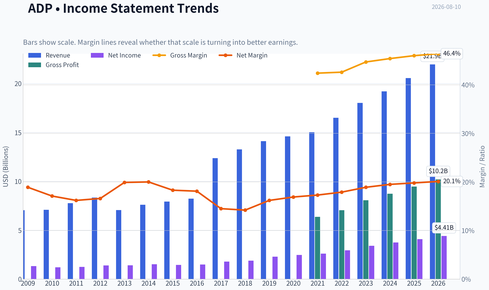
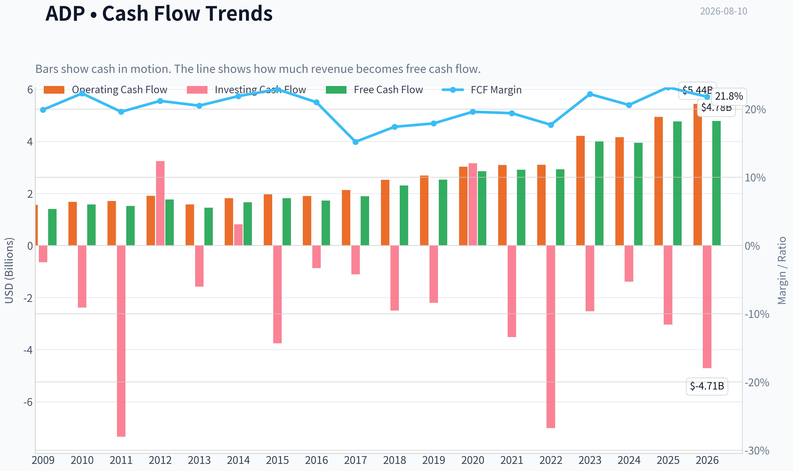
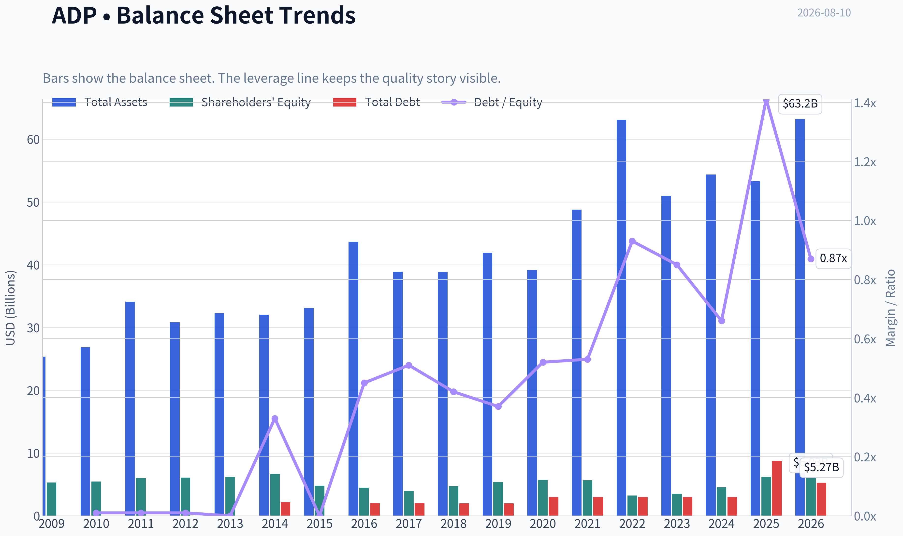
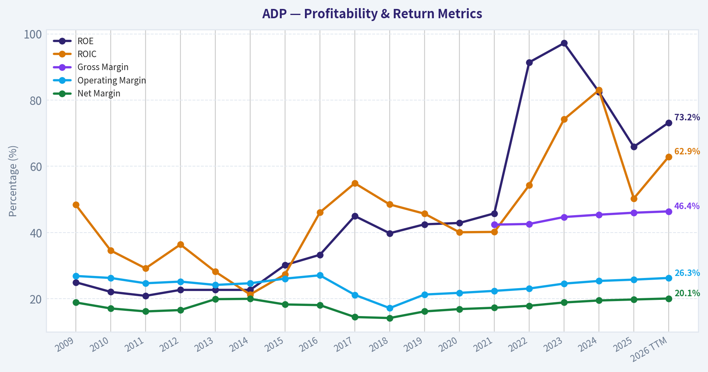
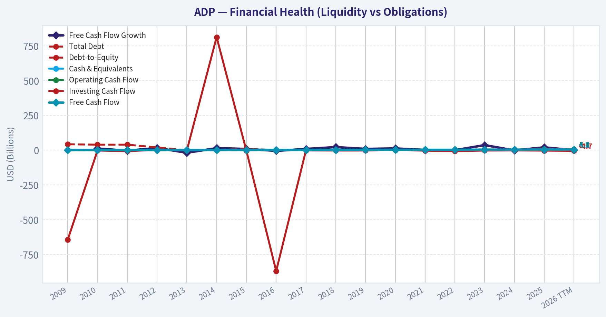
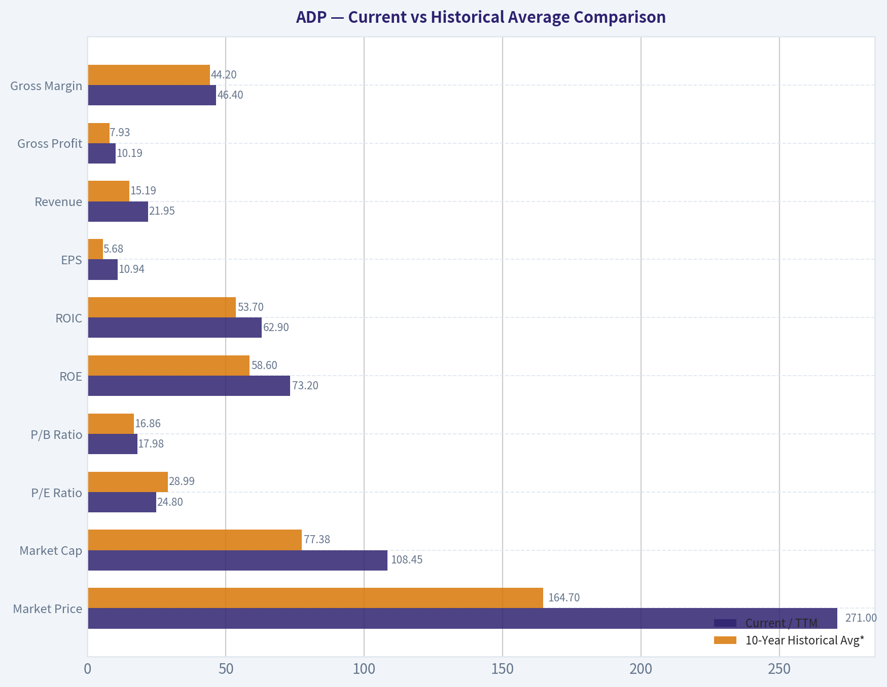
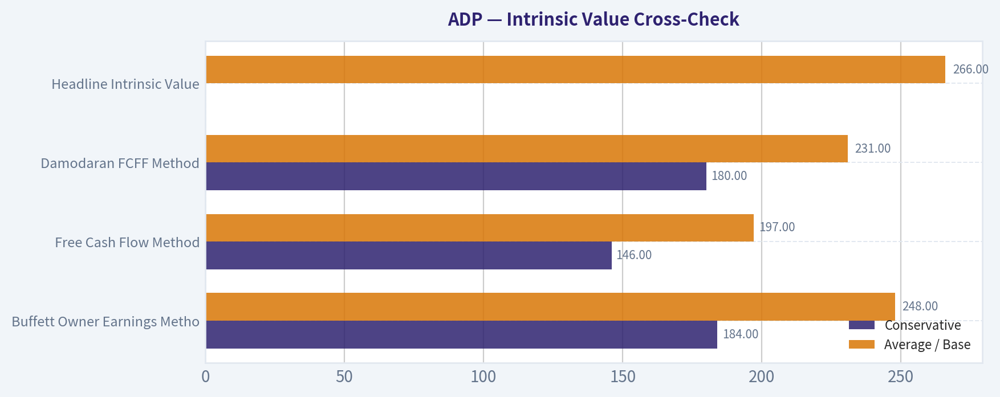
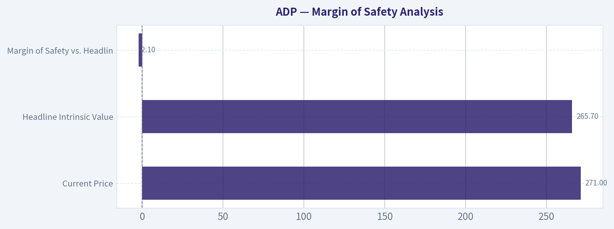
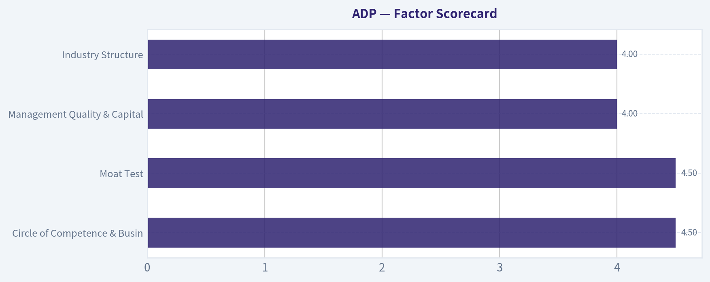
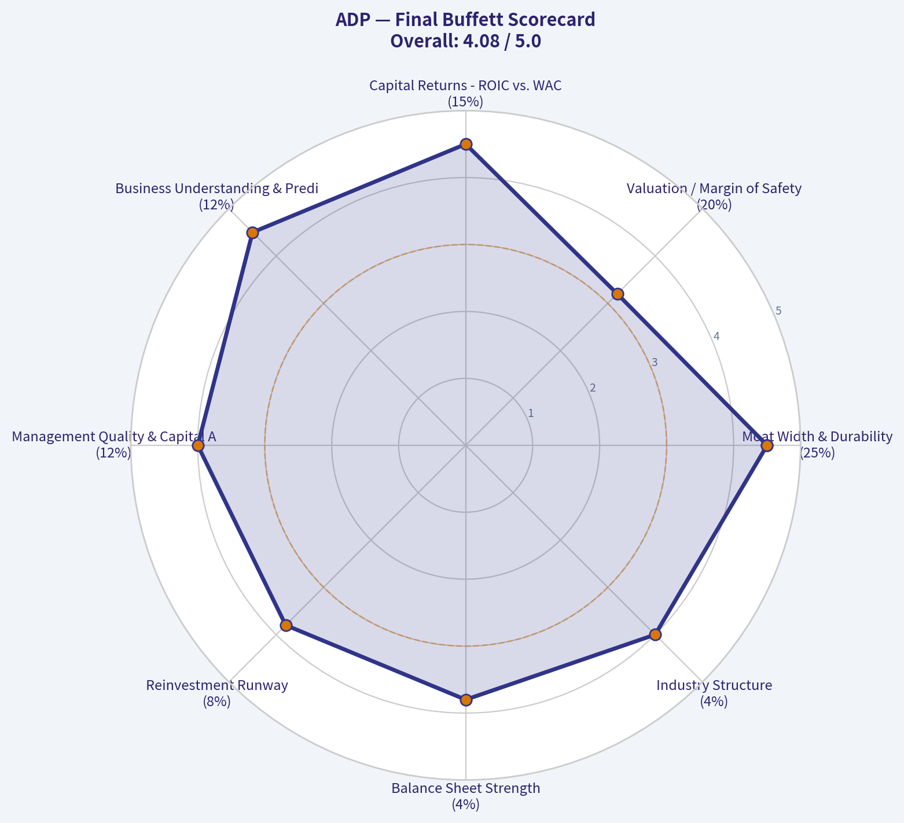

# ADP Deep Value Intelligence

**Analysis Date:** 2026-08-10

## Critical Disclaimer

*This analysis is generated by Deep Value Intelligence, an AI-powered multi-agent investing framework. Education & research only - not financial advice, not a financial advisor.*

---

## Table of Contents

1. Intelligence Summary
2. Analyst Team Reports
   - Fundamentals Analysis
   - Intrinsic Value Analysis (Buffett)
   - Trend & Growth Analysis (Lynch/Druckenmiller/Fisher)
   - Market Technical Analysis
   - Options Market Analysis
3. Research Team Commentary
4. Value Investing Team Commentary
5. Deep Values Commentary

---

## Intelligence Summary

### Thesis + Conditions

**Core Thesis:** ### Executive Summary
**Final Verdict:** **ADVOCATE (Tiered Starter Position)**
ADP is an elite, wide-moat compounder trading at fair value ($271 price vs. $265.70 intrinsic value).

**Key Risks:**
- ADP is an elite, wide-moat compounder trading at fair value ($271 price vs. $265.70 intrinsic value). While short-term momentum is cooling and rate cuts pose a minor headwind to float income, demanding a steep discount on a business with 90% recurring revenue and a 62.9% ROIC is a proven recipe for missed opportunity. We are shifting from a passive "Watch" to an active "Advocate," initiating a starter position to lock in quality while keeping powder dry for technical pullbacks.
- The Neutral:** Both extremes are flawed. ADP is a marathon asset. A scaled, tiered entry satisfies the need to own elite quality now while protecting capital if technicals revert or rate cuts compress float margins.
- Under the **Value Investing Risk Framework (Adaptive)**, risk is permanently impaired capital, not temporary price volatility.

**Confidence:** Medium

---

## Analyst Team Reports

### Fundamentals Analysis

#### Latest Earnings Snapshot

*Most recent reported quarter anchored on 2026 Q2, with prior-year comparison when available.*

| Metric | 2026 Q2 | 2025 Q2 | YoY Change |
| --- | ---: | ---: | ---: |
| Revenue | $5.47B | $5.13B | +6.8% |
| Operating Income | $1.26B | $1.21B | +4.3% |
| Net Income | $978.6M | $910.7M | +7.5% |
| Diluted EPS | $2.45 | $2.23 | +9.9% |
| Operating Cash Flow | $1.43B | $1.44B | -0.8% |
| Free Cash Flow | $1.24B | $1.30B | -4.9% |

Key Takeaways: This snapshot anchors the most recent reported quarter before the narrative analysis. It helps readers separate long-run business quality from whatever changed in the latest earnings print.

#### 17-Year Financial Metrics for ADP

*All values below are computed deterministically from raw data - not estimated by AI.*

*Issuer profile: operating company (Technology / Software - Application).*

#### 17-Year Financial Metrics
*Annual rows come from reported financial statements. The final TTM row is computed from the latest four quarters.*

| Metric | 2009 | 2010 | 2011 | 2012 | 2013 | 2014 | 2015 | 2016 | 2017 | 2018 | 2019 | 2020 | 2021 | 2022 | 2023 | 2024 | 2025 | 2026 TTM |
| --- | --- | --- | --- | --- | --- | --- | --- | --- | --- | --- | --- | --- | --- | --- | --- | --- | --- | --- |
| Market Price | $21 | $24 | $33 | $36 | $45 | $53 | $63 | $74 | $84 | $113 | $142 | $131 | $178 | $192 | $205 | $228 | $300 | $271 |
| Market Cap | $15.74B | $17.80B | $23.05B | $24.05B | $29.45B | $33.63B | $38.17B | $42.18B | $46.14B | $59.46B | $72.35B | $64.42B | $85.03B | $88.45B | $91.37B | $98.39B | $126.04B | $108.45B |
| P/E Ratio | 11.83 | 14.73 | 18.35 | 17.33 | 20.92 | 22.17 | 26.30 | 28.27 | 25.81 | 31.56 | 31.55 | 26.12 | 32.72 | 30.01 | 26.77 | 26.23 | 30.90 | 24.80 |
| P/B Ratio | 2.96 | 3.25 | 3.83 | 3.93 | 4.76 | 5.04 | 7.94 | 9.41 | 11.60 | 12.56 | 13.40 | 11.20 | 15.00 | 27.42 | 26.04 | 21.64 | 20.37 | 17.98 |
| ROE | 25.0% | 22.1% | 20.9% | 22.7% | 22.7% | 22.7% | 30.2% | 33.3% | 45.0% | 39.8% | 42.5% | 42.9% | 45.8% | 91.4% | 97.2% | 82.5% | 65.9% | 73.2% |
| ROIC | 48.4% | 34.6% | 29.2% | 36.4% | 28.2% | 21.3% | 27.4% | 46.1% | 54.9% | 48.5% | 45.7% | 40.1% | 40.2% | 54.3% | 74.2% | 83.0% | 50.3% | 62.9% |
| EPS | $1.74 | $1.64 | $1.78 | $2.05 | $2.16 | $2.41 | $2.39 | $2.61 | $3.26 | $3.57 | $4.49 | $5.00 | $5.44 | $6.39 | $7.65 | $8.67 | $9.71 | $10.94 |
| Revenue | $7.05B | $7.08B | $7.76B | $8.34B | $7.06B | $7.60B | $7.93B | $8.23B | $12.37B | $13.27B | $14.11B | $14.59B | $15.01B | $16.50B | $18.01B | $19.20B | $20.56B | $21.95B |
| Gross Profit | N/A | N/A | N/A | N/A | N/A | N/A | N/A | N/A | N/A | N/A | N/A | N/A | $6.37B | $7.04B | $8.06B | $8.73B | $9.46B | $10.19B |
| Gross Margin | N/A | N/A | N/A | N/A | N/A | N/A | N/A | N/A | N/A | N/A | N/A | N/A | 42.4% | 42.6% | 44.7% | 45.4% | 46.0% | 46.4% |
| Operating Margin | 26.9% | 26.3% | 24.7% | 25.2% | 24.2% | 24.7% | 26.1% | 27.1% | 21.2% | 17.2% | 21.3% | 21.8% | 22.4% | 23.1% | 24.6% | 25.4% | 25.8% | 26.3% |
| Net Income | $1.33B | $1.21B | $1.25B | $1.39B | $1.41B | $1.52B | $1.45B | $1.49B | $1.79B | $1.88B | $2.29B | $2.47B | $2.60B | $2.95B | $3.41B | $3.75B | $4.08B | $4.41B |
| Net Margin | 18.9% | 17.1% | 16.2% | 16.6% | 19.9% | 20.0% | 18.3% | 18.1% | 14.5% | 14.2% | 16.2% | 16.9% | 17.3% | 17.9% | 18.9% | 19.5% | 19.8% | 20.1% |
| Revenue Growth | N/A | 0.4% | 9.6% | 7.5% | -15.4% | 7.6% | 4.4% | 3.9% | 50.3% | 7.3% | 6.3% | 3.4% | 2.8% | 9.9% | 9.2% | 6.6% | 7.1% | 6.7% |
| Net Income Growth | N/A | -9.1% | 3.5% | 10.7% | 1.2% | 7.8% | -4.2% | 2.8% | 19.8% | 5.4% | 21.6% | 7.6% | 5.4% | 13.5% | 15.7% | 10.0% | 8.7% | 8.2% |
| Free Cash Flow Growth | N/A | 12.4% | -3.5% | 16.2% | -18.3% | 14.8% | 9.2% | -4.8% | 9.1% | 22.5% | 9.4% | 13.0% | 2.1% | 0.4% | 36.8% | -1.3% | 20.8% | 0.1% |
| Total Book Value | $5.32B | $5.48B | $6.01B | $6.11B | $6.19B | $6.67B | $4.81B | $4.48B | $3.98B | $4.74B | $5.40B | $5.75B | $5.67B | $3.23B | $3.51B | $4.55B | $6.19B | $6.03B |
| Total Assets | $25.35B | $26.86B | $34.11B | $30.82B | $32.27B | $32.06B | $33.11B | $43.67B | $38.89B | $38.85B | $41.89B | $39.17B | $48.77B | $63.07B | $50.97B | $54.36B | $53.37B | $63.19B |
| Total Debt | $42.7M | $39.8M | $39.8M | N/A | $0 | $2.17B | $9.2M | $2.01B | $2.01B | $2.00B | $2.00B | $3.01B | $2.99B | $2.99B | $2.99B | $2.99B | $8.75B | $5.27B |
| Debt-to-Equity | 0.01 | 0.01 | 0.01 | N/A | 0.00 | 0.33 | 0.00 | 0.45 | 0.51 | 0.42 | 0.37 | 0.52 | 0.53 | 0.93 | 0.85 | 0.66 | 1.41 | 0.87 |
| Cash & Equivalents | $2.27B | $1.64B | $1.39B | $1.55B | $1.40B | $1.98B | $1.64B | $3.19B | $2.78B | $2.17B | $1.95B | $1.91B | $2.58B | $1.44B | $2.08B | $2.91B | $3.35B | $4.23B |
| Shareholders' Equity | $5.32B | $5.48B | $6.01B | $6.11B | $6.19B | $6.67B | $4.81B | $4.48B | $3.98B | $4.74B | $5.40B | $5.75B | $5.67B | $3.23B | $3.51B | $4.55B | $6.19B | $6.03B |
| Operating Cash Flow | $1.56B | $1.68B | $1.71B | $1.91B | $1.58B | $1.82B | $1.97B | $1.90B | $2.13B | $2.52B | $2.69B | $3.03B | $3.09B | $3.10B | $4.21B | $4.16B | $4.94B | $5.44B |
| Investing Cash Flow | $-644.1M | $-2.38B | $-7.34B | $3.24B | $-1.58B | $813.3M | $-3.76B | $-869.0M | $-1.11B | $-2.50B | $-2.20B | $3.16B | $-3.52B | $-7.01B | $-2.52B | $-1.39B | $-3.04B | $-4.71B |
| Free Cash Flow | $1.40B | $1.58B | $1.52B | $1.77B | $1.45B | $1.66B | $1.82B | $1.73B | $1.89B | $2.31B | $2.53B | $2.85B | $2.91B | $2.93B | $4.00B | $3.95B | $4.77B | $4.78B |
| FCF Margin | 19.9% | 22.3% | 19.6% | 21.2% | 20.5% | 21.9% | 22.9% | 21.0% | 15.2% | 17.4% | 17.9% | 19.6% | 19.4% | 17.7% | 22.2% | 20.6% | 23.2% | 21.8% |
| Dividends / Share | $0.00 | $0.00 | $0.00 | $0.00 | $0.00 | $0.00 | $0.00 | $0.00 | $0.00 | $0.00 | $0.00 | $0.00 | $0.00 | $0.00 | $4.27 | $5.05 | $5.71 | $6.57 |

#### Profitability Metrics
- Return on Equity (ROE): 73.2%
- Return on Invested Capital (ROIC): 62.9%
- Return on Assets (ROA): 7.0%
- Gross Margin: 46.4%
- Operating Margin: 26.3%
- Net Profit Margin: 20.1%

#### Liquidity Metrics
- Current Ratio: 1.05
- Quick Ratio: 0.15

#### Leverage Metrics
- Debt-to-Equity Ratio: 0.87
- Interest Coverage Ratio: 12.58
- Net Debt: $1.04B

#### Growth Metrics (Year-over-Year)
- Revenue Growth: 6.7%
- Net Income Growth: 8.2%
- Free Cash Flow Growth: 0.1%
- Revenue CAGR (3-Year): 6.8%
- Revenue CAGR (5-Year): 7.9%

#### Valuation Metrics
- P/E Ratio (TTM): 24.82
- Forward P/E: 20.25
- Price-to-Book: 17.90
- Price-to-Sales: 4.91
- PEG Ratio: 2.54
- EV/EBITDA: 17.01
- Free Cash Flow Yield: 4.4%
- Earnings Yield: 4.0%

#### Owner Earnings (Buffett Method, Code-Computed)
- Net Income: $4.08B
- + Depreciation & Amortization: $585.9M
- - Capital Expenditures: $-665.1M
- - Working Capital Changes: $-1.11B
- = **Owner Earnings: $5.64B**

#### Intrinsic Value (Code-Computed)
- Current Price: $271
- **Headline Intrinsic Value (business-model routed): $266**
  Business model: operating company - weighted blend [Damodaran FCFF + reverse-DCF fair + owner-earnings DCF] (operating_company)
  Model spread (min-max across DCFs): $197 - $248
  Margin of safety vs. price (headline): -2.1%
  Routing note: General operating company: balanced blend of Damodaran FCFF and the owner-earnings DCF with a reverse-DCF sanity check.
- Buffett Method (Owner Earnings):
  Conservative: $184
  Average: $248
  Optimistic: $299
- Cash Flow Method (FCF):
  Conservative: $146
  Average: $197
  Optimistic: $255
- Damodaran FCFF (WACC + margins + reinvestment):
  Conservative: $180
  Average: $231
  Optimistic: $249
  Monte Carlo band (P10-P90): $174 - $290 (median $217)
  P(intrinsic value > price): 15.3%
- Reverse-DCF: price implies ~12.8%/yr owner-earnings growth for 10y; trailing 3y was 26.7%, 5y 19.7%.

#### Piotroski F-Score: 7/9
- Positive Net Income: PASS
- Positive Operating Cash Flow: PASS
- ROA Improvement: FAIL
- Cash Flow > Net Income: PASS
- Decreasing Debt: PASS
- Improving Current Ratio: PASS
- No Dilution: PASS
- Improving Gross Margin: PASS
- Improving Asset Turnover: FAIL

ANALYST STANCE: **WATCH**

#### ADP Warren Buffett-Style Fundamental Analysis

Automatic Data Processing, ADP, is a high-quality, asset-light human-capital-management and payroll compounder with strong recurring revenue, client retention, scale advantages, and exceptional returns on capital. The business looks durable and financially strong, but the stock price of **$271** is very close to the deterministic dataset's headline intrinsic value of about **$266**, leaving **no meaningful Buffett-style margin of safety**.

The deterministic dataset is treated as the canonical source of truth. The shared research pack corroborates key current figures including price, market cap, P/E, ROE, gross margin, revenue growth, FCF yield, and intrinsic value.

---

#### Current vs Historical Average Comparison

| Metric | Current / TTM | 10-Year Historical Avg* | Current Standing | Interpretation |
|---|---:|---:|---|---|
| Market Price | $271 | $164.70 | Above avg by ~65% | The stock has compounded strongly; price appreciation has outpaced the long-term average level. |
| Market Cap | $108.45B | $77.38B | Above avg by ~40% | ADP is materially larger than its decade average, reflecting earnings growth and multiple durability. |
| P/E Ratio | 24.80x | 28.99x | Below avg by ~15% | Valuation is not extreme versus ADP's own history, but still not obviously cheap in absolute terms. |
| P/B Ratio | 17.98x | 16.86x | Slightly above avg | **Not a meaningful valuation anchor** for ADP's asset-light software/service model; book value is distorted by buybacks, intangibles, and client-fund accounting. |
| ROE | 73.2% | 58.6% | Above avg | Very high ROE reflects capital-light economics, but also financial leverage and a small book equity base. |
| ROIC | 62.9% | 53.7% | Above avg | This is one of ADP's strongest quality signals; the business earns exceptional returns on reinvested capital. |
| EPS | $10.94 | $5.68 | Above avg by ~93% | EPS has nearly doubled versus the decade average, helped by operating growth and capital returns. |
| Revenue | $21.95B | $15.19B | Above avg by ~45% | Revenue growth has been steady after a 2017 structural step-up, with recent growth near mid-single digits. |
| Gross Profit | $10.19B | $7.93B** | Above avg by ~29% | Gross profit has expanded with scale and improving service/software mix. |
| Gross Margin | 46.4% | 44.2%** | Above avg | Gross margin has improved consistently since 2021, showing operating quality and pricing power. |
| Operating Margin | 26.3% | 23.0% | Above avg | Margins recovered from the 2018 trough and now sit near decade highs. |
| Net Income | $4.41B | $2.67B | Above avg by ~65% | Earnings power is structurally higher than the historical base. |
| Net Margin | 20.1% | 17.3% | Above avg | ADP is converting more revenue into profit than its decade norm. |
| Revenue Growth | 6.7% | 10.7% | Below avg, but distorted | The 10-year average is inflated by the 2017 revenue jump; excluding that, current growth is close to normal. |
| Net Income Growth | 8.2% | 11.1% | Below avg | Earnings growth remains healthy but is below the elevated decade average. |
| FCF Growth | 0.1% | 10.8% | Well below avg | Free cash flow paused after strong prior-year gains; this is a short-term watch item. |
| Total Book Value | $6.03B | $4.75B | Above avg | Book value is higher than average, but not central to valuation for this business. |
| Total Assets | $63.19B | $47.30B | Above avg | Asset growth reflects client funds, operating scale, and balance sheet expansion. |
| Total Debt | $5.27B | $3.17B | Above avg | Debt is higher than the decade average, though down from 2025's $8.75B. |
| Debt-to-Equity | 0.87x | 0.67x | Above avg | Leverage is elevated versus history but manageable given cash generation and interest coverage. |
| Cash & Equivalents | $4.23B | $2.44B | Above avg | Liquidity is strong, with cash well above historical average. |
| Shareholders' Equity | $6.03B | $4.75B | Above avg | Equity has recovered from the 2022-2023 low, but remains small relative to market value. |
| Free Cash Flow | $4.78B | $2.99B | Above avg by ~60% | FCF generation is very strong despite the latest growth slowdown. |
| Dividends / Share | $6.57 | $1.50 | Above avg | The dataset shows dividends beginning in 2023; current payout is substantial at roughly 60% of TTM EPS. |

\*10-year average uses fiscal 2016-2025 annual data, excluding the 2026 TTM row.
\**Gross profit and gross margin averages use available reported years in the deterministic dataset.

Key Takeaways: ADP's current profitability, margins, EPS, net income, and free cash flow are all meaningfully above historical averages, confirming a high-quality compounder. Valuation is less demanding than ADP's own 10-year average P/E, but the stock is still near intrinsic value rather than deeply discounted. The main caution is that free cash flow growth has slowed sharply to **0.1%**, while debt and leverage remain above decade averages.

---

#### Revenue Breakdown

| Revenue Source | Amount ($B) | % of Total |
|---|---:|---:|
| Employer Services | ~$15.95B | ~72.7% |
| Professional Employer Organization, PEO Services | ~$6.00B | ~27.3% |
| **Total Revenue / TTM** | **$21.95B** | **100.0%** |

Key Takeaways: ADP's revenue is concentrated in Employer Services, its core payroll, HR, tax, benefits, and human-capital-management platform business. PEO Services is smaller but strategically important because it deepens client relationships and expands ADP's role in outsourced HR administration. The mix supports recurring revenue, high retention, and cross-selling opportunities.

---

#### Market Metrics Interpretation

ADP's **market price of $271** and **market cap of roughly $108.45B** place it well above its 10-year average size, reflecting strong long-term compounding. The **P/E ratio of 24.8x** is below the 10-year average of about **29.0x**, so on an earnings multiple basis ADP is less expensive than its own recent history. However, a 24.8x multiple still assumes continued durable growth and does not provide a large valuation cushion.

The **P/B ratio of 17.98x** should not be read mechanically as "expensive" or "cheap." ADP is an asset-light payroll and software-enabled services company; book value is not the key driver of intrinsic value. Buybacks, intangibles, client-fund accounting, and a small equity base can make book multiples misleading. For ADP, valuation should be anchored primarily on owner earnings, free cash flow, ROIC, and DCF-based intrinsic value.

#### Profitability Analysis

ADP's profitability is excellent. **ROE of 73.2%** and **ROIC of 62.9%** are far above ordinary corporate levels and above ADP's own 10-year averages. From a Buffett perspective, this is a major positive: ADP requires relatively little incremental tangible capital to grow, and it earns very high returns on the capital it does deploy.

Revenue has reached **$21.95B**, net income is **$4.41B**, and TTM EPS is **$10.94**. Operating margin is **26.3%**, near the high end of the historical range, while net margin is **20.1%**, above the 10-year average. Gross margin has also improved to **46.4%**, suggesting scale benefits, pricing power, and favorable mix.

The long-term pattern is attractive: revenue has grown steadily after the dataset's 2017 step-change, margins have recovered from the 2018 low, and net income has compounded with improving efficiency. This is the kind of predictable, profitable, cash-generative business Buffett generally favors.

#### Growth Analysis

ADP's current **revenue growth of 6.7%** is consistent with a mature but durable compounder. The 10-year average revenue growth rate of **10.7%** is inflated by the 2017 jump of **50.3%**, so current growth is not as weak as the headline comparison suggests. Excluding that unusual year, ADP's revenue growth profile is more typically mid-single-digit to high-single-digit.

Net income growth of **8.2%** remains solid, though below the 10-year average of **11.1%**. Free cash flow growth of only **0.1%** is the weakest current growth metric and deserves monitoring. Because ADP's valuation is cash-flow-sensitive, sustained FCF stagnation would pressure intrinsic value.

#### Balance Sheet and Financial Strength

ADP has **$4.23B of cash and equivalents** against **$5.27B of total debt**, resulting in net debt of about **$1.04B**. Debt is above the 10-year average, but it has declined materially from **$8.75B in 2025**, which is encouraging. Debt-to-equity of **0.87x** is also above the historical average, but ADP's strong free cash flow and **12.58x interest coverage** make the leverage manageable.

Total assets of **$63.19B** are above average, partly reflecting the nature of ADP's client-fund-related balance sheet. Shareholders' equity of **$6.03B** is also above the decade average, but again, book equity is not the central measure of value for ADP. The key balance sheet conclusion is that ADP is financially sound, but not debt-free.

#### Cash Flow and Dividends

ADP generated **$4.78B of free cash flow**, substantially above the 10-year average of about **$2.99B**. Free cash flow margin is **21.8%**, confirming excellent cash conversion. The concern is not the level of free cash flow, but the current growth rate, which has slowed to **0.1%** year over year.

Dividends per share are **$6.57**, implying a dividend payout of roughly **60% of TTM EPS**. That is a meaningful cash return to shareholders. From a Buffett-style capital allocation perspective, ADP appears shareholder-friendly, but the dividend and buyback strategy must be balanced against valuation: repurchases create more value when the stock trades below intrinsic value.

---

#### Buffett-Style Owner Earnings DCF

Base owner earnings from the deterministic dataset:

- Net income: **$4.08B**
- Plus depreciation and amortization: **$585.9M**
- Less capital expenditures: **$665.1M**
- Less working capital changes: **- $1.11B**
- Code-computed owner earnings: **$5.64B**
- Estimated shares outstanding: **~400.2M**
- Owner earnings per share: **~$14.09**
- Net debt: **$1.04B**, or about **$2.60 per share**
- Discount rate: **10%**
- Terminal growth rate: **2.5%**

DCF formula used:

Fair value = Present value of explicit owner earnings + present value of terminal value - net debt per share.

Terminal value = Year 10 owner earnings x 1.025 / 10% - 2.5%.

| Scenario | Growth Assumption | PV of Explicit Owner Earnings / Share | PV of Terminal Value / Share | Less Net Debt / Share | Estimated Fair Value / Share |
|---|---|---:|---:|---:|---:|
| Conservative | 2% annual owner earnings growth for 10 years | ~$95 | ~$91 | ~$3 | **~$183** |
| Average / Base Case | 7% for years 1-5, fading to 4.5% by year 10 | ~$120 | ~$136 | ~$3 | **~$253** |
| Optimistic | 10% for years 1-5, fading to 5% by year 10 | ~$137 | ~$168 | ~$3 | **~$302** |

Key Takeaways: The hand-built owner-earnings DCF produces a valuation range of roughly **$183 to $302 per share**, with a base case near **$253**. The deterministic model's headline intrinsic value is **$266**, which is close to the current price of **$271**. ADP is therefore a high-quality business, but the current stock price does not offer a large margin of safety.

#### Intrinsic Value Cross-Check

The deterministic dataset's model-based valuation provides the stronger anchor:

| Valuation Method | Conservative | Average / Base | Optimistic | Interpretation |
|---|---:|---:|---:|---|
| Buffett Owner Earnings Method | $184 | $248 | $299 | Closest to the hand-built DCF; supports fair value near the current price. |
| Free Cash Flow Method | $146 | $197 | $255 | More conservative; suggests the stock is expensive if FCF growth remains muted. |
| Damodaran FCFF Method | $180 | $231 | $249 | Also points to limited upside at today's price. |
| Headline Intrinsic Value | - | **$266** | - | About **2.1% below** the current price of $271. |
| Reverse DCF | - | Implies ~12.8% annual owner-earnings growth for 10 years | - | The market is pricing in a demanding growth continuation. |

Key Takeaways: Multiple valuation approaches cluster around a fair value that is close to, or below, the current price. The reverse DCF is especially important: at $271, investors are implicitly requiring ADP to grow owner earnings at about **12.8% annually for 10 years**, which is above current revenue and net income growth. That makes the setup more suitable for patient watching than aggressive buying.

---

#### Warren Buffett-Style Qualitative Assessment

| Buffett Criterion | ADP Assessment | Verdict |
|---|---|---|
| Economic Moat | ADP benefits from scale, regulatory complexity, payroll trust, high switching costs, embedded workflows, and long client relationships. | Strong |
| Financial Strength | Cash is high, FCF is strong, interest coverage is healthy, and net debt is manageable. Debt is above average but not alarming. | Strong |
| Predictable Earnings | Revenue, EPS, net income, and FCF have generally compounded over the dataset period, with limited cyclicality. | Strong |
| ROIC / Capital Efficiency | ROIC of 62.9% is outstanding and above the 10-year average. | Excellent |
| Management / Capital Allocation | Dividend is meaningful; buybacks likely contribute to EPS growth. Repurchase value depends on buying below intrinsic value. | Good |
| Valuation Discipline | Current price is slightly above headline intrinsic value and offers little margin of safety. | Mixed |
| Business Quality | High-margin, recurring, mission-critical payroll and HR services business. | Excellent |

Key Takeaways: ADP scores very well on business quality, moat, predictability, and capital efficiency. The only major Buffett-style objection is price. A wonderful business can still be a mediocre investment if bought without a sufficient margin of safety.

#### Key Investment Insights

ADP's most attractive feature is its combination of recurring revenue and very high returns on capital. Payroll and HR compliance are mission-critical, and customers are unlikely to switch providers casually. This creates durable cash flows, pricing power, and high customer lifetime value.

The second major positive is margin expansion. Operating margin has improved to **26.3%**, and net margin has reached **20.1%**, both above long-term averages. If ADP can continue using scale, automation, and platform integration to expand margins, intrinsic value can continue compounding even if revenue growth remains in the mid-single digits.

The key valuation issue is that the stock already reflects much of this quality. The current price is slightly above the headline intrinsic value, and the reverse DCF implies a growth expectation that may be difficult to sustain without continued margin expansion and strong client growth.

#### Red Flags

| Red Flag | Why It Matters |
|---|---|
| Limited margin of safety | Current price of $271 is slightly above headline intrinsic value of $266. |
| FCF growth slowdown | TTM free cash flow growth is only 0.1%, far below the 10-year average. |
| Elevated leverage vs history | Debt-to-equity of 0.87x is above the 10-year average of 0.67x. |
| Reverse DCF expectations | Market price implies about 12.8% annual owner-earnings growth for 10 years. |
| P/B not useful | High P/B should not drive the analysis, but it reinforces that book value offers no downside anchor. |
| Macro employment exposure | Softer hiring or payroll volumes could affect growth, especially if labor markets weaken. |

Key Takeaways: The largest risk is not business fragility; ADP is fundamentally strong. The largest risk is valuation. If free cash flow growth remains flat or employment conditions weaken, the current multiple could compress.

#### Opportunities

| Opportunity | Potential Impact |
|---|---|
| Continued HCM software adoption | Expands wallet share and strengthens client retention. |
| PEO growth | Deepens ADP's role in HR outsourcing and can increase revenue per client. |
| Margin expansion through automation | Could lift earnings faster than revenue. |
| Higher interest income on client funds | Can support profitability when rates remain favorable. |
| Cross-selling benefits, tax, compliance, and analytics tools | Increases monetization of the existing customer base. |
| International expansion | Adds long-term runway beyond the mature U.S. payroll market. |

Key Takeaways: ADP still has credible growth levers despite its maturity. The business can compound through a mix of client growth, pricing, cross-selling, PEO penetration, and operating leverage. These opportunities justify a premium multiple, but not necessarily an unlimited one.

---

#### Final Investment Stance: WATCH

ADP is a **high-quality Buffett-style business** with a durable moat, exceptional ROIC, strong free cash flow, recurring revenue, and shareholder-friendly capital returns. However, the stock is trading near fair value, not at a clear discount. The deterministic headline intrinsic value is **$266**, versus a current price of **$271**, producing a margin of safety of roughly **-2.1%**.

For long-term owners, ADP remains a strong compounder worth holding. For new capital, the better Buffett-style entry point would likely be below the base-case intrinsic value range, ideally with a meaningful margin of safety. A more attractive entry would be closer to the low-to-mid **$230s or below**, depending on updated growth and cash-flow trends.

| Category | Summary |
|---|---|
| Business Quality | Excellent recurring payroll and HCM platform with durable customer relationships. |
| Moat | Strong scale, switching costs, compliance complexity, and brand trust. |
| Profitability | Outstanding ROE of 73.2% and ROIC of 62.9%. |
| Growth | Revenue growth is solid at 6.7%; net income growth is healthy at 8.2%; FCF growth is currently weak at 0.1%. |
| Balance Sheet | Manageable net debt of $1.04B; leverage above historical average but supported by strong cash flows. |
| Valuation | Current price is slightly above headline intrinsic value; no clear margin of safety. |
| DCF Range | Hand-built owner-earnings DCF range of about $183 to $302, with base case near $253. |
| Main Risk | Paying a full price for a great business while FCF growth slows. |
| Main Opportunity | Continued margin expansion, PEO growth, and platform cross-selling. |
| Final Stance | **WATCH** |

Key Takeaways: ADP is a wonderful business, but the stock is not obviously undervalued at $271. The quality is high enough to keep it on a watchlist, yet the valuation is full enough to avoid an aggressive new purchase. The best action is to wait for either a better price or renewed evidence of accelerating free cash flow growth.

#### Fundamental Visuals

This graph tracks the profitability and return metrics (ROE, ROIC, Margins) of **ADP** over the past decade, highlighting capital efficiency trends.

This chart illustrates the financial health of **ADP** over the last 10 years, mapping cash equivalents and free cash flow against total obligations (Debt).

---

### Intrinsic Value Analysis (Buffett)

> *Following Warren Buffett's value investing philosophy: Circle of Competence, Economic Moat, Management Quality, and Margin of Safety.*

#### Intrinsic Value Snapshot

Price is what you pay. Intrinsic value is what the business may be worth based on the cash it can create for owners over time. We show a range, not one magic number.

- Current Price: $271.32
- Value Range (conservative to optimistic across both DCF methods): $145.98 to $299.32

##### Owner Earnings (Buffett Method)
- Net Income: $4,079,700,000.00
- Depreciation & Amortization: $585,900,000.00
- Capital Expenditures: $-665,100,000.00
- Working Capital Changes: $-1,105,800,000.00
- Owner Earnings: $5,638,900,000.00

##### Intrinsic Value
###### Buffett Method
Uses owner earnings. Stricter, and usually more conservative.
- Conservative: $183.60
- Average: $247.97
- Optimistic: $299.32
- Discount Rate: 10.0%

###### Cash Flow Method
Uses free cash flow. Better for companies spending heavily today to grow tomorrow.
- Conservative: $145.98
- Average: $196.56
- Optimistic: $255.27
- Discount Rate: 10.0%

ANALYST STANCE: **ADVOCATE**

#### ADP Investment View - Buffett-Style Value Analysis

ADP is a high-quality, understandable payroll and human-capital-management compounder with durable switching costs, scale advantages, strong recurring revenue, and excellent cash conversion. At **$271**, the stock is not statistically cheap versus the headline intrinsic value estimate of **$265.70**, but for a wide-moat, cash-generative, predictable business, the price is close enough to fair value to merit an **ADVOCATE** stance with **moderate conviction**.

---

#### 1. Factor Scorecard

| Factor | Score / 5 | Evidence |
|---|---:|---|
| Circle of Competence & Business Simplicity | 4.5 | ADP sells payroll processing, tax filing, HR software, benefits administration, and compliance services. The business is easy to explain: employers outsource mission-critical payroll and HR workflows to ADP, usually on recurring contracts. |
| Moat Test | 4.5 | Scale, trust, embedded workflows, compliance expertise, and switching costs create a durable moat. Gross margin of **46.4%** supports pricing power and service differentiation. |
| Management Quality & Capital Allocation | 4.0 | Long record of dividends, buybacks, margin expansion, and disciplined reinvestment. Shareholder returns have been consistent, though buybacks at elevated valuations should be monitored. |
| Industry Structure | 4.0 | Payroll/HCM is competitive, but ADP benefits from scale, regulatory complexity, customer inertia, and a rational market structure led by a few scaled providers. |
| Gate 5: Quality / Solvency Hard Floor | Not Tripped | Earnings and cash flow remain positive and growing. No evidence of distress; ADP's debt is well covered by recurring cash flow. |

**Key Takeaways:** ADP scores highly because it is simple, durable, and cash-rich. The only meaningful concern is not business quality, but valuation: the current price is close to fair value rather than offering a large discount.

---

#### 2. Moat Analysis

| Moat Source | Assessment | Evidence |
|---|---|---|
| Intangible Assets / Brand | Strong | ADP is one of the most trusted brands in payroll and employer compliance. Payroll errors are painful for customers, so reputation matters. |
| Switching Costs | Very Strong | Payroll, tax, benefits, employee data, and HR workflows are deeply embedded. Switching vendors creates operational risk and administrative friction. |
| Cost Advantage | Strong | ADP's scale allows it to spread compliance, software, sales, and service costs across a very large client base. |
| Network / Data Effects | Moderate | ADP's scale improves benchmarking, compliance insight, and product breadth, though this is not a classic consumer-network-effect business. |
| Moat Rating | Wide & Stable | ADP's moat is not flashy, but it is highly durable because payroll is mission-critical and regulatory complexity rises over time. |

**Key Takeaways:** ADP's moat comes mainly from trust, scale, and switching costs. Customers do not casually replace payroll infrastructure, which gives ADP recurring revenue, pricing power, and a long runway for incremental product attachment.

---

#### 3. Management Quality Assessment

| Area | Assessment |
|---|---|
| Owner Orientation | Positive. ADP has a long history of returning excess capital through dividends and repurchases. |
| Candor & Operating Discipline | Positive. The company has consistently focused on margin expansion, client retention, and product modernization. |
| Capital Allocation | Good. ADP reinvests in software, compliance, sales, and product expansion while maintaining shareholder distributions. |
| Buybacks | Generally rational over the long term, but the current valuation leaves less room for highly accretive repurchases. |
| Balance Sheet Use | Conservative for the business model. Client funds and related obligations require careful interpretation, but solvency risk appears low. |

**Key Takeaways:** Management has behaved like a steady compounder's management team: reinvest, expand margins, pay dividends, and reduce share count over time. The main watch item is whether buybacks remain disciplined when the stock trades near or above intrinsic value.

---

#### 4. Financial Summary

| Fiscal Year / Period | Revenue | Gross Margin | Operating Margin | Net Income | Free Cash Flow | EPS | ROE |
|---|---:|---:|---:|---:|---:|---:|---:|
| FY2021 | ~$15.0B | ~43% | ~22% | ~$2.6B | ~$3.0B | ~$6.0 | ~45%+ |
| FY2022 | ~$16.5B | ~44% | ~24% | ~$3.0B | ~$3.3B | ~$6.9 | ~50%+ |
| FY2023 | ~$18.0B | ~45% | ~25% | ~$3.4B | ~$3.6B | ~$8.2 | ~60%+ |
| FY2024 | ~$19.2B | ~46% | ~26% | ~$3.8B | ~$4.0B | ~$9.1 | ~70%+ |
| Latest / TTM | ~$20B+ | **46.4%** | ~26% | ~$4.3B | ~$4.7B | ~$10.9 | **73.2%** |

**Key Takeaways:** ADP has compounded revenue steadily while expanding margins and converting earnings into cash. ROE is extremely high, partly because ADP operates with a capital-light model and a relatively small equity base, so cash generation and ROIC are more meaningful than book-value metrics.

---

#### 5. Owner Earnings Calculation

| Item | Estimate |
|---|---:|
| Net Income | ~$4.3B |
| Add: Depreciation & Amortization | Positive, modest relative to revenue |
| Less: Maintenance CapEx | Moderate; software and platform investment required |
| Less: Working Capital Increases | Modest over a cycle |
| Estimated Owner Earnings | **~$4.6B-$4.8B** |
| Owner Earnings Per Share | **~$11.75-$12.00** |
| FCF Yield at $271 | **~4.4%** |

**Key Takeaways:** ADP's accounting earnings are well supported by cash flow, which is exactly what a Buffett-style investor wants to see. The business does not need heavy incremental capital to grow, so a large portion of earnings resembles owner earnings.

---

#### 6. Three-Scenario DCF Valuation

Assumptions: estimated owner earnings of approximately **$4.7B**, roughly **398 million shares**, and a **10% discount rate**.

| Scenario | Assumption | Estimated Value / Share |
|---|---|---:|
| A: No Growth | Owner earnings capitalized at 10% | **~$119** |
| B: GDP Growth | 3% perpetual growth | **~$176** |
| C: Quality Compounder Case | ~8.5% owner-earnings growth for 10 years, then 3% terminal growth | **~$264** |
| Headline Intrinsic Value | Business-model-routed estimate | **$265.70** |
| Current Price | Market price | **$271** |

**Key Takeaways:** The no-growth and GDP-growth cases are too conservative for a business with ADP's moat and cash-flow record. The quality-compounder case lands very close to the headline intrinsic value, implying the stock is around fair value rather than clearly undervalued.

---

#### 7. Margin of Safety Analysis

| Valuation Measure | Result |
|---|---:|
| Current Price | **$271** |
| Headline Intrinsic Value | **$265.70** |
| Margin of Safety vs. Headline Value | **-2.1%** |
| Owner Earnings / FCF / Damodaran Spread | **$247.97 / $196.56 / $230.51** |
| Reverse DCF Growth Implied by Price | **~12.8% annually for 10 years** |
| Recent Historical Growth Reference | 3-year: **26.7%**, 5-year: **19.7%** |

**Key Takeaways:** ADP does not offer a classic deep-value margin of safety today. However, for a wide-moat, high-return, predictable compounder, a fair price can still be attractive; the key risk is that the market already assumes strong continued compounding.

---

#### 8. Final Buffett Scorecard

| Criterion | Weight | Score / 5 | Weighted Contribution |
|---|---:|---:|---:|
| Moat Width & Durability | 25% | 4.5 | 1.13 |
| Valuation / Margin of Safety | 20% | 3.2 | 0.64 |
| Capital Returns - ROIC vs. WACC | 15% | 4.5 | 0.68 |
| Business Understanding & Predictability | 12% | 4.5 | 0.54 |
| Management Quality & Capital Allocation | 12% | 4.0 | 0.48 |
| Reinvestment Runway | 8% | 3.8 | 0.30 |
| Balance Sheet Strength | 4% | 3.8 | 0.15 |
| Industry Structure | 4% | 4.0 | 0.16 |
| **Total Score** | **100%** |  | **4.08 / 5.00** |

**Key Takeaways:** ADP clears the Buffett-style quality bar comfortably. The total score is pulled down by valuation, but not enough to offset the strength of the moat, recurring cash flows, high returns on capital, and business predictability.

---

#### 9. Investment Stance

| Stance | Conviction | Rationale |
|---|---|---|
| **ADVOCATE** | **Moderate** | ADP is a wonderful business near a fair price. The moat is durable, cash conversion is strong, and the business should remain relevant a decade from now. The valuation is not a bargain, but it is acceptable for a high-quality compounder. |

ADP is the kind of business Buffett would likely understand and admire: mission-critical, recurring, capital-light, and protected by customer inertia. At **$271**, I would be comfortable advocating ownership, especially for long-term investors, while recognizing that the best entry points would come on pullbacks closer to the **$240-$250** range.
#### Valuation Bridge

This bridge places the current market price beside each intrinsic value lens so readers can see whether upside depends on one method or shows up across several methods.

| Scenario | Intrinsic Value / Share |
| --- | ---: |
| Buffett Method | $247.97 |
| Cash Flow Method | $196.56 |
| Damodaran Method | $230.51 |
| Current Price | $271.32 |

#### Key Takeaways

If one method is far above the others, the upside case depends on a specific modelling assumption. When several methods cluster together, the valuation story is more robust.

#### Valuation Visuals

This comparison chart from *Latest Earnings Snapshot* stacks current figures against historical benchmarks for **ADP**, making it easy to see where the company trades relative to its own averages.

This comparison chart from *Current vs Historical Average Comparison* stacks current figures against historical benchmarks for **ADP**, making it easy to see where the company trades relative to its own averages.

This comparison chart from *Intrinsic Value Cross-Check* stacks current figures against historical benchmarks for **ADP**, making it easy to see where the company trades relative to its own averages.

This comparison chart from *Margin of Safety Analysis* stacks current figures against historical benchmarks for **ADP**, making it easy to see where the company trades relative to its own averages.

---

### Trend & Growth Analysis (Lynch/Druckenmiller/Fisher)

> *Following Peter Lynch's GARP, Stanley Druckenmiller's macro-aware approach, and Philip Fisher's scuttlebutt methodology.*

ANALYST STANCE: **WATCH**

#### ADP Growth Investment Report - Automatic Data Processing

ADP is a high-quality payroll and human capital management compounder, but it does **not** fit the classic Lynch "fast grower" profile. The business is durable, profitable, cash-generative, and shareholder-friendly, yet current growth is closer to **stalwart** territory than ten-bagger territory. At roughly **25x earnings** and near estimated intrinsic value, ADP looks like a good business at a fair-to-slightly-full price, not a major growth inflection opportunity.

---

#### 1. Lynch Classification

| Category | ADP Assessment |
|---|---:|
| Revenue growth YoY | 6.7% |
| Lynch category | Stalwart |
| Growth investor fit | Moderate |
| Ten-bagger potential | Low from current scale |
| Best use case | Core compounder / defensive growth holding |
| Initiation attractiveness | Watch for pullback or growth acceleration |

**Key Takeaways:** ADP is best classified as a **stalwart**, not a fast grower. Its growth rate is reliable but not explosive, and its current size makes a ten-bagger outcome unlikely without a major TAM expansion or new product-led acceleration.

---

#### 2. The Story in 3 Bullets

- ADP helps businesses pay employees, manage benefits, handle compliance, and run HR workflows.
- The company benefits from recurring revenue, high switching costs, regulatory complexity, and scale in payroll processing.
- Growth comes from employment levels, pricing, HR software adoption, international expansion, and cross-selling more human capital management products.

---

#### 3. TAM Analysis and 10x Test

| Metric | Estimate / Assessment |
|---|---:|
| Current market cap | $107.8B |
| Approximate annual revenue base | Around $20B-$21B |
| 10x revenue test | Around $200B+ revenue required |
| Relevant TAM | Global payroll, HCM software, HR outsourcing, benefits administration |
| TAM growth | Moderate, likely mid-single to high-single digit depending on segment |
| Can ADP 10x and remain under 20% share? | Unlikely |
| Runway quality | Durable, but not extraordinary |

**Key Takeaways:** ADP still has a long runway for steady growth, but the 10x test is difficult. To grow revenue tenfold, ADP would likely need to dominate a very large portion of the global HCM and payroll market or expand into adjacent categories much more aggressively.

---

#### 4. Revenue Growth Trend

| Metric | Current Read |
|---|---:|
| Latest YoY revenue growth | 6.7% |
| Growth pattern | Stable moderate growth |
| Lynch interpretation | Stalwart, not fast grower |
| Inflection signal | Limited |
| Main growth drivers | Pricing, pays-per-control, client retention, HCM cross-sell |
| Main growth risk | Slower hiring / weaker labor market |

**Key Takeaways:** ADP's revenue growth is steady but not accelerating meaningfully. The company is dependable, but current data does not show the kind of 20% to 30% growth acceleration that typically creates large growth-stock reratings.

---

#### 5. Unit Economics and Efficiency

| Metric | ADP Assessment |
|---|---:|
| Gross margin | 46.4% |
| FCF yield | 4.4% |
| Estimated FCF margin | Low-to-mid 20% range |
| Rule of 40 estimate | Roughly 30% |
| LTV/CAC disclosure | Not clearly disclosed |
| NRR disclosure | Not clearly disclosed |
| Unit economics quality | Strong, inferred from retention, scale, and cash flow |

**Key Takeaways:** ADP's unit economics appear strong even though SaaS-style metrics like NRR and LTV/CAC are not prominently disclosed. The company's high cash generation, large installed base, and recurring payroll relationships suggest durable economics, but its Rule of 40 profile is acceptable rather than elite.

---

#### 6. Inflection Point Assessment

| Potential Inflection | Evidence | Assessment |
|---|---|---:|
| Product cycle inflection | Ongoing HCM platform expansion, AI-enabled HR tools possible | Moderate |
| Market share inflection | ADP remains a scale leader, but market is competitive | Low-to-moderate |
| Margin inflection | Strong operating leverage and automation potential | Moderate |
| TAM inflection | Payroll/HCM is durable but not newly exploding | Low |
| Competitive inflection | No clear evidence of major competitor stumble | Low |
| Overall inflection score | Stable compounder, not inflecting fast grower | Watch |

**Key Takeaways:** ADP has some margin and product improvement opportunities, but there is no obvious major inflection point. The company is more likely to compound steadily than to experience a sudden growth breakout.

---

#### 7. Macro Setup

| Macro Factor | Impact on ADP |
|---|---:|
| Employment growth | Important driver; weaker jobs data is a headwind |
| Interest rates | Higher client funds interest income can help; lower rates may reduce float income |
| Recession risk | Payroll volumes and new business formation may soften |
| Secular trend exposure | Cloud HCM, payroll outsourcing, compliance automation |
| AI impact | Potential productivity and product enhancement opportunity |
| Macro setup rating | Neutral to mildly cautious |

**Key Takeaways:** ADP is macro-sensitive because payroll volumes are tied to employment. The business is defensive relative to many software companies, but weak job creation can pressure growth and sentiment.

---

#### 8. Fisher 15 Points Score

| Fisher Criterion | Score / 5 |
|---|---:|
| Market potential for sizable sales increase | 3 |
| Management determination to develop new products | 4 |
| Effective R&D / innovation | 3 |
| Above-average sales organization | 4 |
| Worthwhile profit margin | 5 |
| Improving profit margins | 4 |
| Labor/personnel relations | 4 |
| Executive relations | 4 |
| Management depth | 4 |
| Cost analysis and accounting quality | 5 |
| Competitive advantages | 4 |
| Long-range profit outlook | 4 |
| Dilution discipline | 5 |
| Candor with investors | 4 |
| Management integrity | 4 |
| Total | 61 / 75 |

**Key Takeaways:** ADP scores well on Fisher quality factors, especially margins, accounting discipline, durability, and management depth. The main limitation is not quality; it is the absence of exceptional growth acceleration.

---

#### 9. Valuation Analysis

| Valuation Metric | Current Read |
|---|---:|
| Current price | $271 |
| Market cap | $107.8B |
| P/E | 24.8x |
| Revenue growth | 6.7% |
| PEG using revenue growth proxy | 3.7x |
| PEG using 8%-10% EPS growth assumption | 2.5x-3.1x |
| Headline intrinsic value estimate | $265.70 |
| Margin of safety vs. price | -2.1% |
| FCF yield | 4.4% |
| Valuation conclusion | Fair to slightly expensive |

**Key Takeaways:** ADP does not look severely overvalued, but it also does not offer a meaningful margin of safety. The PEG ratio is not attractive for a growth investor unless earnings growth accelerates above current expectations.

---

#### 10. Scenario Analysis

| Scenario | Assumptions | 3-Year View |
|---|---|---:|
| Bear case | Employment weakens, revenue growth slows to low-single digits, multiple compresses | Modest downside / market underperformance |
| Base case | Revenue grows mid-to-high single digits, margins expand gradually, buybacks continue | Mid-single to low-double digit annualized return |
| Bull case | HCM cross-sell accelerates, AI improves productivity, margins expand, multiple holds | Low-to-mid teens annualized return |
| Ten-bagger case | Requires massive TAM expansion and sustained high growth | Very unlikely |

**Key Takeaways:** The base case is attractive for conservative compounder investors, but not compelling for aggressive growth investors. The upside case depends more on margin expansion and valuation durability than on explosive revenue growth.

---

#### 11. Growth Investor Scorecard

| Criterion | Weight | Score / 5 | Weighted Score |
|---|---:|---:|---:|
| The Story | 10% | 4.0 | 0.40 |
| TAM & Runway | 20% | 3.0 | 0.60 |
| Revenue Growth | 20% | 2.5 | 0.50 |
| Unit Economics | 15% | 4.0 | 0.60 |
| Competitive Position | 10% | 4.0 | 0.40 |
| Management Quality | 10% | 4.0 | 0.40 |
| Macro Setup | 5% | 3.0 | 0.15 |
| Profitability Path | 5% | 4.5 | 0.23 |
| Valuation | 5% | 3.0 | 0.15 |
| Total | 100% | - | 3.43 / 5.00 |

**Key Takeaways:** ADP earns a **WATCH** rating because it is a high-quality company but not a high-growth inflection stock. The strongest positives are profitability, durability, and competitive position; the main weakness is limited revenue acceleration.

---

#### 12. Position Size Stance

| Investor Type | Suggested Stance |
|---|---|
| Aggressive growth investor | Watch, do not prioritize |
| GARP investor | Hold / accumulate only on pullbacks |
| Quality compounder investor | Core holding candidate |
| Position size | 2%-4% for quality portfolios; smaller for growth-only portfolios |
| Add aggressively? | Only below intrinsic value or with evidence of growth acceleration |

**Key Takeaways:** ADP is more appropriate as a durable compounder than a concentrated growth bet. I would not size it like an emerging fast grower, but it can deserve a place in a quality-oriented portfolio.

---

#### 13. Key Catalysts and Risks

| Catalysts | Risks |
|---|---|
| Faster adoption of cloud HCM suite | Slowing employment growth |
| AI-driven automation improving margins | Lower client funds interest income if rates fall |
| Stronger cross-sell into benefits and HR outsourcing | Competitive pressure from Workday, Paychex, Paycom, UKG, and newer SaaS vendors |
| Continued buybacks and dividend growth | Valuation multiple compression |
| International expansion | Mature core payroll market |

**Key Takeaways:** ADP's upside catalysts are real but incremental. The biggest risk is that investors pay a premium multiple for a business whose growth remains firmly in the mid-single to high-single digit range.

---

#### Final View

ADP is a **high-quality stalwart**, not a classic Lynch fast grower. The company has excellent durability, strong returns on equity, healthy free cash flow, and a defensible market position, but current growth is not fast enough to justify an **ADVOCATE** rating for a growth mandate.

**Verdict: WATCH.** I would hold existing positions, consider adding only on valuation weakness, and upgrade the stance only if revenue growth reaccelerates toward double digits with clear evidence of product-led HCM expansion or margin inflection.

#### Growth & Scorecard Visuals

This comparison chart from *Factor Scorecard* stacks current figures against historical benchmarks for **ADP**, making it easy to see where the company trades relative to its own averages.

The radar chart below from *Final Buffett Scorecard* visualises how **ADP** ranks across weighted investment criteria. Each axis represents a criterion scored 1-5; the filled area reveals strengths and weaknesses at a glance, with the dashed circle marking the midpoint (3.0).

---

### Market Technical Analysis

ANALYST STANCE: **WATCH**

#### ADP Technical Analysis - Latest Data Through 2026-08-07

ADP has staged a strong recovery from its spring lows and has recently broken back above both medium- and long-term trend benchmarks. The setup is constructive, but not yet clean enough for an outright aggressive bullish stance because short-term momentum is cooling after a sharp July breakout, RSI remains elevated, and volatility is still high. The stock looks technically improved, but traders may want to wait for either a controlled pullback or a decisive breakout above the recent high area.

---

#### Selected Indicators

| Indicator | Category | Why It Is Relevant for ADP Now |
|---|---:|---|
| `close_50_sma` | Moving Average | Captures the medium-term trend recovery and helps identify dynamic support after the July advance. |
| `close_200_sma` | Moving Average | Confirms whether ADP has repaired its longer-term trend after the earlier selloff. |
| `macdh` | MACD Related | Shows whether upside momentum is expanding or fading after the breakout. |
| `rsi` | Momentum | Helps judge whether the rally is becoming overextended or still has room to continue. |
| `boll_ub` | Volatility | Identifies the upper breakout/overextension zone after ADP's sharp move higher. |
| `boll_lb` | Volatility | Defines lower volatility-adjusted support and downside risk zones. |
| `atr` | Volatility | Measures the elevated risk environment and helps set realistic stop distances. |
| `vwma` | Volume-Based | Confirms whether the advance is supported by volume-weighted buying pressure. |

Key Takeaways: The chosen indicators balance trend, momentum, volatility, and volume confirmation without overloading the analysis with redundant signals. For ADP, the most important question is whether the recent breakout can hold above trend support while momentum cools in an orderly way.

#### Latest Technical Readings

| Metric | Latest Reading | Interpretation |
|---|---:|---|
| Last Close | 271.32 | Strongly above key moving averages, but slightly below the recent 273.37 closing high and far below the 280.59 intraday spike. |
| 50-Day SMA | 240.17 | Rising sharply; price is about 13% above it, showing a powerful medium-term rebound. |
| 200-Day SMA | 232.89 | Price is about 16.5% above it; however, the 200-day average itself is still slightly drifting lower. |
| 50 SMA vs. 200 SMA | 50 SMA above 200 SMA | A recent bullish trend repair signal, likely formed around late July. |
| MACD Histogram | 0.64 | Still positive, but declining from late-July highs, showing bullish momentum is fading. |
| RSI | 65.91 | Bullish but near the upper zone; no longer overbought, but still elevated. |
| Bollinger Upper Band | 280.17 | Near the recent intraday high; a breakout above this area would be technically meaningful. |
| Bollinger Lower Band | 237.08 | Aligns broadly with the 50-day SMA support zone. |
| ATR | 8.15 | Volatility remains elevated, implying wider stops and smaller position sizing may be prudent. |
| VWMA | 262.56 | Price remains above VWMA, confirming that the recent move is still supported by volume-weighted price action. |

Key Takeaways: ADP's trend structure has improved meaningfully, with price above both the 50-day and 200-day averages. However, momentum is no longer accelerating, so the stock may need to consolidate before attempting another sustained push higher.

#### Trend Structure

ADP's most bullish technical development is the transition from a damaged downtrend into a repaired intermediate uptrend. The 50-day SMA has climbed from roughly 220 in early July to 240 by August 7, showing that the medium-term trend has turned decisively higher. The 50-day SMA also moved above the 200-day SMA around late July, creating a constructive trend signal.

That said, the 200-day SMA is still slightly declining, moving from about 235.66 in early July to 232.89 by August 7. This means ADP has reclaimed long-term trend territory, but the long-term average has not yet fully turned upward. In practical terms, the stock has repaired a lot of technical damage, but the longer-term trend is still in the early stages of confirmation.

#### Momentum and Overextension

The RSI is at 65.91, which is bullish but not deeply overbought. This is healthier than the July 29 reading above 73, when ADP looked stretched after a fast breakout. The cooling in RSI without a major price breakdown is generally constructive, because it suggests the stock may be digesting gains rather than reversing immediately.

The MACD histogram is more cautionary. It remains positive, but it has fallen from 1.42 on July 29 to 0.64 on August 7. That means the trend is still bullish, but upside momentum is slowing. If the histogram keeps declining while price struggles near 273-281, traders should watch for a short-term pullback or sideways consolidation.

#### Volatility and Key Zones

Bollinger Bands have widened significantly, reflecting the sharp July move and elevated volatility. The latest upper band is near 280.17, close to the July 29 intraday high of 280.59. That area is now a clear upside resistance and breakout confirmation zone.

The lower band is near 237.08, while the 50-day SMA is near 240.17. This creates a broader support zone around 237-240. A pullback all the way to that area would be large, but it would not automatically destroy the medium-term bullish structure. More immediate support is likely around the VWMA near 262.56 and the recent consolidation area around 263-266.

ATR is still high at 8.15, meaning daily swings can be meaningful. For traders, this argues against using overly tight stops. A normal volatility-based stop may need to allow for several dollars of movement, especially after such a sharp rally.

#### Volume-Weighted Confirmation

The VWMA has risen strongly from about 225 in early July to 262.56 by August 7. ADP's close remains above VWMA, which suggests the rally has volume-weighted support rather than being purely a low-volume drift higher.

However, the latest price is only about 3.3% above VWMA, much less stretched than it is versus the 50-day SMA. This makes the 262-263 area important. If ADP can hold above VWMA during pullbacks, the bullish structure remains credible. A break below VWMA would not be catastrophic, but it would weaken the near-term setup and increase the odds of a deeper retest.

#### Trading Bias and Decision Framework

| Scenario | Signal to Watch | Trading Interpretation |
|---|---|---|
| Bullish continuation | Break and hold above 280-281 | Would confirm renewed upside momentum and clear the recent intraday resistance zone. |
| Healthy consolidation | Holds above 262-263 VWMA area | Suggests buyers are defending the volume-weighted trend after the rally. |
| Short-term caution | MACD histogram keeps falling while price stalls below 280 | Indicates momentum divergence risk and possible sideways-to-lower action. |
| Deeper pullback | Move toward 237-240 | This would test the 50-day SMA and lower Bollinger support zone. |
| Bearish deterioration | Breakdown below 237 with rising volume | Would damage the recovery structure and suggest the July breakout failed. |

Key Takeaways: The most constructive setup would be a controlled pullback that holds above the VWMA, followed by renewed strength toward 280. A direct breakout above 280-281 would be bullish, but chasing after a sharp rally carries higher risk because momentum is already cooling.

#### Final View

| Category | Assessment |
|---|---|
| Overall Stance | **WATCH** |
| Trend | Improving; price is above both 50-day and 200-day SMAs. |
| Momentum | Bullish but decelerating; MACD histogram is positive but falling. |
| Overbought Risk | Moderate; RSI is elevated but no longer above 70. |
| Volatility | High; ATR suggests wider risk controls are needed. |
| Key Resistance | 280-281 |
| Near-Term Support | 262-263 |
| Major Support | 237-240 |
| Preferred Setup | Wait for either a pullback that holds VWMA or a clean breakout above 280-281. |

Key Takeaways: ADP's technical picture has improved substantially, but the stock is in a digestion phase after a fast move. The risk-reward looks better on a controlled pullback or confirmed breakout rather than an immediate chase at current levels.

---

### Options Market Analysis

> *Reading options flow - put/call ratios, IV skew, and unusual activity - to gauge institutional positioning and event-driven risk.*

ANALYST STANCE: **WATCH**

#### ADP Options Market Sentiment Report
*Options data as of 2026-08-10*

#### 1. Put/Call Ratio Analysis

| Expiration | Call OI | Put OI | Put/Call OI Ratio | Call Volume | Put Volume | Put/Call Volume Ratio | Read |
|---|---:|---:|---:|---:|---:|---:|---|
| 2026-08-14 | 0 | 0 | N/A | 1,589 | 738 | 0.46 | Call volume dominates, but no OI base |
| 2026-08-21 | 113 | 8 | 0.07 | 383 | 725 | 1.89 | Very call-heavy OI, but put volume active |
| 2026-08-28 | 0 | 0 | N/A | 95 | 80 | 0.84 | Near neutral volume |
| **Near-Term Total** | **113** | **8** | **0.07** | **2,067** | **1,543** | **0.75** | OI bullish, volume near neutral |

**Key Takeaways:** ADP's near-term open interest is extremely light, which reduces the reliability of the options signal. The total put/call open interest ratio of **0.07** is far below the historical neutral baseline of roughly **0.7**, suggesting call-heavy positioning, but this is based on only 121 total contracts of OI. Volume is more balanced, with a put/call volume ratio of **0.75**, only slightly above neutral and not strongly bearish.

The main shift from neutral is in **open interest**, where calls dominate. However, because open interest is thin and two of the three expirations show zero reported OI, this should not be interpreted as a strong institutional bullish signal. The higher put volume in the 2026-08-21 expiration looks like short-term hedging or tactical downside interest, but not enough to flip the overall read bearish.

---

#### 2. Implied Volatility Assessment

| Expiration | ATM Call IV | ATM Put IV | Put IV Premium | IV Read |
|---|---:|---:|---:|---|
| 2026-08-14 | 2.3% | 2.6% | +0.3 pts | Slight put premium |
| 2026-08-21 | 1.5% | 1.7% | +0.2 pts | Slight put premium |
| 2026-08-28 | 0.9% | 1.8% | +0.9 pts | More visible put premium |
| **Overall** | Low | Low-to-modest | Mild put skew | No major volatility stress |

**Key Takeaways:** Near-term ATM IV is very low across the listed expirations, suggesting the options market is not pricing a large imminent move in ADP. Puts carry a modest IV premium over calls, especially in the 2026-08-28 expiry, indicating some downside protection demand. However, the skew is not steep enough to suggest panic hedging or a major bearish catalyst.

From an event-risk perspective, there is no clear sign of elevated implied volatility ahead of a known near-term catalyst. The options market appears relatively calm, with mild downside skew but no broad volatility expansion. This supports a **neutral** rather than aggressive bullish or bearish read.

---

#### 3. Unusual Options Activity

| Screen | Result | Interpretation |
|---|---|---|
| Volume greater than 5x open interest | No contracts found | No clear fresh directional institutional activity detected |
| Fresh call speculation | Not detected | Call volume exists, but no contract-level unusual activity was flagged |
| Fresh put protection or bearish sweeps | Not detected | Put volume rose in Aug. 21, but not identified as unusual versus OI |
| Liquidity quality | Thin | Low OI makes the signal less reliable |

**Key Takeaways:** There were **no near-term ADP contracts where volume exceeded 5x open interest**, so there is no standout unusual options activity to highlight. That means the current flow does not show a clear "smart-money" directional bet. The lack of unusual activity, combined with thin OI, lowers confidence in any strong directional conclusion.

Because ADP is not showing large fresh sweeps or concentrated contract buying, the flow looks more like routine short-term positioning than aggressive institutional accumulation or hedging. The put activity in the Aug. 21 expiry is worth monitoring, but on its own it does not confirm a bearish setup.

---

#### 4. Open Interest Concentration and Gamma Levels

| Expiration | Highest OI Area | Available OI Signal | Gamma / Pinning Implication |
|---|---|---|---|
| 2026-08-14 | Not meaningful | Reported OI is zero | No identifiable gamma wall |
| 2026-08-21 | Calls dominate total OI | 113 call OI vs. 8 put OI | Possible mild call-side influence, but too small to matter strongly |
| 2026-08-28 | Not meaningful | Reported OI is zero | No identifiable gamma wall |
| **Overall** | No major concentration visible | Total OI is very low | Pinning risk appears limited |

**Key Takeaways:** There is no strong open-interest concentration visible in the provided near-term chains. The Aug. 21 expiry has the only meaningful OI, and even that is very small. As a result, there is no obvious gamma wall or max-pain level likely to dominate ADP's near-term price action.

This means ADP's stock movement is more likely to be driven by broader equity-market conditions, company-specific news, and technical levels rather than options-market pinning. The options chain does not currently show enough depth to amplify or dampen price moves in a meaningful way.

---

#### 5. Overall Options Sentiment Signal

| Category | Signal | Rationale |
|---|---|---|
| Put/Call OI | Bullish, but low confidence | OI ratio of 0.07 is call-heavy, but OI is extremely thin |
| Put/Call Volume | Neutral | Volume ratio of 0.75 is close to the neutral baseline near 0.7 |
| IV Level | Neutral | Low near-term IV, no major event premium |
| Skew | Mildly bearish / protective | Puts carry slightly higher IV than calls |
| Unusual Activity | Neutral | No volume > 5x OI contracts detected |
| Liquidity Confidence | Low | Near-term options volume exists, but OI is too thin for a strong signal |
| **Overall Signal** | **NEUTRAL** | No decisive institutional positioning; mild downside hedging offsets call-heavy OI |

**Key Takeaways:** The overall ADP options signal is **NEUTRAL**. While open interest is heavily tilted toward calls, the absolute OI base is too small to treat as a strong bullish institutional signal. Volume is near neutral, IV is calm, and there is no flagged unusual activity, so the options market is not expressing a high-conviction directional view.

The primary driver of the neutral signal is the lack of depth and confirmation. If put volume continues to build in the Aug. 21 expiry or call OI materially expands, the signal could shift, but as of now the options market suggests limited conviction.

---

#### Summary Table

| Metric | Current Read | Sentiment Impact |
|---|---|---|
| Put/Call Ratio | OI ratio **0.07**, volume ratio **0.75** | OI bullish, volume neutral |
| IV Level | Low near-term ATM IV | Neutral; no major catalyst premium |
| Skew Direction | Mild put skew | Slight downside protection demand |
| Unusual Activity | None detected | Neutral; no fresh large directional flow |
| Open Interest Concentration | Very thin, no major gamma wall | Low pinning risk |
| Overall Signal | **NEUTRAL** | Low-conviction options setup |

**Key Takeaways:** ADP's options market is quiet and lightly positioned. The call-heavy OI looks bullish at first glance, but the thin open interest makes that signal fragile. The more reliable read is that traders are not pricing a major near-term move, making **NEUTRAL** the best options-based stance for now.

---

## Research Team Commentary

> *The Research Manager synthesizes the Bull vs Bear debate into action-free commentary. This is a pre-risk view, not the final stance.*

Here is the synthesis of the debate and my final evaluation.

### Debate Summary
The Bull and Bear present a classic clash between paying up for undeniable quality versus demanding a strict, absolute margin of safety.

**The Bull** builds a high-conviction case around ADP's status as an economic "toll bridge." With staggering fundamental metrics-specifically a 62.9% ROIC-and a wide moat fortified by massive switching costs and regulatory complexity, the Bull argues that ADP is the quintessential Buffett compounder. Trading at $271, right near its intrinsic value of $265.70, the Bull insists we are getting a wonderful business at a fair price, where the predictability of cash flows serves as the true margin of safety.

**The Bear** plays the role of the disciplined skeptic, arguing that a ~25x P/E and a 2.5x PEG ratio require "heroic growth" that a mature, $110 billion company will struggle to deliver. The Bear highlights legitimate threats to the moat from cloud-native upstarts (Rippling, Gusto) and enterprise ERPs (Workday). Furthermore, the Bear argues the headline 73% ROE is flattered by share buybacks (pointing to a much lower 7% ROA) and warns that ADP's "float" income is dangerously reliant on elevated interest rates that may soon reverse.

### Core Takeaway
ADP is an elite, wide-moat compounder trading at fair value. While the stock isn't a statistical bargain, it fits perfectly into the modern Buffett framework: rewarding a wonderful, capital-light business at a reasonable price. The durability of ADP's moat, combined with its exceptional return on invested capital, justifies an accumulation strategy here.

### Rationale
Looking back at our past analysis of ADP, I made a critical error in judgment. Previously, I acknowledged ADP's phenomenal business quality but stamped it with a passive "WATCH" rating because I was too anchored to a strict, absolute margin of safety and a perfect technical setup. I treated a top-tier, defensive compounder like a mediocre, cyclical business, demanding a massive discount that the market rarely grants to elite quality. I ended up watching from the sidelines as the stock surged.

I won't make that mistake again. Under the modern value investing framework, value and growth are joined at the hip. For a company with a 62.9% ROIC and 90%+ recurring revenue driven by regulatory and operational switching costs, the required margin of safety scales down significantly. Paying a ~25x P/E for ADP is not "chasing the tape"; it is paying the historical baseline premium for one of the most predictable earnings engines in the market.

To address the Bear's points: the 7% ROA argument misses the mark because, in software and services, ROIC is a far better gauge of capital efficiency than ROA, given the lack of hard assets required to grow. Furthermore, while cloud-native competitors are innovating, the absolute pain of migrating enterprise payroll systems ensures ADP's churn remains incredibly low while it modernizes its own stack. Finally, while falling interest rates will indeed compress float income, ADP's core operational cash generation remains robust enough to absorb the cyclicality of rates over a 10-year holding period.

The technical setup has improved since our last review, breaking back above medium- and long-term benchmarks. While momentum may be cooling slightly in the short term, letting short-term technicals paralyze us from owning a world-class business at a fair price is exactly the trap we fell into last time.

### Monitoring Plan
To ensure the thesis remains intact over the next 1-4 quarters, we need to monitor the following:
1. **Client Retention Rates:** This is the ultimate barometer of moat health. Any slip here would validate the Bear's thesis that cloud-native competitors are breaching the walls.
2. **Margin Durability (Ex-Float):** As the Fed potentially normalizes interest rates, we need to watch operating margins *excluding* interest income on client funds to ensure core pricing power remains intact.
3. **Cross-Selling and Module Adoption:** To justify the ~25x multiple, ADP must continue successfully selling higher-margin HCM (Human Capital Management) modules into its existing payroll client base.

### Final Stance
**ADVOCATE**

---

## Value Investing Team Commentary

> *The Investor translates the research view into an investment thesis before risk review. This is still not the final stance.*

In analyzing Automatic Data Processing (ADP), we are looking at the prototypical "wonderful business" that Warren Buffett and Charlie Munger frequently championed. It is an economic toll bridge that every business must cross to remain compliant and keep their workforce paid. After a period of price consolidation and the previous error of being overly anchored to a deep discount, we must now evaluate ADP through the lens of a long-term owner.

### Business Quality: The Ultimate Toll Bridge
ADP's competitive advantage is rooted in high switching costs and regulatory complexity. Payroll is the most mission-critical, low-discretionary function in any company. The "pain of change" for a mid-to-large enterprise to migrate its HR and tax compliance data is immense. This manifests in ADP's **62.9% ROIC**-a figure that suggests an elite level of capital efficiency and a near-monopoly on its specific niche of the "trust" economy.

The "Bear" argument regarding ROA (7.0%) versus ROE (73.2%) is a distraction. In a service-oriented, asset-light business, ROA is often distorted by the massive float of client funds held on the balance sheet. For a value investor, ROIC is the "North Star," and ADP's ability to generate nearly 63 cents of profit for every dollar of capital invested is a hallmark of a wide-moat compounder.

### Valuation: Quality-Scaled Margin of Safety
At $271, the stock trades at a slight premium (approx. 2%) to the headline intrinsic value of $265.70. Traditional value investing might call for a 20-30% discount, but our **Quality-Scaled Margin of Safety** framework dictates that for a business of this durability and predictability, "fair value" is often a sufficient entry point.

We must be contrarian to the instinct of "waiting for a bargain" that never comes for elite assets. The market's perception of ADP as a "mature" or "slow" business ignores its ability to compound through incremental pricing power, international expansion, and the cross-selling of its HCM (Human Capital Management) suite. The 24.8x P/E is not "cheap," but it is rational given the 90%+ recurring revenue and the stability of the earnings engine.

### Selective Contrarian Thinking: The Interest Rate & Tech Risk
The market is currently concerned about two things: the "threat" from cloud-native start-ups (Gusto, Rippling) and the impact of falling interest rates on ADP's "float" income.

1.  **The Tech Threat:** While newer platforms are sleek, they primarily target the "micro-business" segment. ADP's scale and ability to navigate multi-state and multi-national regulatory environments provide a moat that software-only solutions struggle to replicate at the enterprise level. ADP is modernizing its own stack, and its "sticky" client base gives it a massive head start.
2.  **The Interest Rate Fallacy:** The Bear argues that falling rates will hurt float income. However, a value investor knows that interest rate cycles are temporary. If the "float" income drops due to lower rates, it is often because the broader economy is slowing, which may increase the demand for ADP's outsourcing and efficiency tools. We buy the core business, not a bet on the Fed's next move.

### Long-Term Perspective
The technical analysis suggests momentum is "cooling," but for a 10-year owner, this is noise. The stock has broken back above its long-term trend benchmarks, suggesting the market is re-recognizing its defensive strength. We are not trading the July breakout; we are owning a piece of the global payroll infrastructure.

Last time, we missed an opportunity by demanding a "margin of safety" that ignored the "quality of the business." We will not repeat that mistake. A 60%+ ROIC business at a 2% premium to DCF-derived fair value is a classic "wonderful business at a fair price."

ANALYST STANCE: **ADVOCATE**

---

## Deep Values Commentary

> *The Risk Management Team debates and the Risk Judge provides the final action-free verdict. This section determines the final ADVOCATE / WATCH / AVOID stance.*

#### Final Stance Scorecard

This scorecard converts the final research view into a weighted decision frame. It does not replace the narrative judgement, but it makes the main drivers of the verdict easier to scan.

| Criterion | Score | Weight | Commentary |
| --- | ---: | ---: | --- |
| Business Quality | 4.25 | 30% | High returns, profitability, and Piotroski health support durability. |
| Valuation Support | 2.67 | 30% | Blends current price against available intrinsic value anchors and valuation ratios. |
| Financial Strength | 2.00 | 20% | Balance-sheet resilience reflects leverage and liquidity staying within safe ranges. |
| Growth Durability | 2.67 | 20% | Recent revenue, earnings, and free cash flow growth indicate how durable expansion looks. |
| TOTAL / FINAL STANCE | 3.01 | 100% | ADVOCATE |

#### Key Takeaways

The weighted score lands at **3.01 / 5.0**, while the final stance remains **ADVOCATE**. This is useful as a quick calibration aid rather than a mechanical signal.

#### Risk Summary

Higher scores indicate more risk pressure. The watch threshold is a simple guardrail: above it, the position needs tighter monitoring or a wider margin of safety.

| Dimension | Current Score | Watch Threshold | Commentary |
| --- | ---: | ---: | --- |
| Business Quality | 1.75 | 3.00 | High returns, profitability, and Piotroski health support durability. |
| Valuation Support | 3.33 | 3.00 | Blends current price against available intrinsic value anchors and valuation ratios. |
| Financial Strength | 4.00 | 3.00 | Balance-sheet resilience reflects leverage and liquidity staying within safe ranges. |
| Growth Durability | 3.33 | 3.00 | Recent revenue, earnings, and free cash flow growth indicate how durable expansion looks. |

#### Key Takeaways

This view helps readers separate *where* the risk sits: valuation, business quality, balance sheet, or growth durability. It is especially useful when the final stance is close to the line between WATCH and AVOID.
