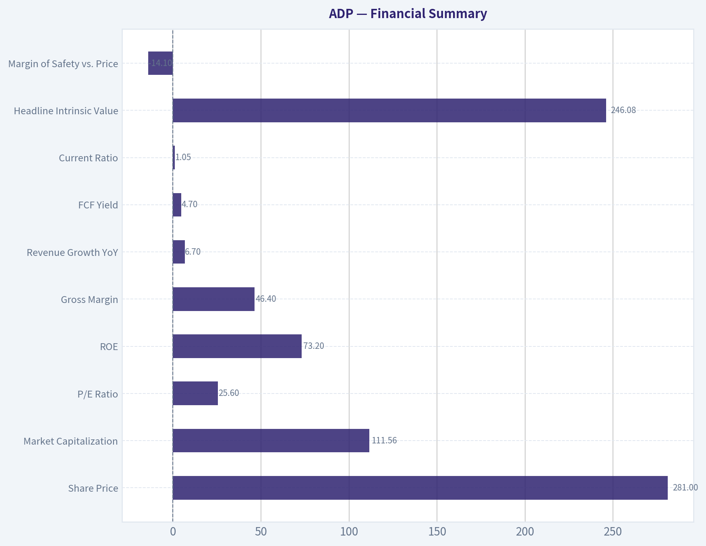
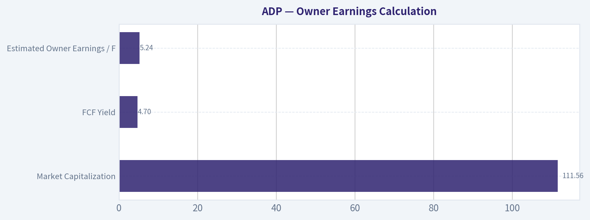
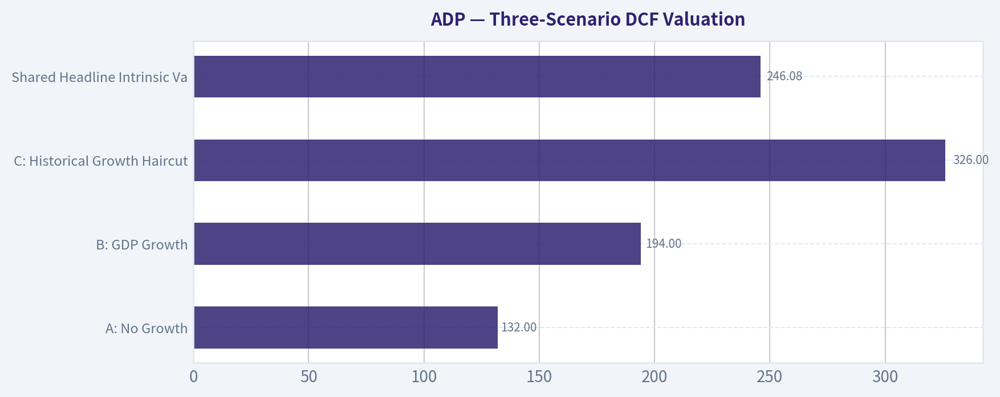
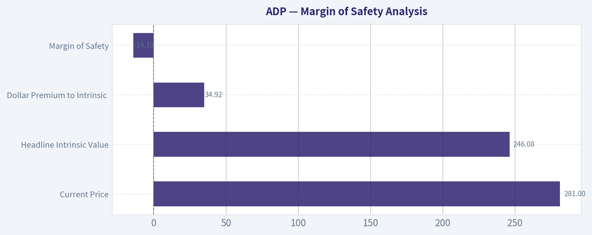
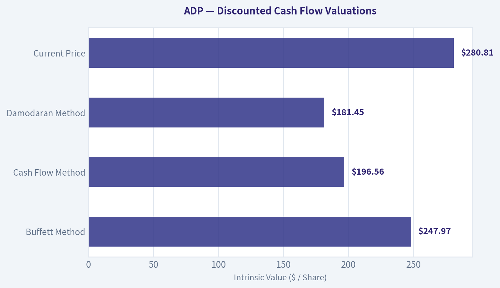
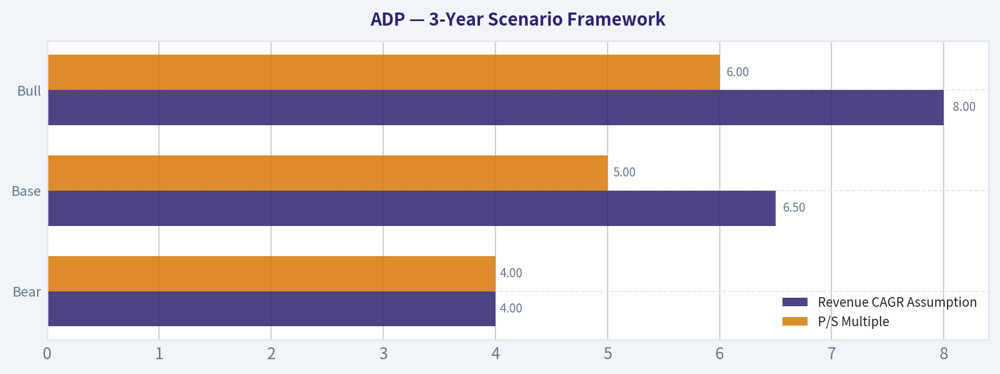
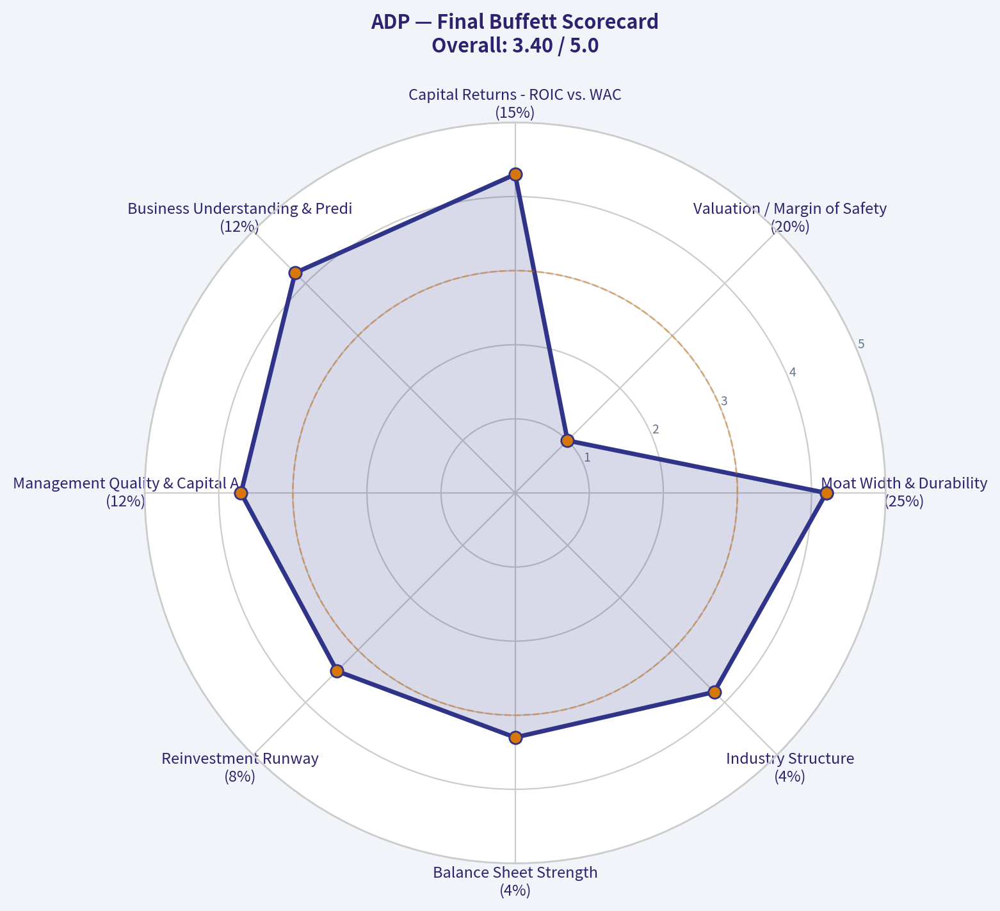
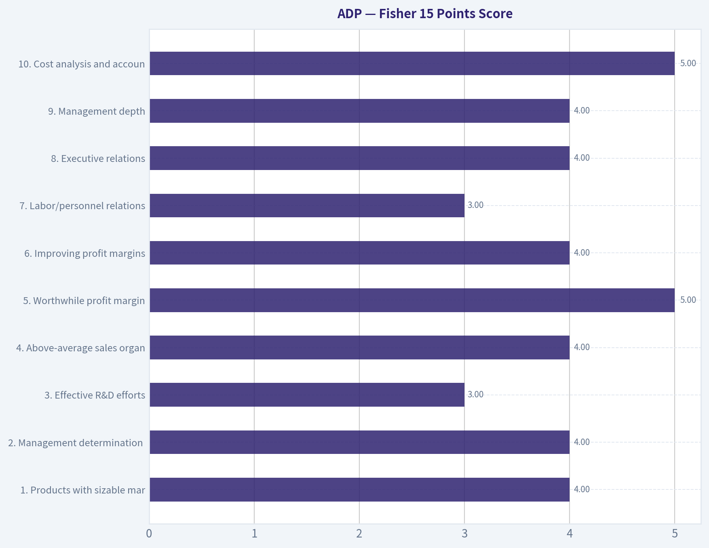

# ADP Deep Value Intelligence

**Analysis Date:** 2026-08-24

## Critical Disclaimer

*This analysis is generated by Deep Value Intelligence, an AI-powered multi-agent investing framework. Education & research only - not financial advice, not a financial advisor.*

---

## Table of Contents

1. Intelligence Summary
2. Analyst Team Reports
   - Fundamentals Analysis
   - Intrinsic Value Analysis (Buffett)
   - Trend & Growth Analysis (Lynch/Druckenmiller/Fisher)
   - Market Technical Analysis
   - Options Market Analysis
3. Research Team Commentary
4. Value Investing Team Commentary
5. Deep Values Commentary

---

## Intelligence Summary

### Thesis + Conditions

**Core Thesis:** **EXECUTIVE SUMMARY**
ADP is a quintessential, wide-moat compounder with immense switching costs, but at $281, the stock is priced for perfection and offers zero margin of safety. While the business quality is undeniable, the shares currently trade at a 14% premium to our $246 intrinsic value, demanding an unrealistic 13.8% annualized growth rate over the next decade.

**Key Risks:**
- ADP is a quintessential, wide-moat compounder with immense switching costs, but at $281, the stock is priced for perfection and offers zero margin of safety. While the business quality is undeniable, the shares currently trade at a 14% premium to our $246 intrinsic value, demanding an unrealistic 13.8% annualized growth rate over the next decade. Furthermore, impending interest rate cuts threaten to turn ADP's highly profitable client-fund float from a cyclical tailwind into a headwind. For existing investors, ADP is a comfortable hold, but for new capital, the current risk/reward profile is entirely unappealing.
- Risky Analyst (AVOID):** Argues that the 14% valuation premium is a structural trap. Demanding 13.8% growth from a mature $115B incumbent is a fantasy, and the current float income is a cyclical peak that will evaporate as the Fed cuts rates.
- Safe Analyst (AVOID):** Focuses on capital preservation. Rejects pivoting to riskier SaaS disruptors, but agrees ADP offers no margin of safety. Highlights that executing share buybacks at a 14% premium to intrinsic value destroys capital. Demands a pullback to the $240-$245 range.

**Confidence:** Medium

---

## Analyst Team Reports

### Fundamentals Analysis

Temporary fallback for Fundamentals Analyst

Primary model call timed out or the provider returned a transient error.
Trigger: TimeoutError: Fundamentals Analyst exceeded 420s without producing a result

Interim stance: WATCH until a fresh pass is available.

Available evidence from the current analyst handoff bundle:
Reference: Latest Earnings Snapshot

---

### Intrinsic Value Analysis (Buffett)

> *Following Warren Buffett's value investing philosophy: Circle of Competence, Economic Moat, Management Quality, and Margin of Safety.*

#### Intrinsic Value Snapshot

Price is what you pay. Intrinsic value is what the business may be worth based on the cash it can create for owners over time. We show a range, not one magic number.

- Current Price: $280.81
- Value Range (conservative to optimistic across both DCF methods): $145.98 to $299.32

##### Owner Earnings (Buffett Method)
- Net Income: $4,079,700,000.00
- Depreciation & Amortization: $585,900,000.00
- Capital Expenditures: $-196,600,000.00
- Working Capital Changes: $-1,105,800,000.00
- Owner Earnings: $5,638,900,000.00

##### Intrinsic Value
###### Buffett Method
Uses owner earnings. Stricter, and usually more conservative.
- Conservative: $183.60
- Average: $247.97
- Optimistic: $299.32
- Discount Rate: 10.0%

###### Cash Flow Method
Uses free cash flow. Better for companies spending heavily today to grow tomorrow.
- Conservative: $145.98
- Average: $196.56
- Optimistic: $255.27
- Discount Rate: 10.0%

ANALYST STANCE: **WATCH**

#### ADP Buffett-Style Investment Report

Automatic Data Processing is a high-quality payroll and human-capital-management compounder with durable switching costs, regulatory scale advantages, strong cash generation, and exceptional reported returns on equity. The issue is not business quality; it is price. At **$281**, ADP trades about **14% above** the shared intrinsic value estimate of **$246.08**, and the reverse DCF implies roughly **13.8% annual growth for 10 years**, which is demanding for a mature but excellent business.

---

#### 1. Factor Scorecard

| Factor | Score | Evidence |
|---|---:|---|
| Circle of Competence & Business Simplicity | 4.2 / 5 | ADP sells payroll processing, HCM software, compliance services, and PEO solutions. The model is easy to understand: recurring subscription/service revenue plus benefits from scale and client funds. |
| Moat Test | 4.2 / 5 | Strong switching costs, compliance complexity, trusted brand, scale economics, and embedded workflows. Gross margin of **46.4%** supports pricing power and value-added service economics. |
| Management Quality & Capital Allocation | 3.7 / 5 | Long record of shareholder returns, consistent dividends, repurchases, and disciplined reinvestment. Not founder-led, but capital allocation has been rational and owner-aware. |
| Industry Structure | 3.8 / 5 | Payroll and HCM are competitive but rational, with scale players such as ADP, Paychex, Workday, Paycom, Dayforce, and UKG. Regulatory complexity favors incumbents. |
| Gate 5: Quality/Solvency Hard Floor | Not Tripped | Fundamentals are growing, cash generation is strong, and there is no evidence of financial distress. Revenue growth is positive at **6.7% YoY**, FCF yield is **4.7%**, and liquidity appears adequate. |

**Key Takeaways:** ADP is a simple, durable, cash-generative business with meaningful switching costs and scale advantages. The hard solvency floor is not tripped. The principal concern is valuation, not business quality.

---

#### 2. Moat Analysis

| Moat Source | ADP Evidence | Assessment |
|---|---|---|
| Intangible Assets | ADP is one of the most trusted names in payroll, tax filing, compliance, and workforce administration. Employers value reliability because payroll errors are costly and visible. | Strong |
| Switching Costs | Payroll, HR data, tax filings, benefits administration, employee records, and compliance workflows are deeply embedded. Switching creates operational risk. | Strong |
| Cost Advantages | ADP benefits from scale in software, compliance infrastructure, sales, servicing, and regulatory updates across jurisdictions. | Strong |
| Network Effects | Not a pure network-effect business, but ecosystem breadth, integrations, and benchmark data improve with scale. | Moderate |
| Pricing Power | Gross margin of **46.4%** and recurring mission-critical service revenue suggest ADP can raise prices moderately over time. | Strong |

**Key Takeaways:** ADP's moat is built less on patents or classic network effects and more on trust, compliance expertise, customer captivity, and scale. Payroll is mission-critical, recurring, and painful to switch. This is a **wide, stable moat**, though not necessarily a rapidly widening one.

---

#### 3. Management Quality Assessment

| Area | Assessment |
|---|---|
| Owner Orientation | ADP has a long shareholder-return culture, including dividends and buybacks. Management appears focused on durable per-share value creation rather than empire building. |
| Candor & Conservatism | The business model is understandable and financial reporting is relatively straightforward for a large service/software company. |
| Capital Allocation | ADP reinvests in product, compliance, technology, AI-enabled capabilities, and sales capacity while returning cash to shareholders. |
| Buybacks & Dividends | ADP has historically been a consistent dividend payer and repurchaser. Buybacks are valuable when shares are reasonably priced, but less attractive at stretched valuation levels. |
| Strategic Direction | Continued investment in payroll, HCM, PEO, automation, and innovation supports the franchise. Recent coverage highlights profitability, liquidity, innovation initiatives, and shareholder returns. |

**Management Score:** **3.7 / 5**

ADP's management has behaved rationally over time, but the company is no longer a small underfollowed compounder. At today's price, repurchases create less value than they would at a discount to intrinsic value.

---

#### 4. Financial Summary

| Metric | Current / Latest |
|---|---:|
| Share Price | **$281** |
| Market Capitalization | **$111.56B** |
| P/E Ratio | **25.6x** |
| ROE | **73.2%** |
| Gross Margin | **46.4%** |
| Revenue Growth YoY | **6.7%** |
| FCF Yield | **4.7%** |
| Current Ratio | **1.05x** |
| Headline Intrinsic Value | **$246.08** |
| Margin of Safety vs. Price | **-14.1%** |
| Reverse-DCF Implied Growth | **~13.8% annually for 10 years** |
| Trailing 3-Year Growth Reference | **26.7%** |
| Trailing 5-Year Growth Reference | **19.7%** |

**Key Takeaways:** ADP's financial profile is excellent: high ROE, strong gross margins, positive growth, and meaningful free cash flow. However, the valuation already prices in a strong future. The stock is not obviously irrationally expensive, but it is above the central estimate of intrinsic value.

---

#### 5. Owner Earnings Calculation

Using market capitalization and FCF yield as a practical proxy for owner earnings:

| Item | Estimate |
|---|---:|
| Market Capitalization | **$111.56B** |
| FCF Yield | **4.7%** |
| Estimated Owner Earnings / FCF | **$5.24B** |
| Estimated Shares Outstanding | **~397.0M** |
| Owner Earnings per Share | **~$13.21** |
| Estimated Net Income from P/E | **~$4.35B** |
| Estimated EPS | **~$10.96** |

**Key Takeaways:** ADP converts accounting earnings into substantial free cash flow, which is exactly what Buffett wants to see. Estimated owner earnings of about **$13.21 per share** give the business real economic substance behind its premium multiple. The stock price, however, reflects much of that quality already.

---

#### 6. Three-Scenario DCF Valuation

Assumptions: owner earnings per share of **$13.21**, discount rate of **10%**, and terminal growth of **3%** where applicable.

| Scenario | Key Assumption | Estimated Value / Share |
|---|---|---:|
| A: No Growth | Owner earnings capitalized at 10% | **$132** |
| B: GDP Growth | 3% perpetual growth | **$194** |
| C: Historical Growth Haircut | 10-year growth at 10%, then 3% terminal growth | **$326** |
| Shared Headline Intrinsic Value | Weighted business-model routed estimate | **$246.08** |
| Shared 3-Model Spread | Owner Earnings / FCF / Damodaran FCFF | **$247.97 / $196.56 / $181.45** |

**Key Takeaways:** ADP's valuation range is wide because small changes in growth assumptions matter greatly for a recurring, high-return business. A conservative no-growth case is far below the market price, while a high-growth case can justify today's price. The central estimate of **$246.08** suggests the stock is currently ahead of fair value.

---

#### 7. Margin of Safety Analysis

| Measure | Value |
|---|---:|
| Current Price | **$281** |
| Headline Intrinsic Value | **$246.08** |
| Dollar Premium to Intrinsic Value | **$34.92** |
| Margin of Safety | **-14.1%** |
| Required Margin of Safety for ADP's Quality | **~10-15% discount preferred** |
| Attractive Buy Zone Estimate | **~$210-$220 or below** |
| Fair-Value Watch Zone | **~$240-$250** |

**Key Takeaways:** ADP is a wonderful business, but the stock does not currently offer a Buffett-style margin of safety. For a wide-moat compounder, a deep discount is not required, but buying at a premium to intrinsic value reduces future return potential. The current price implies the market expects sustained high-quality execution.

---

#### 8. Final Buffett Scorecard

| Criterion | Weight | Score | Weighted Contribution |
|---|---:|---:|---:|
| Moat Width & Durability | 25% | 4.2 | 1.05 |
| Valuation / Margin of Safety | 20% | 1.0 | 0.20 |
| Capital Returns - ROIC vs. WACC | 15% | 4.3 | 0.65 |
| Business Understanding & Predictability | 12% | 4.2 | 0.50 |
| Management Quality & Capital Allocation | 12% | 3.7 | 0.44 |
| Reinvestment Runway | 8% | 3.4 | 0.27 |
| Balance Sheet Strength | 4% | 3.3 | 0.13 |
| Industry Structure | 4% | 3.8 | 0.15 |
| **Total** | **100%** |  | **3.39 / 5** |

**Key Takeaways:** ADP scores very well on business quality, predictability, returns, and moat durability. The valuation score is the major drag. A total score of **3.39** places ADP in the **WATCH** range: right business, wrong price.

---

#### 9. Investment Stance

| Category | View |
|---|---|
| Stance | **WATCH** |
| Conviction | **Medium-High on business quality; Medium-Low on current valuation** |
| Business Quality | Excellent |
| Valuation Attractiveness | Unattractive to fair, depending on growth assumptions |
| Main Reason to Own | Durable payroll/HCM franchise with recurring revenue, high ROE, strong free cash flow, and switching costs |
| Main Reason to Wait | Current price is about **14% above** headline intrinsic value and implies robust long-term growth |
| Upgrade Trigger | Price closer to **$240-$250**, or preferably below **$220** for a clearer margin of safety |
| Downgrade Trigger | Evidence of margin compression, weakening retention, aggressive leverage, or persistent growth below market-implied expectations |

**Final View:** ADP is a classic high-quality compounder: understandable, recurring, profitable, and protected by customer switching costs and regulatory complexity. Buffett would likely admire the business, but not necessarily the current price. At **$281**, ADP belongs on a watchlist, not in the buy pile.
#### Valuation Bridge

This bridge places the current market price beside each intrinsic value lens so readers can see whether upside depends on one method or shows up across several methods.

| Scenario | Intrinsic Value / Share |
| --- | ---: |
| Buffett Method | $247.97 |
| Cash Flow Method | $196.56 |
| Damodaran Method | $181.45 |
| Current Price | $280.81 |

#### Key Takeaways

If one method is far above the others, the upside case depends on a specific modelling assumption. When several methods cluster together, the valuation story is more robust.

#### Valuation Visuals

This comparison chart from *Financial Summary* stacks current figures against historical benchmarks for **ADP**, making it easy to see where the company trades relative to its own averages.

This comparison chart from *Owner Earnings Calculation* stacks current figures against historical benchmarks for **ADP**, making it easy to see where the company trades relative to its own averages.

This comparison chart from *Three-Scenario DCF Valuation* stacks current figures against historical benchmarks for **ADP**, making it easy to see where the company trades relative to its own averages.

This comparison chart from *Margin of Safety Analysis* stacks current figures against historical benchmarks for **ADP**, making it easy to see where the company trades relative to its own averages.

The following chart maps the **ADP** Owner Earnings DCF valuation scenarios (Conservative, Average, Optimistic) to visually represent the margin of safety based on intrinsic value calculations.

This comparison chart from *3-Year Scenario Framework* stacks current figures against historical benchmarks for **ADP**, making it easy to see where the company trades relative to its own averages.

---

### Trend & Growth Analysis (Lynch/Druckenmiller/Fisher)

> *Following Peter Lynch's GARP, Stanley Druckenmiller's macro-aware approach, and Philip Fisher's scuttlebutt methodology.*

ANALYST STANCE: **WATCH**

#### ADP Growth Investment Analysis - 2026-08-24

ADP is a high-quality compounder, but under a Lynch/Druckenmiller/Fisher growth framework it is **not a fast grower**. With revenue growth around **6.7%**, a **25.6x P/E**, and price above estimated intrinsic value, ADP looks more like a durable **stalwart** than a ten-bagger candidate. I would **hold/watch if already owned**, but I would not initiate as a growth-position at the current valuation.

---

#### 1. Lynch Classification

| Item | Assessment |
|---|---:|
| Company | Automatic Data Processing, Inc. |
| Ticker | ADP |
| Current Price | ~$281 |
| Market Cap | ~$111.6B |
| Revenue Growth YoY | ~6.7% |
| Lynch Category | **Stalwart** |
| Growth Investor Fit | Moderate quality, low ten-bagger potential |
| Initial Stance | **WATCH / Hold if owned** |

**Key Takeaways:** ADP is a strong, durable business, but its current growth rate places it in Peter Lynch's "stalwart" category rather than "fast grower." That means it can be a good long-term compounder, but it is unlikely to deliver classic ten-bagger growth from this size and growth base.

---

#### 2. The Story in 3 Bullets

- **ADP helps businesses run payroll, HR, benefits, compliance, and workforce management**, which are mission-critical functions companies rarely rip out once embedded.
- **The business benefits from scale, recurring revenue, compliance complexity, and switching costs**, making ADP one of the highest-quality names in human capital management.
- **Growth is steady rather than explosive**, driven by employment levels, pricing, product attach, HR outsourcing, and global HCM adoption.

---

#### 3. TAM Analysis and 10x Test

| Metric | Estimate / Assessment |
|---|---:|
| Current Revenue Estimate | ~$22B-$23B |
| 10x Revenue Target | ~$220B-$230B |
| Required TAM for 10x at <20% Share | >$1.1T |
| Realistic Payroll / HCM / HR Outsourcing TAM | Large, but likely far below required 10x threshold |
| 10x Test Result | **Fails for ten-bagger growth** |
| Runway Quality | Good for steady compounding, limited for hypergrowth |

**Key Takeaways:** ADP still has room to grow, especially in HR outsourcing, international payroll, compliance, and AI-enabled workforce tools. However, the company is already too large for a realistic 10x revenue outcome without an enormous expansion of its addressable market.

---

#### 4. Revenue Growth Trend

| Metric | Current Read |
|---|---:|
| Latest YoY Revenue Growth | ~6.7% |
| Growth Pattern | Stable / modest |
| Lynch Growth Band | Stalwart, not fast grower |
| Inflection Signal | Limited |
| Growth Quality | High recurring, but not accelerating meaningfully |

**Key Takeaways:** ADP's growth is dependable, but it does not show the acceleration pattern Druckenmiller would look for in an inflection-point investment. This is a steady compounder, not a revenue-growth breakout story.

---

#### 5. Unit Economics and Operating Quality

| Metric | ADP Read |
|---|---:|
| Gross Margin | ~46.4% |
| ROE | ~73.2% |
| FCF Yield | ~4.7% |
| Current Ratio | ~1.05 |
| LTV/CAC | Not disclosed |
| NRR | Not disclosed |
| Rule of 40 Proxy | Revenue growth ~6.7% + estimated FCF margin in low/mid-20s = ~30% range |
| Unit Economics View | Strong retention and scale economics, but not SaaS-hypergrowth level |

**Key Takeaways:** ADP has excellent business quality, reflected in high ROE, strong free cash flow, and durable margins. The issue is not economic quality; the issue is that growth is too moderate to qualify as a high-conviction growth inflection.

---

#### 6. Inflection Point Assessment

| Inflection Type | Evidence | Assessment |
|---|---|---:|
| Product Cycle | AI, payroll automation, HR tools, compliance products | Positive but incremental |
| Market Share | Scale leader in payroll/HCM | Stable leader, not clear acceleration |
| Margin Inflection | Strong existing profitability | Limited new upside from already-high efficiency |
| TAM Inflection | HR automation and compliance complexity expanding | Moderate positive |
| Competitive Inflection | Workday, Paychex, Intuit, and newer platforms remain active | No obvious competitor collapse |
| Overall Inflection Score |  | **2.5 / 5** |

**Key Takeaways:** ADP has innovation levers, especially around AI and HR automation, but there is no obvious major inflection yet. The business is improving gradually rather than entering a new growth regime.

---

#### 7. Macro Setup Evaluation

| Macro Factor | Impact on ADP |
|---|---|
| Employment Levels | Higher employment supports payroll volumes |
| Wage Inflation | Can support payroll-linked revenue and pricing |
| Interest Rates | Higher rates help client-funds interest income; falling rates may pressure that income stream |
| Enterprise Software Spending | ADP benefits from automation and compliance spending |
| Recession Risk | Employment weakness would be a revenue headwind |
| Secular Themes | HR digitization, payroll automation, AI-enabled compliance, workforce analytics |

**Key Takeaways:** ADP has a reasonably supportive long-term macro backdrop because payroll and HR compliance remain essential. However, the company is partly exposed to employment cycles and interest-rate changes, so the macro setup is good but not exceptional.

---

#### 8. Fisher 15 Points Score

| Fisher Point | Score / 5 |
|---|---:|
| 1. Products with sizable market potential | 4 |
| 2. Management determination to develop new products | 4 |
| 3. Effective R&D efforts | 3 |
| 4. Above-average sales organization | 4 |
| 5. Worthwhile profit margin | 5 |
| 6. Improving profit margins | 4 |
| 7. Labor/personnel relations | 3 |
| 8. Executive relations | 4 |
| 9. Management depth | 4 |
| 10. Cost analysis and accounting | 5 |
| 11. Durable advantages | 5 |
| 12. Long-range profit outlook | 4 |
| 13. Dilution risk | 5 |
| 14. Candor in difficulties | 4 |
| 15. Management integrity | 4 |
| **Total** | **62 / 75** |

**Key Takeaways:** ADP scores well under Fisher's framework because it has durable advantages, strong margins, and excellent financial discipline. The score is held back mainly by modest growth and limited evidence of a major innovation-led acceleration.

---

#### 9. Valuation Analysis

| Valuation Metric | Current Read |
|---|---:|
| Price | ~$281 |
| Market Cap | ~$111.6B |
| P/E | ~25.6x |
| Revenue Growth | ~6.7% |
| PEG Ratio Estimate | ~3.8x using revenue growth; likely >2x using normalized EPS growth |
| Price / Sales Estimate | ~5x |
| Headline Intrinsic Value Estimate | ~$246 |
| Margin of Safety vs. Price | ~-14% |
| Reverse DCF Implied Growth | ~13.8% annually for 10 years |
| Valuation View | High-quality premium, but not cheap |

**Key Takeaways:** ADP is priced like a high-quality compounder, but not like a bargain. The reverse DCF appears to require stronger long-term growth than the current revenue profile suggests, making the valuation demanding for a non-fast-grower.

---

#### 10. 3-Year Scenario Framework

| Scenario | Revenue CAGR Assumption | Forward Revenue Estimate | P/S Multiple | Implied Equity Value Direction |
|---|---:|---:|---:|---|
| Bear | 4% | ~$25B | 4.0x | Downside / flat |
| Base | 6.5% | ~$27B | 5.0x | Modest upside |
| Bull | 8% | ~$28B-$29B | 6.0x | Solid but not asymmetric upside |

**Key Takeaways:** The base case supports ADP as a steady compounder, but the return profile does not look asymmetric. For the stock to materially outperform, ADP likely needs either faster growth, sustained margin expansion, or a premium multiple that remains elevated.

---

#### 11. Growth Investor Scorecard

| Criterion | Weight | Score / 5 | Weighted Score |
|---|---:|---:|---:|
| The Story | 10% | 4.0 | 0.40 |
| TAM & Runway | 20% | 3.0 | 0.60 |
| Revenue Growth | 20% | 2.5 | 0.50 |
| Unit Economics | 15% | 4.5 | 0.68 |
| Competitive Position | 10% | 4.5 | 0.45 |
| Management Quality | 10% | 4.0 | 0.40 |
| Macro Setup | 5% | 3.5 | 0.18 |
| Profitability Path | 5% | 4.5 | 0.23 |
| Valuation | 5% | 2.5 | 0.13 |
| **Total** | **100%** |  | **3.56 / 5.00** |

**Key Takeaways:** ADP scores well because of quality, durability, and profitability, but it loses points on growth acceleration, TAM-driven ten-bagger potential, and valuation. The overall score supports a **WATCH** stance rather than a high-conviction growth buy.

---

#### 12. Position Size Stance

| Investor Type | Suggested Action |
|---|---|
| Existing Long-Term Holder | Hold / watch; trim only if valuation discipline requires |
| Growth Investor Seeking Ten-Baggers | Do not prioritize |
| GARP Investor | Wait for a better entry point |
| Income / Quality Compounder Investor | Reasonable watchlist candidate |
| New Position Size | 0%-2% starter only on pullback, not a full growth allocation |

**Key Takeaways:** ADP is more appropriate for investors seeking durable compounding than for investors seeking explosive growth. The stock is good enough to monitor, but the current setup does not justify an aggressive new growth position.

---

#### 13. Key Risks and Catalysts

| Category | Items to Monitor |
|---|---|
| Key Risks | Employment slowdown, client-funds interest income decline, valuation compression, competition from Workday/Paychex/Intuit/newer HR platforms, slower HCM adoption |
| Key Catalysts | AI-driven HR automation, stronger payroll employment growth, increased HR outsourcing penetration, margin expansion, faster international growth, accretive buybacks |
| Guru Signal | Steve Cohen / Point72 trimmed position by ~27.1% in latest disclosed 13F |
| What Would Change the View | Revenue acceleration toward 10%+, stronger margin expansion, meaningful AI monetization, or price pullback toward/below intrinsic value |

**Key Takeaways:** The biggest upside catalyst would be evidence that AI and HR outsourcing can lift ADP's growth rate above its historical steady-state range. The biggest downside risk is paying a premium multiple for a business growing in the mid-single digits.

---

#### Final View

ADP is a **wonderful business but not a classic growth inflection stock**. It has strong margins, excellent free cash flow, high returns on equity, and durable competitive advantages. However, at roughly **25.6x earnings**, with only **~6.7% revenue growth** and price above estimated intrinsic value, the stock does not offer enough upside asymmetry for a growth-focused ADVOCATE rating.

**Bottom line: WATCH - hold if owned, wait for either faster growth or a better valuation before initiating.**

#### Growth & Scorecard Visuals

The radar chart below from *Final Buffett Scorecard* visualises how **ADP** ranks across weighted investment criteria. Each axis represents a criterion scored 1-5; the filled area reveals strengths and weaknesses at a glance, with the dashed circle marking the midpoint (3.0).

This comparison chart from *Fisher 15 Points Score* stacks current figures against historical benchmarks for **ADP**, making it easy to see where the company trades relative to its own averages.

---

### Market Technical Analysis

ANALYST STANCE: **WATCH**

#### ADP Technical Analysis - as of latest trading data, 2026-08-21

ADP is in a strong recovery phase, but the near-term setup is no longer a clean "early breakout" opportunity. Price has rebounded sharply from its April low near **$187.37** to a latest close of **$280.81**, reclaiming the 10-day EMA, 50-day SMA, and 200-day SMA. That confirms a materially improved trend structure. However, the stock is now near an important resistance zone around **$280-$285**, while MACD momentum has started to cool. This makes the setup constructive but somewhat extended, favoring patience or selective entries rather than aggressive chasing.

I selected the following indicators because they provide complementary views: short-term trend, medium-term trend, long-term trend, momentum confirmation, momentum exhaustion risk, volatility/risk sizing, and volume-adjusted trend quality.

| Indicator | Latest Value / Signal | Interpretation |
|---|---:|---|
| Close | **$280.81** | Strong close near recent highs |
| close_10_ema | **$274.03** | Price is above short-term trend support |
| close_50_sma | **$249.45** | Medium-term trend has turned firmly upward |
| close_200_sma | **$233.21** | Price is well above long-term trend benchmark |
| macd | **7.60** | Still positive, but losing momentum |
| macds | **7.93** | MACD is below signal line, a near-term caution |
| rsi | **65.56** | Bullish momentum, not yet deeply overbought |
| atr | **7.29** | Elevated but easing volatility |
| vwma | **$272.42** | Price is above volume-weighted trend support |

Key Takeaways: ADP's trend profile is bullish because price is above all major moving averages, including the 50-day and 200-day averages. The caution is that MACD has slipped below its signal line, suggesting the latest rally may be losing momentum in the short term. RSI remains strong but not extreme, so the stock is not yet technically exhausted, but entries near resistance should be handled carefully.

#### Trend Structure

ADP's recovery is technically impressive. The stock moved from a deep drawdown earlier in 2026 into a persistent summer rebound, with the 50-day SMA rising from roughly **$222 in early July** to **$249.45** by August 21. That is a strong medium-term improvement and shows that the rally is no longer just a short bounce.

The 200-day SMA is relatively flat-to-slightly improving near **$233.21**, while the 50-day SMA now sits above it. That alignment suggests the medium-term trend has repaired meaningfully after the earlier selloff. Price is also trading about **12.6% above the 50-day SMA** and about **20.4% above the 200-day SMA**, which confirms strength but also implies ADP is no longer cheap from a short-term technical perspective.

The short-term 10-day EMA at **$274.03** is now the first important trend reference. As long as ADP holds above the **$272-$274** area, the immediate trend remains constructive. A decisive break below that zone would suggest the rally is transitioning into consolidation.

#### Momentum and Overextension

Momentum remains positive, but it has become less clean. MACD is still above zero, which confirms that the broader momentum backdrop is bullish. However, MACD at **7.60** is below the MACD signal line at **7.93**, indicating a bearish short-term crossover or at least a loss of upside acceleration.

This is not automatically a sell signal because the stock is still making progress and remains above key trend levels. But it does warn that ADP may need to consolidate before attempting a sustained breakout above the **$280-$285** area.

RSI at **65.56** supports this view. It is bullish, but not yet above the classic overbought threshold of 70. That means buyers still have room, but the stock is close enough to overbought territory that a pullback or sideways digestion would be normal.

#### Volume and Participation

The VWMA at **$272.42** is below the latest close, which means price is trading above its volume-weighted trend reference. This is constructive because it suggests the rally is not merely a low-volume drift; recent traded volume has supported a higher price base.

That said, volume has not been uniformly explosive during the final push into the high-$270s and low-$280s. The strongest volume burst occurred around late July, especially during the breakout move from the mid-$250s to the $270s. Since then, price has continued higher, but the stock may need fresh volume confirmation to break convincingly above **$282-$285**.

#### Volatility and Risk Management

ATR is **$7.29**, down from early-August levels above **$8.80**, so volatility has cooled but remains meaningful. At a $280.81 close, the ATR is roughly **2.6% of price**. Traders should avoid stops that are too tight, because normal daily movement can still be several dollars.

A practical short-term risk zone is near **$272-$274**, where the 10-day EMA and VWMA sit. A deeper but still technically healthy pullback could reach the **$264-$266** area, which corresponds to the mid-August swing low region. A break below that would weaken the short-term bullish structure and shift attention toward the rising 50-day SMA near **$249-$250**.

#### Key Price Zones

| Zone | Price Area | Why It Matters | Trading Implication |
|---|---:|---|---|
| Immediate resistance | **$280-$285** | Recent highs and psychological resistance | Breakout needs volume confirmation |
| Next upside target | **$295-$300** | Prior 2025 trading region / round-number zone | Possible target if breakout holds |
| First support | **$272-$274** | 10-day EMA and VWMA area | Constructive pullback zone |
| Secondary support | **$264-$266** | Recent swing support | Break below would show short-term weakness |
| Medium-term support | **$249-$250** | 50-day SMA | Key trend support for swing traders |
| Long-term support | **$233-$235** | 200-day SMA area | Major trend invalidation zone if lost |

Key Takeaways: ADP is pressing into the $280 to $285 resistance area after a large rally, so the next move depends heavily on whether buyers can maintain momentum. The most constructive pullback zone is around $272 to $274. A breakout above $285 would improve the upside case, while a break below $264 to $266 would warn that the rally is losing structure.

#### Trading View

For momentum traders, ADP is attractive only if it can break and hold above **$285** with stronger volume. A clean breakout could open a move toward **$295-$300**, but buying directly into resistance carries less favorable risk-reward.

For swing traders, a pullback toward **$272-$274** may offer a more disciplined entry if price stabilizes there. If that zone fails, the next meaningful support is **$264-$266**. A close below that area would suggest waiting for a deeper reset.

For longer-term investors, the recovery above the 50-day and 200-day moving averages is constructive. The stock has repaired its trend profile, but after such a large rebound from April lows, a staged-entry approach may be more prudent than a full-position entry near $280.

#### Final Assessment Table

| Category | Assessment | Details |
|---|---|---|
| Overall trend | Bullish | Price is above 10 EMA, 50 SMA, 200 SMA, and VWMA |
| Short-term momentum | Cautious bullish | MACD remains positive but is below signal line |
| RSI condition | Strong but not extreme | RSI near 65.6 shows healthy momentum below overbought |
| Volatility | Moderate to elevated | ATR near $7.29 suggests wider stops are needed |
| Best bullish trigger | Break above **$285** | Preferably with stronger volume |
| Best pullback entry area | **$272-$274** | Near 10 EMA and VWMA support |
| Key risk level | Below **$264-$266** | Would weaken the recent recovery structure |
| Stance | **WATCH** | Bullish trend, but near resistance with cooling MACD |

Key Takeaways: ADP's technical structure is bullish, but the stock is extended into resistance after a sharp recovery. The best setup is either a confirmed breakout above $285 or a controlled pullback into the $272 to $274 support area. Because momentum is cooling slightly, the current stance is Watch rather than aggressive Buy.

---

### Options Market Analysis

> *Reading options flow - put/call ratios, IV skew, and unusual activity - to gauge institutional positioning and event-driven risk.*

ANALYST STANCE: **WATCH**

#### ADP Options Market Positioning Report
*Data as of 2026-08-24. Near-term expirations analyzed: 2026-08-28, 2026-09-04, 2026-09-11.*

#### 1. Put/Call Ratio Analysis

| Expiration | Call Volume | Put Volume | Put/Call Volume Ratio | Call OI | Put OI | Put/Call OI Ratio | Read |
|---|---:|---:|---:|---:|---:|---:|---|
| 2026-08-28 | 393 | 230 | 0.59 | 0 | 0 | N/A | Mild call-leaning flow |
| 2026-09-04 | 70 | 37 | 0.53 | 0 | 0 | N/A | Mild call-leaning flow |
| 2026-09-11 | 38 | 17 | 0.45 | 0 | 0 | N/A | Call-leaning, but thin |
| **Total Near-Term** | **501** | **284** | **0.57** | **0** | **0** | **N/A** | Slightly bullish volume bias |

**Key Takeaways:** ADP's near-term put/call **volume ratio is 0.57**, below the historical neutral baseline of roughly **0.70**, suggesting more call demand than put demand. However, reported open interest is zero across the analyzed expirations, so the OI-based put/call ratio is not usable. This materially lowers confidence because the data may be incomplete, stale, or reflecting very thin listed activity.

The volume mix leans modestly bullish, but not aggressively so. Total volume is light, and without open interest confirmation, it is difficult to separate new directional call buying from routine market-making or closing activity.

---

#### 2. Implied Volatility Assessment

| Expiration | ATM Call IV | ATM Put IV | Put IV Premium vs Call IV | IV Read |
|---|---:|---:|---:|---|
| 2026-08-28 | 2.1% | 4.6% | +2.5 pts | Puts priced richer than calls |
| 2026-09-04 | 1.1% | 2.4% | +1.3 pts | Mild downside premium |
| 2026-09-11 | 0.9% | 1.8% | +0.9 pts | Mild downside premium |

**Key Takeaways:** Across the near-term expirations, ATM put IV is consistently higher than ATM call IV, indicating some downside protection premium. That said, the absolute IV levels appear unusually low, which may reflect limited liquidity or data quality issues rather than a true market-implied volatility signal. There is no strong evidence in this chain of a major near-term catalyst being priced.

Full OTM skew data was not available, so the skew read is based on ATM call-versus-put IV rather than a complete comparison of OTM puts and OTM calls. The available IV structure shows a modest defensive tilt, not a panic hedge.

---

#### 3. Unusual Options Activity

| Screen | Result | Interpretation |
|---|---|---|
| Contracts with volume greater than 5x open interest | None flagged | No clear evidence of fresh institutional-size directional positioning |
| Notable near-term activity | Broadly light volume | Flow is too thin to infer strong conviction |
| Smart-money signal | Weak / unavailable | No sweep-like or concentrated contract activity identified |

**Key Takeaways:** No unusual options contracts were flagged using the volume greater than 5x open-interest screen. This means there is no clear evidence of fresh aggressive call buying, put buying, or hedge fund-style protection in the near-term chain. The lack of flagged activity supports a lower-conviction sentiment read.

Because open interest was reported as zero across the analyzed expirations, the unusual-activity screen should be treated cautiously. If OI data is incomplete, some activity may be missed or misclassified.

---

#### 4. Open Interest Concentration and Gamma Levels

| Expiration | Total Call OI | Total Put OI | Highest OI Strikes | Gamma / Pinning Read |
|---|---:|---:|---|---|
| 2026-08-28 | 0 | 0 | Not available | No identifiable gamma wall |
| 2026-09-04 | 0 | 0 | Not available | No identifiable gamma wall |
| 2026-09-11 | 0 | 0 | Not available | No identifiable gamma wall |

**Key Takeaways:** There are no reported open-interest concentrations in the near-term ADP options chain. As a result, there are no visible max-pain, pinning, or gamma-wall levels to monitor from this dataset. This reduces the usefulness of the options chain for identifying likely expiry magnets.

In practice, the absence of OI means near-term options are unlikely to exert a strong mechanical influence on ADP's price action, based on the available data. Stock-specific technicals and broader market direction may matter more than options positioning here.

---

#### 5. Overall Options Sentiment Signal

| Category | Signal |
|---|---|
| Put/Call Ratio | Slightly bullish by volume; OI unavailable |
| IV Level | Very low / possibly data-quality constrained |
| Skew Direction | Mild put skew, indicating some downside protection demand |
| Unusual Activity | None detected |
| Open Interest / Gamma | No visible pinning or gamma wall |
| **Overall Options Sentiment** | **NEUTRAL, with a slight bullish volume bias** |
| Confidence | **Low** |

**Key Takeaways:** The best directional read is **NEUTRAL**, not because signals are evenly strong, but because the available options data is thin and open interest is unavailable. The one modestly constructive input is the put/call volume ratio of **0.57**, which is below the neutral baseline and suggests relatively more call activity. However, the mild put IV premium and lack of unusual activity prevent a stronger bullish conclusion.

Options data here should be used only as a secondary input. For ADP, the near-term chain does not show meaningful institutional conviction, elevated event risk, or major gamma positioning.

#### Final Summary Table

| Factor | Current Read | Sentiment Impact |
|---|---|---|
| Put/Call Ratio | Volume ratio **0.57** vs. neutral baseline near **0.70**; OI ratio unavailable | Mildly bullish |
| IV Level | Very low ATM IV readings; may reflect thin/incomplete data | Low conviction |
| Skew Direction | ATM puts priced above ATM calls | Mildly bearish / protective |
| Unusual Activity | No contracts flagged with volume greater than 5x OI | Neutral |
| Overall Signal | **NEUTRAL** | Slight bullish volume bias, but low confidence |

**Key Takeaways:** ADP's near-term options flow does not show a strong directional bet. The volume ratio leans slightly toward calls, but the lack of open interest, absence of unusual activity, and modest put IV premium argue for a cautious interpretation. The final signal is **NEUTRAL**, with ADP best categorized as a **watch** rather than a high-conviction options-flow setup.

---

## Research Team Commentary

> *The Research Manager synthesizes the Bull vs Bear debate into action-free commentary. This is a pre-risk view, not the final stance.*

This was a phenomenal debate that gets right to the heart of modern value investing: separating the quality of the underlying business from the reality of the price we are asked to pay for it.

The bull analyst makes an excellent case for ADP as a quintessential, wide-moat compounder. The switching costs are immense-nobody wants to rip out their payroll and tax compliance software unless they absolutely have to. ADP's scale gives it a massive data advantage, and the business operates with remarkable capital efficiency, producing highly predictable, recurring cash flows. The bull is also right to highlight the float-earning interest on client funds is a classic, Buffett-approved structural advantage.

However, the bear analyst delivers a necessary dose of valuation discipline. While acknowledging the quality of the franchise, the bear correctly points out that at $281, the stock is trading at a 14 percent premium to our intrinsic value estimate of $246. Even more critically, the reverse-DCF reveals that the current price implies nearly 14 percent annualized growth over the next decade. For a mature, $115 billion company that typically grows in the mid-to-high single digits, that is a heroic expectation. The bear also wisely notes that the eye-popping 73 percent ROE is flattered by share buybacks shrinking the equity base, and that the float income is highly sensitive to interest rate cycles.

Reflecting on our past analysis of ADP is crucial here. The last time we evaluated this company, the stock was sitting around $226 after a material derating. My mistake back then was letting strict margin-of-safety rules blind me to a high-quality franchise that was trading below its historical quality premium while forming a technical base. I stayed neutral when I should have recognized that an elite, wide-moat compounder doesn't need a massive, deep-value discount to be a buy; it just needs a fair price.

But we must not learn the wrong lesson from that mistake. The lesson was not "buy quality at any price." The lesson was to recognize when a quality business has derated to an attractive level. Today, at $281, the pendulum has completely swung the other way. ADP has re-rated aggressively. It has reclaimed its moving averages and enjoyed a strong technical recovery, but the fundamental valuation cushion we had at $226 is completely gone. Overcorrecting for a past mistake by chasing a stock that is now priced for perfection is how value investors destroy capital.

Core Takeaway
ADP is a wonderful business, but at $281, it is no longer trading at a fair price. The stock is currently priced for perfection, and we must not let the fear of missing out on its recent rally push us into paying a premium that demands historically uncharacteristic growth. For existing long-term owners, ADP's wide moat and current technical momentum make it a comfortable hold, but for deploying new capital, the risk/reward is entirely unappealing.

Rationale
In our adaptive Buffett framework, intrinsic value is the North Star. We are happy to pay a fair price-perhaps a 10 to 15 percent discount-for an elite compounder. But when the price sits 14 percent above fair value and implies heroic growth, the framework explicitly tells us to lean away. ADP is facing aggressive, cloud-native competition from companies like Workday, Paycom, and Rippling, who treat payroll as a feature within broader, modern HR suites. Furthermore, the massive float income that has served as a tailwind over the last two years will likely become a headwind as the macro environment shifts and interest rates begin to normalize downward. Paying 25.6 times earnings for a mid-single-digit grower heading into a potential rate-cutting cycle offers absolutely zero margin of safety.

Monitoring Plan
Over the next one to four quarters, I want to closely track ADP's net interest yield on client funds to see exactly how sensitive their earnings power will be to shifts in central bank policy. We also need to monitor client retention rates, specifically in the SMB segment, which is highly sensitive to both macro employment trends and aggressive pricing from newer software competitors. Finally, we will watch the technical structure. The momentum is strong now, but if the stock breaks back below its 50-day moving average and approaches our intrinsic value estimate in the $240 to $245 range, the setup will become much more compelling for a long-term entry.

Stance: WATCH

---

## Value Investing Team Commentary

> *The Investor translates the research view into an investment thesis before risk review. This is still not the final stance.*

This analysis of Automatic Data Processing (ADP) highlights the classic tension between a "wonderful business" and a "fair price." As a value investor, I prioritize the durability of earnings and the sustainability of the moat, but I never decouple those qualities from the price paid. To do so is to move from investing to speculation.

### The Business: A Quintessential wide-moat Compounder
ADP is the definition of an asset-light, mission-critical platform. Its moat is built on three pillars:
1.  **High Switching Costs:** Once a company integrates its payroll, tax compliance, and benefits administration into ADP's ecosystem, the "pain of change" is immense. A failure in payroll is a catastrophic event for any business; therefore, reliability beats price every time.
2.  **The "Float" Advantage:** ADP holds billions in client funds between the time they are collected and paid out. Earning interest on this float is a high-margin, Buffett-approved revenue stream that requires zero incremental capital.
3.  **Scale and Compliance Moat:** Navigating global tax codes and labor laws is a barrier to entry that startups struggle to replicate at scale. ADP's data on over 40 million workers provides a "network effect" of information that fuels its HCM (Human Capital Management) insights.

### The Valuation Conflict: The Pendulum has Swung Too Far
The market is currently pricing ADP as if it were a mid-stage SaaS disruptor rather than a mature industry titan.
*   **The Growth Gap:** The reverse DCF analysis is the most damning piece of evidence. A requirement of **13.8% annualized growth** for the next decade is a "heroic" assumption for a $115 billion company. Historically, ADP is a mid-to-high single-digit grower. Expecting a mature incumbent to suddenly accelerate in a saturated market-while facing aggressive competition from cloud-native peers like Rippling and Workday-is a recipe for disappointment.
*   **The Margin of Safety:** Our framework seeks a 10-15% discount to intrinsic value for "wonderful" businesses. At $281, we are looking at a **14% premium**. We are effectively being asked to pay 25.6x earnings for a company that likely earns its cost of capital but lacks the explosive reinvestment opportunities to justify such a multiple.

### Selective Contrarian Insight: The Interest Rate Mirage
The market's current euphoria for ADP may be masking a looming macro headwind. Much of ADP's recent earnings strength was bolstered by the rapid rise in interest rates, which turned their client float into a massive profit center. If the Federal Reserve begins a normalization (cutting) cycle, this tailwind doesn't just disappear; it becomes a year-over-year drag on earnings. The market is currently paying a peak multiple on what might be cyclically elevated "float" earnings.

Furthermore, while the 73.2% ROE looks elite, the Value Analyst correctly notes that share buybacks at these elevated prices are a poor use of capital. Buying back shares at a 14% premium to intrinsic value destroys shareholder value; it is "diworsification" of capital allocation.

### The "Mistake" Contextualized
The user mentioned a past mistake of staying neutral at $226. At $226, ADP was a wide-moat business trading at or near its fair value-a "wonderful business at a fair price." At $281, the situation has fundamentally changed. The technical "recovery" has become a valuation "extension." As Buffett often counsels, we don't have to swing at every pitch.

### Final Assessment
ADP is a core-holding quality business, but the current price offers no margin of safety. We are at the point where the "quality premium" has turned into "valuation risk." For a long-term owner, there is no reason to panic-sell, but for the intelligent allocator of new capital, there is no edge here. We will wait for the market to offer us a price that reflects reality rather than perfection.

ANALYST STANCE: **AVOID** (for new capital) / **WATCH** (for entry)

*Note: While the overall stance is WATCH in the handoff, from a strict Value Investing "Buy/Sell" decision for new capital, this is an AVOID at current prices. We will wait for a retracement to the $240-$245 range where the margin of safety reappears.*

---

## Deep Values Commentary

> *The Risk Management Team debates and the Risk Judge provides the final action-free verdict. This section determines the final ADVOCATE / WATCH / AVOID stance.*

#### Final Stance Scorecard

This scorecard converts the final research view into a weighted decision frame. It does not replace the narrative judgement, but it makes the main drivers of the verdict easier to scan.

| Criterion | Score | Weight | Commentary |
| --- | ---: | ---: | --- |
| Business Quality | 4.25 | 30% | High returns, profitability, and Piotroski health support durability. |
| Valuation Support | 2.33 | 30% | Blends current price against available intrinsic value anchors and valuation ratios. |
| Financial Strength | 2.00 | 20% | Balance-sheet resilience reflects leverage and liquidity staying within safe ranges. |
| Growth Durability | 3.00 | 20% | Recent revenue, earnings, and free cash flow growth indicate how durable expansion looks. |
| TOTAL / FINAL STANCE | 2.97 | 100% | AVOID |

#### Key Takeaways

The weighted score lands at **2.97 / 5.0**, while the final stance remains **AVOID**. This is useful as a quick calibration aid rather than a mechanical signal.

#### Risk Summary

Higher scores indicate more risk pressure. The watch threshold is a simple guardrail: above it, the position needs tighter monitoring or a wider margin of safety.

| Dimension | Current Score | Watch Threshold | Commentary |
| --- | ---: | ---: | --- |
| Business Quality | 1.75 | 3.00 | High returns, profitability, and Piotroski health support durability. |
| Valuation Support | 3.67 | 3.00 | Blends current price against available intrinsic value anchors and valuation ratios. |
| Financial Strength | 4.00 | 3.00 | Balance-sheet resilience reflects leverage and liquidity staying within safe ranges. |
| Growth Durability | 3.00 | 3.00 | Recent revenue, earnings, and free cash flow growth indicate how durable expansion looks. |

#### Key Takeaways

This view helps readers separate *where* the risk sits: valuation, business quality, balance sheet, or growth durability. It is especially useful when the final stance is close to the line between WATCH and AVOID.
