# ADP Deep Value Intelligence

**Analysis Date:** 2026-09-07

## Critical Disclaimer

*This analysis is generated by Deep Value Intelligence, an AI-powered multi-agent investing framework. Education & research only - not financial advice, not a financial advisor.*

---

## Table of Contents

1. Intelligence Summary
2. Analyst Team Reports
   - Fundamentals Analysis
   - Intrinsic Value Analysis (Buffett)
   - Trend & Growth Analysis (Lynch/Druckenmiller/Fisher)
   - Market Technical Analysis
   - Options Market Analysis
3. Research Team Commentary
4. Value Investing Team Commentary
5. Deep Values Commentary

---

## Intelligence Summary

### Thesis + Conditions

**Core Thesis:** **EXECUTIVE SUMMARY**
ADP is an elite, asset-light compounder (65% ROIC), but paying $278-a 13% premium to our $245 intrinsic value-violates strict margin-of-safety principles. With technical momentum fading and the stock pulling back from recent highs, the tactical entry is poor.

**Key Risks:**
- The Bull (Risky):** ADP's elite 65% ROIC, high-margin float income, and inflation-resistant PEO growth justify a premium 25x P/E. The recent 4% pullback is a buying opportunity.
- The Bear (Safe):** Paying a 13% premium to intrinsic value eliminates downside protection. High ROE (73%) masks a low ROA (7%), and high-margin float income is a vulnerable macro bet on prolonged high interest rates.
- Applying the Value Investing Risk Framework, we must distinguish between *business risk* (which is extremely low for ADP) and *stock risk* (which is elevated due to price).

**Confidence:** Medium

---

## Analyst Team Reports

### Fundamentals Analysis

#### Latest Earnings Snapshot

*Most recent reported quarter anchored on 2026 Q2, with prior-year comparison when available.*

| Metric | 2026 Q2 | 2025 Q2 | YoY Change |
| --- | ---: | ---: | ---: |
| Revenue | $5.47B | $5.13B | +6.8% |
| Operating Income | $1.26B | $1.21B | +4.3% |
| Net Income | $978.6M | $910.7M | +7.5% |
| Diluted EPS | $2.45 | $2.23 | +9.9% |
| Operating Cash Flow | $1.43B | $1.44B | -0.8% |
| Free Cash Flow | $1.24B | $1.30B | -4.9% |

Key Takeaways: This snapshot anchors the most recent reported quarter before the narrative analysis. It helps readers separate long-run business quality from whatever changed in the latest earnings print.

#### 17-Year Financial Metrics for ADP

*All values below are computed deterministically from raw data - not estimated by AI.*

*Issuer profile: operating company (Technology / Software - Application).*

#### 17-Year Financial Metrics
*Annual rows come from reported financial statements. The final TTM row is computed from the latest four quarters.*

| Metric | 2009 | 2010 | 2011 | 2012 | 2013 | 2014 | 2015 | 2016 | 2017 | 2018 | 2019 | 2020 | 2021 | 2022 | 2023 | 2024 | 2025 | 2026 TTM |
| --- | --- | --- | --- | --- | --- | --- | --- | --- | --- | --- | --- | --- | --- | --- | --- | --- | --- | --- |
| Market Price | $21 | $24 | $33 | $36 | $45 | $53 | $63 | $74 | $84 | $113 | $142 | $131 | $178 | $192 | $205 | $228 | $300 | $278 |
| Market Cap | $15.74B | $17.80B | $23.05B | $24.05B | $29.45B | $33.63B | $38.17B | $42.18B | $46.14B | $59.46B | $72.35B | $64.42B | $85.03B | $88.45B | $91.37B | $98.39B | $126.04B | $110.96B |
| P/E Ratio | 11.83 | 14.73 | 18.35 | 17.33 | 20.92 | 22.17 | 26.30 | 28.27 | 25.81 | 31.56 | 31.55 | 26.12 | 32.72 | 30.01 | 26.77 | 26.23 | 30.90 | 25.38 |
| P/B Ratio | 2.96 | 3.25 | 3.83 | 3.93 | 4.76 | 5.04 | 7.94 | 9.41 | 11.60 | 12.56 | 13.40 | 11.20 | 15.00 | 27.42 | 26.04 | 21.64 | 20.37 | 18.40 |
| ROE | 25.0% | 22.1% | 20.9% | 22.7% | 22.7% | 22.7% | 30.2% | 33.3% | 45.0% | 39.8% | 42.5% | 42.9% | 45.8% | 91.4% | 97.2% | 82.5% | 65.9% | 73.2% |
| ROIC | 48.4% | 34.6% | 29.2% | 36.4% | 28.2% | 21.3% | 27.4% | 46.1% | 54.9% | 48.5% | 45.7% | 43.6% | 43.6% | 54.3% | 74.2% | 83.0% | 71.3% | 62.9% |
| EPS | $1.74 | $1.64 | $1.78 | $2.05 | $2.16 | $2.41 | $2.39 | $2.61 | $3.26 | $3.57 | $4.49 | $5.00 | $5.44 | $6.39 | $7.65 | $8.67 | $9.71 | $10.94 |
| Revenue | $8.84B | $8.93B | $9.83B | $10.60B | $9.44B | $10.23B | $10.94B | $11.67B | $12.37B | $13.27B | $14.11B | $14.59B | $15.01B | $16.50B | $18.01B | $19.20B | $20.56B | $21.95B |
| Gross Profit | N/A | N/A | N/A | N/A | N/A | N/A | N/A | N/A | $5.13B | $5.52B | $6.09B | $6.14B | $6.37B | $7.04B | $8.06B | $8.73B | $9.46B | $10.19B |
| Gross Margin | N/A | N/A | N/A | N/A | N/A | N/A | N/A | N/A | 41.4% | 41.6% | 43.2% | 42.1% | 42.4% | 42.6% | 44.7% | 45.4% | 46.0% | 46.4% |
| Operating Margin | 21.5% | 20.9% | 19.5% | 19.8% | 18.1% | 18.4% | 18.9% | 19.2% | 21.2% | 17.2% | 21.3% | 21.8% | 22.4% | 23.1% | 24.6% | 25.4% | 25.8% | 26.3% |
| Net Income | $1.33B | $1.21B | $1.25B | $1.39B | $1.41B | $1.52B | $1.45B | $1.49B | $1.79B | $1.88B | $2.29B | $2.47B | $2.60B | $2.95B | $3.41B | $3.75B | $4.08B | $4.41B |
| Net Margin | 15.1% | 13.6% | 12.8% | 13.1% | 14.9% | 14.8% | 13.3% | 12.8% | 14.5% | 14.2% | 16.2% | 16.9% | 17.3% | 17.9% | 18.9% | 19.5% | 19.8% | 20.1% |
| Revenue Growth | N/A | 1.0% | 10.1% | 7.8% | -10.9% | 8.3% | 7.0% | 6.7% | 6.0% | 7.3% | 6.3% | 3.4% | 2.8% | 9.9% | 9.2% | 6.6% | 7.1% | 6.7% |
| Net Income Growth | N/A | -9.1% | 3.5% | 10.7% | 1.2% | 7.8% | -4.2% | 2.8% | 19.8% | 5.4% | 21.6% | 7.6% | 5.4% | 13.5% | 15.7% | 10.0% | 8.7% | 8.2% |
| Free Cash Flow Growth | N/A | 12.4% | -3.5% | 16.2% | -18.3% | 14.8% | 9.2% | -4.8% | 9.1% | 22.5% | 9.4% | 13.0% | 2.1% | 0.4% | 36.8% | -1.3% | 20.8% | 0.1% |
| Total Book Value | $5.32B | $5.48B | $6.01B | $6.11B | $6.19B | $6.67B | $4.81B | $4.48B | $3.98B | $4.74B | $5.40B | $5.75B | $5.67B | $3.23B | $3.51B | $4.55B | $6.19B | $6.03B |
| Total Assets | $25.35B | $26.86B | $34.11B | $30.82B | $32.27B | $32.06B | $33.11B | $43.67B | $38.89B | $38.85B | $41.89B | $39.17B | $48.77B | $63.07B | $50.97B | $54.36B | $53.37B | $63.19B |
| Total Debt | $42.7M | $39.8M | $39.8M | N/A | $0 | $2.17B | $9.2M | $2.01B | $2.01B | $2.00B | $2.00B | $2.00B | $2.99B | $2.99B | $2.99B | $2.99B | $3.98B | $5.27B |
| Debt-to-Equity | 0.01 | 0.01 | 0.01 | N/A | 0.00 | 0.33 | 0.00 | 0.45 | 0.51 | 0.42 | 0.37 | 0.35 | 0.53 | 0.93 | 0.85 | 0.66 | 0.64 | 0.87 |
| Cash & Equivalents | $2.27B | $1.64B | $1.39B | $1.55B | $1.40B | $1.98B | $1.64B | $3.19B | $2.78B | $2.17B | $1.95B | $1.91B | $2.58B | $1.44B | $2.08B | $2.91B | $3.35B | $4.23B |
| Shareholders' Equity | $5.32B | $5.48B | $6.01B | $6.11B | $6.19B | $6.67B | $4.81B | $4.48B | $3.98B | $4.74B | $5.40B | $5.75B | $5.67B | $3.23B | $3.51B | $4.55B | $6.19B | $6.03B |
| Operating Cash Flow | $1.56B | $1.68B | $1.71B | $1.91B | $1.58B | $1.82B | $1.97B | $1.90B | $2.13B | $2.52B | $2.69B | $3.03B | $3.09B | $3.10B | $4.21B | $4.16B | $4.94B | $5.44B |
| Investing Cash Flow | $-644.1M | $-2.38B | $-7.34B | $3.24B | $-1.58B | $813.3M | $-3.76B | $-869.0M | $-1.11B | $-2.50B | $-2.20B | $3.16B | $-3.52B | $-7.01B | $-2.52B | $-1.39B | $-3.04B | $-4.71B |
| Free Cash Flow | $1.40B | $1.58B | $1.52B | $1.77B | $1.45B | $1.66B | $1.82B | $1.73B | $1.89B | $2.31B | $2.53B | $2.85B | $2.91B | $2.93B | $4.00B | $3.95B | $4.77B | $4.78B |
| FCF Margin | 15.9% | 17.7% | 15.5% | 16.7% | 15.3% | 16.2% | 16.6% | 14.8% | 15.2% | 17.4% | 17.9% | 19.6% | 19.4% | 17.7% | 22.2% | 20.6% | 23.2% | 21.8% |
| Dividends / Share | $0.00 | $0.00 | $0.00 | $0.00 | $0.00 | $0.00 | $0.00 | $0.00 | $0.00 | $0.00 | $0.00 | $0.00 | $0.00 | $0.00 | $4.27 | $5.05 | $5.71 | $6.57 |

#### Profitability Metrics
- Return on Equity (ROE): 73.2%
- Return on Invested Capital (ROIC): 65.2%
- Return on Assets (ROA): 7.0%
- Gross Margin: 46.4%
- Operating Margin: 26.1%
- Net Profit Margin: 20.1%

#### Liquidity Metrics
- Current Ratio: 1.05
- Quick Ratio: 0.15

#### Leverage Metrics
- Debt-to-Equity Ratio: 0.82
- Interest Coverage Ratio: 12.48
- Net Debt: $735.0M

#### Growth Metrics (Year-over-Year)
- Revenue Growth: 6.7%
- Net Income Growth: 8.2%
- Free Cash Flow Growth: 9.9%
- Revenue CAGR (3-Year): 6.8%
- Revenue CAGR (5-Year): 7.9%

#### Valuation Metrics
- P/E Ratio (TTM): 25.38
- Forward P/E: 20.72
- Price-to-Book: 18.31
- Price-to-Sales: 5.03
- PEG Ratio: 2.58
- EV/EBITDA: 17.40
- Free Cash Flow Yield: 4.8%
- Earnings Yield: 3.9%

#### Owner Earnings (Buffett Method, Code-Computed)
- Net Income: $4.08B
- + Depreciation & Amortization: $585.9M
- - Capital Expenditures: $-196.6M
- - Working Capital Changes: $-1.11B
- = **Owner Earnings: $5.64B**

#### Intrinsic Value (Code-Computed)
- Current Price: $278
- **Headline Intrinsic Value (business-model routed): $245**
  Business model: operating company - weighted blend [Damodaran FCFF + reverse-DCF fair + owner-earnings DCF] (operating_company)
  Model spread (min-max across DCFs): $179 - $248
  Margin of safety vs. price (headline): -13.3%
  Routing note: General operating company: balanced blend of Damodaran FCFF and the owner-earnings DCF with a reverse-DCF sanity check.
- Buffett Method (Owner Earnings):
  Conservative: $184
  Average: $248
  Optimistic: $299
- Cash Flow Method (FCF):
  Conservative: $146
  Average: $197
  Optimistic: $255
- Damodaran FCFF (WACC + margins + reinvestment):
  Conservative: $170
  Average: $179
  Optimistic: $218
  Monte Carlo band (P10-P90): $149 - $244 (median $184)
  P(intrinsic value > price): 3.6%
- Reverse-DCF: price implies ~13.4%/yr owner-earnings growth for 10y; trailing 3y was 26.7%, 5y 19.7%.

#### Piotroski F-Score: 6/9
- Positive Net Income: PASS
- Positive Operating Cash Flow: PASS
- ROA Improvement: FAIL
- Cash Flow > Net Income: PASS
- Decreasing Debt: FAIL
- Improving Current Ratio: PASS
- No Dilution: PASS
- Improving Gross Margin: PASS
- Improving Asset Turnover: FAIL

ANALYST STANCE: **WATCH**

#### ADP Warren Buffett-Style Fundamental Analysis - Automatic Data Processing, Inc.
Current date: 2026-09-07 | Current price: **$278** | Market cap: **$110.96B** | Issuer profile: **Operating company - Technology / Software-Application**

ADP is a high-quality, wide-moat payroll, HR outsourcing, and human capital management platform with durable recurring revenue, strong pricing power, high returns on capital, and excellent free-cash-flow conversion. From a Buffett perspective, the business quality is very attractive; the main issue is valuation. At $278, ADP trades above the deterministic dataset's headline intrinsic value of **$245**, implying a **negative margin of safety of roughly 13%**.

---

#### Current vs. Historical Average Comparison

| Metric | Current / TTM | 10-Year Avg* | Current vs. Avg | Interpretation |
|---|---:|---:|---:|---|
| Market Price | $278 | $164.70 | +68.8% | Stock price has compounded strongly and is well above its decade average. |
| Market Cap | $110.96B | $77.38B | +43.4% | Market value has expanded materially with earnings growth and multiple resilience. |
| P/E Ratio | 25.38x | 28.99x | -12.5% | Current earnings multiple is below the 10-year average, but still not obviously cheap. |
| P/B Ratio | 18.40x | 16.86x | +9.1% | P/B is not a reliable valuation signal for ADP's asset-light platform model. |
| ROE | 73.2% | 58.6% | +14.6 pts | Extremely high, aided by asset-light economics and a reduced equity base from buybacks. |
| ROIC | 62.9% | 56.5% | +6.4 pts | Excellent capital efficiency; ADP earns far above its cost of capital. |
| EPS | $10.94 | $5.68 | +92.6% | EPS has nearly doubled versus the 10-year average. |
| Revenue | $21.95B | $15.53B | +41.4% | Revenue growth has been steady and durable. |
| Gross Profit | $10.19B | $6.95B** | +46.6% | Gross profit has expanded faster than revenue as margins improved. |
| Gross Margin | 46.4% | 43.3%** | +3.1 pts | Structural margin improvement is visible over the available period. |
| Operating Margin | 26.3% | 22.2% | +4.1 pts | Operating leverage and scale benefits are clear. |
| Net Income | $4.41B | $2.67B | +65.1% | Net income growth has outpaced revenue growth. |
| Net Margin | 20.1% | 16.8% | +3.3 pts | Profitability has materially improved. |
| Revenue Growth | 6.7% | 6.5% | +0.2 pts | Current growth is almost exactly in line with the long-term pattern. |
| Net Income Growth | 8.2% | 11.1% | -2.9 pts | Earnings growth remains solid but below the recent decade average. |
| Free Cash Flow Growth | 0.1% | 10.8% | -10.7 pts | Latest TTM FCF growth is notably weak versus history. |
| Total Book Value | $6.03B | $4.75B | +26.9% | Book value has recovered from the 2022-2023 low. |
| Total Assets | $63.19B | $47.30B | +33.6% | Assets are elevated, partly reflecting ADP's client-funds model. |
| Total Debt | $5.27B | $2.60B | +103.0% | Debt is meaningfully above its 10-year average. |
| Debt-to-Equity | 0.87x | 0.57x | +0.30x | Leverage has risen, though interest coverage remains comfortable. |
| Cash & Equivalents | $4.23B | $2.44B | +73.6% | Cash position is stronger than usual. |
| Shareholders' Equity | $6.03B | $4.75B | +26.9% | Equity base remains modest relative to market value. |
| Free Cash Flow | $4.78B | $2.99B | +60.0% | FCF generation is very strong despite flat latest growth. |
| Dividends / Share | $6.57 | $1.50 | +337.1% | Dividend payments have ramped meaningfully in the dataset's recent years. |

\*10-year average uses fiscal years 2016-2025 from the deterministic dataset.
\**Gross profit and gross margin averages use available annual data from 2017-2025 because earlier rows are unavailable.

Key Takeaways: ADP's profitability and cash generation are well above historical averages, while revenue growth remains steady and close to the decade norm. The biggest valuation concern is that the stock price and market cap have risen much faster than revenue, and current free-cash-flow growth is nearly flat versus a much stronger historical average. P/B is shown for completeness, but it should not be used mechanically for ADP because the company is asset-light and buybacks can distort book equity.

---

#### Market Metrics Interpretation

| Market Metric | Current Value | Buffett-Style Interpretation |
|---|---:|---|
| Market Price | $278 | The stock reflects a premium-quality business and already prices in a meaningful amount of future growth. |
| Total Market Cap | $110.96B | ADP is a large, mature compounder with scale advantages, recurring revenue, and institutional confidence. |
| P/E Ratio | 25.38x | Below the 10-year average of 28.99x, but still a premium multiple for a company growing revenue mid-single digits. |
| P/B Ratio | 18.40x | Not meaningful as a primary valuation tool for ADP because the business is asset-light and book value understates franchise value. |

Key Takeaways: ADP's P/E ratio is not extreme relative to its own history, but the stock is still priced as a high-quality compounder rather than a bargain. The P/B ratio should be largely ignored for valuation because ADP's economic value comes from software, client relationships, network scale, and recurring cash flows, not from tangible book assets.

---

#### Profitability Analysis

ADP's profitability profile is exceptional. The company's **ROE of 73.2%** and **ROIC of 62.9%** are far above what Buffett would typically require for a durable franchise. The key point is that ROIC is more informative than ROE here because ROE is magnified by ADP's relatively small equity base and shareholder returns.

The most important trend is margin expansion. Revenue increased from **$11.67B in 2016** to **$21.95B TTM**, while operating margin rose from **19.2%** to **26.3%**. Net margin improved from **12.8%** to **20.1%**. That means ADP is not merely growing; it is converting a greater share of revenue into profit.

This is exactly the type of economics Buffett favors: a business that can grow without requiring heavy incremental capital investment. ADP's high ROIC suggests that each additional dollar reinvested in the business produces very attractive incremental returns.

---

#### Growth Metrics Interpretation

| Growth Metric | Current / TTM | Historical Pattern | Interpretation |
|---|---:|---|---|
| Revenue Growth | 6.7% | Stable mid-single-digit to high-single-digit growth | Durable, predictable growth; current growth is slightly above the 10-year average. |
| Net Income Growth | 8.2% | Historically higher and aided by margin expansion | Still healthy, but below the 10-year average of 11.1%. |
| Free Cash Flow Growth | 0.1% | Historically lumpy but positive over time | Latest FCF growth is the main short-term weakness. |

Key Takeaways: ADP's revenue growth remains very consistent, which is a major quality signal. However, net income and free cash flow growth have slowed relative to the historical average, suggesting that the current valuation requires confidence that margin expansion and cash-flow growth will reaccelerate.

---

#### Balance Sheet and Financial Strength

ADP's balance sheet is sound, but leverage has increased. Total debt is **$5.27B**, compared with a 10-year average of **$2.60B**, and debt-to-equity is **0.87x**, above the 10-year average of **0.57x**. This is not alarming because ADP has strong cash generation, **$4.23B** of cash and equivalents, and reported net debt of only about **$735M**.

The company's interest coverage ratio of **12.48x** indicates comfortable debt-service capacity. Still, the increase in debt is a mild red flag in a Buffett framework because the best compounders do not need much leverage to grow.

ADP's current ratio and quick ratio are less useful than they might be for a traditional industrial company because ADP's payroll-processing and client-funds structure can distort working-capital metrics. The more important test is whether free cash flow comfortably covers debt, dividends, and reinvestment needs - and currently, it does.

---

#### Cash Flow and Dividend Quality

ADP generated **$4.78B** in TTM free cash flow, well above the 10-year average of **$2.99B**. Free cash flow margin is also strong at **21.8%**, reflecting a capital-light business model. Owner earnings are even higher in the deterministic dataset at **$5.64B**, helped by working-capital dynamics.

Dividends per share are **$6.57**, and ADP has a strong dividend-growth profile. The dividend appears well covered by free cash flow. Based on approximately **399M shares**, annual dividend cash outflow is roughly **$2.6B**, leaving room for buybacks, reinvestment, and debt service.

From a Buffett perspective, ADP's dividend policy is rational: it returns cash to shareholders while preserving enough cash flow to support continued platform investment and acquisitions.

---

#### Revenue Breakdown

| Revenue Source | Amount ($B) | % of Total |
|---|---:|---:|
| Employer Services | ~$14.3B | ~69.6% |
| PEO Services | ~$6.3B | ~30.4% |
| Total Revenue | $20.56B | 100.0% |

Key Takeaways: ADP's revenue is concentrated in Employer Services, its core payroll and human capital management platform. PEO Services provides a meaningful second growth engine, but the overall investment case remains anchored in ADP's deeply embedded employer relationships and recurring payroll-processing revenue.

---

#### Warren Buffett-Style Qualitative Assessment

| Buffett Criterion | Assessment | ADP Interpretation |
|---|---|---|
| Economic Moat | Strong | Scale, compliance expertise, switching costs, trusted brand, and embedded payroll workflows create durable advantages. |
| Financial Strength | Strong, with monitoring needed | Cash generation is excellent, but debt has risen versus history. |
| Predictable Earnings | Strong | Revenue and earnings have compounded with relatively low cyclicality. |
| Management Performance | Strong | High ROIC, margin expansion, dividends, and buybacks suggest disciplined capital allocation. |
| Valuation | Fair to slightly expensive | Business quality is excellent, but current price is above headline intrinsic value. |
| Business Quality | Excellent | Asset-light, recurring, high-margin, cash-generative platform business. |

Key Takeaways: ADP scores very well on business quality, moat, predictability, and capital efficiency. The only major Buffett-style objection is price: the stock is not obviously overvalued in a bubble-like way, but it does not currently offer a clear margin of safety.

---

#### Buffett-Style Owner Earnings DCF Valuation

Base owner earnings from the deterministic dataset: **$5.64B**
Estimated shares outstanding: **~399M**
Calculation: $110.96B market cap / $278 share price
Net debt adjustment: **-$0.735B**
Discount rate: **10.0%**
Terminal growth rate: **2.5%**

The DCF below uses owner earnings as Buffett's preferred proxy for distributable cash flow. High growth assumptions fade toward the terminal rate, and no scenario assumes growth above the discount rate in perpetuity.

| Scenario | Growth Assumption | PV of Explicit Owner Earnings | PV of Terminal Value | Equity Value | Fair Value / Share |
|---|---|---:|---:|---:|---:|
| Conservative | 3.0% annual growth for 10 years, then 2.5% terminal | $40.0B | $39.9B | $79.2B | ~$199 |
| Average / Base Case | 8%, 8%, 8%, 7%, 7%, 6%, 5%, 5%, 4%, 3%, then 2.5% terminal | $48.6B | $53.7B | $101.6B | ~$255 |
| Optimistic | 11%, 11%, 10%, 10%, 9%, 8%, 7%, 6%, 5%, 4%, then 2.5% terminal | $54.6B | $64.6B | $118.5B | ~$297 |

Key Takeaways: The hand-built owner-earnings DCF produces a fair value range of roughly **$199 to $297 per share**, with a base case near **$255**. At the current price of **$278**, ADP trades above the base case and requires a more optimistic outcome to justify today's valuation.

---

#### DCF Detail and Cross-Check Against Model-Based Intrinsic Value

| Valuation Reference | Fair Value / Share | Interpretation |
|---|---:|---|
| Hand Conservative Owner Earnings DCF | ~$199 | Assumes modest GDP-like growth; implies stock is expensive. |
| Hand Base Owner Earnings DCF | ~$255 | Reasonable long-term compounder case; still below current price. |
| Hand Optimistic Owner Earnings DCF | ~$297 | Requires sustained high owner-earnings growth before fading. |
| Deterministic Owner Earnings DCF | $248 | Close to the hand-built base case. |
| Deterministic FCF Method | $197 | More conservative because FCF is lower than owner earnings. |
| Damodaran FCFF Average Case | $179 | More cautious WACC/reinvestment-based valuation. |
| Headline Intrinsic Value | $245 | Canonical blended estimate; current price is ~13.3% above this value. |
| Reverse DCF | Implies ~13.4% annual OE growth for 10 years | Market is pricing in a demanding but not impossible growth path. |

Key Takeaways: Multiple valuation approaches cluster below the current price, especially the FCF and Damodaran FCFF methods. The reverse DCF is the key warning: ADP must deliver roughly **13.4% annual owner-earnings growth for 10 years** to justify the current market price, which is above the company's current revenue growth rate and requires continued margin or cash-flow improvement.

---

#### Key Investment Insights

| Category | Insight | Investment Relevance |
|---|---|---|
| Moat | Payroll compliance, tax filing, client integrations, and switching costs create sticky relationships. | Supports long-duration earnings predictability. |
| Profitability | ROIC above 60% is exceptional. | Indicates a high-quality compounding business. |
| Margins | Operating margin rose to 26.3% from a 10-year average of 22.2%. | Demonstrates scale benefits and pricing power. |
| Revenue Stability | Revenue growth is 6.7%, close to the 10-year average. | Confirms resilience and predictability. |
| Cash Flow | FCF is $4.78B, around 60% above the 10-year average. | Provides flexibility for dividends, buybacks, and reinvestment. |
| Valuation | Current price exceeds headline intrinsic value of $245. | Margin of safety is negative. |
| Reverse DCF | Price implies about 13.4% owner-earnings growth for 10 years. | Expectations are demanding. |
| Leverage | Debt is more than double the 10-year average. | Not dangerous yet, but worth monitoring. |
| Dividend | Dividend per share has increased sharply in recent years. | Attractive for dividend-growth investors, assuming FCF remains strong. |

Key Takeaways: ADP is a high-quality franchise with excellent economics, but the valuation leaves little room for disappointment. Investors are paying for continued compounding, margin strength, and strong capital returns, so any slowdown in employment trends, client retention, or cash-flow conversion could pressure the stock.

---

#### Red Flags and Risks

| Risk | Why It Matters |
|---|---|
| Valuation risk | The stock trades above the deterministic headline intrinsic value and base-case DCF estimate. |
| Slower hiring environment | ADP benefits from employment levels, payroll volumes, and workforce growth; slower hiring can pressure growth. |
| FCF growth slowdown | TTM free cash flow growth is only 0.1% in the deterministic table. |
| Rising debt | Total debt has increased to $5.27B, above the 10-year average of $2.60B. |
| Interest-rate sensitivity | ADP can benefit from interest income on client funds, but declining rates could reduce that tailwind. |
| Competitive pressure | HCM software, payroll, and PEO markets remain competitive, including from Paychex, Workday, Paycom, Paylocity, and other platforms. |
| P/B distortion | High P/B may look expensive, but book value is not a useful anchor for ADP's asset-light economics. |

Key Takeaways: The largest risk is not business quality; it is valuation. ADP is a strong company, but the market price already assumes a favorable future, and recent flat free-cash-flow growth makes the risk-reward less compelling at the current price.

---

#### Opportunities

| Opportunity | Why It Could Create Value |
|---|---|
| Continued HCM digitization | Employers continue shifting payroll, HR, compliance, and benefits administration to integrated platforms. |
| Pricing power | ADP's compliance role and mission-critical services support periodic price increases. |
| Margin expansion | Scale, automation, and software mix can continue improving operating margins. |
| PEO growth | Outsourcing HR and benefits administration remains a long-term growth market. |
| Buybacks | Strong FCF can support repurchases, enhancing EPS growth if valuation is reasonable. |
| International expansion | Global payroll and workforce management remain attractive long-term markets. |

Key Takeaways: ADP has several durable growth levers, especially automation, outsourcing, compliance complexity, and integrated HCM adoption. These opportunities support a long runway, but investors must be careful not to overpay for that quality.

---

#### Final Investment Stance: WATCH

ADP is a Buffett-style quality business but not a Buffett-style bargain at the current price. The company has a strong moat, predictable recurring revenue, excellent ROIC, expanding margins, and robust free cash flow. However, the current price of **$278** sits above the deterministic headline intrinsic value of **$245**, and the reverse DCF implies a demanding **~13.4% annual owner-earnings growth rate for 10 years**.

For long-term holders, ADP remains a high-quality compounder worth owning through cycles. For new capital, the risk-reward is not compelling enough without a better margin of safety. A more attractive entry point would likely be closer to or below the **$245** intrinsic value anchor, with stronger conviction below the base-case owner-earnings DCF range of roughly **$250-255**.

| Final Summary Point | Assessment |
|---|---|
| Business Quality | Excellent |
| Economic Moat | Strong |
| Financial Strength | Strong, but debt trend should be monitored |
| Earnings Predictability | High |
| Capital Allocation | Shareholder-friendly; strong dividends and likely buybacks |
| Current Valuation | Slightly expensive versus intrinsic value |
| Margin of Safety | Negative at current price |
| Best Investor Action | Watch for a better entry point |
| Final Stance | **WATCH** |

Key Takeaways: ADP is the kind of durable, cash-generative business Buffett would admire, but the current stock price does not provide enough margin of safety. The appropriate stance is **WATCH**, not because the company is weak, but because the valuation already reflects much of its quality.

#### Fundamental Visuals

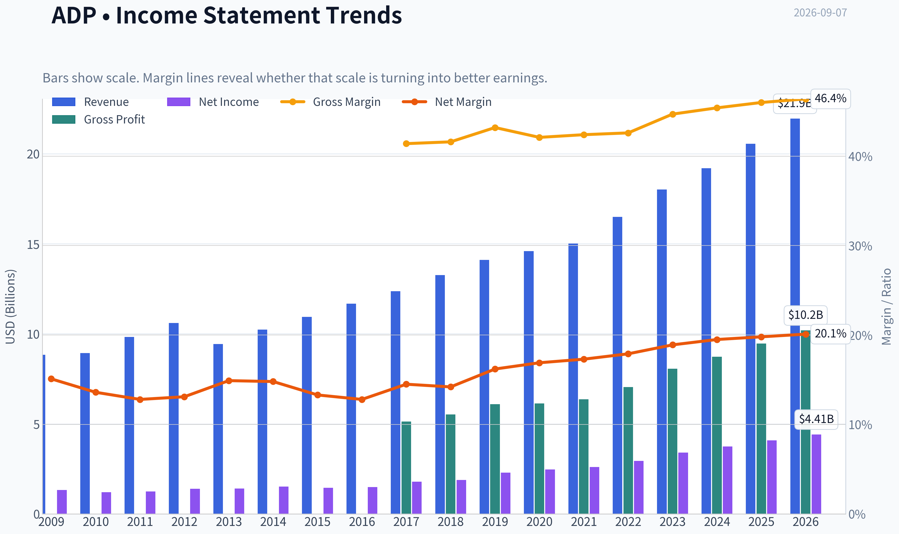

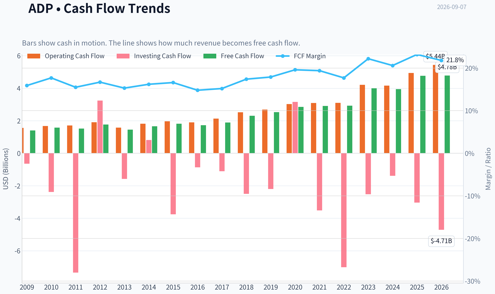

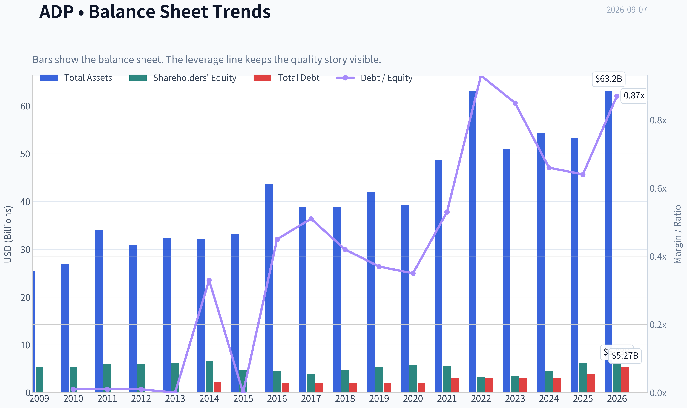

This graph tracks the profitability and return metrics (ROE, ROIC, Margins) of **ADP** over the past decade, highlighting capital efficiency trends.

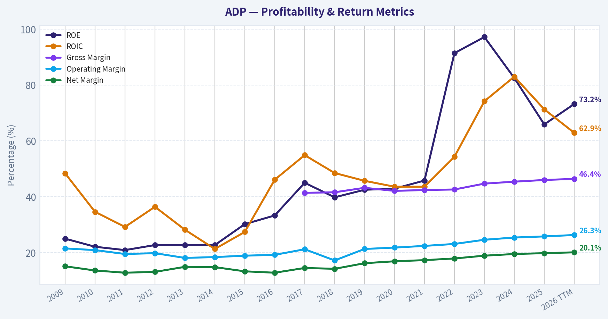

This chart illustrates the financial health of **ADP** over the last 10 years, mapping cash equivalents and free cash flow against total obligations (Debt).

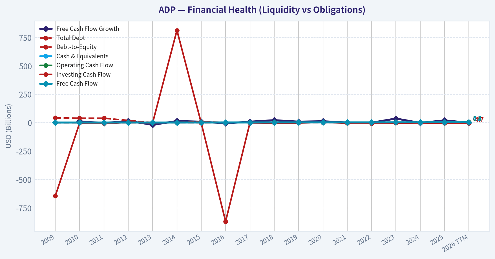

---

### Intrinsic Value Analysis (Buffett)

> *Following Warren Buffett's value investing philosophy: Circle of Competence, Economic Moat, Management Quality, and Margin of Safety.*

#### Intrinsic Value Snapshot

Price is what you pay. Intrinsic value is what the business may be worth based on the cash it can create for owners over time. We show a range, not one magic number.

- Current Price: $277.62
- Value Range (conservative to optimistic across both DCF methods): $145.98 to $299.32

##### Owner Earnings (Buffett Method)
- Net Income: $4,079,700,000.00
- Depreciation & Amortization: $585,900,000.00
- Capital Expenditures: $-196,600,000.00
- Working Capital Changes: $-1,105,800,000.00
- Owner Earnings: $5,638,900,000.00

##### Intrinsic Value
###### Buffett Method
Uses owner earnings. Stricter, and usually more conservative.
- Conservative: $183.60
- Average: $247.97
- Optimistic: $299.32
- Discount Rate: 10.0%

###### Cash Flow Method
Uses free cash flow. Better for companies spending heavily today to grow tomorrow.
- Conservative: $145.98
- Average: $196.56
- Optimistic: $255.27
- Discount Rate: 10.0%

ANALYST STANCE: **WATCH**

#### ADP Buffett-Style Investment Report

Automatic Data Processing is a high-quality payroll and human capital management compounder with durable switching costs, trusted compliance capabilities, strong cash generation, and exceptional reported returns on equity. The business is understandable, resilient, and advantaged. The issue is price: at **$278**, ADP trades above the shared intrinsic value estimate of **$245**, giving a **negative margin of safety of about 13.3%**. For a wonderful but mature compounder, that is not enough.

---

#### 1. Factor Scorecard

| Factor | Score / 5 | Evidence |
|---|---:|---|
| Circle of Competence & Business Simplicity | 4.5 | ADP sells payroll processing, tax compliance, benefits administration, and HR software/services to employers. The model is easy to understand: recurring employer relationships, per-employee pricing, compliance expertise, and client fund float. |
| Moat Test | 4.3 | Strong switching costs, regulatory know-how, brand trust, scale, and broad employer network. Gross margin of **46.4%** supports pricing power and differentiated service economics. |
| Management Quality & Capital Allocation | 4.0 | Long record of dividends, buybacks, margin improvement, and shareholder returns. Management has generally been rational, though repurchases at premium valuations reduce the score slightly. |
| Industry Structure | 4.0 | Payroll/HCM is competitive but rational. ADP, Paychex, Workday, Paycom, Dayforce, Intuit, and newer cloud competitors compete, but ADP benefits from scale, compliance complexity, and customer inertia. |
| Gate 5: Quality/Solvency Hard Floor | Not Tripped | Revenue is still growing, FCF generation is strong, and there is no evidence of earnings collapse combined with solvency stress. |

**Key Takeaways:** ADP is firmly inside the circle of competence: it makes money by solving recurring payroll and HR compliance problems for employers. The moat is real, especially through switching costs and regulatory trust. The hard financial distress floor is not triggered.

---

#### 2. Moat Analysis

| Moat Source | Assessment | Evidence |
|---|---|---|
| Intangible Assets | Strong | ADP is one of the most trusted names in payroll, where accuracy, tax compliance, and reliability matter more than novelty. Employers are reluctant to risk payroll disruption. |
| Switching Costs | Very Strong | Payroll and HR systems are embedded in employee records, tax filings, benefits, reporting workflows, time systems, and compliance processes. Switching creates operational and compliance risk. |
| Cost Advantage | Moderate to Strong | ADP's scale spreads compliance, technology, sales, and service costs over a large client base. Scale also improves data, automation, and service coverage. |
| Network Effects | Moderate | Not a classic consumer network effect, but ADP's ecosystem, integrations, benchmarks, and employer data scale improve product relevance. |
| Pricing Power | Good | Sustained gross margin of **46.4%** suggests ADP can price above undifferentiated service providers. |

**Moat Rating:** **Wide & Stable**, with some widening from cloud migration, compliance complexity, and broader HCM platform adoption.

ADP's moat is not based on one magic product. It is built from accumulated trust, embedded workflows, regulatory complexity, payroll accuracy, and the high perceived cost of switching. That is a Buffett-style moat: customers may grumble about price, but the downside of moving payroll to an inferior provider is severe.

---

#### 3. Management Quality Assessment

| Area | Assessment |
|---|---|
| Owner Orientation | Positive. ADP has a long history of dividends and buybacks, showing a shareholder-return culture. |
| Candor & Governance | Generally solid. The business has operated through multiple cycles with consistent reporting and conservative recurring-revenue economics. |
| Capital Allocation | Good. ADP returns excess capital through dividends and repurchases while investing in technology, automation, and HCM expansion. |
| Main Concern | Buybacks are less attractive when shares trade above intrinsic value. At today's price, repurchases are unlikely to create as much per-share value as they would at lower multiples. |

Management deserves credit for preserving ADP's franchise, expanding margins, and maintaining a long dividend record. The business has not needed heroic acquisitions or financial engineering to compound. The main valuation-related concern is whether buybacks continue aggressively when the stock is expensive.

---

#### 4. Financial Summary

| Metric | FY2022 | FY2023 | FY2024 | FY2025 / Recent | TTM / Current Snapshot |
|---|---:|---:|---:|---:|---:|
| Revenue | ~$16.5B | ~$18.0B | ~$19.2B | ~$20.0B | YoY growth **6.7%** |
| Gross Margin | ~42% | ~44% | ~45% | ~46% | **46.4%** |
| Net Income | ~$3.0B | ~$3.4B | ~$3.8B | ~$4.1B | ~$4.35B implied by P/E |
| Diluted EPS | ~$7.00 | ~$8.20 | ~$9.10 | ~$10.00 | ~$10.95 implied by price/P-E |
| Free Cash Flow | ~$3.2B | ~$3.6B | ~$4.0B | ~$4.6B | ~$5.29B implied by 4.8% FCF yield |
| ROE | High | High | Very High | Very High | **73.2%** |
| Current Ratio | - | - | - | - | **1.05** |
| Market Cap | - | - | - | - | **$110.29B** |
| P/E | - | - | - | - | **25.4x** |

**Key Takeaways:** ADP has delivered steady revenue growth, rising margins, and strong free cash flow. Reported ROE is extremely high, helped by the asset-light nature of the business and accumulated buybacks. The financial profile is clearly high quality, but the market is already pricing in a lot of that quality.

---

#### 5. Owner Earnings Calculation

Using Buffett's framework:

> **Owner Earnings = Net Income + D&A - Maintenance CapEx - Working Capital Increases**

| Item | Current Estimate |
|---|---:|
| Net Income | ~$4.35B |
| Add: Depreciation & Amortization | Positive, modest relative to revenue |
| Less: Maintenance CapEx | Modest; payroll/HCM is not heavy industrial capex |
| Less: Working Capital Increases | Normalized impact modest, though client funds can distort reported working capital |
| Estimated Owner Earnings / FCF Proxy | **~$5.29B** |
| Shares Outstanding Implied by Market Cap / Price | ~397M |
| Owner Earnings per Share | **~$13.33** |

**Key Takeaways:** ADP converts accounting profits into real cash at an excellent rate. The company's capital-light model means free cash flow is a reasonable proxy for owner earnings. On today's price, the stock offers an approximate **4.8% FCF yield**, which is respectable but not obviously cheap for a mature business.

---

#### 6. Three-Scenario DCF Valuation

| Scenario | Assumptions | Intrinsic Value / Share |
|---|---|---:|
| A. No Growth | Owner earnings per share of ~$13.33 capitalized at 10% | **~$133** |
| B. GDP Growth | 3% perpetual growth, 10% discount rate | **~$196** |
| C. Historical Growth Haircut | 6% growth for 10 years, then 3% terminal growth, 10% discount rate | **~$244** |
| Shared Headline Intrinsic Value | Business-model-routed blend | **$245** |
| Shared Model Spread | Owner Earnings / FCF / Damodaran FCFF | **$247.97 / $196.56 / $178.75** |

**Key Takeaways:** ADP's value is highly sensitive to growth assumptions. A conservative GDP-growth case supports a value around $196, while a reasonable historical-growth haircut supports about $244. The shared headline intrinsic value of **$245** is close to the more optimistic but still disciplined case.

---

#### 7. Margin of Safety Analysis

| Measure | Value |
|---|---:|
| Current Price | **$278** |
| Headline Intrinsic Value | **$245** |
| Margin of Safety vs. Headline Value | **-13.3%** |
| Reverse-DCF Implied Growth | **~13.4% per year for 10 years** |
| Trailing 3-Year Growth Reference | **26.7%** |
| Trailing 5-Year Growth Reference | **19.7%** |
| Attractive Entry Range for Wide-Moat MOS | Roughly **$210-$225** |

**Key Takeaways:** ADP is not priced with a Buffett-style margin of safety today. The market price implies double-digit growth for a decade, which is possible but demanding for a large, mature payroll processor. For a wide-moat company, a modest margin of safety is acceptable, but today's price offers a negative one.

---

#### 8. Final Buffett Scorecard

| Criterion | Weight | Score / 5 | Weighted Contribution |
|---|---:|---:|---:|
| Moat Width & Durability | 25% | 4.3 | 1.08 |
| Valuation / Margin of Safety | 20% | 1.5 | 0.30 |
| Capital Returns - ROIC vs. WACC | 15% | 4.7 | 0.71 |
| Business Understanding & Predictability | 12% | 4.5 | 0.54 |
| Management Quality & Capital Allocation | 12% | 4.0 | 0.48 |
| Reinvestment Runway | 8% | 3.5 | 0.28 |
| Balance Sheet Strength | 4% | 3.5 | 0.14 |
| Industry Structure | 4% | 4.0 | 0.16 |
| **Total Score** | **100%** |  | **3.69 / 5.00** |

**Key Takeaways:** ADP scores very well on quality, predictability, cash generation, and moat durability. The valuation score is the clear drag. This is a case where the business is better than the stock price.

---

#### 9. Investment Stance

| Stance | Conviction | Rationale |
|---|---|---|
| **WATCH** | Medium-High | ADP is a wonderful, durable, cash-generative business, but at **$278** the stock trades above estimated intrinsic value and lacks a margin of safety. |

ADP is the kind of business a long-term investor should want to own: recurring, mission-critical, trusted, cash-rich, and resilient. But Buffett's discipline is not merely to buy great companies; it is to buy them at sensible prices. At today's valuation, ADP is a **watchlist compounder**, not a fresh purchase.

A more attractive entry point would likely be around **$210-$225**, where the investor would receive a modest but real margin of safety against the current intrinsic value estimate.
#### Valuation Bridge

This bridge places the current market price beside each intrinsic value lens so readers can see whether upside depends on one method or shows up across several methods.

| Scenario | Intrinsic Value / Share |
| --- | ---: |
| Buffett Method | $247.97 |
| Cash Flow Method | $196.56 |
| Damodaran Method | $178.75 |
| Current Price | $277.62 |

#### Key Takeaways

If one method is far above the others, the upside case depends on a specific modelling assumption. When several methods cluster together, the valuation story is more robust.

#### Valuation Visuals

This comparison chart from *Latest Earnings Snapshot* stacks current figures against historical benchmarks for **ADP**, making it easy to see where the company trades relative to its own averages.

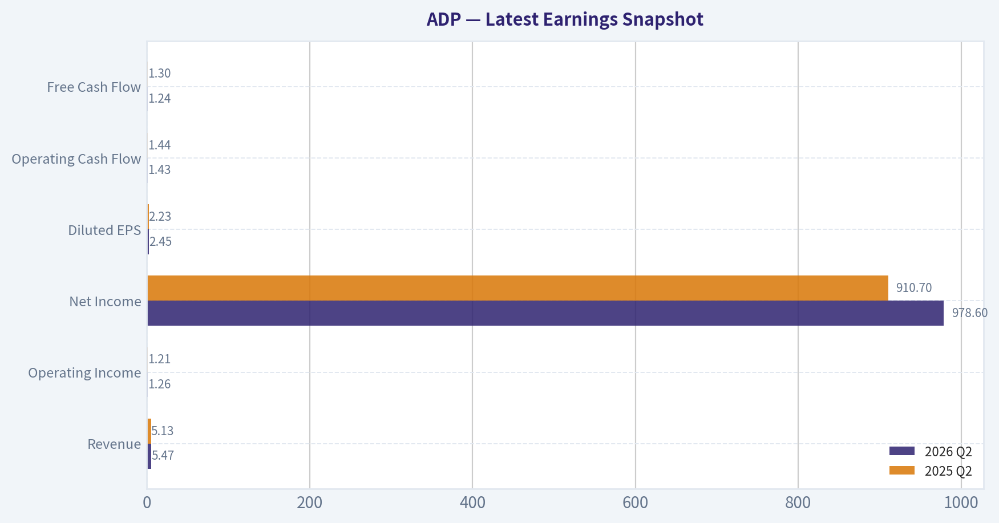

This comparison chart from *Current vs. Historical Average Comparison* stacks current figures against historical benchmarks for **ADP**, making it easy to see where the company trades relative to its own averages.

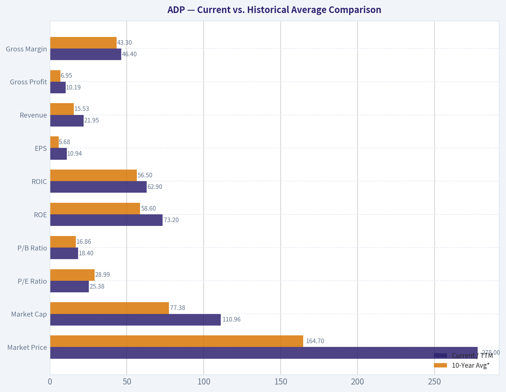

This comparison chart from *DCF Detail and Cross-Check Against Model-Based Intrinsic Value* stacks current figures against historical benchmarks for **ADP**, making it easy to see where the company trades relative to its own averages.

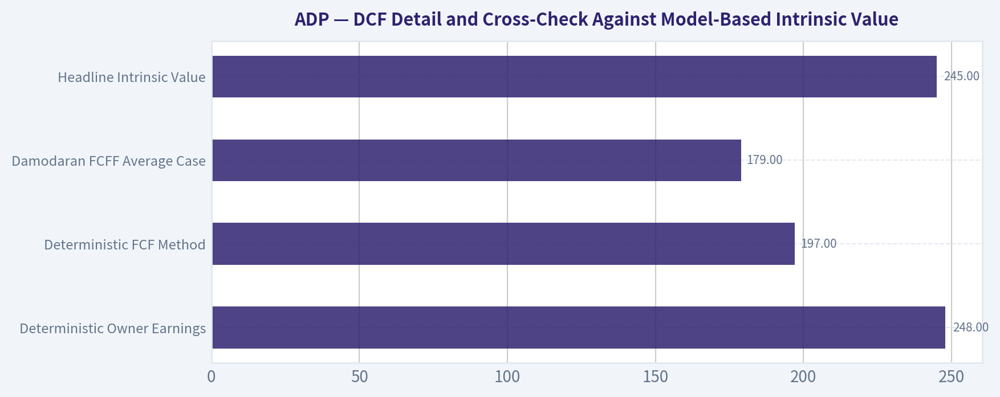

---

### Trend & Growth Analysis (Lynch/Druckenmiller/Fisher)

> *Following Peter Lynch's GARP, Stanley Druckenmiller's macro-aware approach, and Philip Fisher's scuttlebutt methodology.*

ANALYST STANCE: **WATCH**

#### ADP Growth Investment View

ADP is a high-quality, durable compounder, but it is **not a classic Lynch fast grower** today. Revenue growth is running around **6.7% year over year**, valuation is around **25.4x earnings**, and the stock trades above the provided intrinsic value estimate of **$245 versus a $278 market price**. For a growth mandate seeking inflection points and ten-bagger potential, ADP looks more like a **stalwart to hold**, not a new aggressive growth buy.

---

#### 1. Lynch Classification

| Category | ADP Assessment |
|---|---:|
| Lynch category | **Stalwart** |
| Revenue growth | **6.7% YoY** |
| P/E ratio | **25.4x** |
| Growth profile | Stable, recurring, mid-single-digit revenue growth |
| Ten-bagger probability from current scale | Low |
| Best use in portfolio | Defensive compounder / hold candidate |

**Key Takeaways:** ADP fits Peter Lynch's "stalwart" category rather than "fast grower." The company is durable, profitable, and shareholder-friendly, but its current growth rate is not high enough to qualify as a primary ten-bagger candidate. For growth investors, ADP is more of a quality watchlist or hold than a fresh high-upside idea.

---

#### 2. The Story in 3 Bullets

- ADP helps businesses run payroll, manage HR, handle benefits, and comply with employment regulations.
- The business benefits from recurring revenue, high customer retention, regulatory complexity, and scale advantages.
- Growth comes from employment levels, wage inflation, HR outsourcing, PEO adoption, pricing, product bundling, and international expansion - but the core business is mature.

#### 3. TAM Analysis and 10x Test

| Item | Estimate / Assessment |
|---|---:|
| Current revenue base | Low-$20B annualized range, based on recent scale |
| 10x revenue test | Roughly $200B+ revenue needed |
| Addressable market | Large global payroll, HCM, HR outsourcing, and PEO market |
| Can ADP 10x and still be under 20% share? | **Unlikely under current business model** |
| TAM quality | Durable and moderately expanding |
| Runway rating | Good for compounding, weak for ten-bagger upside |

**Key Takeaways:** ADP has a large market, but it is already one of the dominant incumbents. The company can still grow for many years, especially through HR outsourcing and international HCM penetration, but a 10x revenue outcome appears unrealistic without a major new product category or business-model expansion.

---

#### 4. Revenue Growth Trend

| Metric | Current Signal |
|---|---:|
| Revenue growth YoY | **6.7%** |
| Growth pattern | Stable but not accelerating |
| Lynch growth category | Stalwart |
| Inflection signal | Weak |
| Revenue quality | High - recurring, diversified employer base |

**Key Takeaways:** ADP's revenue growth is reliable, but it is not showing the kind of acceleration Druckenmiller-style growth investors look for. This is steady compounding, not a breakout inflection. The quality of revenue is strong, but the rate of growth is modest.

---

#### 5. Unit Economics

| Unit Economics Metric | ADP Assessment |
|---|---:|
| LTV/CAC | Not disclosed; likely strong due to high retention and recurring revenue |
| Customer retention | Historically high, generally low-90% range, but current exact figure not provided |
| Net revenue retention | Not clearly disclosed like SaaS peers |
| Rule of 40 | Not directly calculable from provided data |
| FCF yield | **4.8%** |
| Gross margin | **46.4%** |
| Unit economics rating | Strong for a mature platform, not transparent enough for SaaS-style scoring |

**Key Takeaways:** ADP likely has strong customer economics because payroll and HR systems are sticky and mission-critical. However, it does not provide the same clean SaaS metrics, such as NRR and CAC payback, that we would expect from a pure software growth company. The company's 4.8% free cash flow yield supports the view that ADP is financially healthy and mature.

---

#### 6. Inflection Point Assessment

| Potential Inflection | Evidence | Verdict |
|---|---|---|
| Product cycle inflection | Continued HCM platform expansion, AI-enabled HR tools possible | Mild positive |
| Market share inflection | ADP remains a leader, but no clear acceleration signal | Neutral |
| Margin inflection | High ROE and scale, but margin expansion already recognized | Mild positive |
| TAM inflection | HR complexity, compliance, and outsourcing demand remain supportive | Positive but gradual |
| Competitive inflection | Competition from Paychex, Workday, Paycom, UKG, and newer platforms remains active | Neutral / risk |

**Key Takeaways:** ADP has several slow-burn growth drivers, but there is no obvious near-term inflection point. The company may benefit from AI, HR outsourcing, and regulatory complexity, but the market likely already understands much of this story. This is not yet a "growth acceleration before the crowd notices" setup.

---

#### 7. Macro Setup Evaluation

| Macro Factor | Impact on ADP |
|---|---|
| Labor market | Stable employment supports payroll volumes |
| Slower hiring | Headwind to new pays and client growth |
| Interest rates | Higher rates benefit client funds income |
| Falling-rate scenario | Could pressure float income |
| Wage inflation | Supports revenue tied to payroll and HR activity |
| Secular trend | HR digitization, compliance outsourcing, cloud HCM |

**Key Takeaways:** ADP's macro setup is mixed. A stable labor market and higher interest rates help the business, but slower hiring limits payroll-volume growth. If rates decline meaningfully, one of ADP's recent earnings tailwinds could fade.

---

#### 8. Fisher 15 Points Score

| Fisher Point | Score / 5 | Rationale |
|---|---:|---|
| Products with market potential | 4 | Large payroll and HCM market |
| Management develops new products | 4 | Ongoing platform and HCM expansion |
| Effective R&D | 3 | Solid but not innovation-leading versus younger SaaS peers |
| Sales organization | 4 | Deep distribution and enterprise relationships |
| Worthwhile profit margin | 4 | Strong mature profitability |
| Improving margins | 3 | Some operating leverage, but not a major inflection |
| Labor/personnel relations | 3 | No major concern from available data |
| Executive relations | 4 | Stable blue-chip governance profile |
| Management depth | 4 | Large, seasoned organization |
| Cost analysis/accounting | 4 | Mature financial controls |
| Outstanding moat factors | 4 | Scale, trust, compliance, switching costs |
| Long-range profit outlook | 4 | Durable, but moderate growth |
| Dilution risk | 4 | Low relative to emerging growth companies |
| Candor in difficulties | 3 | No major issue identified |
| Management integrity | 4 | Long public-company track record |
| **Total** | **56 / 75** | **Good, but not outstanding growth** |

**Key Takeaways:** ADP scores well on Fisher quality factors because it has scale, recurring revenue, customer trust, and a long operating history. The weaker areas are innovation intensity and growth acceleration. This is a good business, but not an exceptional growth setup at today's price.

---

#### 9. Valuation Analysis

| Valuation Metric | Current Reading |
|---|---:|
| Current price | **$278** |
| Market cap | **$110.29B** |
| P/E ratio | **25.4x** |
| Revenue growth | **6.7% YoY** |
| PEG ratio using revenue growth proxy | **~3.8x** |
| FCF yield | **4.8%** |
| Headline intrinsic value estimate | **$245** |
| Margin of safety vs. price | **-13.3%** |
| Reverse DCF implied growth | **~13.4% annually for 10 years** |

**Key Takeaways:** ADP does not screen cheap on a growth-adjusted basis. A P/E above 25x against mid-single-digit revenue growth creates an elevated PEG-style profile. The stock also trades above the provided intrinsic value estimate, meaning the market is already pricing in high-quality execution.

---

#### 10. Scenario Analysis

| Scenario | Assumptions | Investment Implication |
|---|---|---|
| Bear case | Slower hiring, lower rates, valuation compresses | Downside risk from multiple contraction |
| Base case | Mid-single-digit revenue growth, EPS grows faster via margins and buybacks | Solid but unspectacular compounding |
| Bull case | AI, HCM bundling, PEO expansion, and pricing drive sustained acceleration | Upside possible, but still unlikely to become a ten-bagger soon |

**Key Takeaways:** The base case for ADP is continued dependable compounding, not explosive growth. The main downside risk is that investors stop paying a premium multiple if employment growth slows or interest-rate income fades. The bull case requires a clearer product or margin inflection than the current data shows.

---

#### 11. Growth Investor Scorecard

| Criterion | Weight | Score / 5 | Weighted Score |
|---|---:|---:|---:|
| The Story | 10% | 4.0 | 0.40 |
| TAM & Runway | 20% | 3.0 | 0.60 |
| Revenue Growth | 20% | 2.5 | 0.50 |
| Unit Economics | 15% | 4.0 | 0.60 |
| Competitive Position | 10% | 4.0 | 0.40 |
| Management Quality | 10% | 4.0 | 0.40 |
| Macro Setup | 5% | 3.0 | 0.15 |
| Profitability Path | 5% | 4.5 | 0.23 |
| Valuation | 5% | 2.0 | 0.10 |
| **Total** | **100%** |  | **3.38 / 5.00** |

**Key Takeaways:** ADP earns a WATCH rating with a score of 3.38 out of 5. The company is strong on quality, unit economics, competitive position, and profitability. It scores lower on revenue growth, valuation, and ten-bagger potential.

---

#### 12. Position Size Stance

| Investor Type | Stance |
|---|---|
| Existing long-term holder | Hold / maintain core position |
| Growth investor seeking new ten-baggers | Do not prioritize |
| GARP investor | Watch for pullback |
| Income/dividend-growth investor | Attractive quality candidate, but valuation matters |
| Suggested growth-portfolio sizing | Small or zero new allocation unless price improves |

**Key Takeaways:** ADP is better suited for investors who already own it or want a defensive compounder. For a growth portfolio focused on inflection points, the stock does not currently deserve a large new position. A better entry point would materially improve the risk-reward.

---

#### 13. Key Risks and Catalysts

| Category | Key Items |
|---|---|
| Risks | Slower hiring, lower interest rates, valuation compression, competition from modern HCM platforms, limited growth acceleration |
| Catalysts | Strong employment trends, pricing power, PEO growth, AI-enabled HR productivity tools, margin expansion, better-than-expected client retention |
| What would change the view positively | Revenue acceleration toward 10%+, visible AI monetization, stronger PEO adoption, or a valuation pullback |
| What would change the view negatively | Sustained revenue deceleration below mid-single digits, falling float income, margin pressure, or share loss to cloud-native competitors |

**Key Takeaways:** The upside case depends on ADP proving it can accelerate growth beyond its mature historical profile. The downside case is mostly valuation-driven, because the stock is priced like a premium compounder while growth remains moderate. The most important watch item is whether revenue growth can reaccelerate without relying heavily on interest-rate tailwinds.

---

#### Bottom Line

ADP is a **high-quality stalwart**, not a high-conviction growth inflection stock. The business is durable, profitable, and competitively advantaged, but the current setup lacks the acceleration and valuation support needed for an ADVOCATE rating under a Lynch-Druckenmiller-Fisher growth framework.

**Final stance: WATCH - hold if owned, wait for either a better price or clearer growth acceleration before adding aggressively.**

#### Growth & Scorecard Visuals

This comparison chart from *Growth Metrics Interpretation* stacks current figures against historical benchmarks for **ADP**, making it easy to see where the company trades relative to its own averages.

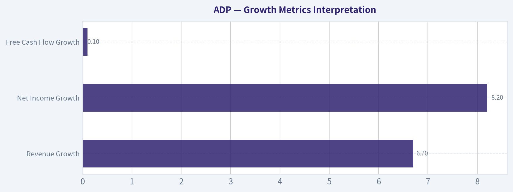

This comparison chart from *Factor Scorecard* stacks current figures against historical benchmarks for **ADP**, making it easy to see where the company trades relative to its own averages.

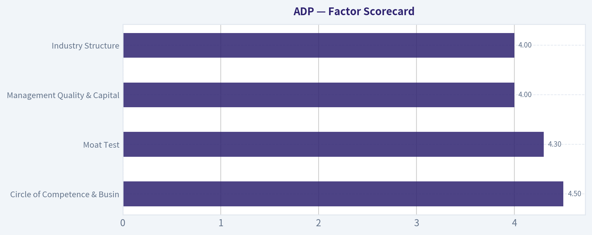

---

### Market Technical Analysis

ANALYST STANCE: **WATCH**

#### ADP Technical Indicator Report - Current as of 2026-09-07

ADP's broader technical structure remains constructive, but the short-term tape has shifted from strong upside momentum into a corrective pause. The stock closed at **$277.62** on the latest available trading day, **2026-09-04**, after recently reaching a late-August high near **$287.86 intraday** and **$287.48 on a closing basis**. That means price has pulled back roughly **3%-4%** from the recent peak, which is not severe, but the quality of momentum has deteriorated enough to justify patience rather than aggressive new buying.

The most relevant indicators for this setup are: **close_10_ema, close_50_sma, close_200_sma, macd, macdh, rsi, atr, and vwma**. These provide a balanced view of short-term trend, medium-term trend, long-term trend, momentum, momentum acceleration, overbought/oversold pressure, volatility, and volume-confirmed price behavior.

---

#### Indicator Snapshot

| Indicator | Latest Value | Price Relationship / Signal | Interpretation |
|---|---:|---|---|
| Close | **$277.62** | Latest available close | Pulling back from late-August highs |
| close_10_ema | **$281.29** | Price is below | Short-term momentum has weakened |
| close_50_sma | **$262.00** | Price is above | Medium-term uptrend remains intact |
| close_200_sma | **$234.91** | Price is well above | Long-term trend remains positive |
| macd | **5.95** | Positive but declining | Bullish trend momentum still exists, but is fading |
| macdh | **-1.24** | Negative and worsening | Bearish momentum pressure has increased short term |
| rsi | **53.89** | Neutral | Momentum cooled sharply from near-overbought levels |
| atr | **6.12** | About 2.2% of price | Moderate daily volatility; risk controls matter |
| vwma | **$280.53** | Price is below | Recent volume-weighted trend support has been lost |

**Key Takeaways:** ADP is still above its 50-day and 200-day moving averages, which keeps the intermediate and long-term trend constructive. However, the latest close is below both the 10-day EMA and VWMA, showing that the short-term trend has weakened and sellers have gained control over the last several sessions. Momentum is not bearish enough to call a full trend reversal, but it is no longer strong enough to justify chasing the stock.

---

#### Trend Structure: Strong Bigger Picture, Short-Term Damage

ADP's long-term trend remains favorable. The **200-day SMA is near $234.91**, and the stock is still trading more than **18% above** that level. This suggests the major trend is still upward and that the market has not meaningfully challenged ADP's long-term trend base.

The medium-term trend is also supportive. The **50-day SMA has risen steadily from about $227.77 on 2026-07-21 to $262.00 on 2026-09-04**, a strong upward slope that reflects the powerful rally from July through August. Price remains around **6% above the 50-day SMA**, so the pullback has not yet damaged the broader uptrend.

The issue is the short-term layer. ADP's **10-day EMA is $281.29**, while the latest close is **$277.62**. A close below the 10-day EMA after a strong run often signals that buyers are no longer defending the immediate trend. This does not automatically imply a bearish reversal, but it often marks a transition from "buy strength" to "wait for stabilization."

---

#### Momentum: Bullish but Decelerating

MACD remains positive at **5.95**, which means ADP still has upward momentum on a trend-following basis. However, the MACD line has declined from around **8.01 on 2026-08-28** to **5.95 on 2026-09-04**, showing that upside momentum has been fading for several sessions.

The MACD histogram is more cautionary. It moved from slightly positive in late August to **-1.24** by 2026-09-04. This means the MACD line is now weakening relative to its signal line, and the short-term rate of momentum deterioration is accelerating. For traders, this argues against initiating a full-size long position until the histogram stabilizes or turns higher again.

RSI confirms the same cooling pattern. RSI peaked near **69.12 on 2026-08-28**, close to overbought territory, and has now fallen to **53.89**. This is not oversold; instead, it suggests ADP has moved from strong bullish momentum into a neutral zone. The stock has room to decline further before becoming technically washed out.

---

#### Volume-Weighted Behavior: A Subtle Warning

The VWMA is currently **$280.53**, slightly above the latest close of **$277.62**. This is important because VWMA incorporates volume into the trend reading. When price falls below VWMA, it suggests that recent volume-weighted buyers are no longer comfortably profitable, and the short-term demand profile has weakened.

This is not a major breakdown by itself because ADP remains well above the 50-day and 200-day averages. But when combined with a negative MACD histogram and a declining RSI, the VWMA break reinforces the view that the stock may need more consolidation before attempting another advance.

---

#### Volatility and Risk Levels

ATR is **$6.12**, which is approximately **2.2%** of the latest close. That means ADP's normal daily trading range is meaningful enough that tight stops may be easily triggered. Traders should avoid placing stops too close to the market unless they are pursuing a very short-term tactical trade.

Near-term resistance now sits around **$280.50-$281.30**, where the VWMA and 10-day EMA are clustered. A reclaim of that zone would be the first sign that buyers are regaining control. Above that, the next resistance area is around **$283.50-$287.90**, covering the early September bounce zone and late-August high.

Support is likely near **$276-$277**, the area currently being tested. If that fails, the next practical support zone is around **$269-$270**, where ADP repeatedly traded in mid-August. A deeper correction could target the rising **50-day SMA near $262**, which would still be consistent with a normal medium-term pullback rather than a full trend failure.

---

#### Trading View

ADP is best treated as a **watchlist long**, not an avoid and not an immediate aggressive buy. The large trend is still positive, but near-term momentum has weakened enough that buying now would mean stepping in while price is below short-term trend and volume-weighted confirmation.

A constructive setup would improve if ADP reclaims **$281-$282** and the MACD histogram begins to contract toward zero. A more patient entry could come from a controlled pullback toward **$269-$270** or the rising 50-day SMA, provided RSI stabilizes and price does not break down on expanding volume.

For existing long holders, the trend does not yet require an exit based only on these indicators. However, the short-term warning signs justify tighter monitoring. A decisive close below **$276**, especially with a further deterioration in MACD histogram, would raise the odds of a deeper retest toward the high-$260s.

---

#### Summary Table

| Category | Evidence | Bullish / Bearish Read | Trader Implication |
|---|---|---|---|
| Long-term trend | Price above 200 SMA by roughly 18% | Bullish | Strategic trend remains intact |
| Medium-term trend | Price above rising 50 SMA | Bullish | Pullback is not yet a major breakdown |
| Short-term trend | Price below 10 EMA | Bearish short term | Avoid chasing until price reclaims short-term trend |
| Momentum | MACD positive but falling | Cautiously bullish | Trend still positive, but strength is fading |
| Momentum acceleration | MACD histogram at -1.24 | Bearish short term | Downside pressure is increasing |
| RSI | RSI at 53.89 | Neutral | Stock is no longer overbought, but not oversold |
| Volatility | ATR near $6.12 | Moderate | Use wider, volatility-aware stops |
| Volume confirmation | Price below VWMA | Cautionary | Recent volume-weighted buyers are losing control |
| Key resistance | $280.50-$281.30, then $283.50-$287.90 | Confirmation zone | Reclaiming this area would improve the setup |
| Key support | $276-$277, then $269-$270, then ~$262 | Risk zone | Break below $276 may invite deeper pullback |

**Key Takeaways:** ADP's primary trend remains healthy, but the short-term setup has weakened after the stock failed to hold above its 10-day EMA and VWMA. Momentum indicators show fading upside pressure rather than a clean bearish reversal. The best stance is to watch for either a reclaim of the $281-$282 area or a lower-risk pullback toward support before considering new long exposure.

#### Market Visuals

This comparison chart from *Market Metrics Interpretation* stacks current figures against historical benchmarks for **ADP**, making it easy to see where the company trades relative to its own averages.

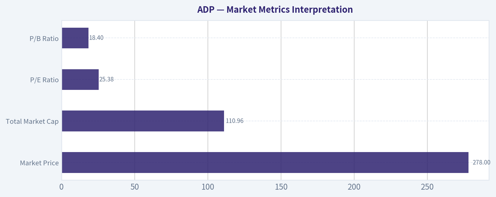

---

### Options Market Analysis

> *Reading options flow - put/call ratios, IV skew, and unusual activity - to gauge institutional positioning and event-driven risk.*

ANALYST STANCE: **WATCH**

#### ADP Options Market Sentiment Report
*Options data as of 2026-09-07*

#### 1. Put/Call Ratio Analysis

| Expiration | Call OI | Put OI | Put/Call OI Ratio | Call Volume | Put Volume | Put/Call Volume Ratio | Read |
|---|---:|---:|---:|---:|---:|---:|---|
| 2026-09-11 | 392 | 200 | 0.51 | 483 | 245 | 0.51 | Call-leaning short-term flow |
| 2026-09-18 | 4,255 | 6,065 | 1.43 | 197 | 909 | 4.61 | Heavy put positioning |
| 2026-09-25 | 96 | 112 | 1.17 | 28 | 34 | 1.21 | Mild put bias, low activity |
| **Near-Term Total** | **4,743** | **6,377** | **1.34** | **708** | **1,188** | **1.68** | **Bearish / protective tilt** |

**Key Takeaways:** ADP's near-term put/call open interest ratio is **1.34**, well above the historical neutral baseline of roughly **0.7**, indicating materially heavier put exposure than normal. The volume ratio is also elevated at **1.68**, with the strongest bearish/protective activity concentrated in the **2026-09-18** expiration. The nearest weekly expiry is more call-leaning, but the larger open interest and volume picture points to downside hedging or bearish positioning.

The largest shift from neutral is in the **September 18** chain, where put volume is more than **4.6 times** call volume. That suggests traders are actively adding downside exposure or protection over the next two weeks rather than simply expressing short-term bullish speculation.

---

#### 2. Implied Volatility Assessment

| Expiration | ATM Call IV | ATM Put IV | Put IV Premium vs Call IV | IV Read |
|---|---:|---:|---:|---|
| 2026-09-11 | 36.2% | 44.3% | +8.1 pts | Put IV materially richer |
| 2026-09-18 | 33.3% | 39.7% | +6.4 pts | Defensive skew |
| 2026-09-25 | 31.4% | 37.1% | +5.7 pts | Persistent put premium |

**Key Takeaways:** Put implied volatility is consistently higher than call implied volatility across all near-term expirations. This indicates a clear downside skew, meaning traders are paying more for protection against declines than for upside participation. The skew is most pronounced in the nearest expiry, suggesting near-term downside concern.

The available data shows **ATM puts priced 5.7 to 8.1 volatility points above ATM calls**, which is a bearish or hedging signal. Full OTM put-versus-OTM call skew was not provided, so the analysis is based on ATM IV differences rather than a complete volatility-smile comparison.

There is no explicit earnings catalyst flagged in the provided data. ADP is generally not a high-beta options name, so IV in the low-to-mid 30s for calls and upper 30s to mid-40s for puts appears meaningfully risk-aware, especially with put IV elevated. This may reflect broader market hedging, labor-market sensitivity, or company-specific risk expectations, but the data does not confirm a specific catalyst.

---

#### 3. Unusual Options Activity

| Unusual Activity Screen | Result |
|---|---|
| Contracts with volume greater than 5x open interest | None found |
| Fresh directional activity signal | Not confirmed |
| Likely institutional sweep / block signal | Not evident from provided data |
| Retail speculation signal | Not evident from provided data |

**Key Takeaways:** No near-term ADP options contracts showed volume greater than **5x open interest**, so there is no clear evidence of fresh aggressive directional positioning at the single-contract level. The bearish signal comes more from aggregate put/call ratios and put-rich IV, not from identifiable unusual sweeps. This reduces confidence compared with a scenario where large fresh put buys or call buys were visible.

Because no unusual contracts were flagged, there is no specific strike or expiry that can be identified as a fresh "smart money" bet. The activity appears more like broad protective positioning than a concentrated speculative trade.

---

#### 4. Open Interest Concentration and Gamma Considerations

| Expiration | Total OI | Share of Near-Term OI | Dominant Side | Interpretation |
|---|---:|---:|---|---|
| 2026-09-11 | 592 | 5.3% | Calls | Light near-term positioning |
| 2026-09-18 | 10,320 | 92.8% | Puts | Main positioning zone |
| 2026-09-25 | 208 | 1.9% | Puts | Very light activity |

**Key Takeaways:** The overwhelming concentration of open interest is in the **2026-09-18** expiration, which holds roughly **93%** of the near-term options open interest in the provided data. That expiry is also put-heavy, making it the key options positioning window for ADP. The September 11 and September 25 expirations are comparatively thin and less important for market structure.

Strike-level open interest was not provided, so specific **max pain**, **pinning levels**, and **gamma walls** cannot be reliably identified. However, the expiration-level concentration suggests that September 18 could exert the strongest influence on near-term dealer hedging and price sensitivity.

If much of the September 18 put open interest is clustered below spot, downside moves could force additional dealer hedging and potentially amplify weakness. Conversely, if price stays stable into expiration, put decay could reduce pressure and allow positioning to normalize.

---

#### 5. Overall Options Sentiment Signal

| Signal Component | Directional Read | Confidence |
|---|---|---|
| Put/Call OI Ratio | Bearish / protective | Medium |
| Put/Call Volume Ratio | Bearish | Medium |
| ATM IV Skew | Bearish / downside fear | Medium |
| Unusual Options Activity | Neutral | Low |
| OI Concentration | Bearish tilt into Sep. 18 | Medium |
| **Overall Options Sentiment** | **BEARISH** | **Medium-Low to Medium** |

**Key Takeaways:** The overall ADP options signal is **BEARISH**, driven primarily by elevated put/call ratios and a consistent put IV premium. The bearish read is not based on aggressive unusual single-contract activity, but rather on broad downside protection and heavier put positioning into the September 18 expiration. Confidence is moderate at best because strike-level data and trade-direction details are unavailable.

ADP's options market is showing more concern about downside risk than enthusiasm for upside. The clearest evidence is the **1.34 put/call OI ratio**, the **1.68 put/call volume ratio**, and put IV trading materially above call IV across near-term expirations.

---

#### Final Summary Table

| Category | Observation | Sentiment Impact |
|---|---|---|
| Put/Call Ratio | Near-term OI ratio **1.34** and volume ratio **1.68**, both above neutral baseline of ~0.7 | Bearish / protective |
| IV Level | ATM call IV ranges **31.4%-36.2%**; ATM put IV ranges **37.1%-44.3%** | Risk premium elevated on downside |
| Skew Direction | Puts trade **5.7-8.1 IV points** above calls | Downside fear / hedge demand |
| Unusual Activity | No contracts with volume greater than **5x OI** | No confirmed fresh directional sweep |
| Open Interest Focus | September 18 expiry dominates near-term OI, with put-heavy positioning | Potential downside-sensitive expiry |
| Overall Signal | **BEARISH** | Medium-low to medium confidence |

**Key Takeaways:** ADP's options market currently leans bearish, mostly due to heavy put positioning and elevated put implied volatility. The strongest area of interest is the **September 18** expiration, where most open interest is concentrated and puts dominate. However, the lack of unusual options activity means this looks more like broad hedging or defensive positioning than a single high-conviction institutional bet.

---

## Research Team Commentary

> *The Research Manager synthesizes the Bull vs Bear debate into action-free commentary. This is a pre-risk view, not the final stance.*

This was a fantastic debate that perfectly illustrates the classic tension between paying up for elite quality and maintaining strict valuation discipline. Both analysts correctly identify ADP as a fundamentally exceptional business, but they diverge sharply on whether the current price offers any room for error.

The bull makes a highly compelling case for ADP's business durability, focusing on the immense switching costs of its mission-critical payroll and HR ecosystem. When a company boasts a 65 percent return on invested capital, it operates essentially as an asset-light toll bridge on the global labor market. The bull rightly points out that the float income generated from holding client funds acts as a powerful, high-margin tailwind, and argues that the compounding nature of this business justifies paying 25 times earnings.

On the other side, the bear provides a necessary dose of reality regarding the actual price we are being asked to pay today. The bear correctly identifies that at $278, ADP is trading at a roughly 13 percent premium to our shared intrinsic value estimate of $245. Furthermore, the bear astutely looks beneath the surface of the eye-popping 73 percent return on equity, noting that a modest 7 percent return on assets indicates this metric is heavily boosted by the company's financial structure and leverage. Crucially, the bear points out that float income is highly sensitive to macro interest rates, and that paying a premium multiple for a mature business facing aggressive cloud-native competitors leaves zero margin of safety.

The core takeaway here is that while ADP remains an elite, compounding franchise with a durable economic moat, the current price of $278 represents a poor tactical entry point that forces investors to pay a premium for perfection. We are looking for wonderful businesses at fair prices, preferably with a 10 to 15 percent discount to intrinsic value to account for the unexpected. Paying a 13 percent premium for a mature company growing cash flows in the single digits is a recipe for dead money if multiple contraction occurs.

My rationale for this stance is heavily informed by our past mistakes with this exact type of setup. In previous assessments, we fell into the trap of letting our admiration for a company's long-term business quality dilute our respect for short-term tactical risks and valuation ceilings. We learned that we must strictly separate the strategic quality of the business from the tactical quality of the entry setup. Right now, ADP is trading above intrinsic value, the technical momentum is showing a corrective pause after pulling back from recent highs, and the broader interest rate environment is poised to pressure the very float income the bull is relying on. When valuation is rich and technical momentum is fading, we have to let technicals and valuation discipline drive the decision. Buying here would be an exercise in FOMO, requiring heroic growth assumptions just to justify the current multiple, let alone generate market-beating returns. Furthermore, at 25 times earnings, management's aggressive share buybacks are far less value-accretive than they would be at a normalized multiple.

To ensure we don't lose sight of this wonderful company while we wait, we need a strict monitoring plan over the next one to four quarters. First, we must track the yield and volume of client fund balances; if the macro rate environment shifts downward, we need to see if ADP's core operational pricing power can offset the loss of high-margin float income. Second, we must monitor market share and growth rates in their Professional Employer Organization and mid-market segments against newer, cloud-native competitors to ensure the moat isn't slowly eroding. Finally, we need to watch the technical floor and wait for a valuation reset. If the stock pulls back toward the $240 to $245 range, returning to its historical multiple and offering a true fair-value entry, we can aggressively re-evaluate.

Until the valuation normalizes or the growth narrative materially accelerates to justify the premium, we must prioritize capital preservation and discipline.

WATCH

---

## Value Investing Team Commentary

> *The Investor translates the research view into an investment thesis before risk review. This is still not the final stance.*

To analyze Automatic Data Processing (ADP) through the lens of a Warren Buffett-style value investor, we must distinguish between the **virtue of the enterprise** and the **vulnerability of the price**. ADP is a quintessential "toll bridge" business, but even the finest bridge is a poor investment if the entry fee exceeds the discounted value of all future tolls.

### 1. The Business: A "Wonderful" Asset-Light Fortress
From a fundamental standpoint, ADP sits firmly within the "wonderful business" category. A **Return on Invested Capital (ROIC) of 65.2%** is extraordinary. It signals a capital-light model where incremental growth requires almost no additional capital-the hallmark of a high-quality franchise.

The economic moat is multi-layered:
*   **High Switching Costs:** Payroll and HR integration are "sticky." Once a company embeds ADP into its tax compliance and benefit systems, the operational risk of migrating to a competitor creates a massive barrier to exit.
*   **The Float (The "Buffett" Factor):** Like an insurance company, ADP benefits from "float"-holding billions in client funds for tax and payroll obligations before disbursement. In a "higher-for-longer" interest rate environment, this float is a high-margin revenue stream that requires zero effort.
*   **Scale and Trust:** In a world of complex regulatory compliance, the "no one ever got fired for buying IBM" (or in this case, ADP) sentiment remains a powerful intangible asset.

### 2. The Valuation: Price is What You Pay, Value is What You Get
While the business is "Elite," the **Value Analyst's** assessment of a 13.3% premium to intrinsic value ($278 price vs. $245 value) is the critical friction point.

Applying the **Quality-Scaled Margin of Safety**:
*   For a "Wonderful" business with a wide moat, we typically seek a "fair price" (10-15% discount).
*   Currently, ADP is trading at a **13.3% premium**. This means the market is not only pricing in perfection but is essentially "pulling forward" several years of future compounding into today's price.
*   A **25x P/E** for a mature business growing in the single digits implies that the market is treating ADP as a "bond proxy." If interest rates remain stable or fall, the "float" income-a significant earnings driver-may face headwinds, making a 25x multiple difficult to defend.

### 3. Selective Contrarian Thinking: The "Safety Premium" Trap
The crowd currently sees ADP as a "safe haven" amid macroeconomic uncertainty. This has created a **Sentiment Distortion**. When investors are fearful, they overpay for stability. As a value investor, we must be contrarian to this "safety at any price" mentality.

**The Leverage Nuance:** The **73.2% ROE** vs. the **7.0% ROA** indicates a significant amount of financial leverage or a highly efficient use of a small asset base. While ADP can handle this due to its predictable cash flows, it suggests that the "quality" of the ROE is partially engineered rather than purely organic. We must ask: *Is the market overestimating the durability of this leverage-boosted return in a tightening credit environment?*

### 4. Technical and Momentum Context
The **Market Analyst** notes a "corrective pause" from the $287 peak. Following the lesson from the "ADP Call" history, we recognize that momentum cooling under long-term resistance is often a precursor to a retest of support. Buying at $278-immediately after a momentum peak and significantly above the $245 intrinsic value-forces us to rely on "greater fool" theory (market speculation) rather than business compounding.

### Conclusion and Decision
ADP is a business we want to own, but not at this price. To pay $278 for a business worth $245 is to voluntarily accept a lower internal rate of return (IRR) and eliminate the margin of safety required to protect against macro shocks or competitive erosion from cloud-native upstarts like Paycom or Rippling.

We must respect the **Margin of Safety ladder**. A 10-15% discount to $245 would put our "Buy" zone at approximately **$210 - $220**. Even a "fair price" purchase would require a drop to at least **$245**. At $278, we are spectating, not participating.

**ANALYST STANCE: WATCH**

*Rationale: ADP is an elite, wide-moat compounder, but the current 13% premium to intrinsic value offers no margin of safety. We will remain disciplined, ignoring the "safety premium" the market is currently demanding, and wait for a price that respects the business's long-term earnings power-ideally near or below the $245 fair value mark.*

---

## Deep Values Commentary

> *The Risk Management Team debates and the Risk Judge provides the final action-free verdict. This section determines the final ADVOCATE / WATCH / AVOID stance.*

#### Final Stance Scorecard

This scorecard converts the final research view into a weighted decision frame. It does not replace the narrative judgement, but it makes the main drivers of the verdict easier to scan.

| Criterion | Score | Weight | Commentary |
| --- | ---: | ---: | --- |
| Business Quality | 4.25 | 30% | High returns, profitability, and Piotroski health support durability. |
| Valuation Support | 2.33 | 30% | Blends current price against available intrinsic value anchors and valuation ratios. |
| Financial Strength | 2.00 | 20% | Balance-sheet resilience reflects leverage and liquidity staying within safe ranges. |
| Growth Durability | 3.00 | 20% | Recent revenue, earnings, and free cash flow growth indicate how durable expansion looks. |
| TOTAL / FINAL STANCE | 2.97 | 100% | WATCH |

#### Key Takeaways

The weighted score lands at **2.97 / 5.0**, while the final stance remains **WATCH**. This is useful as a quick calibration aid rather than a mechanical signal.

#### Risk Summary

Higher scores indicate more risk pressure. The watch threshold is a simple guardrail: above it, the position needs tighter monitoring or a wider margin of safety.

| Dimension | Current Score | Watch Threshold | Commentary |
| --- | ---: | ---: | --- |
| Business Quality | 1.75 | 3.00 | High returns, profitability, and Piotroski health support durability. |
| Valuation Support | 3.67 | 3.00 | Blends current price against available intrinsic value anchors and valuation ratios. |
| Financial Strength | 4.00 | 3.00 | Balance-sheet resilience reflects leverage and liquidity staying within safe ranges. |
| Growth Durability | 3.00 | 3.00 | Recent revenue, earnings, and free cash flow growth indicate how durable expansion looks. |

#### Key Takeaways

This view helps readers separate *where* the risk sits: valuation, business quality, balance sheet, or growth durability. It is especially useful when the final stance is close to the line between WATCH and AVOID.
