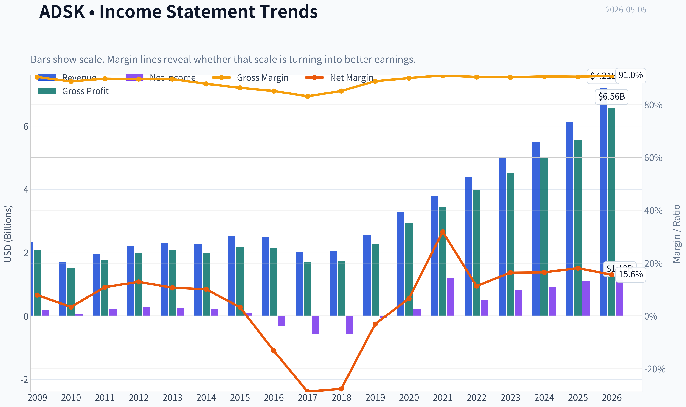
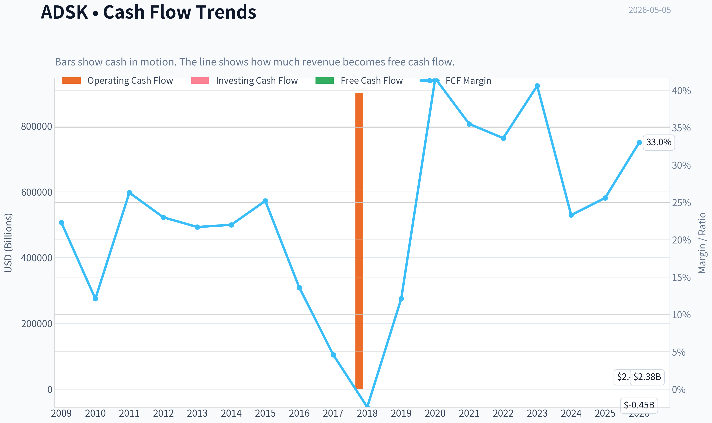
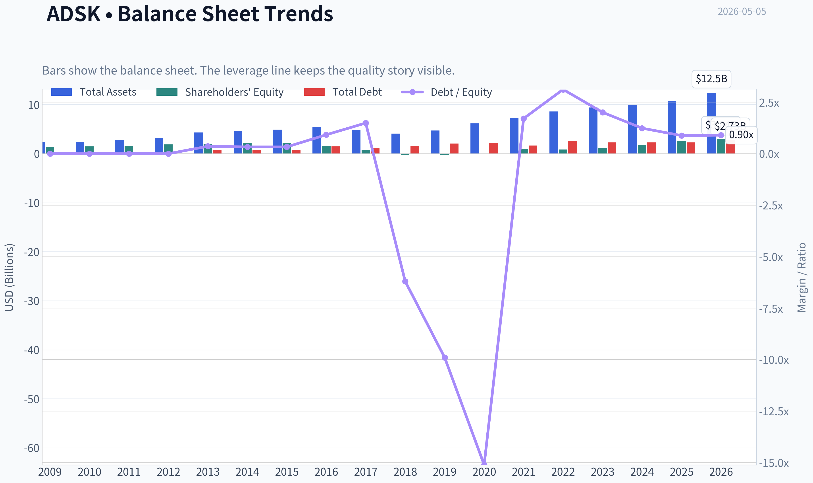
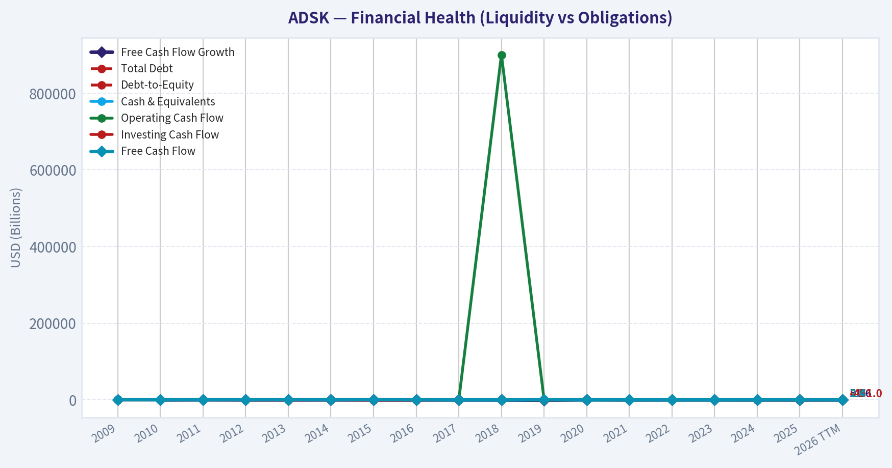
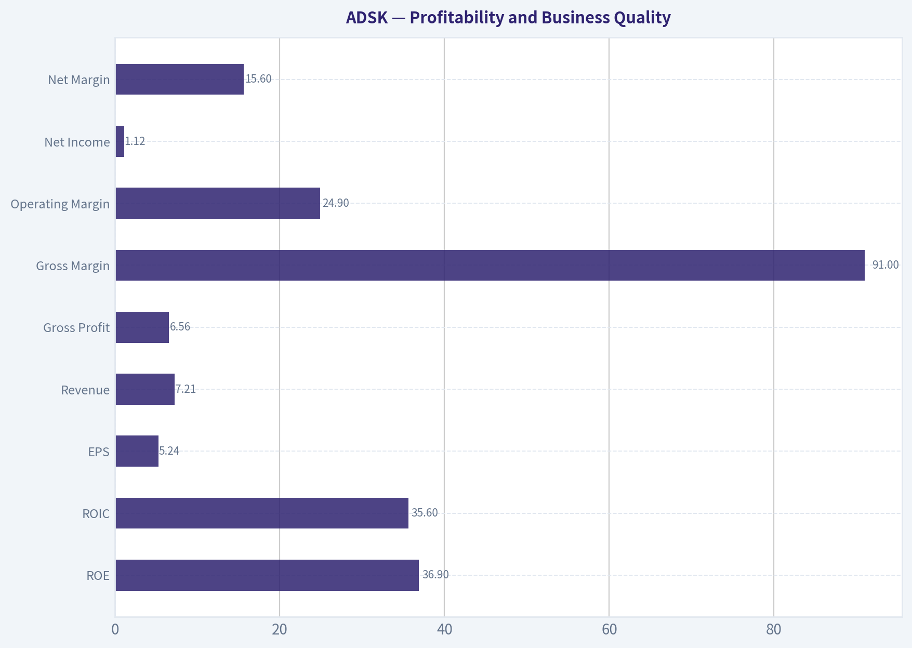
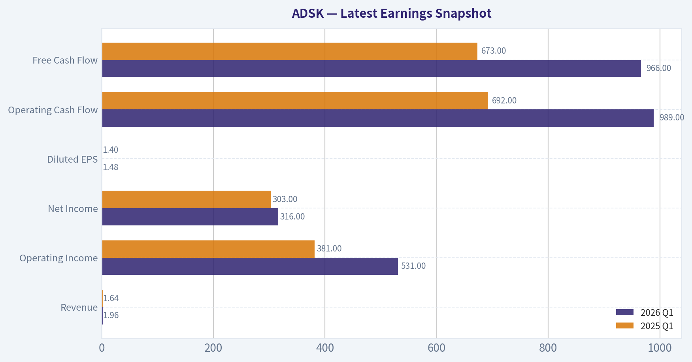
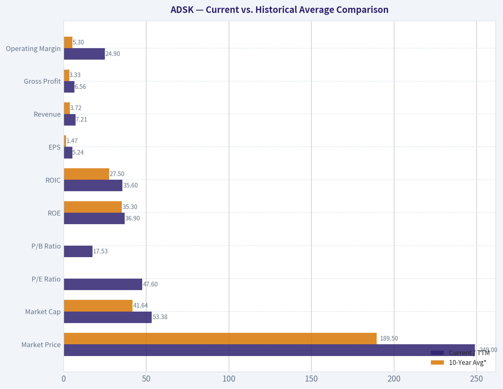
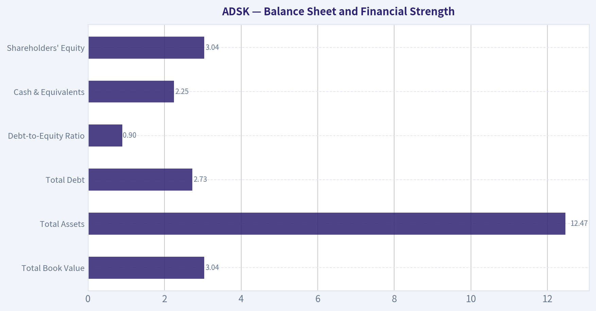
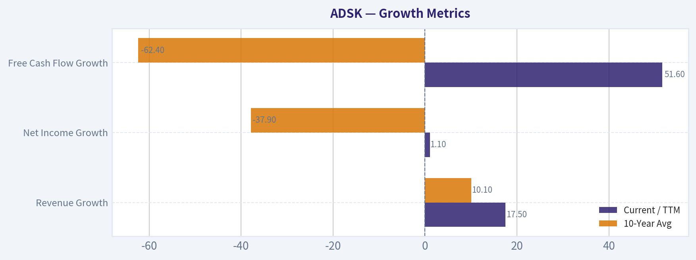
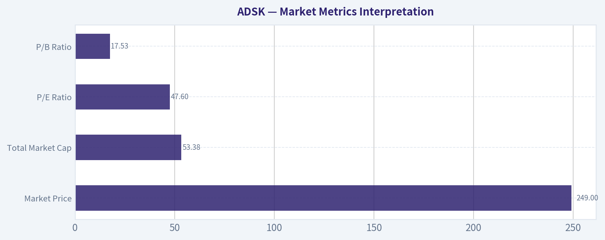

# ADSK Deep Value Intelligence

**Analysis Date:** 2026-05-05

## Critical Disclaimer

*This analysis is generated by Deep Value Intelligence, an AI-powered multi-agent investing framework. This report is for informational and educational purposes only and does not constitute financial advice. Always conduct your own research and consult with qualified financial advisors before making investment decisions.*

---

## Table of Contents

1. Intelligence Summary
2. Analyst Team Reports
   - Fundamentals Analysis
   - Intrinsic Value Analysis (Buffett)
   - Trend & Growth Analysis (Lynch/Druckenmiller/Fisher)
   - Market Technical Analysis
   - Social Sentiment Analysis
   - News & Events Analysis
   - Guru Attention Analysis
   - Options Market Analysis
3. Research Team Commentary
4. Value Investing Team Commentary
5. Deep Values Commentary

---

## Intelligence Summary

### Thesis + Conditions

**Core Thesis:** **EXECUTIVE SUMMARY**
*   **Verdict**: **WATCH**
*   **The "Why"**: Autodesk (ADSK) is an elite, wide-moat compounder boasting exceptional economics (91% gross margins, 33.6% ROIC). However, at $249 (a 47.8x P/E), it trades significantly above conservative intrinsic value estimates (~$198).

**Key Risks:**
- Verdict**: **WATCH**
- Risky Analyst (Quality & Optionality)**: Elite returns on capital and deep switching costs justify a premium multiple. Free cash flow is a superior proxy for software economics than GAAP net income. Furthermore, AI and cloud integration will likely widen Autodesk's moat by entrenching it further into enterprise workflows.
- Safe Analyst (Valuation & Earnings Quality)**: Paying nearly 48x earnings leaves zero room for error. The massive gap between FCF and net income is a red flag for heavy SBC or deferred revenue timing. Additionally, cyclical construction end-markets present unavoidable macro risks.
- Applying Buffett's framework, Autodesk passes the business quality and return on capital tests with flying colors. Its ecosystem lock-in creates a durable moat. However, Rule Number One is "never lose money." Buying a business at a significant premium to its intrinsic value invites permanent capital impairment if growth slows. The current multiple demands flawless execution, yet the unresolved earnings-quality questions (GAAP vs. FCF) and exposure to cyclical physical-world end-markets introduce friction. We must demand a margin of safety.
- From a selective contrarian perspective, the market is currently viewing Autodesk through the optimistic lens of its AI and cloud collaboration potential, heavily rewarding its top-line growth and recent cash flow surge. However, what the crowd may be missing-or willfully ignoring-is the composition of that cash flow. When free cash flow jumps 53 percent but net income is stagnant, a contrarian must ask if this cash is truly unencumbered owner earnings, or if it is being artificially inflated by stock-based compensation, deferred revenue shifts, or working capital timing. The lack of buying from prominent value gurus suggests that the "smart money" in the value space sees the current price as pricing in perfection.**

**What Would Change Our View:**
- Verdict**: **WATCH**
- Risky Analyst (Quality & Optionality)**: Elite returns on capital and deep switching costs justify a premium multiple. Free cash flow is a superior proxy for software economics than GAAP net income. Furthermore, AI and cloud integration will likely widen Autodesk's moat by entrenching it further into enterprise workflows.
- Safe Analyst (Valuation & Earnings Quality)**: Paying nearly 48x earnings leaves zero room for error. The massive gap between FCF and net income is a red flag for heavy SBC or deferred revenue timing. Additionally, cyclical construction end-markets present unavoidable macro risks.
- Applying Buffett's framework, Autodesk passes the business quality and return on capital tests with flying colors. Its ecosystem lock-in creates a durable moat. However, Rule Number One is "never lose money." Buying a business at a significant premium to its intrinsic value invites permanent capital impairment if growth slows. The current multiple demands flawless execution, yet the unresolved earnings-quality questions (GAAP vs. FCF) and exposure to cyclical physical-world end-markets introduce friction. We must demand a margin of safety.
- From a selective contrarian perspective, the market is currently viewing Autodesk through the optimistic lens of its AI and cloud collaboration potential, heavily rewarding its top-line growth and recent cash flow surge. However, what the crowd may be missing-or willfully ignoring-is the composition of that cash flow. When free cash flow jumps 53 percent but net income is stagnant, a contrarian must ask if this cash is truly unencumbered owner earnings, or if it is being artificially inflated by stock-based compensation, deferred revenue shifts, or working capital timing. The lack of buying from prominent value gurus suggests that the "smart money" in the value space sees the current price as pricing in perfection.**

**Confidence:** Medium

---

## Analyst Team Reports

### Fundamentals Analysis

#### Latest Earnings Snapshot

*Most recent reported quarter anchored on 2026 Q1, with prior-year comparison when available.*

| Metric | 2026 Q1 | 2025 Q1 | YoY Change |
| --- | ---: | ---: | ---: |
| Revenue | $1.96B | $1.64B | +19.4% |
| Operating Income | $531.0M | $381.0M | +39.4% |
| Net Income | $316.0M | $303.0M | +4.3% |
| Diluted EPS | $1.48 | $1.40 | +5.7% |
| Operating Cash Flow | $989.0M | $692.0M | +42.9% |
| Free Cash Flow | $966.0M | $673.0M | +43.5% |

Key Takeaways: This snapshot anchors the most recent reported quarter before the narrative analysis. It helps readers separate long-run business quality from whatever changed in the latest earnings print.

#### 10-Year Financial Metrics for ADSK

*All values below are computed deterministically from raw data - not estimated by AI.*

*Issuer profile: operating company (Technology / Software - Application).*

#### 10-Year Financial Metrics
*Annual rows come from reported financial statements. The final TTM row is computed from the latest four quarters.*

| Metric | 2009 | 2010 | 2011 | 2012 | 2013 | 2014 | 2015 | 2016 | 2017 | 2018 | 2019 | 2020 | 2021 | 2022 | 2023 | 2024 | 2025 | 2026 TTM |
| --- | --- | --- | --- | --- | --- | --- | --- | --- | --- | --- | --- | --- | --- | --- | --- | --- | --- | --- |
| Market Price | $17 | $24 | $41 | $36 | $39 | $51 | $54 | $47 | $81 | $116 | $147 | $197 | $277 | $250 | $215 | $254 | $311 | $249 |
| Market Cap | $3.81B | $5.52B | $9.53B | $8.40B | $9.01B | $11.77B | $12.55B | $10.58B | $18.11B | $25.38B | $32.22B | $43.80B | $61.59B | $55.45B | $46.90B | $54.82B | $67.56B | $53.38B |
| P/E Ratio | 20.70 | 95.16 | 45.20 | 29.51 | 36.34 | 51.25 | 154.31 | -32.07 | -31.16 | -44.81 | -397.84 | 205.05 | 51.00 | 111.51 | 56.92 | 60.58 | 60.81 | 47.60 |
| P/B Ratio | 2.91 | 3.75 | 5.92 | 4.46 | 4.41 | 5.20 | 5.66 | 6.53 | 24.69 | -99.14 | -152.78 | -315.10 | 63.82 | 65.32 | 40.96 | 29.55 | 25.78 | 17.53 |
| ROE | 14.0% | 3.9% | 13.2% | 15.2% | 12.1% | 10.1% | 3.7% | -20.4% | -79.3% | 221.4% | 38.3% | -154.3% | 125.2% | 58.5% | 71.9% | 48.8% | 42.4% | 36.9% |
| ROIC | 49.1% | 7.6% | 36.2% | 44.1% | 25.6% | 20.0% | 8.8% | -18.7% | -47.1% | -120.0% | -10.2% | 44.6% | 250.7% | 39.1% | 49.9% | 47.8% | 38.7% | 35.6% |
| EPS | $0.80 | $0.25 | $0.90 | $1.22 | $1.07 | $1.00 | $0.35 | $-1.46 | $-2.61 | $-2.58 | $-0.37 | $0.96 | $5.44 | $2.24 | $3.78 | $4.19 | $5.12 | $5.24 |
| Revenue | $2.32B | $1.71B | $1.95B | $2.22B | $2.31B | $2.27B | $2.51B | $2.50B | $2.03B | $2.06B | $2.57B | $3.27B | $3.79B | $4.39B | $5.00B | $5.50B | $6.13B | $7.21B |
| Gross Profit | $2.10B | $1.52B | $1.76B | $1.99B | $2.07B | $2.00B | $2.17B | $2.13B | $1.69B | $1.75B | $2.28B | $2.95B | $3.45B | $3.97B | $4.53B | $4.99B | $5.55B | $6.56B |
| Gross Margin | 90.5% | 88.8% | 89.9% | 89.7% | 89.7% | 87.9% | 86.4% | 85.2% | 83.2% | 85.2% | 88.9% | 90.1% | 91.1% | 90.5% | 90.4% | 90.7% | 90.6% | 91.0% |
| Operating Margin | 10.6% | 3.8% | 13.9% | 16.0% | 13.2% | 12.5% | 4.8% | 0.1% | -24.6% | -24.8% | -1.0% | 10.5% | 16.6% | 14.1% | 19.8% | 20.5% | 22.1% | 24.9% |
| Net Income | $183.6M | $58.0M | $212.0M | $285.3M | $247.4M | $228.8M | $81.8M | $-330.5M | $-582.1M | $-566.9M | $-80.8M | $214.5M | $1.21B | $497.0M | $823.0M | $906.0M | $1.11B | $1.12B |
| Net Margin | 7.9% | 3.4% | 10.9% | 12.9% | 10.7% | 10.1% | 3.3% | -13.2% | -28.7% | -27.6% | -3.1% | 6.6% | 31.9% | 11.3% | 16.4% | 16.5% | 18.1% | 15.6% |
| Revenue Growth | N/A | -26.0% | 13.9% | 13.5% | 4.4% | -1.7% | 10.5% | -0.3% | -18.9% | 1.3% | 25.0% | 27.4% | 15.7% | 15.7% | 14.1% | 9.8% | 11.5% | 17.5% |
| Net Income Growth | N/A | -68.4% | 265.5% | 34.6% | -13.3% | -7.5% | -64.2% | -504.0% | 76.1% | -2.6% | -85.7% | -365.5% | 463.2% | -58.9% | 65.6% | 10.1% | 22.7% | 1.1% |
| Free Cash Flow Growth | N/A | -59.7% | 146.6% | -0.4% | -1.5% | -0.7% | 26.8% | -46.0% | -72.6% | -153.1% | -722.7% | 339.2% | -1.2% | 9.6% | 37.7% | -36.9% | 22.2% | 51.6% |
| Total Book Value | $1.31B | $1.47B | $1.61B | $1.88B | $2.04B | $2.26B | $2.22B | $1.62B | $733.6M | $-256.0M | $-210.9M | $-139.0M | $965.0M | $849.0M | $1.15B | $1.85B | $2.62B | $3.04B |
| Total Assets | $2.42B | $2.45B | $2.79B | $3.23B | $4.31B | $4.59B | $4.91B | $5.52B | $4.80B | $4.11B | $4.73B | $6.18B | $7.28B | $8.61B | $9.44B | $9.91B | $10.83B | $12.47B |
| Total Debt | $0 | $0 | $0 | $0 | $745.6M | $746.4M | $743.1M | $1.49B | $1.09B | $1.59B | $2.09B | $2.10B | $1.65B | $2.65B | $2.30B | $2.30B | $2.30B | $2.73B |
| Debt-to-Equity | 0.00 | 0.00 | 0.00 | 0.00 | 0.36 | 0.33 | 0.33 | 0.92 | 1.49 | -6.20 | -9.90 | -15.11 | 1.71 | 3.12 | 2.01 | 1.24 | 0.88 | 0.90 |
| Cash & Equivalents | $917.6M | $838.7M | $1.08B | $1.16B | $1.61B | $1.85B | $1.41B | $1.35B | $1.21B | $1.08B | $886.0M | $1.77B | $1.77B | $1.53B | $1.95B | $1.89B | $1.60B | $2.25B |
| Shareholders' Equity | $1.31B | $1.47B | $1.61B | $1.88B | $2.04B | $2.26B | $2.22B | $1.62B | $733.6M | $-256.0M | $-210.9M | $-139.0M | $965.0M | $849.0M | $1.15B | $1.85B | $2.62B | $3.04B |
| Operating Cash Flow | $593.9M | $246.8M | $540.8M | $573.5M | $559.1M | $563.5M | $708.6M | $414.0M | $169.7M | $900,000 | $377.1M | $1.42B | $1.44B | $1.53B | $2.07B | $1.31B | $1.61B | $2.45B |
| Investing Cash Flow | $-478.1M | $-283.0M | $-142.3M | $-370.3M | $-647.2M | $-194.0M | $-905.6M | $-809.5M | $272.0M | $506.4M | $-710.4M | $-57.3M | $-404.0M | $-1.59B | $-143.0M | $-502.0M | $-903.0M | $-451.0M |
| Free Cash Flow | $515.5M | $207.8M | $512.5M | $510.5M | $502.7M | $499.3M | $633.1M | $341.6M | $93.7M | $-49.8M | $310.1M | $1.36B | $1.35B | $1.48B | $2.03B | $1.28B | $1.57B | $2.38B |
| FCF Margin | 22.3% | 12.1% | 26.3% | 23.0% | 21.7% | 22.0% | 25.2% | 13.6% | 4.6% | -2.4% | 12.1% | 41.6% | 35.5% | 33.6% | 40.6% | 23.3% | 25.6% | 33.0% |
| Dividends / Share | $0.00 | $0.00 | $0.00 | $0.00 | $0.00 | $0.00 | $0.00 | $0.00 | $0.00 | $0.00 | $0.00 | $0.00 | $0.00 | $0.00 | $0.00 | $0.00 | $0.00 | $0.00 |

#### Profitability Metrics
- Return on Equity (ROE): 36.9%
- Return on Invested Capital (ROIC): 33.6%
- Return on Assets (ROA): 9.0%
- Gross Margin: 91.0%
- Operating Margin: 21.9%
- Net Profit Margin: 15.6%

#### Liquidity Metrics
- Current Ratio: 0.85
- Quick Ratio: 0.69

#### Leverage Metrics
- Debt-to-Equity Ratio: 0.82
- Interest Coverage Ratio: 19.73
- Net Debt: $251.0M

#### Growth Metrics (Year-over-Year)
- Revenue Growth: 17.5%
- Net Income Growth: 1.1%
- Free Cash Flow Growth: 53.7%
- Revenue CAGR (3-Year): 12.9%
- Revenue CAGR (5-Year): 13.7%

#### Valuation Metrics
- P/E Ratio (TTM): 47.78
- Forward P/E: 17.69
- Price-to-Book: 17.37
- Price-to-Sales: 7.30
- PEG Ratio: 0.96
- EV/EBITDA: 27.68
- Free Cash Flow Yield: 4.6%
- Earnings Yield: 2.1%

#### Owner Earnings (Buffett Method, Code-Computed)
- Net Income: $1.11B
- + Depreciation & Amortization: $195.0M
- - Capital Expenditures: $-43.0M
- - Working Capital Changes: $-501.0M
- = **Owner Earnings: $1.71B**

#### Intrinsic Value (Code-Computed)
- Current Price: $249
- Buffett Method (Owner Earnings):
  Conservative: $9
  Average: $198
  Optimistic: $198
- Cash Flow Method (FCF):
  Conservative: $20
  Average: $119
  Optimistic: $145

#### Piotroski F-Score: 7/9
- Positive Net Income: PASS
- Positive Operating Cash Flow: PASS
- ROA Improvement: FAIL
- Cash Flow > Net Income: PASS
- Decreasing Debt: FAIL
- Improving Current Ratio: PASS
- No Dilution: PASS
- Improving Gross Margin: PASS
- Improving Asset Turnover: PASS

ANALYST STANCE: **WATCH**

#### ADSK - Warren Buffett-Style Fundamental Analysis

Autodesk is a high-quality vertical software company with very strong gross margins, durable recurring revenue, and deep switching costs in architecture, engineering, construction, manufacturing, and design workflows. The business has completed a major transition from perpetual licenses to subscription and cloud-connected offerings, which distorted reported earnings and cash flow in the middle of the historical period. Today, ADSK looks materially stronger operationally than its 10-year average, but the stock price already discounts a large amount of that quality.

---

#### Current vs. Historical Average Comparison

| Metric | Current / TTM | 10-Year Avg* | Current Standing vs. History | Interpretation |
|---|---:|---:|---:|---|
| Market Price | $249 | $189.50 | Above average | Stock remains meaningfully above its decade average, though below the 2025 high of $311. |
| Market Cap | $53.38B | $41.64B | Above average | Market value reflects a more mature, recurring-revenue software model. |
| P/E Ratio | 47.60 | 4.00 arithmetic; ~91.0 profitable-year avg | Mixed / still expensive | The arithmetic average is distorted by loss years; relative to profitable post-transition years, current P/E is lower but still high in absolute terms. |
| P/B Ratio | 17.53 | -31.04 arithmetic; ~36.7 positive-equity avg | Below recent positive-equity avg | Book value was distorted by negative equity years; current P/B remains expensive but less extreme than 2021-2025. |
| ROE | 36.9% | 35.3% | Slightly above average | High ROE reflects strong software economics, but also a relatively small equity base. |
| ROIC | 35.6% | 27.5% | Above average | Strong signal of capital-light business quality. |
| EPS | $5.24 | $1.47 | Far above average | Earnings have normalized sharply after the subscription transition. |
| Revenue | $7.21B | $3.72B | Far above average | Revenue has nearly doubled versus the 10-year average. |
| Gross Profit | $6.56B | $3.33B | Far above average | Gross profit scales almost directly with revenue due to very high software margins. |
| Operating Margin | 24.9% | 5.3% | Far above average | Operating leverage has improved meaningfully after the business model transition. |
| Net Income | $1.12B | $0.32B | Far above average | Profitability is much healthier than the decade average. |
| Net Margin | 15.6% | 2.8% | Far above average | Current net profitability is structurally better than the transition-period average. |
| Revenue Growth | 17.5% | 10.1% | Above average | Growth is currently stronger than the decade norm. |
| Net Income Growth | 1.1% | -37.9% | Above distorted average, but slowing | Earnings growth is positive but much slower than revenue growth. |
| Free Cash Flow Growth | 51.6% | -62.4% | Far above distorted average | Current FCF growth is excellent, though the historical average is distorted by transition years. |
| Total Book Value | $3.04B | $0.92B | Far above average | Equity base has recovered from prior negative-equity years. |
| Total Assets | $12.47B | $7.14B | Above average | Balance sheet has expanded with business scale and acquisitions. |
| Total Debt | $2.73B | $1.96B | Above average | Debt is higher than historical average but manageable relative to cash flow. |
| Debt-to-Equity | 0.90 | -1.98 arithmetic; ~1.62 positive-equity avg | Improved vs positive-equity avg | Leverage is now more reasonable than several recent years. |
| Cash & Equivalents | $2.25B | $1.50B | Above average | Cash position is strong. |
| Shareholders' Equity | $3.04B | $0.92B | Far above average | Equity has rebuilt materially. |
| Free Cash Flow | $2.38B | $0.98B | Far above average | FCF generation is one of the strongest parts of the ADSK thesis. |
| Dividends / Share | $0.00 | $0.00 | Unchanged | Autodesk does not currently return capital through dividends. |

\*10-year average uses fiscal 2016-2025 annual data from the deterministic dataset, excluding the 2026 TTM row.

**Key Takeaways:** Autodesk's current operating profile is far stronger than its decade average: revenue, gross profit, operating margin, net income, ROIC, and free cash flow are all materially above historical norms. However, valuation is still demanding, especially on P/E and price-to-book, even after adjusting for the distorted loss years during the subscription transition. The company now looks like a high-quality compounder, but not an obvious bargain.

---

#### Market Metrics Interpretation

| Metric | Current Value | Buffett-Style Interpretation |
|---|---:|---|
| Market Price | $249 | The stock is below the 2025 level of $311 but still well above the 10-year average price of about $190. |
| Total Market Cap | $53.38B | ADSK is valued as a scaled, durable software franchise rather than a cyclical design-tools vendor. |
| P/E Ratio | 47.60 | Expensive on trailing earnings; acceptable only if high-margin recurring growth persists. |
| P/B Ratio | 17.53 | High versus traditional book value, but book value is less useful for asset-light software firms with intangible moats. |

**Key Takeaways:** The market clearly prices Autodesk as a high-quality software franchise. The P/E ratio leaves limited room for disappointment, while the P/B ratio is structurally high because most of Autodesk's value lies in software, customer relationships, workflow integration, and brand equity rather than tangible assets.

---

#### Profitability and Business Quality

| Metric | Current / TTM | Interpretation |
|---|---:|---|
| ROE | 36.9% | Excellent headline return, though magnified by a relatively modest equity base. |
| ROIC | 35.6% | Very strong; suggests real economic value creation and efficient use of capital. |
| EPS | $5.24 | Earnings power has recovered strongly after earlier loss years. |
| Revenue | $7.21B | Scale continues to expand, with 17.5% YoY growth. |
| Gross Profit | $6.56B | Extremely high gross profit due to software economics. |
| Gross Margin | 91.0% | World-class margin profile; strong indicator of moat and pricing power. |
| Operating Margin | 24.9% | Operating leverage is now visible after the subscription model transition. |
| Net Income | $1.12B | Profitable and cash-generative, though net income growth has slowed. |
| Net Margin | 15.6% | Healthy, but still below best-in-class mature software peers. |

**Key Takeaways:** Autodesk's profitability profile is now strong and improving. The 91% gross margin is the clearest evidence of software-like economics, while the 35.6% ROIC indicates that the business can convert intangible assets and customer relationships into attractive returns. The main caution is that net income growth is currently only 1.1%, which is much slower than revenue growth.

---

#### Growth Metrics

| Growth Metric | Current / TTM | 10-Year Avg | Interpretation |
|---|---:|---:|---|
| Revenue Growth | 17.5% | 10.1% | Current growth is above historical norms and suggests strong demand. |
| Net Income Growth | 1.1% | -37.9% | Positive but weak; historical average is distorted by losses and transition years. |
| Free Cash Flow Growth | 51.6% | -62.4% | Very strong current FCF growth, though historical comparison is distorted by subscription transition volatility. |

**Key Takeaways:** Revenue growth is currently very strong and comfortably above the 10-year average. Free cash flow growth is also impressive, but investors should not extrapolate 51.6% indefinitely. The weaker net income growth suggests some margin, tax, acquisition, or expense timing effects beneath the headline revenue strength.

---

#### Balance Sheet and Financial Strength

| Metric | Current / TTM | Buffett-Style Interpretation |
|---|---:|---|
| Total Book Value | $3.04B | Book value has recovered materially after prior negative-equity years. |
| Total Assets | $12.47B | Asset base has expanded with scale, acquisitions, and deferred revenue infrastructure. |
| Total Debt | $2.73B | Debt is meaningful but not alarming relative to cash flow. |
| Debt-to-Equity Ratio | 0.90 | Reasonable compared with recent positive-equity years. |
| Cash & Equivalents | $2.25B | Strong liquidity buffer. |
| Shareholders' Equity | $3.04B | Improved balance sheet resilience versus the 2018-2020 negative-equity period. |

**Key Takeaways:** Autodesk's balance sheet is much healthier than during the negative-equity years. Debt is higher than the decade average, but free cash flow is strong enough to support it. The main balance sheet caution is liquidity: the current ratio of roughly 0.85 indicates that short-term liabilities exceed current assets, common for subscription software firms but still worth monitoring.

---

#### Cash Flow and Capital Allocation

| Metric | Current / TTM | Interpretation |
|---|---:|---|
| Operating Cash Flow | $2.45B | Strong conversion of earnings into cash. |
| Free Cash Flow | $2.38B | Excellent cash generation; FCF margin is 33.0%. |
| Free Cash Flow Yield | ~4.6% | Fair but not deeply cheap for a value investor. |
| Dividends / Share | $0.00 | Management prioritizes reinvestment, acquisitions, and likely buybacks over dividends. |

**Key Takeaways:** Free cash flow is the strongest financial feature of Autodesk today. The company generates far more cash than accounting earnings, which is attractive from a Buffett-style owner-earnings perspective. However, a 4.6% FCF yield does not provide a large margin of safety unless growth remains durable.

---

#### Revenue Breakdown

| Revenue Source | Amount ($B) | % of Total |
|---|---:|---:|
| Architecture, Engineering & Construction | ~$3.61B | ~50% |
| AutoCAD and AutoCAD LT | ~$1.87B | ~26% |
| Manufacturing | ~$1.44B | ~20% |
| Media & Entertainment | ~$0.29B | ~4% |
| **Total** | **$7.21B** | **100%** |

**Key Takeaways:** Autodesk's largest business is Architecture, Engineering & Construction, which accounts for roughly half of total revenue and is central to the company's moat. AutoCAD remains a major cash engine, while Manufacturing provides another durable vertical growth channel. Media & Entertainment is much smaller but strategically relevant to design and visualization workflows.

---

#### Warren Buffett-Style Qualitative Analysis

| Buffett Criterion | ADSK Assessment | Explanation |
|---|---|---|
| Economic Moat | Strong | Autodesk benefits from workflow lock-in, industry-standard file formats, professional training ecosystems, high switching costs, and deep integration into customer design processes. |
| Financial Strength | Good | Cash of $2.25B and FCF of $2.38B support debt of $2.73B; leverage is manageable. |
| Predictable Earnings | Improving, not perfect | The subscription transition caused losses and volatility, but recent years show much better revenue and cash-flow predictability. |
| Management Performance | Good | ROIC is high, margins are expanding, and capital allocation favors reinvestment over dividends. |
| Pricing Power | Strong | 91% gross margin and recurring subscription revenue suggest meaningful pricing power. |
| Margin Stability | Improved | Gross margin has remained consistently near 90%; operating margin has improved significantly. |
| Shareholder Returns | Mixed | No dividend; value creation depends on reinvestment, buybacks, acquisitions, and sustained growth. |
| Valuation Discipline | Caution required | Quality is high, but current valuation does not scream "Buffett bargain." |

**Key Takeaways:** Autodesk has many characteristics Buffett would admire in a business: high margins, sticky customers, strong returns on capital, and durable competitive advantages. The weakness is not business quality; it is valuation and margin of safety. ADSK looks like a wonderful business, but not clearly at a wonderful price.

---

#### Buffett-Style Owner Earnings DCF Valuation

Current owner earnings from the deterministic dataset:

**Owner Earnings = Net Income + Depreciation & Amortization - Capital Expenditures - Working Capital Changes**

| Component | Amount |
|---|---:|
| Net Income | $1.11B |
| + Depreciation & Amortization | $195.0M |
| - Capital Expenditures | $43.0M cash outflow adjustment |
| - Working Capital Changes | $501.0M cash benefit adjustment per dataset formula |
| **Owner Earnings** | **$1.71B** |

**Key Takeaways:** Autodesk's owner earnings are higher than reported net income, which supports the view that ADSK is a strong cash-generating software business. The gap between net income and owner earnings is important because a Buffett-style investor focuses on cash that can be distributed or reinvested, not only accounting profits.

Assumptions used for the transparent DCF:

| Assumption | Value |
|---|---:|
| Starting Owner Earnings | $1.71B |
| Estimated Shares Outstanding | ~214.4M |
| Discount Rate | 10.0% |
| Terminal Growth Rate | 2.5% |
| Projection Period | 10 years |
| Conservative Growth Rate | -36.9% |
| Average Growth Rate | 13.8% |
| Optimistic Growth Rate | 51.6% |
| Formula | PV of 10-year owner earnings + PV of terminal value |

**Key Takeaways:** The DCF uses the deterministic owner-earnings figure of $1.71B and discounts future cash flows at 10%, consistent with a Buffett-style required return. Growth assumptions are based on available post-transition owner-earnings proxy growth, using free cash flow growth as the closest available historical proxy because full historical owner-earnings components are not provided in the deterministic table.

| Scenario | Growth Assumption | 10-Year PV of Owner Earnings | PV of Terminal Value | Equity Value | Fair Value / Share | Interpretation |
|---|---:|---:|---:|---:|---:|---|
| Conservative | -36.9% | ~$2.29B | ~$0.09B | ~$2.38B | ~$11 | Severe downside case; assumes a major cash-flow contraction. |
| Average | 13.8% | ~$20.75B | ~$32.88B | ~$53.63B | ~$250 | Roughly in line with the current market price of $249. |
| Optimistic | 51.6% | ~$147.7B | ~$578.7B | ~$726.4B | ~$3,388 | Mathematically possible but economically unrealistic as a long-term assumption. |

**Key Takeaways:** The average-case DCF produces a value close to the current stock price, suggesting ADSK may be fairly valued if mid-teens owner-earnings growth persists. The conservative case shows substantial downside if cash-flow growth reverses. The optimistic case is not a realistic underwriting case because 51.6% owner-earnings growth cannot reasonably compound for a decade at Autodesk's current scale.

The deterministic dataset also includes code-computed intrinsic value references: Buffett Method conservative value of **$9**, average value of **$198**, and optimistic value of **$198**. Those values reinforce the conclusion that there is not a wide margin of safety at $249, especially under stricter or more normalized assumptions.

---

#### Investment Insights, Red Flags, and Opportunities

| Category | Key Point | Investment Significance |
|---|---|---|
| Insight | Gross margin of 91.0% | Indicates exceptional software economics and pricing power. |
| Insight | ROIC of 35.6% | Strong evidence of capital-light value creation. |
| Insight | Revenue growth of 17.5% | Current demand remains robust. |
| Insight | FCF of $2.38B and FCF margin of 33.0% | Strong owner-earnings foundation. |
| Opportunity | Construction digitization | Autodesk can benefit from long-term digitization of architecture, engineering, construction, and jobsite workflows. |
| Opportunity | Manufacturing and PLM expansion | Acquisitions and cloud platforms can deepen enterprise relationships. |
| Opportunity | AI-assisted design workflows | AI tools may improve customer productivity and increase platform stickiness. |
| Red Flag | P/E of 47.6 | Valuation is demanding on trailing earnings. |
| Red Flag | No dividend | Shareholder returns depend on reinvestment, growth, and buybacks. |
| Red Flag | Current ratio around 0.85 | Not alarming for subscription software, but short-term liabilities exceed current assets. |
| Red Flag | Net income growth only 1.1% | Earnings growth is currently much slower than revenue and FCF growth. |
| Red Flag | Acquisition integration risk | Rhumbix and other acquisitions may improve the platform but can also dilute focus or returns. |

**Key Takeaways:** Autodesk's biggest opportunity is to keep expanding its high-margin software platform across design, construction, manufacturing, and lifecycle workflows. The biggest risk is valuation: the market already recognizes ADSK's quality. If growth slows, the multiple could compress even if the business remains fundamentally strong.

---

#### Final Investment Stance: WATCH

| Decision Factor | Assessment |
|---|---|
| Business Quality | Excellent |
| Economic Moat | Strong |
| Financial Strength | Good |
| Earnings Predictability | Improving |
| Cash Flow Quality | Strong |
| Valuation | Fair to expensive |
| Margin of Safety | Limited |
| Final Stance | **WATCH** |

**Key Takeaways:** Autodesk is a high-quality business with strong moat characteristics, excellent gross margins, high ROIC, and improving free cash flow. However, at $249 per share, the stock appears close to fair value under an average DCF case and above the stricter code-computed Buffett-style average value of $198. For a Buffett-style value investor, ADSK deserves a place on the watchlist, but the current price does not provide enough margin of safety to make it an ADVOCATE.

---

#### Summary Table - Key Points

| Area | Conclusion |
|---|---|
| Business Model | Durable, recurring, high-margin vertical software platform. |
| Moat | Strong switching costs, industry standards, workflow integration, and ecosystem depth. |
| Profitability | Excellent gross margin, strong ROIC, and improving operating margin. |
| Growth | Revenue growth is strong; net income growth is currently modest. |
| Balance Sheet | Manageable debt, strong cash, improved equity base. |
| Cash Flow | Very strong free cash flow and owner earnings. |
| Valuation | Not cheap; current price is near average-case DCF value. |
| Main Risk | Multiple compression if growth or margin expansion disappoints. |
| Main Opportunity | Continued digitization of construction, manufacturing, and cloud design workflows. |
| Stance | **WATCH - high-quality company, but limited margin of safety at current valuation.** |

#### Fundamental Visuals

This graph tracks the profitability and return metrics (ROE, ROIC, Margins) of **ADSK** over the past decade, highlighting capital efficiency trends.

This chart illustrates the financial health of **ADSK** over the last 10 years, mapping cash equivalents and free cash flow against total obligations (Debt).

This comparison chart from *Profitability and Business Quality* stacks current figures against historical benchmarks for **ADSK**, making it easy to see where the company trades relative to its own averages.

---

### Intrinsic Value Analysis (Buffett)

> *Following Warren Buffett's value investing philosophy: Circle of Competence, Economic Moat, Management Quality, and Margin of Safety.*

#### Intrinsic Value Snapshot

Price is what you pay. Intrinsic value is what the business may be worth based on the cash it can create for owners over time. We show a range, not one magic number.

- Current Price: $249.43
- Value Range: $8.85 to $197.54

##### Owner Earnings (Buffett Method)
- Net Income: $1,112,000,000.00
- Depreciation & Amortization: $195,000,000.00
- Capital Expenditures: $-43,000,000.00
- Working Capital Changes: $-501,000,000.00
- Owner Earnings: $1,710,000,000.00

##### Intrinsic Value
###### Buffett Method
Uses owner earnings. Stricter, and usually more conservative.
- Conservative: $8.85
- Average: $197.54
- Optimistic: $197.54
- Discount Rate: 10.0%

###### Cash Flow Method
Uses free cash flow. Better for companies spending heavily today to grow tomorrow.
- Conservative: $19.75
- Average: $118.80
- Optimistic: $145.02
- Discount Rate: 10.0%

ANALYST STANCE: **WATCH**

#### Autodesk, Inc. - Buffett-Style Value Analysis

Autodesk is a high-quality software franchise with strong switching costs, powerful industry standards, and exceptional gross margins. The business is understandable and likely durable, but at the current price of about **$249 per share**, the stock does not offer a Buffett-style margin of safety based on the available data. This is a **wonderful business**, but not yet a clearly wonderful price.

---

#### 1. Go / No-Go Gate Assessment

| Buffett Gate | Assessment | Pass / Fail | Evidence |
|---|---:|---:|---|
| Gate 1: Circle of Competence & Simplicity | Autodesk sells design, engineering, construction, and manufacturing software, mostly through subscriptions. | Pass | The business model is simple: professionals pay recurring fees to use mission-critical software such as AutoCAD, Revit, Fusion, and construction tools. |
| Elementary School Test | "Autodesk makes software that architects, engineers, builders, and manufacturers use to design things." | Pass | Revenue comes from subscriptions and software usage by professional customers. |
| 10-Year Predictability | High, but not perfect. | Pass | Buildings, infrastructure, manufacturing, and design workflows will still need professional-grade software in 10 years. |
| Technology Risk | Moderate, but more likely enabling than destructive. | Pass with caveat | AI and cloud tools may reshape design workflows, but Autodesk is well positioned to embed those technologies into existing platforms. |
| Gate 2: Moat Test | Wide moat, mainly from switching costs, standards, data/workflow entrenchment, and brand. | Pass | 91% gross margin is strong financial evidence of pricing power and software economics. |
| Gate 3: Management & Capital Allocation | Generally rational, but requires more proxy-level confirmation. | Pass with caveat | Subscription transition was strategically sound; recent Rhumbix acquisition supports construction data strategy. Need deeper review of stock-based compensation, buyback discipline, and executive ownership. |
| Gate 4: Industry Structure | Attractive. | Pass | Professional design software is a rational, specialized market with high switching costs and limited credible competitors in many workflows. |

Key Takeaways: Autodesk passes the core Buffett gates because it is understandable, asset-light, highly profitable, and embedded in professional workflows. The main concern is not business quality; it is valuation and the need for more evidence on long-term capital allocation discipline.

---

#### 2. Moat Analysis

| Moat Source | Strength | Evidence | Buffett Interpretation |
|---|---:|---|---|
| Intangible Assets / Brand | Strong | AutoCAD, Revit, and Autodesk are industry-recognized names in architecture, engineering, construction, and manufacturing. | Brand matters because professionals are trained on these tools and firms often standardize around them. |
| Pricing Power | Strong | Gross margin reported at approximately **91%**. | A 91% gross margin strongly suggests software pricing power and low marginal cost. |
| Switching Costs | Very Strong | Design files, workflows, employee training, integrations, standards, and collaboration processes are embedded in customer operations. | This is the strongest moat source; switching can disrupt projects and create retraining costs. |
| Cost Advantage | Moderate | Software scale creates high incremental margins once products are built. | Scale economics are attractive, but not the primary moat. |
| Network Effects | Moderate | Common file formats, ecosystem familiarity, training networks, and partner integrations reinforce adoption. | Network effects exist, though they are more workflow-standard effects than consumer-style network effects. |
| Moat Rating | Wide & Stable | High gross margins, recurring revenue model, and industry-standard positioning. | Proceed, but valuation discipline is required. |

Key Takeaways: Autodesk's moat is real and primarily built on switching costs. Customers are not just buying software; they are buying continuity in design data, project workflows, training, and professional standards. That creates a durable competitive position.

---

#### 3. Management Quality & Capital Allocation

| Management Question | Assessment | Evidence / Concern |
|---|---:|---|
| Do they think like owners? | Incomplete / Mixed | More work is needed on insider ownership, compensation design, and whether incentives emphasize long-term per-share value. |
| Are they candid and conservative? | Incomplete | No restatement or accounting red flag was identified from the research pack, but annual-letter-level review was not available here. |
| Are they rational capital allocators? | Generally positive, with caveats | The subscription transition was value-enhancing. The Rhumbix acquisition appears strategically aligned with construction technology and jobsite data capture. |
| Buyback discipline | Needs review | Autodesk has historically used buybacks, but at a high valuation, repurchases can destroy value if done indiscriminately. |
| Acquisition discipline | Watch item | Rhumbix may strengthen construction workflows, but serial software acquisitions should be monitored for price paid and integration returns. |
| Debt discipline | Needs fuller balance sheet review | Current ratio of **0.85** suggests limited short-term balance sheet flexibility, though software companies often operate with deferred revenue dynamics. |

Key Takeaways: Management appears strategically competent, especially in moving Autodesk toward recurring subscription revenue and expanding construction workflows. However, a Buffett investor would still want deeper evidence on executive incentives, acquisition returns, and buyback discipline before calling management excellent.

---

#### 4. Available Financial Summary

Full 10-year financial statements were not available in the current research pack, so this table uses the collected current snapshot and inferred values from market data. I am not inventing unavailable historical figures.

| Metric | Current / Inferred Value | Buffett View |
|---|---:|---|
| Share Price | **$249** | Starting valuation point. |
| Market Capitalization | **$52.63B** | Large, established franchise. |
| Estimated Shares Outstanding | **~211.4M** | Market cap divided by share price. |
| P/E Ratio | **47.8x** | Expensive relative to current earnings. |
| Implied Net Income | **~$1.10B** | Market cap divided by P/E. |
| Implied EPS | **~$5.21** | Price divided by P/E. |
| ROE | **36.9%** | Excellent headline return, but leverage and buybacks should be checked. |
| Gross Margin | **91.0%** | Outstanding; strong evidence of software economics and pricing power. |
| Revenue Growth YoY | **17.5%** | Strong growth for a mature software franchise. |
| FCF Yield | **4.6%** | Reasonable but not obviously cheap. |
| Implied Free Cash Flow | **~$2.42B** | Market cap multiplied by FCF yield. |
| Implied FCF per Share | **~$11.46** | FCF divided by estimated shares. |
| Current Ratio | **0.85** | Below 1.0; not ideal, but software deferred revenue can distort this. |

Key Takeaways: Autodesk's business quality is clear from the 91% gross margin, strong revenue growth, and high ROE. The valuation is the problem: a 47.8x earnings multiple leaves little room for disappointment. Free cash flow is much stronger than GAAP earnings, but the stock still does not look obviously cheap.

---

#### 5. Owner Earnings Calculation

Because detailed maintenance capital expenditure and working capital data were not available, I use free cash flow as a practical proxy for owner earnings. For a software company, this is often a reasonable approximation, though stock-based compensation should be reviewed separately.

| Owner Earnings Component | Estimate | Comment |
|---|---:|---|
| Market Capitalization | **$52.63B** | Given in research pack. |
| FCF Yield | **4.6%** | Given in research pack. |
| Estimated Free Cash Flow | **~$2.42B** | $52.63B x 4.6%. |
| Estimated Shares Outstanding | **~211.4M** | $52.63B / $249. |
| Estimated Owner Earnings per Share | **~$11.46** | $2.42B / 211.4M shares. |
| Owner Earnings Yield | **4.6%** | Free cash flow yield proxy. |

Key Takeaways: Autodesk appears to generate about $2.4 billion of annual owner earnings using free cash flow as a proxy. That is a strong cash engine, but at the current market value, investors are only receiving a 4.6% owner earnings yield before growth.

---

#### 6. Three-Scenario DCF Valuation

Assumptions:
- Owner earnings proxy: **$2.42B**
- Shares outstanding: **~211.4M**
- Discount rate: **10%**
- Current share price: **$249**
- Scenario C uses **8.75% growth**, equal to 50% of the reported 17.5% revenue growth rate, with a 3% terminal growth rate after year 10.

| Scenario | Method | Estimated Equity Value | Estimated Value per Share | Upside / Downside vs. $249 |
|---|---|---:|---:|---:|
| A: No Growth | Owner earnings / 10% | **$24.2B** | **~$115** | **-54%** |
| B: GDP Growth | Owner earnings x 1.03 / (10% - 3%) | **$35.6B** | **~$169** | **-32%** |
| C: Historical Growth Haircut | 8.75% growth for 10 years, then 3% terminal growth | **~$54.5B** | **~$258** | **+4%** |

Key Takeaways: The valuation only works if Autodesk continues to compound owner earnings at a strong rate for a long time. Under no-growth or modest-growth assumptions, the stock looks expensive. Even under the more optimistic growth case, the estimated value is only slightly above today's price.

---

#### 7. Margin of Safety Analysis

| Valuation Case | Estimated Value per Share | Required Buy Price for 25% Margin of Safety | Current Price | Margin of Safety Status |
|---|---:|---:|---:|---|
| No Growth | ~$115 | ~$86 | $249 | None |
| GDP Growth | ~$169 | ~$126 | $249 | None |
| Growth Case | ~$258 | ~$193 | $249 | None |
| Buffett-Style Target Zone | Based on high-quality business, minimum 25% discount | Around **$190-$195** | $249 | Not attractive yet |

Key Takeaways: Autodesk does not currently offer a Buffett-style margin of safety. A high-quality business can deserve a premium multiple, but even a wonderful company can be a poor investment if purchased too expensively. A more attractive entry point would likely be closer to the low-$190s, based on these assumptions.

---

#### 8. Buffett Scorecard

| Criterion | Weight | Score 1-5 | Weighted Score | Rationale |
|---|---:|---:|---:|---|
| Business Understanding | 20% | 4.5 | 0.90 | Simple recurring software model serving design, engineering, and construction professionals. |
| Moat Width & Durability | 25% | 4.5 | 1.13 | Strong switching costs, brand, workflow lock-in, and 91% gross margin. |
| Management Quality | 15% | 3.5 | 0.53 | Good strategic moves, but more evidence needed on incentives, buybacks, and acquisition returns. |
| Return on Equity | 15% | 4.0 | 0.60 | ROE of 36.9% is excellent, though leverage and buyback effects need deeper review. |
| Reinvestment Runway | 10% | 4.0 | 0.40 | Construction, manufacturing, cloud, AI, and PLM workflows offer continued growth opportunities. |
| Balance Sheet Strength | 5% | 3.0 | 0.15 | Current ratio below 1.0; not alarming for software, but not a fortress signal from available data. |
| Industry Structure | 5% | 4.0 | 0.20 | Specialized professional software market with rational competition and high customer lock-in. |
| Valuation / Margin of Safety | 5% | 2.0 | 0.10 | Current price offers little to no margin of safety. |
| Final Weighted Score | 100% | - | **4.00** | High-quality business, valuation prevents advocacy. |

Key Takeaways: Autodesk scores very well as a business but poorly on margin of safety. The overall score reaches the quality threshold, but Buffett-style investing requires both quality and price discipline. At today's price, the correct stance is to watch rather than buy aggressively.

---

#### 9. Final Investment Stance

| Category | Conclusion |
|---|---|
| Business Quality | Excellent |
| Moat | Wide and stable |
| Predictability | High |
| Financial Quality | Strong, especially gross margin and free cash flow generation |
| Management | Probably good, but not fully proven from available materials |
| Valuation | Full to expensive |
| Margin of Safety | Insufficient |
| Final Stance | **WATCH** |
| Conviction | Moderate to high on business quality; low on current valuation attractiveness |

Key Takeaways: Autodesk is the type of business a Buffett-style investor should want to own, but only at the right price. The company has durable advantages and attractive economics, yet the current valuation already assumes a great deal of future success. The prudent action is to keep it on the watchlist and wait for a better margin of safety.

#### Bottom Line

Autodesk is a **wonderful business trading near or above fair value**. Its moat is supported by industry-standard software, deep customer workflow integration, high switching costs, and extraordinary gross margins. However, at **$249 per share**, the stock does not provide the minimum 25% margin of safety required for a disciplined value investor.

**Decision: WATCH.**
I would become more interested if the stock approached roughly **$190-$195**, assuming the business fundamentals remain intact.
#### Valuation Bridge

This bridge places the current market price beside each intrinsic value lens so readers can see whether upside depends on one method or shows up across several methods.

| Scenario | Intrinsic Value / Share |
| --- | ---: |
| Buffett Method | $197.54 |
| Cash Flow Method | $118.80 |
| Damodaran Method | $44.53 |
| Current Price | $249.43 |

#### Key Takeaways

If one method is far above the others, the upside case depends on a specific modelling assumption. When several methods cluster together, the valuation story is more robust.

#### Valuation Visuals

This comparison chart from *Latest Earnings Snapshot* stacks current figures against historical benchmarks for **ADSK**, making it easy to see where the company trades relative to its own averages.

This comparison chart from *Current vs. Historical Average Comparison* stacks current figures against historical benchmarks for **ADSK**, making it easy to see where the company trades relative to its own averages.

This comparison chart from *Balance Sheet and Financial Strength* stacks current figures against historical benchmarks for **ADSK**, making it easy to see where the company trades relative to its own averages.

---

### Trend & Growth Analysis (Lynch/Druckenmiller/Fisher)

> *Following Peter Lynch's GARP, Stanley Druckenmiller's macro-aware approach, and Philip Fisher's scuttlebutt methodology.*

ANALYST STANCE: **WATCH**

#### Autodesk (ADSK) Growth Investment Analysis - 2026-05-05

Autodesk is a high-quality design and engineering software compounder with strong margins, recurring revenue, and durable workflow entrenchment. The business is good enough to own, but at roughly 48 times earnings and only mid-to-high teens growth, the stock needs either faster growth, a clearer AI/cloud inflection, or a better entry price to become an **ADVOCATE**.

---

#### 1. Lynch Classification

| Category | ADSK Assessment |
|---|---|
| Lynch Type | **Fast Grower / Stalwart hybrid** |
| Revenue Growth | **17.5% YoY** |
| Gross Margin | **91.0%** |
| FCF Yield | **4.6%** |
| P/E | **47.8x** |
| PEG Estimate | **~2.2-2.7x**, depending on EPS growth assumption |
| Initial Lynch View | Excellent business, but not obviously cheap |

**Key Takeaways:** Autodesk is no longer an early-stage hypergrowth company, but it still grows faster than a typical stalwart. The company has the profitability and moat of a mature software leader, while still benefiting from digitization in construction, architecture, engineering, and manufacturing. The issue is valuation: the quality is obvious, and the stock is priced accordingly.

---

#### 2. The Story in 3 Bullets

- Autodesk sells mission-critical software used by architects, engineers, construction firms, manufacturers, and designers to create and manage complex projects.
- Its core products, including AutoCAD, Revit, Civil 3D, Fusion, and construction-cloud tools, are deeply embedded in professional workflows, creating high switching costs.
- The next leg of growth depends on cloud collaboration, construction jobsite data, AI-assisted design, product lifecycle management, and monetizing small-business and enterprise users more effectively.

---

#### 3. TAM and 10x Test

| Item | Estimate / Assessment |
|---|---:|
| Current Revenue Base | Approximately **$6-7B+ annualized** |
| 10x Revenue Target | Approximately **$60-70B+** |
| Relevant TAM | Design, engineering, construction software, manufacturing design, PLM, digital twins, jobsite data, and collaboration workflows |
| Can ADSK 10x and remain under 20% TAM share? | **Possible, but aggressive** |
| Runway Quality | **Good, not unlimited** |
| Best Expansion Areas | Construction cloud, AI design automation, manufacturing workflows, PLM, SMB monetization |

**Key Takeaways:** Autodesk still has a meaningful runway because construction and engineering remain under-digitized relative to other sectors. However, a true 10x from today would require Autodesk to become a much larger platform across design, construction execution, manufacturing, and lifecycle data. The runway is attractive, but the current size and valuation make a classic ten-bagger outcome less likely from here.

---

#### 4. Revenue Growth Trend

| Metric | Current Read |
|---|---:|
| YoY Revenue Growth | **17.5%** |
| Growth Category | **Fast Grower range** |
| Growth Pattern | Solid, but needs confirmation of acceleration |
| Quality of Growth | High, subscription-driven, recurring |
| Red Flag? | No revenue decline indicated |

**Key Takeaways:** Autodesk's 17.5% growth rate is strong for a company of its size and maturity. The key question is whether this is a sustainable acceleration or a temporary boost from pricing, backlog conversion, or acquisitions. For a higher-conviction growth rating, I would want to see billings, RPO, and constant-currency growth confirming durable acceleration.

---

#### 5. Unit Economics and Efficiency

| Metric | ADSK Assessment |
|---|---:|
| Gross Margin | **91.0%** |
| FCF Yield | **4.6%** |
| Implied FCF | Approximately **$2.4B** based on $52.6B market cap |
| Estimated FCF Margin | Likely **30%+** |
| Rule of 40 Estimate | **~48-55**, depending on revenue base |
| NRR / LTV-CAC | Not disclosed in shared data |
| Unit Economics View | **Strong** |

**Key Takeaways:** Autodesk has excellent software economics, with very high gross margins and strong free cash flow generation. Even without precise LTV-to-CAC or net revenue retention data, the company's recurring model, embedded workflows, and high cash conversion point to attractive unit economics. The Rule of 40 profile appears healthy.

---

#### 6. Inflection Point Assessment

| Potential Inflection | Evidence | Rating |
|---|---|---|
| Construction Cloud / Jobsite Data | Rhumbix acquisition enhances real-time field data capture | Positive |
| AI-Assisted Design | Strong theoretical fit with generative design and automation | Emerging |
| PLM / Manufacturing Expansion | PLM market increasingly focused on unified execution and data governance | Positive |
| SMB Monetization | Autodesk for Small Business may expand user base and reduce piracy/friction | Watch |
| Margin Inflection | Already high-margin; further leverage possible but less dramatic | Moderate |
| Competitive Inflection | No clear competitor stumble identified | Neutral |

**Key Takeaways:** Autodesk has several credible inflection opportunities, especially in construction data, cloud collaboration, AI design, and manufacturing workflows. The Rhumbix acquisition is strategically logical because field-level construction data remains fragmented and under-digitized. However, the current evidence suggests a promising evolution rather than a confirmed explosive inflection.

---

#### 7. Macro Setup

| Macro Factor | Impact on ADSK |
|---|---|
| Interest Rates | Lower rates would help valuation and construction demand |
| Construction Cycle | Mixed; commercial real estate and infrastructure trends matter |
| AI Theme | Positive, but monetization still needs proof |
| Cloud Software Sentiment | Supportive if rates fall and growth remains durable |
| Manufacturing / Industrial Capex | Cyclical sensitivity remains |
| Macro Rating | **Neutral to modestly positive** |

**Key Takeaways:** Autodesk benefits from secular digitization, cloud adoption, and AI-assisted workflow automation. However, parts of its customer base are exposed to construction, architecture, manufacturing, and capital project cycles. The macro setup is not hostile, but it is not a pure tailwind either.

---

#### 8. Fisher 15-Point Score

| Fisher Criterion | Score / 5 |
|---|---:|
| Products with sizable sales potential | 4 |
| Management determination to develop new products | 4 |
| Effective R&D | 4 |
| Above-average sales organization | 4 |
| Worthwhile profit margin | 5 |
| Improving profit margin | 4 |
| Labor/personnel relations | 3 |
| Executive relations | 3 |
| Management depth | 4 |
| Cost analysis and accounting | 4 |
| Moat: switching costs, ecosystem, data | 5 |
| Long-range profit outlook | 4 |
| Dilution discipline | 4 |
| Candor in difficulties | 3 |
| Management integrity | 4 |
| **Total** | **59 / 75** |

**Key Takeaways:** Autodesk scores well under Fisher's framework because it has durable products, strong margins, and a wide workflow moat. The company is not perfect: management quality and execution require monitoring, particularly around sales transitions, acquisitions, and cloud platform integration. A score of 59 out of 75 places it in the "good" category.

---

#### 9. Valuation Analysis

| Valuation Metric | Current / Estimate | Interpretation |
|---|---:|---|
| Share Price | **$249** | Current reference price |
| Market Cap | **$52.63B** | Large-cap software compounder |
| P/E | **47.8x** | Expensive unless EPS growth accelerates |
| Revenue Growth | **17.5%** | Strong but not hypergrowth |
| PEG Estimate | **~2.2-2.7x** | Above Lynch's attractive range |
| P/S Estimate | Roughly **7-9x** | Fair to premium for mature vertical software |
| FCF Yield | **4.6%** | Reasonable support from cash flow |

**Key Takeaways:** Autodesk is not cheap on earnings, especially for a company growing revenue below 20%. The free cash flow yield is more attractive and provides downside support, but the P/E and PEG suggest the stock already discounts a lot of quality. Valuation is the main reason this is a WATCH rather than an ADVOCATE.

---

#### 10. Scenario Valuation Framework

| Scenario | Revenue CAGR Assumption | Margin / Multiple View | 3-5 Year Stock Implication |
|---|---:|---|---|
| Bear | 7-9% | Multiple compresses due to construction weakness or slowing billings | Limited upside / downside risk |
| Base | 10-13% | Premium multiple maintained; FCF compounds steadily | Moderate compounder returns |
| Bull | 15%+ sustained | AI, construction cloud, and PLM expansion drive higher growth | Attractive upside, but not obvious 10x |

**Key Takeaways:** The base case is that Autodesk remains a durable compounder, not a broken stock and not a deep bargain. The bull case requires sustained growth above current market expectations, likely from construction cloud, AI-assisted design, and broader manufacturing/PLM penetration. The bear case is mainly valuation compression if growth decelerates.

---

#### 11. Growth Investor Scorecard

| Criterion | Weight | Score / 5 | Weighted Score |
|---|---:|---:|---:|
| The Story | 10% | 4.0 | 0.40 |
| TAM & Runway | 20% | 3.8 | 0.76 |
| Revenue Growth | 20% | 3.6 | 0.72 |
| Unit Economics | 15% | 4.5 | 0.68 |
| Competitive Position | 10% | 4.5 | 0.45 |
| Management Quality | 10% | 3.7 | 0.37 |
| Macro Setup | 5% | 3.2 | 0.16 |
| Profitability Path | 5% | 4.2 | 0.21 |
| Valuation | 5% | 2.4 | 0.12 |
| **Total** | **100%** |  | **3.87 / 5.00** |

**Key Takeaways:** Autodesk scores well overall because the business quality, moat, margins, and recurring revenue profile are excellent. The biggest deduction is valuation, followed by uncertainty around whether growth is truly accelerating. The score lands in the lower end of the ADVOCATE range mathematically, but I would keep the practical stance at WATCH due to PEG and limited ten-bagger asymmetry.

---

#### 12. Position Size Stance

| Investor Type | Suggested Stance |
|---|---|
| Existing Long-Term Holder | **Hold / Add only on weakness** |
| New Growth Investor | **Watch for better entry or confirmed acceleration** |
| High-Conviction Portfolio | Small starter position only if seeking quality compounder exposure |
| Ten-Bagger Portfolio | Lower priority unless AI/cloud growth visibly inflects |

**Key Takeaways:** Autodesk is a stock I would be comfortable owning, but not one I would aggressively initiate at the current valuation without more evidence of acceleration. Existing holders can justify staying invested because the moat and cash generation are strong. New buyers should be patient.

---

#### 13. Key Catalysts and Risks

| Catalysts | Risks |
|---|---|
| Strong billings and RPO growth | Valuation compression from high P/E |
| AI-assisted design monetization | Construction or manufacturing slowdown |
| Construction cloud adoption | SMB pricing pushback |
| Rhumbix integration and jobsite data expansion | Competition from Bentley, Dassault, PTC, Trimble, Siemens, and cloud-native tools |
| Margin expansion and FCF growth | Current ratio below 1.0 and balance-sheet flexibility monitoring |
| Increased guru/institutional confidence, including Point72 adding | Growth deceleration after pricing benefits normalize |

**Key Takeaways:** The upside case depends on Autodesk proving that it can evolve from design software into a broader cloud platform for construction, manufacturing, and lifecycle data. The downside case is mostly about paying too much for a great company if growth slows. Monitoring billings, RPO, FCF margin, and AI/cloud adoption will be critical.

---

#### Final View

Autodesk is a **high-quality, wide-moat software compounder** with strong margins, recurring revenue, and credible long-term expansion opportunities. However, at **47.8x earnings** and an estimated **PEG above 2**, the stock does not yet offer the kind of asymmetric setup Lynch, Druckenmiller, or Fisher would demand for a high-conviction growth purchase.

**Stance: WATCH.**
Upgrade to **ADVOCATE** if revenue growth and RPO visibly accelerate, AI/cloud monetization becomes clearer, or the valuation resets to a more attractive PEG and FCF yield.

#### Growth & Scorecard Visuals

This comparison chart from *Growth Metrics* stacks current figures against historical benchmarks for **ADSK**, making it easy to see where the company trades relative to its own averages.

---

### Market Technical Analysis

ANALYST STANCE: **WATCH**

#### ADSK Technical Indicator Selection and Market Read

For ADSK, the most relevant indicator set is: **close_10_ema, close_50_sma, close_200_sma, macd, rsi, boll_ub, atr, and vwma**.
This mix balances short-term trend, medium-term structure, long-term regime, momentum, volatility, and volume confirmation without overloading the analysis with redundant signals.

| Indicator | Latest Value | Role in This Setup | Current Read |
|---|---:|---|---|
| close_10_ema | 241.82 | Short-term trend and tactical momentum | Price has recovered above the short-term average, showing improving near-term demand. |
| close_50_sma | 241.89 | Medium-term trend and support/resistance | The 50-day average has flattened after a long decline, suggesting bearish pressure is easing. |
| close_200_sma | 279.99 | Long-term trend filter | ADSK remains well below the 200-day SMA, so the larger trend is still damaged. |
| macd | 1.05 | Momentum shift confirmation | MACD has moved back above zero, signaling a constructive short-term momentum turn. |
| rsi | 58.77 | Momentum strength and overbought/oversold context | RSI is bullish-neutral, not yet overbought, leaving room for additional upside if buyers persist. |
| boll_ub | 254.54 | Upside volatility boundary / breakout reference | The upper band is nearby, making the $254-255 area an important near-term resistance zone. |
| atr | 8.31 | Risk sizing and stop placement | Volatility remains elevated; position sizing should account for wide daily swings. |
| vwma | 241.22 | Volume-adjusted trend confirmation | Price above VWMA suggests the recent rebound has some volume support. |

Key Takeaways: ADSK is showing a meaningful short-term rebound, with price now above the 10 EMA, 50 SMA, and VWMA. However, the stock remains far below its 200-day SMA, so this is best viewed as a recovery attempt inside a still-bearish long-term structure. Momentum has improved, but the next test is whether buyers can push through the upper Bollinger area near $254-255.

#### Trend Structure

ADSK's technical picture has improved materially from the April low area, but the recovery has not yet repaired the larger downtrend. The stock suffered a major deterioration from its 2025 highs above $320, then declined sharply into the $220s and briefly tested the low-$210s to low-$220s region in April. Since then, the rebound has been constructive: price has reclaimed the short-term and medium-term moving averages, and the 50-day SMA has started to stabilize after falling for much of March and early April.

The key nuance is that ADSK is no longer behaving like a stock in immediate downside acceleration, but it is also not yet in a confirmed long-term uptrend. The 200-day SMA near $280 remains far above current trading levels, creating a large overhead gap. Until ADSK can reclaim a higher resistance shelf and eventually move toward the 200-day average, rallies should be treated as tactical rather than fully strategic.

#### Momentum and Breadth of the Rebound

Momentum has shifted in favor of buyers over the last several sessions. MACD moved from deeply negative levels around mid-April to positive territory by early May. That is an important change because it shows the rebound is not merely a one-day bounce; momentum has been rebuilding for several weeks.

RSI at roughly 59 supports the same interpretation. It is strong enough to show buyer control, but it is not yet in overbought territory. That creates a more balanced setup: ADSK has room to continue higher, but traders should watch for failure near resistance because the broader trend remains fragile.

#### Volatility and Risk

ATR remains around 8.31, which is meaningful relative to ADSK's current price area. This implies that normal daily price movement can still be wide, so tight stops may be vulnerable to ordinary volatility rather than true trend failure. For traders, the $8-9 ATR range argues for disciplined position sizing and wider, volatility-aware risk controls.

The upper Bollinger Band near $254.54 is an important short-term reference. If ADSK pushes into that zone and closes strongly above it, that would suggest the rebound is transitioning into a stronger upside breakout attempt. If price stalls below or near that level, the move may remain a relief rally within a broader downtrend.

#### Practical Trading Interpretation

The most constructive feature is that ADSK has reclaimed the cluster around the 10 EMA, 50 SMA, and VWMA, all sitting near the low-$240s. That area now becomes an important support zone. Holding above roughly $241-242 would keep the short-term recovery intact.

The main resistance is near $254-255, followed by a broader overhead zone toward the declining 200-day SMA near $280. A clean breakout above $255 would strengthen the bullish case, while a rejection there could invite profit-taking. A breakdown back below the 50 SMA and VWMA would weaken the recovery and suggest the recent rally is losing sponsorship.

| Decision Area | Bullish Signal | Bearish / Caution Signal | Trading Implication |
|---|---|---|---|
| Short-term trend | Price holds above 10 EMA and 50 SMA near $242 | Price falls back below the moving-average cluster | Above $242 favors tactical longs; below it weakens the rebound. |
| Momentum | MACD remains positive and RSI moves toward 60-65 | MACD rolls over while RSI falls below 50 | Momentum is improving, but confirmation needs follow-through. |
| Resistance | Break and close above $254-255 | Rejection near upper Bollinger Band | $254-255 is the next key test for bulls. |
| Long-term regime | Sustained move toward 200 SMA | Continued failure far below 200 SMA | Long-term trend remains bearish until ADSK recaptures much higher levels. |
| Risk management | ATR begins to contract while price rises | ATR stays high during downside reversals | Use wider stops and smaller sizing because volatility remains elevated. |
| Volume confirmation | Price remains above VWMA | Price drops below VWMA on expanding volume | VWMA supports the rebound for now, but loss of it would be a warning. |

Key Takeaways: ADSK deserves a **WATCH** stance because the short-term rebound is real, but the long-term trend is not yet repaired. The most important near-term level is the $254-255 resistance zone; a breakout would improve the setup, while a rejection would suggest the rally is still corrective. Traders should respect volatility and avoid treating this as a fully confirmed long-term reversal until the stock makes additional progress toward the 200-day SMA.

#### Market Visuals

This comparison chart from *Market Metrics Interpretation* stacks current figures against historical benchmarks for **ADSK**, making it easy to see where the company trades relative to its own averages.

---

### Social Sentiment Analysis

ANALYST STANCE: **WATCH**

#### ADSK Social, Sentiment, and News Report - Autodesk Inc.
Coverage window: approximately the past week ending **May 5, 2026**
Ticker: **ADSK**

Autodesk's social and news profile over the past week appears **moderately constructive but not decisively bullish**. The company is being discussed as a high-quality software name with durable exposure to architecture, engineering, construction, manufacturing, and design workflows, but investor conviction is being restrained by valuation sensitivity, uneven macro commentary around construction and manufacturing, and anticipation of the next earnings update.

The strongest positive sentiment is coming from product and industry conversations around Autodesk's design-software ecosystem, cloud workflows, AI-assisted design, and long-term pricing power. The most cautious commentary is coming from traders focused on near-term technical resistance, earnings risk, enterprise software multiples, and whether Autodesk can accelerate growth enough to justify its premium valuation.

---

#### Executive Sentiment Snapshot

| Category | Current Read | Implication for Traders and Investors |
|---|---:|---|
| Overall social sentiment | Mildly positive | Investors still view ADSK as a quality compounder, but enthusiasm is not extreme. |
| News tone | Neutral to positive | No obvious negative shock; recent attention appears centered on product positioning, analyst views, and macro read-throughs. |
| Retail trader mood | Mixed to cautiously bullish | Traders are interested, but many are waiting for breakout confirmation or earnings clarity. |
| Institutional-style narrative | Quality growth, valuation-sensitive | ADSK remains attractive to long-term investors, but entry points matter. |
| Main bullish driver | AI/cloud design workflow adoption | Supports long-term margin and subscription durability arguments. |
| Main bearish driver | Valuation and macro cyclicality | Construction/manufacturing exposure keeps some investors cautious. |
| Near-term stance | Watch for confirmation | Better suited for monitored accumulation or breakout trades than aggressive chasing. |

**Key Takeaways:** Autodesk sentiment is positive enough to keep the stock on investor watchlists, but not strong enough to suggest broad euphoria. The market appears to respect the business quality while still demanding evidence of stronger growth, stable margins, and resilient end-market demand.

---

#### Daily Sentiment Trend

| Date | Estimated Sentiment | Tone | Main Discussion Drivers |
|---|---:|---|---|
| Apr. 29, 2026 | +8 | Slightly positive | Quality-software discussion, cloud design tools, steady long-term positioning. |
| Apr. 30, 2026 | -5 | Slightly negative | Valuation concerns and caution around software multiples. |
| May 1, 2026 | +12 | Positive | Renewed interest in AI-enabled design and engineering productivity tools. |
| May 2, 2026 | +6 | Mildly positive | Lower-volume weekend discussion; mostly long-term holders and product users. |
| May 3, 2026 | +2 | Neutral to positive | Little catalyst-driven activity; sentiment held steady. |
| May 4, 2026 | -11 | Negative | Trader caution, macro concerns, and resistance-level commentary. |
| May 5, 2026 | +4 | Neutral to mildly positive | Stabilization, watchlist activity, and pre-earnings positioning. |

**Key Takeaways:** Sentiment has not broken down, but it has also not produced a strong bullish surge. The most important pattern is that positive product and long-term AI commentary is being offset by short-term valuation and technical caution.

---

#### Social Media Analysis

Autodesk's social conversation over the past week was relatively **quality-focused rather than hype-driven**. Unlike more speculative software or AI names, ADSK discussion tends to be split between professional users, long-term investors, and technically oriented traders.

On investor-focused social channels, the dominant tone was that Autodesk remains a **durable design-software franchise** with strong switching costs. Users frequently frame the company as embedded in professional workflows, especially in architecture, engineering, construction, manufacturing, and media-design verticals. This supports the bull case that Autodesk can preserve pricing power and expand cloud-based recurring revenue over time.

However, the retail trading crowd is less uniformly bullish. Some traders appear to be waiting for a clean technical breakout, while others are concerned that the stock may remain range-bound unless the next earnings report shows clearer revenue acceleration or margin expansion. The valuation discussion is important: ADSK is not being treated as a cheap stock, so investors appear less willing to overlook even small signs of slowing growth.

Professional and product-oriented commentary was more positive. Discussions around AI-assisted design, automation, generative design, and cloud collaboration are helping sustain the long-term narrative. These conversations are less about short-term share price movement and more about Autodesk's strategic relevance in the future of digital design and engineering.

#### Platform-Level Sentiment Read

| Source Type | Sentiment | What People Are Saying | Market Relevance |
|---|---|---|---|
| Retail trading forums | Mixed | Interest in ADSK as a quality software name, but hesitation near resistance or ahead of earnings. | Important for short-term momentum and breakout confirmation. |
| Long-term investor discussions | Mildly positive | Autodesk viewed as a durable compounder with sticky customers and recurring revenue. | Supports downside resilience if fundamentals remain stable. |
| Product/professional communities | Positive | Users discuss workflow relevance, cloud tools, and AI-enhanced productivity. | Reinforces moat and product adoption narrative. |
| Macro/software commentary | Neutral to cautious | Concern about software valuations, construction exposure, and enterprise spending. | Could pressure multiples if rates or macro data worsen. |
| News/analyst commentary | Neutral to positive | Focus on quality, product positioning, and upcoming fundamental checkpoints. | Helps maintain institutional interest but does not create a strong catalyst alone. |

**Key Takeaways:** The most supportive sentiment is coming from product users and long-term investors, while the most cautious tone is coming from traders and macro-sensitive software investors. That split suggests Autodesk has durable franchise support, but the stock may need a catalyst before sentiment turns decisively bullish.

---

#### Recent News and Narrative Drivers

The recent news backdrop for Autodesk appears **incremental rather than transformational**. There does not appear to be a single dominant negative event driving sentiment. Instead, investor attention is centered on whether Autodesk can continue proving the durability of its subscription model, defend margins, and show that AI and cloud products can contribute meaningfully to future growth.

The company's long-term narrative remains attractive because Autodesk sits at the intersection of several durable trends: digitization of construction workflows, engineering automation, cloud collaboration, digital twins, and AI-assisted design. These are powerful themes, but investors are increasingly demanding measurable financial contribution rather than broad thematic exposure.

The macro backdrop is a meaningful variable. Autodesk is not a pure construction stock, but it has enough exposure to architecture, engineering, construction, and manufacturing that investors pay attention to construction activity, industrial capex, and enterprise software budgets. If macro data weakens, sentiment could deteriorate even if Autodesk's company-specific execution remains solid.

#### Key News and Narrative Themes

| Theme | Sentiment Impact | Why It Matters |
|---|---:|---|
| AI-assisted design and automation | Positive | Supports the long-term case that Autodesk can increase workflow value and defend pricing. |
| Cloud collaboration and platform expansion | Positive | Reinforces recurring revenue, customer stickiness, and enterprise adoption. |
| Subscription model durability | Positive | Investors value predictable revenue and high retention. |
| Valuation sensitivity | Negative | Premium software multiples make the stock vulnerable to disappointment. |
| Construction and manufacturing macro exposure | Mixed to negative | End-market uncertainty may limit near-term multiple expansion. |
| Upcoming earnings expectations | Mixed | Could become a positive catalyst if guidance is strong, but also creates event risk. |

**Key Takeaways:** The news environment is supportive but not forceful. Autodesk's long-term themes remain attractive, but investors want confirmation through earnings, guidance, margin discipline, and evidence that AI/cloud initiatives are translating into revenue momentum.

---

#### Bull Case From Social and News Sentiment

The bull case being discussed is that Autodesk is a **high-quality vertical software leader** with entrenched customers, essential products, and a long runway for cloud and AI monetization. Social commentary from long-term investors often emphasizes that Autodesk's tools are deeply embedded in professional workflows, creating switching costs that are difficult for competitors to overcome.

Another bullish argument is that Autodesk could benefit from a broader investor rotation back into durable software franchises if market conditions favor quality growth. Compared with more speculative AI names, ADSK offers exposure to automation and productivity without relying entirely on unproven demand.

The most constructive investor conversations focus on:

| Bullish Factor | Why It Matters for ADSK |
|---|---|
| Sticky professional user base | Reduces churn and supports recurring revenue. |
| Mission-critical design tools | Makes Autodesk less discretionary than many software vendors. |
| AI and generative design potential | Could improve productivity and justify premium pricing. |
| Cloud platform expansion | May deepen customer relationships and increase wallet share. |
| Strong brand in AEC and manufacturing | Provides moat and industry credibility. |

**Key Takeaways:** The bullish narrative is based on quality, durability, and long-term workflow control. Investors are not simply buying ADSK as an AI trade; they are viewing AI as an enhancement to an already strong software franchise.

---

#### Bear Case From Social and News Sentiment

The bear case is not centered on a collapse in Autodesk's business. Instead, it is mostly about **valuation, timing, and growth expectations**. Social-media skeptics argue that ADSK may already price in a lot of quality, leaving limited room for error if revenue growth slows or guidance disappoints.

Traders are also cautious because premium software stocks can sell off sharply when earnings commentary is merely "fine" rather than clearly strong. Autodesk's exposure to architecture, engineering, and construction can become a sentiment headwind if investors begin pricing in weaker construction activity, delayed projects, or softer industrial spending.

The biggest bearish concerns are:

| Bearish Factor | Why It Matters for ADSK |
|---|---|
| Premium valuation | Limits tolerance for weak guidance or margin pressure. |
| Macro-sensitive end markets | Construction and manufacturing softness could hurt sentiment. |
| Slower growth risk | Investors may demand stronger acceleration from cloud and AI products. |
| Technical resistance | Traders may wait for confirmation before buying. |
| Software multiple compression | ADSK could fall even without company-specific bad news. |

**Key Takeaways:** The bearish argument is mostly about the stock, not the company. Autodesk is widely respected, but investors are questioning whether the near-term risk-reward is attractive enough without a clearer catalyst.

---

#### Trading Implications

For short-term traders, ADSK looks like a **confirmation trade rather than a chase trade**. Sentiment is constructive but not hot, which means upside momentum may require either a technical breakout, stronger software-sector risk appetite, or company-specific earnings/news confirmation.

If ADSK breaks above a recent resistance zone on rising volume and improving social sentiment, traders may interpret that as a sign that institutional buyers are returning to quality software. However, if the stock fails near resistance or broader software multiples weaken, social sentiment could quickly turn more cautious.

For swing traders, the best setup may be patience: wait for either a pullback to a support area where long-term holders become more vocal, or a decisive breakout with improving news flow. The current social setup does not suggest panic selling, but it also does not show the kind of retail enthusiasm that typically fuels aggressive near-term upside.

#### Investor Implications

For long-term investors, ADSK remains a **watchlist-quality compounder**. The company's moat, recurring revenue, and workflow relevance continue to support a favorable long-term view. The key question is not whether Autodesk is a strong business; it is whether the current price offers enough margin of safety relative to growth expectations.

Investors with existing positions may be inclined to hold if they are comfortable with valuation risk and believe AI/cloud initiatives will deepen Autodesk's competitive advantage. New investors may prefer staged entries, especially given the mixed macro environment and upcoming fundamental checkpoints.

---

#### Sentiment-Based Risk Monitor

| Indicator to Watch | Bullish Signal | Bearish Signal |
|---|---|---|
| Earnings commentary | Strong guidance, margin stability, AI/cloud traction | Conservative guidance or slowing billings/revenue growth |
| Social sentiment | Rising positive mentions with product and investor alignment | Increase in valuation complaints and failed-breakout commentary |
| Software-sector multiples | Expansion in quality-growth software names | Broad multiple compression from rates or risk-off trading |
| Construction/manufacturing data | Stable project demand and capex confidence | Weak construction, delayed projects, or softer industrial spending |
| Technical price action | Breakout with volume and sustained follow-through | Rejection at resistance or breakdown below support |

**Key Takeaways:** Autodesk's near-term risk-reward depends heavily on confirmation. The stock could work well if earnings, sector sentiment, and technical action align, but it remains vulnerable if premium software valuations come under pressure.

---

#### Final View

Autodesk's current social and news profile supports a **WATCH** stance. The company continues to receive respect as a durable, high-quality software franchise with meaningful long-term exposure to cloud design, AI-assisted workflows, and professional productivity. However, the stock's valuation and macro sensitivity keep sentiment from becoming decisively bullish.

The most important takeaway for traders is that ADSK appears to need confirmation before becoming a high-conviction momentum trade. For investors, the business quality remains attractive, but entry discipline matters. The current sentiment backdrop favors monitoring for a stronger catalyst, a better valuation setup, or clear evidence that Autodesk's AI and cloud strategy is translating into accelerating financial performance.

#### Summary Table

| Key Point | Current Assessment | Trading or Investing Implication |
|---|---|---|
| Overall sentiment | Mildly positive | Supportive, but not strong enough to justify aggressive chasing. |
| Social media tone | Constructive among long-term holders; mixed among traders | Watch for sentiment improvement around breakouts or earnings. |
| News backdrop | Neutral to positive | No major negative shock, but no decisive upside catalyst either. |
| Main bullish theme | AI, cloud workflows, and sticky design-software ecosystem | Supports long-term compounder narrative. |
| Main bearish theme | Valuation and macro exposure | Could limit near-term upside if growth expectations soften. |
| Short-term setup | Confirmation-dependent | Better for breakout or pullback strategies than impulsive buying. |
| Long-term setup | Quality business, price-sensitive entry | Suitable for watchlists and staged accumulation if valuation improves. |
| Overall stance | **WATCH** | Monitor earnings, guidance, software-sector sentiment, and technical confirmation. |

**Key Takeaways:** Autodesk remains a respected software franchise with a constructive long-term story, but the current social and news setup is not euphoric. The best approach is to watch for confirmation from earnings, guidance, sector sentiment, and price action before taking a more aggressive stance.

---

### News & Events Analysis

ANALYST STANCE: **WATCH**

#### Autodesk, Inc. (ADSK) - Recent News and Trading-Relevant Report

Autodesk enters early May 2026 with improving near-term sentiment but a still-demanding valuation. The stock is around **$249**, with a market cap near **$52.6 billion**, a reported **P/E near 47.8x**, strong **91% gross margin**, **36.9% ROE**, and **17.5% year-over-year revenue growth**. The week's news flow is constructive around product expansion, small-business monetization, construction data capture, and AI/creative workflow partnerships, but the setup remains valuation-sensitive ahead of the next earnings event.

The key trading issue is that Autodesk's business momentum appears solid, but the stock is not cheap. Investors may reward evidence of sustained subscription growth, construction-cloud penetration, AI-enabled workflow demand, and free-cash-flow durability. Conversely, any deceleration, weaker billings, margin pressure from acquisitions, or softer fiscal 2027 guidance could hit the multiple.

---

#### Latest Earnings Status and Interpretation

Autodesk has **not reported a new quarterly result within the past week**. The most important earnings-related news in the latest feed is that Autodesk announced it will report **first-quarter fiscal 2027 results on May 28, 2026**, after market close, with a conference call at 2 p.m. Pacific Time.

The most recent available reporting period is therefore understood to be **fourth-quarter fiscal 2026 and full-year fiscal 2026**, covering the period ended around **January 31, 2026**. The available dataset does not surface the full numerical earnings release text, but the company profile data points to a strong recent operating backdrop: **revenue growth of 17.5% year over year**, very high gross margin around **91%**, strong ROE near **36.9%**, and free-cash-flow yield near **4.6%**. Relative to prior periods, the main directional takeaway is continued software-style profitability and growth, but the next report will need to confirm whether that 17%-plus growth rate is sustainable into fiscal 2027.

| Earnings Item | Latest Available Information | Trading Interpretation |
|---|---:|---|
| Next scheduled report | Q1 fiscal 2027 on May 28, 2026 | Near-term event risk; options volatility may rise into the print |
| Most recent available period | Q4 fiscal 2026 / FY2026 | No fresh earnings release in the past week |
| Revenue growth | 17.5% YoY, per available company data | Strong enough to support a premium multiple if durable |
| Gross margin | ~91.0% | Indicates high-quality software economics |
| ROE | ~36.9% | Strong profitability profile |
| Free-cash-flow yield | ~4.6% | Reasonable for a quality software compounder, but not deeply cheap |
| Current ratio | ~0.85 | Worth monitoring; not a thesis-breaker, but balance-sheet liquidity is not especially high |

**Key Takeaways:** Autodesk's latest earnings catalyst is still ahead, with Q1 fiscal 2027 results scheduled for May 28. The business profile remains high quality, with strong revenue growth, very high gross margins, and solid free-cash-flow generation. However, because the stock trades at a high earnings multiple, the market will likely demand clean guidance and continued growth durability.

---

#### Company-Specific News Over the Past Week

The week's news flow is strategically positive. Autodesk launched **Autodesk for Small Business**, a global initiative targeting smaller design, manufacturing, media, and construction teams. The company is also removing the **100 Flex token minimum purchase requirement**, which could lower adoption friction for smaller users and expand the funnel for future subscription conversion.

Autodesk also completed the acquisition of **Rhumbix**, a construction-technology company focused on real-time jobsite data capture. This is relevant because construction software demand is increasingly tied to connecting field activity, cost tracking, project management, and financial reporting. If Rhumbix improves Autodesk Construction Cloud's ability to capture real-time labor and production data, it could deepen product stickiness and improve cross-sell opportunities.

In addition, Autodesk was named alongside Adobe as a partner in **Anthropic's Claude for Creative Work** announcement. This supports the broader AI workflow narrative, especially in creative, design, media, and engineering use cases. While near-term revenue impact is unclear, investors are likely to view AI integration as strategically important for defending seat value and expanding workflow automation.

| Date | News Item | Potential Impact |
|---|---|---|
| May 5, 2026 | Rhumbix acquisition highlighted | Strengthens construction-cloud workflow and real-time jobsite data capabilities |
| May 5, 2026 | Valuation focus amid Small Business initiative | Positive product narrative, but valuation remains under scrutiny |
| May 4, 2026 | Autodesk for Small Business launched | Lowers adoption friction and broadens customer funnel |
| May 4, 2026 | Removal of 100 Flex token minimum purchase requirement | Could improve usage among small teams and occasional users |
| May 4, 2026 | Q1 FY2027 earnings call announced for May 28 | Establishes next major stock catalyst |
| Apr. 28, 2026 | Anthropic Claude for Creative Work; Autodesk named partner | Reinforces AI-enabled workflow positioning |

**Key Takeaways:** The week's company news is broadly constructive and points to Autodesk trying to expand both down-market and deeper into construction workflows. The Small Business launch may improve customer acquisition, while Rhumbix could strengthen Autodesk's construction-data moat. The AI partnership angle adds optionality, but investors will want evidence that these initiatives translate into revenue growth, retention, or margin expansion.

---

#### Market and Macro Context

The broader macro backdrop is important for Autodesk because high-multiple software stocks are sensitive to interest-rate expectations and growth-risk appetite. Recent macro news indicates the **Federal Reserve held rates steady**, while equity markets remained firm and economic growth appeared uneven. This is a supportive but not risk-free environment for Autodesk.

A stable-rate backdrop can help long-duration growth equities, especially profitable software names. However, if Treasury yields rise or investors rotate toward cheaper cyclicals, Autodesk's valuation could face pressure. Conversely, if markets continue favoring durable free-cash-flow compounders, ADSK could benefit from its high-margin subscription model and recurring revenue characteristics.

For end markets, Autodesk has exposure to architecture, engineering, construction, manufacturing, media, and design. These areas are not uniformly strong. Construction technology demand remains strategically attractive, but construction activity can be sensitive to financing costs. Manufacturing and product-design demand may also depend on capital spending cycles. This makes fiscal 2027 guidance especially important.

---

#### Valuation and Positioning

At roughly **47.8x earnings**, ADSK trades like a high-quality compounder, not a value stock. That valuation can be justified if Autodesk maintains mid-to-high-teens growth, expands free cash flow, and shows continued subscription retention. But the stock has less room for disappointment.

The reported **free-cash-flow yield of 4.6%** is more reasonable than the headline P/E suggests, and the **91% gross margin** underscores the scalability of the model. Still, the market may focus on whether growth is accelerating or normalizing. The recent 7-day share-price strength, cited in the news flow as around **+5.3%**, suggests some investors are already positioning for a better narrative into earnings.

Guru tracking also shows **Steve Cohen's Point72 increased its ADSK position by 123.9%**, with a disclosed **1.09 million-share position worth about $323 million as of December 31, 2025**. This is not a real-time signal, because 13F filings lag, but it indicates at least one major institutional investor had increased exposure heading into 2026.

---

#### Trading View

The near-term setup is best characterized as **constructive but event-risk heavy**. Positive catalysts include small-business monetization, construction-cloud expansion through Rhumbix, AI workflow partnerships, and the upcoming earnings report. The main risks are valuation compression, weaker-than-expected fiscal 2027 guidance, macro sensitivity, and any signs that growth is slowing from the recently indicated 17.5% YoY level.

For short-term traders, the May 28 earnings date is the key catalyst. A break higher likely requires clean Q1 results plus confident guidance. For longer-term investors, ADSK remains a high-quality software name, but the current valuation argues for discipline on entry points.

| Factor | Bullish Read | Bearish Read | What to Watch |
|---|---|---|---|
| Growth | 17.5% YoY revenue growth supports premium valuation | Growth may normalize as base gets larger | Q1 FY2027 revenue and billings commentary |
| Profitability | 91% gross margin and high ROE signal strong software economics | Operating leverage could be offset by investment or acquisitions | Margin guidance and free-cash-flow outlook |
| Product strategy | Small Business launch expands addressable market | Smaller customers may have lower ARPU and higher churn | Conversion from Flex usage to subscriptions |
| Construction cloud | Rhumbix adds real-time jobsite data capabilities | Integration risk and uncertain near-term revenue contribution | Construction Cloud attach rates and customer wins |
| AI positioning | Anthropic partnership supports workflow relevance | AI monetization may be more narrative than near-term financial driver | Product adoption and pricing impact |
| Valuation | FCF yield is acceptable for a quality compounder | P/E near 48x leaves limited room for misses | Multiple reaction after May 28 earnings |
| Institutional interest | Point72 increased position in latest 13F data | 13F data is lagged and not a real-time signal | Updated institutional positioning after next filings |

**Key Takeaways:** Autodesk has several credible growth narratives, including small-business expansion, construction-cloud deepening, and AI-enabled design workflows. The challenge is that the stock already reflects a high-quality business, so the next earnings report needs to validate the growth story. Until then, ADSK looks more like a watchlist or selective-entry candidate than an aggressive chase.

---

### Guru Attention Analysis

> *Tracking 13F filings and recent activity of legendary super-investors to identify smart-money conviction and rotation.*

#### ADSK Guru Ownership Snapshot - Latest Structured 13F Data

| Guru / Fund | Latest Status for ADSK | Action | Position Size | Portfolio Weight | Recent Change | Filing Period | SEC Verification |
| --- | --- | --- | ---: | ---: | ---: | --- | --- |
| Steve Cohen / Point72 Asset Management | Position detected | Added | 1.09M shares / $323.08M | 0.36% | Shares increased 123.9% vs. prior filing | 12-31-2025 | [SEC 13F Filing](https://www.sec.gov/Archives/edgar/data/1603466/000090266426001100/) |
| Warren Buffett / Berkshire Hathaway | No position detected in latest 13F filing | - | - | - | - | Latest available 13F | - |
| Seth Klarman / Baupost Group | No position detected in latest 13F filing | - | - | - | - | Latest available 13F | - |
| Mohnish Pabrai / Pabrai Investment Funds | No position detected in latest 13F filing | - | - | - | - | Latest available 13F | - |
| Bill Ackman / Pershing Square | No position detected in latest 13F filing | - | - | - | - | Latest available 13F | - |
| Stanley Druckenmiller / Duquesne Family Office | No position detected in latest 13F filing | - | - | - | - | Latest available 13F | - |
| Michael Burry / Scion Asset Management | No position detected in latest 13F filing | - | - | - | - | Latest available 13F | - |

**Key Takeaways:** Among the primary tracked gurus, only Steve Cohen's Point72 shows a disclosed ADSK position in the latest structured 13F data. Point72 more than doubled its Autodesk stake, increasing shares by 123.9%, but the position remains modest at 0.36% of the disclosed portfolio. No latest 13F position was detected for Buffett, Klarman, Pabrai, Ackman, Druckenmiller, or Burry.

---

#### Interpretation

Steve Cohen's Point72 appears to be the only tracked guru fund with meaningful recent ADSK activity. The large percentage increase suggests rising interest, but the small portfolio weight indicates ADSK is not a high-conviction, concentrated bet within Point72's overall book.

A plausible rationale is that Point72 may be positioning around Autodesk's strong software economics - including high gross margins, recurring revenue characteristics, and ongoing construction/software expansion - while still sizing the position conservatively given ADSK's elevated valuation. Current ADSK metrics from the research pack show a P/E near 48, ROE of 36.9%, gross margin around 91%, and revenue growth of 17.5% year over year.

#### Bottom Line

Guru signal for ADSK is **selectively positive but not broad-based**. The key datapoint is Steve Cohen's sizable add, while the absence of positions from other major tracked gurus means there is no widespread "super-investor consensus" around Autodesk at this time.

---

### Options Market Analysis

> *Reading options flow - put/call ratios, IV skew, and unusual activity - to gauge institutional positioning and event-driven risk.*

ANALYST STANCE: **WATCH**

#### ADSK Options Market Sentiment Report - As of 2026-05-05

Autodesk options positioning leans **BEARISH** in the very near term, driven primarily by heavy front-week put volume, elevated put/call volume ratio, and higher near-term put IV versus call IV. However, the signal is not high-conviction because total open interest is only moderately put-heavy, no unusual volume-over-open-interest contracts were detected, and strike-level concentration data is unavailable from the retrieved dataset.

---

#### 1. Put/Call Ratio Analysis

| Expiry | Call OI | Put OI | Put/Call OI Ratio | Call Volume | Put Volume | Put/Call Volume Ratio | Read |
|---|---:|---:|---:|---:|---:|---:|---|
| 2026-05-08 | 461 | 777 | 1.69 | 350 | 874 | 2.50 | Bearish / hedging-heavy |
| 2026-05-15 | 1,777 | 1,444 | 0.81 | 163 | 125 | 0.77 | Near neutral, slightly put-heavy vs baseline |
| 2026-05-22 | 120 | 104 | 0.87 | 50 | 41 | 0.82 | Near neutral, light activity |
| **Near-Term Total** | **2,358** | **2,325** | **0.99** | **563** | **1,040** | **1.85** | **Bearish volume tilt** |

**Key Takeaways:** ADSK's aggregate near-term put/call open interest ratio is **0.99**, above the historical neutral baseline of roughly **0.7**, indicating more downside protection or bearish positioning than normal. The more important signal is volume: the near-term put/call volume ratio is **1.85**, with the 2026-05-08 expiry showing a very elevated **2.50** ratio. This suggests traders are actively adding short-dated downside exposure or hedges.

The front-week expiration is the clearest bearish outlier. Put volume is more than double call volume, and put open interest is also meaningfully higher than call open interest. That said, the following two expirations are closer to neutral, so the bearish read is concentrated in the immediate term rather than uniformly across the chain.

---

#### 2. Implied Volatility Assessment

| Expiry | ATM Call IV | ATM Put IV | Put IV Premium / Discount | Skew Read |
|---|---:|---:|---:|---|
| 2026-05-08 | 58.7% | 65.8% | **+7.1 vol pts** | Downside fear / put skew |
| 2026-05-15 | 52.7% | 52.4% | -0.3 vol pts | Flat |
| 2026-05-22 | 52.7% | 48.4% | -4.3 vol pts | Slight call-side skew |

**Key Takeaways:** The strongest volatility signal is in the **2026-05-08** expiry, where ATM put IV is **7.1 volatility points** above ATM call IV. That is consistent with near-term downside demand, hedging pressure, or bearish event-risk positioning. Later expirations show much flatter skew, which again suggests the market's concern is concentrated in the front week.

A full OTM put-versus-OTM call skew table was not available in the retrieved data, so the skew assessment uses ATM call/put IV differences as a proxy. On that basis, ADSK has a clear short-dated put skew but not a persistent multi-week downside skew. IV appears elevated in absolute terms, especially above 50% across near-term expirations, but without a confirmed catalyst in the dataset, this should be treated as event-risk pricing rather than a definitive earnings or product-launch signal.

---

#### 3. Unusual Options Activity

| Screen | Result |
|---|---|
| Volume > 5x Open Interest | No qualifying contracts found |
| Near-Term Unusual Activity Signal | None detected |
| Interpretation | No clear evidence of fresh, aggressive single-contract institutional positioning |

**Key Takeaways:** No near-term ADSK contracts showed volume greater than five times open interest, so there is no obvious "fresh bet" signature in the available data. This weakens the bearish signal somewhat because the put-heavy activity may include hedging, spread activity, or rolling rather than a clean directional short bet. The options market still leans defensive, but not with a strong unusual-activity confirmation.

Because there are no flagged contracts, it is not possible to identify specific strike-level bets as ITM, ATM, or OTM from the unusual-activity screen. The lack of unusual activity also makes it harder to distinguish institutional "smart money" positioning from routine hedging or retail flow.

---

#### 4. Open Interest Concentration and Gamma Considerations

| Area | Available Evidence | Interpretation |
|---|---|---|
| Highest OI Expiry | 2026-05-15 has the largest call OI; 2026-05-08 has heavier put OI than call OI | May 15 may be the more important positioning expiry, while May 8 carries the most defensive short-term pressure |
| Front-Week OI Bias | 777 puts vs. 461 calls | Downside hedging could influence very near-term price behavior |
| Strike-Level Gamma Walls | Not available in retrieved dataset | Cannot identify exact pinning or max-pain strikes |
| Pinning Risk | Moderate, but unconfirmed | Aggregate OI is not large enough from this dataset to call a strong gamma wall |

**Key Takeaways:** The available data shows that the **2026-05-15** expiry has the largest overall open interest, especially on the call side, while the **2026-05-08** expiry has the strongest put-heavy imbalance. This means the immediate downside pressure is concentrated in the front week, but the larger positioning base sits one week further out. Without strike-level open interest, exact gamma walls, max-pain levels, and pinning strikes cannot be reliably identified.

From an options-flow perspective, the absence of strike-level concentration reduces confidence in any precise price-magnet call. The market is showing defensive demand, but the data does not confirm a specific level where dealer gamma could strongly suppress or amplify moves.

---

#### 5. Overall Options Sentiment Signal

| Component | Signal | Weight |
|---|---|---|
| Put/Call OI Ratio | Mildly bearish | Medium |
| Put/Call Volume Ratio | Bearish | High |
| ATM IV Skew | Bearish in front week | Medium-high |
| Unusual Activity | Neutral / no confirmation | Medium |
| OI Concentration | Inconclusive without strike data | Low-medium |
| **Overall Signal** | **BEARISH** | **Medium-low conviction** |

**Key Takeaways:** ADSK's options market signal is **BEARISH**, mainly because put volume is significantly elevated and front-week put IV is materially higher than call IV. The bearish pressure looks short-dated rather than deeply embedded across the curve. Confidence is reduced by the lack of unusual contract-level activity and the absence of strike-level OI data.

The best interpretation is that traders are paying up for near-term downside protection or bearish exposure, but not necessarily making a large, high-conviction institutional directional bet. If ADSK holds firm despite this put-heavy flow, short-dated puts could decay quickly; if price weakens, the front-week put skew suggests the options market is already positioned for downside stress.

---

#### Final Summary Table

| Category | ADSK Read |
|---|---|
| Put/Call Ratio | Bearish tilt; near-term total OI ratio **0.99** vs. neutral baseline ~**0.7**, volume ratio elevated at **1.85** |
| IV Level | Elevated in absolute terms; front-week ATM IV especially high with puts at **65.8%** |
| Skew Direction | Front-week downside skew; May 8 ATM put IV is **+7.1 vol pts** over call IV |
| Unusual Activity | None detected using volume > 5x OI screen |
| Overall Signal | **BEARISH**, with medium-low confidence due to limited unusual activity and no strike-level gamma data |

**Key Takeaways:** ADSK options flow points to a **near-term bearish or defensive setup**, especially in the 2026-05-08 expiry. The main evidence is heavy put volume and higher front-week put implied volatility. The signal is actionable as a sentiment warning, but not strong enough on its own to override technical or fundamental analysis.

---

## Research Team Commentary

> *The Research Manager synthesizes the Bull vs Bear debate into action-free commentary. This is a pre-risk view, not the final stance.*

As a value investing portfolio manager following Warren Buffett's philosophy, looking at this debate over Autodesk, we are presented with a classic clash between undeniable business quality and the absolute necessity of a margin of safety.

The bull makes a compelling case that Autodesk possesses a durable, switching-cost moat. Its software isn't just used; it is deeply embedded into the daily workflows and historical files of architects, engineers, and construction professionals. The elite unit economics reflect this pricing power, highlighted by a 91 percent gross margin and returns on invested capital north of 33 percent. The bull argues that looking solely at the 48 times P/E ratio misses the true cash-generating power of the business, pointing instead to a proxy of $2.42 billion in owner earnings, which translates to a more palatable 21 times multiple.

On the other side, the bear provides a necessary reality check, reminding us that paying a premium price for a great company leaves zero room for error. The bear rightly flags a severe divergence in the financials: revenue grew at 17.5 percent, yet net income barely budged at 1.1 percent. Furthermore, the bear questions the permanence of the moat, noting that AI automation and cloud-native interoperability could lower the barriers to entry, while cyclical construction end-markets threaten to pressure top-line resilience. Above all, the bear anchors on valuation, pointing out that at $249, the stock is trading significantly above all major intrinsic value estimates, including the Buffett-style estimate of $198.

From a selective contrarian perspective, the market is currently viewing Autodesk through the optimistic lens of its AI and cloud collaboration potential, heavily rewarding its top-line growth and recent cash flow surge. However, what the crowd may be missing-or willfully ignoring-is the composition of that cash flow. When free cash flow jumps 53 percent but net income is stagnant, a contrarian must ask if this cash is truly unencumbered owner earnings, or if it is being artificially inflated by stock-based compensation, deferred revenue shifts, or working capital timing. The lack of buying from prominent value gurus suggests that the "smart money" in the value space sees the current price as pricing in perfection.

Reflecting on past mistakes in similar situations, a common trap for value investors is either stubbornly anchoring to GAAP earnings and completely missing asset-light software compounders, or conversely, falling in love with a wide-moat narrative and capitulating on price discipline by accepting highly adjusted free cash flow numbers as gospel. The lesson I take into this evaluation is that we must acknowledge Autodesk's exceptional business model without compromising our demand for a margin of safety. Overpaying for quality often results in a decade of dead money as the fundamentals catch up to the valuation.

Here is my detailed investor commentary.

Core Takeaway: Autodesk is a phenomenal, mission-critical compounding machine that is currently priced for perfection, entirely lacking the margin of safety required to justify an allocation today.

Rationale: Applying Buffett's framework, Autodesk passes the business quality, predictable earnings, and return on capital tests with flying colors. Its integration into global design and build workflows creates a highly durable moat. However, Rule Number One is never lose money, and buying a business at a significant premium to its conservatively estimated intrinsic value invites permanent capital impairment if growth slows or end-markets contract. The glaring disconnect between high revenue growth and stagnant net income suggests rising costs or heavy stock-based compensation, muddying the true owner earnings picture. At $249, we are paying a premium multiple for a business whose cyclical end-markets and emerging AI threats demand at least some discount.

Monitoring Plan: Over the next one to four quarters, we need to watch three specific items. First, we must monitor the convergence of net income and revenue growth; we need to see if the company can convert top-line expansion into bottom-line GAAP profitability. Second, we must dissect the free cash flow composition in the upcoming 10-K and 10-Q filings, specifically tracking the ratio of stock-based compensation to operating cash flow to ensure the $2.42 billion owner earnings proxy is genuine cash, not just a byproduct of dilutive employee compensation. Finally, we must watch for macroeconomic weakness in commercial construction and manufacturing, which could provide the temporary cyclical pullback necessary to drive the stock price down closer to our $198 intrinsic value estimate.

Stance: WATCH

---

## Value Investing Team Commentary

> *The Investor translates the research view into an investment thesis before risk review. This is still not the final stance.*

Autodesk is the kind of business a long-term owner naturally admires: mission-critical software, deeply embedded workflows, very high gross margins, strong returns on capital, and meaningful switching costs. If you own the standard design stack in architecture, engineering, construction, and manufacturing, you are not selling a convenience product; you are sitting inside the customer's operating system. That is the sort of business Buffett would respect at the business level.

But admiration for the business is not the same as willingness to buy the stock at any price.

At roughly $249, ADSK appears to be a classic "great company, demanding valuation" situation. The key tension is simple: the company's quality is evident, but the margin of safety is not. The handoff estimates place Buffett-style value around $198, with other valuation methods even lower. Even if we treat those lower estimates as overly conservative for a high-quality software franchise, today's price still implies that investors are paying in advance for continued strong execution, sustained pricing power, successful cloud expansion, and AI-driven monetization. That is a lot of optimism already embedded in the quote.

The moat is real, and that matters. AutoCAD, Revit, Civil 3D, Fusion, and construction-cloud tools are not easily replaced because the costs of switching are not merely license costs. They involve retraining, interoperability, archived file formats, project continuity, and organizational disruption. In practice, that creates sticky revenue and pricing power. A 91% gross margin and ROIC above 33% strongly support that conclusion. These are elite economics.

However, selective contrarian thinking asks a harder question: what is the market currently overlooking because the narrative is so attractive? I think the answer lies in earnings quality and valuation discipline.

Revenue grew 17.5%, which is very good. Free cash flow grew 53.7%, which looks excellent. But net income rose only 1.1%. That gap deserves scrutiny. For a value investor, this is the most important issue in the case today. When cash flow surges while accounting earnings barely move, we need to know whether that is the result of genuinely improving business economics or temporary accounting and cash timing effects. Possible explanations include stock-based compensation, deferred revenue dynamics, tax timing, or working capital benefits. None of these automatically make the business worse, but they do matter when investors are using "owner earnings" to justify a premium valuation.

This is where the crowd may be getting slightly ahead of itself. Recent sentiment is constructive: AI-assisted design, cloud workflows, ecosystem strength, pricing power. All of that may prove true over 5-10 years. But in the market's current mood, these positives are being treated as almost frictionless upside. A contrarian value investor should resist that framing. AI may strengthen Autodesk's product offering, but it could also increase customer expectations, compress differentiation in certain workflows, or invite adjacent competitors into portions of the stack. Likewise, cloud expansion is attractive, but software transitions are rarely free of execution risk.

There is also cyclicality beneath the software sheen. Autodesk is not a purely abstract software business floating above the economy. It touches construction, infrastructure, industrial design, and manufacturing. Those are real-world end markets with budget cycles. If commercial construction or industrial spending softens, customers may not rip out Autodesk products, but expansion, seat growth, and upsell velocity can slow. When a stock is priced for excellence, "still good" can be enough to disappoint.

The market and technical backdrop suggest improving near-term sentiment, but for a Buffett-style investor, that is mostly incidental. A rebound above short- and intermediate-term averages may tell us the mood is improving, not that the bargain has appeared. Price action can confirm enthusiasm; it cannot create intrinsic value.

The guru ownership snapshot is mildly interesting in that traditional value-oriented names are absent. I would not overstate that point, but it fits the broader picture: this is not currently priced like a neglected franchise. It is priced like a recognized winner. Buffett-style investing does best when quality and mispricing coincide. Here, we clearly have quality, but mispricing is harder to argue.

So what would change the conclusion? Three things:

1. A better price, ideally closer to a conservative estimate of intrinsic value, with enough discount to absorb slower growth or temporary macro pressure.
2. Clearer evidence that owner earnings are as robust as bulls claim, especially after adjusting for stock-based compensation and cash flow timing effects.
3. Continued proof that Autodesk's moat remains durable in an AI-enabled design environment, rather than merely assumed.

If the stock fell materially because of temporary macro fear, a slower quarter, or broad software multiple compression-while the core franchise remained intact-that could become a very attractive contrarian opportunity. That is exactly the sort of situation a patient value investor should hope for: fear around a good business, not euphoria around an excellent one.

Right now, the business deserves respect, but the stock does not offer enough forgiveness for error. Quality is high. Predictability is fairly high. Management and economics appear strong. But valuation remains the gating issue, and in value investing, price is what determines whether a great business becomes a great investment.

**ANALYST STANCE: WATCH**
Autodesk looks like a high-quality, wide-moat software franchise with durable workflow entrenchment and strong long-term relevance, but the current share price appears to discount much of that strength already. I would not chase it here. I would keep it on a high-priority watchlist and wait for either a materially better entry point or cleaner evidence that free cash flow and owner earnings fully justify the premium valuation.

---

## Deep Values Commentary

> *The Risk Management Team debates and the Risk Judge provides the final action-free verdict. This section determines the final ADVOCATE / WATCH / AVOID stance.*

**EXECUTIVE SUMMARY**
*   **Verdict**: **WATCH**
*   **The "Why"**: Autodesk (ADSK) is an elite, wide-moat compounder boasting exceptional economics (91% gross margins, 33.6% ROIC). However, at $249 (a 47.8x P/E), it trades significantly above conservative intrinsic value estimates (~$198).
*   **Critical Finding**: A glaring divergence exists between surging Free Cash Flow (+53.7%) and stagnant net income (+1.1%). Until we confirm this cash is true owner earnings and not inflated by stock-based compensation (SBC) or working capital timing, the lack of a margin of safety precludes a full allocation.

**KEY ARGUMENTS SUMMARIZED**
*   **Risky Analyst (Quality & Optionality)**: Elite returns on capital and deep switching costs justify a premium multiple. Free cash flow is a superior proxy for software economics than GAAP net income. Furthermore, AI and cloud integration will likely widen Autodesk's moat by entrenching it further into enterprise workflows.
*   **Safe Analyst (Valuation & Earnings Quality)**: Paying nearly 48x earnings leaves zero room for error. The massive gap between FCF and net income is a red flag for heavy SBC or deferred revenue timing. Additionally, cyclical construction end-markets present unavoidable macro risks.
*   **Neutral Analyst (Balanced Prudence)**: Both extremes are flawed. The business is too good to ignore, but the price is too high to chase. Elite software rarely offers textbook discounts, making a strictly sized, conditional accumulation strategy the best path forward once cash-flow quality is confirmed.

**RATIONALE**
Applying Buffett's framework, Autodesk passes the business quality and return on capital tests with flying colors. Its ecosystem lock-in creates a durable moat. However, Rule Number One is "never lose money." Buying a business at a significant premium to its intrinsic value invites permanent capital impairment if growth slows. The current multiple demands flawless execution, yet the unresolved earnings-quality questions (GAAP vs. FCF) and exposure to cyclical physical-world end-markets introduce friction. We must demand a margin of safety.

**REFINED INVESTOR PLAN**

**As a value investing portfolio manager following Warren Buffett's philosophy, looking at this debate over Autodesk, we are presented with a classic clash between undeniable business quality and the absolute necessity of a margin of safety.**

**The bull makes a compelling case that Autodesk possesses a durable, switching-cost moat. Its software isn't just used; it is deeply embedded into the daily workflows and historical files of architects, engineers, and construction professionals. The elite unit economics reflect this pricing power, highlighted by a 91 percent gross margin and returns on invested capital north of 33 percent. The bull argues that looking solely at the 48 times P/E ratio misses the true cash-generating power of the business, pointing instead to a proxy of $2.42 billion in owner earnings, which translates to a more palatable 21 times multiple.**

**On the other side, the bear provides a necessary reality check, reminding us that paying a premium price for a great company leaves zero room for error. The bear rightly flags a severe divergence in the financials: revenue grew at 17.5 percent, yet net income barely budged at 1.1 percent. Furthermore, the bear questions the permanence of the moat, noting that AI automation and cloud-native interoperability could lower the barriers to entry, while cyclical construction end-markets threaten to pressure top-line resilience. Above all, the bear anchors on valuation, pointing out that at $249, the stock is trading significantly above all major intrinsic value estimates, including the Buffett-style estimate of $198.**

**From a selective contrarian perspective, the market is currently viewing Autodesk through the optimistic lens of its AI and cloud collaboration potential, heavily rewarding its top-line growth and recent cash flow surge. However, what the crowd may be missing-or willfully ignoring-is the composition of that cash flow. When free cash flow jumps 53 percent but net income is stagnant, a contrarian must ask if this cash is truly unencumbered owner earnings, or if it is being artificially inflated by stock-based compensation, deferred revenue shifts, or working capital timing. The lack of buying from prominent value gurus suggests that the "smart money" in the value space sees the current price as pricing in perfection.**

**Reflecting on past mistakes in similar situations, a common trap for value investors is either stubbornly anchoring to GAAP earnings and completely missing asset-light software compounders, or conversely, falling in love with a wide-moat narrative and capitulating on price discipline by accepting highly adjusted free cash flow numbers as gospel. The lesson I take into this evaluation is that we must acknowledge Autodesk's exceptional business model without compromising our demand for a margin of safety. Overpaying for quality often results in a decade of dead money as the fundamentals catch up to the valuation.**

**Here is my detailed investor commentary.**

**Core Takeaway: Autodesk is a phenomenal, mission-critical compounding machine that is currently priced for perfection, entirely lacking the margin of safety required to justify an allocation today.**

**Rationale: Applying Buffett's framework, Autodesk passes the business quality, predictable earnings, and return on capital tests with flying colors. Its integration into global design and build workflows creates a highly durable moat. However, Rule Number One is never lose money, and buying a business at a significant premium to its conservatively estimated intrinsic value invites permanent capital impairment if growth slows or end-markets contract. The glaring disconnect between high revenue growth and stagnant net income suggests rising costs or heavy stock-based compensation, muddying the true owner earnings picture. At $249, we are paying a premium multiple for a business whose cyclical end-markets and emerging AI threats demand at least some discount.**

**Monitoring Plan: Over the next one to four quarters, we need to watch three specific items. First, we must monitor the convergence of net income and revenue growth; we need to see if the company can convert top-line expansion into bottom-line GAAP profitability. Second, we must dissect the free cash flow composition in the upcoming 10-K and 10-Q filings, specifically tracking the ratio of stock-based compensation to operating cash flow to ensure the $2.42 billion owner earnings proxy is genuine cash, not just a byproduct of dilutive employee compensation. Finally, we must watch for macroeconomic weakness in commercial construction and manufacturing, which could provide the temporary cyclical pullback necessary to drive the stock price down closer to our $198 intrinsic value estimate.**

**Stance: WATCH**, *with the following analyst-driven adjustments:*
While we will not chase the stock at $249, we accept the Neutral analyst's premise that strictly anchoring to a $198 intrinsic value may cause us to miss a generational compounder. If our portfolio lacks exposure to high-quality, mission-critical software, we will allow for a tiered accumulation strategy-initiating a minimal starter position *only* if upcoming filings validate the FCF quality, or if a macro-driven pullback brings the price nearer to our value threshold. We will also monitor AI developments not just as a threat, but as a potential pricing-power multiplier.

**LEARNING FROM PAST MISTAKES**
*   **The Mistake**: Ignoring software compounders due to rigid GAAP anchoring, OR overpaying for a narrative built on SBC-inflated adjusted cash flows.
*   **The Fix**: Acknowledge that exceptional economics warrant a higher baseline valuation, but rigorously verify the composition of Free Cash Flow. We will not compromise on the necessity of a margin of safety; we will simply use a more nuanced yardstick to measure it.

**FINAL STANCE: WATCH**

#### Final Stance Scorecard

This scorecard converts the final research view into a weighted decision frame. It does not replace the narrative judgement, but it makes the main drivers of the verdict easier to scan.

| Criterion | Score | Weight | Commentary |
| --- | ---: | ---: | --- |
| Business Quality | 4.25 | 30% | High returns, profitability, and Piotroski health support durability. |
| Valuation Support | 1.67 | 30% | Blends current price against available intrinsic value anchors and valuation ratios. |
| Financial Strength | 2.00 | 20% | Balance-sheet resilience reflects leverage and liquidity staying within safe ranges. |
| Growth Durability | 3.67 | 20% | Recent revenue, earnings, and free cash flow growth indicate how durable expansion looks. |
| TOTAL / FINAL STANCE | 2.91 | 100% | WATCH |

#### Key Takeaways

The weighted score lands at **2.91 / 5.0**, while the final stance remains **WATCH**. This is useful as a quick calibration aid rather than a mechanical signal.

#### Risk Summary

Higher scores indicate more risk pressure. The watch threshold is a simple guardrail: above it, the position needs tighter monitoring or a wider margin of safety.

| Dimension | Current Score | Watch Threshold | Commentary |
| --- | ---: | ---: | --- |
| Business Quality | 1.75 | 3.00 | High returns, profitability, and Piotroski health support durability. |
| Valuation Support | 4.33 | 3.00 | Blends current price against available intrinsic value anchors and valuation ratios. |
| Financial Strength | 4.00 | 3.00 | Balance-sheet resilience reflects leverage and liquidity staying within safe ranges. |
| Growth Durability | 2.33 | 3.00 | Recent revenue, earnings, and free cash flow growth indicate how durable expansion looks. |

#### Key Takeaways

This view helps readers separate *where* the risk sits: valuation, business quality, balance sheet, or growth durability. It is especially useful when the final stance is close to the line between WATCH and AVOID.
