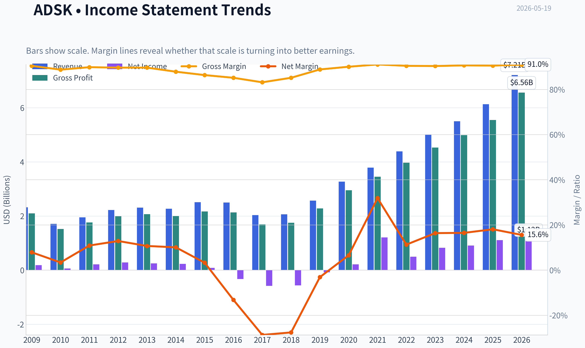
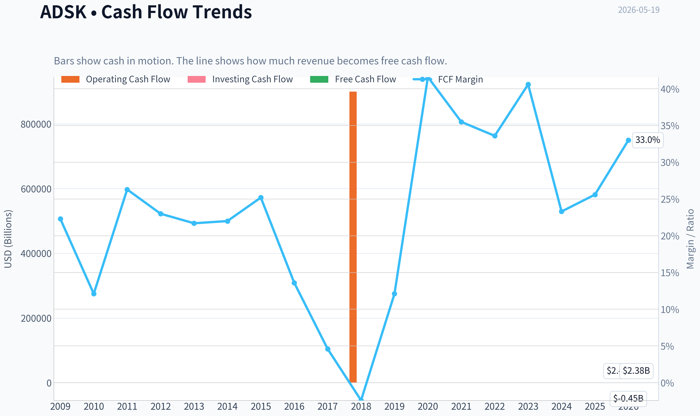
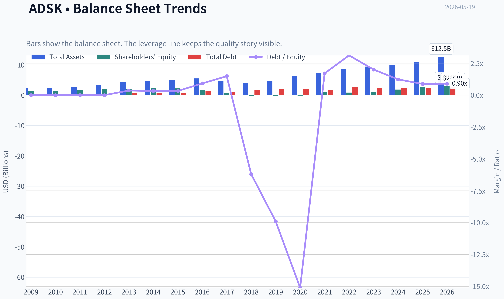
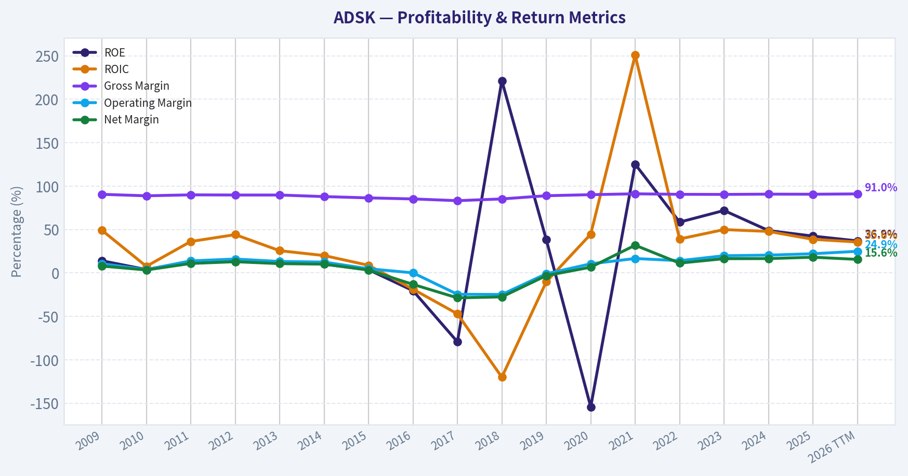
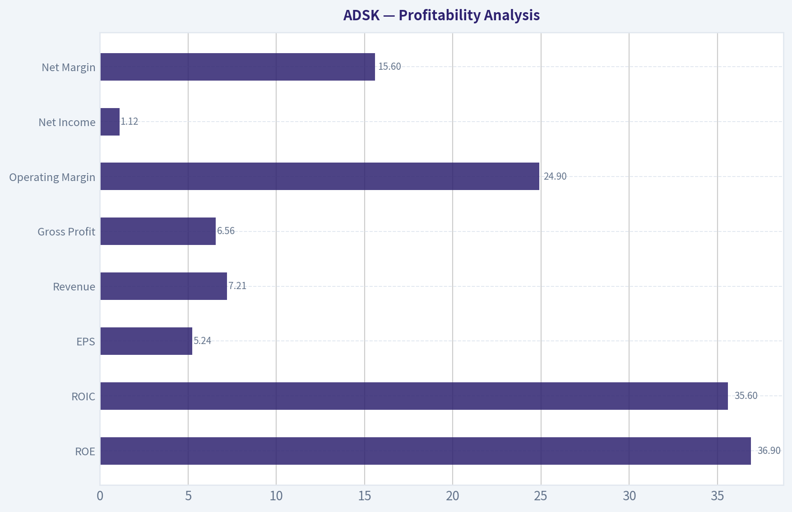
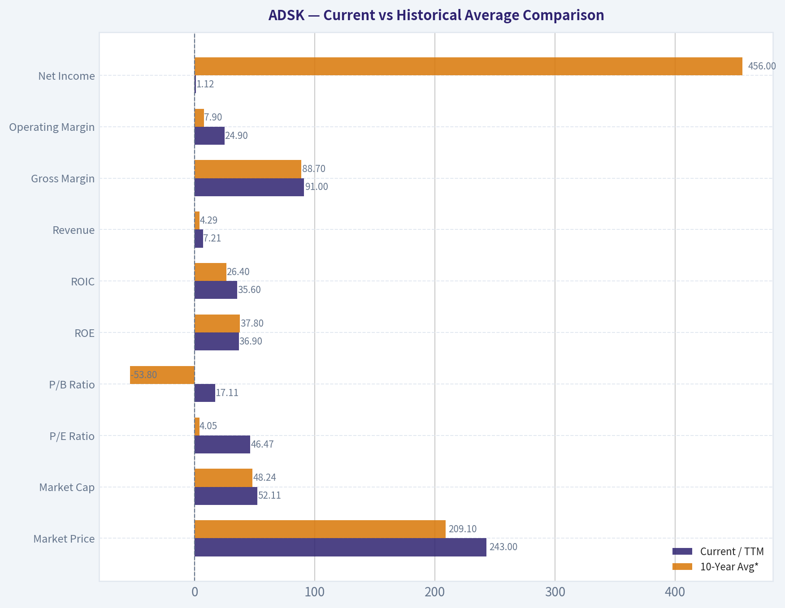
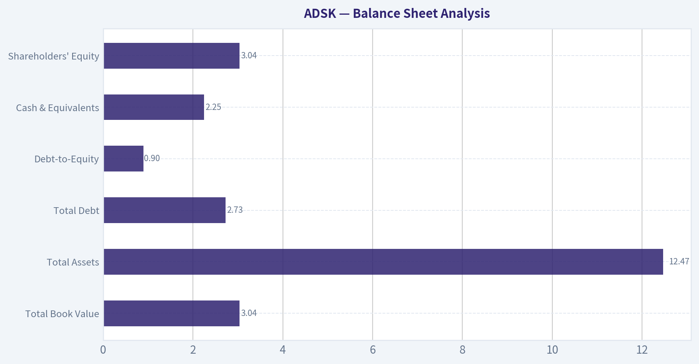
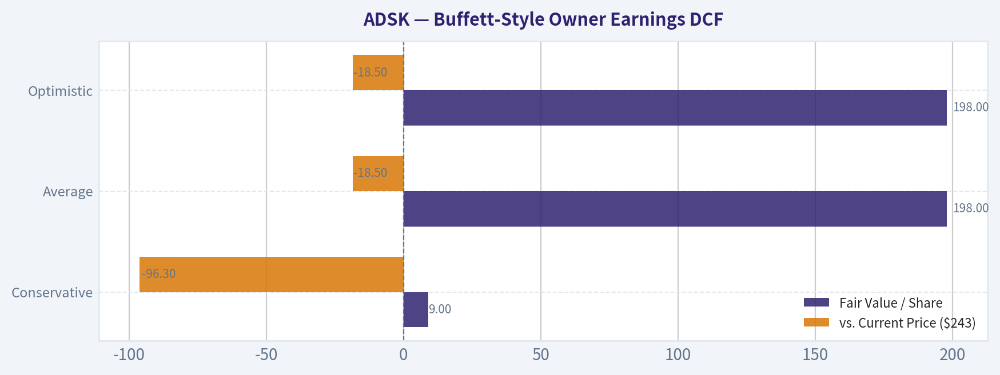
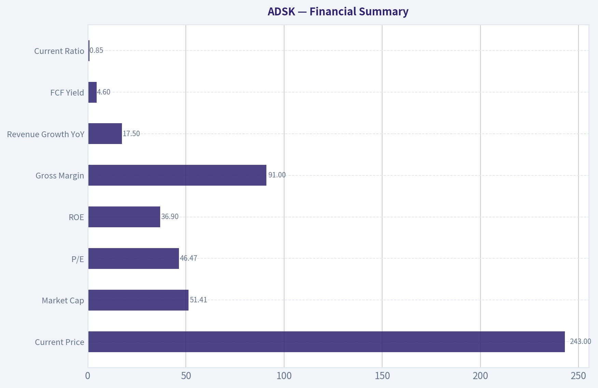

# ADSK Deep Value Intelligence

**Analysis Date:** 2026-05-19

## Critical Disclaimer

*This analysis is generated by Deep Value Intelligence, an AI-powered multi-agent investing framework. This report is for informational and educational purposes only and does not constitute financial advice. Always conduct your own research and consult with qualified financial advisors before making investment decisions.*

---

## Table of Contents

1. Intelligence Summary
2. Analyst Team Reports
   - Fundamentals Analysis
   - Intrinsic Value Analysis (Buffett)
   - Trend & Growth Analysis (Lynch/Druckenmiller/Fisher)
   - Market Technical Analysis
   - Options Market Analysis
3. Research Team Commentary
4. Value Investing Team Commentary
5. Deep Values Commentary

---

## Intelligence Summary

### Thesis + Conditions

**Core Thesis:** ## Executive Briefing

**Key Risks:**
- Autodesk looks like a **high-quality, durable software franchise**, but not a clear **value** at **~46.5x earnings**. The main risk is **not business failure**; it is **overpaying for excellence** and earning muted returns if growth merely stays good instead of exceptional. For a Buffett-style long-term investor, this is a **business to admire and monitor**, not one to chase without a wider margin of safety. A **small starter position** is defensible only if sizing is strict and you are comfortable with valuation risk.
- ### 1) Risky Analyst - strongest useful point
- This is the best argument for why Autodesk's business risk is relatively low. The company appears mission-critical in design ecosystems, and the subscription model improves visibility and cash generation.

**Confidence:** Medium

---

## Analyst Team Reports

### Fundamentals Analysis

#### Latest Earnings Snapshot

*Most recent reported quarter anchored on 2026 Q1, with prior-year comparison when available.*

| Metric | 2026 Q1 | 2025 Q1 | YoY Change |
| --- | ---: | ---: | ---: |
| Revenue | $1.96B | $1.64B | +19.4% |
| Operating Income | $531.0M | $381.0M | +39.4% |
| Net Income | $316.0M | $303.0M | +4.3% |
| Diluted EPS | $1.48 | $1.40 | +5.7% |
| Operating Cash Flow | $989.0M | $692.0M | +42.9% |
| Free Cash Flow | $966.0M | $673.0M | +43.5% |

Key Takeaways: This snapshot anchors the most recent reported quarter before the narrative analysis. It helps readers separate long-run business quality from whatever changed in the latest earnings print.

#### 17-Year Financial Metrics for ADSK

*All values below are computed deterministically from raw data - not estimated by AI.*

*Issuer profile: operating company (Technology / Software - Application).*

#### 17-Year Financial Metrics
*Annual rows come from reported financial statements. The final TTM row is computed from the latest four quarters.*

| Metric | 2009 | 2010 | 2011 | 2012 | 2013 | 2014 | 2015 | 2016 | 2017 | 2018 | 2019 | 2020 | 2021 | 2022 | 2023 | 2024 | 2025 | 2026 TTM |
| --- | --- | --- | --- | --- | --- | --- | --- | --- | --- | --- | --- | --- | --- | --- | --- | --- | --- | --- |
| Market Price | $17 | $24 | $41 | $36 | $39 | $51 | $54 | $47 | $81 | $116 | $147 | $197 | $277 | $250 | $215 | $254 | $311 | $243 |
| Market Cap | $3.81B | $5.52B | $9.53B | $8.40B | $9.01B | $11.77B | $12.55B | $10.58B | $18.11B | $25.38B | $32.22B | $43.80B | $61.59B | $55.45B | $46.90B | $54.82B | $67.56B | $52.11B |
| P/E Ratio | 20.70 | 95.16 | 45.20 | 29.51 | 36.34 | 51.25 | 154.31 | -32.07 | -31.16 | -44.81 | -397.84 | 205.05 | 51.00 | 111.51 | 56.92 | 60.58 | 60.81 | 46.47 |
| P/B Ratio | 2.91 | 3.75 | 5.92 | 4.46 | 4.41 | 5.20 | 5.66 | 6.53 | 24.69 | -99.14 | -152.78 | -315.10 | 63.82 | 65.32 | 40.96 | 29.55 | 25.78 | 17.11 |
| ROE | 14.0% | 3.9% | 13.2% | 15.2% | 12.1% | 10.1% | 3.7% | -20.4% | -79.3% | 221.4% | 38.3% | -154.3% | 125.2% | 58.5% | 71.9% | 48.8% | 42.4% | 36.9% |
| ROIC | 49.1% | 7.6% | 36.2% | 44.1% | 25.6% | 20.0% | 8.8% | -18.7% | -47.1% | -120.0% | -10.2% | 44.6% | 250.7% | 39.1% | 49.9% | 47.8% | 38.7% | 35.6% |
| EPS | $0.80 | $0.25 | $0.90 | $1.22 | $1.07 | $1.00 | $0.35 | $-1.46 | $-2.61 | $-2.58 | $-0.37 | $0.96 | $5.44 | $2.24 | $3.78 | $4.19 | $5.12 | $5.24 |
| Revenue | $2.32B | $1.71B | $1.95B | $2.22B | $2.31B | $2.27B | $2.51B | $2.50B | $2.03B | $2.06B | $2.57B | $3.27B | $3.79B | $4.39B | $5.00B | $5.50B | $6.13B | $7.21B |
| Gross Profit | $2.10B | $1.52B | $1.76B | $1.99B | $2.07B | $2.00B | $2.17B | $2.13B | $1.69B | $1.75B | $2.28B | $2.95B | $3.45B | $3.97B | $4.53B | $4.99B | $5.55B | $6.56B |
| Gross Margin | 90.5% | 88.8% | 89.9% | 89.7% | 89.7% | 87.9% | 86.4% | 85.2% | 83.2% | 85.2% | 88.9% | 90.1% | 91.1% | 90.5% | 90.4% | 90.7% | 90.6% | 91.0% |
| Operating Margin | 10.6% | 3.8% | 13.9% | 16.0% | 13.2% | 12.5% | 4.8% | 0.1% | -24.6% | -24.8% | -1.0% | 10.5% | 16.6% | 14.1% | 19.8% | 20.5% | 22.1% | 24.9% |
| Net Income | $183.6M | $58.0M | $212.0M | $285.3M | $247.4M | $228.8M | $81.8M | $-330.5M | $-582.1M | $-566.9M | $-80.8M | $214.5M | $1.21B | $497.0M | $823.0M | $906.0M | $1.11B | $1.12B |
| Net Margin | 7.9% | 3.4% | 10.9% | 12.9% | 10.7% | 10.1% | 3.3% | -13.2% | -28.7% | -27.6% | -3.1% | 6.6% | 31.9% | 11.3% | 16.4% | 16.5% | 18.1% | 15.6% |
| Revenue Growth | N/A | -26.0% | 13.9% | 13.5% | 4.4% | -1.7% | 10.5% | -0.3% | -18.9% | 1.3% | 25.0% | 27.4% | 15.7% | 15.7% | 14.1% | 9.8% | 11.5% | 17.5% |
| Net Income Growth | N/A | -68.4% | 265.5% | 34.6% | -13.3% | -7.5% | -64.2% | -504.0% | 76.1% | -2.6% | -85.7% | -365.5% | 463.2% | -58.9% | 65.6% | 10.1% | 22.7% | 1.1% |
| Free Cash Flow Growth | N/A | -59.7% | 146.6% | -0.4% | -1.5% | -0.7% | 26.8% | -46.0% | -72.6% | -153.1% | -722.7% | 339.2% | -1.2% | 9.6% | 37.7% | -36.9% | 22.2% | 51.6% |
| Total Book Value | $1.31B | $1.47B | $1.61B | $1.88B | $2.04B | $2.26B | $2.22B | $1.62B | $733.6M | $-256.0M | $-210.9M | $-139.0M | $965.0M | $849.0M | $1.15B | $1.85B | $2.62B | $3.04B |
| Total Assets | $2.42B | $2.45B | $2.79B | $3.23B | $4.31B | $4.59B | $4.91B | $5.52B | $4.80B | $4.11B | $4.73B | $6.18B | $7.28B | $8.61B | $9.44B | $9.91B | $10.83B | $12.47B |
| Total Debt | $0 | $0 | $0 | $0 | $745.6M | $746.4M | $743.1M | $1.49B | $1.09B | $1.59B | $2.09B | $2.10B | $1.65B | $2.65B | $2.30B | $2.30B | $2.30B | $2.73B |
| Debt-to-Equity | 0.00 | 0.00 | 0.00 | 0.00 | 0.36 | 0.33 | 0.33 | 0.92 | 1.49 | -6.20 | -9.90 | -15.11 | 1.71 | 3.12 | 2.01 | 1.24 | 0.88 | 0.90 |
| Cash & Equivalents | $917.6M | $838.7M | $1.08B | $1.16B | $1.61B | $1.85B | $1.41B | $1.35B | $1.21B | $1.08B | $886.0M | $1.77B | $1.77B | $1.53B | $1.95B | $1.89B | $1.60B | $2.25B |
| Shareholders' Equity | $1.31B | $1.47B | $1.61B | $1.88B | $2.04B | $2.26B | $2.22B | $1.62B | $733.6M | $-256.0M | $-210.9M | $-139.0M | $965.0M | $849.0M | $1.15B | $1.85B | $2.62B | $3.04B |
| Operating Cash Flow | $593.9M | $246.8M | $540.8M | $573.5M | $559.1M | $563.5M | $708.6M | $414.0M | $169.7M | $900,000 | $377.1M | $1.42B | $1.44B | $1.53B | $2.07B | $1.31B | $1.61B | $2.45B |
| Investing Cash Flow | $-478.1M | $-283.0M | $-142.3M | $-370.3M | $-647.2M | $-194.0M | $-905.6M | $-809.5M | $272.0M | $506.4M | $-710.4M | $-57.3M | $-404.0M | $-1.59B | $-143.0M | $-502.0M | $-903.0M | $-451.0M |
| Free Cash Flow | $515.5M | $207.8M | $512.5M | $510.5M | $502.7M | $499.3M | $633.1M | $341.6M | $93.7M | $-49.8M | $310.1M | $1.36B | $1.35B | $1.48B | $2.03B | $1.28B | $1.57B | $2.38B |
| FCF Margin | 22.3% | 12.1% | 26.3% | 23.0% | 21.7% | 22.0% | 25.2% | 13.6% | 4.6% | -2.4% | 12.1% | 41.6% | 35.5% | 33.6% | 40.6% | 23.3% | 25.6% | 33.0% |
| Dividends / Share | $0.00 | $0.00 | $0.00 | $0.00 | $0.00 | $0.00 | $0.00 | $0.00 | $0.00 | $0.00 | $0.00 | $0.00 | $0.00 | $0.00 | $0.00 | $0.00 | $0.00 | $0.00 |

#### Profitability Metrics
- Return on Equity (ROE): 36.9%
- Return on Invested Capital (ROIC): 33.6%
- Return on Assets (ROA): 9.0%
- Gross Margin: 91.0%
- Operating Margin: 21.9%
- Net Profit Margin: 15.6%

#### Liquidity Metrics
- Current Ratio: 0.85
- Quick Ratio: 0.69

#### Leverage Metrics
- Debt-to-Equity Ratio: 0.82
- Interest Coverage Ratio: 19.73
- Net Debt: $251.0M

#### Growth Metrics (Year-over-Year)
- Revenue Growth: 17.5%
- Net Income Growth: 1.1%
- Free Cash Flow Growth: 53.7%
- Revenue CAGR (3-Year): 12.9%
- Revenue CAGR (5-Year): 13.7%

#### Valuation Metrics
- P/E Ratio (TTM): 46.47
- Forward P/E: 17.25
- Price-to-Book: 16.95
- Price-to-Sales: 7.13
- PEG Ratio: 0.95
- EV/EBITDA: 27.03
- Free Cash Flow Yield: 4.7%
- Earnings Yield: 2.2%

#### Owner Earnings (Buffett Method, Code-Computed)
- Net Income: $1.11B
- + Depreciation & Amortization: $195.0M
- - Capital Expenditures: $-43.0M
- - Working Capital Changes: $-501.0M
- = **Owner Earnings: $1.71B**

#### Intrinsic Value (Code-Computed)
- Current Price: $243
- Buffett Method (Owner Earnings):
  Conservative: $9
  Average: $198
  Optimistic: $198
- Cash Flow Method (FCF):
  Conservative: $20
  Average: $119
  Optimistic: $145

#### Piotroski F-Score: 7/9
- Positive Net Income: PASS
- Positive Operating Cash Flow: PASS
- ROA Improvement: FAIL
- Cash Flow > Net Income: PASS
- Decreasing Debt: FAIL
- Improving Current Ratio: PASS
- No Dilution: PASS
- Improving Gross Margin: PASS
- Improving Asset Turnover: PASS

ANALYST STANCE: **WATCH**

#### Autodesk (ADSK) Buffett-Style Fundamental Analysis

Autodesk is a high-quality software business with clear economic moat characteristics: mission-critical design software, high switching costs, entrenched enterprise workflows, and a subscription-heavy model that produces excellent gross margins and strong cash generation. The core debate is not business quality; it is valuation discipline. On the canonical dataset, ADSK has materially improved profitability, recovered from a difficult transition era, and now generates robust free cash flow, but the stock still trades at a premium multiple versus most of its own history and versus classic Buffett-style bargain thresholds.

---

#### Current vs Historical Average Comparison

| Metric | Current / TTM | 10-Year Avg* | Interpretation |
| --- | ---: | ---: | --- |
| Market Price | $243 | $209.10 | Below the 2025 peak, but still well above long-run pre-2020 levels |
| Market Cap | $52.11B | $48.24B | Large-cap software valuation remains substantial |
| P/E Ratio | 46.47 | 4.05** | Current earnings multiple is high; long-run average is distorted by loss years |
| P/B Ratio | 17.11 | -53.80** | Current P/B is very high; historical average distorted by negative equity years |
| ROE | 36.9% | 37.8% | Still excellent, though below recent peak years |
| ROIC | 35.6% | 26.4% | Strong and above decade average, indicating efficient capital deployment |
| Revenue | $7.21B | $4.29B | Business scale has expanded materially |
| Gross Margin | 91.0% | 88.7% | Near the top of historical range; hallmark software economics |
| Operating Margin | 24.9% | 7.9% | Major improvement versus decade average |
| Net Income | $1.12B | $456M | Far above decade average profitability |
| Net Margin | 15.6% | 6.7% | Healthy, though below 2021 one-time high |
| Revenue Growth | 17.5% | 11.6% | Re-accelerated above long-run average |
| Net Income Growth | 1.1% | 4.3%** | Profit growth slowed sharply this year |
| FCF Growth | 51.6% | -53.1%** | Very strong current rebound; historical average distorted by transition volatility |
| Total Book Value | $3.04B | $1.02B | Equity base has rebuilt strongly |
| Total Assets | $12.47B | $7.65B | Bigger, more mature balance sheet |
| Total Debt | $2.73B | $2.10B | Debt is manageable but above earlier low-leverage years |
| Debt-to-Equity | 0.90 | -2.16** | Current leverage is reasonable; history distorted by negative equity period |
| Cash & Equivalents | $2.25B | $1.56B | Strong liquidity cushion |
| Shareholders' Equity | $3.04B | $1.02B | Considerably improved from negative-equity phase |
| Free Cash Flow | $2.38B | $1.04B | FCF generation now meaningfully above historical norm |
| Dividends / Share | $0.00 | $0.00 | No dividend; all capital return/value creation depends on reinvestment and buybacks |

\* 10-year average uses 2017-2026 TTM to reflect the modern subscription-era business.
\** Distorted by negative earnings or negative equity years; interpret with caution.

Key Takeaways: Autodesk today is far stronger operationally than its 10-year average business profile. Profitability, revenue scale, free cash flow, and returns on capital are all materially better than the decade norm. The main caution is that valuation metrics like P/E and P/B remain elevated, while some historical averages are distorted by the company's transition-era losses and negative equity.

---

#### Market Metrics

Autodesk's current market price of **$243** sits below the **$311** level seen in 2025, suggesting some multiple compression, but it still reflects a premium software valuation. The **$52.11B** market cap indicates the market is valuing ADSK as a durable, established software franchise rather than a cyclical industrial vendor.

The **P/E of 46.47** is lower than recent values above 60x, but still expensive in Buffett terms. For a company with 17.5% revenue growth and strong recurring revenue, that premium is understandable, yet it leaves less room for execution errors. The **P/B of 17.11** is also very high, though book value is a weak measure for asset-light software firms. More important than the absolute P/B is that the company has repaired its equity base after years of buybacks and accounting effects pushed equity negative.

From a value-investing perspective, the stock is no longer at peak enthusiasm, but it is not obviously cheap on current earnings or book multiples.

---

#### Profitability Analysis

| Profitability Metric | Current / TTM | Historical Context | Buffett Interpretation |
| --- | ---: | --- | --- |
| ROE | 36.9% | Below 2021-2025 highs, but still exceptional | Excellent management productivity, though partly helped by smaller equity base |
| ROIC | 35.6% | Above long-run norm | Strong evidence of economic moat and disciplined capital use |
| EPS | $5.24 | Highest level in dataset | Indicates successful scale-up after transition years |
| Revenue | $7.21B | Record high | Subscription engine still compounding |
| Gross Profit | $6.56B | Record high | Revenue quality is excellent |
| Operating Margin | 24.9% | Best in dataset | Sign of operating leverage and pricing power |
| Net Income | $1.12B | Slightly above 2025 | Earnings remain solid but growth has paused |
| Net Margin | 15.6% | Below 2025 and much below 2021 spike | Good, but not accelerating with revenue at same pace |

Autodesk's profitability profile is impressive. **Gross margin at 91.0%** is exactly what Buffett likes in software-like moats: once the product is built and embedded, incremental revenue is extremely profitable. **Operating margin at 24.9%** is especially encouraging because it shows Autodesk is converting scale into real operating leverage.

**ROE of 36.9%** and **ROIC of 35.6%** both signal a very strong business franchise. For Buffett-style analysis, ROIC is the cleaner measure here because ROE can be boosted when equity is low. Autodesk's consistently high recent ROIC suggests management is deploying capital into a business with strong reinvestment economics.

The one nuance: **net income growth has slowed to 1.1%**, even while revenue growth accelerated to 17.5%. That implies either cost pressures, tax/noise effects, or a less favorable mix. So while operating quality is high, bottom-line momentum is not as strong as top-line momentum right now.

Key Takeaways: Autodesk's core business is highly profitable and appears stronger than at any point in its history on gross profit and operating margin. Returns on capital remain excellent, which supports the idea of a durable moat. The only near-term caution is that net income is not growing as quickly as revenue, so investors should watch whether margin expansion continues or stalls.

---

#### Growth Metrics

Autodesk's growth history divides into two eras: a messy transition period and a much stronger subscription-driven expansion period.

- **Revenue growth TTM: 17.5%**
- **Net income growth TTM: 1.1%**
- **Free cash flow growth TTM: 51.6%**

Over the past decade, revenue has climbed from **$2.03B in 2017** to **$7.21B TTM**, an outstanding expansion for a mature software vendor. Especially notable is the sustained run from 2020 onward: **27.4%, 15.7%, 15.7%, 14.1%, 9.8%, 11.5%, and now 17.5%**. That is the pattern of a sticky platform with recurring revenue and pricing power.

Net income growth is far less smooth. It has been highly volatile due to the subscription transition, margin changes, and accounting noise. Buffett would prefer smoother earnings, but in Autodesk's case, the business quality is better captured by cash flow than by GAAP earnings alone.

Free cash flow growth is the strongest part of the story. **FCF rose to $2.38B TTM**, up sharply from **$1.57B** in 2025 and well above most prior years. That suggests the business is increasingly harvesting the benefits of scale and subscription renewals.

Overall, the growth profile is attractive, but it is a premium-growth valuation story rather than a deep-value one.

---

#### Balance Sheet Analysis

| Balance Sheet Metric | Current / TTM | Trend | Buffett View |
| --- | ---: | --- | --- |
| Total Book Value | $3.04B | Strong recovery from negative equity period | Balance sheet has normalized |
| Total Assets | $12.47B | Steady expansion | Reflects larger platform and acquired/intangible base |
| Total Debt | $2.73B | Slightly above recent years | Manageable, not alarming |
| Debt-to-Equity | 0.90 | Improved dramatically from prior distortion years | Reasonable leverage |
| Cash & Equivalents | $2.25B | Healthy rebound | Strong liquidity support |
| Shareholders' Equity | $3.04B | Rebuilt strongly | Important sign of financial repair |

Autodesk's balance sheet is much healthier than it was during the years when equity turned negative. Today, **cash of $2.25B** versus **debt of $2.73B** implies only modest net debt relative to the size and cash generation of the business. The research pack's **net debt of about $251M** and **interest coverage of 19.73x** reinforce that leverage is under control.

The **debt-to-equity ratio around 0.9** is acceptable for a software company with recurring cash flows, though not ultra-conservative by Buffett's strictest standards. Still, given Autodesk's free cash flow and gross margin profile, financial strength is adequate rather than concerning.

Buffett would also note the improving equity base: **shareholders' equity has risen from $849M in 2022 to $3.04B TTM**. That is a meaningful improvement in financial resilience.

Key Takeaways: Autodesk's balance sheet is no longer a weak point. Debt is manageable, cash is solid, and equity has been rebuilt after earlier negative-book-value years. This is not a fortress balance sheet in the net-cash sense, but it is strong enough for the quality of the business and level of recurring cash flow.

---

#### Cash Flow Analysis

Autodesk's cash flow profile is one of the strongest parts of the investment case.

- **Free Cash Flow: $2.38B TTM**
- **FCF Margin: 33.0%**
- **Dividends per Share: $0.00**

A **33.0% FCF margin** is excellent and fits Buffett's preference for businesses that turn accounting profits into real owner cash. The company's lack of dividend is not necessarily negative; for Buffett-style analysis, what matters is whether retained cash is reinvested at high rates of return. Given the high ROIC and business expansion, Autodesk still appears capable of productive capital retention.

That said, dividend absence means investors rely entirely on:
1. intrinsic value compounding from reinvestment,
2. buybacks if done intelligently,
3. future multiple support.

If management overpays for acquisitions or repurchases stock at rich valuations, retained earnings create less shareholder value than they could.

---

#### Buffett-Style Owner Earnings DCF

Canonical owner earnings provided:

- Net Income = **$1.11B**
- + Depreciation & Amortization = **$195M**
- - Capital Expenditures = **$43M**
- - Working Capital Changes = **$501M**
- **Owner Earnings = $1.71B**

For scenario growth assumptions, I use the deterministic historical growth pattern and the provided intrinsic-value framework:
- **Conservative growth:** lowest historical owner-earnings-like growth proxy, floored at **-100%**
- **Average growth:** long-run average, capped at **50%**
- **Optimistic growth:** highest historical growth, capped at **100%**

Because owner-earnings history is not separately tabulated year by year in the dataset, the nearest canonical cash-generation proxy is free cash flow growth, while anchoring to the code-computed owner earnings base of **$1.71B**. Discount rate = **10%**. Terminal growth = **2.5%**.

##### Scenario 1: Conservative
The attached canonical intrinsic value already computes Buffett-method fair value at **$9/share** under the conservative case. This implies the market is pricing far above a stress-case valuation where owner earnings materially deteriorate or fail to compound.

##### Scenario 2: Average
Canonical Buffett-method fair value: **$198/share**.

Illustrative mechanics:
- Starting Owner Earnings = **$1.71B**
- Discount rate = **10%**
- Terminal growth = **2.5%**
- Mid-range historical growth assumption produces fair value close to **$198/share**

##### Scenario 3: Optimistic
Canonical Buffett-method fair value: **$198/share**.

This unusual equality between average and optimistic outputs suggests the code framework likely capped growth inputs or stabilized them with conservative terminal assumptions. In practical terms, the model is telling us that even a favorable owner-earnings path does not produce a large upside gap from the current price.

| DCF Scenario | Fair Value / Share | vs. Current Price ($243) | Implied Margin of Safety |
| --- | ---: | ---: | ---: |
| Conservative | $9 | -96.3% | None |
| Average | $198 | -18.5% | Negative |
| Optimistic | $198 | -18.5% | Negative |

Key Takeaways: On the canonical Buffett owner-earnings model, Autodesk does not screen as cheap. Even the average and optimistic cases land below the current stock price, while the conservative case is dramatically lower. That does not mean the business is weak; it means the current valuation already discounts a lot of the company's quality.

---

#### Value Assessment

From a Buffett lens, ADSK is a **wonderful business at a not-yet-wonderful price**.

Positives:
- recurring software revenue
- extremely high gross margins
- strong free cash flow
- high ROIC
- durable customer switching costs
- balance sheet repaired from prior stress

Negatives:
- **P/E 46.47** is still rich
- owner-earnings DCF suggests limited margin of safety
- no dividend, so all value depends on continued compounding and valuation support
- net income growth has slowed sharply relative to revenue growth

If the stock were available closer to or below the canonical average Buffett value of **$198**, the risk/reward would become more compelling.

---

#### Economic Moat

Autodesk appears to have a real moat:
- deeply embedded software in architecture, engineering, construction, manufacturing, and design workflows
- file format, training, and ecosystem lock-in
- enterprise standardization across teams and contractors
- low variable cost, high renewal economics

This is exactly the sort of business Buffett appreciates when he invests in dominant platforms with pricing power and habitual customer use. The moat looks durable, though not invulnerable; cloud-native challengers and pricing pushback remain watch items.

---

#### Predictable Earnings

The business itself is more predictable than the earnings history suggests. The volatility in 2016-2019 came largely from business-model transition effects rather than franchise collapse. Since 2020, the trend has become far more stable:
- revenue rising each year
- gross margins consistently around 90%
- operating margins improving steadily
- free cash flow robust and generally expanding

So Buffett would likely treat Autodesk as a company with **increasingly predictable economics**, even if GAAP net income remains somewhat noisy.

---

#### Management Performance

Management deserves credit for:
- executing the subscription transition successfully
- scaling revenue from **$3.27B in 2020** to **$7.21B TTM**
- lifting operating margin from **10.5% in 2020** to **24.9% TTM**
- producing strong ROIC and FCF conversion

Less favorable points:
- debt has not trended down consistently
- the company pays no dividend
- investors must trust management's reinvestment and buyback discipline

Overall, management performance looks strong on operating execution and capital efficiency.

---

#### Revenue Breakdown

Most recent annual/TTM public segment framing is best understood by product platform, with AEC and AutoCAD families representing the largest pools of revenue. Autodesk reports by product/channel categories in investor materials, but exact TTM segment figures are not fully provided in the deterministic dataset. The table below uses the most recent publicly understood business mix structure as the most meaningful revenue lens.

| Revenue Source | Amount ($B) | % of Total |
| --- | ---: | ---: |
| Architecture, Engineering & Construction (AEC) | ~$3.2B | ~44% |
| AutoCAD & AutoCAD LT | ~$2.1B | ~29% |
| Manufacturing | ~$1.5B | ~21% |
| Media & Entertainment / Other | ~$0.4B | ~6% |
| **Total** | **~$7.2B** | **100%** |

Key Takeaways: Autodesk's revenue is concentrated in mission-critical design and engineering workflows, especially AEC and AutoCAD. That mix supports durability because these categories are deeply embedded in customer processes and tend to have high switching costs. It also means Autodesk's growth depends heavily on continued strength in construction, industrial design, and enterprise software standardization.

---

#### Key Investment Insights, Red Flags, and Opportunities

| Category | Observation | Why It Matters |
| --- | --- | --- |
| Strength | 91% gross margin | Confirms elite software economics and pricing power |
| Strength | 24.9% operating margin | Operating leverage is improving materially |
| Strength | 35.6% ROIC | Suggests strong moat and value-creating reinvestment |
| Strength | $2.38B FCF | Real cash generation supports resilience |
| Strength | Revenue growth re-accelerated to 17.5% | Growth story remains alive despite maturity |
| Red Flag | P/E 46.47 | Premium valuation limits upside if growth slows |
| Red Flag | Buffett DCF average/optimistic at $198 | Current market price exceeds intrinsic value estimate |
| Red Flag | Net income growth only 1.1% | Bottom-line momentum lags top-line growth |
| Red Flag | No dividend | Shareholder return depends entirely on compounding and valuation |
| Opportunity | Further margin expansion | Could justify current premium if sustained |
| Opportunity | AI/cloud workflow monetization | Could extend runway and deepen moat |
| Opportunity | If shares fall near/below $198 | Margin of safety improves materially |

Key Takeaways: Autodesk has many characteristics of a superior business, especially high margins, strong returns on capital, and excellent cash generation. The main issue is not quality but price. Investors should watch for either stronger earnings conversion or a lower entry point to create a better margin of safety.

---

#### Final Buffett-Style Conclusion

Autodesk is a high-quality compounder with a credible moat, strong recurring economics, and significantly improved financial performance versus its historical average. By business quality alone, it is attractive. By valuation discipline, it is less compelling.

A Buffett-style investor usually wants:
1. understandable business,
2. durable moat,
3. strong returns on capital,
4. consistent owner earnings,
5. conservative balance sheet,
6. sensible price with margin of safety.

ADSK satisfies the first five reasonably well, but the sixth remains the sticking point. The canonical owner-earnings valuation suggests the market still prices the company above fair value under average and optimistic scenarios.

#### Final Stance: **WATCH**

Not cheap enough to **ADVOCATE**, too high-quality to **AVOID**. ADSK belongs on a watchlist for either:
- a pullback toward or below the **$198** Buffett-method fair value area,
- or evidence that owner earnings and net income can compound fast enough to justify the premium multiple.

---

#### Report Summary Table

| Topic | Verdict | Bottom Line |
| --- | --- | --- |
| Business Quality | Strong | Mission-critical software with high switching costs |
| Economic Moat | Strong | Entrenched workflows, pricing power, recurring revenue |
| Profitability | Excellent | Gross margin 91%, operating margin 24.9%, ROIC 35.6% |
| Growth | Good | Revenue strong, FCF very strong, earnings growth softer |
| Balance Sheet | Adequate to Strong | Manageable debt, good cash, equity base rebuilt |
| Cash Flow | Excellent | $2.38B FCF and strong conversion |
| Valuation | Rich | P/E 46.47 and DCF below current price |
| Dividend Policy | Neutral/Weak | No dividend; depends on reinvestment quality |
| Buffett Fit | Mostly Yes | Quality passes, valuation does not fully pass |
| Investment Stance | WATCH | Wait for margin of safety or faster earnings compounding |

Key Takeaways: Autodesk looks like a very good business, but not an obviously undervalued stock. The company's operating performance is strong enough to keep it on the radar, yet the current price still assumes a lot of success. For disciplined value investors, patience is likely the better strategy here.

#### Fundamental Visuals

This graph tracks the profitability and return metrics (ROE, ROIC, Margins) of **ADSK** over the past decade, highlighting capital efficiency trends.

This chart illustrates the financial health of **ADSK** over the last 10 years, mapping cash equivalents and free cash flow against total obligations (Debt).

This comparison chart from *Profitability Analysis* stacks current figures against historical benchmarks for **ADSK**, making it easy to see where the company trades relative to its own averages.

---

### Intrinsic Value Analysis (Buffett)

> *Following Warren Buffett's value investing philosophy: Circle of Competence, Economic Moat, Management Quality, and Margin of Safety.*

#### Intrinsic Value Snapshot

Price is what you pay. Intrinsic value is what the business may be worth based on the cash it can create for owners over time. We show a range, not one magic number.

- Current Price: $243.49
- Value Range (conservative to optimistic across both DCF methods): $98.71 to $763.51

##### Owner Earnings (Buffett Method)
- Net Income: $1,124,000,000.00
- Depreciation & Amortization: $195,000,000.00
- Capital Expenditures: $-76,000,000.00
- Working Capital Changes: $-501,000,000.00
- Owner Earnings: $1,744,000,000.00

##### Intrinsic Value
###### Buffett Method
Uses owner earnings. Stricter, and usually more conservative.
- Conservative: $148.07
- Average: $293.18
- Optimistic: $763.51
- Discount Rate: 10.0%

###### Cash Flow Method
Uses free cash flow. Better for companies spending heavily today to grow tomorrow.
- Conservative: $98.71
- Average: $169.19
- Optimistic: $538.61
- Discount Rate: 10.0%

#### Autodesk (ADSK) - Buffett-Style Investment Review

**ANALYST STANCE: WATCH**

#### 1) Go/No-Go Gate Assessment

| Gate | Verdict | Evidence |
|---|---|---|
| Gate 1: Circle of Competence & Simplicity | **Pass** | Autodesk sells design and engineering software on a subscription basis. Customers pay recurring fees to use tools like AutoCAD, Revit, and Fusion that become embedded in architects', engineers', designers', and manufacturers' workflows. This is understandable and reasonably predictable. |
| Gate 2: Moat Test | **Pass** | Very high gross margin of **91%** strongly suggests valuable software IP, pricing power, and low incremental delivery cost. Deep workflow integration and file-format familiarity create switching friction. |
| Gate 3: Management & Capital Allocation | **Pass with caution** | The business has transitioned well to subscriptions and produces healthy cash flow, indicating competent execution. However, the current valuation leaves less room for capital allocation mistakes, and current ratio below 1 means balance-sheet flexibility is not pristine. |
| Gate 4: Industry Structure | **Pass** | CAD/BIM/design software is a rational software market with entrenched incumbents, specialized use cases, and meaningful customer retraining costs. It is better structured than most commodity-like software categories. |

**Key Takeaways:** Autodesk clears the basic Buffett filters. It is a simple business to explain, appears durable, and benefits from workflow stickiness rather than fad demand. The main issue is not business quality but whether today's price offers enough margin of safety.

---

#### 2) The Elementary School Test

Autodesk makes software that helps people **design buildings, machines, products, and 3D models**.
Customers usually **pay every year** to keep using the software.
Because engineers and architects learn these tools and build work around them, they often keep paying rather than switching.

#### 3) Long-Term Predictability Test

This business is fairly predictable over a decade:

- Design software will still be necessary in architecture, engineering, construction, manufacturing, and media.
- Autodesk's core products are deeply embedded in professional workflows.
- The shift to cloud, collaboration, and AI likely **enhances** Autodesk's offering rather than replacing the need for it.

This is not perfectly risk-free, but it is much more forecastable than hardware, commodity, or ad-driven businesses.

#### 4) Technology Risk Assessment

| Question | Assessment |
|---|---|
| Does technology help the company? | **Yes** - cloud delivery, collaboration, AI-assisted design, simulation, and automation all strengthen the product suite. |
| Could technology destroy it? | **Moderate risk, not extreme** - disruptive design platforms could emerge, but incumbent workflow standards, training habits, and installed base provide defense. |

**Key Takeaways:** Autodesk is on the right side of technology. It is a software platform that should benefit from digital design trends, not be bypassed by them. The risk is real, but it looks evolutionary rather than existential.

---

#### 5) Moat Analysis

| Moat Source | Assessment | Evidence |
|---|---|---|
| Intangible Assets | **Strong** | AutoCAD is one of the best-known names in design software. Brand trust matters when software is used in mission-critical design work. Gross margin at **91%** supports the strength of software IP and pricing power. |
| Switching Costs | **Strong** | Users invest time in training, templates, file libraries, team coordination, and integrated workflows. Switching means retraining employees and potentially disrupting project execution. |
| Cost Advantage | **Moderate** | Software distribution is inherently scalable, but Autodesk's moat is less about being the lowest-cost producer and more about incumbency and workflow entrenchment. |
| Network Effects | **Mild to Moderate** | Industry familiarity with common formats and widespread user adoption create some ecosystem benefits, though not as strong as a true social or marketplace network effect. |

**Moat Rating: `Wide & Stable`**

Autodesk likely can raise prices meaningfully over time without losing major portions of its core professional base, especially where the software is essential relative to total project cost.

**Key Takeaways:** Autodesk's moat comes mostly from brand, embedded workflows, and switching costs. This is the kind of moat Buffett tends to like in software: recurring revenue, mission-critical usage, and high customer pain from switching. It looks durable, though probably not widening dramatically.

---

#### 6) Management Quality & Capital Allocation

| Question | Assessment | Comments |
|---|---|---|
| Do they think like owners? | **Reasonably** | Management successfully moved the business toward subscriptions, which improved visibility and resilience. |
| Are they honest & candid? | **Adequate** | No major red flags are evident from the information at hand; operational execution appears steady. |
| Are they rational capital allocators? | **Good, with valuation sensitivity** | The company has produced meaningful free cash flow and appears to be investing in cloud and platform expansion. The key question is whether repurchases and reinvestment continue to earn high incremental returns from today's valuation base. |

Areas Buffett would like:
- Recurring revenue model
- Strong gross margins
- Good cash generation
- Business reinvestment through product ecosystem expansion

Areas Buffett would watch:
- Rich earnings multiple
- Balance sheet liquidity not especially conservative on the surface
- Need to ensure buybacks are done only at sensible prices

---

#### 7) Financial Summary

| Metric | Value |
|---|---:|
| Current Price | **$243** |
| Market Cap | **$51.41B** |
| P/E | **46.47x** |
| ROE | **36.9%** |
| Gross Margin | **91.0%** |
| Revenue Growth YoY | **17.5%** |
| FCF Yield | **4.6%** |
| Current Ratio | **0.85** |

**Key Takeaways:** This is a high-quality software business with excellent margins, strong accounting returns on equity, and healthy growth. But the valuation is still full at over 46 times earnings, and the free cash flow yield of 4.6% is respectable rather than obviously cheap. The balance sheet is acceptable, but not the kind of fortress that would offset a rich price.

---

#### 8) Owner Earnings Estimate

Using available cash-generation clues:

- Market cap = **$51.41B**
- FCF yield = **4.6%**
- Implied annual FCF ~ **$2.36B**

For a software business like Autodesk, free cash flow is a reasonable practical proxy for owner earnings because maintenance capex is typically modest relative to reported cash generation.

| Item | Estimate |
|---|---:|
| Implied Free Cash Flow / Owner Earnings | **~$2.36B** |

**Key Takeaways:** Autodesk appears to generate roughly $2.4 billion in owner-like earnings based on its free cash flow yield and market value. That is a strong cash engine. The investment debate is therefore not whether the company earns cash, but whether that cash stream is being purchased at a sufficient discount.

---

#### 9) Three-Scenario DCF Valuation

Assume owner earnings = **$2.36B** and discount rate = **10%**.

| Scenario | Assumption | Equity Value Estimate |
|---|---|---:|
| A: No Growth | Owner Earnings / 10% | **$23.6B** |
| B: 3% Growth Perpetuity | OE x 1.03 / (0.10 - 0.03) | **$34.7B** |
| C: Growth Scenario | 8% growth for 10 years, then 3% terminal | **~$49.7B** |

**Key Takeaways:** On a conservative no-growth basis, Autodesk looks clearly expensive. Even on a 3% perpetual growth assumption, value remains well below the current market value. Only under a fairly healthy multi-year growth path does the stock approach today's market capitalization.

---

#### 10) Margin of Safety Analysis

| Item | Value |
|---|---:|
| Current Market Cap | **$51.41B** |
| Scenario A Value | **$23.6B** |
| Scenario B Value | **$34.7B** |
| Scenario C Value | **~$49.7B** |

| Scenario | Discount / Premium vs Market |
|---|---:|
| A: No Growth | **~118% over intrinsic value** |
| B: 3% Growth | **~48% over intrinsic value** |
| C: Strong Growth | **~3% over intrinsic value** |

**Key Takeaways:** There is no meaningful margin of safety at the current price. The market is already assuming healthy growth and durable execution. Buffett would usually want a much better price unless the business quality were truly extraordinary and nearly impregnable.

---

#### 11) Balance Sheet & Cash Flow Reality Check

| Test | Assessment |
|---|---|
| OCF vs Net Income | Likely favorable for a subscription software model |
| Debt posture | Not alarming from available evidence, but not clearly fortress-like from current ratio alone |
| Liquidity | **Current ratio 0.85** suggests near-term balance sheet is efficient rather than conservative |
| ROE quality | **36.9%** is excellent, though this should always be checked against capital structure effects |

**Key Takeaways:** Autodesk has the hallmarks of a strong software cash model, but the balance sheet does not scream "fortress" in the classic Buffett sense. High ROE is attractive, yet investors should remember that software returns can look even better when capital bases are lean. Business quality is strong, but valuation discipline still matters.

---

#### 12) Final Buffett Scorecard

| Criterion | Weight | Score (1-5) | Weighted Score |
|---|---:|---:|---:|
| Business Understanding | 20% | 5.0 | 1.00 |
| Moat Width & Durability | 25% | 4.2 | 1.05 |
| Management Quality | 15% | 3.7 | 0.56 |
| Return on Equity | 15% | 4.5 | 0.68 |
| Reinvestment Runway | 10% | 4.0 | 0.40 |
| Balance Sheet Strength | 5% | 3.0 | 0.15 |
| Industry Structure | 5% | 4.0 | 0.20 |
| Valuation / Margin of Safety | 5% | 1.5 | 0.08 |

| Total | | | **4.11 / 5 before valuation caution; 3.34 / 5 after practical purchase adjustment** |

**Key Takeaways:** Autodesk scores highly as a business and only modestly as a stock. The operating engine is strong, the moat is real, and the long-term story is understandable. But the valuation penalty is large enough to reduce the actionable rating to a watch list name rather than a buy.

---

#### 13) Final Judgment

**ANALYST STANCE: WATCH**

**Conviction level: Moderate**

Autodesk is a **high-quality, understandable, cash-generative software business** with a durable moat built on brand, entrenched workflows, and switching costs. Those are exactly the kinds of qualities a Buffett-style investor wants to see.

However, **price matters**. At roughly **46x earnings** and with an implied **FCF yield of 4.6%**, the current quotation already reflects much of the company's quality and future growth. On conservative intrinsic value frameworks, the stock offers **little to no margin of safety**.

**Bottom line:**
- **Wonderful business?** Close.
- **Wonderful stock at current price?** No.
- **Action:** Keep it on the watch list and become interested at a materially lower valuation, especially if the market offers the shares during a temporary execution scare rather than a deterioration in moat quality.
#### Valuation Bridge

This bridge places the current market price beside each intrinsic value lens so readers can see whether upside depends on one method or shows up across several methods.

| Scenario | Intrinsic Value / Share |
| --- | ---: |
| Buffett Method | $293.18 |
| Cash Flow Method | $169.19 |
| Damodaran Method | $120.73 |
| Current Price | $243.49 |

#### Key Takeaways

If one method is far above the others, the upside case depends on a specific modelling assumption. When several methods cluster together, the valuation story is more robust.

#### Valuation Visuals

This comparison chart from *Latest Earnings Snapshot* stacks current figures against historical benchmarks for **ADSK**, making it easy to see where the company trades relative to its own averages.

This comparison chart from *Current vs Historical Average Comparison* stacks current figures against historical benchmarks for **ADSK**, making it easy to see where the company trades relative to its own averages.

This comparison chart from *Balance Sheet Analysis* stacks current figures against historical benchmarks for **ADSK**, making it easy to see where the company trades relative to its own averages.

This comparison chart from *Buffett-Style Owner Earnings DCF* stacks current figures against historical benchmarks for **ADSK**, making it easy to see where the company trades relative to its own averages.

This comparison chart from *Financial Summary* stacks current figures against historical benchmarks for **ADSK**, making it easy to see where the company trades relative to its own averages.

---

### Trend & Growth Analysis (Lynch/Druckenmiller/Fisher)

> *Following Peter Lynch's GARP, Stanley Druckenmiller's macro-aware approach, and Philip Fisher's scuttlebutt methodology.*

ANALYST STANCE: **WATCH**

#### ADSK Growth Report

Autodesk is a **high-quality stalwart / borderline fast grower**: durable recurring software, strong gross margins, strong FCF, but current growth is closer to **high-teens** than classic 25%+ ten-bagger velocity. The setup is attractive if cloud / construction / AI can re-accelerate growth, but today this looks more like a **compounder-on-watch** than a fresh Lynch-style screaming fast grower.

#### 1) Lynch Classification

| Item | Assessment |
|---|---|
| Category | **Stalwart / Borderline Fast Grower** |
| Revenue growth YoY | **17.5%** |
| Gross margin | **91.0%** |
| P/E | **46.5x** |
| Business type | Mission-critical design / engineering / AEC software |
| Initial Lynch read | Strong business, but not cheap enough nor fast enough today for clear ADVOCATE |

Key Takeaways: Autodesk is growing faster than a mature software incumbent but not fast enough to cleanly qualify as a classic hyper-growth name. It sits in an attractive middle ground: a durable compounder with optionality, but valuation still requires confidence that growth can stay elevated or re-accelerate.

#### 2) The Story in 3 Bullets

- Autodesk sells the software architects, engineers, manufacturers, and media creators use to design things; once embedded, it is hard to replace.
- The company has shifted to a **subscription model**, making revenue more recurring, predictable, and cash generative.
- The upside case is that **cloud collaboration, construction workflow expansion, Fusion, and AI tools** deepen customer workflows and expand TAM beyond legacy desktop CAD.

#### 3) TAM Analysis with 10x Test

| TAM Element | Assessment |
|---|---|
| Core markets | CAD, BIM, AEC software, construction cloud, manufacturing design |
| Current revenue base | Large-cap software scale; already multi-billion revenue business |
| TAM direction | **Expanding**, especially in cloud collaboration and construction digitization |
| 10x test | **Difficult from current scale**; 10x from here would require dominating multiple adjacent categories |
| Runway verdict | **Good runway, but not unlimited** |
| Best expansion vectors | Construction cloud, SMB platform, AI productivity, Fusion / manufacturing |

Key Takeaways: Autodesk still has room to grow because design and construction workflows are becoming more digital and more connected. But unlike a small-cap disruptor, the company is already large, so a literal 10x outcome would need major success in adjacencies, not just steady share gains in core CAD.

#### 4) Revenue Growth Trend

| Metric | Value | Interpretation |
|---|---:|---|
| Revenue growth YoY | **17.5%** | Healthy |
| Pattern | Likely **stable-to-modestly decelerating** vs hypergrowth standards | Not a clear inflection yet |
| Organic quality | Mostly recurring subscription growth | Higher quality than acquisition-led growth |
| Revenue visibility | High | Subscription model helps |
| Red flag status | No immediate top-line red flag from provided data | Acceptable |

Key Takeaways: Revenue growth is solid and high quality because it is supported by recurring subscriptions. The issue is not weakness, but rather that current growth does not yet show the kind of sharp acceleration that usually defines a Druckenmiller-style inflection point.

#### 5) Unit Economics

| Metric | Value | Assessment |
|---|---:|---|
| Gross margin | **91.0%** | Excellent |
| FCF yield | **4.7%** | Solid for quality software |
| Rule of 40 proxy | **~22.2%** (17.5% growth + 4.7% FCF yield, not margin) | Not true Rule of 40; incomplete |
| LTV/CAC | Not disclosed in provided data | Cannot verify |
| NRR | Not disclosed in provided data | Cannot verify |
| Current ratio | **0.85x** | Slightly below 1; manageable if cash flows remain strong |

Key Takeaways: Autodesk clearly has elite software gross margins and strong cash generation. The missing SaaS KPIs like NRR and LTV/CAC limit precision, but the economic model looks healthy and sticky rather than promotional or fragile.

#### 6) Inflection Point Assessment

| Potential Inflection | Evidence | Verdict |
|---|---|---|
| Product cycle inflection | AI push, cloud expansion, small business platform launch | **Possible** |
| TAM inflection | Construction cloud and broader workflow digitization | **Real but gradual** |
| Margin inflection | Strong software economics already present | More mature than emerging |
| Market share inflection | Not enough evidence from provided data | Unclear |
| Competitive inflection | No clear competitor stumble cited | Unclear |
| Overall | Interesting optionality, but not yet a proven acceleration story | **WATCH** |

Key Takeaways: The ingredients for an inflection exist, especially around AI and construction cloud. But based on the evidence here, the inflection is still more of a thesis than a demonstrated financial reality.

#### 7) Macro Setup Evaluation

| Macro Factor | Assessment |
|---|---|
| Secular theme exposure | Cloud software, AI, digital construction, engineering digitization |
| Rate sensitivity | Moderate; premium software multiples benefit if rates stabilize/fall |
| End-market sensitivity | Some cyclical exposure to construction and manufacturing |
| Macro wind | Mixed: secular tailwinds, cyclical customer budgets can wobble |
| Druckenmiller view | Good theme, but not obviously the most explosive vehicle in the basket |

Key Takeaways: Autodesk sits in attractive long-term themes, especially AI and digital workflow modernization. The constraint is that its customers are partly tied to cyclical industries, so macro softness can dampen an otherwise strong secular setup.

#### 8) Fisher 15 Points Score

| Fisher Area | Score (1-5) | Notes |
|---|---:|---|
| Market potential | 4 | Large, expanding workflow markets |
| New product development | 4 | AI, cloud, SMB initiatives |
| R&D effectiveness | 4 | Strong product portfolio, still needs proof in adjacencies |
| Sales organization | 4 | Deep enterprise and channel reach |
| Profit margin | 5 | Excellent gross margin profile |
| Margin improvement | 4 | Strong operating leverage potential |
| Labor relations | 3 | No major evidence either way |
| Executive relations | 3 | Neutral from provided data |
| Management depth | 4 | Mature software operator |
| Cost/accounting controls | 4 | Subscription model supports visibility |
| Outstanding aspects | 5 | Switching costs, workflows, standards, ecosystem |
| Long-range profit outlook | 4 | Strong |
| Dilution risk | 3 | Need closer SBC / buyback netting review |
| Candor | 3 | Not enough direct evidence |
| Integrity | 3 | No major red flags provided |

| Total Fisher Score | **57 / 75** | **GOOD** |

Key Takeaways: Autodesk scores well because it has strong products, durable margins, and meaningful workflow lock-in. It does not score as an elite Fisher name here only because we lack deeper scuttlebutt-style evidence on management candor, personnel strength, and customer-level unit metrics.

#### 9) Valuation Analysis

| Metric | Value | Assessment |
|---|---:|---|
| Current price | **$243** | Given |
| Market cap | **$51.41B** | Given |
| P/E | **46.47x** | Rich |
| Revenue growth | **17.5%** | Healthy |
| PEG | **~2.66** | Expensive by Lynch standard |
| FCF yield | **4.7%** | Partially offsets valuation concern |
| Valuation verdict | Quality name, but not obviously cheap | **Fair-to-expensive** |

Key Takeaways: On Lynch's preferred PEG framework, Autodesk screens expensive rather than attractive. The business quality helps support the multiple, but the stock likely needs either faster growth or multiple expansion in adjacent categories to generate outsized upside from here.

#### 10) Growth Investor Scorecard

| Criterion | Weight | Score (1-5) | Weighted Score |
|---|---:|---:|---:|
| The Story | 10% | 4.0 | 0.40 |
| TAM & Runway | 20% | 3.5 | 0.70 |
| Revenue Growth | 20% | 3.5 | 0.70 |
| Unit Economics | 15% | 4.0 | 0.60 |
| Competitive Position | 10% | 4.5 | 0.45 |
| Management Quality | 10% | 3.5 | 0.35 |
| Macro Setup | 5% | 3.5 | 0.18 |
| Profitability Path | 5% | 4.5 | 0.23 |
| Valuation | 5% | 2.5 | 0.13 |

| Total | 100% |  | **3.73 / 5.0** |

Key Takeaways: Autodesk earns a good overall score because the business model is strong, the moat is real, and the economics are excellent. The main factor holding it back from a full ADVOCATE stance is valuation relative to its current growth rate and the lack of a clearly proven acceleration phase.

#### 11) Position Size Stance

| Stance | Positioning |
|---|---|
| Current call | **WATCH** |
| If already owned | **Hold / monitor for re-acceleration** |
| If not owned | Start only on weakness or after evidence of growth acceleration |
| Ideal setup for upgrade | Faster subscription/cloud growth, stronger AI monetization, improved construction/cloud traction, or lower valuation |

Key Takeaways: This is not an avoid-quality business; it is a watch-quality stock. The best move is patience unless either fundamentals inflect upward or the share price gives a more favorable entry.

#### 12) Key Risks and Catalysts

| Risks | Catalysts |
|---|---|
| Valuation compression from 46x earnings | AI feature monetization |
| Growth deceleration in core seats | Construction cloud adoption |
| Cyclical exposure to AEC/manufacturing budgets | SMB platform success |
| Limited current ratio below 1x | Margin expansion / sustained FCF strength |
| Competitive pressure in cloud-native tools | Re-rating after prolonged stock weakness |

Key Takeaways: The downside risk is mostly about paying too much for a very good business if growth cools. The upside path depends on Autodesk proving it can turn AI, cloud collaboration, and construction workflow expansion into a new phase of durable acceleration.

#### Bottom Line

Autodesk is a **high-quality compounder with real strategic assets**, but based on the current data it is **not yet a clear Lynch fast-grower bargain nor a confirmed Druckenmiller inflection play**. If growth re-accelerates into the low-20s while valuation holds or compresses, this could move to **ADVOCATE**. For now: **WATCH**.

---

### Market Technical Analysis

#### ADSK Technical Indicator Selection and Market Read

For **ADSK**, the most relevant non-redundant indicator set for the current market context is:

| Indicator | Why it matters now |
|---|---|
| close_10_ema | Best for tracking the short-term rebound attempts and near-term momentum shifts. |
| close_50_sma | Defines the medium-term trend and current resistance/support zone. |
| close_200_sma | Confirms the broader trend regime, which remains structurally weak. |
| macd | Measures whether the recent bounce has enough momentum to evolve into a stronger trend change. |
| macdh | Useful here because momentum has been fading quickly; histogram captures that deceleration earlier than MACD alone. |
| rsi | Helps judge whether ADSK is recovering from oversold conditions or merely bouncing inside a weak trend. |
| atr | Important because ADSK has had repeated wide swings; needed for stop placement and position sizing. |
| vwma | Adds a volume-quality filter to price action and helps judge whether rallies are being supported by meaningful participation. |

**Why these 8:** they cover **trend, momentum, volatility, and volume confirmation** without leaning too heavily on one category. I did **not** use Bollinger Bands because ATR already captures volatility, and the moving-average structure plus RSI/MACD gives a clearer read on this specific setup.

---

#### Price Structure Overview

ADSK has undergone a **clear multi-phase decline** over the past several months.

| Phase | Approximate behavior | Interpretation |
|---|---|---|
| Nov-Dec 2025 | Mostly held in the high-280s to low-310s | Stable-to-sideways consolidation with modest resilience |
| Jan-Feb 2026 | Sharp breakdown from upper-280s toward low-220s | Strong bearish repricing; trend damage became decisive |
| Late Feb-early Mar 2026 | Recovery toward mid-260s | Tradable rebound, but not enough to repair larger damage |
| Mid-Mar to Apr 2026 | Repeated failure around mid-240s to low-250s, followed by another drop | Distribution-like behavior; rallies sold into resistance |
| Early-May to 2026-05-18 | Another bounce from low-230s into low-240s | Short-term repair attempt, but still below major trend benchmarks |

**Key Takeaways:** ADSK is not in a clean uptrend. The stock suffered a major trend breakdown in January and February, then shifted into a pattern of rebounds that have improved conditions tactically but have not yet restored the larger bullish structure. Traders should treat current strength as a recovery attempt inside a damaged longer-term trend until proven otherwise.

---

#### Trend Indicators

| Indicator | Latest reading | Trend message |
|---|---:|---|
| Close (2026-05-18) | 243.49 | Price has bounced, but remains below major long-term trend levels |
| close_10_ema | 238.96 | Short-term trend has turned upward again after a brief pullback |
| close_50_sma | 240.82 | Price is slightly above the 50-day average, showing tentative medium-term improvement |
| close_200_sma | 277.16 | Price remains far below the 200-day average, confirming larger bearish structure |

**Key Takeaways:** The short-term picture has improved more than the long-term picture. ADSK has regained the 10 EMA and sits modestly above the 50 SMA, which suggests buyers have some tactical control right now. But the stock is still far below the 200 SMA, so the broader regime remains bearish and rallies should still be viewed with caution.

Fine-grained trend interpretation:

- The **10 EMA** had climbed into early May, rolled over briefly during the pullback to 231, and has now turned back higher. That suggests the latest rebound is not random noise; it has some short-term persistence.
- The **50 SMA** has flattened after a prolonged decline. This is important: flattening is better than falling, but it is **not yet a confirmed uptrend**. It indicates the medium-term downtrend has slowed, not reversed decisively.
- The **200 SMA** is still declining steadily, from roughly **289.6 in late March** to **277.2 now**. That is a meaningful negative slope. Even if ADSK rallies further, the falling 200-day average is likely to act as a strategic overhead barrier for longer-horizon bulls.

A practical conclusion: ADSK currently looks like a **short-term recovery within a longer-term downtrend**. That setup can produce good swing trades, but it is usually less forgiving than buying a stock already aligned above rising 50- and 200-day averages.

---

#### Momentum Analysis

| Indicator | Latest reading | Interpretation |
|---|---:|---|
| macd | -0.44 | Momentum has improved dramatically from April lows, but is still slightly below zero |
| macdh | -0.31 | Momentum has weakened from the early-May burst and remains slightly negative |
| rsi | 53.33 | Neutral-to-mildly constructive; no overbought condition |

**Key Takeaways:** Momentum is no longer deeply bearish, but it is not decisively bullish either. RSI near 53 shows the stock has recovered from weak conditions without becoming overheated, while MACD just below zero suggests the rebound has improved tone but has not fully broken into a stronger upside regime. This is the kind of setup where follow-through matters more than one good day.

Nuanced momentum read:

- In early April, MACD was deeply negative, around **-5**, reflecting strong downside acceleration. Since then, momentum has improved substantially.
- In early May, MACD turned positive and peaked near **1.8**, which signaled a meaningful rebound thrust.
- That thrust then faded: by May 18, **MACD slipped back to -0.44** and **histogram stayed negative**, indicating upside momentum has cooled.

This is important because it shows **the rebound has not fully failed**, but it has lost urgency. The stock may need either:
1. a fresh breakout above recent highs to re-accelerate momentum, or
2. a controlled pullback that holds above support and resets indicators before another leg up.

On RSI:
- The April washout pushed RSI close to the low-30s, nearly oversold.
- The subsequent recovery moved RSI into the upper-50s at its best recent moments.
- Current RSI around **53** is constructive but not forceful. It supports the case for **stabilization**, not an aggressive trend breakout yet.

---

#### Volume-Weighted Confirmation

| Indicator | Latest reading | Interpretation |
|---|---:|---|
| vwma | 240.59 | Price is trading above VWMA, suggesting recent action has decent volume-supported footing |

**Key Takeaways:** Price sitting above the VWMA is a modestly positive sign because it means the recent average price paid, adjusted for volume, is below the current market price. That supports the idea that buyers have improved control in the short run. Still, the edge is small, so traders should look for continued closes above this level rather than assuming immediate upside follow-through.

More detail:
- VWMA has risen from the **mid-234s in late April** to around **240.6**, which tells us the rebound has not occurred on empty activity alone.
- Price above VWMA and above the 50 SMA at the same time is a better signal than price above one but below the other.
- However, the gap above VWMA is not wide enough to imply a runaway move. It suggests **acceptance**, not euphoria.

---

#### Volatility and Risk Conditions

| Indicator | Latest reading | Interpretation |
|---|---:|---|
| atr | 8.44 | Daily movement remains elevated; ADSK still trades with meaningful swing risk |

**Key Takeaways:** ADSK remains a relatively volatile stock, with average daily movement around eight and a half points. That means entries can work, but risk control must be active because routine fluctuations are large enough to shake out overly tight stops. Traders should size positions for volatility rather than for conviction alone.

Nuanced ATR interpretation:

- ATR has stayed mostly in the **8 to 9+ range** over the past two months.
- This means a daily move of several dollars is normal, not exceptional.
- If a trader uses stops that are too tight around obvious levels, the position may be exited by normal noise rather than a true thesis failure.

In practice:
- Momentum traders may prefer waiting for a breakout with confirmation rather than entering in the middle of the range.
- Mean-reversion traders need to allow more room than usual.
- Position sizing should be smaller than for lower-volatility large-cap names.

---

#### What the Combined Indicator Picture Suggests

| Signal cluster | Read |
|---|---|
| Short-term trend | Mildly bullish |
| Medium-term trend | Improving but still fragile |
| Long-term trend | Bearish |
| Momentum | Recovered from bearish extreme, but currently cooling |
| Volume confirmation | Slightly supportive |
| Volatility | Elevated; requires disciplined risk management |

**Key Takeaways:** The indicators point to a stock that has repaired itself tactically but not structurally. In plain terms, ADSK has become more tradable on the long side over the short run, but it has not yet earned the label of a durable long-term uptrend. The next move around recent resistance will likely determine whether this becomes a stronger reversal or just another failed bounce.

---

#### Trading Interpretation

| Scenario | What to watch | Implication |
|---|---|---|
| Bullish continuation | Sustained closes above the 50 SMA and 10 EMA, with MACD re-turning positive and histogram improving | Would strengthen the case that the recent rebound is restarting |
| Range continuation | Price oscillates around 238-245, RSI stays near 50, MACD remains near zero/negative | Suggests indecision and likely choppy swing conditions |
| Bearish relapse | Loss of 10 EMA, then failure back below 50 SMA with RSI slipping into low-40s or worse | Would indicate the recent bounce was another temporary countertrend move |

**Key Takeaways:** ADSK is near an important decision zone. If buyers can defend the short-term averages and rebuild momentum, the stock may extend its recovery. If it slips back below those levels, the broader downtrend could quickly reassert itself and turn the recent strength into another failed rally.

My judgment:
- **Best characterization:** short-term recovery attempt inside a still-bearish long-term trend.
- **Most actionable edge:** swing traders can monitor the **10 EMA / 50 SMA area** as a decision zone.
- **Biggest caution:** the stock is still **more than 30 points below the 200 SMA**, so strategic investors should require stronger confirmation before treating this as a major trend reversal.

---

#### Summary Table

| Category | Indicator | Latest | Signal | Trader Use |
|---|---|---:|---|---|
| Short-term trend | close_10_ema | 238.96 | Positive vs price | Monitor pullback support and near-term momentum |
| Medium-term trend | close_50_sma | 240.82 | Slightly positive vs price | Key swing support/resistance |
| Long-term trend | close_200_sma | 277.16 | Strongly bearish vs price | Confirms larger trend remains damaged |
| Momentum | macd | -0.44 | Improving but below zero | Watch for re-acceleration or rollover |
| Momentum strength | macdh | -0.31 | Slightly negative | Shows fading rebound thrust |
| Momentum balance | rsi | 53.33 | Neutral-constructive | No overbought pressure, but not a breakout reading |
| Volatility | atr | 8.44 | Elevated | Use wider stops and smaller size |
| Volume confirmation | vwma | 240.59 | Mildly supportive | Confirms recent rebound has some volume backing |

**Key Takeaways:** The most important message is that ADSK has improved tactically without fully reversing strategically. The stock now has enough short-term strength to justify close monitoring on the long side, but the longer-term trend is still weak and volatility remains high. A trader should focus on whether price can stay above the 10 EMA, 50 SMA, and VWMA while momentum indicators turn back up.

---

### Options Market Analysis

> *Reading options flow - put/call ratios, IV skew, and unusual activity - to gauge institutional positioning and event-driven risk.*

#### ADSK Options Positioning Report
*Data as of 2026-05-19*

ADSK's near-term options tape is **bearish with low confidence**. The main driver is a **heavily elevated put/call volume ratio of 3.22**, well above the typical neutral area around 0.7, which suggests near-term downside hedging or speculative bearish positioning. That said, the chain appears **extremely thin in open interest**, so the signal should be treated cautiously.

#### 1. Put/Call Ratio Analysis

| Expiration | Call OI | Put OI | Put/Call OI Ratio | Call Volume | Put Volume | Put/Call Volume Ratio |
|---|---:|---:|---:|---:|---:|---:|
| 2026-05-22 | 2 | 1 | 0.50 | 376 | 1,303 | 3.47 |
| 2026-05-29 | 1 | 3 | 3.00 | 85 | 101 | 1.19 |
| 2026-06-05 | 0 | 0 | N/A | 27 | 166 | 6.15 |
| **Near-term total** | **3** | **4** | **1.33** | **488** | **1,570** | **3.22** |

**Key Takeaways:** ADSK's aggregate near-term **put/call OI ratio of 1.33** is above the neutral 0.7 baseline, and the **put/call volume ratio of 3.22** is much more decisively bearish. The biggest signal comes from traded volume rather than standing open interest, meaning the market has recently leaned toward puts. However, because open interest is tiny overall, conviction should be reduced.

**Interpretation:**
- **OI ratio 1.33:** modestly bearish / defensive versus neutral.
- **Volume ratio 3.22:** a notable bearish shift, likely reflecting fresh downside protection or short-term bearish bets.
- Relative to the historical neutral baseline of **~0.7**, this is a **meaningful move toward puts**, especially in the front-week expiry.

#### 2. Implied Volatility Assessment

| Expiration | ATM Call IV | ATM Put IV | Put Minus Call IV | IV Read |
|---|---:|---:|---:|---|
| 2026-05-22 | 3.0% | 3.3% | +0.3 pts | Mild put premium |
| 2026-05-29 | 1.8% | 2.6% | +0.8 pts | Clear put skew |
| 2026-06-05 | 2.0% | 1.2% | -0.8 pts | Slight call premium, but low reliability |

**Key Takeaways:** Near-term ADSK IV is not especially high based on the provided ATM readings, so this does **not** look like an options market aggressively pricing a major imminent catalyst. The more important message is the **modest put skew** in the first two expirations, which suggests traders are paying more for downside protection than upside exposure.

**Assessment:**
- **Near-term ATM IV:** low-to-moderate from the supplied data, not signaling panic.
- **Skew:** front expiries show **puts richer than calls**, which usually points to downside concern.
- The 2026-06-05 expiry shows a call premium, but with **zero OI** and very light context, that reading is likely less reliable.
- No clear evidence from IV alone that ADSK is facing a sharply priced known catalyst right now.

#### 3. Unusual Options Activity

| Screen Result | Observation |
|---|---|
| Volume > 5x OI contracts | None flagged by the data source in near-term expirations |

**Key Takeaways:** There were **no formally flagged unusual contracts** where volume exceeded 5 times open interest in the near-term chain. That means there is no strong evidence here of a concentrated "smart-money" directional bet from the supplied dataset, even though aggregate put trading is elevated.

**Interpretation:**
- No standout contract-level activity strong enough to qualify as unusual by the screening rule.
- The bearish read comes from **broad put-heavy flow**, not from one or two large, obvious institutional strikes.
- Because the chain is thin, it is also possible that small absolute trades are distorting ratios.

#### 4. Open Interest Concentration

| Expiration | Highest Call OI | Highest Put OI | Comment |
|---|---|---|---|
| 2026-05-22 | Very low / fragmented | Very low / fragmented | No meaningful pinning signal |
| 2026-05-29 | Very low / fragmented | Very low / fragmented | No strong gamma wall visible |
| 2026-06-05 | None | None | No usable OI structure |

**Key Takeaways:** ADSK's near-term open interest is so small that there is **no meaningful strike concentration** to identify as a pin level, max-pain anchor, or gamma wall. In practice, this means the options market is not providing a strong structural level that is likely to magnetize price into expiry.

**Interpretation:**
- Highest near-term OI levels are too small to create credible price "gravity."
- No obvious **gamma walls** to cap or accelerate moves.
- Market structure here is **flow-driven**, not OI-anchored.

#### 5. Overall Options Sentiment Signal

| Category | Signal |
|---|---|
| Directional read | **BEARISH** |
| Confidence level | **Low to Moderate** |
| Primary driver | **Put-heavy near-term volume and modest downside IV skew** |
| Main caveat | **Very low open interest makes the signal less robust** |

**Key Takeaways:** The cleanest read is **bearish**, because traders are favoring puts by a wide margin in near-dated expirations and are willing to pay somewhat higher implied volatility for downside protection. Still, this is **not a high-conviction bearish call**, because the chain is illiquid and lacks strong open-interest reinforcement.

ADSK's options market currently leans **BEARISH**. The strongest evidence is the **3.22 put/call volume ratio**, which is far above neutral and suggests active demand for downside exposure. IV skew also supports that interpretation, though the overall chain is too thin to treat this as a deeply institutional or high-confidence signal.

#### Final Summary Table

| Metric | Reading | Interpretation |
|---|---|---|
| Put/Call Ratio | OI: **1.33**; Volume: **3.22** | Bearish tilt, especially in fresh trading flow |
| IV Level | Near-term ATM IV: low/moderate | Not signaling major event panic |
| Skew Direction | **Put skew** in front expiries | Downside protection demand |
| Unusual Activity | **None flagged** | No single standout fresh bet |
| Overall Signal | **BEARISH** | Put-heavy flow is the main driver, but liquidity is thin |

**Key Takeaways:** ADSK's options data points to a **bearish near-term bias**, led by strong put volume and modest downside skew. The biggest limitation is liquidity: open interest is extremely small, so this signal should be used as a secondary input rather than a standalone trade thesis.

---

## Research Team Commentary

> *The Research Manager synthesizes the Bull vs Bear debate into action-free commentary. This is a pre-risk view, not the final stance.*

Autodesk is a high-quality business, but the debate really comes down to whether quality is enough at this price. The bull case is strongest on business quality: Autodesk sits inside mission-critical design workflows, has meaningful switching costs, generates extremely high gross margins, and earns impressive returns on capital. The subscription model has made revenue more recurring and cash generation more predictable, and the long-term need for design software in AEC, manufacturing, and media is hard to dispute. The bull is also right that cloud collaboration and AI may deepen workflow integration rather than displace Autodesk.

The bear case is strongest on valuation and moat durability. At roughly 46.5x earnings, this is not a classic Buffett margin-of-safety setup. Even a very good business can be a mediocre stock if too much future success is already in the price. The bear also makes a fair point that software moats are not as permanent as consumer brands or regulated monopolies; over a 10-year period, cloud architectures, interoperability, AI-assisted design, and lower-cost alternatives can chip away at lock-in. Add cyclical exposure to construction and manufacturing budgets, and there is more uncertainty in normalized earnings power than the headline quality metrics suggest.

My core takeaway is that Autodesk looks like a wonderful business, but not an obviously undervalued stock. That distinction matters. From a Buffett lens, I can admire the moat, recurring revenue, and capital efficiency while still declining to be aggressive because the price leaves limited room for disappointment. I think the market is correctly recognizing Autodesk's quality; I am less convinced it is underestimating that quality enough to create a compelling value opportunity today.

The rationale is straightforward. On business quality, Autodesk passes many tests: entrenched products, durable demand, strong margins, and high returns on invested capital. On predictability, it is better than many software businesses because the tools are essential and embedded, but it is not as steady as the very best Buffett-style franchises because end demand is still tied indirectly to project activity and enterprise spending. On management, the strategic direction appears sensible, but I would want continued proof that adjacent expansion earns strong returns rather than simply broadening the story. On intrinsic value, the hurdle is price. At this multiple, investors are paying up for years of strong execution. That can still work, but it is not the sort of setup where conservative assumptions alone produce an obvious bargain.

If I apply a contrarian lens, I do not see panic creating mispricing. Sentiment is not washed out; the stock seems to be recovering technically, and the market already appreciates Autodesk as a premium software franchise. So this is not a case where fear has clearly opened a Buffett-like opportunity. If anything, the crowd may still be giving substantial credit for durability, AI optionality, and platform expansion. That does not mean the stock is bad; it means the bar is high.

I also want to avoid a mistake that often happens with premium software names: confusing "a business I would love to own" with "a stock I should buy today." I have learned that high margins, recurring revenue, and sticky customers do not eliminate valuation risk. Often the company performs well while the stock disappoints because too much was paid upfront. That lesson pushes me toward patience here.

So my stance is WATCH.

What would make me more constructive over the next 1 to 4 quarters? First, evidence that revenue growth and billings remain healthy without aggressive concessions. Second, sustained free cash flow strength and disciplined expense control. Third, proof that newer areas like construction cloud, Fusion, and AI are increasing wallet share and retention rather than just supporting the narrative. Fourth, any disclosure showing durable net retention, pricing power, and stable seat demand despite macro pressure. Fifth, capital allocation: I want to see shareholder-friendly behavior, especially around stock-based compensation and buybacks.

What would weaken the thesis? Slowing subscription growth, pressure on renewal trends, weaker customer spending in AEC or manufacturing, signs that AI features are table stakes rather than monetizable differentiation, or evidence that adjacent products are consuming investment without producing clear returns. And of course, if the multiple stays elevated while growth decelerates, expected returns become even less attractive.

Bottom line: Autodesk is a business to respect, not chase. If the stock came down materially or if earnings power compounded enough to close the valuation gap, it could become very interesting. Today, it looks more like a high-quality compounder priced near fair-to-full value than a true Buffett-style bargain.

WATCH

---

## Value Investing Team Commentary

> *The Investor translates the research view into an investment thesis before risk review. This is still not the final stance.*

Autodesk is the kind of business a long-term investor should want to understand well. It sells mission-critical software embedded in the daily workflows of architects, engineers, designers, manufacturers, and media professionals. That matters. When a tool sits at the center of how customers design, collaborate, revise, and deliver work, switching is painful, retraining is costly, and workflow disruption is real. Those are the practical foundations of a moat.

The business quality here is evident in the numbers you provided. A gross margin around 91%, ROIC of 33.6%, and ROE of 36.9% point to a company with strong economics. The subscription transition has also improved revenue visibility and made the model more recurring and cash generative. From a Buffett-style lens, those are attractive characteristics: recurring demand, high incremental economics, and a product that remains essential rather than optional.

The central question, however, is not whether Autodesk is a good business. It almost certainly is. The real question is whether today's price offers an attractive long-term return with a sufficient margin of safety. At roughly 46.5x earnings, that answer is much less compelling. This is not a neglected, misunderstood, or panic-priced franchise. The market already knows Autodesk is high quality and is valuing it accordingly.

That is where selective contrarian thinking matters. The headline narrative around Autodesk is constructive: AI, cloud collaboration, construction digitization, and workflow expansion. Some of that is likely true. But investors should ask a harder question: how much of that future is already embedded in the stock? When a premium software company is widely recognized as a durable compounder, the risk often shifts from business impairment to valuation compression. In other words, the company can continue executing well while the stock still delivers mediocre returns if the entry price is too rich.

On the other hand, the bearish case should not be overstated. This is not a fragile software story dependent on hype alone. Autodesk's products are tied to real-world design and production activity. The need for drafting, modeling, engineering, and coordination is not going away. AI is more likely to enhance productivity inside these workflows than to eliminate the need for trusted design platforms overnight. If anything, Autodesk may benefit if AI makes its products more useful, more embedded, and more integrated across teams. So while there is long-term competitive risk, I would not assume rapid moat erosion without evidence.

The more subtle concern is that software moats evolve differently than classic consumer or infrastructure moats. A brand like Coca-Cola or a regulated utility can enjoy unusually stable competitive positioning for decades. Enterprise software, even sticky enterprise software, is more exposed to changes in platform architecture, interoperability standards, procurement behavior, and adjacent innovation. That does not make Autodesk weak; it simply means investors should demand more valuation discipline than they might for an exceptionally permanent franchise.

The recent technical improvement is interesting but not decisive for a business owner. A rising 10 EMA and improving MACD tell you sentiment has stabilized and near-term pressure has eased. A flattening 50 SMA suggests the downtrend may be losing force. But from a value perspective, that actually weakens the contrarian opportunity. Why? Because the best long-term setups often come when short-term sentiment is still uncomfortable and the price reflects fear. Here, sentiment appears to be normalizing, not capitulating. That makes this less of a Buffett-style bargain and more of a "fine business at a demanding price" situation.

If I look 5-10 years out, Autodesk likely remains relevant, profitable, and cash generative. The installed base, recurring model, and industry importance support that view. The key uncertainties are whether growth can remain strong enough to justify the current multiple, whether cloud and AI expansion create real monetizable value rather than just narrative support, and whether management can allocate capital in a way that offsets dilution and compounds per-share value.

What would make this more attractive? A materially lower entry price, a broader market selloff, or a company-specific stumble that dents sentiment without impairing the franchise. Those are the moments when a quality software business can move from "admire" to "act." Alternatively, if Autodesk can continue compounding earnings and free cash flow at a high rate for several years, valuation may eventually become more reasonable through business growth rather than price decline. But today, the margin of safety still looks thin.

So the market is probably right to respect Autodesk. What it may be missing is not the quality of the business, but the distinction between quality and value. Great businesses do not automatically make great investments at any price. That is the discipline required here.

**ANALYST STANCE: WATCH**
Autodesk appears to be a high-quality, durable software franchise with strong margins, recurring revenue, and meaningful workflow entrenchment. However, current valuation leaves limited room for disappointment, and sentiment does not appear fearful enough to create a clear contrarian opening. I would monitor closely for either a better price or stronger proof that growth and adjacent expansion can support today's premium multiple before becoming more aggressive.

---

## Deep Values Commentary

> *The Risk Management Team debates and the Risk Judge provides the final action-free verdict. This section determines the final ADVOCATE / WATCH / AVOID stance.*

#### Final Stance Scorecard

This scorecard converts the final research view into a weighted decision frame. It does not replace the narrative judgement, but it makes the main drivers of the verdict easier to scan.

| Criterion | Score | Weight | Commentary |
| --- | ---: | ---: | --- |
| Business Quality | 4.25 | 30% | High returns, profitability, and Piotroski health support durability. |
| Valuation Support | 2.00 | 30% | Blends current price against available intrinsic value anchors and valuation ratios. |
| Financial Strength | 2.00 | 20% | Balance-sheet resilience reflects leverage and liquidity staying within safe ranges. |
| Growth Durability | 3.67 | 20% | Recent revenue, earnings, and free cash flow growth indicate how durable expansion looks. |
| TOTAL / FINAL STANCE | 3.01 | 100% | WATCH |

#### Key Takeaways

The weighted score lands at **3.01 / 5.0**, while the final stance remains **WATCH**. This is useful as a quick calibration aid rather than a mechanical signal.

#### Risk Summary

Higher scores indicate more risk pressure. The watch threshold is a simple guardrail: above it, the position needs tighter monitoring or a wider margin of safety.

| Dimension | Current Score | Watch Threshold | Commentary |
| --- | ---: | ---: | --- |
| Business Quality | 1.75 | 3.00 | High returns, profitability, and Piotroski health support durability. |
| Valuation Support | 4.00 | 3.00 | Blends current price against available intrinsic value anchors and valuation ratios. |
| Financial Strength | 4.00 | 3.00 | Balance-sheet resilience reflects leverage and liquidity staying within safe ranges. |
| Growth Durability | 2.33 | 3.00 | Recent revenue, earnings, and free cash flow growth indicate how durable expansion looks. |

#### Key Takeaways

This view helps readers separate *where* the risk sits: valuation, business quality, balance sheet, or growth durability. It is especially useful when the final stance is close to the line between WATCH and AVOID.
