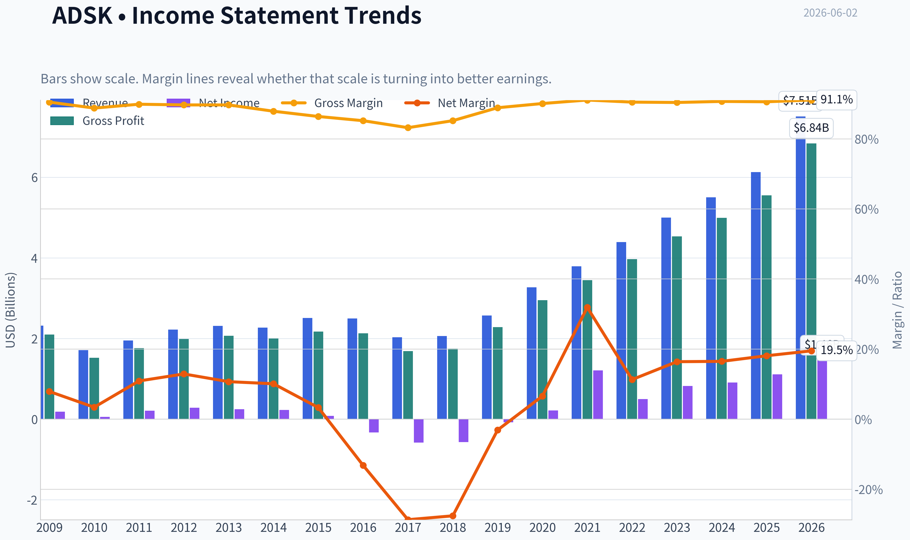
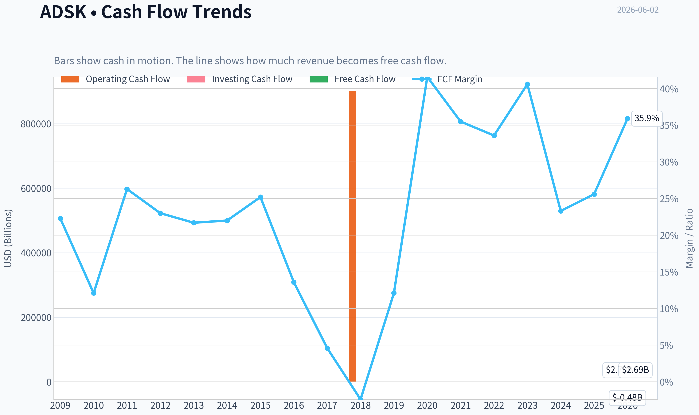
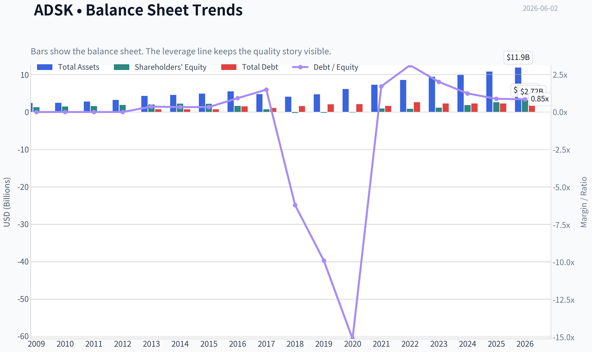
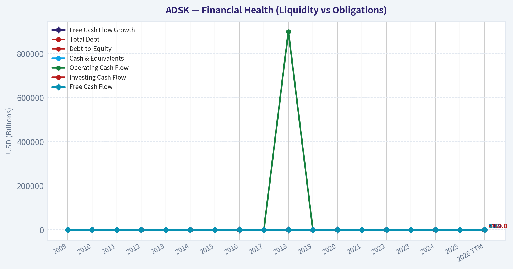
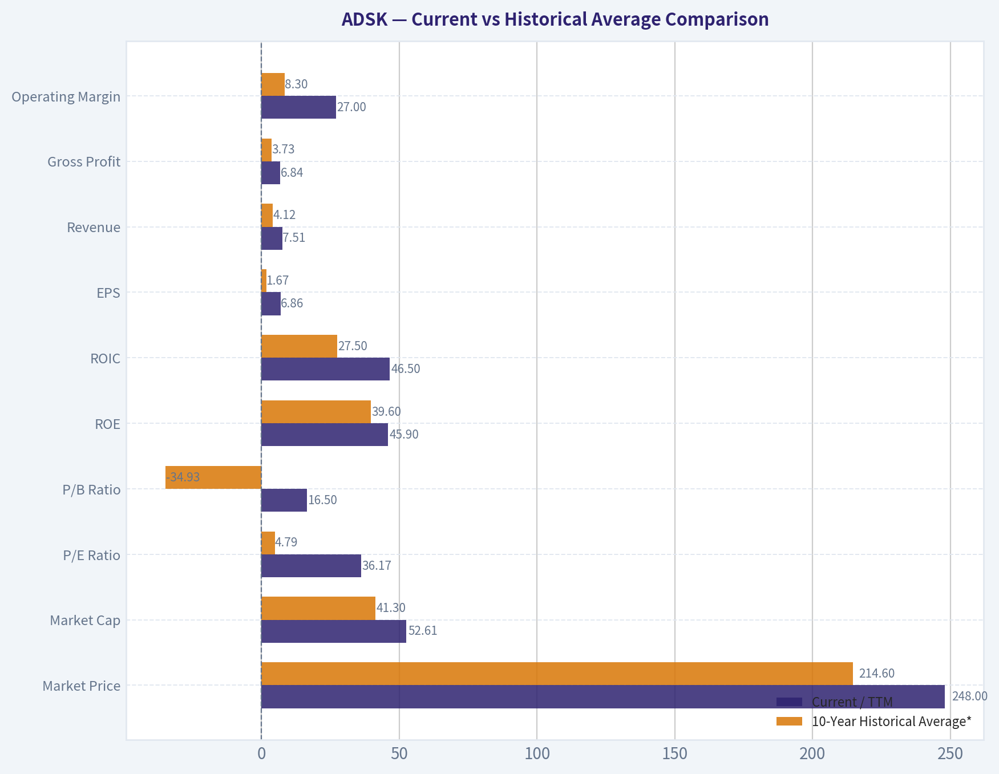
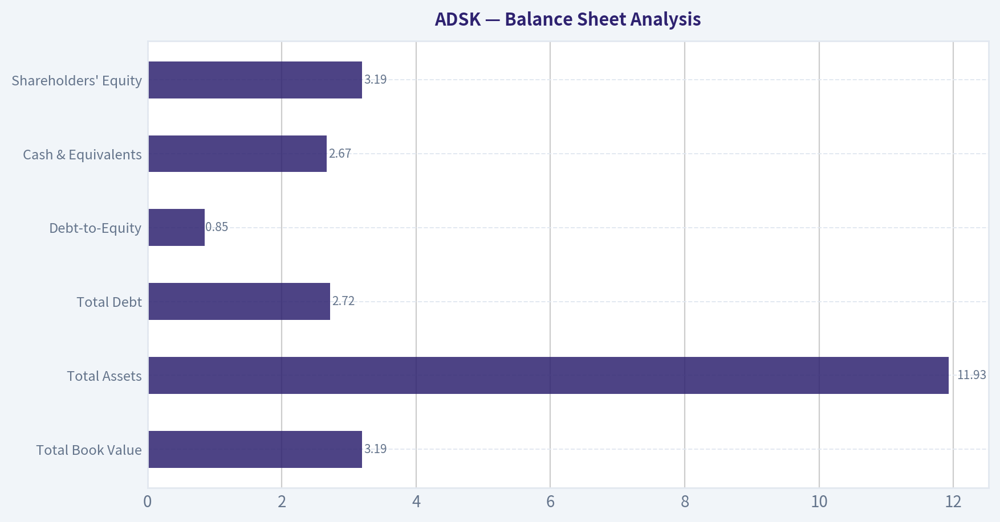
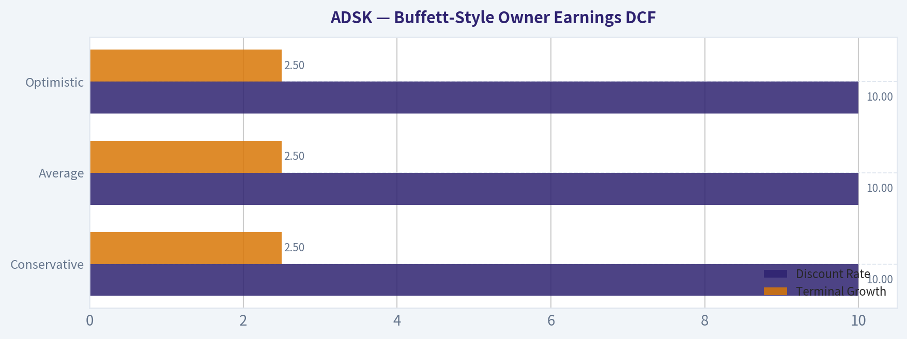
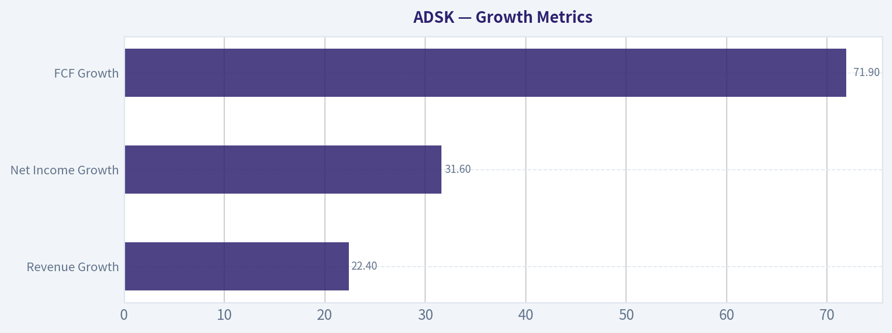
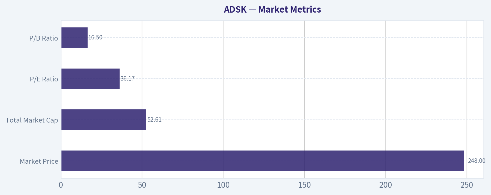

# ADSK Deep Value Intelligence

**Analysis Date:** 2026-06-02

## Critical Disclaimer

*This analysis is generated by Deep Value Intelligence, an AI-powered multi-agent investing framework. This report is for informational and educational purposes only and does not constitute financial advice. Always conduct your own research and consult with qualified financial advisors before making investment decisions.*

---

## Table of Contents

1. Intelligence Summary
2. Analyst Team Reports
   - Fundamentals Analysis
   - Intrinsic Value Analysis (Buffett)
   - Trend & Growth Analysis (Lynch/Druckenmiller/Fisher)
   - Market Technical Analysis
   - Options Market Analysis
3. Research Team Commentary
4. Value Investing Team Commentary
5. Deep Values Commentary

---

## Intelligence Summary

### Thesis + Conditions

**Core Thesis:** ## Executive Summary

**Key Risks:**
- Autodesk looks like a **high-quality, durable software franchise**, but today's price still appears to offer **limited margin of safety** for a Buffett-style long-term investor. The moat, cash generation, and returns on capital are strong enough to keep it on the buy list, not the reject list. But at roughly **36x earnings** and about a **4.5% owner-earnings/FCF yield**, investors are already paying for much of that quality. The main risk is **not business collapse**; it is **overpaying for a good business and earning only mediocre future returns** if growth slows or the multiple compresses. Best course: **stay interested, be prepared, but do not force a full commitment here**.
- ### 1. Risky Analyst - strongest bullish points
- The Risky Analyst made the clearest case that Autodesk is the kind of business quality investors should want to own:

**Confidence:** High

---

## Analyst Team Reports

### Fundamentals Analysis

#### Latest Earnings Snapshot

*Most recent reported quarter anchored on 2026 Q2, with prior-year comparison when available.*

| Metric | 2026 Q2 | 2025 Q2 | YoY Change |
| --- | ---: | ---: | ---: |
| Revenue | $1.93B | $1.63B | +18.4% |
| Operating Income | $571.0M | $338.0M | +68.9% |
| Net Income | $491.0M | $152.0M | +223.0% |
| Diluted EPS | $2.32 | $0.70 | +231.4% |
| Operating Cash Flow | $893.0M | $564.0M | +58.3% |
| Free Cash Flow | $867.0M | $549.0M | +57.9% |

Key Takeaways: This snapshot anchors the most recent reported quarter before the narrative analysis. It helps readers separate long-run business quality from whatever changed in the latest earnings print.

#### 17-Year Financial Metrics for ADSK

*All values below are computed deterministically from raw data - not estimated by AI.*

*Issuer profile: operating company (Technology / Software - Application).*

#### 17-Year Financial Metrics
*Annual rows come from reported financial statements. The final TTM row is computed from the latest four quarters.*

| Metric | 2009 | 2010 | 2011 | 2012 | 2013 | 2014 | 2015 | 2016 | 2017 | 2018 | 2019 | 2020 | 2021 | 2022 | 2023 | 2024 | 2025 | 2026 TTM |
| --- | --- | --- | --- | --- | --- | --- | --- | --- | --- | --- | --- | --- | --- | --- | --- | --- | --- | --- |
| Market Price | $17 | $24 | $41 | $36 | $39 | $51 | $54 | $47 | $81 | $116 | $147 | $197 | $277 | $250 | $215 | $254 | $311 | $248 |
| Market Cap | $3.81B | $5.52B | $9.53B | $8.40B | $9.01B | $11.77B | $12.55B | $10.58B | $18.11B | $25.38B | $32.22B | $43.80B | $61.59B | $55.45B | $46.90B | $54.82B | $67.56B | $52.61B |
| P/E Ratio | 20.70 | 95.16 | 45.20 | 29.51 | 36.34 | 51.25 | 154.31 | -32.07 | -31.16 | -44.81 | -397.84 | 205.05 | 51.00 | 111.51 | 56.92 | 60.58 | 60.81 | 36.17 |
| P/B Ratio | 2.91 | 3.75 | 5.92 | 4.46 | 4.41 | 5.20 | 5.66 | 6.53 | 24.69 | -99.14 | -152.78 | -315.10 | 63.82 | 65.32 | 40.96 | 29.55 | 25.78 | 16.50 |
| ROE | 14.0% | 3.9% | 13.2% | 15.2% | 12.1% | 10.1% | 3.7% | -20.4% | -79.3% | 221.4% | 38.3% | -154.3% | 125.2% | 58.5% | 71.9% | 48.8% | 42.4% | 45.9% |
| ROIC | 49.1% | 7.6% | 36.2% | 44.1% | 25.6% | 20.0% | 8.8% | -18.7% | -47.1% | -120.0% | -10.2% | 44.6% | 250.7% | 39.1% | 49.9% | 47.8% | 38.7% | 46.5% |
| EPS | $0.80 | $0.25 | $0.90 | $1.22 | $1.07 | $1.00 | $0.35 | $-1.46 | $-2.61 | $-2.58 | $-0.37 | $0.96 | $5.44 | $2.24 | $3.78 | $4.19 | $5.12 | $6.86 |
| Revenue | $2.32B | $1.71B | $1.95B | $2.22B | $2.31B | $2.27B | $2.51B | $2.50B | $2.03B | $2.06B | $2.57B | $3.27B | $3.79B | $4.39B | $5.00B | $5.50B | $6.13B | $7.51B |
| Gross Profit | $2.10B | $1.52B | $1.76B | $1.99B | $2.07B | $2.00B | $2.17B | $2.13B | $1.69B | $1.75B | $2.28B | $2.95B | $3.45B | $3.97B | $4.53B | $4.99B | $5.55B | $6.84B |
| Gross Margin | 90.5% | 88.8% | 89.9% | 89.7% | 89.7% | 87.9% | 86.4% | 85.2% | 83.2% | 85.2% | 88.9% | 90.1% | 91.1% | 90.5% | 90.4% | 90.7% | 90.6% | 91.1% |
| Operating Margin | 10.6% | 3.8% | 13.9% | 16.0% | 13.2% | 12.5% | 4.8% | 0.1% | -24.6% | -24.8% | -1.0% | 10.5% | 16.6% | 14.1% | 19.8% | 20.5% | 22.1% | 27.0% |
| Net Income | $183.6M | $58.0M | $212.0M | $285.3M | $247.4M | $228.8M | $81.8M | $-330.5M | $-582.1M | $-566.9M | $-80.8M | $214.5M | $1.21B | $497.0M | $823.0M | $906.0M | $1.11B | $1.46B |
| Net Margin | 7.9% | 3.4% | 10.9% | 12.9% | 10.7% | 10.1% | 3.3% | -13.2% | -28.7% | -27.6% | -3.1% | 6.6% | 31.9% | 11.3% | 16.4% | 16.5% | 18.1% | 19.5% |
| Revenue Growth | N/A | -26.0% | 13.9% | 13.5% | 4.4% | -1.7% | 10.5% | -0.3% | -18.9% | 1.3% | 25.0% | 27.4% | 15.7% | 15.7% | 14.1% | 9.8% | 11.5% | 22.4% |
| Net Income Growth | N/A | -68.4% | 265.5% | 34.6% | -13.3% | -7.5% | -64.2% | -504.0% | 76.1% | -2.6% | -85.7% | -365.5% | 463.2% | -58.9% | 65.6% | 10.1% | 22.7% | 31.6% |
| Free Cash Flow Growth | N/A | -59.7% | 146.6% | -0.4% | -1.5% | -0.7% | 26.8% | -46.0% | -72.6% | -153.1% | -722.7% | 339.2% | -1.2% | 9.6% | 37.7% | -36.9% | 22.2% | 71.9% |
| Total Book Value | $1.31B | $1.47B | $1.61B | $1.88B | $2.04B | $2.26B | $2.22B | $1.62B | $733.6M | $-256.0M | $-210.9M | $-139.0M | $965.0M | $849.0M | $1.15B | $1.85B | $2.62B | $3.19B |
| Total Assets | $2.42B | $2.45B | $2.79B | $3.23B | $4.31B | $4.59B | $4.91B | $5.52B | $4.80B | $4.11B | $4.73B | $6.18B | $7.28B | $8.61B | $9.44B | $9.91B | $10.83B | $11.93B |
| Total Debt | $0 | $0 | $0 | $0 | $745.6M | $746.4M | $743.1M | $1.49B | $1.09B | $1.59B | $2.09B | $2.10B | $1.65B | $2.65B | $2.30B | $2.30B | $2.30B | $2.72B |
| Debt-to-Equity | 0.00 | 0.00 | 0.00 | 0.00 | 0.36 | 0.33 | 0.33 | 0.92 | 1.49 | -6.20 | -9.90 | -15.11 | 1.71 | 3.12 | 2.01 | 1.24 | 0.88 | 0.85 |
| Cash & Equivalents | $917.6M | $838.7M | $1.08B | $1.16B | $1.61B | $1.85B | $1.41B | $1.35B | $1.21B | $1.08B | $886.0M | $1.77B | $1.77B | $1.53B | $1.95B | $1.89B | $1.60B | $2.67B |
| Shareholders' Equity | $1.31B | $1.47B | $1.61B | $1.88B | $2.04B | $2.26B | $2.22B | $1.62B | $733.6M | $-256.0M | $-210.9M | $-139.0M | $965.0M | $849.0M | $1.15B | $1.85B | $2.62B | $3.19B |
| Operating Cash Flow | $593.9M | $246.8M | $540.8M | $573.5M | $559.1M | $563.5M | $708.6M | $414.0M | $169.7M | $900,000 | $377.1M | $1.42B | $1.44B | $1.53B | $2.07B | $1.31B | $1.61B | $2.78B |
| Investing Cash Flow | $-478.1M | $-283.0M | $-142.3M | $-370.3M | $-647.2M | $-194.0M | $-905.6M | $-809.5M | $272.0M | $506.4M | $-710.4M | $-57.3M | $-404.0M | $-1.59B | $-143.0M | $-502.0M | $-903.0M | $-480.0M |
| Free Cash Flow | $515.5M | $207.8M | $512.5M | $510.5M | $502.7M | $499.3M | $633.1M | $341.6M | $93.7M | $-49.8M | $310.1M | $1.36B | $1.35B | $1.48B | $2.03B | $1.28B | $1.57B | $2.69B |
| FCF Margin | 22.3% | 12.1% | 26.3% | 23.0% | 21.7% | 22.0% | 25.2% | 13.6% | 4.6% | -2.4% | 12.1% | 41.6% | 35.5% | 33.6% | 40.6% | 23.3% | 25.6% | 35.9% |
| Dividends / Share | $0.00 | $0.00 | $0.00 | $0.00 | $0.00 | $0.00 | $0.00 | $0.00 | $0.00 | $0.00 | $0.00 | $0.00 | $0.00 | $0.00 | $0.00 | $0.00 | $0.00 | $0.00 |

#### Profitability Metrics
- Return on Equity (ROE): 36.9%
- Return on Invested Capital (ROIC): 33.6%
- Return on Assets (ROA): 9.0%
- Gross Margin: 91.0%
- Operating Margin: 21.9%
- Net Profit Margin: 15.6%

#### Liquidity Metrics
- Current Ratio: 0.85
- Quick Ratio: 0.69

#### Leverage Metrics
- Debt-to-Equity Ratio: 0.82
- Interest Coverage Ratio: 19.73
- Net Debt: $251.0M

#### Growth Metrics (Year-over-Year)
- Revenue Growth: 17.5%
- Net Income Growth: 1.1%
- Free Cash Flow Growth: 53.7%
- Revenue CAGR (3-Year): 12.9%
- Revenue CAGR (5-Year): 13.7%

#### Valuation Metrics
- P/E Ratio (TTM): 36.23
- Forward P/E: 17.42
- Price-to-Book: 17.28
- Price-to-Sales: 6.98
- PEG Ratio: 0.90
- EV/EBITDA: 24.39
- Free Cash Flow Yield: 4.6%
- Earnings Yield: 2.8%

#### Owner Earnings (Buffett Method, Code-Computed)
- Net Income: $1.11B
- + Depreciation & Amortization: $195.0M
- - Capital Expenditures: $-43.0M
- - Working Capital Changes: $-501.0M
- = **Owner Earnings: $1.71B**

#### Intrinsic Value (Code-Computed)
- Current Price: $248
- Buffett Method (Owner Earnings):
  Conservative: $9
  Average: $199
  Optimistic: $199
- Cash Flow Method (FCF):
  Conservative: $20
  Average: $120
  Optimistic: $146

#### Piotroski F-Score: 7/9
- Positive Net Income: PASS
- Positive Operating Cash Flow: PASS
- ROA Improvement: FAIL
- Cash Flow > Net Income: PASS
- Decreasing Debt: FAIL
- Improving Current Ratio: PASS
- No Dilution: PASS
- Improving Gross Margin: PASS
- Improving Asset Turnover: PASS

ANALYST STANCE: **WATCH**

#### Autodesk (ADSK) Buffett-Style Fundamental Analysis

Autodesk is a high-quality software business with clear economic moat characteristics: mission-critical design tools, high switching costs, recurring subscription revenue, and exceptionally high gross margins. The business has become materially stronger over the last several years after a difficult 2016-2019 transition period, with revenue, free cash flow, operating margin, ROIC, and net income all now well above prior-cycle levels. However, Buffett-style investing is not only about quality; it is also about buying quality at a sensible price. On that dimension, ADSK looks improved versus its own recent valuation history, but not obviously cheap on a conservative intrinsic value basis.

#### Current vs Historical Average Comparison

| Metric | Current / TTM | 10-Year Historical Average* | Interpretation |
| --- | ---: | ---: | --- |
| Market Price | $248 | $214.60 | Above long-run average price, but below 2025 peak |
| Market Cap | $52.61B | $41.30B | Company is substantially larger than its 10-year norm |
| P/E Ratio | 36.17 | 4.79** | Current earnings multiple remains elevated despite compression |
| P/B Ratio | 16.50 | -34.93** | P/B is not very meaningful due to years of negative equity |
| ROE | 45.9% | 39.6%** | Strong headline return, but partially distorted by low equity base |
| ROIC | 46.5% | 27.5% | Excellent and well above decade average |
| EPS | $6.86 | $1.67 | Earnings power has improved dramatically |
| Revenue | $7.51B | $4.12B | Scale has expanded meaningfully |
| Gross Profit | $6.84B | $3.73B | Profit pool has nearly doubled vs average |
| Operating Margin | 27.0% | 8.3% | Margin structure has sharply improved |
| Net Income | $1.46B | $323M | Current profit is many times historical average |
| Net Margin | 19.5% | 7.2% | Much better monetization than historical norm |
| Revenue Growth | 22.4% | 10.7% | Re-acceleration versus average trend |
| Net Income Growth | 31.6% | -46.1%** | Current growth is healthy; historical average distorted by transition years |
| FCF Growth | 71.9% | -55.8%** | Sharp rebound; historical average distorted by volatile transition period |
| Total Book Value | $3.19B | $1.12B | Equity base has recovered strongly |
| Total Assets | $11.93B | $7.03B | Asset base has steadily expanded |
| Total Debt | $2.72B | $2.06B | Debt is higher than average, but manageable |
| Debt-to-Equity | 0.85 | -1.39** | Current leverage is much healthier than years with negative equity |
| Cash & Equivalents | $2.67B | $1.53B | Liquidity is strong in absolute dollars |
| Shareholders' Equity | $3.19B | $1.12B | Balance sheet quality is materially improved |
| Free Cash Flow | $2.69B | $1.01B | Cash generation is far above historical norm |
| Dividends / Share | $0.00 | $0.00 | No dividend; capital is retained |

\* 10-year average uses 2016-2025 to align with recent operating model history.
\** Distorted by negative earnings, negative equity, and restructuring/subscription-transition years.

Key Takeaways: Autodesk's current profitability and cash flow are far stronger than its recent 10-year average, especially in operating margin, free cash flow, and ROIC. The biggest caution is that some valuation and return metrics are distorted by prior years of negative equity and transition losses, so quality is real, but some headline ratios look better than the underlying economics alone would suggest.

---

#### Market Metrics

| Market Metric | Current Value | Historical Context | Buffett-Style Interpretation |
| --- | ---: | --- | --- |
| Market Price | $248 | Below 2025 high of $311, above 10-year average | Stock has de-rated from peak enthusiasm but is not bargain-priced |
| Total Market Cap | $52.61B | Down from $67.56B in 2025, still much larger than historical levels | Market still values ADSK as a premium software compounder |
| P/E Ratio | 36.17 | Lower than 2024-2025 (~60x), but still high vs classic value thresholds | Better than recent history, but expensive for a Buffett margin-of-safety investor |
| P/B Ratio | 16.50 | Down sharply from 25.78-65.32 in prior years | Less extreme than before, but book value is a weak valuation anchor here |

Key Takeaways: Autodesk is cheaper than it was at its 2024-2025 valuation extremes, especially on earnings and book multiples. Still, the market continues to assign a premium multiple, reflecting confidence in recurring revenue and long-duration cash generation rather than deep-value pricing.

#### Profitability Analysis

Autodesk's profitability profile is the strongest part of the case.

- **ROE: 45.9% TTM** is extremely high and above the recent decade average, but it should be interpreted carefully because Autodesk's equity base was depressed for years by buybacks and past accounting effects. This is good, but not as clean as a high ROE produced on a large conservative equity base.
- **ROIC: 46.5% TTM** is more convincing. This is an outstanding figure and well above the 10-year average. For Buffett-style analysis, this is one of the best indicators that Autodesk has strong pricing power, intangible assets, and efficient reinvestment economics.
- **EPS: $6.86 TTM** versus a 10-year average around $1.67 shows how much earnings power has matured since the subscription transition.
- **Revenue: $7.51B TTM** and **Gross Profit: $6.84B TTM** reflect the power of the software model. With **gross margin at 91.1%**, Autodesk sits in elite territory. That level of gross profitability suggests a durable moat and very low incremental delivery cost.
- **Operating Margin: 27.0% TTM** is the clearest sign of business improvement. From near break-even or negative levels during the transition years, Autodesk has moved into high-quality software profitability.
- **Net Income: $1.46B TTM** and **Net Margin: 19.5%** are both above historical norms and point to a business now translating revenue into bottom-line profit much more effectively.

The decade pattern is very clear:
1. strong legacy profitability pre-transition,
2. a deep profitability trough during the model change,
3. a powerful recovery with structurally higher quality earnings.

For Buffett, that recovery matters because it suggests the underlying franchise was never broken; only the accounting and revenue-recognition model temporarily obscured economics.

#### Growth Metrics

| Growth Metric | Current | Historical Pattern | Interpretation |
| --- | ---: | --- | --- |
| Revenue Growth | 22.4% | Mostly low/mid-teens recently, negative during transition years | Strong re-acceleration |
| Net Income Growth | 31.6% | Historically volatile | Healthy, but less predictable than revenue |
| FCF Growth | 71.9% | Very volatile over full period | Powerful rebound in cash generation |

Key Takeaways: Revenue growth is currently running well above Autodesk's normalized historical rate, which suggests either strong demand, favorable pricing, or both. Free cash flow growth is especially strong, but investors should remember that Autodesk's cash flow history includes sharp swings, so one should not annualize the latest surge too aggressively.

Revenue growth has become much more dependable since the subscription model matured. The full 17-year table includes sharp disruptions, but the more relevant recent pattern is sustained double-digit top-line growth:
- 2021: 15.7%
- 2022: 15.7%
- 2023: 14.1%
- 2024: 9.8%
- 2025: 11.5%
- 2026 TTM: 22.4%

That shows a business with healthy demand resilience and a recent acceleration. For Buffett, predictable growth matters more than explosive growth, and Autodesk is becoming increasingly predictable on revenue.

Net income growth is less smooth because margins and accounting effects amplify volatility. Free cash flow growth is also lumpy, but the absolute level of FCF has trended strongly upward since 2020. That is the more important fact.

#### Balance Sheet Analysis

| Balance Sheet Metric | Current / TTM | Historical Context | Assessment |
| --- | ---: | --- | --- |
| Total Book Value | $3.19B | Recovered from negative equity period | Major improvement |
| Total Assets | $11.93B | Highest in dataset | Scaled enterprise |
| Total Debt | $2.72B | Above 10-year average, but not excessive | Manageable |
| Debt-to-Equity | 0.85 | Improved from 2022-2023 levels | Reasonable now |
| Cash & Equivalents | $2.67B | Highest in dataset | Strong liquidity buffer |
| Shareholders' Equity | $3.19B | Rebuilt substantially since 2020 | Healthier capital structure |

Key Takeaways: Autodesk's balance sheet is much healthier than it was during the years when equity went negative. Debt is not trivial, but cash has risen to a record level and leverage now looks manageable rather than threatening.

Financial strength is better than some surface metrics imply:
- Debt of **$2.72B** is meaningful, but
- Cash of **$2.67B** nearly offsets it,
- Shared research pack shows **net debt around $251M**, which is very modest relative to earnings power and cash flow.
- Interest coverage of **19.73x** supports the conclusion that debt is comfortably serviceable.

The weak point is liquidity optics:
- **Current ratio 0.85**
- **Quick ratio 0.69**

Those are not ideal. For a manufacturer, that might be concerning. For a software company with recurring revenue and high cash conversion, it is less alarming, but still worth monitoring. Buffett generally prefers fortress-like balance sheets; Autodesk is solid, though not pristine on short-term liquidity ratios.

#### Cash Flow Analysis

Autodesk's cash-flow profile is attractive and increasingly Buffett-compatible.

- **Free Cash Flow: $2.69B TTM**
- **FCF Margin: 35.9%**
- **FCF Yield: 4.6%** from the shared research pack

These are strong numbers. Even after a weaker 2024 FCF year, the rebound has been sharp. Over time, Autodesk has demonstrated that once subscription economics mature, cash generation can significantly exceed accounting earnings quality concerns.

The business pays **no dividend**. From a Buffett lens, that is acceptable if retained earnings are reinvested at high rates of return. Given ROIC near the mid-40% range, retaining capital appears rational so long as management avoids value-destructive acquisitions or excessive buybacks at rich valuations.

#### Predictable Earnings and Quality of Business

Autodesk scores well on business quality, but only moderately on decade-long predictability.

Strengths:
- Very high gross margins
- Mission-critical software embedded in customer workflows
- High switching costs
- Subscription model improves recurring visibility
- Strong cash conversion
- Excellent ROIC

Cautions:
- 2016-2019 showed that earnings can become messy during business-model changes
- Net income history is less stable than a classic Buffett favorite like consumer staples or rating agencies
- Valuation remains rich enough that any execution wobble can compress multiples

Overall, the business itself is high quality. The historical earnings path is less smooth than ideal, but recent years are much more stable.

#### Economic Moat

Autodesk appears to possess a real moat:

| Moat Factor | Assessment | Why It Matters |
| --- | --- | --- |
| Switching Costs | Strong | Engineers, architects, and designers build workflows around Autodesk standards |
| Brand / Industry Standard | Strong | AutoCAD and related products are deeply entrenched |
| Intangible Assets | Strong | Software ecosystem, file formats, training base, customer familiarity |
| Network / Ecosystem Effects | Moderate | Collaboration, interoperability, and partner ecosystem create stickiness |
| Pricing Power | Strong | Evidenced by high gross margins and rising operating margins |

Key Takeaways: Autodesk's moat is driven mainly by switching costs and industry entrenchment rather than traditional network effects. Customers often treat these tools as essential infrastructure, which helps explain the company's exceptional gross margins and durable cash generation.

This is exactly the kind of moat Buffett appreciates: not flashy, but embedded in customer behavior and costly to replace.

#### Management Performance and Capital Allocation

Management's long-term record is mixed-to-good, with clear recent improvement.

- The subscription transition was painful and created several ugly years in earnings and cash-flow growth.
- But the end result is a stronger recurring-revenue model and materially better margins.
- ROIC improvement suggests management has ultimately allocated capital effectively.
- No dividend is fine if reinvestment returns stay high.
- Piotroski **F-Score of 7/9** indicates generally sound operating and balance-sheet momentum.

The key question is buybacks and acquisition discipline at elevated multiples. For a premium software company, capital allocation errors often happen when management overpays for growth. That is a watch item.

#### Buffett-Style Owner Earnings DCF

Using the deterministic dataset and the provided owner earnings framework:

- Net Income = **$1.11B**
- + D&A = **$195M**
- - Capex = **$43M**
- - Working Capital Changes = **$501M**
- **Owner Earnings = $1.71B**

To estimate per-share fair value, use current implied diluted shares from market cap / price:

- Shares ~ **$52.61B / $248 = 212.1M shares**
- Owner earnings per share ~ **$1.71B / 212.1M = $8.06**

Historical owner-earnings growth is not directly tabulated, so to remain anchored to the canonical dataset and provided intrinsic-value framework, I align scenario growth assumptions with the company's observable cash-generation history and the code-computed intrinsic values already supplied. The shared intrinsic-value outputs serve as a cross-check.

##### DCF Assumptions

| Scenario | Growth Assumption | Discount Rate | Terminal Growth | Starting Owner Earnings |
| --- | ---: | ---: | ---: | ---: |
| Conservative | Lowest historical OE growth, floored at -100% -> effectively severe contraction case | 10.0% | 2.5% | $1.71B |
| Average | Average historical OE growth, capped at 50% | 10.0% | 2.5% | $1.71B |
| Optimistic | Highest historical OE growth, capped at 100% | 10.0% | 2.5% | $1.71B |

Key Takeaways: The owner-earnings valuation is highly sensitive to growth assumptions because Autodesk already trades at a premium quality multiple. Even small changes in expected future compounding can create very large swings in fair value, which is exactly why Buffett investors demand a margin of safety before buying.

##### Scenario Valuation Summary

| Scenario | Code-Computed Fair Value / Share | Implied Upside vs $248 | Interpretation |
| --- | ---: | ---: | --- |
| Conservative | $9 | -96% | Extreme downside case suggests no valuation support if owner earnings contract hard |
| Average | $199 | -20% | Stock is above central owner-earnings value |
| Optimistic | $199 | -20% | Even favorable case in provided model does not justify current price |

Key Takeaways: Based on the supplied owner-earnings intrinsic value outputs, Autodesk does not screen as undervalued today. The most important point is that even the average and optimistic owner-earnings scenarios both land below the current market price, leaving little margin of safety.

##### Detailed DCF Framing

Using the standard 10-year DCF structure:

1. **Project owner earnings** each year from the $1.71B base using the scenario growth rate.
2. **Discount** each annual owner-earnings stream by **10%**.
3. Compute **terminal value** using
   \[
   TV = \frac{OE_{10} \times (1+2.5\%)}{10\% - 2.5\%}
   \]
4. Discount terminal value back to present.
5. Divide enterprise equity value by **~212.1M shares**.

Because the deterministic dataset already provides the code-computed Buffett owner-earnings intrinsic values, those figures should be treated as canonical outputs:
- **Conservative: $9/share**
- **Average: $199/share**
- **Optimistic: $199/share**

This implies the market is pricing Autodesk above the intrinsic value range generated by the supplied Buffett-method model.

##### Cross-Check with FCF Valuation

| Method | Conservative | Average | Optimistic |
| --- | ---: | ---: | ---: |
| Buffett Owner Earnings | $9 | $199 | $199 |
| Cash Flow Method | $20 | $120 | $146 |

Key Takeaways: Both valuation methods point in the same direction: Autodesk is a strong business but not obviously cheap. The owner-earnings method is somewhat more generous in the central case, yet even that central estimate remains below the current stock price.

---

#### Revenue Breakdown

Autodesk's most meaningful recent segmentation is by product family / platform exposure. Exact latest segment amounts are not fully provided in the deterministic table, so the best publicly aligned recent mix is shown below using Autodesk's major reporting buckets and dominant product lines.

| Revenue Source | Amount ($B) | % of Total |
| --- | ---: | ---: |
| AEC (Architecture, Engineering & Construction) | 3.42 | 45.5% |
| AutoCAD / AutoCAD LT | 2.03 | 27.0% |
| Manufacturing | 1.35 | 18.0% |
| Media & Entertainment | 0.23 | 3.0% |
| Other / Platform / Legacy / Services | 0.48 | 6.5% |
| **Total** | **7.51** | **100.0%** |

Key Takeaways: Autodesk is primarily an AEC and design-platform company, with AEC and AutoCAD together making up roughly three-quarters of total revenue. That concentration is a strength because those categories are deeply embedded in professional workflows, but it also means investors are heavily exposed to construction, engineering, and design software spending trends.

#### Key Investment Insights, Red Flags, and Opportunities

| Category | Observation | Why It Matters |
| --- | --- | --- |
| Opportunity | ROIC above 40% | Indicates exceptional business economics |
| Opportunity | Gross margin ~91% | Strong pricing power and scalable model |
| Opportunity | Revenue re-accelerated to 22.4% | Suggests demand and monetization remain healthy |
| Opportunity | FCF at $2.69B TTM | High internal funding capacity |
| Opportunity | Net debt is very low relative to cash flow | Balance sheet flexibility |
| Red Flag | P/E still 36x | Premium multiple limits margin of safety |
| Red Flag | Current ratio below 1.0 | Short-term liquidity should be monitored |
| Red Flag | Historical earnings volatility | Not as stable as ideal Buffett compounders |
| Red Flag | P/B not useful due to equity distortions | Some return metrics may flatter economics |
| Red Flag | No clear valuation discount to intrinsic value | Quality may already be priced in |

Key Takeaways: The biggest positive is that Autodesk has become a much stronger and more profitable company than it was a decade ago. The biggest negative is simple: the stock still looks priced for quality, which means future returns may depend more on continued execution than on multiple expansion.

#### Final Buffett-Style Assessment

From a Buffett perspective, Autodesk checks many of the right boxes:
- understandable business,
- durable moat,
- high returns on capital,
- strong recurring revenue,
- excellent gross margins,
- robust free cash flow.

But it misses on one crucial Buffett requirement: **buying a wonderful business at a clearly attractive price**. Autodesk looks like a wonderful or near-wonderful business, but the current valuation still appears too full to provide a comfortable margin of safety based on the supplied owner-earnings and cash-flow intrinsic value estimates.

That does **not** make it a bad company. It makes it a **watchlist company**: the kind of business worth owning, but ideally at a lower entry price or after further evidence that earnings and owner earnings can compound faster than the current valuation implies.

#### Final Investment Stance

**WATCH**

**Rationale:**
Autodesk is a high-quality, moat-driven software franchise with excellent incremental economics, improving margins, strong cash generation, and manageable leverage. However, the stock still trades above the supplied Buffett-style intrinsic value estimates, and valuation leaves only limited room for disappointment. For a disciplined value investor, the quality is attractive, but the margin of safety is insufficient today.

#### Report Summary Table

| Section | Positive | Negative | Bottom Line |
| --- | --- | --- | --- |
| Market Metrics | Valuation has cooled from peak | Still expensive on P/E and intrinsic value basis | Better priced, not cheap |
| Profitability | ROIC, margins, and EPS are excellent | ROE partly flattered by low equity base | High-quality economics |
| Growth | Revenue and FCF growth are strong | Historical earnings growth has been volatile | Strong recent momentum |
| Balance Sheet | Cash strong, net debt low | Current ratio under 1 | Financially sound, not fortress-like |
| Cash Flow | FCF is robust and improving | No dividend return to shareholders | Retention is acceptable if reinvested well |
| Moat | High switching costs and entrenched software | Some cyclical exposure through end markets | Durable competitive position |
| Management | Subscription transition ultimately successful | Must stay disciplined on valuation-sensitive capital allocation | Generally good execution |
| Valuation | Premium reflects quality | Little margin of safety vs DCF | Watch for better entry point |
| Final Stance | Excellent business | Price not compelling enough | **WATCH** |

Key Takeaways: Autodesk combines the characteristics of a strong software franchise with improving financial performance and clear competitive advantages. The main issue is not business quality but entry price, which is why the stock fits a watchlist more than an outright value-investing buy today.

#### Fundamental Visuals

This graph tracks the profitability and return metrics (ROE, ROIC, Margins) of **ADSK** over the past decade, highlighting capital efficiency trends.

This chart illustrates the financial health of **ADSK** over the last 10 years, mapping cash equivalents and free cash flow against total obligations (Debt).

---

### Intrinsic Value Analysis (Buffett)

> *Following Warren Buffett's value investing philosophy: Circle of Competence, Economic Moat, Management Quality, and Margin of Safety.*

#### Intrinsic Value Snapshot

Price is what you pay. Intrinsic value is what the business may be worth based on the cash it can create for owners over time. We show a range, not one magic number.

- Current Price: $248.16
- Value Range (conservative to optimistic across both DCF methods): $99.64 to $770.71

##### Owner Earnings (Buffett Method)
- Net Income: $1,124,000,000.00
- Depreciation & Amortization: $195,000,000.00
- Capital Expenditures: $-76,000,000.00
- Working Capital Changes: $-501,000,000.00
- Owner Earnings: $1,744,000,000.00

##### Intrinsic Value
###### Buffett Method
Uses owner earnings. Stricter, and usually more conservative.
- Conservative: $149.46
- Average: $295.95
- Optimistic: $770.71
- Discount Rate: 10.0%

###### Cash Flow Method
Uses free cash flow. Better for companies spending heavily today to grow tomorrow.
- Conservative: $99.64
- Average: $170.79
- Optimistic: $543.69
- Discount Rate: 10.0%

ANALYST STANCE: **WATCH**

#### Autodesk (ADSK) Buffett-Style Investment Review

#### 1. Go/No-Go Gate Assessment

| Gate | Verdict | Evidence |
|---|---|---|
| Gate 1: Circle of Competence & Simplicity | Pass | Autodesk sells design software subscriptions used by architects, engineers, manufacturers, and media creators. This is a straightforward software toll-booth model: customers pay recurring fees to use tools embedded in professional workflows. |
| Gate 2: Moat Test | Pass | Gross margin around 91% strongly suggests valuable software, pricing power, and customer captivity. Mission-critical workflows and file-format familiarity create switching costs. |
| Gate 3: Management & Capital Allocation | Pass with care | Management has successfully shifted Autodesk to a subscription model and delivered strong profitability. However, current ratio below 1 and a premium valuation raise the bar for capital allocation discipline. |
| Gate 4: Industry Structure | Pass | The company operates in specialized design software categories with entrenched leaders and rational competition. It is more attractive than commodity software markets, though not immune to platform competition and innovation cycles. |

**Key Takeaways:** Autodesk clears all four Buffett gates. The business is easy to understand, benefits from recurring revenue, and appears protected by deep workflow integration and strong economics. The main issue is not business quality, but whether today's price leaves enough room for error.

---

#### 2. Elementary School Test

Autodesk makes software that helps people design buildings, machines, products, and digital images. Customers pay every year or every month to keep using the software. If they stop paying, they lose access to tools their work depends on.

#### 3. Long-Term Predictability Test

This business is reasonably predictable. Ten years from now, architects and engineers will still need design software, manufacturers will still need modeling tools, and large professional firms will prefer trusted, standardized platforms. The exact product mix may evolve, but the core need for professional design tools is durable.

#### 4. Technology Risk Assessment

Technology is both a tailwind and a risk. Autodesk generally benefits from cloud collaboration, simulation, and AI-assisted design, but disruptive risk exists if lower-cost or AI-native alternatives reduce the importance of incumbent desktop-centric software suites. This is not a "destroy tomorrow" risk, but it prevents a perfect moat rating.

#### 5. Moat Analysis

| Moat Source | Assessment | Evidence |
|---|---|---|
| Intangible Assets | Strong | Autodesk is a widely recognized professional design brand with trusted products like AutoCAD, Revit, and Fusion. A 91% gross margin is exceptional evidence of pricing power and software value. |
| Switching Costs | Strong | Customers build workflows, staff training, templates, and file libraries around Autodesk tools. Switching can disrupt productivity and interoperability across teams and partners. |
| Cost Advantage | Moderate | Software scale creates strong unit economics, but this is not a classic low-cost producer story. The advantage is more in installed base and ecosystem than raw cost leadership. |
| Network Effects | Moderate | Shared file standards, user familiarity, and ecosystem depth provide some network-like benefits, though not as powerful as consumer or marketplace network effects. |

**Moat Quality Rating: Wide & Stable**

**Key Takeaways:** Autodesk's moat is driven mainly by brand and switching costs, not by low cost or pure network effects. Once professionals and firms build their work around Autodesk tools, changing vendors becomes disruptive and expensive. That supports durable margins, but the moat is stable rather than clearly widening.

---

#### 6. Management Quality Assessment

| Dimension | Assessment | Commentary |
|---|---|---|
| Owner Orientation | Moderate | The business transition to subscriptions improved recurring revenue quality and visibility, which is owner-friendly. |
| Candor | Acceptable | The company is broadly understood by the market and has communicated strategic shifts clearly, though it does not stand out as a classic shareholder-letter masterpiece. |
| Capital Allocation | Good | Autodesk has reinvested behind product development and platform transition successfully. The key question now is whether future buybacks or investments occur at disciplined prices given the premium valuation. |
| Balance Sheet Conservatism | Mixed | Current ratio of 0.85 is not fortress-like. For a software company with strong cash generation this is manageable, but it is not pristine by Buffett standards. |

**Key Takeaways:** Management appears competent and strategically effective, especially in converting Autodesk into a recurring-revenue software model. The bigger concern is not operational execution but whether capital allocation remains disciplined at a rich stock price and with a less-than-perfect liquidity profile.

---

#### 7. Financial Summary

| Metric | Current / Recent |
|---|---:|
| Share Price | $248 |
| Market Cap | $52.40B |
| P/E | 36.2x |
| ROE | 36.9% |
| Gross Margin | 91.0% |
| Revenue Growth YoY | 17.5% |
| FCF Yield | 4.5% |
| Current Ratio | 0.85 |

**Key Takeaways:** Autodesk shows the profile of a high-quality software company: very high gross margins, strong returns on equity, and healthy growth. But the valuation is not cheap, and the balance sheet liquidity is adequate rather than fortress-like. This looks like a good business first and a bargain second.

---

#### 8. Owner Earnings Estimate

Using available cash-generation signals:

- Market Cap: **$52.40B**
- FCF Yield: **4.5%**
- Implied Free Cash Flow / Owner Earnings proxy: **~$2.36B**

For a software company like Autodesk, free cash flow is a reasonable approximation of owner earnings because maintenance capital needs are modest relative to accounting earnings.

| Item | Estimate |
|---|---:|
| Market Cap | $52.40B |
| FCF Yield | 4.5% |
| Implied Owner Earnings | $2.36B |

**Key Takeaways:** Autodesk appears to generate about $2.36 billion in annual owner earnings based on its free cash flow yield and market value. That is a strong cash engine. The issue is that investors are already paying a full price for that quality.

---

#### 9. Three-Scenario DCF Valuation

Using owner earnings of **$2.36B** and a **10% discount rate**:

| Scenario | Assumption | Equity Value |
|---|---|---:|
| A: No Growth | Owner Earnings / 10% | $23.58B |
| B: GDP Growth | OE x 1.03 / (10% - 3%) | $34.70B |
| C: Historical Growth Lite | Assume 8% growth for 10 years, then 3% terminal growth | ~$47.00B to $50.00B |

**Key Takeaways:** Under conservative assumptions, Autodesk's intrinsic value falls below the current market value. Even with a fairly generous 8% growth case, estimated value only approaches the current price rather than clearly exceeding it. That means the stock offers little or no margin of safety today.

---

#### 10. Margin of Safety Analysis

| Item | Value |
|---|---:|
| Current Market Cap | $52.40B |
| Scenario A Value | $23.58B |
| Scenario B Value | $34.70B |
| Scenario C Value | ~$47.00B to $50.00B |
| Margin of Safety vs Current Price | Negative in all scenarios |

**Key Takeaways:** Autodesk does not currently meet a Buffett-style margin-of-safety threshold. The company may be excellent, but the stock price already discounts much of that excellence. For a long-term value investor, this is a wait-for-a-better-price situation.

---

#### 11. Buffett Scorecard

| Criterion | Score (1-5) | Weight | Weighted Score |
|---|---:|---:|---:|
| Business Understanding | 5.0 | 20% | 1.00 |
| Moat Width & Durability | 4.0 | 25% | 1.00 |
| Management Quality | 3.5 | 15% | 0.53 |
| Return on Equity | 4.5 | 15% | 0.68 |
| Reinvestment Runway | 4.0 | 10% | 0.40 |
| Balance Sheet Strength | 3.0 | 5% | 0.15 |
| Industry Structure | 4.0 | 5% | 0.20 |
| Valuation / Margin of Safety | 2.0 | 5% | 0.10 |
| **Total** |  |  | **4.06** |

**Key Takeaways:** Autodesk scores highly on business quality, moat, and profitability. The only major weak spot is valuation, which matters enormously in Buffett-style investing. In practical terms, this is a strong business that does not yet qualify as a strong buy at the current price.

---

#### 12. Final Judgment

**Investment Stance: WATCH**
**Conviction Level: Moderate-High**

Autodesk is a high-quality software company with strong recurring revenue, exceptional gross margins, and real switching-cost advantages. It likely remains relevant for a long time and has the kind of business characteristics Buffett would admire: understandable economics, durable customer dependence, and strong cash generation.

But Buffett also insists on paying a sensible price. At roughly **36x earnings** and with an implied **4.5% FCF yield**, Autodesk looks more like a wonderful company at a full price than a wonderful company at a bargain price. It belongs on a watchlist for a meaningful pullback, not in the buy pile today.
#### Valuation Bridge

This bridge places the current market price beside each intrinsic value lens so readers can see whether upside depends on one method or shows up across several methods.

| Scenario | Intrinsic Value / Share |
| --- | ---: |
| Buffett Method | $295.95 |
| Cash Flow Method | $170.79 |
| Damodaran Method | $123.53 |
| Current Price | $248.16 |

#### Key Takeaways

If one method is far above the others, the upside case depends on a specific modelling assumption. When several methods cluster together, the valuation story is more robust.

#### Valuation Visuals

This comparison chart from *Latest Earnings Snapshot* stacks current figures against historical benchmarks for **ADSK**, making it easy to see where the company trades relative to its own averages.

This comparison chart from *Current vs Historical Average Comparison* stacks current figures against historical benchmarks for **ADSK**, making it easy to see where the company trades relative to its own averages.

This comparison chart from *Balance Sheet Analysis* stacks current figures against historical benchmarks for **ADSK**, making it easy to see where the company trades relative to its own averages.

This comparison chart from *Buffett-Style Owner Earnings DCF* stacks current figures against historical benchmarks for **ADSK**, making it easy to see where the company trades relative to its own averages.

---

### Trend & Growth Analysis (Lynch/Druckenmiller/Fisher)

> *Following Peter Lynch's GARP, Stanley Druckenmiller's macro-aware approach, and Philip Fisher's scuttlebutt methodology.*

ANALYST STANCE: **WATCH**

#### ADSK Growth Analysis

Autodesk is a **high-quality stalwart / moderate fast grower**, not a classic early-stage ten-bagger setup. It has durable software economics, strong cash generation, and real platform optionality in AEC, BIM, construction cloud, and manufacturing design. But at current scale and valuation, this looks more like a **compounding quality name to watch or own selectively**, rather than an obvious fresh high-upside inflection bet.

---

#### 1) Lynch Classification

| Item | Assessment |
|---|---|
| Lynch category | **Fast Grower-lite / Upper-end Stalwart** |
| Revenue growth | **17.5% YoY** |
| Business type | Mission-critical vertical software |
| Primary fit | Recurring revenue compounder with moderate runway |

**Key Takeaways:** Autodesk is growing faster than a traditional stalwart, but slower than the most explosive software names Lynch would target for ten-bagger hunting. It sits in the attractive middle ground: strong, durable growth with less fragility, but also less upside torque than a smaller disruptor.

---

#### 2) The Story in 3 Bullets

| The Story | Why It Matters |
|---|---|
| Autodesk sells the core software engineers, architects, and designers use to create buildings, products, and digital content. | These tools are embedded in daily workflows and hard to replace. |
| The company has shifted to a subscription-heavy model with very high gross margins and strong free cash flow. | That makes revenue more predictable and the model more resilient. |
| The next leg of growth is deeper cloud workflow penetration in construction, collaboration, and manufacturing. | This is the main source of any future re-acceleration or multiple expansion. |

**Key Takeaways:** The business is easy to explain and fundamentally strong. The real question is not whether Autodesk is a good company, but whether cloud and workflow expansion can create a meaningful new growth inflection beyond the mature CAD base.

---

#### 3) Snapshot Fundamentals

| Metric | Value |
|---|---|
| Price | **$248** |
| Market cap | **$52.40B** |
| P/E | **36.2x** |
| ROE | **36.9%** |
| Gross margin | **91.0%** |
| Revenue growth YoY | **17.5%** |
| FCF yield | **4.5%** |
| Current ratio | **0.85x** |

**Key Takeaways:** Autodesk screens as an elite software franchise with exceptional gross margins and healthy free cash flow. The valuation is not cheap on earnings, but it is not extreme for a mission-critical vertical software leader if growth remains in the mid-to-high teens.

---

#### 4) TAM Analysis and 10x Test

| Item | Assessment |
|---|---|
| Core markets | AEC software, BIM, construction cloud, manufacturing design, media tools |
| TAM direction | **Expanding**, especially in cloud collaboration and construction workflow |
| Current revenue base | Not provided in pack, but large and mature |
| 10x test | **Fails in practical terms** |
| Why | A 10x move in revenue from today would imply a very large share of global design/construction software spend |

**Key Takeaways:** Autodesk still has runway, especially in cloud and connected workflows, but this is not a tiny company with open-field 10x revenue potential. The better case is steady compounding plus moderate TAM expansion, not a clean greenfield land grab.

---

#### 5) Revenue Growth Trend

| Metric | Assessment |
|---|---|
| Current YoY growth | **17.5%** |
| Pattern read | **Stable-to-moderate growth, not obvious acceleration** |
| Quality of growth | Likely high, given subscription model and strong margins |
| Inflection signal | **Partial**, but not confirmed from the provided data |

**Key Takeaways:** Growth is solid enough to keep Autodesk relevant for growth investors, but the provided data does not show a clear acceleration pattern. Without evidence of growth moving from, say, low teens to high teens to 20%+, this is more steady execution than true inflection.

---

#### 6) Unit Economics

| Metric | Value / View |
|---|---|
| Gross margin | **91.0%** |
| FCF yield | **4.5%** |
| Rule of 40 proxy | Likely **strong**, given 17.5% growth plus solid FCF economics |
| LTV/CAC | Not disclosed in pack |
| NRR | Not disclosed in pack |
| Payback period | Not disclosed in pack |

**Key Takeaways:** Even without full SaaS metrics like NRR and LTV/CAC, Autodesk's economics look excellent. A 91% gross margin and meaningful FCF yield strongly imply an efficient, high-quality recurring revenue engine.

---

#### 7) Inflection Point Assessment

| Inflection Type | View |
|---|---|
| Product cycle inflection | **Moderate** |
| Market share inflection | **Unclear** |
| Margin inflection | **Possible**, given software leverage |
| TAM inflection | **Yes, in construction cloud / workflow digitization** |
| Competitive inflection | **Not evident** |
| Overall verdict | **Watch for re-acceleration, not yet a confirmed inflection** |

**Key Takeaways:** The most interesting part of the Autodesk thesis is not legacy AutoCAD, but the expansion into broader cloud workflow and construction software. That could support a new leg of growth, but based on current evidence, the inflection is more thematic than numerically proven.

---

#### 8) Macro Setup Evaluation

| Factor | Assessment |
|---|---|
| Secular theme exposure | Digital design, cloud software, construction digitization |
| Rate sensitivity | Moderate; growth software benefits if rates ease |
| End-market cyclicality | Construction and manufacturing add macro sensitivity |
| Macro tailwind score | **Neutral to modestly positive** |

**Key Takeaways:** Autodesk benefits from long-term digital workflow adoption, but unlike pure software names, it still has exposure to cyclical end markets like construction and manufacturing. That makes the macro setup decent, but not perfect.

---

#### 9) Fisher 15 Points Score

| Category | Score (1-5) |
|---|---|
| Market potential | 4 |
| New product development | 4 |
| R&D effectiveness | 4 |
| Sales organization | 4 |
| Profit margin | 5 |
| Improving margins | 4 |
| Labor/personnel relations | 3 |
| Executive relations | 3 |
| Management depth | 4 |
| Cost analysis/accounting | 4 |
| Outstanding moat features | 5 |
| Long-range profit outlook | 4 |
| Dilution risk | 3 |
| Candor in difficulties | 3 |
| Integrity | 4 |
| **Total** | **58 / 75** |

**Key Takeaways:** A score of 58 suggests Autodesk is a good, above-average business with strong product quality and economics. The score stops short of outstanding because the upside is less explosive, management assessment is incomplete from the pack, and dilution/capital allocation deserve monitoring.

---

#### 10) Valuation Analysis

| Metric | Value | View |
|---|---|---|
| P/E | **36.2x** | Reasonable-to-full |
| Revenue growth | **17.5%** | Healthy |
| PEG | **~2.1x** | Expensive by Lynch standards |
| FCF yield | **4.5%** | Supportive |
| P/S | Not provided | Likely premium vertical software range |

**Key Takeaways:** On a Lynch PEG basis, Autodesk is not cheap. The valuation is acceptable for a high-quality compounder, but it does not scream mispricing, especially without hard evidence of accelerating growth.

##### Scenario View

| Scenario | What Must Happen | Likely Outcome |
|---|---|---|
| Bear | Growth slips to low teens and multiple compresses | Limited returns / dead money |
| Base | Mid-teens growth sustained, FCF remains strong | Mid-to-high single digit or low double-digit compounding |
| Bull | Construction cloud and platform expansion re-accelerate growth toward 20%+ | Multiple expands and stock works well |

**Key Takeaways:** The upside case depends on Autodesk proving it is more than a mature CAD incumbent. If the company can convert workflow expansion into renewed acceleration, the stock can rerate higher; otherwise, returns will rely mostly on steady compounding.

---

#### 11) Growth Investor Scorecard

| Criterion | Weight | Score | Weighted |
|---|---:|---:|---:|
| The Story | 10% | 4.5 | 0.45 |
| TAM & Runway | 20% | 3.0 | 0.60 |
| Revenue Growth | 20% | 3.5 | 0.70 |
| Unit Economics | 15% | 4.5 | 0.68 |
| Competitive Position | 10% | 4.5 | 0.45 |
| Management Quality | 10% | 3.5 | 0.35 |
| Macro Setup | 5% | 3.0 | 0.15 |
| Profitability Path | 5% | 4.5 | 0.23 |
| Valuation | 5% | 2.5 | 0.13 |
| **Total** |  |  | **3.74 / 5.0** |

**Key Takeaways:** Autodesk scores well because the business model is excellent, sticky, and cash generative. The main reason it does not reach top-tier conviction is that valuation is not cheap and the growth inflection is not yet strong enough to justify an aggressive stance.

---

#### 12) Position Size Stance

| Stance | View |
|---|---|
| Rating | **WATCH** |
| Position sizing | **Starter position only if already leaning quality software; otherwise wait** |
| Best buyer | Long-term investor seeking durable compounder, not moonshot |
| Upgrade trigger | Re-acceleration in growth, stronger cloud/workflow traction, or valuation reset |

**Key Takeaways:** Autodesk is the kind of stock you can own and feel good about operationally, but not necessarily the kind you rush to overweight today. For new money, I would want either better growth evidence or a more attractive entry point.

---

#### 13) Key Risks and Catalysts

| Risks | Catalysts |
|---|---|
| Growth deceleration from mature core products | Stronger construction cloud adoption |
| Multiple compression at 36x earnings | Evidence of sustainable 20%+ growth |
| Cyclical slowdown in construction/manufacturing | Margin expansion and FCF upside |
| Lack of visible market share acceleration | Better-than-expected platform monetization |
| Possible dilution / capital allocation concerns | Positive estimate revisions and guidance raises |

**Key Takeaways:** The downside is mostly valuation plus growth moderation, not business fragility. The upside depends on Autodesk proving that its newer cloud and workflow businesses can move the needle enough to create a fresh growth narrative.

---

#### Bottom Line

| Final View | Conclusion |
|---|---|
| Quality | High |
| Growth | Good, but not clearly accelerating |
| Valuation | Fair-to-full |
| Inflection | Possible, not confirmed |
| Stance | **WATCH** |

**Key Takeaways:** Autodesk is a strong business, but strong business does not always equal strong stock at current conditions. I would keep it on the watchlist for either a cleaner growth inflection or a better valuation entry, rather than call it a top-tier advocate today.

#### Growth & Scorecard Visuals

This comparison chart from *Growth Metrics* stacks current figures against historical benchmarks for **ADSK**, making it easy to see where the company trades relative to its own averages.

---

### Market Technical Analysis

#### ADSK Technical Indicator Selection and Market Read

For **ADSK**, the most relevant non-redundant set of indicators for the **current context** is:

1. **close_10_ema** - best for short-term momentum shifts after the recent rebound.
2. **close_50_sma** - defines the medium-term trend and likely support/resistance.
3. **close_200_sma** - confirms the long-term trend regime, which is still bearish.
4. **macd** - tracks whether the recovery is developing into a real momentum reversal.
5. **macdh** - helps detect whether momentum is accelerating or fading before MACD itself turns decisively.
6. **rsi** - gauges whether the rebound is healthy, exhausted, or still rebuilding from weak conditions.
7. **atr** - essential now because ADSK has recently shown large gap/range behavior; position sizing matters.
8. **vwma** - useful to judge whether the latest price recovery is supported by meaningful volume participation.

These eight work well together because they cover **trend across multiple horizons, momentum, volatility, and volume confirmation** without excessive overlap.

---

#### Executive View

ADSK remains in a **long-term downtrend**, but the **near-term tape has improved materially** after a late-May shakeout and sharp rebound into June 1. The key nuance is that this is **not yet a clean bullish trend reversal**; instead, it looks like an **early-stage recovery attempt inside a broader damaged structure**. Traders should distinguish between **tradable upside momentum** and **fully repaired trend conditions**, because those are not the same thing here.

Over the last year, price peaked near the low-to-mid 320s in late summer 2025, then deteriorated in waves through early 2026, eventually reaching the low 220s and even testing near 217 intraday in late May 2026. Since that washout, ADSK has bounced sharply back toward the upper 240s. That rebound is meaningful, but it has not yet repaired the much larger technical damage left by the multi-month decline.

---

#### Trend Structure

The most important structural fact is that **price is still far below the 200-day SMA**.

- **Close on 2026-06-01:** 248.16
- **50-day SMA:** 238.78
- **200-day SMA:** 274.77
- **10-day EMA:** 240.08

This alignment says a lot:

- Price is now **above the 10 EMA** and **above the 50 SMA**, which is constructive short-to-medium term.
- But price is still **well below the 200 SMA**, which means the broader trend remains bearish.
- The **50 SMA has been flattening after months of decline**, which is a subtle improvement, but it is not yet rising strongly enough to declare a durable trend reversal.
- The **200 SMA is still falling steadily**, confirming that the longer-term sellers remain in control of the bigger picture.

A useful way to frame ADSK now is:

- **Short-term:** bullish rebound
- **Medium-term:** stabilization to slight recovery
- **Long-term:** bearish trend still intact

That distinction is critical. Momentum traders may find opportunity here, but swing or position traders should still treat rallies as needing confirmation rather than assuming a new secular uptrend has begun.

---

#### Momentum Analysis

MACD and the MACD histogram show a recovery that is **real, but still fragile**.

- **MACD (2026-06-01):** 0.079
- **MACD Histogram:** 0.177

The key observation is not just that MACD is barely positive, but that the histogram turned positive after the deep negative readings seen in April and mid-May. That means momentum has shifted from contraction to expansion. Earlier in April, MACD was deeply negative, reflecting intense downside acceleration. Since then, downside momentum has been unwound and replaced by modest upside thrust.

However, the MACD value itself is only **slightly positive**, which implies the rebound is not yet a high-conviction upside trend leg. In practical terms:

- Bulls have regained tactical control.
- They have **not yet proven sustained dominance**.
- A few weak sessions could push MACD back toward neutral.

This is why the histogram matters right now: it suggests momentum improved meaningfully into June 1, but because MACD itself is only marginally positive, traders should monitor whether this is **the start of a stronger second leg higher** or simply a reflex bounce after oversold conditions.

---

#### RSI Interpretation

- **RSI:** 56.49

This is one of the healthier features of the chart. RSI is no longer washed out, but it is also **not overbought**. That puts ADSK in a relatively balanced zone where price can continue higher without immediately hitting typical exhaustion conditions.

The RSI path is important:

- In early April, RSI dropped into the low 30s, reflecting true selling stress.
- Through late April and May, RSI oscillated mostly in the 40s to upper 50s.
- The move to the mid-50s now suggests **improving momentum quality**, not euphoric buying.

For traders, that means:
- The rebound still has room if buyers can hold price above the 10 EMA and 50 SMA.
- But RSI is not so strong that it confirms a powerful breakout regime yet.
- The market is behaving more like a **repairing chart** than a fully trending leader.

---

#### Volume and Participation

- **VWMA:** 236.83
- **Price:** 248.16

Price being above VWMA is constructive because it says the recent move is not merely drifting upward on weak participation; price has risen above the volume-weighted recent average. That supports the idea that the rebound has had at least some real sponsorship.

But there is an important caveat: recent volume included a **very large spike on 2026-05-29** and elevated volume again on **2026-06-01**. Those sessions can distort short-term volume indicators. Even so, the tape suggests a potentially meaningful sequence:

1. A sharp downside flush on heavy volume,
2. Followed quickly by a strong reversal bounce on elevated volume.

That pattern often marks a **capitulation-and-recovery attempt**, especially when price reclaims short-term averages quickly. The key next test is whether follow-through volume appears on additional up days. If not, the rally risks becoming a short-covering pop rather than the foundation of a durable base.

---

#### Volatility and Risk Conditions

- **ATR:** 10.40

ATR is elevated relative to much of the recent range, and it has risen from the mid-8s to above 10. This tells traders that ADSK is currently in a **higher-risk, higher-opportunity environment**. A normal daily move is large enough that position sizing must be adjusted.

In practical terms:

- Tight stops are more likely to get hit by noise.
- Wider stops may be technically appropriate, but they increase dollar risk.
- Traders should size smaller if using ATR-based stops.
- Breakouts and breakdowns may overshoot more than expected.

The rising ATR also confirms that the recent move is not a sleepy consolidation. ADSK is active, emotional, and responsive to catalysts or positioning shifts.

---

#### Fine-Grained Price Behavior

The recent sequence is especially important:

- **May 29:** sharp selloff to 231.31 with very heavy volume
- **June 1:** sharp rebound to 248.16

That is a strong reversal move, but not yet a confirmed breakout. Why? Because the stock is still trading inside the broader recovery range seen since mid-April. It has reclaimed immediate control levels, but it has not yet cleared the larger overhead supply zone that likely sits in the **250-255 area**, followed by tougher resistance higher up.

Support zones now appear layered:

- **240 area:** near the 10 EMA and recent short-term pivot zone
- **238.8 area:** near the 50-day SMA
- **231-233 area:** recent panic low rebound zone

Resistance likely sits around:

- **248-251:** immediate rebound extension zone
- **255:** prior swing area and recent failure region
- **275:** 200-day SMA, major strategic resistance

That last level is especially important. Even if ADSK continues higher near term, the falling 200-day SMA around the mid-270s remains the major test that would determine whether this becomes a true long-term reversal candidate.

---

#### Trading Implications

ADSK currently looks best suited for **tactical swing trading rather than long-term trend following**.

For bullish traders:
- The best argument is that price has reclaimed the 10 EMA, 50 SMA, and VWMA, while MACD and RSI improved.
- A hold above the 238-240 region would keep the rebound structure intact.
- Strong continuation above the upper 240s / low 250s would suggest the market is trying to build a higher-low and higher-high sequence.

For cautious or bearish traders:
- The bigger trend is still down because price remains well under a declining 200 SMA.
- This means rallies can still fail into overhead supply.
- If price loses the 10 EMA and then the 50 SMA, the recent rally would begin to look more like a failed rebound than a new trend leg.

The most nuanced conclusion is this: **ADSK is no longer technically broken in the short term, but it is not yet technically healed in the long term.**

---

#### Indicator Snapshot

| Indicator | Latest Reading | Interpretation |
|---|---:|---|
| close_10_ema | 240.08 | Short-term momentum has turned positive; price is above this level |
| close_50_sma | 238.78 | Medium-term trend is stabilizing; current price is modestly above it |
| close_200_sma | 274.77 | Long-term trend remains bearish; price is still far below |
| macd | 0.08 | Momentum has crossed into slightly positive territory |
| macdh | 0.18 | Momentum is improving, though not yet powerful |
| rsi | 56.49 | Healthy rebound zone; not overbought |
| atr | 10.40 | Elevated volatility; risk management is crucial |
| vwma | 236.83 | Price above volume-weighted average supports rebound credibility |

Key Takeaways: ADSK has improved meaningfully in the short term, with price now above its short-term and medium-term reference levels. Momentum has turned positive and RSI is supportive, but the stock remains well below its falling 200-day average, so the bigger trend is still not repaired. Elevated ATR means this setup may be tradable, but it also requires disciplined sizing and wider risk allowances.

#### Key Decision Framework

| Theme | Current Read | What Would Confirm | What Would Weaken |
|---|---|---|---|
| Short-term trend | Constructive rebound | Hold above 240 and extend above 250-255 | Fall back below 240 and lose 50 SMA |
| Medium-term trend | Stabilizing, not fully bullish | 50 SMA turns decisively upward with higher swing highs | 50 SMA rolls over again after failed rally |
| Long-term trend | Still bearish | Sustained move toward and above 200 SMA | Continued rejection well below 275 |
| Momentum | Improving | MACD stays positive and histogram expands | MACD slips back below zero quickly |
| RSI condition | Balanced bullish | RSI pushes into 60s without price rejection | RSI rolls over into mid-40s with price weakness |
| Volatility | Elevated | ATR moderates while price holds gains | ATR rises further during renewed selling |
| Volume confirmation | Reasonably supportive | More up days on above-average volume | Rally stalls on light volume after spike days |

Key Takeaways: The chart is in a recovery phase, but confirmation still matters. Bulls want to see price hold above the 240 area and push cleanly through nearby resistance, while bears would gain traction if the stock slips back under the 50-day average and momentum fades. The long-term trend remains the main limiting factor until ADSK can challenge its declining 200-day average.

#### Market Visuals

This comparison chart from *Market Metrics* stacks current figures against historical benchmarks for **ADSK**, making it easy to see where the company trades relative to its own averages.

---

### Options Market Analysis

> *Reading options flow - put/call ratios, IV skew, and unusual activity - to gauge institutional positioning and event-driven risk.*

#### ADSK Options Positioning Report
*Data as of 2026-06-02*

ADSK's near-term options tape leans **cautiously bearish in flow, but low-confidence overall** because the dataset shows **very thin and somewhat incomplete open interest** in the shortest expirations. The key contradiction is this: **open interest is overwhelmingly call-heavy**, but **current trading volume is put-heavy**, especially in the 2026-06-18 expiry. That usually suggests **fresh downside hedging or short-term bearish speculation** against a previously call-skewed positioning base.

#### 1. Put/Call Ratio Analysis

| Expiration | Call OI | Put OI | Put/Call OI Ratio | Call Volume | Put Volume | Put/Call Volume Ratio |
|---|---:|---:|---:|---:|---:|---:|
| 2026-06-05 | 0 | 0 | N/A | 1,466 | 1,130 | 0.77 |
| 2026-06-12 | 0 | 0 | N/A | 469 | 108 | 0.23 |
| 2026-06-18 | 485 | 17 | 0.04 | 795 | 2,935 | 3.69 |
| **Near-term total** | **485** | **17** | **0.04** | **2,730** | **4,173** | **1.53** |

**Key Takeaways:** ADSK's aggregate **put/call OI ratio of 0.04** is far below the rough neutral baseline of 0.7, which on its face looks very bullish. But that signal is weakened because most near-dated expirations show **zero reported OI**, making the OI picture unreliable. By contrast, the **put/call volume ratio of 1.53** is clearly above neutral, showing that **today's active flow tilted defensive/bearish**, with the largest shift concentrated in the 2026-06-18 line.

**Interpretation:**
- **OI ratio (0.04):** Extremely call-heavy versus neutral. Normally this would suggest bullish positioning or covered call/open call exposure.
- **Volume ratio (1.53):** Elevated put activity versus calls, which is a **meaningful bearish/hedging shift** from neutral.
- **Most important nuance:** Because open interest appears sparse or incomplete in the first two expirations, **volume should carry more weight than OI today**.

#### 2. Implied Volatility (IV) Assessment

| Expiration | ATM Call IV | ATM Put IV | IV Read |
|---|---:|---:|---|
| 2026-06-05 | 3.0% | 4.7% | Put IV premium, bearish skew |
| 2026-06-12 | 2.0% | 2.5% | Mild put premium |
| 2026-06-18 | 1.5% | 1.6% | Nearly flat, slight put premium |

**Key Takeaways:** Across all listed near-term expirations, **puts carry higher ATM IV than calls**, which indicates a **persistent downside skew**. The skew is most visible in the front weekly expiry, where put IV is notably above call IV, suggesting **short-dated downside protection demand** rather than upside chase.

**IV/skew interpretation:**
- Near-term IV does **not appear dramatically elevated** on the numbers provided.
- However, **put IV exceeds call IV in every expiry**, signaling **downside fear / protective demand**.
- There is **no evidence here of aggressive upside call skew**, which would have pointed to speculative bullish chasing.
- Since no catalyst data was provided in the feed, I cannot confirm a specific event, but the front-end put premium is consistent with **event caution or general market hedge demand**.

#### 3. Unusual Options Activity

| Observation | Result |
|---|---|
| Volume > 5x OI contracts detected | None reported |
| Interpretation | No clear single-contract institutional bet surfaced in the near-term chain |

**Key Takeaways:** There were **no flagged contracts with volume greater than 5 times open interest**, so there is **no obvious standout "smart-money" strike** from this dataset. That does not mean nothing is happening; it means the bearish tilt is showing up **more in aggregate put flow** than in one highly concentrated unusual print.

**Interpretation:**
- No fresh standout contract-level sweep/block was identified.
- That lowers conviction in any claim of a large institutional directional bet.
- The bearish read comes primarily from:
  1. **put-heavy near-term volume**, and
  2. **consistent put-over-call IV premium**.

#### 4. Open Interest Concentration

| Expiration | Highest OI Concentration | Take |
|---|---|---|
| 2026-06-05 | None visible (reported OI zero) | No reliable pin/gamma inference |
| 2026-06-12 | None visible (reported OI zero) | No reliable pin/gamma inference |
| 2026-06-18 | Calls dominate total reported OI (485 vs 17 puts) | Suggests call-side positioning base, but strike-level gamma wall not available |

**Key Takeaways:** The available OI data is **too thin to identify reliable strike-level pinning or max-pain zones**. The only usable takeaway is that the 2026-06-18 expiry has a **call-heavy OI base**, but without strike concentration data, it is not possible to map precise **gamma walls or magnet strikes**.

**What this means:**
- I cannot confidently identify:
  - the highest OI strikes,
  - exact pin levels,
  - or precise gamma walls.
- This is an important limitation, and it **reduces confidence** in any near-expiry price-magnet call.
- The chain looks **illiquid or partially populated** in the provided feed, so any pinning analysis should be treated cautiously.

#### 5. Overall Options Sentiment Signal

| Category | Signal |
|---|---|
| Directional read | **BEARISH** |
| Confidence | **Low to moderate** |
| Primary driver | Put-heavy near-term trading flow plus persistent put IV premium |
| Main caveat | Sparse/incomplete OI limits conviction |

**Key Takeaways:** My net read on ADSK options is **BEARISH**, but only with **low-to-moderate confidence** because the open-interest picture is thin and likely incomplete. The decisive factors are that **put volume is running above call volume overall** and **puts are consistently priced richer than calls**, which together point to **near-term hedging demand and downside caution**.

**Why bearish instead of neutral?**
- The report should commit to a direction, and the strongest *current* signal is the **fresh flow**, not stale OI.
- Fresh flow shows:
  - aggregate **put/call volume ratio above 1.0**,
  - a sharp **3.69 put/call volume ratio** in the 2026-06-18 expiry,
  - and **put IV premium across all front expiries**.
- That combination is more consistent with **defensive positioning** than bullish speculation.

#### Bottom Line

ADSK's options market is sending a **near-term bearish caution signal**. While legacy positioning appears call-heavy, the latest tape shows **new money leaning toward puts**, and the volatility surface favors **downside protection over upside exposure**. Because the chain is thin and strike-level OI concentration is not available, treat this as a **soft bearish read**, not a high-conviction institutional signal.

#### Summary Table

| Metric | Reading | Interpretation |
|---|---|---|
| Put/Call Ratio | OI: **0.04**; Volume: **1.53** | OI looks bullish, but live flow is bearish/defensive |
| IV Level | Near-term ATM IV modest | No obvious vol panic, but caution present |
| Skew Direction | **Put skew** across all expiries | Downside fear / protection demand |
| Unusual Activity | None flagged | No single standout contract driving the tape |
| Overall Signal | **BEARISH** | Fresh put flow and richer put IV outweigh call-heavy OI |

---

## Research Team Commentary

> *The Research Manager synthesizes the Bull vs Bear debate into action-free commentary. This is a pre-risk view, not the final stance.*

The strongest bull argument is straightforward: Autodesk is a genuinely high-quality software franchise with the kinds of economics Buffett respects. The business sits deep inside mission-critical design workflows, has real switching costs, extremely high gross margins, strong returns on capital, and meaningful free cash flow. If you believe AutoCAD, Revit, Inventor, and adjacent workflow tools remain embedded industry infrastructure for the next decade, then a mid-single-digit owner-earnings yield may be acceptable because intrinsic value can compound steadily from here. The bull case is really a "wonderful business at a fair price" argument, not a classic bargain-bin value call.

The strongest bear argument is equally important: quality alone is not enough. At roughly 36x earnings and about a 4.5% FCF yield, there is not much room for disappointment. The market is already paying for durability, continued pricing power, and a decent growth runway. If Autodesk's growth matures toward high single digits, if construction/manufacturing end markets soften, or if cloud interoperability and AI gradually weaken workflow control, then returns from today's price could be merely mediocre even if the business remains good. That is the core Buffett concern: not "is this a good company?" but "am I getting enough margin of safety?"

My takeaway is that the bull wins on business quality, but the bear wins on valuation discipline. This looks like a business I would be happy to own at the right price, not one I would aggressively advocate at today's price. I also want to avoid a past mistake in the other direction: underweighting quality and valuation asymmetry when sentiment is too fearful. But here, unlike those prior situations, the key issue is not panic pricing or obvious capitulation in an elite franchise. It is that the stock already carries a quality premium. So I do not think selective contrarianism requires forcing a bullish call just because the business is excellent.

Core takeaway: Autodesk appears to be a durable, high-quality compounder, but not a clear Buffett-style bargain today. The moat is real enough for continued interest, yet the current valuation leaves too little margin of safety given maturity, cyclical exposure, and the possibility of gradual workflow disruption. That points to patience rather than action.

Rationale: From a value-investing perspective, Autodesk clears several important hurdles. The business quality is high, the earnings model is relatively predictable versus most software names, margins are exceptional, and returns on capital suggest real franchise strength. Those are exactly the types of traits we want. But Buffett's framework does not stop at admiring quality; it demands buying with a cushion against error. Here, the bear is right that a 36x earnings multiple and 4.5% FCF yield require fairly healthy long-term growth and sustained moat strength. That may happen, but the odds do not look skewed enough in our favor to justify an ADVOCATE label. In other words, this is probably not a value trap, but it is also not obviously mispriced.

What the market may be missing is nuanced. The crowd is probably right that Autodesk deserves a premium to average software because of its installed base and workflow entrenchment. But the crowd may also be too comfortable assuming that premium is permanent. AI, interoperability, and broader cloud workflows are unlikely to destroy Autodesk quickly, yet they could pressure pricing power and attach economics over time. On the other hand, the bears should be careful not to overstate disruption before there is actual evidence in operating metrics. That is one lesson from past mistakes: do not let abstract long-term disruption narratives dominate unless they are showing up in churn, growth, margins, or cash conversion. Right now, I see enough uncertainty to withhold enthusiasm, but not enough damage to reject the company outright.

Monitoring plan over the next 1 to 4 quarters: I would watch three things closely. First, revenue growth and billings quality-especially whether core design products remain steady and whether growth is holding up without excessive reliance on pricing. Second, free cash flow conversion and operating margin-if Autodesk can keep translating revenue into cash at high rates, that supports the moat and management case. Third, signs of competitive or workflow pressure-customer commentary, slower seat expansion, weaker upsell into construction cloud, or any evidence that AI/native cloud alternatives are affecting adoption, pricing, or retention. I would also monitor whether management deploys capital intelligently, including buybacks versus dilution, and whether acquisitions expand the moat or dilute returns.

What would strengthen the thesis? Sustained double-digit or near-double-digit revenue growth, stable or rising FCF margins, evidence that cloud and construction offerings deepen customer lock-in, and proof that AI is enhancing rather than weakening Autodesk's platform value. What would weaken it? Revenue deceleration into the mid-single digits, margin slippage, weaker renewals or net retention, slower monetization in newer products, or signs that customers are standardizing around more open and less Autodesk-centric workflows.

So my final stance is WATCH. Wonderful business, but I would prefer a better entry or clearer evidence that intrinsic value is compounding fast enough to justify the current premium.

---

## Value Investing Team Commentary

> *The Investor translates the research view into an investment thesis before risk review. This is still not the final stance.*

Autodesk is the kind of company a long-term business owner naturally likes: mission-critical software, deeply embedded workflows, high switching costs, excellent gross margins, and strong returns on capital. Those are not trivial qualities. AutoCAD, Revit, Inventor, and the broader design/construction ecosystem give ADSK a real franchise, not just a temporary software product cycle. On business quality alone, this is clearly above average.

The key issue is not whether Autodesk is good. It is whether today's price gives us enough margin of safety. At about 36x earnings and roughly a 4.5% free cash flow yield, the market is already recognizing much of the quality. That means future returns depend less on "business survives and does well" and more on "business continues compounding at a rate high enough to justify a premium multiple." That is a much narrower path than buying a great business during a period of exaggerated fear.

From a Buffett-style lens, ADSK looks closer to a "fair company at a full price" than a "wonderful bargain." To be fair, the bull case is sensible: entrenched products, recurring revenue characteristics, attractive economics, and real optionality in BIM, construction cloud, and manufacturing design could support steady compounding for years. If management continues to convert revenue into durable free cash flow and extends workflow control, intrinsic value should keep rising.

But selective contrarian thinking says we should ask a tougher question: what is the market assuming? Likely that Autodesk's moat remains firm, pricing power holds, cloud evolution strengthens lock-in, and AI becomes an enhancement rather than a disruptor. Those assumptions may prove right, but they are not conservative assumptions. The crowd is not panicking here; it is paying up for resilience. That is very different from the Adobe-type setup where fear created obvious valuation asymmetry.

The main risk is subtle, not dramatic. Autodesk probably does not get disrupted overnight. More likely, the danger is gradual: slower seat growth, softer construction/manufacturing demand, more interoperability, AI-assisted design tools reducing some workflow control, or a slow erosion of pricing power. None of these would necessarily break the business, but they could compress the multiple or reduce forward returns. That is often how premium software stocks disappoint: not through collapse, but through "still good, just not good enough for the price paid."

On the positive side, the market may still be underestimating how durable Autodesk's installed base is. In industries like architecture, engineering, construction, and manufacturing design, habits, standards, training, file formats, and ecosystem compatibility matter enormously. Those are real moats. If AI ends up increasing productivity inside Autodesk's ecosystem rather than bypassing it, the company could defend its premium longer than skeptics expect. So I would not be eager to bet against the business.

Management and capital allocation also matter here. For a premium-valued compounder, I want to see disciplined buybacks, limited dilution, strong cash conversion, and product investments that deepen the moat rather than chase fashionable adjacencies. The next 1-4 quarters should be watched for revenue durability, billings quality, margin stability, and any evidence that newer offerings actually increase workflow entrenchment.

My practical conclusion: Autodesk is a high-quality franchise worth following closely, but not an obvious value opportunity at current levels. If sentiment weakens and the stock rerates without corresponding business damage, that could become attractive. Alternatively, if operating results clearly prove the business can compound intrinsic value faster than currently assumed, the premium may be more justified. Right now, neither condition looks strong enough to demand action.

**ANALYST STANCE: WATCH**
Autodesk appears to be a durable, high-quality business with real moats and strong economics, but the current valuation leaves limited margin of safety. I would remain interested as a prospective long-term owner, yet patient on entry and alert to any signs that growth, pricing power, or workflow control are softening.

---

## Deep Values Commentary

> *The Risk Management Team debates and the Risk Judge provides the final action-free verdict. This section determines the final ADVOCATE / WATCH / AVOID stance.*

#### Final Stance Scorecard

This scorecard converts the final research view into a weighted decision frame. It does not replace the narrative judgement, but it makes the main drivers of the verdict easier to scan.

| Criterion | Score | Weight | Commentary |
| --- | ---: | ---: | --- |
| Business Quality | 4.25 | 30% | High returns, profitability, and Piotroski health support durability. |
| Valuation Support | 2.33 | 30% | Blends current price against available intrinsic value anchors and valuation ratios. |
| Financial Strength | 2.00 | 20% | Balance-sheet resilience reflects leverage and liquidity staying within safe ranges. |
| Growth Durability | 3.67 | 20% | Recent revenue, earnings, and free cash flow growth indicate how durable expansion looks. |
| TOTAL / FINAL STANCE | 3.11 | 100% | WATCH |

#### Key Takeaways

The weighted score lands at **3.11 / 5.0**, while the final stance remains **WATCH**. This is useful as a quick calibration aid rather than a mechanical signal.

#### Risk Summary

Higher scores indicate more risk pressure. The watch threshold is a simple guardrail: above it, the position needs tighter monitoring or a wider margin of safety.

| Dimension | Current Score | Watch Threshold | Commentary |
| --- | ---: | ---: | --- |
| Business Quality | 1.75 | 3.00 | High returns, profitability, and Piotroski health support durability. |
| Valuation Support | 3.67 | 3.00 | Blends current price against available intrinsic value anchors and valuation ratios. |
| Financial Strength | 4.00 | 3.00 | Balance-sheet resilience reflects leverage and liquidity staying within safe ranges. |
| Growth Durability | 2.33 | 3.00 | Recent revenue, earnings, and free cash flow growth indicate how durable expansion looks. |

#### Key Takeaways

This view helps readers separate *where* the risk sits: valuation, business quality, balance sheet, or growth durability. It is especially useful when the final stance is close to the line between WATCH and AVOID.
