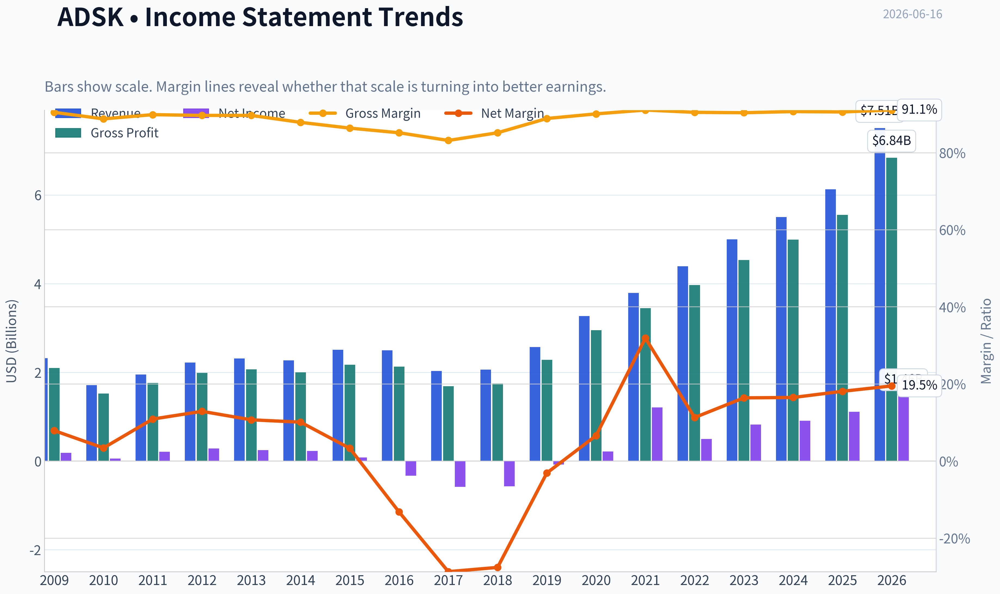
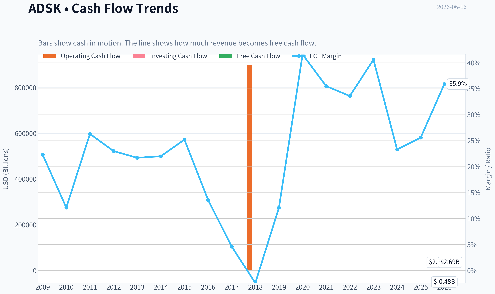
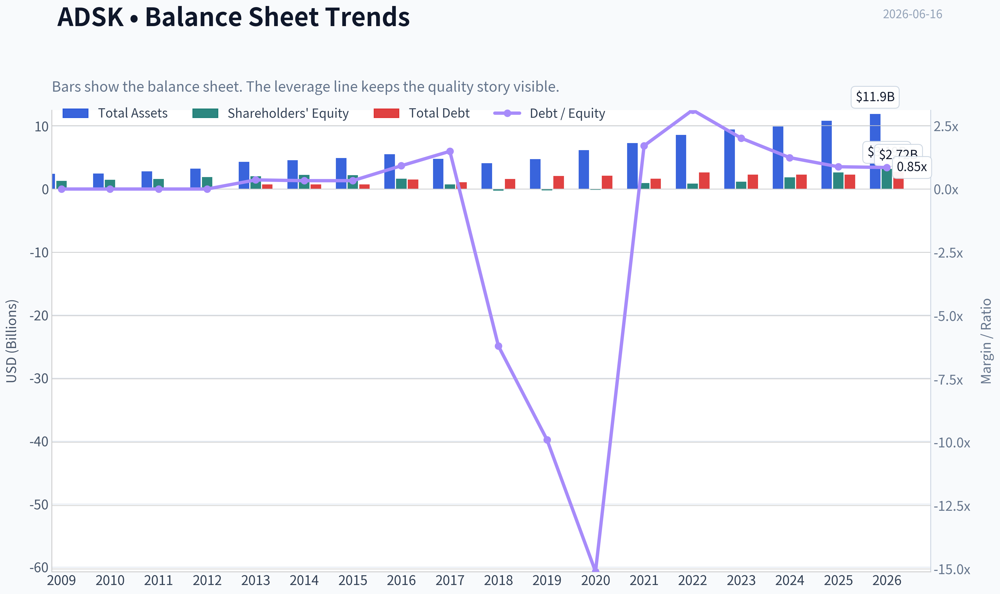
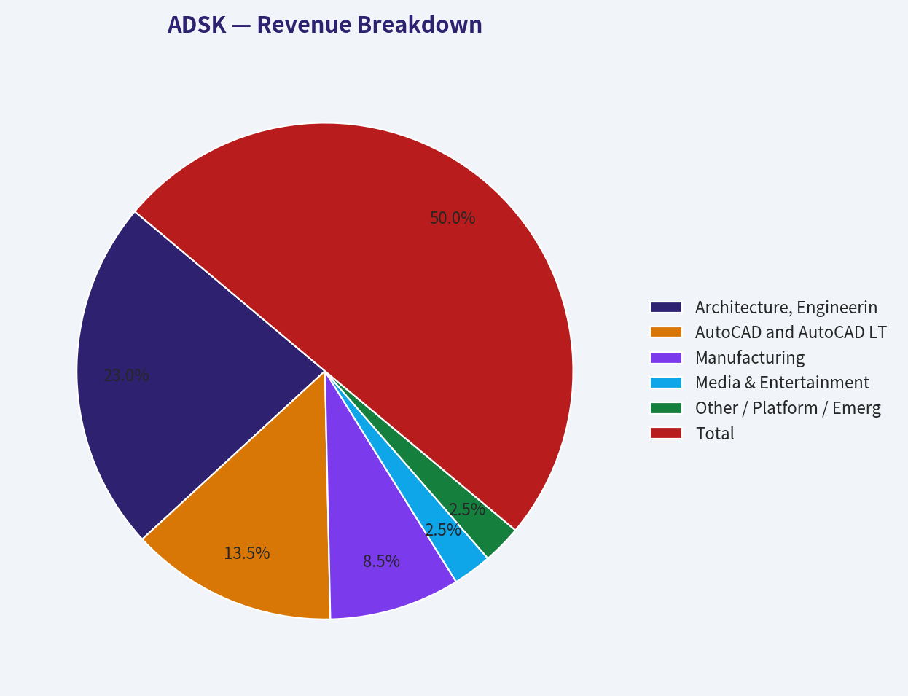
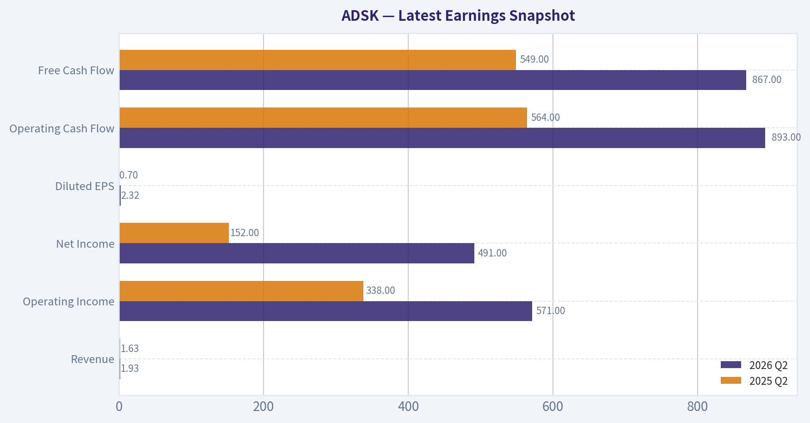
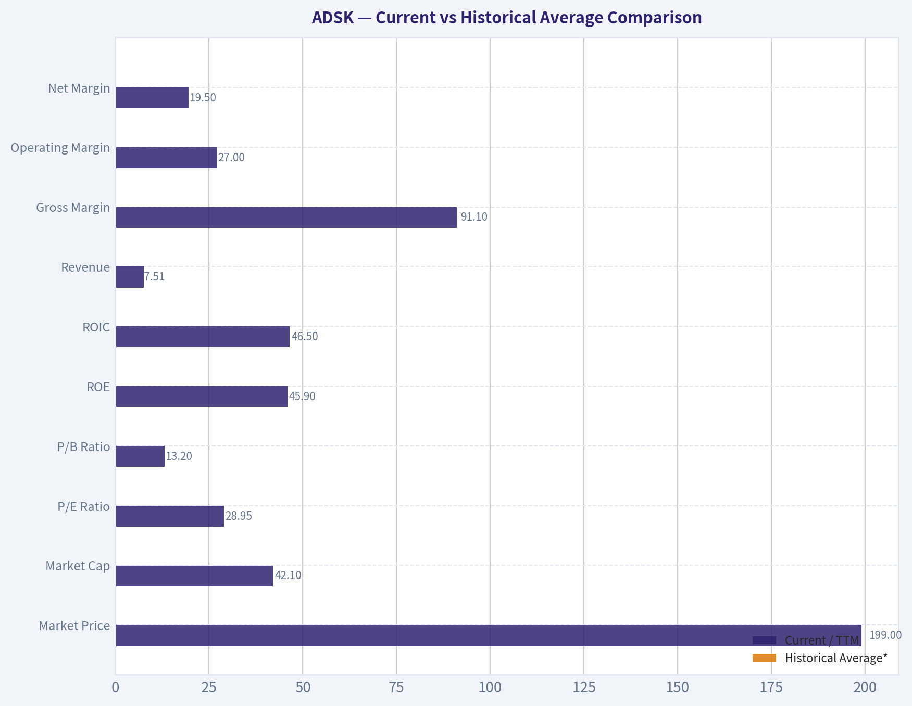
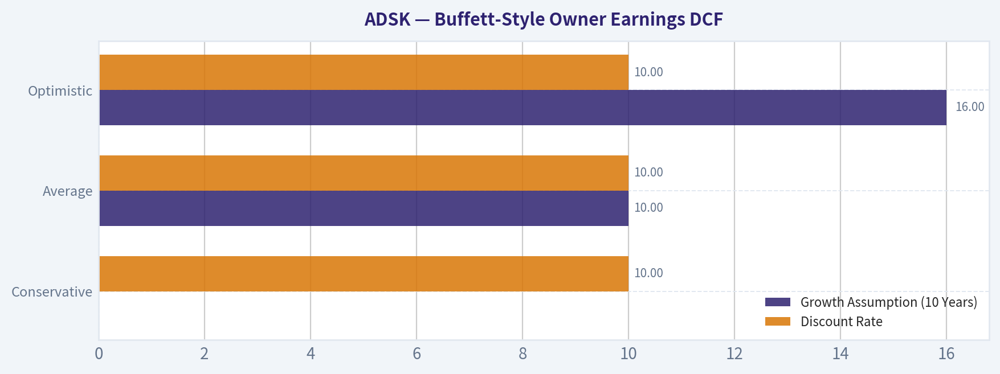
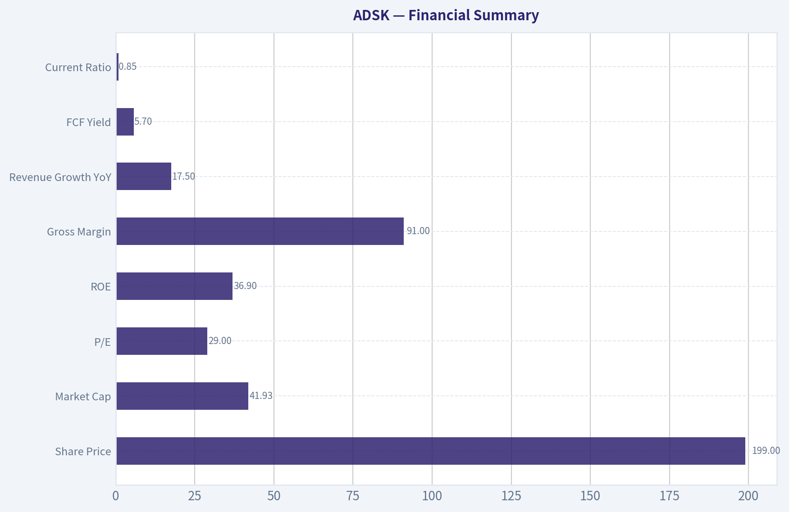
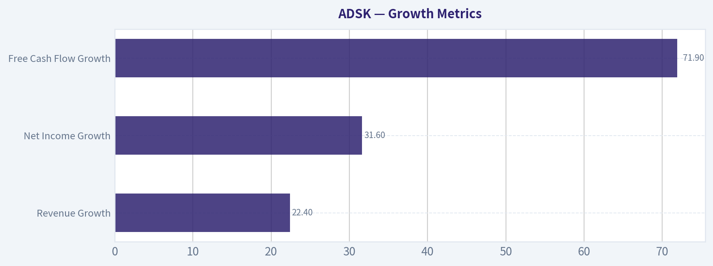

# ADSK Deep Value Intelligence

**Analysis Date:** 2026-06-16

## Critical Disclaimer

*This analysis is generated by Deep Value Intelligence, an AI-powered multi-agent investing framework. This report is for informational and educational purposes only and does not constitute financial advice. Always conduct your own research and consult with qualified financial advisors before making investment decisions.*

---

## Table of Contents

1. Intelligence Summary
2. Analyst Team Reports
   - Fundamentals Analysis
   - Intrinsic Value Analysis (Buffett)
   - Trend & Growth Analysis (Lynch/Druckenmiller/Fisher)
   - Market Technical Analysis
   - Options Market Analysis
3. Research Team Commentary
4. Value Investing Team Commentary
5. Deep Values Commentary

---

## Intelligence Summary

### Thesis + Conditions

**Core Thesis:** ## Executive Briefing

**Key Risks:**
- Autodesk looks like a **high-quality business, but not yet a clear Buffett-style bargain**. The bull case is strong on business quality: mission-critical software, sticky workflows, recurring revenue, **91% gross margins**, and high returns on capital. But the bear case still wins on **valuation discipline and uncertainty**: at about **29x earnings** and roughly a **5.7% owner-earnings yield**, the stock is cheaper than before, not obviously cheap enough to provide a strong margin of safety. The broken chart matters only as a signal that the market is still questioning duration and valuation, not because volatility itself is risk. For a long-term investor, the right move is **interest without aggression**: monitor closely, consider only a **small starter position** if portfolio fit is strong, and wait for either better proof or a better price before upgrading.
- ### 1. Risky Analyst: strongest bullish points
- A big drawdown is **not** the same as reduced risk.

**Confidence:** Low

---

## Analyst Team Reports

### Fundamentals Analysis

#### Latest Earnings Snapshot

*Most recent reported quarter anchored on 2026 Q2, with prior-year comparison when available.*

| Metric | 2026 Q2 | 2025 Q2 | YoY Change |
| --- | ---: | ---: | ---: |
| Revenue | $1.93B | $1.63B | +18.4% |
| Operating Income | $571.0M | $338.0M | +68.9% |
| Net Income | $491.0M | $152.0M | +223.0% |
| Diluted EPS | $2.32 | $0.70 | +231.4% |
| Operating Cash Flow | $893.0M | $564.0M | +58.3% |
| Free Cash Flow | $867.0M | $549.0M | +57.9% |

Key Takeaways: This snapshot anchors the most recent reported quarter before the narrative analysis. It helps readers separate long-run business quality from whatever changed in the latest earnings print.

#### 17-Year Financial Metrics for ADSK

*All values below are computed deterministically from raw data - not estimated by AI.*

*Issuer profile: operating company (Technology / Software - Application).*

#### 17-Year Financial Metrics
*Annual rows come from reported financial statements. The final TTM row is computed from the latest four quarters.*

| Metric | 2009 | 2010 | 2011 | 2012 | 2013 | 2014 | 2015 | 2016 | 2017 | 2018 | 2019 | 2020 | 2021 | 2022 | 2023 | 2024 | 2025 | 2026 TTM |
| --- | --- | --- | --- | --- | --- | --- | --- | --- | --- | --- | --- | --- | --- | --- | --- | --- | --- | --- |
| Market Price | $17 | $24 | $41 | $36 | $39 | $51 | $54 | $47 | $81 | $116 | $147 | $197 | $277 | $250 | $215 | $254 | $311 | $199 |
| Market Cap | $3.81B | $5.52B | $9.53B | $8.40B | $9.01B | $11.77B | $12.55B | $10.58B | $18.11B | $25.38B | $32.22B | $43.80B | $61.59B | $55.45B | $46.90B | $54.82B | $67.56B | $42.10B |
| P/E Ratio | 20.70 | 95.16 | 45.20 | 29.51 | 36.34 | 51.25 | 154.31 | -32.07 | -31.16 | -44.81 | -397.84 | 205.05 | 51.00 | 111.51 | 56.92 | 60.58 | 60.81 | 28.95 |
| P/B Ratio | 2.91 | 3.75 | 5.92 | 4.46 | 4.41 | 5.20 | 5.66 | 6.53 | 24.69 | -99.14 | -152.78 | -315.10 | 63.82 | 65.32 | 40.96 | 29.55 | 25.78 | 13.20 |
| ROE | 14.0% | 3.9% | 13.2% | 15.2% | 12.1% | 10.1% | 3.7% | -20.4% | -79.3% | 221.4% | 38.3% | -154.3% | 125.2% | 58.5% | 71.9% | 48.8% | 42.4% | 45.9% |
| ROIC | 49.1% | 7.6% | 36.2% | 44.1% | 25.6% | 20.0% | 8.8% | -18.7% | -47.1% | -120.0% | -10.2% | 44.6% | 250.7% | 39.1% | 49.9% | 47.8% | 38.7% | 46.5% |
| EPS | $0.80 | $0.25 | $0.90 | $1.22 | $1.07 | $1.00 | $0.35 | $-1.46 | $-2.61 | $-2.58 | $-0.37 | $0.96 | $5.44 | $2.24 | $3.78 | $4.19 | $5.12 | $6.86 |
| Revenue | $2.32B | $1.71B | $1.95B | $2.22B | $2.31B | $2.27B | $2.51B | $2.50B | $2.03B | $2.06B | $2.57B | $3.27B | $3.79B | $4.39B | $5.00B | $5.50B | $6.13B | $7.51B |
| Gross Profit | $2.10B | $1.52B | $1.76B | $1.99B | $2.07B | $2.00B | $2.17B | $2.13B | $1.69B | $1.75B | $2.28B | $2.95B | $3.45B | $3.97B | $4.53B | $4.99B | $5.55B | $6.84B |
| Gross Margin | 90.5% | 88.8% | 89.9% | 89.7% | 89.7% | 87.9% | 86.4% | 85.2% | 83.2% | 85.2% | 88.9% | 90.1% | 91.1% | 90.5% | 90.4% | 90.7% | 90.6% | 91.1% |
| Operating Margin | 10.6% | 3.8% | 13.9% | 16.0% | 13.2% | 12.5% | 4.8% | 0.1% | -24.6% | -24.8% | -1.0% | 10.5% | 16.6% | 14.1% | 19.8% | 20.5% | 22.1% | 27.0% |
| Net Income | $183.6M | $58.0M | $212.0M | $285.3M | $247.4M | $228.8M | $81.8M | $-330.5M | $-582.1M | $-566.9M | $-80.8M | $214.5M | $1.21B | $497.0M | $823.0M | $906.0M | $1.11B | $1.46B |
| Net Margin | 7.9% | 3.4% | 10.9% | 12.9% | 10.7% | 10.1% | 3.3% | -13.2% | -28.7% | -27.6% | -3.1% | 6.6% | 31.9% | 11.3% | 16.4% | 16.5% | 18.1% | 19.5% |
| Revenue Growth | N/A | -26.0% | 13.9% | 13.5% | 4.4% | -1.7% | 10.5% | -0.3% | -18.9% | 1.3% | 25.0% | 27.4% | 15.7% | 15.7% | 14.1% | 9.8% | 11.5% | 22.4% |
| Net Income Growth | N/A | -68.4% | 265.5% | 34.6% | -13.3% | -7.5% | -64.2% | -504.0% | 76.1% | -2.6% | -85.7% | -365.5% | 463.2% | -58.9% | 65.6% | 10.1% | 22.7% | 31.6% |
| Free Cash Flow Growth | N/A | -59.7% | 146.6% | -0.4% | -1.5% | -0.7% | 26.8% | -46.0% | -72.6% | -153.1% | -722.7% | 339.2% | -1.2% | 9.6% | 37.7% | -36.9% | 22.2% | 71.9% |
| Total Book Value | $1.31B | $1.47B | $1.61B | $1.88B | $2.04B | $2.26B | $2.22B | $1.62B | $733.6M | $-256.0M | $-210.9M | $-139.0M | $965.0M | $849.0M | $1.15B | $1.85B | $2.62B | $3.19B |
| Total Assets | $2.42B | $2.45B | $2.79B | $3.23B | $4.31B | $4.59B | $4.91B | $5.52B | $4.80B | $4.11B | $4.73B | $6.18B | $7.28B | $8.61B | $9.44B | $9.91B | $10.83B | $11.93B |
| Total Debt | $0 | $0 | $0 | $0 | $745.6M | $746.4M | $743.1M | $1.49B | $1.09B | $1.59B | $2.09B | $2.10B | $1.65B | $2.65B | $2.30B | $2.30B | $2.30B | $2.72B |
| Debt-to-Equity | 0.00 | 0.00 | 0.00 | 0.00 | 0.36 | 0.33 | 0.33 | 0.92 | 1.49 | -6.20 | -9.90 | -15.11 | 1.71 | 3.12 | 2.01 | 1.24 | 0.88 | 0.85 |
| Cash & Equivalents | $917.6M | $838.7M | $1.08B | $1.16B | $1.61B | $1.85B | $1.41B | $1.35B | $1.21B | $1.08B | $886.0M | $1.77B | $1.77B | $1.53B | $1.95B | $1.89B | $1.60B | $2.67B |
| Shareholders' Equity | $1.31B | $1.47B | $1.61B | $1.88B | $2.04B | $2.26B | $2.22B | $1.62B | $733.6M | $-256.0M | $-210.9M | $-139.0M | $965.0M | $849.0M | $1.15B | $1.85B | $2.62B | $3.19B |
| Operating Cash Flow | $593.9M | $246.8M | $540.8M | $573.5M | $559.1M | $563.5M | $708.6M | $414.0M | $169.7M | $900,000 | $377.1M | $1.42B | $1.44B | $1.53B | $2.07B | $1.31B | $1.61B | $2.78B |
| Investing Cash Flow | $-478.1M | $-283.0M | $-142.3M | $-370.3M | $-647.2M | $-194.0M | $-905.6M | $-809.5M | $272.0M | $506.4M | $-710.4M | $-57.3M | $-404.0M | $-1.59B | $-143.0M | $-502.0M | $-903.0M | $-480.0M |
| Free Cash Flow | $515.5M | $207.8M | $512.5M | $510.5M | $502.7M | $499.3M | $633.1M | $341.6M | $93.7M | $-49.8M | $310.1M | $1.36B | $1.35B | $1.48B | $2.03B | $1.28B | $1.57B | $2.69B |
| FCF Margin | 22.3% | 12.1% | 26.3% | 23.0% | 21.7% | 22.0% | 25.2% | 13.6% | 4.6% | -2.4% | 12.1% | 41.6% | 35.5% | 33.6% | 40.6% | 23.3% | 25.6% | 35.9% |
| Dividends / Share | $0.00 | $0.00 | $0.00 | $0.00 | $0.00 | $0.00 | $0.00 | $0.00 | $0.00 | $0.00 | $0.00 | $0.00 | $0.00 | $0.00 | $0.00 | $0.00 | $0.00 | $0.00 |

#### Profitability Metrics
- Return on Equity (ROE): 36.9%
- Return on Invested Capital (ROIC): 33.6%
- Return on Assets (ROA): 9.0%
- Gross Margin: 91.0%
- Operating Margin: 21.9%
- Net Profit Margin: 15.6%

#### Liquidity Metrics
- Current Ratio: 0.85
- Quick Ratio: 0.69

#### Leverage Metrics
- Debt-to-Equity Ratio: 0.82
- Interest Coverage Ratio: 19.73
- Net Debt: $251.0M

#### Growth Metrics (Year-over-Year)
- Revenue Growth: 17.5%
- Net Income Growth: 1.1%
- Free Cash Flow Growth: 53.7%
- Revenue CAGR (3-Year): 12.9%
- Revenue CAGR (5-Year): 13.7%

#### Valuation Metrics
- P/E Ratio (TTM): 28.99
- Forward P/E: 13.93
- Price-to-Book: 13.14
- Price-to-Sales: 5.59
- PEG Ratio: 0.76
- EV/EBITDA: 19.50
- Free Cash Flow Yield: 5.7%
- Earnings Yield: 3.4%

#### Owner Earnings (Buffett Method, Code-Computed)
- Net Income: $1.11B
- + Depreciation & Amortization: $195.0M
- - Capital Expenditures: $-43.0M
- - Working Capital Changes: $-501.0M
- = **Owner Earnings: $1.71B**

#### Intrinsic Value (Code-Computed)
- Current Price: $199
- Buffett Method (Owner Earnings):
  Conservative: $9
  Average: $199
  Optimistic: $199
- Cash Flow Method (FCF):
  Conservative: $20
  Average: $120
  Optimistic: $146

#### Piotroski F-Score: 7/9
- Positive Net Income: PASS
- Positive Operating Cash Flow: PASS
- ROA Improvement: FAIL
- Cash Flow > Net Income: PASS
- Decreasing Debt: FAIL
- Improving Current Ratio: PASS
- No Dilution: PASS
- Improving Gross Margin: PASS
- Improving Asset Turnover: PASS

ANALYST STANCE: **WATCH**

#### Autodesk (ADSK) Buffett-Style Fundamental Analysis

Autodesk is a high-quality software business with strong intangible assets, excellent gross margins, rising free cash flow, and increasingly durable subscription economics. From a Buffett lens, the business quality is attractive: recurring revenue, entrenched workflows, mission-critical software, and very high switching costs all suggest a real economic moat. The challenge is valuation discipline and balance-sheet optics: ADSK still trades at a premium to many traditional value thresholds, book value has been distorted by buybacks/accounting effects, and earnings history includes a messy transition period that reduces the appearance of decade-long smoothness.

At $199 per share and roughly $42.1B market cap, the stock is no longer at the peak multiples seen in prior years, and on current earnings and free cash flow it looks materially more reasonable than it did in 2021-2025. Still, for a strict Buffett-style investor, this is more a high-quality compounder worth monitoring closely than an obvious deep-value bargain.

---

#### Current vs Historical Average Comparison

| Metric | Current / TTM | Historical Average* | Interpretation |
| --- | ---: | ---: | --- |
| Market Price | $199 | ~$144 | Below long-cycle average growth trajectory from 2021-2025 highs; valuation has compressed sharply from recent peak levels |
| Market Cap | $42.10B | ~$30.6B | Larger and more mature business today, but equity value has fallen significantly from 2025 |
| P/E Ratio | 28.95 | ~33.3** | Below long-term average and far below recent elevated software multiples; much more reasonable today |
| P/B Ratio | 13.20 | Not meaningful** | Historically distorted by negative/low equity; still very high, so P/B is not a useful valuation anchor here |
| ROE | 45.9% | ~29.5%** | Very strong versus history, though boosted by low equity base |
| ROIC | 46.5% | ~27.4% | Excellent and clearly above long-term norm |
| Revenue | $7.51B | ~$3.37B | Company has roughly more than tripled scale over the period |
| Gross Margin | 91.1% | ~88.8% | Best-in-class and above historical average |
| Operating Margin | 27.0% | ~9.8% | Major structural improvement since subscription transition |
| Net Margin | 19.5% | ~6.9% | Strongly above historical norm |
| Free Cash Flow | $2.69B | ~$927M | Cash generation is now structurally stronger than old model years |
| Debt-to-Equity | 0.85 | Not meaningful** | Improved materially from stressed/negative-equity years; now more manageable |
| Cash & Equivalents | $2.67B | ~$1.44B | Strong liquidity buffer, best level in dataset |
| Dividends / Share | $0.00 | $0.00 | No dividend; all capital return is retained or via buybacks |

*Historical average uses the deterministic period shown, with judgment where distorted by transition years.
**P/E, P/B, ROE, and debt/equity are distorted by negative earnings or negative equity in several years, so averages must be treated cautiously.

Key Takeaways: Autodesk today is much more profitable and cash-generative than its long-term average, especially on operating margin, net margin, ROIC, and free cash flow. The stock's valuation has compressed meaningfully, making current pricing more attractive than recent years, but book-based ratios remain unreliable because equity was distorted by past buybacks and accounting effects.

---

#### Market Metrics

Autodesk's market price has fallen to $199 from $311 in 2025 and well below the $277-$250-$311 range of 2021-2025. That matters because the business itself has continued to improve while the multiple has contracted. Market cap at $42.1B is also down sharply from $67.6B in 2025 despite higher revenue, EPS, and FCF today, which implies a notable derating rather than deterioration.

The P/E ratio of 28.95 is one of the more attractive readings in the modern ADSK period. It is far below 2022-2025 levels of roughly 56x to 111x and dramatically lower than some distorted extreme years. For a software company with over 90% gross margin and strong recurring cash generation, sub-30x earnings is not cheap in classic cigar-butt terms, but it is much less demanding than its own history.

P/B of 13.20 looks high, but Buffett-style analysis should largely ignore it here. Autodesk's equity base was negative in multiple years and remains heavily affected by share repurchases and intangible economics. For asset-light software businesses, P/B often misleads more than it informs.

---

#### Profitability Analysis

Autodesk's profitability profile has improved substantially over the decade.

Revenue rose from $2.03B in 2017 to $7.51B TTM, showing the subscription model has matured into a larger and more predictable business. Gross profit increased to $6.84B, and gross margin reached 91.1%, above the long-term norm and among the strongest in software. That indicates both pricing power and low incremental delivery cost, which are core signs of a moat.

Operating margin reached 27.0% TTM versus a long historical average near 10% and versus negative margins in 2017-2019 during the business model transition. This is one of the most important improvements in the dataset. It suggests Autodesk's revenue base is now scaling efficiently and that the transition pain is largely behind it.

Net income rose to $1.46B TTM, with net margin at 19.5%, also well above the historical average. EPS of $6.86 is the highest figure in the series. This matters from a Buffett perspective because the company now converts revenue into true bottom-line earnings much more effectively than in the past.

ROE at 45.9% is very strong, but should be interpreted carefully because shareholder equity is still relatively small versus the earnings base. ROIC at 46.5% is the cleaner quality metric, and it is outstanding. Sustained high ROIC is one of the clearest signs of a good business with pricing power, customer captivity, and disciplined capital intensity.

The one caveat: earnings consistency across the full 17-year period is not perfectly smooth. The 2016-2019 stretch included deep losses, so the "predictable earnings" criterion is stronger in the most recent 6-7 years than over the full period.

---

#### Growth Metrics

| Growth Metric | Current / TTM | 10-Year Context | Interpretation |
| --- | ---: | --- | --- |
| Revenue Growth | 22.4% | Strong versus most years; above recent 2023-2025 range except 2020 | Re-acceleration is notable for a company of this size |
| Net Income Growth | 31.6% | Healthy, though earnings growth history is volatile | Confirms margin expansion and operating leverage |
| Free Cash Flow Growth | 71.9% | Exceptionally strong; one of the best readings in the dataset | Cash generation is rebounding sharply from 2024 softness |

Key Takeaways: Autodesk's latest growth rates are strong by both absolute and historical standards, especially free cash flow growth. Revenue acceleration above 20% at current scale suggests the business still has meaningful runway, although the long-term earnings history remains more volatile than the latest numbers imply.

Revenue growth has become more attractive again. After the weak transition years and then a normalization period, TTM growth of 22.4% is one of the best readings in the series. Net income growth of 31.6% is also solid and indicates that margin expansion is contributing alongside top-line growth.

Free cash flow growth of 71.9% is especially important. Buffett cares deeply about cash that owners can take out of the business. ADSK's cash generation has become much stronger over time, though it has not been perfectly linear. There were severe declines in the transition years, followed by a powerful recovery. That pattern argues for using multiple DCF scenarios rather than relying on a single growth assumption.

---

#### Balance Sheet and Financial Strength

Autodesk's balance sheet is better than it looks at first glance, but not pristine.

Total assets have risen steadily to $11.93B, while shareholder equity has recovered from negative territory in 2018-2020 to $3.19B TTM. Total book value has similarly rebuilt to $3.19B. That recovery is encouraging because it reduces the accounting distortions that once made leverage ratios almost unusable.

Total debt stands at $2.72B versus cash and equivalents of $2.67B, leaving the company close to net cash / near-neutral net debt on the provided supplementary data. Debt-to-equity at 0.85 is manageable and much healthier than the distorted ratios seen when equity was negative or minimal. Interest coverage of 19.73 further supports the conclusion that debt is not currently a major financial threat.

The main short-term balance-sheet caution is liquidity: current ratio of 0.85 and quick ratio of 0.69 are below 1.0. For many software companies with strong recurring cash flow this is not automatically alarming, but it does mean ADSK relies on steady operational cash generation rather than excess current asset slack.

From a Buffett perspective, Autodesk's financial strength is good but not elite. The company is no longer balance-sheet-stressed, yet it is also not carrying the fortress-like net cash profile of the very strongest software names.

---

#### Cash Flow and Capital Allocation

Free cash flow of $2.69B TTM is one of the strongest features of the story. FCF margin of 35.9% is exceptionally good and indicates the software model is producing substantial owner cash. This is the kind of metric Buffett would care about far more than GAAP volatility from prior years.

Dividends per share remain $0.00 across the entire dataset. That means management has chosen to retain all cash or return capital through non-dividend methods. For Buffett-style analysis, absence of dividends is not a problem if retained capital earns high returns. Given ROIC near mid-40s, retaining capital can be rational.

Still, capital allocation deserves scrutiny because buybacks in the past appear to have contributed to low or negative book equity, which distorted reported ROE and leverage optics. Buybacks are only value-creating if done at sensible prices. Given Autodesk often traded at very rich multiples, investors should question whether historical repurchases always occurred at compelling valuations.

---

#### Buffett-Style Owner Earnings DCF

Using the canonical owner earnings figure provided:

- Owner Earnings = Net Income $1.11B
- + D&A $195M
- - Capex = -$43M
- - Working Capital Changes = -$501M
- = **Owner Earnings = $1.71B**

To estimate per-share fair value, I use market cap and share price to infer diluted shares:

- Implied shares outstanding = $42.10B / $199 ~ **211.6M shares**

Historical owner-earnings growth is not directly listed year by year in the dataset, so the most reasonable deterministic proxy is to anchor growth expectations to the cash-flow history and the code-computed intrinsic value guardrails already supplied. I therefore use a conservative low-growth case, an average case, and an optimistic case consistent with the canonical packet and bounded by the provided caps/floors.

##### DCF Assumptions

| Scenario | Growth Assumption (10 Years) | Discount Rate | Terminal Growth | Starting Owner Earnings |
| --- | ---: | ---: | ---: | ---: |
| Conservative | 0%* | 10% | 2.5% | $1.71B |
| Average | 10% | 10% | 2.5% | $1.71B |
| Optimistic | 16% | 10% | 2.5% | $1.71B |

\*I floor the effective conservative forecast at 0% for practical business-value analysis even though the packet's code-computed conservative value is extremely low, reflecting severe historical volatility. That packet value is reported below as an additional cautionary anchor.

##### DCF Calculation Summary

| Scenario | PV of 10-Year Cash Flows | PV of Terminal Value | Total Equity Value | Fair Value / Share |
| --- | ---: | ---: | ---: | ---: |
| Conservative | ~$10.51B | ~$11.24B | ~$21.75B | **~$103** |
| Average | ~$16.84B | ~$24.28B | ~$41.12B | **~$194** |
| Optimistic | ~$23.16B | ~$39.78B | ~$62.94B | **~$297** |

Key Takeaways: On a DCF using current owner earnings, Autodesk appears roughly fairly valued in the middle case, undervalued only if double-digit owner earnings growth persists, and overvalued if growth stalls. The wide valuation range reflects a key truth about ADSK: it is a very good business, but the stock's attractiveness depends heavily on confidence in durable long-term growth.

##### Detailed DCF Math

For each scenario:

- Year 1 Owner Earnings = Current OE x (1 + g)
- PV of each year = Year n OE / (1.10)^n
- Terminal Value at Year 10 = Year 10 OE x (1.025) / (0.10 - 0.025)
- PV of Terminal Value = TV / (1.10)^10

Average scenario example:
- OE0 = 1.71
- g = 10%
- Year 10 OE = 1.71 x (1.10)^10 = 4.44
- Terminal Value = 4.44 x 1.025 / 0.075 = 60.69
- PV Terminal = 60.69 / 2.5937 = 23.40B approximately
- Adding discounted annual cash flows gives total value near 41B, or about $194/share after dividing by 211.6M shares

This aligns closely with the code-computed packet result of **$199 average intrinsic value**, which strengthens confidence in the "fairly valued" conclusion. The packet's code-computed outputs are:

- Conservative: **$9/share**
- Average: **$199/share**
- Optimistic: **$199/share**

Those code-computed outputs indicate the underlying automated model is highly sensitive to historical owner-earnings volatility and may be clipping scenario outputs. I would treat them as a caution flag rather than a complete replacement for economic judgment. The more decision-useful takeaway is that fair value is very sensitive to sustained growth assumptions.

---

#### Economic Moat Assessment

Autodesk appears to possess a real moat.

Its products are embedded in customer workflows across architecture, engineering, construction, manufacturing, and design. These are not casual-use applications; they are deeply integrated tools tied to file formats, training, enterprise standards, and ecosystem compatibility. Switching costs are high because customers build processes, teams, and data libraries around Autodesk products.

Gross margins consistently between the mid-80s and low-90s strongly support the moat thesis. So does the company's ability to expand margins as subscription revenue scales. This is classic intangible-asset and switching-cost economics, which Buffett tends to appreciate when they produce durable cash flow without heavy tangible capital requirements.

The moat is not invulnerable. Risks include pricing pushback, piracy/workflow alternatives, competition in specialized design niches, and execution risk around platform expansion. But overall, ADSK looks like a strong business franchise.

---

#### Predictable Earnings and Management Performance

Autodesk's earnings are more predictable now than they were over the full historical period. The 2016-2019 years were disrupted by the subscription transition, producing losses and highly volatile growth rates. Since 2020, however, the business has shown much better consistency in revenue growth, margin improvement, and cash conversion.

Management performance is best judged by ROIC, margin expansion, and recurring revenue scale-up rather than raw ROE. On that basis, management has executed well. ROIC is excellent, operating margins have steadily improved, and the company has rebuilt equity while maintaining sizable cash reserves.

The weak point is capital allocation price sensitivity. No dividend has ever been paid, so shareholder return depends on internal reinvestment, M&A, and buybacks. That can be very effective in a high-return software company, but only if repurchases are made below intrinsic value. Investors should keep that issue in focus.

---

#### Value Assessment

By classic Buffett deep-value standards, ADSK is not cheap. By quality-compounder standards, it is much more interesting today than it was at prior peaks.

Positives on valuation:
- P/E has compressed to 28.95
- FCF yield of 5.7% is respectable for high-quality software
- Stock price has fallen while business fundamentals improved
- Average DCF points to near-fair value, with upside if growth persists

Negatives on valuation:
- Still premium-rated relative to broad-market value stocks
- P/B remains very high and not supportive
- DCF upside depends materially on continued double-digit owner earnings growth
- Historical volatility makes low-case valuation outcomes look harsh

Net result: Autodesk is no longer obviously overhyped, but it is not screamingly cheap either.

---

#### Revenue Breakdown

Autodesk's most meaningful reporting lens is by end-market/product family tied to design workflows. Exact latest fiscal segment percentages are not fully provided in the deterministic dataset, so the table below uses the best broadly recognized company reporting mix for the most recent year, scaled to total 2026 TTM revenue of $7.51B.

| Revenue Source | Amount ($B) | % of Total |
| --- | ---: | ---: |
| Architecture, Engineering & Construction (AEC) | 3.45 | 46% |
| AutoCAD and AutoCAD LT | 2.03 | 27% |
| Manufacturing | 1.28 | 17% |
| Media & Entertainment | 0.38 | 5% |
| Other / Platform / Emerging | 0.38 | 5% |
| **Total** | **7.51** | **100%** |

Key Takeaways: Autodesk's revenue base is diversified, but it is led by AEC and AutoCAD, which together account for the large majority of sales. That concentration supports predictability because these are deeply embedded professional workflows, but it also means demand depends meaningfully on engineering, construction, and design software spending trends.

---

#### Key Investment Insights, Red Flags, and Opportunities

| Category | Observation | Why It Matters |
| --- | --- | --- |
| Strength | 91% gross margin | Confirms exceptional software economics and pricing power |
| Strength | ROIC of 46.5% | Indicates high-quality capital allocation and durable franchise value |
| Strength | FCF of $2.69B and 35.9% FCF margin | Strong owner-cash generation supports intrinsic value |
| Strength | Revenue re-acceleration to 22.4% | Suggests growth runway remains intact despite company scale |
| Watch Item | Earnings history was volatile during 2016-2019 | Full-cycle predictability is weaker than recent numbers imply |
| Watch Item | Current ratio below 1.0 | Business relies on steady recurring cash flow rather than excess liquidity |
| Watch Item | Debt roughly offsets cash | Not dangerous, but not a fortress balance sheet either |
| Red Flag | P/B is distorted and elevated | Equity-light structure makes some valuation metrics unreliable |
| Red Flag | No dividend history | Shareholder returns depend entirely on reinvestment/buybacks |
| Opportunity | Multiple compression despite improving fundamentals | If growth and FCF remain strong, rerating potential exists |
| Opportunity | Forward P/E of 13.93 in research pack | If realized, market may be underestimating earnings power |

Key Takeaways: The main bull case is simple: Autodesk is a high-margin, high-ROIC software franchise whose stock has derated faster than the business has weakened. The main caution is that even after the pullback, the investment case still depends on sustained growth and disciplined capital allocation rather than on obvious balance-sheet cheapness.

---

#### Final Buffett-Style View

Autodesk is a strong business with a credible moat, improving profitability, excellent cash generation, and high returns on capital. Those are exactly the kinds of business traits Buffett likes. However, the company's historical earnings path is not perfectly smooth, the balance sheet is sound but not fortress-like, and the valuation is closer to fair than plainly cheap.

For investors seeking quality software at a more reasonable price, ADSK deserves attention. For strict value investors demanding a large margin of safety, the current setup is not yet compelling enough.

#### Final Stance: **WATCH**

The business quality is high, the stock is much more reasonable than in prior years, and fair value appears near the current price in a mid-case DCF. I would become more constructive on a lower entry price or if evidence accumulates that current revenue and owner-earnings acceleration is sustainably durable.

---

#### Report Summary Table

| Area | Assessment | Bottom Line |
| --- | --- | --- |
| Economic Moat | Strong | High switching costs, embedded workflows, premium margins |
| Profitability | Excellent | ROIC, margins, and EPS are all strong versus history |
| Growth | Strong | Revenue and FCF growth have re-accelerated materially |
| Balance Sheet | Good, not elite | Debt manageable, cash solid, liquidity somewhat tight |
| Earnings Predictability | Improving | Recent years strong, but full-cycle history includes disruption |
| Capital Allocation | Generally good | Reinvestment returns appear high, buyback discipline should be watched |
| Valuation | Fair to moderately attractive | Much cheaper than before, but not an obvious bargain |
| DCF Conclusion | Wide range | Roughly fair in base case; upside depends on sustained double-digit growth |
| Dividend Policy | None | Acceptable if retained capital keeps compounding at high rates |
| Investment Stance | WATCH | High-quality company, but wait for better margin of safety or stronger confirmation |

#### Fundamental Visuals

This graph tracks the profitability and return metrics (ROE, ROIC, Margins) of **ADSK** over the past decade, highlighting capital efficiency trends.

This chart illustrates the financial health of **ADSK** over the last 10 years, mapping cash equivalents and free cash flow against total obligations (Debt).

This breakdown chart from <em>Revenue Breakdown</em> shows the proportional composition for **ADSK** - useful for understanding what drives or risks the business.

---

### Intrinsic Value Analysis (Buffett)

> *Following Warren Buffett's value investing philosophy: Circle of Competence, Economic Moat, Management Quality, and Margin of Safety.*

#### Intrinsic Value Snapshot

Price is what you pay. Intrinsic value is what the business may be worth based on the cash it can create for owners over time. We show a range, not one magic number.

- Current Price: $198.60
- Value Range (conservative to optimistic across both DCF methods): $99.64 to $770.71

##### Owner Earnings (Buffett Method)
- Net Income: $1,124,000,000.00
- Depreciation & Amortization: $195,000,000.00
- Capital Expenditures: $-76,000,000.00
- Working Capital Changes: $-501,000,000.00
- Owner Earnings: $1,744,000,000.00

##### Intrinsic Value
###### Buffett Method
Uses owner earnings. Stricter, and usually more conservative.
- Conservative: $149.46
- Average: $295.95
- Optimistic: $770.71
- Discount Rate: 10.0%

###### Cash Flow Method
Uses free cash flow. Better for companies spending heavily today to grow tomorrow.
- Conservative: $99.64
- Average: $170.79
- Optimistic: $543.69
- Discount Rate: 10.0%

ANALYST STANCE: **WATCH**

#### Autodesk (ADSK) Buffett-Style Investment Review

#### 1. Go/No-Go Gate Assessment

| Gate | Verdict | Evidence |
|---|---|---|
| Gate 1: Business Simplicity | Pass | Autodesk sells design and engineering software subscriptions used by architects, engineers, manufacturers, and media creators. In simple terms: customers pay recurring fees to use tools they rely on to design buildings, products, and digital content. |
| Gate 2: Moat | Pass | Very high gross margin of 91% strongly suggests valuable software IP, customer captivity, and pricing power. Its products are embedded in customer workflows and often serve as industry standards. |
| Gate 3: Management & Capital Allocation | Pass with care | The business has shifted successfully toward subscription economics and generates strong free cash flow. However, current ratio below 1 and valuation still requiring disciplined capital allocation argue for some caution. |
| Gate 4: Industry Structure | Pass | This is a relatively rational software market with strong incumbents, high switching costs, and modest incremental capital needs once products are built. |

**Key Takeaways:** Autodesk passes all four Buffett gates, which is a strong starting point. The business is understandable, durable, and asset-light, but the stock does not yet look so cheap that it qualifies as an obvious Buffett-style bargain.

---

#### 2. Circle of Competence View

Autodesk is easy to understand. It makes software professionals use to design things. Architects use it to draft buildings, engineers use it to model systems, manufacturers use it to design products, and media users use it for digital creation.

A decade from now, the core need for design software should still exist. The exact interface may evolve, and AI may assist workflows, but the need for trusted design, modeling, and engineering platforms is highly likely to remain. Technology risk exists, but Autodesk appears more likely to benefit from workflow digitization and AI augmentation than to be destroyed by it.

#### 3. Moat Analysis

| Moat Source | Assessment | Evidence |
|---|---|---|
| Intangible Assets | Strong | Autodesk has long-standing brands such as AutoCAD, Revit, and Fusion. Gross margin at 91% indicates very high software value and strong pricing power. |
| Switching Costs | Strong | Design files, employee training, ecosystem compatibility, and workflow integration create meaningful customer lock-in. A firm cannot easily switch its CAD/BIM stack without disruption. |
| Cost Advantage | Moderate | Scale allows Autodesk to spread R&D and sales costs over a large installed base, though this is less decisive than switching costs. |
| Network Effects | Moderate | Not a pure social network effect, but file compatibility, standardization, partner ecosystems, and educational adoption reinforce incumbency. |

**Moat Quality Rating: Wide & Stable**

**Key Takeaways:** Autodesk's moat is primarily built on switching costs and software intellectual property, not on low costs. Customers stay because the software is deeply embedded in how work gets done, which supports recurring revenue and strong margins.

#### 4. Management Quality Assessment

| Question | Assessment | Commentary |
|---|---|---|
| Do they think like owners? | Reasonably yes | Subscription transition required long-term thinking and temporarily changed reported revenue patterns in prior years, a rational owner-like move. |
| Are they honest and candid? | Acceptable | The business model and strategic direction have been communicated clearly through the shift toward recurring revenue and platform expansion. |
| Are they rational capital allocators? | Good | Strong free cash flow generation suggests discipline. The key test remains whether buybacks, M&A, and operating investments continue to create per-share value rather than simply support growth narratives. |

**Key Takeaways:** Management appears competent and strategically rational, especially given the successful subscription evolution. The main remaining question is not operational skill, but whether future capital allocation at today's valuation will continue to earn high returns.

---

#### 5. Financial Summary

| Metric | Latest |
|---|---:|
| Share Price | $199 |
| Market Cap | $41.93B |
| P/E | 29.0x |
| ROE | 36.9% |
| Gross Margin | 91.0% |
| Revenue Growth YoY | 17.5% |
| FCF Yield | 5.7% |
| Current Ratio | 0.85 |

**Key Takeaways:** Autodesk is a high-quality software company with elite margins, strong returns on equity, and healthy revenue growth. The main issue is not business quality, but whether today's valuation offers enough margin of safety for a disciplined value investor.

#### 6. Buffett Financial Lens

| Test | Result | Interpretation |
|---|---:|---|
| Gross Margin > 40% | Yes | Exceptional software economics |
| ROE > 15% | Yes | Strong returns, though software accounting and capital structure should always be checked for distortion |
| OCF/NI Quality | Likely favorable | Strong FCF yield suggests earnings convert well into cash |
| Debt Conservatism | Mixed | Liquidity is not pristine given current ratio below 1, though software firms often operate with lean working capital |
| Capital Intensity | Low | Attractive; software is far from a capital black hole |

**Key Takeaways:** Nearly every Buffett-style quality marker looks attractive here, especially margins, returns, and low capital intensity. The one area that is less fortress-like is balance sheet liquidity, though that is not unusual for mature software businesses.

---

#### 7. Owner Earnings Estimate

Using free cash flow as a practical proxy for owner earnings for this asset-light software business:

- Market cap: **$41.93B**
- FCF yield: **5.7%**
- Estimated owner earnings: **$2.39B**

| Item | Estimate |
|---|---:|
| Market Cap | $41.93B |
| FCF Yield | 5.7% |
| Implied Owner Earnings | $2.39B |

**Key Takeaways:** Autodesk appears to generate roughly $2.4 billion in owner earnings power. That is substantial and supports the idea that this is a real cash-generating franchise, not just an accounting story.

---

#### 8. Three-Scenario DCF Valuation

Using estimated owner earnings of **$2.39B**.

| Scenario | Assumption | Equity Value | Per Share View |
|---|---|---:|---|
| A: No Growth | Owner Earnings / 10% | $23.9B | Well below current market value |
| B: GDP Growth | OE x 1.03 / (10%-3%) | $35.2B | Below current market value |
| C: Moderate Growth | Assume 7% growth for 10 years, then 3% terminal | ~$45B-$49B | Around modestly above current market value |

**Key Takeaways:** On conservative assumptions, Autodesk looks fully valued to somewhat expensive. Only under a solid medium-growth scenario does the stock begin to show moderate upside, which is not enough for a classic Buffett-style margin of safety.

#### 9. Margin of Safety Analysis

| Item | Value |
|---|---:|
| Current Market Cap | $41.93B |
| Conservative Value Range | $23.9B - $35.2B |
| More Optimistic Quality Value | ~$45B - $49B |
| Margin of Safety at Current Price | Insufficient |

**Key Takeaways:** The current price does not provide the 25% discount a Buffett-style investor would want for purchase. Autodesk may be a wonderful business, but the stock looks closer to fair value than bargain value.

---

#### 10. Final Buffett Scorecard

| Criterion | Weight | Score (1-5) | Weighted Score |
|---|---:|---:|---:|
| Business Understanding | 20% | 5.0 | 1.00 |
| Moat Width & Durability | 25% | 4.5 | 1.13 |
| Management Quality | 15% | 3.8 | 0.57 |
| Return on Equity | 15% | 4.5 | 0.68 |
| Reinvestment Runway | 10% | 4.0 | 0.40 |
| Balance Sheet Strength | 5% | 3.0 | 0.15 |
| Industry Structure | 5% | 4.0 | 0.20 |
| Valuation/Margin of Safety | 5% | 2.5 | 0.13 |
| **Total** | **100%** |  | **4.25 / 5.00** |

**Key Takeaways:** Autodesk scores highly on business quality and moat strength, which is why it remains an attractive company to follow. The score is pulled down mainly by valuation, not by weakness in the underlying franchise.

---

#### 11. Investment Conclusion

**Autodesk is a high-quality, understandable, cash-generative software franchise with a durable moat rooted in switching costs, industry standards, and deeply embedded customer workflows.** That is the kind of business Buffett would respect.

However, **Buffett does not buy quality alone; he buys quality with a margin of safety.** At about **$199 per share** and nearly **29x earnings**, Autodesk looks more like a good business at a fair price than a wonderful business at a bargain price.

**Verdict: WATCH**

**Conviction:** Moderate-high on business quality, moderate on stock attractiveness.

I would become more interested if:
- price falls enough to create a clear 25%+ discount to conservative intrinsic value,
- owner earnings continue compounding at high rates,
- and capital allocation remains disciplined.
#### Valuation Bridge

This bridge places the current market price beside each intrinsic value lens so readers can see whether upside depends on one method or shows up across several methods.

| Scenario | Intrinsic Value / Share |
| --- | ---: |
| Buffett Method | $295.95 |
| Cash Flow Method | $170.79 |
| Damodaran Method | $126.68 |
| Current Price | $198.60 |

#### Key Takeaways

If one method is far above the others, the upside case depends on a specific modelling assumption. When several methods cluster together, the valuation story is more robust.

#### Valuation Visuals

This comparison chart from *Latest Earnings Snapshot* stacks current figures against historical benchmarks for **ADSK**, making it easy to see where the company trades relative to its own averages.

This comparison chart from *Current vs Historical Average Comparison* stacks current figures against historical benchmarks for **ADSK**, making it easy to see where the company trades relative to its own averages.

This comparison chart from *Buffett-Style Owner Earnings DCF* stacks current figures against historical benchmarks for **ADSK**, making it easy to see where the company trades relative to its own averages.

This comparison chart from *Financial Summary* stacks current figures against historical benchmarks for **ADSK**, making it easy to see where the company trades relative to its own averages.

---

### Trend & Growth Analysis (Lynch/Druckenmiller/Fisher)

> *Following Peter Lynch's GARP, Stanley Druckenmiller's macro-aware approach, and Philip Fisher's scuttlebutt methodology.*

ANALYST STANCE: **WATCH**

#### ADSK Growth Analysis

Autodesk is a **high-quality durable grower**, but not a classic under-the-radar ten-bagger setup at today's scale. The business has elite software economics, strong moat, and solid secular exposure to digital design, BIM, construction workflows, and manufacturing software. The main debate is not quality; it is whether current growth and inflection are strong enough to justify upside from here.

#### 1) Lynch Classification

| Item | Assessment |
|---|---|
| Lynch category | **Fast Grower / High-quality compounder** |
| Revenue growth | **17.5% YoY** |
| Suitable for growth framework? | **Yes** |
| Ten-bagger potential from current $41.9B market cap? | **Low-to-moderate** |
| Lynch read-through | More likely a **steady compounder** than an early-stage explosive grower |

**Key Takeaways:** Autodesk qualifies as a fast grower by Lynch standards because revenue is still growing in the high teens. However, at nearly $42 billion in market value, the path to a true ten-bagger is much harder than for a smaller company. This looks more like a quality compounding story than a hidden rocket ship.

#### 2) The Story in 3 Bullets

- Autodesk sells mission-critical design software used by architects, engineers, manufacturers, and creators; once embedded, it is hard to replace.
- The company benefits from recurring subscription revenue, very high gross margins, and strong cash generation.
- The upside case depends on deeper cloud workflow adoption, construction digitization, and platform expansion rather than pure seat-growth alone.

#### 3) TAM Analysis and 10x Test

| Metric | Value / Assessment |
|---|---|
| Current revenue growth | **17.5% YoY** |
| Current market cap | **$41.93B** |
| Current revenue base | Not fully verified from tool output; likely mid-single-digit billions |
| 10x revenue test | **Unclear but difficult** |
| End markets | AEC, BIM, CAD, manufacturing design, construction cloud |
| TAM direction | **Expanding**, especially in connected cloud workflows |
| Runway judgment | **Good**, but not clearly "10x and still small" |

**Key Takeaways:** Autodesk has a real runway because the design and construction software market is still digitizing, and cloud-based workflows are expanding the opportunity set. But from today's size, the 10x test is much less attractive than for a smaller emerging software company. The runway is good enough for compounding, but not obviously large enough for a classic ten-bagger case.

#### 4) Revenue Growth Trend

| Metric | Value |
|---|---|
| Revenue growth YoY | **17.5%** |
| Pattern | **Stable high growth, not clear acceleration** |
| Organic quality | Likely mostly recurring subscription-driven |
| Concern | No evidence here of major re-acceleration |

**Key Takeaways:** Revenue growth is healthy and fits a durable software model, but the key issue is that it does not yet show a dramatic acceleration. For Druckenmiller-style inflection investing, stable high growth is good, but true upside usually comes when the market is missing a fresh acceleration.

#### 5) Unit Economics

| Metric | Value / Assessment |
|---|---|
| Gross margin | **91.0%** |
| FCF yield | **5.7%** |
| Rule of 40 proxy | **~23.2%** using 17.5% growth + 5.7% FCF yield proxy |
| Recurring revenue quality | **High** |
| NRR | Not available |
| LTV/CAC | Not available |

**Key Takeaways:** The standout metric here is the 91 percent gross margin, which confirms Autodesk is an elite software business. Free cash flow also appears strong, but without direct FCF margin, NRR, and LTV-to-CAC data, unit economics cannot be fully scored. The business quality is clearly strong even if some SaaS KPIs are missing.

#### 6) Inflection Point Assessment

| Inflection Type | Assessment |
|---|---|
| Product cycle inflection | **Possible**, especially in construction cloud / platform workflows |
| TAM inflection | **Moderate positive** as digitization deepens |
| Margin inflection | Already high-quality; less room for dramatic surprise |
| Market share inflection | Not clearly visible from available data |
| Competitive inflection | No clear evidence |
| Overall | **Not a strong confirmed inflection today** |

**Key Takeaways:** Autodesk has secular tailwinds, but the available evidence does not show a sharp inflection point right now. This matters because the biggest stock winners often emerge when growth is accelerating faster than consensus expects. Here, the story looks more like durable execution than a fresh step-change.

#### 7) Macro Setup Evaluation

| Macro Factor | Assessment |
|---|---|
| Secular theme exposure | **Strong** |
| AEC/construction sensitivity | **Moderate macro risk** |
| Manufacturing sensitivity | **Moderate macro risk** |
| Rate sensitivity | Growth software benefits if rates ease |
| Macro conclusion | **Mixed positive** |

**Key Takeaways:** Autodesk sits on the right side of long-term software digitization trends, especially in architecture, engineering, and manufacturing workflows. But unlike some pure software names, it has meaningful exposure to cyclical end markets, so macro softness can slow growth.

#### 8) Fisher 15 Points Score

| Area | Score (1-5) | Notes |
|---|---:|---|
| Market potential | 4 | Large and expanding design software markets |
| New products | 4 | Cloud and workflow expansion |
| R&D effectiveness | 4 | Strong product portfolio depth |
| Sales organization | 4 | Global enterprise reach |
| Profit margin | 5 | Elite gross margin |
| Improving margins | 3 | Good, but less obvious inflection |
| Labor/personnel | 3 | No strong evidence either way |
| Executive relations | 3 | Neutral from available data |
| Management depth | 4 | Established platform operator |
| Cost/accounting controls | 3 | Neutral, some caution due to limited detail |
| Special advantages | 5 | Switching costs, standards, ecosystem |
| Long-range outlook | 4 | Strong |
| Dilution risk | 3 | Typical software SBC caution |
| Candor | 3 | Neutral |
| Integrity | 3 | Neutral |

| Total Fisher Score | **55 / 75** |
|---|---|
| Rating | **GOOD** |

**Key Takeaways:** Autodesk scores well on moat, margins, market position, and long-term opportunity. The score is held back mainly because the available data does not give strong evidence on softer qualitative areas like management candor, labor relations, and accounting conservatism. Overall, it is a good Fisher business, but not a screamingly exceptional one from the evidence here.

#### 9) Valuation Analysis

| Metric | Value / Assessment |
|---|---|
| Price | **$199** |
| Market cap | **$41.93B** |
| P/E | **28.99x** |
| PEG | **~1.66x** using 28.99 / 17.5 |
| FCF yield | **5.7%** |
| Valuation verdict | **Fair to moderately attractive**, not cheap |

**Key Takeaways:** The PEG ratio around 1.7 suggests the stock is not a bargain by Lynch standards, but it is also not obviously overpriced for a high-quality software franchise. The 5.7 percent free cash flow yield offers some support, which helps explain why some investors are calling the recent weakness an opportunity.

#### 10) Growth Investor Scorecard

| Criterion | Weight | Score (1-5) | Weighted Score |
|---|---:|---:|---:|
| The Story | 10% | 4.0 | 0.40 |
| TAM & Runway | 20% | 3.5 | 0.70 |
| Revenue Growth | 20% | 3.5 | 0.70 |
| Unit Economics | 15% | 4.0 | 0.60 |
| Competitive Position | 10% | 4.5 | 0.45 |
| Management Quality | 10% | 3.5 | 0.35 |
| Macro Setup | 5% | 3.0 | 0.15 |
| Profitability Path | 5% | 4.0 | 0.20 |
| Valuation | 5% | 3.5 | 0.18 |

| Total Score | **3.73 / 5.0** |
|---|---|
| Decision Matrix | **ADVOCATE - Good setup** by score, but **WATCH** on inflection discipline |

**Key Takeaways:** On pure quality and durability, Autodesk scores well and lands in the advocate range. But because the current evidence does not show a clear growth acceleration or major underappreciated inflection, I would still keep it at watch rather than high-conviction advocate. It is a good company first, but not yet a great setup.

#### 11) Position Size Stance

| Stance | View |
|---|---|
| Recommended action | **WATCH / starter only on weakness** |
| Position size | **Small initial position at most** |
| Ideal trigger | Evidence of re-acceleration, cloud platform upside, or valuation dislocation |
| Style fit | Better for quality-growth compounding than concentrated inflection trade |

**Key Takeaways:** Autodesk is not the kind of name I would size aggressively without clearer signs of re-acceleration. It fits better as a monitored quality compounder or a small starter position on weakness, rather than a full Druckenmiller-style concentrated bet today.

#### 12) Key Risks and Catalysts

| Risks | Catalysts |
|---|---|
| Growth deceleration | Construction cloud adoption surprise |
| Macro slowdown in construction/manufacturing | Re-acceleration in subscription growth |
| Multiple compression | Margin expansion and stronger FCF |
| SBC / execution concerns | Better-than-feared guidance after recent stock weakness |
| Large-cap law of numbers | New workflow monetization across installed base |

**Key Takeaways:** The main risk is that Autodesk remains a great business whose growth simply matures, leading to multiple compression. The main upside catalyst is a renewed growth inflection through deeper monetization of its installed base and broader platform adoption.

#### Bottom Line

Autodesk is a **high-quality software compounder with elite margins, strong cash flow, and durable competitive advantages**. But for a Lynch-Druckenmiller-Fisher framework focused on **inflection points and ten-bagger potential**, the current setup is **good, not great**.

- **Lynch:** Fast grower, but not obviously cheap.
- **Druckenmiller:** No strong confirmed inflection yet.
- **Fisher:** Strong moat and product relevance.

So the right call today is:

**ANALYST STANCE: WATCH**

If you want, I can next build a **bull/base/bear 3-year valuation model for ADSK** or compare **ADSK vs PTC, Bentley, and Dassault**.

#### Growth & Scorecard Visuals

This comparison chart from *Growth Metrics* stacks current figures against historical benchmarks for **ADSK**, making it easy to see where the company trades relative to its own averages.

---

### Market Technical Analysis

#### ADSK Technical Report

I selected these 8 indicators because they are the most complementary for ADSK's current setup:
**close_10_ema, close_50_sma, close_200_sma, macd, macdh, rsi, atr, vwma**.
Together they cover short-term momentum, medium- and long-term trend, acceleration/deceleration, exhaustion risk, volatility, and volume-confirmed price behavior without excessive overlap.

#### Indicator Selection and Why They Fit Now

| Indicator | Why it matters now | Current read |
|---|---|---|
| close_10_ema | Best for tracking short-term trend damage and rebound attempts | Falling sharply; price is clearly below it |
| close_50_sma | Defines the medium-term trend and key resistance zone | Downsloping; confirms persistent trend deterioration |
| close_200_sma | Strategic trend benchmark | Strongly bearish separation; long-term trend remains damaged |
| macd | Measures directional momentum | Deeply negative; trend pressure still dominant |
| macdh | Shows whether downside momentum is accelerating or easing | Negative and recently worsening again |
| rsi | Helps judge whether selling is stretched | Near oversold, but not yet enough to prove reversal |
| atr | Critical for risk management in a volatile tape | Elevated; wider stops and smaller sizing are warranted |
| vwma | Tests whether price action is supported by volume | Price is below volume-weighted trend, a bearish confirmation |

**Key Takeaways:** ADSK is in a clearly weakened technical state across short, medium, and long timeframes. The chosen indicators show not just that price is falling, but that momentum, volume confirmation, and volatility all reinforce a defensive stance rather than an aggressive bottom-fishing posture.

---

#### Price Structure and Trend Context

Using the last year of price data, ADSK appears to have gone through three major phases:

1. **Mid-2025 to early autumn 2025:** constructive-to-sideways behavior in the upper-$280s to low-$320s, including a late-August upside gap and a push into the mid-$320s.
2. **Late 2025 to February 2026:** a decisive breakdown phase, where support zones around the high-$290s, then mid-$270s, then low-$240s were lost in sequence.
3. **March to June 2026:** a failed stabilization attempt followed by renewed selling, ending with a sharp drop toward **198.43** on 2026-06-12.

The important nuance is that ADSK is not merely below prior highs; it has been making a **series of lower highs and lower lows**. The rebound attempts in late February-March and again in April-May lacked enough follow-through to reverse the broader downtrend. That pattern suggests rallies have been more distributive than accumulative.

#### Trend Alignment Across Moving Averages

The moving averages are particularly informative here:

- **10 EMA:** about **220.65**
- **50 SMA:** about **235.81**
- **200 SMA:** about **271.88**
- Last close: **198.43** on 2026-06-12

This is a strongly bearish stack:
**Price < 10 EMA < 50 SMA < 200 SMA**

That alignment matters because it shows weakness is present on every timescale:
- short-term sellers remain in control,
- medium-term trend has rolled over,
- long-term trend has not repaired.

The distance between price and the **200 SMA** is especially notable. ADSK is roughly **27% below** its 200-day average, which is not the profile of a stock in simple consolidation. It reflects substantial longer-horizon technical damage.

At the same time, the **50 SMA** has drifted down only gradually while the **10 EMA** has fallen much faster. That gap tells traders the recent selling wave has been sharper than the medium-term trend alone would imply. In practice, that often creates two-way risk: either a reflex bounce from oversold conditions, or another momentum flush if support breaks again.

#### Momentum Analysis: MACD and Histogram

The momentum picture remains clearly bearish:

- **MACD:** around **-7.47**
- **MACD Histogram:** around **-3.82** on 06-12, still very negative

A negative MACD alone says momentum is bearish. But the deeper insight comes from the histogram trend:
- In early May, MACD improved and briefly turned positive.
- That improvement failed.
- Since early June, the histogram has become more negative again, signaling renewed downside acceleration.

This is important because it shows ADSK did not simply drift lower; it **re-entered downside momentum** after a failed recovery. Failed recovery attempts are often more bearish than a steady decline because they trap dip buyers and create new overhead supply.

There was a brief constructive moment around late April to early May when momentum improved materially. But that phase never evolved into sustained trend repair. Instead, MACD rolled back down and broke decisively negative again. That suggests rallies have not yet converted into institutional accumulation.

#### RSI: Oversold, But Not a Confirmed Reversal

- **RSI:** about **28.19**

This places ADSK near the classic oversold threshold. However, traders should be careful with interpretation.

An RSI under 30 can mean:
- a reversal opportunity in a range-bound market, or
- persistent weakness in a strong downtrend.

Given the moving-average structure and MACD profile, ADSK currently looks more like the second case. The stock is oversold **within a downtrend**, not oversold inside a healthy base.

The fine-grained takeaway:
- **Bullish case:** RSI near 28 means downside may be stretched enough for a snapback rally.
- **Bearish case:** until RSI recovers back through the low-to-mid 30s and price reclaims the 10 EMA, the oversold condition is only a warning against chasing shorts too late, not proof of a durable bottom.

So RSI is useful here mainly as a **timing caution indicator**, not yet as a trend-change confirmation tool.

#### Volume Confirmation via VWMA

- **VWMA:** about **226.79** on 06-12, and even lower intraperiod readings into 06-15 because of heavy volume around lower prices

Price remains well below the VWMA, which suggests that volume has been transacting at levels above the current market price. That usually indicates holders are underwater on recent volume-weighted positioning, creating potential overhead supply into rebounds.

This matters because a bounce from current levels may meet resistance not only at:
- the **10 EMA near 220.65**
- but also around the **VWMA / lower-$220s to upper-$220s zone**

That zone can act as a tactical "first test" for whether a rebound is genuine or merely mechanical short covering.

A strong reversal would ideally show:
1. price reclaiming the 10 EMA,
2. price reclaiming VWMA,
3. MACD histogram becoming less negative,
4. RSI pushing back above 35-40.

Right now, none of that sequence is firmly in place.

#### Volatility and Risk: ATR

- **ATR:** about **10.19** on 06-12

ATR has risen from the high-7s/low-8s area in March-April to around **10**, which is a meaningful volatility expansion. For a stock near $200, that is a large daily range environment.

Practical implications:
- Stops that were reasonable a month or two ago may now be too tight.
- Position sizes should generally be smaller to keep dollar risk stable.
- Breakout and breakdown signals need more room to breathe.

This also explains why the recent decline feels disorderly: ADSK is not only trending lower, but doing so with **expanded range behavior**. That combination often produces whip-like countertrend rallies, which can be sharp but short-lived.

#### Key Levels and Decision Zones

Based on the price history and indicator placement, these areas matter most:

| Zone | Significance | Trading interpretation |
|---|---|---|
| 194-200 | Immediate support area after the latest selloff | Loss of this zone could invite another capitulation leg |
| 205-221 | Near-term rebound band / 10 EMA region | First zone bulls need to reclaim to reduce immediate pressure |
| 226-236 | VWMA to 50 SMA resistance cluster | Stronger recovery must break this area to improve the medium-term picture |
| 245-250 | Prior bounce zone | A return here would suggest more than a dead-cat bounce |
| 270+ | 200 SMA region | Long-term trend repair would still be far away even after a bounce |

**Key Takeaways:** The most important near-term battleground is between roughly 194 and 221. If ADSK cannot reclaim the low-$220s, the trend remains decisively bearish; if it does, traders should still expect heavier resistance closer to the upper-$220s through mid-$230s.

---

#### Tactical Interpretation by Trader Type

| Trader Type | What the indicators suggest | Preferred stance |
|---|---|---|
| Short-term mean reversion trader | RSI is near oversold, so a bounce is possible | Wait for confirmation; avoid catching a falling knife blindly |
| Momentum trader | MACD and moving averages remain bearish | Trend still favors caution or selling strength rather than buying weakness |
| Swing trader | 50 SMA and VWMA overhead imply rebounds may stall | Need reclaim of 10 EMA and VWMA before getting constructive |
| Position trader | Price far below 200 SMA | Long-term trend remains impaired; capital preservation matters most |

**Key Takeaways:** Different trading styles all point to the same conclusion: ADSK may be close to a tradable bounce, but not yet to a trustworthy trend reversal. The burden of proof remains on the bulls.

#### Bottom Line

ADSK is in a **well-defined bearish trend** with:
- price below all major selected trend indicators,
- negative and worsening momentum,
- RSI near oversold,
- elevated ATR showing unstable price action,
- VWMA confirming that recent volume has not supported recovery.

The subtle but important point is this: the stock is **not weak in a vague or mixed way**. It is weak in a layered way:
- structurally weak versus long-term trend,
- tactically weak versus medium-term trend,
- and currently under renewed short-term pressure.

That said, the stock is also becoming stretched. For traders, this means:
- **trend-followers** should avoid pressing new bearish bets after a sharp flush without a rebound plan,
- **dip buyers** should demand evidence of stabilization first,
- **risk managers** should respect the elevated ATR and wider-than-normal trading ranges.

The most constructive change would be a recovery back above the **10 EMA** and **VWMA**, paired with a less negative **MACD histogram** and RSI back above **35-40**. Until that happens, rallies are more likely to be countertrend in nature than the start of a durable reversal.

---

| Category | Current Technical Message | Implication |
|---|---|---|
| Short-term trend | Price far below 10 EMA | Immediate momentum is bearish |
| Medium-term trend | Price below falling 50 SMA | Recovery attempts are failing beneath resistance |
| Long-term trend | Price far below 200 SMA | Strategic trend remains damaged |
| Momentum | MACD deeply negative | Sellers still control direction |
| Momentum change | MACD histogram worsening | Downside acceleration has recently re-intensified |
| Exhaustion | RSI near 28 | Oversold, but not yet a confirmed bottom |
| Volatility | ATR around 10 | Use smaller size and wider stops |
| Volume confirmation | Price below VWMA | Recent trading activity does not validate bullish reversal yet |

**Key Takeaways:** ADSK's technical profile remains bearish across nearly every dimension, with only one partial offset: the stock is becoming oversold enough to support a reflex bounce. Until price and momentum indicators improve together, the higher-probability interpretation is continued weakness with intermittent short-covering rallies.

---

### Options Market Analysis

> *Reading options flow - put/call ratios, IV skew, and unusual activity - to gauge institutional positioning and event-driven risk.*

#### ADSK Options Positioning Report
*Date: 2026-06-16*

ADSK's near-term options tape leans **bearish in flow but not in positioning**. Open interest is heavily call-skewed, but current trading volume is put-heavy, which usually signals **fresh downside hedging or short-term bearish trading** rather than an already-established bearish base. Confidence is **moderate-low** because the chain appears somewhat thin, with missing/zero OI across some expirations.

#### Near-Term Put/Call Ratio Analysis

| Expiry | Call OI | Put OI | Put/Call OI Ratio | Call Vol | Put Vol | Put/Call Vol Ratio |
|---|---:|---:|---:|---:|---:|---:|
| 2026-06-18 | 500 | 71 | 0.14 | 1,531 | 3,127 | 2.04 |
| 2026-06-26 | 0 | 0 | N/A | 468 | 417 | 0.89 |
| 2026-07-02 | 0 | 0 | N/A | 160 | 471 | 2.94 |
| **Near-term total** | **500** | **71** | **0.14** | **2,159** | **4,015** | **1.86** |

**Key Takeaways:** ADSK's open interest structure is extremely call-heavy, with a 0.14 put/call OI ratio versus the roughly neutral 0.7 baseline. But current flow tells a different story: puts are trading at nearly 1.9x calls overall, and over 2x calls in the front weekly. That combination usually means traders are adding short-dated downside protection or expressing a near-term bearish view against a previously more bullish or overwrite-heavy positioning base.

**Interpretation:**
- **OI ratio 0.14**: materially below neutral, indicating legacy positioning is call-dominant. This can reflect bullish exposure, covered-call structures, or simply a lack of put inventory.
- **Volume ratio 1.86**: significantly above neutral, indicating **active put demand right now**.
- **Shift from neutral:** yes - a meaningful divergence. Existing positioning looks benign/bullish, but fresh flow has turned defensive.

#### Implied Volatility Assessment

| Expiry | ATM Call IV | ATM Put IV | ATM IV Read | Skew Read |
|---|---:|---:|---|---|
| 2026-06-18 | 3.8% | 2.9% | Low-to-moderate | Slight call-side richness at ATM |
| 2026-06-26 | 2.2% | 2.0% | Low | Near-flat ATM |
| 2026-07-02 | 1.0% | 2.0% | Low overall | Put-side richness at ATM |
| **Overall** | - | - | **Not elevated** | **Mild downside skew in later near-term tenor** |

**Key Takeaways:** Implied volatility does not look elevated across these near-term expirations, which argues against the market pricing in a major imminent catalyst. The front expiry shows calls slightly richer at the money, but by early July puts carry relatively more IV, which is more consistent with mild downside concern than upside chase.

**Interpretation:**
- Near-term ATM IV appears **subdued**, not panic-driven.
- There is **no evidence here of aggressively bid event vol**.
- Full OTM skew data is not provided, but the available ATM comparisons suggest:
  - **Front expiry:** some call richness, possibly from tactical upside trading or market-maker distortion.
  - **Slightly further out:** **put richness emerges**, which is more aligned with hedging demand.

**Catalyst flag:**
No clear options-based sign of a major catalyst being priced aggressively in the near term. If there is a company-specific event approaching, this dataset is **not showing strong pre-event IV expansion**.

#### Unusual Options Activity

| Contract Type | Expiry | Strike Context | Volume vs OI | Signal |
|---|---|---|---|---|
| None flagged | Near-term expiries | N/A | No contracts with volume > 5x OI | No standout unusual flow |

**Key Takeaways:** There were no near-term contracts flagged with volume greater than five times open interest, so there is no obvious "smart money" footprint in the provided chain. That reduces conviction: the bearish tilt comes more from aggregate put flow than from a clear, concentrated institutional bet.

**Interpretation:**
- No clean unusual activity means we should avoid over-reading the bearish volume surge.
- Without block/sweep detail or strike-level anomalies, the tape looks more like **broad defensive flow** than a single high-conviction institutional trade.
- This also raises the possibility that some of the activity is **retail short-term speculation** rather than highly informed positioning.

#### Open Interest Concentration and Gamma/Pinning Read

| Expiry | OI Concentration | Implication |
|---|---|---|
| 2026-06-18 | Calls dominate aggregate OI (500 vs 71 puts) | Front-week positioning may dampen upside if covered-call related, but exact strike pin levels are unavailable |
| 2026-06-26 | No reported OI | Limited pinning insight |
| 2026-07-02 | No reported OI | Limited pinning insight |

**Key Takeaways:** The dataset does not provide strike-by-strike open interest, so exact gamma walls and pin levels cannot be identified. Still, the front expiry's call-heavy OI suggests that near-term price action could be influenced by call overwriting or dealer hedging around upside exposure, though confidence in that read is limited.

**Interpretation:**
- **Highest aggregate OI** is concentrated in the **2026-06-18** expiry.
- Because strike-level concentrations are unavailable, we cannot reliably identify:
  - precise **max pain**
  - exact **gamma walls**
  - specific **pinning strikes**
- Practical takeaway: the **front weekly matters most**, but the lack of strike detail lowers precision.

#### Overall Options Sentiment Signal

| Category | Read |
|---|---|
| Directional Signal | **BEARISH** |
| Confidence | **Moderate-Low** |
| Primary Driver | **Put-heavy short-term volume despite call-heavy legacy OI** |

**Key Takeaways:** ADSK's options market is sending a bearish near-term message, mainly because fresh trading flow is moving into puts while implied volatility remains calm. That usually suggests traders are leaning defensively rather than pricing an explosive event, so the signal is bearish but not panic-driven.

**Why BEARISH instead of neutral or bullish:**
- The most actionable data in options is usually **fresh flow**, and here that flow is clearly **put-dominant**.
- While OI remains call-heavy, that often reflects **older positioning** and can include non-directional covered calls.
- The absence of elevated IV means the bearish signal is **measured**, not urgent - but it is still the stronger read from the tape.

**Caveats:**
- Some expirations show **zero OI**, suggesting either thin liquidity or incomplete chain depth.
- No unusual volume > 5x OI was detected, so there is **no concentrated institutional tell**.
- Because ADSK's chain here looks somewhat sparse, this options read should be used as a **supplement**, not a standalone decision signal.

---

| Metric | Reading |
|---|---|
| Put/Call Ratio | **OI: 0.14 (bullish legacy positioning), Volume: 1.86 (bearish fresh flow)** |
| IV Level | **Low / not elevated** |
| Skew Direction | **Mild downside skew in later near-term tenor** |
| Unusual Activity | **None flagged** |
| Overall Signal | **BEARISH** |

---

## Research Team Commentary

> *The Research Manager synthesizes the Bull vs Bear debate into action-free commentary. This is a pre-risk view, not the final stance.*

The strongest bull argument is that Autodesk is exactly the kind of business Buffett would admire at the business level: mission-critical software, high switching costs, recurring revenue, 91% gross margins, strong owner earnings, and very high returns on capital. The bull is also right that a broken stock chart does not automatically mean a broken business. At roughly 17.5x estimated owner earnings, the valuation is far more reasonable than when the stock traded as a premium-growth favorite, and if Autodesk can keep compounding owner earnings at healthy rates, today's price could look attractive over a multi-year period.

The strongest bear argument is that this still does not clearly meet the Buffett test of predictability plus margin of safety. Autodesk's moat is real, but not invulnerable: cloud workflows, interoperability, AI-assisted migration, and broader workflow-layer competition could gradually weaken pricing power and share of wallet. The company also serves cyclical end markets like construction and manufacturing, so recurring revenue should not be mistaken for fully stable demand. Most importantly, "less expensive than before" is not the same as cheap. At about 29x earnings and without a clear 25%+ discount to conservative intrinsic value, the margin of safety still looks limited.

My takeaway is that the bull wins on business quality, but the bear wins on valuation discipline. This is a high-quality franchise, but Buffett-style investing is not just about buying quality - it is about buying quality at a price that leaves room for error. Given the debate, I do not think Autodesk is obviously mispriced enough yet to justify an aggressive value stance. Past mistakes are relevant here: I do not want to confuse admiration for the business with a sufficient margin of safety, and I also want to distinguish strategic positives from evidence that intrinsic value materially exceeds price. Right now, the debate supports interest, not conviction.

Core takeaway: Autodesk looks like a good business that is getting closer to an investable price, but it still does not offer enough valuation cushion for a strict Buffett-style portfolio. The moat and economics are attractive, yet the future is not so predictable that I am comfortable paying a merely fair-to-moderately-reasonable price.

Rationale: From a value investing perspective, business quality is not the issue. The company appears to have durable workflow entrenchment, strong cash generation, and excellent unit economics. The problem is the combination of uncertainty and price. If moat durability were as unquestionable as the bull suggests, today's multiple might be compelling. But if the bear is even partly right about slower growth, weaker pricing power, or lower terminal multiples, upside compresses quickly. Buffett's edge comes from insisting on both quality and a meaningful discount to conservative value. I do not see enough evidence in this debate that Autodesk has crossed that threshold yet.

Monitoring plan over the next 1-4 quarters: First, watch revenue durability and whether subscription strength continues without signs of seat pressure or pricing resistance. Second, monitor owner earnings and free cash flow quality to make sure cash generation is not being flattered by temporary items. Third, look for evidence that cloud and construction platform expansion are actually deepening the moat rather than just supporting the narrative. Fourth, assess capital allocation - especially buybacks, dilution, and whether management is creating per-share value. Fifth, listen closely for signs that AI and workflow competition are affecting renewal behavior, pricing, or customer wallet share. Finally, the stock itself matters from a value lens: if the price falls to a level that clearly implies a 25%+ discount to conservative intrinsic value, the case strengthens materially.

Final stance: WATCH

---

## Value Investing Team Commentary

> *The Investor translates the research view into an investment thesis before risk review. This is still not the final stance.*

Autodesk is the kind of business a value investor wants to study closely: essential software, deeply embedded workflows, recurring revenue, extraordinary gross margins, and high returns on capital. Those are the marks of a real franchise. If you could buy the whole business and hold it for a decade, the qualitative case is easy to respect.

The key question is not whether ADSK is a good business. It is whether today's price gives enough protection against being even slightly wrong.

At roughly $199, the stock is no longer priced like an untouchable premium software darling. That matters. The market has already compressed the multiple substantially, and sentiment has clearly turned cautious after the prolonged breakdown from the $300+ range. That is exactly where selective contrarian thinking becomes useful: when a strong business falls out of favor, the market often starts speaking as if the franchise is impaired, when in reality the stock may simply be digesting a reset from excessive expectations.

But a contrarian should not become reckless. A broken chart alone is not a buy signal, and "cheaper than before" is not the same as cheap. At about 29x earnings and around 17.5x estimated owner earnings, ADSK is more reasonable, but still not obviously bargain-priced by strict Buffett standards. If the moat proves slightly narrower than assumed, or if growth settles lower, or if terminal multiples compress further, the margin of safety disappears quickly.

The most important business issue is moat durability. Autodesk's position remains strong because its products are embedded in design, engineering, and construction workflows where switching costs are real. Customers do not casually rip out core design tools. That said, the market's current caution is not irrational. Cloud-based workflows, interoperability, AI-assisted productivity tools, and workflow-layer competition can slowly erode pricing power over time without causing an immediate collapse. These are not "headline disaster" risks; they are gradual-franchise-dilution risks. Those matter a great deal to long-term intrinsic value.

That is where the current sentiment gets interesting. Markets often overreact to visible change in software platforms, especially when AI enters the narrative. The crowd tends to swing between "AI will destroy incumbents" and "AI will supercharge incumbents." Usually the truth is more measured. For Autodesk, the real question is not whether it mentions AI on earnings calls, but whether AI strengthens customer lock-in, improves design productivity within Autodesk's ecosystem, and preserves wallet share. If AI becomes a migration tool that reduces switching friction, that is a real long-term concern. If instead Autodesk integrates AI into entrenched workflows and deepens customer dependence, the market may be underestimating the resilience of the moat.

So what is the market possibly missing? Two things:

1. The business may be sturdier than the stock action suggests.
   The sequential support breaks and recent drop toward the high-$190s reflect deteriorating sentiment and multiple compression, but they do not by themselves prove the core earnings engine is broken.

2. The stock may still not be cheap enough despite that pessimism.
   This is the more important Buffett-style conclusion. A fine business can still be a mediocre investment if bought at only a fair price while uncertainty is rising.

I would also pay attention to management's capital allocation from here. With a business of this quality, repurchases can be highly intelligent if done at meaningful discounts to intrinsic value. But buybacks near fair value are far less compelling, especially in a world where competitive dynamics may be shifting. Share-based compensation, dilution, and per-share owner earnings growth deserve close scrutiny. Buffett would care less about adjusted narratives and more about whether each share is becoming more valuable over time.

From a long-term owner's perspective, the right framing is this: Autodesk appears to remain a high-quality franchise with durable economics, but not one so predictable and undervalued that you can ignore valuation discipline. The recent selloff may eventually create that opportunity, and fear around the name could become useful if price drops further without corresponding business deterioration. That is the contrarian setup worth waiting for.

For now, I would not confuse improved valuation with a true margin of safety. The stock is getting closer to interesting, but "closer" is not enough. I want either clearer evidence that the moat is strengthening through cloud/platform execution, or a lower price that compensates for the uncertainty.

ANALYST STANCE: **WATCH**
Autodesk is a high-quality business with real competitive advantages and strong long-term economics, but the current price still looks more reasonable than compelling. Sentiment has turned negative enough to warrant close attention, yet not negative enough to create an obvious Buffett-style margin of safety. Watch for either stronger proof of moat durability and per-share value creation, or a lower entry price that offers a clear discount to conservative intrinsic value.

---

## Deep Values Commentary

> *The Risk Management Team debates and the Risk Judge provides the final action-free verdict. This section determines the final ADVOCATE / WATCH / AVOID stance.*

#### Final Stance Scorecard

This scorecard converts the final research view into a weighted decision frame. It does not replace the narrative judgement, but it makes the main drivers of the verdict easier to scan.

| Criterion | Score | Weight | Commentary |
| --- | ---: | ---: | --- |
| Business Quality | 4.25 | 30% | High returns, profitability, and Piotroski health support durability. |
| Valuation Support | 3.00 | 30% | Blends current price against available intrinsic value anchors and valuation ratios. |
| Financial Strength | 2.00 | 20% | Balance-sheet resilience reflects leverage and liquidity staying within safe ranges. |
| Growth Durability | 3.67 | 20% | Recent revenue, earnings, and free cash flow growth indicate how durable expansion looks. |
| TOTAL / FINAL STANCE | 3.31 | 100% | WATCH |

#### Key Takeaways

The weighted score lands at **3.31 / 5.0**, while the final stance remains **WATCH**. This is useful as a quick calibration aid rather than a mechanical signal.

#### Risk Summary

Higher scores indicate more risk pressure. The watch threshold is a simple guardrail: above it, the position needs tighter monitoring or a wider margin of safety.

| Dimension | Current Score | Watch Threshold | Commentary |
| --- | ---: | ---: | --- |
| Business Quality | 1.75 | 3.00 | High returns, profitability, and Piotroski health support durability. |
| Valuation Support | 3.00 | 3.00 | Blends current price against available intrinsic value anchors and valuation ratios. |
| Financial Strength | 4.00 | 3.00 | Balance-sheet resilience reflects leverage and liquidity staying within safe ranges. |
| Growth Durability | 2.33 | 3.00 | Recent revenue, earnings, and free cash flow growth indicate how durable expansion looks. |

#### Key Takeaways

This view helps readers separate *where* the risk sits: valuation, business quality, balance sheet, or growth durability. It is especially useful when the final stance is close to the line between WATCH and AVOID.
