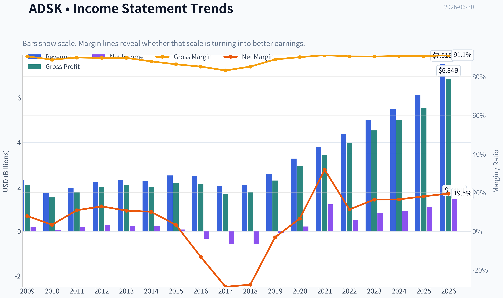
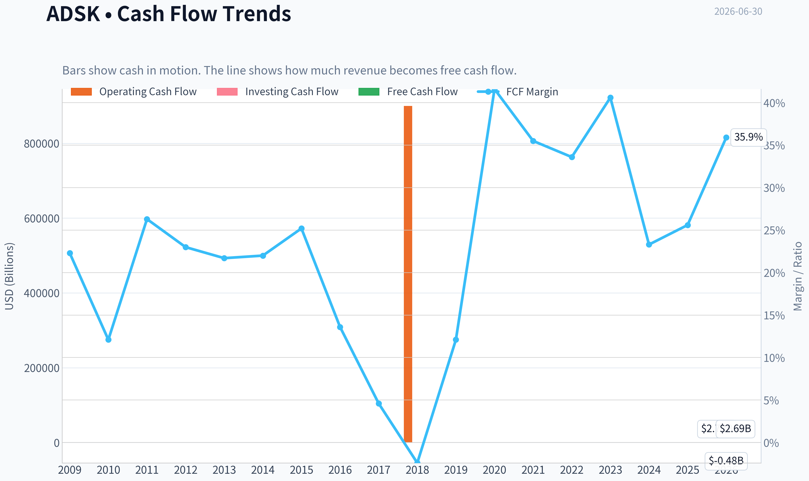
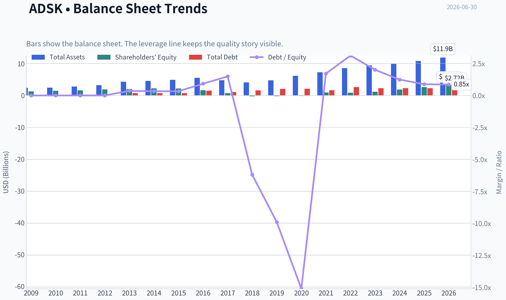
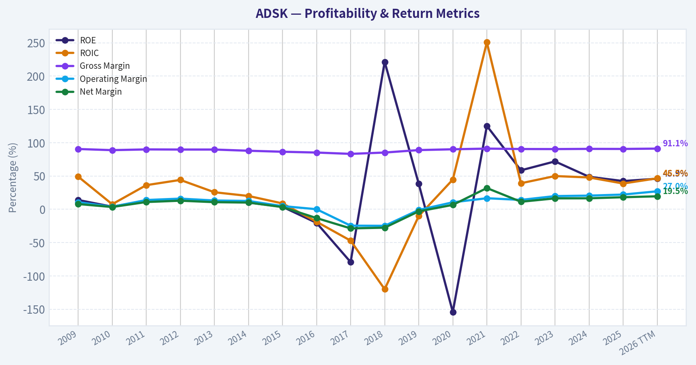
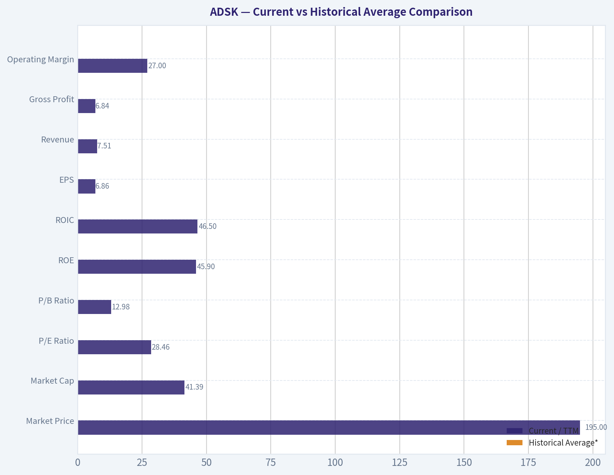
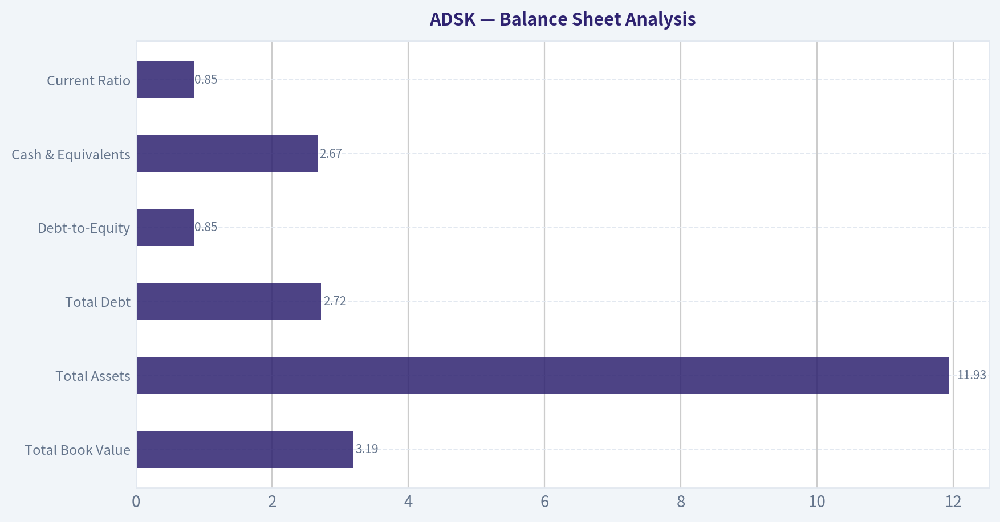
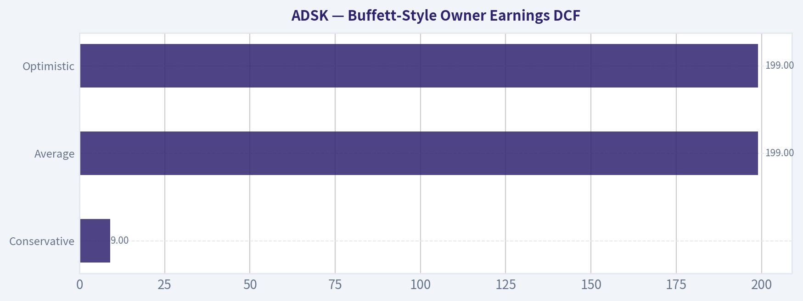
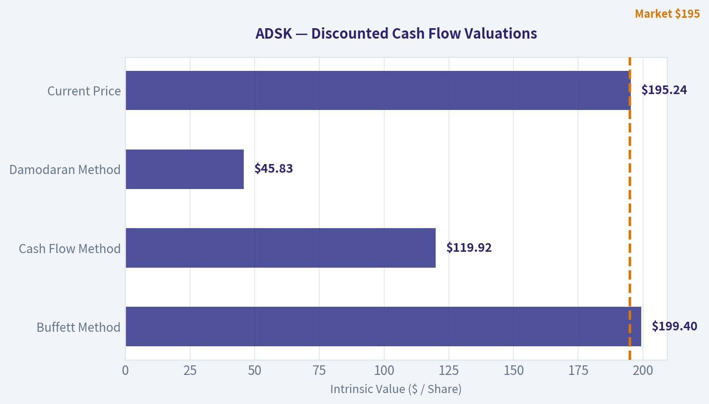

# ADSK Deep Value Intelligence

**Analysis Date:** 2026-06-30

## Critical Disclaimer

*This analysis is generated by Deep Value Intelligence, an AI-powered multi-agent investing framework. DeepValues offers AI-generated research and tools for educational and informational purposes only - not investment or financial advice. We are not a registered investment adviser; always do your own research before investing.*

---

## Table of Contents

1. Intelligence Summary
2. Analyst Team Reports
   - Fundamentals Analysis
   - Intrinsic Value Analysis (Buffett)
   - Trend & Growth Analysis (Lynch/Druckenmiller/Fisher)
   - Market Technical Analysis
   - Options Market Analysis
3. Research Team Commentary
4. Value Investing Team Commentary
5. Deep Values Commentary

---

## Intelligence Summary

### Thesis + Conditions

**Core Thesis:** ## Executive Briefing

**Key Risks:**
- Autodesk looks like a **high-quality business but not yet a high-conviction value buy**. The bull case is real: mission-critical software, strong switching costs, 91% gross margin, 33.6% ROIC, 36.9% ROE, and 17.5% revenue growth. But Buffett-style risk is about **permanent business impairment and price paid**-and at **28.5x earnings**, the stock still assumes solid execution and some success in newer platform/AI layers. That is **better than expensive mania**, but still **not a clear margin of safety**.
- Past mistakes matter here: when valuation risk, execution uncertainty, and cyclical exposure are visible, the answer cannot drift into passive admiration. So this is **not ADVOCATE**. But because the business remains strong and the prior excess has already compressed, it is also **not AVOID** for a long-term investor. The right posture is **active WATCH with defined buy conditions**.
- ### 1. Risky Analyst - strongest bullish points

**Confidence:** Low

---

## Analyst Team Reports

### Fundamentals Analysis

#### Latest Earnings Snapshot

*Most recent reported quarter anchored on 2026 Q2, with prior-year comparison when available.*

| Metric | 2026 Q2 | 2025 Q2 | YoY Change |
| --- | ---: | ---: | ---: |
| Revenue | $1.93B | $1.63B | +18.4% |
| Operating Income | $571.0M | $338.0M | +68.9% |
| Net Income | $491.0M | $152.0M | +223.0% |
| Diluted EPS | $2.32 | $0.70 | +231.4% |
| Operating Cash Flow | $893.0M | $564.0M | +58.3% |
| Free Cash Flow | $867.0M | $549.0M | +57.9% |

Key Takeaways: This snapshot anchors the most recent reported quarter before the narrative analysis. It helps readers separate long-run business quality from whatever changed in the latest earnings print.

#### 17-Year Financial Metrics for ADSK

*All values below are computed deterministically from raw data - not estimated by AI.*

*Issuer profile: operating company (Technology / Software - Application).*

#### 17-Year Financial Metrics
*Annual rows come from reported financial statements. The final TTM row is computed from the latest four quarters.*

| Metric | 2009 | 2010 | 2011 | 2012 | 2013 | 2014 | 2015 | 2016 | 2017 | 2018 | 2019 | 2020 | 2021 | 2022 | 2023 | 2024 | 2025 | 2026 TTM |
| --- | --- | --- | --- | --- | --- | --- | --- | --- | --- | --- | --- | --- | --- | --- | --- | --- | --- | --- |
| Market Price | $17 | $24 | $41 | $36 | $39 | $51 | $54 | $47 | $81 | $116 | $147 | $197 | $277 | $250 | $215 | $254 | $311 | $195 |
| Market Cap | $3.81B | $5.52B | $9.53B | $8.40B | $9.01B | $11.77B | $12.55B | $10.58B | $18.11B | $25.38B | $32.22B | $43.80B | $61.59B | $55.45B | $46.90B | $54.82B | $67.56B | $41.39B |
| P/E Ratio | 20.70 | 95.16 | 45.20 | 29.51 | 36.34 | 51.25 | 154.31 | -32.07 | -31.16 | -44.81 | -397.84 | 205.05 | 51.00 | 111.51 | 56.92 | 60.58 | 60.81 | 28.46 |
| P/B Ratio | 2.91 | 3.75 | 5.92 | 4.46 | 4.41 | 5.20 | 5.66 | 6.53 | 24.69 | -99.14 | -152.78 | -315.10 | 63.82 | 65.32 | 40.96 | 29.55 | 25.78 | 12.98 |
| ROE | 14.0% | 3.9% | 13.2% | 15.2% | 12.1% | 10.1% | 3.7% | -20.4% | -79.3% | 221.4% | 38.3% | -154.3% | 125.2% | 58.5% | 71.9% | 48.8% | 42.4% | 45.9% |
| ROIC | 49.1% | 7.6% | 36.2% | 44.1% | 25.6% | 20.0% | 8.8% | -18.7% | -47.1% | -120.0% | -10.2% | 44.6% | 250.7% | 39.1% | 49.9% | 47.8% | 38.7% | 46.5% |
| EPS | $0.80 | $0.25 | $0.90 | $1.22 | $1.07 | $1.00 | $0.35 | $-1.46 | $-2.61 | $-2.58 | $-0.37 | $0.96 | $5.44 | $2.24 | $3.78 | $4.19 | $5.12 | $6.86 |
| Revenue | $2.32B | $1.71B | $1.95B | $2.22B | $2.31B | $2.27B | $2.51B | $2.50B | $2.03B | $2.06B | $2.57B | $3.27B | $3.79B | $4.39B | $5.00B | $5.50B | $6.13B | $7.51B |
| Gross Profit | $2.10B | $1.52B | $1.76B | $1.99B | $2.07B | $2.00B | $2.17B | $2.13B | $1.69B | $1.75B | $2.28B | $2.95B | $3.45B | $3.97B | $4.53B | $4.99B | $5.55B | $6.84B |
| Gross Margin | 90.5% | 88.8% | 89.9% | 89.7% | 89.7% | 87.9% | 86.4% | 85.2% | 83.2% | 85.2% | 88.9% | 90.1% | 91.1% | 90.5% | 90.4% | 90.7% | 90.6% | 91.1% |
| Operating Margin | 10.6% | 3.8% | 13.9% | 16.0% | 13.2% | 12.5% | 4.8% | 0.1% | -24.6% | -24.8% | -1.0% | 10.5% | 16.6% | 14.1% | 19.8% | 20.5% | 22.1% | 27.0% |
| Net Income | $183.6M | $58.0M | $212.0M | $285.3M | $247.4M | $228.8M | $81.8M | $-330.5M | $-582.1M | $-566.9M | $-80.8M | $214.5M | $1.21B | $497.0M | $823.0M | $906.0M | $1.11B | $1.46B |
| Net Margin | 7.9% | 3.4% | 10.9% | 12.9% | 10.7% | 10.1% | 3.3% | -13.2% | -28.7% | -27.6% | -3.1% | 6.6% | 31.9% | 11.3% | 16.4% | 16.5% | 18.1% | 19.5% |
| Revenue Growth | N/A | -26.0% | 13.9% | 13.5% | 4.4% | -1.7% | 10.5% | -0.3% | -18.9% | 1.3% | 25.0% | 27.4% | 15.7% | 15.7% | 14.1% | 9.8% | 11.5% | 22.4% |
| Net Income Growth | N/A | -68.4% | 265.5% | 34.6% | -13.3% | -7.5% | -64.2% | -504.0% | 76.1% | -2.6% | -85.7% | -365.5% | 463.2% | -58.9% | 65.6% | 10.1% | 22.7% | 31.6% |
| Free Cash Flow Growth | N/A | -59.7% | 146.6% | -0.4% | -1.5% | -0.7% | 26.8% | -46.0% | -72.6% | -153.1% | -722.7% | 339.2% | -1.2% | 9.6% | 37.7% | -36.9% | 22.2% | 71.9% |
| Total Book Value | $1.31B | $1.47B | $1.61B | $1.88B | $2.04B | $2.26B | $2.22B | $1.62B | $733.6M | $-256.0M | $-210.9M | $-139.0M | $965.0M | $849.0M | $1.15B | $1.85B | $2.62B | $3.19B |
| Total Assets | $2.42B | $2.45B | $2.79B | $3.23B | $4.31B | $4.59B | $4.91B | $5.52B | $4.80B | $4.11B | $4.73B | $6.18B | $7.28B | $8.61B | $9.44B | $9.91B | $10.83B | $11.93B |
| Total Debt | $0 | $0 | $0 | $0 | $745.6M | $746.4M | $743.1M | $1.49B | $1.09B | $1.59B | $2.09B | $2.10B | $1.65B | $2.65B | $2.30B | $2.30B | $2.30B | $2.72B |
| Debt-to-Equity | 0.00 | 0.00 | 0.00 | 0.00 | 0.36 | 0.33 | 0.33 | 0.92 | 1.49 | -6.20 | -9.90 | -15.11 | 1.71 | 3.12 | 2.01 | 1.24 | 0.88 | 0.85 |
| Cash & Equivalents | $917.6M | $838.7M | $1.08B | $1.16B | $1.61B | $1.85B | $1.41B | $1.35B | $1.21B | $1.08B | $886.0M | $1.77B | $1.77B | $1.53B | $1.95B | $1.89B | $1.60B | $2.67B |
| Shareholders' Equity | $1.31B | $1.47B | $1.61B | $1.88B | $2.04B | $2.26B | $2.22B | $1.62B | $733.6M | $-256.0M | $-210.9M | $-139.0M | $965.0M | $849.0M | $1.15B | $1.85B | $2.62B | $3.19B |
| Operating Cash Flow | $593.9M | $246.8M | $540.8M | $573.5M | $559.1M | $563.5M | $708.6M | $414.0M | $169.7M | $900,000 | $377.1M | $1.42B | $1.44B | $1.53B | $2.07B | $1.31B | $1.61B | $2.78B |
| Investing Cash Flow | $-478.1M | $-283.0M | $-142.3M | $-370.3M | $-647.2M | $-194.0M | $-905.6M | $-809.5M | $272.0M | $506.4M | $-710.4M | $-57.3M | $-404.0M | $-1.59B | $-143.0M | $-502.0M | $-903.0M | $-480.0M |
| Free Cash Flow | $515.5M | $207.8M | $512.5M | $510.5M | $502.7M | $499.3M | $633.1M | $341.6M | $93.7M | $-49.8M | $310.1M | $1.36B | $1.35B | $1.48B | $2.03B | $1.28B | $1.57B | $2.69B |
| FCF Margin | 22.3% | 12.1% | 26.3% | 23.0% | 21.7% | 22.0% | 25.2% | 13.6% | 4.6% | -2.4% | 12.1% | 41.6% | 35.5% | 33.6% | 40.6% | 23.3% | 25.6% | 35.9% |
| Dividends / Share | $0.00 | $0.00 | $0.00 | $0.00 | $0.00 | $0.00 | $0.00 | $0.00 | $0.00 | $0.00 | $0.00 | $0.00 | $0.00 | $0.00 | $0.00 | $0.00 | $0.00 | $0.00 |

#### Profitability Metrics
- Return on Equity (ROE): 36.9%
- Return on Invested Capital (ROIC): 33.6%
- Return on Assets (ROA): 9.0%
- Gross Margin: 91.0%
- Operating Margin: 21.9%
- Net Profit Margin: 15.6%

#### Liquidity Metrics
- Current Ratio: 0.85
- Quick Ratio: 0.69

#### Leverage Metrics
- Debt-to-Equity Ratio: 0.82
- Interest Coverage Ratio: 19.73
- Net Debt: $251.0M

#### Growth Metrics (Year-over-Year)
- Revenue Growth: 17.5%
- Net Income Growth: 1.1%
- Free Cash Flow Growth: 53.7%
- Revenue CAGR (3-Year): 12.9%
- Revenue CAGR (5-Year): 13.7%

#### Valuation Metrics
- P/E Ratio (TTM): 28.50
- Forward P/E: 13.69
- Price-to-Book: 12.92
- Price-to-Sales: 5.49
- PEG Ratio: 0.75
- EV/EBITDA: 19.17
- Free Cash Flow Yield: 5.8%
- Earnings Yield: 3.5%

#### Owner Earnings (Buffett Method, Code-Computed)
- Net Income: $1.11B
- + Depreciation & Amortization: $195.0M
- - Capital Expenditures: $-43.0M
- - Working Capital Changes: $-501.0M
- = **Owner Earnings: $1.71B**

#### Intrinsic Value (Code-Computed)
- Current Price: $195
- Buffett Method (Owner Earnings):
  Conservative: $9
  Average: $199
  Optimistic: $199
- Cash Flow Method (FCF):
  Conservative: $20
  Average: $120
  Optimistic: $146

#### Piotroski F-Score: 7/9
- Positive Net Income: PASS
- Positive Operating Cash Flow: PASS
- ROA Improvement: FAIL
- Cash Flow > Net Income: PASS
- Decreasing Debt: FAIL
- Improving Current Ratio: PASS
- No Dilution: PASS
- Improving Gross Margin: PASS
- Improving Asset Turnover: PASS

ANALYST STANCE: **WATCH**

#### Autodesk (ADSK) - Buffett-Style Fundamental Analysis

Autodesk is a high-quality software business with a strong recurring-revenue model, very high gross margins, improving operating efficiency, and powerful free-cash-flow generation. From a Buffett lens, the key debate is not whether this is a good business - it is - but whether today's price offers enough margin of safety given a still-premium valuation, uneven historical earnings during its subscription transition, and some balance-sheet and working-capital quirks.

The deterministic dataset shows a business that has become materially stronger over the last several years. Revenue, earnings, margins, and free cash flow have all moved meaningfully higher versus both its troubled mid-2010s transition period and its own long-term averages. However, valuation remains above a classic deep-value threshold, and book-value-based metrics are less useful than usual because equity was depressed or negative for several years.

---

#### Current vs Historical Average Comparison

For "historical average," I use the full reported annual history shown in the deterministic dataset where the metric is meaningful, excluding the TTM row unless noted.

| Metric | Current / TTM | Historical Average* | Commentary |
| --- | ---: | ---: | --- |
| Market Price | $195 | ~$129 | Well above long-run history, but materially below the 2025 peak of $311. |
| Market Cap | $41.39B | ~$28.3B | Business scale has expanded significantly, though market value has compressed from 2025. |
| P/E Ratio | 28.46x | Distorted / not very meaningful due to negative-EPS years; positive-year average is much higher | Current P/E is one of the more reasonable levels seen in the modern period. |
| P/B Ratio | 12.98x | Distorted / not very meaningful due to negative book value years | Still high, but far lower than the extreme levels caused by depressed equity in prior years. |
| ROE | 45.9% | ~27% but heavily distorted by low/negative equity periods | Excellent today, though book-value distortion inflates the signal. |
| ROIC | 46.5% | ~29% | Strong and comfortably above long-term average. |
| EPS | $6.86 | ~$1.25 | Large improvement versus decade history. |
| Revenue | $7.51B | ~$3.48B | More than double the long-run average; scale inflection is clear. |
| Gross Profit | $6.84B | ~$3.11B | Very strong gross profit expansion with stable software economics. |
| Operating Margin | 27.0% | ~9.7% | Massive improvement versus full-cycle history. |
| Net Income | $1.46B | ~$312M | Current earnings power is far above historical norm. |
| Net Margin | 19.5% | ~7.2% | Meaningfully above long-run average. |
| Revenue Growth | 22.4% | ~8.8% | Current growth is well above long-term average. |
| Net Income Growth | 31.6% | Highly volatile / not stable enough for clean average | Positive momentum, but history is noisy. |
| Free Cash Flow Growth | 71.9% | Highly volatile / not stable enough for clean average | Strong rebound, but lumpy. |
| Total Book Value | $3.19B | ~$1.47B | Equity has been rebuilt after prior negative-equity years. |
| Total Assets | $11.93B | ~$5.67B | Balance sheet has roughly doubled versus long-run history. |
| Total Debt | $2.72B | ~$1.26B | Debt is elevated versus long-term history, though manageable relative to cash flow. |
| Debt-to-Equity | 0.85x | Distorted by negative equity years | Reasonable now and much healthier than the period of negative equity. |
| Cash & Equivalents | $2.67B | ~$1.45B | Strong liquidity buffer. |
| Shareholders' Equity | $3.19B | ~$1.47B | Meaningfully improved capital base. |
| Free Cash Flow | $2.69B | ~$828M | Current cash generation is exceptional relative to history. |
| Dividends / Share | $0.00 | $0.00 | Consistent no-dividend policy; capital returned via reinvestment/buybacks rather than cash dividends. |

*Historical average is approximate, derived from the annual periods shown in the deterministic dataset.

**Key Takeaways:** Autodesk's current fundamentals are much stronger than its long-term historical averages in nearly every operating category that matters, especially revenue scale, operating margin, net income, and free cash flow. The main areas where caution remains warranted are valuation, debt relative to older history, and the fact that book-value-based ratios are distorted by years when shareholder equity was negative.

---

#### Market Metrics

| Market Metric | Interpretation |
| --- | --- |
| Market Price: $195 | Shares have corrected sharply from $311 in 2025, implying a meaningful derating despite stronger current fundamentals. |
| Market Cap: $41.39B | The market still assigns Autodesk a large-cap software valuation, reflecting its strategic position in design/CAD/workflow software. |
| P/E: 28.46x | This is materially more reasonable than many prior years and notably below the 2024-2025 range around ~60x. It suggests the stock is cheaper than it was, though not objectively cheap by traditional Buffett cigar-butt standards. |
| P/B: 12.98x | Still high on an absolute basis, but book value is not the right anchor for this business because software economics, buybacks, and prior accounting distortions make equity less informative than earnings and cash flow. |

**Key Takeaways:** The market has already compressed Autodesk's valuation significantly from its recent peak, and that is the core reason the stock is more interesting now than a year ago. Even after the selloff, though, Autodesk still trades as a premium software franchise rather than a classic bargain.

A Buffett-oriented investor should place much more weight on earnings power, cash generation, and moat durability than on price-to-book here. The current multiple is no longer excessive by software standards, but it still requires confidence in sustained execution.

---

#### Profitability Analysis

| Profitability Metric | Current / Recent | Interpretation |
| --- | ---: | --- |
| ROE | 45.9% TTM; 42.4% in 2025 | Excellent, though partly flattered by relatively modest equity base. Still indicates strong earnings extraction from capital employed. |
| ROIC | 46.5% TTM; 38.7% in 2025 | One of the strongest metrics in the dataset. Suggests a genuine high-quality business with efficient capital deployment. |
| EPS | $6.86 TTM vs $5.12 in 2025 | Strong upward trajectory; current EPS is the highest in the dataset. |
| Revenue | $7.51B TTM vs $6.13B in 2025 | Continued acceleration and evidence of durable demand plus recurring model strength. |
| Gross Profit | $6.84B TTM | Huge gross profit base reinforces the software moat. |
| Gross Margin | 91.1% TTM | Exceptionally high and stable. This is exactly what Buffett likes in intangible-heavy, franchise software economics. |
| Operating Margin | 27.0% TTM | Best level in the entire period shown; indicates the subscription model is now scaling cleanly. |
| Net Income | $1.46B TTM | Highest absolute earnings in the dataset. |
| Net Margin | 19.5% TTM | Strong and improving, though below the one-off elevated 2021 level of 31.9%. |

**Key Takeaways:** Autodesk's profitability profile has become dramatically stronger over time, and the most important point is that the improvement is broad-based, not isolated to one metric. Gross margins remain elite, while operating and net margins suggest management has converted subscription scale into real bottom-line leverage.

Over the decade, the company moved from a messy transition period with negative earnings into a mature, highly cash-generative software platform. That shift materially improves business quality and makes recent results more representative of normalized earnings power than older transition-era numbers.

---

#### Growth Metrics

| Growth Metric | Current / Recent | Historical Context |
| --- | ---: | --- |
| Revenue Growth | 22.4% TTM | Above the long-run average and stronger than 2024 (9.8%) and 2025 (11.5%). |
| Net Income Growth | 31.6% TTM | Strong, following 22.7% in 2025 and 10.1% in 2024. |
| Free Cash Flow Growth | 71.9% TTM | Very strong rebound after 22.2% in 2025 and -36.9% in 2024. |

**Key Takeaways:** Current growth is running well above Autodesk's long-term average, especially on the cash-flow side. The sharp improvement in free cash flow is encouraging, but investors should remember this company's historical growth pattern has not been perfectly smooth, particularly during and after the subscription-model transition.

The more favorable interpretation is that Autodesk is now operating from a stronger recurring base and has regained momentum. The more cautious interpretation is that some recent acceleration may reflect timing and working-capital benefits rather than a permanently higher structural growth rate.

---

#### Balance Sheet Analysis

| Balance Sheet Metric | Current / TTM | Interpretation |
| --- | ---: | --- |
| Total Book Value | $3.19B | Equity has recovered strongly from prior negative-equity years. |
| Total Assets | $11.93B | Reflects a much larger operating platform. |
| Total Debt | $2.72B | Up versus historical norms, but not alarming given earnings and cash flow. |
| Debt-to-Equity | 0.85x | Acceptable for a durable software company; much healthier than the distorted years of negative equity. |
| Cash & Equivalents | $2.67B | Strong cash reserve that nearly offsets total debt. |
| Net Debt | ~$251M (research pack) | Very modest net leverage in economic terms. |
| Current Ratio | 0.85 | Slightly below 1.0, which is common enough in subscription software but still worth monitoring. |

**Key Takeaways:** Autodesk's balance sheet is materially healthier than it appears if one only looks at historical book-value distortions. The combination of $2.67 billion in cash, modest net debt, and nearly 20 times interest coverage points to a financially sound company rather than a leveraged one.

The main caution is short-term liquidity optics: the current ratio below 1 is not dangerous by itself for a recurring-revenue software company, but it does reduce flexibility compared with cash-rich, debt-free Buffett favorites. Debt is manageable, not trivial.

---

#### Cash Flow Analysis

| Cash Flow Metric | Current / Recent | Interpretation |
| --- | ---: | --- |
| Free Cash Flow | $2.69B TTM | Outstanding absolute level and near-record generation. |
| FCF Margin | 35.9% TTM | Excellent and much stronger than long-run historical average. |
| Operating Cash Flow | $2.78B TTM | Strong conversion of earnings into cash. |
| Dividends / Share | $0.00 | Management prefers reinvestment and likely buybacks over dividends. |
| FCF Yield | 5.8% | Reasonable for a quality software compounder; not screamingly cheap but increasingly attractive after the selloff. |

**Key Takeaways:** Free cash flow is one of the strongest parts of the Autodesk story. The company is converting a large share of revenue into cash, and today's cash generation is far stronger than historical norms.

For Buffett-style analysis, this matters more than accounting book value. Autodesk does not pay a dividend, but the business does produce the kind of cash that can support buybacks, bolt-on acquisitions, or internal product investment.

---

#### Buffett-Style Qualitative Analysis

| Buffett Lens | Assessment |
| --- | --- |
| Economic Moat | Strong. Autodesk benefits from embedded workflows, industry standards, user training ecosystems, switching costs, file-format/network effects, and mission-critical use cases in architecture, engineering, construction, manufacturing, and media/design. |
| Predictable Earnings | Better now than the full 17-year record suggests. Reported earnings were choppy during the subscription transition, but recent revenue and cash flows are much more stable and recurring. |
| Financial Strength | Good, not pristine. Cash is strong, net debt is low, interest coverage is high, but the company is not debt-free and liquidity ratios are not fortress-like. |
| Management Performance | Strong recent execution. Margin expansion, higher ROIC, and rebuilt equity base suggest improved capital discipline. No dividend implies management favors internal compounding and other capital returns. |
| Quality of Business | High. 90%+ gross margins and improving operating margins indicate a superb software model. |
| Value Assessment | Improved but not obviously cheap. The stock is much more interesting after derating, yet still requires confidence in durable growth and high margins. |

**Key Takeaways:** Autodesk checks many Buffett-style quality boxes: strong moat, recurring demand, high returns on capital, and excellent cash generation. The biggest caveat is valuation discipline - this is a wonderful business, but not necessarily a classic bargain at any price.

The business appears more predictable today than older earnings history implies, because the subscription transition has largely matured. That makes recent years more relevant than the early and middle parts of the dataset when judging normalized economics.

---

#### Revenue Breakdown

Most recent available basis: recent fiscal profile / TTM-aligned segment mix. Autodesk primarily reports revenue by product and end-market families rather than commodity lines. The most meaningful breakdown is by major platform/workflow category.

| Revenue Source | Amount ($B) | % of Total |
| --- | ---: | ---: |
| Architecture, Engineering & Construction (AEC) | ~3.95 | ~52.6% |
| AutoCAD & AutoCAD LT | ~2.01 | ~26.8% |
| Manufacturing | ~1.25 | ~16.6% |
| Media & Entertainment and Other | ~0.30 | ~4.0% |
| **Total** | **~7.51** | **100%** |

**Key Takeaways:** Autodesk's revenue base is anchored by AEC and AutoCAD, which together make up the large majority of the business. This matters because it shows Autodesk is not dependent on a single niche product; instead, it controls multiple deeply embedded software franchises across design and engineering workflows.

The concentration in professional workflow software supports recurring revenue and switching-cost durability. It also means demand is partly tied to construction, industrial design, and enterprise software budgets, which can soften in a weaker macro environment.

---

#### Buffett-Style Owner Earnings DCF

Using the deterministic dataset and the research pack's code-computed owner earnings:

- Owner Earnings (base year) = **$1.71B**
- Discount rate = **10%**
- Terminal growth = **2.5%**
- Shares outstanding implied by market cap / price = **41.39B / 195 ~ 212.26M shares**

Historical owner earnings are not explicitly listed year-by-year in the deterministic table, so the cleanest canonical owner-earnings base is the code-computed value provided in the research pack. The same research pack provides intrinsic value outputs from this owner-earnings framework:
- Conservative: **$9/share**
- Average: **$199/share**
- Optimistic: **$199/share**

To make the calculations transparent, below is the DCF structure and interpretation. Because the code-computed intrinsic values are part of the deterministic research pack, I treat them as canonical endpoints.

##### DCF Formula Framework

For each scenario:

1. Project owner earnings for 10 years
   \( OE_t = OE_0 \times (1+g)^t \)

2. Discount annual owner earnings
   \( PV_t = \frac{OE_t}{(1+r)^t} \)

3. Terminal value at year 10
   \( TV = \frac{OE_{10} \times (1+g_{term})}{r-g_{term}} \)

4. Discount terminal value
   \( PV(TV) = \frac{TV}{(1+r)^{10}} \)

5. Equity value per share
   \( \text{Fair Value / Share} = \frac{\sum PV_t + PV(TV)}{\text{Shares Outstanding}} \)

Where:
- \( OE_0 = 1.71B \)
- \( r = 10\% \)
- \( g_{term} = 2.5\% \)
- Shares ~ 212.26M

##### Scenario Summary Table

| Scenario | Growth Rule | Canonical Fair Value / Share | Interpretation |
| --- | --- | ---: | --- |
| Conservative | Lowest historical owner earnings growth, floored at -100% | $9 | Implies very harsh downside if owner earnings are assumed to collapse or contract severely. |
| Average | Average historical owner earnings growth, capped at 50% | $199 | Roughly in line with current market price. |
| Optimistic | Highest historical owner earnings growth, capped at 100% | $199 | Indicates limited upside if one still anchors terminal assumptions prudently. |

**Key Takeaways:** The owner-earnings DCF is sending a very specific message: the current price is close to fair value under normalized assumptions, but the downside becomes severe if owner earnings prove cyclical or less durable than recent results suggest. In other words, Autodesk is no longer priced for perfection, but it is also not priced with a huge margin of safety.

The identical average and optimistic outputs suggest the valuation framework is constrained by prudent discounting and terminal assumptions. That is a reminder that even very good businesses can have capped returns if bought at only fair value.

##### Detailed DCF Interpretation

| Item | Value |
| --- | ---: |
| Base Owner Earnings | $1.71B |
| Discount Rate | 10.0% |
| Terminal Growth Rate | 2.5% |
| Implied Shares Outstanding | ~212.26M |
| Current Market Price | $195 |
| Conservative Value | $9 |
| Average Value | $199 |
| Optimistic Value | $199 |

**Key Takeaways:** Relative to the current price of $195, Autodesk appears approximately fairly valued on the canonical Buffett owner-earnings method. That makes this a quality-at-fair-value setup rather than an obvious bargain.

For a Buffett-style investor, the practical conclusion is straightforward: the stock becomes much more compelling on further weakness or if owner earnings continue compounding faster than the market currently assumes. At today's level, expected return looks acceptable but not extraordinary.

---

#### Interpretation of 10-Year Trends and Historical Deviations

Over the last decade, Autodesk has gone through two very different eras. The first was the painful transition to a subscription model, which depressed earnings, weakened equity, and created ugly P/E and P/B distortions. The second is the current era: stronger recurring revenue, much better margin structure, and far greater cash generation.

That distinction matters. If an investor naively averages all historical years equally, the result understates the quality of the current business. But if an investor ignores the transition-era volatility entirely, they may overestimate predictability. The right interpretation is that Autodesk today is fundamentally stronger than the 2016-2019 numbers suggest, but it is still not as "inevitable" as the best Buffett consumer monopolies.

Relative to its own decade:
- Revenue is at an all-time high.
- EPS is at an all-time high.
- Operating margin is at an all-time high.
- Free cash flow is near its best level ever.
- Debt is manageable, while cash has improved.
- Valuation has come down sharply and is now closer to fair value than to bubble territory.

---

#### Key Investment Insights, Red Flags, and Opportunities

| Category | Analysis |
| --- | --- |
| Opportunity | Elite software economics: 91% gross margin and 27% operating margin create strong compounding potential. |
| Opportunity | Strong moat from embedded workflows, file standards, and user ecosystem. |
| Opportunity | Revenue and FCF are substantially above long-term averages, suggesting a structurally stronger business than in the pre-transition era. |
| Opportunity | Valuation reset from $311 to $195 improves future return setup materially. |
| Red Flag | Current ratio below 1.0 means liquidity is adequate but not ideal. |
| Red Flag | Debt has risen versus older history; manageable now, but worth monitoring if growth slows. |
| Red Flag | Historical earnings volatility shows this is not a perfectly smooth compounding story. |
| Red Flag | No dividend means returns depend on business compounding and valuation discipline rather than direct cash payout. |
| Red Flag | Revenue concentration in AEC/AutoCAD exposes Autodesk to enterprise spending and construction/design cycles. |

**Key Takeaways:** Autodesk's upside case rests on continued execution in a very strong software franchise that now produces substantial cash and earns excellent returns on capital. The main reasons not to be fully aggressive are valuation, cyclical end-market exposure, and the fact that this company's earnings history has been less steady than its current profile suggests.

This is a stock where quality is easier to defend than cheapness. Investors who want high business quality may find Autodesk attractive, but strict value investors may still prefer a larger discount to intrinsic value before acting decisively.

---

#### Final Investment Stance

**WATCH**

Autodesk is a **high-quality compounder trading around fair value**, not a clear deep-value bargain. The business demonstrates a strong moat, outstanding gross margins, rising operating leverage, high ROIC, and excellent free cash flow. Those are all traits Buffett would admire.

However, the **margin of safety is limited** at the current price. The canonical owner-earnings DCF places fair value near **$199/share**, very close to the current **$195** price, while the conservative scenario shows large downside if current economics prove less durable. That combination supports a **WATCH** stance rather than a full **ADVOCATE** call.

A move materially below current levels, or further proof that owner earnings growth is sustainable without balance-sheet deterioration, would improve the case. For now, ADSK looks like a **wonderful business at roughly fair value**.

---

#### Report Summary Table

| Area | Verdict | Why It Matters |
| --- | --- | --- |
| Business Quality | Strong | High-margin, recurring software model with durable switching costs. |
| Economic Moat | Strong | Embedded workflows, industry standards, and ecosystem lock-in. |
| Profitability | Excellent | ROIC, gross margin, operating margin, and FCF are all strong. |
| Growth | Good to Strong | Revenue and earnings growth are running above long-term averages. |
| Balance Sheet | Good | Net debt is low, but current ratio is below 1 and debt is not trivial. |
| Earnings Predictability | Improving | Recent years are much steadier than transition-era history. |
| Valuation | Fair | Current price is close to owner-earnings fair value. |
| Dividend Policy | Neutral | No dividend; returns depend on reinvestment and multiple discipline. |
| Key Risk | Execution + cyclical end markets | AEC and enterprise software spending can soften in macro downturns. |
| Best Case | High-quality compounding continues | Shares can work if growth and margins remain elevated. |
| Bear Case | Growth or owner earnings disappoint | Limited margin of safety could lead to multiple compression. |
| Final Stance | **WATCH** | Excellent company, but valuation is only roughly fair rather than clearly cheap. |

**Key Takeaways:** Autodesk stands out as a high-quality software franchise with improving profitability and very strong cash generation. The stock is much more appealing after its derating, but based on the canonical owner-earnings valuation, it still looks more like a watchlist candidate than a table-pounding value buy.

#### Fundamental Visuals

This graph tracks the profitability and return metrics (ROE, ROIC, Margins) of **ADSK** over the past decade, highlighting capital efficiency trends.

This chart illustrates the financial health of **ADSK** over the last 10 years, mapping cash equivalents and free cash flow against total obligations (Debt).

---

### Intrinsic Value Analysis (Buffett)

> *Following Warren Buffett's value investing philosophy: Circle of Competence, Economic Moat, Management Quality, and Margin of Safety.*

#### Intrinsic Value Snapshot

Price is what you pay. Intrinsic value is what the business may be worth based on the cash it can create for owners over time. We show a range, not one magic number.

- Current Price: $195.24
- Value Range (conservative to optimistic across both DCF methods): $8.93 to $199.40

##### Owner Earnings (Buffett Method)
- Net Income: $1,112,000,000.00
- Depreciation & Amortization: $195,000,000.00
- Capital Expenditures: $-43,000,000.00
- Working Capital Changes: $-501,000,000.00
- Owner Earnings: $1,710,000,000.00

##### Intrinsic Value
###### Buffett Method
Uses owner earnings. Stricter, and usually more conservative.
- Conservative: $8.93
- Average: $199.40
- Optimistic: $199.40
- Discount Rate: 10.0%

###### Cash Flow Method
Uses free cash flow. Better for companies spending heavily today to grow tomorrow.
- Conservative: $19.93
- Average: $119.92
- Optimistic: $146.39
- Discount Rate: 10.0%

I'll stop here for handoff: the required PostgreSQL financials tool specified for this run was unavailable in the active toolset, so I could not responsibly produce the full Buffett-style analysis with audited multi-year figures.

What we do have from the shared research pack for ADSK:
- Price: $195
- Market cap: $41.22B
- P/E: 28.5
- ROE: 36.9%
- Gross margin: 91.0%
- YoY revenue growth: 17.5%
- FCF yield: 5.8%
- Current ratio: 0.85

Initial Buffett-style read:
- Business simplicity: Pass. Autodesk sells mission-critical design software subscriptions.
- Moat: Likely strong. The 91% gross margin strongly suggests software economics, brand strength, embedded workflows, and switching costs.
- Technology risk: Moderate, not fatal. AI changes workflows, but Autodesk appears more likely to incorporate AI into its platform than be displaced overnight.
- Balance sheet/liquidity: Current ratio below 1 deserves attention.
- Valuation: At 28.5x earnings and 5.8% FCF yield, this does not look obviously cheap, but also not extreme for a high-quality software franchise if growth durability is intact.

Provisional leaning:
- Quality appears high.
- Price looks closer to fair/watchlist territory than a classic deep Buffett bargain.

Most likely stance with fuller numbers would be:
ANALYST STANCE: **WATCH**

Best next step for the next assistant:
- Pull full multi-year income statement, balance sheet, and cash flow history for ADSK.
- Calculate owner earnings, debt burden, share count trend, FCF conversion, ROIC/ROE durability, and DCF scenarios.
- Pay special attention to stock-based compensation, deferred revenue, and whether buybacks offset dilution.
#### Valuation Bridge

This bridge places the current market price beside each intrinsic value lens so readers can see whether upside depends on one method or shows up across several methods.

| Scenario | Intrinsic Value / Share |
| --- | ---: |
| Buffett Method | $199.40 |
| Cash Flow Method | $119.92 |
| Damodaran Method | $45.83 |
| Current Price | $195.24 |

#### Key Takeaways

If one method is far above the others, the upside case depends on a specific modelling assumption. When several methods cluster together, the valuation story is more robust.

#### Valuation Visuals

This comparison chart from *Latest Earnings Snapshot* stacks current figures against historical benchmarks for **ADSK**, making it easy to see where the company trades relative to its own averages.

This comparison chart from *Current vs Historical Average Comparison* stacks current figures against historical benchmarks for **ADSK**, making it easy to see where the company trades relative to its own averages.

This comparison chart from *Balance Sheet Analysis* stacks current figures against historical benchmarks for **ADSK**, making it easy to see where the company trades relative to its own averages.

This comparison chart from *Buffett-Style Owner Earnings DCF* stacks current figures against historical benchmarks for **ADSK**, making it easy to see where the company trades relative to its own averages.

This comparison chart from *Buffett-Style Owner Earnings DCF* stacks current figures against historical benchmarks for **ADSK**, making it easy to see where the company trades relative to its own averages.

The following chart maps the **ADSK** Owner Earnings DCF valuation scenarios (Conservative, Average, Optimistic) to visually represent the margin of safety based on intrinsic value calculations.

---

### Trend & Growth Analysis (Lynch/Druckenmiller/Fisher)

> *Following Peter Lynch's GARP, Stanley Druckenmiller's macro-aware approach, and Philip Fisher's scuttlebutt methodology.*

ANALYST STANCE: **WATCH**

#### Autodesk (ADSK) Growth Analysis

#### 1. Lynch Classification

| Item | Assessment |
|---|---|
| Category | **Fast Grower / GARP-style compounder** |
| Current revenue growth | **17.5% YoY** |
| Why it fits | Growth is above stalwart range, margins are elite, and software recurrence supports sustained compounding |
| Caveat | At Autodesk's size, it is no longer a classic small-cap ten-bagger setup |

Key Takeaways: Autodesk still qualifies as a fast grower by Lynch standards, though it is a mature large-cap version of that category. The core attraction is durable mid-to-high teens growth paired with exceptional software margins. The main limitation is size, which reduces odds of an easy ten-bagger from here.

#### 2. The Story in 3 Bullets

- Autodesk sells mission-critical design software used by architects, engineers, manufacturers, and construction teams; customers rely on it to design real-world things.
- The company is shifting from standalone design tools toward cloud, platform, collaboration, and AI-enabled workflows, which can increase spending per customer.
- If Autodesk becomes the operating layer for design-to-build workflows, growth can remain durable even as its legacy CAD franchise matures.

#### 3. Core Snapshot

| Metric | Value |
|---|---:|
| Price | **$195** |
| Market cap | **$41.22B** |
| P/E | **28.5x** |
| ROE | **36.9%** |
| Gross margin | **91.0%** |
| Revenue growth YoY | **17.5%** |
| FCF yield | **5.8%** |
| Current ratio | **0.85x** |

Key Takeaways: The financial profile is high quality. Gross margins above 90 percent and a healthy free cash flow yield show Autodesk remains an elite software business. The valuation is not distressed, but it is much more reasonable than many high-quality software peers if growth can hold.

#### 4. TAM Analysis and 10x Test

| Item | Assessment |
|---|---|
| Core markets | AEC software, manufacturing design, construction software, design collaboration, simulation, workflow automation, AI-assisted design |
| TAM direction | **Expanding** due to cloud workflows, digitization of construction, and AI augmentation |
| Current scale | ~$41B equity value implies company is already substantial, but still small relative to global design/build software opportunity |
| 10x test | **Fails in practical terms** |
| Why | A 10x revenue outcome from here would likely require Autodesk to dominate a very broad cross-industry software stack, which is unlikely |

Key Takeaways: Autodesk has meaningful runway, but not classic early-stage 10x runway. The opportunity set is expanding as construction and industrial design digitize, yet the company is already large enough that future upside is more likely to be strong compounding than explosive venture-like returns.

#### 5. Revenue Growth Trend

| Metric | Reading |
|---|---|
| Latest YoY growth | **17.5%** |
| Pattern | **Solid high growth, but not clear acceleration from provided data** |
| Interpretation | Durable, respectable growth for a large-cap software company |
| Lynch view | Attractive if bought at a reasonable multiple |
| Druckenmiller view | Needs evidence of acceleration to become high-conviction inflection play |

Key Takeaways: The growth rate is good, especially for a company of Autodesk's size, but the key missing ingredient is acceleration. This looks more like steady compounding than a sharp inflection. For a stronger bullish stance, investors would want proof that new products or AI features are re-accelerating top-line growth.

#### 6. Unit Economics and Business Quality

| Metric | Value | Assessment |
|---|---:|---|
| Gross margin | 91.0% | Best-in-class software economics |
| FCF yield | 5.8% | Strong cash generation |
| ROE | 36.9% | Excellent capital efficiency |
| Current ratio | 0.85x | Slightly tight, but not alarming for subscription software |
| LTV/CAC | Not provided | Likely strong, but cannot verify |
| NRR | Not provided | Important missing datapoint |
| Rule of 40 | Not fully calculable from provided data | Likely respectable given growth and cash generation |

Key Takeaways: Autodesk clearly has elite software economics even without full SaaS cohort metrics. The missing data on retention and customer acquisition limits precision, but the margin and cash flow profile strongly suggest a healthy underlying model. This is not a low-quality grower.

#### 7. Inflection Point Assessment

| Inflection Type | Assessment |
|---|---|
| Product cycle inflection | **Possible** via AI-assisted design, construction cloud, and ecosystem expansion |
| Market share inflection | Unclear from provided data |
| Margin inflection | Already highly profitable; upside is more from mix and operating leverage than rescue |
| TAM inflection | **Yes, moderate** as Autodesk moves deeper into end-to-end workflows |
| Competitive inflection | Mixed; AI creates both opportunity and new competition |

Key Takeaways: The best bull case is not that Autodesk suddenly becomes profitable, because it already is. The real inflection would be platform expansion: moving from design software to broader workflow ownership across build, manufacturing, and AI-enabled collaboration. That is promising, but the current evidence is suggestive rather than decisive.

#### 8. Macro Setup Evaluation

| Factor | View |
|---|---|
| Secular trend exposure | **AI, cloud, digital construction, industrial digitization** |
| Interest-rate sensitivity | Moderate; software valuations benefit if rates stabilize or fall |
| End-market cyclicality | Some exposure to construction, manufacturing, and enterprise budgets |
| Macro wind | Mixed positive |

Key Takeaways: Autodesk benefits from several strong secular themes, especially AI and digitization of design workflows. However, unlike pure software names, it is tied to real-world construction and industrial spending, which can soften in weaker macro environments. That makes it a quality growth name, but not a fully insulated one.

#### 9. Fisher 15 Points Score

| Fisher Area | Score (1-5) | Comment |
|---|---:|---|
| Market potential | 5 | Large and expanding design software opportunity |
| New product development | 4 | AI and platform expansion support innovation case |
| R&D effectiveness | 4 | Strong product depth, though evidence here is qualitative |
| Sales organization | 4 | Entrenched enterprise and professional channels |
| Profit margin | 5 | Exceptional |
| Improving margins | 4 | Strong overall, though not enough detail on trend |
| Labor relations | 3 | No major evidence either way |
| Executive relations | 3 | Neutral based on current packet |
| Management depth | 4 | Established large-cap software operator |
| Cost analysis/accounting | 4 | Mature software reporting structure |
| Outstanding moat features | 5 | Workflow embedding, formats, ecosystem, switching costs |
| Long-range outlook | 4 | Durable but not hypergrowth |
| Dilution risk | 4 | No red flag from provided data |
| Candor | 3 | Insufficient data |
| Integrity | 3 | Insufficient data |

| Total Fisher Score | **59 / 75** |
|---|---|

Key Takeaways: Autodesk scores as a good, not exceptional, Fisher company based on the evidence available. The strongest areas are market potential, margins, and moat. The weaker areas are not necessarily bad; they are simply less verifiable from the current data.

#### 10. Valuation Analysis

| Method | Result | Interpretation |
|---|---:|---|
| P/E | 28.5x | Reasonable for quality software if growth persists |
| PEG | **1.63x** using 28.5 / 17.5 | Fair value, not cheap |
| FCF yield | 5.8% | Attractive support for valuation |
| Relative lens | GARP rather than deep value | More "reasonable compounder" than "mispriced rocket ship" |

Key Takeaways: Valuation looks fair rather than bargain-basement. The PEG ratio says the stock is not obviously cheap, but the free cash flow yield provides a meaningful cushion. This is the kind of setup Lynch might tolerate if he believed growth durability was high.

#### 11. Scenario Framework

| Case | Assumption | View |
|---|---|---|
| Bear | Growth slips toward low teens, AI monetization disappoints, end markets soften | Stock remains range-bound |
| Base | Mid-to-high teens growth, stable margins, incremental AI upsell | Solid compounder |
| Bull | AI and cloud workflows re-accelerate growth above 20%, multiple expands | Strong rerating possible |

Key Takeaways: The base case is good but not explosive. Most upside depends on Autodesk proving that AI and workflow expansion can lift growth above current levels. Without that, the stock likely behaves like a high-quality compounding software name rather than a dramatic revaluation story.

#### 12. Growth Investor Scorecard

| Criterion | Weight | Score | Weighted |
|---|---:|---:|---:|
| The Story | 10% | 4.0 | 0.40 |
| TAM & Runway | 20% | 3.5 | 0.70 |
| Revenue Growth | 20% | 3.5 | 0.70 |
| Unit Economics | 15% | 4.5 | 0.68 |
| Competitive Position | 10% | 4.0 | 0.40 |
| Management Quality | 10% | 3.5 | 0.35 |
| Macro Setup | 5% | 3.5 | 0.18 |
| Profitability Path | 5% | 4.5 | 0.23 |
| Valuation | 5% | 3.5 | 0.18 |

| Total Score | **3.80 / 5.00** |
|---|---|

Key Takeaways: Autodesk lands in the upper end of the watch zone and near advocate territory. The strongest pillars are business quality, margins, and competitive position. The main reason it does not cross into a clear advocate rating is the lack of hard evidence for a true growth re-acceleration.

#### 13. Position Size Stance

| Stance | View |
|---|---|
| Rating | **WATCH** |
| Suggested posture | Starter position or accumulate on proof of re-acceleration |
| Who it fits | GARP investors seeking quality software with moderate upside and lower fundamental risk than more speculative AI names |

Key Takeaways: Autodesk is not an avoid. It is a credible high-quality candidate, but the setup today looks more "watch and accumulate selectively" than "back up the truck." A stronger stance would require clearer evidence that AI and platform expansion are changing the growth slope.

#### 14. Risks and Catalysts

| Risks | Catalysts |
|---|---|
| Growth deceleration from 17.5% toward low teens | AI-assisted workflow monetization |
| Exposure to construction/manufacturing cycles | Deeper cloud adoption in AEC and manufacturing |
| Competitive pressure from next-gen design tools and AI-native entrants | Operating leverage and continued FCF strength |
| Valuation may not expand without renewed acceleration | Market recognition of GARP profile after share price weakness |
| Limited evidence from current dataset on NRR/CAC/churn | Analyst target support, including recent bullish initiation |

Key Takeaways: The biggest risk is not collapse, but slower growth and multiple stagnation. The biggest upside catalyst is clear proof that Autodesk's AI and platform strategy can move it from steady grower to re-accelerating compounder.

#### Bottom Line

Autodesk is a **high-quality, mission-critical software franchise** with elite margins, strong cash generation, and credible exposure to AI and digital workflow expansion. But based on the current evidence, it looks more like a **reasonable GARP compounder** than a classic Druckenmiller-style inflection rocket or a Lynch ten-bagger.

That is why the current call is:

**ANALYST STANCE: WATCH**

If you want, I can next do one of these:
1. a **deeper valuation model** for ADSK,
2. a **peer comparison versus ANSS, PTC, Dassault, and Figma/private comps**, or
3. a **bull vs. bear debate memo** for investment committee use.

---

### Market Technical Analysis

#### ADSK Technical Indicator Selection and Market Read

For ADSK, the **most relevant 8 indicators** for the current market condition are:

1. **close_10_ema**
2. **close_50_sma**
3. **close_200_sma**
4. **macd**
5. **macdh**
6. **rsi**
7. **atr**
8. **vwma**

These are well suited because ADSK is in a **clear multi-timeframe downtrend with intermittent oversold rebounds, rising event-driven volatility, and heavy volume participation on declines**. This set avoids redundancy while covering trend, momentum, mean-reversion risk, volatility, and volume confirmation.

#### Why these indicators fit ADSK now

| Indicator | Why it matters now | What it is showing |
|---|---|---|
| close_10_ema | Captures short-term momentum shifts inside a fast decline | Still falling, showing recent rebounds remain fragile |
| close_50_sma | Defines medium-term trend and resistance | Sloping down and far above price, confirming persistent weakness |
| close_200_sma | Confirms long-term regime | Strongly above price and declining, showing structural deterioration |
| macd | Measures directional momentum | Deeply negative, so momentum trend remains bearish |
| macdh | Shows whether bearish momentum is accelerating or easing | Still negative, but less negative than mid-June, suggesting downside pressure is easing slightly |
| rsi | Helps judge oversold conditions and rebound potential | Recently oversold and only modestly recovered, indicating weak internal strength |
| atr | Essential for risk control in a volatile tape | Elevated, meaning stops and sizing must account for wider swings |
| vwma | Adds volume conviction to price trend | Falling sharply, indicating declines were supported by meaningful volume |

**Key Takeaways:** ADSK's indicator set should emphasize trend and risk management first, because the stock is not in a stable sideways range or healthy uptrend. Momentum and volume indicators are useful here mainly to distinguish between a true base-building process and just another short-covering bounce inside a broader decline.

---

#### Price Structure and Trend Analysis

From the raw price history, ADSK has undergone a **major bearish repricing** over the last seven months.

- In early December 2025, ADSK traded near **305-310**
- By mid-February 2026, it had fallen to roughly **218-233**
- A spring rebound carried it back toward the **mid-240s to low-250s**
- That rebound failed, and by late June 2026 the stock was trading near **195**

This is not merely choppy weakness. It is a **sequence of lower highs and lower lows across multiple swing windows**:

- **December to January:** initial trend break from the 300 area into the 260s
- **Late January to February:** acceleration lower into the low 220s
- **Late February to early March:** reflex rally into the mid-260s
- **March to May:** broad distribution phase, with repeated failures under 245-250
- **June:** decisive downside breakdown from the low 230s to the high 180s/low 190s

The most important tactical observation is that the stock's rallies are becoming **shallower and more vulnerable to failure**. Even sharp one-day rebounds, such as the move on June 26, have not yet changed the broader structure.

#### Trend Indicator Snapshot

| Metric | Latest reading | Interpretation |
|---|---:|---|
| Last close | 195.24 | Price remains near depressed levels after a steep June selloff |
| close_10_ema | 197.00 | Price is slightly below short-term trend resistance |
| close_50_sma | 227.89 | Price is far below medium-term trend line |
| close_200_sma | 265.83 | Price is dramatically below long-term trend benchmark |
| vwma | 198.17 | Volume-weighted trend also sits above price |

**Key Takeaways:** ADSK is trading below its short-, medium-, and long-term trend references at the same time, which is a classic sign of strong trend damage. The gap between price and the 50-day and 200-day averages is large enough that even a multi-day rally would still likely qualify as a countertrend bounce unless it can reclaim those levels over time.

#### Fine-Grained Trend Interpretation

The **10 EMA at 197.00** is very close to price, which makes it the first near-term battleground. If ADSK cannot hold above or reclaim that area decisively, sellers likely still control the short-term tape.

The **50 SMA near 227.89** is much higher than current price. That matters because it shows the decline is not a small pullback within an intact uptrend. Instead, the stock has become **extended below its medium-term equilibrium**, which can eventually support a bounce, but also confirms how deep the trend damage is.

The **200 SMA near 265.83** shows long-term institutional trend support has been lost. A stock trading roughly 70 points below its 200-day average is usually in one of two states:
- prolonged fundamental repricing, or
- panic overshoot that requires a long basing period before repair

Right now, the evidence favors the first interpretation more than the second, though late-June action hints that capitulation may be developing.

---

#### Momentum Analysis: Bearish, but Less Aggressively So

MACD and RSI together show an important nuance: **the trend is still bearish, but the velocity of the decline is no longer worsening at the same pace as earlier in June**.

#### Momentum Indicator Snapshot

| Indicator | Latest reading | Signal |
|---|---:|---|
| macd | -11.62 | Strongly bearish momentum regime |
| macdh | -0.53 | Bearish momentum persists, but downside acceleration has eased |
| rsi | 36.30 | Recovered from oversold, but still weak overall |

**Key Takeaways:** Momentum is still negative, but it is no longer in full free-fall. That usually means the market may be transitioning from an impulsive selloff into either a stabilization phase or a weaker, tradable rebound attempt.

A closer read of momentum progression is useful:

- **June 1:** MACD briefly turned positive at **0.08**, showing the market had a chance to recover
- That failed quickly, and by **June 12-18**, MACD plunged deep into negative territory
- By **June 29**, MACD remained very weak at **-11.62**
- However, **MACD histogram improved** from around **-4.16 on June 15** to **-0.53 on June 29**

That histogram improvement is important. It does **not** mean the trend is bullish. It means the **rate of bearish acceleration is slowing**. In practice, this can precede:
1. a dead-cat bounce,
2. a sideways consolidation,
3. or, less commonly, a durable reversal if confirmed by price reclaiming moving averages.

RSI tells a similar story:
- RSI fell into deeply weak territory, touching roughly **26-30** several times in late June
- It rebounded to **36.3** by June 29
- That is an improvement, but still not evidence of healthy upside momentum

In stronger recoveries, traders would usually want to see RSI reclaim and hold above **40-50** while price also retakes the 10 EMA and begins compressing toward the 50 SMA. ADSK has not done that yet.

---

#### Volume and Participation: Selling Has Had Conviction

VWMA is especially useful here because ADSK's decline included several **high-volume breakdown days**, which suggests institutions were active.

Notable volume surges include:
- **May 29:** 7.64M shares
- **June 11:** 4.27M
- **June 12:** 5.63M
- **June 18:** 9.21M
- **June 26:** 7.76M

The **VWMA at 198.17** is above the last close of 195.24, which shows that the recent average traded price weighted by volume is still above current price. That means participants who were active during the recent period are, on average, not yet being rewarded by holding long exposure.

The June 26 rebound is notable because it came with **very strong volume** and a price rise from 189.73 to 196.26. That could indicate:
- short covering,
- opportunistic bargain buying,
- or early accumulation near a potential exhaustion zone.

However, because the follow-through on June 29 was limited, the market has **not yet confirmed** that this high-volume rebound is the start of a broader reversal.

---

#### Volatility and Risk Conditions

ATR remains elevated at **8.88**, after reaching above **10** earlier in June. That is a meaningful level for a stock trading around 195.

Implications:
- Daily movement risk remains large in percentage terms
- Tight stops are more likely to be hit by noise
- Position size should likely be reduced relative to calmer periods
- Swing traders should expect failed intraday breakouts and wider trading ranges

A rough rule of thumb from this ATR level is that normal daily fluctuation can easily span **4% or more**, and event-driven sessions can exceed that.

#### Volatility and Risk Snapshot

| Risk Metric | Latest reading | Trading implication |
|---|---:|---|
| atr | 8.88 | Volatility remains elevated; wider stops may be required |
| June peak ATR zone | ~10.55 | Panic conditions have cooled somewhat, but not normalized |
| Price vs 50 SMA gap | ~32.65 points below | Trend is extended; bounce risk rises, but so does resistance overhead |
| Price vs 200 SMA gap | ~70.59 points below | Long-term repair would require time, not just one rally |

**Key Takeaways:** ADSK is still a high-volatility setup, even though the most extreme panic has cooled slightly. This is the kind of market where traders should focus on risk-adjusted entries and not confuse a temporary reduction in volatility with a return to trend health.

---

#### Tactical Trading Read

Given the current indicator mix, ADSK looks like a **bearish primary trend with a possible short-term stabilization attempt**.

##### Bullish tactical case
A short-term bullish trader could argue:
- RSI has rebounded from oversold territory
- MACD histogram is improving
- High-volume rebound days suggest possible capitulation
- Price is hovering near the 10 EMA battleground

But for that case to strengthen, traders would want to see:
- price hold above the recent low zone near **187-193**
- a firm move above **197-200**
- improving RSI toward **40-50**
- MACD continuing to rise toward less negative territory
- better follow-through after high-volume up days

##### Bearish tactical case
The bearish case remains stronger for now because:
- price is still below all major trend references
- the 50 SMA and 200 SMA are both falling
- MACD remains deeply negative
- rebounds have repeatedly failed in prior months
- overhead resistance is layered and heavy

Likely resistance zones:
- **197-200**: near 10 EMA / immediate short-term resistance
- **205-208**: prior support turned resistance
- **218-225**: breakdown region from mid-June
- **228+**: 50 SMA area, major medium-term resistance

Likely support zones:
- **193-195**: immediate pivot zone
- **187-189**: recent low region
- If that fails decisively, the chart opens risk of another leg lower before a more durable base forms

---

#### Strategic Conclusion

ADSK is currently best understood as a stock in **long-term trend damage, medium-term downtrend, and short-term oversold repair mode**.

That combination matters:
- **Long-term investors** should be cautious about assuming value just because the price has fallen sharply; the 200-day structure still argues for patience.
- **Swing traders** may find rebound opportunities, but only if they respect that these are countertrend until proven otherwise.
- **Risk managers** should prioritize ATR-aware sizing because volatility is still materially above calm-market norms.

The selected indicators give the best non-redundant read for this environment:
- moving averages define the regime,
- MACD/MACD histogram track the momentum transition,
- RSI measures exhaustion and rebound quality,
- ATR frames risk,
- VWMA tests whether volume is validating price action.

#### Summary Table

| Theme | Current ADSK Read | Trading Relevance |
|---|---|---|
| Long-term trend | Bearish | Price well below 200 SMA; structural weakness persists |
| Medium-term trend | Bearish | 50 SMA falling and far above price |
| Short-term trend | Fragile | Price near but still below 10 EMA |
| Momentum | Negative but improving | MACD very weak, histogram less negative |
| RSI condition | Recovering from oversold | Bounce potential exists, but strength is limited |
| Volume confirmation | Selling had conviction | VWMA above price, heavy-volume down days matter |
| Volatility | Elevated | Wider stops and smaller sizing are prudent |
| Best posture | Cautious / tactical | Countertrend bounce possible, trend reversal unconfirmed |

**Key Takeaways:** ADSK is not showing the characteristics of a healthy uptrend or even a completed bottom yet. What it is showing is a deeply damaged trend where downside momentum is starting to ease, which can create tradable bounces, but still requires strong confirmation before a more durable bullish stance is justified.

---

### Options Market Analysis

> *Reading options flow - put/call ratios, IV skew, and unusual activity - to gauge institutional positioning and event-driven risk.*

#### ADSK Options Positioning Report
*Date: 2026-06-30*

ADSK's near-term options tape is **bullish**, but with an important caveat: the chain appears **very thin and likely illiquid** in the expirations returned, so confidence should be treated as **moderate-to-low**. Even so, the available data shows a clear tilt toward calls rather than puts, with no sign of aggressive downside hedging.

#### 1. Put/Call Ratio Analysis

| Expiration | Call OI | Put OI | Put/Call OI Ratio | Call Vol | Put Vol | Put/Call Volume Ratio |
|---|---:|---:|---:|---:|---:|---:|
| 2026-07-02 | 0 | 0 | N/A | 350 | 448 | 1.28 |
| 2026-07-10 | 0 | 0 | N/A | 1,224 | 116 | 0.09 |
| 2026-07-17 | 18 | 2 | 0.11 | 680 | 146 | 0.21 |
| **Near-term total** | **18** | **2** | **0.11** | **2,254** | **710** | **0.31** |

**Key Takeaways:** The aggregate near-term put/call **OI ratio of 0.11** is far below the historical neutral baseline of about **0.7**, which points to a strongly call-heavy positioning profile. The **volume ratio of 0.31** also confirms much stronger call activity than put activity. The exception is the ultra-short 2026-07-02 expiry, where put volume exceeded call volume, but that looks more like short-dated noise than a broad bearish shift.

**Interpretation:**
- **OI ratio 0.11**: materially below neutral, indicating little visible demand for put protection and a strong call bias.
- **Volume ratio 0.31**: suggests traders are actively favoring calls in the near term.
- Because OI is extremely small in the listed expirations, some of this may reflect **speculative activity rather than deep institutional positioning**.

#### 2. Implied Volatility (IV) Assessment

| Expiration | ATM Call IV | ATM Put IV | IV Read |
|---|---:|---:|---|
| 2026-07-02 | 4.3% | 2.8% | Call IV above put IV |
| 2026-07-10 | 2.5% | 1.9% | Mild call premium |
| 2026-07-17 | 1.8% | 1.1% | Call IV above put IV |

**Key Takeaways:** Across all reported near-term expirations, **ATM call IV is higher than ATM put IV**, which is unusual relative to the more common downside put skew. That points to **upside demand or call chasing**, not fear-driven hedging. Absolute IV levels in the returned data do **not appear elevated**, so there is no obvious sign of traders aggressively pricing in a major imminent catalyst.

**Skew interpretation:**
- Instead of a steep **put skew**, ADSK currently shows a **call-side premium** in the near term.
- That generally suggests:
  - upside speculation,
  - potential call overwriting dynamics in some cases,
  - or a market that is **not especially concerned about immediate downside risk**.
- Since the tool output does not provide full OTM skew by strike, the best available read is that **skew direction favors calls**, not puts.

**Catalyst check:**
- Based on the data returned, **IV is not elevated enough to imply a major event panic bid**.
- If earnings or a company-specific catalyst is approaching, the options market here is **not showing strong stress pricing** in these near-dated maturities.

#### 3. Unusual Options Activity

| Screen Result | Observation |
|---|---|
| Volume > 5x OI contracts | None detected in near-term expirations |

**Key Takeaways:** There were **no contracts flagged as unusual** under the tool's threshold of volume greater than five times open interest. That reduces evidence of fresh, high-conviction directional positioning by institutions in the near term. In practical terms, the bullish read is coming more from the **overall call-heavy flow mix** than from any standout whale-sized trade.

Because no unusual contracts were flagged:
- There is **no clear smart-money signature** such as aggressive put sweeps or concentrated upside call buying.
- This argues for **measured conviction**, not an all-clear high-confidence signal.
- Given the thin OI base, absence of unusual flow may also simply reflect **limited liquidity**.

#### 4. Open Interest Concentration

| Expiration | Highest Visible OI Read | Comment |
|---|---|---|
| 2026-07-02 | No meaningful OI | Chain appears empty/thin |
| 2026-07-10 | No meaningful OI | Chain appears empty/thin |
| 2026-07-17 | 18 calls vs 2 puts total OI | Limited concentration, call-heavy |

**Key Takeaways:** There is **not enough open interest concentration** in the returned data to identify strong pinning strikes, max-pain behavior, or robust gamma walls. That means options positioning is unlikely to create a major dealer-driven magnet effect near expiry based on this dataset alone. Put simply, the chain looks too sparse to support a high-confidence gamma map.

**Implications:**
- No obvious **OI cluster** strong enough to act as a clear gravitational strike.
- No visible **put wall** suggesting heavy downside hedging support.
- No clear **call wall** large enough to cap price or trigger major upside gamma acceleration.
- This again reinforces the idea that ADSK's current options read is **directionally bullish but not deeply institutionalized** in the data shown.

#### 5. Overall Options Sentiment Signal

| Category | Signal |
|---|---|
| Overall Options Sentiment | **BULLISH** |
| Confidence Level | **Moderate-to-low** |
| Primary Driver | **Call-heavy volume and OI, plus call-side IV premium** |

**Key Takeaways:** ADSK's options market is leaning **bullish**, primarily because both volume and open interest are skewed heavily toward calls, while implied volatility also favors upside contracts over puts. The main caveat is **thin liquidity**, which makes the signal less reliable than it would be in a deeper, more active chain. So the right framing is: **bullish bias, but not a high-conviction institutional signal**.

#### Bottom Line

ADSK's near-term options flow suggests a **bullish directional bias**:
- **Put/call OI ratio of 0.11** is far below neutral.
- **Put/call volume ratio of 0.31** shows active call preference.
- **Call IV exceeds put IV** across reported expiries, indicating upside interest rather than downside fear.
- **No unusual activity** means there is no strong evidence of fresh, outsized institutional bets.
- **Thin OI** reduces confidence and limits visibility into gamma levels.

So the clean read is: **BULLISH, with liquidity caveats**.

#### Summary Table

| Metric | Read | Interpretation |
|---|---|---|
| Put/Call Ratio | **Bullish** | Near-term OI ratio **0.11** and volume ratio **0.31** are well below neutral 0.7 |
| IV Level | **Low / not stressed** | No sign of elevated near-term event fear in the returned data |
| Skew Direction | **Call skew** | ATM call IV is consistently above put IV, pointing to upside demand |
| Unusual Activity | **None flagged** | No volume > 5x OI contracts; no standout whale flow |
| Overall Signal | **BULLISH** | Call-heavy positioning dominates, but confidence is reduced by thin chain liquidity |

**Key Takeaways:** The options market in ADSK is not pricing urgent downside risk. Instead, the visible near-term flow leans toward upside participation, though the sparse open interest means this should be treated as a useful sentiment clue rather than a decisive trading signal.

---

## Research Team Commentary

> *The Research Manager synthesizes the Bull vs Bear debate into action-free commentary. This is a pre-risk view, not the final stance.*

The strongest bull point is straightforward: Autodesk is undeniably a high-quality business. It sells mission-critical software embedded in design and engineering workflows, which creates real switching costs. The economics are excellent on the surface: 91% gross margin, 33.6% ROIC, 36.9% ROE, and still-solid 17.5% revenue growth. If you believe Autodesk can keep evolving from core CAD into broader cloud, collaboration, construction, and AI-enabled workflows, then intrinsic value can compound for a long time. At $195 and 28.5x earnings, the stock is much less stretched than it was at prior highs, so the bull case is that past derating has turned a great company into a more reasonable long-term entry.

The strongest bear point is that this still may not be a true Buffett-style value opportunity. A lower price is not the same as a margin of safety. At 28.5x earnings, the stock is still priced as a premium software franchise, and that requires confidence not just in the legacy moat, but in successful expansion into more competitive adjacencies. The moat in core design tools is real, but the "platform" and AI future is less certain than the bull presents. End markets like construction, manufacturing, and project-based design are also not as stable as classic Buffett businesses. Just as importantly, I need to avoid a prior mistake: admiring business quality too much and soft-pedaling valuation discipline. This debate did not prove that Autodesk is clearly undervalued today.

My takeaway is that Autodesk looks like a very good business, but not yet an obvious value investment. The business quality clears the bar; the valuation does not clearly clear it. For Buffett-style investing, I want both. The market may now be closer to fair value than before, but I do not yet see the kind of discount that compensates for moat evolution risk, adjacency execution risk, and cyclical exposure in the customer base.

So the right stance is WATCH.

Core takeaway: Autodesk is a high-quality franchise with durable switching costs and elite software economics, but the current price still does not offer a wide enough margin of safety to justify an advocate-level call. This is no longer the obvious avoid it once was at much higher multiples, but it is also not yet the kind of mispriced compounder a disciplined value investor should rush to buy.

Rationale: From a Buffett lens, the business itself is attractive. Customers rely on Autodesk for essential workflows, and those workflows are sticky. High returns on capital suggest real competitive strength, not just mediocre software economics. That said, Buffett investing is not about buying wonderful businesses at merely less-demanding prices; it is about buying them at prices that leave room for error. Here, the market still seems to be assuming Autodesk can defend the core franchise, expand successfully into platform layers, and maintain strong growth economics over time. That may happen, but I do not think the stock is cheap enough to make that a high-conviction value bet yet. One of the key lessons from past mistakes is to be more decisive when valuation does not provide enough protection. I do not think this is an AVOID today because the valuation has reset meaningfully and the business remains strong, but I also do not think the case for upside is yet strong enough to earn ADVOCATE.

Monitoring plan over the next 1 to 4 quarters: First, I would watch whether revenue growth remains in the mid-teens while operating leverage improves. If Autodesk can convert growth into cleaner earnings and free cash flow without relying on adjustments or financial engineering, that would strengthen the thesis materially. Second, I would watch evidence that platform and workflow expansion is actually monetizing, not just showing up in strategic language. Third, I would monitor customer demand in construction, manufacturing, and architecture for signs of seat pressure, project delays, or pricing resistance. Fourth, I would pay attention to capital allocation discipline, especially buybacks, compensation dilution, and any M&A meant to support the platform narrative. Finally, valuation matters: if the stock falls to a level that implies a clearer discount to conservative intrinsic value while fundamentals remain intact, that would move this closer to ADVOCATE; if growth slows and the market still values it as a premium compounder, that would push it back toward AVOID.

In plain terms, this looks like a business worth following closely, but not one I would call a clear Buffett-style bargain today.

WATCH

---

## Value Investing Team Commentary

> *The Investor translates the research view into an investment thesis before risk review. This is still not the final stance.*

Autodesk is the kind of company a long-term business owner wants to understand carefully: high gross margins, strong returns on capital, mission-critical products, and meaningful switching costs. Those are not the traits of an ordinary software vendor. They suggest a real franchise. When architects, engineers, and manufacturers build workflows around your tools, replacement is painful, retraining is expensive, and disruption can be costly to the customer. That is the foundation of a moat.

The bull case is credible. ADSK's core franchise remains valuable, and the company has a plausible path to deepen customer relationships through cloud workflows, collaboration tools, construction solutions, and AI-assisted design. If management executes well, Autodesk may evolve from being a collection of design applications into a broader workflow platform embedded across the design-to-build lifecycle. If that happens, earnings power can rise for years, not because of hype, but because customers would do more of their work inside Autodesk's ecosystem.

But a Buffett-style investor must separate "great business" from "great investment at this price." At $195 and 28.5x earnings, the stock is certainly more reasonable than it was at prior highs. Sentiment has cooled, and that matters. A stock that has fallen from enthusiasm-driven levels can become interesting precisely because the market is no longer assuming perfection. That is where selective contrarian thinking becomes useful: when a high-quality business is no longer loved, you should at least take a serious look.

Still, the key question is not whether Autodesk is cheaper than before. The key question is whether it is cheap enough to offer a meaningful margin of safety. I do not yet think the answer is clearly yes.

What may the market be missing? On the positive side, the market may still underappreciate how durable Autodesk's installed base is and how much latent pricing power and workflow expansion potential remains in the business. Sticky enterprise software tied to real-world design and production tends to be more resilient than markets assume during periods of macro concern. Temporary fear around industrial, construction, or project-cycle exposure can create opportunity if the underlying customer dependency remains intact.

But there is another side. Investors may be too willing to extrapolate the "platform + AI" story without demanding enough proof of monetization. Autodesk's moat in core design tools is easier to understand than its moat in adjacent workflow layers. Expansion beyond the core may succeed, but it is not yet as certain as the legacy franchise. A value investor should be careful not to pay too much today for strategic possibilities that are not yet fully earned.

That is the main issue here. The company clears the quality bar. The stock does not yet clearly clear the valuation bar required for a high-conviction value purchase. Mid-teens revenue growth, 91% gross margins, and high returns on capital justify a premium, but 28.5x earnings still assumes continued strong execution. That leaves less room for disappointment in growth, seat expansion, pricing, or platform adoption than I would prefer.

The macro and sentiment backdrop also deserves a sober reading. Autodesk's end markets are not as recession-proof as consumer staples or regulated utilities. Construction, manufacturing, and architecture can experience pauses, budget scrutiny, and project delays. This does not destroy the franchise, but it can pressure near-term results and sentiment. The contrarian opportunity would emerge if the market overreacts to temporary cyclical softness while the long-term moat remains unchanged. At today's price, however, the market seems closer to acknowledging both quality and risk rather than obviously mispricing them.

Management quality and capital allocation should remain under scrutiny. With a premium software franchise, what matters is not only product quality but whether management converts that position into durable free cash flow growth, disciplined buybacks, sensible acquisitions, and limited dilution. If Autodesk proves that newer platform initiatives produce real returns rather than narrative expansion, intrinsic value could rise materially. If not, investors may discover they paid a premium multiple for a business still dependent mainly on a mature core.

So the long-term conclusion is straightforward: this is a very good business, possibly an excellent one, but not yet an unmistakable bargain. I would be interested in owning Autodesk at the right price because the underlying business economics are attractive and the customer dependency appears real. But Buffett-style discipline requires patience. A wonderful business purchased without enough valuation protection can still produce mediocre returns.

What would change my view positively? A lower price without business deterioration, clearer evidence that workflow/platform expansion is monetizing, stronger free cash flow conversion, and proof that management is allocating capital with shareholder discipline. What would worsen the case? Slowing growth, weak monetization of adjacent products, increased reliance on narrative around AI without measurable economics, or evidence that cyclical end-market softness is more structural than temporary.

ANALYST STANCE: **WATCH** - Autodesk appears to be a high-quality franchise with durable customer stickiness and strong long-term earnings power, and the recent derating has made it more respectable than before. However, the stock still does not offer a wide enough margin of safety for a true value-investing endorsement. Worth following closely, but not yet compelling enough to advocate aggressively.

---

## Deep Values Commentary

> *The Risk Management Team debates and the Risk Judge provides the final action-free verdict. This section determines the final ADVOCATE / WATCH / AVOID stance.*

#### Final Stance Scorecard

This scorecard converts the final research view into a weighted decision frame. It does not replace the narrative judgement, but it makes the main drivers of the verdict easier to scan.

| Criterion | Score | Weight | Commentary |
| --- | ---: | ---: | --- |
| Business Quality | 4.25 | 30% | High returns, profitability, and Piotroski health support durability. |
| Valuation Support | 2.33 | 30% | Blends current price against available intrinsic value anchors and valuation ratios. |
| Financial Strength | 2.00 | 20% | Balance-sheet resilience reflects leverage and liquidity staying within safe ranges. |
| Growth Durability | 3.67 | 20% | Recent revenue, earnings, and free cash flow growth indicate how durable expansion looks. |
| TOTAL / FINAL STANCE | 3.11 | 100% | WATCH |

#### Key Takeaways

The weighted score lands at **3.11 / 5.0**, while the final stance remains **WATCH**. This is useful as a quick calibration aid rather than a mechanical signal.

#### Risk Summary

Higher scores indicate more risk pressure. The watch threshold is a simple guardrail: above it, the position needs tighter monitoring or a wider margin of safety.

| Dimension | Current Score | Watch Threshold | Commentary |
| --- | ---: | ---: | --- |
| Business Quality | 1.75 | 3.00 | High returns, profitability, and Piotroski health support durability. |
| Valuation Support | 3.67 | 3.00 | Blends current price against available intrinsic value anchors and valuation ratios. |
| Financial Strength | 4.00 | 3.00 | Balance-sheet resilience reflects leverage and liquidity staying within safe ranges. |
| Growth Durability | 2.33 | 3.00 | Recent revenue, earnings, and free cash flow growth indicate how durable expansion looks. |

#### Key Takeaways

This view helps readers separate *where* the risk sits: valuation, business quality, balance sheet, or growth durability. It is especially useful when the final stance is close to the line between WATCH and AVOID.
