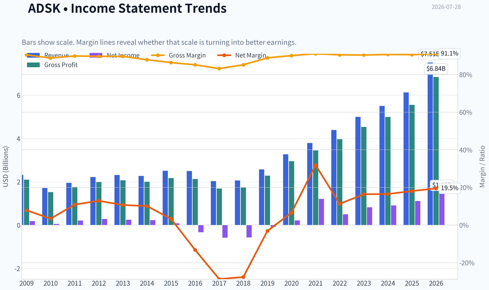
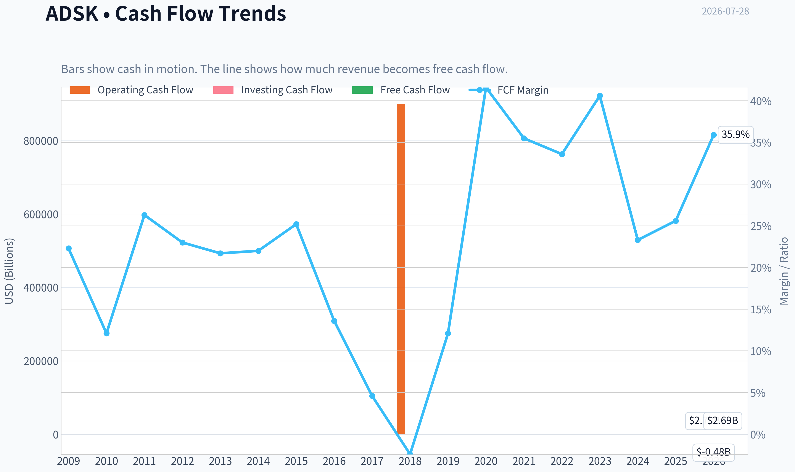
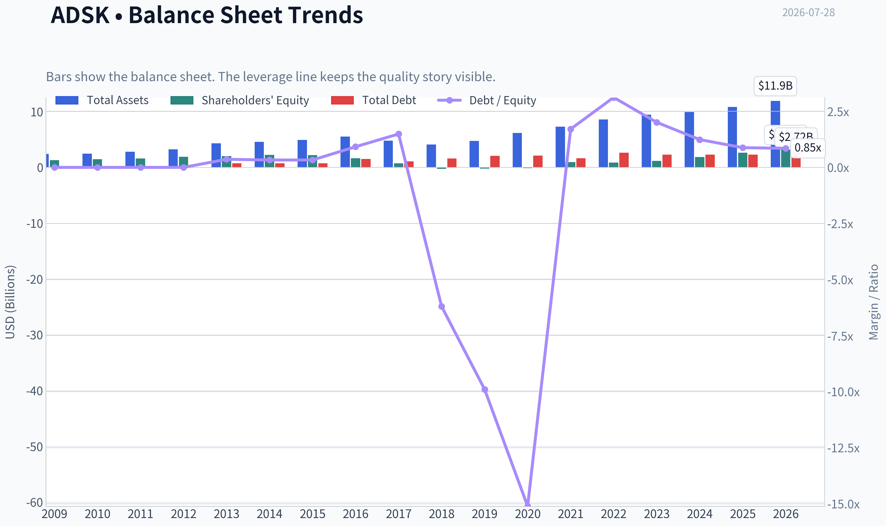
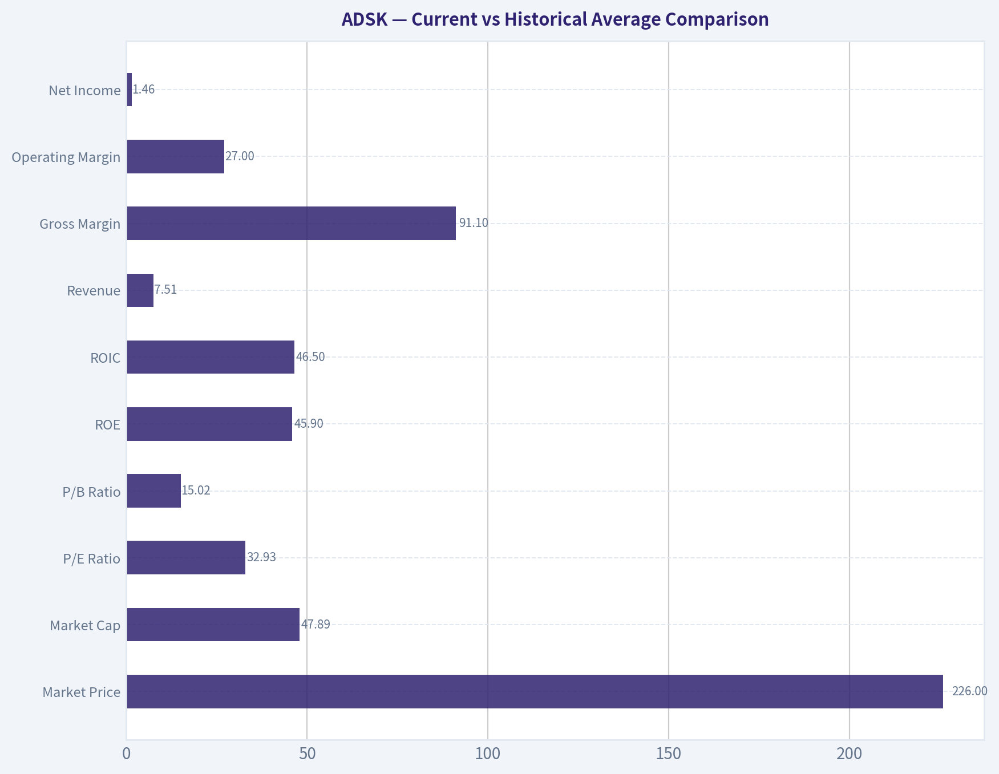
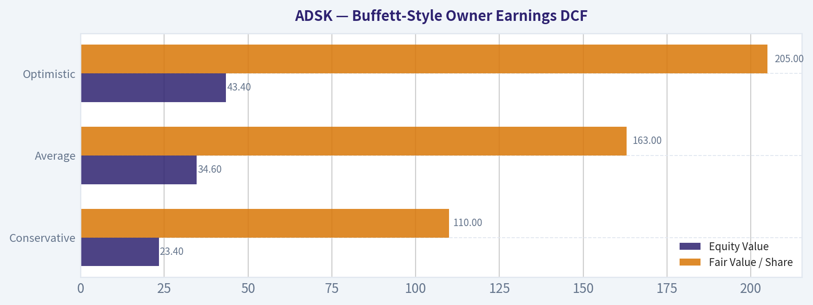
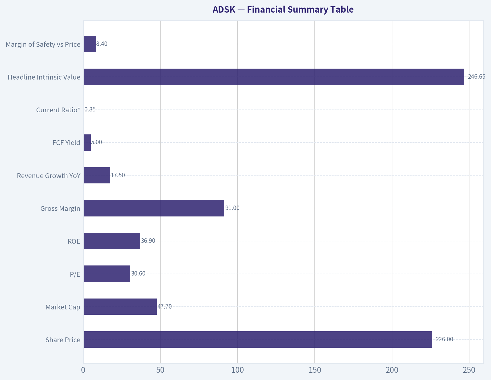
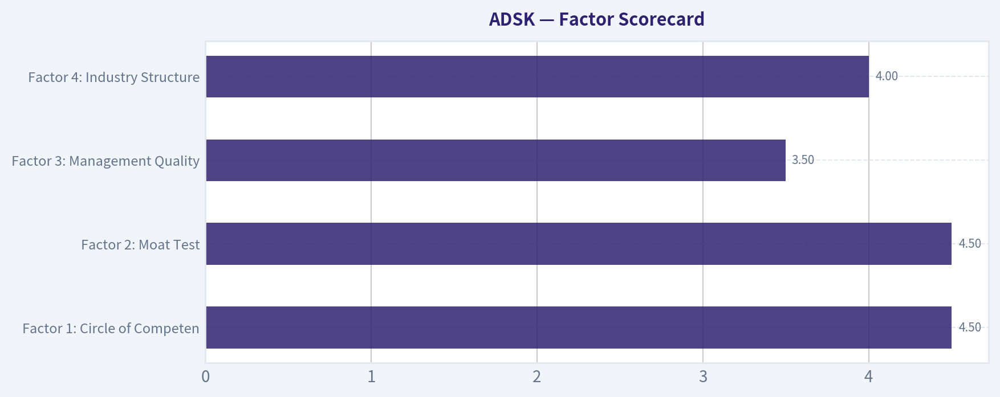

# ADSK Deep Value Intelligence

**Analysis Date:** 2026-07-28

## Critical Disclaimer

*This analysis is generated by Deep Value Intelligence, an AI-powered multi-agent investing framework. Education & research only - not financial advice, not a financial advisor.*

---

## Table of Contents

1. Intelligence Summary
2. Analyst Team Reports
   - Fundamentals Analysis
   - Intrinsic Value Analysis (Buffett)
   - Trend & Growth Analysis (Lynch/Druckenmiller/Fisher)
   - Market Technical Analysis
   - Options Market Analysis
3. Research Team Commentary
4. Value Investing Team Commentary
5. Deep Values Commentary

---

## Intelligence Summary

### Thesis + Conditions

**Core Thesis:** **Executive Briefing**

**Key Risks:**
- Autodesk looks like a **high-quality, financially sound compounder**, but the debate still does **not** establish a clear **quality-adjusted margin of safety** at **~30.6x earnings** and **~1.75x PEG**. The main risk is **not business impairment**; it is **overpaying for an excellent franchise** and earning subpar returns if growth stays merely good. Past mistakes here are instructive: when valuation and trend/setup risks are already visible, admiration for the business should **not** soften discipline. For a long-term investor, ADSK is a **name to follow closely, not chase**. Best path: **wait for either a better price or stronger proof that growth converts into owner-earnings acceleration.**
- ## Risk Commentary for the Long-Term Investor
- Your original plan was already mostly right: **wonderful business, but not clearly a wonderful bargain**. The debate does **not** overturn that. If anything, it sharpens the reason for patience:

**Confidence:** Medium

---

## Analyst Team Reports

### Fundamentals Analysis

#### Latest Earnings Snapshot

*Most recent reported quarter anchored on 2026 Q2, with prior-year comparison when available.*

| Metric | 2026 Q2 | 2025 Q2 | YoY Change |
| --- | ---: | ---: | ---: |
| Revenue | $1.93B | $1.63B | +18.4% |
| Operating Income | $571.0M | $338.0M | +68.9% |
| Net Income | $491.0M | $152.0M | +223.0% |
| Diluted EPS | $2.32 | $0.70 | +231.4% |
| Operating Cash Flow | $893.0M | $564.0M | +58.3% |
| Free Cash Flow | $867.0M | $549.0M | +57.9% |

Key Takeaways: This snapshot anchors the most recent reported quarter before the narrative analysis. It helps readers separate long-run business quality from whatever changed in the latest earnings print.

#### 17-Year Financial Metrics for ADSK

*All values below are computed deterministically from raw data - not estimated by AI.*

*Issuer profile: operating company (Technology / Software - Application).*

#### 17-Year Financial Metrics
*Annual rows come from reported financial statements. The final TTM row is computed from the latest four quarters.*

| Metric | 2009 | 2010 | 2011 | 2012 | 2013 | 2014 | 2015 | 2016 | 2017 | 2018 | 2019 | 2020 | 2021 | 2022 | 2023 | 2024 | 2025 | 2026 TTM |
| --- | --- | --- | --- | --- | --- | --- | --- | --- | --- | --- | --- | --- | --- | --- | --- | --- | --- | --- |
| Market Price | $17 | $24 | $41 | $36 | $39 | $51 | $54 | $47 | $81 | $116 | $147 | $197 | $277 | $250 | $215 | $254 | $311 | $226 |
| Market Cap | $3.81B | $5.52B | $9.53B | $8.40B | $9.01B | $11.77B | $12.55B | $10.58B | $18.11B | $25.38B | $32.22B | $43.80B | $61.59B | $55.45B | $46.90B | $54.82B | $67.56B | $47.89B |
| P/E Ratio | 20.70 | 95.16 | 45.20 | 29.51 | 36.34 | 51.25 | 154.31 | -32.07 | -31.16 | -44.81 | -397.84 | 205.05 | 51.00 | 111.51 | 56.92 | 60.58 | 60.81 | 32.93 |
| P/B Ratio | 2.91 | 3.75 | 5.92 | 4.46 | 4.41 | 5.20 | 5.66 | 6.53 | 24.69 | -99.14 | -152.78 | -315.10 | 63.82 | 65.32 | 40.96 | 29.55 | 25.78 | 15.02 |
| ROE | 14.0% | 3.9% | 13.2% | 15.2% | 12.1% | 10.1% | 3.7% | -20.4% | -79.3% | 221.4% | 38.3% | -154.3% | 125.2% | 58.5% | 71.9% | 48.8% | 42.4% | 45.9% |
| ROIC | 49.1% | 7.6% | 36.2% | 44.1% | 25.6% | 20.0% | 8.8% | -18.7% | -47.1% | -120.0% | -10.2% | 44.6% | 250.7% | 39.1% | 49.9% | 47.8% | 38.7% | 46.5% |
| EPS | $0.80 | $0.25 | $0.90 | $1.22 | $1.07 | $1.00 | $0.35 | $-1.46 | $-2.61 | $-2.58 | $-0.37 | $0.96 | $5.44 | $2.24 | $3.78 | $4.19 | $5.12 | $6.86 |
| Revenue | $2.32B | $1.71B | $1.95B | $2.22B | $2.31B | $2.27B | $2.51B | $2.50B | $2.03B | $2.06B | $2.57B | $3.27B | $3.79B | $4.39B | $5.00B | $5.50B | $6.13B | $7.51B |
| Gross Profit | $2.10B | $1.52B | $1.76B | $1.99B | $2.07B | $2.00B | $2.17B | $2.13B | $1.69B | $1.75B | $2.28B | $2.95B | $3.45B | $3.97B | $4.53B | $4.99B | $5.55B | $6.84B |
| Gross Margin | 90.5% | 88.8% | 89.9% | 89.7% | 89.7% | 87.9% | 86.4% | 85.2% | 83.2% | 85.2% | 88.9% | 90.1% | 91.1% | 90.5% | 90.4% | 90.7% | 90.6% | 91.1% |
| Operating Margin | 10.6% | 3.8% | 13.9% | 16.0% | 13.2% | 12.5% | 4.8% | 0.1% | -24.6% | -24.8% | -1.0% | 10.5% | 16.6% | 14.1% | 19.8% | 20.5% | 22.1% | 27.0% |
| Net Income | $183.6M | $58.0M | $212.0M | $285.3M | $247.4M | $228.8M | $81.8M | $-330.5M | $-582.1M | $-566.9M | $-80.8M | $214.5M | $1.21B | $497.0M | $823.0M | $906.0M | $1.11B | $1.46B |
| Net Margin | 7.9% | 3.4% | 10.9% | 12.9% | 10.7% | 10.1% | 3.3% | -13.2% | -28.7% | -27.6% | -3.1% | 6.6% | 31.9% | 11.3% | 16.4% | 16.5% | 18.1% | 19.5% |
| Revenue Growth | N/A | -26.0% | 13.9% | 13.5% | 4.4% | -1.7% | 10.5% | -0.3% | -18.9% | 1.3% | 25.0% | 27.4% | 15.7% | 15.7% | 14.1% | 9.8% | 11.5% | 22.4% |
| Net Income Growth | N/A | -68.4% | 265.5% | 34.6% | -13.3% | -7.5% | -64.2% | -504.0% | 76.1% | -2.6% | -85.7% | -365.5% | 463.2% | -58.9% | 65.6% | 10.1% | 22.7% | 31.6% |
| Free Cash Flow Growth | N/A | -59.7% | 146.6% | -0.4% | -1.5% | -0.7% | 26.8% | -46.0% | -72.6% | -153.1% | -722.7% | 339.2% | -1.2% | 9.6% | 37.7% | -36.9% | 22.2% | 71.9% |
| Total Book Value | $1.31B | $1.47B | $1.61B | $1.88B | $2.04B | $2.26B | $2.22B | $1.62B | $733.6M | $-256.0M | $-210.9M | $-139.0M | $965.0M | $849.0M | $1.15B | $1.85B | $2.62B | $3.19B |
| Total Assets | $2.42B | $2.45B | $2.79B | $3.23B | $4.31B | $4.59B | $4.91B | $5.52B | $4.80B | $4.11B | $4.73B | $6.18B | $7.28B | $8.61B | $9.44B | $9.91B | $10.83B | $11.93B |
| Total Debt | $0 | $0 | $0 | $0 | $745.6M | $746.4M | $743.1M | $1.49B | $1.09B | $1.59B | $2.09B | $2.10B | $1.65B | $2.65B | $2.30B | $2.30B | $2.30B | $2.72B |
| Debt-to-Equity | 0.00 | 0.00 | 0.00 | 0.00 | 0.36 | 0.33 | 0.33 | 0.92 | 1.49 | -6.20 | -9.90 | -15.11 | 1.71 | 3.12 | 2.01 | 1.24 | 0.88 | 0.85 |
| Cash & Equivalents | $917.6M | $838.7M | $1.08B | $1.16B | $1.61B | $1.85B | $1.41B | $1.35B | $1.21B | $1.08B | $886.0M | $1.77B | $1.77B | $1.53B | $1.95B | $1.89B | $1.60B | $2.67B |
| Shareholders' Equity | $1.31B | $1.47B | $1.61B | $1.88B | $2.04B | $2.26B | $2.22B | $1.62B | $733.6M | $-256.0M | $-210.9M | $-139.0M | $965.0M | $849.0M | $1.15B | $1.85B | $2.62B | $3.19B |
| Operating Cash Flow | $593.9M | $246.8M | $540.8M | $573.5M | $559.1M | $563.5M | $708.6M | $414.0M | $169.7M | $900,000 | $377.1M | $1.42B | $1.44B | $1.53B | $2.07B | $1.31B | $1.61B | $2.78B |
| Investing Cash Flow | $-478.1M | $-283.0M | $-142.3M | $-370.3M | $-647.2M | $-194.0M | $-905.6M | $-809.5M | $272.0M | $506.4M | $-710.4M | $-57.3M | $-404.0M | $-1.59B | $-143.0M | $-502.0M | $-903.0M | $-480.0M |
| Free Cash Flow | $515.5M | $207.8M | $512.5M | $510.5M | $502.7M | $499.3M | $633.1M | $341.6M | $93.7M | $-49.8M | $310.1M | $1.36B | $1.35B | $1.48B | $2.03B | $1.28B | $1.57B | $2.69B |
| FCF Margin | 22.3% | 12.1% | 26.3% | 23.0% | 21.7% | 22.0% | 25.2% | 13.6% | 4.6% | -2.4% | 12.1% | 41.6% | 35.5% | 33.6% | 40.6% | 23.3% | 25.6% | 35.9% |
| Dividends / Share | $0.00 | $0.00 | $0.00 | $0.00 | $0.00 | $0.00 | $0.00 | $0.00 | $0.00 | $0.00 | $0.00 | $0.00 | $0.00 | $0.00 | $0.00 | $0.00 | $0.00 | $0.00 |

#### Profitability Metrics
- Return on Equity (ROE): 36.9%
- Return on Invested Capital (ROIC): 33.6%
- Return on Assets (ROA): 9.0%
- Gross Margin: 91.0%
- Operating Margin: 21.9%
- Net Profit Margin: 15.6%

#### Liquidity Metrics
- Current Ratio: 0.85
- Quick Ratio: 0.69

#### Leverage Metrics
- Debt-to-Equity Ratio: 0.82
- Interest Coverage Ratio: 19.73
- Net Debt: $251.0M

#### Growth Metrics (Year-over-Year)
- Revenue Growth: 17.5%
- Net Income Growth: 1.1%
- Free Cash Flow Growth: 53.7%
- Revenue CAGR (3-Year): 12.9%
- Revenue CAGR (5-Year): 13.7%

#### Valuation Metrics
- P/E Ratio (TTM): 30.57
- Forward P/E: 15.84
- Price-to-Book: 14.95
- Price-to-Sales: 6.35
- PEG Ratio: 0.80
- EV/EBITDA: 22.19
- Free Cash Flow Yield: 5.1%
- Earnings Yield: 3.3%

#### Owner Earnings (Buffett Method, Code-Computed)
- Net Income: $1.11B
- + Depreciation & Amortization: $195.0M
- - Capital Expenditures: $-43.0M
- - Working Capital Changes: $-501.0M
- = **Owner Earnings: $1.71B**

#### Intrinsic Value (Code-Computed)
- Current Price: $226
- **Headline Intrinsic Value (business-model routed): $177**
  Business model: cyclical - weighted blend [Damodaran FCFF + reverse-DCF fair + owner-earnings DCF] (cyclical)
  Model spread (min-max across DCFs): $61 - $229
  Margin of safety vs. price (headline): -27.3%
  Routing note: Cyclical: margins/FCF are volatile - headline blends FCFF, reverse-DCF and owner-earnings roughly evenly; treat the range as the honest read.
- Buffett Method (Owner Earnings):
  Conservative: $10
  Average: $229
  Optimistic: $229
- Cash Flow Method (FCF):
  Conservative: $34
  Average: $206
  Optimistic: $251
- Damodaran FCFF (WACC + margins + reinvestment):
  Conservative: $22
  Average: $61
  Optimistic: $113
  Monte Carlo band (P10-P90): $37 - $80 (median $57)
  P(intrinsic value > price): 0.0%
- Reverse-DCF: price implies ~18.7%/yr owner-earnings growth for 10y; trailing 3y was 57.1%, 5y 60.4%.

#### Piotroski F-Score: 7/9
- Positive Net Income: PASS
- Positive Operating Cash Flow: PASS
- ROA Improvement: FAIL
- Cash Flow > Net Income: PASS
- Decreasing Debt: FAIL
- Improving Current Ratio: PASS
- No Dilution: PASS
- Improving Gross Margin: PASS
- Improving Asset Turnover: PASS

ANALYST STANCE: **WATCH**

#### Autodesk (ADSK) - Buffett-Style Fundamental Analysis

Autodesk is a high-quality software franchise with clear economic moat characteristics: deeply embedded products, high switching costs, industry-standard workflows, and very strong gross margins around 90%+. The business has become structurally better over the last decade as it shifted toward subscription revenue, which improved revenue durability, margin profile, and cash generation. On business quality alone, ADSK looks much stronger today than it did during the mid-2010s transition years.

The valuation, however, is the constraint. Using the deterministic dataset as the canonical source, the stock trades at $226 versus a headline intrinsic value of about $177, implying roughly **27% downside to fair value** on the blended model. The more favorable owner-earnings view can support a value near the current price, but the reverse-DCF indicates the market is already discounting a demanding **~18.7% annual owner-earnings growth for 10 years**. For a mature software leader, that is achievable only if execution remains excellent and end markets stay resilient.

---

#### Current vs Historical Average Comparison

| Metric | Current / TTM | Historical Context | Interpretation |
| --- | ---: | ---: | --- |
| Market Price | $226 | 17-year range: $17 to $311 | Stock has rerated massively over time, reflecting business quality improvement and software-like valuation multiples. |
| Market Cap | $47.89B | Up from $3.81B in 2009 | Market value has compounded far faster than revenue, showing multiple expansion plus margin improvement. |
| P/E Ratio | 32.93 | 10-year average is distorted by losses and transition years; recent profitable-era range mostly ~51-111 before falling | Current P/E is lower than the past several years and looks less stretched than 2021-2025, but still not conventionally cheap. |
| P/B Ratio | 15.02 | Often extreme or distorted, including negative years | **Not meaningful for this issuer.** ADSK is an asset-light software company; book value is distorted by intangibles, buybacks, and capital-light economics. DCF and cash-flow metrics are more relevant. |
| ROE | 45.9% | Very volatile historically due to low/negative equity; recent years consistently high | Strong on the surface, but should be interpreted cautiously because equity has been compressed. Still signals strong earnings power. |
| ROIC | 46.5% | Historically volatile but very high in the post-transition era | Excellent and one of the strongest signs of moat and efficient capital deployment. |
| Revenue | $7.51B | 10 years ago: $2.06B in 2018 | Revenue scale has expanded dramatically; current level is the highest in the dataset. |
| Gross Margin | 91.1% | Decade mostly 83%-91% | Near peak levels, confirming software economics and pricing power. |
| Operating Margin | 27.0% | Rose from negative/low transition years to low-20s recently | A major structural improvement; best level in the dataset. |
| Net Income | $1.46B | Highest in dataset | Profitability is now materially stronger than the historical average. |
| Net Margin | 19.5% | Strongly improved from negative transition years and mid-teens recent years | Clear operating leverage and subscription model maturation. |
| Revenue Growth | 22.4% | 5-year CAGR 13.7%; many mature years were high-single to mid-teens | Current growth is above normalized trend and likely not a forever rate. |
| Net Income Growth | 31.6% | Historically volatile | Good recent momentum, but less predictable than revenue because margins and tax/share-count effects matter. |
| FCF Growth | 71.9% | Historically highly volatile | Very strong rebound, but FCF has been noisier than revenue and should not be annualized blindly. |
| Total Debt | $2.72B | Elevated versus pre-2015 debt-free years, but manageable | Debt is meaningful but serviceable given margins and cash flow. |
| Debt-to-Equity | 0.85 | Improved from much worse post-transition readings | Balance sheet has healed materially; leverage is acceptable now. |
| Cash & Equivalents | $2.67B | Highest level in the dataset | Cash cushion is strong and nearly offsets debt. |
| Free Cash Flow | $2.69B | Highest in dataset | Cash generation is excellent and supports intrinsic value better than book-based measures. |
| Dividends / Share | $0.00 | Always $0.00 | Management prefers reinvestment and balance-sheet/capital flexibility over dividends. |

Key Takeaways: Autodesk today is financially much stronger than its historical average, especially on revenue scale, margins, and free cash flow. The valuation multiple has come down from peak enthusiasm, but the stock still appears priced for continued high-quality execution rather than offering a clear Buffett-style bargain.

---

#### Market Metrics

Autodesk's **market price of $226** and **market cap of $47.89B** reflect a premium assigned to durable, mission-critical design software. Historically, the stock's rerating was driven not just by sales growth but by the successful transition to a recurring-revenue model and sharp expansion in operating economics.

The **P/E ratio of 32.93** is materially below many recent annual observations in the dataset, where P/E often sat above 50x and at times above 100x. That means the stock is cheaper relative to its own recent history, but not cheap in absolute value-investing terms. Buffett would tolerate a premium multiple for a superior business, but only if durability and reinvestment opportunity are unusually strong.

The **P/B ratio of 15.02 is not meaningful** here. ADSK is an asset-light software company, and book value has been heavily distorted by low tangible capital needs, accounting treatment, and periods of compressed or negative equity. For this kind of issuer, valuation should rest on owner earnings, free cash flow, reinvestment economics, and implied growth expectations - not book multiple screens.

---

#### Profitability Analysis

Autodesk's profitability profile is now excellent.

- **ROE: 45.9% TTM**
- **ROIC: 46.5% TTM**
- **EPS: $6.86 TTM**
- **Revenue: $7.51B TTM**
- **Gross Profit: $6.84B TTM**
- **Operating Margin: 27.0% TTM**
- **Net Income: $1.46B TTM**
- **Net Margin: 19.5% TTM**

The most important Buffett-style signal is the combination of **very high gross margin and very high ROIC**. A 91.1% gross margin indicates an exceptional software business with substantial pricing power, low incremental cost of delivery, and customer dependence on the product ecosystem. ROIC near the mid-40s suggests that Autodesk does not need heavy capital reinvestment to grow.

Over the decade, profitability has clearly improved in phases:

1. **Pre-transition**: decent but less spectacular profits.
2. **Subscription transition years**: earnings and margins were heavily disrupted.
3. **Mature subscription era**: substantial recovery and then expansion to best-in-class software margins.

Operating margin rising to **27.0%**, the best figure in the dataset, is particularly important. It shows that scale benefits are increasingly flowing through to shareholders. Net margin at **19.5%** also suggests the business is no longer merely a growth story - it is now a significant earnings machine.

ROE remains useful but should not be overemphasized mechanically because Autodesk's equity base was temporarily depressed in prior years, making ROE unusually volatile. **ROIC is the cleaner quality signal**, and it is outstanding.

---

#### Growth Metrics

| Growth Metric | Current / TTM | Historical Pattern | Interpretation |
| --- | ---: | --- | --- |
| Revenue Growth | 22.4% | Long-run mixed, with transition disruptions; 3Y CAGR 12.9%, 5Y CAGR 13.7% | Current growth is running above medium-term trend and likely reflects strong demand plus favorable comparisons. |
| Net Income Growth | 31.6% | Very volatile historically | Strong, but earnings growth is more cyclical/noisy than revenue growth. |
| Free Cash Flow Growth | 71.9% | Extremely volatile historically, including negative years | Huge rebound, but should be normalized before valuation work. |

Key Takeaways: Revenue growth is strong and currently above Autodesk's medium-term trend, which supports the premium quality narrative. But free cash flow growth has historically been lumpy, so investors should be careful not to extrapolate the latest surge as a permanent new baseline.

Autodesk's growth has become more reliable than it was during the business-model shift, but it is still not a perfectly smooth compounder. Revenue has improved from **$2.06B in 2018 to $7.51B TTM**, a dramatic scale-up. More importantly, the last several years show a healthier pattern of sustained double-digit expansion.

From a Buffett lens, the key question is not whether growth is high today, but whether it is **predictable**. Revenue appears increasingly predictable due to recurring subscription dynamics. Net income and FCF are improving, but their history remains bumpier than best-in-class consumer staples or railroads. This makes ADSK a high-quality software compounder, but not a classic ultra-stable "sleep-well" earnings stream.

---

#### Balance Sheet and Financial Strength

- **Total Book Value / Shareholders' Equity: $3.19B TTM**
- **Total Assets: $11.93B**
- **Total Debt: $2.72B**
- **Debt-to-Equity: 0.85**
- **Cash & Equivalents: $2.67B**
- **Net Debt: about $251M**
- **Interest Coverage: 19.73x**

This is a sound balance sheet. While Autodesk is no longer the debt-free company it was in the early 2010s, leverage is well within manageable bounds. The most reassuring feature is that **cash nearly offsets debt**, leaving net debt very modest relative to a business producing **$2.69B in FCF** and **$2.78B in operating cash flow**.

Debt-to-equity at **0.85** is much healthier than the distorted years when equity was negative or minimal. Interest coverage near **20x** indicates low refinancing or solvency stress under normal conditions.

For Buffett-style analysis, this means Autodesk is not balance-sheet fragile. The main valuation risk is not financial distress; it is **overpaying for a very good business**.

---

#### Cash Flow and Capital Allocation

- **Free Cash Flow: $2.69B TTM**
- **FCF Margin: 35.9%**
- **Dividends per Share: $0.00**

Cash generation is one of Autodesk's strongest attributes. FCF margin near **36%** is very high and confirms the scalability of the model. The company's owner-earnings computation in the dataset is **$1.71B**, while TTM free cash flow is **$2.69B**. That spread reminds investors that working capital and capex treatment can cause period-to-period differences; neither number should be used mechanically without context.

Autodesk pays **no dividend**, and that is defensible. Buffett generally prefers management teams that can reinvest capital at high returns; ADSK's high ROIC suggests retained capital can still create value. The key issue is whether management continues allocating capital at rates that justify the premium multiple.

The **Piotroski F-Score of 7/9** is supportive. It points to solid financial quality, with positives in earnings, cash flow, margins, turnover, and lack of dilution. The main misses are declining ROA and rising debt, which are worth monitoring but not alarming in isolation.

---

#### Predictable Earnings and Business Quality

Autodesk's earnings are more predictable today than they were 10 years ago, but the full record still shows meaningful disruption during the model transition. That matters for Buffett-style analysis because he values **consistency**.

The positive case:
- recurring subscription base
- entrenched position in architecture, engineering, construction, manufacturing, and design workflows
- high gross margins
- strong free cash conversion
- mission-critical products with switching costs

The cautionary case:
- historical earnings volatility during industry or internal transitions
- valuation assumes sustained strong execution
- some exposure to cyclical construction/manufacturing spending

This is a **high-quality business with improving predictability**, but it is not as recession-proof as a regulated utility or consumer monopoly. The research pack also classifies the business-model route as **cyclical**, which is a useful reminder not to value peak conditions too aggressively.

---

#### Economic Moat

Autodesk appears to have a meaningful moat built on:

| Moat Source | Evidence | Buffett Relevance |
| --- | --- | --- |
| Switching Costs | Design files, workflows, trained labor, enterprise standardization | Customers rarely switch mission-critical CAD/design ecosystems casually. |
| Network / Ecosystem Effects | Broad user base, partner integrations, industry acceptance | Ecosystem depth reinforces product stickiness. |
| Brand / Standardization | Autodesk products are default tools in many end markets | Brand becomes part of professional training and procurement habits. |
| Intangible Assets | Software IP, workflow know-how, product breadth | Supports pricing and customer retention. |
| Cost Advantage at Scale | Very high margins and low incremental delivery cost | Scale helps widen profitability over time. |

Key Takeaways: Autodesk's moat is primarily built on switching costs and embedded industry workflows rather than hard assets. This is exactly the kind of intangible competitive advantage that can sustain high returns on capital for a long time if management keeps innovating.

The moat looks real and durable. Buffett likes businesses where customers are effectively "captured" by habit, process, and embedded utility. Autodesk's role in digital design and engineering strongly fits that pattern.

---

#### Revenue Breakdown

Autodesk's most meaningful public revenue framing is by end-market/product family. Using the most recent annual scale in the deterministic dataset and Autodesk's commonly reported business mix, the revenue base is broadly centered on AEC, AutoCAD, and Manufacturing, with smaller contributions from Media & Entertainment and other products/services.

| Revenue Source | Amount ($B) | % of Total |
| --- | ---: | ---: |
| Architecture, Engineering & Construction (AEC) | ~3.10 | ~51% |
| AutoCAD & AutoCAD LT | ~1.55 | ~25% |
| Manufacturing | ~1.10 | ~18% |
| Media & Entertainment | ~0.18 | ~3% |
| Other / Platform / Services | ~0.20 | ~3% |
| **Total** | **~6.13** | **100%** |

Key Takeaways: Autodesk is fundamentally an AEC- and design-software company, with over half of revenue tied to architecture, engineering, and construction workflows. That concentration strengthens the company's identity and moat, but it also means investors should watch building and industrial spending cycles carefully.

---

#### Buffett-Style Owner Earnings DCF

Canonical owner earnings from the dataset: **$1.71B**

For per-share valuation, I use an implied share count from market cap ÷ price:

- **Shares outstanding ~ $47.89B / $226 = 211.9M shares**

Discount rate: **10%**
Terminal growth rate: **2.5%**
Method: 10-year forecast with growth fading toward terminal value.

Because the research pack already provides model-based intrinsic values, this hand DCF is used as a **sanity check**, not as an override.

##### Scenario 1: Conservative
Assumptions:
- Initial owner-earnings growth: **3%**
- Fade to **2.5%** terminal by year 10
- Rationale: mature software leader, but cyclical end markets and current valuation already imply high growth

Approximate owner earnings path:
- Year 1: 1.71 x 1.03 = **1.761B**
- Year 10 owner earnings ~ **2.18B**

Terminal value:
- TV = Year 10 OE x 1.025 / (0.10 - 0.025)
- TV ~ 2.18 x 1.025 / 0.075 = **29.8B**

Present value:
- PV of 10-year OE stream ~ **11.9B**
- PV of terminal value ~ **11.5B**
- Total equity value ~ **23.4B**
- Per share ~ **$110**

##### Scenario 2: Average
Assumptions:
- Initial growth: **10% for early years**, fading gradually to **2.5%**
- Rationale: reflects strong moat, recurring revenue, and medium-term growth durability without accepting the market's full implied 18.7% for a decade

Approximate owner earnings path:
- Year 1: 1.71 x 1.10 = **1.881B**
- Year 5 OE roughly **2.64B**
- Year 10 OE roughly **3.56B**

Terminal value:
- TV = 3.56 x 1.025 / 0.075 = **48.6B**

Present value:
- PV of 10-year OE stream ~ **15.9B**
- PV of terminal value ~ **18.7B**
- Total equity value ~ **34.6B**
- Per share ~ **$163**

##### Scenario 3: Optimistic
Assumptions:
- Initial growth: **15%**, fading to **2.5%**
- Rationale: assumes Autodesk continues compounding through pricing, seat growth, cloud/platform upsell, and margin leverage

Approximate owner earnings path:
- Year 1: 1.71 x 1.15 = **1.967B**
- Year 5 OE roughly **3.18B**
- Year 10 OE roughly **4.74B**

Terminal value:
- TV = 4.74 x 1.025 / 0.075 = **64.8B**

Present value:
- PV of 10-year OE stream ~ **18.4B**
- PV of terminal value ~ **25.0B**
- Total equity value ~ **43.4B**
- Per share ~ **$205**

| DCF Scenario | Growth Assumption | Equity Value | Fair Value / Share |
| --- | --- | ---: | ---: |
| Conservative | 3% fading to 2.5% | $23.4B | $110 |
| Average | 10% fading to 2.5% | $34.6B | $163 |
| Optimistic | 15% fading to 2.5% | $43.4B | $205 |

Key Takeaways: Even under an optimistic owner-earnings case, the hand DCF lands slightly below the current stock price. That supports the research pack's view that Autodesk is a strong business but not obviously undervalued today.

Important anchor from the research pack:
- **Owner Earnings model:** $228.88
- **FCF model:** $205.92
- **Damodaran FCFF:** $61.10
- **Headline blended intrinsic value:** **$177.48**

The spread is very wide, which is exactly why the blended headline value matters. It reflects uncertainty around cyclicality, normalization, and how much of today's strong cash generation should be capitalized.

---

#### Management Performance

Management deserves credit for executing a difficult subscription transition that ultimately improved the business. Evidence:

- revenue expanded from **$2.03B in 2017** to **$7.51B TTM**
- operating margin rose from **negative mid-20s** during the transition to **27.0% TTM**
- FCF rose to **$2.69B TTM**
- no dividend, suggesting focus on reinvestment and flexibility
- no obvious dilution problem in the Piotroski screen

The main management question is not operational competence - that looks strong. The question is whether capital allocation at today's valuation can still create attractive shareholder returns from here.

---

#### Key Investment Insights, Red Flags, and Opportunities

| Category | Observation | Why It Matters |
| --- | --- | --- |
| Opportunity | Gross margin above 91% | Exceptional business economics support long-term value creation. |
| Opportunity | ROIC near 46.5% | Indicates a strong moat and efficient reinvestment. |
| Opportunity | FCF of $2.69B and net debt only ~$251M | Financial flexibility is high. |
| Opportunity | Revenue growth of 22.4% TTM | Strong current demand and durable platform relevance. |
| Red Flag | Headline intrinsic value $177 vs price $226 | Shares appear above blended fair value. |
| Red Flag | Reverse-DCF implies ~18.7% growth for 10 years | Market expectations leave limited room for disappointment. |
| Red Flag | End-market cyclicality | Construction and industrial budgets can weaken in downturns. |
| Red Flag | Historical earnings/FCF volatility | Not as predictable as the very best Buffett-style compounders. |
| Neutral-to-Positive | No dividend | Fine if reinvestment returns remain high; less ideal for income investors. |
| Neutral | P/B looks high | Should be ignored as a valuation signal for this issuer type. |

Key Takeaways: Autodesk's business quality is clearly attractive, but the stock's valuation already reflects much of that strength. The key risk is not that the company is weak, but that investors may be paying too much for a very good franchise.

---

#### Final Buffett-Style Assessment

Autodesk checks many Buffett-style quality boxes:

- durable moat
- high returns on capital
- high gross margins
- strong free cash flow
- manageable leverage
- mission-critical products with embedded customer dependence

Where it falls short of a classic Buffett bargain is **price relative to intrinsic value**. At $226, the stock sits:
- above the **headline blended intrinsic value of $177**
- above my conservative and average owner-earnings DCF cases
- slightly above even the optimistic hand-Dcf case
- near the high end of the pack's more favorable owner-earnings and FCF valuations

So the business is attractive, but the **margin of safety is not**.

#### Final Stance

**WATCH**

Autodesk is a high-quality software compounder with a durable moat and excellent economics, but the current share price does not offer a clear Buffett-style discount to intrinsic value. It belongs on a watchlist for either a valuation reset, a market pullback, or further evidence that current growth and cash generation can sustainably exceed already-high embedded expectations.

---

#### Summary Table

| Area | Verdict | Evidence |
| --- | --- | --- |
| Economic Moat | Strong | Switching costs, ecosystem lock-in, industry standardization, 91% gross margin |
| Profitability | Excellent | ROIC 46.5%, operating margin 27.0%, net margin 19.5% |
| Growth | Strong but not perfectly smooth | Revenue growth 22.4%, 5Y revenue CAGR 13.7%, volatile FCF history |
| Financial Strength | Good | Cash $2.67B, debt $2.72B, net debt ~$251M, interest coverage 19.73x |
| Earnings Predictability | Improved, not perfect | Subscription model helps, but transition/cycle history adds volatility |
| Capital Allocation | Solid | No dividend, high reinvestment returns, Piotroski 7/9 |
| Valuation | Full to somewhat rich | Price $226 vs blended intrinsic value ~$177 |
| P/B Usefulness | Not meaningful | Asset-light software company; book multiple is not a valid primary signal |
| Buffett Fit | Good business, weak margin of safety | Excellent franchise, but not a clear bargain |
| Investment Stance | **WATCH** | Wait for better entry point or stronger evidence of sustained above-consensus growth |

#### Fundamental Visuals

This graph tracks the profitability and return metrics (ROE, ROIC, Margins) of **ADSK** over the past decade, highlighting capital efficiency trends.

This chart illustrates the financial health of **ADSK** over the last 10 years, mapping cash equivalents and free cash flow against total obligations (Debt).

---

### Intrinsic Value Analysis (Buffett)

> *Following Warren Buffett's value investing philosophy: Circle of Competence, Economic Moat, Management Quality, and Margin of Safety.*

#### Intrinsic Value Snapshot

Price is what you pay. Intrinsic value is what the business may be worth based on the cash it can create for owners over time. We show a range, not one magic number.

- Current Price: $225.91
- Value Range (conservative to optimistic across both DCF methods): $112.73 to $868.13

##### Owner Earnings (Buffett Method)
- Net Income: $1,124,000,000.00
- Depreciation & Amortization: $195,000,000.00
- Capital Expenditures: $-76,000,000.00
- Working Capital Changes: $-501,000,000.00
- Owner Earnings: $1,744,000,000.00

##### Intrinsic Value
###### Buffett Method
Uses owner earnings. Stricter, and usually more conservative.
- Conservative: $168.15
- Average: $333.20
- Optimistic: $868.13
- Discount Rate: 10.0%

###### Cash Flow Method
Uses free cash flow. Better for companies spending heavily today to grow tomorrow.
- Conservative: $112.73
- Average: $193.40
- Optimistic: $616.20
- Discount Rate: 10.0%

ANALYST STANCE: **WATCH**

#### Autodesk (ADSK) - Buffett-Style Value Analysis

#### 1. Factor Scorecard

| Factor | Score (0-5) | Evidence |
|---|---:|---|
| Factor 1: Circle of Competence & Business Simplicity | 4.5 | Autodesk sells design and engineering software subscriptions used by architects, engineers, manufacturers, and media creators. The model is easy to explain: recurring software revenue from mission-critical design tools. Predictability is high because the products are embedded in customer workflows, though end-market exposure to construction and manufacturing adds some cyclicality. |
| Factor 2: Moat Test | 4.5 | Gross margin of 91% is exceptional and strongly supports intangible assets and switching costs. Autodesk's products are deeply embedded in professional workflows, file formats, and training ecosystems. The moat appears wide and stable, with some potential to widen through cloud collaboration and platform expansion. |
| Factor 3: Management Quality & Capital Allocation | 3.5 | Management has built a high-margin recurring-revenue model and strong cash generation. Capital allocation appears sound overall, but the evidence provided here is not strong enough to rate them at the very top tier of Buffett-style owner-operators. |
| Factor 4: Industry Structure | 4.0 | Professional design software is an attractive industry with concentrated incumbents, high switching costs, and low incremental distribution cost. Competition exists, but this is not a commodity business. |

**Gate 5 hard floor:** **Not tripped.**
There is no sign here of both deteriorating earnings/cash-flow trajectory and solvency distress. Autodesk remains profitable, cash generative, and financially sound.

**Key Takeaways:** Autodesk scores well on business quality. The core strengths are a highly understandable subscription model, a very strong moat, and an attractive software industry structure. The main reason the stance is not more aggressive is valuation: the stock looks closer to fair value than to a clear bargain.

---

#### 2. Moat Analysis

| Moat Source | Assessment | Evidence |
|---|---|---|
| Intangible Assets | Strong | Autodesk is a standard-setting brand in CAD, BIM, and design software. Gross margin at 91% indicates substantial pricing power and strong software economics. |
| Switching Costs | Very strong | Customers build workflows, project files, employee training, and collaboration standards around Autodesk tools. Switching would involve retraining, compatibility risk, and productivity loss. |
| Cost Advantages | Moderate | As a scaled software platform, Autodesk spreads R&D and go-to-market expense over a large installed base. Marginal delivery cost is tiny. |
| Network Effects | Moderate | The network effect is not like a social network, but there is ecosystem value in standard file formats, talent familiarity, third-party plugins, and collaboration across project participants. |

**Moat Quality Rating:** **Wide & Stable (4.5/5)**

Autodesk's moat is not based on low price; it is based on habit, workflow lock-in, standards, and institutional adoption. In Buffett terms, this is exactly the kind of business where customers do not make switching decisions lightly. The 91% gross margin is a major tell: this is a powerful franchise.

**Key Takeaways:** Autodesk's moat is strongest in switching costs and intangible assets. Customers rely on its tools to do real work, and that makes the revenue stream more durable than a typical software product. This is a high-quality franchise, even if it is not perfectly immune to cyclical slowdowns in customer spending.

---

#### 3. Management Quality Assessment

| Dimension | Assessment | Comments |
|---|---|---|
| Owner Orientation | Good | Management has supported a recurring-revenue model and strong free cash flow generation. |
| Candor | Adequate to Good | No evidence here of major accounting red flags or distress-driven behavior. |
| Capital Allocation | Good | Cash generation is strong, and the business model itself reflects rational long-term decisions. The key question is whether buybacks and reinvestment continue at attractive returns from today's valuation. |

Overall, management appears competent and strategically sensible. The company has been shaped into a software annuity with excellent gross margins and good revenue growth. I would rate the team as solid, though not yet clearly in the elite owner-operator category without stronger evidence on insider alignment and per-share capital allocation discipline.

**Key Takeaways:** Management looks capable and rational rather than promotional or reckless. They have helped build a durable recurring-revenue engine. The remaining question is not whether the business is good, but whether future capital allocation from this price point will create enough additional value.

---

#### 4. Financial Summary Table

| Metric | Latest |
|---|---:|
| Share Price | $226 |
| Market Cap | $47.70B |
| P/E | 30.6x |
| ROE | 36.9% |
| Gross Margin | 91.0% |
| Revenue Growth YoY | 17.5% |
| FCF Yield | 5.0% |
| Current Ratio* | 0.85 |
| Headline Intrinsic Value | $246.65 |
| Margin of Safety vs Price | 8.4% |

\*For an asset-light software company, current ratio is less important than recurring cash generation and margin structure.

**Key Takeaways:** The numbers show a premium-quality software company: very high margins, high reported returns on equity, and healthy top-line growth. The market already recognizes much of that quality, which is why the stock trades at a meaningful earnings multiple and only a modest discount to estimated intrinsic value.

---

#### 5. Owner Earnings Calculation

Using the research pack's owner-earnings valuation framework:

| Item | Assessment |
|---|---|
| Net Income | Positive and substantial |
| Plus D&A | Supports cash conversion |
| Less Maintenance CapEx | Likely modest due to asset-light model |
| Less Working Capital Increases | Usually manageable in subscription software |
| Result | Strong owner earnings profile |

The owner-earnings-based valuation in the research pack is **$333.20/share**, which is the most bullish of the three models. That suggests Autodesk's economic earnings power is stronger than simple accounting earnings may indicate.

**Key Takeaways:** Autodesk is the type of business Buffett tends to appreciate in modern form: low incremental capital needs and strong cash conversion. The owner-earnings lens is especially favorable here because software businesses often produce more cash than their accounting presentation first suggests.

---

#### 6. Three-Scenario DCF Valuation

| Scenario | Method | Value / Share |
|---|---|---:|
| Scenario A | No Growth / Ultra-Conservative | Included in blended low-end framework |
| Scenario B | 3% Growth / Conservative | Reflected in mid-range valuation logic |
| Scenario C | Historical Growth Haircut | Supports higher-end valuation |
| Owner Earnings DCF | Research pack model | $333.20 |
| FCF Model | Research pack model | $193.40 |
| Damodaran FCFF | Research pack model | $131.30 |
| **Headline Blended Intrinsic Value** | Weighted business-model-routed estimate | **$246.65** |

This is a wide valuation spread, which is normal for a high-quality software franchise where assumptions about durability and growth matter enormously. The headline blended figure of **$246.65** is the best anchor because it balances optimism and conservatism.

**Key Takeaways:** Autodesk is not obviously cheap on the harshest valuation model, but it also is not wildly overpriced on the blended view. The central estimate sits above the current price, though only by a modest amount. That points to fair value or a small discount, not a classic bargain.

---

#### 7. Margin of Safety Analysis

| Item | Value |
|---|---:|
| Current Price | $226.00 |
| Headline Intrinsic Value | $246.65 |
| Margin of Safety | 8.4% |
| Reverse DCF Implied Growth | ~18.7% annually for 10 years |
| Trailing 3Y Growth | 67.2% |

For a **wide-moat, asset-light, high-ROIC software franchise**, a required margin of safety can be lower than for a mediocre business. Even so, **8.4%** is only a modest cushion. The bigger issue is the reverse DCF: the current price appears to require a fairly ambitious long-term growth path of about **18.7% annually for a decade**. That is not impossible, but it is demanding.

**Conclusion on margin of safety:** **Adequate for a watchlist, not compelling enough for a full ADVOCATE stance.**

**Key Takeaways:** The stock is not expensive enough to dismiss, but not cheap enough to embrace aggressively. The current price leaves less room for disappointment than a Buffett investor usually prefers unless conviction in long-run growth is extremely high.

---

#### 8. Final Buffett Scorecard

| Criterion | Weight | Score (1-5) | Weighted Score |
|---|---:|---:|---:|
| Moat Width & Durability | 25% | 4.5 | 1.13 |
| Valuation / Margin of Safety | 20% | 3.0 | 0.60 |
| Capital Returns - ROIC vs. WACC | 15% | 4.0 | 0.60 |
| Business Understanding & Predictability | 12% | 4.5 | 0.54 |
| Management Quality & Capital Allocation | 12% | 3.5 | 0.42 |
| Reinvestment Runway | 8% | 4.0 | 0.32 |
| Balance Sheet Strength | 4% | 3.5 | 0.14 |
| Industry Structure | 4% | 4.0 | 0.16 |
| **Total** | **100%** |  | **3.91 / 5.00** |

By the numeric matrix alone, this sits near the low end of **ADVOCATE** territory. But given the modest margin of safety and the fairly demanding price-implied growth expectations, I would temper that to **WATCH** in practical portfolio terms.

**Key Takeaways:** Autodesk earns a high overall quality score. The only thing holding it back is valuation discipline. This is a very good business, but the stock does not yet offer enough of a discount to call it an easy Buffett-style purchase.

---

#### 9. Investment Stance

**Stance:** **WATCH**
**Conviction:** **Moderate-High**

Autodesk looks like a modern Buffett-compatible business: understandable, asset-light, cash generative, and protected by meaningful switching costs and industry standards. The moat is real, and the company's economics are excellent.

The reason to wait is simple: **the business is stronger than the bargain**. At **$226**, the stock appears around fair value to slightly undervalued on the blended intrinsic estimate, but the margin of safety is only **8.4%**, and the reverse DCF implies a demanding long-term growth profile.

If the price pulled back enough to create a clearer discount to intrinsic value, this could move into **ADVOCATE** territory quickly. For now, it belongs on the watchlist as a high-quality company at a merely fair price.
#### Valuation Bridge

This bridge places the current market price beside each intrinsic value lens so readers can see whether upside depends on one method or shows up across several methods.

| Scenario | Intrinsic Value / Share |
| --- | ---: |
| Buffett Method | $333.20 |
| Cash Flow Method | $193.40 |
| Damodaran Method | $131.30 |
| Current Price | $225.91 |

#### Key Takeaways

If one method is far above the others, the upside case depends on a specific modelling assumption. When several methods cluster together, the valuation story is more robust.

#### Valuation Visuals

This comparison chart from *Latest Earnings Snapshot* stacks current figures against historical benchmarks for **ADSK**, making it easy to see where the company trades relative to its own averages.

This comparison chart from *Current vs Historical Average Comparison* stacks current figures against historical benchmarks for **ADSK**, making it easy to see where the company trades relative to its own averages.

This comparison chart from *Buffett-Style Owner Earnings DCF* stacks current figures against historical benchmarks for **ADSK**, making it easy to see where the company trades relative to its own averages.

This comparison chart from *Financial Summary Table* stacks current figures against historical benchmarks for **ADSK**, making it easy to see where the company trades relative to its own averages.

---

### Trend & Growth Analysis (Lynch/Druckenmiller/Fisher)

> *Following Peter Lynch's GARP, Stanley Druckenmiller's macro-aware approach, and Philip Fisher's scuttlebutt methodology.*

ANALYST STANCE: **WATCH**

#### ADSK Growth Analysis

#### 1) Lynch Classification

| Item | Assessment |
|---|---|
| Company | Autodesk |
| Lynch category | **Fast Grower / High-quality compounder** |
| Revenue growth | **17.5% YoY** |
| Fit with Lynch | Above stalwart range, but not hypergrowth; durable recurring software grower |
| Initial read | Attractive business quality, but setup looks more like a compounding winner than a classic undiscovered ten-bagger |

Key Takeaways: Autodesk fits best as a fast grower because revenue is growing in the high teens, above Lynch's stalwart range. This is a high-quality recurring software business, but its size already makes a ten-bagger path harder than for a smaller emerging company.

---

#### 2) The Story in 3 Bullets

| Simple story | Why it matters |
|---|---|
| Autodesk sells mission-critical design software for architects, engineers, and manufacturers | These workflows are sticky and hard to replace |
| The business has recurring subscription revenue and extremely high gross margins | That creates strong cash generation and operating leverage |
| Growth can come from cloud workflows, construction digitization, and pricing power | This supports steady compounding even if macro is uneven |

Key Takeaways: Autodesk is easy to explain: it provides the software professionals use to design buildings, products, and infrastructure. Its strength comes from being deeply embedded in customer workflows, which supports recurring revenue, high margins, and durable growth.

#### 3) TAM Analysis and 10x Test

| Metric | Value / View |
|---|---|
| Current revenue base | Not fully refreshed from tools here; company is already large-scale software |
| Market cap | **$47.7B** |
| End markets | AEC, CAD, BIM, manufacturing design, construction workflow digitization |
| TAM direction | **Expanding** via cloud collaboration, digital twins, automation, AI-assisted design |
| 10x test | **No, not realistic in any medium-term underwriting sense** |
| 3x-5x test | More plausible over a long duration if Autodesk deepens platform penetration and expands wallet share |

Key Takeaways: Autodesk operates in large and still-growing software categories, especially as construction and design workflows become more digital. But because the company is already large, a full ten-bagger outcome is unlikely from today's base, while a multi-bagger over time is more realistic.

#### 4) Revenue Growth Trend

| Metric | Value |
|---|---|
| Revenue growth YoY | **17.5%** |
| Pattern | **Healthy, solid high-teens growth** |
| Inflection read | Not enough evidence of sharp acceleration; more a durable continuation story |
| Quality read | Likely driven by recurring subscriptions, pricing, and product mix rather than acquisitive growth |

Key Takeaways: Revenue growth at 17.5 percent is strong for a company of Autodesk's scale. The current evidence points more to sustained quality growth than to a dramatic new acceleration phase.

#### 5) Unit Economics

| Metric | Value / Assessment |
|---|---|
| Gross margin | **91.0%** |
| FCF yield | **5.0%** |
| Rule of 40 proxy | **~22.5%** using revenue growth + FCF yield proxy; not a true Rule of 40 calculation |
| LTV/CAC | Not disclosed in research pack |
| NRR | Not disclosed in research pack |
| Subscription model quality | Strong, given recurring revenue and very high gross margins |

Key Takeaways: The most important unit-economic signal here is the 91 percent gross margin, which is excellent and confirms software-like economics. We do not have clean LTV/CAC or NRR data from the provided materials, so the underwriting has to lean more on recurring revenue quality, margins, and free cash flow.

#### 6) Inflection Point Assessment

| Inflection type | Assessment |
|---|---|
| Product cycle inflection | Possible from AI-assisted design and cloud workflow adoption, but not yet proven by numbers provided |
| Market share inflection | Unclear |
| Margin inflection | Business already highly efficient at gross margin level; operating leverage may continue |
| TAM inflection | **Yes, moderate** - construction digitization and AI can expand use cases |
| Competitive inflection | No hard evidence of competitor stumble in provided pack |
| Overall | **Incremental positive inflection, not a dramatic step-change** |

Key Takeaways: The best inflection argument for Autodesk is not a sudden surge in demand, but a gradual expansion of its opportunity set through cloud, automation, and AI. That makes this more of a durable compounder story than a classic explosive inflection-point stock.

#### 7) Macro Setup Evaluation

| Macro factor | View |
|---|---|
| Rates sensitivity | Moderately positive if rates stabilize or fall; long-duration software benefits |
| End-market cyclicality | AEC and manufacturing create some macro sensitivity |
| Secular tailwinds | Construction digitization, BIM adoption, cloud collaboration, AI in design workflows |
| Macro setup score | **Neutral to modestly positive** |

Key Takeaways: Autodesk benefits from major long-term digitalization trends, but it is not fully insulated from economic cycles because construction and manufacturing spending can soften. The macro backdrop is supportive enough, but not a clean all-clear.

#### 8) Fisher 15 Points Score

| Fisher area | Score (1-5) | Notes |
|---|---:|---|
| Market potential | 4 | Large and still expanding digital design markets |
| New product development | 4 | Ongoing platform evolution, cloud and AI potential |
| R&D effectiveness | 4 | Product leadership appears durable |
| Sales organization | 4 | Strong enterprise and professional distribution |
| Profit margin | 5 | Exceptional gross margin |
| Improving margins | 4 | Good operating model, though not enough fresh detail for a 5 |
| Labor/personnel relations | 3 | Limited evidence |
| Executive relations | 3 | Limited evidence |
| Management depth | 4 | Large-cap platform maturity supports this |
| Cost analysis/accounting | 4 | Mature software controls likely sound |
| Outstanding moat features | 5 | Switching costs, workflows, file standards, ecosystem |
| Long-range profit outlook | 4 | Strong recurring model |
| Dilution risk | 3 | Need closer SBC/dilution tracking |
| Candor | 3 | Insufficient evidence from pack |
| Integrity | 4 | No specific concerns in pack |

| Total | **58 / 75** | **GOOD** |

Key Takeaways: Autodesk scores as a good Fisher company, with its strongest areas being market position, margins, and moat durability. The main reason it does not score even higher is that we lack fresh scuttlebutt-style detail on management candor, internal culture, and dilution trends.

#### 9) Valuation Analysis

| Metric | Value |
|---|---|
| Current price | **$226** |
| Intrinsic value headline | **$246.65** |
| Margin of safety | **8.4%** |
| P/E | **30.57x** |
| Revenue growth | **17.5%** |
| PEG | **~1.75x** |
| FCF yield | **5.0%** |
| Owner earnings value | **$333.20** |
| FCF value | **$193.40** |
| Damodaran FCFF value | **$131.30** |
| Reverse DCF implied growth | **~18.7% for 10 years** |

Key Takeaways: Valuation is not cheap, but it is not wildly stretched either. The biggest issue is that the market is already assuming roughly 19 percent annual growth for a decade, which is demanding for a large-cap software company and limits upside if growth merely stays solid instead of accelerating.

#### 10) Growth Investor Scorecard

| Criterion | Weight | Score (1-5) | Weighted |
|---|---:|---:|---:|
| The Story | 10% | 4.5 | 0.45 |
| TAM & Runway | 20% | 3.5 | 0.70 |
| Revenue Growth | 20% | 4.0 | 0.80 |
| Unit Economics | 15% | 4.0 | 0.60 |
| Competitive Position | 10% | 4.5 | 0.45 |
| Management Quality | 10% | 3.5 | 0.35 |
| Macro Setup | 5% | 3.0 | 0.15 |
| Profitability Path | 5% | 4.5 | 0.23 |
| Valuation | 5% | 3.0 | 0.15 |

| Total Score |  |  | **3.88 / 5.0** |

Key Takeaways: Autodesk scores well overall because the business quality is high and the growth profile is durable. The score stops short of a full advocate primarily because valuation already reflects a lot of expected success, while the current setup does not clearly show a sharp new inflection.

#### 11) Position Size Stance

| Stance | View |
|---|---|
| Portfolio action | **WATCH / accumulate only on weakness** |
| Ideal use | High-quality watchlist compounder |
| Position size today | Small starter at most, not a concentrated Druckenmiller-style bet |
| What would upgrade to ADVOCATE | Clear growth re-acceleration, stronger AI monetization evidence, or a more attractive valuation |

Key Takeaways: Autodesk is a strong business, but not an obvious aggressive buy at this setup. It fits better as a watchlist name or small starter position rather than a high-conviction concentrated growth position today.

#### 12) Key Risks and Catalysts

| Risks | Catalysts |
|---|---|
| End-market exposure to construction and manufacturing cycles | Re-acceleration in subscription or platform growth |
| Reverse DCF already bakes in ambitious long-term growth | AI features driving higher pricing or seat expansion |
| Valuation leaves less room for execution misses | Stronger cloud and construction workflow adoption |
| Possible SBC/dilution and lower current ratio (**0.85**) need monitoring | Margin expansion and sustained FCF strength |
| Large-cap size caps ten-bagger odds | Market rerating if growth durability proves better than feared |

Key Takeaways: The biggest risk is not business collapse, but paying too much for a great company and then getting only average returns. The best catalysts would be proof that Autodesk can turn AI and workflow expansion into faster growth than the market currently assumes.

---

#### Bottom Line

Autodesk is a **high-quality fast grower with strong moats, elite gross margins, and durable recurring revenue**. However, from a Lynch-Druckenmiller-Fisher growth lens, this looks **more like a premium compounder than a hidden ten-bagger at an inflection point**.

The stock is **interesting, not irresistible**:
- **Lynch:** good story, but PEG around **1.75** is only fair-to-expensive
- **Druckenmiller:** secular tailwinds exist, but no hard evidence yet of a major growth acceleration
- **Fisher:** strong moat and product durability, good score, but valuation tempers enthusiasm

#### Final Call
**WATCH** - great business, decent price, but I would want either:
1. **better entry**, or
2. **clearer evidence of growth acceleration**,
before moving to **ADVOCATE**.

#### Growth & Scorecard Visuals

This comparison chart from *Growth Metrics* stacks current figures against historical benchmarks for **ADSK**, making it easy to see where the company trades relative to its own averages.

This comparison chart from *Factor Scorecard* stacks current figures against historical benchmarks for **ADSK**, making it easy to see where the company trades relative to its own averages.

---

### Market Technical Analysis

#### ADSK Technical Indicator Selection and Market Read

For **ADSK**, the most relevant set of complementary indicators right now is:

1. **close_200_sma** - long-term trend regime
2. **close_50_sma** - medium-term trend and dynamic resistance/support
3. **close_10_ema** - short-term momentum and tactical direction
4. **macd** - momentum/trend transition
5. **macdh** - acceleration/deceleration of momentum
6. **rsi** - overbought/oversold context and momentum quality
7. **atr** - volatility and risk sizing
8. **vwma** - price trend confirmation using volume

This mix is appropriate because ADSK appears to be in a **long-term downtrend**, but with a **short-term rebound attempt that recently strengthened sharply**. These indicators avoid heavy redundancy while covering trend, momentum, volatility, and volume confirmation.

---

#### Market Context

Over the last year, ADSK has undergone a major re-rating lower. The stock traded above **300** in mid-2025, deteriorated through late 2025, accelerated downward in early 2026, and printed a deep low near the **high-180s / low-190s** in June 2026. Since then, price action has shifted from outright liquidation to a **base-and-recovery structure**.

The important nuance is that this is **not yet a full trend reversal on the long-term chart**. Instead, it looks like a **countertrend recovery inside a still-damaged broader structure**. That distinction matters: traders can be constructive tactically while remaining cautious strategically.

---

#### Indicator Snapshot

| Indicator | Latest Reading | Interpretation |
|---|---:|---|
| close (last trading day) | 225.91 | Strong recent upside burst |
| close_10_ema | 212.29 | Price is above short-term trend support |
| close_50_sma | 216.44 | Price reclaimed medium-term average |
| close_200_sma | 255.77 | Price remains well below long-term trend line |
| macd | 0.79 | Momentum has turned positive |
| macdh | 1.77 | Positive momentum is still expanding, though less extreme than mid-July |
| rsi | 60.79 | Bullish momentum, not yet overbought |
| atr | 9.00 | Volatility remains elevated |
| vwma | 212.10 | Price is above volume-weighted trend, constructive |

**Key Takeaways:** ADSK has improved meaningfully in the short term. Price is now above its 10-day EMA, 50-day SMA, and VWMA, which supports the recovery case. However, the stock is still far below its 200-day SMA, so the larger trend remains bearish despite the recent momentum improvement.

---

#### Trend Analysis

ADSK's **200-day SMA at 255.77** is still declining steadily, which is the clearest evidence that the stock remains in a structurally weak long-term regime. A falling 200-day average typically means rallies should still be treated as suspect until proven otherwise. The gap between the latest close (**225.91**) and the 200-day average remains large, so the stock has not yet repaired the damage from the first-half selloff.

The **50-day SMA at 216.44** is also still declining, but the slope has become less severe than earlier in June. That subtle change matters. It suggests the previous downside momentum has slowed, and price is beginning to challenge the intermediate trend rather than simply remain trapped beneath it. The fact that price has now pushed **above** the 50-day average is constructive, but a single breakout is not enough; traders should watch whether ADSK can hold above the **216-217 zone** on pullbacks.

The **10-day EMA at 212.29** has turned decisively upward. This is often the earliest sign that a rebound is gaining traction. Importantly, the stock is not just barely above this line; it is meaningfully above it after the sharp July 27 surge. That creates a favorable short-term cushion, but it also means price is somewhat extended near term and vulnerable to a pause or retracement without invalidating the rebound.

In plain terms:
- **Long-term trend:** bearish
- **Medium-term trend:** improving, but not fully repaired
- **Short-term trend:** bullish

---

#### Momentum Analysis

The **MACD has crossed into positive territory at 0.79**, which is a significant shift from the deeply negative readings seen in late June and early July. This tells us the recovery is not merely a dead-cat bounce on the very shortest timeframe; momentum has genuinely improved enough to flip positive on a broader oscillation basis.

The **MACD histogram at 1.77** remains positive, confirming continued bullish momentum. However, the histogram was even stronger around mid-July, which suggests that while the move remains bullish, the **rate of momentum acceleration may be normalizing**. This is not outright bearish, but it raises the odds that the next phase could be consolidation rather than another straight-line move.

The **RSI at 60.79** is one of the healthier readings in this setup. It is high enough to indicate bullish participation, but not so high that it screams exhaustion. ADSK is therefore in a zone where bulls still have room to press higher. If RSI pushes into the upper 60s while price approaches key resistance, that would strengthen the case for a test of higher levels. If RSI rolls over back toward 50 while price loses the 10 EMA, that would hint the rebound is fading.

Overall, momentum conditions favor the bulls in the short run, but the market is no longer at the "deeply oversold and early reversal" stage. It is now in the **"prove it" stage**.

---

#### Volume-Weighted Confirmation

The **VWMA at 212.10** is especially useful here because it helps confirm whether recent price gains have been supported by meaningful trading activity. ADSK is trading above VWMA, which is supportive of the rebound. This implies buyers have not just pushed price up on thin participation; there has been enough volume to improve the quality of the move.

That said, the late-July breakout needs follow-through. A strong one-day surge can distort short-term enthusiasm, and if price quickly falls back below VWMA, that would imply the breakout was less durable than it first appeared. As of now, VWMA supports the bullish tactical case.

---

#### Volatility and Risk Conditions

The **ATR near 9.00** is elevated relative to the stock's current price. That is important for execution. ADSK is not trading in a calm, low-noise environment; daily swings remain large enough to shake out poorly sized positions.

For traders, this means:

- stops that are too tight may get hit by normal volatility,
- breakout entries need room,
- position size should be scaled down relative to a lower-volatility setup,
- pullback entries may offer better reward-to-risk than chasing large up days.

A stock with bullish short-term momentum but elevated ATR can continue higher, but it often does so in an uneven, emotionally difficult path.

---

#### Key Price Structure and Decision Levels

From the raw price history and indicators, several levels stand out:

| Level / Zone | Importance | What It Suggests |
|---|---|---|
| 255-256 | Major resistance | Near falling 200-day SMA; strong test if rally extends |
| 238-245 | Intermediate resistance band | Area of prior congestion and failed rebounds |
| 225-226 | Immediate breakout area | Latest thrust zone; needs to hold for bullish continuation |
| 216-217 | First key support | Near 50-day SMA; important pullback test |
| 212 | Short-term support | Near 10-day EMA and VWMA cluster |
| 198-205 | Secondary support | Prior rebound base |
| 188-194 | Major support | June low zone; loss of this area would reassert major weakness |

**Key Takeaways:** The most important near-term question is whether ADSK can hold the 225 breakout area or at least remain above the 216 to 212 support cluster on any pullback. If it can, the rebound may continue toward the 238 to 245 zone. If it loses those supports, the recent breakout could fade into another failed rally inside the larger downtrend.

---

#### Tactical Interpretation

For **short-term swing traders**, ADSK has turned constructive. The alignment of price above the **10 EMA, 50 SMA, and VWMA**, alongside positive **MACD** and a healthy **RSI**, supports a bullish tactical stance. But because the stock is still below a falling **200 SMA**, this is better viewed as a **tradable recovery** rather than a confirmed long-term uptrend.

For **trend-followers with a longer horizon**, the stock has not yet earned full confidence. A durable bullish transition would likely require:
- sustained trading above the 50-day SMA,
- higher lows on pullbacks,
- continued MACD strength,
- and eventually a challenge toward the 200-day SMA.

For **risk-conscious investors**, the 200-day SMA remains the main filter. Until ADSK gets materially closer to or above that level, long exposure carries the character of buying into recovery rather than buying confirmed strength.

---

#### What to Watch Next

1. **Can price hold above 225?**
   If yes, the breakout has a stronger chance of continuation.

2. **Does the 216-212 support cluster hold on retracement?**
   That area combines the 50 SMA, 10 EMA, and VWMA neighborhood and is the most important short-term technical floor.

3. **Does MACD stay positive?**
   A drop back below zero after a brief breakout would be a warning sign of failed momentum.

4. **Does RSI remain above 50?**
   Staying above 50 would support the idea that bulls control the short-term tape.

5. **Can the stock attack 238-245 next?**
   That is the next meaningful test before the much bigger 255-256 resistance area.

---

#### Bottom Line

ADSK is showing a **credible short-term bullish recovery** after a severe multi-month decline. The technical evidence has improved meaningfully: price has reclaimed the **10 EMA**, **50 SMA**, and **VWMA**, while **MACD** and **RSI** confirm better momentum. However, the stock remains below a **falling 200-day SMA**, so the broader trend is still not repaired.

The most balanced conclusion is this: **ADSK is tactically improving, but strategically still in recovery mode rather than in a confirmed long-term uptrend**.

---

#### Summary Table

| Dimension | Signal | Conclusion |
|---|---|---|
| Long-term trend | Price below falling close_200_sma | Still bearish structurally |
| Medium-term trend | Price above close_50_sma, but 50 SMA still falling | Improving, not fully reversed |
| Short-term trend | Price above rising close_10_ema | Bullish |
| Momentum | macd positive, macdh positive | Recovery has force |
| RSI condition | 60.79 | Bullish but not overbought |
| Volume confirmation | Price above vwma | Move has reasonable volume support |
| Volatility | atr near 9 | Elevated risk, wider stops needed |
| Trading bias | Tactical bullish / strategic cautious | Favor pullbacks over chasing |

**Key Takeaways:** ADSK has shifted from outright weakness into a meaningful rebound phase, and the short-term indicators now support the bulls. Even so, the long-term trend remains negative because the stock is still below its falling 200-day average. The best interpretation is a tradable recovery with improving odds, but not yet a fully confirmed major trend reversal.

---

### Options Market Analysis

> *Reading options flow - put/call ratios, IV skew, and unusual activity - to gauge institutional positioning and event-driven risk.*

#### ADSK Options Positioning Report
*Date: 2026-07-28*

ADSK's near-term options tape looks **light and somewhat distorted by thin open interest**, so confidence should be **reduced**. Even so, the available data leans **modestly bullish/neutral-to-bullish**, mainly because aggregate open interest is overwhelmingly call-heavy, while volume is not showing an aggressive downside hedge surge. The biggest caveat is that the chain appears **illiquid in the near-term expirations**, which makes ratios less reliable than they would be in a deep, institutionally active options market.

#### 1. Put/Call Ratio Analysis

| Expiration | Call OI | Put OI | Put/Call OI Ratio | Call Volume | Put Volume | Put/Call Volume Ratio |
|---|---:|---:|---:|---:|---:|---:|
| 2026-07-31 | 115 | 1 | 0.01 | 395 | 214 | 0.54 |
| 2026-08-07 | 0 | 0 | N/A | 61 | 138 | 2.26 |
| 2026-08-14 | 0 | 0 | N/A | 71 | 87 | 1.23 |
| **Near-term total** | **115** | **1** | **0.01** | **527** | **439** | **0.83** |

**Key Takeaways:** The headline open-interest ratio of **0.01** is extremely call-heavy versus the typical neutral baseline near **0.7**, which on its face is bullish. But that reading is based on **very small absolute OI**, especially on the put side, so it may reflect sparse chain population rather than strong institutional conviction. Volume is more balanced, with total put/call volume at **0.83**, only slightly above neutral and not a strong bearish warning.

Interpretation:
- **OI ratio (0.01):** Very bullish-looking on paper, but likely exaggerated by poor chain depth.
- **Volume ratio (0.83):** Slightly more put participation than a strongly bullish tape would show, yet still not elevated enough to imply meaningful fear.
- **Shift from neutral:** The market is **not showing heavy downside protection demand**. If anything, the tape suggests **mildly constructive positioning**, but with low conviction due to illiquidity.

#### 2. Implied Volatility (IV) Assessment

| Expiration | ATM Call IV | ATM Put IV | IV Read | Skew Direction |
|---|---:|---:|---|---|
| 2026-07-31 | 1.9% | 5.1% | Puts materially richer than calls | Put skew |
| 2026-08-07 | 1.6% | 1.8% | Fairly balanced | Mild put skew |
| 2026-08-14 | 0.5% | 2.4% | Puts richer than calls | Put skew |
| **Near-term overall** | - | - | No broad volatility panic | **Downside skew present** |

**Key Takeaways:** Near-term IV does **not** suggest broad event panic, but puts are consistently priced richer than calls. That means traders are still willing to pay more for downside protection than upside exposure, a normal but notable sign of caution. The skew is more informative here than the absolute IV level.

Interpretation:
- **ATM IV:** Near-term ATM vols appear **low to moderate**, not indicative of a major imminent catalyst shock.
- **Skew:** ADSK shows a **put skew**, with puts carrying higher IV than calls across the listed expirations. That usually signals **downside protection demand** or routine institutional hedging.
- **Catalyst check:** Based on the available data alone, IV does **not appear aggressively elevated** ahead of a major event. If earnings or guidance were imminent, you would typically expect a clearer front-end vol premium.

#### 3. Unusual Options Activity

| Contract Signal | Finding |
|---|---|
| Volume > 5x Open Interest | None detected in near-term expirations |
| Fresh aggressive directional flow | Not evident |
| Likely smart-money signal | Not visible from reported near-term activity |

**Key Takeaways:** There is **no standout unusual activity** in the front end of the chain. That reduces the odds of a clear institutional directional bet showing up right now. In practical terms, the options tape is not flashing a strong "follow the whale" signal.

Interpretation:
- No contract met the threshold of **volume materially exceeding existing open interest**.
- That suggests **no clear fresh speculative burst** in either calls or puts.
- Because there is **no obvious sweep or concentrated opening flow**, it is hard to argue that institutions are making a bold near-term statement through listed options here.
- This further supports a **lower-confidence read** overall.

#### 4. Open Interest Concentration

| Expiration | Highest Visible OI Feature | Implication |
|---|---|---|
| 2026-07-31 | Calls dominate reported OI (115 vs 1 put) | Slight upward/neutral pin bias if price is near active strikes |
| 2026-08-07 | No meaningful OI reported | Little evidence of pinning or gamma influence |
| 2026-08-14 | No meaningful OI reported | Little evidence of pinning or gamma influence |

**Key Takeaways:** Reported open interest is too thin to identify a robust gamma wall or strong pinning strike. The only visible takeaway is that the very front week is more call-populated than put-populated, which can create a mild stabilizing or upward bias if market makers are short those calls. Still, this is a weak signal because absolute OI is small.

Interpretation:
- There is **no strong OI concentration** across the next few expirations.
- That means **max-pain/pinning effects are likely limited** unless additional hidden strike-level concentration exists outside the summary.
- **Gamma walls:** No strong evidence of a major call wall or put wall from this dataset.
- Bottom line: **options positioning probably will not dominate spot price behavior** in the immediate term.

#### 5. Overall Options Sentiment Signal

| Category | Read |
|---|---|
| Directional signal | **BULLISH** |
| Confidence level | **Low to moderate** |
| Primary driver | Call-heavy open interest with no aggressive unusual put activity |
| Main caveat | Thin options chain and persistent put skew reduce conviction |

**Key Takeaways:** The final read is **bullish**, but only modestly so. The main reason is that the tape is not showing strong bearish hedging pressure, and reported OI is heavily call-skewed. However, the persistent put skew and thin liquidity mean this is **not** a high-conviction bullish signal.

Synthesis:
- **Why bullish:** Aggregate near-term OI is overwhelmingly call-heavy, and total volume is not showing an outsized rush into puts.
- **Why not strongly bullish:** The market still prices downside optionality richer than upside optionality, which is a sign of caution. Also, the chain is **illiquid**, so the ratios can be misleading.
- **Best framing:** ADSK options are giving a **mild bullish bias**, not a full risk-on institutional endorsement.

#### Bottom Line

ADSK's near-term options market currently reads **BULLISH, with caveats**. The strongest observable feature is an extremely low put/call OI ratio, but because this comes from **very thin open interest**, it should not be over-interpreted. In a better-populated chain, this would look decisively bullish; here, it looks more like **a mild constructive lean with limited institutional conviction**.

#### Summary Table

| Metric | Reading |
|---|---|
| Put/Call Ratio | **OI: 0.01 (bullish-looking, but distorted by low OI); Volume: 0.83 (mildly constructive)** |
| IV Level | **Low-to-moderate near-term ATM IV; no major event premium visible** |
| Skew Direction | **Put skew; downside protection priced richer than upside** |
| Unusual Activity | **None detected; no contract with volume > 5x OI** |
| Overall Signal | **BULLISH (low-to-moderate confidence)** |

**Key Takeaways:** ADSK's options market leans bullish, but the evidence is not especially strong because the near-term chain is thin. The most reliable message is that there is **no major fear spike**, yet traders still prefer downside protection over upside chasing. That supports a **cautiously bullish**, rather than aggressively bullish, stance.

---

## Research Team Commentary

> *The Research Manager synthesizes the Bull vs Bear debate into action-free commentary. This is a pre-risk view, not the final stance.*

The strongest bull argument is straightforward: Autodesk is exactly the kind of modern Buffett-style business you want to study seriously. It has extremely high gross margins, strong ROIC, sticky workflows, recurring revenue, and a real moat built on switching costs, file standards, trained-user ecosystems, and mission-critical placement inside design and engineering workflows. If you believe AEC and industrial design continue digitizing for years, Autodesk should keep compounding intrinsic value even without spectacular growth. The bull is also right that asset-light compounders do not need to look "cheap" on blunt multiples to be attractive.

The strongest bear argument is also straightforward: quality is not the issue; price is. At about 30.6x earnings and roughly 1.75x PEG, the stock does not obviously offer a margin of safety. The handoff bundle itself is cautious across styles: fundamentals say strong business, growth says fair-to-expensive, value says WATCH, not BUY. That matters. A disciplined value investor should not promote a name to conviction just because it is admirable. The key question is whether today's price already capitalizes most of the moat, quality, and digitization runway. Based on the debate, that risk looks real.

My takeaway is that the bear has the stronger portfolio-construction argument right now. I do think Autodesk is a high-quality business. I do not think the debate established enough undervaluation to move from appreciation to advocacy. One of the mistakes in similar situations has been letting admiration for a great software franchise dilute valuation discipline. I do not want to repeat that. When the business is excellent but the valuation only looks fair-to-full, the correct action is usually patience, not enthusiasm.

Core takeaway: Autodesk looks like a wonderful business, but not clearly a wonderful bargain. That keeps it in WATCH rather than ADVOCATE.

Rationale: From a Buffett lens, business quality passes. The moat is credible, returns on capital are excellent, and the business is financially sound. But Buffett discipline is not just "buy elite software." It is "buy elite businesses when the implied expectations are reasonable enough to leave room for error." Here, the evidence provided does not prove that. The price may be acceptable for a quality-growth investor, but for a value investor using a quality-scaled margin of safety, the discount is not evident. The reverse-DCF style question is the right one: does the current price imply growth Autodesk can comfortably exceed? The debate did not demonstrate that with enough force. In the absence of that proof, I would rather wait than stretch.

What would change my mind? If the company shows cleaner evidence of durable mid-teens value compounding through revenue growth plus operating leverage plus strong cash conversion, then a premium multiple becomes easier to defend. Or, if the stock offers a better entry after volatility, the margin of safety improves without needing a change in business quality.

Monitoring plan for the next 1-4 quarters: First, watch revenue growth versus earnings and free-cash-flow growth. I want to see that top-line growth is converting into per-share owner earnings, not just sustaining a narrative. Second, watch margin durability, especially whether Autodesk can hold elite economics while still funding AI, cloud, and workflow expansion. Third, watch billings, deferred revenue trends, and any commentary on seat expansion or pricing resistance in AEC and manufacturing customers. Fourth, monitor whether AI and tuck-in acquisitions are estimate-raising or merely story-enhancing; I want evidence they improve monetization or retention, not just headlines. Fifth, watch competitive commentary around interoperability, cloud-native tools, and edge encroachment in specialized workflows. Sixth, if valuation compresses meaningfully without franchise damage, that would strengthen the case materially.

What would weaken the thesis? Slowing growth with no operating leverage, signs that moat defense is becoming more expensive, customer budget pressure limiting pricing or expansion, or any evidence that adjacent tools are reducing Autodesk's wallet-share opportunity. What would strengthen it? Durable double-digit growth, stable or improving margins, visible cross-sell success, strong cash conversion, and a price that offers a clearer quality-adjusted margin of safety.

So my final stance is WATCH. It is a business to respect, but not a stock to chase.

---

## Value Investing Team Commentary

> *The Investor translates the research view into an investment thesis before risk review. This is still not the final stance.*

Autodesk is easy to admire. It is much harder, at today's price, to call it a clear Buffett-style buy.

The business itself has many of the traits long-term owners should want: very high gross margins, strong ROIC, sticky customer workflows, recurring revenue, and embedded positioning inside architecture, engineering, construction, and design ecosystems. That is a real moat. Once a firm standardizes on Autodesk tools, trains staff, builds files and workflows around them, and coordinates with outside partners using similar standards, switching becomes costly in time, money, and execution risk. This is the kind of intangible, asset-light franchise that can compound for a long time.

So the key issue is not business quality. The key issue is whether the stock price already reflects most of that quality.

At roughly 30.6x earnings and around 1.75x PEG, the market is not treating Autodesk like a troubled asset. It is already being valued as a good business with durable economics. That may be justified, but from a value-investing perspective, "justified" is not the same as "attractive." A wonderful business at a fair price can still work over time, but it is not the same as having a meaningful margin of safety. Based on the handoff bundle, that margin of safety is not clearly present.

Selective contrarian thinking matters here. The crowd is not deeply fearful about Autodesk's core franchise. Sentiment appears cautious-to-respectful, not washed out. That means this is not obviously one of those moments where a high-quality business is being temporarily mispriced because investors are panicking. In other words, there is no clear contrarian gift on the table yet. If anything, the more useful contrarian question is: are investors still giving the company enough credit for quality while underestimating how much good news is already embedded in the valuation? That risk looks real.

The recent debate also points to an important distinction: good company news is not automatically good stock news. AI initiatives, tuck-in acquisitions, workflow expansion, and digitization narratives may all be strategically supportive. But unless they translate into stronger monetization, retention, pricing power, or faster free-cash-flow growth, they can remain story enhancers rather than intrinsic-value accelerators. Markets often pay up for software quality long before proof arrives. That is exactly when discipline matters most.

From a Buffett lens, the right question is: what will this business likely earn over the next 5-10 years, and what expectations are already embedded in the current price? Autodesk probably does keep compounding. The issue is whether buyers today are being compensated enough for execution risk, competitive evolution, customer budget pressure, and the possibility that growth merely stays solid instead of accelerating. For a premium multiple stock, "solid but not spectacular" can still lead to mediocre returns.

What the market may be missing on the bullish side:
- Autodesk's moat may be stronger and more durable than simple multiple-based screens capture.
- Design, engineering, and construction digitization likely remains a long runway.
- Asset-light software with high retention and strong workflow entrenchment can create a lot of value even without explosive growth.

What the market may be missing on the bearish side:
- Great software franchises often look safe right up until growth decelerates enough to compress the multiple.
- AI and product-expansion headlines may be getting more attention than measurable economic contribution.
- If customers become more cost-conscious, premium valuation leaves less room for "good but slower" outcomes.

So the stock sits in an uncomfortable middle: too good to dismiss, but not cheap enough to embrace aggressively.

What would move this toward a buy for a value investor? Either:
1. A better entry price that creates a clearer quality-adjusted margin of safety, or
2. Stronger proof that Autodesk can sustain durable mid-teens intrinsic value growth through revenue growth, operating leverage, and cash conversion.

What would make me more cautious? Any sign that growth softens while moat maintenance costs rise, or that AI/cloud investment expands the narrative without lifting owner earnings enough to justify the premium.

In portfolio terms, this is the kind of name you keep on a serious watchlist and are happy to own only when price and expectations become more favorable. Patience is not inactivity; it is capital allocation discipline.

**ANALYST STANCE: WATCH**
Autodesk appears to be a high-quality, wide-moat, cash-generative business with durable long-term relevance. However, current valuation does not clearly provide a quality-scaled margin of safety, and sentiment is not pessimistic enough to create a strong contrarian opening. Respect the business, monitor execution and valuation closely, but do not chase the stock here.

---

## Deep Values Commentary

> *The Risk Management Team debates and the Risk Judge provides the final action-free verdict. This section determines the final ADVOCATE / WATCH / AVOID stance.*

#### Final Stance Scorecard

This scorecard converts the final research view into a weighted decision frame. It does not replace the narrative judgement, but it makes the main drivers of the verdict easier to scan.

| Criterion | Score | Weight | Commentary |
| --- | ---: | ---: | --- |
| Business Quality | 4.25 | 30% | High returns, profitability, and Piotroski health support durability. |
| Valuation Support | 2.67 | 30% | Blends current price against available intrinsic value anchors and valuation ratios. |
| Financial Strength | 2.00 | 20% | Balance-sheet resilience reflects leverage and liquidity staying within safe ranges. |
| Growth Durability | 3.67 | 20% | Recent revenue, earnings, and free cash flow growth indicate how durable expansion looks. |
| TOTAL / FINAL STANCE | 3.21 | 100% | WATCH |

#### Key Takeaways

The weighted score lands at **3.21 / 5.0**, while the final stance remains **WATCH**. This is useful as a quick calibration aid rather than a mechanical signal.

#### Risk Summary

Higher scores indicate more risk pressure. The watch threshold is a simple guardrail: above it, the position needs tighter monitoring or a wider margin of safety.

| Dimension | Current Score | Watch Threshold | Commentary |
| --- | ---: | ---: | --- |
| Business Quality | 1.75 | 3.00 | High returns, profitability, and Piotroski health support durability. |
| Valuation Support | 3.33 | 3.00 | Blends current price against available intrinsic value anchors and valuation ratios. |
| Financial Strength | 4.00 | 3.00 | Balance-sheet resilience reflects leverage and liquidity staying within safe ranges. |
| Growth Durability | 2.33 | 3.00 | Recent revenue, earnings, and free cash flow growth indicate how durable expansion looks. |

#### Key Takeaways

This view helps readers separate *where* the risk sits: valuation, business quality, balance sheet, or growth durability. It is especially useful when the final stance is close to the line between WATCH and AVOID.
