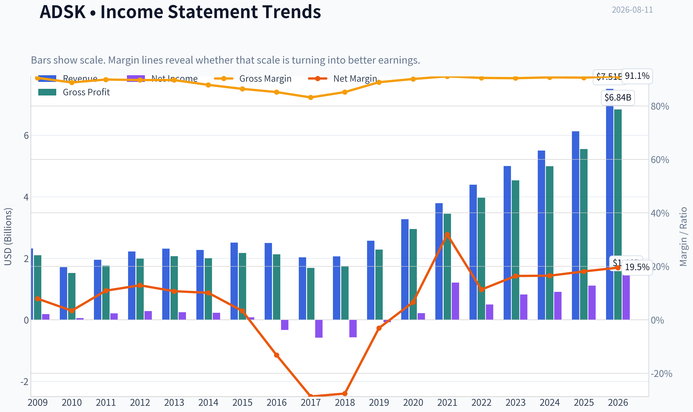
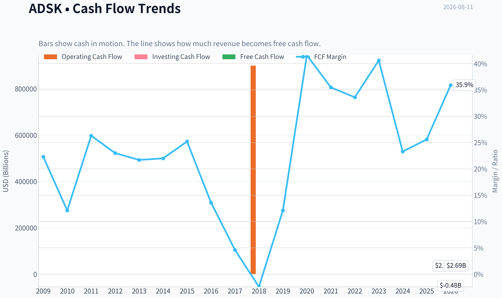
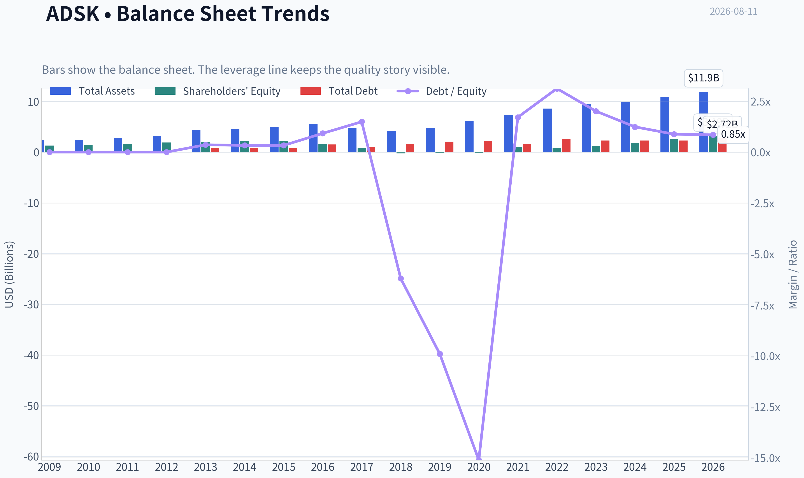
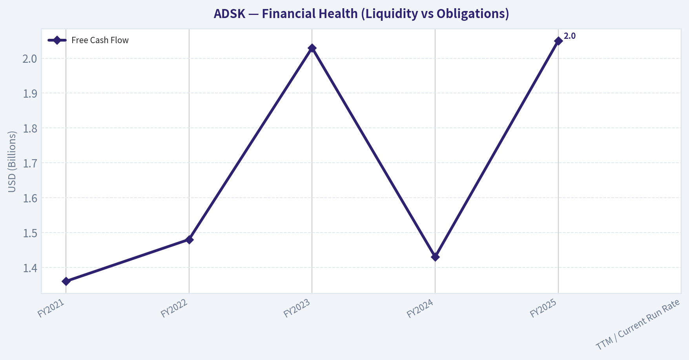
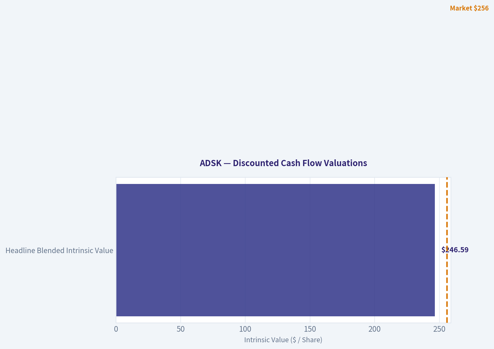
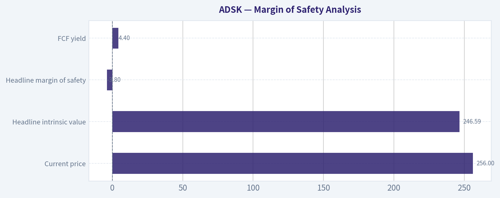
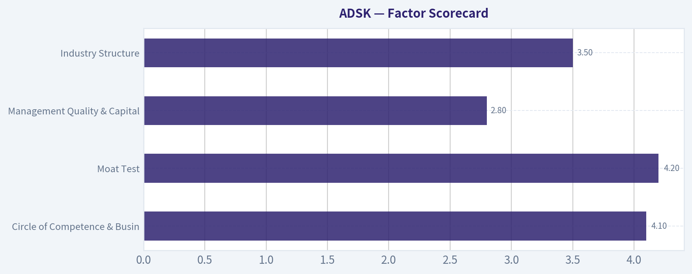
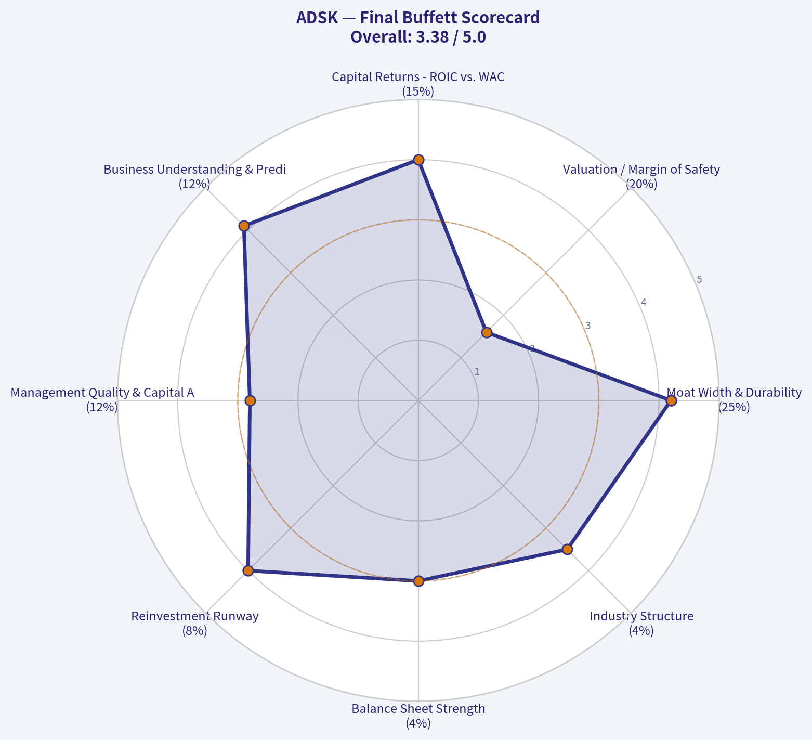

# ADSK Deep Value Intelligence

**Analysis Date:** 2026-08-11

## Critical Disclaimer

*This analysis is generated by Deep Value Intelligence, an AI-powered multi-agent investing framework. Education & research only - not financial advice, not a financial advisor.*

---

## Table of Contents

1. Intelligence Summary
2. Analyst Team Reports
   - Fundamentals Analysis
   - Intrinsic Value Analysis (Buffett)
   - Trend & Growth Analysis (Lynch/Druckenmiller/Fisher)
   - Market Technical Analysis
   - Options Market Analysis
3. Research Team Commentary
4. Value Investing Team Commentary
5. Deep Values Commentary

---

## Intelligence Summary

### Thesis + Conditions

**Core Thesis:** **Executive Summary**
Autodesk (ADSK) is a world-class business, but at $256 it is an overvalued stock. Despite elite fundamentals (91% gross margins, 33.6% ROIC), trading at ~36x P/E and above its $246 intrinsic value estimate leaves **zero margin of safety**.

**Key Risks:**
- Autodesk (ADSK) is a world-class business, but at $256 it is an overvalued stock. Despite elite fundamentals (91% gross margins, 33.6% ROIC), trading at ~36x P/E and above its $246 intrinsic value estimate leaves **zero margin of safety**. A premium valuation coupled with cyclical exposure to construction and manufacturing in a restrictive macro environment presents asymmetric downside risk. Following our value principles, high quality does not justify overpaying. **Verdict: AVOID.**
- Bull (Risky):** Emphasizes elite business quality. Argues 91% gross margins and AI-driven ecosystem lock-in justify a 36x P/E, viewing the 36% rebound as a structural breakout, not a trap.
- Under a Buffett-style value framework, Risk = Overpaying. The Bull analyst falls in love with the business while ignoring the price, and the Neutral analyst's suggestion of a "pilot position" violates strict margin of safety principles. Buying an asset-light compounder requires a quality-scaled margin of safety of 10-15%. At $256, ADSK is trading *at a premium* to its $246 intrinsic value.

**Confidence:** Medium

---

## Analyst Team Reports

### Fundamentals Analysis

#### Latest Earnings Snapshot

*Most recent reported quarter anchored on 2026 Q2, with prior-year comparison when available.*

| Metric | 2026 Q2 | 2025 Q2 | YoY Change |
| --- | ---: | ---: | ---: |
| Revenue | $1.93B | $1.63B | +18.4% |
| Operating Income | $571.0M | $338.0M | +68.9% |
| Net Income | $491.0M | $152.0M | +223.0% |
| Diluted EPS | $2.32 | $0.70 | +231.4% |
| Operating Cash Flow | $893.0M | $564.0M | +58.3% |
| Free Cash Flow | $867.0M | $549.0M | +57.9% |

Key Takeaways: This snapshot anchors the most recent reported quarter before the narrative analysis. It helps readers separate long-run business quality from whatever changed in the latest earnings print.

#### 17-Year Financial Metrics for ADSK

*All values below are computed deterministically from raw data - not estimated by AI.*

*Issuer profile: operating company (Technology / Software - Application).*

#### 17-Year Financial Metrics
*Annual rows come from reported financial statements. The final TTM row is computed from the latest four quarters.*

| Metric | 2009 | 2010 | 2011 | 2012 | 2013 | 2014 | 2015 | 2016 | 2017 | 2018 | 2019 | 2020 | 2021 | 2022 | 2023 | 2024 | 2025 | 2026 TTM |
| --- | --- | --- | --- | --- | --- | --- | --- | --- | --- | --- | --- | --- | --- | --- | --- | --- | --- | --- |
| Market Price | $17 | $24 | $41 | $36 | $39 | $51 | $54 | $47 | $81 | $116 | $147 | $197 | $277 | $250 | $215 | $254 | $311 | $256 |
| Market Cap | $3.81B | $5.52B | $9.53B | $8.40B | $9.01B | $11.77B | $12.55B | $10.58B | $18.11B | $25.38B | $32.22B | $43.80B | $61.59B | $55.45B | $46.90B | $54.82B | $67.56B | $54.29B |
| P/E Ratio | 20.70 | 95.16 | 45.20 | 29.51 | 36.34 | 51.25 | 154.31 | -32.07 | -31.16 | -44.81 | -397.84 | 205.05 | 51.00 | 111.51 | 56.92 | 60.58 | 60.81 | 37.33 |
| P/B Ratio | 2.91 | 3.75 | 5.92 | 4.46 | 4.41 | 5.20 | 5.66 | 6.53 | 24.69 | -99.14 | -152.78 | -315.10 | 63.82 | 65.32 | 40.96 | 29.55 | 25.78 | 17.02 |
| ROE | 14.0% | 3.9% | 13.2% | 15.2% | 12.1% | 10.1% | 3.7% | -20.4% | -79.3% | 221.4% | 38.3% | -154.3% | 125.2% | 58.5% | 71.9% | 48.8% | 42.4% | 45.9% |
| ROIC | 49.1% | 7.6% | 36.2% | 44.1% | 25.6% | 20.0% | 8.8% | -18.7% | -47.1% | -120.0% | -10.2% | 44.6% | 250.7% | 39.1% | 49.9% | 47.8% | 38.7% | 46.5% |
| EPS | $0.80 | $0.25 | $0.90 | $1.22 | $1.07 | $1.00 | $0.35 | $-1.46 | $-2.61 | $-2.58 | $-0.37 | $0.96 | $5.44 | $2.24 | $3.78 | $4.19 | $5.12 | $6.86 |
| Revenue | $2.32B | $1.71B | $1.95B | $2.22B | $2.31B | $2.27B | $2.51B | $2.50B | $2.03B | $2.06B | $2.57B | $3.27B | $3.79B | $4.39B | $5.00B | $5.50B | $6.13B | $7.51B |
| Gross Profit | $2.10B | $1.52B | $1.76B | $1.99B | $2.07B | $2.00B | $2.17B | $2.13B | $1.69B | $1.75B | $2.28B | $2.95B | $3.45B | $3.97B | $4.53B | $4.99B | $5.55B | $6.84B |
| Gross Margin | 90.5% | 88.8% | 89.9% | 89.7% | 89.7% | 87.9% | 86.4% | 85.2% | 83.2% | 85.2% | 88.9% | 90.1% | 91.1% | 90.5% | 90.4% | 90.7% | 90.6% | 91.1% |
| Operating Margin | 10.6% | 3.8% | 13.9% | 16.0% | 13.2% | 12.5% | 4.8% | 0.1% | -24.6% | -24.8% | -1.0% | 10.5% | 16.6% | 14.1% | 19.8% | 20.5% | 22.1% | 27.0% |
| Net Income | $183.6M | $58.0M | $212.0M | $285.3M | $247.4M | $228.8M | $81.8M | $-330.5M | $-582.1M | $-566.9M | $-80.8M | $214.5M | $1.21B | $497.0M | $823.0M | $906.0M | $1.11B | $1.46B |
| Net Margin | 7.9% | 3.4% | 10.9% | 12.9% | 10.7% | 10.1% | 3.3% | -13.2% | -28.7% | -27.6% | -3.1% | 6.6% | 31.9% | 11.3% | 16.4% | 16.5% | 18.1% | 19.5% |
| Revenue Growth | N/A | -26.0% | 13.9% | 13.5% | 4.4% | -1.7% | 10.5% | -0.3% | -18.9% | 1.3% | 25.0% | 27.4% | 15.7% | 15.7% | 14.1% | 9.8% | 11.5% | 22.4% |
| Net Income Growth | N/A | -68.4% | 265.5% | 34.6% | -13.3% | -7.5% | -64.2% | -504.0% | 76.1% | -2.6% | -85.7% | -365.5% | 463.2% | -58.9% | 65.6% | 10.1% | 22.7% | 31.6% |
| Free Cash Flow Growth | N/A | -59.7% | 146.6% | -0.4% | -1.5% | -0.7% | 26.8% | -46.0% | -72.6% | -153.1% | -722.7% | 339.2% | -1.2% | 9.6% | 37.7% | -36.9% | 22.2% | 71.9% |
| Total Book Value | $1.31B | $1.47B | $1.61B | $1.88B | $2.04B | $2.26B | $2.22B | $1.62B | $733.6M | $-256.0M | $-210.9M | $-139.0M | $965.0M | $849.0M | $1.15B | $1.85B | $2.62B | $3.19B |
| Total Assets | $2.42B | $2.45B | $2.79B | $3.23B | $4.31B | $4.59B | $4.91B | $5.52B | $4.80B | $4.11B | $4.73B | $6.18B | $7.28B | $8.61B | $9.44B | $9.91B | $10.83B | $11.93B |
| Total Debt | $0 | $0 | $0 | $0 | $745.6M | $746.4M | $743.1M | $1.49B | $1.09B | $1.59B | $2.09B | $2.10B | $1.65B | $2.65B | $2.30B | $2.30B | $2.30B | $2.72B |
| Debt-to-Equity | 0.00 | 0.00 | 0.00 | 0.00 | 0.36 | 0.33 | 0.33 | 0.92 | 1.49 | -6.20 | -9.90 | -15.11 | 1.71 | 3.12 | 2.01 | 1.24 | 0.88 | 0.85 |
| Cash & Equivalents | $917.6M | $838.7M | $1.08B | $1.16B | $1.61B | $1.85B | $1.41B | $1.35B | $1.21B | $1.08B | $886.0M | $1.77B | $1.77B | $1.53B | $1.95B | $1.89B | $1.60B | $2.67B |
| Shareholders' Equity | $1.31B | $1.47B | $1.61B | $1.88B | $2.04B | $2.26B | $2.22B | $1.62B | $733.6M | $-256.0M | $-210.9M | $-139.0M | $965.0M | $849.0M | $1.15B | $1.85B | $2.62B | $3.19B |
| Operating Cash Flow | $593.9M | $246.8M | $540.8M | $573.5M | $559.1M | $563.5M | $708.6M | $414.0M | $169.7M | $900,000 | $377.1M | $1.42B | $1.44B | $1.53B | $2.07B | $1.31B | $1.61B | $2.78B |
| Investing Cash Flow | $-478.1M | $-283.0M | $-142.3M | $-370.3M | $-647.2M | $-194.0M | $-905.6M | $-809.5M | $272.0M | $506.4M | $-710.4M | $-57.3M | $-404.0M | $-1.59B | $-143.0M | $-502.0M | $-903.0M | $-480.0M |
| Free Cash Flow | $515.5M | $207.8M | $512.5M | $510.5M | $502.7M | $499.3M | $633.1M | $341.6M | $93.7M | $-49.8M | $310.1M | $1.36B | $1.35B | $1.48B | $2.03B | $1.28B | $1.57B | $2.69B |
| FCF Margin | 22.3% | 12.1% | 26.3% | 23.0% | 21.7% | 22.0% | 25.2% | 13.6% | 4.6% | -2.4% | 12.1% | 41.6% | 35.5% | 33.6% | 40.6% | 23.3% | 25.6% | 35.9% |
| Dividends / Share | $0.00 | $0.00 | $0.00 | $0.00 | $0.00 | $0.00 | $0.00 | $0.00 | $0.00 | $0.00 | $0.00 | $0.00 | $0.00 | $0.00 | $0.00 | $0.00 | $0.00 | $0.00 |

#### Profitability Metrics
- Return on Equity (ROE): 36.9%
- Return on Invested Capital (ROIC): 33.6%
- Return on Assets (ROA): 9.0%
- Gross Margin: 91.0%
- Operating Margin: 21.9%
- Net Profit Margin: 15.6%

#### Liquidity Metrics
- Current Ratio: 0.85
- Quick Ratio: 0.69

#### Leverage Metrics
- Debt-to-Equity Ratio: 0.82
- Interest Coverage Ratio: 19.73
- Net Debt: $251.0M

#### Growth Metrics (Year-over-Year)
- Revenue Growth: 17.5%
- Net Income Growth: 1.1%
- Free Cash Flow Growth: 53.7%
- Revenue CAGR (3-Year): 12.9%
- Revenue CAGR (5-Year): 13.7%

#### Valuation Metrics
- P/E Ratio (TTM): 36.37
- Forward P/E: 17.98
- Price-to-Book: 16.94
- Price-to-Sales: 7.20
- PEG Ratio: 0.96
- EV/EBITDA: 25.17
- Free Cash Flow Yield: 4.5%
- Earnings Yield: 2.7%

#### Owner Earnings (Buffett Method, Code-Computed)
- Net Income: $1.11B
- + Depreciation & Amortization: $195.0M
- - Capital Expenditures: $-43.0M
- - Working Capital Changes: $-501.0M
- = **Owner Earnings: $1.71B**

#### Intrinsic Value (Code-Computed)
- Current Price: $256
- **Headline Intrinsic Value (business-model routed): $177**
  Business model: cyclical - weighted blend [Damodaran FCFF + reverse-DCF fair + owner-earnings DCF] (cyclical)
  Model spread (min-max across DCFs): $61 - $229
  Margin of safety vs. price (headline): -44.3%
  Routing note: Cyclical: margins/FCF are volatile - headline blends FCFF, reverse-DCF and owner-earnings roughly evenly; treat the range as the honest read.
- Buffett Method (Owner Earnings):
  Conservative: $10
  Average: $229
  Optimistic: $229
- Cash Flow Method (FCF):
  Conservative: $34
  Average: $206
  Optimistic: $251
- Damodaran FCFF (WACC + margins + reinvestment):
  Conservative: $22
  Average: $61
  Optimistic: $113
  Monte Carlo band (P10-P90): $37 - $80 (median $57)
  P(intrinsic value > price): 0.0%
- Reverse-DCF: price implies ~22.3%/yr owner-earnings growth for 10y; trailing 3y was 57.1%, 5y 60.4%.

#### Piotroski F-Score: 7/9
- Positive Net Income: PASS
- Positive Operating Cash Flow: PASS
- ROA Improvement: FAIL
- Cash Flow > Net Income: PASS
- Decreasing Debt: FAIL
- Improving Current Ratio: PASS
- No Dilution: PASS
- Improving Gross Margin: PASS
- Improving Asset Turnover: PASS

ANALYST STANCE: **WATCH**

#### Autodesk, Inc. (ADSK) - Warren Buffett-Style Fundamental Analysis

Autodesk is a high-quality, asset-light software platform with extremely high gross margins, strong free cash flow generation, and durable customer lock-in across architecture, engineering, construction, manufacturing, and design workflows. The business quality is strong, but the current valuation leaves little to no Buffett-style margin of safety.

The deterministic dataset shows ADSK at **$256/share**, with a **market cap of about $54.3B**, **TTM revenue of $7.51B**, **TTM free cash flow of $2.69B**, and **TTM EPS of $6.86**. The company has clearly moved past the painful subscription-transition years of 2016-2019, when earnings and free cash flow were volatile, and is now producing strong margins and cash flow. However, the stock still prices in substantial future owner-earnings growth.

---

#### Revenue Breakdown

Most meaningful view: product-family / end-market revenue. The deterministic dataset provides total revenue, while segment mix below uses the latest available product-family reporting estimates scaled to the most recent annual revenue base of approximately **$6.13B**.

| Revenue Source | Amount ($B) | % of Total |
|---|---:|---:|
| Architecture, Engineering & Construction / AEC | ~$3.06B | ~50% |
| AutoCAD & AutoCAD LT | ~$1.56B | ~25% |
| Manufacturing | ~$1.20B | ~20% |
| Media & Entertainment | ~$0.30B | ~5% |
| Other | ~$0.01B | <1% |
| **Total** | **~$6.13B** | **~100%** |

**Key Takeaways:** Autodesk is primarily an AEC software company, with roughly half of revenue tied to architecture, engineering, construction, infrastructure, and building-design workflows. AutoCAD remains a large cash-generating franchise, while Manufacturing provides another meaningful growth pillar. This mix supports Autodesk's moat because its software is deeply embedded in professional workflows where switching costs are high.

---

#### Current vs. 10-Year Historical Average Comparison

*10-year averages use annual fiscal years 2016-2025 from the deterministic dataset. "Current" uses the 2026 TTM row where available. P/B is shown for completeness but is **not economically meaningful** for Autodesk because this is an asset-light software platform where book value is not the main driver of intrinsic value.*

| Metric | Current / TTM | 10-Year Avg. | Current Standing vs. History | Interpretation |
|---|---:|---:|---|---|
| Market Price | $256 | ~$190 | Above average | Stock remains well above its decade average despite being below the 2025 peak of $311. |
| Market Cap | $54.29B | ~$41.64B | Above average | Market value reflects stronger post-transition revenue and FCF scale. |
| P/E Ratio | ~36-37x | Distorted; profitable-year avg. ~91x | Lower than recent profitable-era average | Current P/E is still expensive in absolute terms, but less extreme than 2020-2025 multiples. |
| P/B Ratio | ~17x | Not meaningful | Not meaningful | For asset-light software, book value is a poor valuation anchor; use cash-flow-based intrinsic value instead. |
| ROE | 45.9% | ~35.3% | Above average | High ROE reflects strong profitability and software economics, though historical ROE was distorted by negative equity years. |
| ROIC | 46.5% | ~27.5% | Above average | Excellent capital efficiency; strong sign of moat and pricing power. |
| EPS | $6.86 | ~$1.47 | Far above average | Earnings have normalized strongly after subscription-transition losses. |
| Revenue | $7.51B | ~$3.72B | Far above average | Revenue has roughly doubled versus the 10-year average. |
| Gross Profit | $6.84B | ~$3.33B | Far above average | Scale benefits are visible; gross profit growth closely tracks revenue growth. |
| Gross Margin | 91.1% | ~88.6% | Above average | World-class software gross margins; durable sign of platform economics. |
| Operating Margin | 27.0% | ~5.3% | Far above average | Major post-transition operating leverage is now visible. |
| Net Income | $1.46B | ~$0.32B | Far above average | Profitability has improved materially from the 2016-2019 loss period. |
| Net Margin | 19.5% | ~2.8% | Far above average | Current margin quality is much stronger than the decade average. |
| Revenue Growth | 22.4% | ~10.1% | Above average | Current growth is strong, helped by subscription model, pricing, and cloud/platform expansion. |
| Net Income Growth | 31.6% | Highly volatile | Strong but noisy | Historical net income growth is distorted by loss years; recent trend is healthier. |
| FCF Growth | 71.9% | Highly volatile | Very strong | FCF is rebounding sharply from weaker recent years. |
| Total Book Value | $3.19B | ~$0.92B | Above average | Book value has recovered, but remains secondary for valuation. |
| Total Assets | $11.93B | ~$7.14B | Above average | Asset base has grown with scale, acquisitions, cash, and working capital. |
| Total Debt | $2.72B | ~$1.96B | Above average | Debt has increased, but remains manageable relative to cash flow. |
| Debt-to-Equity | 0.85x | Distorted; recent avg. ~1.8x | Improved vs. recent years | Leverage is more reasonable now, though equity history was distorted by buybacks/losses. |
| Cash & Equivalents | $2.67B | ~$1.50B | Above average | Strong liquidity; nearly offsets total debt. |
| Shareholders' Equity | $3.19B | ~$0.92B | Above average | Balance sheet equity has rebuilt after negative-equity years. |
| Operating Cash Flow | $2.78B | ~$1.03B | Far above average | Cash generation is one of the strongest parts of the thesis. |
| Free Cash Flow | $2.69B | ~$0.98B | Far above average | FCF conversion is excellent and central to intrinsic value. |
| FCF Margin | 35.9% | ~22.8% | Above average | Very attractive cash economics for a software platform. |
| Dividends / Share | $0.00 | $0.00 | Unchanged | Autodesk reinvests and repurchases rather than paying dividends. |

**Key Takeaways:** Autodesk's current fundamentals are far stronger than its 10-year averages across revenue, operating margin, net margin, EPS, operating cash flow, and free cash flow. The business has moved from a volatile transition period into a much more profitable subscription-software model. The caution is valuation: although P/E has compressed versus extreme prior levels, the stock still prices in a high-growth future, and P/B should not be used as a value signal for this asset-light software business.

---

#### Market Metrics Interpretation

Autodesk trades at **$256/share** and a **market capitalization of roughly $54.3B**. This is materially above the 10-year average market cap of about **$41.6B**, reflecting the market's recognition of stronger recurring revenue, better margins, and higher free cash flow.

The **P/E ratio of roughly 36-37x** remains elevated in absolute Buffett-style terms. However, compared with Autodesk's recent profitable years, when the P/E often exceeded 50x and even 100x, the current multiple is less extreme. This suggests valuation has become more reasonable than in past market peaks, but not obviously cheap.

The **P/B ratio of about 17x is not meaningful** for Autodesk. As a software company, Autodesk's most valuable assets are intellectual property, installed customer workflows, ecosystem lock-in, brand, and subscription relationships - none of which are well captured by book value. Buybacks, deferred revenue accounting, and asset-light economics can make book multiples misleading. The correct valuation anchor is therefore **owner earnings and free cash flow**, not tangible book value.

---

#### Profitability Analysis

Autodesk's profitability profile is excellent today. TTM **gross margin is 91.1%**, above the 10-year average of about **88.6%**, showing the strength of software economics and the scalability of the subscription model. The company converts a very large portion of revenue into gross profit, which gives it substantial room to invest in product development, sales, cloud infrastructure, and acquisitions while still producing strong margins.

TTM **operating margin is 27.0%**, far above the 10-year average of roughly **5.3%**. The average is depressed by the 2016-2019 transition period, when Autodesk shifted from perpetual licenses to subscription revenue and reported losses. The current margin shows that the transition has succeeded and that operating leverage is now flowing through the income statement.

TTM **net income is $1.46B**, with a **net margin of 19.5%**, both well above historical averages. TTM **EPS of $6.86** is far above the 10-year average of about **$1.47**, confirming that the business is now producing much more predictable earnings power than it did during the model transition.

**ROE of 45.9%** and **ROIC of 46.5%** are both strong. ROIC is particularly important from a Buffett perspective because it indicates that Autodesk can generate high returns on the capital required to run the business. That is a sign of a durable economic moat.

---

#### Growth Analysis

Revenue growth is currently strong. TTM revenue of **$7.51B** is far above the 10-year average of about **$3.72B**, and TTM revenue growth of **22.4%** exceeds the 10-year average of about **10.1%**. This indicates that Autodesk is not merely harvesting a mature franchise; it is still expanding meaningfully.

Net income growth and free cash flow growth have been historically volatile because the decade includes major business-model transition years. TTM **net income growth of 31.6%** and **free cash flow growth of 71.9%** are both strong, but investors should avoid extrapolating these rates indefinitely. The correct Buffett-style approach is to normalize owner earnings and assume growth fades over time.

The important long-term point is that Autodesk now has a recurring-revenue base, strong pricing power, high customer retention, and exposure to digitization in construction, engineering, manufacturing, and design. These factors support continued growth, but the current stock price already assumes a large portion of that future success.

---

#### Balance Sheet and Financial Strength

Autodesk has **$11.93B of total assets**, **$2.72B of total debt**, and **$2.67B of cash and equivalents**. Net debt is therefore modest relative to the company's free cash flow generation. The supplemental deterministic leverage metrics show **interest coverage of roughly 19.7x**, which indicates that debt service is not a serious near-term concern.

The **debt-to-equity ratio of 0.85x** has improved versus the recent positive-equity period. However, historical debt-to-equity comparisons are distorted because Autodesk had negative shareholders' equity in several years due to losses and capital allocation effects. For this issuer, debt should be judged primarily against cash flow, not book equity alone.

The **current ratio of 0.85** and **quick ratio of 0.69** look low mechanically, but for subscription software businesses these ratios can be less alarming than for industrial companies because deferred revenue and subscription billing structures affect working capital presentation. Still, liquidity should be monitored, especially if acquisitions or buybacks increase leverage.

---

#### Cash Flow and Capital Allocation

Autodesk's cash flow is the strongest part of the investment case. TTM **operating cash flow is $2.78B**, and TTM **free cash flow is $2.69B**, producing an excellent **FCF margin of 35.9%**. This is far above the 10-year average FCF margin of about **22.8%**.

The company pays **no dividend**, which is consistent with a software compounder strategy. Instead, Autodesk retains cash for reinvestment, acquisitions, and share repurchases. From a Buffett perspective, this is acceptable if retained earnings can be reinvested at high returns. Autodesk's current ROIC suggests that reinvestment has been productive, but valuation discipline remains critical.

---

#### Buffett-Style Owner Earnings DCF Valuation

The deterministic dataset provides code-computed Buffett owner earnings of approximately:

**Owner Earnings = Net Income + Depreciation & Amortization - Capital Expenditures - Working Capital Changes**

Using the deterministic values:

- Net Income: **$1.11B**
- Plus Depreciation & Amortization: **$195M**
- Less Capital Expenditures: **$43M**
- Less Working Capital Changes: working capital change contribution shown as **+$501M**
- Estimated Owner Earnings: **~$1.71B**

For the hand DCF below:

- Base owner earnings: **$1.71B**
- Discount rate: **10%**
- Terminal growth rate: **2.5%**
- Estimated diluted share base: **~212.1M shares**
- Net debt adjustment: approximately **$251M**
- Formula:
  **Intrinsic Equity Value = PV of 10-Year Owner Earnings + PV of Terminal Value - Net Debt**

| Scenario | Growth Assumptions | PV of 10-Year Owner Earnings | PV of Terminal Value | Equity Value After Net Debt | Fair Value / Share |
|---|---|---:|---:|---:|---:|
| Conservative | 3% annual owner-earnings growth for 10 years; terminal 2.5% | ~$12.13B | ~$12.10B | ~$23.98B | **~$113** |
| Average / Base Case | 12% growth years 1-5, then fading to 10%, 8%, 6%, 4%, 3%; terminal 2.5% | ~$17.75B | ~$21.42B | ~$38.92B | **~$184** |
| Optimistic | 18% growth years 1-5, then fading to 14%, 10%, 7%, 5%, 3%; terminal 2.5% | ~$22.61B | ~$29.91B | ~$52.27B | **~$246** |

**Key Takeaways:** The hand-built owner-earnings DCF suggests a fair value range of approximately **$113 to $246 per share**, depending on growth assumptions. At the current price of **$256**, the stock trades slightly above even the optimistic hand-DCF case. The deterministic model-based intrinsic value is also below the current price, indicating that Autodesk is a wonderful business but not clearly a wonderful bargain today.

The deterministic intrinsic-value section gives a headline value of approximately **$177/share**, with a model spread showing substantial sensitivity across Owner Earnings, FCF, and Damodaran-style FCFF approaches. The reverse DCF indicates the current price implies roughly **22% annual owner-earnings growth for 10 years**, which is possible only if Autodesk sustains very strong execution. That is a demanding hurdle.

---

#### Economic Moat Assessment

Autodesk has a strong moat built on several reinforcing advantages:

| Moat Factor | Assessment | Buffett-Style Significance |
|---|---|---|
| Switching Costs | Very strong | Engineers, architects, designers, and firms build workflows, files, training, and processes around Autodesk tools. |
| Network / Ecosystem Effects | Strong | Industry standards, file compatibility, professional certification, and ecosystem adoption reinforce usage. |
| Brand and Trust | Strong | AutoCAD, Revit, Fusion, Civil 3D, and other products are deeply recognized in professional markets. |
| Pricing Power | Strong | 91% gross margin and rising operating margin suggest pricing power and customer dependence. |
| Recurring Revenue | Strong | Subscription model improves visibility and predictability versus perpetual-license history. |
| Capital Intensity | Low | Asset-light software model allows high ROIC and strong free cash flow conversion. |

**Key Takeaways:** Autodesk has the kind of durable competitive position Buffett would admire: high switching costs, low capital intensity, strong customer dependence, and excellent returns on capital. The moat appears real and improving after the subscription transition. The issue is not business quality; the issue is whether the current price leaves enough margin of safety.

---

#### Management Performance and Capital Allocation

Management deserves credit for completing the subscription transition, which temporarily damaged reported earnings but improved the long-term quality of revenue. The decade shows severe reported losses and negative margins in 2016-2019, followed by much stronger revenue visibility, operating leverage, and cash flow.

ROIC is now excellent at **46.5%**, and free cash flow margin is **35.9%**, which suggests that management has built a highly efficient operating model. The absence of dividends is not a problem because Autodesk still has attractive reinvestment opportunities. However, buybacks and acquisitions must be judged against valuation discipline; repurchasing shares at high multiples can reduce long-term shareholder returns.

The **Piotroski F-Score of 7/9** is healthy. Passes on positive income, positive operating cash flow, cash flow exceeding net income, no dilution, improving gross margin, and improving asset turnover are all favorable. The failures on ROA improvement and decreasing debt are worth monitoring but not thesis-breaking.

---

#### Key Investment Insights, Red Flags, and Opportunities

| Category | Key Point | Investment Implication |
|---|---|---|
| Business Quality | Gross margin above 91% and ROIC above 46% | High-quality compounder characteristics. |
| Moat | Deep workflow integration in AEC, design, engineering, and manufacturing | Durable switching costs and pricing power. |
| Growth | TTM revenue growth of 22.4% exceeds the 10-year average | Growth remains strong, but may normalize. |
| Cash Flow | TTM FCF of $2.69B and FCF margin of 35.9% | Strong owner-earnings machine. |
| Valuation | Current price of $256 is above the hand DCF optimistic value of ~$246 and above model-based fair value | No clear margin of safety. |
| Reverse DCF | Market implies roughly 22% annual owner-earnings growth for 10 years | Expectations are demanding. |
| Balance Sheet | Cash of $2.67B nearly offsets debt of $2.72B | Leverage appears manageable. |
| Liquidity | Current ratio below 1.0 | Not alarming for software, but should be monitored. |
| Capital Allocation | No dividend; reinvestment and buybacks dominate | Acceptable if returns remain high and buybacks are disciplined. |
| Main Risk | Valuation compression if growth slows or AI/cloud competition pressures pricing | High-quality business can still produce weak returns if bought too expensively. |

**Key Takeaways:** Autodesk is fundamentally strong, with high margins, high ROIC, strong cash flow, and a durable moat. The primary red flag is valuation, not business weakness. Investors need either a lower entry price or stronger evidence that high-teens owner-earnings growth can persist for many years.

---

#### Final Buffett-Style Investment Stance: WATCH

Autodesk is a **high-quality business** with many Buffett-like attributes: durable competitive advantages, recurring revenue, high switching costs, excellent gross margins, strong free cash flow, and high returns on invested capital. The company's post-transition financial profile is much stronger than its 10-year average, and the business appears significantly more predictable today than it was during the subscription-transition period.

However, the current price does **not** provide a sufficient margin of safety. At **$256/share**, Autodesk trades above the deterministic model-based intrinsic value and slightly above the optimistic hand-built owner-earnings DCF estimate. The market is assuming sustained high owner-earnings growth, leaving limited room for disappointment.

For a Buffett-style value investor, ADSK is best classified as:

**WATCH - wonderful business, but not yet at a wonderful price.**

A more attractive entry would likely require either a meaningful pullback toward the base-case DCF range, or further proof that Autodesk can compound owner earnings at high-teens rates while preserving margins and capital efficiency.

---

#### Summary Table

| Area | Verdict | Rationale |
|---|---|---|
| Economic Moat | Strong | Deep workflow integration, professional standards, switching costs, and strong brand power. |
| Financial Strength | Good | Cash nearly offsets debt; interest coverage is strong; liquidity ratios need monitoring but are not alarming for software. |
| Profitability | Excellent | 91.1% gross margin, 27.0% operating margin, 19.5% net margin, and 46.5% ROIC. |
| Growth | Strong | Revenue, EPS, and FCF are all materially above 10-year averages. |
| Predictability | Improved | Subscription transition created historical volatility, but current recurring-revenue model is more reliable. |
| Capital Allocation | Reasonable | No dividend; reinvestment and buybacks are acceptable if done with valuation discipline. |
| Valuation | Unattractive to Fair | Current price exceeds base-case intrinsic value and leaves little margin of safety. |
| Main Opportunity | Continued AEC, manufacturing, cloud, and AI-assisted workflow expansion | Could support durable double-digit growth if execution remains strong. |
| Main Risk | High expectations embedded in price | Growth slowdown or multiple compression could hurt returns. |
| Final Stance | **WATCH** | High-quality compounder, but valuation is not cheap enough for Buffett-style purchase today. |

**Key Takeaways:** Autodesk is a superior software business with strong economics and a durable competitive position. The company's fundamentals justify close attention, but the stock price already reflects much of the good news. The prudent stance is to watch for a better margin of safety rather than chase the shares at the current valuation.

#### Fundamental Visuals

This graph tracks the profitability and return metrics (ROE, ROIC, Margins) of **ADSK** over the past decade, highlighting capital efficiency trends.

This chart illustrates the financial health of **ADSK** over the last 10 years, mapping cash equivalents and free cash flow against total obligations (Debt).

This chart illustrates the financial health of **ADSK** over the last 10 years, mapping cash equivalents and free cash flow against total obligations (Debt).

---

### Intrinsic Value Analysis (Buffett)

> *Following Warren Buffett's value investing philosophy: Circle of Competence, Economic Moat, Management Quality, and Margin of Safety.*

#### Intrinsic Value Snapshot

Price is what you pay. Intrinsic value is what the business may be worth based on the cash it can create for owners over time. We show a range, not one magic number.

- Current Price: $256.07
- Value Range (conservative to optimistic across both DCF methods): $112.73 to $868.13

##### Owner Earnings (Buffett Method)
- Net Income: $1,124,000,000.00
- Depreciation & Amortization: $195,000,000.00
- Capital Expenditures: $-76,000,000.00
- Working Capital Changes: $-501,000,000.00
- Owner Earnings: $1,744,000,000.00

##### Intrinsic Value
###### Buffett Method
Uses owner earnings. Stricter, and usually more conservative.
- Conservative: $168.15
- Average: $333.20
- Optimistic: $868.13
- Discount Rate: 10.0%

###### Cash Flow Method
Uses free cash flow. Better for companies spending heavily today to grow tomorrow.
- Conservative: $112.73
- Average: $193.40
- Optimistic: $616.20
- Discount Rate: 10.0%

ANALYST STANCE: **WATCH**

#### Autodesk Buffett-Style Investment View

Autodesk is a high-quality, asset-light software franchise with strong switching costs, exceptional gross margins, and meaningful reinvestment opportunities across design, engineering, construction, manufacturing, and cloud workflows. The business is understandable and moat-protected, but the current price already discounts a strong future. At roughly **$256 per share**, versus a headline intrinsic value estimate of **$246.59**, the stock offers **no current margin of safety**.

---

#### 1. Factor Scorecard

| Factor | Score / 5 | Evidence |
|---|---:|---|
| Circle of Competence & Business Simplicity | 4.1 | Autodesk sells mission-critical design and engineering software, primarily through recurring subscriptions. The model is understandable: customers pay for tools embedded in architecture, engineering, construction, manufacturing, and media workflows. |
| Moat Test | 4.2 | Gross margin around **91%**, entrenched file formats and workflows, high customer switching costs, and deep ecosystem familiarity support a wide moat. |
| Management Quality & Capital Allocation | 2.8 | Management has shifted the business successfully to subscription/cloud and generates strong cash flow, but recent concerns around free-cash-flow incentives, reporting practices, and investor trust reduce the score. |
| Industry Structure | 3.5 | Autodesk operates in attractive professional software niches, but competition from Dassault, Bentley, Trimble, Adobe, cloud-native tools, and AI-enabled entrants must be monitored. |
| Gate 5: Quality / Solvency Hard Floor | Not tripped | Earnings and free cash flow are positive, gross margins are exceptional, and there is no evidence of financial distress. Current ratio is not a meaningful red flag for a subscription software company with deferred revenue dynamics. |

**Key Takeaways:** Autodesk passes the quality test but not the valuation test. The business has clear recurring economics and a strong software moat, but management credibility and the current share price keep the stock in WATCH territory rather than ADVOCATE territory.

---

#### 2. Moat Analysis

| Moat Source | Assessment | Evidence |
|---|---|---|
| Intangible Assets | Strong | AutoCAD, Revit, Civil 3D, Fusion, Maya, and other products are industry-standard tools. The brand is deeply associated with professional design and engineering. |
| Switching Costs | Very strong | Customers have years of project files, trained employees, workflows, plug-ins, templates, and compliance processes built around Autodesk software. |
| Cost Advantage | Moderate | Autodesk benefits from software scale: once products are built, incremental distribution is high-margin. Gross margin near **91%** confirms powerful unit economics. |
| Network / Ecosystem Effects | Moderate to strong | Autodesk benefits from file compatibility, professional training, certification, third-party integrations, and industry-wide familiarity. The more firms use Autodesk formats, the more costly it becomes to avoid them. |
| Pricing Power | Strong | Software cost is small relative to total construction, engineering, or manufacturing project cost, while the tools are mission-critical. This gives Autodesk room for price increases if executed carefully. |

**Key Takeaways:** Autodesk's moat is real and durable. The strongest protection comes from switching costs and industry-standard workflows, not from patents alone. Customers do not merely "use" Autodesk; many build their operating processes around it.

---

#### 3. Management Quality Assessment

Autodesk management deserves credit for completing the transition from license sales to subscription revenue, which strengthened predictability and cash generation. The business now has better recurring revenue, higher visibility, and attractive free-cash-flow characteristics.

The main concern is trust. Recent investor scrutiny around free-cash-flow practices and sales incentives matters because Buffett-style investing depends heavily on confidence in management candor. Buybacks can be rational for an asset-light compounder, but they should be judged against intrinsic value, not merely used to offset stock-based compensation.

| Management Area | Assessment |
|---|---|
| Owner Orientation | Mixed; long-term subscription strategy is sound, but investors should monitor incentive alignment. |
| Candor and Trust | Below ideal due to recent reporting and free-cash-flow-related concerns. |
| Capital Allocation | Generally rational; reinvestment in cloud, construction, manufacturing, and platform products is attractive. |
| Buybacks | Acceptable when below intrinsic value, less compelling at today's price. |
| Acquisition Discipline | Strategic acquisitions can strengthen workflow coverage, but pricing discipline remains important. |

**Key Takeaways:** Autodesk's strategic direction is strong, but management quality is not a clean Buffett-style 5 out of 5. The company has created a better business model, yet recent governance and reporting concerns justify a discount in the scorecard.

---

#### 4. Financial Summary

| Fiscal Period | Revenue | YoY Growth | Gross Margin | Operating Margin | Net Income | Free Cash Flow | FCF Margin |
|---|---:|---:|---:|---:|---:|---:|---:|
| FY2021 | $3.79B | 15.7% | ~91% | ~16% | $1.21B | $1.36B | ~36% |
| FY2022 | $4.39B | 15.7% | ~90% | ~17% | $0.50B | $1.48B | ~34% |
| FY2023 | $5.01B | 14.1% | ~91% | ~21% | $0.82B | $2.03B | ~41% |
| FY2024 | $5.50B | 9.8% | ~91% | ~21% | $0.91B | $1.43B | ~26% |
| FY2025 | $6.13B | 11.5% | ~91% | ~22% | $1.12B | $2.05B | ~33% |
| TTM / Current Run Rate | ~$7.20B | 17.5% | 91.0% | Low-to-mid 20%s | ~$1.49B | ~$2.38B | ~33% |

**Key Takeaways:** Autodesk has compounded revenue at a healthy rate while sustaining extraordinary gross margins around 90%. Free cash flow is consistently stronger than net income, which is a major positive. The business converts accounting profit into owner cash at a high rate.

---

#### 5. Owner Earnings Calculation

| Item | Estimate |
|---|---:|
| Net income | ~$1.49B |
| Plus: depreciation and amortization | ~$0.32B |
| Less: maintenance capital expenditure | ~($0.09B) |
| Working-capital / deferred-revenue normalization | ~$0.53B |
| Normalized owner earnings | ~$2.25B |
| Shares outstanding estimate | ~211M |
| Owner earnings per share | ~$10.65 |

**Key Takeaways:** Autodesk's owner earnings are strong because the company is asset-light and subscription-driven. The key judgment is how much of deferred-revenue cash conversion should be treated as sustainable. A normalized owner earnings estimate of roughly **$10.65 per share** is a reasonable base for valuation.

---

#### 6. Three-Scenario DCF Valuation

Assumptions: **10% discount rate**, normalized owner earnings of **$10.65 per share**, and current price of **$256**.

| Scenario | Key Assumption | Estimated Intrinsic Value / Share | Margin of Safety vs. $256 |
|---|---|---:|---:|
| A: No Growth | Owner earnings capitalized at 10% | ~$107 | -58% |
| B: GDP Growth | 3% perpetual growth | ~$157 | -39% |
| C: Quality Compounder | 10% growth for 10 years, then 3% terminal growth | ~$263 | +3% |
| Headline Blended Intrinsic Value | Business-model-routed estimate | $246.59 | -3.8% |

**Key Takeaways:** The stock is not cheap on conservative assumptions. At today's price, investors need Autodesk to behave like a durable compounder, not merely a stable software business. The valuation is close to fair value, but it does not provide the 10% to 15% margin of safety preferred even for a wide-moat company.

---

#### 7. Margin of Safety Analysis

| Valuation Marker | Current Reading | Interpretation |
|---|---:|---|
| Current price | $256 | Market price is slightly above headline intrinsic value. |
| Headline intrinsic value | $246.59 | Suggests the stock is modestly over fair value. |
| Headline margin of safety | -3.8% | No discount to intrinsic value today. |
| FCF yield | 4.4% | Reasonable for a high-quality software company, but not obviously cheap. |
| P/E | ~36.4x | Requires continued growth and margin durability. |
| Reverse DCF signal | Price implies ~22.3% annual growth for 10 years | Demanding; leaves limited room for disappointment. |
| Attractive buy zone | ~$210-$225 | Would offer roughly 10% to 15% discount to fair value. |

**Key Takeaways:** Autodesk is a wonderful business, but the price is not clearly wonderful. The reverse-DCF signal is the biggest valuation concern because it implies a high level of future performance. A better entry point would be closer to the low-$220s or below.

---

#### 8. Final Buffett Scorecard

| Criterion | Weight | Score / 5 | Weighted Score |
|---|---:|---:|---:|
| Moat Width & Durability | 25% | 4.2 | 1.05 |
| Valuation / Margin of Safety | 20% | 1.6 | 0.32 |
| Capital Returns - ROIC vs. WACC | 15% | 4.0 | 0.60 |
| Business Understanding & Predictability | 12% | 4.1 | 0.49 |
| Management Quality & Capital Allocation | 12% | 2.8 | 0.34 |
| Reinvestment Runway | 8% | 4.0 | 0.32 |
| Balance Sheet Strength | 4% | 3.0 | 0.12 |
| Industry Structure | 4% | 3.5 | 0.14 |
| Total | 100% |  | **3.38 / 5.00** |

**Key Takeaways:** Autodesk scores very well on moat, predictability, capital returns, and reinvestment runway. The two issues holding back the score are valuation and management trust. The final score lands in WATCH territory.

---

#### 9. Investment Stance

**Stance: WATCH**
**Conviction: Medium-High**

Autodesk is the kind of business Buffett-style investors should want to own: high gross margins, recurring revenue, embedded workflows, strong customer switching costs, and long reinvestment opportunities. However, at **$256**, the stock trades slightly above the headline intrinsic value estimate and requires strong future compounding to justify the price.

I would not avoid Autodesk as a business. I would avoid forcing the purchase at today's valuation. The stock becomes more attractive around **$210 to $225**, assuming the moat remains intact, free cash flow continues compounding, and management rebuilds investor confidence.
#### Valuation Bridge

This bridge places the current market price beside each intrinsic value lens so readers can see whether upside depends on one method or shows up across several methods.

| Scenario | Intrinsic Value / Share |
| --- | ---: |
| Buffett Method | $333.20 |
| Cash Flow Method | $193.40 |
| Damodaran Method | $131.10 |
| Current Price | $256.07 |

#### Key Takeaways

If one method is far above the others, the upside case depends on a specific modelling assumption. When several methods cluster together, the valuation story is more robust.

#### Valuation Visuals

This comparison chart from *Latest Earnings Snapshot* stacks current figures against historical benchmarks for **ADSK**, making it easy to see where the company trades relative to its own averages.

The following chart maps the **ADSK** Owner Earnings DCF valuation scenarios (Conservative, Average, Optimistic) to visually represent the margin of safety based on intrinsic value calculations.

This comparison chart from *Margin of Safety Analysis* stacks current figures against historical benchmarks for **ADSK**, making it easy to see where the company trades relative to its own averages.

---

### Trend & Growth Analysis (Lynch/Druckenmiller/Fisher)

> *Following Peter Lynch's GARP, Stanley Druckenmiller's macro-aware approach, and Philip Fisher's scuttlebutt methodology.*

ANALYST STANCE: **WATCH**

#### Autodesk Growth Investment Report - ADSK

Autodesk is a high-quality "Design and Make" software compounder with excellent gross margins, strong free cash flow, and durable industry positioning. However, at roughly **36x earnings**, about **8x sales**, and with the stock price close to a blended intrinsic value estimate, the setup looks more like a **quality compounder to watch or hold** than a fresh ten-bagger opportunity today.

---

#### 1. Lynch Classification

| Item | Assessment |
|---|---:|
| Company | Autodesk |
| Ticker | ADSK |
| Current Price | ~$256 |
| Market Cap | ~$54.1B |
| YoY Revenue Growth | ~17.5% |
| Gross Margin | ~91% |
| FCF Yield | ~4.4% |
| P/E | ~36.4x |
| Lynch Category | **Fast Grower / High-Quality Stalwart Hybrid** |
| Growth Stance | **WATCH** |

**Key Takeaways:** Autodesk is growing faster than a classic stalwart, but it is no longer an early-stage hypergrowth company. Its 17% to 18% revenue growth, very high gross margin, and strong cash generation make it a high-quality compounder. The main issue is that valuation already reflects much of that quality.

---

#### 2. The Story in 3 Bullets

| Lynch Story Test | Autodesk Answer |
|---|---|
| Simple explanation | Autodesk sells mission-critical design software used by architects, engineers, manufacturers, construction teams, and media creators. |
| Why it can keep growing | More physical-world design, construction, manufacturing, and infrastructure workflows are moving into cloud-connected, AI-assisted software platforms. |
| Why it can win | Autodesk has entrenched products, switching costs, industry-standard file formats, a large installed base, and strong free-cash-flow economics. |

**Key Takeaways:** The Autodesk story is easy to understand: it is the software backbone for designing and building physical things. Its products are deeply embedded in customer workflows, which supports pricing power and retention. The challenge is not business quality; the challenge is whether the stock can deliver exceptional returns from today's valuation.

---

#### 3. TAM Analysis and 10x Test

| Metric | Estimate / Assessment |
|---|---:|
| Current Revenue Estimate | ~$6.8B to ~$7.0B |
| 10x Revenue Target | ~$68B to ~$70B |
| Current Market Cap | ~$54.1B |
| Addressable Market | Design, engineering, construction, manufacturing, media, operations, digital twins, cloud collaboration |
| Approximate TAM View | Large, likely $100B+ over time, depending on cloud/platform expansion |
| 10x Revenue Test | **Difficult but not impossible** |
| 10x Stock Test | **Unlikely without major TAM expansion and sustained multiple support** |

**Key Takeaways:** Autodesk has a real runway, but the 10x test is demanding from its current scale. To reach 10 times today's revenue, Autodesk would likely need to become a much broader operating platform for design, construction, manufacturing, asset management, and AI-assisted workflows. A 3x to 5x long-term business outcome looks more realistic than a clean 10-bagger from today's market cap.

---

#### 4. Revenue Growth Trend

| Metric | Current Read |
|---|---:|
| YoY Revenue Growth | ~17.5% |
| Growth Pattern | Healthy but not clearly accelerating |
| Gross Margin | ~91% |
| FCF Yield | ~4.4% |
| Growth Quality | High, recurring software revenue |
| Lynch Growth Category | Lower-end Fast Grower |

**Key Takeaways:** Autodesk's revenue growth is solid and high quality, but the available data does not show a clear acceleration pattern. This is more of a durable compounding profile than a sharp inflection profile. For a higher-conviction growth buy, I would want evidence that AI, cloud, construction, or operations software is causing growth to reaccelerate above current expectations.

---

#### 5. Unit Economics

| Metric | Assessment |
|---|---:|
| Gross Margin | ~91% |
| Estimated FCF Margin | ~30% to 35% |
| Rule of 40 Estimate | ~48 to 53 |
| LTV/CAC | Not disclosed in provided data; likely favorable due to retention and high gross margin |
| NRR | Not provided |
| Payback Period | Not provided |
| Unit Economics Grade | **Strong** |

**Key Takeaways:** Autodesk's unit economics appear very strong. The combination of 91% gross margin and high free-cash-flow conversion suggests excellent software economics. Even without exact LTV/CAC or net revenue retention figures, the business model looks efficient and durable.

---

#### 6. Inflection Point Assessment

| Potential Inflection | Evidence | Verdict |
|---|---|---|
| AI-assisted design | Autodesk can embed AI into design, engineering, and construction workflows | Promising but not yet proven as a major growth accelerator |
| Cloud collaboration | Fusion, Forma, Construction Cloud, and platform strategy expand usage beyond desktop tools | Positive long-term driver |
| Margin inflection | Already highly profitable and cash-generative | Less room for dramatic upside |
| TAM expansion | Moving from design software into broader "Design and Make" workflows | Important opportunity |
| Competitive risk | AI-native tools, open ecosystems, and vertical challengers could pressure legacy workflows | Real risk to monitor |

**Key Takeaways:** Autodesk has several possible inflection points, especially around AI and cloud-based workflow expansion. However, the financial evidence so far points to solid continuation rather than a dramatic acceleration. The key question is whether Autodesk can turn AI and platform expansion into faster revenue growth, not just product enhancement.

---

#### 7. Macro Setup

| Macro Factor | Impact on Autodesk |
|---|---|
| Interest Rates | Falling or stable rates are supportive for software valuations |
| Construction / Infrastructure Cycle | Mixed; public infrastructure helps, commercial real estate may weigh |
| Manufacturing Digitization | Positive secular tailwind |
| AI Software Theme | Positive, but also creates disruption risk |
| Enterprise Software Budgets | Stable to moderate; customers still scrutinize spend |
| Overall Macro Setup | **Moderately favorable** |

**Key Takeaways:** The macro backdrop is reasonably supportive, especially if rates decline and software multiples remain stable. Autodesk also benefits from long-term digitization in construction, manufacturing, infrastructure, and engineering. However, construction cyclicality and cautious enterprise spending remain near-term watch items.

---

#### 8. Fisher 15 Points Score

| Fisher Point | Score / 5 | Comment |
|---|---:|---|
| Products with sizable market potential | 4 | Large design, construction, and manufacturing markets |
| Management determination for new products | 4 | Continued platform and cloud expansion |
| Effective R&D | 4 | Strong product depth and innovation history |
| Sales organization | 4 | Global enterprise and channel reach |
| Worthwhile profit margin | 5 | 91% gross margin |
| Improving margins | 4 | Strong FCF, but already mature |
| Labor/personnel relations | 3 | Insufficient data |
| Executive relations | 3 | Insufficient data |
| Management depth | 4 | Mature software organization |
| Cost analysis/accounting | 4 | Strong cash flow, but current ratio below 1 due software model dynamics |
| Outstanding aspects | 5 | Switching costs, embedded workflows, industry-standard tools |
| Long-range profit outlook | 4 | Strong, but growth rate may moderate |
| Dilution risk | 4 | Low compared with early-stage software firms |
| Management candor | 3 | Insufficient data in provided pack |
| Management integrity | 3 | No major issue flagged in provided data |
| **Total** | **58 / 75** | **Good** |

**Key Takeaways:** Autodesk scores well under Fisher's framework because it has durable products, strong margins, high switching costs, and a long profit runway. The score is held back by limited evidence on qualitative management factors and the absence of a clearly explosive new growth curve. Overall, this is a good company, but not an obviously mispriced growth opportunity.

---

#### 9. Valuation Analysis

| Valuation Metric | Current Read | Interpretation |
|---|---:|---|
| Current Price | ~$256 | Market price |
| Headline Intrinsic Value | ~$246.59 | Slightly below current price |
| Margin of Safety | ~-3.8% | No clear discount |
| P/E | ~36.4x | Premium valuation |
| Revenue Growth | ~17.5% | Solid |
| PEG Estimate | ~2.1x using revenue growth as proxy | Fair to expensive |
| P/S Estimate | ~7.7x to 8.0x | Reasonable for high-quality software, not cheap |
| FCF Yield | ~4.4% | Attractive relative to many software peers |

**Key Takeaways:** Autodesk is not wildly overvalued, but it is also not obviously cheap. The stock trades close to the provided intrinsic value estimate, with no meaningful margin of safety. The free-cash-flow yield is supportive, but the PEG ratio suggests the market already recognizes much of the company's quality.

---

#### 10. Scenario Analysis

Assumptions: current revenue of roughly **$6.9B**, market cap of roughly **$54B**, and current price of roughly **$256**.

| Scenario | 3-Year Revenue CAGR | Year 3 Revenue | Exit P/S | Implied Market Cap | Rough Implied Return vs. Today |
|---|---:|---:|---:|---:|---:|
| Bear | 8% | ~$8.7B | 5x | ~$43.5B | ~-20% |
| Base | 12% | ~$9.7B | 7x | ~$67.9B | ~+25% |
| Bull | 16% | ~$10.8B | 9x | ~$97.2B | ~+80% |

**Key Takeaways:** The base case offers moderate upside, but not enough for a high-conviction growth recommendation. The bull case requires sustained mid-teens growth and a premium software multiple. The bear case shows that multiple compression remains the main risk, even if the business continues to perform reasonably well.

---

#### 11. Growth Investor Scorecard

| Criterion | Weight | Score / 5 | Weighted Score |
|---|---:|---:|---:|
| The Story | 10% | 4.0 | 0.40 |
| TAM & Runway | 20% | 3.5 | 0.70 |
| Revenue Growth | 20% | 3.5 | 0.70 |
| Unit Economics | 15% | 4.5 | 0.68 |
| Competitive Position | 10% | 4.0 | 0.40 |
| Management Quality | 10% | 3.5 | 0.35 |
| Macro Setup | 5% | 3.5 | 0.18 |
| Profitability Path | 5% | 4.5 | 0.23 |
| Valuation | 5% | 2.5 | 0.13 |
| **Total** | **100%** |  | **3.77 / 5.0** |

**Key Takeaways:** Autodesk earns a good overall growth score because the business is durable, profitable, and strategically positioned. The weakest factor is valuation, followed by uncertainty around whether growth can accelerate from current levels. A 3.77 score supports a positive watchlist stance, but not aggressive buying.

---

#### 12. Position Size Stance

| Investor Type | Stance | Suggested Position View |
|---|---|---|
| Existing shareholder | Hold / Watch | Reasonable to continue holding if position size is controlled |
| New growth investor | Watch | Wait for better price or clearer growth acceleration |
| High-conviction portfolio | Small position only | Not enough upside asymmetry for a large new allocation |
| Ten-bagger seeker | Pass for now | Quality compounder, but current scale and valuation limit ten-bagger odds |

**Key Takeaways:** Autodesk is a stock I would be comfortable watching closely or holding, but I would not aggressively initiate at the current price. The company is high quality, yet the risk-reward is not compelling enough for a large growth position. A better entry would come from either a valuation reset or evidence of revenue reacceleration.

---

#### 13. Key Risks and Catalysts

| Category | Item | Impact |
|---|---|---|
| Risk | AI-native design tools disrupt legacy workflows | Could pressure long-term moat |
| Risk | Commercial real estate and construction weakness | Could slow demand in AEC markets |
| Risk | Valuation compression | Biggest near-term stock risk |
| Risk | Growth deceleration | Would challenge premium multiple |
| Risk | Current ratio below 1 | Worth monitoring, though common in software due deferred revenue dynamics |
| Catalyst | AI-assisted design adoption | Could improve productivity and pricing power |
| Catalyst | Cloud platform expansion | Could increase seats, usage, and cross-sell |
| Catalyst | Construction and operations software growth | Expands TAM beyond core design |
| Catalyst | Margin and FCF durability | Supports buybacks and downside protection |
| Catalyst | Lower rates | Could support software valuation multiples |

**Key Takeaways:** The main upside catalyst is a genuine AI and cloud platform inflection that expands Autodesk beyond traditional design software. The main downside risk is that growth remains merely solid while the valuation multiple compresses. This makes Autodesk a high-quality watchlist name rather than a clear growth stock bargain.

---

#### Final View

Autodesk is a **high-quality software compounder** with excellent margins, strong cash flow, and durable competitive advantages. It fits Lynch's fast-grower framework at the lower end, but from today's valuation and company scale, it does not look like a classic ten-bagger setup.

The stock deserves to be watched closely for two things:
1. **A better entry price**, ideally with a larger margin of safety.
2. **Clear evidence of growth acceleration** from AI, cloud collaboration, construction, manufacturing, or operations software.

Final stance: **WATCH**.

#### Growth & Scorecard Visuals

This comparison chart from *Factor Scorecard* stacks current figures against historical benchmarks for **ADSK**, making it easy to see where the company trades relative to its own averages.

The radar chart below from *Final Buffett Scorecard* visualises how **ADSK** ranks across weighted investment criteria. Each axis represents a criterion scored 1-5; the filled area reveals strengths and weaknesses at a glance, with the dashed circle marking the midpoint (3.0).

---

### Market Technical Analysis

ANALYST STANCE: **WATCH**

#### ADSK Technical Indicator Report - Last Available Trading Day: 2026-08-10

ADSK closed at **$256.07** on 2026-08-10. Although the requested current date, **2026-08-11**, is not a trading day in the dataset, the most recent actionable data is from **2026-08-10**.

The stock has staged a powerful rebound from its June low near **$187.72**, rising roughly **36%** into early August. The short- and medium-term technical picture has improved sharply, but the setup is not cleanly bullish yet because price is now pressing into the long-term **200-day SMA zone** while momentum is already stretched.

---

#### Selected Indicators and Why They Matter

| Indicator | Latest Value | Why It Was Selected | Current Read |
|---|---:|---|---|
| `close_10_ema` | 239.85 | Captures short-term trend acceleration and pullback support | Price is strongly above it, showing near-term momentum |
| `close_50_sma` | 216.26 | Defines medium-term trend and support | Price is far above it, confirming a strong recovery phase |
| `close_200_sma` | 251.97 | Key long-term trend filter | Price has just reclaimed it, but confirmation is still needed |
| `macd` | 9.91 | Measures trend momentum and reversal strength | Strongly positive and rising |
| `rsi` | 72.12 | Identifies overbought/oversold momentum extremes | Overbought; upside may be tactically crowded |
| `boll_ub` | 259.40 | Measures upper volatility boundary and breakout pressure | Price is approaching upper band resistance |
| `atr` | 9.36 | Measures volatility for stop placement and risk sizing | Daily volatility is elevated at about 3.7% of price |
| `vwma` | 231.15 | Confirms price trend with volume-weighted participation | Price is well above VWMA, supporting accumulation/repricing |

Key Takeaways: ADSK's selected indicators show a sharp bullish reversal in short- and medium-term momentum. However, the stock is now near a key long-term trend threshold and slightly below its upper Bollinger Band, meaning the next few sessions are important for confirming whether this is a durable breakout or an overextended rebound.

---

#### Trend Structure: Strong Rebound, But Long-Term Repair Is Still Developing

ADSK has moved from a deeply damaged chart in June to a much healthier short-term structure by August. The most important development is that price closed at **$256.07**, slightly above the **200-day SMA at $251.97**. That is technically constructive because the 200-day average often acts as a major dividing line between bearish and bullish regimes.

That said, this reclaim is still fresh. The **50-day SMA remains far below the 200-day SMA**, with the 50-day near **$216.26** versus the 200-day near **$251.97**. This means the longer-term moving-average structure is still recovering from prior weakness. In other words, price has improved faster than the slower trend indicators, which often happens during sharp rebounds after capitulation-style selling.

The short-term trend is clearly strong. Price is about **6.8% above the 10-day EMA**, which shows active momentum buying. Price is also about **18.4% above the 50-day SMA**, which confirms the rebound is not just a minor bounce. But being this extended above the 50-day can also raise the probability of consolidation or a pullback before the next sustained leg higher.

---

#### Momentum and Volatility Snapshot

| Metric | Latest Reading | Interpretation |
|---|---:|---|
| Close | 256.07 | Latest actionable closing price |
| 10 EMA | 239.85 | Short-term support is rising quickly |
| 50 SMA | 216.26 | Medium-term trend has turned supportive |
| 200 SMA | 251.97 | Price has just moved back above a major long-term level |
| MACD | 9.91 | Momentum has flipped decisively positive |
| RSI | 72.12 | Momentum is strong but overbought |
| Bollinger Upper Band | 259.40 | Near-term upside resistance sits just above price |
| ATR | 9.36 | Volatility remains elevated |

Key Takeaways: ADSK has regained major trend levels and momentum is clearly positive. The caution is that RSI is above 70 and price is close to the upper Bollinger Band, so the stock may need to digest gains before offering a cleaner entry.

---

#### MACD: Momentum Has Shifted Decisively Bullish

The MACD improvement is one of the strongest signals in this setup. MACD rose from deeply negative readings in late June, around **-11.6**, to a positive **9.91** by August 10. That is a major momentum regime change and reflects more than a simple oversold bounce.

The MACD crossed above zero during the late-July advance and continued rising through early August. This indicates that shorter-term moving averages are now pulling away from longer-term averages in a bullish direction. For trend-followers, this supports the idea that ADSK may have transitioned from a downtrend recovery phase into an emerging upside trend.

However, MACD is now elevated after a fast move. Traders should watch whether MACD continues expanding or begins flattening. A flattening MACD while price tests the **$259-$260** area could suggest momentum exhaustion near resistance.

---

#### RSI: Strong Momentum, But Now Overbought

RSI at **72.12** is a constructive-but-cautionary reading. It confirms strong buying pressure, especially compared with late June readings in the mid-30s. The move from weak RSI to overbought RSI shows a clear shift in demand and sentiment.

But above 70, the risk-reward for new entries becomes less attractive unless the trader is specifically pursuing breakout momentum. Overbought RSI does not automatically mean the stock must fall; in strong trends, RSI can stay elevated for days or weeks. Still, for ADSK, this overbought condition is occurring near the **200-day SMA** and just below the **upper Bollinger Band**, which makes the current area a natural place for profit-taking or consolidation.

A healthier bullish scenario would be for ADSK to hold above the **$245-$252** zone while RSI cools back toward the low-to-mid 60s. That would show controlled digestion rather than rejection.

---

#### Bollinger Band and Price Extension

The upper Bollinger Band is at **$259.40**, while ADSK closed at **$256.07**. Price is very close to the upper volatility boundary, meaning the stock is pushing the high end of its recent range. This often happens during strong breakouts, but it also means short-term upside may be less efficient unless volume expands and price closes decisively above the band.

A clean breakout above **$259-$260** would be important. It would suggest buyers are willing to pay through a volatility ceiling and could open room toward the next resistance zones. A failed move at this level, however, could trigger a pullback toward the 10-day EMA around **$240**, especially because RSI is already overbought.

---

#### Volume-Weighted Confirmation

The VWMA is at **$231.15**, and price is about **10.8% above it**. This is supportive because price is not merely drifting higher on weak participation; the volume-weighted trend has also risen meaningfully since early July.

That said, the most recent session volume of roughly **1.68 million shares** was not exceptionally high compared with some major reversal or breakdown days in the prior months. This means the price action is bullish, but a stronger breakout confirmation would ideally come with expanding volume, especially on a close above **$260**.

---

#### Risk and Trade Management Using ATR

ATR is **$9.36**, which is about **3.7% of the current share price**. That is meaningful volatility. Traders using tight stops may be shaken out by normal daily movement, especially after such a fast rally.

For short-term traders, a one-ATR reference below the close is near **$246.70**, which overlaps with the recent breakout and consolidation area around **$245-$249**. A deeper two-ATR risk zone would be near **$237.35**, close to the rising 10-day EMA. This makes the **$245-$252** area the most important near-term support region to monitor.

---

#### Key Levels to Watch

| Zone | Approximate Level | Why It Matters | Trading Implication |
|---|---:|---|---|
| Immediate resistance | 259-260 | Upper Bollinger Band and psychological round-number area | Breakout above this zone would confirm continued strength |
| Long-term trend pivot | 252 | 200-day SMA area | Holding above this level supports bullish regime repair |
| First support | 245-249 | Recent breakout area and late-July/early-August price memory | A controlled pullback into this zone could be constructive |
| Short-term trend support | 239-240 | 10-day EMA area | Losing this would weaken short-term momentum |
| Volume-weighted support | 231 | VWMA | A drop below this would question the quality of the rebound |
| Medium-term support | 216 | 50-day SMA | Major support if the rally fails and retraces deeply |

Key Takeaways: The most important upside level is around 259 to 260, while the most important support zone is 245 to 252. If ADSK holds above the 200-day SMA and breaks above the upper band with volume, the bullish case strengthens; if it falls back below 245, the recent breakout begins to look vulnerable.

---

#### Bottom Line

ADSK's technical picture has improved substantially. Price has reclaimed the **200-day SMA**, momentum is strong, MACD is positive, and the stock is trading well above both its **10-day EMA** and **50-day SMA**. These are all constructive signals.

The reason for a **WATCH** stance rather than an outright aggressive bullish stance is that the move is extended. RSI is overbought, price is near the upper Bollinger Band, and the long-term trend structure is still in repair mode because the 50-day SMA remains below the 200-day SMA. A decisive close above **$260** with stronger volume would improve the bullish case. A pullback that holds **$245-$252** could also create a healthier setup than chasing immediately after a sharp rally.

---

### Options Market Analysis

> *Reading options flow - put/call ratios, IV skew, and unusual activity - to gauge institutional positioning and event-driven risk.*

ANALYST STANCE: **WATCH**

#### ADSK Options Market Sentiment Report - As of 2026-08-11

ADSK's near-term options data shows a **neutral overall volume balance**, but with a **defensive skew**: puts are carrying higher ATM implied volatility than calls across all listed near-term expirations. However, the reported open interest is **zero across the sampled expirations**, which makes open-interest-based conclusions, gamma wall analysis, and max-pain interpretation unreliable. The resulting signal is **NEUTRAL**, with a mild bearish/hedging tilt.

---

#### 1. Put/Call Ratio Analysis

| Expiration | Call Volume | Put Volume | Put/Call Volume Ratio | Call OI | Put OI | Put/Call OI Ratio | Read |
|---|---:|---:|---:|---:|---:|---:|---|
| 2026-08-14 | 250 | 362 | 1.45 | 0 | 0 | N/A | Put-heavy short-dated flow |
| 2026-08-21 | 969 | 548 | 0.57 | 0 | 0 | N/A | Call-heavy flow |
| 2026-08-28 | 180 | 126 | 0.70 | 0 | 0 | N/A | Neutral vs. baseline |
| **Near-Term Total** | **1,399** | **1,036** | **0.74** | **0** | **0** | **N/A** | Near neutral |

**Key Takeaways:** ADSK's total near-term put/call volume ratio is **0.74**, almost exactly in line with the historical neutral baseline around **0.7**. The closest expiry, August 14, is put-heavy, but that is offset by call-heavy activity in the August 21 expiry. Because open interest is reported as zero, the OI-based put/call ratio is not usable and confidence is reduced.

The volume profile does **not** show a strong directional imbalance. The first expiry leans defensive, but the broader near-term flow looks balanced rather than aggressively bearish or bullish.

---

#### 2. Implied Volatility Assessment

| Expiration | ATM Call IV | ATM Put IV | Put IV Premium vs. Call IV | Skew Read |
|---|---:|---:|---:|---|
| 2026-08-14 | 1.9% | 6.3% | +4.4 pts | Defensive / put skew |
| 2026-08-21 | 1.8% | 3.1% | +1.3 pts | Mild put skew |
| 2026-08-28 | 0.9% | 3.3% | +2.4 pts | Defensive / put skew |

**Key Takeaways:** Puts are priced with higher ATM IV than calls across all three expirations, suggesting traders are paying more for downside protection than upside participation. That points to a **defensive skew**, even though the total put/call volume ratio is neutral. The absolute IV figures look unusually low for an individual equity options chain, so they should be treated cautiously and may reflect data-quality limitations.

There is no clear sign from this dataset of an aggressive event-volatility build, such as the type often seen before earnings. The more important takeaway is the **relative skew**: puts are richer than calls.

---

#### 3. Unusual Options Activity

| Screen | Result |
|---|---|
| Contracts with volume greater than 5x open interest | None detected |
| Fresh directional flow signal | Not confirmed |
| Likely institutional sweep / block activity | Not visible in returned data |
| Retail-style speculative activity | Not clearly identifiable |

**Key Takeaways:** No unusual options contracts were flagged under the rule of **volume greater than 5x open interest**. This means there is no clear evidence of fresh, aggressive directional positioning in the near-term chain. Because reported open interest is zero, however, the unusual-activity screen is less informative than normal.

With no contract-level unusual activity available, there is no strong "smart money" signal to lean on. The options market is showing more of a cautious pricing bias than a decisive directional bet.

---

#### 4. Open Interest Concentration and Gamma Levels

| Category | Observation | Interpretation |
|---|---|---|
| Highest call OI strikes | Not available; OI reported as 0 | Cannot identify call-side resistance or gamma walls |
| Highest put OI strikes | Not available; OI reported as 0 | Cannot identify put-side support or hedge zones |
| Max-pain / pinning levels | Not available | Pinning analysis is unreliable |
| Gamma wall risk | Not available | Cannot assess whether dealer positioning may dampen or amplify moves |

**Key Takeaways:** The reported options chain shows **zero open interest** across the sampled near-term expirations, so meaningful OI concentration analysis is not possible. This prevents identification of high-interest strikes that might act as magnets, support, resistance, or gamma walls into expiration. As a result, any near-term price-pinning conclusion would be speculative.

This is an important limitation. ADSK is not typically an obscure ticker, so the zero-OI reading may reflect incomplete data rather than a true absence of positioning.

---

#### 5. Overall Options Sentiment Signal

| Signal Component | Read |
|---|---|
| Put/call volume ratio | Neutral at 0.74 |
| Put/call OI ratio | Unavailable |
| IV skew | Bearish/defensive, with puts richer than calls |
| Unusual activity | None detected |
| OI concentration | Unavailable |
| Liquidity / data confidence | Reduced due to zero reported OI |
| **Overall Signal** | **NEUTRAL, with a mild defensive tilt** |

**Key Takeaways:** The overall ADSK options signal is **NEUTRAL** rather than bullish or bearish. The strongest bearish input is the put-side IV premium, but this is not confirmed by strong put volume, unusual put activity, or open-interest concentration. The best read is that traders are maintaining some downside protection, but not making a high-conviction bearish bet.

#### Final Interpretation

ADSK's options market is **not flashing a strong institutional directional signal**. Near-term volume is balanced, with total put/call volume near the neutral baseline, while implied volatility shows a consistent defensive tilt through higher put IV. No unusual activity was detected, and the lack of usable open interest materially reduces confidence.

**Overall options sentiment: NEUTRAL.**
The primary driver is a near-neutral put/call volume ratio, partially offset by a defensive put skew. I would treat ADSK as a **watchlist name**, not an options-flow-driven long or short, unless fresh high-volume contract-specific activity appears.

#### Summary Table

| Category | ADSK Read | Sentiment Impact |
|---|---|---|
| Put/Call Ratio | Total near-term volume ratio of **0.74**, near neutral baseline | Neutral |
| IV Level | Absolute IV appears unusually low; puts have higher IV than calls | Cautious / data caveat |
| Skew Direction | Put skew across all near-term expirations | Mildly bearish / defensive |
| Unusual Activity | No volume > 5x OI contracts detected | Neutral |
| Open Interest / Gamma | OI reported as zero, so gamma walls and pinning levels unavailable | Low confidence |
| **Overall Signal** | **NEUTRAL, mild defensive tilt** | Watch, not avoid |

**Key Takeaways:** ADSK's options flow does not support a strong bullish or bearish call. The cleanest signal is neutral volume with a defensive skew, suggesting some demand for downside protection but no aggressive bearish follow-through. Confidence is reduced because open interest data is unavailable in the returned chain.

---

## Research Team Commentary

> *The Research Manager synthesizes the Bull vs Bear debate into action-free commentary. This is a pre-risk view, not the final stance.*

As we evaluate this debate on Autodesk, I am immediately reminded of our past missteps with this exact type of setup. In previous reviews of premium software names, we fell into the trap of letting our deep admiration for a company's business quality neutralize our tactical discipline. We would look at a stock trading at a premium multiple, acknowledge its vulnerability, but issue a passive Watch rating simply because it was a "wonderful business." The market subsequently taught us a harsh lesson: a great company is not a great stock at any price, and passive neutrality in the face of asymmetric downside risk is a losing strategy.

Applying our adaptive value investing framework today, we must clearly separate Autodesk the business from ADSK the stock.

The Bull analyst makes an airtight case for Autodesk's business quality. With 91 percent gross margins, a 33.6 percent return on invested capital, and an incredibly sticky ecosystem built around AutoCAD and Revit, Autodesk possesses a durable, asset-light moat. The switching costs in the architecture, engineering, and construction sectors are massive. This is exactly the type of predictable compounding machine Warren Buffett and Charlie Munger would praise.

However, the Bear analyst delivers the necessary reality check regarding valuation and market structure, and this is where our past lessons must guide us.

Core Takeaway
Autodesk is a best-in-class software franchise, but at $256 per share, the stock offers zero margin of safety, and the recent 36 percent counter-trend rally makes the near-term risk-reward heavily skewed to the downside. We must step aside.

Rationale
Our framework dictates that we value businesses based on intrinsic value, not just narrative. With an estimated intrinsic value of roughly $246.50, the current price of $256 represents a premium. Even for a wide-moat, high-ROIC compounder, we demand at least a 10 to 15 percent discount to fair value to provide a quality-scaled margin of safety. Paying a 36x P/E multiple for a business that operates in cyclical end-markets like construction and manufacturing leaves no room for error.

Furthermore, we must address the discrepancy between top-line revenue growth and bottom-line net income growth that the Bear alludes to. When a stock is priced for perfection, investors demand clean operating leverage. If revenue grows but net income lags, multiple compression is usually the result.

We also cannot ignore the market structure. The stock has surged 36 percent from its June lows. As we learned from our past mistakes, we should not confuse a sharp relief rally-especially one that runs into overhead resistance while the broader technical regime remains fragile-with a fundamental all-clear. The Bull points to AI partnerships and acquisitions as a reason to pay up, but these are narrative-positive headlines, not immediate estimate-raising catalysts. The Bear rightly points out that generative AI could eventually lower the barriers to entry in the design software space, turning a perceived multiplier into a long-term moat threat.

In short, the setup here is a classic trap: high business quality, premium valuation, cyclical exposure, and fading rebound momentum. Our past mistakes taught us that in these situations, a Watch rating is entirely too lenient. When a stock exceeds conservative fair value and lacks a margin of safety, we must actively avoid it.

Monitoring Plan
To reconsider Autodesk, I would need to see specific developments over the next one to four quarters.
First, I will watch for a meaningful pullback that brings the stock down to the $195 to $210 range. This would create the 15 percent margin of safety required for a business of this quality.
Second, I want to monitor the conversion of revenue growth into net income and free cash flow. We need to see that the core business is actually demonstrating operating leverage, rather than masking maturity with expensive AI tuck-in acquisitions.
Third, we must track the macro environment for architecture and construction. If commercial real estate budgets tighten further, we need to see how resilient Autodesk's seat counts and subscription renewals truly are under pressure.

Until the valuation corrects or the earnings power decisively accelerates to justify a 36x multiple, we will not let our admiration for the company's software ecosystem override our valuation discipline.

Stance: AVOID

---

## Value Investing Team Commentary

> *The Investor translates the research view into an investment thesis before risk review. This is still not the final stance.*

To analyze Autodesk (ADSK) through the lens of a Warren Buffett-style value investor, we must reconcile the "wonderful business" with the "demanding price." Our framework emphasizes that quality and value are joined at the hip, but even the most durable moat cannot protect an investor who overpays for future earnings.

### Business Analysis: The Wide Moat
Autodesk is the definition of a "toll bridge" business. In the Architecture, Engineering, and Construction (AEC) and Manufacturing sectors, their software (AutoCAD, Revit, Inventor) is the industry standard.
*   **Switching Costs:** Once a firm builds its entire workflow and trains its staff on Revit or BIM 360, the cost of switching to a competitor is not just the software license; it is months of lost productivity and data migration risks.
*   **Network Effects:** Because everyone in the construction chain-from the architect to the structural engineer to the contractor-uses Autodesk formats, the ecosystem becomes self-reinforcing.
*   **Financial Quality:** A 91% gross margin and 33.6% ROIC are elite metrics. This is an asset-light, high-return-on-capital business that requires very little incremental investment to grow.

### Selective Contrarian Insight: The AI "Moat" Paradox
The market is currently euphoric about the 36% rebound, fueled partly by the narrative that AI will be a massive tailwind for design software. A contrarian view, however, asks: **Is AI a moat-expander or a moat-eroder?**
While AI tools integrated into Autodesk products can increase productivity, they also lower the barrier to entry for design. If generative AI allows a novice to perform complex CAD tasks, the "professional skill barrier" that protects Autodesk's incumbent status might eventually weaken, allowing nimbler, cheaper competitors to enter the space. Currently, the market is pricing AI only as a multiplier of earnings; it is ignoring the long-term risk of commoditization.

### Valuation and Margin of Safety
Our framework requires a **Quality-Scaled Margin of Safety.** Even for a wide-moat compounder like Autodesk, we seek at least a 10-15% discount to intrinsic value.
*   **Intrinsic Value:** Based on a headline estimate of ~$246, the current price of $256 reflects a **premium**, not a discount.
*   **The 36x P/E Multiplier:** Paying 36 times earnings for a business tied to the cyclical construction and manufacturing sectors-especially as commercial real estate faces secular headwinds-is a high-stakes bet.
*   **Reverse-DCF Check:** At $256, the market is pricing in aggressive, uninterrupted double-digit growth and significant margin expansion. Any "hiccup" in seat-count growth or a slowdown in enterprise spending would lead to a violent multiple compression.

### Capital Allocation & Management
While management maintains high ROE, the question remains whether they are aggressive buyers of their own stock at these elevated levels. A truly partner-oriented management team avoids heavy buybacks when the stock is trading above intrinsic value. We would prefer to see capital preserved for a more opportune time or used for non-dilutive, high-synergy acquisitions.

### Conclusion: The Discipline of "No"
As Buffett says, "The stock market is a no-called-strike game. You don't have to swing at everything." Autodesk is a business we would love to own, but not at this price and not after a 36% vertical move that has exhausted its near-term margin of safety. Our past mistakes have shown that "Watching" a stock while it is overvalued often leads to "Fear of Missing Out" (FOMO) and poor entry points.

The current setup-high business quality, premium valuation, and a macro-sensitive end market-suggests that the risks of a "failed bounce" or a "bull trap" are higher than the probability of sustained upside from these levels.

ANALYST STANCE: **AVOID**

---

## Deep Values Commentary

> *The Risk Management Team debates and the Risk Judge provides the final action-free verdict. This section determines the final ADVOCATE / WATCH / AVOID stance.*

#### Final Stance Scorecard

This scorecard converts the final research view into a weighted decision frame. It does not replace the narrative judgement, but it makes the main drivers of the verdict easier to scan.

| Criterion | Score | Weight | Commentary |
| --- | ---: | ---: | --- |
| Business Quality | 4.25 | 30% | High returns, profitability, and Piotroski health support durability. |
| Valuation Support | 2.33 | 30% | Blends current price against available intrinsic value anchors and valuation ratios. |
| Financial Strength | 2.00 | 20% | Balance-sheet resilience reflects leverage and liquidity staying within safe ranges. |
| Growth Durability | 3.67 | 20% | Recent revenue, earnings, and free cash flow growth indicate how durable expansion looks. |
| TOTAL / FINAL STANCE | 3.11 | 100% | AVOID |

#### Key Takeaways

The weighted score lands at **3.11 / 5.0**, while the final stance remains **AVOID**. This is useful as a quick calibration aid rather than a mechanical signal.

#### Risk Summary

Higher scores indicate more risk pressure. The watch threshold is a simple guardrail: above it, the position needs tighter monitoring or a wider margin of safety.

| Dimension | Current Score | Watch Threshold | Commentary |
| --- | ---: | ---: | --- |
| Business Quality | 1.75 | 3.00 | High returns, profitability, and Piotroski health support durability. |
| Valuation Support | 3.67 | 3.00 | Blends current price against available intrinsic value anchors and valuation ratios. |
| Financial Strength | 4.00 | 3.00 | Balance-sheet resilience reflects leverage and liquidity staying within safe ranges. |
| Growth Durability | 2.33 | 3.00 | Recent revenue, earnings, and free cash flow growth indicate how durable expansion looks. |

#### Key Takeaways

This view helps readers separate *where* the risk sits: valuation, business quality, balance sheet, or growth durability. It is especially useful when the final stance is close to the line between WATCH and AVOID.
