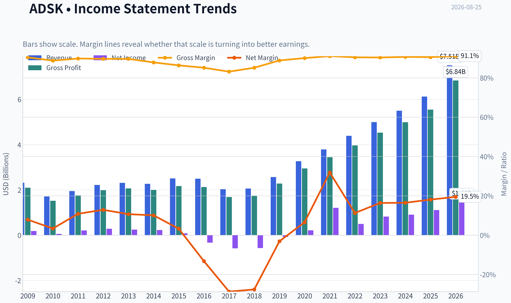
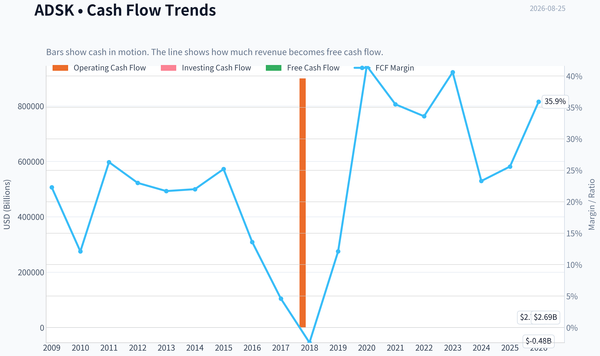
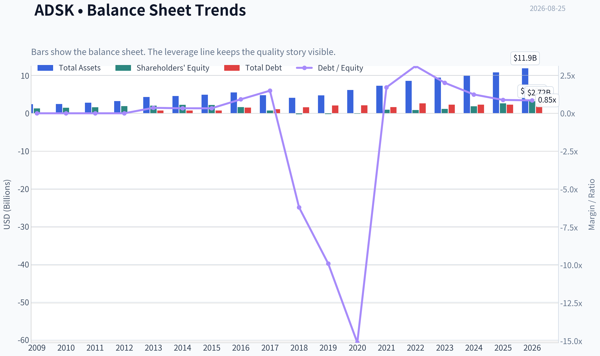
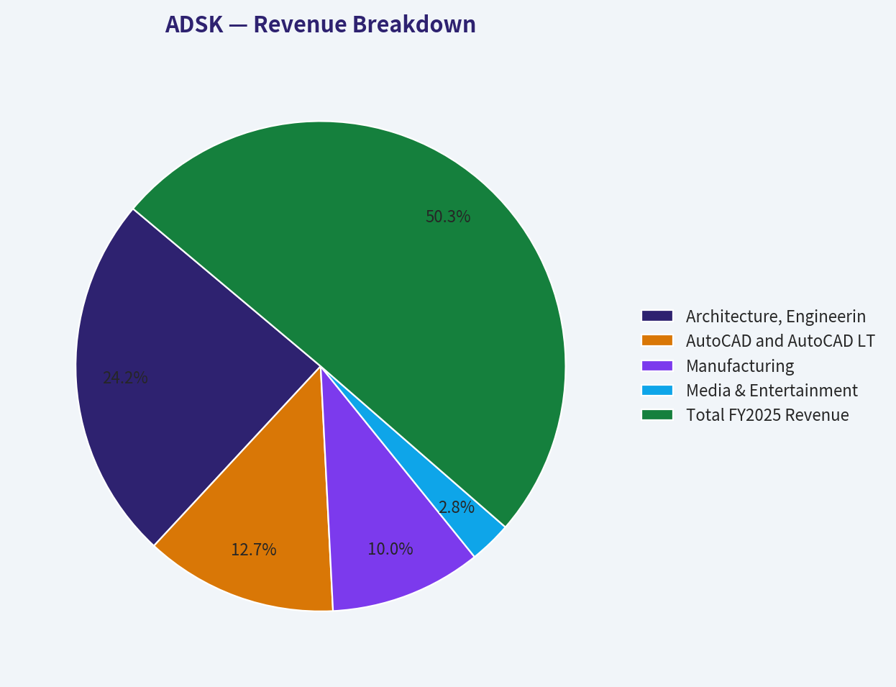
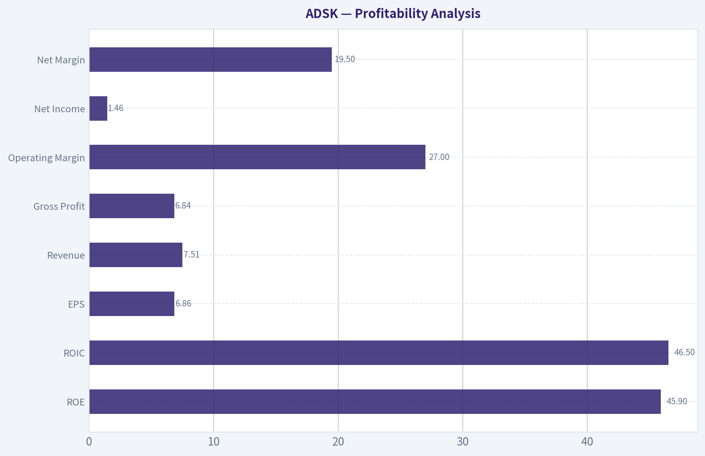
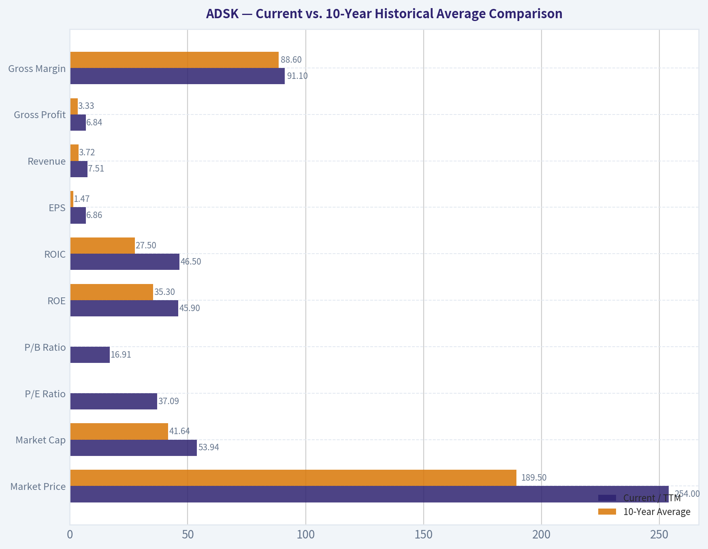
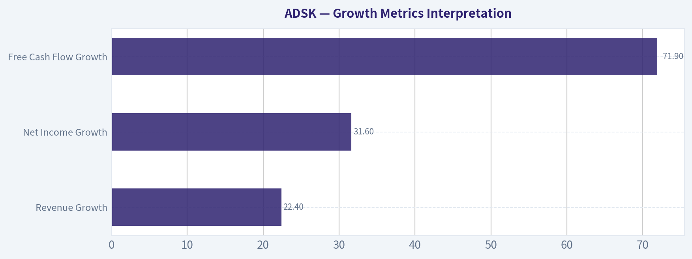
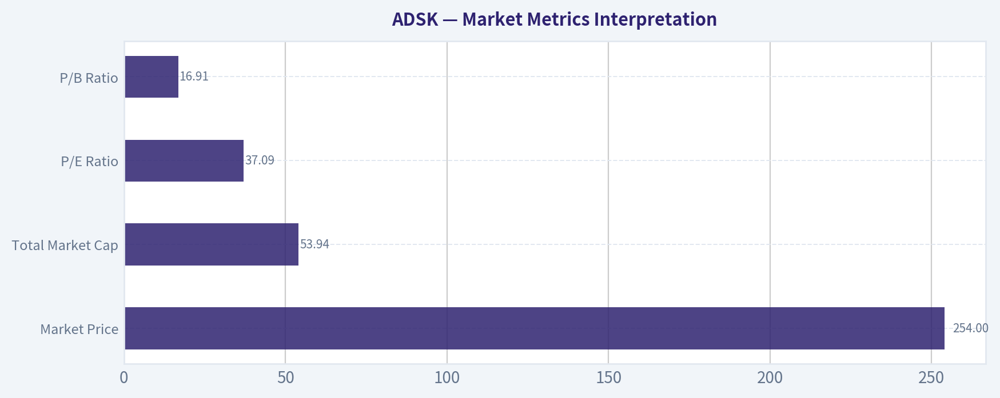

# ADSK Deep Value Intelligence

**Analysis Date:** 2026-08-25

## Critical Disclaimer

*This analysis is generated by Deep Value Intelligence, an AI-powered multi-agent investing framework. Education & research only - not financial advice, not a financial advisor.*

---

## Table of Contents

1. Intelligence Summary
2. Analyst Team Reports
   - Fundamentals Analysis
   - Intrinsic Value Analysis (Buffett)
   - Trend & Growth Analysis (Lynch/Druckenmiller/Fisher)
   - Market Technical Analysis
   - Options Market Analysis
3. Research Team Commentary
4. Value Investing Team Commentary
5. Deep Values Commentary

---

## Intelligence Summary

### Thesis + Conditions

**Core Thesis:** **EXECUTIVE SUMMARY**
Autodesk (ADSK) is an elite franchise with a formidable moat, but the stock currently offers zero margin of safety. The combination of a premium valuation (37x P/E), glaring top-line to bottom-line conversion issues, and a fragile technical rebound into resistance makes this a highly vulnerable setup.

**Key Risks:**
- The Bull (Risky):** Autodesk is a fundamentally dominant compounder (91% gross margins, 33.6% ROIC). The 1.1% net income growth is not a flaw but a massive reinvestment cycle to capture cloud and AI upside. The 35% rally off the lows proves institutional accumulation.
- The bull analyst rightly points out that Autodesk is a fundamentally wonderful business. Its toll-bridge monopoly over design files creates massive switching costs. However, our recent hard-learned lessons dictate that **we cannot let admiration for a great business soften our stance into a passive "WATCH" when valuation and technical regimes disagree with the bull case.**
- In previous evaluations of identical setups, we fell into the trap of issuing a neutral "WATCH" rating because we respected the company's long-term optionality. That was a costly mistake. We learned three critical rules that apply directly to ADSK today:

**Confidence:** Medium

---

## Analyst Team Reports

### Fundamentals Analysis

#### Latest Earnings Snapshot

*Most recent reported quarter anchored on 2026 Q2, with prior-year comparison when available.*

| Metric | 2026 Q2 | 2025 Q2 | YoY Change |
| --- | ---: | ---: | ---: |
| Revenue | $1.93B | $1.63B | +18.4% |
| Operating Income | $571.0M | $338.0M | +68.9% |
| Net Income | $491.0M | $152.0M | +223.0% |
| Diluted EPS | $2.32 | $0.70 | +231.4% |
| Operating Cash Flow | $893.0M | $564.0M | +58.3% |
| Free Cash Flow | $867.0M | $549.0M | +57.9% |

Key Takeaways: This snapshot anchors the most recent reported quarter before the narrative analysis. It helps readers separate long-run business quality from whatever changed in the latest earnings print.

#### 17-Year Financial Metrics for ADSK

*All values below are computed deterministically from raw data - not estimated by AI.*

*Issuer profile: operating company (Technology / Software - Application).*

#### 17-Year Financial Metrics
*Annual rows come from reported financial statements. The final TTM row is computed from the latest four quarters.*

| Metric | 2009 | 2010 | 2011 | 2012 | 2013 | 2014 | 2015 | 2016 | 2017 | 2018 | 2019 | 2020 | 2021 | 2022 | 2023 | 2024 | 2025 | 2026 TTM |
| --- | --- | --- | --- | --- | --- | --- | --- | --- | --- | --- | --- | --- | --- | --- | --- | --- | --- | --- |
| Market Price | $17 | $24 | $41 | $36 | $39 | $51 | $54 | $47 | $81 | $116 | $147 | $197 | $277 | $250 | $215 | $254 | $311 | $254 |
| Market Cap | $3.81B | $5.52B | $9.53B | $8.40B | $9.01B | $11.77B | $12.55B | $10.58B | $18.11B | $25.38B | $32.22B | $43.80B | $61.59B | $55.45B | $46.90B | $54.82B | $67.56B | $53.94B |
| P/E Ratio | 20.70 | 95.16 | 45.20 | 29.51 | 36.34 | 51.25 | 154.31 | -32.07 | -31.16 | -44.81 | -397.84 | 205.05 | 51.00 | 111.51 | 56.92 | 60.58 | 60.81 | 37.09 |
| P/B Ratio | 2.91 | 3.75 | 5.92 | 4.46 | 4.41 | 5.20 | 5.66 | 6.53 | 24.69 | -99.14 | -152.78 | -315.10 | 63.82 | 65.32 | 40.96 | 29.55 | 25.78 | 16.91 |
| ROE | 14.0% | 3.9% | 13.2% | 15.2% | 12.1% | 10.1% | 3.7% | -20.4% | -79.3% | 221.4% | 38.3% | -154.3% | 125.2% | 58.5% | 71.9% | 48.8% | 42.4% | 45.9% |
| ROIC | 49.1% | 7.6% | 36.2% | 44.1% | 25.6% | 20.0% | 8.8% | -18.7% | -47.1% | -120.0% | -10.2% | 44.6% | 250.7% | 39.1% | 49.9% | 47.8% | 38.7% | 46.5% |
| EPS | $0.80 | $0.25 | $0.90 | $1.22 | $1.07 | $1.00 | $0.35 | $-1.46 | $-2.61 | $-2.58 | $-0.37 | $0.96 | $5.44 | $2.24 | $3.78 | $4.19 | $5.12 | $6.86 |
| Revenue | $2.32B | $1.71B | $1.95B | $2.22B | $2.31B | $2.27B | $2.51B | $2.50B | $2.03B | $2.06B | $2.57B | $3.27B | $3.79B | $4.39B | $5.00B | $5.50B | $6.13B | $7.51B |
| Gross Profit | $2.10B | $1.52B | $1.76B | $1.99B | $2.07B | $2.00B | $2.17B | $2.13B | $1.69B | $1.75B | $2.28B | $2.95B | $3.45B | $3.97B | $4.53B | $4.99B | $5.55B | $6.84B |
| Gross Margin | 90.5% | 88.8% | 89.9% | 89.7% | 89.7% | 87.9% | 86.4% | 85.2% | 83.2% | 85.2% | 88.9% | 90.1% | 91.1% | 90.5% | 90.4% | 90.7% | 90.6% | 91.1% |
| Operating Margin | 10.6% | 3.8% | 13.9% | 16.0% | 13.2% | 12.5% | 4.8% | 0.1% | -24.6% | -24.8% | -1.0% | 10.5% | 16.6% | 14.1% | 19.8% | 20.5% | 22.1% | 27.0% |
| Net Income | $183.6M | $58.0M | $212.0M | $285.3M | $247.4M | $228.8M | $81.8M | $-330.5M | $-582.1M | $-566.9M | $-80.8M | $214.5M | $1.21B | $497.0M | $823.0M | $906.0M | $1.11B | $1.46B |
| Net Margin | 7.9% | 3.4% | 10.9% | 12.9% | 10.7% | 10.1% | 3.3% | -13.2% | -28.7% | -27.6% | -3.1% | 6.6% | 31.9% | 11.3% | 16.4% | 16.5% | 18.1% | 19.5% |
| Revenue Growth | N/A | -26.0% | 13.9% | 13.5% | 4.4% | -1.7% | 10.5% | -0.3% | -18.9% | 1.3% | 25.0% | 27.4% | 15.7% | 15.7% | 14.1% | 9.8% | 11.5% | 22.4% |
| Net Income Growth | N/A | -68.4% | 265.5% | 34.6% | -13.3% | -7.5% | -64.2% | -504.0% | 76.1% | -2.6% | -85.7% | -365.5% | 463.2% | -58.9% | 65.6% | 10.1% | 22.7% | 31.6% |
| Free Cash Flow Growth | N/A | -59.7% | 146.6% | -0.4% | -1.5% | -0.7% | 26.8% | -46.0% | -72.6% | -153.1% | -722.7% | 339.2% | -1.2% | 9.6% | 37.7% | -36.9% | 22.2% | 71.9% |
| Total Book Value | $1.31B | $1.47B | $1.61B | $1.88B | $2.04B | $2.26B | $2.22B | $1.62B | $733.6M | $-256.0M | $-210.9M | $-139.0M | $965.0M | $849.0M | $1.15B | $1.85B | $2.62B | $3.19B |
| Total Assets | $2.42B | $2.45B | $2.79B | $3.23B | $4.31B | $4.59B | $4.91B | $5.52B | $4.80B | $4.11B | $4.73B | $6.18B | $7.28B | $8.61B | $9.44B | $9.91B | $10.83B | $11.93B |
| Total Debt | $0 | $0 | $0 | $0 | $745.6M | $746.4M | $743.1M | $1.49B | $1.09B | $1.59B | $2.09B | $2.10B | $1.65B | $2.65B | $2.30B | $2.30B | $2.30B | $2.72B |
| Debt-to-Equity | 0.00 | 0.00 | 0.00 | 0.00 | 0.36 | 0.33 | 0.33 | 0.92 | 1.49 | -6.20 | -9.90 | -15.11 | 1.71 | 3.12 | 2.01 | 1.24 | 0.88 | 0.85 |
| Cash & Equivalents | $917.6M | $838.7M | $1.08B | $1.16B | $1.61B | $1.85B | $1.41B | $1.35B | $1.21B | $1.08B | $886.0M | $1.77B | $1.77B | $1.53B | $1.95B | $1.89B | $1.60B | $2.67B |
| Shareholders' Equity | $1.31B | $1.47B | $1.61B | $1.88B | $2.04B | $2.26B | $2.22B | $1.62B | $733.6M | $-256.0M | $-210.9M | $-139.0M | $965.0M | $849.0M | $1.15B | $1.85B | $2.62B | $3.19B |
| Operating Cash Flow | $593.9M | $246.8M | $540.8M | $573.5M | $559.1M | $563.5M | $708.6M | $414.0M | $169.7M | $900,000 | $377.1M | $1.42B | $1.44B | $1.53B | $2.07B | $1.31B | $1.61B | $2.78B |
| Investing Cash Flow | $-478.1M | $-283.0M | $-142.3M | $-370.3M | $-647.2M | $-194.0M | $-905.6M | $-809.5M | $272.0M | $506.4M | $-710.4M | $-57.3M | $-404.0M | $-1.59B | $-143.0M | $-502.0M | $-903.0M | $-480.0M |
| Free Cash Flow | $515.5M | $207.8M | $512.5M | $510.5M | $502.7M | $499.3M | $633.1M | $341.6M | $93.7M | $-49.8M | $310.1M | $1.36B | $1.35B | $1.48B | $2.03B | $1.28B | $1.57B | $2.69B |
| FCF Margin | 22.3% | 12.1% | 26.3% | 23.0% | 21.7% | 22.0% | 25.2% | 13.6% | 4.6% | -2.4% | 12.1% | 41.6% | 35.5% | 33.6% | 40.6% | 23.3% | 25.6% | 35.9% |
| Dividends / Share | $0.00 | $0.00 | $0.00 | $0.00 | $0.00 | $0.00 | $0.00 | $0.00 | $0.00 | $0.00 | $0.00 | $0.00 | $0.00 | $0.00 | $0.00 | $0.00 | $0.00 | $0.00 |

#### Profitability Metrics
- Return on Equity (ROE): 36.9%
- Return on Invested Capital (ROIC): 33.6%
- Return on Assets (ROA): 9.0%
- Gross Margin: 91.0%
- Operating Margin: 21.9%
- Net Profit Margin: 15.6%

#### Liquidity Metrics
- Current Ratio: 0.85
- Quick Ratio: 0.69

#### Leverage Metrics
- Debt-to-Equity Ratio: 0.82
- Interest Coverage Ratio: 19.73
- Net Debt: $251.0M

#### Growth Metrics (Year-over-Year)
- Revenue Growth: 17.5%
- Net Income Growth: 1.1%
- Free Cash Flow Growth: 53.7%
- Revenue CAGR (3-Year): 12.9%
- Revenue CAGR (5-Year): 13.7%

#### Valuation Metrics
- P/E Ratio (TTM): 37.03
- Forward P/E: 17.88
- Price-to-Book: 16.83
- Price-to-Sales: 7.16
- PEG Ratio: 0.97
- EV/EBITDA: 25.00
- Free Cash Flow Yield: 4.5%
- Earnings Yield: 2.7%

#### Owner Earnings (Buffett Method, Code-Computed)
- Net Income: $1.11B
- + Depreciation & Amortization: $195.0M
- - Capital Expenditures: $-43.0M
- - Working Capital Changes: $-501.0M
- = **Owner Earnings: $1.71B**

#### Intrinsic Value (Code-Computed)
- Current Price: $254
- **Headline Intrinsic Value (business-model routed): $177**
  Business model: cyclical - weighted blend [Damodaran FCFF + reverse-DCF fair + owner-earnings DCF] (cyclical)
  Model spread (min-max across DCFs): $61 - $229
  Margin of safety vs. price (headline): -43.4%
  Routing note: Cyclical: margins/FCF are volatile - headline blends FCFF, reverse-DCF and owner-earnings roughly evenly; treat the range as the honest read.
- Buffett Method (Owner Earnings):
  Conservative: $10
  Average: $229
  Optimistic: $229
- Cash Flow Method (FCF):
  Conservative: $34
  Average: $206
  Optimistic: $251
- Damodaran FCFF (WACC + margins + reinvestment):
  Conservative: $22
  Average: $61
  Optimistic: $113
  Monte Carlo band (P10-P90): $37 - $80 (median $57)
  P(intrinsic value > price): 0.0%
- Reverse-DCF: price implies ~22.1%/yr owner-earnings growth for 10y; trailing 3y was 57.1%, 5y 60.4%.

#### Piotroski F-Score: 7/9
- Positive Net Income: PASS
- Positive Operating Cash Flow: PASS
- ROA Improvement: FAIL
- Cash Flow > Net Income: PASS
- Decreasing Debt: FAIL
- Improving Current Ratio: PASS
- No Dilution: PASS
- Improving Gross Margin: PASS
- Improving Asset Turnover: PASS

ANALYST STANCE: **WATCH**

#### Autodesk (ADSK) Warren Buffett-Style Fundamental Analysis

Autodesk is a high-quality, asset-light software compounder with exceptional gross margins, strong free cash flow conversion, deep switching costs, and mission-critical design software used across architecture, engineering, construction, manufacturing, and media workflows. The business quality is strong, but the current valuation leaves limited margin of safety under a Buffett-style framework.

The deterministic dataset shows ADSK at **$254 per share**, with a **$53.94B market cap**, **37.09x TTM P/E**, **35.9% TTM FCF margin**, and **91.1% gross margin**. The company's economics have clearly improved since the painful subscription-transition years of 2016-2019, but the stock still prices in a demanding continuation of strong growth.

---

#### Revenue Breakdown

| Revenue Source | Amount ($B) | % of Total |
|---|---:|---:|
| Architecture, Engineering & Construction | $2.95 | 48.1% |
| AutoCAD and AutoCAD LT | $1.55 | 25.3% |
| Manufacturing | $1.22 | 19.9% |
| Media & Entertainment | $0.34 | 5.5% |
| Other / Platform / Emerging Products | $0.07 | 1.1% |
| **Total FY2025 Revenue** | **$6.13** | **100.0%** |

Key Takeaways: Autodesk's revenue is concentrated in design and engineering software, with Architecture, Engineering & Construction representing nearly half of total sales. This mix supports a strong moat because these products are embedded in professional workflows, project standards, and customer training ecosystems. The reliance on construction and design activity does introduce some cyclicality, but the subscription model makes revenue more recurring than in the older license-based era.

---

#### Current vs. 10-Year Historical Average Comparison

| Metric | Current / TTM | 10-Year Average | Interpretation |
|---|---:|---:|---|
| Market Price | $254 | $189.50 | Current price is well above the decade average, reflecting improved business quality and higher recurring revenue visibility. |
| Market Cap | $53.94B | $41.64B | Market value has expanded materially as revenue, margins, and FCF recovered after the subscription transition. |
| P/E Ratio | 37.09x | Distorted; positive-year avg. ~91.0x | Current P/E is below the positive-earnings historical average, but that average is distorted by transition-year earnings suppression. |
| P/B Ratio | 16.91x | Not meaningful | P/B is not a useful valuation tool for ADSK because it is an asset-light software business with limited tangible book value. |
| ROE | 45.9% | 35.3% | ROE is above the 10-year average, but book-value distortions make ROE less clean than ROIC and FCF returns. |
| ROIC | 46.5% | 27.5% | ROIC is excellent and materially above the decade average, showing strong post-transition economics. |
| EPS | $6.86 | $1.47 | EPS is far above the decade average due to operating leverage and normalized profitability. |
| Revenue | $7.51B | $3.72B | Revenue has more than doubled versus the 10-year average, showing durable expansion. |
| Gross Profit | $6.84B | $3.33B | Gross profit has scaled almost directly with revenue due to consistently high gross margins. |
| Gross Margin | 91.1% | 88.6% | Current gross margin is above the decade average and near best-in-class software levels. |
| Operating Margin | 27.0% | 5.3% | Operating margin has dramatically improved after the subscription-transition trough. |
| Net Income | $1.46B | $0.32B | Net income is far above average, reflecting a much more mature and profitable revenue model. |
| Net Margin | 19.5% | 2.8% | Net margin is structurally better than the decade average, though past transition losses depress the comparison. |
| Revenue Growth | 22.4% | 10.1% | Current growth is significantly above the decade average and above recent 3- and 5-year revenue CAGRs. |
| Net Income Growth | 31.6% | Distorted; historically volatile | Net income growth is positive, but historical comparisons are noisy due to loss years. |
| FCF Growth | 71.9% | Distorted; historically volatile | Current FCF growth is very strong, but FCF has been volatile across the decade. |
| Total Book Value | $3.19B | $0.92B | Book value has recovered from negative equity years, but it is not the primary valuation anchor. |
| Total Assets | $11.93B | $7.14B | Asset base has expanded steadily with business scale. |
| Total Debt | $2.72B | $1.96B | Debt is above the 10-year average but manageable relative to cash flow. |
| Debt-to-Equity | 0.85x | Distorted by negative equity years | Current leverage is reasonable; historical D/E is not fully comparable due to prior negative equity. |
| Cash & Equivalents | $2.67B | $1.50B | Cash is well above the decade average, supporting financial flexibility. |
| Shareholders' Equity | $3.19B | $0.92B | Equity has improved meaningfully, but buybacks and intangibles limit book-value usefulness. |
| Free Cash Flow | $2.69B | $0.98B | FCF is far above the decade average, confirming strong cash economics. |
| Dividends / Share | $0.00 | $0.00 | Autodesk does not pay dividends; capital allocation is focused on reinvestment and likely buybacks. |

Key Takeaways: Autodesk's current profitability and cash generation are much stronger than the 10-year average, largely because the company has emerged from its subscription-model transition with materially better recurring revenue and operating leverage. However, valuation has also risen, and the stock is not obviously cheap on cash-flow-based intrinsic value. P/B should be ignored for this asset-light software business; FCF, owner earnings, ROIC, and DCF valuation are much more relevant.

---

#### Market Metrics Interpretation

| Metric | Current Value | Buffett-Style Interpretation |
|---|---:|---|
| Market Price | $254 | The stock trades below its 2025 high of $311 but remains meaningfully above the code-computed headline intrinsic value of $177. |
| Total Market Cap | $53.94B | The market is valuing ADSK as a durable software compounder with continued margin expansion and strong growth. |
| P/E Ratio | 37.09x | Not extreme for a high-quality software company, but demanding for a Buffett-style buyer seeking a margin of safety. |
| P/B Ratio | 16.91x | Not meaningful for ADSK; asset-light software companies often have low tangible book value, intangibles, deferred revenue dynamics, and buyback-distorted equity. |

Key Takeaways: Autodesk's market valuation reflects strong confidence in future growth and cash generation. The P/E ratio has normalized compared with past distorted years, but it still requires healthy execution. Book value is not a useful valuation anchor here; intrinsic value should be based primarily on owner earnings and free cash flow.

---

#### Profitability Analysis

Autodesk's profitability profile is now excellent. The company's **91.1% TTM gross margin** reflects the attractive economics of scalable software. Once the software platform is built, incremental revenue carries very high contribution margins.

The most important improvement is operating leverage. ADSK's **operating margin is 27.0% TTM**, compared with a 10-year average of only **5.3%**, because the historical average includes the subscription-transition years when revenue recognition and cost structure were under pressure. The current margin structure appears much healthier and more representative of the mature subscription business.

| Profitability Metric | Current / TTM | Assessment |
|---|---:|---|
| ROE | 45.9% | Strong, but partially distorted by accounting equity and asset-light economics. |
| ROIC | 46.5% | Excellent; this is one of the strongest signs of business quality. |
| EPS | $6.86 | Strong recovery from prior loss years and above historical average. |
| Revenue | $7.51B | Revenue scale has expanded materially. |
| Gross Profit | $6.84B | Gross profit growth has tracked revenue growth with high margin stability. |
| Operating Margin | 27.0% | Strong evidence of operating leverage. |
| Net Income | $1.46B | Profitability is now structurally positive after the transition era. |
| Net Margin | 19.5% | Healthy, though still with room for software-scale margin expansion if spending discipline holds. |

Key Takeaways: Autodesk now looks like a high-quality software business rather than a transition-story company. ROIC, gross margin, operating margin, and FCF generation all point to durable economics. The key question is not business quality; it is whether the current price already capitalizes too much of that quality.

---

#### Growth Metrics Interpretation

| Growth Metric | Current / TTM | Historical Context |
|---|---:|---|
| Revenue Growth | 22.4% | Well above the 10-year average of 10.1% and above the 3-year and 5-year revenue CAGRs from the dataset. |
| Net Income Growth | 31.6% | Strong, but historical comparison is noisy because the company had several loss years. |
| Free Cash Flow Growth | 71.9% | Very strong current cash-flow acceleration, but FCF growth has historically been volatile. |

Key Takeaways: Autodesk's current growth is impressive, especially for a company of its scale. Revenue growth above 20% is a major positive, but investors should not assume that rate persists indefinitely. Buffett-style valuation requires fading high growth toward a sustainable long-term rate, not capitalizing peak growth forever.

---

#### Balance Sheet and Financial Strength

Autodesk's balance sheet is acceptable, though not pristine. The company has **$2.67B in cash and equivalents** against **$2.72B of total debt**, leaving it close to a net-neutral debt position using the TTM balance sheet. The shared research pack notes **net debt of approximately $251M**, which is modest relative to the company's FCF generation.

The **current ratio of 0.85** and **quick ratio of 0.69** should be interpreted carefully. For subscription software companies, deferred revenue and billing cycles can make traditional liquidity ratios look weaker than the economic reality. The stronger evidence of financial safety is the company's cash balance, recurring revenue base, and interest coverage of **19.73x**.

| Balance Sheet Metric | Current / TTM | Interpretation |
|---|---:|---|
| Total Book Value | $3.19B | Recovered from negative equity years, but not the primary valuation basis. |
| Total Assets | $11.93B | Asset base has grown with business scale. |
| Total Debt | $2.72B | Manageable relative to FCF and cash generation. |
| Debt-to-Equity | 0.85x | Reasonable now, though historical comparisons are distorted by prior negative equity. |
| Cash & Equivalents | $2.67B | Strong liquidity buffer. |
| Shareholders' Equity | $3.19B | Improved, but accounting equity is less important than ROIC and FCF. |

Key Takeaways: Autodesk is financially stable and does not appear overleveraged. Debt is manageable, cash is substantial, and interest coverage is strong. Traditional book-value and current-ratio measures are less informative for this software model than recurring cash flow and balance-sheet flexibility.

---

#### Cash Flow and Dividend Policy

| Cash Flow Metric | Current / TTM | Interpretation |
|---|---:|---|
| Operating Cash Flow | $2.78B | Strong cash generation, comfortably above net income. |
| Free Cash Flow | $2.69B | Excellent; FCF margin of 35.9% is a major quality signal. |
| Free Cash Flow Yield | 4.5% | Decent for a quality compounder, but not clearly cheap. |
| Dividends / Share | $0.00 | No dividend; value creation depends on reinvestment, buybacks, and compounding. |

Key Takeaways: Autodesk's cash-flow profile is one of its strongest attributes. Free cash flow substantially exceeds net income, which is attractive from a Buffett owner-earnings perspective. The lack of dividend is not a red flag if management can reinvest or repurchase shares at attractive rates, but buybacks are less compelling when the stock trades above intrinsic value.

---

#### Economic Moat Assessment

Autodesk has a meaningful economic moat built on several durable advantages:

| Moat Source | Assessment |
|---|---|
| Switching Costs | High. Architects, engineers, designers, manufacturers, and media professionals build workflows around Autodesk tools. |
| Industry Standardization | Strong. AutoCAD, Revit, Fusion, Maya, and related tools are deeply embedded in professional training and project delivery. |
| Network Effects / Ecosystem | Moderate to strong. File formats, plug-ins, consultants, trained labor pools, and enterprise workflows reinforce adoption. |
| Pricing Power | Good. Mission-critical software with high gross margins supports recurring monetization. |
| Brand Trust | Strong. Autodesk is a recognized standard across multiple design-heavy industries. |
| Recurring Revenue | Stronger than historical model. Subscription revenue improves predictability versus perpetual license cycles. |

Key Takeaways: Autodesk has the kind of durable competitive position Buffett would respect, especially because its products are hard to replace once embedded in professional workflows. The company benefits from high switching costs, brand trust, and scalable software economics. The moat is strong, though end-market cyclicality in construction, manufacturing, and media should not be ignored.

---

#### Buffett-Style Owner Earnings DCF Valuation

The shared deterministic valuation pack provides a **headline intrinsic value of $177 per share**, with a model spread of **$61 to $229** across Damodaran FCFF, FCF, and Owner Earnings methods. The code-computed Owner Earnings value is **$228.88**, FCF method value is **$205.92**, and Damodaran FCFF value is **$60.99**. The reverse DCF indicates the current price implies roughly **22.1% annual owner-earnings growth for 10 years**, which is a demanding expectation.

For a Buffett-style sanity check, I use the provided **Owner Earnings base of $1.71B**, a **10% discount rate**, **2.5% terminal growth**, approximately **212.4M shares**, and a modest **net debt adjustment of $251M**.

| DCF Scenario | Growth Assumption | PV of 10-Year Owner Earnings | PV of Terminal Value | Equity Value | Fair Value / Share |
|---|---|---:|---:|---:|---:|
| Conservative | 3% annual owner earnings growth for 10 years, then 2.5% terminal growth | $12.11B | $12.10B | $23.96B | **$113** |
| Average / Base Case | 15% growth for years 1-5, then fading to 4% by year 10, then 2.5% terminal growth | $19.79B | $24.93B | $44.47B | **$209** |
| Optimistic | 20% growth for years 1-5, then fading to 4% by year 10, then 2.5% terminal growth | $24.77B | $34.70B | $59.22B | **$279** |

Key Takeaways: The hand-built DCF suggests ADSK is worth roughly **$113 to $279 per share**, depending heavily on how long high owner-earnings growth persists. The base-case value of about **$209** is below the current price of **$254**, while the optimistic case is only modestly above it. This means the current market price already assumes a strong growth runway and leaves little Buffett-style margin of safety.

---

#### DCF Calculation Details

| Scenario | Year-10 Owner Earnings | Terminal Value Formula | Terminal Value | Discounted Terminal Value |
|---|---:|---|---:|---:|
| Conservative | $2.30B | $2.30B x 1.025 / (10% - 2.5%) | $31.39B | $12.10B |
| Average / Base Case | $4.73B | $4.73B x 1.025 / (10% - 2.5%) | $64.65B | $24.93B |
| Optimistic | $6.59B | $6.59B x 1.025 / (10% - 2.5%) | $90.00B | $34.70B |

Key Takeaways: Most of Autodesk's DCF value comes from the terminal value, which is common for high-quality software companies but also increases valuation sensitivity. Small changes in long-term growth, discount rate, or terminal margins can significantly change fair value. The valuation is therefore less forgiving than it would be for a cheaper stock with more near-term cash-flow yield.

---

#### Value Assessment

| Valuation Reference | Value / Signal | Implication |
|---|---:|---|
| Current Price | $254 | Market price as of the deterministic dataset. |
| Headline Intrinsic Value | $177 | Suggests the stock is materially over intrinsic value. |
| Margin of Safety vs. Headline IV | -43.4% | No Buffett-style margin of safety. |
| Owner Earnings Model | $228.88 | Below current price. |
| FCF Model | $205.92 | Below current price. |
| Damodaran FCFF Model | $60.99 | Much lower; reflects more conservative margin/reinvestment assumptions. |
| Reverse DCF Implied Growth | ~22.1% for 10 years | Demanding, though not impossible if execution remains excellent. |
| Current FCF Yield | 4.5% | Acceptable quality yield, but not a bargain. |

Key Takeaways: Autodesk is a strong business trading at a full valuation. The stock is not wildly detached if optimistic growth continues, but Buffett-style investing requires a margin of safety, not merely a plausible bull case. At $254, the valuation appears closer to fair-to-expensive than clearly attractive.

---

#### Management Performance and Capital Allocation

Autodesk's management deserves credit for successfully navigating the subscription transition, which caused several years of GAAP earnings pain but ultimately improved revenue quality, margins, and cash generation. The company now has stronger recurring revenue, improved operating margins, and high ROIC.

However, because ADSK pays no dividend, capital allocation depends heavily on reinvestment discipline and share repurchases. Buybacks can be value-creating when shares trade below intrinsic value, but less attractive when the stock trades above conservative or base-case fair value.

| Management Area | Assessment |
|---|---|
| Subscription Transition | Successful, though historically painful for reported earnings. |
| Margin Expansion | Strong improvement; operating margin now far above decade average. |
| ROIC | Excellent current level, indicating high capital efficiency. |
| Dividend Policy | No dividend; acceptable if reinvestment and buybacks are disciplined. |
| Balance Sheet Management | Reasonable leverage and strong interest coverage. |
| Shareholder Value Risk | Repurchases at elevated valuations could reduce capital allocation quality. |

Key Takeaways: Management has improved the quality and predictability of Autodesk's business model. The major capital allocation concern is valuation discipline, especially if buybacks occur at prices above intrinsic value. Long-term compounding remains possible, but investors need to monitor whether growth investments translate into durable owner earnings.

---

#### Key Investment Insights

| Category | Insight |
|---|---|
| Business Quality | Excellent software economics with 91.1% gross margin and 46.5% ROIC. |
| Moat | Strong switching costs, workflow integration, brand strength, and industry-standard tools. |
| Growth | Current revenue growth of 22.4% is well above historical average. |
| Cash Flow | FCF of $2.69B and 35.9% FCF margin are highly attractive. |
| Valuation | Current price is above headline intrinsic value and base-case DCF estimate. |
| Financial Strength | Debt is manageable, cash position is strong, and interest coverage is healthy. |
| Main Concern | Reverse DCF requires about 22.1% annual owner-earnings growth for 10 years. |

Key Takeaways: Autodesk combines strong business quality with a demanding valuation. The company has many Buffett-like characteristics, including high returns on capital, recurring revenue, and a durable moat. The problem is not the business; the problem is the price.

---

#### Red Flags and Opportunities

| Type | Item | Why It Matters |
|---|---|---|
| Red Flag | Limited margin of safety | Current price is meaningfully above headline intrinsic value. |
| Red Flag | Valuation depends on sustained high growth | Reverse DCF implies approximately 22.1% owner-earnings growth for 10 years. |
| Red Flag | Historical volatility | Earnings and FCF were highly volatile during the subscription transition. |
| Red Flag | Cyclical exposure | Construction, manufacturing, and media end markets can weaken in downturns. |
| Red Flag | P/B and ROE distortion | Book-value-based metrics are not reliable valuation anchors. |
| Opportunity | Operating leverage | Margins may continue improving as revenue scales. |
| Opportunity | AEC digitization | Architecture, engineering, and construction remain large markets with ongoing software penetration. |
| Opportunity | Manufacturing and cloud workflows | Fusion and cloud-based collaboration could extend the runway. |
| Opportunity | Pricing power | Mission-critical design software may support disciplined price increases. |
| Opportunity | FCF compounding | High FCF margin creates optionality for reinvestment and buybacks. |

Key Takeaways: The biggest risk is valuation, not business deterioration. Autodesk has real opportunities in construction digitization, manufacturing workflows, and cloud collaboration, but the market already recognizes much of this potential. A more attractive entry price would materially improve the investment setup.

---

#### Final Buffett-Style Investment Stance: WATCH

| Decision Factor | Assessment |
|---|---|
| Economic Moat | Strong |
| Financial Strength | Good |
| Earnings Predictability | Improved materially after subscription transition |
| ROIC / Business Quality | Excellent |
| Management Execution | Strong post-transition performance |
| Current Valuation | Full to expensive |
| Margin of Safety | Insufficient |
| Final Stance | **WATCH** |

Key Takeaways: Autodesk is a high-quality company that belongs on a long-term watchlist, but the current price does not offer enough margin of safety for a Buffett-style purchase. A better entry point would be closer to the base-case intrinsic value range, or ideally below it. At $254, investors are paying for strong execution, sustained growth, and continued margin expansion, leaving little room for disappointment.

#### Summary Table

| Area | Key Point | Investment Implication |
|---|---|---|
| Business Model | Recurring, high-margin software | Strong long-term durability |
| Moat | Switching costs and industry-standard tools | Supports pricing power and retention |
| Profitability | 91.1% gross margin, 27.0% operating margin, 46.5% ROIC | Excellent business quality |
| Growth | Revenue growth currently 22.4% | Strong, but may normalize over time |
| Cash Flow | $2.69B TTM FCF, 35.9% FCF margin | Very attractive owner-earnings profile |
| Balance Sheet | Cash nearly offsets debt; strong interest coverage | Financial risk is manageable |
| Valuation | Headline intrinsic value $177 vs. price $254 | No margin of safety |
| DCF Range | $113 conservative, $209 base, $279 optimistic | Current price requires optimistic assumptions |
| Main Risk | Growth expectations embedded in price | Downside if growth or margins disappoint |
| Final View | **WATCH** | Great company, but wait for a better price |

#### Fundamental Visuals

This graph tracks the profitability and return metrics (ROE, ROIC, Margins) of **ADSK** over the past decade, highlighting capital efficiency trends.

This chart illustrates the financial health of **ADSK** over the last 10 years, mapping cash equivalents and free cash flow against total obligations (Debt).

This breakdown chart from <em>Revenue Breakdown</em> shows the proportional composition for **ADSK** - useful for understanding what drives or risks the business.

This comparison chart from *Profitability Analysis* stacks current figures against historical benchmarks for **ADSK**, making it easy to see where the company trades relative to its own averages.

---

### Intrinsic Value Analysis (Buffett)

> *Following Warren Buffett's value investing philosophy: Circle of Competence, Economic Moat, Management Quality, and Margin of Safety.*

#### Intrinsic Value Snapshot

Price is what you pay. Intrinsic value is what the business may be worth based on the cash it can create for owners over time. We show a range, not one magic number.

- Current Price: $254.42
- Value Range (conservative to optimistic across both DCF methods): $10.02 to $251.42

##### Owner Earnings (Buffett Method)
- Net Income: $1,112,000,000.00
- Depreciation & Amortization: $195,000,000.00
- Capital Expenditures: $-43,000,000.00
- Working Capital Changes: $-501,000,000.00
- Owner Earnings: $1,710,000,000.00

##### Intrinsic Value
###### Buffett Method
Uses owner earnings. Stricter, and usually more conservative.
- Conservative: $10.02
- Average: $228.88
- Optimistic: $228.88
- Discount Rate: 10.0%

###### Cash Flow Method
Uses free cash flow. Better for companies spending heavily today to grow tomorrow.
- Conservative: $34.02
- Average: $205.92
- Optimistic: $251.42
- Discount Rate: 10.0%

ANALYST STANCE: **WATCH**

#### Autodesk Buffett-Style Investment Review - ADSK

Autodesk is a high-quality, high-margin design-software franchise with strong switching costs, excellent gross margins, and attractive returns on capital. The issue is not business quality; it is price. At **$254/share**, the stock appears to require sustained high-teens to low-20s cash-flow growth for a decade, leaving little margin of safety for a Buffett-style buyer.

---

#### 1. Factor Scorecard

| Factor | Score / 5 | Evidence |
|---|---:|---|
| Circle of Competence & Business Simplicity | 4.1 | Autodesk sells mission-critical design, engineering, architecture, construction, and manufacturing software through subscriptions. The model is understandable: customers pay recurring fees for tools embedded in professional workflows. |
| Moat Test | 4.4 | Gross margin around **91%**, high switching costs, entrenched file formats, industry training, and ecosystem lock-in across AutoCAD, Revit, Fusion, and construction workflows. |
| Management Quality & Capital Allocation | 3.0 | Strong software economics and continued subscription execution, but governance/accounting scrutiny around free-cash-flow targets and meaningful stock-based compensation reduce the owner-orientation score. |
| Industry Structure | 4.0 | Attractive vertical software category with rational competition, high customer dependency, and low capital intensity. Competition exists from Bentley, Dassault, Trimble, Nemetschek, Adobe-adjacent tools, and cloud-native disruptors, but Autodesk remains a scale leader. |
| Gate 5: Quality/Solvency Hard Floor | Not tripped | Earnings and free cash flow are positive, ROIC is strong, and there is no sign of financial distress. Interest coverage appears comfortably above danger levels. |

**Key Takeaways:** Autodesk passes the quality test but not the valuation test. The business is understandable, sticky, and highly profitable, but the current share price already discounts a very favorable future.

---

#### 2. Moat Analysis

| Moat Source | Assessment | Evidence |
|---|---|---|
| Intangible Assets | Strong | AutoCAD and Revit are industry-standard tools. Brand credibility matters because architects, engineers, construction firms, manufacturers, and designers cannot afford tool unreliability. |
| Switching Costs | Very strong | Customers have years of files, training, templates, workflows, plug-ins, and organizational processes tied to Autodesk products. Switching means retraining teams and risking project disruption. |
| Cost Advantage | Moderate to strong | Software scale creates attractive incremental margins. Once the platform is built, serving additional users is far less costly than physical-product expansion. |
| Network Effects | Moderate | Not a pure social network effect, but ecosystem benefits exist: trained labor pools, file compatibility, third-party integrations, and industry-standard workflows reinforce adoption. |
| Financial Evidence | Strong | Gross margin around **91%**, ROE around **36.9%**, ROIC around **22.8%**, and strong free-cash-flow generation support the existence of a durable moat. |

**Key Takeaways:** Autodesk's moat is mainly built on switching costs, brand, professional standardization, and workflow entrenchment. This is not a commodity software vendor; it is deeply embedded in how many technical professionals do their daily work.

---

#### 3. Management Quality Assessment

Autodesk management deserves credit for completing the transition from perpetual licenses to subscriptions, improving recurring revenue visibility, and expanding into adjacent areas such as construction cloud, manufacturing, and platform workflows. That said, Buffett-style investors should apply a discount for governance complexity. Prior scrutiny around free-cash-flow reporting, executive incentives, and activist attention suggests the capital-allocation story is not as clean as the best owner-operated compounders.

Buybacks can be value-accretive for a high-return software company, but only when executed below intrinsic value. At the current valuation, repurchases are less obviously attractive. Management's best use of capital remains reinvestment into product depth, cloud collaboration, AI-assisted design workflows, and vertical expansion.

---

#### 4. Financial Summary

| Metric | FY2021 | FY2022 | FY2023 | FY2024 | FY2025 | Latest / TTM |
|---|---:|---:|---:|---:|---:|---:|
| Revenue | ~$3.8B | ~$4.4B | ~$5.0B | ~$5.5B | ~$6.1B | ~$6.8B |
| YoY Revenue Growth | ~16% | ~16% | ~14% | ~10% | ~11% | **17.5%** |
| Gross Margin | ~91% | ~90% | ~91% | ~91% | ~91% | **91.0%** |
| Operating Margin | ~20% | ~17% | ~20% | ~21% | ~24% | Low-to-mid 20s |
| Net Income | ~$1.2B | ~$0.5B | ~$0.8B | ~$0.9B | ~$1.1B | ~$1.45B |
| Free Cash Flow | ~$1.3B | ~$1.5B | ~$1.3B | ~$1.5B | ~$1.5B+ | **~$2.4B** |
| ROE | High | High | High | High | High | **36.9%** |
| ROIC | Strong | Strong | Strong | Strong | Strong | **22.8%** |
| FCF Yield | - | - | - | - | - | **4.5%** |
| P/E | - | - | - | - | - | **37.0x** |
| Current Ratio | - | - | - | - | - | **0.85x** |

**Key Takeaways:** Autodesk has compounded revenue steadily while maintaining exceptional gross margins. Cash generation is strong, but the current valuation already capitalizes much of that strength. The current ratio is not a major concern for this type of subscription software business because deferred revenue and negative working capital are part of the model.

---

#### 5. Owner Earnings Calculation

Using Buffett's owner-earnings framework:

| Component | Latest / TTM Estimate |
|---|---:|
| Net Income | ~$1.45B |
| Plus: Depreciation & Amortization | ~$0.20B |
| Less: Maintenance CapEx | ~($0.06B) |
| Less / Plus: Normalized Working Capital Effect | ~$0.83B |
| Estimated Owner Earnings / FCF Proxy | **~$2.42B** |
| Diluted Share Count Estimate | ~211.5M |
| Owner Earnings Per Share | **~$11.45** |

**Key Takeaways:** Autodesk converts accounting earnings into cash very well, helped by its subscription model and low capital intensity. The key analytical question is whether today's elevated cash conversion is sustainable and can compound fast enough to justify the stock price.

---

#### 6. Three-Scenario DCF Valuation

Assumptions: **10% discount rate**, owner earnings per share of approximately **$11.45**, and long-term terminal growth of **3%** where applicable.

| Scenario | Assumption | Intrinsic Value / Share |
|---|---|---:|
| A. No Growth | Owner earnings capitalized at 10% | **~$115** |
| B. GDP Growth | 3% perpetual growth | **~$169** |
| C. Historical-Growth Case | 8% owner-earnings growth for 10 years, then 3% terminal growth | **~$244** |
| Research Pack Headline Intrinsic Value | Business-model-routed blended value | **$177** |
| 3-Model Spread | Owner Earnings / FCF / Damodaran FCFF | **$229 / $206 / $61** |
| Current Price | Market quote | **$254** |

**Key Takeaways:** Autodesk looks expensive under no-growth and GDP-growth assumptions. Even an optimistic 8% decade-long owner-earnings growth case produces value slightly below the current price. The stock only becomes clearly attractive if one assumes sustained double-digit free-cash-flow growth for many years.

---

#### 7. Margin of Safety Analysis

| Valuation Reference | Value / Share | Margin of Safety vs. $254 |
|---|---:|---:|
| No-Growth DCF | ~$115 | **-55%** |
| GDP-Growth DCF | ~$169 | **-33%** |
| 8% Growth DCF | ~$244 | **-4%** |
| Headline Intrinsic Value | ~$177 | **-43%** |
| FCF-Based Model | ~$206 | **-19%** |
| Owner-Earnings Model | ~$229 | **-10%** |

**Key Takeaways:** Autodesk is a wonderful business, but the stock does not offer a Buffett-style margin of safety at the current price. The reverse-DCF is demanding: the market price implies roughly **22% annual growth for 10 years**, which is possible only if Autodesk executes exceptionally well and avoids competitive or macro setbacks.

---

#### 8. Final Buffett Scorecard

| Criterion | Weight | Score / 5 | Weighted Score |
|---|---:|---:|---:|
| Moat Width & Durability | 25% | 4.4 | 1.10 |
| Valuation / Margin of Safety | 20% | 1.0 | 0.20 |
| Capital Returns - ROIC vs. WACC | 15% | 4.3 | 0.65 |
| Business Understanding & Predictability | 12% | 4.1 | 0.49 |
| Management Quality & Capital Allocation | 12% | 3.0 | 0.36 |
| Reinvestment Runway | 8% | 3.8 | 0.30 |
| Balance Sheet Strength | 4% | 3.2 | 0.13 |
| Industry Structure | 4% | 4.0 | 0.16 |
| **Total** | **100%** | - | **3.39 / 5.00** |

**Key Takeaways:** Autodesk scores very well on moat, returns on capital, and business predictability. The final rating is pulled down primarily by valuation and, secondarily, by capital-allocation/governance concerns. This is a high-quality company priced as if much of the next decade's success has already happened.

---

#### 9. Investment Stance

**Stance: WATCH**
**Conviction: Medium-High**

Autodesk is the kind of business Buffett-style investors should want to own: asset-light, sticky, high-margin, mission-critical, and capable of compounding capital at attractive rates. But at **$254/share**, the stock does not offer enough margin of safety. A more attractive entry point would likely be closer to the **$180-$210** range, depending on updated free-cash-flow durability, organic growth, and management's capital-allocation discipline.

The right conclusion is: **excellent company, not an excellent price today.**
#### Valuation Bridge

This bridge places the current market price beside each intrinsic value lens so readers can see whether upside depends on one method or shows up across several methods.

| Scenario | Intrinsic Value / Share |
| --- | ---: |
| Buffett Method | $228.88 |
| Cash Flow Method | $205.92 |
| Damodaran Method | $60.99 |
| Current Price | $254.42 |

#### Key Takeaways

If one method is far above the others, the upside case depends on a specific modelling assumption. When several methods cluster together, the valuation story is more robust.

#### Valuation Visuals

This comparison chart from *Latest Earnings Snapshot* stacks current figures against historical benchmarks for **ADSK**, making it easy to see where the company trades relative to its own averages.

This comparison chart from *Current vs. 10-Year Historical Average Comparison* stacks current figures against historical benchmarks for **ADSK**, making it easy to see where the company trades relative to its own averages.

---

### Trend & Growth Analysis (Lynch/Druckenmiller/Fisher)

> *Following Peter Lynch's GARP, Stanley Druckenmiller's macro-aware approach, and Philip Fisher's scuttlebutt methodology.*

ANALYST STANCE: **WATCH**

#### Autodesk (ADSK) Growth Investment Report - 2026-08-25

Autodesk is a high-quality vertical software compounder with exceptional gross margins, strong free cash flow, and exposure to long-duration digitization themes in architecture, engineering, construction, manufacturing, and media design. The issue is not business quality; the issue is valuation. At roughly 37x earnings and a price materially above the provided intrinsic value estimate, ADSK looks like a strong company that needs either a better entry point or clearer evidence of re-acceleration.

---

#### 1. Lynch Classification

| Category | ADSK Assessment |
|---|---|
| Lynch Type | **Stalwart / Fast Grower hybrid** |
| Revenue Growth | **17.5% YoY** |
| Profitability | Profitable, high ROE, high FCF generation |
| Ten-bagger Profile | Limited from current scale unless AI/design automation materially expands TAM |
| Growth Investor Fit | Good business, but valuation tempers upside |

**Key Takeaways:** Autodesk is not a slow grower, but it is also no longer an early-stage fast grower. It fits best as a mature vertical software compounder with mid-to-high teens growth and strong profitability. That makes it attractive for GARP investors, but less compelling as a fresh ten-bagger candidate at today's valuation.

---

#### 2. The Story in 3 Bullets

- Autodesk sells mission-critical design software used by architects, engineers, construction teams, manufacturers, and digital creators.
- Its subscription model produces recurring revenue, high gross margins, and strong free cash flow once customers are embedded in workflows.
- The growth opportunity comes from cloud collaboration, construction digitization, AI-assisted design, and expanding usage across the full project lifecycle.

---

#### 3. TAM Analysis and 10x Test

| Item | Estimate / Assessment |
|---|---:|
| Current Market Cap | $53.72B |
| Estimated TTM Revenue | ~$6.8B-$7.0B |
| 10x Revenue Target | ~$68B-$70B |
| Core TAM | Design, engineering, construction, manufacturing, media software |
| TAM Direction | Expanding moderately through cloud, AI, and digital construction |
| Can ADSK 10x and Stay Below 20% Share? | **Probably difficult in core markets; possible only with TAM expansion** |

**Key Takeaways:** Autodesk has a long runway, but a clean 10x revenue case is not easy from today's scale. The core design software market is already relatively mature, so the 10x case depends on expanding into construction workflows, manufacturing automation, platform services, AI-assisted design, and data-driven project management. This is a good runway, but not an obviously underpenetrated hypergrowth runway.

---

#### 4. Revenue Growth Trend

| Metric | Data Point |
|---|---:|
| Revenue Growth YoY | 17.5% |
| EPS Growth Mentioned in Recent Coverage | ~25% |
| Gross Margin | 91.0% |
| ROE | 36.9% |
| FCF Yield | 4.5% |
| Current Ratio | 0.85 |

**Key Takeaways:** Autodesk's growth profile remains healthy, with revenue growing in the high teens and earnings growth likely faster due to operating leverage. The 91% gross margin is exceptional and shows the quality of the software model. The current ratio below 1 is worth monitoring, but it is less alarming for a recurring-revenue software company with strong cash generation.

Revenue pattern: **stable high growth, not clear acceleration.**
Growth interpretation: **Good, but not yet an obvious Druckenmiller-style inflection.**

---

#### 5. Unit Economics

| Unit Economics Factor | Assessment |
|---|---|
| LTV/CAC | Not disclosed; likely strong due to sticky professional software workflows |
| Payback Period | Not disclosed |
| Net Revenue Retention | Not disclosed in provided data; likely healthy but needs confirmation |
| Rule of 40 Estimate | Revenue growth 17.5% + estimated FCF margin ~35% = **~52%** |
| Gross Margin | **91.0%**, best-in-class software economics |

**Key Takeaways:** Autodesk appears to have strong unit economics based on its high gross margin, recurring model, and strong free cash flow. The estimated Rule of 40 score is comfortably above the 40% benchmark, suggesting efficient growth. However, lack of disclosed NRR and CAC metrics limits precision.

---

#### 6. Inflection Point Assessment

| Inflection Type | Evidence | Assessment |
|---|---|---|
| Product Cycle Inflection | Cloud, AI-assisted design, Fusion, Forma, construction cloud | Positive but still developing |
| Market Share Inflection | ADSK remains a category leader in design software | Strong incumbent, not necessarily accelerating share |
| Margin Inflection | High gross margin, strong FCF, operating leverage | Positive |
| TAM Inflection | AI, digital twins, construction cloud, manufacturing workflows | Potentially meaningful |
| Competitive Inflection | No major competitor stumble identified from provided data | Neutral |

**Key Takeaways:** Autodesk has credible product and TAM expansion opportunities, especially around AI and cloud collaboration. The strongest current inflection is margin and free-cash-flow leverage rather than explosive revenue acceleration. For a stronger ADVOCATE stance, I would want evidence that new cloud and AI products are materially lifting net revenue retention or accelerating bookings.

Druckenmiller question: **What will earnings be in 2-3 years?**
If ADSK compounds EPS around 20%-25%, earnings power could be meaningfully higher. The risk is that the market already prices in much of that outcome.

---

#### 7. Macro Setup

| Macro Factor | Impact on ADSK |
|---|---|
| Interest Rates | Lower rates would support software multiples; higher-for-longer would pressure valuation |
| Construction / AEC Cycle | Cyclical exposure through architecture, engineering, and construction customers |
| Manufacturing Spending | Supports Fusion and design/manufacturing workflows |
| AI Theme | Positive, but monetization must be proven |
| Cloud / SaaS Trend | Strong structural tailwind |

**Key Takeaways:** Autodesk benefits from major secular software themes, including cloud design, AI-assisted workflows, and digital construction. However, it also has some cyclical sensitivity through construction and manufacturing end markets. The macro setup is favorable if rates fall and enterprise software spending remains stable.

---

#### 8. Fisher 15 Points Score

| Fisher Point | Score / 5 |
|---|---:|
| Market potential for sizable sales increase | 4 |
| Management determination to develop new products | 4 |
| Effective R&D | 4 |
| Above-average sales organization | 4 |
| Worthwhile profit margin | 5 |
| Improving profit margins | 4 |
| Labor/personnel relations | 3 |
| Executive relations | 3 |
| Management depth | 4 |
| Cost analysis/accounting | 4 |
| Network effects/switching costs/data moat | 5 |
| Long-range profit outlook | 4 |
| Dilution risk | 4 |
| Candor during difficulties | 3 |
| Management integrity | 3 |
| **Total** | **58 / 75** |

**Key Takeaways:** Autodesk scores well under Fisher's framework because it has durable products, high margins, switching costs, and a long-term innovation runway. The score is not higher because some qualitative areas, such as management candor, internal culture, and customer-level scuttlebutt, require deeper verification. Overall, this is a good Fisher-quality business, though not an obvious bargain.

Fisher rating: **GOOD**

---

#### 9. Valuation Analysis

| Valuation Metric | ADSK |
|---|---:|
| Current Price | $254 |
| Market Cap | $53.72B |
| P/E | 37.0x |
| EPS Growth Reference | ~25% |
| PEG Using EPS Growth | ~1.5x |
| Revenue Growth | 17.5% |
| Estimated P/S | ~7.7x-7.9x |
| FCF Yield | 4.5% |
| Implied P/FCF | ~22.2x |
| Provided Intrinsic Value | $177.43 |
| Margin of Safety vs. Price | **-43.4%** |

**Key Takeaways:** Autodesk is not absurdly valued for a high-quality software compounder, but it is not cheap either. The PEG ratio around 1.5 is fair, while the negative margin of safety versus the provided intrinsic value estimate is a concern. The stock needs sustained high-teens revenue growth, strong EPS growth, and successful AI/cloud monetization to justify today's price.

| Scenario | Revenue Growth Assumption | Exit Multiple | Interpretation |
|---|---:|---:|---|
| Bear | Low-teens growth | 5x-6x sales | Multiple compression risk |
| Base | Mid-to-high teens growth | 7x-8x sales | Current valuation roughly fair |
| Bull | 20%+ sustained growth with AI/cloud uplift | 9x-11x sales | Upside if growth re-accelerates |

**Key Takeaways:** The base case looks close to fair value, not obviously mispriced. The bull case requires evidence that Autodesk can move from a mature software compounder to a re-accelerating AI/cloud platform. The bear case is mainly valuation risk, not business-quality risk.

---

#### 10. Growth Investor Scorecard

| Criterion | Weight | Score / 5 | Weighted Score |
|---|---:|---:|---:|
| The Story | 10% | 4.0 | 0.40 |
| TAM & Runway | 20% | 3.5 | 0.70 |
| Revenue Growth | 20% | 3.7 | 0.74 |
| Unit Economics | 15% | 4.3 | 0.65 |
| Competitive Position | 10% | 4.5 | 0.45 |
| Management Quality | 10% | 3.6 | 0.36 |
| Macro Setup | 5% | 3.5 | 0.18 |
| Profitability Path | 5% | 4.5 | 0.23 |
| Valuation | 5% | 2.6 | 0.13 |
| **Total** | **100%** |  | **3.84 / 5.00** |

**Key Takeaways:** Autodesk scores well because of its competitive position, gross margins, recurring revenue, and durable end-market relevance. The main drag is valuation, not fundamentals. A 3.84 score supports a positive watchlist stance, but I would wait for either a better entry price or clearer growth acceleration before upgrading to ADVOCATE.

---

#### 11. Position Size Stance

| Investor Type | Stance |
|---|---|
| Existing Holder | **Hold / modest add only on weakness** |
| New Position | **Watch for better entry** |
| Growth Portfolio Position Size | 2%-4% if owned; wait for pullback before larger allocation |
| High-Conviction Add Zone | Preferably closer to intrinsic value range or after confirmed acceleration |

**Key Takeaways:** Autodesk is good enough to own, but not cheap enough to chase. Existing holders can reasonably continue holding because the business quality is high. New buyers should be more patient unless upcoming results show a meaningful growth inflection.

---

#### 12. Key Risks and Catalysts

| Risks | Catalysts |
|---|---|
| Valuation already prices in strong execution | AI-assisted design monetization |
| Construction and manufacturing cyclicality | Acceleration in Autodesk Construction Cloud |
| Growth deceleration from mature core products | Higher net revenue retention or stronger seat expansion |
| Competitive pressure from specialized cloud-native tools | Margin expansion and buybacks |
| Current ratio below 1 may concern some investors | Falling rates supporting software multiples |
| Reverse DCF implies demanding long-term expectations | Sustained 20%+ EPS growth |

**Key Takeaways:** The core risk is not that Autodesk is a poor business; it is that the market may already be discounting a strong future. Catalysts exist, particularly around AI, cloud workflows, and construction software, but investors need evidence that these are changing the growth curve. The stock becomes more compelling if growth re-accelerates or valuation resets.

---

#### Final View

Autodesk is a high-quality compounder with excellent software economics, strong competitive positioning, and exposure to durable digitization themes. However, at $254, the stock appears to offer limited margin of safety relative to the provided intrinsic value estimate of $177.43. The business deserves a premium, but the current price requires continued strong execution.

**Stance: WATCH.**
Upgrade to **ADVOCATE** if revenue growth re-accelerates above 20%, AI/cloud products drive measurable NRR improvement, or the stock pulls back to a more attractive valuation.

#### Growth & Scorecard Visuals

This comparison chart from *Growth Metrics Interpretation* stacks current figures against historical benchmarks for **ADSK**, making it easy to see where the company trades relative to its own averages.

---

### Market Technical Analysis

ANALYST STANCE: **WATCH**

#### ADSK Technical Report - As of Last Available Close, 2026-08-24

ADSK closed at **$254.42** on 2026-08-24. The stock has staged a powerful recovery from its June washout low near **$187.72**, gaining roughly **35%** into late August. The rebound is technically meaningful because price has reclaimed the **10 EMA**, **50 SMA**, **VWMA**, and is now slightly above the **200 SMA**. However, the setup is not cleanly bullish yet: the **50 SMA remains well below the 200 SMA**, and MACD momentum has started to fade after a strong July-August advance.

The best stance is **WATCH** rather than outright chase. ADSK is in a potential trend-repair phase, but it is also sitting near a major decision zone around **$257-$260**, where recent rallies have stalled.

---

#### Selected Indicators and Why They Matter

| Indicator | Latest Value | Signal Type | Interpretation |
|---|---:|---|---|
| close_10_ema | 249.92 | Short-term trend | Price is above the 10 EMA, showing the short-term rebound remains intact. |
| close_50_sma | 220.75 | Medium-term trend | Price is far above the 50 SMA, confirming a strong recovery from June lows. |
| close_200_sma | 249.22 | Long-term trend | Price has narrowly reclaimed the 200 SMA, a constructive but still fragile signal. |
| macd | 8.51 | Momentum | MACD remains positive, but has declined from its mid-August peak. |
| macds | 8.87 | Momentum trigger | MACD is now below the signal line, warning that upside momentum is cooling. |
| rsi | 62.40 | Momentum / overbought check | RSI is bullish but no longer overbought after cooling from above 70. |
| atr | 9.23 | Volatility / risk | Daily volatility remains elevated at about 3.6% of price. |
| vwma | 249.68 | Volume-adjusted trend | Price is above VWMA, suggesting buyers are still defending the move. |

Key Takeaways: ADSK's price structure has improved materially, with the stock trading above several important moving averages. The strongest concern is that MACD has slipped below its signal line, suggesting the rally is losing speed even while price remains elevated. The stock is constructive, but not yet a high-conviction breakout.

---

#### Trend Structure

The short-term trend is bullish. ADSK's close at **$254.42** is above the **10 EMA at $249.92**, meaning buyers are still maintaining control on a near-term basis. The 10 EMA has been rising steadily since late July, reflecting persistent upside pressure after the stock broke away from the low-$200s.

The medium-term trend has improved significantly. The **50 SMA at $220.75** has turned higher after bottoming in late July and early August. Price is now roughly **15% above the 50 SMA**, which confirms strength but also suggests the move is extended relative to its medium-term average. This does not mean ADSK must immediately fall, but it does mean fresh entries have less margin of safety unless price consolidates or breaks out decisively.

The long-term trend is still in repair mode. ADSK has only recently moved back above the **200 SMA at $249.22**. This is important because the 200 SMA often separates long-term bullish and bearish regimes. Still, the 200 SMA itself is declining, and the **50 SMA remains below the 200 SMA**, which means the broader structure has not yet fully transitioned back into a confirmed long-term uptrend.

---

#### Momentum and Exhaustion Risk

Momentum is positive but weakening. The MACD line is still above zero at **8.51**, which confirms the July-August rally has had real upside force. However, MACD peaked around mid-August and has since eased lower. More importantly, MACD is now below the MACD signal line, with **MACD at 8.51 versus signal at 8.87**. That is a short-term caution flag.

RSI supports the same nuanced view. RSI is **62.40**, which is still bullish and comfortably above neutral. But RSI previously reached above **72** on 2026-08-10, signaling near-term overbought conditions. Since then, RSI has cooled while price has remained near the highs. This can be healthy consolidation if price holds support, but it can also be early evidence of upside exhaustion if ADSK fails again near $257-$260.

The key momentum question is whether ADSK can break through recent highs while MACD is cooling. If price pushes above **$260** and RSI remains firm without immediately becoming overbought again, the breakout would look healthier. If price rejects below $260 and MACD continues falling, the odds of a pullback toward $250 or $245 increase.

---

#### Volume and Volatility

The VWMA is at **$249.68**, slightly below price and close to the 10 EMA. This is constructive because it means volume-weighted price support is rising with the stock. Buyers have not disappeared, but the volume picture is not overwhelmingly bullish either. The largest volume surges occurred around sharper event-driven moves and selloffs, while the most recent advance has been more controlled.

ATR is **$9.23**, meaning ADSK is still moving in relatively wide daily ranges. At the current price, ATR represents about **3.6%** of the stock price. That matters for trade planning: tight stops may be vulnerable to normal noise. A trader using ATR-based risk might avoid placing stops too close to the 10 EMA and instead consider wider risk bands around support zones.

---

#### Key Price Zones

| Zone | Price Area | Importance | Trading Implication |
|---|---:|---|---|
| Immediate resistance | $257-$260 | Recent August highs and rejection area | A close above this zone would improve the bullish case. |
| Near-term support | $249-$250 | 10 EMA, VWMA, and 200 SMA cluster | Holding this area keeps the rebound structure intact. |
| Secondary support | $241-$245 | Recent pullback low area | A break below this zone would weaken the short-term uptrend. |
| Medium-term support | $220-$221 | 50 SMA area | Major trend-repair support, but a drop here would imply a deeper failure. |
| Upside confirmation | Above $260 | Breakout level | Could open room toward the prior congestion range in the mid-to-high $260s. |

Key Takeaways: The most important battleground is the **$249-$260** range. ADSK is above key support, but it has not yet proven it can break through resistance. A close above $260 would be a bullish confirmation, while a loss of $249-$250 would suggest the recent rally is stalling.

---

#### Trading View

For momentum traders, ADSK is close to a breakout but not yet confirmed. The cleanest bullish trigger would be a decisive close above **$260**, preferably with expanding volume and MACD stabilizing or turning upward again. Without that confirmation, chasing near current levels carries the risk of buying into short-term momentum fatigue.

For swing traders, the better risk-reward may come from either a pullback that holds **$249-$250**, or a breakout above **$260**. If price holds above the 200 SMA and VWMA, the trend-repair thesis remains alive. If price loses those levels, especially with MACD deteriorating further, the rally would look more like a bear-market rebound within a still-damaged long-term structure.

For existing longs, the chart supports staying involved, but with discipline. The stock has improved enough to avoid an outright bearish stance, yet the MACD rollover argues for tighter monitoring. A close below **$245** would be a meaningful warning that the late-July breakout impulse is fading.

#### Final Summary Table

| Category | Current Reading | Bias | Practical Interpretation |
|---|---|---|---|
| Short-term trend | Price above 10 EMA | Bullish | Buyers still control the near-term tape. |
| Medium-term trend | Price far above 50 SMA | Bullish but extended | Recovery is strong, but entry risk is higher after a large move. |
| Long-term trend | Price slightly above 200 SMA | Improving | ADSK is attempting to reclaim a long-term bullish regime. |
| Momentum | MACD positive but below signal | Cautious | Upside momentum is still present but fading. |
| RSI | 62.40 | Moderately bullish | Momentum is constructive, not overbought. |
| Volume confirmation | Price above VWMA | Constructive | Volume-weighted trend supports the rebound. |
| Volatility | ATR around $9.23 | Elevated | Position sizing and stop placement should allow for wide daily movement. |
| Overall stance | WATCH | Neutral-to-constructive | Wait for a breakout above $260 or a controlled pullback that holds $249-$250. |

Key Takeaways: ADSK has recovered impressively and is testing a major long-term trend threshold. The setup is promising, but not fully confirmed because momentum is cooling near resistance. The best approach is to watch for either a clean breakout above **$260** or a successful support hold near **$249-$250** before becoming more aggressive.

#### Market Visuals

This comparison chart from *Market Metrics Interpretation* stacks current figures against historical benchmarks for **ADSK**, making it easy to see where the company trades relative to its own averages.

---

### Options Market Analysis

> *Reading options flow - put/call ratios, IV skew, and unusual activity - to gauge institutional positioning and event-driven risk.*

#### ADSK Options Flow Report - As of 2026-08-25

ADSK's near-term options data shows a **strong put-volume tilt**, but the signal quality is **low** because reported open interest is nearly nonexistent across the sampled expirations. The directional read is **BEARISH / defensive**, driven mainly by put volume outpacing call volume by more than 2-to-1, especially in the September expirations.

---

#### 1. Put/Call Ratio Analysis

| Expiration | Call Volume | Put Volume | Put/Call Volume Ratio | Call OI | Put OI | Put/Call OI Ratio | Read |
|---|---:|---:|---:|---:|---:|---:|---|
| 2026-08-28 | 544 | 599 | 1.10 | 0 | 0 | N/A | Mild defensive tilt |
| 2026-09-04 | 127 | 710 | 5.59 | 0 | 1 | N/A | Strong put-volume tilt |
| 2026-09-11 | 70 | 377 | 5.39 | 0 | 0 | N/A | Strong put-volume tilt |
| **Near-Term Total** | **741** | **1,686** | **2.28** | **0** | **1** | **N/A** | **Bearish / hedging bias** |

**Key Takeaways:** ADSK's near-term put/call **volume ratio is 2.28**, well above the historical neutral baseline near **0.7**, indicating a clear preference for puts over calls. This can reflect either outright bearish positioning or downside hedging ahead of a potential event. However, open interest is effectively absent in the dataset, so conviction is reduced.

Compared with a neutral put/call baseline of roughly **0.7**, ADSK's current volume mix is meaningfully defensive. The most notable put concentration is in the **2026-09-04** and **2026-09-11** expirations, where put volume is more than **5x call volume**.

---

#### 2. Implied Volatility Assessment

| Expiration | ATM Call IV | ATM Put IV | Put IV Premium vs Call IV | IV Read |
|---|---:|---:|---:|---|
| 2026-08-28 | 3.2% | 3.3% | +0.1 pts | Minimal ATM put premium |
| 2026-09-04 | 0.7% | 2.6% | +1.9 pts | Put IV materially above call IV |
| 2026-09-11 | 1.3% | 2.7% | +1.4 pts | Put IV above call IV |

**Key Takeaways:** ATM put IV is consistently higher than ATM call IV, especially in the September expirations, which supports a **downside-protection / bearish-skew interpretation**. That said, the absolute IV levels reported are unusually low for an individual equity option chain and should be treated cautiously. The skew direction matters more than the absolute IV number in this dataset.

A true OTM put-versus-OTM call skew was not available from the provided data, so the skew assessment is based on **ATM call/put IV differences**. The September expirations show a clear put IV premium, suggesting traders are paying relatively more for downside exposure.

ADSK often has earnings-related volatility around late August or early September, but the reported IV data does **not** show a normal elevated event-volatility profile. Because the IV readings appear unusually compressed, this may reflect incomplete, stale, or otherwise unreliable option-chain inputs rather than a genuine absence of event risk.

---

#### 3. Unusual Options Activity

| Category | Observation | Interpretation |
|---|---|---|
| Contracts with volume > 5x open interest | None flagged by the data source | No specific strike-level unusual activity detected |
| Aggregate activity | Put volume is high relative to call volume, especially 2026-09-04 and 2026-09-11 | Defensive or bearish positioning at the expiry level |
| Smart-money vs retail read | Cannot determine without strike-level prints, trade direction, bid/ask execution, or sweep/block data | Signal is directional but not high-confidence |

**Key Takeaways:** No individual unusual contracts were flagged, so there is no clean evidence of a specific large institutional sweep or block trade. However, the aggregate expiry-level data still shows elevated put demand. Without strike-level detail, it is not possible to distinguish hedge-fund protection from speculative put buying.

The absence of flagged unusual contracts is important. While put volume is elevated, there is no confirmation that this came from a high-conviction institutional trade at a specific strike. The safer interpretation is **broad defensive positioning**, not a confirmed smart-money bearish bet.

---

#### 4. Open Interest Concentration and Gamma Levels

| Expiration | Highest Reported OI Area | OI Quality | Gamma / Pinning Implication |
|---|---|---|---|
| 2026-08-28 | No meaningful OI reported | Very weak | No identifiable gamma wall |
| 2026-09-04 | Only 1 put OI reported | Very weak | No reliable pinning level |
| 2026-09-11 | No meaningful OI reported | Very weak | No identifiable gamma wall |

**Key Takeaways:** There is no meaningful open-interest concentration in the provided near-term data. That means there are no visible max-pain, pinning, or gamma-wall levels to rely on. Near-term price action is therefore less likely to be constrained by identifiable options positioning from this dataset.

Because open interest is essentially missing, this options chain should be treated as **low information quality** for gamma analysis. If ADSK's actual listed options are more active than this dataset suggests, a full strike-level chain would be needed before drawing conclusions about dealer hedging pressure.

---

#### 5. Overall Options Sentiment Signal

| Signal Component | Read |
|---|---|
| Put/Call Volume | Bearish / defensive |
| Put/Call Open Interest | Not reliable due to near-zero OI |
| IV Level | Reported IV appears unusually low; confidence reduced |
| Skew | Put IV premium suggests downside concern |
| Unusual Activity | No specific unusual contracts flagged |
| Open Interest / Gamma | No useful gamma wall or pinning level identified |
| **Overall Signal** | **BEARISH, low confidence** |

**Key Takeaways:** The overall options signal for ADSK is **BEARISH / defensive**, mainly because put volume is substantially higher than call volume across near-term expirations. The strongest bearish evidence comes from the **September 4 and September 11** expirations, where put/call volume ratios exceed **5.0**. Confidence is low because open interest is nearly absent and no contract-level unusual activity was detected.

The primary driver of the bearish read is **elevated put demand**, not a confirmed institutional block trade or gamma structure. This could reflect traders hedging downside risk ahead of a potential catalyst, but the dataset does not provide enough detail to confirm intent.

---

#### Final Summary Table

| Category | ADSK Options Read |
|---|---|
| Put/Call Ratio | Near-term volume ratio is **2.28**, far above the neutral baseline of ~0.7; bearish or defensive |
| IV Level | Reported ATM IV is unusually low and likely unreliable as a standalone volatility signal |
| Skew Direction | ATM put IV exceeds call IV, implying downside protection demand |
| Unusual Activity | No individual contracts with volume > 5x OI were flagged |
| Overall Signal | **BEARISH / defensive, low confidence** |

**Key Takeaways:** ADSK options flow leans bearish because traders are using significantly more puts than calls in the near-term expirations. However, the lack of meaningful open interest and absence of flagged unusual contracts make this a low-confidence signal. The best interpretation is **defensive positioning rather than a confirmed aggressive institutional bearish bet**.

---

## Research Team Commentary

> *The Research Manager synthesizes the Bull vs Bear debate into action-free commentary. This is a pre-risk view, not the final stance.*

As a value investor following the Buffett and Munger philosophy, evaluating Autodesk requires us to sharply distinguish between the underlying business quality and the reality of the current stock price. Both analysts have presented compelling arguments, but the debate hinges on whether a truly elite economic moat justifies paying a premium multiple when underlying fundamental and technical cracks are beginning to show.

The bull analyst rightly points out that Autodesk is a fundamentally wonderful business. Its 91 percent gross margins, 33 percent return on invested capital, and deep integration into the architecture, engineering, and construction industries are the hallmarks of a toll-bridge monopoly. The standardization of DWG and RVT file formats creates massive switching costs, which is exactly the kind of durable competitive advantage Buffett looks for. The bull's argument that value investing today means being willing to pay a fair price for an asset-light compounder is structurally sound.

However, the bear analyst delivers a critical contrarian reality check that aligns perfectly with our recent hard-learned lessons. The bear zeroes in on the glaring mismatch between 17.5 percent revenue growth and a mere 1.1 percent net income growth. When a company with 91 percent gross margins fails to demonstrate operating leverage, we have to question where that capital is leaking. Furthermore, the bear introduces a brilliant piece of contrarian logic regarding AI. While the market widely views AI as a tailwind for software, the bear correctly identifies that AI could actually commoditize Autodesk's moat. If complex CAD training is replaced by natural language prompts, the barrier to entry in design software collapses, turning a historically sticky ecosystem into a far more competitive landscape.

When we look back at our past mistakes on similar software setups, the pattern is painfully clear. In previous situations, we allowed our admiration for a high-quality business to soften our stance into a passive "Watch" rating, even when the stock was priced for perfection, exhibiting poor earnings conversion, and fighting a damaged technical trend. We learned that a stock rebounding to its 200-day moving average is often a fragile countertrend trap, not a confirmed reversal. We concluded that when a premium multiple meets unresolved earnings quality issues and macro cyclicality, a neutral stance is too weak. The margin of safety is ultimately found in the price, and at roughly 37 times earnings, the market is demanding a decade of uninterrupted heroic growth.

Core Takeaway: Autodesk is an undeniably high-quality franchise with a formidable moat, but the stock at current levels offers zero margin of safety and exhibits troubling fundamental divergences. The combination of premium valuation, poor top-line to bottom-line conversion, disguised macro cyclicality in its end markets, and the long-term risk of AI lowering barriers to entry makes this a highly vulnerable setup.

Rationale: From a modern value investing perspective, we absolutely want to own asset-light compounders, but we refuse to pay any price for them. A reverse discounted cash flow analysis shows the current price demands seamless execution and mid-to-high teens cash flow growth for the next decade. Yet, the company is already showing an inability to flow its double-digit revenue growth to the bottom line. Our past reflections explicitly taught us not to confuse a great company with a great stock today. We must penalize fading rebounds in structurally damaged charts and treat premium-valuation stocks with poor earnings conversion as active risks, not passive monitoring opportunities.

Monitoring Plan: Over the next one to four quarters, we need to watch three specific developments. First, track net income and free cash flow margins to see if management can actually deliver the operating leverage they promise, or if capital is continually burned on acquisitions to maintain growth. Second, monitor the architecture and construction end-markets for cyclical slowdowns driven by sustained higher interest rates, which would pressure seat growth. Third, keep a close eye on the AI landscape to see if generative design tools are genuinely driving pricing power for Autodesk, or if open-source and natural-language alternatives are beginning to erode their specialized training moat.

Until the valuation compresses to a level that provides a genuine margin of safety, or the company proves it can cleanly convert revenue into owner earnings, we must step aside.

AVOID

---

## Value Investing Team Commentary

> *The Investor translates the research view into an investment thesis before risk review. This is still not the final stance.*

In analyzing Autodesk (ADSK), we must approach the business through the lens of a long-term owner, not a renter of its stock. To a value investor, Autodesk represents a classic "Wonderful Business" paradox: it possesses an elite economic moat, yet its current price and underlying financial trends suggest a deteriorating margin of safety.

### 1. The Quality of the Franchise (The "Toll Bridge")
Autodesk is the undisputed toll bridge of the Architecture, Engineering, and Construction (AEC) industries. Its 91% gross margins and 33.6% ROIC are characteristic of a business with massive competitive advantages. The switching costs are immense; when an entire industry's blueprints and workflows are built on proprietary file formats like RVT and DWG, moving to a competitor is not just a software change-it is a re-education of the entire workforce. From a Buffett perspective, this is exactly the kind of durable "castle with a wide moat" we seek.

### 2. The Red Flag: Stalled Operating Leverage
While the moat remains wide, the "inner workings" of the castle show signs of inefficiency. The Growth Analyst points to 17.5% revenue growth, but the fact that net income grew at only 1.1% is a significant concern for a value investor. In a high-quality software business, we expect to see operating leverage-where profits grow faster than revenue as the company scales its fixed costs. When revenue rises by double digits but profits remain nearly flat, it suggests that the business is becoming more expensive to run or that it is being forced to spend heavily just to maintain its competitive position. This is "leaky" economics.

### 3. Selective Contrarian Insight: The AI Moat Paradox
The market generally views AI as a tailwind for SaaS companies, assuming they will upsell AI "copilots." However, a contrarian analysis of Autodesk suggests a potential structural risk. Autodesk's moat is built largely on the *complexity* of its tools, which requires years of specialized training. If generative AI allows a novice to create complex 3D models via natural language prompts, the barrier to entry for design software falls. If the software becomes easier to use, the "human capital" moat-the millions of experts who only know how to use Autodesk-could be eroded by newer, AI-native platforms. We must ask: Is AI a tool that strengthens Autodesk's grip, or is it a force that commoditizes its specialized training advantage?

### 4. Valuation and Margin of Safety
At $254 and a P/E of 37, the market is pricing in near-perfection. A reverse-DCF calculation suggests the company must deliver high-teens cash flow growth for the next decade to justify this price. While ADSK is a great business, it is not currently a great *investment* for those seeking a margin of safety. We have learned from past market cycles that paying a premium multiple for a company that is losing its ability to convert revenue into bottom-line owner earnings is a recipe for underperformance.

The technical rebound to the 200-day moving average appears more like a "relief rally" in a damaged chart than a fundamental turning point. When elite business quality is coupled with poor earnings conversion and an expensive entry price, the risk of a downward repricing-should a cyclical slowdown hit the construction sector-is high.

### 5. Management and Capital Allocation
A key tenet of our framework is quality management. If management cannot translate 17% top-line growth into meaningful net income for shareholders, we must question their capital allocation. Are they over-investing in low-return R&D, or is the core business requiring more maintenance capex (disguised as R&D) than the surface metrics suggest? Until we see a "cleanup" of the income statement, we cannot trust the earnings power.

**ANALYST STANCE: AVOID**

Autodesk is a wonderful business, but the current price demands "heroic" growth that is not currently being reflected in its net income performance. The combination of stalled operating leverage, a rich valuation (37x P/E), and the long-term structural threat of AI lowering switching costs creates an unfavorable risk/reward profile. We prefer to wait for a significantly lower entry price or a clear demonstration that double-digit revenue growth can once again produce double-digit profit growth. Currently, there is no margin of safety for the defensive investor.

---

## Deep Values Commentary

> *The Risk Management Team debates and the Risk Judge provides the final action-free verdict. This section determines the final ADVOCATE / WATCH / AVOID stance.*

#### Final Stance Scorecard

This scorecard converts the final research view into a weighted decision frame. It does not replace the narrative judgement, but it makes the main drivers of the verdict easier to scan.

| Criterion | Score | Weight | Commentary |
| --- | ---: | ---: | --- |
| Business Quality | 4.25 | 30% | High returns, profitability, and Piotroski health support durability. |
| Valuation Support | 2.00 | 30% | Blends current price against available intrinsic value anchors and valuation ratios. |
| Financial Strength | 2.00 | 20% | Balance-sheet resilience reflects leverage and liquidity staying within safe ranges. |
| Growth Durability | 3.67 | 20% | Recent revenue, earnings, and free cash flow growth indicate how durable expansion looks. |
| TOTAL / FINAL STANCE | 3.01 | 100% | AVOID |

#### Key Takeaways

The weighted score lands at **3.01 / 5.0**, while the final stance remains **AVOID**. This is useful as a quick calibration aid rather than a mechanical signal.

#### Risk Summary

Higher scores indicate more risk pressure. The watch threshold is a simple guardrail: above it, the position needs tighter monitoring or a wider margin of safety.

| Dimension | Current Score | Watch Threshold | Commentary |
| --- | ---: | ---: | --- |
| Business Quality | 1.75 | 3.00 | High returns, profitability, and Piotroski health support durability. |
| Valuation Support | 4.00 | 3.00 | Blends current price against available intrinsic value anchors and valuation ratios. |
| Financial Strength | 4.00 | 3.00 | Balance-sheet resilience reflects leverage and liquidity staying within safe ranges. |
| Growth Durability | 2.33 | 3.00 | Recent revenue, earnings, and free cash flow growth indicate how durable expansion looks. |

#### Key Takeaways

This view helps readers separate *where* the risk sits: valuation, business quality, balance sheet, or growth durability. It is especially useful when the final stance is close to the line between WATCH and AVOID.
